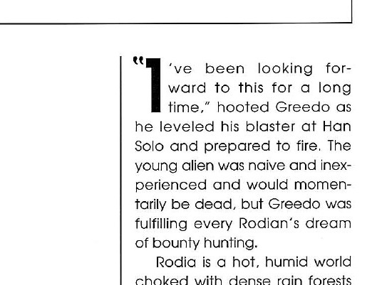

# Greedo

- **Aliases:** —
- **Era:** GCW
- **Continuity:** default Legends; entries present for: Canon, Legends
- **Research tier:** untiered (not listed as INTRO/DEEP/MASTERY in legends-feats.md)
- **Entries:** 135 (64 with quotations; 18 quotations extended to the full sentence/passage from the source text on file; 37 marked as fragments). Rebuilt 2026-11-17 from 152 old entries; old file: `characters/_bak/greedo.md.bak-20261117`.
- **How to read:** each entry is the quotation in full (block quote), then its source and point of view. "Note" lines are summaries from our notes, not quotations. `[fragment — full passage not on file]` means the source text is not on the box, so only the words in our notes are shown. Debate and forum material is in the last section and is unverified.

# LEGENDS (Legends / EU — main focus)

## Star Wars: The New Essential Chronology (Del Rey, 2005): power-scaling and lore notes

> The galaxy's most notorious bounty hunters assemble for the funeral of Greedo.
— Source: Part Four: Profiles in History; Boba Fett — art caption.
Note (our notes, around the quote): Boba Fett — art caption: "The galaxy's most notorious bounty hunters assemble for the funeral of Greedo." Source: The New Essential Chronology, p.97, caption
Our notes: `notes/materials/027-new-essential-chronology/04-part-four-profiles-in-history.md:68`

## The Complete Star Wars Encyclopedia, Vol. I (A–G)

> Beedo A relative of Greedo from the Tetsus clan, he took the bounty hunter's place in Jabba the Hutt's gang after Greedo was killed by Han Solo at the Mos Eisley cantina.
— Source: scan pages 81–120; Greedo; Han Solo.
Note (our notes, around the quote): Greedo; Han Solo: "Beedo A relative of Greedo from the Tetsus clan, he took the bounty hunter's place in Jabba the Hutt's gang after Greedo was killed by Han Solo at the Mos Eisley cantina." Source: The Complete Star Wars Encyclopedia, Vol. I, p.66
Our notes: `notes/materials/030-complete-star-wars-encyclopedia-vol-1/02-v1-scan-081-120.md:12`

> The tall struc­ ture was protected by its own atmosphere field and filled with burning candles, incense, and flaming bog pits. Lando Calrissian's Cor­ usca gem broker was located on Borgo Prime, and Luke Skywalker and Tenel Ka contacted the broker in an attempt to learn who had pur­ chased an important shipment. Borin, Dan:z A cocky gunner and bounty hunter, he maintained a residence on the Smugglers' Moon, Nar Shaddaa. He tracked down Han Solo and the Millennium Falcon to try to collect the bounty from Jabba the Hutt, but just as he was about to step up and claim his prey in the Mos Eisley cantina, another bounty hunter in Jabba's employ-the Rodian named Greedo-beat him to the punch. That was a good thing, Danz Borin learned just a minute later, as Solo killed Greedo with a blaster shot. Borkeen asteroid belt An as­ teroid belt and famed navigational hazard. (Biackmoon) The fourth planet in the Pyria system, it was a steamy blue-green world with a single dark moon that gave the system its Rebel Alli­ ance code name, Blackmoon. The only inhab­ ited world in the system, Borleias lacked most valuablenaturalresources and passed through a dense meteor shower once each year.
— Source: scan pages 81–120; Greedo. POV: Greedo.
(Excerpt widened 2026-11-17 to the relevant passage, word for word from research primary cse vol1 (text copy `research_primary_cse_vol1_pdf_45a954be6d`).)
(Excerpt widened 2026-11-17 to the relevant passage, word for word from research primary cse vol1 (text copy `research_primary_cse_vol1_pdf_45a954be6d`).)
Note (our notes, around the quote): Greedo: "That was a good thing, Danz Borin learned just a minute later, as Solo killed Greedo with a blaster shot." Source: The Complete Star Wars Encyclopedia, Vol. I, p.86
Our notes: `notes/materials/030-complete-star-wars-encyclopedia-vol-1/02-v1-scan-081-120.md:172`

> He later brought Greedo to Tatooine, where the Rodian was killed by Han Solo.
— Source: scan pages 361–398; Greedo; Han Solo.
Note (our notes, around the quote): Greedo; Han Solo: "He later brought Greedo to Tatooine, where the Rodian was killed by Han Solo." Source: The Complete Star Wars Encyclopedia, Vol. I, p.349
Our notes: `notes/materials/030-complete-star-wars-encyclopedia-vol-1/09-v1-scan-361-398.md:29`

> Ranna later joined the crew of the corvette FarStar as a pilot and gunner. She was nicknamed "Wing Ripper:' GormoA Duros male, he was stranded on the planet Onderon in the years following the Mandalorian Wars. GormtheDissolverA huge cyborg droid bounty hunter, he had heavy plated armor and a full helmet. His biocomponents came from six different aliens and seven generations of electronics. He was seemingly destroyed by the young Rodian bounty hunter Greedo on the spaceport moon of Nar Shaddaa, but later was repaired and eventually showed up in Mos Eisley. gorm-wormA species with poison venom sacs, it could kill instantly with its bite. A gorm-worm was used by pirates to kill Jedi trainee Andur Sunrider some 4,000 years be­ fore the Galactic Civil War. Gornash,ProphetA Prophet of the Dark Side, this large human coordinated spy activi­ ties from the group's space station headquar­ ters, Scardia. Gorneesh, King A sly, foul-tempered leader of the Duloks, creatures that lived in the swamps of Endor's moon. GornoA spaceport, it was supposed to be the point ofembarkation for the Hammertong device that was to be delivered to the Empire. gorntA staple in ration packs ofboth Rebels and Imperials, gornt meat was prized for its taste, nutritional value, and ability to stay fresh for a long period of time.
— Source: scan pages 361–398; Greedo. POV: Greedo.
(Excerpt widened 2026-11-17 to the relevant passage, word for word from research primary cse vol1 (text copy `research_primary_cse_vol1_pdf_45a954be6d`).)
(Excerpt widened 2026-11-17 to the relevant passage, word for word from research primary cse vol1 (text copy `research_primary_cse_vol1_pdf_45a954be6d`).)
Note (our notes, around the quote): Greedo: "He was seemingly destroyed by the young Rodian bounty hunter Greedo on the spaceport moon of Nar Shaddaa, but later was repaired and eventually showed up in Mos Eisley." Source: The Complete Star Wars Encyclopedia, Vol. I, p.354
Our notes: `notes/materials/030-complete-star-wars-encyclopedia-vol-1/09-v1-scan-361-398.md:68`

- Note (summary from our notes, not a quotation): Page contents: 897 words, 32 paragraphs | headings/entries: Great Well; Grebleips; Greck, Olag; Gree, Commander; Greeata; Greeb; Greeb-Streebling Cluster; Greedo
  — Source: scan pages 361–398.
Our notes: `notes/materials/030-complete-star-wars-encyclopedia-vol-1/09-v1-scan-361-398.md:159`

## The Complete Star Wars Encyclopedia, Vol. II (H–O)

> After Han Solo killed Greedo in the Mos Eisley cantina, Jabba ordered Heater to hire bounty hunters to bring Solo to justice.
— Source: scan pages 1–40; Han Solo; Greedo.
Note (our notes, around the quote): Han Solo; Greedo: "After Han Solo killed Greedo in the Mos Eisley cantina, Jabba ordered Heater to hire bounty hunters to bring Solo to justice." Source: The Complete Star Wars Encyclopedia, Vol. II, p.30
Our notes: `notes/materials/031-complete-star-wars-encyclopedia-vol-2/00-v2-scan-001-040.md:243`

> She hired Greedo to find Temo Dionisio, but then was killed by the Rodian bounty hunter after she threatened to kill him.
— Source: scan pages 241–280; Greedo. POV: Greedo.
Note (our notes, around the quote): Greedo: "She hired Greedo to find Temo Dionisio, but then was killed by the Rodian bounty hunter after she threatened to kill him." Source: The Complete Star Wars Encyclopedia, Vol. II, p.272
Our notes: `notes/materials/031-complete-star-wars-encyclopedia-vol-2/06-v2-scan-241-280.md:337`

> There they were almost killed by a mercenary named Gorm the Dissolver, but a young Rodian named Greedo shot Gorm, disabling him and letting the trio escape.
— Source: scan pages 361–400; Greedo. POV: Greedo.
Note (our notes, around the quote): Greedo: "There they were almost killed by a mercenary named Gorm the Dissolver, but a young Rodian named Greedo shot Gorm, disabling him and letting the trio escape." Source: The Complete Star Wars Encyclopedia, Vol. II, p.362
Our notes: `notes/materials/031-complete-star-wars-encyclopedia-vol-2/09-v2-scan-361-400.md:71`

> Neela and her brother Nok realized | that the Tetsus clan was in trouble after Navik the Red killed Greedo the Elder, and they fled Rodia.
— Source: scan pages 361–400; Greedo. POV: Greedo.
Note (our notes, around the quote): Greedo: "Neela and her brother Nok realized | that the Tetsus clan was in trouble after Navik the Red killed Greedo the Elder, and they fled Rodia." Source: The Complete Star Wars Encyclopedia, Vol. II, p.367
Our notes: `notes/materials/031-complete-star-wars-encyclopedia-vol-2/09-v2-scan-361-400.md:108`

> Neela was killed in an Imperial ambush in Nar Shaddaa's Corellian sector when Greedo was just a teenager.
— Source: scan pages 361–400; Greedo. POV: Greedo.
Note (our notes, around the quote): Greedo: "Neela was killed in an Imperial ambush in Nar Shaddaa's Corellian sector when Greedo was just a teenager." Source: The Complete Star Wars Encyclopedia, Vol. II, p.367
Our notes: `notes/materials/031-complete-star-wars-encyclopedia-vol-2/09-v2-scan-361-400.md:110`

## Sourcebooks/Rebellion Era Sourcebook.pdf [Star Wars Roleplaying Game (d20, 2000)] (scan pages 61–120)

> In addition, Solo blasted your humble servant, Greedo, and has eluded or ended the careers of more bounty hunters than I care to list since he departed Tatooine with a false promise of paying what he owed with interest.
— Source: Sourcebooks/Rebellion Era Sourcebook.pdf [Star Wars Roleplaying Game (d20.
Note (our notes, around the quote): Han Solo; Boba Fett — entry/section: The Double Bounty: Solo's toll on hunters: "In addition, Solo blasted your humble servant, Greedo, and has eluded or ended the careers of more bounty hunters than I care to list since he departed Tatooine with a false promise of paying what he owed with interest." Source: *Rebellion Era Sourcebook* (SWRPG d20), scan p.101
Our notes: `notes/materials/037-sw-d20-folder/043-rebellion-era-sourcebook-scan-061-120.md:277`

## Star Wars Gamer/Star Wars Gamer 05.pdf [Star Wars Roleplaying Game (d20, 2000)] (scan pages 61–118)

> Nearly anyone who has seen Star Wars remembers Greedo, the slow-draw artist who lost a duel with Han Solo in the Mos Eisley cantina.
— Source: Star Wars Gamer/Star Wars Gamer 05.pdf [Star Wars Roleplaying Game (d20,; Greedo; Han Solo.
Note (our notes, around the quote): Greedo; Han Solo: "Nearly anyone who has seen Star Wars remembers Greedo, the slow-draw artist who lost a duel with Han Solo in the Mos Eisley cantina." Source: *Star Wars Gamer 05* (SWRPG d20), scan p.115
Our notes: `notes/materials/037-sw-d20-folder/054-star-wars-gamer-05-scan-061-118.md:315`

## Star Wars Gamer/Star Wars Gamer 10.pdf [Star Wars Roleplaying Game (d20, 2000)] (scan pages 1–60)

- Note (summary from our notes, not a quotation): Page contents: Board-game strategy: Epic Duels decks for Luke and Leia, Mace Windu (Battlemind scales with hand size), Anakin and Padme (Anakin's Wrath instantly defeats an evil supporting character), and Boba Fett and Greedo; The Game of Life: A Jedi's Path, where three Dark Paths make you a Sith (hand-read)
  — Source: Star Wars Gamer/Star Wars Gamer 10.pdf [Star Wars Roleplaying Game (d20,.
Our notes: `notes/materials/037-sw-d20-folder/059-star-wars-gamer-10-scan-001-060.md:325`

## Characters/Miniatures/We Don't Need That Scum.pdf [Star Wars Roleplaying Game Revised Core (d20, 2002)]

- Note (summary from our notes, not a quotation): Page contents: Boba skills/feats; Bossk (Scout 1/Soldier 3, CC C, early career, Hound's Tooth); Dengar (Soldier 2/Scoundrel 4, CC D, Punishing One); Greedo intro (hand-read)
  — Source: Characters/Miniatures/We Don't Need That Scum.pdf [Star Wars Roleplaying.
Our notes: `notes/materials/037-sw-d20-folder/115-we-dont-need-that-scum.md:24`

> Equipment: Padded battle armor, Valken­38 blaster carbine, binder cuffs, blaster pistol, utility belt, modified Corellion JumpMaster 5000 (Punishing One). Skills: Astrogate +4, Bluff +5, Computer Use +6, Demolitions +6, Gather Information +6, Hide +7, Intimidate +6, Knowledge (streetwise) +6, Listen +5, Move Silently +8, Pilot +12, Profession (bounty hunter) +4, Profession (gambler) +4, Read/Write Basic, Repair +3, Speak Basic, Speak Huttese, Spot +5, Survival +23 Treat Injury +2. Feats: Armor Proficiency (light, medium), Point Blank Shot, Precise Shot, Skill Emphasis (pilot), Starship Operations (starfighter), Track, Weapon Group Proficiency (blaster pistols, blaster rifles, heavy weapons, simple weapons, vibro weapons). Greedo Greedo spent his adolescent years living in a seedy spaceport on Nar Shaddaa. It was there that he was brought into a life of crime that eventually led to employment by Jabba the Hutt. Greedo had the potential for being a dangerous bounty hunter, but he made the fatal mistake of underestimating one of his first targets: the smuggler known as Han Solo. Greedo: Male Rodian Scoundrel 4; Init +2 (+2 Dex); Defense 15 (+3 class, +2 Dex); Spd 10 m; VP/WP 19/11; Atk +4 melee (1d4+1, knife) or +6 ranged (3d8+2 or DC 18 stun, heavy blaster pistol); SQ Illicit barter, lucky (1/day), precise attack +1; SV Fort +1, Ref +6, Will +1; SZ M; FP 0; DSP 1; Rep +1; Str 13, Dex 14, Con 11, Int 12, Wis 8, Cha 9. Challenge Code C.
— Source: Characters/Miniatures/We Don't Need That Scum.pdf [Star Wars Roleplaying.
(Excerpt widened 2026-11-17 to the relevant passage, word for word from ch primary sw d20 folder files Star Wars Roleplaying Game Revised Core Characters Miniatures We Don t Need That Scum (text copy `ch_primary_sw_d20_folder_files_Star_Wars_Roleplaying_Game_Revised_Core_Characters_Miniatures_We_Don_t_Need_That_Scum_pdf_5d79f2f39d`).)
(Excerpt widened 2026-11-17 to the relevant passage, word for word from ch primary sw d20 folder files Star Wars Roleplaying Game Revised Core Characters Miniatures We Don t Need That Scum (text copy `ch_primary_sw_d20_folder_files_Star_Wars_Roleplaying_Game_Revised_Core_Characters_Miniatures_We_Don_t_Need_That_Scum_pdf_5d79f2f39d`).)
(Full sentence/passage taken from the source text on file: `ch_primary_sw_d20_folder_files_Star_Wars_Roleplaying_Game_Revised_Core_Characters_Miniatures_We_Don_t_Need_That_Scum_pdf`.)
Note (our notes, around the quote): Greedo; Jabba the Hutt; Han Solo — entry/section: Greedo's fatal mistake (part 1 of 2, continues next page): "Greedo spent his adolescent years living in a seedy spaceport on Nar Shaddaa. It was there that he was brought into a life of crime that eventually led to employment by Jabba the Hutt. Greedo had the potential for being a" Source: *We Don't Need That Scum* (SWRPG d20 Revised Core), scan p.2
Our notes: `notes/materials/037-sw-d20-folder/115-we-dont-need-that-scum.md:30`

- Note (summary from our notes, not a quotation): Page contents: Greedo (Scoundrel 4, CC C); IG-88 (Holowan Laboratories, Scout 4/Soldier 3/Bounty Hunter 1, CC E, IG-2000); Zuckuss (Gand ammonia breather oxygen rules; Force Adept 2/Scout 3/Findsman 5/Bounty Hunter 1, CC E) (hand-read)
  — Source: Characters/Miniatures/We Don't Need That Scum.pdf [Star Wars Roleplaying.
Our notes: `notes/materials/037-sw-d20-folder/115-we-dont-need-that-scum.md:40`

> Feats: Armor Proficiency (light, medium), Point Blank Shot, Precise Shot, Skill Emphasis (pilot), Starship Operations (starfighter), Track, Weapon Group Proficiency (blaster pistols, blaster rifles, heavy weapons, simple weapons, vibro weapons). Greedo Greedo spent his adolescent years living in a seedy spaceport on Nar Shaddaa. It was there that he was brought into a life of crime that eventually led to employment by Jabba the Hutt. Greedo had the potential for being a dangerous bounty hunter, but he made the fatal mistake of underestimating one of his first targets: the smuggler known as Han Solo. Greedo: Male Rodian Scoundrel 4; Init +2 (+2 Dex); Defense 15 (+3 class, +2 Dex); Spd 10 m; VP/WP 19/11; Atk +4 melee (1d4+1, knife) or +6 ranged (3d8+2 or DC 18 stun, heavy blaster pistol); SQ Illicit barter, lucky (1/day), precise attack +1; SV Fort +1, Ref +6, Will +1; SZ M; FP 0; DSP 1; Rep +1; Str 13, Dex 14, Con 11, Int 12, Wis 8, Cha 9. Challenge Code C. Equipment: BlasTech DT­12 heavy blaster pistol, variety of personal belongings.
— Source: Characters/Miniatures/We Don't Need That Scum.pdf [Star Wars Roleplaying.
(Excerpt widened 2026-11-17 to the relevant passage, word for word from ch primary sw d20 folder files Star Wars Roleplaying Game Revised Core Characters Miniatures We Don t Need That Scum (text copy `ch_primary_sw_d20_folder_files_Star_Wars_Roleplaying_Game_Revised_Core_Characters_Miniatures_We_Don_t_Need_That_Scum_pdf_5d79f2f39d`).)
(Excerpt widened 2026-11-17 to the relevant passage, word for word from ch primary sw d20 folder files Star Wars Roleplaying Game Revised Core Characters Miniatures We Don t Need That Scum (text copy `ch_primary_sw_d20_folder_files_Star_Wars_Roleplaying_Game_Revised_Core_Characters_Miniatures_We_Don_t_Need_That_Scum_pdf_5d79f2f39d`).)
(Full sentence/passage taken from the source text on file: `ch_primary_sw_d20_folder_files_Star_Wars_Roleplaying_Game_Revised_Core_Characters_Miniatures_We_Don_t_Need_That_Scum_pdf`.)
Note (our notes, around the quote): Greedo; Jabba the Hutt; Han Solo — entry/section: Greedo's fatal mistake (part 2 of 2, continued from previous page): "dangerous bounty hunter, but he made the fatal mistake of underestimating one of his first targets: the smuggler known as Han Solo." Source: *We Don't Need That Scum* (SWRPG d20 Revised Core), scan p.3
Our notes: `notes/materials/037-sw-d20-folder/115-we-dont-need-that-scum.md:42`

## Jedi Counselling/Jedi Counseling 9 - Spinning Ships.pdf [Star Wars Roleplaying Game Revised Core (d20, 2002)]

- Note (summary from our notes, not a quotation): Page contents: Luke/Greedo AoO; healing items; Move Object weight; Cooperation; lightsaber vs Vong; batteries; spin recovery (hand-read)
  — Source: Jedi Counselling/Jedi Counseling 9 - Spinning Ships.pdf [Star Wars Rolepl.
Our notes: `notes/materials/037-sw-d20-folder/260-jedi-counseling-9-spinning-ships.md:10`

- Note (summary from our notes, not a quotation): Luke Skywalker; Greedo — entry/section: Luke can't ignite his lightsaber for an AoO on Greedo: "Q: Luke is standing in a hall and has his lightsaber in hand but not ignited. Greedo goes running by and passes through an area Luke threatens. Since igniting a lightsaber is a free action, does Luke get a chance to ignite it and take his attack of opportunity?
  — Source: Jedi Counselling/Jedi Counseling 9 - Spinning Ships.pdf [Star Wars Rolepl.
Our notes: `notes/materials/037-sw-d20-folder/260-jedi-counseling-9-spinning-ships.md:12`

## Sourcebooks/Arms and Equipment Guide.pdf [Star Wars Roleplaying Game Revised Core (d20, 2002)] (scan pages 1–60)

- Note (summary from our notes, not a quotation): Page contents: IR-5 cont.; Heavy blaster pistols: BlasTech DL-44 (Han Solo), DT-12 (Greedo). (hand-read)
  — Source: Sourcebooks/Arms and Equipment Guide.pdf [Star Wars Roleplaying Game Revi.
Our notes: `notes/materials/037-sw-d20-folder/663-arms-and-equipment-guide-scan-001-060.md:55`

> The bounty hunter Greedo used a DT-12, a fact that loyal users of the DL-44 (see above) never tire of telling others.
— Source: Sourcebooks/Arms and Equipment Guide.pdf [Star Wars Roleplaying Game Revi; Greedo — entry/section: Greedo's DT-12.
Note (our notes, around the quote): Greedo — entry/section: Greedo's DT-12: "The bounty hunter Greedo used a DT-12, a fact that loyal users of the DL-44 (see above) never tire of telling others." Source: *Arms and Equipment Guide* (SWRPG d20 Revised Core), scan p.10
Our notes: `notes/materials/037-sw-d20-folder/663-arms-and-equipment-guide-scan-001-060.md:59`

## Sourcebooks/Galactic Campaign Guide.pdf [Star Wars Roleplaying Game Revised Core (d20, 2002)] (scan pages 121–162)

- Note (summary from our notes, not a quotation): Page contents: Tables 4-35, 4-36 Rodian male and female names (Greedo = Ambitious, Greeata...) (hand-read)
  — Source: Sourcebooks/Galactic Campaign Guide.pdf [Star Wars Roleplaying Game Revis.
Our notes: `notes/materials/037-sw-d20-folder/666-galactic-campaign-guide-scan-121-162.md:55`

## Sourcebooks/Ultimate Alien Anthology.pdf [Star Wars Roleplaying Game Revised Core (d20, 2002)] (scan pages 121–180)

- Note (summary from our notes, not a quotation): Page contents: Ranth traits; Rodian (example names incl. Greedo, Beedo, Greeata). (hand-read)
  — Source: Sourcebooks/Ultimate Alien Anthology.pdf [Star Wars Roleplaying Game Revi.
Our notes: `notes/materials/037-sw-d20-folder/673-ultimate-alien-anthology-scan-121-180.md:57`

## Star Wars Insider #33 (1997)

- Note (summary from our notes, not a quotation): Page contents: Scott Chernoff "Star Wars World Premiere" and press conference (pp22-26, printed 20-24): Lucas, Mark Hamill, Carrie Fisher, Kershner, Burtt, Dennis Muren, John Williams attend; Boba Fett and Greeata costumes; "Jedi Rocks" replaces "Lapti Nek"; Dave Carson at the press conference; Lucas on maybe never doing Episodes 7-9; Lucas relates most to Luke and maybe Vader. T lines for prequel-arc and Greedo statements. (hand-read)
  — Source: Star Wars Insider #33 (1997).
Our notes: `notes/materials/038-star-wars-insider/033-ins033.md:115`

- Note (summary from our notes, not a quotation): Page contents: Rebel Rumblings continued (printed 76; writers omitted): John Morton follow-up, Lucas's fuller answer on Greedo (three versions of the shot), Outrider over Mos Eisley in the SE, Holiday Special issue correction. S only. (hand-read)
  — Source: Star Wars Insider #33 (1997).
Our notes: `notes/materials/038-star-wars-insider/033-ins033.md:426`

## Star Wars Insider #34 (1997)

> Scouting the Galaxy: Greedo Envy! *(pp73-75, printed 69-71)*
> [fragment — full passage not on file]
— Source: Star Wars Insider #34 (1997); Page contents: Stephen J. Sansweet.
Note (our notes, around the quote): Page contents: Stephen J. Sansweet "Scouting the Galaxy: Greedo Envy!" (pp73-75, printed 69-71): Ewok plush, Greedo items, how Decipher names background characters with Stacy Mollema (Tiree from the original script), overseas exclusives, lunch boxes, Hallmark ornaments, Japanese merchandise; questioners omitted. Real-world. (hand-read)
Our notes: `notes/materials/038-star-wars-insider/034-ins034.md:392`

- Note (summary from our notes, not a quotation): Page contents: 560 words, 19 paragraphs | headings/entries: Gregg Davis; Arabi LA; Greedo Mask; Jeseph Hong; Grosse Pointe Woods, MI; Paul Dolan; Cheshire, England; Clavake Star Wart Cenchboset
  — Source: Star Wars Insider #34 (1997).
Our notes: `notes/materials/038-star-wars-insider/034-ins034.md:397`

## Star Wars Insider #37 (1998)

- Note (summary from our notes, not a quotation): Page contents: Legends in Three Dimensions busts ad (Boba Fett, Greedo, Palpatine; Greg Aronowitz). Ad copy only. (hand-read)
  — Source: Star Wars Insider #37 (1998).
Our notes: `notes/materials/038-star-wars-insider/037-ins037.md:20`

> In the Star Wars Universe: It's Not Easy Being Greedo
> [fragment — full passage not on file]
— Source: Star Wars Insider #37 (1998); Page contents: Scott Chernoff.
Note (our notes, around the quote): Page contents: Scott Chernoff "In the Star Wars Universe: It's Not Easy Being Greedo" on Maria de Aragon (pp22-23): now an LA chauffeur; Ben Burtt created Greedo's voice; two days on the set in 1976. Real-world. (hand-read)
Our notes: `notes/materials/038-star-wars-insider/037-ins037.md:115`

- Note (summary from our notes, not a quotation): Page contents: de Aragon continued: was first slated to fill in as C-3PO for coverage days; nearly passed out from lack of air under the mask and Lucas got her help; never on set with Harrison Ford. Columnist note: Luke, Leia and Han do not reply. T line on Greedo. (hand-read)
  — Source: Star Wars Insider #37 (1998).
Our notes: `notes/materials/038-star-wars-insider/037-ins037.md:120`

## Star Wars Insider #38 (1998)

- Note (summary from our notes, not a quotation): Page contents: Legends in Three Dimensions busts ad (Boba Fett, Greedo, Emperor). Ad copy only. (hand-read)
  — Source: Star Wars Insider #38 (1998).
Our notes: `notes/materials/038-star-wars-insider/038-ins038.md:20`

- Note (summary from our notes, not a quotation): Page contents: Poll #1 Han Solo; Boba Fett tops the Movie Lines/Popularity Index; Mara Jade #20 highest non-film character; Greedo 29th, Lobot tied 47th. Tina Tweedale contributed to tabulation. Real-world. (hand-read)
  — Source: Star Wars Insider #38 (1998).
Our notes: `notes/materials/038-star-wars-insider/038-ins038.md:412`

- Note (summary from our notes, not a quotation): Page contents: Rebel Rumblings continued (printed 81): Greedo "monster" letter; juvenile books not integrated into the timeline; Biggs scenes "mass hallucination" closed out. Letter writers omitted. Real-world. (hand-read)
  — Source: Star Wars Insider #38 (1998).
Our notes: `notes/materials/038-star-wars-insider/038-ins038.md:462`

## Star Wars Insider #42 (1999)

- Note (summary from our notes, not a quotation): Page contents: Jawa Trader: Legends in 3-D busts (Boba Fett, Greedo, Emperor). Ad copy only. (hand-read)
  — Source: Star Wars Insider #42 (1999).
Our notes: `notes/materials/038-star-wars-insider/042-ins042.md:223`

## Star Wars Insider #43 (1999)

- Note (summary from our notes, not a quotation): Page contents: Contents: Prequel Update, Brian Blessed/Boss Nass, Lucas Down Under pt II, Droids of Episode I, Paul Blake/Greedo, Lucasfilm Lifers, Episode I comics; Wonder Column on break; two covers (Neeson, Park). S only. (hand-read)
  — Source: Star Wars Insider #43 (1999).
Our notes: `notes/materials/038-star-wars-insider/043-ins043.md:35`

- Note (summary from our notes, not a quotation): Page contents: Matt Yeo, "It's Still Not Easy Being Greedo": Paul Blake, the British-shoot Greedo; also played the Rodian in the Jabba hangar scene. See T. (hand-read)
  — Source: Star Wars Insider #43 (1999).
Our notes: `notes/materials/038-star-wars-insider/043-ins043.md:328`

## Star Wars Insider #52 (2000)

- Note (summary from our notes, not a quotation): Page contents: Jawa Trader: Yoda and Han/Greedo Japanese t-shirts, Aurra Sing signed photo (same ad copy as #51), R2 backpack, Pepsi cans. (hand-read)
  — Source: Star Wars Insider #52 (2000).
Our notes: `notes/materials/038-star-wars-insider/052-ins052.md:226`

## Star Wars Insider #53 (2001)

> What if Greedo had killed Han in the cantina?
>
> What if Luke had completed his Jedi training?
>
> What would have happened if Uncle Owen hadn't bought R2-D2?
— Source: Star Wars Insider #53 (2001); Greedo; Luke Skywalker.
Note (our notes, around the quote): Greedo; Luke Skywalker: ""What if Greedo had killed Han in the cantina?" or "What if Luke had completed his Jedi training?" of "What would have happened if Uncle Owen hadn't bought R2-D2?"" Source: *Star Wars Insider #53* (2001), scan p.59
Our notes: `notes/materials/038-star-wars-insider/053-ins053.md:338`

## Star Wars Insider #54 (2001)

- Note (summary from our notes, not a quotation): Page contents: Jawa Trader specials cont.: classic figures (Lando Calrissian, Han Solo (Cantina/Bespin), Luke Skywalker, Endor Rebel Soldier, Princess Leia (prisoner), Greedo, Death Star Trooper, Luke as Stormtrooper, Luke & T-16 Skyhopper, Jawa & Gonk Droid, Kyle Katarn); Cantina Band Member figure "officially retired". Product listing only. (hand-read)
  — Source: Star Wars Insider #54 (2001).
Our notes: `notes/materials/038-star-wars-insider/054-ins054.md:257`

## Star Wars Insider #55 (2001)

- Note (summary from our notes, not a quotation): Page contents: Top 10 Tales cont. (magazine p. 75): reasons 5-10 (Ewoks in underwear; truly short stories incl. Qui-Gon and Obi-Wan in "Life, Death, and the Living Force"; artistic diversity; Yoda wielding a lightsaber in "The Hidden"; character coverage incl. Greedo, Mara Jade, Amidala, Grissom the Gamorrean; Vader vs. Maul); pull quote; panel captions. (hand-read)
  — Source: Star Wars Insider #55 (2001).
Our notes: `notes/materials/038-star-wars-insider/055-ins055.md:380`

## Star Wars Insider #56 (2001)

> Who Runs This Show? Overworked and Underpaid, But They Know Their Stuff
> [fragment — full passage not on file]
— Source: Star Wars Insider #56 (2001); Page contents: Departments list and editorial.
Note (our notes, around the quote): Page contents: Departments list and editorial "Who Runs This Show? Overworked and Underpaid, But They Know Their Stuff" by outgoing editor-in-chief Chris Perkins (magazine p. 3): top-right "Yut chda!" box on his move to the Roleplaying Game; staff introductions with joking favorite-character notes (Greedo, Han Solo/Chewbacca, dianoga, Darth Vader); new editor Dave Gross. No in-universe character material. (hand-read)
Our notes: `notes/materials/038-star-wars-insider/056-ins056.md:20`

> Oie Boie! It's Finally Here!
> [fragment — full passage not on file]
— Source: Star Wars Insider #56 (2001); Page contents: Episode I DVD feature (magazine p. 26).
Note (our notes, around the quote): Page contents: Episode I DVD feature (magazine p. 26): "Oie Boie! It's Finally Here!" intro; filmstrip header "Anakin's Scuffle with Greedo - Cut Scene No. 6" with caption on Wald (Warwick Davis) leaping from his perch and a young Rodian named Greedo; "Something for the Fans" interview with Lucasfilm VP of Marketing Jim Ward by Ron Magid begins - why the DVD took so long, Lucas finishing seven deleted scenes. (hand-read)
Our notes: `notes/materials/038-star-wars-insider/056-ins056.md:112`

## Star Wars Insider #58 (2002)

> The Core Rules Strike Back!
> [fragment — full passage not on file]
>
> Rodian Crime Lord: Clever, witty, and deadly - nothing like Greedo. *(hand-read)*
— Source: Star Wars Insider #58 (2002); Page contents. POV: Page contents, about Greedo.
Note (our notes, around the quote): Page contents: "The Core Rules Strike Back!" cont. (magazine p. 77): Top 10 items 8-1 - more character species (seventeen total; Gamorrean scoundrel, Kel Dor fringer/Jedi consular, Tarbak noble; stats for 26 more incl. Chiss, Jawas, Yuuzhan Vong), new foreword by Steve Sansweet, new skills and feats, creature creation rules, new full-color art, dark side Force feats and prestige classes (dark side devotee, dark side marauder), the tech specialist class, Attack of the Clones features (stats for Anakin, Padme, Mace Windu, Jango Fett, Count Dooku, Slave I, Geonosians, Kaminoans). Body: More Heroes, More Choices (droid hero rules from Star Wars Gamer #3); Grittier Combat (attacks of opportunity, armor as damage reduction, starship combat on a grid; preview in Star Wars Gamer #8). Caption "Rodian Crime Lord: Clever, witty, and deadly - nothing like Greedo." (hand-read)
Our notes: `notes/materials/038-star-wars-insider/058-ins058.md:379`

- Note (summary from our notes, not a quotation): Page contents: Rebel Rumblings continued from p. 6 (magazine p. 90): letters (names omitted) - "Defending Kenobi" and "Getting Her Scottish Up" protesting Insider #57's teasing of Obi-Wan (editor replies blame Sir Alec Guinness's wilier Kenobi, joking); "Who's That Rodian?" (Paul Blake played Greedo in the British shoot, Maria De Aragon in Hollywood pick-up shots); "Car Wars" fan car photo; "Ewan Mania" (a reader met Ewan McGregor as Chieftain of the Crieff Highland Games); "Spoiler Alerts" begins. (hand-read)
  — Source: Star Wars Insider #58 (2002).
Our notes: `notes/materials/038-star-wars-insider/058-ins058.md:458`

## Star Wars Insider #60 (2002)

> Who Reads Star Wars Insider?
> [fragment — full passage not on file]
— Source: Star Wars Insider #60 (2002).
Note (our notes, around the quote): Page contents: Rebel Rumblings (letters cont. from p. 6; letter-writer names omitted): costumers article request; Fighting 501st thanks; Temuera Morrison/Once Were Warriors; editorial replies. Box "Who Reads Star Wars Insider?": photos of Star Wars actors reading Insider at Planet Hollywood Toronto — Garrick Hagon, Richard LeParmentier, Paul Blake, Peter Mayhew; upside-down answers (A. Greedo—Paul Blake, B. Biggs Darklighter—Garrick Hagon, C. Admiral Motti—Richard LeParmentier, D. Chewbacca—Peter Mayhew). (hand-read)
Our notes: `notes/materials/038-star-wars-insider/060-ins060.md:960`

## Star Wars Insider #63 (2002)

- Note (summary from our notes, not a quotation): Page contents: TCG A New Hope cont.: card previews (power droid, General Tagge, Imperial pilots, Figrin D'an, Greedo, IT-O interrogator, Jawa leader, LIN demolitionmech); set background. (hand-read)
  — Source: Star Wars Insider #63 (2002).
Our notes: `notes/materials/038-star-wars-insider/063-ins063.md:440`

## Star Wars Insider #71 (2003)

- Note (summary from our notes, not a quotation): Page contents: Gift guide: Code 3 die-cast Falcon and X-wing; Classico mugs; Rubie's helmets and Yoda bust; Gentle Giant Tarkin and Greedo mini-busts. (hand-read)
  — Source: Star Wars Insider #71 (2003).
Our notes: `notes/materials/038-star-wars-insider/071-ins071.md:114`

## Star Wars Insider #72 (2003)

> or we'll start telling everyone Greedo shot first
> [fragment — full passage not on file]
— Source: Star Wars Insider #72 (2003).
Note (our notes, around the quote): Page contents: Fan mail art and costumes (Obi-Wan and Anakin costumes, a pumpkin), with an editors' plea for illustrated envelopes ("or we'll start telling everyone Greedo shot first"); the magazine's 2003 Statement of Ownership, Management, and Circulation (fan names omitted). (hand-read)
Our notes: `notes/materials/038-star-wars-insider/072-ins072.md:495`

## Star Wars Insider #74 (2004)

- Note (summary from our notes, not a quotation): Page contents: Letters continued: a Vader birthday cake and county-fair collection display, Han and Greedo, a homemade hardware lightsaber, a request for a working Yoda puppet replica, a fan-film DVD request (letter-writer names omitted). (hand-read)
  — Source: Star Wars Insider #74 (2004).
Our notes: `notes/materials/038-star-wars-insider/074-ins074.md:568`

## Star Wars Insider #76 (2004)

> Troupe de Clone Clone,
> [fragment — full passage not on file]
— Source: Star Wars Insider #76 (2004).
Note (our notes, around the quote): Page contents: Back-page art: a museum-gallery parody in which a Twi'lek docent leads aliens past Star Wars takes on famous paintings (a Van Gogh-style Yoda, a Toulouse-Lautrec-style "Troupe de Clone Clone," a Picasso-style piece, a Han and Leia portrait), while Greedo blasts a bust. (hand-read)
Our notes: `notes/materials/038-star-wars-insider/076-ins076.md:566`

## Star Wars Insider #78 (2004)

- Note (summary from our notes, not a quotation): Page contents: Factoids continued: the wampa suit (worn by Howie Weed) and unfilmed wampa ideas; Hobbie and Veers in the Empire novelization; freeze-frame finds (the cantina flipper hand, R2 on the stairs, the "Ice Cream Guy," a TIE pilot hit by an asteroid, Leia shutting her eyes as she fires, Threepio's sticky pad, the Greedo mannequin). (hand-read)
  — Source: Star Wars Insider #78 (2004).
Our notes: `notes/materials/038-star-wars-insider/078-ins078.md:246`

## Star Wars Insider #85 (2006)

- Note (summary from our notes, not a quotation): Page contents: Webstrips: Evasive Action, Gambler's World, A Hunter's Fate: Greedo's Tale, Reversal of Fortune, Darth Vader Strikes, The Bounty Hunter of Ord Mantell, Evasive Action: Recruitment concepts (hand-read)
  — Source: Star Wars Insider #85 (2006).
Our notes: `notes/materials/038-star-wars-insider/085-ins085.md:494`

## Star Wars Insider #89 (2006)

> He's never up for a haunch of nerf...mmm, good eating.... He got a medal and I didn't. He got to shoot Greedo, and I didn't. He keeps changing outfits. Who are we fighting, the fashion police? —Peter Mayhew, Star Wars Insider 89, p. 12
> [fragment — full passage not on file]
— Source: Star Wars Insider #89 (2006); Chewbacca; Han Solo — entry/section: What annoys Chewie about Han.
Note (our notes, around the quote): Chewbacca; Han Solo — entry/section: What annoys Chewie about Han: "He's never up for a haunch of nerf...mmm, good eating.... He got a medal and I didn't. He got to shoot Greedo, and I didn't. He keeps changing outfits. Who are we fighting, the fashion police? —Peter Mayhew, Star Wars Insider 89, p. 12" Source: *Star Wars Insider #89* (2006), scan p.12
Our notes: `notes/materials/038-star-wars-insider/089-ins089.md:67`

- Note (summary from our notes, not a quotation): Page contents: Story Changes: Han and Greedo's face-off; Don't Look Now (Jabba docking bay, Declan Mulholland, Biggs); Punch Lines (hand-read)
  — Source: Star Wars Insider #89 (2006).
Our notes: `notes/materials/038-star-wars-insider/089-ins089.md:183`

## Star Wars Insider #94 (2007)

> Who to Draw First? Greedo or Han? In You Can Draw Star Wars, the decision is all yours.... *(words: Pete Vilmur & Bonnie Burton)*
> [fragment — full passage not on file]
— Source: Star Wars Insider #94 (2007); Page contents: Best of StarWars.com.
Note (our notes, around the quote): Page contents: Best of StarWars.com "Who to Draw First? Greedo or Han? In You Can Draw Star Wars, the decision is all yours...." (words: Pete Vilmur & Bonnie Burton): DK book written by Bonnie Burton and illustrated by Matt Busch and Tom Hodges; origin in the starwars.com Learn to Draw section; sample spreads (Color Basics, Clone Wars) (hand-read)
Our notes: `notes/materials/038-star-wars-insider/094-ins094.md:146`

- Note (summary from our notes, not a quotation): Page contents: Full-page montage art of the original trilogy cast (Luke, Leia, Han, Obi-Wan, Vader, Tarkin, Chewbacca, droids, stormtrooper, Greedo, X-wings) (hand-read)
  — Source: Star Wars Insider #94 (2007).
Our notes: `notes/materials/038-star-wars-insider/094-ins094.md:194`

- Note (summary from our notes, not a quotation): Page contents: Bantha Tracks Editorial "Life Without Star Wars" by Mary Franklin, Editor, Bantha Tracks (sections More Money, Very Different Memories, Fewer Friends Worldwide); fan art of Han Solo and Greedo in the cantina (artist name omitted) (hand-read)
  — Source: Star Wars Insider #94 (2007).
Our notes: `notes/materials/038-star-wars-insider/094-ins094.md:864`

## Star Wars Insider #95 (2007)

- Note (summary from our notes, not a quotation): Page contents: Best of StarWars.com (words: Pete Vilmur & Bonnie Burton) "Star Wars Diary: 30 Years": new regular series of 1977 pre-release events; January 1977 (Sight and Sound spread, John Williams views rough cut, Fox executives, new cantina footage with articulated-lip Greedo on La Brea Avenue, Mojave Desert Tatooine pickups, Marc Pevers/Craig Stokely Kenner dialogue, ILM shots); February 1977 (Lucas screens rough cut for De Palma and Spielberg, McQuarrie poster concepts, Charles Lippincott at Toy Fair, paperback novel sells out, ILM shots); poster, Marvel #1 cover, Hildebrandt art, Burger power bar images (hand-read)
  — Source: Star Wars Insider #95 (2007).
Our notes: `notes/materials/038-star-wars-insider/095-ins095.md:134`

- Note (summary from our notes, not a quotation): Page contents: Feature "Inside Celebration IV" (words: Jonathan Wilkins): Los Angeles Convention Center May 24-28, Jedi, troopers, characters from films, EU and fans; Lucasfilm and Gen Con, more than 35,000 fans; Star Wars Celebration IV logo; Leia/Luke art, Lando, Greedo, LEGO, R2-D2 photos (hand-read)
  — Source: Star Wars Insider #95 (2007).
Our notes: `notes/materials/038-star-wars-insider/095-ins095.md:181`

> Who shoots first, Han or Greedo? Now you decide!
— Source: Star Wars Insider #95 (2007); Page contents: Hasbro Battle Packs Unleashed ad (.
Note (our notes, around the quote): Page contents: Hasbro Battle Packs Unleashed ad ("Who shoots first, Han or Greedo? Now you decide!"; Trouble on Tatooine Cantina Encounter, Tusken Raiders, Sandtrooper Search) (hand-read)
Our notes: `notes/materials/038-star-wars-insider/095-ins095.md:860`

## Star Wars Insider #96 (2007)

> A Galaxy Not So Far Away!
— Source: Star Wars Insider #96 (2007).
Note (our notes, around the quote): Page contents: Com-Scan cont.: Celebration Europe Saturday/Sunday (Anthony Daniels, Rick McCallum, Indiana Jones "old boys" panel, Billy Dee Williams, charity auction; 29,000+ paid admissions); "A Galaxy Not So Far Away!" — Star Wars: Where Science Meets Imagination at the California Science Center, words by David Maddox (Hoth diorama, mini-hydrofoil, Wookiee exhibit, Coruscant, Jawa sandcrawler Robot Theatre, full-size Millennium Falcon cockpit with Anthony Daniels presentation; 501st support; Boston Museum of Science); photos (Greedo/photo credits staff; fan photo credits omitted) (hand-read)
Our notes: `notes/materials/038-star-wars-insider/096-ins096.md:68`

## Star Wars Insider #98 (2008)

- Note (summary from our notes, not a quotation): Page contents: "Star Players" cont.: Anthony Forrest (why Star Wars endured); Paul Blake (Greedo); photos of Greedo, Han in cantina, Fixer/Biggs-era Anchorhead scene (hand-read)
  — Source: Star Wars Insider #98 (2008). POV: Page contents, about Greedo.
Our notes: `notes/materials/038-star-wars-insider/098-ins098.md:363`

- Note (summary from our notes, not a quotation): Page contents: "Star Players" cont.: Colin Higgins (originally cast as Wedge, fired); Garrick Hagon (Biggs); photos of Greedo, Luke and Biggs, Rebel pilots in briefing room, Hagon with camera, Rebel pilot in cockpit (hand-read)
  — Source: Star Wars Insider #98 (2008). POV: Page contents, about Greedo.
Our notes: `notes/materials/038-star-wars-insider/098-ins098.md:368`

## Star Wars Insider #99 (2008)

> This spread: Being a bounty hunter can lead to a short life span—just ask Boba Fett, Greedo or IG-88!
— Source: Star Wars Insider #99 (2008).
Note (our notes, around the quote): Page contents: Tales of the Bounty Hunters cont.: "By the Book" (Shadows of the Empire, Boushh/Snoova, K.W. Jeter's Bounty Hunter Wars); "In the Frame" (Marvel's Valance; Archie Goodwin & Al Williamson newspaper strips); photos of Boushh, Boba Fett, Bossk, IG-88; caption "This spread: Being a bounty hunter can lead to a short life span—just ask Boba Fett, Greedo or IG-88!"; pull quote by Lucas Licensing Executive Editor Sue Rostoni (hand-read)
Our notes: `notes/materials/038-star-wars-insider/099-ins099.md:154`

- Note (summary from our notes, not a quotation): Page contents: Tales of the Bounty Hunters concl. (Daniel Wallace): Dark Horse's Boba Fett (Dark Empire; Death, Lies, and Treachery by John Wagner & Cam Kennedy; Underworld drawn by Carlos Meglia, series editor Dave Land); "Big Screen Bounty" (prequel hunters, TV series); Greedo, 4-LOM/Zuckuss, IG-88 and comic Boba Fett images; pull quote by Star Wars producer Rick McCallum (hand-read)
  — Source: Star Wars Insider #99 (2008).
Our notes: `notes/materials/038-star-wars-insider/099-ins099.md:165`

> Ever since Han Solo faced off with Greedo, bounty hunters have been some of the most intriguing characters in the Star Wars galaxy. They have no rules to follow, they get the coolest weapons, and they're always living in a moral gray zone—which makes them endlessly fascinating. When we first caught sight of Boba Fett and his awesome armor, it was obvious there was a whole side of Star Wars that the movies couldn't explore. So, it was great to be able to incorporate some bounty hunters into the prequels.
— Source: Star Wars Insider #99 (2008).
Note (our notes, around the quote): Han Solo; Greedo; Boba Fett — entry/section: McCallum on prequel hunters: ""Ever since Han Solo faced off with Greedo, bounty hunters have been some of the most intriguing characters in the Star Wars galaxy. They have no rules to follow, they get the coolest weapons, and they're always living in a moral gray zone—which makes them endlessly fascinating. When we first caught sight of Boba Fett and his awesome armor, it was obvious there was a whole side of Star Wars that the movies couldn't explore. So, it was great to be able to incorporate some bounty hunters into the prequels." —Rick McCallum, Star Wars Insider 99, p. 19" Source: *Star Wars Insider #99* (2008), scan p.19
Our notes: `notes/materials/038-star-wars-insider/099-ins099.md:169`

> Shoot first, ask questions later. A slow bounty hunter is a dead bounty hunter. Always!
— Source: Star Wars Insider #99 (2008).
Note (our notes, around the quote): Page contents: Guild Handbook: "Download" panel "The Bounty Hunters Creed"; "Intel" panel "Our Kind of Scum: Bossk" stat box; "Incoming Alerts" (Warning! Be Aware re Boussh; "Shoot first, ask questions later. A slow bounty hunter is a dead bounty hunter. Always!") with Greedo crosshair image (hand-read)
Our notes: `notes/materials/038-star-wars-insider/099-ins099.md:232`

- Note (summary from our notes, not a quotation): Page contents: Guild Handbook cont.: "Info" boxes "Find a Hobby" (Aldar Beedo) and "Hunting in the Family" (Beedo/Greedo); IG-88 silhouette; "Intel Files" Dengar stat box with image; "Data" IG-88 box and "The Many Fates of IG-88" chart; 4-LOM stat box with image (hand-read)
  — Source: Star Wars Insider #99 (2008).
Our notes: `notes/materials/038-star-wars-insider/099-ins099.md:258`

> I think Greedo's voice is one of my favorites of all the Star Wars creatures. There's quite a rhythm to it that was amusing and exotic. It worked well.
— Source: Star Wars Insider #99 (2008); Greedo — entry/section: Greedo's voice a favorite.
Note (our notes, around the quote): Greedo — entry/section: Greedo's voice a favorite: ""I think Greedo's voice is one of my favorites of all the Star Wars creatures. There's quite a rhythm to it that was amusing and exotic. It worked well." —Ben Burtt, Star Wars Insider 99, p. 44" Source: *Star Wars Insider #99* (2008), scan p.44
Our notes: `notes/materials/038-star-wars-insider/099-ins099.md:409`

## Star Wars Insider #102 (2008)

- Note (summary from our notes, not a quotation): Page contents: Freeborn feature (cont.): photos Chewbacca, Leia (slave costume) with Jabba the Hutt, Yoda puppet close-up, Greedo head; pull quote; "Fan Response" and "Vital Equipment!" yellow boxes (hand-read)
  — Source: Star Wars Insider #102 (2008).
Our notes: `notes/materials/038-star-wars-insider/102-ins102.md:224`

## Star Wars Insider #108 (2009)

- Note (summary from our notes, not a quotation): Page contents: A Long Time Ago... 1997 by Daniel Wallace: month-by-month (Special Editions, Galaxy of Fear, Soldier for the Empire, X-Wing vs. TIE Fighter, Delusions of Grandeur reintroduces IG-88, Hutt Gambit, Fall of the Sith Empire, Masters of Teras Kasi, Essential Guide to Weapons and Technology); Special Edition changes sidebar (Greedo shot first, Luke's scream, Jedi Rocks). Out-of-universe. (hand-read)
  — Source: Star Wars Insider #108 (2009).
Our notes: `notes/materials/038-star-wars-insider/108-ins108.md:214`

## Star Wars Insider #110 (2009)

What it shows (our notes): Page contents: Classic Moment (words: Brian J. Robb): Who's Who notes on Han (shoots first 1977 / retaliates 1997 / simultaneous 2004) and Greedo; Han Solo at Stars' End "I happen to like to shoot first, Rekkon"; next time "Execute Order 66!". (hand-read)
> It was reprinted by Dark Horse Comics in 1997.
>
> That version of the story differs from the novel—events have been truncated and action sequences restaged to better fit daily comic installments. It was reprinted by Dark Horse Comics in 1997.
>
> The 1979 Stars’ End novel has a notable moment of prescience in its characterization of Han. In chapter 6, Han says to Rekkon the scholar: “I happen to like to shoot first, Rekkon. As opposed to shooting second”—an ironic statement given fan sentiment expressed about the 1997 Special Edition edit that had Han shoot second when confronted by Greedo.
>
> The intrepid crew of the Millennium Falcon: computer probe Blue Max, labor droid Bollux, ship captain Han Solo, first mate Chewbacca.
>
> AUTHOR · Kathy Tyers PUBLICATION HISTORY · Short story, West End Games · Star Wars Adventure Journal #4, November 1994 Compiled as part of the Tales of the Empire anthology, Bantam Spectra Books · Paperback, November 1997 TIME LINE PLACEMENT · 1 BBY WORLD VISITED · Druckenwell [P-15] MAIN CHARACTERS · Tinian I’att, armaments heir (human female); Daye Azur-Jamin, armaments executive (human male); Eisen Kerioth, Imperial Moff (human male) SUMMARY · I’att Armaments demonstrates its revolutionary portable shielding technology, which could render stormtroopers invulnerable to blasterfire.
— Source: Star Wars Insider #110 (2009).
(Excerpt widened 2026-11-17 to the relevant passage, word for word from The Essential Reader’s Companion: Star Wars (Pablo Hidalgo) (text copy `primary_essential_guides_eg_readers_companion_2012_Star_Wars_The_Essential_Readers_Companion_Pablo_Hidalgo_8O9y2bib_epub_e20384df21`).)
(Excerpt widened 2026-11-17 to the relevant passage, word for word from The Essential Reader’s Companion: Star Wars (Pablo Hidalgo) (text copy `primary_essential_guides_eg_readers_companion_2012_Star_Wars_The_Essential_Readers_Companion_Pablo_Hidalgo_8O9y2bib_epub_e20384df21`).)
(Full sentence/passage taken from the source text on file: `primary_essential_guides_eg_readers_companion_2012_Star_Wars_The_Essential_Readers_Companion_Pablo_Hidalgo_8O9y2bib_epub`.)
Our notes: `notes/materials/038-star-wars-insider/110-ins110.md:457`

## Star Wars Insider #111 (2009)

- Note (summary from our notes, not a quotation): Page contents: Com-Channels letters (writer names omitted): Han vs Greedo Classic Moment; TPM memories; Ahmed Best interview; Empire Strikes Back school wallpaper. (hand-read)
  — Source: Star Wars Insider #111 (2009).
Our notes: `notes/materials/038-star-wars-insider/111-ins111.md:47`

## Star Wars Insider #112 (2009)

- Note (summary from our notes, not a quotation): Page contents: Quiz Section One, Behind the Scenes (questions 1-10: arcade record, Falcon cockpit olive, stormtroopers, Anthony Daniels, action figures, Han Solo based on Coppola, Greedo's language, shortest film, Tarfful growl, last voice in ANH). Contest/record-holder name omitted. Out-of-universe. (hand-read)
  — Source: Star Wars Insider #112 (2009).
Our notes: `notes/materials/038-star-wars-insider/112-ins112.md:314`

## Star Wars Insider #114 (2010)

- Note (summary from our notes, not a quotation): Page contents: Acme Archives "Greedo" giclée by Christian Waggoner (editions $125/$375/$1,250). Ask Lobot (anonymous question): the Clone Wars and the Galactic Civil War are separate; the GCW lasted six years if counted from the Alliance's founding in The Force Unleashed, or 23 (19 + 4) from Palpatine's declaration as Emperor. (hand-read)
  — Source: Star Wars Insider #114 (2010).
Our notes: `notes/materials/038-star-wars-insider/114-ins114.md:349`

## Star Wars Insider #117 (2010)

- Note (summary from our notes, not a quotation): Page contents: Incoming: Sideshow 12-inch Greedo, Mos Eisley cantina environment, Boba Fett life-size bust. (hand-read)
  — Source: Star Wars Insider #117 (2010).
Our notes: `notes/materials/038-star-wars-insider/117-ins117.md:371`

## Star Wars Insider #119 (2010)

> a mid-level mobster with a bad back
> [fragment — full passage not on file]
— Source: Star Wars Insider #119 (2010).
Note (our notes, around the quote): Page contents: Ventimiglia: favorite scene Yoda training Luke on Dagobah (dialogue quoted); would ask Lucas to live at Skywalker Ranch; would do a Greedo TV show ("a mid-level mobster with a bad back"). (hand-read)
Our notes: `notes/materials/038-star-wars-insider/119-ins119.md:120`

## Star Wars Insider #120 (2010)

- Note (summary from our notes, not a quotation): Page contents: Funko: Chewbacca werewolf, Yoda as Quasimodo/Peter Lorre; possible Greedo, Palpatine, Tusken follow-ups. (hand-read)
  — Source: Star Wars Insider #120 (2010).
Our notes: `notes/materials/038-star-wars-insider/120-ins120.md:368`

## Star Wars Insider #121 (2010)

- Note (summary from our notes, not a quotation): Page contents: Gentle Giant: vintage discrepancies, vinyl capes, keeping seam lines, packaging; Han and Chewbacca first, hopes for Greedo, Walrus Man, Hammerhead, Biker Scout. (hand-read)
  — Source: Star Wars Insider #121 (2010).
Our notes: `notes/materials/038-star-wars-insider/121-ins121.md:384`

## Star Wars Insider #123 (2011)

- Note (summary from our notes, not a quotation): Page contents: Interrogation Droid: Paul Blake (Greedo) answers comic what-ifs (humor, not canon). (hand-read)
  — Source: Star Wars Insider #123 (2011).
Our notes: `notes/materials/038-star-wars-insider/123-ins123.md:79`

## Star Wars Insider #124 (2011)

- Note (summary from our notes, not a quotation): Page contents: Maquettes (read from the image): he usually gets classic characters (Bossk, Greedo, a Gamorrean, Tarkin); he had long wanted to do Tarkin; Chewie was a surprise. (hand-read)
  — Source: Star Wars Insider #124 (2011).
Our notes: `notes/materials/038-star-wars-insider/124-ins124.md:203`

- Note (summary from our notes, not a quotation): Page contents: Jedi Archive cont.: the masks identified (Greedo, Bossk, Ponda Baba, an Ugnaught, Kabe, a Rodian, and others). (hand-read)
  — Source: Star Wars Insider #124 (2011).
Our notes: `notes/materials/038-star-wars-insider/124-ins124.md:223`

## Star Wars Insider #125 (2011)

> The Chairman can handle twin blasters pretty well
> [fragment — full passage not on file]
— Source: Star Wars Insider #125 (2011).
Note (our notes, around the quote): Page contents: Third Strike: blurrgs; Toydarian banquets; Pantorans modeled on the Lucas family (children's names omitted), "The Chairman can handle twin blasters pretty well"; Greedo's age (validates an Episode I cut scene). (hand-read)
Our notes: `notes/materials/038-star-wars-insider/125-ins125.md:137`

## Star Wars Insider #129 (2011)

- Note (summary from our notes, not a quotation): Page contents: Mon Mothma's Five Facts (one false; answer on p. 82): Zuckuss's "two minds" schizophrenia claim; Greedo speaks Quechua. (hand-read)
  — Source: Star Wars Insider #129 (2011).
Our notes: `notes/materials/038-star-wars-insider/129-ins129.md:161`

## Star Wars Insider #134 (2012)

- Note (summary from our notes, not a quotation): Page contents: Launch Pad: The Complete Saga Blu-ray wins five Home Media Magazine awards; Boston Pops John Williams 80th-birthday concert (August 18). Mon Mothma's Facts: the fake is #2 (IG-88 in the cantina; a drinks dispenser was used as his head in the scene). Other facts: Bossk threw Zuckuss at Boba Fett; Aurra Sing was described as "Babe Fett"; Wuher made Greedo's body into a liqueur; Cad Bane's inmate number is 22. (hand-read)
  — Source: Star Wars Insider #134 (2012).
Our notes: `notes/materials/038-star-wars-insider/134-ins134.md:55`

## Star Wars Insider #138 (2013)

- Note (summary from our notes, not a quotation): Page contents: Red Five: "Catherine Taber's 5 Favorite Star Wars Blasters" (the voice of Padmé). 1. E-11 (semi-auto, full auto and pulse fire; the stock absorbs recoil). 2. DL-44 (Han's; firepower yet concealable; the grip vibrates when ammo runs low; "Just ask Greedo"). (hand-read)
  — Source: Star Wars Insider #138 (2013).
Our notes: `notes/materials/038-star-wars-insider/138-ins138.md:413`

## Star Wars Insider #147 (2014)

- Note (summary from our notes, not a quotation): Page contents: #18 new ships, ROTS opening battle (Erich Schoeneweiss), #19 Watto (Grant Gould), #20 deleted Anakin vs Greedo scene (Warwick Davis as Wald), #21 story (J.W. Rinzler). Opinion. (hand-read)
  — Source: Star Wars Insider #147 (2014).
Our notes: `notes/materials/038-star-wars-insider/147-ins147.md:90`

## Star Wars Insider #150 (2014)

> People Power #1 onwards
> [fragment — full passage not on file]
— Source: Star Wars Insider #150 (2014).
Note (our notes, around the quote): Page contents: Milestone: the 1997 Special Editions (Jabba/Han scene restored, Greedo shoots first, Coruscant celebration; 2004 DVD and 2011 Blu-ray changes); editor's-desk sidebars (Brian Daley radio drama; "People Power #1 onwards" thanking staff). (hand-read)
Our notes: `notes/materials/038-star-wars-insider/150-ins150.md:94`

What it shows (our notes): Page contents: Red Five (viewed header): Joe Schreiber's five favorite Star Wars demises (author of Death Troopers, Red Harvest, Darth Maul: Lockdown; interview by Mark Newbold): 1 Ben Kenobi's death ("If you strike me down..."), 2 Greedo's death (Han shot first; "Sorry about the mess"). (hand-read)
> “You can’t win, Darth. If you strike me down, I shall become more powerful than you can possibly imagine.”
>
> Sorry about the mess
> [fragment — full passage not on file]
— Source: Star Wars Insider #150 (2014).
(Excerpt widened 2026-11-17 to the relevant passage, word for word from Death Star (Michael Reaves), Chapter 64 (text copy `MEGA_Legend_Standalones_Star_Wars_Death_Star_Michael_Reaves_Steve_Perry_epub`).)
(Full sentence/passage taken from the source text on file: `research_primary_sw_d20_folder_files_Star_Wars_Roleplaying_Game_Saga_Edition_Web_Articles_pdf`.)
Our notes: `notes/materials/038-star-wars-insider/150-ins150.md:528`

## Star Wars Insider Special Edition (2012)

- Note (summary from our notes, not a quotation): Page contents: Rarely Seen photos (viewed): Greedo, Falcon cockpit set, cantina mask; no captions read. (hand-read)
  — Source: Star Wars Insider Special Edition (2012).
Our notes: `notes/materials/038-star-wars-insider/158-insspecial2012.md:347`

- Note (summary from our notes, not a quotation): Page contents: Bounty Hunters Guild Handbook: Greedo note, Dengar, 4-LOM, IG-88 and "The Many Fates of IG-88" (viewed). (hand-read)
  — Source: Star Wars Insider Special Edition (2012).
Our notes: `notes/materials/038-star-wars-insider/158-insspecial2012.md:497`

## Star Wars Insider Special Edition (2013)

- Note (summary from our notes, not a quotation): Page contents: Interrogation Droid: Paul Blake (Greedo) humor Q&A; header recaps Greedo's misfortunes. (hand-read)
  — Source: Star Wars Insider Special Edition (2013).
Our notes: `notes/materials/038-star-wars-insider/159-insspecial2013.md:471`

## Star Wars Visual Dictionaries, Episodes I–VI (DK, 1998–2005) + The Phantom Menace Expanded Visual Dictionary (DK, 2012)

> MERCENARY PIRATE, smuggler captain, and cocksure braggart
> [fragment — full passage not on file]
>
> through petty thievery to gain a commission in the Academy, from which he was later expelled
> [fragment — full passage not on file]
>
> in the best game of sabacc he ever played
> [fragment — full passage not on file]
>
> His reputation as a gunfighter matches his renown as captain of the Falcon.
>
> The regulars could have warned Greedo that Han was the wrong man to threaten
> [fragment — full passage not on file]
>
> Between Han's fast draw and Chewbacca's violent strength, the two are not to be trifled with.
>
> As a child Solo was raised by space gypsies
> [fragment — full passage not on file]
— Source: Star Wars: The Visual Dictionary (DK, 1998; Episodes IV–VI): hand-read notes; p14 Han Solo.
Note (our notes, around the quote): p14 Han Solo: "MERCENARY PIRATE, smuggler captain, and cocksure braggart"; worked up "through petty thievery to gain a commission in the Academy, from which he was later expelled"; won the Falcon "in the best game of sabacc he ever played"; "His reputation as a gunfighter matches his renown as captain of the Falcon." DL-44 pistol. Greedo scene ("The regulars could have warned Greedo that Han was the wrong man to threaten"). "Between Han's fast draw and Chewbacca's violent strength, the two are not to be trifled with." Jabba bounty. DATA FILE: "As a child Solo was raised by space gypsies"; medal of honor.
Our notes: `notes/materials/047-visual-dictionaries/vd46-ep4-6.md:19`

> the profession as a whole is distinguished by outstanding slime.
> [fragment — full passage not on file]
>
> one of a set of five identical robots which massacred their constructors moments after activation
> [fragment — full passage not on file]
>
> obsessed with hunting and killing
> [fragment — full passage not on file]
>
> illegal for good reason
> [fragment — full passage not on file]
>
> Head sensors allow IG-88 to see in all directions at once
> [fragment — full passage not on file]
>
> An IG-88 droid tracked Slave I to Cloud City, intending to kill Boba Fett. Fett ambushed it in the scrap processing levels. He paralyzed it with an ion cannon, then finished it off
> [fragment — full passage not on file]
>
> IG-88 droids have attacked Boba Fett several times, badly damaging Slave I but never claiming Fett himself. Fett has now destroyed three of the assassin droids
> [fragment — full passage not on file]
>
> a nearly unfeeling killer
> [fragment — full passage not on file]
— Source: Star Wars: The Visual Dictionary (DK, 1998; Episodes IV–VI): hand-read notes; p52 Bounty Hunters.
Note (our notes, around the quote): p52 Bounty Hunters: "the profession as a whole is distinguished by outstanding slime." IG-88 [KEY]: "one of a set of five identical robots which massacred their constructors moments after activation"; "obsessed with hunting and killing"; assassin droids "illegal for good reason"; "Head sensors allow IG-88 to see in all directions at once"; trion gas dispenser, concussion discs, flamethrower, sonic stunner, pulse cannon, needle dart gun. "An IG-88 droid tracked Slave I to Cloud City, intending to kill Boba Fett. Fett ambushed it in the scrap processing levels. He paralyzed it with an ion cannon, then finished it off". DATA FILE: "IG-88 droids have attacked Boba Fett several times, badly damaging Slave I but never claiming Fett himself. Fett has now destroyed three of the assassin droids"; Rodians/Greedo. Dengar: Imperial assassin; brain surgery replaced his hypothalamus, "a nearly unfeeling killer"; 23 bounties; grudge against Han from swoop racing in the crystal swamps of Agrilat.
Our notes: `notes/materials/047-visual-dictionaries/vd46-ep4-6.md:50`

## Essential Guide to Planets and Moons (1998)

What it shows (our notes): "I've been looking forward to this for a long time," hooted Greedo as he leveled his blaster at Han Solo and prepared to fire.
> ALIEN That’s the idea, Solo. You will come outside with me or must I finish it here?
>
> HAN I don’t think they’d like another killing in here.
>
> ALIEN They’d hardly notice …get up. I’ve been looking forward to this for a long time …
>
> HAN I bet you have …
>
> Suddenly the slimy alien disappears in a blinding flash of light. Han pulls his smoking gun from beneath the table as the other patrons look on in bemused amazement.
— Source: The Essential Guide to Planets and Moons (Daniel Wallace, Del Rey, 1998), printed p.158, scan p.172.
(Excerpt widened 2026-11-17 to the relevant passage, word for word from The Making of Star Wars (Enhanced Edition) (J. W. Rinzler) (text copy `novels_tmp_lucas_bts_rinzler_making_of_star_wars_2007_epub_545cca41bb`).)
(Excerpt widened 2026-11-17 to the relevant passage, word for word from George Lucas (Brian Jay Jones), Chapter 11 (text copy `novels_tmp_lucas_bts_jones_a_life_epub_0a66b554e4`).)
(Excerpt widened 2026-11-17 to the relevant passage, word for word from The Making of Star Wars (Enhanced Edition) (J. W. Rinzler) (text copy `novels_tmp_lucas_bts_rinzler_making_of_star_wars_2007_epub_545cca41bb`).)
(Full sentence/passage taken from the source text on file: `novels_tmp_lucas_bts_rinzler_making_of_star_wars_2007_epub`.)
Our notes: `notes/materials/150-essential-guide-to-planets-and-moons-1998/egpm-rodia-through-roon.md`

# Debate and forum claims (unverified)

Forum posts, Suspect Insight debates and Discord debates, respect threads, and verdicts. These are posters' arguments or quotations they typed; none is checked against the book here unless the entry says so.

## The Hero of Coruscant (RNGesus) vs Oppo Rancisis and Greedo (Cheth)

- Note (summary from our notes, not a quotation): Raw full-thread text (all pages): raw/threads/037.txt
  — Source: The Hero of Coruscant (RNGesus) vs Oppo Rancisis and Greedo (Cheth) — https://www.suspectinsightforums.com/t4433-pt-tournament-prelim-round-rng-hero-of-coruscant-vs-cheth-oppo-rancisis-greedo.
Posted by: not named in our notes (see thread/notes link).
Our notes: `suspect-insight/debates/037-the-hero-of-coruscant-vs-oppo-rancisis-and-greedo.md:6`

- Note (summary from our notes, not a quotation): The Hero of Coruscant (player character of the Hasbro *Star Wars Saga Edition Lightsaber Battle Game*) vs Oppo Rancisis and Greedo (Rancisis as of *Republic: Siege of Saleucami*) — Legends, 1v2. Host: AncientPower.
  — Source: The Hero of Coruscant (RNGesus) vs Oppo Rancisis and Greedo (Cheth) — https://www.suspectinsightforums.com/t4433-pt-tournament-prelim-round-rng-hero-of-coruscant-vs-cheth-oppo-rancisis-greedo.
Posted by: not named in our notes (see thread/notes link).
Our notes: `suspect-insight/debates/037-the-hero-of-coruscant-vs-oppo-rancisis-and-greedo.md:10`

What it shows (our notes): Greedo: ANH Greedo ≥ TCW Greedo. "As per the highest level of canon, Greedo shot first", but he missed at point blank (Q5, Solo comic: "It was point-blank range; he would have had to go to some effort to miss.").
> As per the highest level of canon, Greedo shot first in A New Hope.
>
> Seized with a sudden fear of what she was, what she might do to him next, he drew his duty blaster and fired on her. It was point-blank range; he would have had to go to some effort to miss. His shot took her in the side and she fell over.
— Source: The Hero of Coruscant (RNGesus) vs Oppo Rancisis and Greedo (Cheth) — https://www.suspectinsightforums.com/t4433-pt-tournament-prelim-round-rng-hero-of-coruscant-vs-cheth-oppo-rancisis-greedo.
(Excerpt widened 2026-11-17 to the relevant passage, word for word from Solo Command (Aaron Allston), Chapter 9 (text copy `MEGA_Legend_The_X_Wing_Series_Star_Wars_X_Wing_07_Solo_Command_Aaron_Allston_epub`).)
(Full sentence/passage taken from the source text on file: `research_suspect_insight_raw_threads_037_txt`.)
Posted by: not named in our notes (see thread/notes link).
Context: Opener — "The Power of the Self Insert":
Our notes: `suspect-insight/debates/037-the-hero-of-coruscant-vs-oppo-rancisis-and-greedo.md:40`

> TCW Greedo <<<< Jango Fett < AOTC Hero of Coruscant < ROTS Hero of Coruscant
— Source: The Hero of Coruscant (RNGesus) vs Oppo Rancisis and Greedo (Cheth) — https://www.suspectinsightforums.com/t4433-pt-tournament-prelim-round-rng-hero-of-coruscant-vs-cheth-oppo-rancisis-greedo; Chain. POV: Chain.
Posted by: not named in our notes (see thread/notes link).
Context: Opener — "The Power of the Self Insert":
Our notes: `suspect-insight/debates/037-the-hero-of-coruscant-vs-oppo-rancisis-and-greedo.md:41`

> This post is mostly just responses but stay tuned till the end for my mini disrespect thread on Greedo.
— Source: The Hero of Coruscant (RNGesus) vs Oppo Rancisis and Greedo (Cheth) — https://www.suspectinsightforums.com/t4433-pt-tournament-prelim-round-rng-hero-of-coruscant-vs-cheth-oppo-rancisis-greedo; The post ends with a.
(Full sentence/passage taken from the source text on file: `research_suspect_insight_raw_threads_037_txt`.)
Posted by: not named in our notes (see thread/notes link).
Context: R1 (P11):
Our notes: `suspect-insight/debates/037-the-hero-of-coruscant-vs-oppo-rancisis-and-greedo.md:49`

> However after Mace became Master of the Order, Rancisis still can be seen as a tertiary master or something to that effect, being one of the most outspoken members on the council, being one of two masters discussing the Yinchorri uprising with Yoda after Mace’s departure, and being one of three masters (Yoda and Mace being the others) called in when an entire sector threatens to leave the Republic:
— Source: The Hero of Coruscant (RNGesus) vs Oppo Rancisis and Greedo (Cheth) — https://www.suspectinsightforums.com/t4433-pt-tournament-prelim-round-rng-hero-of-coruscant-vs-cheth-oppo-rancisis-greedo.
(Full sentence/passage taken from the source text on file: `research_suspect_insight_raw_threads_037_txt`.)
Note (our notes, around the quote): Council hierarchy: Rancisis ranks high even within the council. After Mace became Master of the Order he "can be seen as a tertiary master". He was one of five lifetime council members, led Quinlan Vos's trial (with Mace, Plo, Ki-Adi and Tiin present), and Mace calls him the "senior" member on site. *Legacy of the Jedi* passages: Q6, Q7.
Posted by: not named in our notes (see thread/notes link).
Context: Opener (P6):
Our notes: `suspect-insight/debates/037-the-hero-of-coruscant-vs-oppo-rancisis-and-greedo.md:61`

What it shows (our notes): Chair scaling: in ROTS, Kenobi took Rancisis's seat rather than Kcaj ("Obi-Wan sat in the chair that once had belonged to Oppo Rancisis", Q8), so it is "the seat of the third-highest council member".
> Obi-Wan sat in the chair that once had belonged to Oppo Rancisis, looking pensive. Even worried.
>
> “Anakin Skywalker.” Master Windu’s tone was so severe that the dragon inside Anakin coiled instinctively. “The Council has decided to comply with Chancellor Palpatine’s directive, and with the instructions of the Senate that give him the unprecedented authority to command this Council. You are hereby granted a seat at the High Council of the Jedi, as the Chancellor’s personal representative.”
>
> So my argument is simple: Kenobi was given Rancisis’ seat since that's the seat of the third-highest council member, as argued before.
— Source: The Hero of Coruscant (RNGesus) vs Oppo Rancisis and Greedo (Cheth) — https://www.suspectinsightforums.com/t4433-pt-tournament-prelim-round-rng-hero-of-coruscant-vs-cheth-oppo-rancisis-greedo.
(Excerpt widened 2026-11-17 to the relevant passage, word for word from Revenge of the Sith (Matthew Stover) (text copy `MEGA_Legend_The_Episode_Novelizations_Star_Wars_Revenge_of_the_Sith_02_Episode_III_Revenge_of_the_Sith_Matthew_Stover_epub`).)
(Excerpt widened 2026-11-17 to the relevant passage, word for word from Revenge of the Sith (Matthew Stover) (text copy `MEGA_Legend_The_Episode_Novelizations_Star_Wars_Revenge_of_the_Sith_02_Episode_III_Revenge_of_the_Sith_Matthew_Stover_epub`).)
(Full sentence/passage taken from the source text on file: `research_suspect_insight_raw_threads_037_txt`.)
Posted by: not named in our notes (see thread/notes link).
Context: Opener (P6):
Our notes: `suspect-insight/debates/037-the-hero-of-coruscant-vs-oppo-rancisis-and-greedo.md:62`

- Note (summary from our notes, not a quotation): Rancisis is a warrior: his species is a warrior culture, and he beat the planet's Monarch in hand-to-hand combat.
  — Source: The Hero of Coruscant (RNGesus) vs Oppo Rancisis and Greedo (Cheth) — https://www.suspectinsightforums.com/t4433-pt-tournament-prelim-round-rng-hero-of-coruscant-vs-cheth-oppo-rancisis-greedo.
Posted by: not named in our notes (see thread/notes link).
Context: Opener (P6):
Our notes: `suspect-insight/debates/037-the-hero-of-coruscant-vs-oppo-rancisis-and-greedo.md:63`

> Since HoC’s defenses would only take part in overwhelming him more quickly.
— Source: The Hero of Coruscant (RNGesus) vs Oppo Rancisis and Greedo (Cheth) — https://www.suspectinsightforums.com/t4433-pt-tournament-prelim-round-rng-hero-of-coruscant-vs-cheth-oppo-rancisis-greedo.
(Full sentence/passage taken from the source text on file: `research_suspect_insight_raw_threads_037_txt`.)
Note (our notes, around the quote): Malacia: Jedi vs Sith calls it used against "opponents" and a "powerful defense". The encyclopedia says Rancisis used it "in combat"; Fact File 126 calls it a "martial art". It turns equilibrium and strength against the target, so HoC's strong defences "would only take part in overwhelming him more quickly".
Posted by: not named in our notes (see thread/notes link).
Context: Opener (P6):
Our notes: `suspect-insight/debates/037-the-hero-of-coruscant-vs-oppo-rancisis-and-greedo.md:64`

- Note (summary from our notes, not a quotation): Final fight (Siege of Saleucami): while running galaxy-wide battle meditation, he sensed the assassins and killed all but one in three panels. They were every Anzati Master except one; a single Anzati Master troubled Tholme. Bulq still wouldn't face him directly.
  — Source: The Hero of Coruscant (RNGesus) vs Oppo Rancisis and Greedo (Cheth) — https://www.suspectinsightforums.com/t4433-pt-tournament-prelim-round-rng-hero-of-coruscant-vs-cheth-oppo-rancisis-greedo.
Posted by: Siege of Saleucami.
Context: Opener (P6):
Our notes: `suspect-insight/debates/037-the-hero-of-coruscant-vs-oppo-rancisis-and-greedo.md:65`

> Next I want to establish that while HoC is skilled with the blade, he’s completely inept with the force.
— Source: The Hero of Coruscant (RNGesus) vs Oppo Rancisis and Greedo (Cheth) — https://www.suspectinsightforums.com/t4433-pt-tournament-prelim-round-rng-hero-of-coruscant-vs-cheth-oppo-rancisis-greedo; HoC is.
(Full sentence/passage taken from the source text on file: `research_suspect_insight_raw_threads_037_txt`.)
Note (our notes, around the quote): HoC is "completely inept with the force": no Force push as a padawan, no saber throw until after fighting Sidious.
Posted by: not named in our notes (see thread/notes link).
Context: Opener (P6):
Our notes: `suspect-insight/debates/037-the-hero-of-coruscant-vs-oppo-rancisis-and-greedo.md:66`

- Note (summary from our notes, not a quotation): Points out inconsistencies in RNG's chains: if AOTC Dooku is multiple stomp gaps above TPM Dooku ~ Yoda, then HoC > Yoda > all Jedi including HoC. The Yoda spar was a training duel.
  — Source: The Hero of Coruscant (RNGesus) vs Oppo Rancisis and Greedo (Cheth) — https://www.suspectinsightforums.com/t4433-pt-tournament-prelim-round-rng-hero-of-coruscant-vs-cheth-oppo-rancisis-greedo.
Posted by: not named in our notes (see thread/notes link).
Context: Opener (P6):
Our notes: `suspect-insight/debates/037-the-hero-of-coruscant-vs-oppo-rancisis-and-greedo.md:67`

> Note that Gorm wears fully armour, is stated to be one of the galaxy’s deadliest bounty hunters, and most importantly, has come up against Mace Windu and survived:
>
> So the following chain is instead true: GREEDO > Gorm ~ Mace Windu > Jango Fett < AOTC Hero of Coruscant < ROTS Hero of Coruscant.
>
> GREEDO = ROTS Hero of Coruscant.
— Source: The Hero of Coruscant (RNGesus) vs Oppo Rancisis and Greedo (Cheth) — https://www.suspectinsightforums.com/t4433-pt-tournament-prelim-round-rng-hero-of-coruscant-vs-cheth-oppo-rancisis-greedo.
(Full sentence/passage taken from the source text on file: `research_suspect_insight_raw_threads_037_txt`.)
Note (our notes, around the quote): Greedo: pre-training Greedo one-shot Gorm the Dissolver, one of the galaxy's deadliest bounty hunters, who "has come up against Mace Windu and survived". That gives "GREEDO > Gorm ~ Mace Windu > Jango Fett < AOTC Hero of Coruscant < ROTS Hero of Coruscant", hence "GREEDO = ROTS Hero of Coruscant." Greedo did shoot where Han's head was, and the CGI dodge proves it.
Posted by: not named in our notes (see thread/notes link).
Context: Opener (P6):
Our notes: `suspect-insight/debates/037-the-hero-of-coruscant-vs-oppo-rancisis-and-greedo.md:68`

- Note (summary from our notes, not a quotation): If Oppo is compared with ROTS Kenobi, RNG must hold Oppo ≥ ROTS Kenobi.
  — Source: The Hero of Coruscant (RNGesus) vs Oppo Rancisis and Greedo (Cheth) — https://www.suspectinsightforums.com/t4433-pt-tournament-prelim-round-rng-hero-of-coruscant-vs-cheth-oppo-rancisis-greedo.
Posted by: not named in our notes (see thread/notes link).
Context: R2 (P13–14):
Our notes: `suspect-insight/debates/037-the-hero-of-coruscant-vs-oppo-rancisis-and-greedo.md:70`

> Its not combat-applicable -> you admitted its combat applicable, and sources explicitly say that.
— Source: The Hero of Coruscant (RNGesus) vs Oppo Rancisis and Greedo (Cheth) — https://www.suspectinsightforums.com/t4433-pt-tournament-prelim-round-rng-hero-of-coruscant-vs-cheth-oppo-rancisis-greedo; Malacia counter-list. POV: Malacia counter-list, about Greedo.
(Full sentence/passage taken from the source text on file: `research_suspect_insight_raw_threads_037_txt`.)
Posted by: not named in our notes (see thread/notes link).
Context: R2 (P13–14):
Our notes: `suspect-insight/debates/037-the-hero-of-coruscant-vs-oppo-rancisis-and-greedo.md:71`

> So either you hold Mace > Plo/HoC > Yoda, or you must admit that a training spar is not enough to indicate superiority.
— Source: The Hero of Coruscant (RNGesus) vs Oppo Rancisis and Greedo (Cheth) — https://www.suspectinsightforums.com/t4433-pt-tournament-prelim-round-rng-hero-of-coruscant-vs-cheth-oppo-rancisis-greedo.
Posted by: not named in our notes (see thread/notes link).
Context: R2 (P13–14):
Our notes: `suspect-insight/debates/037-the-hero-of-coruscant-vs-oppo-rancisis-and-greedo.md:72`

- Note (summary from our notes, not a quotation): A quote RNG used calls Mace the second-greatest Jedi, which binds HoC.
  — Source: The Hero of Coruscant (RNGesus) vs Oppo Rancisis and Greedo (Cheth) — https://www.suspectinsightforums.com/t4433-pt-tournament-prelim-round-rng-hero-of-coruscant-vs-cheth-oppo-rancisis-greedo.
Posted by: not named in our notes (see thread/notes link).
Context: R2 (P13–14):
Our notes: `suspect-insight/debates/037-the-hero-of-coruscant-vs-oppo-rancisis-and-greedo.md:73`

- Note (summary from our notes, not a quotation): Rebuts arguments RNG added in his conclusion.
  — Source: The Hero of Coruscant (RNGesus) vs Oppo Rancisis and Greedo (Cheth) — https://www.suspectinsightforums.com/t4433-pt-tournament-prelim-round-rng-hero-of-coruscant-vs-cheth-oppo-rancisis-greedo.
Posted by: not named in our notes (see thread/notes link).
Context: R3 (P19–21):
Our notes: `suspect-insight/debates/037-the-hero-of-coruscant-vs-oppo-rancisis-and-greedo.md:75`

> Now is my argument that Rancisis > Yoda because BM is an ability that allows him to instantly manipulate events to give him the exact scenario he needs to win against anyone, no matter how strong?
— Source: The Hero of Coruscant (RNGesus) vs Oppo Rancisis and Greedo (Cheth) — https://www.suspectinsightforums.com/t4433-pt-tournament-prelim-round-rng-hero-of-coruscant-vs-cheth-oppo-rancisis-greedo; Battle meditation.
(Full sentence/passage taken from the source text on file: `research_suspect_insight_raw_threads_037_txt`.)
Posted by: not named in our notes (see thread/notes link).
Context: R3 (P19–21):
Our notes: `suspect-insight/debates/037-the-hero-of-coruscant-vs-oppo-rancisis-and-greedo.md:76`

> Flash of Competence Greedo > Basic Sentient Competence >>> ANH Greedo >~ TCW Greedo
— Source: The Hero of Coruscant (RNGesus) vs Oppo Rancisis and Greedo (Cheth) — https://www.suspectinsightforums.com/t4433-pt-tournament-prelim-round-rng-hero-of-coruscant-vs-cheth-oppo-rancisis-greedo.
Posted by: not named in our notes (see thread/notes link).
Context: R3 (P19–21):
Our notes: `suspect-insight/debates/037-the-hero-of-coruscant-vs-oppo-rancisis-and-greedo.md:77`

- Note (summary from our notes, not a quotation): Claims RNG conceded that, with supremacy quotes, HoC ~ Rancisis and both are "<~Yoda and Mace".
  — Source: The Hero of Coruscant (RNGesus) vs Oppo Rancisis and Greedo (Cheth) — https://www.suspectinsightforums.com/t4433-pt-tournament-prelim-round-rng-hero-of-coruscant-vs-cheth-oppo-rancisis-greedo.
Posted by: not named in our notes (see thread/notes link).
Context: R3 (P19–21):
Our notes: `suspect-insight/debates/037-the-hero-of-coruscant-vs-oppo-rancisis-and-greedo.md:78`

> So the chain goes: Oppo (the premier master of Malachia) > Regular master-level wielder of Malachia > Knight-level wielder of Malachia > Padawan-level wielder of Malachia = Plo Koon
— Source: The Hero of Coruscant (RNGesus) vs Oppo Rancisis and Greedo (Cheth) — https://www.suspectinsightforums.com/t4433-pt-tournament-prelim-round-rng-hero-of-coruscant-vs-cheth-oppo-rancisis-greedo; Chain. POV: Chain.
(Full sentence/passage taken from the source text on file: `research_suspect_insight_raw_threads_037_txt`.)
Posted by: not named in our notes (see thread/notes link).
Context: R3 (P19–21):
Our notes: `suspect-insight/debates/037-the-hero-of-coruscant-vs-oppo-rancisis-and-greedo.md:79`

> Greedo saw Goa’s eyes go to the rifle and then flick away. Greedo squeezed the trigger. The weapon whistled and roared and the bounty hunter called Gorm toppled forward with a grunt, a blackened blaster hole in the center of his back.
>
> **-A Hunter’s Fate: Greedo’s Tale**
— Source: The Hero of Coruscant (RNGesus) vs Oppo Rancisis and Greedo (Cheth) — https://www.suspectinsightforums.com/t4433-pt-tournament-prelim-round-rng-hero-of-coruscant-vs-cheth-oppo-rancisis-greedo.
Context: Q21 — Source: [source not stated adjacent] (preceding line: "Short Story:")
Posted by: not named in our notes (see thread/notes link).
Our notes: `suspect-insight/debates/037-the-hero-of-coruscant-vs-oppo-rancisis-and-greedo.md:210`

> Greedo noticed for the first time that the one called Goa had an oversized blaster rifle slung on his back. He’d never seen a blaster that large. It was cased in scrolled black metal and layered with tubing and electronics. A custom job, Greedo thought. Look at the sights on that thing! I’ll bet that’s one bounty hunter who always gets his man.
>
> **-A Hunter’s Fate: Greedo’s Tale**
— Source: The Hero of Coruscant (RNGesus) vs Oppo Rancisis and Greedo (Cheth) — https://www.suspectinsightforums.com/t4433-pt-tournament-prelim-round-rng-hero-of-coruscant-vs-cheth-oppo-rancisis-greedo.
Context: Q22 — Source: [source not stated adjacent] (preceding line: "As for your point on it being an unfamiliar weapon, Greedo noted that the blaster had notable sights too. So he wasn't at a disadvantage. He had every possible advantage within the situation:")
Posted by: not named in our notes (see thread/notes link).
Our notes: `suspect-insight/debates/037-the-hero-of-coruscant-vs-oppo-rancisis-and-greedo.md:215`

> **-Fact File 13**
> [fragment — full passage not on file]
— Source: The Hero of Coruscant (RNGesus) vs Oppo Rancisis and Greedo (Cheth) — https://www.suspectinsightforums.com/t4433-pt-tournament-prelim-round-rng-hero-of-coruscant-vs-cheth-oppo-rancisis-greedo.
Context: Q25 — Source: [source not stated adjacent] (preceding line: "As per the Fact File, Greedo is unreliable and cocky. Which led to him underestimating his opponents. So he's like Maul but worse basically.")
Posted by: not named in our notes (see thread/notes link).
> [IMG: https://cdn.discordapp.com/attachments/951863172611051570/961381388051951676/unknown.png]
Our notes: `suspect-insight/debates/037-the-hero-of-coruscant-vs-oppo-rancisis-and-greedo.md:230`

> **-NEG to Characters**
> [fragment — full passage not on file]
— Source: The Hero of Coruscant (RNGesus) vs Oppo Rancisis and Greedo (Cheth) — https://www.suspectinsightforums.com/t4433-pt-tournament-prelim-round-rng-hero-of-coruscant-vs-cheth-oppo-rancisis-greedo.
Context: Q26 — Source: [source not stated adjacent] (preceding line: "Greedo was literally an insult to his race that gave Bounty Hunters of his species a bad name:")
Posted by: not named in our notes (see thread/notes link).
> [IMG: https://cdn.discordapp.com/attachments/951863172611051570/961381638665822238/unknown.png]
Our notes: `suspect-insight/debates/037-the-hero-of-coruscant-vs-oppo-rancisis-and-greedo.md:235`

> **-The Ultimate Action Figure Collection**
— Source: The Hero of Coruscant (RNGesus) vs Oppo Rancisis and Greedo (Cheth) — https://www.suspectinsightforums.com/t4433-pt-tournament-prelim-round-rng-hero-of-coruscant-vs-cheth-oppo-rancisis-greedo.
Context: Q27 — Source: [source not stated adjacent] (preceding line: "Even action figure blurbs recognize Greedo as pitiful. Greedo was a "poor excuse for a Bounty Hunter"")
Posted by: not named in our notes (see thread/notes link).
> [IMG: https://cdn.discordapp.com/attachments/951863172611051570/961381969189539890/unknown.png]
Our notes: `suspect-insight/debates/037-the-hero-of-coruscant-vs-oppo-rancisis-and-greedo.md:240`

> Han snorted. “Chewie, you know as well as I do that Jabba’s just sendin’ us a little message, hirin’ that dumb thug, Greedo. If Jabba really wanted me dead, he’d hire somebody competent to do the job. Greedo’s so stupid he couldn’t find his behind with both hands and lasertorch.”
>
> Greedo's so stupid he couldn't find his behind with both hands and a laser-torch."
>
> "Hrrrrrmnnnnn . . ." Chewbacca also had a low opinion of the Rodian.
>
> **-Rebel Dawn**
> [fragment — full passage not on file]
— Source: The Hero of Coruscant (RNGesus) vs Oppo Rancisis and Greedo (Cheth) — https://www.suspectinsightforums.com/t4433-pt-tournament-prelim-round-rng-hero-of-coruscant-vs-cheth-oppo-rancisis-greedo.
(Excerpt widened 2026-11-17 to the relevant passage, word for word from Rebel Dawn (A.C. Crispin) (text copy `MEGA_Legend_The_Han_Solo_Trilogy_Star_Wars_Han_Solo_03_Rebel_Dawn_A_C_Crispin_epub`).)
Context: Q28 — Source: [source not stated adjacent] (preceding line: "Han and Chewie ruthlessly roast Greedo multiple times. And while you could say it's just their bias, there certainly is truth to their words:")
Posted by: not named in our notes (see thread/notes link).
Our notes: `suspect-insight/debates/037-the-hero-of-coruscant-vs-oppo-rancisis-and-greedo.md:245`

> "You're not here for a bounty?" Han said.
>
> "Hhhhhuuuhhhh?" echoed Chewie, as amazed as his partner.
>
> "Jabba told Greedo there was a bounty on you," Fett said. "But he's just using that idiot to keep you on your toes. A reminder that he's serious about you paying up. If Jabba really wanted you dead, you know who he'd hire."
>
> **-Rebel Dawn**
> [fragment — full passage not on file]
— Source: The Hero of Coruscant (RNGesus) vs Oppo Rancisis and Greedo (Cheth) — https://www.suspectinsightforums.com/t4433-pt-tournament-prelim-round-rng-hero-of-coruscant-vs-cheth-oppo-rancisis-greedo.
Context: Q29 — Source: [source not stated adjacent] (preceding line: "BOBA FETT also notes that Greedo is trash and given that BOBA FETT is an omnipotent GOD, he's more than qualified to judge Greedo. And therefore, we should take his words at face value here:")
Posted by: not named in our notes (see thread/notes link).
Our notes: `suspect-insight/debates/037-the-hero-of-coruscant-vs-oppo-rancisis-and-greedo.md:254`

> , this is nothing.
> [fragment — full passage not on file]
>
> -Cheth has also introduced contradictory viewpoints: First being that Oppo doesn't have to be sub Yoda despite his entire argument saying Oppo is number 3. He says The Hero knows Anakin's fighting style and the styles of other masters and then goes onto say the Hero only knows 5 moves. Of which he also provides zero proof. Absence of evidence is evidence of absence only when it applies to HoC.
>
> -The Greedo argument you've spent two posts on can't even be used given they're a later iteration of a character with extremely circumstantial advantages that won't be afforded in this match. As such, Greedo dies I'm afraid.
>
> To close this off, I would like to state something similar to what Cheth has said but in a more accurate way:
>
> One of our combatants was created and exists solely to win. And win he does. Constantly. Even against **THE DARK HEGEMONY**.
— Source: The Hero of Coruscant (RNGesus) vs Oppo Rancisis and Greedo (Cheth) — https://www.suspectinsightforums.com/t4433-pt-tournament-prelim-round-rng-hero-of-coruscant-vs-cheth-oppo-rancisis-greedo.
(Full sentence/passage taken from the source text on file: `research_suspect_insight_raw_threads_037_txt`.)
Context: Q73 — Source: (inline bold passage)
Posted by: not named in our notes (see thread/notes link).
Our notes: `suspect-insight/debates/037-the-hero-of-coruscant-vs-oppo-rancisis-and-greedo.md:581`

> Lets contrast that with the type of enemies HoC deals with. In AOTC, he defeats not only Jango Fett (who is more than capable of landing shots from point blank range in a neutral environment), but a bunch of Mandalorian Commandos that the Naboo security forces are "no match for".
>
> Jango and Co:
> [fragment — full passage not on file]
>
> Safe to say this puts HoC well above TCW Greedo's class.
>
> So, we're left with the below chains:
— Source: The Hero of Coruscant (RNGesus) vs Oppo Rancisis and Greedo (Cheth) — https://www.suspectinsightforums.com/t4433-pt-tournament-prelim-round-rng-hero-of-coruscant-vs-cheth-oppo-rancisis-greedo.
Context: I1 — Source line: -TCW Greedo <~ ANH Greedo <<< Basic sentient competence
Posted by: not named in our notes (see thread/notes link).
> [IMG: https://cdn.discordapp.com/attachments/951863172611051570/951882978231984148/unknown.png]
> [IMG: https://cdn.discordapp.com/attachments/951863172611051570/951882985282633738/unknown.png]
> [IMG: https://cdn.discordapp.com/attachments/951863172611051570/951882985681080340/unknown.png]
> [IMG: https://cdn.discordapp.com/attachments/951863172611051570/951882986041778216/unknown.png]
Our notes: `suspect-insight/debates/037-the-hero-of-coruscant-vs-oppo-rancisis-and-greedo.md:595`

> GREEDO = ROTS Hero of Coruscant. Even a much weaker character than Rancisis would be then enough to tip the scales in favour of GREEDO.
>
> Note also that even if Greedo was as fodder as you assumed he is, Greedo still would have been an added at least temporary distraction, and once HoC is downed by Malacia anyways Greedo could have so bad aim he hits one of every hundred shots and still have enough time to kill HoC.
>
> Conclusion
> [fragment — full passage not on file]
>
> - Oppo Rancisis is the third-greatest jedi of the order prior to his death.
>
> - Rancisis is no less a fighter than HoC.
— Source: The Hero of Coruscant (RNGesus) vs Oppo Rancisis and Greedo (Cheth) — https://www.suspectinsightforums.com/t4433-pt-tournament-prelim-round-rng-hero-of-coruscant-vs-cheth-oppo-rancisis-greedo.
Context: I2 — Source line: - Malacia is a fully viable tool in combat, and one which would oneshot HoC
Posted by: not named in our notes (see thread/notes link).
> [IMG: https://media.discordapp.net/attachments/950713541768384522/959397533002637352/addtext_com_MDYyMzAyMjM1NTA.png]
Our notes: `suspect-insight/debates/037-the-hero-of-coruscant-vs-oppo-rancisis-and-greedo.md:607`

## Matchup Verdicts — Research Log

- Note (summary from our notes, not a quotation): Date compiled: 2026-10-20
  — Source: Matchup Verdicts — Research Log.
Posted by: verdict file (verdicts.md).
Our notes: `verdicts.md:973`

- Note (summary from our notes, not a quotation): Versions/conditions: Legends. Hero of Coruscant from the Star Wars Saga Edition Lightsaber Battle Game; Rancisis as of Republic: Siege of Saleucami.
  — Source: Matchup Verdicts — Research Log.
Posted by: verdict file (verdicts.md).
Our notes: `verdicts.md:974`

- Note (summary from our notes, not a quotation): Forum result (FORUM OPINION): No Judgment. All posts made over Mar–Oct 2022; no judge posted.
  — Source: Matchup Verdicts — Research Log.
Posted by: FORUM OPINION.
Our notes: `verdicts.md:975`

- Note (summary from our notes, not a quotation): Key reasoning: HoC: game-canon wins over TPM Maul, AOTC Dooku with droids, Yoda (spar) and ROTS Palpatine; Malacia not duel-viable; 'DARK HEGEMONY VADER' tanking. Oppo: tertiary council master (Kenobi inherited his chair); Malacia documented as a combat 'martial art' that turns strength against the target; killed the Anzati Masters during battle meditation; Greedo killed Gorm (who survived Mace).
  — Source: Matchup Verdicts — Research Log.
Posted by: verdict file (verdicts.md).
Our notes: `verdicts.md:976`

> Obi-Wan sat in the chair that once had belonged to Oppo Rancisis, looking pensive. Even worried.
>
> “Anakin Skywalker.” Master Windu’s tone was so severe that the dragon inside Anakin coiled instinctively. “The Council has decided to comply with Chancellor Palpatine’s directive, and with the instructions of the Senate that give him the unprecedented authority to command this Council. You are hereby granted a seat at the High Council of the Jedi, as the Chancellor’s personal representative.”
>
> — Revenge of the Sith (cited by Nute_Chethray *(April 1st 2022, 7:20 amMessage reputation : 100% in debate #37)*
> [fragment — full passage not on file]
>
> "I have spent the last ten years learning to use the power of the Dark Side. It gives me infinitely greater power."
>
> **-AOTC Script**
> [fragment — full passage not on file]
>
> — [source not stated adjacent] (preceding line: "<<END QUOTE>>") (cited by Chris Cortosis *(March 11th 2022, 12:45 pmMessage reputation : 100% in debate #37)*
> [fragment — full passage not on file]
— Source: (cited by Nute_Chethray (April 1st 2022, 7:20 amMessage reputation : 100% in debate #37); (cited by Chris Cortosis (March 11th 2022, 12:45 pmMessage reputation : 100% in debate #37) — Matchup Verdicts — Research Log.
(Excerpt widened 2026-11-17 to the relevant passage, word for word from Revenge of the Sith (Matthew Stover) (text copy `MEGA_Legend_The_Episode_Novelizations_Star_Wars_Revenge_of_the_Sith_02_Episode_III_Revenge_of_the_Sith_Matthew_Stover_epub`).)
(Excerpt widened 2026-11-17 to the relevant passage, word for word from Revenge of the Sith (Matthew Stover) (text copy `MEGA_Legend_The_Episode_Novelizations_Star_Wars_Revenge_of_the_Sith_02_Episode_III_Revenge_of_the_Sith_Matthew_Stover_epub`).)
Context: Key quotes:
Posted by: verdict file (verdicts.md).
Our notes: `verdicts.md:977`

- Note (summary from our notes, not a quotation): What could flip it: Whether game outcomes in the Lightsaber Battle Game count as binding feats.
  — Source: Matchup Verdicts — Research Log.
Posted by: verdict file (verdicts.md).
Our notes: `verdicts.md:987`

- Note (summary from our notes, not a quotation): Deep notes: suspect-insight/debates/037-the-hero-of-coruscant-vs-oppo-rancisis-and-greedo.md
  — Source: Matchup Verdicts — Research Log.
Posted by: verdict file (verdicts.md).
Our notes: `verdicts.md:988`

## Verdict pointers

- `verdicts.md:972` — #37 — The Hero of Coruscant (RNGesus) vs Oppo Rancisis and Greedo (Cheth)
- `suspect-insight/debates/037-the-hero-of-coruscant-vs-oppo-rancisis-and-greedo.md` — SI debate #37: The Hero of Coruscant (RNGesus) vs Oppo Rancisis and Greedo (Cheth) — Result (FORUM OPINION): **No Judgment** (directory, Mar 11–Oct 1 2022).
