# Han Solo — part 1 of 3

[All parts](README.md) · [Next](02-legends-njo-5-agents-of-chaos-ii-jedi-eclipse-jame.md)

# Han Solo

- **Aliases:** —
- **Era:** GCW
- **Continuity:** default Legends; entries present for: Canon, Legends
- **Research tier:** MASTERY (Jedi Academy trilogy 026 version only: Jedi Search, Dark Apprentice, Champions of the Force; primary read 2026-10-28)
- **Entries:** 1234 (748 with quotations; 56 quotations extended to the full sentence/passage from the source text on file; 289 marked as fragments; 517 before the 2026-11-17 fragment fill). Rebuilt 2026-11-17 from 1247 old entries; old file: `characters/_bak/han-solo.md.bak-20261117`. Added 2026-11-19: 4 entries from Young Jedi Knights 1: Heirs of the Force (full read).
- **How to read:** each entry is the quotation in full (block quote), then its source and point of view. "Note" lines are summaries from our notes, not quotations. `[fragment — full passage not on file]` means the source text is not on the box, so only the words in our notes are shown. Debate and forum material is in the last section and is unverified.

# LEGENDS (Legends / EU — main focus)

## Legacy of the Force 1–9: novel notes from the other agent (reference copy)

- Note (summary from our notes, not a quotation): Role/arc: Corellian loyalist drifting from the GA; flies with Wedge at Tralus; sees Jaina «didn't need him» (L8019).
  — Source: L8019 — Legacy of the Force 1: Betrayal (novel): feats, scaling and story notes.
Our notes: `notes/materials/021-legacy-of-the-force/lotf-1-betrayal-notes.md:172`

- Note (summary from our notes, not a quotation): Feats (non-Force): shoots two raiders before Leia lands (L4171–L4173); hits a raider's armor to set up Jacen's thrown saber (L4191–L4193).
  — Source: L4171–L4173; L4191–L4193 — Legacy of the Force 1: Betrayal (novel): feats, scaling and story notes.
Our notes: `notes/materials/021-legacy-of-the-force/lotf-1-betrayal-notes.md:173`

- Note (summary from our notes, not a quotation): Statement: «C'mon, kid» (L4187), to Jacen as they run to the Corellian suite.
  — Source: L4187 — Legacy of the Force 1: Betrayal (novel): feats, scaling and story notes.
Our notes: `notes/materials/021-legacy-of-the-force/lotf-1-betrayal-notes.md:174`

- Note (summary from our notes, not a quotation): Scaling: non-Force; useful as setup man in D6.
  — Source: Legacy of the Force 1: Betrayal (novel): feats, scaling and story notes.
Our notes: `notes/materials/021-legacy-of-the-force/lotf-1-betrayal-notes.md:175`

- Note (summary from our notes, not a quotation): Role/arc: about 60 (L2059). He plots and carries out Thrackan's death and breaks with Jacen.
  — Source: L2059 — Legacy of the Force 2: Bloodlines (novel), feats and scaling notes.
Our notes: `notes/materials/021-legacy-of-the-force/lotf-2-bloodlines-notes.md:296`

> Fett brought Han down with a forearm smash under the chin and sent him sprawling. *(L6441)*
>
> Don't take on two bounty hunters at once. *(L6527)*
— Source: Ch17, L6971–7007; L6441; L6527 — Legacy of the Force 2: Bloodlines (novel), feats and scaling notes; Fights/results: Fett and Mirta beat him 2v1 (Ch16).
Note (our notes, around the quote): Fights/results: Fett and Mirta beat him 2v1 (Ch16): «Fett brought Han down with a forearm smash under the chin and sent him sprawling.» (L6441). Mirta: «Don't take on two bounty hunters at once.» (L6527). He tackles and head-butts Thrackan (Ch17, L6971–7007).
Our notes: `notes/materials/021-legacy-of-the-force/lotf-2-bloodlines-notes.md:297`

> If you're thinking of going after Jacen, he's too tough a quarry, even for you. *(L8369)*
— Source: L8369 — Legacy of the Force 2: Bloodlines (novel), feats and scaling notes; Statements: to Fett about Jacen.
Note (our notes, around the quote): Statements: to Fett about Jacen: «If you're thinking of going after Jacen, he's too tough a quarry, even for you.» (L8369).
Our notes: `notes/materials/021-legacy-of-the-force/lotf-2-bloodlines-notes.md:298`

- Note (summary from our notes, not a quotation): Scaling: a non-Force veteran and an elite pilot. In melee he is below Fett even with Fett ill.
  — Source: Legacy of the Force 2: Bloodlines (novel), feats and scaling notes.
Our notes: `notes/materials/021-legacy-of-the-force/lotf-2-bloodlines-notes.md:299`

- Note (summary from our notes, not a quotation): Role/arc: a Corellian envoy who turns on Corellia to save Tenel Ka. Jacen fires on the *Falcon* (Ch23).
  — Source: Legacy of the Force 3: Tempest (novel), feats and scaling notes.
Our notes: `notes/materials/021-legacy-of-the-force/lotf-3-tempest-notes.md:300`

- Note (summary from our notes, not a quotation): Fights: with Leia, repels the Hapan palace assassins (Ch7).
  — Source: Legacy of the Force 3: Tempest (novel), feats and scaling notes.
Our notes: `notes/materials/021-legacy-of-the-force/lotf-3-tempest-notes.md:301`

- Note (summary from our notes, not a quotation): Scaling: a non-Force pilot and fighter. He serves as context for the Solo family arc.
  — Source: Legacy of the Force 3: Tempest (novel), feats and scaling notes.
Our notes: `notes/materials/021-legacy-of-the-force/lotf-3-tempest-notes.md:302`

- Note (summary from our notes, not a quotation): Feat: shoots a YVH in its cannon barrel (L6655).
  — Source: L6655 — Legacy of the Force 7: Fury (novel, read in full): feats, scaling and story notes.
Our notes: `notes/materials/021-legacy-of-the-force/lotf-7-fury-notes.md:510`

- Note (summary from our notes, not a quotation): Scaling: non-Force support.
  — Source: Legacy of the Force 7: Fury (novel, read in full): feats, scaling and story notes.
Our notes: `notes/materials/021-legacy-of-the-force/lotf-7-fury-notes.md:511`

## Jedi Academy Trilogy (Kevin J. Anderson, 1994): Jedi Search, Dark Apprentice, Champions of the Force (power-scaling notes)

> Kyp let his eyes fall half-closed, reaching out with the Force, searching. He jerked his head to the left, toward the swirling mass of the Maw. “Han’s there—he’s over there.”
— Source: Champions of the Force, ch.33, PDF p.203 — Owner Material 026 — Jedi Academy Trilogy: Champions of the Force (Kevin J. Anderson); Kyp senses Han inside the Maw (also: Han Solo).
Note (our notes, around the quote): Kyp senses Han inside the Maw (also: Han Solo): "Kyp let his eyes fall half-closed, reaching out with the Force, searching. He jerked his head to the left, toward the swirling mass of the Maw. “Han’s there—he’s over there.”" Source: Champions of the Force, ch.33, PDF p.203
Our notes: `notes/materials/026-jedi-academy-trilogy/champions-of-the-force.md:91`

> “One of these resonance torpedoes is enough to make a whole star blow up. I’m sure it’ll make short work of a piece of junk like the Falcon.”
— Source: Champions of the Force, ch.10, PDF p.83 — Owner Material 026 — Jedi Academy Trilogy: Champions of the Force (Kevin J. Anderson); Kyp threatens the Falcon (also: Han Solo).
Note (our notes, around the quote): Kyp threatens the Falcon (also: Han Solo): "“One of these resonance torpedoes is enough to make a whole star blow up. I’m sure it’ll make short work of a piece of junk like the Falcon.”" Source: Champions of the Force, ch.10, PDF p.83
Our notes: `notes/materials/026-jedi-academy-trilogy/champions-of-the-force.md:107`

> “Kyp can do things with the Force that you and I can’t understand,” Han said.
>
> The energy torpedo launcher fired up with a flare of intense plasma, brighter than before, ready to launch at the Falcon.
— Source: Champions of the Force, ch.14, PDF p.107 — Owner Material 026 — Jedi Academy Trilogy: Champions of the Force (Kevin J. Anderson); Han (also: Han Solo). POV: Han.
(Excerpt widened 2026-11-17 to the relevant passage, word for word from Champions of the Force (Kevin Anderson) (text copy `MEGA_Legend_The_Jedi_Academy_Trilogy_Star_Wars_Jedi_Academy_03_Champions_of_the_Force_Kevin_J_Anderson_epub`).)
(Excerpt widened 2026-11-17 to the relevant passage, word for word from Champions of the Force (Kevin Anderson) (text copy `MEGA_Legend_The_Jedi_Academy_Trilogy_Star_Wars_Jedi_Academy_03_Champions_of_the_Force_Kevin_J_Anderson_epub`).)
Note (our notes, around the quote): Han (also: Han Solo): "“Kyp can do things with the Force that you and I can’t understand,” Han said." Source: Champions of the Force, ch.14, PDF p.107
Our notes: `notes/materials/026-jedi-academy-trilogy/champions-of-the-force.md:109`

> The Sun Crusher hurtled toward them as if for another strafing run. As the small craft rushed past, Han worked the controls and yanked out with the Millennium Falcon’s tractor beam, latching on to the small superweapon. “Hey, I caught him!” Han said in surprise.
— Source: Champions of the Force, ch.10, PDF p.83 — Owner Material 026 — Jedi Academy Trilogy: Champions of the Force (Kevin J. Anderson).
(Excerpt widened 2026-11-17 to the relevant passage, word for word from Champions of the Force (Kevin Anderson), Chapter 10 (text copy `MEGA_Legend_The_Jedi_Academy_Trilogy_Star_Wars_Jedi_Academy_03_Champions_of_the_Force_Kevin_J_Anderson_epub`).)
Note (our notes, around the quote): Han tractors the Sun Crusher with the Falcon (also: Sun Crusher (superweapon)): "As the small craft rushed past, Han worked the controls and yanked out with the Millennium Falcon’s tractor beam, latching on to the small superweapon. “Hey, I caught him!” Han said in surprise." Source: Champions of the Force, ch.10, PDF p.83
Our notes: `notes/materials/026-jedi-academy-trilogy/champions-of-the-force.md:173`

> Han punched the firing buttons and sent out a converging blast from his laser cannons, disintegrating the falling machine into an expanding plume of incandescent gas and metal steam. Lando leaned back and closed his eyes with a shuddering sigh.
— Source: Champions of the Force, ch.32, PDF p.199 — Owner Material 026 — Jedi Academy Trilogy: Champions of the Force (Kevin J. Anderson); Han blasts a falling crane inside the Death Star.
(Excerpt widened 2026-11-17 to the relevant passage, word for word from Champions of the Force (Kevin Anderson), Chapter 32 (text copy `MEGA_Legend_The_Jedi_Academy_Trilogy_Star_Wars_Jedi_Academy_03_Champions_of_the_Force_Kevin_J_Anderson_epub`).)
Note (our notes, around the quote): Han blasts a falling crane inside the Death Star: "Han punched the firing buttons and sent out a converging blast from his laser cannons, disintegrating the falling machine into an expanding plume of incandescent gas and metal steam." Source: Champions of the Force, ch.32, PDF p.199
Our notes: `notes/materials/026-jedi-academy-trilogy/champions-of-the-force.md:174`

> He approached the giant framework sphere of the Death Star. Kyp had seen the effectiveness of the Sun Crusher’s ultrastrong armor when Han Solo had flown at full speed through the bridge tower of the Hydra—but even the quantum armor could not possibly withstand a blast from the Death Star’s superlaser.
— Source: Champions of the Force, ch.37, PDF p.220 — Owner Material 026 — Jedi Academy Trilogy: Champions of the Force (Kevin J. Anderson); Sun Crusher armor vs superlaser. POV: Sun Crusher armor vs superlaser, about Han Solo.
(Excerpt widened 2026-11-17 to the relevant passage, word for word from Champions of the Force (Kevin Anderson), Chapter 37 (text copy `MEGA_Legend_The_Jedi_Academy_Trilogy_Star_Wars_Jedi_Academy_03_Champions_of_the_Force_Kevin_J_Anderson_epub`).)
Note (our notes, around the quote): Sun Crusher armor vs superlaser: "Kyp had seen the effectiveness of the Sun Crusher’s ultrastrong armor when Han Solo had flown at full speed through the bridge tower of the Hydra—but even the quantum armor could not possibly withstand a blast from the Death Star’s superlaser." Source: Champions of the Force, ch.37, PDF p.220
Our notes: `notes/materials/026-jedi-academy-trilogy/champions-of-the-force.md:221`

> He heard them stirring, not speaking to each other, each one no doubt wrapped up in thoughts of touching the Force, finding new pathways to inner strength and windows to the universe that only Jedi teachings could open for them. Their collective talent amazed him, but he hoped for even more trainees. Soon Han Solo would send his young friend, Kyp Durron; and Luke had strongly hinted for his former opponent Mara Jade to join them, since they had struck an uneasy truce during the battle against Joruus C’baoth.
— Source: Dark Apprentice, ch.5, PDF p.53 — Owner Material 026 — Jedi Academy Trilogy: Dark Apprentice (Kevin J. Anderson); Luke hopes Mara will join (also: Mara Jade, Joruus C'baoth). POV: Luke hopes Mara will join, about Han Solo.
(Excerpt widened 2026-11-17 to the relevant passage, word for word from Dark Apprentice (Kevin Anderson), Chapter 5 (text copy `MEGA_Legend_The_Jedi_Academy_Trilogy_Star_Wars_Jedi_Academy_02_Dark_Apprentice_Kevin_J_Anderson_epub`).)
Note (our notes, around the quote): Luke hopes Mara will join (also: Mara Jade, Joruus C'baoth): "Soon Han Solo would send his young friend, Kyp Durron; and Luke had strongly hinted for his former opponent Mara Jade to join them, since they had struck an uneasy truce during the battle against Joruus C’baoth." Source: Dark Apprentice, ch.5, PDF p.53
Our notes: `notes/materials/026-jedi-academy-trilogy/dark-apprentice.md:49`

> Kyp fingered the controls, feeling a chill of reluctance. The Sun Crusher was such a perfect weapon, well designed, able to withstand any onslaught. Kyp felt a strange attachment to the splinter-shaped craft that had brought him and Han Solo to freedom. But he also knew that Qwi Xux was right in that the temptation to use such power would eventually corrupt anyone. Qwi kept the knowledge in her head, vowing to share it with no one. But the functional superweapon itself had to be taken out of everyone’s grasp.
— Source: Dark Apprentice, ch.14, PDF p.110 — Owner Material 026 — Jedi Academy Trilogy: Dark Apprentice (Kevin J. Anderson); Kyp’s attachment to the Sun Crusher (also: Sun Crusher (superweapon)).
(Excerpt widened 2026-11-17 to the relevant passage, word for word from Dark Apprentice (Kevin Anderson), Chapter 14 (text copy `MEGA_Legend_The_Jedi_Academy_Trilogy_Star_Wars_Jedi_Academy_02_Dark_Apprentice_Kevin_J_Anderson_epub`).)
Note (our notes, around the quote): Kyp’s attachment to the Sun Crusher (also: Sun Crusher (superweapon)): "The Sun Crusher was such a perfect weapon, well designed, able to withstand any onslaught. Kyp felt a strange attachment to the splinter-shaped craft that had brought him and Han Solo to freedom." Source: Dark Apprentice, ch.14, PDF p.110
Our notes: `notes/materials/026-jedi-academy-trilogy/dark-apprentice.md:120`

> He cut her off. “No question in my mind about it. Daala has no political motives—she just wants to destroy things.”
— Source: Dark Apprentice, ch.22, PDF p.173 — Owner Material 026 — Jedi Academy Trilogy: Dark Apprentice (Kevin J. Anderson); Han on Daala (also: Han Solo). POV: Han.
(Excerpt widened 2026-11-17 to the relevant passage, word for word from Dark Apprentice (Kevin Anderson), Chapter 22 (text copy `MEGA_Legend_The_Jedi_Academy_Trilogy_Star_Wars_Jedi_Academy_02_Dark_Apprentice_Kevin_J_Anderson_epub`).)
Note (our notes, around the quote): Han on Daala (also: Han Solo): "“No question in my mind about it. Daala has no political motives—she just wants to destroy things.”" Source: Dark Apprentice, ch.22, PDF p.173
Our notes: `notes/materials/026-jedi-academy-trilogy/dark-apprentice.md:171`

> Kyp reminded him of the brash and wide-eyed young Luke Skywalker Han had first met in the Mos Eisley cantina. But Kyp seemed tougher than Luke had been, not quite so naive. With the rough life Kyp had had, growing up on Kessel and locked in the spice mines without anyone to watch over him, it was no wonder the kid had a hard streak in him.
— Source: Jedi Search, ch.7, PDF p.85 — Owner Material 026 — Jedi Academy Trilogy: Jedi Search (Kevin J. Anderson); Han first sees Kyp (also: Kyp Durron, Han Solo). POV: Han first sees Kyp, about Han Solo.
Note (our notes, around the quote): Han first sees Kyp (also: Kyp Durron, Han Solo): "Kyp reminded him of the brash and wide-eyed young Luke Skywalker Han had first met in the Mos Eisley cantina. But Kyp seemed tougher than Luke had been, not quite so naive. With the rough life Kyp had had, growing up on Kessel and locked in the spice mines without anyone to watch over him, it was no wonder the kid had a hard streak in him." Source: Jedi Search, ch.7, PDF p.85
Our notes: `notes/materials/026-jedi-academy-trilogy/jedi-search.md:64`

> Young Kyp Durron bent low and dove into the knees of the closest armed guard, knocking him to the floor. Kyp scrambled out of the way, yanking at boots and legs, tripping two more men.
— Source: Jedi Search, ch.11, PDF p.125 — Owner Material 026 — Jedi Academy Trilogy: Jedi Search (Kevin J. Anderson).
Note (our notes, around the quote): Han’s brawl in the muster room; Kyp joins in (also: Han Solo, Chewbacca): "Young Kyp Durron bent low and dove into the knees of the closest armed guard, knocking him to the floor. Kyp scrambled out of the way, yanking at boots and legs, tripping two more men." Source: Jedi Search, ch.11, PDF p.125
Our notes: `notes/materials/026-jedi-academy-trilogy/jedi-search.md:89`

> He heard Kyp panting beside him. “Nobody knows. It’s about the fifteenth one I’ve seen over the years. We call them bogeys. They’ve never hurt anybody, or so we think, but nobody knows what’s grabbing those people down in the deep mines.”
— Source: Jedi Search, ch.7, PDF p.84 — Owner Material 026 — Jedi Academy Trilogy: Jedi Search (Kevin J. Anderson).
(Excerpt widened 2026-11-17 to the relevant passage, word for word from Jedi Search (Kevin Anderson), Chapter 7 (text copy `MEGA_Legend_The_Jedi_Academy_Trilogy_Star_Wars_Jedi_Academy_01_Jedi_Search_Kevin_J_Anderson_epub`).)
Note (our notes, around the quote): The energy spider’s “bogey” light passes the miners (also: Han Solo): "“Nobody knows. It’s about the fifteenth one I’ve seen over the years. We call them bogeys. They’ve never hurt anybody, or so we think, but nobody knows what’s grabbing those people down in the deep mines.”" Source: Jedi Search, ch.7, PDF p.84
Our notes: `notes/materials/026-jedi-academy-trilogy/jedi-search.md:108`

> As soon as the targeting cross touched the image of the fighter, Han squeezed his firing buttons at full power, strafing his deadly laser across the path of the incoming ship. The Imperial fighter swooped in but could not change its course quickly enough, plowing through the shower of laser bolts.
— Source: Jedi Search, ch.1, PDF p.15 — Owner Material 026 — Jedi Academy Trilogy: Jedi Search (Kevin J. Anderson); Han in the gun well destroys the first TIE fighter.
Note (our notes, around the quote): Han in the gun well destroys the first TIE fighter: "As soon as the targeting cross touched the image of the fighter, Han squeezed his firing buttons at full power, strafing his deadly laser across the path of the incoming ship. The Imperial fighter swooped in but could not change its course quickly enough, plowing through the shower of laser bolts." Source: Jedi Search, ch.1, PDF p.15
Our notes: `notes/materials/026-jedi-academy-trilogy/jedi-search.md:170`

> “Chewie, pull as close to the plume as you can. I’ve got an idea.” Chewbacca yowled, but Han cut him off. “Just do it, buddy!”
>
> When the Hornet tried to outflank them, Han swept the ship aside as the towering plume of atmosphere boiled into the sky. The Hornet Interceptor tried to second-guess his move, but Han lurched sideways again, driving the Hornet into the roaring upward flow of wind.
>
> An aileron strut in the delicate insectile wing snapped off, and the Hornet spun into the cyclone. Other parts of its hull broke apart as the ship tried to escape but lurched deeper into the danger zone. Han gave a cry of triumph as the ship exploded into flames that were pulled to tatters by the atmosphere factory’s vortex.
— Source: Jedi Search, ch.1, PDF p.18-19 — Owner Material 026 — Jedi Academy Trilogy: Jedi Search (Kevin J. Anderson).
(Excerpt widened 2026-11-17 to the relevant passage, word for word from Jedi Search (Kevin Anderson) (text copy `MEGA_Legend_The_Jedi_Academy_Trilogy_Star_Wars_Jedi_Academy_01_Jedi_Search_Kevin_J_Anderson_epub`).)
Note (our notes, around the quote): Han, crashing into Kessel, drives the pursuing Hornet Interceptor into the atmosphere-factory plume: "When the Hornet tried to outflank them, Han swept the ship aside as the towering plume of atmosphere boiled into the sky. The Hornet Interceptor tried to second-guess his move, but Han lurched sideways again, driving the Hornet into the roaring upward flow of wind. An aileron strut in the delicate insectile wing snapped off, and the Hornet spun into the cyclone. Other parts of its hull broke apart as the ship tried to escape but lurched deeper into the danger zone. Han gave a cry of triumph as the ship exploded into flames that were pulled to tatters by the atmosphere factory’s vortex." Source: Jedi Search, ch.1, PDF p.18-19
Our notes: `notes/materials/026-jedi-academy-trilogy/jedi-search.md:171`

> The armored Sun Crusher tore through the Hydra’s control bridge like a bullet. Flying debris sprayed in their wake. The ship shot out the other side, shredding the superstructure on its way out.
— Source: Jedi Search, ch.27, PDF p.258 — Owner Material 026 — Jedi Academy Trilogy: Jedi Search (Kevin J. Anderson).
Note (our notes, around the quote): The Sun Crusher rams through the Hydra’s bridge (also: Sun Crusher (superweapon)): "The armored Sun Crusher tore through the Hydra’s control bridge like a bullet. Flying debris sprayed in their wake. The ship shot out the other side, shredding the superstructure on its way out." Source: Jedi Search, ch.27, PDF p.258
Our notes: `notes/materials/026-jedi-academy-trilogy/jedi-search.md:172`

> The guard yanked at something—his blaster rifle. Han gasped as a brilliant lance erupted in the pitch darkness, striking against the multilegged thing, illuminating it for the shaved splinter of a heartbeat. Han saw what seemed to be a writhing mass of sharp twigs, a rat’s nest of spindly legs and claws and fangs intermixed with eyes—many, many eyes. Then the creature absorbed all the light, plunging the tunnels back into opaque blindness.
— Source: Jedi Search, ch.11, PDF p.133 — Owner Material 026 — Jedi Academy Trilogy: Jedi Search (Kevin J. Anderson); First sight of the energy spider in the deep tunnels.
(Excerpt widened 2026-11-17 to the relevant passage, word for word from Jedi Search (Kevin Anderson), Chapter 11 (text copy `MEGA_Legend_The_Jedi_Academy_Trilogy_Star_Wars_Jedi_Academy_01_Jedi_Search_Kevin_J_Anderson_epub`).)
Note (our notes, around the quote): First sight of the energy spider in the deep tunnels: "Han saw what seemed to be a writhing mass of sharp twigs, a rat’s nest of spindly legs and claws and fangs intermixed with eyes—many, many eyes. Then the creature absorbed all the light, plunging the tunnels back into opaque blindness." Source: Jedi Search, ch.11, PDF p.133
Our notes: `notes/materials/026-jedi-academy-trilogy/jedi-search.md:176`

> Skynxnex did not see it until he had driven his floating mine car nearly into the grappling-hook claws. In the last instant Skynxnex pointed his hot double-blaster down and fired at the voracious creature—but the energy spider absorbed the blaster’s power and snatched out with a dozen limbs.
— Source: Jedi Search, ch.13, PDF p.150 — Owner Material 026 — Jedi Academy Trilogy: Jedi Search (Kevin J. Anderson); The energy spider kills Skynxnex; blaster fire is absorbed.
(Excerpt widened 2026-11-17 to the relevant passage, word for word from Jedi Search (Kevin Anderson), Chapter 13 (text copy `MEGA_Legend_The_Jedi_Academy_Trilogy_Star_Wars_Jedi_Academy_01_Jedi_Search_Kevin_J_Anderson_epub`).)
Note (our notes, around the quote): The energy spider kills Skynxnex; blaster fire is absorbed: "In the last instant Skynxnex pointed his hot double-blaster down and fired at the voracious creature—but the energy spider absorbed the blaster’s power and snatched out with a dozen limbs." Source: Jedi Search, ch.13, PDF p.150
Our notes: `notes/materials/026-jedi-academy-trilogy/jedi-search.md:177`

## Star Wars: The New Essential Chronology (Del Rey, 2005): power-scaling and lore notes

> After an unpleasant encounter, SalSolo disappeared from sight, and eventually rose to a leadership position with an antkalien organization called the Human League. More than three de- 90 duc in historical memoirs, but their heroism deserves as much note as any Senator, monarch, or admiral. Without the Contributions of “scoundrels” such as Han Soto and Lando Caltissian, as well as the youthful heroism of Luke Skywalker, then Princess Leia Organa would have died In Imperial cap- tivity, and the second Death Star would have destroyed the Alliance fleet at Endor. As a service to future historians, we have interviewed these personages, chronkiing thelr elusive early careers to better understand what made them into the heroes they are today.
>
> Cades would pass before Sal-Solo tormented the New Repub lic during the Corellian insurrection.
>
> Over the years, Han Solo became an expert thief and street fighter.
>
> Over the years, Han Solo became an expert thief and street fighter. His skill at piloting swoop racers eamed Plenty of prize money for Shrike, and his mastery of allen languages served him well when Traders Luck traveled from system to System on moneymaking scams. At seventeen, Han was captured by law enforcement offidats and forced to fight in the Regional Sector Fours Al-Hluman Free-for-All on Jubilar.
— Source: Part Four: Profiles in History; Han Solo — Han the street fighter.
(Excerpt widened 2026-11-17 to the relevant passage, word for word from research primary new essential chronology nec paged (text copy `research_primary_new_essential_chronology_nec_paged_txt_88b808b5bc`).)
(Excerpt widened 2026-11-17 to the relevant passage, word for word from research primary new essential chronology nec paged (text copy `research_primary_new_essential_chronology_nec_paged_txt_88b808b5bc`).)
Note (our notes, around the quote): Han Solo — Han the street fighter: "Over the years, Han Solo became an expert thief and street fighter." Source: The New Essential Chronology, p.90
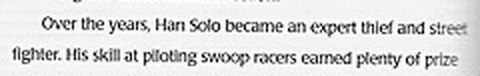
Our notes: `notes/materials/027-new-essential-chronology/04-part-four-profiles-in-history.md:11`

> At seventeen, Han was captured by law enforcement officials and forced to fight in the Regional Sector Fours All-Human Free-for-All on Jubilar. He won the contest by defeating four much larger opponents
> [fragment — full passage not on file]
— Source: Part Four: Profiles in History; Han Solo — Jubilar free-for-all.
Note (our notes, around the quote): Han Solo — Jubilar free-for-all: "At seventeen, Han was captured by law enforcement officials and forced to fight in the Regional Sector Fours All-Human Free-for-All on Jubilar. He won the contest by defeating four much larger opponents" Source: The New Essential Chronology, p.90
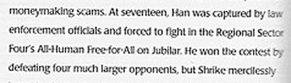
Our notes: `notes/materials/027-new-essential-chronology/04-part-four-profiles-in-history.md:13`

> Han Solo, newly commissioned Imperial officer
> [fragment — full passage not on file]
— Source: Part Four: Profiles in History; Han Solo — art caption.
Note (our notes, around the quote): Han Solo — art caption: "Han Solo, newly commissioned Imperial officer" Source: The New Essential Chronology, p.91, caption
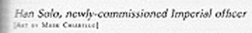
Our notes: `notes/materials/027-new-essential-chronology/04-part-four-profiles-in-history.md:20`

> He suffered a dev- astating blow when a suspicious Imperial Bank manager placed a freeze on his account~and anoth: er when Bria Tharen left him.
>
> Bankrupt and despairing, Han scraped together his last few credits to obtain a forged set of ID papers and have his retinas surgically altered. Since the Besadll dan was looking for him under an alias, he used his true identity on an application to the Imperial Academy. His final night before enroliment was spoiled by an ugly fig: ure from the past—Garris Shrike, who had been tured by :
>
> :
>
> === PDF p.102 === Vyyk Drago was dead, Free and clear for the first time in his life, Cadet Solo boarded a troop transport for Carida, the most respected military academy in the Empire. Over the next four years, Han proved to be extremely talented, but not a model Imperial student, During one infamous ex- ercise, he landed a malfunctioning U-33 orbital loadlifter with suicidal flair, earning himself the nickname “Slick” from Lleutenant Badure, his piloting instructor. In another Inci- dent, Han’s classmate Mako Spince destroyed Carida’s mascot moon with a gram of antimatter, Despite the misadventures, Han graduated at the top of his class, beating out Cadet Soontir Fel for the title of valedictorian, Graduation was followed by elght months of commissioned service In the Imperial Navy.
>
> :
>
> === PDF p.102 === Vyyk Drago was dead, Free and clear for the first time in his life, Cadet Solo boarded a troop transport for Carida, the most respected military academy in the Empire. Over the next four years, Han proved to be extremely talented, but not a model Imperial student, During one infamous ex- ercise, he landed a malfunctioning U-33 orbital loadlifter with suicidal flair, earning himself the nickname “Slick” from Lleutenant Badure, his piloting instructor. In another Inci- dent, Han’s classmate Mako Spince destroyed Carida’s mascot moon with a gram of antimatter, Despite the misadventures, Han graduated at the top of his class, beating out Cadet Soontir Fel for the title of valedictorian, Graduation was followed by elght months of commissioned service In the Imperial Navy. A promising career in the Corellian sector fleet was cut short when Han rescued 4 Wooklee slave from ill treatment at the hands of a superior Officer, This earned him a dishonor- able discharge, which prevented Chewhscca [Aer oy Mare Cmanecich Han from obtaining any civilian piloting job.
— Source: Part Four: Profiles in History; Han Solo — Han at Carida.
(Excerpt widened 2026-11-17 to the relevant passage, word for word from research primary new essential chronology nec paged (text copy `research_primary_new_essential_chronology_nec_paged_txt_88b808b5bc`).)
(Excerpt widened 2026-11-17 to the relevant passage, word for word from research primary new essential chronology nec paged (text copy `research_primary_new_essential_chronology_nec_paged_txt_88b808b5bc`).)
Note (our notes, around the quote): Han Solo — Han at Carida: "Over the next four years, Han proved to be extremely talented, but not a model Imperial student." Source: The New Essential Chronology, p.92
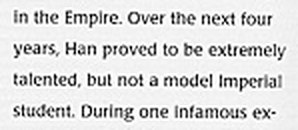
Our notes: `notes/materials/027-new-essential-chronology/04-part-four-profiles-in-history.md:27`

> He suffered a dev- astating blow when a suspicious Imperial Bank manager placed a freeze on his account~and anoth: er when Bria Tharen left him.
>
> Bankrupt and despairing, Han scraped together his last few credits to obtain a forged set of ID papers and have his retinas surgically altered. Since the Besadll dan was looking for him under an alias, he used his true identity on an application to the Imperial Academy. His final night before enroliment was spoiled by an ugly fig: ure from the past—Garris Shrike, who had been tured by :
>
> :
>
> === PDF p.102 === Vyyk Drago was dead, Free and clear for the first time in his life, Cadet Solo boarded a troop transport for Carida, the most respected military academy in the Empire. Over the next four years, Han proved to be extremely talented, but not a model Imperial student, During one infamous ex- ercise, he landed a malfunctioning U-33 orbital loadlifter with suicidal flair, earning himself the nickname “Slick” from Lleutenant Badure, his piloting instructor. In another Inci- dent, Han’s classmate Mako Spince destroyed Carida’s mascot moon with a gram of antimatter, Despite the misadventures, Han graduated at the top of his class, beating out Cadet Soontir Fel for the title of valedictorian, Graduation was followed by elght months of commissioned service In the Imperial Navy.
>
> :
>
> === PDF p.102 === Vyyk Drago was dead, Free and clear for the first time in his life, Cadet Solo boarded a troop transport for Carida, the most respected military academy in the Empire. Over the next four years, Han proved to be extremely talented, but not a model Imperial student, During one infamous ex- ercise, he landed a malfunctioning U-33 orbital loadlifter with suicidal flair, earning himself the nickname “Slick” from Lleutenant Badure, his piloting instructor. In another Inci- dent, Han’s classmate Mako Spince destroyed Carida’s mascot moon with a gram of antimatter, Despite the misadventures, Han graduated at the top of his class, beating out Cadet Soontir Fel for the title of valedictorian, Graduation was followed by elght months of commissioned service In the Imperial Navy. A promising career in the Corellian sector fleet was cut short when Han rescued 4 Wooklee slave from ill treatment at the hands of a superior Officer, This earned him a dishonor- able discharge, which prevented Chewhscca [Aer oy Mare Cmanecich Han from obtaining any civilian piloting job. However, the Wook- the Hutt bounty.
— Source: Part Four: Profiles in History; Han Solo — top of his class.
(Excerpt widened 2026-11-17 to the relevant passage, word for word from research primary new essential chronology nec paged (text copy `research_primary_new_essential_chronology_nec_paged_txt_88b808b5bc`).)
(Excerpt widened 2026-11-17 to the relevant passage, word for word from research primary new essential chronology nec paged (text copy `research_primary_new_essential_chronology_nec_paged_txt_88b808b5bc`).)
Note (our notes, around the quote): Han Solo — top of his class: "Despite the misadventures, Han graduated at the top of his class, beating out Cadet Soontir Fel for the title of valedictorian." Source: The New Essential Chronology, p.92
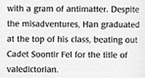
Our notes: `notes/materials/027-new-essential-chronology/04-part-four-profiles-in-history.md:29`

> a rival bounty hunter shot Shrike down, and Han killed the second man in a brutal bare-knuckled brawl.
> [fragment — full passage not on file]
— Source: Part Four: Profiles in History; Han Solo — Han kills Shrike's man.
Note (our notes, around the quote): Han Solo — Han kills Shrike's man: "a rival bounty hunter shot Shrike down, and Han killed the second man in a brutal bare-knuckled brawl." Source: The New Essential Chronology, p.92
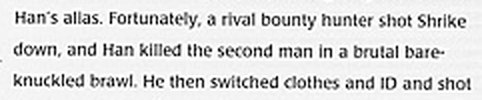
Our notes: `notes/materials/027-new-essential-chronology/04-part-four-profiles-in-history.md:31`

> Their dis- * maneuverings would Inevitably be replaced by deadly On Nar Shaddaa, the Smugglers’ Moon, Han Solo and acca were introduced to illicit Hult activitles by © Spince, Han’s old friend from the Academy. As the ‘enths passed, the new partners met dozens of offbeat “meividuals, such as Shug Ninx, Salla Zend, and Xaverrl.
>
> “They visited hideaways and hellholes like Smuggler’s Run mc Kessel, and Han learned how to fly the dangerous Sessel Run cargo route by skirting the Maw black-hole ‘Sester. Han's piloting skills caught the attention of Jabba Se Hutt, and soon Han was making regular smuggling "sams for the Desiliji¢ clan.
>
> Rubbing elbows with high-level Hutts was a risky game, ‘=pexially since Han still had a price on his head from the evel Besadii clan. On Ylesia, the colony's High Priest uncov- red astonishing evidence that Vyyk Drago-reported dead ‘Sve years earlier—had resurfaced under the name “Han Solo.”
>
> Rubbing elbows with high-level Hutts was a risky game, ‘=pexially since Han still had a price on his head from the evel Besadii clan. On Ylesia, the colony's High Priest uncov- red astonishing evidence that Vyyk Drago-reported dead ‘Sve years earlier—had resurfaced under the name “Han Solo.” The galaxy’s best bounty hunter was hired to bring in Solo’s hide.
>
> Boba Fett tracked Han to Nar Shaddaa, but his cap- Sre was spoiled with an impromptu rescue by a charming Swanger: Lando Calrissian, pilot of a banged-up YT-1300 Seighter called Mitennium Falcon, which he had won In a secent sabacc game. Han taught his rescuer the basics of fly- ‘&& and Calrissian soon headed off in the Falcon for the Rafa system and some adventuring of his own.
— Source: Part Four: Profiles in History; Boba Fett; Han Solo — galaxy's best bounty hunter.
(Excerpt widened 2026-11-17 to the relevant passage, word for word from research primary new essential chronology nec paged (text copy `research_primary_new_essential_chronology_nec_paged_txt_88b808b5bc`).)
(Excerpt widened 2026-11-17 to the relevant passage, word for word from research primary new essential chronology nec paged (text copy `research_primary_new_essential_chronology_nec_paged_txt_88b808b5bc`).)
Note (our notes, around the quote): Boba Fett; Han Solo — galaxy's best bounty hunter: "The galaxy's best bounty hunter was hired to bring in Solo's hide." Source: The New Essential Chronology, p.93
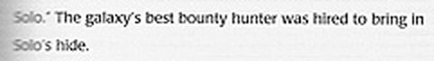
Our notes: `notes/materials/027-new-essential-chronology/04-part-four-profiles-in-history.md:40`

> On Han's orders, Blue Max triggered an overload in the prison's reactor core.
— Source: Part Four: Profiles in History; Han Solo — Stars' End.
Note (our notes, around the quote): Han Solo — Stars' End: "On Han's orders, Blue Max triggered an overload in the prison's reactor core." Source: The New Essential Chronology, p.94
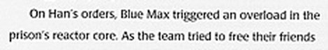
Our notes: `notes/materials/027-new-essential-chronology/04-part-four-profiles-in-history.md:47`

> In a one-on-one blaster duel, Gallandro outdrew Han and incapacitated the Corellian with a blaster wound to the shoulder.
— Source: Part Four: Profiles in History; Han Solo — Gallandro outdraws Han.
Note (our notes, around the quote): Han Solo — Gallandro outdraws Han: "In a one-on-one blaster duel, Gallandro outdrew Han and incapacitated the Corellian with a blaster wound to the shoulder." Source: The New Essential Chronology, p.95
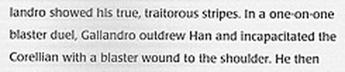
Our notes: `notes/materials/027-new-essential-chronology/04-part-four-profiles-in-history.md:54`

> Millennium Falcon skimmed closer to the Maw black-hole cluster than anyone had thought possible. The result was a new distance record of less than twelve parsecs.
— Source: Part Four: Profiles in History; Han Solo — Kessel Run record.
Note (our notes, around the quote): Han Solo — Kessel Run record: "Millennium Falcon skimmed closer to the Maw black-hole cluster than anyone had thought possible. The result was a new distance record of less than twelve parsecs." Source: The New Essential Chronology, p.97
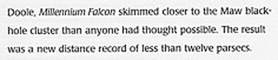
Our notes: `notes/materials/027-new-essential-chronology/04-part-four-profiles-in-history.md:66`

> Echo Base fell after a great loss of life On both siges. Just as Vader strode into the ruined command center, Leia Organa and C-3PO escaped with Han Solo and Chewbacca In Millermium Folcon.
>
> Vader launched his fleet into full pursuit. At the time, though he understood Luke Skywalker was his son, he did Not suspect that Lela Organa was his daughter. Nevertheless, Leia was a powertul figure in the Rebellion, and Luke was known to never stray too far from his friends in the Falcon.
>
> So Capturing the vessel became a priority for Vader. Han Solo proved a remarkable pilot, eluding pursuit by flying directly through the heart of the Hoth asteroid belt, but faulty equip: ment prevented his ship from jumping to hyperspace.
>
> To assist in the hunt, Vader called in a rogue's gallery of bounly hunters, most of them independent agents after the destruction of the Bounty Hunters’ Guild. Among the hunters 118 was Boba Fett, who had known Vader during the Clone Wars, back when he was Anakin Skywalker.
— Source: Part Five: The Galactic Civil War; Han Solo — Hoth asteroid belt.
(Excerpt widened 2026-11-17 to the relevant passage, word for word from research primary new essential chronology nec paged (text copy `research_primary_new_essential_chronology_nec_paged_txt_88b808b5bc`).)
(Excerpt widened 2026-11-17 to the relevant passage, word for word from research primary new essential chronology nec paged (text copy `research_primary_new_essential_chronology_nec_paged_txt_88b808b5bc`).)
(Full sentence/passage taken from the source text on file: `research_primary_new_essential_chronology_nec_paged_txt`.)
Note (our notes, around the quote): Han Solo — Hoth asteroid belt: "Han Solo proved a remarkable pilot, eluding pursuit by flying directly through the heart of the Hoth asteroid belt" Source: The New Essential Chronology, p.118
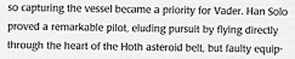
Our notes: `notes/materials/027-new-essential-chronology/05-part-five-galactic-civil-war.md:119`

- Note (summary from our notes, not a quotation): Han Solo — carom shot: "General Solo grimly lined up a suicidal "carom shot" in which the Falcon would ram a small Imperial patrol craft, ricocheting the patrol craft into the Imperial command ship's main generator." Source: The New Essential Chronology, p.128
  — Source: Part Five: The Galactic Civil War.
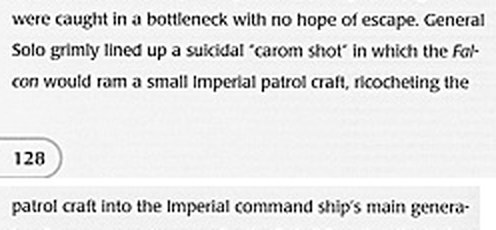
Our notes: `notes/materials/027-new-essential-chronology/05-part-five-galactic-civil-war.md:217`

> he won a habitable planet, Dathomir, worth 2.4 billion credits, in an outrageously high-stakes sabacc game.
> [fragment — full passage not on file]
— Source: Part Six: Birth of the New Republic; Han Solo — Han wins Dathomir.
Note (our notes, around the quote): Han Solo — Han wins Dathomir: "he won a habitable planet, Dathomir, worth 2.4 billion credits, in an outrageously high-stakes sabacc game." Source: The New Essential Chronology, p.143
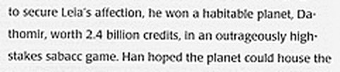
Our notes: `notes/materials/027-new-essential-chronology/06-part-six-birth-of-the-new-republic.md:104`

> During the chaos, Solo flew the Falcon straight at the bridge of Iron Fist and released a pair of concussion missiles at point-blank range. Warlord Zsinj was vaporized in an instant.
— Source: Part Six: Birth of the New Republic; Han Solo — Han kills Zsinj.
Note (our notes, around the quote): Han Solo — Han kills Zsinj: "During the chaos, Solo flew the Falcon straight at the bridge of Iron Fist and released a pair of concussion missiles at point-blank range. Warlord Zsinj was vaporized in an instant." Source: The New Essential Chronology, p.145
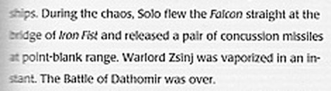
Our notes: `notes/materials/027-new-essential-chronology/06-part-six-birth-of-the-new-republic.md:126`

- Note (summary from our notes, not a quotation): Han Solo; Leia Organa Solo — art caption: "Han Solo and Leia Organa Solo gain clues to the past in Tatooine's Tusken Raider "ghost oasis."" Source: The New Essential Chronology, p.146, caption
  — Source: Part Six: Birth of the New Republic.
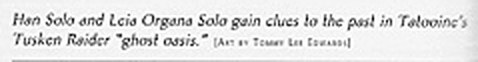
Our notes: `notes/materials/027-new-essential-chronology/06-part-six-birth-of-the-new-republic.md:135`

> The slave controls in the Katana's bridge allowed Solo to reactivate one of the idle Dreadnaughts and remote-steer it straight into the nose of the Star Destroyer Peremptory.
— Source: Part Seven: Empire Resurgent; Han Solo — Katana slave-rig.
Note (our notes, around the quote): Han Solo — Katana slave-rig: "The slave controls in the Katana's bridge allowed Solo to reactivate one of the idle Dreadnaughts and remote-steer it straight into the nose of the Star Destroyer Peremptory." Source: The New Essential Chronology, p.152
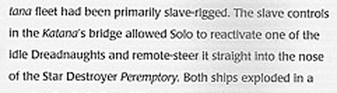
Our notes: `notes/materials/027-new-essential-chronology/07-part-seven-empire-resurgent.md:49`

> Luke tried to take Palpatine alive—but Han Solo shot the old man with his blaster.
— Source: Part Seven: Empire Resurgent; Han Solo; Palpatine (Darth Sidious); Luke Skywalker — Han shoots Palpatine.
Note (our notes, around the quote): Han Solo; Palpatine (Darth Sidious); Luke Skywalker — Han shoots Palpatine: "Luke tried to take Palpatine alive—but Han Solo shot the old man with his blaster." Source: The New Essential Chronology, p.158
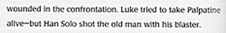
Our notes: `notes/materials/027-new-essential-chronology/07-part-seven-empire-resurgent.md:119`

> He transmitted a private hologram to the Chief of State in which he savagely beat and kicked a trussed-up Han Solo for an excruciating twenty minutes.
— Source: Part Nine: Uprisings and Insurgencies; Han Solo — Nil Spaar beats Han.
Note (our notes, around the quote): Han Solo — Nil Spaar beats Han: "He transmitted a private hologram to the Chief of State in which he savagely beat and kicked a trussed-up Han Solo for an excruciating twenty minutes." Source: The New Essential Chronology, p.181
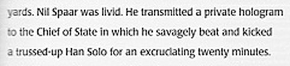
Our notes: `notes/materials/027-new-essential-chronology/09-part-nine-uprisings-and-insurgencies.md:47`

> Tre Return of Brack Sun 24 ABY.
>
> ~ nally, after confronting his dark past, Zekk agreed to stay at the Jedi praxeum to learn to control his anger.
>
> Zekk later won the Blockade Runners Derby at Ord Manteil, a classic race Judged by Han Solo, one of its previous cham- pions. Czethros, a race sponsor, had once been an enemy of Solo’s, but now claimed to be a respectable businessman, 201 === PDF p.212 === 202 ) A mysterious young woman, Anja, helped Han drive off some chameleon creatures in the hangar bay. Anja had her own lightsaber, but no Jedi training, relying instead on doses of spice to enhance her senses. She revealed that she was the daughter of Gallandro, the gunslinger whom Han Solo had battled in his early smuggling days. Anja, who belleved that Han had murdered her father, had vowed revenge, Anja worked for Czethros, who was in reality a leader of the Black Sun criminal organization. Black Sun had kept a low profile for years, but continued to work behind the scenes, infiltrating agents into positions of political and eco- nomic power throughout the New Republic. Czethros had ad- dicted Anja to spice in order to keep her under his thumb.
>
> Han promised to show Anja his good side by helping in the civil war that had ravaged Anja’s planet Anobis for so long.
— Source: Part Eleven: Generations of Jedi; Han Solo — Anja, Gallandro's daughter.
(Excerpt widened 2026-11-17 to the relevant passage, word for word from research primary new essential chronology nec paged (text copy `research_primary_new_essential_chronology_nec_paged_txt_88b808b5bc`).)
(Excerpt widened 2026-11-17 to the relevant passage, word for word from research primary new essential chronology nec paged (text copy `research_primary_new_essential_chronology_nec_paged_txt_88b808b5bc`).)
Note (our notes, around the quote): Han Solo — Anja, Gallandro's daughter: "She revealed that she was the daughter of Gallandro, the gunslinger whom Han Solo had battled in his early smuggling days." Source: The New Essential Chronology, p.202
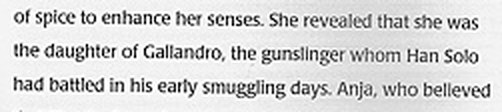
Our notes: `notes/materials/027-new-essential-chronology/11-part-eleven-generations-of-jedi.md:72`

> Han Solo, Anakin Solo, and Chewbacca ... did all they could to save the doomed world, but not even the Force could slow the moon once it had slipped into a terminal orbit.
> [fragment — full passage not on file]
— Source: Part Twelve: The New Jedi Order; Han Solo; Anakin Solo; Chewbacca — not even the Force.
Note (our notes, around the quote): Han Solo; Anakin Solo; Chewbacca — not even the Force: "Han Solo, Anakin Solo, and Chewbacca ... did all they could to save the doomed world, but not even the Force could slow the moon once it had slipped into a terminal orbit." Source: The New Essential Chronology, p.204
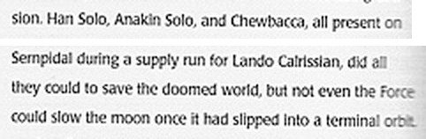
Our notes: `notes/materials/027-new-essential-chronology/12-part-twelve-new-jedi-order.md:26`

> There, Han Solo received help from the last man he ever expected—Boba Fett, flanked by a new squad of Mandalorian Supercommandos. The armored warriors put the fear of Mandalore into the attacking Yuuzhan Vong, and Han escaped the station with a newfound respect for the veteran hunter.
— Source: Part Twelve: The New Jedi Order; Boba Fett; Han Solo — Fett's Mandalorians at Caluula.
Note (our notes, around the quote): Boba Fett; Han Solo — Fett's Mandalorians at Caluula: "There, Han Solo received help from the last man he ever expected—Boba Fett, flanked by a new squad of Mandalorian Supercommandos. The armored warriors put the fear of Mandalore into the attacking Yuuzhan Vong, and Han escaped the station with a newfound respect for the veteran hunter." Source: The New Essential Chronology, p.225
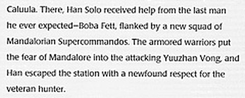
Our notes: `notes/materials/027-new-essential-chronology/12-part-twelve-new-jedi-order.md:209`

## Star Wars Saga Edition: Jedi Academy Training Manual (WotC, 2009): power-scaling and lore notes

> With the funds from the slave trade, he outfits the Empire Reborn with arms and ships.
>
> After establishing the armed forces for the Empire Reborn, Hethrir approaches a Chistori named Desann to create an army of Dark Jedi. By selecting only Humans with Force potential and cleansing them through Waru, Hethrir and Desann create the Reborn. However, the Reborn are defeated by Luke Skywalker and Kyle Katarn.
>
> After his defeat, Hethrir has one chance to redeem himself to Waru and return to power. He abducts Jacen, Jaina, and Anakin Solo with the inten- tion of sacrificing them to Waru.
>
> After his defeat, Hethrir has one chance to redeem himself to Waru and return to power. He abducts Jacen, Jaina, and Anakin Solo with the inten- tion of sacrificing them to Waru. However, Han Solo, his wife Leia, and Luke Skywalker join with Rillao and manage to rescue the abductees, although Anakin is nearly lost. Enraged by Hethrir's failure, Waru consumes him and returns home to its own dimension.
>
> Enraged by Hethrir's failure, Waru consumes him and returns home to its own dimension.
>
> Hethrir Encounters With Hethrir's slave trade in full swing during the early days of the New Republic, any number of people might find themselves abducted and imprisoned, especially those who are Force-sensitive, to be used either as test subjects for his experiments or as sacrifices to Waru. If any heroes find themselves pursuing Desann or the Reborn, they might choose to take their goal one step further and try to bring down Hethrir as well.
— Source: Chapter VI: Dangers of Study.
(Excerpt widened 2026-11-17 to the relevant passage, word for word from research primary jedi academy training manual jatm paged (text copy `research_primary_jedi_academy_training_manual_jatm_paged_txt_fea130719f`).)
(Excerpt widened 2026-11-17 to the relevant passage, word for word from research primary jedi academy training manual jatm paged (text copy `research_primary_jedi_academy_training_manual_jatm_paged_txt_fea130719f`).)
Note (our notes, around the quote): Han Solo; Leia Organa Solo; Luke Skywalker — Hethrir — rescue of the Solo children: "However, Han Solo, his wife Leia, and Luke Skywalker join with Rillao and manage to rescue the abductees, although Anakin is nearly lost." Source: Jedi Academy Training Manual, p.120
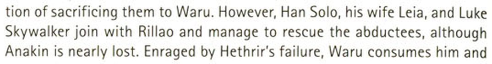
Our notes: `notes/materials/028-jedi-academy-training-manual/06-ch6-dangers-of-study.md:60`

## The Jedi Academy Sourcebook (WEG, 1996): power-scaling and lore notes

> When the Sith-maddened young man begins his one-man crusade against the Empire with the Sun Crusher, Han successfully uses his bond with him to bring Kyp back from the edge of the abyss. m Han Solo Type: Smuggler DEXTERITY 3D+1 Blaster 8D+2, blaster: blaster rifle 5D+1, blaster: heavy blaster pistol L0D+1, blaster artillery 6D+1, brawling parry 8D, dodge 8D+2, dodge: energy weapons 9D+2, grenade 6D+1, melee combat 6D+1, melee parry 5D+1. missile weapons 6D-1, pick pocket 5D+2, running 5D+2, thrown weapons 5D-+1, vehicle blasters 6D-1 KNOWLEDGE 2D Alien species 7D, bureaucracy 7D, business 6D, busi- ness; smugglers 7D+2, cultures 6D-1, intimidation 8D, (BREE G, languages 6D, law enforcement 6D, planetary systems 8D, streetwise 9D, streetwise: Jabba the Hutt's organiza- tion L0D+1, survival 8D, value 6D, willpower 6D+2 MECHANICAL 3D+2 Astrogation 9D, beast riding 5D+2, beast riding: Tauntaun 6D, capital ship gunnery 6D-+2, capital ship piloting 8D-2, capital ship shields 6D+2, communications 5D-2, ground vehicle operation 5D+2, repulsorlift operation 8D.
— Source: Chapter One: The New Republic.
(Excerpt widened 2026-11-17 to the relevant passage, word for word from research primary jedi academy sourcebook jas clean, Chapter One (text copy `research_primary_jedi_academy_sourcebook_jas_clean_txt_04b8ab0d44`).)
Note (our notes, around the quote): Han Solo; Kyp Durron; Sun Crusher — Han Solo — bringing Kyp back: "When the Sith-maddened young man begins his one-man crusade against the Empire with the Sun Crusher, Han successfully uses his bond with him to bring Kyp back from the edge of the abyss." Source: The Jedi Academy Sourcebook, p.11
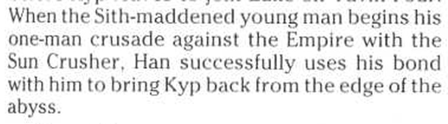
Our notes: `notes/materials/029-jedi-academy-sourcebook/01-ch1-the-new-republic.md:47`

> When he travels to Kessel as a representative of the New Republic, he runs afoul of one of these old acquaintances, an amphibian named Moruth Doole. Doole once betrayed Han to the Imperials, which forced Han to dump an entire shipment of spice, and subsequently led to his falling out with Jabba the Hutt. Doole, who has his own reasons not to love Han, imprisons Solo and Chewbacca in the spice mines of Kessel, While in the mines, Han encounters a young man named Kyp Durron. As Roa took Han under his wing, Han in turn befriends Kyp and forges.a mentor-like bond with the young man. He is determined to see that Kyp gets a taste of the life that has been denied him up until now, and the two spend a lot of time together on Coruscant before Kyp leaves to join Luke on Yavin Four.
— Source: Chapter One: The New Republic; Han Solo; Kyp Durron — Han Solo — meeting Kyp on Kessel.
(Excerpt widened 2026-11-17 to the relevant passage, word for word from research primary jedi academy sourcebook jas clean (text copy `research_primary_jedi_academy_sourcebook_jas_clean_txt_04b8ab0d44`).)
(Excerpt widened 2026-11-17 to the relevant passage, word for word from research primary jedi academy sourcebook jas clean (text copy `research_primary_jedi_academy_sourcebook_jas_clean_txt_04b8ab0d44`).)
Note (our notes, around the quote): Han Solo; Kyp Durron — Han Solo — meeting Kyp on Kessel: "While in the mines, Han encounters a young man named Kyp Durron. As Roa took Han under his wing, Han in turn befriends Kyp and forges a mentor-like bond with the young man." Source: The Jedi Academy Sourcebook, p.11
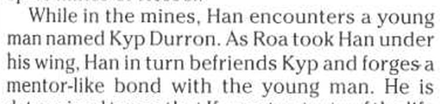
Our notes: `notes/materials/029-jedi-academy-sourcebook/01-ch1-the-new-republic.md:49`

> Blaster 8D+2, blaster: blaster rifle 5D+1, blaster: heavy blaster pistol 10D+1,
> [fragment — full passage not on file]
— Source: Chapter One: The New Republic.
Note (our notes, around the quote): Han Solo — Han Solo — stat block, combat skills (RPG mechanics) — RPG mechanics (weaker source): "Blaster 8D+2, blaster: blaster rifle 5D+1, blaster: heavy blaster pistol 10D+1," Source: The Jedi Academy Sourcebook, p.11, stat block
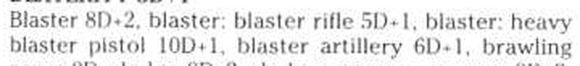
Our notes: `notes/materials/029-jedi-academy-sourcebook/01-ch1-the-new-republic.md:51`

> The news that the Empire lies broken, along with Tarkin and his mighty Death Star. shakes her to her core. She resolves to hit the New Republic as hard as she can, with her arsenal of experimental weapons.
>
> Unfortunately, things go wrong for her al- most immediately. Daala soon learns that an aptitude for theory is no substitute for experi- ence. Her inability to alter her plans to take into account the unexpected is instrumental in her eventual downfall. Han Solo, Kyp, and Chewbacca escape with her prize superweapon, the Sun Crusher, and destroy the Hydra, one of her four Star Destroyers.
>
> After battling Moruth Doole’s forces at Kessel, Daala retreats to the Cauldron Nebula to re- cover and plot her next step. Refusing to submit to any of the warlords in the Imperial Core, she settles on a hit-and-run strategy designed to strike terror in the New Republic.
— Source: Chapter Five: Forces of the Empire.
(Excerpt widened 2026-11-17 to the relevant passage, word for word from research primary jedi academy sourcebook jas clean (text copy `research_primary_jedi_academy_sourcebook_jas_clean_txt_04b8ab0d44`).)
(Excerpt widened 2026-11-17 to the relevant passage, word for word from research primary jedi academy sourcebook jas clean (text copy `research_primary_jedi_academy_sourcebook_jas_clean_txt_04b8ab0d44`).)
Note (our notes, around the quote): Admiral Daala; Han Solo; Kyp Durron; Chewbacca; Sun Crusher — Admiral Daala — loss of the Sun Crusher: "Han Solo, Kyp, and Chewbacca escape with her prize superweapon, the Sun Crusher, and destroy the Hydra, one of her four Star Destroyers." Source: The Jedi Academy Sourcebook, p.56
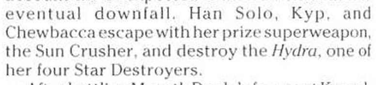
Our notes: `notes/materials/029-jedi-academy-sourcebook/05-ch5-forces-of-the-empire.md:59`

> Some have argued that “Smugglers’ Alliance” is not the best name fora group trying to achieve legitimacy as an established organization. There are those in the SA who would agree, but other smuggler groups see the name as a tie to their past — and a suitable reminder not to be fully co-opted by any government, however benevo- lent.
>
> _ Thesymbol of the SA’s affiliation is an elegant crosshatched insignia, which is prominently displayed on ship hulls, uniforms and docu- ments produced by the SA leadership.
>
> Mara Jade When she was appointed by the Smugglers’
>
> Alliance as an SA representative, Mara Jade thought she'd found a job that would employ her skills as a negotiator and businesswoman rather than as some sort of armed trouble- shooter. However, it seems that Mara is des- tined to keep in the thick of things one way or another.
>
> She travels to Coruscant to warn the New Republic through Han Solo that Admiral Daala has been putting out feelers in the fringe, trying to hire spies and saboteurs.
>
> She travels to Coruscant to warn the New Republic through Han Solo that Admiral Daala has been putting out feelers in the fringe, trying to hire spies and saboteurs. While there, she catches Lando’s eye.
>
> Mara attends Luke's Jedi academy for a time, but does not stay long; Kyp’s stealing of her ship sours her on the experience, and she begins to worry how the SA is getting on without her.
— Source: Chapter Seven: The Fringe.
(Excerpt widened 2026-11-17 to the relevant passage, word for word from research primary jedi academy sourcebook jas clean (text copy `research_primary_jedi_academy_sourcebook_jas_clean_txt_04b8ab0d44`).)
(Excerpt widened 2026-11-17 to the relevant passage, word for word from research primary jedi academy sourcebook jas clean (text copy `research_primary_jedi_academy_sourcebook_jas_clean_txt_04b8ab0d44`).)
Note (our notes, around the quote): Mara Jade Skywalker; Han Solo; Admiral Daala — Mara Jade — warning the New Republic: "She travels to Coruscant to warn the New Republic through Han Solo that Admiral Daala has been putting out feelers in the fringe, trying to hire spies and saboteurs." Source: The Jedi Academy Sourcebook, p.80
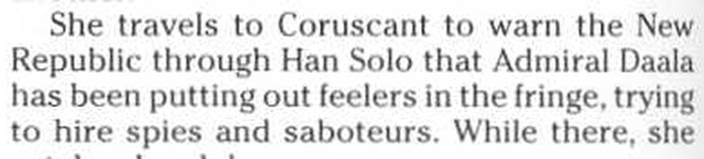
Our notes: `notes/materials/029-jedi-academy-sourcebook/07-ch7-the-fringe.md:11`

- Note (summary from our notes, not a quotation): Mara Jade Skywalker; Han Solo — Mara Jade — aboard the Death Star: "When the "closer look" turns into a wild and rough piggyback ride within the girders of the Death Star, she suggests that she and Lando plant limpet mines on the power core of the Death Star while Han repairs the Falcon's hyperdrive." Source: The Jedi Academy Sourcebook, p.82
  — Source: Chapter Seven: The Fringe.
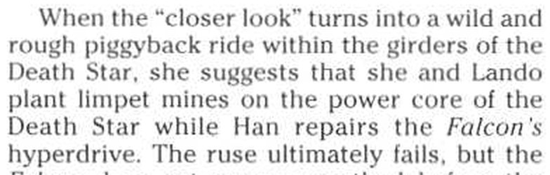
Our notes: `notes/materials/029-jedi-academy-sourcebook/07-ch7-the-fringe.md:27`

> For each parsec a smuggler moves closer to the Maw (down to 15), there is an additional Very Difficult astrogation roll. (For example, reduc- ing travel distance from 18 to 15 parsecs requires eight Very Difficult astrogation rolls). e An additional Heroic astrogation roll is re- quired for each ha/fparsec below 15 (down to 13 parsecs) that travel distance is reduced. For example, reducing travel distance to 13 par- secs requires eight Very Difficult astrogation rolls and four Heroic astrogation rolls.
>
> ¢ If the pilot attempts to shorten travel dis- tance even further, an additional Heroic astrogation roll is required. In addition, the pilot must add +10 to the difficulty of this roll for each half-parsec below 13.
>
> Failure of any of these astrogation rolls indi- cates that the smuggler miscalculated the jump coordinates and vanishes into the Maw.
>
> Han Solo once claimed he made the Kessel Run in less than 12 parsecs (indicating 11.5 parsecs).
>
> Han Solo once claimed he made the Kessel Run in less than 12 parsecs (indicating 11.5 parsecs). To successfully navigate this run, Han would have made eight Very Difficult astrogation rolls, four Heroic astrogation rolls, and one Heroic+30 astrogation roll.
>
> Obviously, making a Kessel Run is not a task for beginners.
>
> === sp87 Ray Lederer hapter Eight: Kessel holes and gas clouds, creeps nearer and nearer thesystem every century, and astronomers pre- dict that the Maw will tear apart and consume the Kessel system within a thousand years or so. Aside from glitterstim miners, shippers, and buyers, few will note its passing.
— Source: Chapter Eight: Kessel; Han Solo — The Kessel Run (sidebar) — Han's claim.
(Excerpt widened 2026-11-17 to the relevant passage, word for word from research primary jedi academy sourcebook jas clean (text copy `research_primary_jedi_academy_sourcebook_jas_clean_txt_04b8ab0d44`).)
(Excerpt widened 2026-11-17 to the relevant passage, word for word from research primary jedi academy sourcebook jas clean (text copy `research_primary_jedi_academy_sourcebook_jas_clean_txt_04b8ab0d44`).)
Note (our notes, around the quote): Han Solo — The Kessel Run (sidebar) — Han's claim: "Han Solo once claimed he made the Kessel Run in less than 12 parsecs (indicating 11.5 parsecs). To successfully navigate this run, Han would have made eight Very Difficult astrogation rolls, four Heroic astrogation rolls, and one Heroic+30 astrogation roll." Source: The Jedi Academy Sourcebook, p.85, sidebar/caption
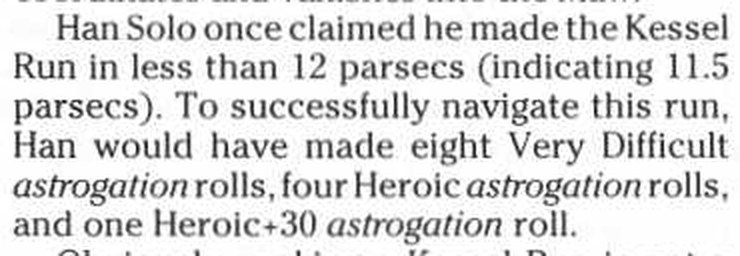
Our notes: `notes/materials/029-jedi-academy-sourcebook/08-ch8-kessel.md:11`

> Lando has little trouble locating Tymmo once on Umgul, and soon learns that the scruffy- looking human is not using the Force to win at the races, but a high-tech form of cheating which even the eagle-eyed racing authorities of Umgul have not detected.
>
> Lando corners Tymmo in the Fondine blob stables, and after a brief firefight, has him rounded up by the authorities. When he learn who Tymmo really is (and that there is a huge reward for his return), Lando talks Slish Fondine, owner of the stables, into suspending the tradi- tional death penalty sentence so that the errant consort could be returned to his wife. In return, he agrees to split the million credit reward offered by Duchess Mistal.
>
> Han and Lando enter into an ongoing gam- bling competition over who is the rightful mas- ter of the Millennium Falcon. After several games (each supposedly the final one), Lando wins final ownership of the Falcon, but gives her back to Han as a grand gesture designed to impress Mara Jade, who he has taken a fancy for, The Jedi Academy Sourcebook === sp98 Ray Lederer He comes to regret the gesture when it dawns on him that he is reduced to begging rides from Han until he can recover his own ship.
>
> Han and Lando enter into an ongoing gam- bling competition over who is the rightful mas- ter of the Millennium Falcon. After several games (each supposedly the final one), Lando wins final ownership of the Falcon, but gives her back to Han as a grand gesture designed to impress Mara Jade, who he has taken a fancy for, The Jedi Academy Sourcebook === sp98 Ray Lederer He comes to regret the gesture when it dawns on him that he is reduced to begging rides from Han until he can recover his own ship. He is so obsessed with recovering the Lady Luck that it never occurs to him that he could buy any ship he likes with a million credits in his pocket.
>
> (Given Calrissian’s nature, it is likely that the challenge of recovering his ship was more at- tractive to him than the purchase of a new vessel).
— Source: Chapter Nine: The Independent Class.
(Excerpt widened 2026-11-17 to the relevant passage, word for word from research primary jedi academy sourcebook jas clean (text copy `research_primary_jedi_academy_sourcebook_jas_clean_txt_04b8ab0d44`).)
(Excerpt widened 2026-11-17 to the relevant passage, word for word from research primary jedi academy sourcebook jas clean (text copy `research_primary_jedi_academy_sourcebook_jas_clean_txt_04b8ab0d44`).)
(Full sentence/passage taken from the source text on file: `research_primary_jedi_academy_sourcebook_jas_clean_txt`.)
Note (our notes, around the quote): Han Solo; Lando Calrissian; Mara Jade Skywalker — Lando Calrissian — the Falcon wager: "After several games (each supposedly the final one), Lando wins final ownership of the Falcon, but gives her back to Han as a grand gesture designed to impress Mara Jade, who he has taken a fancy for," Source: The Jedi Academy Sourcebook, p.96
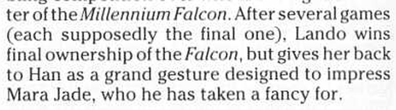
Our notes: `notes/materials/029-jedi-academy-sourcebook/09-ch9-the-independent-class.md:11`

## The Complete Star Wars Encyclopedia, Vol. I (A–G)

> The New Republic also named an Imperial-class Star Destroyer Al­ legiance. Allegiant A New Republic MC80B cruiser that · served as the base of operations for Nomad Squadron in the Meridian sector dur­ ing the Yuuzhan Vong War. allergy paste A foul-tasting yet edible paste designed to prevent allergic reactions to a wide assortment of substances, from air­ borne pollutants or pollens to insect venom. alleth A species of carnivorous plant native to !thor. Larger specimens were capable of killing and eating rodents. All-Human Free-For-AllA gladiatorial contest held regularly in the Victory Forum in the city of Dying Slowly on Jubilar. In the event, four humans would fight to the death .. '
>
> in the arena, with the last combatant stand­ ing declared the winner. The fighters were usually plucked from criminal ranks, and the winner was often given some form of free­ dom. When Han Solo was about 17 years old, he survived the Free-For-All after being caught cheating at cards.
>
> in the arena, with the last combatant stand­ ing declared the winner. The fighters were usually plucked from criminal ranks, and the winner was often given some form of free­ dom. When Han Solo was about 17 years old, he survived the Free-For-All after being caught cheating at cards. AllianceassaultfrigateSeeassault frig­ ate. Alliance Fleet Command The body of authority over the Rebel Alliance fleet, headed by Admiral Ackbar.
— Source: scan pages 1–40; Han Solo. POV: Han Solo.
(Excerpt widened 2026-11-17 to the relevant passage, word for word from research primary cse vol1 (text copy `research_primary_cse_vol1_pdf_45a954be6d`).)
(Excerpt widened 2026-11-17 to the relevant passage, word for word from research primary cse vol1 (text copy `research_primary_cse_vol1_pdf_45a954be6d`).)
Note (our notes, around the quote): Han Solo: "When Han Solo was about 17 years old, he survived the Free-For-All after being caught cheating at cards." Source: The Complete Star Wars Encyclopedia, Vol. I, p.21
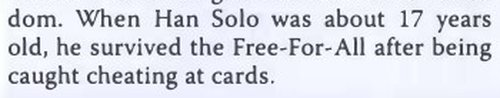
Our notes: `notes/materials/030-complete-star-wars-encyclopedia-vol-1/00-v1-scan-001-040.md:231`

> He was killed in an explosion after Han Solo ignited a negatron charge to free his Millennium Falcon from the gravitational pull of the star.
— Source: scan pages 41–80; Han Solo. POV: Han Solo.
Note (our notes, around the quote): Han Solo: "He was killed in an explosion after Han Solo ignited a negatron charge to free his Millennium Falcon from the gravitational pull of the star." Source: The Complete Star Wars Encyclopedia, Vol. I, p.38
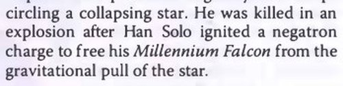
Our notes: `notes/materials/030-complete-star-wars-encyclopedia-vol-1/01-v1-scan-041-080.md:106`

> Beedo A relative of Greedo from the Tetsus clan, he took the bounty hunter's place in Jabba the Hutt's gang after Greedo was killed by Han Solo at the Mos Eisley cantina.
— Source: scan pages 81–120; Greedo; Han Solo.
Note (our notes, around the quote): Greedo; Han Solo: "Beedo A relative of Greedo from the Tetsus clan, he took the bounty hunter's place in Jabba the Hutt's gang after Greedo was killed by Han Solo at the Mos Eisley cantina." Source: The Complete Star Wars Encyclopedia, Vol. I, p.66
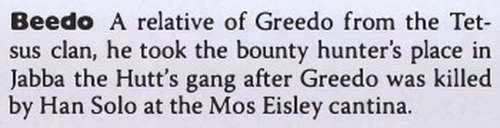
Our notes: `notes/materials/030-complete-star-wars-encyclopedia-vol-1/02-v1-scan-081-120.md:12`

> Shortly before the Battle of Yavin, BoShek and his ship Infinity beat Han Solo's time for the Kessel Run, then destroyed four pursuing TIE fighters.
— Source: scan pages 81–120; Han Solo. POV: Han Solo.
Note (our notes, around the quote): Han Solo: "Shortly before the Battle of Yavin, BoShek and his ship Infinity beat Han Solo's time for the Kessel Run, then destroyed four pursuing TIE fighters." Source: The Complete Star Wars Encyclopedia, Vol. I, p.87
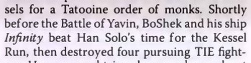
Our notes: `notes/materials/030-complete-star-wars-encyclopedia-vol-1/02-v1-scan-081-120.md:179`

> Briil twins Former associates of Han Solo, they were killed in a fight with an Imperial cruiser on patrol near the Tion Hegemony.
— Source: scan pages 81–120; Han Solo. POV: Han Solo.
Note (our notes, around the quote): Han Solo: "Briil twins Former associates of Han Solo, they were killed in a fight with an Imperial cruiser on patrol near the Tion Hegemony." Source: The Complete Star Wars Encyclopedia, Vol. I, p.94
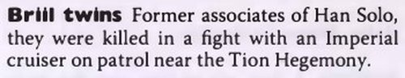
Our notes: `notes/materials/030-complete-star-wars-encyclopedia-vol-1/02-v1-scan-081-120.md:230`

> It featured a pair of heavy mass-driver cannons and a concus­ sion missile battery. Candorian plague A deadly airborne plague weaponized by the Empire during the Galactic Civil War and unleashed on Dentaal. canir A title given to elected Vratix leaders on Thyferra. cannibal arachnid A legendary giant spider-like species on Duro that died out as the planet's ecosystem collapsed. cannok Vicious, wide-jawed predators that the Ithorians imported from Dxun to Telos to keep the herbivore population in check. cannonade An exploding projectile weapon, it was fired by a crossbow. Cant, Devin A trooper aboard the first Death Star, he was an elite soldier trained in combat techniques and weapons skills. He augmented security personnel guarding Prin­ cess Leia Organa in detention block AA-23. He was killed in the line of duty when Han Solo, Chewbacca, and Luke Skywalker freed Leia. Cantham House Bail Organa's residence on Coruscant, the site ofclandestine meetings among Organa, Mon Mothma, and Garm Bel Iblis during the early planning stages of the Rebel Alliance. cantinaSee Mos Eisley cantina. Canu A deity worshipped by the primitive inhabitants of Circarpous V.
— Source: scan pages 121–160; Han Solo; Chewbacca; Luke Skywalker; Leia Organa Solo.
(Excerpt widened 2026-11-17 to the relevant passage, word for word from research primary cse vol1 (text copy `research_primary_cse_vol1_pdf_45a954be6d`).)
(Excerpt widened 2026-11-17 to the relevant passage, word for word from research primary cse vol1 (text copy `research_primary_cse_vol1_pdf_45a954be6d`).)
Note (our notes, around the quote): Han Solo; Chewbacca; Luke Skywalker; Leia Organa Solo: "He was killed in the line of duty when Han Solo, Chewbacca, and Luke Skywalker freed Leia." Source: The Complete Star Wars Encyclopedia, Vol. I, p.107
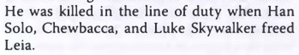
Our notes: `notes/materials/030-complete-star-wars-encyclopedia-vol-1/03-v1-scan-121-160.md:19`

> At the start of the Yuuzhan Vong invasion, Han Solo and Chewbacca were on the planet Sernpidal when it became a target ofthe alien menace. Using massive gravity-altering crea­ tures called dovin basals, the Yuuzhan Vong began to drag Sernpidal's moon Dobido from its orbit to the planet's surface. Han Solo, his teenage son Anakin, and Chewbacca began organizing a desperate evacuation, cramming as many escapees aboard the Falcon as they could. Solo and Chewbacca enjoyed many close calls through the years, and executed countless last-second escapes; Sernpidal was not to be one of them. As the moon rushed closer to the surface, Chewbacca was cut offfrom the Falcon. age assignment landed them Chewbacca spenthours modifying and tinkering with the Millennium Falcon. Chewbacca and Han Solo were a well-known smuggling duo whose exploits became legendary. Chiewab Amalgam­ ated Pharmaceuti­ cals One of the original sponsors of the Corporate Sector, this conglomerate owned over 600 sytems and was the leader in bio­ technological research and development. Its strengths were in chemistry and electronics. Chiewab was constantly seeking out new planets and new substances that might be developed for its new product fam­ ily. Subsidiaries included Geentech Laboratories, Corellian Chemical Cor­ poration, Chiewab Nutri- Anakin was faced with a terrible decision.
— Source: scan pages 121–160; Chewbacca; Han Solo — entry/section: Chewbacca.
(Excerpt widened 2026-11-17 to the relevant passage, word for word from research primary cse vol1 (text copy `research_primary_cse_vol1_pdf_45a954be6d`).)
(Excerpt widened 2026-11-17 to the relevant passage, word for word from research primary cse vol1 (text copy `research_primary_cse_vol1_pdf_45a954be6d`).)
Note (our notes, around the quote): Chewbacca; Han Solo — entry/section: Chewbacca: "Chewbacca and Han Solo were a well-known smuggling duo whose exploits became legendary." Source: The Complete Star Wars Encyclopedia, Vol. I, p.123
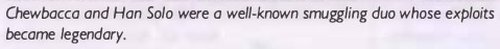
Our notes: `notes/materials/030-complete-star-wars-encyclopedia-vol-1/03-v1-scan-121-160.md:147`

> Chihdo helped Duel in a con that he pulled on Han Solo, Princess Leia Organa, and Luke Skywalker, on the planet Stenos shortly after the Battle of Yavin.
— Source: scan pages 121–160; Han Solo; Leia Organa Solo; Luke Skywalker.
Note (our notes, around the quote): Han Solo; Leia Organa Solo; Luke Skywalker: "Chihdo helped Duel in a con that he pulled on Han Solo, Princess Leia Organa, and Luke Skywalker, on the planet Stenos shortly after the Battle of Yavin." Source: The Complete Star Wars Encyclopedia, Vol. I, p.123
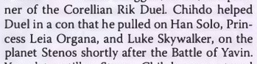
Our notes: `notes/materials/030-complete-star-wars-encyclopedia-vol-1/03-v1-scan-121-160.md:149`

> Crynyd An Imperial-class Star Destroyer captured, refitted, and renamed by the New Republic for a famed Alliance pilot, it was part of the fleet assigned to Han Solo and the Mon Remonda during the hunt for Warlord Zsinj.
— Source: scan pages 161–200; Han Solo. POV: Han Solo.
Note (our notes, around the quote): Han Solo: "Crynyd An Imperial-class Star Destroyer captured, refitted, and renamed by the New Republic for a famed Alliance pilot, it was part of the fleet assigned to Han Solo and the Mon Remonda during the hunt for Warlord Zsinj." Source: The Complete Star Wars Encyclopedia, Vol. I, p.153
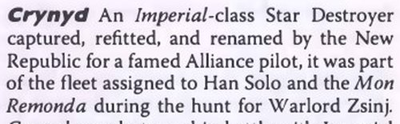
Our notes: `notes/materials/030-complete-star-wars-encyclopedia-vol-1/04-v1-scan-161-200.md:71`

> She later was part of the infiltration party sent to Ylesia to capture the leaders of the Peace Bri­ gade during the war against the Yuuzhan Vong. Dadeferron, Torm Tall and brawny, with red hair and blue eyes, he was part of a se­ cret civilian group organized by Rekkon-a Kalla univer­ sity professor in search of his nephew-to locate missing friends and relatives who were suspected prisoners of the Dagobah Corporate Sector Authority. Torm, who hailed from a wealthy family on the planet Kail, was second in command of a mission to infiltrate an Authority Data Center on Orron III. The group hoped to learn the location of the au­ thority's illegal detention center and rescue the political prisoners. Torm betrayed and killed Rekkon but was later killed by Han Solo. D'Aelgoth sector A region where Han Solo and then-girlfriend Xaverri once conned an Imperial Moff out of his money. Daeshara'cor One of the first Twi'leks to attend Luke Skywalker's Jedi praxeum on Yavin 4, she was orphaned as a child and spent a lot of time growing up in starports. She never let go of memories of her mother, and her festering anger and frustrations led her down a path to the dark side.
— Source: scan pages 161–200; Han Solo. POV: Han Solo.
(Excerpt widened 2026-11-17 to the relevant passage, word for word from research primary cse vol1 (text copy `research_primary_cse_vol1_pdf_45a954be6d`).)
(Excerpt widened 2026-11-17 to the relevant passage, word for word from research primary cse vol1 (text copy `research_primary_cse_vol1_pdf_45a954be6d`).)
Note (our notes, around the quote): Han Solo: "Torm betrayed and killed Rekkon but was later killed by Han Solo." Source: The Complete Star Wars Encyclopedia, Vol. I, p.161
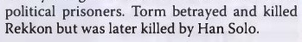
Our notes: `notes/materials/030-complete-star-wars-encyclopedia-vol-1/04-v1-scan-161-200.md:131`

> Dalla the Hutt A Hutt from whom Han Solo borrowed money—using the Millennium Falcon as collateral—to buy Leia Organa Solo a planet forthe refugees who were offworld when the Empire destroyed the planet Alderaan.
— Source: scan pages 161–200; Han Solo; Leia Organa Solo.
Note (our notes, around the quote): Han Solo; Leia Organa Solo: "Dalla the Hutt A Hutt from whom Han Solo borrowed money—using the Millennium Falcon as collateral—to buy Leia Organa Solo a planet forthe refugees who were offworld when the Empire destroyed the planet Alderaan." Source: The Complete Star Wars Encyclopedia, Vol. I, p.162
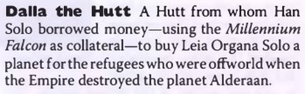
Our notes: `notes/materials/030-complete-star-wars-encyclopedia-vol-1/04-v1-scan-161-200.md:142`

> Thousands of years before the Battle of Yavin, the ancient tyrant Xim the Despot built an opulent city and immense treasure vaults on Dellalt. The vaults held a worthless cache of kiirium and mytag crystals. The city long since fell into poverty and ruin. The intelligent saurop­ teroids of Dellalt, the Swimming People, ran a ferry business at the lakeside docks. Deep within the mountains was a colony of about 100 people calling themselves the Survivors. Apparently stranded on Dellalt in pre-Republic times, their religion involved watching over Xim's remaining war robots and making human sacrifices to increase the strength of their rescue beacon. During one of Han Solo's early adventures, Xim's robots were activated by the Survivors and wiped out a contract-labor mining camp before the robots were destroyed. Just prior to the Battle of Yavin, the Imperials used Dellalt as a stag­ ing point for supplies and equipment. Dellso, Glz:or A Geonosian Separatist who refused to surrender after the Clone Wars. As the holder of stolen plans for an experimental Impe­ rial starfighter, Dellso needed protectionwhile he calculated his nextmove. He reactivated a hidden droid factory on Mustafar.
— Source: scan pages 161–200; Han Solo. POV: Han Solo.
(Excerpt widened 2026-11-17 to the relevant passage, word for word from research primary cse vol1 (text copy `research_primary_cse_vol1_pdf_45a954be6d`).)
(Excerpt widened 2026-11-17 to the relevant passage, word for word from research primary cse vol1 (text copy `research_primary_cse_vol1_pdf_45a954be6d`).)
Note (our notes, around the quote): Han Solo: "During one of Han Solo's early adventures, Xim's robots were activated by the Survivors and wiped out a contract-labor mining camp before the robots were destroyed." Source: The Complete Star Wars Encyclopedia, Vol. I, p.181
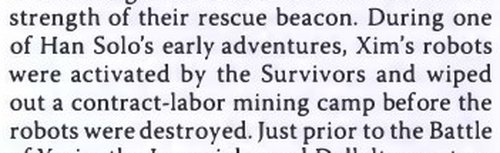
Our notes: `notes/materials/030-complete-star-wars-encyclopedia-vol-1/04-v1-scan-161-200.md:315`

> Duel, Rik A smuggler, captain of the Moon Shadow, and con artist of Corellian origin, Duel was one of Han Solo's oldest associates.
— Source: scan pages 201–240; Han Solo. POV: Han Solo.
Note (our notes, around the quote): Han Solo: "Duel, Rik A smuggler, captain of the Moon Shadow, and con artist of Corellian origin, Duel was one of Han Solo's oldest associates." Source: The Complete Star Wars Encyclopedia, Vol. I, p.213
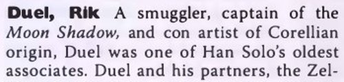
Our notes: `notes/materials/030-complete-star-wars-encyclopedia-vol-1/05-v1-scan-201-240.md:217`

> Still, in an act ofvengeance, he removed the memoriesfromthe mind ofreformed Imperial weapons developer Qwi Xux. He then joined Exar Kun to raise a major Imperial weapon, the Sun Crusher, from its burial grounds in the heart of the gas giant Yavin. When Luke Skywalker tried to intervene, Kyp and Kun trapped Luke's spirit outside his body, placing the Jedi in a state near death. Kyp tracked down his most hated enemy, Admiral Daala, as she was about to attack Coruscant, and nearly destroyed her. Next, he tried to find his brother on Carida, but the rescue attempt failed when he accidentally incinerated his brother along with the planet. Later, as Kyp was about to destroy the Millennium Falcon with Han Solo and Lando Calrissian aboard, he was freed from Exar Kun's influence when the other Jedi trainees succeeded in destroying Kun's spirit. A recov- Kyp Durron ered Luke offered to continue Kyp's training if he forever renounced the dark side. On their way to destroy the Sun Crusher once and for all, Luke and Kyp ran into another battle with Admiral Daala. Kyp managed to destroy both the Sun Crusher and a prototype Death Star, barely escaping with his life. Kyp grappled with the guilt ofhis transgres­ sion for years, dedicating himself to the Jedi Order.
— Source: scan pages 201–240; Kyp Durron; Han Solo; Lando Calrissian; Exar Kun.
(Excerpt widened 2026-11-17 to the relevant passage, word for word from research primary cse vol1 (text copy `research_primary_cse_vol1_pdf_45a954be6d`).)
(Excerpt widened 2026-11-17 to the relevant passage, word for word from research primary cse vol1 (text copy `research_primary_cse_vol1_pdf_45a954be6d`).)
Note (our notes, around the quote): Kyp Durron; Han Solo; Lando Calrissian; Exar Kun: "Later, as Kyp was about to destroy the Millennium Falcon with Han Solo and Lando Calrissian aboard, he was freed from Exar Kun's influence when the other Jedi trainees succeeded in destroying Kun's spirit." Source: The Complete Star Wars Encyclopedia, Vol. I, p.218
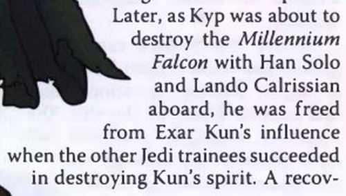
Our notes: `notes/materials/030-complete-star-wars-encyclopedia-vol-1/05-v1-scan-201-240.md:258`

> Ealewon Electronics A company that manufactured encryption devices. Ean A Mon Calamari, he was a member of Wedge Antilles's command crew on the Y avin, a New Republic star cruiser. Earl of Vis A historical figure on Naboo, cousin to an ancient king, who built a large banquet rotunda in the city of Theed. earworm A Corellian slang term for any nuisance or pest. East DistrictTrail A travel route on Lu­ cazec, little more than a dirt road. Eastgate One of the largest commer­ cial and warehouse districts of the Upper City of Taris, prior to its devastation by Darth Malak. East Minor A residential borough on Coruscant's southern hemisphere, home to the famous Traphill Gardens. East Platform The landing platform used by Boba Fett on Cloud City when he took possession of the carbon-frozen Han Solo. EastportOne ofthe three largest space­ E522 Assassin was extensively damaged during the Yuuzhan Vong invasion and subsequent transforma­ tion of the capital world. Easy Spacer A popular ho­ lovid starring Isriner Korosson, re­ leased prior to the Clone Wars. Eater of Fire Creepers A Qom Jha Bargainer who welcomed Luke Skywalker to Nirauan. However, he resented the presence ofMara Jade because of her former allegiance to the Empire.
— Source: scan pages 201–240; Boba Fett; Han Solo.
(Excerpt widened 2026-11-17 to the relevant passage, word for word from research primary cse vol1 (text copy `research_primary_cse_vol1_pdf_45a954be6d`).)
(Excerpt widened 2026-11-17 to the relevant passage, word for word from research primary cse vol1 (text copy `research_primary_cse_vol1_pdf_45a954be6d`).)
Note (our notes, around the quote): Boba Fett; Han Solo: "East Platform The landing platform used by Boba Fett on Cloud City when he took possession of the carbon-frozen Han Solo." Source: The Complete Star Wars Encyclopedia, Vol. I, p.224
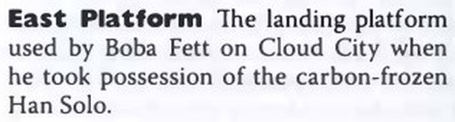
Our notes: `notes/materials/030-complete-star-wars-encyclopedia-vol-1/05-v1-scan-201-240.md:308`

- Note (summary from our notes, not a quotation): Han Solo: "Not wanting her plan disrupted, Elan killed her Peace Brigade "rescuers" with the bo'tous weapon, an act that raised Han Solo's suspicions." Source: The Complete Star Wars Encyclopedia, Vol. I, p.228
  — Source: scan pages 241–280. POV: Han Solo.
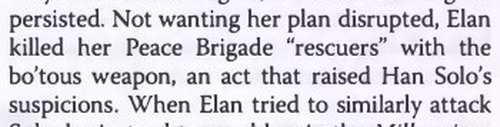
Our notes: `notes/materials/030-complete-star-wars-encyclopedia-vol-1/06-v1-scan-241-280.md:24`

> Thirteen years after the Battle of Endor, Lando Calrissian was captured by Nandreeson and nearly killed before Han Solo and Chewbacca rescued him.
— Source: scan pages 361–398; Lando Calrissian; Han Solo; Chewbacca.
Note (our notes, around the quote): Lando Calrissian; Han Solo; Chewbacca: "Thirteen years after the Battle of Endor, Lando Calrissian was captured by Nandreeson and nearly killed before Han Solo and Chewbacca rescued him." Source: The Complete Star Wars Encyclopedia, Vol. I, p.346
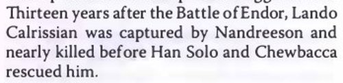
Our notes: `notes/materials/030-complete-star-wars-encyclopedia-vol-1/09-v1-scan-361-398.md:12`

> He later brought Greedo to Tatooine, where the Rodian was killed by Han Solo.
— Source: scan pages 361–398; Greedo; Han Solo.
Note (our notes, around the quote): Greedo; Han Solo: "He later brought Greedo to Tatooine, where the Rodian was killed by Han Solo." Source: The Complete Star Wars Encyclopedia, Vol. I, p.349
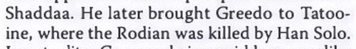
Our notes: `notes/materials/030-complete-star-wars-encyclopedia-vol-1/09-v1-scan-361-398.md:29`

> The Graveyard was destroyed prior to the Battle of Hoth when Arakkus trapped Han Solo, Luke Skywalker, and Chewbacca aboard the Millennium Falcon.
— Source: scan pages 361–398; Han Solo; Luke Skywalker; Chewbacca.
Note (our notes, around the quote): Han Solo; Luke Skywalker; Chewbacca: "The Graveyard was destroyed prior to the Battle of Hoth when Arakkus trapped Han Solo, Luke Skywalker, and Chewbacca aboard the Millennium Falcon." Source: The Complete Star Wars Encyclopedia, Vol. I, p.360
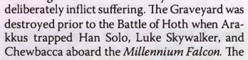
Our notes: `notes/materials/030-complete-star-wars-encyclopedia-vol-1/09-v1-scan-361-398.md:122`

> He hired Han Solo and Chewbacca for a brief time before the pair became involved in the Galactic Civil War—but not before Solo upstaged and outclassed his boss during one last airshow.
— Source: scan pages 361–398; Han Solo; Chewbacca.
Note (our notes, around the quote): Han Solo; Chewbacca: "He hired Han Solo and Chewbacca for a brief time before the pair became involved in the Galactic Civil War—but not before Solo upstaged and outclassed his boss during one last airshow." Source: The Complete Star Wars Encyclopedia, Vol. I, p.370
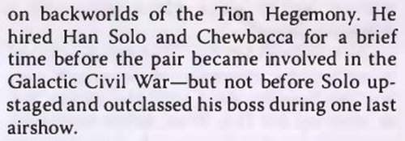
Our notes: `notes/materials/030-complete-star-wars-encyclopedia-vol-1/09-v1-scan-361-398.md:210`

## The Complete Star Wars Encyclopedia, Vol. II (H–O)

> After Han Solo killed Greedo in the Mos Eisley cantina, Jabba ordered Heater to hire bounty hunters to bring Solo to justice.
— Source: scan pages 1–40; Han Solo; Greedo.
Note (our notes, around the quote): Han Solo; Greedo: "After Han Solo killed Greedo in the Mos Eisley cantina, Jabba ordered Heater to hire bounty hunters to bring Solo to justice." Source: The Complete Star Wars Encyclopedia, Vol. II, p.30

Our notes: `notes/materials/031-complete-star-wars-encyclopedia-vol-2/00-v2-scan-001-040.md:243`

> Bossk purchased it after the Wookiee Chewbacca and Han Solo destroyed his previous ship on Gandolo IV.
— Source: scan pages 41–80; Bossk; Chewbacca; Han Solo.
Note (our notes, around the quote): Bossk; Chewbacca; Han Solo: "Bossk purchased it after the Wookiee Chewbacca and Han Solo destroyed his previous ship on Gandolo IV." Source: The Complete Star Wars Encyclopedia, Vol. II, p.63

Our notes: `notes/materials/031-complete-star-wars-encyclopedia-vol-2/01-v2-scan-041-080.md:204`

> Hydra One of Admiral Daala's four Star Destroyers protecting the Maw Installation, it was demolished when Han Solo, Kyp Durron, and Qwi Xux escaped the secret facility in the Sun Crusher seven years after the Battle of Endor.
— Source: scan pages 41–80.
Note (our notes, around the quote): Admiral Daala; Han Solo; Kyp Durron; Qwi Xux; Sun Crusher (superweapon): "Hydra One of Admiral Daala's four Star Destroyers protecting the Maw Installation, it was demolished when Han Solo, Kyp Durron, and Qwi Xux escaped the secret facility in the Sun Crusher seven years after the Battle of Endor." Source: The Complete Star Wars Encyclopedia, Vol. II, p.69

Our notes: `notes/materials/031-complete-star-wars-encyclopedia-vol-2/01-v2-scan-041-080.md:248`

> 1G-88B was destroyed on Cloud City trying to intercept Han Solo.
— Source: scan pages 81–120; Han Solo. POV: Han Solo.
Note (our notes, around the quote): Han Solo: "1G-88B was destroyed on Cloud City trying to intercept Han Solo." Source: The Complete Star Wars Encyclopedia, Vol. II, p.79

Our notes: `notes/materials/031-complete-star-wars-encyclopedia-vol-2/02-v2-scan-081-120.md:42`

> Invincible (1) The Star Destroyer used by Zasm Katth and Baddon Fass to go to Nar Shaddaa to kill Vima-Da-Boda and Han Solo.
— Source: scan pages 81–120; Vima-Da-Boda; Han Solo.
Note (our notes, around the quote): Vima-Da-Boda; Han Solo: "Invincible (1) The Star Destroyer used by Zasm Katth and Baddon Fass to go to Nar Shaddaa to kill Vima-Da-Boda and Han Solo." Source: The Complete Star Wars Encyclopedia, Vol. II, p.109

Our notes: `notes/materials/031-complete-star-wars-encyclopedia-vol-2/02-v2-scan-081-120.md:220`

> The ship was captured by Luke Skywalker, Han Solo, and Chewbacca at Kessel, but Volz decided that it was too dangerous and destroyed it himself.
— Source: scan pages 81–120; Luke Skywalker; Han Solo; Chewbacca.
Note (our notes, around the quote): Luke Skywalker; Han Solo; Chewbacca: "The ship was captured by Luke Skywalker, Han Solo, and Chewbacca at Kessel, but Volz decided that it was too dangerous and destroyed it himself." Source: The Complete Star Wars Encyclopedia, Vol. II, p.112

Our notes: `notes/materials/031-complete-star-wars-encyclopedia-vol-2/02-v2-scan-081-120.md:251`

> There he joined Han Solo and a ragtag team of starfaring adventurers to defeat Serji-X Arrogantus.
— Source: scan pages 121–160; Han Solo. POV: Han Solo.
Note (our notes, around the quote): Han Solo: "There he joined Han Solo and a ragtag team of starfaring adventurers to defeat Serji-X Arrogantus." Source: The Complete Star Wars Encyclopedia, Vol. II, p.144

Our notes: `notes/materials/031-complete-star-wars-encyclopedia-vol-2/03-v2-scan-121-160.md:227`

> When Zavval was killed during Han Solo's escape from Ylesia, Aruk installed Kibbick in his place as manager of the spice-processing centers on the planet.
— Source: scan pages 201–240; Han Solo. POV: Han Solo.
Note (our notes, around the quote): Han Solo: "When Zavval was killed during Han Solo's escape from Ylesia, Aruk installed Kibbick in his place as manager of the spice-processing centers on the planet." Source: The Complete Star Wars Encyclopedia, Vol. II, p.216

Our notes: `notes/materials/031-complete-star-wars-encyclopedia-vol-2/05-v2-scan-201-240.md:231`

> Together Luke and Leia faced down Kueller, and when his dark side powers were curtailed by several ysalamiri that Han Solo brought to Almania, Leia killed Kueller with a blaster shot to the head.
— Source: scan pages 241–280; Luke Skywalker; Leia Organa Solo; Kueller; Han Solo.
Note (our notes, around the quote): Luke Skywalker; Leia Organa Solo; Kueller; Han Solo: "Together Luke and Leia faced down Kueller, and when his dark side powers were curtailed by several ysalamiri that Han Solo brought to Almania, Leia killed Kueller with a blaster shot to the head." Source: The Complete Star Wars Encyclopedia, Vol. II, p.235

Our notes: `notes/materials/031-complete-star-wars-encyclopedia-vol-2/06-v2-scan-241-280.md:12`

> He was killed at the Maw by Nawruun, who rose up against his master when Chewbacca and Han Solo fled the Installation during the New Republic's attempt to take control.
— Source: scan pages 241–280; Chewbacca; Han Solo.
Note (our notes, around the quote): Chewbacca; Han Solo: "He was killed at the Maw by Nawruun, who rose up against his master when Chewbacca and Han Solo fled the Installation during the New Republic's attempt to take control." Source: The Complete Star Wars Encyclopedia, Vol. II, p.242

Our notes: `notes/materials/031-complete-star-wars-encyclopedia-vol-2/06-v2-scan-241-280.md:79`

> Ludlo didn't want to expose his own plans, so he agreed, but then he tried to have Leia and Han Solo killed before they could leave the planet.
— Source: scan pages 241–280; Leia Organa Solo; Han Solo.
Note (our notes, around the quote): Leia Organa Solo; Han Solo: "Ludlo didn't want to expose his own plans, so he agreed, but then he tried to have Leia and Han Solo killed before they could leave the planet." Source: The Complete Star Wars Encyclopedia, Vol. II, p.247

Our notes: `notes/materials/031-complete-star-wars-encyclopedia-vol-2/06-v2-scan-241-280.md:122`

> After being elected to the Inner Council by an overwhelming majority, Meido put together the committee that led an independent investigation into the explosion in the Senate Hall and supported the idea that Leia's husband, Han Solo, was involved in the bombing.
— Source: scan pages 281–320; Leia Organa Solo; Han Solo.
Note (our notes, around the quote): Leia Organa Solo; Han Solo: "After being elected to the Inner Council by an overwhelming majority, Meido put together the committee that led an independent investigation into the explosion in the Senate Hall and supported the idea that Leia's husband, Han Solo, was involved in the bombing." Source: The Complete Star Wars Encyclopedia, Vol. II, p.303

Our notes: `notes/materials/031-complete-star-wars-encyclopedia-vol-2/07-v2-scan-281-320.md:252`

> Melvar was killed on Dathomir by Gethzerion when she used the dark side of the Force to eliminate an entire platoon of Imperial stormtroopers and their officers who were poised to bring Han Solo to Zsinj.
— Source: scan pages 281–320; Gethzerion; Han Solo.
Note (our notes, around the quote): Gethzerion; Han Solo: "Melvar was killed on Dathomir by Gethzerion when she used the dark side of the Force to eliminate an entire platoon of Imperial stormtroopers and their officers who were poised to bring Han Solo to Zsinj." Source: The Complete Star Wars Encyclopedia, Vol. II, p.305

Our notes: `notes/materials/031-complete-star-wars-encyclopedia-vol-2/07-v2-scan-281-320.md:264`

> When Han Solo joined the mission to destroy Grand Admiral Thrawn's cloning facility on Wayland, Cakhmaim protected Leia, Winter, and the children, Jaina and Jacen Solo.
— Source: scan pages 321–360.
Note (our notes, around the quote): Han Solo; Grand Admiral Thrawn; Leia Organa Solo; Winter Celchu; Jaina Solo; Jacen Solo (Darth Caedus): "When Han Solo joined the mission to destroy Grand Admiral Thrawn's cloning facility on Wayland, Cakhmaim protected Leia, Winter, and the children, Jaina and Jacen Solo." Source: The Complete Star Wars Encyclopedia, Vol. II, p.322

Our notes: `notes/materials/031-complete-star-wars-encyclopedia-vol-2/08-v2-scan-321-360.md:55`

> Morgavi, Luke Han Solo used this alias when he returned to Jubilar some 30 years after he survived the All-Human Free-For-All there.
— Source: scan pages 321–360; Luke Skywalker; Han Solo.
Note (our notes, around the quote): Luke Skywalker; Han Solo: "Morgavi, Luke Han Solo used this alias when he returned to Jubilar some 30 years after he survived the All-Human Free-For-All there." Source: The Complete Star Wars Encyclopedia, Vol. II, p.330

Our notes: `notes/materials/031-complete-star-wars-encyclopedia-vol-2/08-v2-scan-321-360.md:117`

> Stars' End was destroyed by Han Solo and his companions during an attempted jailbreak.
— Source: scan pages 321–360; Han Solo. POV: Han Solo.
Note (our notes, around the quote): Han Solo: "Stars' End was destroyed by Han Solo and his companions during an attempted jailbreak." Source: The Complete Star Wars Encyclopedia, Vol. II, p.349

Our notes: `notes/materials/031-complete-star-wars-encyclopedia-vol-2/08-v2-scan-321-360.md:248`

> Shug Ninx and Salla Zend left the spaceport after Han Solo accidentally destroyed one of their prized cruisers escaping from Boba Fett, and after Zasm Katth and Baddon Fass had ransacked the garage.
— Source: scan pages 361–400; Han Solo; Boba Fett.
Note (our notes, around the quote): Han Solo; Boba Fett: "Shug Ninx and Salla Zend left the spaceport after Han Solo accidentally destroyed one of their prized cruisers escaping from Boba Fett, and after Zasm Katth and Baddon Fass had ransacked the garage." Source: The Complete Star Wars Encyclopedia, Vol. II, p.383

Our notes: `notes/materials/031-complete-star-wars-encyclopedia-vol-2/09-v2-scan-361-400.md:238`

> Zsinj threatened to destroy the planet unless Han Solo was delivered to him.
— Source: scan pages 401–440; Han Solo. POV: Han Solo.
Note (our notes, around the quote): Han Solo: "Zsinj threatened to destroy the planet unless Han Solo was delivered to him." Source: The Complete Star Wars Encyclopedia, Vol. II, p.418

Our notes: `notes/materials/031-complete-star-wars-encyclopedia-vol-2/10-v2-scan-401-440.md:181`

## The Complete Star Wars Encyclopedia, Vol. III (P–Z)

> However, when he noticed that a Devaronian and a Twi'lek—actually Han Solo and Leia Organa Solo, in disguise—were trying to destroy the artwork, Quenton and his men opened fire in Mawbo's Performance Hall in an effort to secure the work.
— Source: scan pages 41–80; Han Solo; Leia Organa Solo.
Note (our notes, around the quote): Han Solo; Leia Organa Solo: "However, when he noticed that a Devaronian and a Twi'lek—actually Han Solo and Leia Organa Solo, in disguise—were trying to destroy the artwork, Quenton and his men opened fire in Mawbo's Performance Hall in an effort to secure the work." Source: The Complete Star Wars Encyclopedia, Vol. III, p.62

Our notes: `notes/materials/032-complete-star-wars-encyclopedia-vol-3/01-v3-scan-041-080.md:217`

> Along with his sister, the unscrupulous R'all competed with Han Solo to be the first to find the lost treasures of the legendary ship Queen of Ranroon.
— Source: scan pages 81–120; Han Solo. POV: Han Solo.
Note (our notes, around the quote): Han Solo: "Along with his sister, the unscrupulous R'all competed with Han Solo to be the first to find the lost treasures of the legendary ship Queen of Ranroon." Source: The Complete Star Wars Encyclopedia, Vol. III, p.76

Our notes: `notes/materials/032-complete-star-wars-encyclopedia-vol-3/02-v3-scan-081-120.md:23`

> A young Han Solo bested three much larger opponents when he was forced to participate in the event.
— Source: scan pages 81–120; Han Solo. POV: Han Solo.
Note (our notes, around the quote): Han Solo: "A young Han Solo bested three much larger opponents when he was forced to participate in the event." Source: The Complete Star Wars Encyclopedia, Vol. III, p.90

Our notes: `notes/materials/032-complete-star-wars-encyclopedia-vol-3/02-v3-scan-081-120.md:139`

> Rekkon's work eventually was continued by Han Solo, who destroyed Stars' End and freed the prisoners, including Tchaka.
— Source: scan pages 81–120; Han Solo. POV: Han Solo.
Note (our notes, around the quote): Han Solo: "Rekkon's work eventually was continued by Han Solo, who destroyed Stars' End and freed the prisoners, including Tchaka." Source: The Complete Star Wars Encyclopedia, Vol. III, p.91

Our notes: `notes/materials/032-complete-star-wars-encyclopedia-vol-3/02-v3-scan-081-120.md:148`

> It was during just such a celebration that the sail barge was destroyed when Luke Skywalker, Princess Leia Organa, and others staged a daring rescue of Han Solo.
— Source: scan pages 121–160; Luke Skywalker; Leia Organa Solo; Han Solo.
Note (our notes, around the quote): Luke Skywalker; Leia Organa Solo; Han Solo: "It was during just such a celebration that the sail barge was destroyed when Luke Skywalker, Princess Leia Organa, and others staged a daring rescue of Han Solo." Source: The Complete Star Wars Encyclopedia, Vol. III, p.124

Our notes: `notes/materials/032-complete-star-wars-encyclopedia-vol-3/03-v3-scan-121-160.md:75`

> Selaggis A planet that was the location of a colony obliterated by Warlord Zsinj's Super Star Destroyer /ron Fist, Han Solo saw the destruction while on a five-month hunt to locate and destroy Zsinj's ship.
— Source: scan pages 121–160; Han Solo. POV: Han Solo.
Note (our notes, around the quote): Han Solo: "Selaggis A planet that was the location of a colony obliterated by Warlord Zsinj's Super Star Destroyer /ron Fist, Han Solo saw the destruction while on a five-month hunt to locate and destroy Zsinj's ship." Source: The Complete Star Wars Encyclopedia, Vol. III, p.136

Our notes: `notes/materials/032-complete-star-wars-encyclopedia-vol-3/03-v3-scan-121-160.md:167`

> Seneki was killed when the Flakax known as Tito returned from his mission to eliminate Han Solo and his wife, Leia Organa Solo.
— Source: scan pages 121–160; Han Solo; Leia Organa Solo.
Note (our notes, around the quote): Han Solo; Leia Organa Solo: "Seneki was killed when the Flakax known as Tito returned from his mission to eliminate Han Solo and his wife, Leia Organa Solo." Source: The Complete Star Wars Encyclopedia, Vol. III, p.138

Our notes: `notes/materials/032-complete-star-wars-encyclopedia-vol-3/03-v3-scan-121-160.md:185`

> Shoran A Wookiee cousin of Chewbacca, he was killed during the rescue of Han Solo aboard the Pride of Yevetha.
— Source: scan pages 121–160; Chewbacca; Han Solo.
Note (our notes, around the quote): Chewbacca; Han Solo: "Shoran A Wookiee cousin of Chewbacca, he was killed during the rescue of Han Solo aboard the Pride of Yevetha." Source: The Complete Star Wars Encyclopedia, Vol. III, p.148

Our notes: `notes/materials/032-complete-star-wars-encyclopedia-vol-3/03-v3-scan-121-160.md:287`

> Later, at Han Solo's request, Jade and Karrde located and brought to the planet Almania several Force-bending ysalamiri, which Solo used to help Luke and Leia defeat the Dark Jedi Kueller.
— Source: scan pages 161–200; Han Solo; Luke Skywalker; Leia Organa Solo; Kueller.
Note (our notes, around the quote): Han Solo; Luke Skywalker; Leia Organa Solo; Kueller: "Later, at Han Solo's request, Jade and Karrde located and brought to the planet Almania several Force-bending ysalamiri, which Solo used to help Luke and Leia defeat the Dark Jedi Kueller." Source: The Complete Star Wars Encyclopedia, Vol. III, p.166

Our notes: `notes/materials/032-complete-star-wars-encyclopedia-vol-3/04-v3-scan-161-200.md:153`

> Pote Snitkin piloted one of Jabba's skiffs and was among those killed during Luke Skywalker's rescue of Han Solo and Princess Leia from the Hutt.
— Source: scan pages 161–200; Luke Skywalker; Han Solo; Leia Organa Solo.
Note (our notes, around the quote): Luke Skywalker; Han Solo; Leia Organa Solo: "Pote Snitkin piloted one of Jabba's skiffs and was among those killed during Luke Skywalker's rescue of Han Solo and Princess Leia from the Hutt." Source: The Complete Star Wars Encyclopedia, Vol. III, p.170

Our notes: `notes/materials/032-complete-star-wars-encyclopedia-vol-3/04-v3-scan-161-200.md:203`

> Solo, Anakin Born six years after the death of his grandfather Anakin Skywalker, Anakin Solo was the youngest of Han Solo and Princess Leia Organa Solo's three children, and the strongest in the Force.
— Source: scan pages 161–200.
Note (our notes, around the quote): Darth Vader (Anakin Skywalker); Anakin Solo; Han Solo; Leia Organa Solo: "Solo, Anakin Born six years after the death of his grandfather Anakin Skywalker, Anakin Solo was the youngest of Han Solo and Princess Leia Organa Solo's three children, and the strongest in the Force." Source: The Complete Star Wars Encyclopedia, Vol. III, p.172

Our notes: `notes/materials/032-complete-star-wars-encyclopedia-vol-3/04-v3-scan-161-200.md:217`

> She was also capable of cobbling together mechanical devices for just about any purpose, and like Han Solo, her impulsiveness, spirit, and self-confidence sometimes got her into trouble.
— Source: scan pages 161–200; Jaina Solo; Han Solo — entry/section: Solo, Jaina.
Note (our notes, around the quote): Jaina Solo; Han Solo — entry/section: Solo, Jaina: "She was also capable of cobbling together mechanical devices for just about any purpose, and like Han Solo, her impulsiveness, spirit, and self-confidence sometimes got her into trouble." Source: The Complete Star Wars Encyclopedia, Vol. III, p.176

Our notes: `notes/materials/032-complete-star-wars-encyclopedia-vol-3/04-v3-scan-161-200.md:255`

> When Han Solo, the husband of the Chief of State, was sent to take command of the New Republic's Fifth Fleet, Spaar kidnapped Solo, killed his engineer in cold blood, and savagely beat Solo until he was nearly dead.
— Source: scan pages 161–200; Han Solo. POV: Han Solo.
Note (our notes, around the quote): Han Solo: "When Han Solo, the husband of the Chief of State, was sent to take command of the New Republic's Fifth Fleet, Spaar kidnapped Solo, killed his engineer in cold blood, and savagely beat Solo until he was nearly dead." Source: The Complete Star Wars Encyclopedia, Vol. III, p.181

Our notes: `notes/materials/032-complete-star-wars-encyclopedia-vol-3/04-v3-scan-161-200.md:320`

> When Captain Terrik was about to stop Han Solo's escape from Mos Eisley, Felth shot him in the back and killed him.
— Source: scan pages 201–240; Han Solo. POV: Han Solo.
Note (our notes, around the quote): Han Solo: "When Captain Terrik was about to stop Han Solo's escape from Mos Eisley, Felth shot him in the back and killed him." Source: The Complete Star Wars Encyclopedia, Vol. III, p.232

Our notes: `notes/materials/032-complete-star-wars-encyclopedia-vol-3/05-v3-scan-201-240.md:339`

> His clan's grudge against Chewbacca did not cease when Chewbacca was killed at Sernpidal, and seemed to extend to Han Solo as well.
— Source: scan pages 241–280; Chewbacca; Han Solo.
Note (our notes, around the quote): Chewbacca; Han Solo: "His clan's grudge against Chewbacca did not cease when Chewbacca was killed at Sernpidal, and seemed to extend to Han Solo as well." Source: The Complete Star Wars Encyclopedia, Vol. III, p.252

Our notes: `notes/materials/032-complete-star-wars-encyclopedia-vol-3/06-v3-scan-241-280.md:159`

> He was defeated by Lando Calrissian and Han Solo, who had returned to Kashyyyk with Chewbacca to help him thwart the slavers.
— Source: scan pages 281–320; Lando Calrissian; Han Solo; Chewbacca.
Note (our notes, around the quote): Lando Calrissian; Han Solo; Chewbacca: "He was defeated by Lando Calrissian and Han Solo, who had returned to Kashyyyk with Chewbacca to help him thwart the slavers." Source: The Complete Star Wars Encyclopedia, Vol. III, p.296

Our notes: `notes/materials/032-complete-star-wars-encyclopedia-vol-3/07-v3-scan-281-320.md:167`

> A swoop gang he hired was no match for Luke, Han Solo, and Wedge Antilles, and Venan himself was incapacitated by Chewbacca.
— Source: scan pages 281–320; Luke Skywalker; Han Solo; Chewbacca.
Note (our notes, around the quote): Luke Skywalker; Han Solo; Chewbacca: "A swoop gang he hired was no match for Luke, Han Solo, and Wedge Antilles, and Venan himself was incapacitated by Chewbacca." Source: The Complete Star Wars Encyclopedia, Vol. III, p.301

Our notes: `notes/materials/032-complete-star-wars-encyclopedia-vol-3/07-v3-scan-281-320.md:206`

> When Elan was chosen to act as an envoy to the New Republic in an effort to destroy the Jedi, Vergere accompanied her and gave Han Solo a sample of her tears, which cured Mara Jade Skywalker of a wasting disease that had crippled her.
— Source: scan pages 281–320; Han Solo; Mara Jade Skywalker.
Note (our notes, around the quote): Han Solo; Mara Jade Skywalker: "When Elan was chosen to act as an envoy to the New Republic in an effort to destroy the Jedi, Vergere accompanied her and gave Han Solo a sample of her tears, which cured Mara Jade Skywalker of a wasting disease that had crippled her." Source: The Complete Star Wars Encyclopedia, Vol. III, p.303

Our notes: `notes/materials/032-complete-star-wars-encyclopedia-vol-3/07-v3-scan-281-320.md:234`

> When Han Solo and Chewbacca were able to turn the tables on Zlarb, Wadda was one of the handful of slavers who were themselves enslaved after Solo turned them over to a group of Lurrian geneticists.
— Source: scan pages 321–360; Han Solo; Chewbacca.
Note (our notes, around the quote): Han Solo; Chewbacca: "When Han Solo and Chewbacca were able to turn the tables on Zlarb, Wadda was one of the handful of slavers who were themselves enslaved after Solo turned them over to a group of Lurrian geneticists." Source: The Complete Star Wars Encyclopedia, Vol. III, p.317

Our notes: `notes/materials/032-complete-star-wars-encyclopedia-vol-3/08-v3-scan-321-360.md:26`

> During Han Solo's escape from Ylesia, Zavval was caught under a pile of rubble from the collapsing ceiling after his repulsorsled crashed into a support column, Zavval was crushed, and a bounty was put on Solo's head for his death.
— Source: scan pages 361–385; Han Solo. POV: Han Solo.
Note (our notes, around the quote): Han Solo: "During Han Solo's escape from Ylesia, Zavval was caught under a pile of rubble from the collapsing ceiling after his repulsorsled crashed into a support column, Zavval was crushed, and a bounty was put on Solo's head for his death." Source: The Complete Star Wars Encyclopedia, Vol. III, p.369

Our notes: `notes/materials/032-complete-star-wars-encyclopedia-vol-3/09-v3-scan-361-385.md:142`

> About four years after the Battle of Endor, Han Solo led a fleet to bring down Zsinj, succeeding in destroying the Super Star Destroyer Razor's Kiss at the Kuat Drive Yards before Zsinj could take possession.
— Source: scan pages 361–385; Han Solo. POV: Han Solo.
Note (our notes, around the quote): Han Solo: "About four years after the Battle of Endor, Han Solo led a fleet to bring down Zsinj, succeeding in destroying the Super Star Destroyer Razor's Kiss at the Kuat Drive Yards before Zsinj could take possession." Source: The Complete Star Wars Encyclopedia, Vol. III, p.374

Our notes: `notes/materials/032-complete-star-wars-encyclopedia-vol-3/09-v3-scan-361-385.md:175`

> Zsinj was killed when Han Solo, flying the Millennium Falcon, fired concussion missiles at point-blank range into the /ron Fist's bridge.
— Source: scan pages 361–385; Han Solo. POV: Han Solo.
Note (our notes, around the quote): Han Solo: "Zsinj was killed when Han Solo, flying the Millennium Falcon, fired concussion missiles at point-blank range into the /ron Fist's bridge." Source: The Complete Star Wars Encyclopedia, Vol. III, p.374

Our notes: `notes/materials/032-complete-star-wars-encyclopedia-vol-3/09-v3-scan-361-385.md:177`

## Power of the Jedi Sourcebook (d20, 2002)

> Thanks to the efforts of Luke Skywalker and Han Solo, the Battle of Yavin proved a defeat for the Empire.
— Source: Chapter Seven: Where the Force is strong; Index; Luke Skywalker; Han Solo.
Note (our notes, around the quote): Luke Skywalker; Han Solo: "Thanks to the efforts of Luke Skywalker and Han Solo, the Battle of Yavin proved a defeat for the Empire." Source: Power of the Jedi Sourcebook, p.138

Our notes: `notes/materials/033-power-of-the-jedi-sourcebook/07-ch7-locations-index.md:60`

## The New Essential Guide to Characters (2002)

> The first Death Star is destroyed thanks to the efforts of Luke Skywalker, Han Solo, and Princess Leia Organa.
— Source: scan pages 1–30; Luke Skywalker; Han Solo; Leia Organa Solo.
Note (our notes, around the quote): Luke Skywalker; Han Solo; Leia Organa Solo: "The first Death Star is destroyed thanks to the efforts of Luke Skywalker, Han Solo, and Princess Leia Organa." Source: The New Essential Guide to Characters, p.13

Our notes: `notes/materials/034-new-essential-guide-to-characters/00-negc-scan-001-030.md:41`

> He is defeated by his cousin Han Solo and Gaeriel Captison's Bakuran navy.
— Source: scan pages 1–30.
Note (our notes, around the quote): Grand Admiral Thrawn; Han Solo — entry/section: Grand Admiral Thrawn declares war: "He is defeated by his cousin Han Solo and Gaeriel Captison's Bakuran navy." Source: The New Essential Guide to Characters, p.14

Our notes: `notes/materials/034-new-essential-guide-to-characters/00-negc-scan-001-030.md:56`

> Karrde helped Han Solo obtain the ysalamiri used to defeat the tyrant Kueller during the Almanian crisis.
— Source: scan pages 91–120; Han Solo; Kueller.
Note (our notes, around the quote): Han Solo; Kueller: "Karrde helped Han Solo obtain the ysalamiri used to defeat the tyrant Kueller during the Almanian crisis." Source: The New Essential Guide to Characters, p.101

Our notes: `notes/materials/034-new-essential-guide-to-characters/03-negc-scan-091-120.md:39`

> On Onderon, Palpatine tried to take possession of the baby, but Han Solo shot him dead.
— Source: scan pages 91–120.
Note (our notes, around the quote): Palpatine (Darth Sidious); Han Solo — entry/section: Emperor Palpatine named Sate: "On Onderon, Palpatine tried to take possession of the baby, but Han Solo shot him dead." Source: The New Essential Guide to Characters, p.127

Our notes: `notes/materials/034-new-essential-guide-to-characters/03-negc-scan-091-120.md:229`

> Chewbacca rescued Han Solo from Spaar's Super Star Destroyer.
— Source: scan pages 151–180; Chewbacca; Han Solo.
Note (our notes, around the quote): Chewbacca; Han Solo: "Chewbacca rescued Han Solo from Spaar's Super Star Destroyer." Source: The New Essential Guide to Characters, p.178

Our notes: `notes/materials/034-new-essential-guide-to-characters/05-negc-scan-151-180.md:168`

> He was survived by his infant daughter Anja, who grew up blaming Han Solo for her father's death.
— Source: scan pages 181–210; Han Solo. POV: Han Solo.
Note (our notes, around the quote): Han Solo: "He was survived by his infant daughter Anja, who grew up blaming Han Solo for her father's death." Source: The New Essential Guide to Characters, p.209

Our notes: `notes/materials/034-new-essential-guide-to-characters/06-negc-scan-181-210.md:155`

## Dark Side Sourcebook (d20, 2001)

> Dolph and the Imperial spy Brakiss, turned their backs on armed with nova-inducing resonance torpedoes Luke's training and set off to find their fortunes elsewhere. ang covered with impenetrable armor, the Sun Still others never came to Luke's school at all but studied the Crusher was invincible, and only when Han Solo Force on their own, giving the dark side easy targets. and Lando Calrissian sought him out to appeal to his better nature did he finally relent.
— Source: Chapter Five: Dark Side Traditions (Sith Empire, Set Harth, prophets, Brakiss…); Brakiss; Luke Skywalker; Han Solo; Lando Calrissian.
Note (our notes, around the quote): Brakiss; Luke Skywalker; Han Solo; Lando Calrissian: "Dolph and the Imperial spy Brakiss, turned their backs on armed with nova-inducing resonance torpedoes Luke's training and set off to find their fortunes elsewhere. ang covered with impenetrable armor, the Sun Still others never came to Luke's school at all but studied the Crusher was invincible, and only when Han Solo Force on their own, giving the dark side easy targets. and Lando Calrissian sought him out to appeal to his better nature did he finally relent." Source: Dark Side Sourcebook, p.104

Our notes: `notes/materials/035-dark-side-sourcebook/05-ch5-traditions.md:309`

## Sourcebooks/Sourcebook Web Enhancements/Making a Full Recovery.pdf [Star Wars Roleplaying Game (d20, 2000)]

> Type: Genetech G&B Cybernetic Exercise Braces; Cost: 3,500; Damage Reduction: 4; Maximum Dex Bonus: +0; Armor Check Penalty: ­5; Speed (10 m): 8; Speed (6 m): 4; Weight: 15 kg Roxi Barl Roxi Barl was one of the better "independent contractors" in the Corellian sector ­ that term being a CorSec euphemism for assassin, legbreaker, and all­around thug. Roxi and her sister Deli schemed for years to get rich, and they nearly succeeded when Deli married the vice­president of fleets for CorDuro Shipping. Her husband's fractional ownership of the Kuat Drive Yards corporation made Deli a multimillionaire, but when the man filed for divorce ­ leaving Deli with nothing ­ Roxi killed him in revenge. Her actions brought her to the attention of Victor Pomt, chief of staff for the Kuati senator Viqi Shesh. Pomt hired her to murder a comatose Leia Organa Solo in the Coronet Medcenter, where Roxi learned that no Corellian is better in a firefight than Han Solo. Roxi Barl: Female Human Noble 2/Soldier 6; Init +6 (+2 Dex, +4 Improved Initiative); Defense 18 (+2 Dex, +6 class); Spd 10 m; VP/WP 41/10; 1Atk +7/+2 melee (1d6 crit 20, punch), +10/+5 ranged (3d4+1, hold­out blaster or 3d8+1, light repeating blaster); SQ Favor x1, inspire confidence; SV Fort +5; Ref +4; Will +5; FP 3; DSP 4; Rep +3; Str 11, Dex 15, Con 10, Int 11, Wis 13, Cha 14. Equipment: Light repeating blaster, hold­out blaster in hidden sleeve holster, falsified ID chip.
— Source: Sourcebooks/Sourcebook Web Enhancements/Making a Full Recovery.pdf [Star; Han Solo — entry/section: Roxi Barl learns Han's firefight reputation.
(Excerpt widened 2026-11-17 to the relevant passage, word for word from y sw d20 folder files Star Wars Roleplaying Game Core Sourcebooks Sourcebook Web Enhancements Making a Full Recovery (text copy `y_sw_d20_folder_files_Star_Wars_Roleplaying_Game_Core_Sourcebooks_Sourcebook_Web_Enhancements_Making_a_Full_Recovery_pdf_7290b15ad7`).)
(Excerpt widened 2026-11-17 to the relevant passage, word for word from y sw d20 folder files Star Wars Roleplaying Game Core Sourcebooks Sourcebook Web Enhancements Making a Full Recovery (text copy `y_sw_d20_folder_files_Star_Wars_Roleplaying_Game_Core_Sourcebooks_Sourcebook_Web_Enhancements_Making_a_Full_Recovery_pdf_7290b15ad7`).)
Note (our notes, around the quote): Han Solo — entry/section: Roxi Barl learns Han's firefight reputation: "Pomt hired her to murder a comatose Leia Organa Solo in the Coronet Medcenter, where Roxi learned that no Corellian is better in a firefight than Han Solo." Source: *Making a Full Recovery* (SWRPG d20), scan p.2

Our notes: `notes/materials/037-sw-d20-folder/037-making-a-full-recovery.md:17`

## Sourcebooks/Rebellion Era Sourcebook.pdf [Star Wars Roleplaying Game (d20, 2000)] (scan pages 1–60)

- Note (summary from our notes, not a quotation): Page contents: 487 words, 60 paragraphs | headings/entries: Introduction Chapter 1: A New Hope; Fall of the Republic; The Outer Rim; The Doctrine of Fear; Common Droids; Darth Vader: Dark Lord of the Sith; The End of the Senate; Death Star Personnel; The Milrtary-industrial Complex The Imperial Star Destroyer; Imperial intelligence Blackhole; The Corporate Sector Working for the CSA; Scouring the Galaxy Hoth; Echo Base; Probe Droid; AT-ATs; Cold Assault Trooper Rebel Forces; Vader's Fleet; Yoda's Tutelage Bespin; Cloud City; Heroes of Yavin: Update; Chapter 9: The Empire Strikes Back 88; Contents; Jabba the Hutt; Jabba's Court; The Rebel Fleet; Alliance Leaders; Strike Team; Rebel Commandos; A Second Death Star; The Emperor; Ewoks; Ewok Inventions; Ewoks at War; Ewok Heroes; The Battle of Endor; Luke Skywalker Update Leia Organa Update; Han Solo Update Chewbacca Update Bakura; Ssi-Ruu
  — Source: Sourcebooks/Rebellion Era Sourcebook.pdf [Star Wars Roleplaying Game (d20.
Our notes: `notes/materials/037-sw-d20-folder/043-rebellion-era-sourcebook-scan-001-060.md:25`

> Organa, Han Solo, Chewbacca, and the droids R2-D2 and C- 3PO, the Death Star was destroyed and the Alliance won its first major victory.
— Source: Sourcebooks/Rebellion Era Sourcebook.pdf [Star Wars Roleplaying Game (d20; Han Solo; Chewbacca.
Note (our notes, around the quote): Han Solo; Chewbacca: "Organa, Han Solo, Chewbacca, and the droids R2-D2 and C- 3PO, the Death Star was destroyed and the Alliance won its first major victory." Source: *Rebellion Era Sourcebook* (SWRPG d20), scan p.57

Our notes: `notes/materials/037-sw-d20-folder/043-rebellion-era-sourcebook-scan-001-060.md:350`

## Sourcebooks/Rebellion Era Sourcebook.pdf [Star Wars Roleplaying Game (d20, 2000)] (scan pages 61–120)

- Note (summary from our notes, not a quotation): Page contents: Maw Installation established by Tarkin, 'kept hidden even from the Emperor'; Kessel Run in 12 parsecs (like Han Solo did) = Astrogate DC 21 then Pilot DC 25+; Renn Volz (Ion Ring wrecked Rion's environment) (hand-read)
  — Source: Sourcebooks/Rebellion Era Sourcebook.pdf [Star Wars Roleplaying Game (d20.
Our notes: `notes/materials/037-sw-d20-folder/043-rebellion-era-sourcebook-scan-061-120.md:119`

> It was ultimately Boba Fett who second-guessed Han Solo and followed the Millennium Falcon to Bespin. Once he realized Solo's destination, he alerted Vader, and the Imperials arrived at Cloud City ahead of the Falcon.
— Source: Sourcebooks/Rebellion Era Sourcebook.pdf [Star Wars Roleplaying Game (d20.
Note (our notes, around the quote): Boba Fett; Han Solo; Darth Vader (Anakin Skywalker) — entry/section: Fett second-guessed Han Solo: "It was ultimately Boba Fett who second-guessed Han Solo and followed the Millennium Falcon to Bespin. Once he realized Solo's destination, he alerted Vader, and the Imperials arrived at Cloud City ahead of the Falcon." Source: *Rebellion Era Sourcebook* (SWRPG d20), scan p.100

Our notes: `notes/materials/037-sw-d20-folder/043-rebellion-era-sourcebook-scan-061-120.md:258`

> Bossk began his career hunting escaped Wookiee slaves and has a running feud with Han Solo's partner, Chewbacca. Though they have tangled multiple times, it is always Bossk who comes up short—short a limb, generally.
— Source: Sourcebooks/Rebellion Era Sourcebook.pdf [Star Wars Roleplaying Game (d20; Bossk; Chewbacca — entry/section: Bossk's feud with Chewbacca.
Note (our notes, around the quote): Bossk; Chewbacca — entry/section: Bossk's feud with Chewbacca: "Bossk began his career hunting escaped Wookiee slaves and has a running feud with Han Solo's partner, Chewbacca. Though they have tangled multiple times, it is always Bossk who comes up short—short a limb, generally." Source: *Rebellion Era Sourcebook* (SWRPG d20), scan p.100

Our notes: `notes/materials/037-sw-d20-folder/043-rebellion-era-sourcebook-scan-061-120.md:260`

- Note (summary from our notes, not a quotation): Page contents: Double Bounty letter (Calk Fen to Jabba): Han Solo has cost Jabba more than 1.3 million credits; 'I am betting on Boba Fett to bring him back to Tatooine' (hand-read)
  — Source: Sourcebooks/Rebellion Era Sourcebook.pdf [Star Wars Roleplaying Game (d20.
Our notes: `notes/materials/037-sw-d20-folder/043-rebellion-era-sourcebook-scan-061-120.md:273`

> In addition, Solo blasted your humble servant, Greedo, and has eluded or ended the careers of more bounty hunters than I care to list since he departed Tatooine with a false promise of paying what he owed with interest.
— Source: Sourcebooks/Rebellion Era Sourcebook.pdf [Star Wars Roleplaying Game (d20.
Note (our notes, around the quote): Han Solo; Boba Fett — entry/section: The Double Bounty: Solo's toll on hunters: "In addition, Solo blasted your humble servant, Greedo, and has eluded or ended the careers of more bounty hunters than I care to list since he departed Tatooine with a false promise of paying what he owed with interest." Source: *Rebellion Era Sourcebook* (SWRPG d20), scan p.101

Our notes: `notes/materials/037-sw-d20-folder/043-rebellion-era-sourcebook-scan-061-120.md:277`

- Note (summary from our notes, not a quotation): Page contents: Han Solo escaped a Star Destroyer amid jettisoned rubbish 'though he didn't fool Boba Fett, who knew the trick as well' (hand-read)
  — Source: Sourcebooks/Rebellion Era Sourcebook.pdf [Star Wars Roleplaying Game (d20.
Our notes: `notes/materials/037-sw-d20-folder/043-rebellion-era-sourcebook-scan-061-120.md:291`

> Han Solo escaped from an Imperial Star Destroyer amid the rubbish the ship cast off before its jump to hyperspace (though he didn't fool Boba Fett, who knew the trick as well).
— Source: Sourcebooks/Rebellion Era Sourcebook.pdf [Star Wars Roleplaying Game (d20; Han Solo; Boba Fett.
Note (our notes, around the quote): Han Solo; Boba Fett: "Han Solo escaped from an Imperial Star Destroyer amid the rubbish the ship cast off before its jump to hyperspace (though he didn't fool Boba Fett, who knew the trick as well)." Source: *Rebellion Era Sourcebook* (SWRPG d20), scan p.103

Our notes: `notes/materials/037-sw-d20-folder/043-rebellion-era-sourcebook-scan-061-120.md:293`

## Sourcebooks/Rebellion Era Sourcebook.pdf [Star Wars Roleplaying Game (d20, 2000)] (scan pages 121–161)

- Note (summary from our notes, not a quotation): Page contents: Rescue of Han Solo: Luke 'attempted to use the Force against Jabba, but the crime lord simply laughed him off. The Hutt was not some weak-minded fool like Fortuna'; Luke dropped the portcullis on the rancor, 'It died instantly'; Sarlacc consumed Boba Fett—'or so they thought' (hand-read)
  — Source: Sourcebooks/Rebellion Era Sourcebook.pdf [Star Wars Roleplaying Game (d20.
Our notes: `notes/materials/037-sw-d20-folder/043-rebellion-era-sourcebook-scan-121-161.md:93`

> Lando, meanwhile, : Sé j \fter d Ti it } reat post by Prince Xiz and the i f # inally took action as well, A confusing battle ensued, When types walker and his compan . ver, the Sarlace had consumed Boba Fett and many quard a oY ent on to rescue Han Solo from the clutches of the A : ; of Jabba's quards, Leia had strangled Jabba with the chair his h ile ¢ qstcr iba the Hutt ¢ complex plat put Land t that bound her to the Hutt, and Luke had destroyed the ' mask Calrissian into Jabba's palace, where he disquised himself as : ; : : massive sail barge, The companions were free, Jabba wi : f ne of ba ) ce quards.
— Source: Sourcebooks/Rebellion Era Sourcebook.pdf [Star Wars Roleplaying Game (d20.
Note (our notes, around the quote): Lando Calrissian; Boba Fett; Han Solo; Leia Organa Solo; Luke Skywalker: "Lando, meanwhile, : Sé j \fter d Ti it } reat post by Prince Xiz and the i f # inally took action as well, A confusing battle ensued, When types walker and his compan . ver, the Sarlace had consumed Boba Fett and many quard a oY ent on to rescue Han Solo from the clutches of the A : ; of Jabba's quards, Leia had strangled Jabba with the chair his h ile ¢ qstcr iba the Hutt ¢ complex plat put Land t that bound her to the Hutt, and Luke had destroyed the ' mask Calrissian into Jabba's palace, where he disquised himself as : ; : : massive sail barge, The companions were free, Jabba wi : f ne of ba ) ce quards." Source: *Rebellion Era Sourcebook* (SWRPG d20), scan p.131

Our notes: `notes/materials/037-sw-d20-folder/043-rebellion-era-sourcebook-scan-121-161.md:95`

- Note (summary from our notes, not a quotation): Page contents: SpecForces: ten divisions; Han Solo's Endor strike team chosen with Madine from Echo Base troops, Major Bren Derlin unit leader; Rebel commando Soldier 4/Scout 4, CC B (hand-read)
  — Source: Sourcebooks/Rebellion Era Sourcebook.pdf [Star Wars Roleplaying Game (d20.
Our notes: `notes/materials/037-sw-d20-folder/043-rebellion-era-sourcebook-scan-121-161.md:161`

## Sourcebooks/Secrets of Tatooine.pdf [Star Wars Roleplaying Game (d20, 2000)] (scan pages 1–60)

> Jabba planned to execute them, but they had prepared for such a contingency, and instead killed Jabba. This of course delighted Bib Fortuna, who had been preparing to assassinate Jabba himself anyway. But when he returned to the palace to seize his prize, he discovered that the B'omarr monks had concealed their own plans from him. Bib Fortuna soon found himself a disembodied brain floating in a containment sphere amid the most enlightened minds of the B'omarr.
— Source: Sourcebooks/Secrets of Tatooine.pdf [Star Wars Roleplaying Game (d20, 200.
Note (our notes, around the quote): Bib Fortuna; Jabba the Hutt; Han Solo — entry/section: Bib Fortuna: "Jabba planned to execute them, but they had prepared for such a contingency, and instead killed Jabba. This of course delighted Bib Fortuna, who had been preparing to assassinate Jabba himself anyway. But when he returned to the palace to seize his prize, he discovered that the B'omarr monks had concealed their own plans from him. Bib Fortuna soon found himself a disembodied brain floating in a containment sphere amid the most enlightened minds of the B'omarr." Source: *Secrets of Tatooine* (SWRPG d20), scan p.36

Our notes: `notes/materials/037-sw-d20-folder/045-secrets-of-tatooine-scan-001-060.md:209`

> warrior of the huge bounty on Han Solo's head. Predictably, D'Wopp decided to set out at once to collect the prize. Valarian objected—violently—to her new mate's poor timing (and choice of patrons), and in the ensuing argument, she killed her own newlywed husband.
> [fragment — full passage not on file]
— Source: Sourcebooks/Secrets of Tatooine.pdf [Star Wars Roleplaying Game (d20, 200.
Note (our notes, around the quote): Lady Valarian; Han Solo; Jabba the Hutt — entry/section: Lady Valarian: "warrior of the huge bounty on Han Solo's head. Predictably, D'Wopp decided to set out at once to collect the prize. Valarian objected—violently—to her new mate's poor timing (and choice of patrons), and in the ensuing argument, she killed her own newlywed husband." Source: *Secrets of Tatooine* (SWRPG d20), scan p.50

Our notes: `notes/materials/037-sw-d20-folder/045-secrets-of-tatooine-scan-001-060.md:303`

> The bounty was finally claimed by the infamous bounty hunter Boba Fett, who managed to increase the sum even further by suggesting that Han Solo (now frozen in carbonite) could be considered not just a bounty, but a piece of artwork—created by none other than the Dark Lord of the Sith, Darth Vader. Amused at the notion, Jabba paid Boba Fett 250,000 credits for Solo.
— Source: Sourcebooks/Secrets of Tatooine.pdf [Star Wars Roleplaying Game (d20, 200.
Note (our notes, around the quote): Han Solo; Jabba the Hutt; Boba Fett; Darth Vader (Anakin Skywalker) — entry/section: Jabba the Hutt: "The bounty was finally claimed by the infamous bounty hunter Boba Fett, who managed to increase the sum even further by suggesting that Han Solo (now frozen in carbonite) could be considered not just a bounty, but a piece of artwork—created by none other than the Dark Lord of the Sith, Darth Vader. Amused at the notion, Jabba paid Boba Fett 250,000 credits for Solo." Source: *Secrets of Tatooine* (SWRPG d20), scan p.55

Our notes: `notes/materials/037-sw-d20-folder/045-secrets-of-tatooine-scan-001-060.md:346`

> Han Solo's friends-including the newly trained Jedi Knight, Luke Skywalker—attempted a rescue, but earned Jabba's wrath when they not only freed Han from the carbonite, but killed his pet rancor. Infuriated, Jabba attempted to execute Skywalker, Solo, and Solo's copilot, the Wookiee Chewbacca, by feeding them to the Sarlacc. But Solo's companions turned the tables on Jabba. The sluglike crime lord died aboard his sail barge over the Great Pit of Carkoon, strangled to death by Leia Organa.
— Source: Sourcebooks/Secrets of Tatooine.pdf [Star Wars Roleplaying Game (d20, 200.
Note (our notes, around the quote): Jabba the Hutt; Leia Organa Solo; Luke Skywalker; Han Solo; Chewbacca; Jabba's Rancor — entry/section: Jabba the Hutt: "Han Solo's friends-including the newly trained Jedi Knight, Luke Skywalker—attempted a rescue, but earned Jabba's wrath when they not only freed Han from the carbonite, but killed his pet rancor. Infuriated, Jabba attempted to execute Skywalker, Solo, and Solo's copilot, the Wookiee Chewbacca, by feeding them to the Sarlacc. But Solo's companions turned the tables on Jabba. The sluglike crime lord died aboard his sail barge over the Great Pit of Carkoon, strangled to death by Leia Organa." Source: *Secrets of Tatooine* (SWRPG d20), scan p.55

Our notes: `notes/materials/037-sw-d20-folder/045-secrets-of-tatooine-scan-001-060.md:348`

> Keeping Solo brought about Jabba's death, Han Solo's friends-including the newly trained Jedi Knight, Luke Skywalker—attempted a rescue, but earned Jabba's wrath when they not only freed Han from the carbonite, but killed his pet rancor. infuriated, Jabba attempted to execute Skywalker, Solo, -and Solo's copilot, the Wookiee Chewbacca, by feeding them to the Sarlacc.
— Source: Sourcebooks/Secrets of Tatooine.pdf [Star Wars Roleplaying Game (d20, 200; Han Solo; Luke Skywalker; Chewbacca.
Note (our notes, around the quote): Han Solo; Luke Skywalker; Chewbacca: "Keeping Solo brought about Jabba's death, Han Solo's friends-including the newly trained Jedi Knight, Luke Skywalker—attempted a rescue, but earned Jabba's wrath when they not only freed Han from the carbonite, but killed his pet rancor. infuriated, Jabba attempted to execute Skywalker, Solo, -and Solo's copilot, the Wookiee Chewbacca, by feeding them to the Sarlacc." Source: *Secrets of Tatooine* (SWRPG d20), scan p.55

Our notes: `notes/materials/037-sw-d20-folder/045-secrets-of-tatooine-scan-001-060.md:354`

## Sourcebooks/Star Wars Roleplaying Game Core Rulebook.pdf [Star Wars Roleplaying Game (d20, 2000)] (scan pages 181–240)

- Note (summary from our notes, not a quotation): Page contents: 846 words, 13 paragraphs | headings/entries: Han Solo, Smuggler
  — Source: Sourcebooks/Star Wars Roleplaying Game Core Rulebook.pdf [Star Wars Rolep.
Our notes: `notes/materials/037-sw-d20-folder/046-star-wars-roleplaying-game-core-rulebook-scan-181-240.md:363`

> His fast reflexes and exemplary flying led Han Solo to graduate the Academy with top honors, and he soon found himself in the Imperial Navy.
— Source: Sourcebooks/Star Wars Roleplaying Game Core Rulebook.pdf [Star Wars Rolep; Han Solo — entry/section: Key Characters: Han Solo, Smuggler.
Note (our notes, around the quote): Han Solo — entry/section: Key Characters: Han Solo, Smuggler: "His fast reflexes and exemplary flying led Han Solo to graduate the Academy with top honors, and he soon found himself in the Imperial Navy." Source: *Star Wars Roleplaying Game Core Rulebook* (SWRPG d20), scan p.235

Our notes: `notes/materials/037-sw-d20-folder/046-star-wars-roleplaying-game-core-rulebook-scan-181-240.md:365`

> Han's own philosophy on the matter is to never doubt his own abilities, but to respect the abilities of his opponents. Fortunately, he's rarely encountered an enemy whose abilities exceeded his own.
— Source: Sourcebooks/Star Wars Roleplaying Game Core Rulebook.pdf [Star Wars Rolep; Han Solo — entry/section: Key Characters: Han Solo, Smuggler.
Note (our notes, around the quote): Han Solo — entry/section: Key Characters: Han Solo, Smuggler: "Han's own philosophy on the matter is to never doubt his own abilities, but to respect the abilities of his opponents. Fortunately, he's rarely encountered an enemy whose abilities exceeded his own." Source: *Star Wars Roleplaying Game Core Rulebook* (SWRPG d20), scan p.235

Our notes: `notes/materials/037-sw-d20-folder/046-star-wars-roleplaying-game-core-rulebook-scan-181-240.md:367`

> He still manages to flash a winning grin in the face of overwhelming odds, and leaps into every perilous situation with the confidence that he will leap right back out again without a scratch.
— Source: Sourcebooks/Star Wars Roleplaying Game Core Rulebook.pdf [Star Wars Rolep; Han Solo — entry/section: Han Solo, Smuggler.
Note (our notes, around the quote): Han Solo — entry/section: Han Solo, Smuggler: "He still manages to flash a winning grin in the face of overwhelming odds, and leaps into every perilous situation with the confidence that he will leap right back out again without a scratch." Source: *Star Wars Roleplaying Game Core Rulebook* (SWRPG d20), scan p.235

Our notes: `notes/materials/037-sw-d20-folder/046-star-wars-roleplaying-game-core-rulebook-scan-181-240.md:369`

> All of these things combined might explain why Han Solo's exploits are legendary among spacers and smugglers, and why so many aspire to achieve the same kind of success.
— Source: Sourcebooks/Star Wars Roleplaying Game Core Rulebook.pdf [Star Wars Rolep; Han Solo — entry/section: Han Solo, Smuggler.
Note (our notes, around the quote): Han Solo — entry/section: Han Solo, Smuggler: "All of these things combined might explain why Han Solo's exploits are legendary among spacers and smugglers, and why so many aspire to achieve the same kind of success." Source: *Star Wars Roleplaying Game Core Rulebook* (SWRPG d20), scan p.235

Our notes: `notes/materials/037-sw-d20-folder/046-star-wars-roleplaying-game-core-rulebook-scan-181-240.md:373`

> At Han Solo's side, Chewbacca has acquired a reputation as one of the most dangerous smugglers in the galaxy, based on tales of his great strength and even greater temper. But those who know Chewie well realize that much of his reputation is simply fanciful hype. In point of fact, Chewbacca is the more cautious of the two, sometimes almost to the point of cowardice.
— Source: Sourcebooks/Star Wars Roleplaying Game Core Rulebook.pdf [Star Wars Rolep; Chewbacca; Han Solo — entry/section: Key Characters: Chewbacca.
Note (our notes, around the quote): Chewbacca; Han Solo — entry/section: Key Characters: Chewbacca: "At Han Solo's side, Chewbacca has acquired a reputation as one of the most dangerous smugglers in the galaxy, based on tales of his great strength and even greater temper. But those who know Chewie well realize that much of his reputation is simply fanciful hype. In point of fact, Chewbacca is the more cautious of the two, sometimes almost to the point of cowardice." Source: *Star Wars Roleplaying Game Core Rulebook* (SWRPG d20), scan p.236

Our notes: `notes/materials/037-sw-d20-folder/046-star-wars-roleplaying-game-core-rulebook-scan-181-240.md:385`

> Traveling to Mos Eisley spaceport, Ben arranged transport to Alderaan with a cocky Corellian smuggler—Han Solo—and just barely managed to escape to hyperspace aboard the Millennium Falcon before being fired upon by Imperial Star Destroyers.
— Source: Sourcebooks/Star Wars Roleplaying Game Core Rulebook.pdf [Star Wars Rolep; Han Solo. POV: Han Solo.
Note (our notes, around the quote): Han Solo: "Traveling to Mos Eisley spaceport, Ben arranged transport to Alderaan with a cocky Corellian smuggler—Han Solo—and just barely managed to escape to hyperspace aboard the Millennium Falcon before being fired upon by Imperial Star Destroyers." Source: *Star Wars Roleplaying Game Core Rulebook* (SWRPG d20), scan p.238

Our notes: `notes/materials/037-sw-d20-folder/046-star-wars-roleplaying-game-core-rulebook-scan-181-240.md:405`

## Sourcebooks/Star Wars Roleplaying Game Core Rulebook.pdf [Star Wars Roleplaying Game (d20, 2000)] (scan pages 241–300)

- Note (summary from our notes, not a quotation): Page contents: 991 words, 31 paragraphs | headings/entries: Leia Organa Solo, Senator; Han Solo, War Hero; Terereen; OOF PLAY; U) < Y W; S23." 15570
  — Source: Sourcebooks/Star Wars Roleplaying Game Core Rulebook.pdf [Star Wars Rolep.
Our notes: `notes/materials/037-sw-d20-folder/046-star-wars-roleplaying-game-core-rulebook-scan-241-300.md:28`

> The youngest child of Han Solo and Leia Organa, Anakin Solo is already strong in the Force.
— Source: Sourcebooks/Star Wars Roleplaying Game Core Rulebook.pdf [Star Wars Rolep; Anakin Solo — entry/section: Key Characters: Anakin Solo, Jedi Apprentice.
Note (our notes, around the quote): Anakin Solo — entry/section: Key Characters: Anakin Solo, Jedi Apprentice: "The youngest child of Han Solo and Leia Organa, Anakin Solo is already strong in the Force." Source: *Star Wars Roleplaying Game Core Rulebook* (SWRPG d20), scan p.244

Our notes: `notes/materials/037-sw-d20-folder/046-star-wars-roleplaying-game-core-rulebook-scan-241-300.md:58`

## Sourcebooks/Starships Of The Galaxy.pdf [Star Wars Roleplaying Game (d20, 2000)] (scan pages 1–60)

> Han Solo used this maneuver when he piloted the Falcon through an asteroid field in Episode V The Empire Strikes Back. Lando Calrissian used a similar maneuver when navigating the corridors of the second Death Star in Episode VI Return of the Jedi.
— Source: Sourcebooks/Starships Of The Galaxy.pdf [Star Wars Roleplaying Game (d20,; Han Solo; Lando Calrissian — entry/section: Flyby maneuver.
Note (our notes, around the quote): Han Solo; Lando Calrissian — entry/section: Flyby maneuver: "Han Solo used this maneuver when he piloted the Falcon through an asteroid field in Episode V The Empire Strikes Back. Lando Calrissian used a similar maneuver when navigating the corridors of the second Death Star in Episode VI Return of the Jedi." Source: *Starships Of The Galaxy* (SWRPG d20), scan p.39

Our notes: `notes/materials/037-sw-d20-folder/047-starships-of-the-galaxy-scan-001-060.md:202`

> A ship of Small or lesser size disappears off the sensors of a ship of Huge or greater size when making a strafing run. In theory, this means the smaller ship could dock with the larger ship, appearing to have vanished completely. In practice, such a maneuver is dangerous (Pilot check DC 25) and likely to result in a collision. Han Solo successfully used this maneuver to attach the Falcon to the back of a capital class starship with a landing claw in Episode V The Empire Strikes Back.
— Source: Sourcebooks/Starships Of The Galaxy.pdf [Star Wars Roleplaying Game (d20,; Han Solo — entry/section: Strafing run docking.
Note (our notes, around the quote): Han Solo — entry/section: Strafing run docking: "A ship of Small or lesser size disappears off the sensors of a ship of Huge or greater size when making a strafing run. In theory, this means the smaller ship could dock with the larger ship, appearing to have vanished completely. In practice, such a maneuver is dangerous (Pilot check DC 25) and likely to result in a collision. Han Solo successfully used this maneuver to attach the Falcon to the back of a capital class starship with a landing claw in Episode V The Empire Strikes Back." Source: *Starships Of The Galaxy* (SWRPG d20), scan p.41

Our notes: `notes/materials/037-sw-d20-folder/047-starships-of-the-galaxy-scan-001-060.md:214`

## Sourcebooks/The New Jedi Order Sourcebook.pdf [Star Wars Roleplaying Game (d20, 2000)] (scan pages 1–60)

> Luke Skywalker is the master of the Jedi academy on Yavin 4; Mara Jade Skywalker is not only his wife, but his most powerful supporter and ally, Han Solo and Leia Organa Solo fight the Yuuzhan Vong in their own way, on their own battlefields, while learning to cope with the changes the invasion brings to their family.
— Source: Sourcebooks/The New Jedi Order Sourcebook.pdf [Star Wars Roleplaying Game; Luke Skywalker; Mara Jade Skywalker; Han Solo; Leia Organa Solo.
Note (our notes, around the quote): Luke Skywalker; Mara Jade Skywalker; Han Solo; Leia Organa Solo: "Luke Skywalker is the master of the Jedi academy on Yavin 4; Mara Jade Skywalker is not only his wife, but his most powerful supporter and ally, Han Solo and Leia Organa Solo fight the Yuuzhan Vong in their own way, on their own battlefields, while learning to cope with the changes the invasion brings to their family." Source: *The New Jedi Order Sourcebook* (SWRPG d20), scan p.6

Our notes: `notes/materials/037-sw-d20-folder/049-the-new-jedi-order-sourcebook-scan-001-060.md:39`

## Star Wars Gamer/Star Wars Gamer 01.pdf [Star Wars Roleplaying Game (d20, 2000)] (scan pages 61–100)

> Though the Anzat was doubtful he could take the old Jedi's soup—and the Jedi's young apprentice, local boy Luke Skywalker, was not fully sea soned yet—the Corellian smuggler's soup was almost irre sistible.
— Source: Star Wars Gamer/Star Wars Gamer 01.pdf [Star Wars Roleplaying Game (d20,.
Note (our notes, around the quote): Dannik Jerriko; Obi-Wan Kenobi; Han Solo — entry/section: Anzati: Dannik Jerriko: "Though the Anzat was doubtful he could take the old Jedi's soup—and the Jedi's young apprentice, local boy Luke Skywalker, was not fully sea soned yet—the Corellian smuggler's soup was almost irre sistible." Source: *Star Wars Gamer 01* (SWRPG d20), scan p.82

Our notes: `notes/materials/037-sw-d20-folder/050-star-wars-gamer-01-scan-061-100.md:121`

## Star Wars Gamer/Star Wars Gamer 04.pdf [Star Wars Roleplaying Game (d20, 2000)] (scan pages 1–60)

> They instead took that 9,000 credits and offered it to a dashing and capable offworlder named Han Solo, Solo took the credits and offered 1,000 credits apiece to protectors who would join him in saving Onacra.
— Source: Star Wars Gamer/Star Wars Gamer 04.pdf [Star Wars Roleplaying Game (d20,; Han Solo. POV: Han Solo.
Note (our notes, around the quote): Han Solo: "They instead took that 9,000 credits and offered it to a dashing and capable offworlder named Han Solo, Solo took the credits and offered 1,000 credits apiece to protectors who would join him in saving Onacra." Source: *Star Wars Gamer 04* (SWRPG d20), scan p.43

Our notes: `notes/materials/037-sw-d20-folder/053-star-wars-gamer-04-scan-001-060.md:244`

- Note (summary from our notes, not a quotation): Page contents: Seviss Vaa (Brotherhood of Darkness) mutated a native lizard on Aduba-3 into a dark side abomination maddened by Jedi lightsabers that fires lightning from its head; left it in suspended animation; Vaa killed at Ruusan; Han Solo defeated it with an appropriated lightsaber (hand-read)
  — Source: Star Wars Gamer/Star Wars Gamer 04.pdf [Star Wars Roleplaying Game (d20,.
Our notes: `notes/materials/037-sw-d20-folder/053-star-wars-gamer-04-scan-001-060.md:254`

## Star Wars Gamer/Star Wars Gamer 05.pdf [Star Wars Roleplaying Game (d20, 2000)] (scan pages 1–60)

> “Hey, better to have it and not need it, than need it and not have it,” Han countered.  “Like carrying a lightsaber on a date,” Jaina observed with a straight face and dancing eyes.
— Source: Star Wars Gamer/Star Wars Gamer 05.pdf [Star Wars Roleplaying Game (d20,; Han Solo — entry/section: Han on firepower.
(Excerpt widened 2026-11-17 to the relevant passage, word for word from 25ABY: The Crystal (Elaine Cunningham) (text copy `MEGA_All_Short_Stories_25ABY_The_Crystal_Elaine_Cunningham_epub`).)
Note (our notes, around the quote): Han Solo — entry/section: Han on firepower: "Hey, better to have it and not need it, than need it and not have it." Source: *Star Wars Gamer 05* (SWRPG d20), scan p.14

Our notes: `notes/materials/037-sw-d20-folder/054-star-wars-gamer-05-scan-001-060.md:79`

## Star Wars Gamer/Star Wars Gamer 05.pdf [Star Wars Roleplaying Game (d20, 2000)] (scan pages 61–118)

- Note (summary from our notes, not a quotation): Page contents: Jedi Knights TCG: 'Who's Scruffy Looking?' Han Solo theme deck (Doug Taylor) and 'Ten Tips to Tactical Triumph' (Michael Mikaelian) (hand-read)
  — Source: Star Wars Gamer/Star Wars Gamer 05.pdf [Star Wars Roleplaying Game (d20,.
Our notes: `notes/materials/037-sw-d20-folder/054-star-wars-gamer-05-scan-061-118.md:269`

> Nearly anyone who has seen Star Wars remembers Greedo, the slow-draw artist who lost a duel with Han Solo in the Mos Eisley cantina.
— Source: Star Wars Gamer/Star Wars Gamer 05.pdf [Star Wars Roleplaying Game (d20,; Greedo; Han Solo.
Note (our notes, around the quote): Greedo; Han Solo: "Nearly anyone who has seen Star Wars remembers Greedo, the slow-draw artist who lost a duel with Han Solo in the Mos Eisley cantina." Source: *Star Wars Gamer 05* (SWRPG d20), scan p.115

Our notes: `notes/materials/037-sw-d20-folder/054-star-wars-gamer-05-scan-061-118.md:315`

## Star Wars Gamer/Star Wars Gamer 06.pdf [Star Wars Roleplaying Game (d20, 2000)] (scan pages 1–60)

- Note (summary from our notes, not a quotation): Page contents: How the Other Half Hunts (Rebellion Era Sourcebook supplement): first official d20 stats for Dengar, Zuckuss, 4-LOM; Dengar bio (Ferini swoop team, Agrilat crash with Han Solo, Imperial cyber-rebuild, Manaroo, Punishing One, Kuat of Kuat, Grappa the Hutt) (hand-read)
  — Source: Star Wars Gamer/Star Wars Gamer 06.pdf [Star Wars Roleplaying Game (d20,.
Our notes: `notes/materials/037-sw-d20-folder/055-star-wars-gamer-06-scan-001-060.md:118`

> When Embra learned that labba had alienated Han Solo over the boss of a small cargo, he just about choked in his own bile!
— Source: Star Wars Gamer/Star Wars Gamer 06.pdf [Star Wars Roleplaying Game (d20,; Han Solo. POV: Han Solo.
Note (our notes, around the quote): Han Solo: "When Embra learned that labba had alienated Han Solo over the boss of a small cargo, he just about choked in his own bile!" Source: *Star Wars Gamer 06* (SWRPG d20), scan p.59

Our notes: `notes/materials/037-sw-d20-folder/055-star-wars-gamer-06-scan-001-060.md:368`

## Star Wars Gamer/Star Wars Gamer 07.pdf [Star Wars Roleplaying Game (d20, 2000)] (scan pages 1–60)

> Hound's Tooth The bounty hunter Bossk had the Hounds Tooth built after Han Solo and Chewbacca destroyed his previous ship.
— Source: Star Wars Gamer/Star Wars Gamer 07.pdf [Star Wars Roleplaying Game (d20,; Bossk; Han Solo; Chewbacca.
Note (our notes, around the quote): Bossk; Han Solo; Chewbacca: "Hound's Tooth The bounty hunter Bossk had the Hounds Tooth built after Han Solo and Chewbacca destroyed his previous ship." Source: *Star Wars Gamer 07* (SWRPG d20), scan p.48

Our notes: `notes/materials/037-sw-d20-folder/056-star-wars-gamer-07-scan-001-060.md:320`

- Note (summary from our notes, not a quotation): Page contents: Silent Death NJO scenarios: grieving Han Solo's Millennium Falcon vs a Yorik-vec cruiser near Corellia; coralskipper scouts vs two X-wings; Mon Cal Star Cruiser Independence task force vs a Yorik-vec cruiser near Mon Calamari (hand-read)
  — Source: Star Wars Gamer/Star Wars Gamer 07.pdf [Star Wars Roleplaying Game (d20,.
Our notes: `notes/materials/037-sw-d20-folder/056-star-wars-gamer-07-scan-001-060.md:400`

## Star Wars Gamer/Star Wars Gamer 07.pdf [Star Wars Roleplaying Game (d20, 2000)] (scan pages 61–108)

- Note (summary from our notes, not a quotation): Page contents: Vehicle Ace class features (Vehicle Defense, Familiarity, Vehicle Evasion) and new feat Vehicle Dodge; SoroSuub Air-2 racing swoop, the swoop a young Han Solo 'borrowed' to escape slavers on Bonadan (hand-read)
  — Source: Star Wars Gamer/Star Wars Gamer 07.pdf [Star Wars Roleplaying Game (d20,.
Our notes: `notes/materials/037-sw-d20-folder/056-star-wars-gamer-07-scan-061-108.md:191`

## Adventures/Rough And Tundra.pdf [Star Wars Roleplaying Game Revised Core (d20, 2002)]

> Hoth Prior to the arrival of the Alliance, Salmakk’s headquarters lay deep within a subzero cave on this forgotten ice planet. Codenamed Hardfrost, it consisted of a voluminous central cavern rimmed with icicles where Salmakk’s crew parked their pirate craft and stashed their stolen booty. Smaller tunnels branched off from the hangar but led to nothing more interesting than storage units—Salmakk’s crew always slept aboard their parked ships. The base boasted no fixed defenses, but thanks to a sophisticated sensor package, Salmakk could have E-web cannons on the ground and starfighters in the air at the first sign of trouble. A second auxiliary base, codenamed Iceglaze, existed to harvest lumni-spice fungus from a nearby dragon-slug warren. One could approach this tiny outpost only through the maze of dragon-slug tunnels, and it was said that Salmakk and his pirates knew the only safe route. Han Solo and Luke Skywalker’s destruction of Hardfrost Base forced Salmakk from Hoth, and the Rebel Alliance constructed Echo Base partially from the remnants of Salmakk’s former HQ. During an adventure set prior to the Battle of Hoth, Salmakk and Clabburn may be staging from Hardfrost Base, though finding their location will prove difficult. (The Rebels haven’t yet moved in and made the snowfields a famous battle site.)
— Source: Adventures/Rough And Tundra.pdf [Star Wars Roleplaying Game Revised Core.
(Excerpt widened 2026-11-17 to the relevant passage, word for word from research primary sw d20 folder files Star Wars Roleplaying Game Revised Core Adventures Rough And Tundra (text copy `research_primary_sw_d20_folder_files_Star_Wars_Roleplaying_Game_Revised_Core_Adventures_Rough_And_Tundra_pdf_0c241f9999`).)
(Excerpt widened 2026-11-17 to the relevant passage, word for word from research primary sw d20 folder files Star Wars Roleplaying Game Revised Core Adventures Rough And Tundra (text copy `research_primary_sw_d20_folder_files_Star_Wars_Roleplaying_Game_Revised_Core_Adventures_Rough_And_Tundra_pdf_0c241f9999`).)
Note (our notes, around the quote): Han Solo; Luke Skywalker — entry/section: Han and Luke destroy Hardfrost Base: "A second auxiliary base, codenamed Iceglaze, existed to harvest lumni-spice fungus from a nearby dragon-slug warren. One could approach this tiny outpost only through the maze of dragon-slug tunnels, and it was said that Salmakk and his pirates knew the only safe route. Han Solo and Luke Skywalker’s destruction of Hardfrost Base forced Salmakk from Hoth, and the Rebel Alliance constructed Echo Base partially from the remnants of Salmakk’s former HQ." Source: *Rough And Tundra* (SWRPG d20 Revised Core), scan p.9

Our notes: `notes/materials/037-sw-d20-folder/075-rough-and-tundra.md:67`

## Adventures/Zygerrian Takedown.pdf [Star Wars Roleplaying Game Revised Core (d20, 2002)]

- Note (summary from our notes, not a quotation): Page contents: Getting involved (Han Solo's hatred of slavers); Scene 1 Junction Grand Terminal; complications (hand-read)
  — Source: Adventures/Zygerrian Takedown.pdf [Star Wars Roleplaying Game Revised Cor.
Our notes: `notes/materials/037-sw-d20-folder/083-zygerrian-takedown.md:20`

> The heroes should have no shortage of reasons for helping to take a slaver down. If the GM wishes, the heroes work for an intelligence agency as low-level operatives. (It doesn’t matter which agency or which era of play—Republic, Imperial, and New Republic intelligence operatives all fought slavers, as did agents of innumerable sector governments.) The heroes can also be freelancers hired by an intelligence agency because their faces aren’t known in the galactic underworld. Or perhaps the heroes hire on because of something from their pasts, such as a childhood spent in servitude or the loss of a friend or relative to slavers. Force-using heroes may be tormented by visions of the suffering of the Thandas’ victims, and even scoundrels may be spurred to action by a sense of injustice. (Even at his most desperate, Han Solo was known for his hatred of slavers.) Or perhaps the characters aren’t responding to anything so noble as conscience. They may be rogues in the employ of a rival crime syndicate the Thandas double-crossed. Whatever the reason, the heroes find themselves on a space transport headed up the Hydian Way to the roughand-tumble world of Junction. Agents elsewhere on Junction are tracking the bagman and waiting for him to withdraw Taug’s funds.
— Source: Adventures/Zygerrian Takedown.pdf [Star Wars Roleplaying Game Revised Cor; Han Solo — entry/section: Han Solo's hatred of slavers.
(Excerpt widened 2026-11-17 to the relevant passage, word for word from research primary sw d20 folder files Star Wars Roleplaying Game Revised Core Adventures Zygerrian Takedown (text copy `research_primary_sw_d20_folder_files_Star_Wars_Roleplaying_Game_Revised_Core_Adventures_Zygerrian_Takedown_pdf_08ff5d3bc7`).)
(Excerpt widened 2026-11-17 to the relevant passage, word for word from research primary sw d20 folder files Star Wars Roleplaying Game Revised Core Adventures Zygerrian Takedown (text copy `research_primary_sw_d20_folder_files_Star_Wars_Roleplaying_Game_Revised_Core_Adventures_Zygerrian_Takedown_pdf_08ff5d3bc7`).)
Note (our notes, around the quote): Han Solo — entry/section: Han Solo's hatred of slavers: "(Even at his most desperate, Han Solo was known for his hatred of slavers.)" Source: *Zygerrian Takedown* (SWRPG d20 Revised Core), scan p.3

Our notes: `notes/materials/037-sw-d20-folder/083-zygerrian-takedown.md:22`

> The Thandas have enough money to turn an intelligence agent or two; if they should figure out who captured Atlee and wrecked the Taug operation, the heroes will be walking around with rich bounties on their heads. And as a certain Corellian could tell you, a death mark’s not an easy thing to live with.
— Source: Adventures/Zygerrian Takedown.pdf [Star Wars Roleplaying Game Revised Cor.
(Excerpt widened 2026-11-17 to the relevant passage, word for word from research primary sw d20 folder files Star Wars Roleplaying Game Revised Core Adventures Zygerrian Takedown (text copy `research_primary_sw_d20_folder_files_Star_Wars_Roleplaying_Game_Revised_Core_Adventures_Zygerrian_Takedown_pdf_08ff5d3bc7`).)
Note (our notes, around the quote): Han Solo — entry/section: A certain Corellian and the death mark: "And as a certain Corellian could tell you, a death mark’s not an easy thing to live with." Source: *Zygerrian Takedown* (SWRPG d20 Revised Core), scan p.6

Our notes: `notes/materials/037-sw-d20-folder/083-zygerrian-takedown.md:39`

## Characters/Hutts/Malta and Quaffug.pdf [Star Wars Roleplaying Game Revised Core (d20, 2002)]

> In Malta's case, Lando was one of the treasure hunters seeking the Vassilika, and Calrissian outwitted the Hutt's bounty hunters with the help of Han Solo, Chewbacca, and a few others.
— Source: Characters/Hutts/Malta and Quaffug.pdf [Star Wars Roleplaying Game Revise.
Note (our notes, around the quote): Lando Calrissian; Han Solo; Chewbacca — entry/section: Lando outwits Malta's hunters: "In Malta's case, Lando was one of the treasure hunters seeking the Vassilika, and Calrissian outwitted the Hutt's bounty hunters with the help of Han Solo, Chewbacca, and a few others." Source: *Malta and Quaffug* (SWRPG d20 Revised Core), scan p.1

Our notes: `notes/materials/037-sw-d20-folder/088-malta-and-quaffug.md:12`

> Lando went up against Quaffug the Hutt, on the other hand, alone, and on two separate occasions -- once not long before the hunt for the Vassilika, and another time just before the rescue of Han Solo from Jabba's clutches.
— Source: Characters/Hutts/Malta and Quaffug.pdf [Star Wars Roleplaying Game Revise.
Note (our notes, around the quote): Lando Calrissian; Han Solo; Jabba the Hutt — entry/section: Lando vs Quaffug twice: "Lando went up against Quaffug the Hutt, on the other hand, alone, and on two separate occasions -- once not long before the hunt for the Vassilika, and another time just before the rescue of Han Solo from Jabba's clutches." Source: *Malta and Quaffug* (SWRPG d20 Revised Core), scan p.1

Our notes: `notes/materials/037-sw-d20-folder/088-malta-and-quaffug.md:14`

## Characters/Miniatures/Bounty Hunters Preview 1.pdf [Star Wars Roleplaying Game Revised Core (d20, 2002)]

> First, Sterling Hershey explains why you wouldn't want to meet a Trandoshan with a flamethrower in a dark alley. Then Gary Sarli dodges shock whips to uncover the secrets of the Mistryl Shadow Guard. Bossk, Bounty Hunter In almost every Star Wars movie, bounty hunters play significant and sometimes pivotal roles in the fate of the galaxy. Their very presence ­­ and how different they all look ­­ hints at the depth and variety of the universe. The reptilian Bossk first appeared on screen in The Empire Strikes Back as one of the elite bounty hunters personally invited by Darth Vader to pursue the Millennium Falcon. He didn't manage to capture the Falcon, or steal the frozen Han Solo from Boba Fett. But Bossk maintained a long rivalry with Chewbacca before and after the incident. Bossk is a Trandoshan, which is one of the native species of the Kashyyyk system and a longtime enemy of the Wookiees. In the Star Wars Miniatures Game, Bossk, Bounty Hunter is an upgraded version of the Bossk miniature originally issued in the Rebel Storm set. For a cost increase of only 8 points, Bossk, Bounty Hunter has many more special abilities, plus slightly increased Hit Points and Attack scores. Some of his new abilities are typical Trandoshan traits, such as Regeneration and Rend.
— Source: Characters/Miniatures/Bounty Hunters Preview 1.pdf [Star Wars Roleplaying.
(Excerpt widened 2026-11-17 to the relevant passage, word for word from h primary sw d20 folder files Star Wars Roleplaying Game Revised Core Characters Miniatures Bounty Hunters Preview 1 (text copy `h_primary_sw_d20_folder_files_Star_Wars_Roleplaying_Game_Revised_Core_Characters_Miniatures_Bounty_Hunters_Preview_1_pdf_74bca44ee0`).)
(Excerpt widened 2026-11-17 to the relevant passage, word for word from h primary sw d20 folder files Star Wars Roleplaying Game Revised Core Characters Miniatures Bounty Hunters Preview 1 (text copy `h_primary_sw_d20_folder_files_Star_Wars_Roleplaying_Game_Revised_Core_Characters_Miniatures_Bounty_Hunters_Preview_1_pdf_74bca44ee0`).)
Note (our notes, around the quote): Bossk; Chewbacca; Boba Fett — entry/section: Bossk's screen history and rivalry with Chewbacca: "The reptilian Bossk first appeared on screen in The Empire Strikes Back as one of the elite bounty hunters personally invited by Darth Vader to pursue the Millennium Falcon. He didn't manage to capture the Falcon, or steal the frozen Han Solo from Boba Fett. But Bossk maintained a long rivalry with Chewbacca before and after the incident. Bossk is a Trandoshan, which is one of the native species of the Kashyyyk system and a longtime enemy of the Wookiees." Source: *Bounty Hunters Preview 1* (SWRPG d20 Revised Core), scan p.1

Our notes: `notes/materials/037-sw-d20-folder/093-bounty-hunters-preview-1.md:12`

## Characters/Miniatures/Bounty Hunters Preview 3.pdf [Star Wars Roleplaying Game Revised Core (d20, 2002)]

> Shortly afterward, he downloaded his consciousness into three other prototypes of the same design, and IG­88A, B, C, and D set forth on a plan of galactic domination. While IG­88A took over the massive droid factories on Mechis III and began planting "accomplices" on countless planets, IG­88B began working as a bounty hunter to draw attention away from the larger plot. By the time IG­88B answered Vader's call for hunters to track down the Millennium Falcon, he had already killed over 150 beings and was subject to a "dismantle on sight" order in 40 different star systems. Over the next year, IG­88's reign came to an end. First, IG­88B confronted Boba Fett on Cloud City in an attempt to get the Han Solo bounty for himself, but Fett destroyed him and left his wreckage to the Ugnaughts in the city's smelting chambers. Later, IG­ 88C confronted Fett in orbit over Tatooine, but Fett's Slave I managed to destroy IG­ 88C's starship, IG­2000. IG­88D was reportedly destroyed by Dash Rendar on Ord Mantell. And IG­88A, who had downloaded his corrupt programming into the computer core that was installed on the second Death Star, was destroyed along with the battle station at the Battle of Endor. In the Star Wars Miniatures Game, the new IG­88, Bounty Hunter figure is a significant step up in power over the original IG­88 from Rebel Storm.
— Source: Characters/Miniatures/Bounty Hunters Preview 3.pdf [Star Wars Roleplaying.
(Excerpt widened 2026-11-17 to the relevant passage, word for word from h primary sw d20 folder files Star Wars Roleplaying Game Revised Core Characters Miniatures Bounty Hunters Preview 3 (text copy `h_primary_sw_d20_folder_files_Star_Wars_Roleplaying_Game_Revised_Core_Characters_Miniatures_Bounty_Hunters_Preview_3_pdf_ce4ae6d933`).)
(Excerpt widened 2026-11-17 to the relevant passage, word for word from h primary sw d20 folder files Star Wars Roleplaying Game Revised Core Characters Miniatures Bounty Hunters Preview 3 (text copy `h_primary_sw_d20_folder_files_Star_Wars_Roleplaying_Game_Revised_Core_Characters_Miniatures_Bounty_Hunters_Preview_3_pdf_ce4ae6d933`).)
Note (our notes, around the quote): IG-88; Boba Fett; Dash Rendar — entry/section: The end of the four IG-88s: "Over the next year, IG-88's reign came to an end. First, IG-88B confronted Boba Fett on Cloud City in an attempt to get the Han Solo bounty for himself, but Fett destroyed him and left his wreckage to the Ugnaughts in the city's smelting chambers. Later, IG-88C confronted Fett in orbit over Tatooine, but Fett's Slave I managed to destroy IG-88C's starship, IG-2000. IG-88D was reportedly destroyed by Dash Rendar on Ord Mantell. And IG-88A, who had downloaded his corrupt programming into the computer core that was installed on the second Death Star, was destroyed along with the battle station at the Battle of Endor." Source: *Bounty Hunters Preview 3* (SWRPG d20 Revised Core), scan p.1

Our notes: `notes/materials/037-sw-d20-folder/095-bounty-hunters-preview-3.md:16`

## Characters/Miniatures/Bounty Hunters Preview 7.pdf [Star Wars Roleplaying Game Revised Core (d20, 2002)]

- Note (summary from our notes, not a quotation): Page contents: Intro; Han Solo, Scoundrel era (Hoth/Bespin), comparison with earlier Han figures, Twin Attack damage odds, card (hand-read)
  — Source: Characters/Miniatures/Bounty Hunters Preview 7.pdf [Star Wars Roleplaying.
Our notes: `notes/materials/037-sw-d20-folder/099-bounty-hunters-preview-7.md:10`

> Formerly a smuggler, currently a Rebel, and always a scoundrel, this miniature represents Han Solo around the time of the Battle of Hoth and his capture on Bespin. He's more capable than he was the day he signed on to take an old man, a farm boy, and two droids to Alderaan, but he's not yet the leader he'll become when he takes command of a team sent to destroy the shield bunker on Endor. Despite having worked with the Rebel Alliance for years, a recent run-in with a bounty hunter on Ord Mantell reminded Han of his former career -- and his staggering debt to Jabba the Hutt.
— Source: Characters/Miniatures/Bounty Hunters Preview 7.pdf [Star Wars Roleplaying.
Note (our notes, around the quote): Han Solo; Jabba the Hutt — entry/section: Han Solo between Alderaan and Endor: "Formerly a smuggler, currently a Rebel, and always a scoundrel, this miniature represents Han Solo around the time of the Battle of Hoth and his capture on Bespin. He's more capable than he was the day he signed on to take an old man, a farm boy, and two droids to Alderaan, but he's not yet the leader he'll become when he takes command of a team sent to destroy the shield bunker on Endor. Despite having worked with the Rebel Alliance for years, a recent run-in with a bounty hunter on Ord Mantell reminded Han of his former career -- and his staggering debt to Jabba the Hutt." Source: *Bounty Hunters Preview 7* (SWRPG d20 Revised Core), scan p.1

Our notes: `notes/materials/037-sw-d20-folder/099-bounty-hunters-preview-7.md:12`

## Characters/Miniatures/Champions of the Force Preview 7.pdf [Star Wars Roleplaying Game Revised Core (d20, 2002)]

> Jacen and Jaina Solo are the highly talented twins of Han and Leia Organa Solo. The twins' inherited abilities and Force talents enabled them to survive many adventures in their early years. When they were deemed old enough, they attended Luke Skywalker's Jedi Academy.
— Source: Characters/Miniatures/Champions of the Force Preview 7.pdf [Star Wars Rol.
Note (our notes, around the quote): Jacen Solo (Darth Caedus); Jaina Solo; Han Solo; Leia Organa Solo; Luke Skywalker — entry/section: The Solo twins: "Jacen and Jaina Solo are the highly talented twins of Han and Leia Organa Solo. The twins' inherited abilities and Force talents enabled them to survive many adventures in their early years. When they were deemed old enough, they attended Luke Skywalker's Jedi Academy." Source: *Champions of the Force Preview 7* (SWRPG d20 Revised Core), scan p.1

Our notes: `notes/materials/037-sw-d20-folder/106-champions-of-the-force-preview-7.md:12`

## Characters/Miniatures/Icons of New Hope.pdf [Star Wars Roleplaying Game Revised Core (d20, 2002)]

> Skills: Astrogate +3, Climb +9, Jump +9, Knowledge (Tatooine) +7, Pilot +13, Profession (moisture farmer) +3, Read/Write Basic, Repair +9, Search +8, Speak Basic, Speak Huttese, Speak Jawa Trade Language, Spot +8, Survival +6. Force Skills: Enhance Ability +4. Feats: Force­Sensitive, Skill Emphasis (Pilot), Weapon Focus (blaster rifle), Weapon Group Proficiencies (blaster pistols, blaster rifles, primitive weapons, simple weapons). Obi­Wan Kenobi While Obi­Wan Kenobi told the young Luke stories from the Old Republic and the Jedi Order, the Empire tracked down the droids to the Lars homestead and killed Owen and Beru. The carnage proved to Luke the evil of the Empire, and he joined Obi­Wan Kenobi in rebellion. Luke, Ben, and the two droids left for Alderaan after finding the pilot Han Solo and copilot Chewbacca in Mos Eisley. Obi­Wan Kenobi: Male Human Jedi Guardian 7/Jedi Master 3/Jedi Investigator 1; Init +0; Defense 19 (+9 class); Spd 10 m; VP/WP 83/14; Atk +14/+9 melee (4d8+2/19­20, lightsaber) or +10/+5 ranged; SQ Defect (defense +2), deflect (attack ­4), deflect (extend defense and attack), force secret (Affect Mind, Force Defense), profile, target bonus +1, contact; SV Fort +10, Ref +8, Will +10; SZ M; FP 5; DSP 0; Rep +4; Str 14, Dex 11, Con 14, Int 14, Wis 15, Cha 14. Challenge Code E.
— Source: Characters/Miniatures/Icons of New Hope.pdf [Star Wars Roleplaying Game R.
(Excerpt widened 2026-11-17 to the relevant passage, word for word from research primary sw d20 folder files Star Wars Roleplaying Game Revised Core Characters Miniatures Icons of New Hope (text copy `research_primary_sw_d20_folder_files_Star_Wars_Roleplaying_Game_Revised_Core_Characters_Miniatures_Icons_of_New_Hope_pdf_8b98da6091`).)
(Excerpt widened 2026-11-17 to the relevant passage, word for word from research primary sw d20 folder files Star Wars Roleplaying Game Revised Core Characters Miniatures Icons of New Hope (text copy `research_primary_sw_d20_folder_files_Star_Wars_Roleplaying_Game_Revised_Core_Characters_Miniatures_Icons_of_New_Hope_pdf_8b98da6091`).)
Note (our notes, around the quote): Obi-Wan Kenobi; Luke Skywalker; Han Solo; Chewbacca — entry/section: Luke joins Obi-Wan: "While Obi-Wan Kenobi told the young Luke stories from the Old Republic and the Jedi Order, the Empire tracked down the droids to the Lars homestead and killed Owen and Beru. The carnage proved to Luke the evil of the Empire, and he joined Obi-Wan Kenobi in rebellion. Luke, Ben, and the two droids left for Alderaan after finding the pilot Han Solo and copilot Chewbacca in Mos Eisley." Source: *Icons of New Hope* (SWRPG d20 Revised Core), scan p.2

Our notes: `notes/materials/037-sw-d20-folder/110-icons-of-new-hope.md:30`

> Feats: Acrobatic, Dodge, Exotic Weapon (lightsaber), Force­Sensitive, Low Profile, Quick Draw, Starship Operation (starfighter), Weapon Group Proficiencies (blaster pistol, simple weapons). Force Feats: Alter, Burst of Speed, Control, Knight Defense, Lightsaber Defense, Sense. Princess Leia, Senator When they arrived in the Alderaan system, the crew of the Millennium Falcon discovered that the planet had been blown away. Although the ship was captured by the Empire's new battle station ­­ known as the Death Star ­­ the heroes evaded the search parties and Ben set off to disable the tractor beam. The droids discovered that Princess Leia was being held prisoner, which convinced Luke to mount a rescue. After releasing her from her cell, it was Princess Leia's quick thinking that led Luke, Han, and Chewbacca into a unique escape path through the garbage smashers. Princess Leia, Senator: Female Human Noble 4/Soldier 2; Init +1 (+1 Dex); Defense 15 (+4 class, +1 Dex); Spd 10 m; VP/WP 33/13; Atk +6 melee (1d3+1, unarmed) or +7 ranged (3d4 or DC 12 stun, sporting blaster); SQ Force Point use as though three levels higher, Skywalkers get Force­Sensitive feat free and ignore the "Force Level 1st" prerequisite when selecting the Force feats Control, Sense, and Alter; bonus class skill (Bluff), favor +2, inspire confidence, resource access, coordinate +1; SV Fort +5, Ref +3, Will +8; SZ M; FP 5; DSP 0; Rep +3; Str 12, Dex 13, Con 13, Int 14, Wis 14, Cha 14. Challenge Code D.
— Source: Characters/Miniatures/Icons of New Hope.pdf [Star Wars Roleplaying Game R.
(Excerpt widened 2026-11-17 to the relevant passage, word for word from research primary sw d20 folder files Star Wars Roleplaying Game Revised Core Characters Miniatures Icons of New Hope (text copy `research_primary_sw_d20_folder_files_Star_Wars_Roleplaying_Game_Revised_Core_Characters_Miniatures_Icons_of_New_Hope_pdf_8b98da6091`).)
(Excerpt widened 2026-11-17 to the relevant passage, word for word from research primary sw d20 folder files Star Wars Roleplaying Game Revised Core Characters Miniatures Icons of New Hope (text copy `research_primary_sw_d20_folder_files_Star_Wars_Roleplaying_Game_Revised_Core_Characters_Miniatures_Icons_of_New_Hope_pdf_8b98da6091`).)
Note (our notes, around the quote): Leia Organa Solo; Luke Skywalker; Han Solo; Chewbacca — entry/section: Leia's rescue: "The droids discovered that Princess Leia was being held prisoner, which convinced Luke to mount a rescue. After releasing her from her cell, it was Princess Leia's quick thinking that led Luke, Han, and Chewbacca into a unique escape path through the garbage smashers." Source: *Icons of New Hope* (SWRPG d20 Revised Core), scan p.2

Our notes: `notes/materials/037-sw-d20-folder/110-icons-of-new-hope.md:34`

## Characters/Miniatures/We Don't Need That Scum.pdf [Star Wars Roleplaying Game Revised Core (d20, 2002)]

> Equipment: Modified padded battle armor (Revised Core Rulebook, page 315), flight suit, jetpack (with integrated missile launcher), BlasTech EE­3 blaster rifle equipped with stun grenade launcher, laser gauntlet, flamethrower gauntlet, whipcord, rocket darts, sonic beam weapon, spiked boots, magnetic grappling hook, survival knife, ammo belt, antisecurity blades, Firespray­class patrol/attack ship (Slave I). Skills: Astrogate +6, Computer Use +5, Demolitions +6, Disable Device +6, Gather Information +6, Hide +6, Intimidate +8, Knowledge (bureaucracy) +5, Knowledge (streetwise) +6, Listen +3, Move Silently +8, Pilot +10, Profession (bounty hunter) +4, Read/Write basic, Repair +5, Speak Basic, Spot +3, Survival +4. Feats: Armor Proficiency (light, medium, powered), Exotic Weapon Proficiency (whip), Infamy, Martial Artist, Point Blank Shot, Starship Operation (space transport), Track, Weapon Group Proficiency (blaster pistols, blaster rifles, heavy weapons, simple weapons, vibro weapons). Bossk While most bounty hunters summoned by Darth Vader after the battle of Hoth were there to hunt down Han Solo, the Trandoshan Bossk's real target was the Wookiee Chewbacca. After years of skinning and collecting the pelts of Wookiees, he saw Chewbacca as the ultimate prize coat. The version here represents a version of Bossk near the beginning of his career. An alternate version of a more experienced Bossk can be found on page 11 of Ultimate Adversaries.
— Source: Characters/Miniatures/We Don't Need That Scum.pdf [Star Wars Roleplaying.
(Excerpt widened 2026-11-17 to the relevant passage, word for word from ch primary sw d20 folder files Star Wars Roleplaying Game Revised Core Characters Miniatures We Don t Need That Scum (text copy `ch_primary_sw_d20_folder_files_Star_Wars_Roleplaying_Game_Revised_Core_Characters_Miniatures_We_Don_t_Need_That_Scum_pdf_5d79f2f39d`).)
(Excerpt widened 2026-11-17 to the relevant passage, word for word from ch primary sw d20 folder files Star Wars Roleplaying Game Revised Core Characters Miniatures We Don t Need That Scum (text copy `ch_primary_sw_d20_folder_files_Star_Wars_Roleplaying_Game_Revised_Core_Characters_Miniatures_We_Don_t_Need_That_Scum_pdf_5d79f2f39d`).)
Note (our notes, around the quote): Bossk; Darth Vader (Anakin Skywalker); Han Solo; Chewbacca — entry/section: Bossk hunts Chewbacca: "While most bounty hunters summoned by Darth Vader after the battle of Hoth were there to hunt down Han Solo, the Trandoshan Bossk's real target was the Wookiee Chewbacca. After years of skinning and collecting the pelts of Wookiees, he saw Chewbacca as the ultimate prize coat." Source: *We Don't Need That Scum* (SWRPG d20 Revised Core), scan p.2

Our notes: `notes/materials/037-sw-d20-folder/115-we-dont-need-that-scum.md:26`

> Equipment: Customized blaster rifle (+1 to hit, –1 damage), Relby­v10 micro grenade launcher (see below), 10 stun grenades, customized padded flight suit (–1 armor check penalty), binders, modified YV­666 light freighter (Hound's Tooth). Skills: Astrogate +4, Computer Use +3, Gather Information +5, Hide +5, Intimidate +5, Knowledge (alien species) +3, Knowledge (streetwise) +3, Knowledge (Trandosha) +5, Move Silently +7, Pilot +7, Read/Write Basic, Read/Write Dosh, Search +3, Speak Basic, Speak Dosh, Speak Shyriiwook (understand only), Spot +2, Survival +3, Swim +4. Feats: Armor Proficiency (light, medium), Dodge, Point Blank Shot, Starship Operations (space transports), Track, Weapon Focus (blaster rifles), Weapon Group Proficiency (blaster pistols, blaster rifles, heavy weapons, simple weapons, vibro weapons). Dengar Ever since he was involved in a swoop accident with a young Han Solo, Dengar's life has been fueled by a desire for revenge. After the accident, his body was rebuilt by the Empire and he became a cold­hearted assassin only having the feelings of anger and revenge. He eventually left this career and became a bounty hunter often used by Jabba the Hutt. This version of Dengar is from the early days of his bounty hunter career. He has not yet acquired the riot gun that he is seen wielding in The Empire Strikes Back. An alternate version of Dengar can be found in issue #6 of Star Wars Gamer magazine.
— Source: Characters/Miniatures/We Don't Need That Scum.pdf [Star Wars Roleplaying; Dengar; Han Solo; Jabba the Hutt — entry/section: Dengar's revenge.
(Excerpt widened 2026-11-17 to the relevant passage, word for word from ch primary sw d20 folder files Star Wars Roleplaying Game Revised Core Characters Miniatures We Don t Need That Scum (text copy `ch_primary_sw_d20_folder_files_Star_Wars_Roleplaying_Game_Revised_Core_Characters_Miniatures_We_Don_t_Need_That_Scum_pdf_5d79f2f39d`).)
(Excerpt widened 2026-11-17 to the relevant passage, word for word from ch primary sw d20 folder files Star Wars Roleplaying Game Revised Core Characters Miniatures We Don t Need That Scum (text copy `ch_primary_sw_d20_folder_files_Star_Wars_Roleplaying_Game_Revised_Core_Characters_Miniatures_We_Don_t_Need_That_Scum_pdf_5d79f2f39d`).)
Note (our notes, around the quote): Dengar; Han Solo; Jabba the Hutt — entry/section: Dengar's revenge: "Ever since he was involved in a swoop accident with a young Han Solo, Dengar's life has been fueled by a desire for revenge. After the accident, his body was rebuilt by the Empire and he became a cold-hearted assassin only having the feelings of anger and revenge. He eventually left this career and became a bounty hunter often used by Jabba the Hutt." Source: *We Don't Need That Scum* (SWRPG d20 Revised Core), scan p.2

Our notes: `notes/materials/037-sw-d20-folder/115-we-dont-need-that-scum.md:28`

> Equipment: Padded battle armor, Valken­38 blaster carbine, binder cuffs, blaster pistol, utility belt, modified Corellion JumpMaster 5000 (Punishing One). Skills: Astrogate +4, Bluff +5, Computer Use +6, Demolitions +6, Gather Information +6, Hide +7, Intimidate +6, Knowledge (streetwise) +6, Listen +5, Move Silently +8, Pilot +12, Profession (bounty hunter) +4, Profession (gambler) +4, Read/Write Basic, Repair +3, Speak Basic, Speak Huttese, Spot +5, Survival +23 Treat Injury +2. Feats: Armor Proficiency (light, medium), Point Blank Shot, Precise Shot, Skill Emphasis (pilot), Starship Operations (starfighter), Track, Weapon Group Proficiency (blaster pistols, blaster rifles, heavy weapons, simple weapons, vibro weapons). Greedo Greedo spent his adolescent years living in a seedy spaceport on Nar Shaddaa. It was there that he was brought into a life of crime that eventually led to employment by Jabba the Hutt. Greedo had the potential for being a dangerous bounty hunter, but he made the fatal mistake of underestimating one of his first targets: the smuggler known as Han Solo. Greedo: Male Rodian Scoundrel 4; Init +2 (+2 Dex); Defense 15 (+3 class, +2 Dex); Spd 10 m; VP/WP 19/11; Atk +4 melee (1d4+1, knife) or +6 ranged (3d8+2 or DC 18 stun, heavy blaster pistol); SQ Illicit barter, lucky (1/day), precise attack +1; SV Fort +1, Ref +6, Will +1; SZ M; FP 0; DSP 1; Rep +1; Str 13, Dex 14, Con 11, Int 12, Wis 8, Cha 9. Challenge Code C.
— Source: Characters/Miniatures/We Don't Need That Scum.pdf [Star Wars Roleplaying.
(Excerpt widened 2026-11-17 to the relevant passage, word for word from ch primary sw d20 folder files Star Wars Roleplaying Game Revised Core Characters Miniatures We Don t Need That Scum (text copy `ch_primary_sw_d20_folder_files_Star_Wars_Roleplaying_Game_Revised_Core_Characters_Miniatures_We_Don_t_Need_That_Scum_pdf_5d79f2f39d`).)
(Excerpt widened 2026-11-17 to the relevant passage, word for word from ch primary sw d20 folder files Star Wars Roleplaying Game Revised Core Characters Miniatures We Don t Need That Scum (text copy `ch_primary_sw_d20_folder_files_Star_Wars_Roleplaying_Game_Revised_Core_Characters_Miniatures_We_Don_t_Need_That_Scum_pdf_5d79f2f39d`).)
(Full sentence/passage taken from the source text on file: `ch_primary_sw_d20_folder_files_Star_Wars_Roleplaying_Game_Revised_Core_Characters_Miniatures_We_Don_t_Need_That_Scum_pdf`.)
Note (our notes, around the quote): Greedo; Jabba the Hutt; Han Solo — entry/section: Greedo's fatal mistake (part 1 of 2, continues next page): "Greedo spent his adolescent years living in a seedy spaceport on Nar Shaddaa. It was there that he was brought into a life of crime that eventually led to employment by Jabba the Hutt. Greedo had the potential for being a" Source: *We Don't Need That Scum* (SWRPG d20 Revised Core), scan p.2

Our notes: `notes/materials/037-sw-d20-folder/115-we-dont-need-that-scum.md:30`

> Skills: Astrogate +4, Bluff +5, Computer Use +6, Demolitions +6, Gather Information +6, Hide +7, Intimidate +6, Knowledge (streetwise) +6, Listen +5, Move Silently +8, Pilot +12, Profession (bounty hunter) +4, Profession (gambler) +4, Read/Write Basic, Repair +3, Speak Basic, Speak Huttese, Spot +5, Survival +23 Treat Injury +2. Feats: Armor Proficiency (light, medium), Point Blank Shot, Precise Shot, Skill Emphasis (pilot), Starship Operations (starfighter), Track, Weapon Group Proficiency (blaster pistols, blaster rifles, heavy weapons, simple weapons, vibro weapons). Greedo Greedo spent his adolescent years living in a seedy spaceport on Nar Shaddaa. It was there that he was brought into a life of crime that eventually led to employment by Jabba the Hutt. Greedo had the potential for being a dangerous bounty hunter, but he made the fatal mistake of underestimating one of his first targets: the smuggler known as Han Solo. Greedo: Male Rodian Scoundrel 4; Init +2 (+2 Dex); Defense 15 (+3 class, +2 Dex); Spd 10 m; VP/WP 19/11; Atk +4 melee (1d4+1, knife) or +6 ranged (3d8+2 or DC 18 stun, heavy blaster pistol); SQ Illicit barter, lucky (1/day), precise attack +1; SV Fort +1, Ref +6, Will +1; SZ M; FP 0; DSP 1; Rep +1; Str 13, Dex 14, Con 11, Int 12, Wis 8, Cha 9. Challenge Code C.
— Source: Characters/Miniatures/We Don't Need That Scum.pdf [Star Wars Roleplaying.
(Excerpt widened 2026-11-17 to the relevant passage, word for word from ch primary sw d20 folder files Star Wars Roleplaying Game Revised Core Characters Miniatures We Don t Need That Scum (text copy `ch_primary_sw_d20_folder_files_Star_Wars_Roleplaying_Game_Revised_Core_Characters_Miniatures_We_Don_t_Need_That_Scum_pdf_5d79f2f39d`).)
(Excerpt widened 2026-11-17 to the relevant passage, word for word from ch primary sw d20 folder files Star Wars Roleplaying Game Revised Core Characters Miniatures We Don t Need That Scum (text copy `ch_primary_sw_d20_folder_files_Star_Wars_Roleplaying_Game_Revised_Core_Characters_Miniatures_We_Don_t_Need_That_Scum_pdf_5d79f2f39d`).)
(Full sentence/passage taken from the source text on file: `ch_primary_sw_d20_folder_files_Star_Wars_Roleplaying_Game_Revised_Core_Characters_Miniatures_We_Don_t_Need_That_Scum_pdf`.)
Note (our notes, around the quote): Greedo; Jabba the Hutt; Han Solo — entry/section: Greedo's fatal mistake (part 2 of 2, continued from previous page): "dangerous bounty hunter, but he made the fatal mistake of underestimating one of his first targets: the smuggler known as Han Solo." Source: *We Don't Need That Scum* (SWRPG d20 Revised Core), scan p.3

Our notes: `notes/materials/037-sw-d20-folder/115-we-dont-need-that-scum.md:42`

## Characters/Boba Fett (NJO Era).pdf [Star Wars Roleplaying Game Revised Core (d20, 2002)]

> Long thought dead by many, Boba Fett -- possibly the last surviving clone of Jango -- has survived many brushes with death over the years. As the Yuuzhan Vong invade the galaxy, Fett mysteriously reappears with a band of Mandalorian hunters at his side. Fett and his team aid Han Solo and Princess Leia against the Yuuzhan Vong, though as always, Fett's true motivations are unclear. Is he bent merely on hunting the Vong? Or will he join the shattered forces of the Republic and the Jedi he has hated for so long?
— Source: Characters/Boba Fett (NJO Era).pdf [Star Wars Roleplaying Game Revised Co.
Note (our notes, around the quote): Boba Fett; Jango Fett; Han Solo; Leia Organa Solo — entry/section: Boba Fett in the NJO era: "Long thought dead by many, Boba Fett -- possibly the last surviving clone of Jango -- has survived many brushes with death over the years. As the Yuuzhan Vong invade the galaxy, Fett mysteriously reappears with a band of Mandalorian hunters at his side. Fett and his team aid Han Solo and Princess Leia against the Yuuzhan Vong, though as always, Fett's true motivations are unclear. Is he bent merely on hunting the Vong? Or will he join the shattered forces of the Republic and the Jedi he has hated for so long?" Source: *Boba Fett (NJO Era)* (SWRPG d20 Revised Core), scan p.1

Our notes: `notes/materials/037-sw-d20-folder/135-boba-fett-njo-era.md:12`

## Characters/Nien Nunb, Kessel Administrator.pdf [Star Wars Roleplaying Game Revised Core (d20, 2002)]

> Nien Nunb once flew freight for the Sullustan corporation SoroSuub, but he defected to the Rebellion when he saw his own employers willingly align themselves with the bigots of the Empire. After helping the Rebellion win many crucial victories -- most notably when he co-piloted the Millennium Falcon with Lando Calrissian at the Battle of Endor, destroying the second Death Star -- Nien Nunb continued to serve as a pilot and instructor in the New Republic forces for several years. He flew sorties against the Nagai, and when Han Solo needed a co-pilot for a low-profile mission to the planet Vandelhelm, Nunb volunteered for the job and ended up saving General Solo and the Millennium Falcon's passengers from certain death.
— Source: Characters/Nien Nunb, Kessel Administrator.pdf [Star Wars Roleplaying Gam.
Note (our notes, around the quote): Nien Nunb; Lando Calrissian; Han Solo — entry/section: Nien Nunb's career: "Nien Nunb once flew freight for the Sullustan corporation SoroSuub, but he defected to the Rebellion when he saw his own employers willingly align themselves with the bigots of the Empire. After helping the Rebellion win many crucial victories -- most notably when he co-piloted the Millennium Falcon with Lando Calrissian at the Battle of Endor, destroying the second Death Star -- Nien Nunb continued to serve as a pilot and instructor in the New Republic forces for several years. He flew sorties against the Nagai, and when Han Solo needed a co-pilot for a low-profile mission to the planet Vandelhelm, Nunb volunteered for the job and ended up saving General Solo and the Millennium Falcon's passengers from certain death." Source: *Nien Nunb, Kessel Administrator* (SWRPG d20 Revised Core), scan p.1

Our notes: `notes/materials/037-sw-d20-folder/145-nien-nunb-kessel-administrator.md:12`

## Jedi Counselling/Jedi Counseling 47 - Clone Cost.pdf [Star Wars Roleplaying Game Revised Core (d20, 2002)]

- Note (summary from our notes, not a quotation): Darth Vader (Anakin Skywalker); Han Solo — entry/section: Vader deflected Han's blaster shots with his armored hand: "A: This is a question we've discussed before, but it's worth mentioning again for players who might have come to the game more recently. When we were redesigning the Deflect Blasters feat to be a Jedi class ability, we took a hard look at the differences between Deflect Blasters and Dissipate Energy, and realized that the only example we had of Dissipate Energy in the movies was, apparently, the scene you're describing.
  — Source: Jedi Counselling/Jedi Counseling 47 - Clone Cost.pdf [Star Wars Roleplayi.
Our notes: `notes/materials/037-sw-d20-folder/213-jedi-counseling-47-clone-cost.md:20`

## Jedi Counselling/Jedi Counseling 51.pdf [Star Wars Roleplaying Game Revised Core (d20, 2002)]

> A: In each of these cases, no, a hyperdrive will not function. There is simply too much mass too close to the starship to allow the jump to hyperspace, even if the safety features on the hyperdrive were somehow bypassed. After all, if this were possible, Han Solo would have just jumped to hyperspace once the Millennium Falcon was brought into the Death Star's hangar bay and easily escaped.
— Source: Jedi Counselling/Jedi Counseling 51.pdf [Star Wars Roleplaying Game Revis.
Note (our notes, around the quote): Han Solo — entry/section: Han couldn't jump to hyperspace from the Death Star hangar: "A: In each of these cases, no, a hyperdrive will not function. There is simply too much mass too close to the starship to allow the jump to hyperspace, even if the safety features on the hyperdrive were somehow bypassed. After all, if this were possible, Han Solo would have just jumped to hyperspace once the Millennium Falcon was brought into the Death Star's hangar bay and easily escaped." Source: *Jedi Counseling 51* (SWRPG d20 Revised Core), scan p.1

Our notes: `notes/materials/037-sw-d20-folder/218-jedi-counseling-51.md:12`

- Note (summary from our notes, not a quotation): Han Solo; Darth Vader (Anakin Skywalker) — entry/section: Rebel Troopers combine fire on Han's shot at Vader: "Q: Scenario #2: Han Solo is using Accurate Shot to snipe at Darth Vader, Sith Lord (who has cover behind several Stormtroopers.) Han needs help to hit Vader's monstrous cover-assisted Defense. Can some Rebel Troopers be used to combine fire on Han's shot even though they do not have the Accurate Shot special ability?
  — Source: Jedi Counselling/Jedi Counseling 51.pdf [Star Wars Roleplaying Game Revis.
Our notes: `notes/materials/037-sw-d20-folder/218-jedi-counseling-51.md:25`

## Jedi Counselling/Jedi Counseling 53 - Backups.pdf [Star Wars Roleplaying Game Revised Core (d20, 2002)]

- Note (summary from our notes, not a quotation): Han Solo — entry/section: Han's Accurate Shot ignores Stealth: "A: Normally, if a target has cover, you cannot attack that character unless he is the nearest enemy. However, if the target has Stealth and is more than six squares away, it is never considered to be the "nearest enemy." In other words, even if he was the only character in line of sight, you wouldn't be able to attack him if he had cover and was more than six squares away. (Exception: Accurate Shot ignores the "nearest enemy" restriction, so, for example, Han Solo would still be able to shoot at you.)" Source: *Jedi Counseling 53 - Backups* (SWRPG d20 Revised Core), scan p.3
  — Source: Jedi Counselling/Jedi Counseling 53 - Backups.pdf [Star Wars Roleplaying.

Our notes: `notes/materials/037-sw-d20-folder/220-jedi-counseling-53-backups.md:26`

## Jedi Counselling/Jedi Counseling 55 - Ship Squadrons.pdf [Star Wars Roleplaying Game Revised Core (d20, 2002)]

- Note (summary from our notes, not a quotation): Luke Skywalker; Darth Vader (Anakin Skywalker); Han Solo; Leia Organa Solo — entry/section: Luke's Impulsive Shot once per turn: "A: No, "once per turn" is correct. For example, if Darth Vader defeats Han Solo, Luke gets an immediate attack. If, on the next activation, a Stormtrooper defeats Leia, Luke gets another immediate attack. However, if Vader were to use Lightsaber Sweep and defeat Han Solo and Leia on the same turn, Luke would only get one immediate attack." Source: *Jedi Counseling 55 - Ship Squadrons* (SWRPG d20 Revised Core), scan p.3
  — Source: Jedi Counselling/Jedi Counseling 55 - Ship Squadrons.pdf [Star Wars Rolep.

Our notes: `notes/materials/037-sw-d20-folder/222-jedi-counseling-55-ship-squadrons.md:32`

## Jedi Counselling/Jedi Counseling 57.pdf [Star Wars Roleplaying Game Revised Core (d20, 2002)]

> A: Remember, a character is activated before taking any actions. When the player selects which character to activate during his phase, that character is considered to be activated immediately. (This applies even if that character takes no actions at all during its turn.) So, the answer is no: Han Solo would never get to add Cunning Attack to his attacks of opportunity. It only applies against a target that has not been activated that round.
— Source: Jedi Counselling/Jedi Counseling 57.pdf [Star Wars Roleplaying Game Revis.
Note (our notes, around the quote): Han Solo — entry/section: Han Solo's Cunning Attack doesn't apply to AoOs: "A: Remember, a character is activated before taking any actions. When the player selects which character to activate during his phase, that character is considered to be activated immediately. (This applies even if that character takes no actions at all during its turn.) So, the answer is no: Han Solo would never get to add Cunning Attack to his attacks of opportunity. It only applies against a target that has not been activated that round." Source: *Jedi Counseling 57* (SWRPG d20 Revised Core), scan p.3

Our notes: `notes/materials/037-sw-d20-folder/224-jedi-counseling-57.md:40`

## Jedi Counselling/Jedi Counseling 6 - Shipbuilding.pdf [Star Wars Roleplaying Game Revised Core (d20, 2002)]

- Note (summary from our notes, not a quotation): Han Solo — entry/section: Knowledge (world lore) replaced spacer lore, even for Han Solo: "Q: In Starships of the Galaxy, Knowledge (spacer lore) plays a vital role in a large number of tasks, such as navigating through a radiation field. In the revised core rulebook, it was taken out, and no GM characters had the skill -- not even Han Solo or the generic starfighter ace who previously had the highest modifiers in the skill. Instead, they had Knowledge (world lore). Does this take the place of spacer lore and should it be used in its place?
  — Source: Jedi Counselling/Jedi Counseling 6 - Shipbuilding.pdf [Star Wars Roleplay.
Our notes: `notes/materials/037-sw-d20-folder/227-jedi-counseling-6-shipbuilding.md:12`

## Jedi Counselling/Jedi Counseling 61.pdf [Star Wars Roleplaying Game Revised Core (d20, 2002)]

- Note (summary from our notes, not a quotation): Han Solo — entry/section: Millennium Falcon speed errata: "Q: I have a question regarding the Starship and Airspeeder Speed Chart on the website. Some of the speeds there don't match those in the Revised Core Rulebook -- specifically, the X-wing (speed 9, not 10), Millennium Falcon (speed 8, not 12), and Imperial Star Destroyers (speed 6, not 3) all seem to be different. Which source is correct?
  — Source: Jedi Counselling/Jedi Counseling 61.pdf [Star Wars Roleplaying Game Revis.
Our notes: `notes/materials/037-sw-d20-folder/229-jedi-counseling-61.md:12`

## Jedi Counselling/Jedi Counseling 63.pdf [Star Wars Roleplaying Game Revised Core (d20, 2002)]

> Q: Can C­3PO and R2­D2 combine fire with an attacker? Technically, they don't have the Melee Attack restriction, but does it make sense for the droids to be part of the firing squad? A: The answer is at the end of the first paragraph of the Combined Fire section: Characters that deal no damage (in other words, those with Damage 0) cannot combine fire. Q: When counting squares for Rolling Cleave, do you count diagonals as two squares, or just one? A: Diagonals count as two squares for Rolling Cleave, so the one square of movement granted by this ability only allows you to move into an adjacent (non­diagonal) square. Q: In the "Race to Docking Bay 94" scenario in Ultimate Missions: Rebel Storm, the Imperial victory conditions state that they win the scenario if both Han or Chewbacca are defeated. The Rebel victory conditions clearly state that "all the Rebel characters must reach Docking Bay 94" for them to win. During a scenario, C­3P0 is defeated. Do the Imperials instantly win, or is this now a draw until the Imperials fulfill their victory condition? A: It's a draw until one side fulfills its victory conditions. The Rebels are no longer capable of winning, but the Imperials haven't yet fulfilled their victory conditions.
— Source: Jedi Counselling/Jedi Counseling 63.pdf [Star Wars Roleplaying Game Revis.
(Excerpt widened 2026-11-17 to the relevant passage, word for word from research primary sw d20 folder files Star Wars Roleplaying Game Revised Core Jedi Counselling Jedi Counseling 63 (text copy `research_primary_sw_d20_folder_files_Star_Wars_Roleplaying_Game_Revised_Core_Jedi_Counselling_Jedi_Counseling_63_pdf_7ca047be8d`).)
(Excerpt widened 2026-11-17 to the relevant passage, word for word from research primary sw d20 folder files Star Wars Roleplaying Game Revised Core Jedi Counselling Jedi Counseling 63 (text copy `research_primary_sw_d20_folder_files_Star_Wars_Roleplaying_Game_Revised_Core_Jedi_Counselling_Jedi_Counseling_63_pdf_7ca047be8d`).)
(Full sentence/passage taken from the source text on file: `research_primary_sw_d20_folder_files_Star_Wars_Roleplaying_Game_Revised_Core_Jedi_Counselling_Jedi_Counseling_63_pdf`.)
Note (our notes, around the quote): Han Solo; Chewbacca; C-3PO — entry/section: Race to Docking Bay 94 draw: "Q: In the "Race to Docking Bay 94" scenario in Ultimate Missions: Rebel Storm, the Imperial victory conditions state that they win the scenario if both Han or Chewbacca are defeated. The Rebel victory conditions clearly state that "all the Rebel characters must reach Docking Bay 94" for them to win. During a scenario, C-3P0 is defeated. Do the Imperials instantly win, or is this now a draw until the Imperials fulfill their victory condition?
Our notes: `notes/materials/037-sw-d20-folder/231-jedi-counseling-63.md:31`

## Jedi Counselling/Jedi Counseling 74.pdf [Star Wars Roleplaying Game Revised Core (d20, 2002)]

- Note (summary from our notes, not a quotation): Han Solo — entry/section: Starship crew initiative errata (YT-1300 vs Han Solo): "Q: In the starship rules, it states that it is easiest to use the "average" piloting ability of a starships' crew for all its skill checks and attack rolls, but in the stat blocks, it awards the same bonus to Initiative as to Pilot checks. So, am I to understand that the average crew of a YT-1300 Transport (Skilled +4) has a higher Initiative than Han Solo? Or that all 250,000+ crew members of the Executor (Expert +8) has a Dexterity of 18 and the Improved Initiative feat? Or are all characters supposed to add their Pilot skill to their initiative?
  — Source: Jedi Counselling/Jedi Counseling 74.pdf [Star Wars Roleplaying Game Revis.
Our notes: `notes/materials/037-sw-d20-folder/243-jedi-counseling-74.md:24`

## Jedi Counselling/Jedi Counseling 91.pdf [Star Wars Roleplaying Game Revised Core (d20, 2002)]

> With this in mind, we came up with some new repair guidelines that should be a little easier to use, and they'll work with vehicles, starships, and even space stations: Table: Vehicle, Starship, and Space Station Repair Costs Vehicle Size Starship Size Space Station Size Base Repair Cost Up to Huge Up to Diminutive — 40 Gargantuan Tiny — 100 Colossal Small Fine 200 — Medium Diminutive 400 — Large Tiny 1,000 — Huge Small 2,000 — Gargantuan Medium 4,000 — Colossal Large 10,000 — — Huge 20,000 — — Gargantuan 40,000 — — Colossal 100,000 The actual cost of repairs is determined by the type of damage: Hull point damage: Multiply the base repair cost by the number of hull points repaired. For example, if an Imperial Star Destroyer (Colossal size) takes 100 hull points of damage, repairs would cost 1,000,000 credits' worth of raw materials (10,000 base cost x 100 Hull Points = 1,000,000 credits). Repairing an X­wing (Tiny size) that takes a similar amount of damage would cost only 10,000 credits (100 base cost x 100 Hull Points = 10,000 credits). System damage: Determine the Repair DC required for the damaged system (see Table 11–9: Battle Damage, page 216 of the Star Wars Roleplaying Game Revised Core Rulebook). Then multiply the base repair cost by 5 (Repair DC 10), 10 (Repair DC 15), 20 (Repair DC 20), or 50 (Repair DC 25). For example, if the hyperdrive on the Millennium Falcon (Small size) is critically damaged (Repair DC 25), repairs would cost 10,000 credits' worth of raw materials. Fixing the same damage on the Naboo royal starship (Medium size) would cost 20,000 credits. Remember, however, that these are the just the costs required to purchase the raw materials (in other words, the spare parts) to fix the damage. If you have to hire an NPC to make the repairs, you'll need to pay for that service, too, and that usually makes the total cost for repairs about twice the cost of the materials.
— Source: Jedi Counselling/Jedi Counseling 91.pdf [Star Wars Roleplaying Game Revis; Han Solo — entry/section: Millennium Falcon hyperdrive repair cost.
(Excerpt widened 2026-11-17 to the relevant passage, word for word from research primary sw d20 folder files Star Wars Roleplaying Game Revised Core Jedi Counselling Jedi Counseling 91 (text copy `research_primary_sw_d20_folder_files_Star_Wars_Roleplaying_Game_Revised_Core_Jedi_Counselling_Jedi_Counseling_91_pdf_66e081e827`).)
(Excerpt widened 2026-11-17 to the relevant passage, word for word from research primary sw d20 folder files Star Wars Roleplaying Game Revised Core Jedi Counselling Jedi Counseling 91 (text copy `research_primary_sw_d20_folder_files_Star_Wars_Roleplaying_Game_Revised_Core_Jedi_Counselling_Jedi_Counseling_91_pdf_66e081e827`).)
Note (our notes, around the quote): Han Solo — entry/section: Millennium Falcon hyperdrive repair cost: "System damage: Determine the Repair DC required for the damaged system (see Table 11-9: Battle Damage, page 216 of the Star Wars Roleplaying Game Revised Core Rulebook). Then multiply the base repair cost by 5 (Repair DC 10), 10 (Repair DC 15), 20 (Repair DC 20), or 50 (Repair DC 25). For example, if the hyperdrive on the Millennium Falcon (Small size) is critically damaged (Repair DC 25), repairs would cost 10,000 credits' worth of raw materials. Fixing the same damage on the Naboo royal starship (Medium size) would cost 20,000 credits." Source: *Jedi Counseling 91* (SWRPG d20 Revised Core), scan p.1

Our notes: `notes/materials/037-sw-d20-folder/262-jedi-counseling-91.md:12`

> Q: If you disguise yourself as a character with a significant Reputation score, would you get to use their Reputation bonus on your skill checks? A: Yes. If successful, you would gain the appropriate skill bonuses (and penalties) from the imitated character's Reputation score. However, it's difficult to maintain the façade because people will recognize the imitated character. Whenever someone makes a Spot check to see through the disguise, he gains a bonus to his check equal to either the normal familiarity modifier (see page 84 of the Revised Core Rulebook) or the imitated character's Reputation bonus, whichever is higher. For example, if you imitate Han Solo after the Battle of Endor (Reputation +3), an ordinary person who tries to see through your disguise would receive a +3 bonus on his Spot check. However, Leia Organa would receive a +10 bonus on her check because she's intimately familiar with Han. In addition, you can't use the other character's Reputation score to attract followers. Any attempt to do so requires such high­profile activity that you invariably draw the attention of the imitated character. It works the same way even if you use the Sympathy rules from the Hero's Guide. Just add the imitated character's Reputation and Sympathy scores together when determining someone's Spot bonus to see through the disguise.
— Source: Jedi Counselling/Jedi Counseling 91.pdf [Star Wars Roleplaying Game Revis.
(Excerpt widened 2026-11-17 to the relevant passage, word for word from research primary sw d20 folder files Star Wars Roleplaying Game Revised Core Jedi Counselling Jedi Counseling 91 (text copy `research_primary_sw_d20_folder_files_Star_Wars_Roleplaying_Game_Revised_Core_Jedi_Counselling_Jedi_Counseling_91_pdf_66e081e827`).)
(Excerpt widened 2026-11-17 to the relevant passage, word for word from research primary sw d20 folder files Star Wars Roleplaying Game Revised Core Jedi Counselling Jedi Counseling 91 (text copy `research_primary_sw_d20_folder_files_Star_Wars_Roleplaying_Game_Revised_Core_Jedi_Counselling_Jedi_Counseling_91_pdf_66e081e827`).)
Note (our notes, around the quote): Han Solo; Leia Organa Solo — entry/section: Disguised as Han Solo: "For example, if you imitate Han Solo after the Battle of Endor (Reputation +3), an ordinary person who tries to see through your disguise would receive a +3 bonus on his Spot check. However, Leia Organa would receive a +10 bonus on her check because she's intimately familiar with Han." Source: *Jedi Counseling 91* (SWRPG d20 Revised Core), scan p.2

Our notes: `notes/materials/037-sw-d20-folder/262-jedi-counseling-91.md:21`

## Jedi Counselling/Jedi Counseling 92.pdf [Star Wars Roleplaying Game Revised Core (d20, 2002)]

> (10) If the Aqualish Spy is within 6 squares of the target and combines fire, his Spotter 10 ability comes into play, adding another 10 damage (total damage so far: 70). (11) In the steps above, Luke never gains a bonus from the same special ability twice ­­ Advantageous Attack, Spotter, and Lightsaber are all different abilities. Nor does he gain a bonus to the same statistic from multiple commander effects ­­ the Chagrian Mercenary Commander adds 20 damage on a critical hit, but no other commander effect adds a bonus to damage. Therefore, all of these bonuses stack. If all of these conditions are met, then yes, Luke would deal 70 points of damage with a single hit. However, that may be easier said than done: An experienced opponent probably will realize what you're setting up when you position Han, the Chagrian, and the Aqualish to be in range for Luke's intended target. This particular combination is most likely to work if you have the last activations on one round and the first activations of the next, allowing you to suddenly move all the pieces into position without your opponent ever having a chance to react. Q: Related question: Can Luke activate Use the Force on an attack of opportunity? If so, would it be possible to use all the bonuses above?
— Source: Jedi Counselling/Jedi Counseling 92.pdf [Star Wars Roleplaying Game Revis.
(Excerpt widened 2026-11-17 to the relevant passage, word for word from research primary sw d20 folder files Star Wars Roleplaying Game Revised Core Jedi Counselling Jedi Counseling 92 (text copy `research_primary_sw_d20_folder_files_Star_Wars_Roleplaying_Game_Revised_Core_Jedi_Counselling_Jedi_Counseling_92_pdf_781788762d`).)
(Excerpt widened 2026-11-17 to the relevant passage, word for word from research primary sw d20 folder files Star Wars Roleplaying Game Revised Core Jedi Counselling Jedi Counseling 92 (text copy `research_primary_sw_d20_folder_files_Star_Wars_Roleplaying_Game_Revised_Core_Jedi_Counselling_Jedi_Counseling_92_pdf_781788762d`).)
Note (our notes, around the quote): Luke Skywalker; Han Solo — entry/section: Luke on Tauntaun deals 70 damage: "If all of these conditions are met, then yes, Luke would deal 70 points of damage with a single hit. However, that may be easier said than done: An experienced opponent probably will realize what you're setting up when you position Han, the Chagrian, and the Aqualish to be in range for Luke's intended target. This particular combination is most likely to work if you have the last activations on one round and the first activations of the next, allowing you to suddenly move all the pieces into position without your opponent ever having a chance to react." Source: *Jedi Counseling 92* (SWRPG d20 Revised Core), scan p.2

Our notes: `notes/materials/037-sw-d20-folder/263-jedi-counseling-92.md:22`

## Jedi Counselling/Jedi Counseling 94.pdf [Star Wars Roleplaying Game Revised Core (d20, 2002)]

> Obviously, this makes escape pods prohibitively expensive to carry, and very few ships could afford to have enough for all on board. Is this right? A: No, it's not right ­­ Starships of the Galaxy is in error. First, regarding the cost: Other sources, such as Galaxy Guide 6: Tramp Freighters (West End Games) and the starwars.com Databank, specifically establish that an eight­person escape pod costs 1,200 credits, not 20,000 (as shown in Starships of the Galaxy and the Revised Core Rulebook). Not all escape pods are this size, of course. For example, light freighters sometimes carry very small one­ and two­person escape pods that cost about 300 credits each. The Millennium Falcon carries five such escape pods beneath the floor plating in the rear compartment. There are also larger escape pods, called "lifeboats," that carry more passengers and are capable of more than a simple automated thrust toward the nearest planet. One example is the Corellian Engineering Corporation's "Survivor" lifeboat (seen in Han Solo and the Corporate Sector Sourcebook from West End Games). It costs 18,000 credits, carries 14 passengers and one crewmember, and is capable of maneuvers and powered landings just like a normal starship.
— Source: Jedi Counselling/Jedi Counseling 94.pdf [Star Wars Roleplaying Game Revis; Han Solo — entry/section: The Millennium Falcon's escape pods.
(Excerpt widened 2026-11-17 to the relevant passage, word for word from research primary sw d20 folder files Star Wars Roleplaying Game Revised Core Jedi Counselling Jedi Counseling 94 (text copy `research_primary_sw_d20_folder_files_Star_Wars_Roleplaying_Game_Revised_Core_Jedi_Counselling_Jedi_Counseling_94_pdf_5a0921ef08`).)
(Excerpt widened 2026-11-17 to the relevant passage, word for word from research primary sw d20 folder files Star Wars Roleplaying Game Revised Core Jedi Counselling Jedi Counseling 94 (text copy `research_primary_sw_d20_folder_files_Star_Wars_Roleplaying_Game_Revised_Core_Jedi_Counselling_Jedi_Counseling_94_pdf_5a0921ef08`).)
Note (our notes, around the quote): Han Solo — entry/section: The Millennium Falcon's escape pods: "Not all escape pods are this size, of course. For example, light freighters sometimes carry very small one- and two-person escape pods that cost about 300 credits each. The Millennium Falcon carries five such escape pods beneath the floor plating in the rear compartment." Source: *Jedi Counseling 94* (SWRPG d20 Revised Core), scan p.1

Our notes: `notes/materials/037-sw-d20-folder/265-jedi-counseling-94.md:12`

## Jedi Counselling/Jedi Counseling 95.pdf [Star Wars Roleplaying Game Revised Core (d20, 2002)]

- Note (summary from our notes, not a quotation): Han Solo; Chewbacca — entry/section: Wookiees ripping arms out of sockets: "Q: Han Solo said that Wookiees are known to rip a person's arms out of their sockets. If my Wookiee character wants to do this, how would it be resolved? Could I make a Strength check? If so, what is the break DC for a person?
  — Source: Jedi Counselling/Jedi Counseling 95.pdf [Star Wars Roleplaying Game Revis.
Our notes: `notes/materials/037-sw-d20-folder/266-jedi-counseling-95.md:14`

## Jedi Counselling/Jedi Counseling 99.pdf [Star Wars Roleplaying Game Revised Core (d20, 2002)]

- Note (summary from our notes, not a quotation): Boushh; Leia Organa Solo; Guri; Prince Xizor; Chewbacca; Han Solo — entry/section: Boushh does not count as Princess Leia: "A: No, Boushh does not count as Princess Leia for any purpose. Princess Leia did indeed disguise herself as the Ubese bounty hunter when she brought Chewbacca to Jabba's palace in Return of the Jedi. However, the real Boushh was a bounty hunter for quite some time before that, and this miniature is meant to represent him, not Leia.
  — Source: Jedi Counselling/Jedi Counseling 99.pdf [Star Wars Roleplaying Game Revis.
Our notes: `notes/materials/037-sw-d20-folder/270-jedi-counseling-99.md:42`

- Note (summary from our notes, not a quotation): Boushh took many contracts from the Black Sun crime syndicate during the Galactic Civil War, but he was ultimately caught trying to swindle the syndicate out of money. Prince Xizor's bodyguard/assassin droid, Guri, made short work of Boushh, but his fate was not widely known. Xizor kept Boushh's equipment in case it proved useful one day. Eventually, he gave it to Princess Leia to use as a disguise so she could get through Imperial security checkpoints and meet Xizor at his palace on Coruscant. (Leia, being such a high-profile member of the Rebel Alliance, almost certainly would have been recognized and detained, but "Boushh" could pass through without a second glance.) When Leia escaped from Xizor's palace, as described in Shadows of the Empire, she kept the Boushh disguise and later used it during her attempt to rescue Han Solo." Source: *Jedi Counseling 99* (SWRPG d20 Revised Core), scan p.3
  — Source: Jedi Counselling/Jedi Counseling 99.pdf [Star Wars Roleplaying Game Revis.

Our notes: `notes/materials/037-sw-d20-folder/270-jedi-counseling-99.md:43`

## Living Force Campaign/Adventures/Among the Stars/Year 1/102 - Eye of the Sun - The Resistance Within.pdf [Star Wars Roleplaying Game Revised Core (d20, 2002)]

> Feats: Cautious, Great Fortitude, Lightning Reflexes, Sharp-eyed “Welcome.” She takes a seat in a rather spindlylooking chair, adjusting until she looks comfortable, then swivels her head slowly to look at each of you in turn. “I am E1-6RA, personal assistant to Lanius Qel’Bertuk, Jedi Master of the Almas Jedi academy, and his overseer of activities. I believe I know each of you.” She will then speak to each hero in turn (it is important for her to demonstrate knowledge of their names), saying something like, “Ah, the resourceful Captain Solo, it is truly a pleasure to meet you,” or, “The mighty Chewbacca, I’ve heard of your prowess” or some such. Such matters of, well, protocol, are pretty important to her, as are they to Lanius, so make sure to greet each hero with both their name and a compliment suited to their class. (I would recommend asking the players for three adjectives to describe their characters before the slot begins, and using one of those in her greeting.) Any students at the Jedi academy she will greet with a formal nod as well, and an admonition that they make sure to not allow their studies to suffer while they work on other things.
— Source: Living Force Campaign/Adventures/Among the Stars/Year 1/102 - Eye of the.
(Excerpt widened 2026-11-17 to the relevant passage, word for word from g Game Revised Core Living Force Campaign Adventures Among the Stars Year 1 102 Eye of the Sun The Resistance Within (text copy `g_Game_Revised_Core_Living_Force_Campaign_Adventures_Among_the_Stars_Year_1_102_Eye_of_the_Sun_The_Resistance_Within_pdf_839b8e9e05`).)
(Excerpt widened 2026-11-17 to the relevant passage, word for word from g Game Revised Core Living Force Campaign Adventures Among the Stars Year 1 102 Eye of the Sun The Resistance Within (text copy `g_Game_Revised_Core_Living_Force_Campaign_Adventures_Among_the_Stars_Year_1_102_Eye_of_the_Sun_The_Resistance_Within_pdf_839b8e9e05`).)
(Full sentence/passage taken from the source text on file: `g_Game_Revised_Core_Living_Force_Campaign_Adventures_Among_the_Stars_Year_1_102_Eye_of_the_Sun_The_Resistance_Within_pdf`.)
Note (our notes, around the quote): Han Solo; Chewbacca — entry/section: E1-6RA greets "Captain Solo" and "the mighty Chewbacca": "She will then speak to each hero in turn (it is important for her to demonstrate knowledge of their names), saying something like, "Ah, the resourceful Captain Solo, it is truly a pleasure to meet you," or, "The mighty Chewbacca, I've heard of your prowess" or some such." Source: *102 - Eye of the Sun - The Resistance Within* (SWRPG d20 Revised Core), p.4

Our notes: `notes/materials/037-sw-d20-folder/272-102-eye-of-the-sun-the-resistance.md:34`

## Locations/Planet Hoppers/Vandelhelm - Enemies and Alloys/Part 4 - The Demands of Supply.pdf [Star Wars Roleplaying Game Revised Core (d20, 2002)]

> Though it required more than a little arm-twisting in the case of both parties, Han Solo and Nien Nunb accepted an invitation to return to Vandelhelm and take honorary possession of the fleet in an elaborate ceremony.
— Source: Locations/Planet Hoppers/Vandelhelm - Enemies and Alloys/Part 4 - The Dem; Han Solo. POV: Han Solo.
Note (our notes, around the quote): Han Solo: "Though it required more than a little arm-twisting in the case of both parties, Han Solo and Nien Nunb accepted an invitation to return to Vandelhelm and take honorary possession of the fleet in an elaborate ceremony." Source: *Part 4 - The Demands of Supply* (SWRPG d20 Revised Core), scan p.1

Our notes: `notes/materials/037-sw-d20-folder/623-part-4-the-demands-of-supply.md:14`

## Locations/Planet Hoppers/Zeltros - Pleasure Planet/Part 5 - The Zeltron Who Cried.pdf [Star Wars Roleplaying Game Revised Core (d20, 2002)]

> An old friend of Han Solo, Dani partnered for years with the Corellian freelance lawbender Rik Duel and the Rodian Chihdo, operating on the Outer Rim planet Stenos.
— Source: Locations/Planet Hoppers/Zeltros - Pleasure Planet/Part 5 - The Zeltron W; Han Solo. POV: Han Solo.
Note (our notes, around the quote): Han Solo: "An old friend of Han Solo, Dani partnered for years with the Corellian freelance lawbender Rik Duel and the Rodian Chihdo, operating on the Outer Rim planet Stenos." Source: *Part 5 - The Zeltron Who Cried* (SWRPG d20 Revised Core), scan p.1

Our notes: `notes/materials/037-sw-d20-folder/637-part-5-the-zeltron-who-cried.md:12`

## Sourcebooks/Arms and Equipment Guide.pdf [Star Wars Roleplaying Game Revised Core (d20, 2002)] (scan pages 1–60)

- Note (summary from our notes, not a quotation): Page contents: IR-5 cont.; Heavy blaster pistols: BlasTech DL-44 (Han Solo), DT-12 (Greedo). (hand-read)
  — Source: Sourcebooks/Arms and Equipment Guide.pdf [Star Wars Roleplaying Game Revi.
Our notes: `notes/materials/037-sw-d20-folder/663-arms-and-equipment-guide-scan-001-060.md:55`

> The most famous wielder of the DL-44 in The New Jedi Order era was Han Solo. As tales of the General's exploits spread, the weapon enjoyed a substantial boost in sales. Truth to be told, Solo's accomplishments were due more to his own capabilities and the specific modifications he made to his DL-44 than to the attributes of the factory version of the weapon.
— Source: Sourcebooks/Arms and Equipment Guide.pdf [Star Wars Roleplaying Game Revi; Han Solo — entry/section: DL-44 and Han Solo.
Note (our notes, around the quote): Han Solo — entry/section: DL-44 and Han Solo: "The most famous wielder of the DL-44 in The New Jedi Order era was Han Solo. As tales of the General's exploits spread, the weapon enjoyed a substantial boost in sales. Truth to be told, Solo's accomplishments were due more to his own capabilities and the specific modifications he made to his DL-44 than to the attributes of the factory version of the weapon." Source: *Arms and Equipment Guide* (SWRPG d20 Revised Core), scan p.10

Our notes: `notes/materials/037-sw-d20-folder/663-arms-and-equipment-guide-scan-001-060.md:57`

## Sourcebooks/Coruscant and the Core Worlds.pdf [Star Wars Roleplaying Game Revised Core (d20, 2002)] (scan pages 121–162)

- Note (summary from our notes, not a quotation): Page contents: Selonian offworld population; Locations: Cloudland Peaks, Shevo Banks; Selonian Cone Ship (Han Solo's perilous flight) stats; For the GM (hand-read)
  — Source: Sourcebooks/Coruscant and the Core Worlds.pdf [Star Wars Roleplaying Game.
Our notes: `notes/materials/037-sw-d20-folder/665-coruscant-and-the-core-worlds-scan-121-162.md:201`

> During the Corellian Crisis, the Corellian Han Solo and a pair of Selonians endured a perilous flight aboard such a ship.
— Source: Sourcebooks/Coruscant and the Core Worlds.pdf [Star Wars Roleplaying Game; Han Solo — entry/section: Han Solo's cone ship flight.
Note (our notes, around the quote): Han Solo — entry/section: Han Solo's cone ship flight: "During the Corellian Crisis, the Corellian Han Solo and a pair of Selonians endured a perilous flight aboard such a ship." Source: *Coruscant and the Core Worlds* (SWRPG d20 Revised Core), scan p.148

Our notes: `notes/materials/037-sw-d20-folder/665-coruscant-and-the-core-worlds-scan-121-162.md:203`

## Sourcebooks/Galactic Campaign Guide.pdf [Star Wars Roleplaying Game Revised Core (d20, 2002)] (scan pages 1–60)

> After all, Han and Chewbacca certainly had more experience under their belts than Luke and Leia, and Qui-Gon was far more experienced than Amidala, Anakin, or even Obi-Wan.
— Source: Sourcebooks/Galactic Campaign Guide.pdf [Star Wars Roleplaying Game Revis.
Note (our notes, around the quote): Han Solo; Chewbacca; Luke Skywalker; Leia Organa Solo; Qui-Gon Jinn; Padmé Amidala; Darth Vader (Anakin Skywalker); Obi-Wan Kenobi — entry/section: Han and Chewbacca more experienced: "After all, Han and Chewbacca certainly had more experience under their belts than Luke and Leia, and Qui-Gon was far more experienced than Amidala, Anakin, or even Obi-Wan." Source: *Galactic Campaign Guide* (SWRPG d20 Revised Core), scan p.12

Our notes: `notes/materials/037-sw-d20-folder/666-galactic-campaign-guide-scan-001-060.md:67`

- Note (summary from our notes, not a quotation): Page contents: Mini-campaigns: Pay Off the Debt (Han Solo's debt to Jabba; Qui-Gon seeks currency for a hyperdrive), others (hand-read)
  — Source: Sourcebooks/Galactic Campaign Guide.pdf [Star Wars Roleplaying Game Revis.
Our notes: `notes/materials/037-sw-d20-folder/666-galactic-campaign-guide-scan-001-060.md:96`

> Much of Han Solo’s motivation during Star Wars: A New Hope focuses on accumulating credits to pay his debt to Jabba the Hutt. Qui-Gon Jinn’s activities on Tatooine during The Phantom Menace focus on finding local currency to buy a new hyperdrive for Queen Amidala’s Royal Starship.
— Source: Sourcebooks/Galactic Campaign Guide.pdf [Star Wars Roleplaying Game Revis.
Note (our notes, around the quote): Han Solo; Jabba the Hutt; Qui-Gon Jinn — entry/section: Pay Off the Debt examples: "Much of Han Solo’s motivation during Star Wars: A New Hope focuses on accumulating credits to pay his debt to Jabba the Hutt. Qui-Gon Jinn’s activities on Tatooine during The Phantom Menace focus on finding local currency to buy a new hyperdrive for Queen Amidala’s Royal Starship." Source: *Galactic Campaign Guide* (SWRPG d20 Revised Core), scan p.17

Our notes: `notes/materials/037-sw-d20-folder/666-galactic-campaign-guide-scan-001-060.md:98`

> The protagonists have all faced defeat in one form or another: Han Solo has been captured and transported to Jabba the Hutt and an unknown fate; Luke Skywalker has been seriously injured physically and psychologically in his confrontation with Darth Vader; and so on.
— Source: Sourcebooks/Galactic Campaign Guide.pdf [Star Wars Roleplaying Game Revis; Han Solo; Luke Skywalker; Darth Vader (Anakin Skywalker).
Note (our notes, around the quote): Han Solo; Luke Skywalker; Darth Vader (Anakin Skywalker): "The protagonists have all faced defeat in one form or another: Han Solo has been captured and transported to Jabba the Hutt and an unknown fate; Luke Skywalker has been seriously injured physically and psychologically in his confrontation with Darth Vader; and so on." Source: *Galactic Campaign Guide* (SWRPG d20 Revised Core), scan p.33

Our notes: `notes/materials/037-sw-d20-folder/666-galactic-campaign-guide-scan-001-060.md:196`

> Han Solo and Chewbacca initially take the roles of scouts to find and destroy the Imperial probe droid, and then spend most of the actual battle preparing the Millennium Falcon for their escape and rescuing Princess Leia.
— Source: Sourcebooks/Galactic Campaign Guide.pdf [Star Wars Roleplaying Game Revis; Han Solo; Chewbacca; Leia Organa Solo.
Note (our notes, around the quote): Han Solo; Chewbacca; Leia Organa Solo: "Han Solo and Chewbacca initially take the roles of scouts to find and destroy the Imperial probe droid, and then spend most of the actual battle preparing the Millennium Falcon for their escape and rescuing Princess Leia." Source: *Galactic Campaign Guide* (SWRPG d20 Revised Core), scan p.42

Our notes: `notes/materials/037-sw-d20-folder/666-galactic-campaign-guide-scan-001-060.md:243`

- Note (summary from our notes, not a quotation): Page contents: Team events; endurance events; Rewards begin (Han Solo's reward motive) (hand-read)
  — Source: Sourcebooks/Galactic Campaign Guide.pdf [Star Wars Roleplaying Game Revis.
Our notes: `notes/materials/037-sw-d20-folder/666-galactic-campaign-guide-scan-001-060.md:265`

> Han Solo helps rescue Princess Leia from the Death Star because Luke Skywalker claims he'll be rewarded with credits the smuggler intends to use in paying off his debt to Jabba the Hutt. He later changes his mind, knowing that the reward of friendship with the Rebel Alliance, and Luke and Leia in particular, has far greater value. In The Phantom Menace, Obi-Wan Kenobi serves Qui-Gon Jinn as his Padawan, with the aspirations of gaining experience to become a full Jedi Knight.
— Source: Sourcebooks/Galactic Campaign Guide.pdf [Star Wars Roleplaying Game Revis.
Note (our notes, around the quote): Han Solo; Leia Organa Solo; Luke Skywalker; Obi-Wan Kenobi; Qui-Gon Jinn — entry/section: Han's reward changes: "Han Solo helps rescue Princess Leia from the Death Star because Luke Skywalker claims he'll be rewarded with credits the smuggler intends to use in paying off his debt to Jabba the Hutt. He later changes his mind, knowing that the reward of friendship with the Rebel Alliance, and Luke and Leia in particular, has far greater value. In The Phantom Menace, Obi-Wan Kenobi serves Qui-Gon Jinn as his Padawan, with the aspirations of gaining experience to become a full Jedi Knight." Source: *Galactic Campaign Guide* (SWRPG d20 Revised Core), scan p.47

Our notes: `notes/materials/037-sw-d20-folder/666-galactic-campaign-guide-scan-001-060.md:272`

> Example: Han Solo charging off recklessly after the stormtroopers on the Death Star in Star Wars: A New Hope.
— Source: Sourcebooks/Galactic Campaign Guide.pdf [Star Wars Roleplaying Game Revis; Han Solo — entry/section: Han charges the stormtroopers.
Note (our notes, around the quote): Han Solo — entry/section: Han charges the stormtroopers: "Example: Han Solo charging off recklessly after the stormtroopers on the Death Star in Star Wars: A New Hope." Source: *Galactic Campaign Guide* (SWRPG d20 Revised Core), scan p.47

Our notes: `notes/materials/037-sw-d20-folder/666-galactic-campaign-guide-scan-001-060.md:276`

## Sourcebooks/Galactic Campaign Guide.pdf [Star Wars Roleplaying Game Revised Core (d20, 2002)] (scan pages 121–162)

> Similarly, Han Solo’s luck is easily represented by the scoundrel class ability Lucky. The “perfect memory” of the character Winter, while unusual, should really be a feat rather than a Heroic Quality.
— Source: Sourcebooks/Galactic Campaign Guide.pdf [Star Wars Roleplaying Game Revis.
Note (our notes, around the quote): Han Solo; Winter Celchu — entry/section: Moderation: Han's luck, Winter's memory: "Similarly, Han Solo’s luck is easily represented by the scoundrel class ability Lucky. The “perfect memory” of the character Winter, while unusual, should really be a feat rather than a Heroic Quality." Source: *Galactic Campaign Guide* (SWRPG d20 Revised Core), scan p.143

Our notes: `notes/materials/037-sw-d20-folder/666-galactic-campaign-guide-scan-121-162.md:130`

> He meets allies—Han Solo, Chewbacca, and Princess Leia—and faces the nearly insurmountable challenge of destroying the Death Star.
— Source: Sourcebooks/Galactic Campaign Guide.pdf [Star Wars Roleplaying Game Revis.
Note (our notes, around the quote): Luke Skywalker; Han Solo; Chewbacca; Leia Organa Solo — entry/section: Luke Skywalker's Journey: "He meets allies—Han Solo, Chewbacca, and Princess Leia—and faces the nearly insurmountable challenge of destroying the Death Star." Source: *Galactic Campaign Guide* (SWRPG d20 Revised Core), scan p.147

Our notes: `notes/materials/037-sw-d20-folder/666-galactic-campaign-guide-scan-121-162.md:184`

> Han Solo loses his honor in the smuggling community by failing to pay off his debts to Jabba; he forges a new reputation by helping his friends eliminate the Hutt crime lord.
— Source: Sourcebooks/Galactic Campaign Guide.pdf [Star Wars Roleplaying Game Revis; Han Solo; Jabba the Hutt — entry/section: Han's lost honor.
Note (our notes, around the quote): Han Solo; Jabba the Hutt — entry/section: Han's lost honor: "Han Solo loses his honor in the smuggling community by failing to pay off his debts to Jabba; he forges a new reputation by helping his friends eliminate the Hutt crime lord." Source: *Galactic Campaign Guide* (SWRPG d20 Revised Core), scan p.154

Our notes: `notes/materials/037-sw-d20-folder/666-galactic-campaign-guide-scan-121-162.md:227`

## Sourcebooks/Geonosis and the Outer Rim Worlds.pdf [Star Wars Roleplaying Game Revised Core (d20, 2002)] (scan pages 1–60)

- Note (summary from our notes, not a quotation): Page contents: Dathomir: history continued (Palpatine destroys prison ships; Gethzerion; Warlord Zsinj and Rancor Base; Han Solo; Teneniel Djo marries Prince Isolder; witches to Luke's academy; Great Canyon Nightsisters; Yuuzhan Vong); people (matriarchy and magic). (hand-read)
  — Source: Sourcebooks/Geonosis and the Outer Rim Worlds.pdf [Star Wars Roleplaying.
Our notes: `notes/materials/037-sw-d20-folder/667-geonosis-and-the-outer-rim-worlds-scan-001-060.md:208`

> Following Palpatine’s death, Warlord Zsinj seized control of the Quelii Sector from the dominant Drackmarians. He soon discovered rich veins of ore on one of Dathomir’s moons, and he built a ten-kilometer shipbuilding facility in planetary orbit, which he nicknamed “Rancor Base.” Zsinj lost his shipyard—and his life—in battle with New Republic general Han Solo four years after Endor. The same conflict saw the death of Nightsister Gethzerion and the end of Dathomir’s isolation.
— Source: Sourcebooks/Geonosis and the Outer Rim Worlds.pdf [Star Wars Roleplaying.
Note (our notes, around the quote): Warlord Zsinj; Han Solo; Gethzerion — entry/section: Zsinj's Rancor Base and death: "Following Palpatine’s death, Warlord Zsinj seized control of the Quelii Sector from the dominant Drackmarians. He soon discovered rich veins of ore on one of Dathomir’s moons, and he built a ten-kilometer shipbuilding facility in planetary orbit, which he nicknamed “Rancor Base.” Zsinj lost his shipyard—and his life—in battle with New Republic general Han Solo four years after Endor. The same conflict saw the death of Nightsister Gethzerion and the end of Dathomir’s isolation." Source: *Geonosis and the Outer Rim Worlds* (SWRPG d20 Revised Core), scan p.32

Our notes: `notes/materials/037-sw-d20-folder/667-geonosis-and-the-outer-rim-worlds-scan-001-060.md:212`

## Sourcebooks/Hero's Guide.pdf [Star Wars Roleplaying Game Revised Core (d20, 2002)] (scan pages 1–60)

> The Star Wars movies are full of emotional moments. Obi-Wan Kenobi can only stand and watch helplessly as his friend and Master Qui-Gon Jinn is murdered by a Sith. Anakin Skywalker is forced to leave his mother in slavery on Tatooine. Later, he is powerless to prevent her death at the hands of the Tusken Raiders. Luke Skywalker loses the only parents he ever knew, his Uncle Owen and Aunt Beru, then loses his mentor, Ben Kenobi. Han Solo turns his back on the Rebel Alliance as the Death Star closes in to destroy them— then heroically returns at the last moment. Luke learns that Darth Vader is Anakin Skywalker, his father, and later must battle him to the death or surrender to the Emperor.
— Source: Sourcebooks/Hero's Guide.pdf [Star Wars Roleplaying Game Revised Core (d2.
Note (our notes, around the quote): Obi-Wan Kenobi; Qui-Gon Jinn; Darth Vader (Anakin Skywalker); Luke Skywalker; Han Solo — entry/section: Emotional moments in the films: "The Star Wars movies are full of emotional moments. Obi-Wan Kenobi can only stand and watch helplessly as his friend and Master Qui-Gon Jinn is murdered by a Sith. Anakin Skywalker is forced to leave his mother in slavery on Tatooine. Later, he is powerless to prevent her death at the hands of the Tusken Raiders. Luke Skywalker loses the only parents he ever knew, his Uncle Owen and Aunt Beru, then loses his mentor, Ben Kenobi. Han Solo turns his back on the Rebel Alliance as the Death Star closes in to destroy them— then heroically returns at the last moment. Luke learns that Darth Vader is Anakin Skywalker, his father, and later must battle him to the death or surrender to the Emperor." Source: *Hero's Guide* (SWRPG d20 Revised Core), scan p.11

Our notes: `notes/materials/037-sw-d20-folder/668-heros-guide-scan-001-060.md:62`

## Sourcebooks/Hero's Guide.pdf [Star Wars Roleplaying Game Revised Core (d20, 2002)] (scan pages 61–120)

> Lord Vader began a one-man hunt for the chief figures in the Death Star's destruction: Princess Leia Organa, former senator of Alderaan, who had couriered the station's stolen plans; Han Solo and Chewbacca, her smuggler accomplices, who had liberated Leia after she had been arrested for the crime; and Luke Skywalker, a misguided (perhaps even delusional) young starfighter pilot who had personally fired the shot that had destroyed the battle station.
— Source: Sourcebooks/Hero's Guide.pdf [Star Wars Roleplaying Game Revised Core (d2.
Note (our notes, around the quote): Darth Vader (Anakin Skywalker); Leia Organa Solo; Han Solo; Chewbacca; Luke Skywalker — entry/section: Vader's one-man hunt (Imperial view): "Lord Vader began a one-man hunt for the chief figures in the Death Star's destruction: Princess Leia Organa, former senator of Alderaan, who had couriered the station's stolen plans; Han Solo and Chewbacca, her smuggler accomplices, who had liberated Leia after she had been arrested for the crime; and Luke Skywalker, a misguided (perhaps even delusional) young starfighter pilot who had personally fired the shot that had destroyed the battle station." Source: *Hero's Guide* (SWRPG d20 Revised Core), scan p.95

Our notes: `notes/materials/037-sw-d20-folder/668-heros-guide-scan-061-120.md:194`

## Sourcebooks/Revised Core Rulebook.pdf [Star Wars Roleplaying Game Revised Core (d20, 2002)] (scan pages 181–240)

> In practice, such a stunt is dangerous (Pilot check DC 25) and likely to result ina collision, (Han Solo successfully used this stunt to clamp the Millennium Falcon's landing claw to a Star Destroyer in The Empire Strikes Back.)
— Source: Sourcebooks/Revised Core Rulebook.pdf [Star Wars Roleplaying Game Revised; Han Solo. POV: Han Solo.
Note (our notes, around the quote): Han Solo: "In practice, such a stunt is dangerous (Pilot check DC 25) and likely to result ina collision, (Han Solo successfully used this stunt to clamp the Millennium Falcon's landing claw to a Star Destroyer in The Empire Strikes Back.)" Source: *Revised Core Rulebook* (SWRPG d20 Revised Core), scan p.224

Our notes: `notes/materials/037-sw-d20-folder/671-revised-core-rulebook-scan-181-240.md:237`

## Sourcebooks/Revised Core Rulebook.pdf [Star Wars Roleplaying Game Revised Core (d20, 2002)] (scan pages 301–360)

> Han’s philosophy is to never doubt his own abilities, but io also respect the abilities of his opponents. Fortunately, he farely encounters an enemy whose abilities exceed his own. (ne such foe is Boba Fett, a crafty bounty hunter who racks the Millennium Falcon to the Bespin system and jlerts the Empire.
— Source: Sourcebooks/Revised Core Rulebook.pdf [Star Wars Roleplaying Game Revised.
Note (our notes, around the quote): Han Solo; Boba Fett — entry/section: Han Solo (Revised Core Rulebook, Ch13): "Han’s philosophy is to never doubt his own abilities, but io also respect the abilities of his opponents. Fortunately, he farely encounters an enemy whose abilities exceed his own. (ne such foe is Boba Fett, a crafty bounty hunter who racks the Millennium Falcon to the Bespin system and jlerts the Empire." Source: *Revised Core Rulebook* (SWRPG d20 Revised Core), scan p.307

Our notes: `notes/materials/037-sw-d20-folder/671-revised-core-rulebook-scan-301-360.md:88`

> Though it resembles a flying junkyard, the stock light freighter develops into the fastest, bestequipped cargo ship outside of the Imperial Navy.
— Source: Sourcebooks/Revised Core Rulebook.pdf [Star Wars Roleplaying Game Revised; Han Solo — entry/section: Han Solo (Revised Core Rulebook, Ch13).
Note (our notes, around the quote): Han Solo — entry/section: Han Solo (Revised Core Rulebook, Ch13): "Though it resembles a flying junkyard, the stock light freighter develops into the fastest, bestequipped cargo ship outside of the Imperial Navy." Source: *Revised Core Rulebook* (SWRPG d20 Revised Core), scan p.307

Our notes: `notes/materials/037-sw-d20-folder/671-revised-core-rulebook-scan-301-360.md:90`

> At Han Solo’s side, Chewbacca has acquired a reputation as one of the most dangerous smugglers in the galaxy, based on tales of his great strength and even greater temper. But those who know Chewie well realize that much of his reputation is simply fanciful hype.
— Source: Sourcebooks/Revised Core Rulebook.pdf [Star Wars Roleplaying Game Revised; Chewbacca — entry/section: Chewbacca (Revised Core Rulebook, Ch13).
Note (our notes, around the quote): Chewbacca — entry/section: Chewbacca (Revised Core Rulebook, Ch13): "At Han Solo’s side, Chewbacca has acquired a reputation as one of the most dangerous smugglers in the galaxy, based on tales of his great strength and even greater temper. But those who know Chewie well realize that much of his reputation is simply fanciful hype." Source: *Revised Core Rulebook* (SWRPG d20 Revised Core), scan p.309

Our notes: `notes/materials/037-sw-d20-folder/671-revised-core-rulebook-scan-301-360.md:108`

## Sourcebooks/Ultimate Adversaries.pdf [Star Wars Roleplaying Game Revised Core (d20, 2002)] (scan pages 1–60)

> Bossk is well known among bounty hunters, and his experience has helped him garner several large and ongoing contracts. Lesser bounty hunters often pay Bossk to complete a particularly challenging bounty that they have failed to accomplish, a task he does in return for later favors. In this way, Bossk has managed to accumulate a vast network of resources at his disposal. He is also known to feud with those who displease him, such as when Boba Fett refused to turn over Chewbacca after capturing he and Han Solo in Cloud City.
— Source: Sourcebooks/Ultimate Adversaries.pdf [Star Wars Roleplaying Game Revised; Bossk; Boba Fett; Chewbacca; Han Solo — entry/section: Bossk: Affiliations.
Note (our notes, around the quote): Bossk; Boba Fett; Chewbacca; Han Solo — entry/section: Bossk: Affiliations: "Bossk is well known among bounty hunters, and his experience has helped him garner several large and ongoing contracts. Lesser bounty hunters often pay Bossk to complete a particularly challenging bounty that they have failed to accomplish, a task he does in return for later favors. In this way, Bossk has managed to accumulate a vast network of resources at his disposal. He is also known to feud with those who displease him, such as when Boba Fett refused to turn over Chewbacca after capturing he and Han Solo in Cloud City." Source: *Ultimate Adversaries* (SWRPG d20 Revised Core), scan p.13

Our notes: `notes/materials/037-sw-d20-folder/672-ultimate-adversaries-scan-001-060.md:86`

## Vehicles/Miniatures/Starship Battles Preview 3.pdf [Star Wars Roleplaying Game Revised Core (d20, 2002)]

> Where the Falcon really stands out is in its abilities. Its Antifighter Targeting +7 makes it lethal to most starfighters, which often have Defense scores at the low end of the scale.
— Source: Vehicles/Miniatures/Starship Battles Preview 3.pdf [Star Wars Roleplaying; Han Solo; Chewbacca — entry/section: The Millennium Falcon.
Note (our notes, around the quote): Han Solo; Chewbacca — entry/section: The Millennium Falcon: "Where the Falcon really stands out is in its abilities. Its Antifighter Targeting +7 makes it lethal to most starfighters, which often have Defense scores at the low end of the scale." Source: *Starship Battles Preview 3* (SWRPG d20 Revised Core), scan p.3

Our notes: `notes/materials/037-sw-d20-folder/694-starship-battles-preview-3.md:22`

## Adventures/Dawn of Defiance/03 - Queen of Air and Darkness.pdf [Star Wars Roleplaying Game Saga Edition (2007)]

> The Queen of Air and Darkness Episode III of Star Wars: Dawn of Defiance RODNEY THOMPSON 2 The Queen of Air and Darkness is the third adventure in the Dawn of Defiance campaign, which will take heroes from 1st level all the way through 20th level in a continuous storyline designed to give both players and Gamemasters a complete Star Wars Roleplaying Game Saga Edition experience. This adventure lets the players take part in the famous Cloud City Sabacc Tournament (the same tournament in which, years later, Han Solo will win the Millennium Falcon from Lando Calrissian) and the heroes should advance to 7th level by the end of the adventure. Over the course of this adventure, the heroes will discover that there is more to this tournament than is apparent on the surface, and that it is being used to cover a transaction between Darga the Hutt and the evil Galactic Empire. This adventure is the final part of the story arc that makes up the first chapter in the Dawn of Defiance campaign. After the adventure, the heroes should have some much-needed downtime. What is Dawn of Defiance?
— Source: Adventures/Dawn of Defiance/03 - Queen of Air and Darkness.pdf [Star Wars.
(Excerpt widened 2026-11-17 to the relevant passage, word for word from sw d20 folder files Star Wars Roleplaying Game Saga Edition Adventures Dawn of Defiance 03 Queen of Air and Darkness (text copy `sw_d20_folder_files_Star_Wars_Roleplaying_Game_Saga_Edition_Adventures_Dawn_of_Defiance_03_Queen_of_Air_and_Darkness_pdf_31f9c39a25`).)
(Excerpt widened 2026-11-17 to the relevant passage, word for word from sw d20 folder files Star Wars Roleplaying Game Saga Edition Adventures Dawn of Defiance 03 Queen of Air and Darkness (text copy `sw_d20_folder_files_Star_Wars_Roleplaying_Game_Saga_Edition_Adventures_Dawn_of_Defiance_03_Queen_of_Air_and_Darkness_pdf_31f9c39a25`).)
(Full sentence/passage taken from the source text on file: `sw_d20_folder_files_Star_Wars_Roleplaying_Game_Saga_Edition_Adventures_Dawn_of_Defiance_03_Queen_of_Air_and_Darkness_pdf`.)
Note (our notes, around the quote): Han Solo; Lando Calrissian — entry/section: The Cloud City Sabacc Tournament: "This adventure lets the players take part in the famous Cloud City Sabacc Tournament (the same tournament in which, years later, Han Solo will win the Millennium Falcon from Lando Calrissian)" Source: *03 - Queen of Air and Darkness* (SWRPG Saga Edition), scan p.2

Our notes: `notes/materials/037-sw-d20-folder/705-03-queen-of-air-and-darkness.md:17`

## Sourcebooks/Galaxy at War.pdf [Star Wars Roleplaying Game Saga Edition (2007)] (scan pages 61–120)

> Heroes like Han Solo and Lando Calrissian reach the rank of General quickly, out of necessity.
— Source: Sourcebooks/Galaxy at War.pdf [Star Wars Roleplaying Game Saga Edition (2.
Note (our notes, around the quote): Page contents: Noncommissioned Officers sidebar: Rebel officers are effectively NCOs; "Heroes like Han Solo and Lando Calrissian reach the rank of General quickly, out of necessity."; NCO rank cap 11; academy at Carida; Ensign, Sub-Lieutenant, Second Lieutenant. Art: Hapan noncommissioned officer. (hand-read)
Our notes: `notes/materials/037-sw-d20-folder/715-galaxy-at-war-scan-061-120.md:98`

- Note (summary from our notes, not a quotation): Page contents: Katarn Commandos history: SpecForce 32nd under Bren Derlin; held at Hoth; General Crix Madine recommended them to protect High Command under Mon Mothma; part of General Han Solo's Endor strike team; Lt. Judder Page took over, refused promotion; "Page's Commandos"; Basilisk (Governor Nistola surrendered; General Garret took the capital); Kyle Katarn joined; name tribute to Katarn (or per Wookiee Frorral the predator); Page in the capture of Coruscant and the war against Thrawn; later captain. Methods; General Rieekan quote. (hand-read)
  — Source: Sourcebooks/Galaxy at War.pdf [Star Wars Roleplaying Game Saga Edition (2.
Our notes: `notes/materials/037-sw-d20-folder/715-galaxy-at-war-scan-061-120.md:336`

## Sourcebooks/Galaxy of Intrigue.pdf [Star Wars Roleplaying Game Saga Edition (2007)] (scan pages 1–60)

- Note (summary from our notes, not a quotation): Page contents: Basic mechanics; Endor speeder bike chase running example (Han Solo, Chewbacca, Luke Skywalker, Princess Leia); Determining Participants; sidebar No Substitute for Roleplaying; Setting the Scene; Starting the Challenge. (hand-read)
  — Source: Sourcebooks/Galaxy of Intrigue.pdf [Star Wars Roleplaying Game Saga Editi.
Our notes: `notes/materials/037-sw-d20-folder/716-galaxy-of-intrigue-scan-001-060.md:200`

- Note (summary from our notes, not a quotation): Page contents: Impose Consequences (Luke's Jump check at Endor); Add Skill Challenges to Combat (Han Solo and R2-D2 at the bunker); Break Up the Challenge; Improvise (Hutt trap door example). (hand-read)
  — Source: Sourcebooks/Galaxy of Intrigue.pdf [Star Wars Roleplaying Game Saga Editi.
Our notes: `notes/materials/037-sw-d20-folder/716-galaxy-of-intrigue-scan-001-060.md:297`

## Sourcebooks/Galaxy of Intrigue.pdf [Star Wars Roleplaying Game Saga Edition (2007)] (scan pages 61–120)

- Note (summary from our notes, not a quotation): Page contents: Kashyyyk Resistance Notable Members: Chewbacca, Filli Bitters, Han Solo, Jent Koush, Galen Marek, Salporin; Using the Kashyyyk Resistance. (hand-read)
  — Source: Sourcebooks/Galaxy of Intrigue.pdf [Star Wars Roleplaying Game Saga Editi.
Our notes: `notes/materials/037-sw-d20-folder/716-galaxy-of-intrigue-scan-061-120.md:383`

## Sourcebooks/Knights of the Old Rebuplic Campaign Guide.pdf [Star Wars Roleplaying Game Saga Edition (2007)] (scan pages 181–226)

> WITH STAR WARS MINIATURES AND ROLEPLAYING GAMES, ANYTHING'S POSSIBLE!
>
> TREMBLE, CADE SKYWALKER, BEFORE THE TERRIBLE POWER OF I, DARTH KRAYT, WHO ALONG WITH DARTH TALON AND DARTH NIHL, WILL BRING YOU TO YOUR KNEES!
>
> HA! IT IS YOU WHO SHOULD TREMBLE BEFORE ME, FOR I AM A TOUGH AS NAILS BOUNTY HUNTER!
>
> I'M A BOUNTY HUNTER TOO! AND YOU, CADE SKYWALKER, ARE MY BOUNTY!
>
> AND I GUESS I'LL TAKE THE PINK GIRL TOO.
>
> STAY AWAY FROM MY GREAT-GRANDSON!
>
> EH, HOW'D YOU GET HERE!
> [fragment — full passage not on file]
>
> I SHOULD ASK YOU THE SAME THING!
>
> SILENCE! LET'S BRING IT BACK TO ME! FOR I, DARTH KRAYT, WILL--URKK!
>
> YAHOO! YOU'RE ALL CLEAR, KID!
> [fragment — full passage not on file]
>
> SOMEONE TELL ME HOW THIS IS HAPPENING! *(hand-read)*
— Source: Sourcebooks/Knights of the Old Rebuplic Campaign Guide.pdf [Star Wars Rol; Page contents: Star Wars Miniatures advertisement comic (. POV: Cade; Deliah Blue; Boba Fett; Luke; Krayt; Han Solo; about Han Solo.
Note (our notes, around the quote): Page contents: Star Wars Miniatures advertisement comic ("WITH STAR WARS MINIATURES AND ROLEPLAYING GAMES, ANYTHING'S POSSIBLE!"). Dialogue verbatim: Krayt: "TREMBLE, CADE SKYWALKER, BEFORE THE TERRIBLE POWER OF I, DARTH KRAYT, WHO ALONG WITH DARTH TALON AND DARTH NIHL, WILL BRING YOU TO YOUR KNEES!" Cade: "HA! IT IS YOU WHO SHOULD TREMBLE BEFORE ME, FOR I AM A TOUGH AS NAILS BOUNTY HUNTER!" Deliah Blue: "HE'S TOUGH!" Boba Fett: "I'M A BOUNTY HUNTER TOO! AND YOU, CADE SKYWALKER, ARE MY BOUNTY!" "AND I GUESS I'LL TAKE THE PINK GIRL TOO." Luke: "STAY AWAY FROM MY GREAT-GRANDSON!" "EH, HOW'D YOU GET HERE!" "I SHOULD ASK YOU THE SAME THING!" Krayt: "SILENCE! LET'S BRING IT BACK TO ME! FOR I, DARTH KRAYT, WILL--URKK!" Han Solo: "YAHOO! YOU'RE ALL CLEAR, KID!" Cade: "SOMEONE TELL ME HOW THIS IS HAPPENING!" (hand-read)
Our notes: `notes/materials/037-sw-d20-folder/718-knights-of-the-old-rebuplic-campaign-guide-scan-181-226.md:417`

## Sourcebooks/Legacy Era Campaign Guide.pdf [Star Wars Roleplaying Game Saga Edition (2007)] (scan pages 1–60)

- Note (summary from our notes, not a quotation): Page contents: The Legacy destiny; sidebar "Famous Legacies vs. Canon" (Cade Skywalker, Roan Fel; Thrackan Sal-Solo vs. Han Solo); embracing/denying your legacy (example: Cade Skywalker's early efforts to shun the path of the Jedi); caption "JEDI OF THE HALCYON LEGACY HAVE THEIR OWN TRADITIONS". (hand-read)
  — Source: Sourcebooks/Legacy Era Campaign Guide.pdf [Star Wars Roleplaying Game Sag. POV: Cade Skywalker, about Han Solo.
Our notes: `notes/materials/037-sw-d20-folder/719-legacy-era-campaign-guide-scan-001-060.md:152`

## Sourcebooks/Legacy Era Campaign Guide.pdf [Star Wars Roleplaying Game Saga Edition (2007)] (scan pages 61–120)

> Han Solo is a skilled mechanic and a cunning warrior, and so too is Jaina Solo.
— Source: Sourcebooks/Legacy Era Campaign Guide.pdf [Star Wars Roleplaying Game Sag.
Note (our notes, around the quote): Jaina Solo; Han Solo — entry/section: Legacy Era Campaign Guide (Saga): "Han Solo is a skilled mechanic and a cunning warrior, and so too is Jaina Solo." Source: *Legacy Era Campaign Guide* (SWRPG Saga Edition), scan p.97

Our notes: `notes/materials/037-sw-d20-folder/719-legacy-era-campaign-guide-scan-061-120.md:290`

- Note (summary from our notes, not a quotation): Page contents: Sample heirloom items: Boba Fett's Mandalorian Armor; Chewbacca's Bowcaster; Emperor Palpatine's Lightsaber; Han Solo's Heavy Blaster Pistol (BlasTech DL-44); Luke Skywalker's Lightsaber. (hand-read)
  — Source: Sourcebooks/Legacy Era Campaign Guide.pdf [Star Wars Roleplaying Game Sag.
Our notes: `notes/materials/037-sw-d20-folder/719-legacy-era-campaign-guide-scan-061-120.md:315`

## Sourcebooks/Official Errata October 2008.pdf [Star Wars Roleplaying Game Saga Edition (2007)]

- Note (summary from our notes, not a quotation): Page contents: Core errata cont.: falls over 60 meters treated as 60. Anakin Skywalker (Darth Vader) stat block (Perception +18; Ref 40 (37 flat-footed), Fort 37, Will 34; lightsaber +23 (2d8+17) and Rapid Strike/Double Attack lines; Base Atk +18; Grp +21; skills incl. Use the Force +17 substitutes for Pilot). Padme: "Wanted Alive" replaced with "Inspire Confidence". Luke Skywalker (Ref 28 (25 flat-footed); lightsaber +14 (2d8+11); blaster +12 (3d6+5); SQ vehicle dodge +1; adds Elusive Dogfighter). Han Solo heavy blaster pistol +12 instead of +14. Chewbacca skills replaced. (hand-read)
  — Source: Sourcebooks/Official Errata October 2008.pdf [Star Wars Roleplaying Game.
Our notes: `notes/materials/037-sw-d20-folder/720-official-errata-october-2008.md:85`

## Sourcebooks/Official FAQ and Errata Compilation.pdf [Star Wars Roleplaying Game Saga Edition (2007)] (scan pages 1–60)

- Note (summary from our notes, not a quotation): Page contents: E19 Main Character Stat Changes (Errata) for chapter 15 characters (Reflex Defenses of Darth Vader, Luke Skywalker, Boba Fett, General Grievous; Vader BAB; Han Solo; Grievous; R2-D2). E20 Mechanics untrained (official optional rule: no take 10/20; failure moves object -1 step or destroys if disabled). E21 Noble BAB +10/+11/+12 at 14th-16th. E22 ARC Trooper Reflex 23 (flat-footed 21) and Delay Damage. E23 readying is a standard action. E24 Ride armor check penalty only for fast mount/dismount. (hand-read)
  — Source: Sourcebooks/Official FAQ and Errata Compilation.pdf [Star Wars Roleplayin.
Our notes: `notes/materials/037-sw-d20-folder/721-official-faq-and-errata-compilation-scan-001-060.md:251`

## Sourcebooks/Official FAQ and Errata Compilation.pdf [Star Wars Roleplaying Game Saga Edition (2007)] (scan pages 61–75)

- Note (summary from our notes, not a quotation): Page contents: Vader skills (Initiative +17, Jump +17, Mechanics +16, Perception +18, Use the Force +17 (reroll [dark side] powers, substitute for Pilot)). Padme: "Wanted Alive" replaced with "Inspire Confidence". Luke Skywalker (Ref 28 (25); lightsaber +14 (2d8+11), +9/+9 Double Attack; blaster +12 (3d6+5); SQ Vehicle dodge +1; adds Elusive Dogfighter). Han Solo heavy blaster pistol +12. Chewbacca skills replaced (Climb +10 ... Use Computer +11), Extra Rage replaced with Shake It Off. R2-D2 probe +9, ranged +8. C-3PO Int 13, Wis 13, Cha 15, Deception +10, Persuasion +15. Yoda Languages Basic, Cerean, Shyriiwook (understand only). (hand-read)
  — Source: Sourcebooks/Official FAQ and Errata Compilation.pdf [Star Wars Roleplayin.
Our notes: `notes/materials/037-sw-d20-folder/721-official-faq-and-errata-compilation-scan-061-075.md:35`

## Sourcebooks/Rebellion Era Campaign Guide.pdf [Star Wars Roleplaying Game Saga Edition (2007)] (scan pages 1–60)

> but two of the Empire's superweapons *(Tarkin Doctrine)*
> [fragment — full passage not on file]
>
> Darth Vader and Emperor Palpatine have an iron grip on the galaxy
> [fragment — full passage not on file]
— Source: Sourcebooks/Rebellion Era Campaign Guide.pdf [Star Wars Roleplaying Game.
Note (our notes, around the quote): Page contents: Introduction: classic-era roleplaying; Luke Skywalker joining the Rebel Alliance; differs from Dark Times; Death Stars "but two of the Empire's superweapons" (Tarkin Doctrine); "Darth Vader and Emperor Palpatine have an iron grip on the galaxy"; heroes assumed to belong to the Rebel Alliance; like Han Solo, heroes might start as citizens, smugglers or Imperial soldiers. (hand-read)
Our notes: `notes/materials/037-sw-d20-folder/722-rebellion-era-campaign-guide-scan-001-060.md:35`

- Note (summary from our notes, not a quotation): Page contents: Chapter I intro: Han Solo the prototypical scoundrel, Princess Leia the model for the noble; heroes often ordinary citizens; Heroes of the Rebellion Era. (hand-read)
  — Source: Sourcebooks/Rebellion Era Campaign Guide.pdf [Star Wars Roleplaying Game.
Our notes: `notes/materials/037-sw-d20-folder/722-rebellion-era-campaign-guide-scan-001-060.md:63`

- Note (summary from our notes, not a quotation): Page contents: A Time of Rebellion (defections such as Biggs Darklighter; Incom engineers bring X-wing designs); A Time of Sacrifice (Han Solo as iconic example of moving beyond self-interest); A Time of Desperation (Princess Leia calls it the Rebellion's most desperate hour). (hand-read)
  — Source: Sourcebooks/Rebellion Era Campaign Guide.pdf [Star Wars Roleplaying Game.
Our notes: `notes/materials/037-sw-d20-folder/722-rebellion-era-campaign-guide-scan-001-060.md:68`

## Sourcebooks/Rebellion Era Campaign Guide.pdf [Star Wars Roleplaying Game Saga Edition (2007)] (scan pages 61–120)

> his loyal assistant, Darth Vader
> [fragment — full passage not on file]
— Source: Sourcebooks/Rebellion Era Campaign Guide.pdf [Star Wars Roleplaying Game.
Note (our notes, around the quote): Page contents: Subplot cont. Metaplot (the redemption of Anakin Skywalker by his son; General Garm Bel Iblis's splinter Rebellion; "alternate history" options such as Vader killing Han Solo instead of encasing him in carbonite). News of the Worlds (why people support the Empire). Knowledge (Galactic Lore) table DC 10 and 15 (the official Imperial story: Palpatine declared Emperor by a grateful Senate; the Emperor and "his loyal assistant, Darth Vader" scarred by Jedi assassination attempts). (hand-read)
Our notes: `notes/materials/037-sw-d20-folder/722-rebellion-era-campaign-guide-scan-061-120.md:127`

> Perhaps Luke Skywalker fails to destroy the original Death Star, or Darth Vader kills Han Solo instead of encasing him in carbonite.
— Source: Sourcebooks/Rebellion Era Campaign Guide.pdf [Star Wars Roleplaying Game; Luke Skywalker; Darth Vader (Anakin Skywalker); Han Solo.
Note (our notes, around the quote): Luke Skywalker; Darth Vader (Anakin Skywalker); Han Solo: "Perhaps Luke Skywalker fails to destroy the original Death Star, or Darth Vader kills Han Solo instead of encasing him in carbonite." Source: *Rebellion Era Campaign Guide* (SWRPG Saga Edition), scan p.81

Our notes: `notes/materials/037-sw-d20-folder/722-rebellion-era-campaign-guide-scan-061-120.md:131`

> A Rebel marksman lines up for a shot on a TIE crawler's commanding officer.
>
> Hokey religions and ancient weapons are no match for a good blaster at your side, kid.
— Source: Sourcebooks/Rebellion Era Campaign Guide.pdf [Star Wars Roleplaying Game.
Note (our notes, around the quote): Page contents: Rebel Honor Guard stat block (nonheroic 6/soldier 3). Rebel Marksman (caption "A Rebel marksman lines up for a shot on a TIE crawler's commanding officer.") and stat block (CL 4). Pull quote "Hokey religions and ancient weapons are no match for a good blaster at your side, kid." — Han Solo. (hand-read)
Our notes: `notes/materials/037-sw-d20-folder/722-rebellion-era-campaign-guide-scan-061-120.md:240`

## Sourcebooks/Rebellion Era Campaign Guide.pdf [Star Wars Roleplaying Game Saga Edition (2007)] (scan pages 121–161)

- Note (summary from our notes, not a quotation): Page contents: TIE Scout (TIE/sr; "ping" emitter +5 to detect cloaked vessels; civilian Lone Scout-A) stat block (CL 5). TIE Shuttle (TIE/sh, bomber variant used by junior officers) stat block (CL 4). Pull quote (Han Solo). (hand-read)
  — Source: Sourcebooks/Rebellion Era Campaign Guide.pdf [Star Wars Roleplaying Game.
Our notes: `notes/materials/037-sw-d20-folder/722-rebellion-era-campaign-guide-scan-121-161.md:141`

- Note (summary from our notes, not a quotation): Page contents: VT-49 Decimator (long-range recon warship; command is a step toward a capital ship) stat block (CL 12). YE-4 Gunship (Sienar, patrols the Kessel system; Imperial military only) stat block (CL 15). Pull quote (Han Solo). (hand-read)
  — Source: Sourcebooks/Rebellion Era Campaign Guide.pdf [Star Wars Roleplaying Game.
Our notes: `notes/materials/037-sw-d20-folder/722-rebellion-era-campaign-guide-scan-121-161.md:146`

- Note (summary from our notes, not a quotation): Page contents: IG-88 stat block (CL 14). Dengar biography (swoop crash with Han Solo, Imperial assassin, Holy Children of Asrat, Hoth, Manaroo, Jabba's palace, partnership with Boba Fett). Pull quote (Han Solo). (hand-read)
  — Source: Sourcebooks/Rebellion Era Campaign Guide.pdf [Star Wars Roleplaying Game.
Our notes: `notes/materials/037-sw-d20-folder/722-rebellion-era-campaign-guide-scan-121-161.md:188`

## Sourcebooks/Saga Edition Core Rulebook.pdf [Star Wars Roleplaying Game Saga Edition (2007)] (scan pages 241–295)

> Once an Imperial officer discharged for saving the life of a Wookiee slave, Han Solo goes on to become one of the best pilots and smugglers in the galaxy,
> [fragment — full passage not on file]
— Source: Sourcebooks/Saga Edition Core Rulebook.pdf [Star Wars Roleplaying Game Sa.
Note (our notes, around the quote): Han Solo — entry/section: Han Solo (Saga Edition Core Rulebook, Ch16): "Once an Imperial officer discharged for saving the life of a Wookiee slave, Han Solo goes on to become one of the best pilots and smugglers in the galaxy," Source: *Saga Edition Core Rulebook* (SWRPG Saga Edition), scan p.273

Our notes: `notes/materials/037-sw-d20-folder/723-saga-edition-core-rulebook-scan-241-295.md:203`

## Sourcebooks/Scum and Villany.pdf [Star Wars Roleplaying Game Saga Edition (2007)] (scan pages 1–60)

- Note (summary from our notes, not a quotation): Page contents: Chapter intro: antiheroes such as Lando, Han Solo and Boba Fett. Species: Species Characteristics; Table 1-1 Species Ability Adjustments (Blood Carver, Clawdite, Falleen, Gand, Jawa, Ryn, Toydarian, Ubese). (hand-read)
  — Source: Sourcebooks/Scum and Villany.pdf [Star Wars Roleplaying Game Saga Edition.
Our notes: `notes/materials/037-sw-d20-folder/725-scum-and-villany-scan-001-060.md:35`

## Sourcebooks/Scum and Villany.pdf [Star Wars Roleplaying Game Saga Edition (2007)] (scan pages 61–120)

> Life on the fringe creates unlikely heroes *(art with R2-D2 and a battle droid)*
> [fragment — full passage not on file]
— Source: Sourcebooks/Scum and Villany.pdf [Star Wars Roleplaying Game Saga Edition.
Note (our notes, around the quote): Page contents: Sidebar "Heroes and Anti-Heroes" (image-read; faint text not OCR'd): broken moral compass; ethical and moral limit; "relative evil"; Qui-Gon Jinn, Luke Skywalker, Han Solo as the iconic scoundrel. Caption: "Life on the fringe creates unlikely heroes" (art with R2-D2 and a battle droid). (hand-read)
Our notes: `notes/materials/037-sw-d20-folder/725-scum-and-villany-scan-061-120.md:64`

- Note (summary from our notes, not a quotation): Page contents: Adventure Hook: entrepreneur Turlo hires the heroes' ship from Rodia to Ryloth with endless side trips (Tatooine, Geonosis, Pzob). Retrograde Technology; Adventure Hook: deactivated droideka at a scrap dealer goes berserk. The Price of Trust (begins). Art: Han Solo by the Falcon's ramp (no caption). (hand-read)
  — Source: Sourcebooks/Scum and Villany.pdf [Star Wars Roleplaying Game Saga Edition.
Our notes: `notes/materials/037-sw-d20-folder/725-scum-and-villany-scan-061-120.md:88`

- Note (summary from our notes, not a quotation): Page contents: Table 3-6 Bounties (d20 wanted-for/description/reward; roll 20 = treason, sedition: NPC such as Han Solo, Talon Karrde, Corran Horn, reward Special). Gather Information to locate target; example Lesk Hisshar hunting a Duros on Nar Shaddaa (Palace Casino). Survival tracking; DC 25 Use Computer to analyze Cronau radiation signature. Capturing Targets. (hand-read)
  — Source: Sourcebooks/Scum and Villany.pdf [Star Wars Roleplaying Game Saga Edition.
Our notes: `notes/materials/037-sw-d20-folder/725-scum-and-villany-scan-061-120.md:153`

- Note (summary from our notes, not a quotation): Page contents: Bounty Generator (2d20 on Table 3-6; CL x 1,000; secondary bounty half value of captured equipment; famous targets such as Han Solo or Talon Karrde). Con Games; Sample Scam; sidebar Scammers and Marks; The Toydarian Drop (worth ~25,000 credits; Deception vs Will Defense, NPC +15). (hand-read)
  — Source: Sourcebooks/Scum and Villany.pdf [Star Wars Roleplaying Game Saga Edition.
Our notes: `notes/materials/037-sw-d20-folder/725-scum-and-villany-scan-061-120.md:162`

- Note (summary from our notes, not a quotation): Page contents: BoShek (Corellian ace; Kessel Run record beating Han Solo; Chalmun's Cantina, directed Obi-Wan Kenobi to Chewbacca and Han Solo; Imperial agent; incarcerated). Stat block CL 8 (Medium Human soldier 7/ace pilot 1). Pull quote by Obi-Wan Kenobi. Booster Terrik begins (Llollulion; Clone Wars; Separatists; Jysella; daughter Mirax). (hand-read)
  — Source: Sourcebooks/Scum and Villany.pdf [Star Wars Roleplaying Game Saga Edition.
Our notes: `notes/materials/037-sw-d20-folder/725-scum-and-villany-scan-061-120.md:264`

> He holds the record for completing the Kessel Run in the fastest time, even beating out his friend and rival Han Solo.
— Source: Sourcebooks/Scum and Villany.pdf [Star Wars Roleplaying Game Saga Edition; Han Solo. POV: Han Solo.
Note (our notes, around the quote): Han Solo: "He holds the record for completing the Kessel Run in the fastest time, even beating out his friend and rival Han Solo." Source: *Scum and Villany* (SWRPG Saga Edition), scan p.107

Our notes: `notes/materials/037-sw-d20-folder/725-scum-and-villany-scan-061-120.md:268`

## Sourcebooks/Scum and Villany.pdf [Star Wars Roleplaying Game Saga Edition (2007)] (scan pages 181–225)

- Note (summary from our notes, not a quotation): Page contents: Chapter VII opener: "The Fell Star" (full-page art). (Image-viewed) Film-still collage: Han Solo, Leia (Boushh-era cloak) and Gamorrean guards in Jabba's palace, with C-3PO walking the Tatooine dunes. (hand-read)
  — Source: Sourcebooks/Scum and Villany.pdf [Star Wars Roleplaying Game Saga Edition.
Our notes: `notes/materials/037-sw-d20-folder/725-scum-and-villany-scan-181-225.md:70`

- Note (summary from our notes, not a quotation): Page contents: The Fell Star: complete adventure for four starting heroes (Scum and Villainy campaign, any era). Adventure Summary (Anjiliac Hutt Prello, missing Balosar thief Barin Trevina, Mos Eisley to Point Nadir, the Fell Star artifact). Opening Crawl ("Star Wars: The Fell Star"). Art (image-viewed): Han Solo frozen in carbonite; Mos Eisley strip. (hand-read)
  — Source: Sourcebooks/Scum and Villany.pdf [Star Wars Roleplaying Game Saga Edition.
Our notes: `notes/materials/037-sw-d20-folder/725-scum-and-villany-scan-181-225.md:75`

- Note (summary from our notes, not a quotation): Page contents: Mining Droid Mishap cont. (image-read): 11-17 Series mining droid (encounter p216; reprogrammed as ad hoc guards). Step into My Parlor... (near-freezing, low-gravity cavern; two spindly predators and comet mynocks; encounter p218). Caption "A Nadir spider" (art). Pull quote (Han Solo). Fische's Legacy (two mummified Humans; crate of premium Corellian whiskey; 20,000 credits of bullion with Old Republic seals). (hand-read)
  — Source: Sourcebooks/Scum and Villany.pdf [Star Wars Roleplaying Game Saga Edition.
Our notes: `notes/materials/037-sw-d20-folder/725-scum-and-villany-scan-181-225.md:134`

## Sourcebooks/Star Wars Gamemaster Screen.pdf [Star Wars Roleplaying Game Saga Edition (2007)]

- Note (summary from our notes, not a quotation): Page contents: Player-side art panel (no text; image-viewed): armed woman scoundrel, Boba Fett and Slave I, Han Solo firing a blaster, Leia in the slave outfit, Jabba's sail barge, planets. (hand-read)
  — Source: Sourcebooks/Star Wars Gamemaster Screen.pdf [Star Wars Roleplaying Game S.
Our notes: `notes/materials/037-sw-d20-folder/726-star-wars-gamemaster-screen.md:40`

## Sourcebooks/Starships of the Galaxy.pdf [Star Wars Roleplaying Game Saga Edition (2007)] (scan pages 1–60)

- Note (summary from our notes, not a quotation): Page contents: Get Everyone Involved. Starship Specialists (maneuvers system akin to the Force system). Starship Codex (stock ships; Ebon Hawk given as stock Dynamic-class freighter). Make It Your Own (Han Solo's "special modifications" line). (hand-read)
  — Source: Sourcebooks/Starships of the Galaxy.pdf [Star Wars Roleplaying Game Saga.
Our notes: `notes/materials/037-sw-d20-folder/727-starships-of-the-galaxy-scan-001-060.md:40`

- Note (summary from our notes, not a quotation): Page contents: Squadron Leader cont. (Regroup, Squadron Maneuvers, Squadron Tactics). Officer Naval Officer talent tree (Combined Fire, Fleet Deployment, Fleet Tactics, It's a Trap!, Legendary Commander). Starship Skills: Deception, Perception, Stealth (hiding against a larger ship's hull; Han Solo on the Avenger). (hand-read)
  — Source: Sourcebooks/Starships of the Galaxy.pdf [Star Wars Roleplaying Game Saga.
Our notes: `notes/materials/037-sw-d20-folder/727-starships-of-the-galaxy-scan-001-060.md:104`

> (Han Solo uses this trick to hide on the Star Destroyer Avenger in The Empire Strikes Back.)
— Source: Sourcebooks/Starships of the Galaxy.pdf [Star Wars Roleplaying Game Saga; Han Solo. POV: Han Solo.
Note (our notes, around the quote): Han Solo: "(Han Solo uses this trick to hide on the Star Destroyer Avenger in The Empire Strikes Back.)" Source: *Starships of the Galaxy* (SWRPG Saga Edition), scan p.19

Our notes: `notes/materials/037-sw-d20-folder/727-starships-of-the-galaxy-scan-001-060.md:106`

## Sourcebooks/Starships of the Galaxy.pdf [Star Wars Roleplaying Game Saga Edition (2007)] (scan pages 121–162)

- Note (summary from our notes, not a quotation): Page contents: Corellian YT-2400 stat block. Millennium Falcon (stock YT-1300 via Lando Calrissian; aliases Argos, Sunlight Franchise, Longshot, Shadow Bird; served Lando, Han Solo, Princess Leia; Capabilities as of Yavin) with stat block CL 12. (hand-read)
  — Source: Sourcebooks/Starships of the Galaxy.pdf [Star Wars Roleplaying Game Saga.
Our notes: `notes/materials/037-sw-d20-folder/727-starships-of-the-galaxy-scan-121-162.md:257`

## Sourcebooks/The Force Unleashed Campaign Guide.pdf [Star Wars Roleplaying Game Saga Edition (2007)] (scan pages 1–60)

- Note (summary from our notes, not a quotation): Page contents: Ascension cont. (later defections; Han Solo briefly serves the Empire). Growing Threat of the Dark Side (Inquisitorius; Emperor's Hands Mara Jade and Shira Brie; Prophets of the Dark Side of Dromund Kaas; Sith alchemy on Byss creates Imperial Sentinels; Royal Guards trained as Sovereign Protectors). Imperial Atrocities (Caamas razed; Ghorman Massacre; Duro and Centares used up; slavery of Mon Calamari and Wookiees; Corporate Sector Authority). A Less Civilized Age (Black Sun; Jorj Car'das's smuggling cartel). Corellian Treaty (Mon Mothma, Garm Bel Iblis, Bail Organa; meeting on Corellia, finalized on Kashyyyk). Sidebar: Unleashed Concepts (concept art from the game). (hand-read)
  — Source: Sourcebooks/The Force Unleashed Campaign Guide.pdf [Star Wars Roleplaying.
Our notes: `notes/materials/037-sw-d20-folder/729-the-force-unleashed-campaign-guide-scan-001-060.md:66`

## Sourcebooks/Threats of the Galaxy.pdf [Star Wars Roleplaying Game Saga Edition (2007)] (scan pages 1–60)

> He's a card player, gambler, scoundrel. You'd like him.
— Source: Sourcebooks/Threats of the Galaxy.pdf [Star Wars Roleplaying Game Saga Ed; Han Solo; Lando Calrissian — entry/section: Pull quote.
Note (our notes, around the quote): Han Solo; Lando Calrissian — entry/section: Pull quote: ""He's a card player, gambler, scoundrel. You'd like him." —Han Solo" Source: *Threats of the Galaxy* (SWRPG Saga Edition), scan p.40

Our notes: `notes/materials/037-sw-d20-folder/731-threats-of-the-galaxy-scan-001-060.md:308`

## Web Articles.pdf [Star Wars Roleplaying Game Saga Edition (2007)] (scan pages 61–120)

- Note (summary from our notes, not a quotation): Page contents: Jedi Counseling 109 cont.: drawing a weapon includes activating a lightsaber or vibroblade or switching off a blaster safety (not when picking up or using Stealth sleight of hand); serenity can't give a natural 20 on vehicle weapons ("your attack roll" means personal hand-held weapons; Core p144 vs. p167 formulas; battle strike likewise); Minis: Nym plus Trandoshan Mercenary's Double Claw Attack and Double Attack don't stack (two attacks; Extra Attack is cumulative); Han Solo in Stormtrooper Armor's Charging Fire and Mobile Attack never combine; Charging Fire ("replaces turn") can't combine with "replaces attacks" abilities (2007 Starter Set rulebook p49). (hand-read)
  — Source: Web Articles.pdf [Star Wars Roleplaying Game Saga Edition (2007)] (scan p.
Our notes: `notes/materials/037-sw-d20-folder/732-web-articles-scan-061-120.md:258`

- Note (summary from our notes, not a quotation): Page contents: Jedi Counseling 113 cont.: weapon groups are broad; exotic only for bizarre designs (flamethrower arcs liquid); Weapon Familiarity flavor (Wookiee bowcasters, Gungan atlatls); E-web weight correct (dedicated ~15 kg power generator and heavy tripod); Minis: Republic Commando Training Sergeant (Legacy of the Force) Order 66 combined fire +10 Damage applies to him only as attacker (not his own ally); doesn't stack with Clone Commander Bacara (Champions of the Force); Han Solo in Carbonite (The Force Unleashed) costs half the frozen Han rounded up, the choice (Han Solo of Hoth 33, Han Solo in Stormtrooper Armor 25) is fixed and revealed at setup, can't be moved, Large Han Solo on Tauntaun placed in nearest legal space, Light Spirit/Light Tutor/Force Spirit can't affect it (an object). (hand-read)
  — Source: Web Articles.pdf [Star Wars Roleplaying Game Saga Edition (2007)] (scan p.
Our notes: `notes/materials/037-sw-d20-folder/732-web-articles-scan-061-120.md:325`

## Web Articles.pdf [Star Wars Roleplaying Game Saga Edition (2007)] (scan pages 181–240)

> 172 Armor................................................................................................................................................................................................................................... 174 Other Equipment............................................................................................................................................................................................................... 174 Vehicles and Starships .................................................................................................................................................................................................... 174 Creatures............................................................................................................................................................................................................................. 176 Saga Edition Preview ............................................................................................................................................................................................................. 178 Classes and Character Creation.................................................................................................................................................................................... 179 "I Know a Few Maneuvers..."......................................................................................................................................................................................... 182 Use the Force, Luke!......................................................................................................................................................................................................... 185 Prepare for Ground Assault ........................................................................................................................................................................................... 188 Advanced Combat Training............................................................................................................................................................................................ 190 Droids, Droids, Droids ......................................................................................................................................................................................................
— Source: Web Articles.pdf [Star Wars Roleplaying Game Saga Edition (2007)] (scan p; Page contents. POV: Page contents, about Han Solo.
(Excerpt widened 2026-11-17 to the relevant passage, word for word from research primary sw d20 folder files Star Wars Roleplaying Game Saga Edition Web Articles (text copy `research_primary_sw_d20_folder_files_Star_Wars_Roleplaying_Game_Saga_Edition_Web_Articles_pdf_6187a774ab`).)
(Excerpt widened 2026-11-17 to the relevant passage, word for word from research primary sw d20 folder files Star Wars Roleplaying Game Saga Edition Web Articles (text copy `research_primary_sw_d20_folder_files_Star_Wars_Roleplaying_Game_Saga_Edition_Web_Articles_pdf_6187a774ab`).)
(Full sentence/passage taken from the source text on file: `research_primary_sw_d20_folder_files_Star_Wars_Roleplaying_Game_Saga_Edition_Web_Articles_pdf`.)
Note (our notes, around the quote): Page contents: "I Know a Few Maneuvers..." by Rodney Thompson (title echoes Han Solo's line from A New Hope; no character named in the text): skill system revamp; Consolidation (Craft removed; Search, Spot, Listen and Sense Motive folded into Perception; GM examples for Perception, Persuasion, Deception; broader participation); Trained/Untrained (no skill ranks; research on maxed-out vs. leftover skills). (hand-read)
Our notes: `notes/materials/037-sw-d20-folder/732-web-articles-scan-181-240.md:15`

> 172 Armor................................................................................................................................................................................................................................... 174 Other Equipment............................................................................................................................................................................................................... 174 Vehicles and Starships .................................................................................................................................................................................................... 174 Creatures............................................................................................................................................................................................................................. 176 Saga Edition Preview ............................................................................................................................................................................................................. 178 Classes and Character Creation.................................................................................................................................................................................... 179 "I Know a Few Maneuvers..."......................................................................................................................................................................................... 182 Use the Force, Luke!......................................................................................................................................................................................................... 185 Prepare for Ground Assault ........................................................................................................................................................................................... 188 Advanced Combat Training............................................................................................................................................................................................ 190 Droids, Droids, Droids ......................................................................................................................................................................................................
— Source: Web Articles.pdf [Star Wars Roleplaying Game Saga Edition (2007)] (scan p; Page contents. POV: Page contents, about Han Solo.
(Excerpt widened 2026-11-17 to the relevant passage, word for word from research primary sw d20 folder files Star Wars Roleplaying Game Saga Edition Web Articles (text copy `research_primary_sw_d20_folder_files_Star_Wars_Roleplaying_Game_Saga_Edition_Web_Articles_pdf_6187a774ab`).)
(Excerpt widened 2026-11-17 to the relevant passage, word for word from research primary sw d20 folder files Star Wars Roleplaying Game Saga Edition Web Articles (text copy `research_primary_sw_d20_folder_files_Star_Wars_Roleplaying_Game_Saga_Edition_Web_Articles_pdf_6187a774ab`).)
(Full sentence/passage taken from the source text on file: `research_primary_sw_d20_folder_files_Star_Wars_Roleplaying_Game_Saga_Edition_Web_Articles_pdf`.)
Note (our notes, around the quote): Page contents: "I Know a Few Maneuvers..." cont.: trained skills (Trained Only uses, flat bonus); skill bonus formula 1/2 level + ability + 5 trained + 5 Skill Focus; untrained use at higher level (Use Computer door example); anyone can do anything (Obi-Wan Kenobi and Han Solo examples); tauntaun chase through an icy canyon on Hoth, Echo Base; What Kind of Bonus Was That Again? (only Skill Focus, training, level, ability; no synergy or feat/species bonuses); Specialization Through Other Means. (hand-read)
Our notes: `notes/materials/037-sw-d20-folder/732-web-articles-scan-181-240.md:20`

> Similarly, Han Solo can fast talk, run, shoot, fly the M///ennium Falcon in circles around Star Destroyers, hot-wire doors, lead troops, formulate plans, ride a tauntaun, and use other skills seemingly at will.
— Source: Web Articles.pdf [Star Wars Roleplaying Game Saga Edition (2007)] (scan p; Han Solo. POV: Han Solo.
Note (our notes, around the quote): Han Solo: "Similarly, Han Solo can fast talk, run, shoot, fly the M///ennium Falcon in circles around Star Destroyers, hot-wire doors, lead troops, formulate plans, ride a tauntaun, and use other skills seemingly at will." Source: *Web Articles* (SWRPG Saga Edition), scan p.183

Our notes: `notes/materials/037-sw-d20-folder/732-web-articles-scan-181-240.md:22`

## Web Articles.pdf [Star Wars Roleplaying Game Saga Edition (2007)] (scan pages 241–300)

- Note (summary from our notes, not a quotation): Page contents: Alliance and Empire Preview 1: Death Star Trooper and Han Solo in Stormtrooper Armor by Gary M. Sarli and Sterling Hershey: Death Star Trooper background (T records, Tarkin); miniatures notes; stat card (Imperial; cost 6; HP 10; Def 14; Atk +6; Dmg 10); Saga stats (refers to Rebellion Era Sourcebook p43): Death Star Trooper CL 2 Medium Human nonheroic 3/soldier 1 (Force 1, Dark Side 3; Init +3; Perception +7; Ref 14, Fort 13, Will 11; hp 46; baton +3 (1d6), blaster pistol +5 (3d6); Point Blank Shot*; Demolitionist; possessions baton, blaster pistol, comlink, utility belt, blast helmet and vest; * Human bonus feat or trained skill). (hand-read)
  — Source: Web Articles.pdf [Star Wars Roleplaying Game Saga Edition (2007)] (scan p.
Our notes: `notes/materials/037-sw-d20-folder/732-web-articles-scan-241-300.md:129`

- Note (summary from our notes, not a quotation): Page contents: Han Solo in Stormtrooper Armor: narrative and miniatures tactics (T records); stat card (Rebel; cost 25; HP 80; Def 19; Atk +8; Dmg 20; Unique, Furious Assault, Stealth; commander effect Charging Fire); Saga stats Han Solo (Episode IV) CL 9 Medium Human scoundrel 5/soldier 2/ace pilot 1/gunslinger 1 (Destiny 1; Force 5; Init +16; Perception +10; Basic, Huttese, Shyriiwook; Ref 25, Fort 22, Will 22; hp 61; heavy blaster pistol +9 (4d8+8) with Rapid Shot; Keep It Together, Full Throttle, Quick Draw, Stellar Warrior; Sneak Attack +1d6, Spacehound, Trigger Work, Weapon Specialization (pistols); Pilot +14; possessions heavy blaster pistol with targeting scope, tool kit, modified YT-1300 transport (Millennium Falcon - text layer "Mi//ennium")); disguised altered stats (Perception +12, low-light vision; Ref 22; blaster rifle +6 (3d8+4) or +4 (4d8+4) with Rapid Shot). (hand-read)
  — Source: Web Articles.pdf [Star Wars Roleplaying Game Saga Edition (2007)] (scan p.
Our notes: `notes/materials/037-sw-d20-folder/732-web-articles-scan-241-300.md:139`

> It's all in the cards. *(kept as T)*
— Source: Web Articles.pdf [Star Wars Roleplaying Game Saga Edition (2007)] (scan p; Page contents: Lando Calrissian, Dashing Scoundrel: unattributed epigraph.
Note (our notes, around the quote): Page contents: Lando Calrissian, Dashing Scoundrel: unattributed epigraph "It's all in the cards." (kept as T); history (winning the Millennium Falcon, losing it to Han Solo, winning Cloud City from Dominic Raynor with Lobot's secret loan; dropped "labor." restored from OCR; italic "fa/con" = Falcon) and miniatures tactics (T records); stat card (Fringe; cost 18; HP 50; Def 17; Atk 8; Dmg 20; Unique, Evade, Mobile Attack, Opportunist); Saga stats Lando Calrissian (Episode V) CL 7 Medium Human scoundrel 7 (Destiny 1; Force Points 4; Dark Side 1; Init +5; Perception +9; Basic, Shyriiwook, Sullustese; Ref 21, Fort 18, Will 19; hp 46; blaster pistol +8 (3d6+3); Dastardly Strike, Fool's Luck, Fortune's Favor, Gambler; Deception +15; possessions blaster pistol, comlink, expensive clothes). (hand-read)
Our notes: `notes/materials/037-sw-d20-folder/732-web-articles-scan-241-300.md:265`

## Web Articles.pdf [Star Wars Roleplaying Game Saga Edition (2007)] (scan pages 301–360)

> Yousa follow me now, okie-day? *(kept as T per Lando precedent)*
— Source: Web Articles.pdf [Star Wars Roleplaying Game Saga Edition (2007)] (scan p.
Note (our notes, around the quote): Page contents: Knights of the Old Republic Miniatures Preview 7: Jar Jar Binks and Han Solo, Smuggler by Gary M. Sarli (title text layer "SHAR YJAR" = "JAR JAR" per OCR) - T records for title, unattributed epigraph "Yousa follow me now, okie-day?" (kept as T per Lando precedent), and Jar Jar paragraphs (Otoh Gunga, Battle of Naboo, Senate motion creating the Grand Army; miniatures tactics with Draw Fire and Bombad Gungan); stat card (Republic; cost 18; HP 60; Def 17; Atk +2; Dmg 10; Unique, Gungan, Melee Attack, Bombad Gungan, Draw Fire); Saga stats Jar Jar Binks CL 6 Medium Gungan nonheroic 6/scoundrel 3/soldier 1 (Force 3; low-light vision; Basic, Gunganese; Ref 21, Fort 19, Will 15; Dodge, Mobility; hp 61; swim 4; unarmed +8 (1d4+3); cesta +8 (2d4+4); energy ball +9; Disruptive, Draw Fire, Walk the Line; hold breath; Swim +10; possessions cesta, 2 energy balls). (hand-read)
Our notes: `notes/materials/037-sw-d20-folder/732-web-articles-scan-301-360.md:34`

- Note (summary from our notes, not a quotation): Page contents: Han Solo, Smuggler (KotOR Preview 7 cont.): background and miniatures tactics (compared with original Han Solo, Rebel Storm; Opportunist +20 vs Cunning Attack) - T records; stat card (Rebel; cost 27; HP 70; Def 16; Atk +10; Dmg 20; Unique, Accurate Shot, Opportunist +20); Saga stats Han Solo (prior to Episode IV) CL 9 Medium Human scoundrel 5/soldier 2/ace pilot 1/gunslinger 1 (Destiny 1; Force 5; Init +11; Basic, Huttese, Shyriiwook; Ref 25, Fort 22, Will 22; Dodge; hp 61; heavy blaster pistol +8 (4d8+4); Millennium Falcon docking gun, quad laser cannon, concussion missile; Close Scrape, Fool's Luck, Dastardly Strike, Spacehound, Trigger Work; starship maneuvers angle deflector shields, skim the surface (Pilot +16); possessions heavy blaster pistol with targeting scope, tool kit, Millennium Falcon (Starships of the Galaxy p156)); replacement footnote (A Few Maneuvers, Threats of the Galaxy p64 -> Running Attack; Close Scrape, Starships of the Galaxy p17 -> Keep It Together; Starship Tactics, SotG p20 -> Weapon Focus (pistols)). (hand-read)
  — Source: Web Articles.pdf [Star Wars Roleplaying Game Saga Edition (2007)] (scan p.
Our notes: `notes/materials/037-sw-d20-folder/732-web-articles-scan-301-360.md:47`

> Before winning the Millennium Falcon from Lando Calrissian at the Cloud City Sabacc Tournament, and even before he sacrifices a promising career in the Imperial Navy to save a Wookiee slave named Chewbacca, Solo makes a living on the unseen fringes of galactic life. The game statistics shown below represent Solo at the height of his career, after his adventures in the Corporate Sector and the Tion Hegemony, but before he was forced to dump a load of Jabba the Hutt's spice on a smuggling run. In the Star Wars Miniatures Game, Han Solo, Smuggler is essentially a slightly different take on the original Han Solo (Rebel Storm) rather than a significantly different or more powerful version representative of his later years. This version costs 1 point less, has 10 fewer Hit Points, and has a Defense 1 point lower, but his Attack is 2 points higher (making him more competitive in an environment that features an ever-higher number of enemies with Defenses of 20 or more). Overall, this shifts his balance more toward striking rather than staying power, especially since he has Opportunist +20 (+4 Attack, +20 Damage) rather than Cunning Attack (+4 Attack, +10 Damage). Still, if you pit the original Han Solo against Han Solo, Smuggler in a head-to-head battle, Han Solo, Smuggler wins about 80% of the time.
— Source: Web Articles.pdf [Star Wars Roleplaying Game Saga Edition (2007)] (scan p; Han Solo — entry/section: Han Solo, Smuggler.
(Excerpt widened 2026-11-17 to the relevant passage, word for word from research primary sw d20 folder files Star Wars Roleplaying Game Saga Edition Web Articles (text copy `research_primary_sw_d20_folder_files_Star_Wars_Roleplaying_Game_Saga_Edition_Web_Articles_pdf_6187a774ab`).)
(Excerpt widened 2026-11-17 to the relevant passage, word for word from research primary sw d20 folder files Star Wars Roleplaying Game Saga Edition Web Articles (text copy `research_primary_sw_d20_folder_files_Star_Wars_Roleplaying_Game_Saga_Edition_Web_Articles_pdf_6187a774ab`).)
Note (our notes, around the quote): Han Solo — entry/section: Han Solo, Smuggler: "In the Star Wars Miniatures Game, Han Solo, Smuggler is essentially a slightly different take on the original Han Solo (Rebel Storm) rather than a significantly different or more powerful version representative of his later years." Source: *Web Articles* (SWRPG Saga Edition), scan p.305

Our notes: `notes/materials/037-sw-d20-folder/732-web-articles-scan-301-360.md:49`

- Note (summary from our notes, not a quotation): Page contents: Legacy of the Force Preview 4: Deena Shan and Han Solo, Galactic Hero by Sterling Hershey and Gary M. Sarli (title T): Deena Shan background and miniatures tactics (Disruptive, Stealth) - T records; stat card (Rebel; cost 12; HP 30; Def 18; Atk +5; Dmg 10; Unique, Disruptive, Stealth); Saga stats Deena Shan CL 5 Medium female Human scoundrel 1/scout 4 (Destiny 1; Force 3; Init +3; Perception +9 (may reroll); Basic, Bocce; Ref 18, Fort 16, Will 18; hp 36; blaster pistol +5 (3d6+2); Acute Senses, Disruptive, Improved Stealth; Deception +15, Persuasion +15; possessions blaster pistol, comlink). (hand-read)
  — Source: Web Articles.pdf [Star Wars Roleplaying Game Saga Edition (2007)] (scan p.
Our notes: `notes/materials/037-sw-d20-folder/732-web-articles-scan-301-360.md:140`

- Note (summary from our notes, not a quotation): Page contents: Han Solo, Galactic Hero (LotF Preview 4 cont.): background (40 ABY, Corellia secession, Luke and Jacen, Galactic Alliance Guard) and miniatures tactics (Disruptive, Never Tell Me The Odds vs Thrawn; compared with Boba Fett, Bounty Hunter; Greater Mobile Attack bullet tactics; Talon Karrde initiative control) - T records (bullets rendered "•"; "does"/"rarely" marked [sic]); stat card (New Republic; cost 50; HP 90; Def 19; Atk +10; Dmg 20; Unique, Accurate Shot, Cunning Attack, Disruptive, Double Attack, Evade, Greater Mobile Attack, Never Tell Me The Odds); Saga stats Han Solo (early Legacy Era) CL 19 Medium Human scoundrel 5/soldier 3/ace pilot 5/gunslinger 5/officer 1 (Destiny 3; Force 7; Dark Side 2; Init +20; Basic, Huttese, Rodese, Shyriiwook; Ref 34, Fort 31, Will 35; hp 98; heavy blaster pistol +17 (3d8+13) with Rapid Shot/Double Attack options; quad laser cannons; concussion missiles; Combined Fire, Deceptive Shot, Draw Fire, Fool's Luck, Full Throttle, Keep It Together; maneuvers angle deflector shields, overwhelming assault, skim the surface; trusty sidearm +2, vehicle dodge +2; possessions heavy blaster pistol with targeting scope, tool kit, modified YT-1300 (Millennium Falcon)); footnote "Described in Starships of the Galaxy". (hand-read)
  — Source: Web Articles.pdf [Star Wars Roleplaying Game Saga Edition (2007)] (scan p.
Our notes: `notes/materials/037-sw-d20-folder/732-web-articles-scan-301-360.md:150`

> 270 – Boba Fett Stat Block Reflex Defense should be 36 (33 flat-footed). p. 271 – General Grievous Stat Block Reflex Defense should be 35 (31 flat-footed). Attack bonuses on final Melee line should be +9, not +11. p. 278 – Nonheroic Class Skills Add the Ride skill to the list of Class Skills for the nonheroic character, below Table 3-3. p. 281 – Clone Trooper Perception skill bonus should be +9 and should have the Coordinated Attack feat. p. 282 – ARC Trooper On the Defenses line, the text after Ref should be “23 (21 flat-footed).” Replace the line that starts with “hp” with the following: “hp 57; DR 1Threshold 24; delay damage” Add the following line below the Abilities line: Special Qualities delay damage. p. 283 – Bounty Hunter Replace the bounty hunter’s skills with the following: Perception +14, Survival +12. Add the “H” superscript after Perception. p. 284 – Dark Side Marauder Remove “Tough as Nails” from the Special Actions line. p. 285 – Yuuzhan Vong Species Traits Change the Weapon Familiarity line to say the following: Weapon Familiarity: Yuuzhan Vong treat the amphistaff as a simple weapon instead of an exotic weapon.
— Source: Web Articles.pdf [Star Wars Roleplaying Game Saga Edition (2007)] (scan p.
(Excerpt widened 2026-11-17 to the relevant passage, word for word from  primary sw d20 folder files Star Wars Roleplaying Game Saga Edition Sourcebooks Official FAQ and Errata Compilation (text copy `_primary_sw_d20_folder_files_Star_Wars_Roleplaying_Game_Saga_Edition_Sourcebooks_Official_FAQ_and_Errata_Compilation_pdf_53330b085c`).)
(Excerpt widened 2026-11-17 to the relevant passage, word for word from  primary sw d20 folder files Star Wars Roleplaying Game Saga Edition Sourcebooks Official FAQ and Errata Compilation (text copy `_primary_sw_d20_folder_files_Star_Wars_Roleplaying_Game_Saga_Edition_Sourcebooks_Official_FAQ_and_Errata_Compilation_pdf_53330b085c`).)
(Full sentence/passage taken from the source text on file: `research_primary_sw_d20_folder_files_Star_Wars_Roleplaying_Game_Saga_Edition_Web_Articles_pdf`.)
Note (our notes, around the quote): Page contents: Saga Edition errata cont.: Luke SQ Vehicle dodge +1, add Elusive Dogfighter; p265 Han Solo (heavy blaster pistol +12 not +14); p266 Chewbacca (skills Climb +10, Endurance +15, Initiative +11, Mechanics +11, Perception +10, Persuasion +5, Pilot +11, Use Computer +11; remove Extra Rage, add Shake It Off); p267 R2-D2 (electroshock probe +9 not +10; ranged +8 not +14); p268 C-3PO ("C-3P0" as printed; Int 13, Wis 13, Cha 15; Deception +10, Persuasion +15 ["+15." on next line, restored from OCR]); p268 Yoda (Languages Basic, Cerean, Shyriiwook (understand only); lightsaber +19/+19/+19 (2d8+16) Triple Attack); p270 Boba Fett (Reflex 36 (33 flat-footed)); p271 General Grievous (Reflex 35 (31 flat-footed); final melee +9 not +11); p278 Nonheroic class skills add Ride; p281 Clone Trooper (Perception +9, Coordinated Attack); p282 ARC Trooper (Ref 23 (21 flat-footed); "hp 57; DR 1Threshold 24; delay damage" [sic, verified on image]; SQ delay damage); p283 Bounty Hunter (Perception +14 H, Survival +12); p284 Dark Side Marauder (remove Tough as Nails). Star Wars Saga Edition - Official Clarifications intro; p27 Gungan Weapon Familiarity (atlatl, cesta); p32 Wookiee Weapon Familiarity (bowcasters as rifles); p36 Class Level vs. Character Level sidebar; p40 Force Persuasion and Force Intuition; p41 New Sidebar (Dark Side Score) - continues p347. Stat errata for named characters kept as S per stats policy. (hand-read)
Our notes: `notes/materials/037-sw-d20-folder/732-web-articles-scan-301-360.md:425`

## The Lucasfilm Fan Club Magazine #18 (1993)

- Note (summary from our notes, not a quotation): Page contents: Champlin interview continued: 40-50 interviews (Eisner, Ladd, Pollock, Ford, Hamill, Fisher, John Williams, Schifrin, Ben Burtt); Lucas edited the photo selection; Lucas as businessman (merchandising rights), the Empire Strikes Back bank loan; Indy and Han Solo as maverick alter egos. Lucas's private background (accident, family) omitted. (hand-read)
  — Source: The Lucasfilm Fan Club Magazine #18 (1993).
Our notes: `notes/materials/038-star-wars-insider/018-lfc018.md:30`

## Star Wars Insider #30 (1996)

- Note (summary from our notes, not a quotation): Page contents: Gatefold cover (pp1-4, image-read): Han Solo and the digital Jabba the Hutt from the Special Edition; cover teasers. Image-read, S only. (hand-read)
  — Source: Star Wars Insider #30 (1996).
Our notes: `notes/materials/038-star-wars-insider/030-ins030.md:10`

## Star Wars Insider #32 (1997)

- Note (summary from our notes, not a quotation): Page contents: 287 words, 10 paragraphs | headings/entries: Han Solo in Carbonite; HOT ITEMS; Deluxe Stormtrooper Prop Replica; TIIV59 Hw~sqyo0 oL iw; ZPPS-PLS-EDE-2 00) SPIO yyy UDO OK
  — Source: Star Wars Insider #32 (1997).
Our notes: `notes/materials/038-star-wars-insider/032-ins032.md:197`

- Note (summary from our notes, not a quotation): Page contents: 394 words, 28 paragraphs | headings/entries: Ze; A Slavel; P42 Slave :$15,00; A George Lucas: Creative Impulse; P44 George Lucas: $15,00; EXCLUSIVE ITEMS & POSTERS; Vv Yoda; LP45 = Yoda: $15.00; A Millennium Falcon by Tsuneo Sanda; Luke Skywalker Bespin Jacket, Han Solo Vest; P38) Boba Fett:$95.00; UK2X% Luke Skywalker Bespin Jacket: X-Large UK1X; Han Salo Vest: X-large $59.95 each
  — Source: Star Wars Insider #32 (1997).
Our notes: `notes/materials/038-star-wars-insider/032-ins032.md:202`

## Star Wars Insider #33 (1997)

- Note (summary from our notes, not a quotation): Page contents: 399 words, 18 paragraphs | headings/entries: HOT; ITEMS; Han Solo in Carbonite; Limited Edition of 2500; No foreign orders on this product; LLCS $1,200.00; Deluxe Stormtrooper; Prop Replica; L26N $4,995.00; Star Wars Trilogy Special Edition; Arcade Pinball Machine
  — Source: Star Wars Insider #33 (1997).
Our notes: `notes/materials/038-star-wars-insider/033-ins033.md:175`

- Note (summary from our notes, not a quotation): Page contents: 429 words, 22 paragraphs | headings/entries: EXLUSIVE ITEMS & POSTERS 5; Slave!; LP42 = Sleve k $15.00; Yoda; P45) = Yoda: $15.00; Star Wars insider 20th Anniversary T-shirt; Millennium Falcon LTS39XX Adult XX-Large $11.95; Core pS Useporrummy, BFGZEE-SLEG-O08-t; George Lucas:; The Creative Impulse; Luke Skywalker Bespin Jacket, Han Solo Vest
  — Source: Star Wars Insider #33 (1997).
Our notes: `notes/materials/038-star-wars-insider/033-ins033.md:180`

## Star Wars Insider #35 (1997)

- Note (summary from our notes, not a quotation): Page contents: Hamilton Collection Han Solo plate ad. Ad copy only. (hand-read)
  — Source: Star Wars Insider #35 (1997).
Our notes: `notes/materials/038-star-wars-insider/035-ins035.md:50`

- Note (summary from our notes, not a quotation): Page contents: Fold-out "Star Wars Timeline" by Allan Kausch, Continuity Editor for Lucasfilm Licensing (pp69-71, unnumbered insert; rotated, image-read/re-OCRed): 5,000-4,990 BBY Golden Age/Fall of the Sith Empire; 4,000-3,999 Knights of the Old Republic; 3,998 Freedon Nadd Uprising; 3,996-3,992 Dark Lords of the Sith; 3,990 Sith War and Redemption of Ulic Qel-Droma; Episode I 32 years before ANH, Episode II 22, Episode III 20; Han Solo trilogy, Lando adventures, Droids, Dark Forces; ANH through Truce at Bakura; X-Wing novels 6.5-7.5 ABY; Thrawn trilogy 9 ABY; Dark Empire 10 ABY; Jedi Academy 11; Crystal Star 14; Black Fleet Crisis 16-17; New Rebellion 17; Corellian 18; Hand of Thrawn 19; Junior Jedi Knights 22; Young Jedi Knights 23. T for Nomi Sunrider panel caption. (hand-read)
  — Source: Star Wars Insider #35 (1997).
Our notes: `notes/materials/038-star-wars-insider/035-ins035.md:379`

## Star Wars Insider #38 (1998)

- Note (summary from our notes, not a quotation): Page contents: Hamilton Collection "Han Solo" plate by Keith Birdsong ad. Ad copy only. (hand-read)
  — Source: Star Wars Insider #38 (1998).
Our notes: `notes/materials/038-star-wars-insider/038-ins038.md:50`

- Note (summary from our notes, not a quotation): Page contents: Star News: A.C. Crispin's Han Solo trilogy concludes with Rebel Dawn (crop-verified T); Fox to distribute the new prequel trilogy (April 2 announcement). Real-world. (hand-read)
  — Source: Star Wars Insider #38 (1998).
Our notes: `notes/materials/038-star-wars-insider/038-ins038.md:124`

- Note (summary from our notes, not a quotation): Page contents: Poll #1 Han Solo; Boba Fett tops the Movie Lines/Popularity Index; Mara Jade #20 highest non-film character; Greedo 29th, Lobot tied 47th. Tina Tweedale contributed to tabulation. Real-world. (hand-read)
  — Source: Star Wars Insider #38 (1998).
Our notes: `notes/materials/038-star-wars-insider/038-ins038.md:412`

## Star Wars Insider #45 (1999)

> doesn't fall for that whole big Jedi mind trick superiority kind of thing *(actor characterization, not a feat; not logged)*
> [fragment — full passage not on file]
— Source: Star Wars Insider #45 (1999); Page contents: Ahmed Best interview end: Jar Jar.
Note (our notes, around the quote): Page contents: Ahmed Best interview end: Jar Jar "doesn't fall for that whole big Jedi mind trick superiority kind of thing" (actor characterization, not a feat; not logged); wants to play Han Solo's father. No power material. (hand-read)
Our notes: `notes/materials/038-star-wars-insider/045-ins045.md:137`

## Star Wars Insider #46 (1999)

> Now, they are Jedi apprentices to be reckoned with, skilled with their Sghtsabers—but also a near-match for their father Han Solo when placed behind the can tral stick, In the furious space battles that fuel Vector Prime, the young Jedi Knights prave they're very ready to take their place alongside their parents and their uncle Luke.
— Source: Star Wars Insider #46 (1999).
Note (our notes, around the quote): Jaina Solo; Jacen Solo (Darth Caedus); Han Solo — entry/section: Star Wars Insider 046 (1999): "Now, they are Jedi apprentices to be reckoned with, skilled with their Sghtsabers—but also a near-match for their father Han Solo when placed behind the can tral stick, In the furious space battles that fuel Vector Prime, the young Jedi Knights prave they're very ready to take their place alongside their parents and their uncle Luke." Source: *Star Wars Insider #46* (1999), scan p.78

Our notes: `notes/materials/038-star-wars-insider/046-ins046.md:405`

> Now, they are Jedi apprentices to be reckoned with, skilled with their lightsabers—but also a near-match for their father Han Solo when placed behind the control stick.
— Source: Star Wars Insider #46 (1999).
Note (our notes, around the quote): jacen-solo; Jaina Solo; Anakin Solo; Han Solo — entry/section: Bookshelf: Vector Prime (Jason Fry): "Now, they are Jedi apprentices to be reckoned with, skilled with their lightsabers—but also a near-match for their father Han Solo when placed behind the control stick." Source: *Star Wars Insider #46* (1999), scan p.78

Our notes: `notes/materials/038-star-wars-insider/046-ins046.md:409`

## Star Wars Insider #47 (1999)

> Luke is practically omnipotent, everybody's been kidnapped 500 times, and there's no danger for them—you don't ever really worry about them.
— Source: Star Wars Insider #47 (1999).
Note (our notes, around the quote): Luke Skywalker; Chewbacca; Han Solo — entry/section: "Why Chewie?" sidebar (Shelly Shapiro, Del Rey NJO editor): "Luke is practically omnipotent, everybody's been kidnapped 500 times, and there's no danger for them—you don't ever really worry about them." Source: *Star Wars Insider #47* (1999), scan p.28

Our notes: `notes/materials/038-star-wars-insider/047-ins047.md:153`

## Star Wars Insider #49 (2000)

> This was Dengar, a fan favorite among bounty hunters because of his unique back-story: nearly killed in a swoop accident, the cyborg blamed Han Solo for his disfigurement and vowed to avenge himself against his old rival.
— Source: Star Wars Insider #49 (2000); Dengar; Han Solo — entry/section: Dengar profile, printed p. 23.
Note (our notes, around the quote): Dengar; Han Solo — entry/section: Dengar profile, printed p. 23: "This was Dengar, a fan favorite among bounty hunters because of his unique back-story: nearly killed in a swoop accident, the cyborg blamed Han Solo for his disfigurement and vowed to avenge himself against his old rival." Source: *Star Wars Insider #49* (2000), scan p.23

Our notes: `notes/materials/038-star-wars-insider/049-ins049.md:124`

## Star Wars Insider #50 (2000)

> When Han, Leia and Chewie are led to the dining hall where Vader and Fett are waiting. Vader deflects Han's laser bolts with his hand! I never knew Vader was that powerful until then.
— Source: Star Wars Insider #50 (2000).
Note (our notes, around the quote): Darth Vader (Anakin Skywalker); Han Solo — entry/section: Rebel Rumblings letter, printed p. 8: "When Han, Leia and Chewie are led to the dining hall where Vader and Fett are waiting. Vader deflects Han's laser bolts with his hand! I never knew Vader was that powerful until then." Source: *Star Wars Insider #50* (2000), scan p.8

Our notes: `notes/materials/038-star-wars-insider/050-ins050.md:47`

- Note (summary from our notes, not a quotation): Page contents: 853 words, 44 paragraphs | headings/entries: Han Solo (#38, June 1998); June 1998); BURNING QUESTIONS; Wuew You WirsxH Upon a STAR WARS; Warwick Davis (#31, fall 1996); STAR WARS INSIDER ss
  — Source: Star Wars Insider #50 (2000).
Our notes: `notes/materials/038-star-wars-insider/050-ins050.md:298`

## Star Wars Insider #51 (2000)

> Han Solo fights solo against the New Republic's greatest enemy
> [fragment — full passage not on file]
— Source: Star Wars Insider #51 (2000); Page contents: Del Rey ad: NJO Dark Journey/Hero's Trial (.
Label in our notes: Balance Point coming (hand-read
Our notes: `notes/materials/038-star-wars-insider/051-ins051.md:291`

## Star Wars Insider #53 (2001)

> The more they focus their line, the greater the pull. One was used to pull down a moon onto the planet Sernpidal, resulting in the deaths of millions—including Han Solo's close friend Chewbacca.
— Source: Star Wars Insider #53 (2001).
Note (our notes, around the quote): yuuzhan-vong; Chewbacca — entry/section: Essential Guide to Alien Species excerpt (dovin basal), printed p. 56: "The more they focus their line, the greater the pull. One was used to pull down a moon onto the planet Sernpidal, resulting in the deaths of millions—including Han Solo's close friend Chewbacca." Source: *Star Wars Insider #53* (2001), scan p.56

Our notes: `notes/materials/038-star-wars-insider/053-ins053.md:315`

## Star Wars Insider #54 (2001)

- Note (summary from our notes, not a quotation): Page contents: Jawa Trader specials cont.: classic figures (Lando Calrissian, Han Solo (Cantina/Bespin), Luke Skywalker, Endor Rebel Soldier, Princess Leia (prisoner), Greedo, Death Star Trooper, Luke as Stormtrooper, Luke & T-16 Skyhopper, Jawa & Gonk Droid, Kyle Katarn); Cantina Band Member figure "officially retired". Product listing only. (hand-read)
  — Source: Star Wars Insider #54 (2001).
Our notes: `notes/materials/038-star-wars-insider/054-ins054.md:257`

- Note (summary from our notes, not a quotation): Page contents: Sanchez feature end (bought The Phantom Menace toys after Blair Witch success; eBay; favorite pieces Y-wing, B-wing, TIE Interceptor, Imperial shuttle, AT-AT, Ewok village, Amanaman, Aunt Beru figure; mint-on-card plus loose sets) and "Scouting the Galaxy" collecting Q&A column (reader letters, names omitted): Jedi Master Points on Hasbro proof-of-purchase not yet redeemable; Icons Authentic Replicas Han Solo blaster pre-order deposits lost (no license, bankruptcy filings). Real-world. (hand-read)
  — Source: Star Wars Insider #54 (2001).
Our notes: `notes/materials/038-star-wars-insider/054-ins054.md:386`

## Star Wars Insider #55 (2001)

- Note (summary from our notes, not a quotation): Page contents: Remembering Brian Daley feature opener (magazine p. 44): tribute to the author of the Han Solo trilogy and the NPR Star Wars radio dramatizations; pull quote from Lucas Licensing editor on his dedication to the trilogy and mythos. (hand-read)
  — Source: Star Wars Insider #55 (2001).
Our notes: `notes/materials/038-star-wars-insider/055-ins055.md:243`

- Note (summary from our notes, not a quotation): Page contents: Daley feature cont. (magazine p. 46): the novels were first expected to be a Luke Skywalker trilogy, then refocused on Han Solo; Daley's personality softened Han's mercenary edges; Lucasfilm moved the books to the Corporate Sector Authority (Espos); six weeks to write the first book. (hand-read)
  — Source: Star Wars Insider #55 (2001).
Our notes: `notes/materials/038-star-wars-insider/055-ins055.md:253`

> Brian's original outline called for Han doing things within the Empire, but Lucasfilm rejected that because they weren't sure what they were going to do in the second movie. So, they wanted Brian to set those books in a different part of the galaxy, someplace that wouldn't break any of the continuity that might be established by the films.
— Source: Star Wars Insider #55 (2001).
Note (our notes, around the quote): Han Solo — entry/section: James Luceno on Lucasfilm's continuity restriction for Daley's Han Solo novels (verified on crop): ""Brian's original outline called for Han doing things within the Empire, but Lucasfilm rejected that because they weren't sure what they were going to do in the second movie. So, they wanted Brian to set those books in a different part of the galaxy, someplace that wouldn't break any of the continuity that might be established by the films." —James Luceno, Star Wars Insider 55, p. 46" Source: *Star Wars Insider #55* (2001), scan p.35

Our notes: `notes/materials/038-star-wars-insider/055-ins055.md:255`

- Note (summary from our notes, not a quotation): Page contents: Daley feature cont. (magazine p. 47): Han Solo at Stars' End; NPR chose Daley for the 1979-80 radio play for his handling of Han Solo; the radio drama includes a Han confrontation with one of Jabba's hired thugs; pull quote from James Luceno; photo captions (cake celebrating Han Solo at Stars' End). (hand-read)
  — Source: Star Wars Insider #55 (2001).
Our notes: `notes/materials/038-star-wars-insider/055-ins055.md:260`

> had a real ability to capture Threepio's strange mixture of humorless comedy, his oddly bleak but loving personality. No other writer has been able to do this for Threepio, outside his movie incarnation. Only Brian, at the end of the Ewok storytelling scene, could find a radio way of capturing the droid's deeply felt frustration with Han Solo.
> [fragment — full passage not on file]
— Source: Star Wars Insider #55 (2001).
Note (our notes, around the quote): C-3PO; Han Solo — entry/section: Anthony Daniels on Brian Daley's radio writing for Threepio (verified on crop): ""had a real ability to capture Threepio's strange mixture of humorless comedy, his oddly bleak but loving personality. No other writer has been able to do this for Threepio, outside his movie incarnation. Only Brian, at the end of the Ewok storytelling scene, could find a radio way of capturing the droid's deeply felt frustration with Han Solo." —Anthony Daniels, Star Wars Insider 55, p. 49" Source: *Star Wars Insider #55* (2001), scan p.38

Our notes: `notes/materials/038-star-wars-insider/055-ins055.md:279`

- Note (summary from our notes, not a quotation): Page contents: Daley feature conclusion (magazine p. 50): Daley died March 1996 aged 48; Luceno on their collaboration (Galaxy Rangers, Robotech, Black Hole Travel Agency) and Daley's lost chance to relaunch the Star Wars novels; reprints of the Han Solo trilogy and radio dramas; pull quote repeats Daniels on Threepio; photo of Luceno, Barbieri and Daley at Tikal, 1994. (hand-read)
  — Source: Star Wars Insider #55 (2001).
Our notes: `notes/materials/038-star-wars-insider/055-ins055.md:290`

> They were loyal, and both groups had a very positive message to give. That's different than much of the culture today, but one thing we were able to do in the '70s was be positive and truthful at the same time.
— Source: Star Wars Insider #55 (2001).
Note (our notes, around the quote): Luke Skywalker; Leia Organa Solo; Han Solo; Chewbacca — entry/section: Muppet performer Dave Goelz comparing the core Muppets with the core Star Wars heroes (verified on crop): ""They were loyal, and both groups had a very positive message to give. That's different than much of the culture today, but one thing we were able to do in the '70s was be positive and truthful at the same time." —Dave Goelz, Star Wars Insider 55, p. 54" Source: *Star Wars Insider #55* (2001), scan p.42

Our notes: `notes/materials/038-star-wars-insider/055-ins055.md:309`

- Note (summary from our notes, not a quotation): Page contents: Jedi Knights TCG interview cont. (magazine p. 61): "The Cardface Deciphered!" diagram on a Boba Fett card; "Character" and "Theme" boxes (first four Theme cards Han, Luke, Vader and Tarkin); Gamorrean guard and Han Solo theme card images (card text too small to read). (hand-read)
  — Source: Star Wars Insider #55 (2001).
Our notes: `notes/materials/038-star-wars-insider/055-ins055.md:356`

- Note (summary from our notes, not a quotation): Page contents: Bookshelf: "Serving Darth Sidious" by Jason Fry, profile of author James Luceno (magazine p. 76): his apprenticeship with Brian Daley; Agents of Chaos (an older, grief-stricken Han Solo); Cloak of Deception (Valorum, Palpatine, Qui-Gon and Obi-Wan); the e-book Darth Maul: Saboteur. (hand-read)
  — Source: Star Wars Insider #55 (2001).
Our notes: `notes/materials/038-star-wars-insider/055-ins055.md:385`

> I was challenged to show him not only older but in a situation in which he's somewhat grief-stricken and isolated from Leia and his family.
— Source: Star Wars Insider #55 (2001).
Note (our notes, around the quote): Han Solo — entry/section: James Luceno on writing an older Han Solo in Agents of Chaos (verified on crop): ""I was challenged to show him not only older but in a situation in which he's somewhat grief-stricken and isolated from Leia and his family." —James Luceno, Star Wars Insider 55, p. 76" Source: *Star Wars Insider #55* (2001), scan p.54

Our notes: `notes/materials/038-star-wars-insider/055-ins055.md:387`

## Star Wars Insider #56 (2001)

> Who Runs This Show? Overworked and Underpaid, But They Know Their Stuff
> [fragment — full passage not on file]
— Source: Star Wars Insider #56 (2001); Page contents: Departments list and editorial.
Note (our notes, around the quote): Page contents: Departments list and editorial "Who Runs This Show? Overworked and Underpaid, But They Know Their Stuff" by outgoing editor-in-chief Chris Perkins (magazine p. 3): top-right "Yut chda!" box on his move to the Roleplaying Game; staff introductions with joking favorite-character notes (Greedo, Han Solo/Chewbacca, dianoga, Darth Vader); new editor Dave Gross. No in-universe character material. (hand-read)
Our notes: `notes/materials/038-star-wars-insider/056-ins056.md:20`

> When Han Solo kissed Princess Leia in The Empire Strikes Back. Han was the underdog, and he got the princess. I think that's cool.
— Source: Star Wars Insider #56 (2001).
Note (our notes, around the quote): Han Solo; Leia Organa Solo — entry/section: "Best's Best" box: Ahmed Best's favorite Star Wars moment: ""When Han Solo kissed Princess Leia in The Empire Strikes Back. Han was the underdog, and he got the princess. I think that's cool." —Ahmed Best, Star Wars Insider 56, p. 40" Source: *Star Wars Insider #56* (2001), scan p.34

Our notes: `notes/materials/038-star-wars-insider/056-ins056.md:187`

- Note (summary from our notes, not a quotation): Page contents: "The Palace of Jabba the Hutt" by Chris Reiff & Chris Trevas (Set Piece, magazine p. 72): Return of the Jedi Stage Six at Elstree - raised set with puppeteers under the floor and in the walls, Sy Snootles' three operators, Jabba's three-month build and three internal operators with his own make-up person, 100-degree heat, hairdryers cooling masks, Gamorrean guards propping mouths open with sticks; captions on the chef's barbecued bantha and the Tauntaun-head trophy beside the carbonite slab holding Han Solo. (hand-read)
  — Source: Star Wars Insider #56 (2001). POV: Page contents, about Han Solo.
Our notes: `notes/materials/038-star-wars-insider/056-ins056.md:322`

> Help Celebrate a Scouting Anniversary!
> [fragment — full passage not on file]
— Source: Star Wars Insider #56 (2001); Page contents. POV: Page contents, about Han Solo.
Note (our notes, around the quote): Page contents: "Help Celebrate a Scouting Anniversary!" by Steve Sansweet (Scouting the Galaxy, magazine p. 74): Hasbro's Special Edition 300th figure Boba Fett with firing rocket; milestone figures No. 1 (1978 Luke Skywalker), No. 100 (1985 Han Solo in Carbonite), No. 200 (1998 Mara Jade); 12-inch Luke Skywalker Action Collection 100th figure; history of the Lucasfilm Fan Club Magazine (issue #21, Winter 1994, Boba Fett cover) and its renaming to Star Wars Insider; caption on the Boba Fett figure. (hand-read)
Our notes: `notes/materials/038-star-wars-insider/056-ins056.md:332`

> Vader's beautiful black visage,
> [fragment — full passage not on file]
>
> I feel like Han Solo, you're Chewie, and she's Ben Kenobi
> [fragment — full passage not on file]
>
> our new black character, Lando,
> [fragment — full passage not on file]
>
> No Darth Mauls Please,
> [fragment — full passage not on file]
— Source: Star Wars Insider #56 (2001).
Note (our notes, around the quote): Page contents: Kevin Smith interview cont. (flip section p. 12): Lucas as technical storyteller vs. dialogue-driven influences; trilogy plan; View Askewniverse vs. Star Wars universe; making Jay and Bob leads; Internet critics; fans of comics and sci-fi seen as geeks; top box cont. - Chasing Amy (Lando, "Vader's beautiful black visage," Silent Bob quoting Yoda), Dogma ("I feel like Han Solo, you're Chewie, and she's Ben Kenobi"), Clerks: The Animated Series episodes #2-#6 (Hoth cold, tauntaun line, "our new black character, Lando," animated George Lucas on the stand, spirits of Yoda, Obi-Wan and Anakin, "No Darth Mauls Please," Leia's sovereignty), Jay and Silent Bob Strike Back's Star Wars-theme wedding. (hand-read)
Our notes: `notes/materials/038-star-wars-insider/056-ins056.md:429`

> When I was a kid, it was always Han Solo. Then later on in life, it became Darth Vader, who's far more tragic a figure. Han Solo had all the bluster, so when you're a kid, you kind of dig on that. But as you get older, you see how Anakin Skywalker is such a complex character. Was he ever truly evil? Yes, he was, but there's some redemption there, which appeals to the Catholic in me.
— Source: Star Wars Insider #56 (2001).
Note (our notes, around the quote): Han Solo; Darth Vader (Anakin Skywalker) — entry/section: Kevin Smith on his favorite Star Wars character: ""When I was a kid, it was always Han Solo. Then later on in life, it became Darth Vader, who's far more tragic a figure. Han Solo had all the bluster, so when you're a kid, you kind of dig on that. But as you get older, you see how Anakin Skywalker is such a complex character. Was he ever truly evil? Yes, he was, but there's some redemption there, which appeals to the Catholic in me." —Kevin Smith, Star Wars Insider 56, p. 16 (Kevin Smith flip section)" Source: *Star Wars Insider #56* (2001), scan p.75

Our notes: `notes/materials/038-star-wars-insider/056-ins056.md:443`

## Star Wars Insider #57 (2001)

- Note (summary from our notes, not a quotation): Page contents: Star News end and "Next Issue: 58" box (magazine p. 25): Return to Tatooine - Joel Edgerton (Owen Lars) and Bonnie Piesse (Beru Whitesun); Billy Dee Williams (Lando Calrissian); new column Behind the Magic (Watto at ILM); Celebration II; "2¢ = $10? Sometimes..." reader-survey box; Star Wars Gamer #7 ad ("Living on the Fringe", Jag Fel among the Chiss, Bartyn's Landing, Secrets of Mos Eisley); Neeson in K-19: The Widowmaker with Harrison Ford (Han Solo). (hand-read)
  — Source: Star Wars Insider #57 (2001).
Our notes: `notes/materials/038-star-wars-insider/057-ins057.md:104`

> What rival did Boba Fett outduel in space above Tatooine to deliver Han Solo to Jabba the Hutt?
— Source: Star Wars Insider #57 (2001); Boba Fett; Han Solo — entry/section: Quiz question.
Note (our notes, around the quote): Boba Fett; Han Solo — entry/section: Quiz question: "What rival did Boba Fett outduel in space above Tatooine to deliver Han Solo to Jabba the Hutt?" Source: *Star Wars Insider #57* (2001), scan p.24

Our notes: `notes/materials/038-star-wars-insider/057-ins057.md:135`

> is a difficult character to do much with in terms of point of view, and yet he was sufficiently beloved by the other characters that his death would have a real impact on them. *(To which she adds with a grin that she refused to kill off Han Solo.)*
> [fragment — full passage not on file]
— Source: Star Wars Insider #57 (2001).
Note (our notes, around the quote): Chewbacca; Han Solo — entry/section: Why Chewbacca died: "Shapiro notes it was a logical choice for the story. Chewie, she says, "is a difficult character to do much with in terms of point of view, and yet he was sufficiently beloved by the other characters that his death would have a real impact on them." (To which she adds with a grin that she refused to kill off Han Solo.) —Shelly Shapiro, Star Wars Insider 57, p. 74" Source: *Star Wars Insider #57* (2001), scan p.54

Our notes: `notes/materials/038-star-wars-insider/057-ins057.md:422`

> Mara's disease was not supposed to be a way to get rid of Mara or to dis her—it was supposed to provide an interesting challenge for her and Luke,
> [fragment — full passage not on file]
>
> We have never, ever, played favorites with those two couples, Luke and Mara and Han and Leia . . . And it certainly never occurred to us that we were 'torturing' Leia in the extreme.
— Source: Star Wars Insider #57 (2001).
Note (our notes, around the quote): Mara Jade Skywalker; Luke Skywalker; Han Solo; Leia Organa Solo — entry/section: Mara's disease: ""Mara's disease was not supposed to be a way to get rid of Mara or to dis her—it was supposed to provide an interesting challenge for her and Luke," Shapiro says. "We have never, ever, played favorites with those two couples, Luke and Mara and Han and Leia . . . And it certainly never occurred to us that we were 'torturing' Leia in the extreme." —Shelly Shapiro, Star Wars Insider 57, p. 75" Source: *Star Wars Insider #57* (2001), scan p.55

Our notes: `notes/materials/038-star-wars-insider/057-ins057.md:431`

## Star Wars Insider #58 (2002)

> big discussions about me betraying Han Solo
> [fragment — full passage not on file]
— Source: Star Wars Insider #58 (2002). POV: Page contents, about Han Solo.
Note (our notes, around the quote): Page contents: "An Eclectic Career" cont. (magazine p. 44): Lando gave him a lasting fan base ("big discussions about me betraying Han Solo"); biography - born in Harlem April 1938, twin sister, first stage job at 7, painting scholarship, High School of the Performing Arts, Brian's Song, Batman (Harvey Dent). Sidebar "The Billy Dee Williams World Art Gallery" (painting since Fences, 120 works in two years). Montage of Lando film stills. (hand-read)
Our notes: `notes/materials/038-star-wars-insider/058-ins058.md:259`

> I found the key in Jaina's impulsive nature, and in her resemblance to her father, Han Solo. Like Han, Jaina reacted to tragedy by striking out at the people closest to her—this was a reaction, and not an admirable one, but not necessarily a true reflection of her feelings. —Elaine Cunningham, Star Wars Insider 58, p. 78
> [fragment — full passage not on file]
— Source: Star Wars Insider #58 (2002).
Note (our notes, around the quote): Jaina Solo; Han Solo; Leia Organa Solo — entry/section: Elaine Cunningham on writing Jaina in Dark Journey: "I found the key in Jaina's impulsive nature, and in her resemblance to her father, Han Solo. Like Han, Jaina reacted to tragedy by striking out at the people closest to her—this was a reaction, and not an admirable one, but not necessarily a true reflection of her feelings. —Elaine Cunningham, Star Wars Insider 58, p. 78" Source: *Star Wars Insider #58* (2002), scan p.61

Our notes: `notes/materials/038-star-wars-insider/058-ins058.md:386`

- Note (summary from our notes, not a quotation): Jaina Solo; Jagged Fel; Han Solo; Leia Organa Solo; Kyp Durron — entry/section: Elaine Cunningham on Jaina, Jag, and Kyp: "Jag Fel intrigues her. I see their interaction as very similar to that between a young Han and Leia—only the roles are flipped. Jag is about honor and duty, and Jaina, at least to a by-the-books guy like Jag, falls closer to the "scruffy scoundrel" mark. —Elaine Cunningham, Star Wars Insider 58, p. 79" Source: *Star Wars Insider #58* (2002), scan p.62
  — Source: Star Wars Insider #58 (2002).

Our notes: `notes/materials/038-star-wars-insider/058-ins058.md:393`

> 99% of the so-called George Lucas autographs on eBay are 100% bogus
> [fragment — full passage not on file]
— Source: Star Wars Insider #58 (2002).
Note (our notes, around the quote): Page contents: Scouting the Galaxy cont. (magazine p. 85), letters with names omitted, columnist replies summarized: authenticated Lucas signatures (a signed Episode II cap went for $700 at Dragon*Con; "99% of the so-called George Lucas autographs on eBay are 100% bogus"); Hallmark School Days reproduction lunch boxes at 75% size, $10.95 (SW 1999, ESB and ROTJ 2000); the 1977 Christmas newspaper ad with holiday greetings from Tarkin, C-3PO, Darth Vader and Han Solo was a real national Fox ad, not a joke. (hand-read)
Our notes: `notes/materials/038-star-wars-insider/058-ins058.md:443`

> He saw Jedi seventeen times, eh
> [fragment — full passage not on file]
— Source: Star Wars Insider #58 (2002).
Note (our notes, around the quote): Page contents: Rebel Rumblings cont. (magazine p. 93): Letter of the Month ends - Force 10 from Navarone (Gold Leader shot by Admiral Ozzel, who is shot by Han Solo), Michael Sheard and Angus MacInnes films with Harrison Ford, Strange Brew's Vader-breathing hockey scene ("He saw Jedi seventeen times, eh"), Superman II crossovers (Lobot, Motti, Major Derlin). Editor reply (S only): George Lucas doesn't come up with all Expanded Universe storylines though he approves them in general. "Keep 'Em Separate" letter asking for EU coverage to be segregated. Names omitted. (hand-read)
Our notes: `notes/materials/038-star-wars-insider/058-ins058.md:468`

- Note (summary from our notes, not a quotation): Page contents: Rebel Rumblings ends (magazine p. 94): "Model Citizen" (fan's 1:1 scale vehicles for 3 3/4-inch figures - Obi-Wan's hut, sandcrawler, AT-AT, a planned Tantive IV; name omitted); editor reply declining to drop EU coverage (S only) and agreeing on Yoda; "Fan Favorites" top-ten Star Wars book lists from three readers (Zahn Thrawn books, Crispin Han Solo trilogy, Vector Prime, Star by Star, etc.; names omitted). Crossword "Songs of the Mos Eisley Cantina" answer grid printed upside down in the bottom-left corner. (hand-read)
  — Source: Star Wars Insider #58 (2002).
Our notes: `notes/materials/038-star-wars-insider/058-ins058.md:473`

## Star Wars Insider #59 (2002)

> Han laughed. “Hokey religions and ancient weapons are no match for a good blaster at your side, kid.”
— Source: Star Wars Insider #59 (2002).
(Fragment completed 2026-11-17 with the full excerpt, word for word from Star Wars®: Episode IV: A New Hope™ (by Ryder Windham, created by George Lucas) (text copy `MEGA_The_Episode_Junior_Novelizations_Star_Wars_Episode_IV_A_New_Hope_Junior_Novelization_Ryder_Windham_epub`).)
Note (our notes, around the quote): Page contents: Master Replicas ad: Han Solo blaster (A New Hope) official prop replica, with the "Hokey religions and ancient weapons are no match for a good blaster at your side, kid" line; $449.00, limited to 1,500 worldwide. (hand-read)
Also cited as: The New Essential Guide to Weapons and Technology (W. Haden Blackman, Del Rey, 2004), printed p.5, scan p.031. The ellipsis is spaced, as printed..
Also noted as: "Hokey religions and ancient weapons are no match for a good blaster at your side, kid . . ." —Han Solo to Luke Skywalker.
Our notes: `notes/materials/038-star-wars-insider/059-ins059.md:15`

> 25 Years of the Force - Han Solo: He certainly has courage. Ford Tough
> [fragment — full passage not on file]
— Source: Star Wars Insider #59 (2002); Page contents. POV: Page contents, about Han Solo.
Note (our notes, around the quote): Page contents: "25 Years of the Force - Han Solo: He certainly has courage. Ford Tough" by Michael G. Ryan (magazine p. 26): Harrison Ford as celebrity chair at a Seattle Museum of Flight charity auction, arriving in his own floatplane; his rescues of lost hikers (a Boy Scout said he had actually been rescued by Han Solo); his awards. (hand-read)
Our notes: `notes/materials/038-star-wars-insider/059-ins059.md:156`

- Note (summary from our notes, not a quotation): Page contents: Full-page Han Solo illustration (blaster drawn) with a film-still strip (magazine p. 27). (hand-read)
  — Source: Star Wars Insider #59 (2002).
Our notes: `notes/materials/038-star-wars-insider/059-ins059.md:165`

> Don't get cocky, kid!
> [fragment — full passage not on file]
>
> an accessible, human story
> [fragment — full passage not on file]
>
> eleven dollars worth of entertainment
> [fragment — full passage not on file]
— Source: Star Wars Insider #59 (2002).
Note (our notes, around the quote): Page contents: Ford feature cont. (magazine p. 28): Ford moved by the tribute film; "Empire Building" - after winning the role of Han Solo; Lucas let him improvise ("Don't get cocky, kid!"); Rolling Stone quote that it was "an accessible, human story"; post-Star Wars films; Empire made him leading-man material; Ford on the cliffhanger and "eleven dollars worth of entertainment". (hand-read)
Our notes: `notes/materials/038-star-wars-insider/059-ins059.md:170`

> I always thought it was an accessible, human story,
> [fragment — full passage not on file]
>
> I mean, I didn't have to act science fiction.
— Source: Star Wars Insider #59 (2002).
Note (our notes, around the quote): Han Solo — entry/section: Harrison Ford on Star Wars (to Rolling Stone, as reported): ""I always thought it was an accessible, human story," he told Rolling Stone magazine four years after the film opened. "I mean, I didn't have to act science fiction." —Harrison Ford, Star Wars Insider 59, p. 28" Source: *Star Wars Insider #59* (2002), scan p.28

Our notes: `notes/materials/038-star-wars-insider/059-ins059.md:172`

> I love you, too
> [fragment — full passage not on file]
>
> I felt a sense of responsibility for making it better. I mean, if you get the chance to do it over again, the only reason to do it is to do it better.
— Source: Star Wars Insider #59 (2002).
Note (our notes, around the quote): Han Solo; Leia Organa Solo — entry/section: Harrison Ford on changing Han's reply to "I know" (to Bantha Tracks, 1980, as reported): "Leia's "I love you" from an echoing "I love you, too" to "I know" was a fight that Ford was wise to wage. As he told Bantha Tracks, a Star Wars fanzine, in 1980, "I felt a sense of responsibility for making it better. I mean, if you get the chance to do it over again, the only reason to do it is to do it better." Under Ford's watchful eye, Han Solo became a deeper, more significant character, and reviewers took notice. —Harrison Ford, Star Wars Insider 59, p. 29" Source: *Star Wars Insider #59* (2002), scan p.29

Our notes: `notes/materials/038-star-wars-insider/059-ins059.md:183`

> Just three for Solo
> [fragment — full passage not on file]
— Source: Star Wars Insider #59 (2002).
Note (our notes, around the quote): Page contents: Ford feature cont. (magazine p. 30): Han Solo frozen in carbonite in case Ford didn't return; Ford wanted Han to die; Starburst quote after Jedi that Solo's story is over ("Just three for Solo"); "The Hero with Many Faces" - Temple of Doom, Witness and his Oscar nomination, The Mosquito Coast, Frantic, Working Girl, Last Crusade, Presumed Innocent, Regarding Henry. (hand-read)
Our notes: `notes/materials/038-star-wars-insider/059-ins059.md:192`

> I was convinced that Han Solo should die,
> [fragment — full passage not on file]
>
> I told George: 'He's got no mama, no papa, and he's got no story. Let's kill him and give some weight to this thing.'
— Source: Star Wars Insider #59 (2002).
Note (our notes, around the quote): Han Solo — entry/section: Harrison Ford on wanting Han Solo to die (as reported): "Ford himself saw both things as possible: his own involvement in the final film, and Han Solo's termination. "I was convinced that Han Solo should die," he said after filming on Empire was completed. "I told George: 'He's got no mama, no papa, and he's got no story. Let's kill him and give some weight to this thing.'" —Harrison Ford, Star Wars Insider 59, p. 30" Source: *Star Wars Insider #59* (2002), scan p.30

Our notes: `notes/materials/038-star-wars-insider/059-ins059.md:194`

> The story that Han Solo was part of, which is The Adventures of Luke Skywalker, in my guise of best friend is over. The story completes itself in this third film. I had a great time on Jedi. I'm glad I did it. I'm glad I did all three of them. But as well, I'm glad I don't have to do any more. After Jedi, the saga goes back in time, so Solo's not in the next three. Just three for Solo.
— Source: Star Wars Insider #59 (2002).
Note (our notes, around the quote): Han Solo; Luke Skywalker — entry/section: Harrison Ford on Han's story ending with Jedi (to Starburst, as reported): ""The story that Han Solo was part of, which is The Adventures of Luke Skywalker, in my guise of best friend is over. The story completes itself in this third film. I had a great time on Jedi. I'm glad I did it. I'm glad I did all three of them. But as well, I'm glad I don't have to do any more. After Jedi, the saga goes back in time, so Solo's not in the next three. Just three for Solo." —Harrison Ford, Star Wars Insider 59, p. 30" Source: *Star Wars Insider #59* (2002), scan p.30

Our notes: `notes/materials/038-star-wars-insider/059-ins059.md:196`

> I think we found him. *(hand-read)*
> [fragment — full passage not on file]
— Source: Star Wars Insider #59 (2002). POV: Page contents, about Han Solo.
Note (our notes, around the quote): Page contents: "25 Years on the Trail of a Hero" Ford filmography timeline 1977-2000 (Star Wars - Han Solo joins the Rebellion; Empire - Han Solo leaves the Rebellion; Jedi - Han Solo thaws out and rejoins the Rebellion) and Mayhew interview cont. (magazine p. 33): cast as the minotaur in Sinbad and the Eye of the Tiger for his big feet; called in to read for Vader; McQuarrie's Chewbacca sketch; Lucas: "I think we found him." (hand-read)
Our notes: `notes/materials/038-star-wars-insider/059-ins059.md:215`

> There was no voice of skepticism [in The Phantom Menace]. . . . Since everyone was so serious in [our films], we had Han Solo who would say, 'Whatever. I'm in it for the money, pal.'
>
> That's constructive criticism. I just don't like these people who go off on Jar Jar. . . . I get real defensive.
— Source: Star Wars Insider #59 (2002).
Note (our notes, around the quote): Han Solo; Jar Jar Binks — entry/section: Mark Hamill on The Phantom Menace (to Entertainment Tonight, as reported): "He critqiued what he considered a missing element. "There was no voice of skepticism [in The Phantom Menace]. . . . Since everyone was so serious in [our films], we had Han Solo who would say, 'Whatever. I'm in it for the money, pal.'" Pointedly, he adds, "That's constructive criticism. I just don't like these people who go off on Jar Jar. . . . I get real defensive." —Mark Hamill, Star Wars Insider 59, p. 50" Source: *Star Wars Insider #59* (2002), scan p.50

Our notes: `notes/materials/038-star-wars-insider/059-ins059.md:350`

> Hi! It's Luke Skywalker. Are you in the hospital? I heard you're sick. The Rebel Alliance needs you, we have to beat the Empire.
>
> Luke? Where are you?
> [fragment — full passage not on file]
>
> I'm here in your galaxy for just a little bit. We just stopped off to regroup our forces.
>
> I knew it was you!
> [fragment — full passage not on file]
>
> I have to go. Han is not going to stay around too long and Chewie is real crabby today.
— Source: Star Wars Insider #59 (2002).
Note (our notes, around the quote): Luke Skywalker; Han Solo; Chewbacca — entry/section: Mark Hamill (Bantha Tracks issue 3) on calling a sick child as Luke: "Normally I don't say I'm Luke Skywalker. I try to keep my identity separate from that of the film character, but in this case I made an exception. I called and said "Hi! It's Luke Skywalker. Are you in the hospital? I heard you're sick. The Rebel Alliance needs you, we have to beat the Empire." He said, "Luke? Where are you?" And I said, "I'm here in your galaxy for just a little bit. We just stopped off to regroup our forces." He got so thrilled and excited, he said, "I knew it was you!" He just went crazy. Then I said, "I have to go. Han is not going to stay around too long and Chewie is real crabby today." —Mark Hamill, Star Wars Insider 59, p. 70" Source: *Star Wars Insider #59* (2002), scan p.70

Our notes: `notes/materials/038-star-wars-insider/059-ins059.md:528`

> Come back, he wants to talk to you.
>
> How'd you like to be on a contract?
— Source: Star Wars Insider #59 (2002).
Note (our notes, around the quote): Han Solo — entry/section: Harrison Ford (Bantha Tracks issue 5) on his first break: "I walked out, went down the hall to the elevators, realized I had to use the bathroom. I went to the bathroom and when I came out, his assistant is coming down the hall saying to me, "Come back, he wants to talk to you." If I'd gone on the elevator, I would have been gone and nobody would have bothered to chase me. When I went back, the first thing the guy says is, "How'd you like to be on a contract?" —Harrison Ford, Star Wars Insider 59, p. 71" Source: *Star Wars Insider #59* (2002), scan p.71

Our notes: `notes/materials/038-star-wars-insider/059-ins059.md:535`

## Star Wars Insider #60 (2002)

> When you do a Star Wars book or a film or a play,
> [fragment — full passage not on file]
>
> you have characters with a very specific life. In the Star Wars books, which is the closest experience that I've had to doing a series [before Boston Public], you have characters like Han and Leia and Lando that progress through time, that age, that go through a variety of experiences and have their ups and downs.
> [fragment — full passage not on file]
— Source: Star Wars Insider #60 (2002).
Note (our notes, around the quote): Han Solo; Leia Organa Solo; Lando Calrissian — entry/section: Heald on characters progressing: ""When you do a Star Wars book or a film or a play," says Heald, "you have characters with a very specific life. In the Star Wars books, which is the closest experience that I've had to doing a series [before Boston Public], you have characters like Han and Leia and Lando that progress through time, that age, that go through a variety of experiences and have their ups and downs." —Anthony Heald, Star Wars Insider 60, p. 94" Source: *Star Wars Insider #60* (2002), scan p.94

Our notes: `notes/materials/038-star-wars-insider/060-ins060.md:731`

> The glasses—which feature designs of Luke and Leia, Han and Chewie, the droids and Darth Vader—have a wonderful retro look.
— Source: Star Wars Insider #60 (2002).
Note (our notes, around the quote): Luke Skywalker; Leia Organa Solo; Han Solo; Chewbacca; Darth Vader (Anakin Skywalker) — entry/section: Sansweet on 1977 Burger King glasses: ""The glasses—which feature designs of Luke and Leia, Han and Chewie, the droids and Darth Vader—have a wonderful retro look." —Steve Sansweet, Star Wars Insider 60, p. 117" Source: *Star Wars Insider #60* (2002), scan p.117

Our notes: `notes/materials/038-star-wars-insider/060-ins060.md:925`

## Star Wars Insider #61 (2002)

- Note (summary from our notes, not a quotation): Page contents: Celebration II Report cont.: the 30-minute trilogy play (troupe members on playing Jabba, Han Solo, Nien Numb, Tarkin/Yoda, Vader/Chewbacca and Obi-Wan; names omitted); "Scanning for Life" sidebar on Gentle Giant's mobile scanner used on Episode II actors, with Gentle Giant's Mitchel Wu on the Mini-Bust process (scan winners' names omitted). (hand-read)
  — Source: Star Wars Insider #61 (2002).
Our notes: `notes/materials/038-star-wars-insider/061-ins061.md:262`

- Note (summary from our notes, not a quotation): Page contents: Marvel feature cont.: Michelinie's #68 Boba Fett origin as a Mandalorian Protector, continuity limits (no Han Solo, no Luke–Vader confrontation), the second Death Star story; Duffy on shared-universe writing; Shira Brie/Lumiya created by Michelinie and Duffy. Sidebar "Marvel Madness": ten wacky and memorable issues (#8, #17, #24, #28, #38, #52, #68, #80, #96, #107). (hand-read)
  — Source: Star Wars Insider #61 (2002).
Our notes: `notes/materials/038-star-wars-insider/061-ins061.md:529`

## Star Wars Insider #64 (2002)

- Note (summary from our notes, not a quotation): Page contents: Books: Fett in Crispin's Han Solo trilogy and Jeter's Bounty Hunter Wars; Maze of Deception preview; Fett tidbits sidebar. (hand-read)
  — Source: Star Wars Insider #64 (2002).
Our notes: `notes/materials/038-star-wars-insider/064-ins064.md:447`

## Star Wars Insider #71 (2003)

- Note (summary from our notes, not a quotation): Page contents: Contents: Han Solo/Harrison Ford feature, Indiana Jones on DVD, Lorne Peterson on Indiana Jones effects, Greg Keyes on The New Jedi Order, Gamescape and departments. (hand-read)
  — Source: Star Wars Insider #71 (2003).
Our notes: `notes/materials/038-star-wars-insider/071-ins071.md:15`

- Note (summary from our notes, not a quotation): Page contents: Harrison Ford feature opens: AFI heroes list (Han Solo #14, Indiana Jones #2); Ford on why the films endure; Hollywood Homicide; the fourth Indiana Jones film's development. (hand-read)
  — Source: Star Wars Insider #71 (2003).
Our notes: `notes/materials/038-star-wars-insider/071-ins071.md:269`

## Star Wars Insider #73 (2004)

> What I realized, when I saw Star Wars on film, is that Carrie had a marvelous sort of bluntness about her, and that's what I tried to focus on with my reading—she was no-nonsense blunt and not easily wooed by Han.
— Source: Star Wars Insider #73 (2004).
Note (our notes, around the quote): Leia Organa Solo; Han Solo — entry/section: Sachs on playing Leia: ""What I realized, when I saw Star Wars on film, is that Carrie had a marvelous sort of bluntness about her, and that's what I tried to focus on with my reading—she was no-nonsense blunt and not easily wooed by Han." —Ann Sachs, Star Wars Insider 73, p. 46" Source: *Star Wars Insider #73* (2004), scan p.46

Our notes: `notes/materials/038-star-wars-insider/073-ins073.md:277`

## Star Wars Insider #75 (2004)

- Note (summary from our notes, not a quotation): Page contents: Advertisement: limited-edition (5,000) Slave I model with Han Solo in carbonite. (hand-read)
  — Source: Star Wars Insider #75 (2004).
Our notes: `notes/materials/038-star-wars-insider/075-ins075.md:611`

## Star Wars Insider #77 (2004)

- Note (summary from our notes, not a quotation): Page contents: No. 2, "Han Solo's Deep Freeze" (The Empire Strikes Back): "I love you." "I know." in the carbon-freezing chamber. (hand-read)
  — Source: Star Wars Insider #77 (2004).
Our notes: `notes/materials/038-star-wars-insider/077-ins077.md:408`

## Star Wars Insider #78 (2004)

> I really wanted to have this clean line of the robots taking you to Luke, Luke taking you to Ben, Ben taking you to Han, Han taking you to Princess Leia,
> [fragment — full passage not on file]
— Source: Star Wars Insider #78 (2004).
Note (our notes, around the quote): Luke Skywalker; Obi-Wan Kenobi; Han Solo; Leia Organa Solo — entry/section: The clean line: ""I really wanted to have this clean line of the robots taking you to Luke, Luke taking you to Ben, Ben taking you to Han, Han taking you to Princess Leia," he said. —George Lucas, Star Wars Insider 78, p. 39" Source: *Star Wars Insider #78* (2004), scan p.39

Our notes: `notes/materials/038-star-wars-insider/078-ins078.md:226`

> I did this helmet with a single eye slit, and George said, 'Let's make him a bounty hunter,'
> [fragment — full passage not on file]
— Source: Star Wars Insider #78 (2004).
Note (our notes, around the quote): Boba Fett; Han Solo — entry/section: Let's make him a bounty hunter: ""I did this helmet with a single eye slit, and George said, 'Let's make him a bounty hunter,'" recalls McQuarrie... —Ralph McQuarrie, Star Wars Insider 78, p. 56" Source: *Star Wars Insider #78* (2004), scan p.56

Our notes: `notes/materials/038-star-wars-insider/078-ins078.md:356`

## Star Wars Insider #79 (2005)

> Like me, Chewie is very tolerant. I would never do anything unless I have a pretty good reason to do it. Not only that, he is also Han [Solo's] conscience.
— Source: Star Wars Insider #79 (2005); Chewbacca; Han Solo — entry/section: Han's conscience.
Note (our notes, around the quote): Chewbacca; Han Solo — entry/section: Han's conscience: ""Like me, Chewie is very tolerant. I would never do anything unless I have a pretty good reason to do it. Not only that, he is also Han [Solo's] conscience." —Peter Mayhew, Star Wars Insider 79, p. 38" Source: *Star Wars Insider #79* (2005), scan p.38

Our notes: `notes/materials/038-star-wars-insider/079-ins079.md:245`

- Note (summary from our notes, not a quotation): Page contents: Axel Dench interview continued: a fan since childhood, favorite film A New Hope; no acting experience; body cast in plaster and the mask cast; favorite character growing up was Han Solo. (hand-read)
  — Source: Star Wars Insider #79 (2005).
Our notes: `notes/materials/038-star-wars-insider/079-ins079.md:259`

> Actually, no—my favorite character growing up was Han Solo. I mean, Luke had command of the Force, but Han lived the life—he teetered on the edge, in that gray area.
— Source: Star Wars Insider #79 (2005); Han Solo — entry/section: Dench on Han.
Note (our notes, around the quote): Han Solo — entry/section: Dench on Han: ""Actually, no—my favorite character growing up was Han Solo. I mean, Luke had command of the Force, but Han lived the life—he teetered on the edge, in that gray area." —Axel Dench, Star Wars Insider 79, p. 40" Source: *Star Wars Insider #79* (2005), scan p.40

Our notes: `notes/materials/038-star-wars-insider/079-ins079.md:261`

> It's the one that shows the arrival of Han Solo in Cloud City at twilight with the Millennium Falcon in the center of that big ramp that's extending out of [one of the landing platforms],
> [fragment — full passage not on file]
— Source: Star Wars Insider #79 (2005); Han Solo — entry/section: McQuarrie's favorite matte painting.
Note (our notes, around the quote): Han Solo — entry/section: McQuarrie's favorite matte painting: ""It's the one that shows the arrival of Han Solo in Cloud City at twilight with the Millennium Falcon in the center of that big ramp that's extending out of [one of the landing platforms]," he says fondly. —Ralph McQuarrie, Star Wars Insider 79, p. 53" Source: *Star Wars Insider #79* (2005), scan p.53

Our notes: `notes/materials/038-star-wars-insider/079-ins079.md:358`

## Star Wars Insider #81 (2005)

- Note (summary from our notes, not a quotation): Page contents: Ad: Master Replicas Revenge of the Sith Force FX lightsabers (Vader, Anakin), Yoda lightsaber, Han Solo and Rebel Fleet blasters. (hand-read)
  — Source: Star Wars Insider #81 (2005).
Our notes: `notes/materials/038-star-wars-insider/081-ins081.md:64`

> Put a few more years on him, and he's basically Han Solo who can use the Force,
> [fragment — full passage not on file]
>
> What's not to like?
> [fragment — full passage not on file]
— Source: Star Wars Insider #81 (2005); none — entry/section: Nick Rostu.
Note (our notes, around the quote): none — entry/section: Nick Rostu: ""Put a few more years on him, and he's basically Han Solo who can use the Force," he says. "What's not to like?" —Matthew Stover, Star Wars Insider 81, p. 30" Source: *Star Wars Insider #81* (2005), scan p.30

Our notes: `notes/materials/038-star-wars-insider/081-ins081.md:189`

## Star Wars Insider #82 (2005)

- Note (summary from our notes, not a quotation): Page contents: Photoreceptor photos continued: (5) Sebastian Shaw unmasking makeup with Richard Marquand and crew; (6) Han Solo with a polearm on Tatooine; (7) Leia with Ewoks on Endor. (hand-read)
  — Source: Star Wars Insider #82 (2005).
Our notes: `notes/materials/038-star-wars-insider/082-ins082.md:541`

## Star Wars Insider #83 (2005)

> Han shook his head. “Kid, I’ve flown from one side of this galaxy to the other. I’ve seen a lot of strange stuff, but I’ve never seen anything to make me believe there’s one all-powerful force controlling everything. There’s no mystical energy field that controls my destiny.”
— Source: Star Wars Insider #83 (2005); Han Solo — entry/section: Han's skepticism (pull quote).
(Excerpt widened 2026-11-17 to the relevant passage, word for word from Star Wars®: Episode IV: A New Hope™ (by Ryder Windham, created by George Lucas) (text copy `MEGA_The_Episode_Junior_Novelizations_Star_Wars_Episode_IV_A_New_Hope_Junior_Novelization_Ryder_Windham_epub`).)
Note (our notes, around the quote): Han Solo — entry/section: Han's skepticism (pull quote): ""I've seen a lot of strange stuff, but I've never seen anything to make me believe there's one all-powerful force controlling everything." —Han Solo, Star Wars Insider 83, p. 36" Source: *Star Wars Insider #83* (2005), scan p.36

Our notes: `notes/materials/038-star-wars-insider/083-ins083.md:229`

## Star Wars Insider #84 (2005)

- Note (summary from our notes, not a quotation): Page contents: StarWarsShop: More Must Haves (LEGO Death Star, Dressing a Galaxy, Han Solo blaster, etc.) (hand-read)
  — Source: Star Wars Insider #84 (2005).
Our notes: `notes/materials/038-star-wars-insider/084-ins084.md:565`

## Star Wars Insider #89 (2006)

- Note (summary from our notes, not a quotation): Page contents: Cover, Issue 89, Sep/Oct 2006: Han Solo "Our Kind of Scum"; Boba Fett fiction excerpt from Bloodlines; The Art of War (Legacy); A Long Time Ago... original trilogy on DVD; Force in Effect games; Pirates 2, MI: III, Poseidon (hand-read)
  — Source: Star Wars Insider #89 (2006).
Our notes: `notes/materials/038-star-wars-insider/089-ins089.md:10`

> He's never up for a haunch of nerf...mmm, good eating.... He got a medal and I didn't. He got to shoot Greedo, and I didn't. He keeps changing outfits. Who are we fighting, the fashion police? —Peter Mayhew, Star Wars Insider 89, p. 12
> [fragment — full passage not on file]
— Source: Star Wars Insider #89 (2006); Chewbacca; Han Solo — entry/section: What annoys Chewie about Han.
Note (our notes, around the quote): Chewbacca; Han Solo — entry/section: What annoys Chewie about Han: "He's never up for a haunch of nerf...mmm, good eating.... He got a medal and I didn't. He got to shoot Greedo, and I didn't. He keeps changing outfits. Who are we fighting, the fashion police? —Peter Mayhew, Star Wars Insider 89, p. 12" Source: *Star Wars Insider #89* (2006), scan p.12

Our notes: `notes/materials/038-star-wars-insider/089-ins089.md:67`

- Note (summary from our notes, not a quotation): Page contents: Scoundrels: Han Solo dossier; BoShek interview; Talon Karrde; caption Lando loses the Falcon (hand-read)
  — Source: Star Wars Insider #89 (2006).
Our notes: `notes/materials/038-star-wars-insider/089-ins089.md:233`

## Star Wars Insider #90 (2006)

> Studied objectively, Luke Skywalker was not very cool. But for kids who saw Empire, Luke was the Man. He was the guy we wanted to be. Retrospectively, we'd like to claim Han Solo was the single most desirable character—and he was, in theory.
— Source: Star Wars Insider #90 (2006).
Note (our notes, around the quote): Luke Skywalker; Han Solo — entry/section: Klosterman on Luke and Han: ""Studied objectively, Luke Skywalker was not very cool. But for kids who saw Empire, Luke was the Man. He was the guy we wanted to be. Retrospectively, we'd like to claim Han Solo was the single most desirable character—and he was, in theory." —Chuck Klosterman, quoted in Star Wars Insider 90, p. 68" Source: *Star Wars Insider #90* (2006), scan p.68

Our notes: `notes/materials/038-star-wars-insider/090-ins090.md:410`

## Star Wars Insider #91 (2007)

- Note (summary from our notes, not a quotation): Page contents: Jabba's Collection: LEGO vehicle sets (AT-ST $19.99, Y-wing $39.99, General Grievous starfighter $19.99); LEGO battle packs (Droids, Clone Troopers, $9.99); Gentle Giant statues (Han Solo on tauntaun, 3,000 pieces, $189, March; Princess Leia as Jabba's slave, April, $180) (hand-read)
  — Source: Star Wars Insider #91 (2007).
Our notes: `notes/materials/038-star-wars-insider/091-ins091.md:164`

> I got a warning—I was flattered.
— Source: Star Wars Insider #91 (2007).
Note (our notes, around the quote): Han Solo; Luke Skywalker — entry/section: Duffy on the near-rescue of Han: ""I got a warning—I was flattered." —Jo Duffy, Star Wars Insider 91, p. 63" Source: *Star Wars Insider #91* (2007), scan p.63

Our notes: `notes/materials/038-star-wars-insider/091-ins091.md:416`

## Star Wars Insider #92 (2007)

- Note (summary from our notes, not a quotation): Page contents: Unknown Origins: The Star Wars, Rough Draft (May 1974): Annikin (personality closer to Han Solo's); desert planet Utapau; silver spacecraft; brother killed by a Sith; Emperor's invasion speech (excerpt) (hand-read)
  — Source: Star Wars Insider #92 (2007).
Our notes: `notes/materials/038-star-wars-insider/092-ins092.md:280`

- Note (summary from our notes, not a quotation): Page contents: Feature "Pirates of the Boards" Exclusive Series Part 2: Joe Johnston's early storyboards of the TIE attack on the first pirate ship flown by Han Solo and Chewbacca; draft chronology; Richard Edlund's pencilled notes; "enemy pilot" panel; boards 36 onward (hand-read)
  — Source: Star Wars Insider #92 (2007).
Our notes: `notes/materials/038-star-wars-insider/092-ins092.md:323`

## Star Wars Insider #93 (2007)

> My favorite toy was the 1:20 scale model of the Millennium Falcon that I built myself over the course of a month,
> [fragment — full passage not on file]
— Source: Star Wars Insider #93 (2007); Han Solo; Leia Organa Solo — entry/section: Lennon's Falcon model.
Note (our notes, around the quote): Han Solo; Leia Organa Solo — entry/section: Lennon's Falcon model: ""My favorite toy was the 1:20 scale model of the Millennium Falcon that I built myself over the course of a month," —Sean Lennon, Star Wars Insider 93, p. 15" Source: *Star Wars Insider #93* (2007), scan p.15

Our notes: `notes/materials/038-star-wars-insider/093-ins093.md:103`

> Han Solo in a way is an anti-hero type, but a hero as well. His journey is overcoming his selfishness and becoming a more caring person. Leia, in a way, is the only one with nothing to learn.
— Source: Star Wars Insider #93 (2007).
Note (our notes, around the quote): Han Solo; Leia Organa Solo; Luke Skywalker — entry/section: Lennon on the heroes: ""Han Solo in a way is an anti-hero type, but a hero as well. His journey is overcoming his selfishness and becoming a more caring person. Leia, in a way, is the only one with nothing to learn." —Sean Lennon, Star Wars Insider 93, p. 16" Source: *Star Wars Insider #93* (2007), scan p.16

Our notes: `notes/materials/038-star-wars-insider/093-ins093.md:110`

> My favorite things about the Star Wars universe are the little moments, like Han banging the Falcon when it won't start on Hoth,
> [fragment — full passage not on file]
>
> Moments that really made you care about these characters. —Rob Williams, Star Wars Insider 93, p. 43
> [fragment — full passage not on file]
— Source: Star Wars Insider #93 (2007); Han Solo — entry/section: Little moments.
Note (our notes, around the quote): Han Solo — entry/section: Little moments: ""My favorite things about the Star Wars universe are the little moments, like Han banging the Falcon when it won't start on Hoth," he says. "Moments that really made you care about these characters. —Rob Williams, Star Wars Insider 93, p. 43" Source: *Star Wars Insider #93* (2007), scan p.43

Our notes: `notes/materials/038-star-wars-insider/093-ins093.md:367`

- Note (summary from our notes, not a quotation): Page contents: Comlink UK memories cont.: reader letters headed "Silence is Golden", "Space Warfare", "Toy Story" (letter-writer names and relatives omitted); stills of Han Solo, Luke and Leia, C-3PO (hand-read)
  — Source: Star Wars Insider #93 (2007).
Our notes: `notes/materials/038-star-wars-insider/093-ins093.md:592`

## Star Wars Insider #94 (2007)

- Note (summary from our notes, not a quotation): Page contents: Advertisement: Gentle Giant Ltd World Tour 2007 Star Wars: Star Wars Animated Yoda & R2-D2 maquette; Commander Gree mini bust (Celebration IV, May); Bust-Ups Luke Skywalker & Han Solo; Commanders Neyo (Blister Event Tokyo, June), Bly (Forbidden Planet UK, July), Cody light-up (San Diego Comic-Con, July), Bacara (Baltimore Comic-Con, September); also at CIV: Spirit of Yoda light-up mini bust and Darth Malak mini bust (hand-read)
  — Source: Star Wars Insider #94 (2007).
Our notes: `notes/materials/038-star-wars-insider/094-ins094.md:121`

> The love affair between Leia and Han was so believable and full of sparks.
— Source: Star Wars Insider #94 (2007); Leia Organa Solo; Han Solo — entry/section: Love affair.
Note (our notes, around the quote): Leia Organa Solo; Han Solo — entry/section: Love affair: ""The love affair between Leia and Han was so believable and full of sparks." —Darren Hayes, Star Wars Insider 94, p. 18" Source: *Star Wars Insider #94* (2007), scan p.18

Our notes: `notes/materials/038-star-wars-insider/094-ins094.md:182`

- Note (summary from our notes, not a quotation): Page contents: Full-page art Han Solo with blaster and Chewbacca, Millennium Falcon; insets of the Falcon cockpit and Han; no body text (hand-read)
  — Source: Star Wars Insider #94 (2007).
Our notes: `notes/materials/038-star-wars-insider/094-ins094.md:330`

> Peter Mayhew on His First Day on the Star Wars Set *(Docking Bay 94 with Jabba)*
> [fragment — full passage not on file]
— Source: Star Wars Insider #94 (2007). POV: Page contents, about Han Solo.
Note (our notes, around the quote): Page contents: "Harrison Ford & Peter Mayhew: Han Solo & Chewbacca" (In Their Own Words): boxes "Peter Mayhew on Getting the Part of Chewbacca" (Sinbad and the Eye of the Tiger, Stuart Freeborn), "Harrison Ford on Acting in Star Wars", "Peter Mayhew on His First Day on the Star Wars Set" (Docking Bay 94 with Jabba), "Peter Mayhew on Chewie's Original Role", "Harrison Ford on Star Wars as a Fantasy"; stills Chewbacca and Leia, Mos Eisley, Falcon hold, Yavin medal ceremony group (hand-read)
Our notes: `notes/materials/038-star-wars-insider/094-ins094.md:335`

> I'm not an athlete - I'm a notorious powder puff. I'm one of those founding members of that chaotic underground of anti-joggers.
— Source: Star Wars Insider #94 (2007); Han Solo — entry/section: Powder puff.
Note (our notes, around the quote): Han Solo — entry/section: Powder puff: ""I'm not an athlete - I'm a notorious powder puff. I'm one of those founding members of that chaotic underground of anti-joggers." —Harrison Ford, Star Wars Insider 94, p. 35" Source: *Star Wars Insider #94* (2007), scan p.35

Our notes: `notes/materials/038-star-wars-insider/094-ins094.md:341`

> It was the scene on Docking Bay 94 with Jabba and Han Solo, where they consult each other. That was my first day's shooting, and it will stay in my mind forever and ever, because I was a new boy, a new costume and everything was still strange.
— Source: Star Wars Insider #94 (2007); Jabba the Hutt; Han Solo; Chewbacca — entry/section: First day.
Note (our notes, around the quote): Jabba the Hutt; Han Solo; Chewbacca — entry/section: First day: ""It was the scene on Docking Bay 94 with Jabba and Han Solo, where they consult each other. That was my first day's shooting, and it will stay in my mind forever and ever, because I was a new boy, a new costume and everything was still strange." —Peter Mayhew, Star Wars Insider 94, p. 35" Source: *Star Wars Insider #94* (2007), scan p.35

Our notes: `notes/materials/038-star-wars-insider/094-ins094.md:343`

> Chewie worked from the moment you first see him in the background, talking to Obi-Wan in the Cantina. Kenobi's looking for a ship, Harrison is sitting over in the corner.... bang, bang, bang.... the whole scene just worked.
> [fragment — full passage not on file]
— Source: Star Wars Insider #94 (2007); Chewbacca; Obi-Wan Kenobi; Han Solo — entry/section: Cantina.
Note (our notes, around the quote): Chewbacca; Obi-Wan Kenobi; Han Solo — entry/section: Cantina: ""Chewie worked from the moment you first see him in the background, talking to Obi-Wan in the Cantina. Kenobi's looking for a ship, Harrison is sitting over in the corner.... bang, bang, bang.... the whole scene just worked." —Peter Mayhew, Star Wars Insider 94, p. 36" Source: *Star Wars Insider #94* (2007), scan p.36

Our notes: `notes/materials/038-star-wars-insider/094-ins094.md:350`

> Indy and Han wear totally different clothes; they couldn't possibly be the same person.
— Source: Star Wars Insider #94 (2007); Han Solo — entry/section: Not Indy.
Note (our notes, around the quote): Han Solo — entry/section: Not Indy: ""Indy and Han wear totally different clothes; they couldn't possibly be the same person." —Harrison Ford, Star Wars Insider 94, p. 36" Source: *Star Wars Insider #94* (2007), scan p.36

Our notes: `notes/materials/038-star-wars-insider/094-ins094.md:352`

> You don't do three movies playing closest buddies without some of it rubbing off a little bit.
— Source: Star Wars Insider #94 (2007); Han Solo; Chewbacca — entry/section: Closest buddies.
Note (our notes, around the quote): Han Solo; Chewbacca — entry/section: Closest buddies: ""You don't do three movies playing closest buddies without some of it rubbing off a little bit." —Peter Mayhew, Star Wars Insider 94, p. 36" Source: *Star Wars Insider #94* (2007), scan p.36

Our notes: `notes/materials/038-star-wars-insider/094-ins094.md:354`

> The experience of the Star Wars films - especially the first - and of working with a lot of British actors like Alec Guinness mellowed him out a lot as an actor.
— Source: Star Wars Insider #94 (2007); Han Solo — entry/section: Mellowed him.
Note (our notes, around the quote): Han Solo — entry/section: Mellowed him: ""The experience of the Star Wars films - especially the first - and of working with a lot of British actors like Alec Guinness mellowed him out a lot as an actor." —George Lucas, Star Wars Insider 94, p. 37" Source: *Star Wars Insider #94* (2007), scan p.37

Our notes: `notes/materials/038-star-wars-insider/094-ins094.md:369`

> If this doesn't work I can always go back to being a carpenter.
>
> —Peter Diamond, Star Wars Insider 94, p. 43
> [fragment — full passage not on file]
— Source: Star Wars Insider #94 (2007).
Note (our notes, around the quote): Han Solo — entry/section: Carpenter: ""He was always saying during Star Wars: "If this doesn't work I can always go back to being a carpenter." I taught him how to do an on-screen punch, which stood him in good stead for Raiders of the Lost Ark." —Peter Diamond, Star Wars Insider 94, p. 43" Source: *Star Wars Insider #94* (2007), scan p.43

Our notes: `notes/materials/038-star-wars-insider/094-ins094.md:428`

- Note (summary from our notes, not a quotation): Page contents: Books cont.: Behind the Scenes (Joe Johnston's Star Wars Sketchbook, Blueprints, Ralph McQuarrie Portfolio, The Art of Star Wars 1979, The Star Wars Album); The (Early) Expanded Universe (Splinter of the Mind's Eye 1978, Brian Daley's Han Solo books, The Maverick Moon, The Mystery of the Rebellious Robot, The Wookiee Storybook 1979); covers of the 1979 activity books (Chewbacca's, Artoo Detoo's, Luke Skywalker's, Darth Vader's); pull quote about the Wookiee Storybook (hand-read)
  — Source: Star Wars Insider #94 (2007).
Our notes: `notes/materials/038-star-wars-insider/094-ins094.md:633`

- Note (summary from our notes, not a quotation): Page contents: Bantha Tracks Editorial "Life Without Star Wars" by Mary Franklin, Editor, Bantha Tracks (sections More Money, Very Different Memories, Fewer Friends Worldwide); fan art of Han Solo and Greedo in the cantina (artist name omitted) (hand-read)
  — Source: Star Wars Insider #94 (2007).
Our notes: `notes/materials/038-star-wars-insider/094-ins094.md:864`

## Star Wars Insider #95 (2007)

- Note (summary from our notes, not a quotation): Page contents: "May the Facts Be With You" cont.: #57 Strange Species (crew nicknames Louie, Goggle-Eyes, Spider-Man); #58 False Advertising (Marvel Star Wars #2 cover); #59 Corellian Casting Call; #60 Shut Him Up or Shut Him Down (droid caller); #61 You Watch Your Language (R2-D2 voice by Ben Burtt); #62 What, No Comb? (Chewbacca's bandolier pouch); #63 Chewie's Cuter Precursor (Boma named Deeta); #64 Bunji Jumped; #65 There Are Alternatives to Fighting (radio drama mind trick); #66 Freeze-Frame Fun (Docking Bay 94); #67 Jets Prohibited; #68 Tuning Forks (Falcon prongs, Lucas quote); photos (Devaronian, Talz, Han Solo, Falcon) (hand-read)
  — Source: Star Wars Insider #95 (2007). POV: Page contents, about Han Solo.
Our notes: `notes/materials/038-star-wars-insider/095-ins095.md:300`

> The theme of family is a natural for Star Wars,
> [fragment — full passage not on file]
>
> In A New Hope, both Luke and Leia's families are taken from them and they end up creating a new family with Han, Chewie, and the droids.
— Source: Star Wars Insider #95 (2007); Han Solo; Chewbacca — entry/section: Theme of family.
Note (our notes, around the quote): Han Solo; Chewbacca — entry/section: Theme of family: ""The theme of family is a natural for Star Wars," ... "In A New Hope, both Luke and Leia's families are taken from them and they end up creating a new family with Han, Chewie, and the droids." —Mick Harrison, Star Wars Insider 95, p. 55" Source: *Star Wars Insider #95* (2007), scan p.55

Our notes: `notes/materials/038-star-wars-insider/095-ins095.md:595`

- Note (summary from our notes, not a quotation): Page contents: International Collecting cont.: rare second-series stickers (General Mills and Adpac employees), single known bilingual cereal box; ROTJ booklets promotion; "Star Words" section (bilingual 12-back cards, nine-figure multi-pack, Sears ESB generic cards: General Veers, R2-D2 Periscope, Han Solo in Cloud City Outfit; Takara wind-up R2-D2 on Canada-exclusive card); photos of Canadian carded figures (hand-read)
  — Source: Star Wars Insider #95 (2007).
Our notes: `notes/materials/038-star-wars-insider/095-ins095.md:690`

- Note (summary from our notes, not a quotation): Page contents: Comlink cont.: reader letters "Making a Comic Connection" (Marvel Star Wars #1 and #3 covers; ESB premiere memories) and "Sign of the Times" (school Star Wars parody) (letter-writer names omitted); Han Solo photo (hand-read)
  — Source: Star Wars Insider #95 (2007).
Our notes: `notes/materials/038-star-wars-insider/095-ins095.md:814`

## Star Wars Insider #96 (2007)

> Read All About It! *(Iron Will feed)*
> [fragment — full passage not on file]
— Source: Star Wars Insider #96 (2007).
Note (our notes, around the quote): Page contents: Field Guide: "Bounty Alerts" — Wanted: Traitors of the Empire (Crix Madine, Kyle Katarn, Biggs Darklighter, Han Solo); Tech Reports: 74-Z speeder bikes, grappling hook and reel; Alerts: Attention Imperial Chefs (dianoga pie, dewback ribs); COMPNOR Members: "Read All About It!" (Iron Will feed) (hand-read)
Our notes: `notes/materials/038-star-wars-insider/096-ins096.md:204`

## Star Wars Insider #97 (2007)

> I've also love any chance to write pre-Episode IV adventures of Han and Chewbacca, or anything involving the bounty hunters and droids, characters who aren't necessarily Force-powered. For some reason, I've always been intrigued by the characters who are just trying to survive and make ends meet in the Star Wars galaxy.
— Source: Star Wars Insider #97 (2007); Han Solo; Chewbacca — entry/section: Survive and make ends meet.
Note (our notes, around the quote): Han Solo; Chewbacca — entry/section: Survive and make ends meet: ""I've also love any chance to write pre-Episode IV adventures of Han and Chewbacca, or anything involving the bounty hunters and droids, characters who aren't necessarily Force-powered. For some reason, I've always been intrigued by the characters who are just trying to survive and make ends meet in the Star Wars galaxy." —Ryder Windham, Star Wars Insider 97, p. 42" Source: *Star Wars Insider #97* (2007), scan p.42

Our notes: `notes/materials/038-star-wars-insider/097-ins097.md:395`

## Star Wars Insider #98 (2008)

> —Luke Skywalker (workbook dialog bubble), Star Wars Insider 98, p. 9
> [fragment — full passage not on file]
— Source: Star Wars Insider #98 (2008).
Note (our notes, around the quote): Luke Skywalker; Han Solo; Chewbacca; Leia Organa Solo — entry/section: Flee not flea: ""Han, Chewie, Princess Leia, and I had to flee from Death Star — not "flea". To flee means to escape. A flea is an annoying little bug. Flee and flea are homophones." —Luke Skywalker (workbook dialog bubble), Star Wars Insider 98, p. 9" Source: *Star Wars Insider #98* (2008), scan p.9

Our notes: `notes/materials/038-star-wars-insider/098-ins098.md:78`

> One day a guy comes in, very shy, wearing glasses: 'Is Charlie Lippincott here?' 'Yeah, who should I say is calling?' 'Um, Harrison Ford.' I didn't recognize him. He's one of those movie stars where it's either on or off. When he's 'off,' you don't see Han Solo.
— Source: Star Wars Insider #98 (2008); Han Solo — entry/section: Um, Harrison Ford.
Note (our notes, around the quote): Han Solo — entry/section: Um, Harrison Ford: ""One day a guy comes in, very shy, wearing glasses: 'Is Charlie Lippincott here?' 'Yeah, who should I say is calling?' 'Um, Harrison Ford.' I didn't recognize him. He's one of those movie stars where it's either on or off. When he's 'off,' you don't see Han Solo." —Mick Garris, Star Wars Insider 98, p. 26" Source: *Star Wars Insider #98* (2008), scan p.26

Our notes: `notes/materials/038-star-wars-insider/098-ins098.md:236`

> George wanted the good guys to look quite loose. He wanted those dust coats, which I think originally came out of Westerns. He didn't want it to look 'spacey' at all. In fact, he said he didn't want anyone to notice the costumes, which I thought was quite a good line!
— Source: Star Wars Insider #98 (2008); Han Solo — entry/section: Nobody notices costumes.
Note (our notes, around the quote): Han Solo — entry/section: Nobody notices costumes: ""George wanted the good guys to look quite loose. He wanted those dust coats, which I think originally came out of Westerns. He didn't want it to look 'spacey' at all. In fact, he said he didn't want anyone to notice the costumes, which I thought was quite a good line!" —John Mollo, Star Wars Insider 98, p. 33" Source: *Star Wars Insider #98* (2008), scan p.33

Our notes: `notes/materials/038-star-wars-insider/098-ins098.md:310`

> Yes, I think Luke is wearing a yellow ski jacket—a stock Alpine jacket or something like that. Quite a lot of it was thrown together, but I'm sure I talked to George about that. It suggests that he's grown up a bit from the farm boy he was to a more Han Solo look.
— Source: Star Wars Insider #98 (2008); Luke Skywalker; Han Solo — entry/section: Yellow ski jacket.
Note (our notes, around the quote): Luke Skywalker; Han Solo — entry/section: Yellow ski jacket: ""Yes, I think Luke is wearing a yellow ski jacket—a stock Alpine jacket or something like that. Quite a lot of it was thrown together, but I'm sure I talked to George about that. It suggests that he's grown up a bit from the farm boy he was to a more Han Solo look." —John Mollo, Star Wars Insider 98, p. 35" Source: *Star Wars Insider #98* (2008), scan p.35

Our notes: `notes/materials/038-star-wars-insider/098-ins098.md:334`

- Note (summary from our notes, not a quotation): Page contents: Toys cont.: Funko Shadow Stormtrooper Wacky Wobbler bobble head ($14.99, StarWarsShop.com/Action Figure Express exclusive); Gentle Giant Animated Han Solo Maquette (3000 pieces, $80); facing ad: Square Enix/Kotobukiya Final Fantasy VII Play Arts action figures (non-SW) (hand-read)
  — Source: Star Wars Insider #98 (2008).
Our notes: `notes/materials/038-star-wars-insider/098-ins098.md:455`

> We also found two hundred French Foreign Legion costumes, khaki jobs with collars, so we added hats, scarves, and things. For the Rebel generals, George came in with a still from Once Upon a Time in the West, where they were all striding through the dust in Rangoon coats. Gary came in with a khaki jacket with leather patches and a bit of metal hanging on it. One of the art directors wanted an American cavalry shirt…
>
> “I think we asked George, ‘Is Luke wearing his flying suit in his last scene, or does he go back to his own clothes?’ ” Mollo continues. “And George said, ‘No, I think he ought to look a bit more like Han.’
>
> “I think we asked George, ‘Is Luke wearing his flying suit in his last scene, or does he go back to his own clothes?’ ” Mollo continues. “And George said, ‘No, I think he ought to look a bit more like Han.’ It was a very last-minute thing, but we concocted an outfit like Han’s in different colors.”
>
> Carrie Fisher wore the same white dress, but her hair was changed to what was referred to as the “hot plate special”—an arrangement dreamed up by Lucas and Pat McDermott.
>
> It was a very last-minute thing, but we concocted an outfit like Han’s in different colors.”
>
> Carrie Fisher wore the same white dress, but her hair was changed to what was referred to as the “hot plate special”—an arrangement dreamed up by Lucas and Pat McDermott.
>
> Although suffering from a cold, Anthony Daniels took the stage in spruced-up attire.
>
> “All through the film I was covered in grime,” he says, “but for this shot, I am absolutely gleaming, which of course gave all the camera people problems.”
>
> Because the robots couldn’t climb the stairs with the three heroes, they were placed with the Princess at the top—which was still a perilous place.
— Source: Star Wars Insider #98 (2008); Luke Skywalker; Han Solo — entry/section: Outfit like Han's.
(Excerpt widened 2026-11-17 to the relevant passage, word for word from The Making of Star Wars (Enhanced Edition) (J. W. Rinzler) (text copy `novels_tmp_lucas_bts_rinzler_making_of_star_wars_2007_epub_545cca41bb`).)
(Excerpt widened 2026-11-17 to the relevant passage, word for word from The Making of Star Wars (Enhanced Edition) (J. W. Rinzler) (text copy `novels_tmp_lucas_bts_rinzler_making_of_star_wars_2007_epub_545cca41bb`).)
Note (our notes, around the quote): Luke Skywalker; Han Solo — entry/section: Outfit like Han's: ""It was a very last-minute thing, but we concocted an outfit like Han's in different colors." —John Mollo, Star Wars Insider 98, p. 56" Source: *Star Wars Insider #98* (2008), scan p.56

Our notes: `notes/materials/038-star-wars-insider/098-ins098.md:549`

- Note (summary from our notes, not a quotation): Page contents: Set Piece cont.: annotated throne-room still with caption boxes "Art" (medals; Luke's blaster), "Princess Leia", "Jewelry", "Chewbacca", "Han Solo", "The Extras", "The Droids" (hand-read)
  — Source: Star Wars Insider #98 (2008).
Our notes: `notes/materials/038-star-wars-insider/098-ins098.md:562`

> Officially licensed autographs and photographs from your favorite sagas
> [fragment — full passage not on file]
— Source: Star Wars Insider #98 (2008); Page contents: Official Pix ad.
Note (our notes, around the quote): Page contents: Official Pix ad: "Officially licensed autographs and photographs from your favorite sagas" — Han Solo and Indiana Jones photos; save 10% with coupon code 'INSIDER', offer expires 12/31/2007; officialpix.com (hand-read)
Our notes: `notes/materials/038-star-wars-insider/098-ins098.md:682`

## Star Wars Insider #99 (2008)

> Ever since Han Solo faced off with Greedo, bounty hunters have been some of the most intriguing characters in the Star Wars galaxy. They have no rules to follow, they get the coolest weapons, and they're always living in a moral gray zone—which makes them endlessly fascinating. When we first caught sight of Boba Fett and his awesome armor, it was obvious there was a whole side of Star Wars that the movies couldn't explore. So, it was great to be able to incorporate some bounty hunters into the prequels.
— Source: Star Wars Insider #99 (2008).
Note (our notes, around the quote): Han Solo; Greedo; Boba Fett — entry/section: McCallum on prequel hunters: ""Ever since Han Solo faced off with Greedo, bounty hunters have been some of the most intriguing characters in the Star Wars galaxy. They have no rules to follow, they get the coolest weapons, and they're always living in a moral gray zone—which makes them endlessly fascinating. When we first caught sight of Boba Fett and his awesome armor, it was obvious there was a whole side of Star Wars that the movies couldn't explore. So, it was great to be able to incorporate some bounty hunters into the prequels." —Rick McCallum, Star Wars Insider 99, p. 19" Source: *Star Wars Insider #99* (2008), scan p.19

Our notes: `notes/materials/038-star-wars-insider/099-ins099.md:169`

> Dead or Alive! (Extra bounty if delivered frozen in carbonite!)
— Source: Star Wars Insider #99 (2008).
Note (our notes, around the quote): Page contents: Guild Handbook cont.: "Bounty Alert" WANTED poster (Han Solo and Chewbacca, "Dead or Alive! (Extra bounty if delivered frozen in carbonite!)", contact Bib Fortuna at Jabba's palace, Tatooine; reward courtesy of Jabba the Hutt; small warning text illegible even zoomed); "Intel" Zuckuss stat box with Zuckuss image; "Download" Slave I schematic with Boba Fett quote; "Data" Guild Leaders box (hand-read)
Our notes: `notes/materials/038-star-wars-insider/099-ins099.md:245`

> After discussing ideas with Kotobukiya, I create a general sculpt. Once the sculpt is balanced, I try to capture as much detail as I can by going back to the sketch. I try to be careful converting the 2-D parts into real 3-D parts. It all takes about a month, and 4-LOM's eyes took the longest. I'm not an artist, but a creative technician. I'd really like to model Han Solo.
— Source: Star Wars Insider #99 (2008).
Note (our notes, around the quote): 4-LOM; Han Solo — entry/section: Okui on sculpting 4-LOM: ""After discussing ideas with Kotobukiya, I create a general sculpt. Once the sculpt is balanced, I try to capture as much detail as I can by going back to the sketch. I try to be careful converting the 2-D parts into real 3-D parts. It all takes about a month, and 4-LOM's eyes took the longest. I'm not an artist, but a creative technician. I'd really like to model Han Solo." —Kohei Okui, Star Wars Insider 99, p. 34" Source: *Star Wars Insider #99* (2008), scan p.34

Our notes: `notes/materials/038-star-wars-insider/099-ins099.md:303`

> I'm the guy who captures Han Solo! I say 'Freeze' and he surrenders!
— Source: Star Wars Insider #99 (2008).
Note (our notes, around the quote): Page contents: Burtt feature concl.: section "In Vision"; cartoon stormtrooper with dewback "WHAAGGH!", "PHESHHH! PHEWSSH!", AT-AT/"ERRAAAHH-HWWWWW!"; pull quote "I'm the guy who captures Han Solo! I say 'Freeze' and he surrenders!" —Ben Burtt (hand-read)
Our notes: `notes/materials/038-star-wars-insider/099-ins099.md:428`

> I really enjoyed doing that. I'm the guy who captures Han Solo! I jump out and say 'Freeze!' and he surrenders. I did that in front of a blue screen, so it was shot separately from Harrison Ford; I never really worked with him! My acting business was filmed later at ILM, long after shooting the picture was done. Most people on the crew get an opportunity to have a minor part here or there and that was mine. I'm also a Naboo courier in The Phantom Menace.
— Source: Star Wars Insider #99 (2008); Han Solo — entry/section: Burtt's Jedi cameo.
Note (our notes, around the quote): Han Solo — entry/section: Burtt's Jedi cameo: ""I really enjoyed doing that. I'm the guy who captures Han Solo! I jump out and say 'Freeze!' and he surrenders. I did that in front of a blue screen, so it was shot separately from Harrison Ford; I never really worked with him! My acting business was filmed later at ILM, long after shooting the picture was done. Most people on the crew get an opportunity to have a minor part here or there and that was mine. I'm also a Naboo courier in The Phantom Menace." —Ben Burtt, Star Wars Insider 99, p. 47" Source: *Star Wars Insider #99* (2008), scan p.47

Our notes: `notes/materials/038-star-wars-insider/099-ins099.md:430`

> The 'Chunkies' are ready to take their place in your collection!
>
> Han Solo comes showing off his trusty blaster weapon – and a single chest hair!
— Source: Star Wars Insider #99 (2008).
Note (our notes, around the quote): Page contents: StarWarsShop.com #23 ad, "Presents Tosche Station": Hasbro's Star Wars Mighty Muggs ("The 'Chunkies' are ready to take their place in your collection!"), $12.99 each: Stormtrooper, Darth Maul, Darth Vader, Boba Fett, Chewbacca, Han Solo ("Han Solo comes showing off his trusty blaster weapon – and a single chest hair!") (hand-read)
Our notes: `notes/materials/038-star-wars-insider/099-ins099.md:700`

## Star Wars Insider #100 (2008)

> 100 Best Things About Star Wars... Ever!
> [fragment — full passage not on file]
— Source: Star Wars Insider #100 (2008).
Note (our notes, around the quote): Page contents: Painted art (signed Hugh Fleming): Star Wars rock concert — Darth Vader on guitar, Luke Skywalker on guitar, Chewbacca on drums, Han Solo, C-3PO at keyboards, R2-D2; "100" with the two Issue #100 covers (newsstand "100 Best Things About Star Wars... Ever!" and the silver/gold subscriber variant) (hand-read)
Our notes: `notes/materials/038-star-wars-insider/100-ins100.md:44`

- Note (summary from our notes, not a quotation): Page contents: The 100 Greatest Things About Star Wars... Ever! opening spread (left): montage — X-wings, Wicket, clone commander, Han Solo, Mace Windu, Jango/Mandalorian helmet, ARC-170, Darth Sidious (hand-read)
  — Source: Star Wars Insider #100 (2008).
Our notes: `notes/materials/038-star-wars-insider/100-ins100.md:133`

- Note (summary from our notes, not a quotation): Page contents: Top 100: 27 Han Solo (ANH photo); Emperor Palpatine image (for #26) (hand-read)
  — Source: Star Wars Insider #100 (2008).
Our notes: `notes/materials/038-star-wars-insider/100-ins100.md:490`

- Note (summary from our notes, not a quotation): Page contents: Top 100: 13 Stormtroopers (photo); 12 Blaster (Han Solo with blaster photo); 11 Darth Maul (TPM duel photo). First words of lines on 13 and 12 blurred in scan. (hand-read)
  — Source: Star Wars Insider #100 (2008).
Our notes: `notes/materials/038-star-wars-insider/100-ins100.md:604`

> With the Star Wars Miniatures Game, anything's possible!
— Source: Star Wars Insider #100 (2008).
Note (our notes, around the quote): Page contents: Wizards of the Coast Star Wars Miniatures comic ad: Darth Krayt, Darth Talon and Darth Nihl confront Cade Skywalker and Deliah Blue; Boba Fett, Luke Skywalker and Han Solo (kicks Krayt) appear; tagline "With the Star Wars Miniatures Game, anything's possible!"; Legacy of the Force set; wizards.com/starwars (hand-read)
Our notes: `notes/materials/038-star-wars-insider/100-ins100.md:1042`

## Star Wars Insider #101 (2008)

> I've made a few special modifications myself....
> [fragment — full passage not on file]
>
> Full Throttle: Top 10 Lightsaber Face-Offs!
>
> Jump now to page 27 as we countdown the best lightsaber duels in the galaxy!
— Source: Star Wars Insider #101 (2008).
Note (our notes, around the quote): Page contents: Editor's Welcome by Brian J. Robb, Editor (signed): header quote "I've made a few special modifications myself...." —Han Solo, Star Wars: A New Hope; Millennium Falcon art; Contact Us box ([email omitted]; www.titanmagazines.com / .co.uk; US: Star Wars Insider, Titan Magazines, [postal address omitted]; UK: [postal address omitted]; subscribe US [phone number omitted], UK [phone number omitted]); "Full Throttle: Top 10 Lightsaber Face-Offs!" box ("Jump now to page 27 as we countdown the best lightsaber duels in the galaxy!"); Ahsoka Tano art (hand-read)
Our notes: `notes/materials/038-star-wars-insider/101-ins101.md:55`

> I've done six films with Harrison Ford, who evolved into a huge star! That's a strange thing because when we made Star Wars the two most famous actors in it were Alec Guinness and Peter Cushing! Mark Hamill, Harrison Ford, and Carrie Fisher hadn't really made any movies of note. Harrison had done a small part in American Graffiti, but he was well under everybody's radar.
— Source: Star Wars Insider #101 (2008).
Note (our notes, around the quote): Han Solo; Luke Skywalker; Leia Organa Solo — entry/section: Watts on the young cast: ""I've done six films with Harrison Ford, who evolved into a huge star! That's a strange thing because when we made Star Wars the two most famous actors in it were Alec Guinness and Peter Cushing! Mark Hamill, Harrison Ford, and Carrie Fisher hadn't really made any movies of note. Harrison had done a small part in American Graffiti, but he was well under everybody's radar." —Robert Watts, Star Wars Insider 101, p. 19" Source: *Star Wars Insider #101* (2008), scan p.19

Our notes: `notes/materials/038-star-wars-insider/101-ins101.md:224`

> mimobot Designer USB Flash Drives — Mimobot Series 2 joins forces with Mimobot Series 1
> [fragment — full passage not on file]
— Source: Star Wars Insider #101 (2008); Page contents: Mimoco ad.
Note (our notes, around the quote): Page contents: Mimoco ad: "mimobot Designer USB Flash Drives — Mimobot Series 2 joins forces with Mimobot Series 1" (Luke X-wing pilot, stormtrooper, Darth Vader, Boba Fett, Luke, Leia, Han Solo, Chewbacca, R2-D2 figures); www.mimobot.com; Official Star Wars Fan Club logo, starwars.com/fan[club] (bracketed text cut off at scan edge) (hand-read)
Our notes: `notes/materials/038-star-wars-insider/101-ins101.md:306`

> A long time ago... 1980
> [fragment — full passage not on file]
— Source: Star Wars Insider #101 (2008); Page contents. POV: Page contents, about Han Solo.
Note (our notes, around the quote): Page contents: "A long time ago... 1980" cont.: "1980" header; Mark Hamill Guest Stars on The Muppet Show (photo caption); comic box US Star Wars #39 / UK Empire Strikes Back UK Weekly Comic #119; Han Solo and the Lost Legacy (Aug 1980); John Ratzenberger box "More Than a Bit Player" (Q&A); Christmas in the Stars (Released: Nov 1980) with R2-D2 antlers and C-3PO Santa photo (hand-read)
Our notes: `notes/materials/038-star-wars-insider/101-ins101.md:502`

> Yeah—to an extent. If you remember, Jaws was the big money-maker back then. That was the movie that we all wanted to surpass at the box office. I think that George made some great casting decisions as well and they helped his movie enormously. Obviously Alec Guinness was a big one, but there was also Harrison Ford as the John Wayne character. I thought he was excellent and such a good choice. After the cast was in place, I became even more excited.
— Source: Star Wars Insider #101 (2008); Han Solo — entry/section: Edlund: pre-production expectations.
Note (our notes, around the quote): Han Solo — entry/section: Edlund: pre-production expectations: ""Yeah—to an extent. If you remember, Jaws was the big money-maker back then. That was the movie that we all wanted to surpass at the box office. I think that George made some great casting decisions as well and they helped his movie enormously. Obviously Alec Guinness was a big one, but there was also Harrison Ford as the John Wayne character. I thought he was excellent and such a good choice. After the cast was in place, I became even more excited." —Richard Edlund, Star Wars Insider 101, p. 50" Source: *Star Wars Insider #101* (2008), scan p.50

Our notes: `notes/materials/038-star-wars-insider/101-ins101.md:545`

## Star Wars Insider #102 (2008)

- Note (summary from our notes, not a quotation): Page contents: Full-page Mimoco ad: Star Wars Mimobot designer USB flash drives — Luke Skywalker X-wing pilot (large), stormtrooper, Darth Vader, Boba Fett, Luke Skywalker, Princess Leia, Han Solo, Chewbacca, R2-D2; Official Star Wars Fan Club logo (hand-read)
  — Source: Star Wars Insider #102 (2008).
Our notes: `notes/materials/038-star-wars-insider/102-ins102.md:617`

> NO MATTER WHAT YOU'RE INTO, WE'VE GOT JUST THE THING FOR YOUR COLLECTION!
>
> With hundreds of in-stock Star Wars® products and dozens more being added each month, it's easy to see that Things From Another World has just the thing for your collection!
>
> Hurry over to www.TFAW.com/Offer/Bossk for discounted shipping on your next order!
>
> 400+ PAGES OF COMICS IN EACH VOLUME!
>
> NEW COMICS EVERY MONTH!
> [fragment — full passage not on file]
— Source: Star Wars Insider #102 (2008).
Note (our notes, around the quote): Page contents: Ad: Things From Another World (tfaw.com, "SINCE 1979"; "NO MATTER WHAT YOU'RE INTO, WE'VE GOT JUST THE THING FOR YOUR COLLECTION!"; "With hundreds of in-stock Star Wars® products and dozens more being added each month, it's easy to see that Things From Another World has just the thing for your collection!"; "Hurry over to www.TFAW.com/Offer/Bossk for discounted shipping on your next order!"; Star Wars Omnibus "400+ PAGES OF COMICS IN EACH VOLUME!"; "NEW COMICS EVERY MONTH!"; Kotobukiya Vinyl Statues (Bossk, 4-LOM); Limited Edition Han Solo Statue; Star Wars: Legacy, Dark Times and Knights of the Old Republic comics; logos Star Wars, Kotobukiya, Hasbro, DC, Marvel, Dark Horse; © 2008 Lucasfilm fine print) (hand-read)
Our notes: `notes/materials/038-star-wars-insider/102-ins102.md:800`

- Note (summary from our notes, not a quotation): Page contents: Ad: Star Wars Miniatures Legacy of the Force set (Wizards of the Coast; wizards.com/starwars; booster pack images; © 2008 Lucasfilm Ltd. & TM fine print) as a comic strip: Darth Krayt, Darth Talon, Darth Nihl vs Cade Skywalker, Deliah Blue, Boba Fett, Luke Skywalker's spirit, Han Solo (hand-read)
  — Source: Star Wars Insider #102 (2008).
Our notes: `notes/materials/038-star-wars-insider/102-ins102.md:862`

## Star Wars Insider #103 (2008)

> It was a lot of fun to do, but required very precise timing as it was a small set. I remember Harrison said, 'Let's go and have a coffee and discuss how we should do this.' I had to run onto the set with seven stormtroopers. I had to be there when he turned to catch another satchel bomb, but turned into my gun instead. If I got there too late he'd turn into empty air and if I got there too early my gun would be in his back.
— Source: Star Wars Insider #103 (2008).
Note (our notes, around the quote): Han Solo — entry/section: Barrie Holland on the Lt. Renz scene: ""It was a lot of fun to do, but required very precise timing as it was a small set. I remember Harrison said, 'Let's go and have a coffee and discuss how we should do this.' I had to run onto the set with seven stormtroopers. I had to be there when he turned to catch another satchel bomb, but turned into my gun instead. If I got there too late he'd turn into empty air and if I got there too early my gun would be in his back." —Barrie Holland, Star Wars Insider 103, p. 7" Source: *Star Wars Insider #103* (2008), scan p.7

Our notes: `notes/materials/038-star-wars-insider/103-ins103.md:61`

> Han Solo's not so interesting to me. It was great for my career and I had fun at the time, but I won't go back there. His outfit was not good!
— Source: Star Wars Insider #103 (2008); Han Solo — entry/section: Harrison Ford prefers Indiana Jones.
Note (our notes, around the quote): Han Solo — entry/section: Harrison Ford prefers Indiana Jones: ""Han Solo's not so interesting to me. It was great for my career and I had fun at the time, but I won't go back there. His outfit was not good!" —Harrison Ford, quoted in Hoth & Cold, Star Wars Insider 103, p. 8" Source: *Star Wars Insider #103* (2008), scan p.8

Our notes: `notes/materials/038-star-wars-insider/103-ins103.md:74`

- Note (summary from our notes, not a quotation): Page contents: Scouting the Galaxy (folio "64 INSIDER"): "Sansweet's View" panel with three snapshots (Sansweet sorting items on a shop floor, group photo at the Cantina restaurant-bar with R2-D2, Sansweet signing a wall: "The CANTINA Rocks!! With the Force, Steve Sansweet" plus an illegible line); Carbonite Copycat Q&A with Han Solo in carbonite photo (hand-read)
  — Source: Star Wars Insider #103 (2008).
Our notes: `notes/materials/038-star-wars-insider/103-ins103.md:486`

- Note (summary from our notes, not a quotation): Page contents: Toys continued (folio "INSIDER 67"): Hasbro Millennium Falcon with Chewbacca and Han Solo figures ("Must Have!" badge); Comic-Con Exclusive badge with Vader kneeling before Emperor hologram set; Kotobukiya TIE fighter pilot statue with MSE-6 mouse droid (hand-read)
  — Source: Star Wars Insider #103 (2008).
Our notes: `notes/materials/038-star-wars-insider/103-ins103.md:521`

## Star Wars Insider #104 (2008)

> PIRATE STARSHIP COCKPIT, SCS: 60 PT. & 62 [SOLO: “WATCH YOUR MOUTH,
>
> KID, OR YOU’ll FIND YOURSELF FLOATING HOME”]; A67 [COMING OUT OF HYPERSPACE]; 73 [FALCON SPOTS TIE FIGHTER]; A74 [LUKE: “HE’s HEADING FOR THAT SMALL MOON”]; C74 [OBI-WAN: *(Han Solo)*
>
> Evacuate in our moment of triumph? I think you overestimate their chances *(Grand Moff Tarkin)*
> [fragment — full passage not on file]
>
> What a piece of junk! *(Luke Skywalker)*
> [fragment — full passage not on file]
— Source: Star Wars Insider #104 (2008); Page contents: Top Ten Quotes cont. (folio 41): 6. POV: Han Solo.
(Full sentence/passage taken from the source text on file: `novels_tmp_lucas_bts_rinzler_making_of_star_wars_2007_epub`.)
Note (our notes, around the quote): Page contents: Top Ten Quotes cont. (folio 41): 6 "Watch your mouth kid, or you'll find yourself floating home" (Han Solo); 5 "Evacuate in our moment of triumph? I think you overestimate their chances" (Grand Moff Tarkin); 4 "What a piece of junk!" (Luke Skywalker) (hand-read)
Our notes: `notes/materials/038-star-wars-insider/104-ins104.md:209`

## Star Wars Insider #105 (2008)

- Note (summary from our notes, not a quotation): Page contents: Next issue preview (Han Solo life and times, Clone Wars voice cast, Life Day, Best of 2008, Versus: Skywalker vs Starkiller). (hand-read)
  — Source: Star Wars Insider #105 (2008).
Our notes: `notes/materials/038-star-wars-insider/105-ins105.md:387`

## Star Wars Insider #106 (2009)

- Note (summary from our notes, not a quotation): Page contents: Contents: Clone Wars season one episode guide; The Force Unleashed PROXY interview; Holiday Special; Han Solo early exploits; Millennium Man (Falcon toy designer). (hand-read)
  — Source: Star Wars Insider #106 (2009).
Our notes: `notes/materials/038-star-wars-insider/106-ins106.md:15`

- Note (summary from our notes, not a quotation): Page contents: Contents continued: special edition cover note; departments (Books/Encyclopedia, Comics, Collecting Han Solo, Toys Gentle Giant, Bounty Hunters, Bantha Tracks, Classic Moment, Launch Pad, A Long Time Ago 1991, Versus Luke vs the Secret Apprentice). (hand-read)
  — Source: Star Wars Insider #106 (2009).
Our notes: `notes/materials/038-star-wars-insider/106-ins106.md:20`

- Note (summary from our notes, not a quotation): Page contents: Editor's welcome (Jonathan Wilkins): heroes come in all shapes and sizes; Han Solo back-story; Clone Wars episode guide; PROXY; Holiday Special. Out-of-universe. (hand-read)
  — Source: Star Wars Insider #106 (2009).
Our notes: `notes/materials/038-star-wars-insider/106-ins106.md:25`

> the life of Han Solo leading up to that fateful encounter with a Jedi Knight and his apprentice in the seedy hives of Mos Eisley! *(hand-read)*
> [fragment — full passage not on file]
— Source: Star Wars Insider #106 (2009); Page contents: "Han Solo: The Early Years" opener (Jonathan Wilkins). POV: Page contents, about Han Solo.
Label in our notes: hand-read
Our notes: `notes/materials/038-star-wars-insider/106-ins106.md:205`

- Note (summary from our notes, not a quotation): Page contents: Han Solo feature art (Han, Chewbacca, Millennium Falcon); no text. (hand-read)
  — Source: Star Wars Insider #106 (2009).
Our notes: `notes/materials/038-star-wars-insider/106-ins106.md:210`

> Clockwise from left: Bollux and Blue Max, Han Solo and the Lost Legacy, Thracken Sal-Solo, Dengar *(art: Dengar in armor, Thrackan Sal-Solo, Han/Chewie book cover)*
> [fragment — full passage not on file]
— Source: Star Wars Insider #106 (2009); Page contents: Caption.
Note (our notes, around the quote): Page contents: Caption: "Clockwise from left: Bollux and Blue Max, Han Solo and the Lost Legacy, Thracken Sal-Solo, Dengar" (art: Dengar in armor, Thrackan Sal-Solo, Han/Chewie book cover). (hand-read)
Our notes: `notes/materials/038-star-wars-insider/106-ins106.md:227`

- Note (summary from our notes, not a quotation): Page contents: Han Solo feature art: Han before Jabba with Gamorrean guards (Reese '93); inset art of Han at sabacc. (hand-read)
  — Source: Star Wars Insider #106 (2009).
Our notes: `notes/materials/038-star-wars-insider/106-ins106.md:257`

- Note (summary from our notes, not a quotation): Page contents: Blaster section cover: Heroes for Sale! Han Solo collectibles; Classic Scene: Boba Fett; Encyclopedia; Ask Lobot; Bantha Tracks; Bounty Hunters. (hand-read)
  — Source: Star Wars Insider #106 (2009).
Our notes: `notes/materials/038-star-wars-insider/106-ins106.md:301`

- Note (summary from our notes, not a quotation): Page contents: Collecting: "Corellian Collection" (Words & Pictures: Gus Lopez) on rare Han Solo items: 12-back small/large-head variants, unproduced large-size "Hoth Han", POTF "Hans Solo" coin misprint. Out-of-universe. (hand-read)
  — Source: Star Wars Insider #106 (2009).
Our notes: `notes/materials/038-star-wars-insider/106-ins106.md:341`

- Note (summary from our notes, not a quotation): Page contents: Collecting continued: Gentle Giant animated Han statue, Master Replicas and Icons Han blasters, Han Solo Underoos. Out-of-universe. (hand-read)
  — Source: Star Wars Insider #106 (2009).
Our notes: `notes/materials/038-star-wars-insider/106-ins106.md:346`

## Star Wars Insider #107 (2009)

- Note (summary from our notes, not a quotation): Page contents: Toys cont.: Medicom Real Action Heroes Han Solo and Revenge of the Sith Anakin figures, clone captain, Jawa vinyl doll; Master Replicas Ahsoka Tano lightsaber. Out-of-universe. (hand-read)
  — Source: Star Wars Insider #107 (2009).
Our notes: `notes/materials/038-star-wars-insider/107-ins107.md:317`

## Star Wars Insider #108 (2009)

- Note (summary from our notes, not a quotation): Page contents: Books cont.: Questions of Mortality (Threepio and YVH 1-1A in Rebel Stand), A Corellian's Cyrano (Courtship of Princess Leia song "The Virtues of King Han Solo"). Ask Lobot: why Owen and Beru didn't recognize the droids (junior novelization explanation; C-3PO's memory wipe); Wioslea is a used landspeeder salesperson, not a Jedi (Hasbro Q&A; lightsaber figure image in error). Questioner names omitted. (hand-read)
  — Source: Star Wars Insider #108 (2009).
Our notes: `notes/materials/038-star-wars-insider/108-ins108.md:266`

> Han and Luke are so well-realized by the novels that it isn't hard to write them at this age,
> [fragment — full passage not on file]
— Source: Star Wars Insider #108 (2009).
Note (our notes, around the quote): Luke Skywalker; Han Solo — entry/section: Invasion: Luke and Han at this age: ""Han and Luke are so well-realized by the novels that it isn't hard to write them at this age," —Tom Taylor, Star Wars Insider 108, p. 49" Source: *Star Wars Insider #108* (2009), scan p.49

Our notes: `notes/materials/038-star-wars-insider/108-ins108.md:282`

## Star Wars Insider #109 (2009)

- Note (summary from our notes, not a quotation): Page contents: Comics (Daniel Wallace): Star Wars Adventures "Han Solo and the Hollow Moon of Khorya" (Jeremy Barlow, Rick Lacy). Out-of-universe. (hand-read)
  — Source: Star Wars Insider #109 (2009).
Our notes: `notes/materials/038-star-wars-insider/109-ins109.md:322`

## Star Wars Insider #110 (2009)

- Note (summary from our notes, not a quotation): Page contents: Contents: Tom Kane, Warwick Davis, Endor Warriors, Season One episode guide part 2, Mimobots, readers' survey results; Han Solo quote header. (hand-read)
  — Source: Star Wars Insider #110 (2009).
Our notes: `notes/materials/038-star-wars-insider/110-ins110.md:25`

- Note (summary from our notes, not a quotation): Page contents: 274 words, 20 paragraphs | headings/entries: BONUS SKILL 90; CAPTAIN ~ HAN SOLO; Bath comparable in their vanous; Han Solo might seem arrogant, brash,
  — Source: Star Wars Insider #110 (2009).
Our notes: `notes/materials/038-star-wars-insider/110-ins110.md:282`

## Star Wars Insider #112 (2009)

> I was always Han Solo
> [fragment — full passage not on file]
— Source: Star Wars Insider #112 (2009).
Note (our notes, around the quote): Page contents: Taylor's credits (Green Arrow, Harry Osborn, Ratchet, Fred Flintstone); childhood Star Wars play ("I was always Han Solo"); career setback and retraining with an opera vocal coach (health details omitted). Out-of-universe. (hand-read)
Our notes: `notes/materials/038-star-wars-insider/112-ins112.md:160`

- Note (summary from our notes, not a quotation): Page contents: Newspaper strips history: L.A. Times Syndicate strip from February 1979; Russ Manning's "Gambler's World"; Archie Goodwin (as Russ Helm) and Alfredo Alcala's "Planet of Kadril" and Han Solo at Star's End; Goodwin/Williamson from 1981 ("The Bounty Hunter of Ord Mantell") with Dengar, Ackbar and Boba Fett before his film debut; cancelled 1984. Strip panels with Vader and a Ben Kenobi impostor ("actor"). Out-of-universe article. (hand-read)
  — Source: Star Wars Insider #112 (2009).
Our notes: `notes/materials/038-star-wars-insider/112-ins112.md:233`

> Bring Me the Children,
> [fragment — full passage not on file]
>
> This change fits with Nejaa Halcyon’s relationship with Slayke—Halcyon’s prewar pursuit of Slayke is more of a fresh memory for the Jedi rather than an event nearly three years past.
>
> Much of the setting for Jedi Trial is pieced together from earlier Expanded Universe material. Praesitlyn and its communications center were first mentioned in Heir to the Empire (1991), while Nejaa Halcyon was first introduced as part of Corran Horn’s backstory from X-Wing: Rogue Squadron (1996). Freedom’s Sons and Daughters is a very old reference to a glancing mention of Freedom’s Sons in Han Solo at Stars’ End (1979).
>
> In a Republic command center on Praesitlyn, Anakin Skywalker commands Erk H’arman and Odie Subu, for whom he will perform marriage services in a rare moment of calm in the Clone Wars.
— Source: Star Wars Insider #112 (2009).
(Excerpt widened 2026-11-17 to the relevant passage, word for word from The Essential Reader’s Companion: Star Wars (Pablo Hidalgo) (text copy `primary_essential_guides_eg_readers_companion_2012_Star_Wars_The_Essential_Readers_Companion_Pablo_Hidalgo_8O9y2bib_epub_e20384df21`).)
(Excerpt widened 2026-11-17 to the relevant passage, word for word from The Essential Reader’s Companion: Star Wars (Pablo Hidalgo) (text copy `primary_essential_guides_eg_readers_companion_2012_Star_Wars_The_Essential_Readers_Companion_Pablo_Hidalgo_8O9y2bib_epub_e20384df21`).)
(Full sentence/passage taken from the source text on file: `primary_essential_guides_eg_readers_companion_2012_Star_Wars_The_Essential_Readers_Companion_Pablo_Hidalgo_8O9y2bib_epub`.)
Note (our notes, around the quote): Page contents: Classic Star Wars ran 20 issues; Al Williamson's involvement and cover artists. Strip Teasers box: "The Kashyyyk Depths" (Manning, never reprinted, sureggi), "Tatooine Sojourn," "Princess Leia, Imperial Servant" (undercover as slave to Grand Moff Tarkin's widow), "Bring Me the Children," "The Frozen World of Ota" (Boba Fett guest appearance), "Han Solo at Stars' End." Out-of-universe. (hand-read)
Our notes: `notes/materials/038-star-wars-insider/112-ins112.md:247`

- Note (summary from our notes, not a quotation): Page contents: Quiz Section One, Behind the Scenes (questions 1-10: arcade record, Falcon cockpit olive, stormtroopers, Anthony Daniels, action figures, Han Solo based on Coppola, Greedo's language, shortest film, Tarfful growl, last voice in ANH). Contest/record-holder name omitted. Out-of-universe. (hand-read)
  — Source: Star Wars Insider #112 (2009).
Our notes: `notes/materials/038-star-wars-insider/112-ins112.md:314`

## Star Wars Insider #113 (2009)

- Note (summary from our notes, not a quotation): Page contents: "5 Evil Deeds!" (Original Trilogy) list: 1 Vader cuts off Luke's hand; 2 Destruction of Alderaan by Tarkin; 3 Torture of Han Solo on Cloud City (editorial speculation that torture caused ripples in the Force to lure Luke). Editorial ranking, out-of-universe. (hand-read)
  — Source: Star Wars Insider #113 (2009). POV: Page contents, about Han Solo.
Our notes: `notes/materials/038-star-wars-insider/113-ins113.md:175`

## Star Wars Insider #115 (2010)

- Note (summary from our notes, not a quotation): Page contents: KOTOR (June 2003) established the Mandalorian Wars against the Republic; Star Wars Tales #18 "Revenants" (Dec 2003) showed Boba Fett leading a resurgent Mandalorian army in the NJO era pursuing Han Solo. (hand-read)
  — Source: Star Wars Insider #115 (2010).
Our notes: `notes/materials/038-star-wars-insider/115-ins115.md:95`

## Star Wars Insider #116 (2010)

- Note (summary from our notes, not a quotation): Page contents: Jedi Archive captions: Chewbacca takes aim as a mynock swoops by; Chewie and C-3PO (Anthony Daniels); Han Solo frozen out. (hand-read)
  — Source: Star Wars Insider #116 (2010).
Our notes: `notes/materials/038-star-wars-insider/116-ins116.md:316`

## Star Wars Insider #119 (2010)

- Note (summary from our notes, not a quotation): Page contents: Launchpad: Han Solo returns for the ESB 30th anniversary charity screening at the ArcLight, Los Angeles, raising over $40,000 for St. Jude; Harrison Ford, Peter Mayhew, Billy Dee Williams, Ewan McGregor; Ford on being cast after reading with some 300 actors. (hand-read)
  — Source: Star Wars Insider #119 (2010).
Our notes: `notes/materials/038-star-wars-insider/119-ins119.md:35`

> all of the above
> [fragment — full passage not on file]
— Source: Star Wars Insider #119 (2010); Page contents: Billy Dee Williams interview (Scott Chernoff): Lando.
Note (our notes, around the quote): Page contents: Billy Dee Williams interview (Scott Chernoff): Lando "all of the above"; the cape and Errol Flynn swashbucklers; Lando's life before (Steve Wynn-like Cloud City); the ladies; a possible attraction to Leia; never auditioned for Han Solo; via Berry Gordy contract. (hand-read)
Our notes: `notes/materials/038-star-wars-insider/119-ins119.md:346`

## Star Wars Insider #121 (2010)

- Note (summary from our notes, not a quotation): Page contents: Contents: departments (Launchpad, My Star Wars Grant Imahara, Retro Ewoks, Jedi Archive Han Solo, Classic Moment Alderaan, preview section, Red Five John Hudgens). (hand-read)
  — Source: Star Wars Insider #121 (2010).
Our notes: `notes/materials/038-star-wars-insider/121-ins121.md:30`

- Note (summary from our notes, not a quotation): Page contents: Jedi Archive: Harrison Ford as Han Solo with Peter Mayhew; on the Echo Base set, the Falcon, Endor, with Richard Marquand (photo captions). (hand-read)
  — Source: Star Wars Insider #121 (2010).
Our notes: `notes/materials/038-star-wars-insider/121-ins121.md:213`

- Note (summary from our notes, not a quotation): Page contents: Hasbro: Commtech voice recording; Steve Bono writing lines; Han Solo cantina articulation; Admiral Motti elbow articulation for the Vader choke; Richard Le Parmentier anecdote; new stormtrooper. (hand-read)
  — Source: Star Wars Insider #121 (2010).
Our notes: `notes/materials/038-star-wars-insider/121-ins121.md:238`

## Star Wars Insider #125 (2011)

> like we've never seen before
> [fragment — full passage not on file]
— Source: Star Wars Insider #125 (2011).
Note (our notes, around the quote): Page contents: Filoni interview: no young Han Solo; Season 4 will open "with a bang" with battles "like we've never seen before" and a returning classic character or two; Doctor Who sidebar. (hand-read)
Our notes: `notes/materials/038-star-wars-insider/125-ins125.md:107`

## Star Wars Insider #126 (2011)

- Note (summary from our notes, not a quotation): Page contents: Taylor interview: the fixed timeline; a hinted epic story from Lucas; maybe Han Solo someday. (hand-read)
  — Source: Star Wars Insider #126 (2011).
Our notes: `notes/materials/038-star-wars-insider/126-ins126.md:107`

- Note (summary from our notes, not a quotation): Page contents: Erickson interview: ESB as their bible; Smuggler (Han Solo/Indiana Jones), Sith Warrior (Shakespearean), Bounty Hunter (Westerns, Boba Fett); dark/light side from actions not words. (hand-read)
  — Source: Star Wars Insider #126 (2011).
Our notes: `notes/materials/038-star-wars-insider/126-ins126.md:187`

- Note (summary from our notes, not a quotation): Page contents: Next issue: Han Solo; Timothy Zahn. (hand-read)
  — Source: Star Wars Insider #126 (2011).
Our notes: `notes/materials/038-star-wars-insider/126-ins126.md:437`

## Star Wars Insider #127 (2011)

- Note (summary from our notes, not a quotation): Page contents: Cover: Han Solo, still the man; Timothy Zahn; Anthony Daniels; Star Tours; 30 years of the radio drama. (hand-read)
  — Source: Star Wars Insider #127 (2011).
Our notes: `notes/materials/038-star-wars-insider/127-ins127.md:10`

- Note (summary from our notes, not a quotation): Page contents: Contents: features (Han Solo profile, Zahn, TOR multiplayer, radio drama, Star Tours, Revan excerpt, Anthony Daniels). (hand-read)
  — Source: Star Wars Insider #127 (2011).
Our notes: `notes/materials/038-star-wars-insider/127-ins127.md:25`

- Note (summary from our notes, not a quotation): Page contents: Han Solo feature art: Harrison Ford as Han (image only). (hand-read)
  — Source: Star Wars Insider #127 (2011).
Our notes: `notes/materials/038-star-wars-insider/127-ins127.md:75`

- Note (summary from our notes, not a quotation): Page contents: Han Solo feature (Brian J. Robb) title page: investigating the character's origins, influences, and continuing appeal. (hand-read)
  — Source: Star Wars Insider #127 (2011).
Our notes: `notes/materials/038-star-wars-insider/127-ins127.md:80`

> A tough James Dean-style starpilot, about 25 years old. A cowboy in a starship—simple, sentimental, and cocksure of himself.
— Source: Star Wars Insider #127 (2011); Han Solo — entry/section: Han Solo feature.
Note (our notes, around the quote): Han Solo — entry/section: Han Solo feature: ""A tough James Dean-style starpilot, about 25 years old. A cowboy in a starship—simple, sentimental, and cocksure of himself." —George Lucas (August 1975 third-draft script), Star Wars Insider 127, p. 16" Source: *Star Wars Insider #127* (2011), scan p.16

Our notes: `notes/materials/038-star-wars-insider/127-ins127.md:87`

> a loner who realizes the importance of being part of a group and helping for the common good.
> [fragment — full passage not on file]
— Source: Star Wars Insider #127 (2011); Han Solo — entry/section: Han Solo feature.
Note (our notes, around the quote): Han Solo — entry/section: Han Solo feature: ""a loner who realizes the importance of being part of a group and helping for the common good." —George Lucas, Star Wars Insider 127, p. 18" Source: *Star Wars Insider #127* (2011), scan p.18

Our notes: `notes/materials/038-star-wars-insider/127-ins127.md:99`

- Note (summary from our notes, not a quotation): Page contents: Kenner prototypes: the Han Solo blaster squirt gun; the gyro lightsaber; unreleased Micro Collection playsets (Bacta Chamber, Torture Chamber, Jabba's Palace). (hand-read)
  — Source: Star Wars Insider #127 (2011).
Our notes: `notes/materials/038-star-wars-insider/127-ins127.md:338`

## Star Wars Insider #128 (2011)

- Note (summary from our notes, not a quotation): Page contents: Newman: parallels between Anakin's and Luke's journeys; the absence of a Han Solo figure as a "conscious masterstroke"; Qui-Gon's insight into the Force. (hand-read)
  — Source: Star Wars Insider #128 (2011).
Our notes: `notes/materials/038-star-wars-insider/128-ins128.md:298`

- Note (summary from our notes, not a quotation): Page contents: Incoming: Sideshow Stormtrooper and Han Solo in Carbonite Premium Format figures; Dewback 12-inch accessory. (hand-read)
  — Source: Star Wars Insider #128 (2011).
Our notes: `notes/materials/038-star-wars-insider/128-ins128.md:388`

## Star Wars Insider #129 (2011)

> known to shoot first and ask questions later
> [fragment — full passage not on file]
— Source: Star Wars Insider #129 (2011); Page contents: Rogues' Gallery: Han Solo opener (.
Label in our notes: hand-read
Our notes: `notes/materials/038-star-wars-insider/129-ins129.md:269`

> Somebody's got to do it!
> [fragment — full passage not on file]
— Source: Star Wars Insider #129 (2011).
Note (our notes, around the quote): Page contents: Rogues' Gallery: smugglers (Brian Daley's Han Solo novels, Big Bunji, Ploovo Two-For-One); Principle #3 money; Principle #4 "Somebody's got to do it!"; captions (HK-47; Chewbacca, Cad Bane, Embo, Sugi). (hand-read)
Our notes: `notes/materials/038-star-wars-insider/129-ins129.md:289`

## Star Wars Insider #130 (2012)

> In chapter 6, Han says to Rekkon the scholar: “I happen to like to shoot first, Rekkon. *(Brian Daley, Han Solo at Star's End)*
— Source: Star Wars Insider #130 (2012).
(Full sentence/passage taken from the source text on file: `primary_essential_guides_eg_readers_companion_2012_Star_Wars_The_Essential_Readers_Companion_Pablo_Hidalgo_8O9y2bib_epub`.)
Note (our notes, around the quote): Page contents: Five Facts (Mon Mothma): Lucas directed a 1991 pop music video (the artist's name is omitted as a non-staff person); Han's "I happen to like to shoot first" (Brian Daley, Han Solo at Star's End) vs. Fett in Karen Traviss's Bloodlines; Ewoks named after the Miwok. (hand-read)
Also cited as: Star Wars Insider #110 (2009).
Also noted as: Page contents: Classic Moment (words: Brian J. Robb): Who's Who notes on Han (shoots first 1977 / retaliates 1997 / simultaneous 2004) and Greedo; Han Solo at Stars' End "I happen to like to shoot first, Rekkon"; next time "Execute Order 66!". (hand-read)
Our notes: `notes/materials/038-star-wars-insider/130-ins130.md:179`; `notes/materials/038-star-wars-insider/110-ins110.md:457`

- Note (summary from our notes, not a quotation): Page contents: Art (Krystii Melaine), "Fur Balls": Han Solo with Ewoks (Lucas bought the painting); she showed the Ewoks defiant, honoring their role in destroying the second Death Star. (hand-read)
  — Source: Star Wars Insider #130 (2012).
Our notes: `notes/materials/038-star-wars-insider/130-ins130.md:199`

## Star Wars Insider #132 (2012)

What it shows (our notes): Page contents: Witwer interview: Starkiller formula ("two parts Han Solo, one part Luke, one part Indiana Jones, one part Darth Maul"); Maul borrows from Palpatine; Sith Code mutterings ("Through victory my chains are broken"); Witwer's World bio. (hand-read)
> two parts Han Solo, one part Luke, one part Indiana Jones, one part Darth Maul
> [fragment — full passage not on file]
>
> Through power, I gain victory.
>
> Through victory my chains are broken.
>
> Kopecz was gone, rejoining Kaan’s army and the war being waged against the Jedi and the Republic. Bane had remained behind at the Sith Academy on Korriban to learn the ways of the Sith. His first lesson began the next morning, at the feet of Lord Qordis himself.
— Source: Star Wars Insider #132 (2012); Page contents: Witwer interview: Starkiller formula (.
(Excerpt widened 2026-11-17 to the relevant passage, word for word from Path of Destruction (Drew Karpyshyn), Chapter 9 (text copy `MEGA_Legend_The_Darth_Bane_Trilogy_Star_Wars_Darth_Bane_01_Path_of_Destruction_Drew_Karpyshyn_epub`).)
(Full sentence/passage taken from the source text on file: `research_primary_sw_d20_folder_files_Star_Wars_Roleplaying_Game_Saga_Edition_Web_Articles_pdf`.)
Our notes: `notes/materials/038-star-wars-insider/132-ins132.md:112`

## Star Wars Insider #134 (2012)

- Note (summary from our notes, not a quotation): Page contents: Red Five: Bespin Han Solo, Ben (Obi-Wan) Kenobi, Yoda (with snake). (hand-read)
  — Source: Star Wars Insider #134 (2012).
Our notes: `notes/materials/038-star-wars-insider/134-ins134.md:517`

## Star Wars Insider #136 (2012)

> Darth Vader is as big as any comic book legend
> [fragment — full passage not on file]
>
> I don't want to draw Harrison Ford, I want to draw Han Solo!
— Source: Star Wars Insider #136 (2012); Page contents: Alex Ross (.
Note (our notes, around the quote): Page contents: Alex Ross ("Darth Vader is as big as any comic book legend") and D'Anda ("Vader is hard"; "I don't want to draw Harrison Ford, I want to draw Han Solo!"). (hand-read)
Our notes: `notes/materials/038-star-wars-insider/136-ins136.md:523`

## Star Wars Insider #137 (2012)

- Note (summary from our notes, not a quotation): Page contents: Hidalgo: the original trilogy era is under-represented in prose; continuity callouts; his sidebar on how Darth Bane re-established the Sith Order; his first Star Wars books (Han Solo at Stars' End, the Foster novelization). Caption (crop-verified): Obi-Wan, Anakin, and Siri Tachi battle seeker droids swarming the Senate chambers (Trevas). (hand-read)
  — Source: Star Wars Insider #137 (2012).
Our notes: `notes/materials/038-star-wars-insider/137-ins137.md:254`

## Star Wars Insider #138 (2013)

- Note (summary from our notes, not a quotation): Page contents: Cover: Harrison Ford on becoming Han Solo; Lucas and Kennedy on the future; plus Boba Fett, Timothy Zahn, Celebration VI. (hand-read)
  — Source: Star Wars Insider #138 (2013).
Our notes: `notes/materials/038-star-wars-insider/138-ins138.md:10`

> 12 Han Solo: a never-before-published interview with Harrison Ford
> [fragment — full passage not on file]
— Source: Star Wars Insider #138 (2013); Page contents: Contents (viewed): full-page Han Solo photo.
Label in our notes: hand-read
Our notes: `notes/materials/038-star-wars-insider/138-ins138.md:25`

- Note (summary from our notes, not a quotation): Page contents: Full-page photo (OCR empty; viewed): Harrison Ford as Han Solo, blaster raised. (hand-read)
  — Source: Star Wars Insider #138 (2013).
Our notes: `notes/materials/038-star-wars-insider/138-ins138.md:70`

> I don't know how to act. It's different every time...
> [fragment — full passage not on file]
— Source: Star Wars Insider #138 (2013); Page contents: Ford interview (viewed): on Han Solo (.
Note (our notes, around the quote): Page contents: Ford interview (viewed): on Han Solo ("I don't know how to act. It's different every time..."); Endor photo with Fisher; "Trust Him" Ford facts sidebar (carpentry, Colonel G. Lucas in Apocalypse Now, species named after him). (hand-read)
Our notes: `notes/materials/038-star-wars-insider/138-ins138.md:85`

- Note (summary from our notes, not a quotation): Page contents: Zahn interview: Han's loyalty and resourcefulness, the team built backward from the vault. Sidebar by Troy Denning, "The Continuing Adventures of Han Solo": a survey of Han's EU novels (Daley, Crispin, Courtship, Tatooine Ghost, Solo Command vs. Zsinj, Agents of Chaos, Millennium Falcon, Crucible). (hand-read)
  — Source: Star Wars Insider #138 (2013).
Our notes: `notes/materials/038-star-wars-insider/138-ins138.md:160`

## Star Wars Insider #139 (2013)

- Note (summary from our notes, not a quotation): Page contents: Feature: "The Making of Smuggler's Gambit: A Han Solo Adventure" by director Kyle Newman: a live audio drama at Celebration VI (art Paul Bateman, photos Sheldon Norton). (hand-read)
  — Source: Star Wars Insider #139 (2013).
Our notes: `notes/materials/038-star-wars-insider/139-ins139.md:135`

- Note (summary from our notes, not a quotation): Page contents: Feature, "Authors of the Expanded Universe: Brian Daley" by Michael Kogge: Daley's Han Solo books and radio adaptations; his friend and collaborator James Luceno. (hand-read)
  — Source: Star Wars Insider #139 (2013).
Our notes: `notes/materials/038-star-wars-insider/139-ins139.md:205`

- Note (summary from our notes, not a quotation): Page contents: Art (viewed): covers of Han Solo's Revenge and Han Solo and the Lost Legacy; a photo of Daley. (hand-read)
  — Source: Star Wars Insider #139 (2013).
Our notes: `notes/materials/038-star-wars-insider/139-ins139.md:210`

- Note (summary from our notes, not a quotation): Page contents: "The Han Solo Solution": Daley picked Han as the one character who makes a moral decision (crop-verified quote); his early life and military service, kept to the professional parts (family, wartime and health details omitted). (hand-read)
  — Source: Star Wars Insider #139 (2013). POV: Page contents, about Han Solo.
Our notes: `notes/materials/038-star-wars-insider/139-ins139.md:220`

> He's the only one who makes a moral decision in the course of the movie that changes him,
> [fragment — full passage not on file]
— Source: Star Wars Insider #139 (2013); Han Solo — entry/section: Daley on why he chose Han.
Note (our notes, around the quote): Han Solo — entry/section: Daley on why he chose Han: ""He's the only one who makes a moral decision in the course of the movie that changes him," —Brian Daley (WAMU's Derek McGinty Show, 1993), quoted in Star Wars Insider 139, p. 43" Source: *Star Wars Insider #139* (2013), scan p.43

Our notes: `notes/materials/038-star-wars-insider/139-ins139.md:222`

- Note (summary from our notes, not a quotation): Page contents: "Gambler's Choice": Han Solo at Stars' End (originally The Millennium Falcon Deal) became a NYT bestseller, followed by Han Solo's Revenge and Han Solo and the Lost Legacy; Carol Titelman's correction notes (more Han worrying about Chewie). "The Secret Life of Jack McKinney": Rebel Mission to Ord Mantell, Galaxy Rangers, 20+ Robotech books with Luceno; a 1989 Jedi-series pitch lost when the license went to Bantam (personal relationship details omitted). (hand-read)
  — Source: Star Wars Insider #139 (2013). POV: Page contents, about Han Solo.
Our notes: `notes/materials/038-star-wars-insider/139-ins139.md:232`

- Note (summary from our notes, not a quotation): Page contents: Daley bibliography: Coramonde novels, the Han Solo Adventures (1979–80), the NPR dramatizations (1981, 1983, 1996), Tron (1982), A Tapestry of Magics, Rebel Mission to Ord Mantell (1983), Hobart Floyt and Alacrity Fitzhugh, Galaxy Rangers (1986), GammaLAW (1997–99). Family photo captions omitted. (hand-read)
  — Source: Star Wars Insider #139 (2013).
Our notes: `notes/materials/038-star-wars-insider/139-ins139.md:237`

- Note (summary from our notes, not a quotation): Page contents: Ad: Insider subscription with a free Han Solo T-shirt. (hand-read)
  — Source: Star Wars Insider #139 (2013).
Our notes: `notes/materials/038-star-wars-insider/139-ins139.md:306`

## Star Wars Insider #140 (2013)

> 10 or 15 shots
> [fragment — full passage not on file]
>
> Han Solo seemed like a real jerk
> [fragment — full passage not on file]
— Source: Star Wars Insider #140 (2013).
Note (our notes, around the quote): Page contents: Ellenshaw: did Star Wars at night while on Pete's Dragon ("10 or 15 shots"); bipack camera; no projector at the first ILM; front projection at Marin for Empire; CalArts blue-spill painters; his symmetrical Millennium Falcon gaffe; George secretive about footage; the detention-block reel ("Han Solo seemed like a real jerk"). (hand-read)
Our notes: `notes/materials/038-star-wars-insider/140-ins140.md:214`

- Note (summary from our notes, not a quotation): Page contents: Subscription ad: a free Han Solo T-shirt. (hand-read)
  — Source: Star Wars Insider #140 (2013).
Our notes: `notes/materials/038-star-wars-insider/140-ins140.md:314`; `notes/materials/038-star-wars-insider/143-ins143.md:308`

> could go to the dark side quite easily if the money was right
> [fragment — full passage not on file]
— Source: Star Wars Insider #140 (2013); Page contents: Bulloch's rogues, continued: Han Solo (.
Note (our notes, around the quote): Page contents: Bulloch's rogues, continued: Han Solo ("could go to the dark side quite easily if the money was right"; he and Boba as friends who fell out), Madmartigan, Jodo Kast ("an unproven rogue"), Indiana Jones; his website. (hand-read)
Our notes: `notes/materials/038-star-wars-insider/140-ins140.md:505`

## Star Wars Insider #141 (2013)

- Note (summary from our notes, not a quotation): Page contents: EU history, continued: the "Star Wars bible" style sheet as the first Holocron; Lucas on Wookiee reproduction ("Wookiees have litters"); Brian Daley's Han Solo books and the radio plays; Russ Helm's newspaper strip "Planet of Kadril" (pacifog; Rodno); Glut's Empire novelization (three drafts in six weeks). Staff health details left out. (hand-read)
  — Source: Star Wars Insider #141 (2013).
Our notes: `notes/materials/038-star-wars-insider/141-ins141.md:200`

- Note (summary from our notes, not a quotation): Page contents: Ad: US Star Wars Insider subscription with a free Han Solo T-shirt. (hand-read)
  — Source: Star Wars Insider #141 (2013).
Our notes: `notes/materials/038-star-wars-insider/141-ins141.md:299`; `notes/materials/038-star-wars-insider/144-ins144.md:322`

## Star Wars Insider #142 (2013)

- Note (summary from our notes, not a quotation): Page contents: Ad: Insider subscription offer with a Han Solo T-shirt. (hand-read)
  — Source: Star Wars Insider #142 (2013).
Our notes: `notes/materials/038-star-wars-insider/142-ins142.md:326`

## Star Wars Insider #145 (2013)

- Note (summary from our notes, not a quotation): Page contents: Launch Pad: A. C. Crispin (Han Solo trilogy author) has passed (health details omitted); Episode VII to be shot on 35mm film (Daniel Mindel); Disney's Jay Rasulo: one Star Wars film a year from Episode VII in 2015. Lucas family item omitted. (hand-read)
  — Source: Star Wars Insider #145 (2013).
Our notes: `notes/materials/038-star-wars-insider/145-ins145.md:40`

- Note (summary from our notes, not a quotation): Page contents: "Authors of the Expanded Universe: L. Neil Smith" (Michael Kogge): Lando at center stage in Mindharp of Sharu, Flamewind of Oseon, and Starcave of ThonBoka (1983), with no mention of Han Solo. (hand-read)
  — Source: Star Wars Insider #145 (2013). POV: Page contents, about Han Solo.
Our notes: `notes/materials/038-star-wars-insider/145-ins145.md:234`

## Star Wars Insider #147 (2014)

- Note (summary from our notes, not a quotation): Page contents: Contents: departments (Gerald Home, Neimoidians Rogues Gallery, Classic Moment Vong invasion, Corey Han Solo novel, comics, Incoming, Bounty Hunters, Bantha Tracks). (hand-read)
  — Source: Star Wars Insider #147 (2014).
Our notes: `notes/materials/038-star-wars-insider/147-ins147.md:30`

## Star Wars Insider #148 (2014)

> Scarlet Hark is an adventuress in the same mold as Irene Adler or Lara Croft. She's idealistic in a way that Han isn't yet, and at heart she thrives on chaos in a way that Leia would prefer not to.
— Source: Star Wars Insider #148 (2014).
Note (our notes, around the quote): Scarlet Hark; Han Solo; Leia Organa Solo — entry/section: Corey on Scarlet Hark: ""Scarlet Hark is an adventuress in the same mold as Irene Adler or Lara Croft. She's idealistic in a way that Han isn't yet, and at heart she thrives on chaos in a way that Leia would prefer not to." —James S. A. Corey, Star Wars Insider 148, p. 75" Source: *Star Wars Insider #148* (2014), scan p.75

Our notes: `notes/materials/038-star-wars-insider/148-ins148.md:447`

- Note (summary from our notes, not a quotation): Page contents: Merch: Gentle Giant Han Solo (Bespin) jumbo figure; Queen Amidala red Senate gown mini bust. (hand-read)
  — Source: Star Wars Insider #148 (2014).
Our notes: `notes/materials/038-star-wars-insider/148-ins148.md:481`

- Note (summary from our notes, not a quotation): Page contents: Merch: Sideshow sixth-scale Han Solo in Hoth gear (blue/brown jacket debate). (hand-read)
  — Source: Star Wars Insider #148 (2014).
Our notes: `notes/materials/038-star-wars-insider/148-ins148.md:506`

## Star Wars Insider #150 (2014)

- Note (summary from our notes, not a quotation): Page contents: Incoming: Kotobukiya Han Solo and Chewbacca ARTFX+ statues ($119.99, Q4 2014). (hand-read)
  — Source: Star Wars Insider #150 (2014).
Our notes: `notes/materials/038-star-wars-insider/150-ins150.md:463`

## Star Wars Insider #151 (2014)

- Note (summary from our notes, not a quotation): Page contents: Ad: Kotobukiya ARTFX+ Han Solo & Chewbacca ($119.99) and Luke & Leia New Hope 2-packs. (hand-read)
  — Source: Star Wars Insider #151 (2014).
Our notes: `notes/materials/038-star-wars-insider/151-ins151.md:441`

## Star Wars Insider #152 (2014)

- Note (summary from our notes, not a quotation): Page contents: Povenmire and Marsh: the cut Luke-with-binoculars scene referenced; Isabella as a Han Solo rival (Kessel Run in 11 parsecs); hopes for Empire and Jedi parodies. (hand-read)
  — Source: Star Wars Insider #152 (2014).
Our notes: `notes/materials/038-star-wars-insider/152-ins152.md:375`

## Star Wars Insider #153 (2014)

- Note (summary from our notes, not a quotation): Page contents: Incoming: LEGO Star Wars advent calendar #75056 (Santa Vader); Her Universe Han Solo and Darth Vader Japanese dresses. (hand-read)
  — Source: Star Wars Insider #153 (2014).
Our notes: `notes/materials/038-star-wars-insider/153-ins153.md:364`

## Star Wars Insider Best Buy Exclusive Collector's Issue (2004)

- Note (summary from our notes, not a quotation): Page contents: Full-page art (viewed): Han Solo with blaster, "HAN" lettering. (hand-read)
  — Source: Star Wars Insider Best Buy Exclusive Collector's Issue.
Our notes: `notes/materials/038-star-wars-insider/154-insbestbuy2004.md:83`

- Note (summary from our notes, not a quotation): Page contents: Main Characters: Han Solo profile (viewed). (hand-read)
  — Source: Star Wars Insider Best Buy Exclusive Collector's Issue.
Our notes: `notes/materials/038-star-wars-insider/154-insbestbuy2004.md:88`

## Star Wars Insider Special Edition (2010)

- Note (summary from our notes, not a quotation): Page contents: "Han Solo: The Early Years" opener by Jonathan Wilkins (viewed), left half of title spread. (hand-read)
  — Source: Star Wars Insider Special Edition (2010). POV: Page contents, about Han Solo.
Our notes: `notes/materials/038-star-wars-insider/157-insspecial2010.md:95`

- Note (summary from our notes, not a quotation): Page contents: "Han Solo: The Early Years" opener (viewed), right half: Han, Chewbacca and Falcon art; no body text. (hand-read)
  — Source: Star Wars Insider Special Edition (2010). POV: Page contents, about Han Solo.
Our notes: `notes/materials/038-star-wars-insider/157-insspecial2010.md:100`

- Note (summary from our notes, not a quotation): Page contents: Han Solo: The Early Years: Shrike's gang, Dewlanna, Dengar swoop rivalry, Vykk Draygo, Imperial Academy and Chewbacca rescue, Boba Fett on Nar Shaddaa, Battle of Nar Shaddaa vs. Soontir Fel, winning the Falcon; profile box. (hand-read)
  — Source: Star Wars Insider Special Edition (2010).
Our notes: `notes/materials/038-star-wars-insider/157-insspecial2010.md:105`

- Note (summary from our notes, not a quotation): Page contents: Han Solo feature concluded (text block viewed; OCR garbled): Ylesia/Bria Tharen, Kessel Run for Jabba and dumped shipment, Boba Fett tells Solo Bria died for the Death Star plans; sources list. (hand-read)
  — Source: Star Wars Insider Special Edition (2010).
Our notes: `notes/materials/038-star-wars-insider/157-insspecial2010.md:151`

- Note (summary from our notes, not a quotation): Page contents: Field Guide: Tech Report 74-Z speeder bikes; bounty alert (Crix Madine, Kyle Katarn, Biggs Darklighter, Han Solo); COMPNOR items. (hand-read)
  — Source: Star Wars Insider Special Edition (2010).
Our notes: `notes/materials/038-star-wars-insider/157-insspecial2010.md:374`

## Star Wars Insider Special Edition (2012)

- Note (summary from our notes, not a quotation): Page contents: Newspaper strips: 1979 launch, Russ Manning "Gambler's World", Archie Goodwin, Alfredo Alcala, Han Solo at Stars' End adaptation (real-world, S only). (hand-read)
  — Source: Star Wars Insider Special Edition (2012).
Our notes: `notes/materials/038-star-wars-insider/158-insspecial2012.md:407`

- Note (summary from our notes, not a quotation): Page contents: Bounty Hunters Guild Handbook: Han Solo wanted poster; Zuckuss dossier; Slave I; Guild leaders (viewed). (hand-read)
  — Source: Star Wars Insider Special Edition (2012).
Our notes: `notes/materials/038-star-wars-insider/158-insspecial2012.md:486`

## Star Wars Insider Special Edition (2013)

- Note (summary from our notes, not a quotation): Page contents: Norman Reynolds interview: Han Solo as Gary Cooper, McQuarrie designs (real-world, S only). (hand-read)
  — Source: Star Wars Insider Special Edition (2013).
Our notes: `notes/materials/038-star-wars-insider/159-insspecial2013.md:634`

## Star Wars Insider Special Edition (2014)

- Note (summary from our notes, not a quotation): Page contents: Harrison Ford portrait page (viewed): photo of Ford as Han Solo; no body text. (hand-read)
  — Source: Star Wars Insider Special Edition (2014).
Our notes: `notes/materials/038-star-wars-insider/160-insspecial2014.md:40`

## Star Wars: Dark Empire (1991–92), Dark Empire II (1994–95), Empire's End (1995), single issues, hand-read

- Note (summary from our notes, not a quotation): Han Solo: Not Force-sensitive, and one of the "ORDINARY MEN" (DE #6 p13). He handles the shootouts and the R2 code plan (DE #6 p10).
  — Source: Star Wars: Dark Empire (#1–6, Dec 1991–Oct 1992): series summary and scaling notes.
Our notes: `notes/materials/041-dark-empire/de1-summary.md:66`

## Dark Empire Sourcebook (West End Games, 1993), hand-read

What it shows (our notes): Stats: blaster 8D+2, "blaster: heavy blaster pistol 10D+l", dodge 8D+2, "dodge: energy weapons 9D+2"; "space transports. YT-1300 transports 12D"; Force Points 1; CP 14; "Modified heavy blaster pistol (5D+2 damage)" — p. 13
> He hopes things might get dull, just for a little while. With the Emperor dead (again!), he might just get such a chance. Han Solo Type: Smuggler DEXTERITY 3D+1 Blaster 8D+2, blaster: blaster rifle 5D+1, blaster: heavy blaster pistol 10D+l, blaster artillery 6D+1, brawling parry 8D, dodge 8D+2, dodge: energy weapons 9D+2, grenade 6D+1, melee combat 6D+1, melee parry 5D+1, missile weapons 6D+1, pickpocket 5D+2. running 5D+2, thrown weapons 5D+1, vehicle blasters 6D+1 KNOWLEDGE 2D Alien species 7D, bureaucracy 7D. business 6D, business: smugglers 7D+2, cultures 6D+1. intimidation 8D, languages 6D, law enforcement 6D, planetary systems 8D, streetwise 9D, streetwise: Jabba the Hutt’s organization 10D+1, survival 8D, value 6D, willpower 6D+2 MECHANICAL 3D+2 Astrogation 9D, beast riding 5D+2, beast riding: Tauntaun 6D, capital ship gunnery 6D+2, capital ship piloting 8D+2, capital ship shields 6D+2, communications 5D+2, ground vehicle operation 5D+2, repulsorlift operation 8D, sensors 6D, space transports 8D, space transports.
>
> sors 6D, space transports 8D, space transports: YT-1300
>
> YT-1300 transports 12D, starfighter piloting 7D+2, starship gunnery 9D, starship shields 7D+1, swoop operation 8D+2 PERCEPTION 3D Bargain 8D+1, command 8D, con 8D+1. forgery 5D. forgery: ships IDs 7D, gambling 8D+1, hide 8D+2, persuasion 6D+1, search 6D+1, sneak 6D STRENGTH 3D Brawling 7D+2. climbing/jumping 6D, lifting 5D+2, stamina 8D, swimming 4D+2 TECHNICAL 2D+2 Blaster repair 5D, computer programming/repair 7D+1, demolition 6D+2, droid programming 6D+1, first aid 3D+2, ground vehicle repair 5D+2. repnlsorlift repair 7D, security 7D+1, space transports repair 7D +2, space transport repair: YT-1300 transports 9D+2, starship weapons repair 5D Force Points: 1 Character Points: 14 Move: 10 Equipment: Modified heavy blaster pistol (5D+2 damage), comlink 14 Chewbacca After Admiral Ackbar, Chewbacca is perhaps the most famous alien in the New Republic (even if he isn’t an official part of the ruling council). Chewbacca has done much to increase awareness of the sophisticated and ancient society of his people, the Wookiees of Kashyyyk. Thanks to his highly visible presence, most people no longer consider Wookiees to be savages.
— Source: Dark Empire Sourcebook (WEG 40071, 1993) — chunk 1: front matter, Prologue, Chapter One part A (printed pp. 1–17); Stats: blaster 8D+2.
(Excerpt widened 2026-11-17 to the relevant passage, word for word from WEG40071 Star Wars Dark Empire Sourcebook pdf x.txt (text copy `MEGA_WEG40071_Star_Wars_Dark_Empire_Sourcebook_pdf_x`).)
(A fragment line was removed 2026-11-17: its words appear word for word inside the full excerpt in this entry.)
(Fragment completed 2026-11-17 with the full excerpt, word for word from WEG40071 Star Wars Dark Empire Sourcebook pdf x.txt (text copy `MEGA_WEG40071_Star_Wars_Dark_Empire_Sourcebook_pdf_x`).)
(Excerpt widened 2026-11-17 to the relevant passage, word for word from WEG40071 Star Wars Dark Empire Sourcebook pdf x.txt (text copy `MEGA_WEG40071_Star_Wars_Dark_Empire_Sourcebook_pdf_x`).)
(Full sentence/passage taken from the source text on file: `research_primary_jedi_academy_sourcebook_jas_clean_txt`.)
(Fragment completed 2026-11-17: full sentence/passage matched word for word in the source text on file: `MEGA_WEG40071_Star_Wars_Dark_Empire_Sourcebook_pdf_x`.)
Our notes: `notes/materials/043-dark-empire-sourcebook/01-front-and-new-republic-a.md:43`

> Whole companies have sprung into existence to compete for this lucrative market, A Hutt’s floater is a mark of his or her social status — the lowly, undecorated floater indicates a “wage slave” who is simply trying to survive. To Hutts, 126 the gaudier the better, and this is reflected in their floaters. Owning fleets of floaters has become something of a mark of status in their circles. The Nimbus Rider 2000 floater is one of the more “economical” floaters on the market, aimed at the less wealthy members of the Hutt population. While it can only fit one Hutt at a time (thus marking it as a “poor Hutt’s” vehicle), one particular vehicle was more than enough for Han Solo and Princess Leia during their quick escape from Boba Fett. Hutt Floater Craft: Gefferon Nimbus Rider 2000 Type: Hurt Floater Scale: Speeder Length: 4 meters Skill: Repulsorlift operation: Hutt Floater Crew: 1 Crew Skill: Varies according to individual Passengers: None with Hutt; up to four Humansized beings in lieu of Hutt Cargo Capacity: 500 kilograms Cover: 1/4 Altitude Range: Ground level - 30 meters Cost: 25,000 credits (base model) Maneuverability: 2D+1 Move: 25; 70KMH (loaded). 45; 130KMH (unloaded) Body Strength: 1D+2 Amphibions The Sedrians, in their short time with the Republic, have contributed much in terms of aquatic technologies.
— Source: Dark Empire Sourcebook — chunk 7: Chapter Eight "Vehicles" (pp. 120–127), Chapter Nine "Equipment" (pp. 128–133), back page; Hutt floater: one was.
(Excerpt widened 2026-11-17 to the relevant passage, word for word from WEG40071 Star Wars Dark Empire Sourcebook pdf x.txt (text copy `MEGA_WEG40071_Star_Wars_Dark_Empire_Sourcebook_pdf_x`).)
(Excerpt widened 2026-11-17 to the relevant passage, word for word from WEG40071 Star Wars Dark Empire Sourcebook pdf x.txt (text copy `MEGA_WEG40071_Star_Wars_Dark_Empire_Sourcebook_pdf_x`).)
(Fragment completed 2026-11-17: full sentence/passage matched word for word in the source text on file: `MEGA_WEG40071_Star_Wars_Dark_Empire_Sourcebook_pdf_x`.)
Note text that was attached to the quote line: *(p. 126)*
Label in our notes: p. 126
Our notes: `notes/materials/043-dark-empire-sourcebook/07-vehicles-and-equipment.md:10`

## The Thrawn Trilogy Sourcebook (West End Games, 1996; WEG 40131)

> "That medal I got at Yavin? It's in the Falcon somewhere ... I think … We probably melted it down to patch together some circuitry." — p. 29
> [fragment — full passage not on file]
— Source: Thrawn Trilogy Sourcebook, notes part 2: PDF pp. 25–32 (book pp. 28–35), Ch. 2 The New Republic (cont.).
Context: Han Solo:
Our notes: `notes/materials/045-thrawn-trilogy-sourcebook/tts-02.md:5`

- Note (summary from our notes, not a quotation): Stats (Sluis Van): blaster 8D+1, heavy blaster pistol 10D+1, dodge: energy weapons 8D+2, space transports: YT-1300 12D, starship gunnery 9D, astrogation 9D, streetwise 9D. FP 3, CP 31. His DL-44 does 5D+1.
  — Source: Thrawn Trilogy Sourcebook, notes part 2: PDF pp. 25–32 (book pp. 28–35), Ch. 2 The New Republic (cont.).
Context: Han Solo:
Our notes: `notes/materials/045-thrawn-trilogy-sourcebook/tts-02.md:7`

- Note (summary from our notes, not a quotation): Katana: dodge: energy weapons 9D; FP 5. Tantiss: FP 6, CP 47.
  — Source: Thrawn Trilogy Sourcebook, notes part 2: PDF pp. 25–32 (book pp. 28–35), Ch. 2 The New Republic (cont.).
Context: Han Solo:
Our notes: `notes/materials/045-thrawn-trilogy-sourcebook/tts-02.md:8`

## Star Wars Visual Dictionaries, Episodes I–VI (DK, 1998–2005) + The Phantom Menace Expanded Visual Dictionary (DK, 2012)

> Despite his inexperience, Luke adapts quickly and destroys two fighters, matching Han Solo's tally
> [fragment — full passage not on file]
>
> Returning to Dagobah, he learns from Yoda that he has almost achieved that noble level at last.
>
> Although he spends only a short time with the wise Jedi Master, Luke learns much from Yoda, who awakens Luke's sleeping abilities and Force sensitivity.
>
> Doubted by both his friends and enemies, Luke proves himself and his extraordinary abilities in battle against the Hutt's forces
> [fragment — full passage not on file]
>
> Only in close combat with Vader does Luke learn the truth
> [fragment — full passage not on file]
— Source: Star Wars: The Visual Dictionary (DK, 1998; Episodes IV–VI): hand-read notes.
Note (our notes, around the quote): p11 Snowspeeder (Rogue Squadron vs. Imperial Blizzard Force AT-ATs); quad-laser turret: "Despite his inexperience, Luke adapts quickly and destroys two fighters, matching Han Solo's tally". Jedi Knight: "Returning to Dagobah, he learns from Yoda that he has almost achieved that noble level at last." "Although he spends only a short time with the wise Jedi Master, Luke learns much from Yoda, who awakens Luke's sleeping abilities and Force sensitivity." DATA FILE [KEY]: "Doubted by both his friends and enemies, Luke proves himself and his extraordinary abilities in battle against the Hutt's forces". The Shadow of Darth Vader: "Only in close combat with Vader does Luke learn the truth".
Our notes: `notes/materials/047-visual-dictionaries/vd46-ep4-6.md:16`

> MERCENARY PIRATE, smuggler captain, and cocksure braggart
> [fragment — full passage not on file]
>
> through petty thievery to gain a commission in the Academy, from which he was later expelled
> [fragment — full passage not on file]
>
> in the best game of sabacc he ever played
> [fragment — full passage not on file]
>
> His reputation as a gunfighter matches his renown as captain of the Falcon.
>
> The regulars could have warned Greedo that Han was the wrong man to threaten
> [fragment — full passage not on file]
>
> Between Han's fast draw and Chewbacca's violent strength, the two are not to be trifled with.
>
> As a child Solo was raised by space gypsies
> [fragment — full passage not on file]
— Source: Star Wars: The Visual Dictionary (DK, 1998; Episodes IV–VI): hand-read notes; p14 Han Solo.
Note (our notes, around the quote): p14 Han Solo: "MERCENARY PIRATE, smuggler captain, and cocksure braggart"; worked up "through petty thievery to gain a commission in the Academy, from which he was later expelled"; won the Falcon "in the best game of sabacc he ever played"; "His reputation as a gunfighter matches his renown as captain of the Falcon." DL-44 pistol. Greedo scene ("The regulars could have warned Greedo that Han was the wrong man to threaten"). "Between Han's fast draw and Chewbacca's violent strength, the two are not to be trifled with." Jabba bounty. DATA FILE: "As a child Solo was raised by space gypsies"; medal of honor.
Our notes: `notes/materials/047-visual-dictionaries/vd46-ep4-6.md:19`

> A MIGHTY WOOKIEE from the planet Kashyyyk, Chewbacca was recued [sic] from slavery by the daring Han Solo
> [fragment — full passage not on file]
>
> a magnetic accelerator to fire explosive quarrels, which are enveloped in a penetrating energy shell as they are fired. The bowcaster has a range of 50 meters and requires immense strength to cock.
> [fragment — full passage not on file]
>
> Chewie's loyalty to Han shows as strong as ever and he nearly kills Lando in his vengeful rage.
>
> Chewbacca is over 200 years old, in a Wookiee's prime
> [fragment — full passage not on file]
— Source: Star Wars: The Visual Dictionary (DK, 1998; Episodes IV–VI): hand-read notes; p16-17 Chewbacca.
Note (our notes, around the quote): p16-17 Chewbacca: "A MIGHTY WOOKIEE from the planet Kashyyyk, Chewbacca was recued [sic] from slavery by the daring Han Solo"; Wookiee life debt. [KEY] Bowcaster ammunition: "a magnetic accelerator to fire explosive quarrels, which are enveloped in a penetrating energy shell as they are fired. The bowcaster has a range of 50 meters and requires immense strength to cock." Spacecraft repair items. "Chewie's loyalty to Han shows as strong as ever and he nearly kills Lando in his vengeful rage." DATA FILE: family on Kashyyyk — wife Mala, son Lumpy, father Itchy; "Chewbacca is over 200 years old, in a Wookiee's prime"; loves strategy games but hates losing.
Our notes: `notes/materials/047-visual-dictionaries/vd46-ep4-6.md:21`

> flew the Millennium Falcon for years before losing the ship to Han Solo in a sabacc match. The same game later won Lando control of the fabulous gas mining colony on Bespin.
> [fragment — full passage not on file]
>
> rare anti-gravitational tibanna gas
> [fragment — full passage not on file]
— Source: Star Wars: The Visual Dictionary (DK, 1998; Episodes IV–VI): hand-read notes.
Note (our notes, around the quote): p22 Lando Calrissian: Baron Administrator of Cloud City; "flew the Millennium Falcon for years before losing the ship to Han Solo in a sabacc match. The same game later won Lando control of the fabulous gas mining colony on Bespin." Cloud City (single giant column, processing reactor, directional vanes; "rare anti-gravitational tibanna gas"). Forced to betray Han; plots rescue with his aide Lobot.
Our notes: `notes/materials/047-visual-dictionaries/vd46-ep4-6.md:25`

> Outsmarting all his bounty hunter rivals, Boba Fett tracks Solo to Bespin
> [fragment — full passage not on file]
>
> Energized blast dissipation vest
> [fragment — full passage not on file]
>
> Braided Wookiee scalps attest past hunts
> [fragment — full passage not on file]
>
> Journeyman protector honor sash
> [fragment — full passage not on file]
>
> less susceptible to damper shield effects than a conventional thermal detonator, and capable of tearing a starship engine into fragments.
> [fragment — full passage not on file]
— Source: Star Wars: The Visual Dictionary (DK, 1998; Episodes IV–VI): hand-read notes; p51 Boba Fett cont..
Note (our notes, around the quote): p51 Boba Fett cont.: "Outsmarting all his bounty hunter rivals, Boba Fett tracks Solo to Bespin"; callouts: EE-3 blaster rifle, "Energized blast dissipation vest", "Braided Wookiee scalps attest past hunts", "Journeyman protector honor sash", spring-loaded boot spikes. Survival knife, sonic beam weapon, knee pad rocket darts; anti-security blades. Renewed assignment with Jabba for a bonus on the Han Solo bounty. [KEY] Multi-detonator: "less susceptible to damper shield effects than a conventional thermal detonator, and capable of tearing a starship engine into fragments."
Our notes: `notes/materials/047-visual-dictionaries/vd46-ep4-6.md:49`

## Star Wars: The Ultimate Visual Guide (Ryder Windham, DK 2005)

> Human males—especially those prejudiced to aliens—are recruited from Military Academies to command the clone troops; those who refuse to voluntarily enlist are either drafted to serve alongside the clones as footsoldiers or eliminated.
>
> throw all of his resouces
> [fragment — full passage not on file]
>
> fed propaganda to believe that all alien species are inferior beings
> [fragment — full passage not on file]
>
> a high-gravity world
> [fragment — full passage not on file]
>
> rivaled a fellow Corellian, Cadet Han Solo, in the flight simulators ... disgraced by the mutiny of two of his graduates, Derek 'Hobbie' Klivian and Biggs Darklighter ... 181st Imperial Fighter Wing ... Baron of the Empire.
> [fragment — full passage not on file]
>
> reduce an entire civilization to molten slag
> [fragment — full passage not on file]
>
> cannot be bribed, seduced, or blackmailed into betraying the Emperor.
> [fragment — full passage not on file]
>
> over 15-meters (49 feet) high
> [fragment — full passage not on file]
>
> up to 500 kph (311 mph)
> [fragment — full passage not on file]
>
> committed to accomplishing their missions, even if it requires self-sacrifice.
> [fragment — full passage not on file]
— Source: Star Wars: The Ultimate Visual Guide (DK, 2005): The Clone Wars and The Dark Times (pp. 50–71), hand-read notes; p66-67 Imperial Might (19–0 BBY).
Note (our notes, around the quote): p66-67 Imperial Might (19–0 BBY): "Human males—especially those prejudiced to aliens—are recruited from Military Academies to command the clone troops; those who refuse to voluntarily enlist are either drafted to serve alongside the clones as footsoldiers or eliminated." "resouces" [sic] in para 1 ("throw all of his resouces"). Imperial Academy: students "fed propaganda to believe that all alien species are inferior beings". Carida "a high-gravity world". TIE-FIGHTER ACE: Soontir Fel, "rivaled a fellow Corellian, Cadet Han Solo, in the flight simulators ... disgraced by the mutiny of two of his graduates, Derek 'Hobbie' Klivian and Biggs Darklighter ... 181st Imperial Fighter Wing ... Baron of the Empire." Star Destroyers "reduce an entire civilization to molten slag". Imperial forces: stormtroopers "cannot be bribed, seduced, or blackmailed into betraying the Emperor." AT-AT "over 15-meters (49 feet) high"; speeder bike "up to 500 kph (311 mph)". TIE pilots "committed to accomplishing their missions, even if it requires self-sacrifice."
Our notes: `notes/materials/048-ultimate-visual-guide/uvg-02-clone-wars-dark-times.md:14`

> credited to the director but ghostwritten by Alan Dean Foster
> [fragment — full passage not on file]
>
> In 1978, Foster's Splinter of the Mind's Eye became the first official Star Wars 'expanded universe' novel
> [fragment — full passage not on file]
>
> George looked at the helmet and said it never looked better!
>
> Who knew there would be sequels or Special Editions?
>
> introduced Mara Jade and Grand Admiral Thrawn
> [fragment — full passage not on file]
>
> features new sequences that expand Anakin's fall to the dark side, inspired by a meeting with Lucas
> [fragment — full passage not on file]
>
> over 100 collected editions
> [fragment — full passage not on file]
— Source: Star Wars: The Ultimate Visual Guide (DK, 2005): Behind the Scenes, Expanding the Universe, Timeline, Index, Acknowledgments, back cover (pp. 112–144 + covers),; p132-133 Star Wars Publishing: Nov 1976 novelization.
Note (our notes, around the quote): p132-133 Star Wars Publishing: Nov 1976 novelization "credited to the director but ghostwritten by Alan Dean Foster"; half-million sold by Feb 1977. "In 1978, Foster's Splinter of the Mind's Eye became the first official Star Wars 'expanded universe' novel". Favorite Vader (McQuarrie cover: "George looked at the helmet and said it never looked better!"). MARVEL COMICS: Roy Thomas; Chaykin, Leialoha; thin bipedal Jabba in #2: "Who knew there would be sequels or Special Editions?" Saga continues: Heir to the Empire (Bantam, 1991) "introduced Mara Jade and Grand Admiral Thrawn". Brian Daley Han Solo novels. Rinzler's Art of ROTS foreword quote. Stover's ROTS novelization "features new sequences that expand Anakin's fall to the dark side, inspired by a meeting with Lucas". Dark Horse: Mike Richardson 1986, SW comics since 1991; "over 100 collected editions"; Brian Ching Republic #67 (2004).
Our notes: `notes/materials/048-ultimate-visual-guide/uvg-04-behind-scenes-back-matter.md:16`

## The Dark Nest Trilogy (Troy Denning, Del Rey 2005): FULL consecutive re-read (2026-11-16 CST)

What it shows (our notes): KEY: Han: "Raynar's more powerful than Luke, and he doesn't want your help." / "Luke cocked his brow at Han's assessment of his relative strength, but looked more surprised than insulted and did not protest." / Leia: "Raynar's resources are immensely more vast."
> “I understand that he’s a threat,” Corran responded. “But if he’s as shattered as you say, we shouldn’t be trying to kill him—we should be trying to help him.”
>
> “May the Force be with you on that!” Han scoffed. “You’ll need it. Raynar’s more powerful than Luke, and he doesn’t want your help.”
>
> Luke cocked his brow at Han’s assessment of his relative strength, but looked more surprised than insulted and did not protest.
>
> “Corran, think about what you’re asking,” Leia said. “Exactly how do you suggest we help Raynar? You know how difficult it is to hold a regular Jedi against his will, and Raynar’s resources are immensely more vast. I’m afraid we have to face the reality of the situation.”
>
> “So you’re agreeing with Jacen?” Corran asked. “You think our only choice is to kill Raynar?”
>
> The question struck Leia like a kick in the stomach. She had known Raynar since he had come to the Jedi academy on Yavin 4 as the haughty child-heir to the Bornaryn Shipping Empire, then watched him mature into the sincere young man who had volunteered to accompany Anakin on the ill-fated strike mission to Myrkr. The thought of actually sending Jedi against him made her lips tremble with sorrow. But she had seen for herself, when the Killik fleet attacked in the Murgo Choke, that he had no such qualms about assaulting his former friends.
>
> Leia nodded sadly. “Yes, Corran,” she said. “I think Jacen is right. Our best option is to take out Raynar. In fact, it is our duty.” (SW ch. 2) — **KEY: Han: "Raynar's more powerful than Luke, and he doesn't want your help."
— Source: The Swarm War (Troy Denning, Del Rey 2005), SW ch. 2 — 051 Dark Nest trilogy notes (re-read 2026-11-16).
(Excerpt widened 2026-11-17 to the relevant passage, word for word from The Swarm War (Troy Denning) (text copy `MEGA_Legend_The_Dark_Nest_Trilogy_Star_Wars_Dark_Nest_03_The_Swarm_War_Troy_Denning_epub`).)
(Excerpt widened 2026-11-17 to the relevant passage, word for word from The Swarm War (Troy Denning) (text copy `MEGA_Legend_The_Dark_Nest_Trilogy_Star_Wars_Dark_Nest_03_The_Swarm_War_Troy_Denning_epub`).)
(Fragment completed 2026-11-17: full sentence/passage matched word for word in the source text on file: `MEGA_Legend_The_Dark_Nest_Trilogy_Star_Wars_Dark_Nest_03_The_Swarm_War_Troy_Denning_epub`.)
Note text that was attached to the quote line: Leia:
Our notes: `notes/materials/051-dark-nest-trilogy/sw-01.md:35`

What it shows (our notes): Leia senses Han's gratitude; "That's a lot of power for one being to wield, and power corrupts. The next Grand Master might be more susceptible to its dark influence than Luke."
> Han followed her aft, fairly certain that it wasn’t the pheromones he was reacting to. He and Leia had been married for nearly thirty years, and not a day passed when he still did not ache for her. It was as though his attraction to her had been growing a little stronger every day, until one morning he had awakened to find that it was the force that held his galaxy together. It was not a feeling he really understood—perhaps the cause lay in his admiration of her spirit of adventure, or in his love for her as the mother of his children—but it was something for which he was deeply, immensely grateful.
>
> “You’re welcome,” Leia said.
>
> “What?” Han frowned. Now, whenever anyone read his thoughts, it made him worry he was on his way to becoming a Joiner. “I didn’t say anything.”
>
> “Not aloud.” Leia turned around and gave him a sly reptilian grin that he found rather … stirring. “But I’m a Jedi, remember? I sensed your gratitude through the Force.”
>
> “Oh … yeah.” Han found it embarrassing to get caught being so sentimental, even by Leia—especially by Leia. “I was just thinking how grateful I was you wanted to come along.”
>
> “And I can tell when you’re lying, too.” The outer corners of Leia’s reptilian brows rose. “And why shouldn’t I have come? Jaina is my daughter, too.”
>
> “Take it easy—I didn’t mean anything,” Han said. “I was talking about that whole ‘Jedi come first’ thing Luke is pulling. It couldn’t have been easy for you to leave with me.”
>
> “Luke has to do what he thinks is best for the order,” Leia said, avoiding a direct answer to the question. “We have to do what we think is best for Jaina and Zekk. The two aren’t mutually exclusive.”
>
> “Right,” Han said. “But I get the feeling Luke and Saba would’ve felt a whole lot better about it if they had actually sent us to get Jaina and Zekk back.”
>
> “I’m sure they would have.” Leia started toward the hatch again. “But I don’t know if I can support Luke’s decision to make himself Grand Master of the Jedi.”
>
> “Come on,” Han said. “It’s not like he had any other choice—and you know he’ll do a good job.”
>
> “Of course,” Leia said. “But what happens to the order when Luke is gone? That’s a lot of power for one being to wield, and power corrupts. The next Grand Master might be more susceptible to its dark influence than Luke.”
— Source: The Swarm War (Troy Denning, Del Rey 2005), SW ch. 4 — 051 Dark Nest trilogy notes (re-read 2026-11-16).
(Excerpt widened 2026-11-17 to the relevant passage, word for word from The Swarm War (Troy Denning) (text copy `MEGA_Legend_The_Dark_Nest_Trilogy_Star_Wars_Dark_Nest_03_The_Swarm_War_Troy_Denning_epub`).)
(Excerpt widened 2026-11-17 to the relevant passage, word for word from The Swarm War (Troy Denning) (text copy `MEGA_Legend_The_Dark_Nest_Trilogy_Star_Wars_Dark_Nest_03_The_Swarm_War_Troy_Denning_epub`).)
(Fragment completed 2026-11-17: full sentence/passage matched word for word in the source text on file: `MEGA_Legend_The_Dark_Nest_Trilogy_Star_Wars_Dark_Nest_03_The_Swarm_War_Troy_Denning_epub`.)
Note text that was attached to the quote line: (SW ch. 4) — Leia senses Han's gratitude; **"That's a lot of power for one being to wield, and power corrupts. The next Grand Master might be more susceptible to its dark influence than Luke."**
Our notes: `notes/materials/051-dark-nest-trilogy/sw-01.md:47`

> Han sat in the dark, waiting and thinking about how Leia’s devotion to her Jedi training had changed things between them. There had been a time—not that long ago—when he would never have agreed to let her stand bait. But now, even the Noghri recognized that her Force abilities were adequate protection. She radiated a calm confidence that seemed as unshakable as the Core, as though her Jedi studies had restored the faith she had lost in the future after Anakin died.
>
> Han was glad for the change. Leia had always been his beacon star—the bright, guiding flame that had kept him on course through so many decades of struggle and despair. It was good to have her brightening the way again.
— Source: The Swarm War (Troy Denning, Del Rey 2005), SW ch. 8 — 051 Dark Nest trilogy notes (re-read 2026-11-16).
(Fragment completed 2026-11-17: full sentence/passage matched word for word in the source text on file: `MEGA_Legend_The_Dark_Nest_Trilogy_Star_Wars_Dark_Nest_03_The_Swarm_War_Troy_Denning_epub`.)
Note text that was attached to the quote line: (SW ch. 8) — **Han on Leia: "her Force abilities were adequate protection"**
Context: Han on Leia: "her Force abilities were adequate protection"
Our notes: `notes/materials/051-dark-nest-trilogy/sw-01.md:80`

What it shows (our notes): Han loses his ear; "It required all her willpower to keep from Force-choking Baltke to death"; only Jag knows the source
> “I imagine you want to know what the Jedi’s plans are,” Leia prompted.
>
> Baltke shook his head. “Already know ’em.”
>
> Leia frowned. “You do?”
>
> “Aaaaffirmative.” He nodded for emphasis. “We want to know why.”
>
> “Aaaaffirmative.” He nodded for emphasis. “We want to know why.”
>
> “Why what?”
>
> “Why the Jedi are forcing the Galactic Alliance to side with the Colony against us.”
>
> “We’re not,” Leia said.
>
> “We’re not,” Leia said.
>
> “And we’re not buying at auction,” Han said. “We’re not agreeing to that. We’re not dumb enough to let you have someone run up the bidding.”
>
> Baltke snorted sadly, then twisted around to look up toward the display screen in the corner. He clicked the comm unit on his lapel. “She’s lying. Cut something off this time.”
>
> The officer in the vidimage smiled. Then he activated his laser scalpel and pressed the tip to the base of Han’s ear.
>
> “I’m not lying.” Leia put the Force behind her words. “It’s the truth.”
>
> “The truth?” Baltke seemed confused, and Leia realized that the belief she was fighting was deeply ingrained. “But the Killiks ambushed us with a brand-new Alliance Star Destroyer at Snevu!”
>
> “Yes, I know,” Leia said. “It was the Admiral Ackbar. The Killiks captured her in the Murgo Choke. That was shortly before Admiral Bwua’tu prevented the Colony’s battle fleet from leaving the Utegetu Nebula.”
>
> “The Killiks? Capturing an Alliance Star Destroyer?” Baltke was clearly having trouble believing this, even under the influence of the mind-weakening drug. “That doesn’t seem very likely, Princess.”
>
> The officer in the display began to cut into the skin around Han’s ear, prompting Han to clench his teeth and tense against his restraints. His head—wisely—remained still.
>
> “You stupid rodder!” Leia yelled. It required all her willpower to keep from Force-choking Baltke to death, but she held herself in restraint. The Noghri had not yet reached Han, or what she was seeing would not be happening. “I saw it with my own eyes. I was there!”
>
> “You were there?” Baltke continued to watch the display screen, his face blank and disinterested, as though he saw someone’s ear get detached in slow motion every day. “I’m sure that’s why the capture looked so convincing in newsholo footage.”
>
> Leia groaned. “Look, I’m never going to convince you that it wasn’t staged.” She could not take her eyes off Han’s anguished face. “So why don’t you stop cutting and ask your source?”
>
> “Our source?”
>
> “The person who told you about the Falcon’s mission!” Leia said. Whoever that was, he—or she—was also going to pay for what Han was suffering now—assuming Leia could trick Baltke into revealing the traitor’s identity. “You clearly have good reason to trust your source.”
>
> “An excellent suggestion.” Baltke nodded a little too enthusiastically. “I’ll pass it along to Commander Fel.”
>
> “Maybe you should stop torturing Han until you can confirm my answer.” Leia used the Force again, trying to make Baltke think that was a good idea. “I am telling the truth.”
>
> Balkte stood and pressed his comlink. “Wait.”
>
> Han’s torturer glanced over his shoulder, then stopped, the laser scalpel still held to Han’s ear.
>
> Leia exhaled in relief. “Thank you,” she said. “By the time you get a message to Coruscant, there wouldn’t have been enough left of him to—”
>
> “Coruscant?” Baltke asked, looking confused.
>
> “That is where your source is, isn’t it?” Leia focused all her attention on Baltke, alert to any hint of deception … in his face or in the Force. “Or is he with the fleet?”
>
> “You’d have to ask Captain Fel.” Baltke’s tone was helpful, as though he really believed Jagged might tell them. “He’s the only one who knows who the source is.”
>
> Baltke cocked his head and frowned, no doubt listening to instructions over a hidden earpiece, and Leia tried not to choke on the growing lump of disappointment in her throat. Even if Baltke was somehow defeating his own truth drug, there was no hint of deception in either his face or the Force. As far as he knew, Jagged Fel was the only person who knew the identity of the mission’s betrayer.
>
> Baltke’s face turned a lighter shade of blue. “You’re very clever, Princess—but cleverness carries a price.” He depressed his comlink again. “Finish it.”
>
> The officer resumed cutting, removing Han’s ear, then stepped back with the appendage pinched between his thumb and forefinger. Han’s mouth opened in a roar, and he shook his head, spraying a line of blood across the man’s blue face. Leia grew so angry and sick inside that she had to fight to keep from retching.
>
> “I hope you remember my warning, Commander!” Leia snarled. “Because I certainly do.”
>
> “Of course,” Baltke replied pleasantly. “And I hope you remember what will happen if you attempt anything so foolish.” Again, the display screen showed the two guards pointing their charric pistols at the back of Han’s head. “Now perhaps we should discuss your daughter’s activities.”
>
— Source: The Swarm War (Troy Denning, Del Rey 2005), SW ch. 19 — 051 Dark Nest trilogy notes (re-read 2026-11-16).
(A fragment line was removed 2026-11-17: its words appear word for word inside the full excerpt in this entry.)
(Excerpt widened 2026-11-17 to the relevant passage, word for word from The Swarm War (Troy Denning) (text copy `MEGA_Legend_The_Dark_Nest_Trilogy_Star_Wars_Dark_Nest_03_The_Swarm_War_Troy_Denning_epub`).)
(Excerpt widened 2026-11-17 to the relevant passage, word for word from Tatooine Ghost (Troy Denning) (text copy `MEGA_Legend_Tatooine_Ghost_Star_Wars_Tatooine_Ghost_Troy_Denning_epub`).)
(Fragment completed 2026-11-17 with the full excerpt, word for word from The Swarm War (Troy Denning) (text copy `MEGA_Legend_The_Dark_Nest_Trilogy_Star_Wars_Dark_Nest_03_The_Swarm_War_Troy_Denning_epub`).)
(Fragment completed 2026-11-17 with the full excerpt, word for word from The Swarm War (Troy Denning) (text copy `MEGA_Legend_The_Dark_Nest_Trilogy_Star_Wars_Dark_Nest_03_The_Swarm_War_Troy_Denning_epub`).)
(Fragment completed 2026-11-17 with the full excerpt, word for word from Tatooine Ghost (Troy Denning) (text copy `MEGA_Legend_Tatooine_Ghost_Star_Wars_Tatooine_Ghost_Troy_Denning_epub`).)
(Excerpt widened 2026-11-17 to the relevant passage, word for word from The Swarm War (Troy Denning) (text copy `MEGA_Legend_The_Dark_Nest_Trilogy_Star_Wars_Dark_Nest_03_The_Swarm_War_Troy_Denning_epub`).)
(Excerpt widened 2026-11-17 to the relevant passage, word for word from Tatooine Ghost (Troy Denning) (text copy `MEGA_Legend_Tatooine_Ghost_Star_Wars_Tatooine_Ghost_Troy_Denning_epub`).)
(Fragment completed 2026-11-17: full sentence/passage matched word for word in the source text on file: `MEGA_Legend_The_Dark_Nest_Trilogy_Star_Wars_Dark_Nest_03_The_Swarm_War_Troy_Denning_epub`.)
(Fragment completed 2026-11-17: full sentence/passage matched word for word in the source text on file: `MEGA_Legend_Tatooine_Ghost_Star_Wars_Tatooine_Ghost_Troy_Denning_epub`.)
Note text that was attached to the quote line: (SW ch. 19) — **Han loses his ear; "It required all her willpower to keep from Force-choking Baltke to death"; only Jag knows the source**
Our notes: `notes/materials/051-dark-nest-trilogy/sw-01.md:166`

What it shows (our notes): Leia Force-hurls a guard, Force-commands Baltke, Force-shoves him to the wall, Force-opens her cuffs; the Chiss parasite plan ("That's speciecide!"); the torture holo was faked; Han unharmed
> “If you really believe in caution, then you’ll think about what I’m telling you,” Leia said. “Killiks can sneak into anyplace. They’re insects. All they have to do is lay eggs in a few wounded soldiers and let you take them home aboard a medical frigate, and a whole base will be infiltrated. Or they could stow away in a returning supply freighter and then infest an entire planet. Before you know it, your whole society will be swarming with Killiks—and I don’t have to tell you what that means. You’ll become an empire of Joiners.”
>
> “And the Jedi think we would be better off letting the Colony mass nests on our border until they are ready to attack?”
>
> “We think the Chiss would be better off ending the war our way,” Leia said. “You’ll never win the war your way. It’s not possible to wipe out the Killiks. They were building nest cities on Alderaan twenty thousand years before the Chiss empire was born, and they’ll be building nest cities on your frontier twenty thousand centuries after it’s gone.”
>
> A confident smirk flashed across Baltke’s face, and Leia felt something disturbing in the Force—something cold and menacing and final. Deciding to give up on the Noghri, Leia reached out to Saba, concentrating on the bloody image of Han in the display screen, allowing her alarm to flood her thoughts.
>
> Saba’s emotions were oddly reassuring—at least for a Barabel—and Leia received the distinct impression that Han was safe. Unfortunately, Leia was not assured.
>
> Baltke cocked his head again and briefly turned toward the hidden vidcam, then faced Leia. “I’ll pass your warning on to my superiors.” He started toward the door. “But now I’m afraid I must be off to my duty station. We’ll be expecting casualties soon.”
>
> “You’re a medic?” Leia could not conceal her surprise.
>
> “A battle surgeon, to be precise.” Baltke removed his eye patch, revealing a perfectly sound organ underneath, and started toward the door. “Interrogations are a secondary duty.”
>
> “Wait!” Leia commanded.
>
> Baltke stopped—clearly in spite of himself. He glared at her angrily.
>
> “When I told you the Killiks would outlast the Ascendancy, you smirked,” Leia said. “Tell me why.”
>
> “What are you doing? Using a Jedi mind trick?” Baltke demanded. “It will be your fault if I have to hurt Captain Solo again.”
>
> Leia glanced at the display screen and saw that the medic was still standing next to Han, laughing with the torturer. Something did not make sense. Saba had clearly meant to reassure her about Han, and yet Leia could see that he had not yet been rescued—in fact, that he did not even look close to being rescued.
>
> The remaining guard started to step forward behind Leia. She grabbed him in the Force, then hurled him into the corner with the vidcam. He hit headfirst with a loud thunk, then dropped to the floor and did not move.
>
> Leia looked back to Baltke and put the power of the Force into her voice. “Why do you think the Killiks can’t win?”
>
> Baltke’s face twisted into a mask of resistance, but the truth drug made it impossible for him to lie.
>
> “Because we have developed our own solution to the Killik problem,” he said. “And our plan will work.”
>
> He tried to go to the door again, but Leia Force-shoved him up against the wall. “What kind of solution?”
>
> “A p-permanent one.” Baltke cast a longing look toward the display screen, then said, “It’s not too late to save your husband. Just release me.”
>
> “Han’s going to be just fine.” Leia used the Force to begin working the locks of the cuffs holding her in the chair. “You, on the other hand, are in trouble—or have you forgotten what I said about anything that happened to Han?”
>
> “I remember.”
>
> “Good.” The first cuff came loose. “You might want to be a little more informative about this ‘permanent solution.’ ”
>
> Baltke shook his head, but he could not resist the power of his own drug. “P-p-parasites.”
>
> “Parasites?” Leia asked. The second cuff came undone. “You’re going to infect them with parasites?”
>
> Baltke nodded. “Any minute now,” he said. “After the Killiks spring their trap.”
>
> “Trap?”
>
> “You know,” he said. “Isn’t that why you turned back from the Shattered Moon?”
>
> Leia’s jaw fell. “You know about the Killiks hiding there?”
>
> “We suspected.” Baltke seemed almost proud. “We’re counting on them to ambush us.”
>
> “I don’t understand.” Leia stretched her hand toward the unconscious guard and summoned his charric pistol to hand. “Counting on their ambush for what?”
>
> A low boom rolled out of the air vent behind Leia, and the whole room rocked.
>
> “To deliver a resounding defeat to us,” Baltke said.
>
> Leia understood the rest of the Chiss plan. “And tomorrow, all of the nests will have a huge victory dance.”
>
> “That’s right,” Baltke said. “The Killiks aren’t the only ones who can play the infestation game.”
>
> “How long?” Leia asked. When Baltke did not answer, she asked again, this time using the Force. “How long?”
>
> “We’ll have to keep fighting for a while,” Baltke answered. “The parasite won’t be fatal for a year.”
>
> “And by then, it will have spread throughout the whole Colony.”
>
> Baltke smiled. “You see? We can win the war our way.”
>
> “Are you mad?” Leia cried. “That’s speciecide!”
>
> She used the Force to open her ankle restraints—then heard the cell door whirring open behind her. Thinking the other guard had returned with the vocoder Baltke had requested—or the officers watching from the control room had sent reinforcements—she threw herself out of the chair and rolled across the floor, then spun around, brought her captured charric pistol around … and found herself pointing it at the handsome face of her favorite scoundrel.
>
> “Han?”
>
> “Whoa—take it easy, Princess!” Han raised his hands. “I know I’m late, we had to take care of the control room first.”
>
> “I don’t care!” Leia cried, recovering from her shock. She threw herself into Han’s arms, barely noticing as Cakhmaim and Meewalh slipped past to take control of Baltke and the unconscious guard. Then she reached up and touched his ears. “They’re both there!”
>
> “Honey, are you okay?” Han moved her back from him and studied her with a concerned look—until he noticed the display screen in the corner, which continued to show the medic and the torturer standing beside Han’s bloody head. “Hey! That poor rodder looks like me!”
> [fragment — full passage not on file]
— Source: The Swarm War (Troy Denning, Del Rey 2005), SW ch. 19 — 051 Dark Nest trilogy notes (re-read 2026-11-16).
(Fragment completed 2026-11-17 with the full excerpt, word for word from The Swarm War (Troy Denning) (text copy `MEGA_Legend_The_Dark_Nest_Trilogy_Star_Wars_Dark_Nest_03_The_Swarm_War_Troy_Denning_epub`).)
(Excerpt widened 2026-11-17 to the relevant passage, word for word from The Swarm War (Troy Denning) (text copy `MEGA_Legend_The_Dark_Nest_Trilogy_Star_Wars_Dark_Nest_03_The_Swarm_War_Troy_Denning_epub`).)
(Fragment completed 2026-11-17 with the full excerpt, word for word from The Swarm War (Troy Denning) (text copy `MEGA_Legend_The_Dark_Nest_Trilogy_Star_Wars_Dark_Nest_03_The_Swarm_War_Troy_Denning_epub`).)
(Fragment completed 2026-11-17 with the full excerpt, word for word from The Swarm War (Troy Denning) (text copy `MEGA_Legend_The_Dark_Nest_Trilogy_Star_Wars_Dark_Nest_03_The_Swarm_War_Troy_Denning_epub`).)
(Excerpt widened 2026-11-17 to the relevant passage, word for word from The Swarm War (Troy Denning) (text copy `MEGA_Legend_The_Dark_Nest_Trilogy_Star_Wars_Dark_Nest_03_The_Swarm_War_Troy_Denning_epub`).)
(Fragment completed 2026-11-17: full sentence/passage matched word for word in the source text on file: `MEGA_Legend_The_Dark_Nest_Trilogy_Star_Wars_Dark_Nest_03_The_Swarm_War_Troy_Denning_epub`.)
Note text that was attached to the quote line: (SW ch. 19) — **Leia Force-hurls a guard, Force-commands Baltke, Force-shoves him to the wall, Force-opens her cuffs; the Chiss parasite plan ("That's speciecide!"); the torture holo was faked; Han unharmed**
Our notes: `notes/materials/051-dark-nest-trilogy/sw-01.md:168`

What it shows (our notes): Raynar's "dark weight" drops Han to his knees; "We are not interested in your help"
> Alarm warnings began to knell inside Han’s head. “Shouldn’t we go someplace safer?” he asked. “Farther away from that froth?”
>
> Raynar turned to Han and narrowed his eyes. “Why would we do that, Captain Solo?”
>
> “Are you kidding me?” Han asked. “Why wouldn’t we? I’ve seen what that foam does.”
>
> “Have you?” Raynar asked. Han’s vision began to blur around the edges, and soon all that remained visible of Raynar’s face were the cold, blue depths of his eyes. “Tell us about it.”
>
> Han scowled. “What do you think you’re doing? Don’t you try that Force stuff …” A dark weight began to gather inside his chest, and words began to spill out of Han of their own accord. “There was a bug outside our hangar covered in gray froth. It was disintegrating before our eyes, and now we get here and see the same thing happening to your—”
>
> “Wait a minute!” Leia’s voice came from in front of Han. “You think we know something about this ‘Fizz’?”
>
> “You and Captain Solo are the ones who gave us this world,” Raynar said. “And now we know why.”
>
> “I don’t think I like what you’re saying.” Han could still see only Raynar’s eyes. “We pull your feet out of … the fire at … Qoribu, and …” The weight inside his chest grew heavier, and he found himself returning to the original subject. “Look, this is the first time we ever saw the stuff. It’s probably some bug disease you guys brought baaarrggh—”
>
> The weight became crushing, and Han dropped to his knees, his sentence ending in an unintelligible groan.
>
> “Stop it!” Leia said. “This is no way to win our help.”
>
> “We are not interested in your help, Princess Leia,” Raynar said. “We have seen what comes of your ‘help.’ ”
>
> “You must want something from us,” Luke said. It sounded to Han as though Luke had also stepped in front of him. “You went to a lot of trouble to lure us here.”
>
> “We did not lure you, Master Skywalker.” Raynar’s blue eyes slid away. The weight vanished from inside Han’s chest, and his vision slowly returned to normal. “Unu did discover why Gorog is trying to kill Mara.”
— Source: The Unseen Queen (Troy Denning, Del Rey 2005), UQ ch. 1 — 051 Dark Nest trilogy notes (re-read 2026-11-16).
(Excerpt widened 2026-11-17 to the relevant passage, word for word from The Unseen Queen (Troy Denning) (text copy `MEGA_Legend_The_Dark_Nest_Trilogy_Star_Wars_Dark_Nest_02_The_Unseen_Queen_Troy_Denning_epub`).)
(Excerpt widened 2026-11-17 to the relevant passage, word for word from The Unseen Queen (Troy Denning) (text copy `MEGA_Legend_The_Dark_Nest_Trilogy_Star_Wars_Dark_Nest_02_The_Unseen_Queen_Troy_Denning_epub`).)
(Fragment completed 2026-11-17: full sentence/passage matched word for word in the source text on file: `MEGA_Legend_The_Dark_Nest_Trilogy_Star_Wars_Dark_Nest_02_The_Unseen_Queen_Troy_Denning_epub`.)
Note text that was attached to the quote line: (UQ ch. 1) — **Raynar's "dark weight" drops Han to his knees; "We are not interested in your help"**
Our notes: `notes/materials/051-dark-nest-trilogy/uq-01.md:20`

What it shows (our notes): the first skirmish; "I'm a little better than that, Han."
> Han barely managed to kneel partway inside a small hollow before six Gorog Killiks scuttled into view. It was about what he had been expecting, but being right only made him more queasy. He just couldn’t handle bugs, not since those crazy Kamarians had tracked him down on Regulgo … but he couldn’t think about that now, not if he wanted to keep control of himself.
>
> “Okay, fellas, stop right there. Drop those …” Han hesitated when he realized that it was not blaster pistols the insects were holding. “… shatter guns and tell me why you shot up my landspeeder.”
>
> The Gorog began to thrum, raising their weapons as they turned.
>
> “You know why,” C-3PO translated. “The Night Herald told you to stay out of Gorog’s business.”
>
> “Too bad.” Han leveled his DL-44 at the closest bug’s head. “Now hold it right there.”
>
> They did not, of course, and Han put a blaster bolt through the first one’s head the instant its shatter gun swung toward him. He burned another hole through the thorax of the second bug as it extended its weapon arm, then Luke dropped down behind the group with his lightsaber blazing. The blade droned a couple of times and two more Gorog fell, then the stump around Han erupted into acrid-smelling bark shards as the surviving insects squeezed off their first shots. Han fired back, Luke’s blade whined again, and the last two insects collapsed.
>
> Han stood, holding his blaster in both hands, and Luke lowered his blade and spun in a slow circle, examining each of the corpses. He had almost finished when he suddenly staggered, then abruptly shut down his lightsaber.
>
> “Blast!”
>
> “What’s wrong?” Han started forward. “I didn’t hit you with a stray, did I?”
>
> Luke turned with a scowl. “I’m a little better than that, Han.” He lifted his gore-slimed boot and scraped the sole across a Gorog mandible, then said, “They’re all dead. I was hoping to get some answers out of them.”
— Source: The Unseen Queen (Troy Denning, Del Rey 2005), UQ ch. 6 — 051 Dark Nest trilogy notes (re-read 2026-11-16).
(Excerpt widened 2026-11-17 to the relevant passage, word for word from The Unseen Queen (Troy Denning) (text copy `MEGA_Legend_The_Dark_Nest_Trilogy_Star_Wars_Dark_Nest_02_The_Unseen_Queen_Troy_Denning_epub`).)
(A fragment line was removed 2026-11-17: its words appear word for word inside the full excerpt in this entry.)
(Fragment completed 2026-11-17 with the full excerpt, word for word from The Unseen Queen (Troy Denning) (text copy `MEGA_Legend_The_Dark_Nest_Trilogy_Star_Wars_Dark_Nest_02_The_Unseen_Queen_Troy_Denning_epub`).)
(Excerpt widened 2026-11-17 to the relevant passage, word for word from The Unseen Queen (Troy Denning) (text copy `MEGA_Legend_The_Dark_Nest_Trilogy_Star_Wars_Dark_Nest_02_The_Unseen_Queen_Troy_Denning_epub`).)
(Fragment completed 2026-11-17: full sentence/passage matched word for word in the source text on file: `MEGA_Legend_The_Dark_Nest_Trilogy_Star_Wars_Dark_Nest_02_The_Unseen_Queen_Troy_Denning_epub`.)
Note text that was attached to the quote line: (UQ ch. 6) — **the first skirmish; "I'm a little better than that, Han."**
Our notes: `notes/materials/051-dark-nest-trilogy/uq-01.md:67`

What it shows (our notes): Han deduces the Fizz: "an environmental defense system"
> The Gorog had almost finished loading the hoversled when they suddenly dropped one of the fuel rods and leapt into the cargo bed. They carefully began to examine the others, and Han was confused for a moment, until they tossed another rod onto the ground. It landed almost perpendicular to him, so that he noted a silver sheen starting to glitter along one side of its dull gray surface.
>
> Han smiled in satisfaction, then backed away from the root and passed the electrobinoculars to Luke. “Take a look.”
>
> They exchanged equipment, and Han began to trade fire with the sole member of the Gorog rear guard that Luke had not already killed. Somehow, Han’s shots kept sizzling out about thirty meters shy of their target.
>
> After a moment, Luke said, “So that’s what you were talking about. The Fizz.”
>
> “Almost,” Han said. “Look at what it’s not on.”
>
> “You mean the rocks in that old foundation?” Luke asked.
>
> “And the stumps,” Han confirmed. “If it’s in the ground around here, how come it’s leaving all that stuff alone? How come it’s only attacking our landspeeder, and that coolant, and those fuel rods spilled around their hoversled?”
>
> Luke lowered the electrobinoculars and turned to Han. “Contamination?”
>
> Han nodded. “It only attacks what attacks Woteba,” he said. “It’s an environmental defense system.”
— Source: The Unseen Queen (Troy Denning, Del Rey 2005), UQ ch. 6 — 051 Dark Nest trilogy notes (re-read 2026-11-16).
(Excerpt widened 2026-11-17 to the relevant passage, word for word from The Unseen Queen (Troy Denning) (text copy `MEGA_Legend_The_Dark_Nest_Trilogy_Star_Wars_Dark_Nest_02_The_Unseen_Queen_Troy_Denning_epub`).)
(Excerpt widened 2026-11-17 to the relevant passage, word for word from The Unseen Queen (Troy Denning) (text copy `MEGA_Legend_The_Dark_Nest_Trilogy_Star_Wars_Dark_Nest_02_The_Unseen_Queen_Troy_Denning_epub`).)
(Fragment completed 2026-11-17: full sentence/passage matched word for word in the source text on file: `MEGA_Legend_The_Dark_Nest_Trilogy_Star_Wars_Dark_Nest_02_The_Unseen_Queen_Troy_Denning_epub`.)
Note text that was attached to the quote line: (UQ ch. 6) — **Han deduces the Fizz: "an environmental defense system"**
Our notes: `notes/materials/051-dark-nest-trilogy/uq-01.md:70`

What it shows (our notes): Unu has "never met Alema Rar"; Raynar Force-takes Han's blaster; Luke surrenders his lightsaber
> “She?” Raynar lowered his brow. “She who?”
>
> “Alema Rar,” Luke prompted. “The Night Herald?”
>
> Raynar frowned, and Unu drummed their thoraxes.
>
> “The Killiks seem to have no idea who you’re talking about,” C-3PO informed them. “Unu claims it has never met Alema Rar.”
>
> “Burrurruru ubburr,” one of the insects added. “Uuubu burru.”
>
> “And everyone knows the Night Herald is just a myth you tell the larvae,” C-3PO translated, “to make them regurgitate.”
>
> Han scowled and pointed his blaster at the ground in front of Raynar. “That myth was just standing there kissing you.”
>
> “Had we ever kissed Alema Rar, we are sure we would remember,” Raynar retorted. “And we certainly were not just kissing her. Alema Rar is dead.”
>
> “Don’t tell me,” Han said. “She died in the Crash.”
>
> “Of course not,” Raynar said. “She died at Kr, with the rest of the Dark Nest.”
>
> “Just great.” Han let his chin drop. “Here we go again.”
>
> “We do not understand why you persist in this fantasy, but you are not going anywhere. That is the point.” Raynar extended his hand. “You will give us your weapons.”
>
> Han’s knuckles whitened around his blaster grip. “When Hutts ride swoops!”
>
> “We would rather have it now,” Raynar said. Han’s blaster twisted free of his grasp and floated over, then Raynar turned to Luke. “Master Skywalker?”
>
> Luke hated to yield his weapon—especially with Alema Rar running around loose—but he would have an easier time recovering it later than fighting to keep it now. He removed the focusing crystal from the handle—the Jedi equivalent of unloading a weapon before surrendering it—and handed both the crystal and the lightsaber over.
>
> “A wise choice,” Raynar said. A swarm of large, orange-chested worker insects began to gather around Luke and Han. “Saras will see you to your new quarters. Please do not force us to harm you by attempting to leave before Princess Leia returns with a way to stop the Fizz.”
— Source: The Unseen Queen (Troy Denning, Del Rey 2005), UQ ch. 9 — 051 Dark Nest trilogy notes (re-read 2026-11-16).
(Excerpt widened 2026-11-17 to the relevant passage, word for word from The Unseen Queen (Troy Denning) (text copy `MEGA_Legend_The_Dark_Nest_Trilogy_Star_Wars_Dark_Nest_02_The_Unseen_Queen_Troy_Denning_epub`).)
(Excerpt widened 2026-11-17 to the relevant passage, word for word from The Unseen Queen (Troy Denning) (text copy `MEGA_Legend_The_Dark_Nest_Trilogy_Star_Wars_Dark_Nest_02_The_Unseen_Queen_Troy_Denning_epub`).)
(Fragment completed 2026-11-17: full sentence/passage matched word for word in the source text on file: `MEGA_Legend_The_Dark_Nest_Trilogy_Star_Wars_Dark_Nest_02_The_Unseen_Queen_Troy_Denning_epub`.)
Note text that was attached to the quote line: (UQ ch. 9) — **Unu has "never met Alema Rar"; Raynar Force-takes Han's blaster; Luke surrenders his lightsaber**
Our notes: `notes/materials/051-dark-nest-trilogy/uq-01.md:102`

What it shows (our notes): inside the Gorog nest ship: Luke has Han shoot him with a stun bolt and channels the pain to break Lomi Plo's chill touch, then "shut them all off from the Force"
> The slag that had once been the DR919a lay thirty meters in, an unrecognizable mass of blindingly bright metal glowing out from the crater it had blasted into the Gorog nest ship. A steady torrent of flotsam was pouring into the immense hole from the surrounding decks, dead Killiks and stony hunks of spitcrete and three lengths of twisted durasteel that looked suspiciously like turbolaser barrels. Gushing out of the surrounding walls were several cones of white vapor—air or water or some other vital substance shooting out of broken conduits into the cold vacuum of space.
>
> Luke felt nothing from the crater itself, but the Force was filled with ripples from the surrounding area, all very sharp and erratic as stunned Gorog struggled to figure out what had just happened. Unfortunately, the confusion did not extend to Lomi Plo. She was still touching him through the Force, filling him with the same cold ache he had been experiencing since they entered the Tusken’s Eye.
>
> Luke stepped away from the escape pod’s viewing port, then pulled up his tunic and turned his back to Han.
>
> “Do it, Han.”
>
> “You sure about this?” Han asked. “Even on stun, at this range you’re going to get burned.”
>
> “Now, Han!” Luke ordered. “Before Gorog starts to sort things out.”
>
> “All right,” Han said. “No need to get—”
>
> A searing pain exploded across Luke’s back, and he dropped to his knees. Even calling on the Force to bolster himself, it took all of his willpower to remain conscious. He let the pain fill him, gathering it up and directing it down into the pit of his stomach where he felt Lomi Plo’s chill touch.
>
> Something released inside, like a knot coming undone, and the cold ache vanished all at once. Luke reached out to his companions, gathering their presences into a single bunch, then shut them all off from the Force.
>
> They let out a collective gasp of surprise. Tarfang suddenly slumped down in his crash couch and began to babble in a frightened tone.
>
> “Tarfang is convinced we died in the crash and don’t know it yet,” C-3PO explained. “And I must say, I feel something odd in my own circuits.”
>
> “I’m hiding us from Lomi Plo,” Luke explained. He let his tunic down. His back was still racked with pain, but at least the cold weight inside had vanished. “With any luck, she’ll think we died in the crash, too.”
> [fragment — full passage not on file]
— Source: The Unseen Queen (Troy Denning, Del Rey 2005), UQ ch. 18 — 051 Dark Nest trilogy notes (re-read 2026-11-16).
(Fragment completed 2026-11-17 with the full excerpt, word for word from The Unseen Queen (Troy Denning) (text copy `MEGA_Legend_The_Dark_Nest_Trilogy_Star_Wars_Dark_Nest_02_The_Unseen_Queen_Troy_Denning_epub`).)
(Excerpt widened 2026-11-17 to the relevant passage, word for word from The Unseen Queen (Troy Denning) (text copy `MEGA_Legend_The_Dark_Nest_Trilogy_Star_Wars_Dark_Nest_02_The_Unseen_Queen_Troy_Denning_epub`).)
(Fragment completed 2026-11-17 with the full excerpt, word for word from The Unseen Queen (Troy Denning) (text copy `MEGA_Legend_The_Dark_Nest_Trilogy_Star_Wars_Dark_Nest_02_The_Unseen_Queen_Troy_Denning_epub`).)
(Fragment completed 2026-11-17 with the full excerpt, word for word from The Unseen Queen (Troy Denning) (text copy `MEGA_Legend_The_Dark_Nest_Trilogy_Star_Wars_Dark_Nest_02_The_Unseen_Queen_Troy_Denning_epub`).)
(Excerpt widened 2026-11-17 to the relevant passage, word for word from The Unseen Queen (Troy Denning) (text copy `MEGA_Legend_The_Dark_Nest_Trilogy_Star_Wars_Dark_Nest_02_The_Unseen_Queen_Troy_Denning_epub`).)
(Fragment completed 2026-11-17: full sentence/passage matched word for word in the source text on file: `MEGA_Legend_The_Dark_Nest_Trilogy_Star_Wars_Dark_Nest_02_The_Unseen_Queen_Troy_Denning_epub`.)
Note text that was attached to the quote line: (UQ ch. 18) — **inside the Gorog nest ship: Luke has Han shoot him with a stun bolt and channels the pain to break Lomi Plo's chill touch, then "shut them all off from the Force"**
Our notes: `notes/materials/051-dark-nest-trilogy/uq-02.md:77`

What it shows (our notes): FIGHT: Luke vs Lomi Plo on the StealthX (a hook kick that "may as well have connected with pillar of durasteel"; Han's ankle strike; the death strike interrupted)
> One of the StealthX’s floodlamps suddenly exploded in a brilliant burst of light, then sparks began to flash off the starfighter’s dark armor. A dozen forks of lightning lanced down from under the fuselage, and the repulsorlift drive began to emit a steady shower of sparks. The StealthX started to wobble
>
> Luke glanced back to see a line of pressure-suited Gorog swarming after them, pouring shatter gun fire into Mara’s craft.
>
> Mara opened fire with her laser cannons, filling the chamber with flashing light. The shatter gun fire dwindled off as the Gorog pursuers dived for cover or were blasted apart. Deciding the time had come to chance a meeting with Lomi Plo, Luke grabbed Juun by the shoulder and started toward the StealthX.
>
> Then the cannon fire began to dim and grow erratic, and he knew that Lomi Plo had returned to the starfighter. She was somewhere on the StealthX, draining its power again—or worse.
>
> Luke pushed Juun toward the hole through which they had entered the nest ship, then said, “Han, run for the breach!”
>
> He activated his lightsaber and Force-leapt onto the upper wing of the wobbling StealthX. He advanced behind his whirling blade, trying to force an attack from his unseen foe.
>
> The tactic succeeded almost too well. As he reached the engine next to the fuselage, Luke felt the Force moving his lightsaber down to block a knee strike. Then a loud thunk sounded in his helmet as a kick or elbow or something sent him cartwheeling off the nose of the craft.
>
> He reached out and caught hold of the engine cowling, then swung down in front of the lower wing.
>
> To his astonishment, Han was crawling onto the lower wing with Juun and Tarfang.
>
> “What are you doing?” Luke demanded. “I said run.”
>
> “You run,” Han said. “I’ll take the cover.”
>
> A series of shatter gun pellets punctuated Han’s point by sparking off the engine mount next to Luke’s head. He glanced back and saw that the Gorog swarm had renewed its charge. With the StealthX’s laser cannons out of commission, the Killiks were firing blindly around the starfighter, hitting whatever they could.
>
> Mara shut down her last functioning floodlamp and accelerated backward toward the hull breach, the StealthX wobbling wildly and nearly dragging its overloaded wing on the deck. Tarfang filled the suit comm with howls of fear—or maybe it was excitement. Juun simply stared wide-eyed at Luke, his legs flapping off the wingtip like a pair of orange streamers until Han pulled him the rest of the way up.
>
> Luke used the Force to do a twisting flip up onto the top of Mara’s canopy, then began to advance behind his whirling lightsaber again. It took only an instant before his blade intercepted Lomi Plo’s in another flurry of sparks. He pirouetted into a spinning hook kick that may as well have connected with pillar of durasteel. His foot stopped cold. Something hard smashed into his inner knee and sent pain lancing up his leg.
>
> Still unseen, Lomi started to push Luke off the other side of the canopy. Then Luke saw Han’s helmet and shoulders pop up behind her, and Mara’s lightsaber came sweeping across the fuselage at ankle height.
>
> Lomi stopped pushing. Sparks flashed as she blocked Han’s attack and sent Mara’s lightsaber skittering off the tail of the StealthX.
>
> Luke sprang forward, slashing for the place where Lomi’s midsection was sure to be, knowing that this was the death strike—then suddenly the StealthX was bucking and shuddering beneath him, and it was all he could do to Force-stick himself to the starfighter’s fuselage.
>
> “Hang on!” Luke yelled over the suit comm. “We’re going up!”
>
> The edge of a ruptured deck flashed past, followed by the breach in the vessel’s hull, and suddenly the StealthX was out in space, wobbling and listing a dozen meters above the nest ship.
>
> Han was still clinging to the wing with both hands, his legs floating free now that they had escaped the artificial gravity. Tarfang was clasping the barrel of a laser cannon with both hands, yowling wildly and fluttering his legs as though he were swimming.
>
> But Juun was spinning off into space, his arms grasping at the void, his feet kicking at nothing. Luke caught the Sullustan in the Force and began to pull him back toward the wobbling StealthX.
— Source: The Unseen Queen (Troy Denning, Del Rey 2005), UQ ch. 22 — 051 Dark Nest trilogy notes (re-read 2026-11-16).
(Excerpt widened 2026-11-17 to the relevant passage, word for word from The Unseen Queen (Troy Denning) (text copy `MEGA_Legend_The_Dark_Nest_Trilogy_Star_Wars_Dark_Nest_02_The_Unseen_Queen_Troy_Denning_epub`).)
(Excerpt widened 2026-11-17 to the relevant passage, word for word from The Unseen Queen (Troy Denning) (text copy `MEGA_Legend_The_Dark_Nest_Trilogy_Star_Wars_Dark_Nest_02_The_Unseen_Queen_Troy_Denning_epub`).)
(Fragment completed 2026-11-17: full sentence/passage matched word for word in the source text on file: `MEGA_Legend_The_Dark_Nest_Trilogy_Star_Wars_Dark_Nest_02_The_Unseen_Queen_Troy_Denning_epub`.)
Note text that was attached to the quote line: (UQ ch. 22) — **FIGHT: Luke vs Lomi Plo on the StealthX (a hook kick that "may as well have connected with pillar of durasteel"; Han's ankle strike; the death strike interrupted)**
Our notes: `notes/materials/051-dark-nest-trilogy/uq-02.md:115`

## NJO 1, *Vector Prime* (R. A. Salvatore, Del Rey 1999): FULL consecutive re-read (2026-11-16 CST)

What it shows (our notes): FEAT: Luke flies the belt without shields or instruments ("He was flying by instinct and the Force, feeling the flow of asteroids and searching, searching, for the emanations of Han and Chewie") and finds them
> Luke didn’t even begin to slow as he plunged into the asteroid belt, didn’t even hear the warning from Belt-Runner I that their shield generator was still acting up and they might not be able to offer him any protection.
>
> He rolled the TIE fighter about one asteroid, then dived down through a pair of rocks that appeared suddenly around the back side of the first. No instruments for Luke; he didn’t even have R2-D2 strapped in behind him, as was customary on the X-wing. He was flying by instinct and the Force, feeling the flow of asteroids and searching, searching, for the emanations of Han and Chewie.
>
> He dodged another boulder, dived down under and around another, then shot up before a wall of the spinning rocks, leveling off and cutting deeper into the flow as soon as he noted a break in the array. He had come into the belt near where Han and Chewie had gone off the screens, but he couldn’t recognize the asteroids he had been watching on the viewscreens.
>
> Still, he knew that he was in the right vicinity.
>
> “We’ve got the shields up and running,” came the call from Belt-Runner I.
>
> “Does that include the shields on the TIE bomber?” Luke asked, hoping for some confirmation that his friends were alive.
>
> “If it’s out there, and not too badly damaged, it should have shields,” came the less-than-confident voice on the other end.
>
> Luke continued to dodge and swerve, and was somewhat encouraged at first to find no debris.
>
> But then a solar wing panel, smashed into a pulp, whipped by.
>
> Luke took a deep, steadying breath. Leia was on the speaker now, pleading with him for some information. How could he begin to tell her?
>
> He recognized then that his own grief would be no less than hers. His relationship with Han had started on rocky footing and had continued somewhat stormily for a long, long time. But despite the occasional arguments and philosophical disagreements, there was indeed a deep, deep bond between the two, as true a love as brothers might know.
>
> How could Han be gone now?
>
> Leia continued to plead; Luke shut off the communicator, deciding it would be better to tell her face-to-face.
>
> He brought his TIE fighter into a barrel roll and flipped it head over heels halfway through, so that he came out in the flow of the belt instead of against it.
>
> And then he saw them, perched on the back of an asteroid like a sand fly on the side of a moisture vaporator back on Tattooine. Somehow Han and Chewie had put the TIE bomber down on the large rock, and that feat seemed all the more impossible when Luke considered the damage the craft had sustained, with one wing torn away.
>
> Luke came in slow, adjusting his thrusters so that he was barely inching in on the rock as he followed it along its course. Slowly, hindered as much by fear for his friends as by respect for the dangerous asteroid, Luke crawled up, up, past the TIE bomber to a point where he could get a look into its cockpit.
>
> There sat Chewie and Han, arguing as usual, Han pointing one way, Chewie another, and both shaking their heads at the same time. Han had some blood on his forehead. Chewie noticed Luke in the TIE fighter then and gave a great Wookiee roar—Luke could tell because of the way Han grabbed at his ears.
— Source: Vector Prime (R. A. Salvatore, Del Rey 1999), VP ch. 13 — 113 NJO 1 Vector Prime notes (re-read 2026-11-16).
(Excerpt widened 2026-11-17 to the relevant passage, word for word from Vector Prime (R.A. Salvatore) (text copy `MEGA_Legend_The_New_Jedi_Order_Series_Star_Wars_New_Jedi_Order_01_Vector_Prime_R_A_Salvatore_epub`).)
(Excerpt widened 2026-11-17 to the relevant passage, word for word from Vector Prime (R.A. Salvatore) (text copy `MEGA_Legend_The_New_Jedi_Order_Series_Star_Wars_New_Jedi_Order_01_Vector_Prime_R_A_Salvatore_epub`).)
(Fragment completed 2026-11-17: full sentence/passage matched word for word in the source text on file: `MEGA_Legend_The_New_Jedi_Order_Series_Star_Wars_New_Jedi_Order_01_Vector_Prime_R_A_Salvatore_epub`.)
Note text that was attached to the quote line: (VP ch. 13) — **FEAT: Luke flies the belt without shields or instruments ("He was flying by instinct and the Force, feeling the flow of asteroids and searching, searching, for the emanations of Han and Chewie") and finds them**
Our notes: `notes/materials/113-njo-01-vector-prime/vp-04.md:6`

What it shows (our notes): KEY: the toddler rescued; Anakin struck by debris; Chewie throws Anakin to Han ("Chewbacca gave his friend a resigned, contented look, then threw Anakin up into Han's waiting arms")
> A tiny, pitiful cry rang in their ears. Both glanced all around, discerning the source, spotting large eyes peering out at them from under a half-buried bulkhead.
>
> Abruptly, Anakin let go of Chewie and changed course, and the Wookiee, with only a quick glance to Han, followed.
>
> “Go back to the ship,” Anakin instructed, yelling at the top of his lungs. Even so, his voice was barely audible in the howling wind.
>
> Chewie growled and shook his hairy head.
>
> “I’ll use the Force to get us both back, then,” Anakin said. Another pitiful cry came out at them. “And whoever’s under there!”
>
> They went to work wildly on the bulkhead, tossing aside debris with muscle, physical and mental, and then Chewie reached in and pulled out a small boy, barely a toddler. Together, the three turned for the Falcon, struggling on as the storm increased, as the ground heaved and broke apart, as the thunderous wind roared on, the Falcon’s powerful engines straining to hold the ship’s position.
>
> They were near, so close that Han could almost grab Anakin’s extended hand, when a barrage of debris swept past. Chewie held his ground and turned his powerful body to protect the toddler, but a piece of stone clipped Anakin’s head, costing him his concentration and launching him far in a rolling, bouncing tumble.
>
> Han’s eyes widened with horror; Chewie thrust the toddler into Han’s arms before he could begin to move, and then the Wookiee turned about and half ran, half rode the wind to catch up to the fallen Anakin.
>
> Han handed off the toddler and rushed back for the cockpit, knowing the two could never get back to the Falcon against this mounting storm. He brought the Falcon in fast but steady, moving to the spot even as Chewie lifted Anakin in his arms.
>
> Han locked her in place and rushed back to the landing ramp, pushing aside those who had moved into position to help. But the Falcon couldn’t hold position now, and she drifted up and to the side—or maybe it was the ground dipping down and to the side—her engines roaring in protest.
>
> “Chewie!” he cried, hanging right off the ramp now. Several others crowded about Han, holding him in place by the legs. He reached desperately for the Wookiee, but the Falcon was up too high.
>
> Chewbacca gave his friend a resigned, contented look, then threw Anakin up into Han’s waiting arms.
>
> The ground rolled and bucked, and suddenly, Chewie was far, far away.
>
> Han cradled Anakin to the floor just inside, and the boy was conscious again, struggling to his feet as his father rushed back to the cockpit.
>
> Han worked furiously over the controls, bringing the Falcon around, swerving about buildings. The communicators crackled with the frantic cries from other ships, some blasting away, others unsure of where to go.
>
> Han ignored it all, focused entirely on finding his lost Wookiee friend.
>
> Anakin came up beside him, falling into Chewie’s chair.
>
> “Where is he?” Han cried.
>
> Anakin took a deep, steadying breath. He knew Chewie so well—surely he could find his friend with the Force.
>
> And he did.
>
> “To the left,” he cried. Han brought her about. “Around that corner!” Anakin cried.
>
> “Take it!” Han told him, and he ran back to the landing ramp. “Get me to him!”
>
> Anakin worked furiously over the controls, the ship vibrating so violently that he thought it might just shake apart. He turned her up on her side to get down one alley, and swooped around another teetering building.
>
> “Oh, no,” he breathed, for there stood Chewie, his back to the Falcon, and in front of the Wookiee, a fiery Dobido was streaking down.
>
> “Closer!” came Han’s voice.
>
> Chewie turned about and took one step toward Han and the Falcon, and then a burst of tremendous, hot wind blasted through, tossing him to the ground, toppling buildings. One pile of rubble crashed atop the Falcon—her shields groaned in protest—and sent the nose of the ship up, up.
— Source: Vector Prime (R. A. Salvatore, Del Rey 1999), VP ch. 17 — 113 NJO 1 Vector Prime notes (re-read 2026-11-16).
(Excerpt widened 2026-11-17 to the relevant passage, word for word from Vector Prime (R.A. Salvatore) (text copy `MEGA_Legend_The_New_Jedi_Order_Series_Star_Wars_New_Jedi_Order_01_Vector_Prime_R_A_Salvatore_epub`).)
(A fragment line was removed 2026-11-17: its words appear word for word inside the full excerpt in this entry.)
(Fragment completed 2026-11-17 with the full excerpt, word for word from Vector Prime (R.A. Salvatore) (text copy `MEGA_Legend_The_New_Jedi_Order_Series_Star_Wars_New_Jedi_Order_01_Vector_Prime_R_A_Salvatore_epub`).)
(Excerpt widened 2026-11-17 to the relevant passage, word for word from Vector Prime (R.A. Salvatore) (text copy `MEGA_Legend_The_New_Jedi_Order_Series_Star_Wars_New_Jedi_Order_01_Vector_Prime_R_A_Salvatore_epub`).)
(Fragment completed 2026-11-17: full sentence/passage matched word for word in the source text on file: `MEGA_Legend_The_New_Jedi_Order_Series_Star_Wars_New_Jedi_Order_01_Vector_Prime_R_A_Salvatore_epub`.)
Note text that was attached to the quote line: (VP ch. 17) — **KEY: the toddler rescued; Anakin struck by debris; Chewie throws Anakin to Han ("Chewbacca gave his friend a resigned, contented look, then threw Anakin up into Han's waiting arms")**
Our notes: `notes/materials/113-njo-01-vector-prime/vp-05.md:10`

What it shows (our notes): Sernpidal dead; Han to Anakin: "You left him"
> They limped away from Sernpidal, a line of freighters and shuttles and every other type of ship as could be found on the Outer Rim, a line of bedraggled, horrified refugees, of men and women who had just seen their homes destroyed, of men and women who had just lost family and friends to a tragedy so inexplicable and devastating that they simply could not even begin to make any sense out of it.
>
> Behind them, Sernpidal, a spinning dead sphere, its atmosphere torn away, continued its orbit, an altered course now for the power of the impact and the huge cloud on one side of the planet, a clear bruise.
>
> Sernpidal was a dead thing, oblivious to the pain and the destruction. It would go on through the eons, devoid of life.
>
> Han Solo stared at the wobbling planet for a long, long time, his eyes registering the truth that his heart could not.
>
> “We’ve got a hundred and eleven ships in the convoy,” Anakin said, coming up behind his father nervously, not really knowing what to say or do, whether to hug Han or run away from him.
>
> Han turned to face his young son, his face blank as if he had not heard.
>
> “A hundred and ele—” Anakin started to reiterate.
>
> “You left him,” Han said quietly, calmly. The accusation hit Anakin as hard as any punch ever could.
>
> Anakin stuttered over several replies; he wanted to shout out at his father for even saying such a thing. He had saved the Millennium Falcon and the scores of people crammed aboard her. “We had to get out of there,” he finally managed to reply. “The moon was coming down—”
>
> “You left him,” Han said again, more sharply.
>
> Anakin swallowed hard in the face of that glare. He had been given no choice on Sernpidal, he reminded himself, and surely his father had to know that logically. They were too far from Chewie, with the moon too close and falling fast. They could not possibly have reached Chewie and gotten him aboard. Anakin wanted to say all of that, wanted to rush back and get the logs of the incident, certain that they would back up his reasoning.
— Source: Vector Prime (R. A. Salvatore, Del Rey 1999), VP ch. 18 — 113 NJO 1 Vector Prime notes (re-read 2026-11-16).
(Excerpt widened 2026-11-17 to the relevant passage, word for word from Vector Prime (R.A. Salvatore) (text copy `MEGA_Legend_The_New_Jedi_Order_Series_Star_Wars_New_Jedi_Order_01_Vector_Prime_R_A_Salvatore_epub`).)
(Excerpt widened 2026-11-17 to the relevant passage, word for word from Vector Prime (R.A. Salvatore) (text copy `MEGA_Legend_The_New_Jedi_Order_Series_Star_Wars_New_Jedi_Order_01_Vector_Prime_R_A_Salvatore_epub`).)
(Fragment completed 2026-11-17: full sentence/passage matched word for word in the source text on file: `MEGA_Legend_The_New_Jedi_Order_Series_Star_Wars_New_Jedi_Order_01_Vector_Prime_R_A_Salvatore_epub`.)
Note text that was attached to the quote line: (VP ch. 18) — **Sernpidal dead; Han to Anakin: "You left him"**
Our notes: `notes/materials/113-njo-01-vector-prime/vp-05.md:15`

What it shows (our notes): Han and Anakin rescue Kyp from the grutchins; Anakin's quad-laser shooting and the electrified hull; "Dammit, Chewie … How am I gonna get that thing in tow without you?"; "Nice move, kid"
> “It is Kyp,” Han noted as the familiar, and obviously wounded, XJ X-wing came into clearer view. “Oh, no,” he added, for the instruments were screaming at them, and a glance to the side told him why.
>
> A swarm of insects, zooming in for the X-wing and for the Falcon.
>
> “They baited us,” Han insisted. “They used Kyp to lure us in.”
>
> “You think they’re intelligent?” Anakin asked skeptically.
>
> “I think it worked,” was all that Han replied. “Get ready for some hot flying, kid!”
>
> Anakin set to work with his instruments.
>
> “Get to the top guns,” Han instructed, referring to the pod of quad laser cannons atop the Millennium Falcon. The old ship had two such pods, one above and one below, along with a single gun on the front that could be controlled from the cockpit.
>
> As he started to rise, Anakin heard his father quietly add, “Be alive, Kyp.”
>
> Anakin rushed out into the hall, around the corner. He had to push several people out of the way to get to the gunnery seat—he thought of asking if anyone else knew how to operate cannons, so he could send them to the second pod down below. But he quickly reversed his thinking. If his father wanted someone else on the other guns, his father would make the request.
>
> He scrambled up the ladder and squeezed in, settling and strapping into the swiveling chair, feeling the trigger and stick in each hand. Anakin loved this place, considering the fast swiveling chair and the thumping guns as a test of his reaction and skill, and even more than that, given the speed of targets, a test of his intuition, his bond with the Force. Now he had a chance to use the guns in a real setting, and despite the very real danger, he could not deny his excitement.
>
> That feeling didn’t last long, though, not with the events of Sernpidal so pressing on his thoughts.
>
> “Don’t let these things get anywhere near us,” Han warned gravely, his tone bringing Anakin back to the situation at hand, making him rub his sweaty palms across the ridged sticks. He looked at the situation unfolding in front of him, and at the wounded X-wing, hoping, as had Han, that Kyp was somehow still alive.
>
> “And don’t blow Kyp out of the universe!” Han added suddenly, and Anakin winced, as if that had been a direct reference to his other recent failure. He heard his father mumbling then, and perked up his ears.
>
> “Dammit, Chewie,” Han was saying quietly. “How am I gonna get that thing in tow without you?”
>
> Anakin pulled back, feeling as if he had intruded in a place where he did not belong, and tried to regain his focus on the situation at hand, though Han’s plea to his dead friend stung the boy profoundly. He took a deep breath, his wounded expression solidifying into a determined scowl. He swung the rotating cockpit around, sighted a group of incoming insectlike creatures, and locked on. Then he waited, waited, holding his shot, keeping his calm.
>
> “Trying to hit them as they pass?” his father cried out to him.
>
> Anakin ignored the sarcasm and kept his cool, waiting, waiting. They were almost on the Falcon now—Anakin could see their bulbous eyes and the absolute ferocity reflected in them.
>
> He let them fire, all four laser cannons, the long barrels retracting as each burst blazed out. Insect parts and flashes of light filled his screen, a wave of devastation, and the young Jedi quickly rocked the cannons about, triggers held down and barrels blasting, sweeping the insect parts away.
>
> But more were coming, many more, and fast! Anakin swiveled and let fly a volley, then spun back and powered off another, and then another, and when one insect zipped out of harm’s way, he followed it down and to the side, catching up and just ahead, and—whump!—blew it to little pieces.
>
> It wasn’t enough.
>
> “They’re on the hull!” Han cried.
>
> Anakin dropped back down the ladder into the main deck and rushed out, pushing through the crowd, then diving into the lower storage area and readying the tow cable. He heard his father call out for him, repeatedly, heard something about the shields hardly slowing them down, but he kept his calm, and as the Falcon came over the drifting X-wing, he fired the grapnel out, hooking it about one of the wings.
>
> Then he ran, hearing his father’s cry that the Falcon was about to be breached. Anakin didn’t go right to the bridge, though, but to the main power transfer alcove. He had been working in here after his disastrous descent to Coruscant, working with … Chewbacca, and he knew the layout pretty well.
>
> He flipped the main, shutting down all but the Falcon’s essential life-support systems. He heard the cries of fear from the many passengers, but put them away, locked them out of his thoughts. The insects were on the hull, his father had said, and so he pulled free the main cable and juiced the power back on, then climbed with the sparking thing in hand, up, up, to the top hatch. Gently, so gently, Anakin fed it through the tool release, more and more until it looped back down. And then he held his breath.
>
> The main cable touched the outer hull and sent a burst of electricity across it, firing up the Falcon like a holiday candle.
>
> “What’re you doing?” came Han’s cry from below. “We got no power!”
>
> “Just washing off the hull,” Anakin replied, and he slid back down into the alcove. “Go and see if it’s clear.”
>
> Han looked at him sternly, but then did go back to the bridge, and sure enough, all of his readings indicated that the insectoids had been zapped from the hull. Many floated by, not charred or blasted, but stunned at the least.
>
> The lights flickered; all the power came back on-line.
>
> “Nice move, kid,” Han whispered under his breath.
>
> A moment later, the laser cannons roared to life above the bridge, plucking the floating monsters out of the sky.
>
> Han smiled in spite of himself, checked the tow line to make sure they had Kyp’s X-wing firmly in their grasp, then headed back for the convoy, for a freighter where they could bring the X-wing aboard and see if the Jedi was alive or dead.
— Source: Vector Prime (R. A. Salvatore, Del Rey 1999), VP ch. 18 — 113 NJO 1 Vector Prime notes (re-read 2026-11-16).
(Excerpt widened 2026-11-17 to the relevant passage, word for word from Vector Prime (R.A. Salvatore) (text copy `MEGA_Legend_The_New_Jedi_Order_Series_Star_Wars_New_Jedi_Order_01_Vector_Prime_R_A_Salvatore_epub`).)
(Excerpt widened 2026-11-17 to the relevant passage, word for word from Vector Prime (R.A. Salvatore) (text copy `MEGA_Legend_The_New_Jedi_Order_Series_Star_Wars_New_Jedi_Order_01_Vector_Prime_R_A_Salvatore_epub`).)
(Fragment completed 2026-11-17: full sentence/passage matched word for word in the source text on file: `novels_tmp_vector_prime_FULL_txt_cc85478760`.)
(Fragment completed 2026-11-17: full sentence/passage matched word for word in the source text on file: `MEGA_Legend_The_New_Jedi_Order_Series_Star_Wars_New_Jedi_Order_01_Vector_Prime_R_A_Salvatore_epub`.)
Note text that was attached to the quote line: (VP ch. 18) — **Han and Anakin rescue Kyp from the grutchins; Anakin's quad-laser shooting and the electrified hull; "Dammit, Chewie … How am I gonna get that thing in tow without you?"; "Nice move, kid"**
Our notes: `notes/materials/113-njo-01-vector-prime/vp-05.md:20`

What it shows (our notes): Luke hears Anakin's Force call; Leia "had actually viewed the star formations through Anakin's eyes"; Han and Anakin reconcile ("I'll kick you from here to Coruscant!")
> Not wanting to disturb her, Luke left the room, left the building altogether, walking outside under Dubrillion’s starry night sky. He saw Destrillion rising in the east and was struck by the serenity of the sight, contrasting so greatly with the heightening tumult beneath the softness.
>
> Luke stood calmly and stared long and hard, becoming one with the galaxy about him, feeling its rhythms, its timelessness, its seeming indifference to the events of transient mortal beings.
>
> And in that joining, Luke heard a call, and that call, he knew, came from his nephew, from Anakin, alive and alone and reaching out.
>
> Luke’s first instinct was to run for the Jade Sabre and blast off after Anakin, to follow the call and bring the missing young Jedi to safety.
>
> He smiled and resisted the urge. He had heard the call, and thus, so had Leia, as she had heard his call when he hung, wounded and desperate, under Lando’s Cloud City. She would bring Anakin home.
>
> Indeed, at that very moment, the Millennium Falcon was speeding for the drifting TIE fighter. Leia had heard the call, loud and clear, and had actually viewed the star formations through Anakin’s eyes. Using that visual image, she’d had little trouble scrolling the navigational computer and locating the sector.
>
> Now the only fear was that they would not arrive before Anakin’s wounded TIE fighter gave out, or before some of the enemy starfighters happened upon him. So Han and Leia’s relief was palpable when they came out of hyperspace in the region and located the TIE fighter with conventional sensors, and when Leia heard the continuing telepathic call to tell her that her son was indeed alive and well.
>
> They docked soon after, and once Anakin had boarded the Falcon and run into his mother’s waiting arms, Han put the TIE in tow and turned back for Dubrillion.
>
> Somewhat more tentatively than he had rushed to his mother, Anakin, with Leia hovering behind, walked onto the Falcon’s bridge, where his father was waiting.
>
> Han turned and stared hard at his son, and then his stern edge melted away and he bolted from his seat, wrapping Anakin in a bear hug. He jumped back almost at once, though, and slugged his son in the shoulder. “You ever do that to me again, kid, and I’ll kick you from here to Coruscant!”
>
> The scolding hit Anakin’s ears like the sweetest music ever played.
>
> They were back on Dubrillion the next morning, landing soon after the curious mining craft that Lando had spoken to Luke about was towed in. It was called an iceborer, also known as a stylus ship, Lando told Luke, because of its shape: long and narrow, with a tapered front end. The pilot would lie down along the length of this translucent cylinder, head forward.
— Source: Vector Prime (R. A. Salvatore, Del Rey 1999), VP ch. 21 — 113 NJO 1 Vector Prime notes (re-read 2026-11-16).
(Excerpt widened 2026-11-17 to the relevant passage, word for word from Vector Prime (R.A. Salvatore) (text copy `MEGA_Legend_The_New_Jedi_Order_Series_Star_Wars_New_Jedi_Order_01_Vector_Prime_R_A_Salvatore_epub`).)
(Excerpt widened 2026-11-17 to the relevant passage, word for word from Vector Prime (R.A. Salvatore) (text copy `MEGA_Legend_The_New_Jedi_Order_Series_Star_Wars_New_Jedi_Order_01_Vector_Prime_R_A_Salvatore_epub`).)
(Fragment completed 2026-11-17: full sentence/passage matched word for word in the source text on file: `MEGA_Legend_The_New_Jedi_Order_Series_Star_Wars_New_Jedi_Order_01_Vector_Prime_R_A_Salvatore_epub`.)
Note text that was attached to the quote line: (VP ch. 21) — **Luke hears Anakin's Force call; Leia "had actually viewed the star formations through Anakin's eyes"; Han and Anakin reconcile ("I'll kick you from here to Coruscant!")**
Our notes: `notes/materials/113-njo-01-vector-prime/vp-06.md:7`

What it shows (our notes): Han's retreat mirrors Anakin's ("As Anakin had been"); Helska IV explodes; Luke's X-wing outruns the wave
> “Get out of here! Get out of here!” Han cried through all channels. “Full retreat!” And despite Leia’s continuing plea for her missing brother, Han brought the Falcon screaming around, pointed her nose away from the fourth planet—which was beginning to rotate faster again—and punched the throttle, slowing only long enough for the Jade Sabre to come zooming by.
>
> It hit Han then, and hard. The reality of what he was doing, of his retreat, so much like the retreat Anakin had pulled on Sernpidal, leaving Chewie behind. He almost turned the Falcon back around, plunging toward the planet in a desperate search for Luke.
>
> Almost.
>
> But he could not. If he had been alone, then there would have been no hesitation, but he was not alone, was responsible for more lives than his own.
>
> As Anakin had been.
>
> All the rest of the fleet broke off, too, turning tail and running, with the shieldship tug pilots releasing their lumbering shields and running off for all their lives.
>
> Great quakes rocked the surface of the planet; a chasm appeared, a long canal exploding and running with supersonic speed from pole to pole.
>
> And then the whole planet blew, a shattering, sparkling explosion of ice crystals, spinning out, catching the Helskan sun’s rays in a myriad of sparkles and colors.
>
> Out of that widening cloud came a single black speck, a single X-wing running with all speed, surfing on the very edge of an overpowering wave.
>
> “Oh, vocalize!” Luke heard C-3PO say to R2-D2 as he walked back to the room Lando had given him and Mara back on Dubrillion. He rounded the corner, coming in sight of the droids, just as C-3PO bonked R2-D2 on the dome.
>
— Source: Vector Prime (R. A. Salvatore, Del Rey 1999), VP ch. 24 — 113 NJO 1 Vector Prime notes (re-read 2026-11-16).
(A fragment line was removed 2026-11-17: its words appear word for word inside the full excerpt in this entry.)
(Excerpt widened 2026-11-17 to the relevant passage, word for word from Vector Prime (R.A. Salvatore) (text copy `MEGA_Legend_The_New_Jedi_Order_Series_Star_Wars_New_Jedi_Order_01_Vector_Prime_R_A_Salvatore_epub`).)
(Fragment completed 2026-11-17 with the full excerpt, word for word from Vector Prime (R.A. Salvatore) (text copy `MEGA_Legend_The_New_Jedi_Order_Series_Star_Wars_New_Jedi_Order_01_Vector_Prime_R_A_Salvatore_epub`).)
(Fragment completed 2026-11-17 with the full excerpt, word for word from Vector Prime (R.A. Salvatore) (text copy `MEGA_Legend_The_New_Jedi_Order_Series_Star_Wars_New_Jedi_Order_01_Vector_Prime_R_A_Salvatore_epub`).)
(Excerpt widened 2026-11-17 to the relevant passage, word for word from Vector Prime (R.A. Salvatore) (text copy `MEGA_Legend_The_New_Jedi_Order_Series_Star_Wars_New_Jedi_Order_01_Vector_Prime_R_A_Salvatore_epub`).)
(Fragment completed 2026-11-17: full sentence/passage matched word for word in the source text on file: `MEGA_Legend_The_New_Jedi_Order_Series_Star_Wars_New_Jedi_Order_01_Vector_Prime_R_A_Salvatore_epub`.)
Note text that was attached to the quote line: (VP ch. 24) — **Han's retreat mirrors Anakin's ("As Anakin had been"); Helska IV explodes; Luke's X-wing outruns the wave**
Our notes: `notes/materials/113-njo-01-vector-prime/vp-07.md:15`

What it shows (our notes): "The alien threat had been all but eradicated, so it seemed. But to Han Solo, the galaxy suddenly seemed a more dangerous place by far."
> “She will,” Leia insisted.
>
> But Han wasn’t so sure of that anymore, not by a long shot. Suddenly he got the dread feeling that Mara was indeed terminal, and the realization that those others in his bubble, most notably his kids, weren’t exactly safe, either. With their efforts against the aliens, Jaina, Jacen, and Anakin had proven themselves worthy of the title Jedi Knight now, beyond anyone’s questioning. They had moved beyond Han’s control, and with or without that control, Han knew that they weren’t safe anymore.
>
> The bubble was gone.
>
> The alien threat had been all but eradicated, so it seemed.
>
> But to Han Solo, the galaxy suddenly seemed a more dangerous place by far.
— Source: Vector Prime (R. A. Salvatore, Del Rey 1999), VP ch. 26 — 113 NJO 1 Vector Prime notes (re-read 2026-11-16).
(Excerpt widened 2026-11-17 to the relevant passage, word for word from Vector Prime (R.A. Salvatore) (text copy `MEGA_Legend_The_New_Jedi_Order_Series_Star_Wars_New_Jedi_Order_01_Vector_Prime_R_A_Salvatore_epub`).)
(Excerpt widened 2026-11-17 to the relevant passage, word for word from Vector Prime (R.A. Salvatore) (text copy `MEGA_Legend_The_New_Jedi_Order_Series_Star_Wars_New_Jedi_Order_01_Vector_Prime_R_A_Salvatore_epub`).)
(Fragment completed 2026-11-17: full sentence/passage matched word for word in the source text on file: `MEGA_Legend_The_New_Jedi_Order_Series_Star_Wars_New_Jedi_Order_01_Vector_Prime_R_A_Salvatore_epub`.)
Note text that was attached to the quote line: (VP ch. 26) — **"The alien threat had been all but eradicated, so it seemed. But to Han Solo, the galaxy suddenly seemed a more dangerous place by far."**
Our notes: `notes/materials/113-njo-01-vector-prime/vp-07.md:26`

## NJO 2, *Dark Tide I: Onslaught* (Michael A. Stackpole, Del Rey 2000): FULL consecutive re-read (2026-11-16 CST)

What it shows (our notes): Han on Chewbacca's death: "I saw his bones. They turned black, too, then white … My best friend, my only true friend, and I let him die"; the memnii
> Han nodded as if his head were balanced on his spine instead of connected by muscle. “I understand you Caamasi have memories, strong memories.”
>
> Leia extended a hand toward Elegos. “Forgive me, Elegos. I learned about that from Luke, and I thought, my husband …”
>
> The Caamasi shook his head. “I have no doubt you all are to be trusted with the information about our memnii. Momentous events in our lives create memories. We are able, among our kind, and with certain Jedi, to transfer these memories. They have to be strong memories, powerful ones, to become memnii.”
>
> “Yeah, the strong ones do stick around.” Han focused somewhere between the wall and the edge of the viewport. He fell silent for a moment, then fixed Elegos with a hard stare. “So what I want to know is this: How do you get rid of them? How do you get them out of your head?”
>
> The tortured tone of Han’s voice drove a vibroblade through Leia’s heart. “Oh, Han …”
>
> He held up a hand to keep her back. His expression sharpened. “How do you do it, Elegos?”
>
> The Caamasi lifted his chin. “We cannot get rid of them, Captain Solo. By sharing them we share the burden of them, but we can never be rid of them.”
>
> Han snarled, then curled forward in the chair, grinding the heels of his hands against his eyes. “I’d tear them out if that would stop me from seeing, you know, I would, I really would. I can’t stop seeing it, seeing him, seeing him die …”
>
> The man’s voice sank to a bass rumble; rough, raw, and ragged as broken ferrocrete. “There he was, standing there. He’d saved my son. He’d saved Anakin. He tossed him up into my arms. Then, when I saw him again, a gust of wind knocked him down and collapsed a building on top of him. But he got up. He was bloody and torn up, but he got up again. On his feet, he got up and he raised his arms toward me. He raised his arms toward me, so I could save him, the way he’d saved Anakin.”
>
> Han’s voice squeaked to silence. His larynx bobbed up and down.
>
> “I saw him, don’t you get it? I saw him standing there as the moon hit Sernpidal. The air just combusted. He was standing there, roaring, screaming. The light turned him black. Just a silhouette. Then it ate into him. I saw his bones. They turned black, too, then white, so white I couldn’t watch. Then nothing.” Han swiped at his nose with a hand. “My best friend, my only true friend, and I let him die. How am I supposed to live with that? How do I get that out of my head? Tell me.”
— Source: The New Jedi Order: Dark Tide I: Onslaught (Michael A. Stackpole, Del Rey 2000), DTO ch. 4 — 115 Dark Tide I notes (re-read 2026-11-16).
(Excerpt widened 2026-11-17 to the relevant passage, word for word from Onslaught: Dark Tide I (Michael A. Stackpole) (text copy `MEGA_Legend_The_New_Jedi_Order_Series_Star_Wars_New_Jedi_Order_02_Dark_Tide_01_Onslaught_Michael_A_Stackpole_epub`).)
(Excerpt widened 2026-11-17 to the relevant passage, word for word from Onslaught: Dark Tide I (Michael A. Stackpole) (text copy `MEGA_Legend_The_New_Jedi_Order_Series_Star_Wars_New_Jedi_Order_02_Dark_Tide_01_Onslaught_Michael_A_Stackpole_epub`).)
(Fragment completed 2026-11-17: full sentence/passage matched word for word in the source text on file: `MEGA_Legend_The_New_Jedi_Order_Series_Star_Wars_New_Jedi_Order_02_Dark_Tide_01_Onslaught_Michael_A_Stackpole_epub`.)
Note text that was attached to the quote line: (DTO ch. 4) — **Han on Chewbacca's death: "I saw his bones. They turned black, too, then white … My best friend, my only true friend, and I let him die"; the memnii**
Our notes: `notes/materials/115-njo-02-dark-tide-onslaught/dto-01.md:47`

What it shows (our notes): Han: "Chewie died hating me. I abandoned him"; Elegos: "Yet one more time Chewbacca saved you, this time through your son"; Han storms out ("I failed to save even one person")
> “You don’t know, you weren’t there.”
>
> “No, but I have been in similar situations.” The Caamasi sank into a crouch, with his cloak pooling to the floor around him. “The first time I used a blaster, I shot three men. I watched them dance and collapse. I watched them die, and I knew I would carry that memory with me forever, the memory of me killing them. Then it was explained to me: the blaster had only been set to stun them. My belief was wrong, as, perhaps, is yours.”
>
> Han shook his head defiantly. “Chewie was my friend. He counted on me, and I failed him.”
>
> “I do not believe he would see it that way.”
>
> Han snarled. “You didn’t know him. How would you know?”
>
> Elegos laid a hand on the man’s knee. “I didn’t know him, but I have known of him for decades. Even what you just told me now, that he saved your son, tells me how much he loved you.”
>
> “He couldn’t love me. Chewie died hating me. I abandoned him, I left him there to die. His last thoughts were filled with hatred for me.”
>
> “No, Han, no.” Leia dropped to her knees beside Han’s chair and clutched his left forearm. “You can’t believe that.”
>
> “I was there, Leia. I was close to saving Chewie, and I failed. I left him there to die.”
>
> “Regardless of what you believe, Captain Solo, Chewbacca did not share that view.”
>
> “What? How can you know what he was thinking?”
>
> “The same way you will.” The Caamasi blinked his violet eyes. “He saved your son. In Chewbacca’s eyes, Anakin saved you by piloting the Millennium Falcon to safety. Yet one more time Chewbacca saved you, this time through your son. You don’t know that now, but you will come to see that is the truth. When you relive this memory, think about that. As noble a hero as Chewbacca was, he could not have had anything but joy at knowing you survived. To think anything less demeans him.”
>
> Han shot to his feet, pitching the chair over backward. “How dare you? How dare you come into my home and tell me I’m demeaning my friend? What gives you the right?”
>
> Elegos slowly rose and spread open hands before him. “I apologize for any offense, Captain Solo. I have intruded on your grief. It was unthinkable.”
>
> He bowed to Leia. “My apologies to you, as well. I shall leave you.”
>
> “Don’t bother.” Han stalked forward between them, then headed toward the door. “Threepio, find out from Coruscant’s constabulary which tapcafs lead the list for incident reports. Comlink me the list.”
>
> Leia got up. “Han, don’t go. I’m going to be leaving soon.”
>
> “I know. Off to save the galaxy again, that’s my Leia.” He didn’t turn to face her, just hunched his shoulders. “I hope you have better luck. I failed to save even one person.”
>
> The suite’s closing door eclipsed Han Solo’s back.
>
> C-3PO, his head cocked at an angle, looked at Leia. “Mistress? What do I do?”
— Source: The New Jedi Order: Dark Tide I: Onslaught (Michael A. Stackpole, Del Rey 2000), DTO ch. 4 — 115 Dark Tide I notes (re-read 2026-11-16).
(Excerpt widened 2026-11-17 to the relevant passage, word for word from Onslaught: Dark Tide I (Michael A. Stackpole) (text copy `MEGA_Legend_The_New_Jedi_Order_Series_Star_Wars_New_Jedi_Order_02_Dark_Tide_01_Onslaught_Michael_A_Stackpole_epub`).)
(Excerpt widened 2026-11-17 to the relevant passage, word for word from Onslaught: Dark Tide I (Michael A. Stackpole) (text copy `MEGA_Legend_The_New_Jedi_Order_Series_Star_Wars_New_Jedi_Order_02_Dark_Tide_01_Onslaught_Michael_A_Stackpole_epub`).)
(Fragment completed 2026-11-17: full sentence/passage matched word for word in the source text on file: `MEGA_Legend_The_New_Jedi_Order_Series_Star_Wars_New_Jedi_Order_02_Dark_Tide_01_Onslaught_Michael_A_Stackpole_epub`.)
Note text that was attached to the quote line: (DTO ch. 4) — **Han: "Chewie died hating me. I abandoned him"; Elegos: "Yet one more time Chewbacca saved you, this time through your son"; Han storms out ("I failed to save even one person")**
Our notes: `notes/materials/115-njo-02-dark-tide-onslaught/dto-01.md:48`

> “I saw him, don’t you get it? I saw him standing there as the moon hit Sernpidal. The air just combusted. He was standing there, roaring, screaming. The light turned him black. Just a silhouette. Then it ate into him. I saw his bones. They turned black, too, then white, so white I couldn’t watch. Then nothing.” Han swiped at his nose with a hand. “My best friend, my only true friend, and I let him die. How am I supposed to live with that? How do I get that out of my head? Tell me.”
— Source: The New Jedi Order: Dark Tide I: Onslaught (Michael A. Stackpole, Del Rey 2000), DTO ch. 4 — 115 Dark Tide I notes (re-read 2026-11-16).
(Fragment completed 2026-11-17: full sentence/passage matched word for word in the source text on file: `MEGA_Legend_The_New_Jedi_Order_Series_Star_Wars_New_Jedi_Order_02_Dark_Tide_01_Onslaught_Michael_A_Stackpole_epub`.)
Note text that was attached to the quote line: (DTO ch. 4) — **Han on Chewbacca's death**
Context: Han on Chewbacca's death
Our notes: `notes/materials/115-njo-02-dark-tide-onslaught/summary.md:54`

## NJO 3, *Dark Tide II: Ruin* (Michael A. Stackpole, Del Rey 2000): FULL consecutive re-read (2026-11-16 CST)

What it shows (our notes): Han's grief-stricken appearance ("It's so quiet down there …")
> “Hey, it’s so quiet down there …”
>
> Jacen looked up at the stairs and saw a man standing there, but it took him a heartbeat to realize it was his father. The voice had helped, but the hitch at the end, and the raw nature of it, surprised him. His father’s clothes hung looser, and his flesh was tinged with a gray pallor instead of the rich bronze from being kissed by so many suns. Han Solo had swept his hair back out of his eyes, but wore it longer than Jacen could ever remember. The length hid some of the gray, but not all of it, especially at the temples.
>
> The greatest discontinuity with his father, though, was the way his initial comment tailed off. Jacen had to have heard him utter the same line a hundred times, usually when things were grim, when the family needed tension broken. His father would smile, open his arms, and say, “It’s so quiet, did somebody die?” That you can’t say that, Father, tells me just how bad it really is.
>
> Jacen heaved himself up from the couch. “Good to see you, Dad. I came as quickly as I could after I got Threepio’s message.”
>
> “I know you did.” Han gave him a confident nod, then started down the stairs. “Goldenrod, you haven’t gotten them anything to drink.”
>
> “Well, Master Solo, the usual custom is—”
>
> “Usual custom? These are my children.” Han smiled. “What will you have?”
>
> Jaina shook her head. “Nothing, I’m good to go.”
>
> “Jacen, you must want something.” Han turned to the protocol droid. “I think I’ll have—”
>
> “It’s okay, Dad, I don’t want anything.”
>
> Han frowned. “Well, I don’t want to be the only one drinking.”
>
> Anakin raised his left hand, waving away any drink request, without turning from the viewport.
>
> The elder Solo shrugged, uneasily, awkwardly, as if his joints needed lubrication. “Well, I guess I can wait until later.”
>
> Jaina looked up at her father. “The message sounded pretty urgent. What’s going on?”
>
> Han took a deep breath, then let it out in a long sigh. He seated himself in a chair, then motioned to Jacen that he should be seated, too. Han then glanced at Anakin and made to wave him over to the couch, but Anakin couldn’t see the gesture.
>
> Han waited a moment for Anakin to move, then, when he did not, just sat forward and rested his elbows on his knees. “Look, I don’t know how to tell you this. It’s not easy …” He stared down at his clasped hands, rubbing one over the other. “Losing Chewie …” His voice failed for a moment, then he swallowed hard.
>
> “It’s okay, Dad, we know.” Jaina gave her father a brave smile. “We all loved Chewie, too.”
>
> Han ran his hand down his face. “Losing him, you know, made me think what else I had that I could lose. That scared me the way I’ve never been scared before. I mean, me, Han Solo, scared.”
— Source: The New Jedi Order: Dark Tide II: Ruin (Michael A. Stackpole, Del Rey 2000), RU ch. 3 — 116 Dark Tide II notes (re-read 2026-11-16).
(Excerpt widened 2026-11-17 to the relevant passage, word for word from Ruin: Dark Tide II (Michael A. Stackpole) (text copy `MEGA_Legend_The_New_Jedi_Order_Series_Star_Wars_New_Jedi_Order_03_Dark_Tide_02_Ruin_Michael_A_Stackpole_epub`).)
(Excerpt widened 2026-11-17 to the relevant passage, word for word from Ruin: Dark Tide II (Michael A. Stackpole) (text copy `MEGA_Legend_The_New_Jedi_Order_Series_Star_Wars_New_Jedi_Order_03_Dark_Tide_02_Ruin_Michael_A_Stackpole_epub`).)
(Fragment completed 2026-11-17: full sentence/passage matched word for word in the source text on file: `MEGA_Legend_The_New_Jedi_Order_Series_Star_Wars_New_Jedi_Order_03_Dark_Tide_02_Ruin_Michael_A_Stackpole_epub`.)
Note text that was attached to the quote line: (RU ch. 3) — **Han's grief-stricken appearance ("It's so quiet down there …")**
Our notes: `notes/materials/116-njo-03-dark-tide-ruin/ru-01.md:24`

What it shows (our notes): Han: "Losing him … made me think what else I had that I could lose … me, Han Solo, scared"; Jacen: "will my family survive the battle?"
> Han ran his hand down his face. “Losing him, you know, made me think what else I had that I could lose. That scared me the way I’ve never been scared before. I mean, me, Han Solo, scared.”
>
> Anakin’s chin rose. “Not an easy thing to admit for anyone.”
>
> Their father nodded once, curtly. The gesture was accompanied by a flash of anger and grief that drilled into Jacen.
>
> Jacen moved to stand at his father’s right hand, awkwardly patting him on the shoulder. “We understand. Dad, we really do.”
>
> But his father had already shut him out. “Yeah, well, there’s nothing to understand.”
>
> But his father had already shut him out. “Yeah, well, there’s nothing to understand.”
>
> Jacen sighed. We may beat the Yuuzhan Vong, but will my family survive the battle?
— Source: The New Jedi Order: Dark Tide II: Ruin (Michael A. Stackpole, Del Rey 2000), RU ch. 3 — 116 Dark Tide II notes (re-read 2026-11-16).
(Excerpt widened 2026-11-17 to the relevant passage, word for word from Ruin: Dark Tide II (Michael A. Stackpole) (text copy `MEGA_Legend_The_New_Jedi_Order_Series_Star_Wars_New_Jedi_Order_03_Dark_Tide_02_Ruin_Michael_A_Stackpole_epub`).)
(Excerpt widened 2026-11-17 to the relevant passage, word for word from Ruin: Dark Tide II (Michael A. Stackpole) (text copy `MEGA_Legend_The_New_Jedi_Order_Series_Star_Wars_New_Jedi_Order_03_Dark_Tide_02_Ruin_Michael_A_Stackpole_epub`).)
(Fragment completed 2026-11-17: full sentence/passage matched word for word in the source text on file: `MEGA_Legend_The_New_Jedi_Order_Series_Star_Wars_New_Jedi_Order_03_Dark_Tide_02_Ruin_Michael_A_Stackpole_epub`.)
Note text that was attached to the quote line: (RU ch. 3) — **Han: "Losing him … made me think what else I had that I could lose … me, Han Solo, scared"; Jacen: "will my family survive the battle?"**
Our notes: `notes/materials/116-njo-03-dark-tide-ruin/ru-01.md:25`

## NJO 4, *Agents of Chaos I: Hero's Trial* (James Luceno, Del Rey 2000): FULL consecutive re-read (2026-11-16 CST)

What it shows (our notes): Han wonders if he could use the Force: "would he avail himself of the sinister powers of the dark side to teach the Yuuzhan Vong a thing or two about vengeance?"
> The circular table was covered with foodstuffs—bowls of xachibik broth, barbecued trakkrrrn ribs, forest-honey cakes, salad garnished with rillrrnnn seeds, and flasks of wines, juices, and liquors. Humans and Wookiees were conversing in groups, recounting tales of Chewbacca’s exploits that brought laughter, tears, or moments of sober reflection. The breeze had picked up, stirring leaves and enlivening wind chimes.
>
> Han sat dejectedly on a short-legged wooden stool, resting his elbows on his knees. “Y’know, I never thought I’d hear myself say this, but I think I actually envy Threepio.”
>
> Jaina followed her father’s gaze to where the droid was standing with his squat counterpart, looking completely at a loss. “It’s better not to have a heart, you mean.”
>
> “At times like this, anyway.” Han exhaled wearily and ran his right hand down over his face.
>
> Jaina motioned to the table. “Let me get you something to eat, Dad. You must be starved.”
>
> He managed a smile. “Thanks, sweetie, but I’m not hungry.”
>
> “You should have something anyway,” she said in a maternal way.
>
> Han brightened slightly and reached for her hand. “You help yourself, I’m fine.”
>
> She frowned. “Are you sure?”
>
> “Positive.” He gestured with his chin. “Get going. Eat enough for the both of us.”
>
> Reluctantly, Jaina headed for the table. Han watched her for a long moment as she mingled with her siblings, Luke, and Lowbacca. Observing them, he wondered what he might do if he could use the Force the way the Jedi did. Would he remain on the light side, or would he avail himself of the sinister powers of the dark side to teach the Yuuzhan Vong a thing or two about vengeance? Violent and ghastly images blossomed in his mind like explosions, but he put a quick end to them. He had had months of such images already, and they had come to nothing. No amount of vengeful thinking was going to bring Chewie back.
>
> He glanced at his hands and found them balled into fists. While he’d spent the past six months isolated and incapacitated, often in the dark or secreted inside a tapcaf on Coruscant, the Jedi had at least been taking the fight to the enemy, and that was exactly what he needed to do.
— Source: The New Jedi Order: Agents of Chaos I: Hero’s Trial (James Luceno, Del Rey 2000), HT ch. 2 — 117 Hero’s Trial notes (re-read 2026-11-16).
(Excerpt widened 2026-11-17 to the relevant passage, word for word from Hero's Trial: Agents of Chaos I (James Luceno) (text copy `MEGA_Legend_The_New_Jedi_Order_Series_Star_Wars_New_Jedi_Order_04_Agents_of_Chaos_01_Hero_s_Trial_James_Luceno_epub`).)
(Excerpt widened 2026-11-17 to the relevant passage, word for word from Hero's Trial: Agents of Chaos I (James Luceno) (text copy `MEGA_Legend_The_New_Jedi_Order_Series_Star_Wars_New_Jedi_Order_04_Agents_of_Chaos_01_Hero_s_Trial_James_Luceno_epub`).)
(Fragment completed 2026-11-17: full sentence/passage matched word for word in the source text on file: `MEGA_Legend_The_New_Jedi_Order_Series_Star_Wars_New_Jedi_Order_04_Agents_of_Chaos_01_Hero_s_Trial_James_Luceno_epub`.)
Note text that was attached to the quote line: (HT ch. 2) — **Han wonders if he could use the Force: "would he avail himself of the sinister powers of the dark side to teach the Yuuzhan Vong a thing or two about vengeance?"**
Our notes: `notes/materials/117-njo-04-heros-trial/ht-01.md:20`

What it shows (our notes): Waroo and Lowbacca will assume Chewbacca's life debt; Han refuses: "Chewie's still alive for me"; "The life debt … succors the spirit, as well"
> Jowdrrl, Chewbacca’s chestnut-colored female cousin, growled something to Malla that Han didn’t catch. Seeing Han’s inquisitive expression, Malla explained. [Jowdrrl is wondering when you and your family will be returning to Coruscant.]
>
> Han and Jaina traded shrugs. “I hadn’t thought about it,” Han said. “Tomorrow sometime, I suppose.”
>
> Jowdrrl lowed in elaboration. [I ask only because Dryanta and I need a small measure of time to prepare.]
>
> Han’s features mirrored his bewilderment. “Prepare for what? Are you coming to Coruscant with us?”
>
> Chewbacca’s father, Attichitcuk, yaupped in a meaningful way. [Jowdrrl and Dryanta are arranging the feast for Waroo and Lowbacca’s farewell.]
>
> “Waroo and Lowbacca,” Han said nervously.
>
> [They will be assuming Chewbacca’s life debt.] Han’s jaw came unhinged. He glanced from one Wookiee to the next in rising dismay. “But—but you can’t. Chewie’s dead. All debts are off.”
>
> Attichitcuk issued a sustained, bass-register growl. [Death may have extinguished my son’s defiant flame, but our debt to you continues until yours is extinguished.] Her lower lip between her teeth, Jaina placed a comforting hand on her father’s arm, only to have it shrugged off. Han was shaking his head back and forth.
>
> “No, no, I can’t accept this. Chewie saved my life ten times over. He died saving Anakin’s life.” His agitation increased as he spoke. “Besides, I’m the one who owes all of you a life debt.” He cut his eyes to the dark-brown son of Dewlannamapia. “Your mother was kinder to me than my own.” He searched out Gorrlyn. “Your husband, Salporin, gave his life protecting Leia from Noghri assassins.” He appealed to Jowdrrl and Dryanta. “Your cousin Shoran died aboard the Pride of Yevetha saving me!”
>
> [As you would have died for them,] Attichitcuk rumbled, nearly showing his fangs. [A life debt is just that.] Malla, too, was glowering at Han. [You would not defame Chewbacca’s memory by refusing to allow his debt to be honored.]
>
> Jaina swallowed audibly. “Dad doesn’t mean any dishonor.” She glanced at her father. “Right, Dad?”
>
> Han stared at her, mouth still ajar. Malla’s vibrato growl had summoned a memory of a day following the wedding when Han had tried to persuade Chewie into remaining behind with his bride rather than accompanying him back to Nar Shaddaa. He thought, too, of Groznik, a Wookiee who had attached himself to the Rogue Squadron pilot Elscol Loro, wife of a man named Throm to whom Groznik was life-debted.
>
> “Right, right,” he said at last, looking from Jaina to Malla. “I’d cut off my arm before I’d dishonor Chewie’s memory in any way. You know that. It’s just that …”
>
> Everyone waited.
>
> “It’s just that I’m not ready.” He shook his head as if to clear it, then looked up at Attichitcuk and the others. “Chewie’s still alive for me. I can’t just allow him to be … replaced. You’ve gotta understand that. He was more than a protector. He was my closest friend.”
>
> The Wookiees exchanged sympathetic looks and indecipherable brays.
>
> [He clings to his memory of my husband,] Malla remarked sadly.
>
> [He needs time,] Attichitcuk growled, somehow without making it sound menacing.
>
> “That’s it,” Han said, grasping at straws. “I just need time.”
>
> After what seemed an eternity, Chewbacca’s father nodded his huge head. [Then time we’ll grant you. The life debt involves more than simply providing shelter from bodily harm. It succors the spirit, as well.]
>
> Han saw the truth of it. “I want that to go on.”
>
> Malla put her huge paws on his shoulders. [Then it shall.]
— Source: The New Jedi Order: Agents of Chaos I: Hero’s Trial (James Luceno, Del Rey 2000), HT ch. 2 — 117 Hero’s Trial notes (re-read 2026-11-16).
(Excerpt widened 2026-11-17 to the relevant passage, word for word from Hero's Trial: Agents of Chaos I (James Luceno) (text copy `MEGA_Legend_The_New_Jedi_Order_Series_Star_Wars_New_Jedi_Order_04_Agents_of_Chaos_01_Hero_s_Trial_James_Luceno_epub`).)
(A fragment line was removed 2026-11-17: its words appear word for word inside the full excerpt in this entry.)
(Fragment completed 2026-11-17 with the full excerpt, word for word from Hero's Trial: Agents of Chaos I (James Luceno) (text copy `MEGA_Legend_The_New_Jedi_Order_Series_Star_Wars_New_Jedi_Order_04_Agents_of_Chaos_01_Hero_s_Trial_James_Luceno_epub`).)
(Excerpt widened 2026-11-17 to the relevant passage, word for word from Hero's Trial: Agents of Chaos I (James Luceno) (text copy `MEGA_Legend_The_New_Jedi_Order_Series_Star_Wars_New_Jedi_Order_04_Agents_of_Chaos_01_Hero_s_Trial_James_Luceno_epub`).)
(Fragment completed 2026-11-17: full sentence/passage matched word for word in the source text on file: `MEGA_Legend_The_New_Jedi_Order_Series_Star_Wars_New_Jedi_Order_04_Agents_of_Chaos_01_Hero_s_Trial_James_Luceno_epub`.)
Note text that was attached to the quote line: (HT ch. 2) — **Waroo and Lowbacca will assume Chewbacca's life debt; Han refuses: "Chewie's still alive for me"; "The life debt … succors the spirit, as well"**
Our notes: `notes/materials/117-njo-04-heros-trial/ht-01.md:22`

What it shows (our notes): Han at the edge of the bridge with Leia: "I blame myself"; the life debt; "I'm losing him, Leia"; "I want the Yuuzhan Vong to pay for what they did at Sernpidal"
> Han stood on the brink, with the tips of his knee-high black boots projecting over the edge of the natural bridge. The voices of his friends were distant enough to be indistinct. Fog that had clung to the giant trees all morning was falling like fat drops of rain. At once rank and perfumed, the breath of Kashyyyk’s perilous and impenetrable underworld made his head swim. Nearby, a pair of kroyie birds rode updrafts in an oblique ray of sunlight.
>
> With deliberate intent Han let go of a piece of wroshyr bark he had been turning about in his hands and watched it fall from sight. That section of the bridge lacked anything in the way of a railing, and nothing stood between him and the abyss.
>
> “You’ll want to watch that first step, flyboy,” Leia said from behind him.
>
> Han gave a start but didn’t turn around. “Funny thing is, ground zero’s always a lot closer than you think.”
>
> Leia’s footsteps drew nearer. “Even if that’s true, you might want to consider a sturdy pair of repulsor boots.”
>
> He aimed a skewed grin over his shoulder. Kashyyyk’s humidity had fashioned a mane of Leia’s long hair, and updrafts tugged at her flowing skirt and sleeveless blouse.
>
> “No need to worry, sweetheart. I’m already down there.”
>
> Leia came alongside him and glanced warily over the edge. “And I thought the view from our apartment was unnerving …” She took gentle hold of Han’s arm and eased him back from the edge. “You’re making me nervous.”
>
> “That’s gotta be a first.” He forced a smile. “I’m fine.”
>
> Leia’s brow furrowed. “Are you, Han? I heard about what happened with Malla and Waroo.”
>
> He shook his head in renewed agitation. “I have to put an end to this life-debt business once and for all.”
>
> “Just give it time. They’ll understand. Remember when I couldn’t even go to the ’fresher without Khabarakh or one of the other Noghri insisting on accompanying me?”
>
> “Yeah, and you’ve still got the Noghri bodyguarding you. Not to take anything away from all they’ve done for you.”
>
> “I know what you’re getting at.”
>
> Han shook his head. “Uh-uh, you don’t know what I’m getting at. See, you could probably command the Noghri to stay away from you. But Wookiees are different. If you think that Lowbacca or Waroo are going to let this slide, you’d better think again.”
>
> Leia crossed her arms and grinned. “Okay. So as soon as we get back to Coruscant I’ll have Cal Omas or someone propose legislation that limits the terms of a Wookiee life debt.”
>
> “And risk angering Councilor Triebakk? Forget it. I’ll deal with this in my own way.”
>
> Chilled by Han’s scowl, Leia straightened her smile. “I didn’t mean to sound flippant, Han. I understand what you’re feeling. Today couldn’t have been easy for you.”
>
> He averted his gaze. “I wish I understood what I was feeling. I thought the ceremony would help put things to rest, but it’s only made matters worse. Maybe if I’d been able to retrieve Chewie’s body and there’d been some kind of funeral …” He allowed his words to trail off, then shook his head angrily. “What am I talking about? It’s more than missing out on some ritual.”
>
> Leia waited for him to continue.
>
> “I know I can’t change what happened at Sernpidal, but I blame myself for getting us into that fix to begin with.”
>
> “You were trying to save lives, Han.”
>
> “And a lot of good it did anyone.”
>
> “Have you told Anakin that you’ve made your peace with not being able to save Chewie?” Leia asked cautiously.
>
> Bitterness contorted Han’s face. “That was my biggest mistake—putting him in the pilot’s seat.”
>
> “Han—”
>
> “I don’t mean that it was Anakin’s fault. But I know I wouldn’t have made the same decisions he made.” He snorted a bitter laugh. “We’d all be dead—Chewie, Anakin, me … And now this craziness about continuing the life debt.” Han paced away, then whirled to face her. “There’s no way I’m going to be responsible for the death of another member of the honor family, Leia.”
>
> “You weren’t responsible.”
>
> “I was,” he snapped. “Who knows what kind of life Chewie would have had if I hadn’t dragged him all over the galaxy running spice and chak-root and whatever else we could smuggle.”
>
> Leia frowned. “Meaning what, Han? That you shouldn’t have rescued him from slavery? For all you know, Chewie might have ended up dying in an Imperial labor camp or in some construction accident. You can’t allow yourself to think that way. Besides, don’t try to tell me that Chewie didn’t enjoy gallivanting around with you—and that had nothing to do with a life debt. You heard what Ralrra said: Adventure was the reason Chewie left Kashyyyk to begin with. You and he were two of a kind.”
>
> Han firmed his lips. “I guess I know that. Still …” He shook his head mournfully.
>
> Leia placed her fingers under Han’s chin and turned his head. Positioning herself in his gaze, she smiled broadly. “You know what I remember most? The time Chewie strapped me to his chest and carried me across the underside of Rwookrrorro. Like I was a toddler.”
>
> Han snorted. “Consider yourself lucky. One time I had to ride in a quulaar slung from Tarkazza.”
>
> Leia clamped a hand over her mouth but laughed anyway. “Katara’s father—the one with the silver stripe on his back?”
>
> “That’s the one.” Han laughed with her, but only for a moment. Then he turned and gazed out over the treetops. “It gets easier for a moment, then I’m right back to remembering. How long does it take, Leia? Till you’re past it?”
>
> She sighed. “I don’t know how to answer that without sounding trite. Life is all about change, Han. Look at this place: luma-poles have begun to replace phosflea lanterns, repulsorlift vehicles are replacing banthas … Things have a strange way of reversing direction when you least expect them to. Enemies become friends, adversaries become confederates. The very Noghri who tried to kill me became my protectors. Gilad Pellaeon, who once came here to enslave Wookiees, fought with us at Ithor against the Yuuzhan Vong. Could anyone have predicted that?” Leia extended her hands to massage his shoulders. “Eventually the heartache fades.”
>
> Han’s muscles bunched under her touch. “That’s the problem. The heartache fades.”
>
> He sat down, letting his feet dangle over the edge of the bridge. Leia squatted behind him and wrapped her arms around him. They remained unmoving for a long moment.
>
> “I’m losing him, Leia,” he said despondently. “I know he’s dead, but I used to be able to feel him alongside me, just outside the edge of my vision. It’s like if I turned quickly enough, I’d catch sight of him. I could hear him, too, clear as day, laughing or complaining about something I’d done. I swear, I’ve had conversations with him that were as real as this one. But something’s changed. I have to think long and hard to really see him, or hear him.”
>
> “You’re getting on with your life, Han,” Leia said softly.
>
> He laughed shortly. “Getting on with my life? I don’t think so. Not till I’ve found some way to make his death count for something.”
>
> “He saved Anakin,” Leia reminded.
>
> “That’s not what I mean. I want the Yuuzhan Vong to pay for what they did at Sernpidal—and for all that they’re continuing to do.”
>
> Leia stiffened. “I can understand that coming from Anakin, Han, because he’s young and hasn’t figured things out. But please don’t make me hear it from you.”
>
> He shrugged out of her hold. “What makes you think I know any more about life than Anakin knows?”
>
> She dropped her hands by her sides and stood up. “That’s something I hadn’t considered, Han.”
>
> “Well, maybe you should,” he rasped, without turning around.
>
> Where moments earlier images of the sacrifice had played, twenty captives now huddled inside an inhibition field, raised and sustained by two small bloodred dovin basals. At the center of the mixed-species group stood the Gotal H’kig priest, whom Harrar had promised imminent death. The field’s hemispherical outline shimmered like waves of rising heat.
> [fragment — full passage not on file]
— Source: The New Jedi Order: Agents of Chaos I: Hero’s Trial (James Luceno, Del Rey 2000), HT ch. 4 — 117 Hero’s Trial notes (re-read 2026-11-16).
(Fragment completed 2026-11-17 with the full excerpt, word for word from Hero's Trial: Agents of Chaos I (James Luceno) (text copy `MEGA_Legend_The_New_Jedi_Order_Series_Star_Wars_New_Jedi_Order_04_Agents_of_Chaos_01_Hero_s_Trial_James_Luceno_epub`).)
(Excerpt widened 2026-11-17 to the relevant passage, word for word from Hero's Trial: Agents of Chaos I (James Luceno) (text copy `MEGA_Legend_The_New_Jedi_Order_Series_Star_Wars_New_Jedi_Order_04_Agents_of_Chaos_01_Hero_s_Trial_James_Luceno_epub`).)
(Fragment completed 2026-11-17 with the full excerpt, word for word from Hero's Trial: Agents of Chaos I (James Luceno) (text copy `MEGA_Legend_The_New_Jedi_Order_Series_Star_Wars_New_Jedi_Order_04_Agents_of_Chaos_01_Hero_s_Trial_James_Luceno_epub`).)
(Fragment completed 2026-11-17 with the full excerpt, word for word from Hero's Trial: Agents of Chaos I (James Luceno) (text copy `MEGA_Legend_The_New_Jedi_Order_Series_Star_Wars_New_Jedi_Order_04_Agents_of_Chaos_01_Hero_s_Trial_James_Luceno_epub`).)
(Excerpt widened 2026-11-17 to the relevant passage, word for word from Hero's Trial: Agents of Chaos I (James Luceno) (text copy `MEGA_Legend_The_New_Jedi_Order_Series_Star_Wars_New_Jedi_Order_04_Agents_of_Chaos_01_Hero_s_Trial_James_Luceno_epub`).)
(Fragment completed 2026-11-17: full sentence/passage matched word for word in the source text on file: `MEGA_Legend_The_New_Jedi_Order_Series_Star_Wars_New_Jedi_Order_04_Agents_of_Chaos_01_Hero_s_Trial_James_Luceno_epub`.)
Note text that was attached to the quote line: (HT ch. 4) — **Han at the edge of the bridge with Leia: "I blame myself"; the life debt; "I'm losing him, Leia"; "I want the Yuuzhan Vong to pay for what they did at Sernpidal"**
Our notes: `notes/materials/117-njo-04-heros-trial/ht-01.md:33`

What it shows (our notes): Han vs Luke at the Falcon: "had a lot more to do with blasterfire than swordplay"; "It was the Force that brought down the Empire"; "Let go of your anger and bitterness and you will see Chewie"; Han leaves alone
> Cordoned off by kshyy vines and Wookiee security guards, the Millennium Falcon sat on landing platform Thiss, alongside the shuttle Luke, Jacen, Anakin, and Lowbacca had flown to Kashyyyk. What remained of a wroshyr limb horizontally pruned close to the trunk, the fire-blackened platform at the edge of Rwookrrorro was large enough to accommodate passenger liners, but the Falcon and the sleek shuttle had the stage to themselves. Not since Chewbacca had piloted the Falcon to Kashyyyk during the Yevethan crisis had the city drawn so many well-wishers, tourists, and curiosity seekers. From Karryntora, Northaykk, the Wartaki Islands, and the distant Thikkiiana Peninsula they came, most in the hope of catching a glimpse of Luke, Han, or Leia, but many to have a look at the Corellian YT-1300 freighter Chewbacca and Han had made famous.
>
> Like a taurill navigating a field of profligate shag ferns, Han edged his way through a throng of vociferous Wookiees intent on snapping his spine with backslapping blows or fracturing his ribs with crushing hugs. By the time he stumbled into the cordoned-off area surrounding the Falcon he looked as if he’d gone one too many rounds in a g-force simulator. Leia, Luke, the kids, and the droids were waiting at the foot of the extended boarding ramp.
>
> “Dad, I thought we weren’t leaving until tomorrow,” Jaina said as Han approached.
>
> “Change of plans,” he muttered. “Did you do a preflight?”
>
> “Yeah, but—”
>
> “Then let’s get everyone aboard and raise ship.”
>
> “Why the rush, Han?” Luke said, purposely stepping into his path. The cowl of his Jedi cloak was thrown back, and his lightsaber hung from the belt that cinched his black robes. “Are we running toward something or away from it?”
>
> Han stopped short. Out of the corner of his eye he saw Leia wince and turn to one side. “How’s that again?” he asked Luke.
>
> Luke’s expression was unreadable. “Pressing concerns on Coruscant?”
>
> Han worked his jaw. “Tomorrow, today, what difference does it make? But if you have to know, yeah, pressing concerns. A little matter called the Yuuzhan Vong and the fate of the galaxy.”
>
> “Han—”
>
> “Don’t!” Han interrupted. He bit back whatever he was going to say and began again in a more controlled voice. “Luke, it’s just that I’ve had my fill of sympathy. So let’s just drop it.”
>
> “If that’s what you want, Han.”
>
> Han started up the ramp, then stopped and whirled. “You know, I don’t know what’s worse, everybody’s fumbling attempts to make me feel better or your self-importance. You may think you have me figured out, pal, but you don’t. Not by a long shot. Oh, I know you’ve lost friends and family, and now, with Mara being sick and all, but Chewie gave his life for my son, and that makes it different. You can’t know about that, Luke.”
>
> “I don’t pretend to know about that,” Luke said calmly. “But as you say, I do know something about grief.”
>
> Han held up his hands. “Don’t talk to me about the Force—not now. I told you a long time ago I don’t believe in one power controlling everything, and maybe I was right, after all.”
>
> “After all we’ve been through?”
>
> “What we’ve been through,” Han said, pointing his forefinger at Luke’s face, “had a lot more to do with blasterfire than swordplay, and you know it.”
>
> “It was the Force that brought down the Empire.”
>
> “And just how does that help me?” Han glanced around at Leia, their three children, Lowbacca, C-3PO, and R2-D2, all of whom looked uncomfortable. “I don’t have the abilities of a Jedi or the delete functions of a droid. I’m just a normal guy with normal feelings and maybe more than his share of shortcomings. I don’t see Chewie, Luke. Not the way you claim to have seen Obi-Wan, Yoda, and your father. I don’t have the Force at my back.”
>
> “But you do, Han. That’s all I’m trying to tell you. Let go of your anger and bitterness and you will see Chewie.”
>
> Han opened his mouth and closed it. He spun on his heels and hurried up the ramp only to stop and reverse directions again. “I’m not ready to walk this plank,” he grated as he passed Luke.
>
> “Han!” Leia shouted.
>
> He turned, but looked through her at Jaina. “Take the Falcon back to Coruscant.”
>
> Jaina’s eyes widened. She swallowed hard and stammered, “But what about you?”
>
> “I’ll find my own way back,” he yelled over his shoulder as he marched off.
>
> In the command center of Harrar’s faceted ship, a bio-engineered quadruped the size of an Ewok was meandering about the confines of the inhibition field, employing its long snout as a vacuum to rid the area of the carcasses of the carriers birthed by the assassin’s toxic exhalation. The dead captives—along with the body of their assassin—had yet to be removed.
>
— Source: The New Jedi Order: Agents of Chaos I: Hero’s Trial (James Luceno, Del Rey 2000), HT ch. 4 — 117 Hero’s Trial notes (re-read 2026-11-16).
(A fragment line was removed 2026-11-17: its words appear word for word inside the full excerpt in this entry.)
(Excerpt widened 2026-11-17 to the relevant passage, word for word from Hero's Trial: Agents of Chaos I (James Luceno) (text copy `MEGA_Legend_The_New_Jedi_Order_Series_Star_Wars_New_Jedi_Order_04_Agents_of_Chaos_01_Hero_s_Trial_James_Luceno_epub`).)
(Fragment completed 2026-11-17 with the full excerpt, word for word from Hero's Trial: Agents of Chaos I (James Luceno) (text copy `MEGA_Legend_The_New_Jedi_Order_Series_Star_Wars_New_Jedi_Order_04_Agents_of_Chaos_01_Hero_s_Trial_James_Luceno_epub`).)
(Fragment completed 2026-11-17 with the full excerpt, word for word from Hero's Trial: Agents of Chaos I (James Luceno) (text copy `MEGA_Legend_The_New_Jedi_Order_Series_Star_Wars_New_Jedi_Order_04_Agents_of_Chaos_01_Hero_s_Trial_James_Luceno_epub`).)
(Excerpt widened 2026-11-17 to the relevant passage, word for word from Hero's Trial: Agents of Chaos I (James Luceno) (text copy `MEGA_Legend_The_New_Jedi_Order_Series_Star_Wars_New_Jedi_Order_04_Agents_of_Chaos_01_Hero_s_Trial_James_Luceno_epub`).)
(Fragment completed 2026-11-17: full sentence/passage matched word for word in the source text on file: `MEGA_Legend_The_New_Jedi_Order_Series_Star_Wars_New_Jedi_Order_04_Agents_of_Chaos_01_Hero_s_Trial_James_Luceno_epub`.)
Note text that was attached to the quote line: (HT ch. 4) — **Han vs Luke at the Falcon: "had a lot more to do with blasterfire than swordplay"; "It was the Force that brought down the Empire"; "Let go of your anger and bitterness and you will see Chewie"; Han leaves alone**
Our notes: `notes/materials/117-njo-04-heros-trial/ht-01.md:38`

What it shows (our notes): Leia on Han: "Don't confuse refusing help with not needing it"; "he runs on faith"; C-3PO: "I only hope it's enough."
> The Millennium Falcon put verdant Kashyyyk behind her. Jaina and Leia sat side by side in the outrigger cockpit, with C-3PO, quieter than usual, behind them in the navigator’s chair. At Streen’s unexpected request, Luke was taking everyone else to Yavin 4. Jaina might have gone along, but Leia had said she didn’t want to pilot the Falcon home alone.
>
> While the navicomputer calculated lightspeed coordinates for the jump to Coruscant, Jaina glanced at her mother, who looked small and fragile in the oversize seat Chewie had occupied for so many years. She had scarcely said a word since lifting off from platform Thiss.
>
> “Not often I get to fly Dad’s ship,” Jaina said casually, hoping to open a conversation.
>
> Leia reacted as if she had been yanked from a trance. “What?”
>
> “I said I was surprised Dad asked me to fly the Falcon home.”
>
> Leia smiled at her. “Record holder at Lando’s Folly … Rogue Squadron pilot … Your father thinks very highly of your skills.”
>
> Jaina was quiet for a moment. “I hope he gets home all right.”
>
> Leia laughed. “Don’t worry, he’ll hop a freighter or a trader’s ship and probably beat us back to Coruscant. He doesn’t need help in that area.”
>
> “Or any other area,” Jaina said, frowning.
>
> Leia made her lips a thin line and took her daughter’s hand. “Don’t confuse refusing help with not needing it.”
>
> “Why is he like that?”
>
> “How much time do we have?” Leia joked. “The short answer is that your father wasn’t raised the way you and I were. He didn’t have the support of a family or the comfort of a stable home.” She shook her head. “He’s been so many things—a swoop racer, a pilot, an officer in the Imperial Navy, a smuggler—but all those occupations have one thing in common: they require extreme self-reliance and a certain amount of aloofness. He didn’t grow up accustomed to getting help, so he’s certainly not about to ask for it.”
>
> “But he’s been acting like he’s the only one who misses Chewie.”
>
> “He knows that isn’t true, and he’s aware of how he’s been acting. When he and I returned to Sernpidal after Chewie died, he told me he suddenly felt that the world had become unsafe—that he’d always thought of our family and close friends as almost immune to tragedy, living in a kind of bubble. How all of us have managed to survive the things we’ve been through is nothing short of astonishing. But all the narrow escapes, the flirting with death, only made Han feel more invulnerable. Chewie’s death changed that. Your father even included Mara’s illness as evidence of how insecure and unpredictable everything has become.”
>
> Leia paused, recalling something. “It didn’t occur to me until later on that I’d heard him express the same doubts once before—just after you and Jacen and Anakin had been kidnapped by Hethrir. Do you remember how protective he became?”
>
> Jaina shook her head. “Not really.”
>
> “Well, you were pretty young. But trust me, your dad wouldn’t let any of you kids out of his sight for months.” Leia glanced at Jaina. “He’d like to have everyone believe he’s a hardened skeptic, but the fact is, he runs on faith.”
>
> “Then why is he keeping such a distance from everyone?”
>
> “Because giving in to his pain would require him to break down and really grieve, instead of shutting himself off from the world. And he’s too slick for that.”
>
> “Is that how he got that nickname?”
>
> Leia shook her head. “That’s another story.”
>
> Jaina tortured her lower lip with her teeth. “Mom, he will come home, won’t he? I mean, we’re all he has right now, right?”
>
> “Of course,” Leia started to say, when C-3PO interjected, “I only hope it’s enough.”
>
> Mif Kumas, Calibop sergeant at arms of the New Republic Senate for two terms running, spread his wings as he rose from his commodious seat on the dais of Coruscant’s Grand Convocation Chamber.
— Source: The New Jedi Order: Agents of Chaos I: Hero’s Trial (James Luceno, Del Rey 2000), HT ch. 5 — 117 Hero’s Trial notes (re-read 2026-11-16).
(Excerpt widened 2026-11-17 to the relevant passage, word for word from Hero's Trial: Agents of Chaos I (James Luceno) (text copy `MEGA_Legend_The_New_Jedi_Order_Series_Star_Wars_New_Jedi_Order_04_Agents_of_Chaos_01_Hero_s_Trial_James_Luceno_epub`).)
(Excerpt widened 2026-11-17 to the relevant passage, word for word from Hero's Trial: Agents of Chaos I (James Luceno) (text copy `MEGA_Legend_The_New_Jedi_Order_Series_Star_Wars_New_Jedi_Order_04_Agents_of_Chaos_01_Hero_s_Trial_James_Luceno_epub`).)
(Fragment completed 2026-11-17: full sentence/passage matched word for word in the source text on file: `MEGA_Legend_The_New_Jedi_Order_Series_Star_Wars_New_Jedi_Order_04_Agents_of_Chaos_01_Hero_s_Trial_James_Luceno_epub`.)
Note text that was attached to the quote line: (HT ch. 5) — **Leia on Han: "Don't confuse refusing help with not needing it"; "he runs on faith"; C-3PO: "I only hope it's enough."**
Our notes: `notes/materials/117-njo-04-heros-trial/ht-01.md:42`

What it shows (our notes): Captain Skent Graff of the Soothfast recounts the Death Seed plague and Han and Chewbacca's rescue of the Corbantis survivors
> Captain Skent Graff—human and proud of it, with broad shoulders and a face that turned heads—was half perched on the com-scan integrator console of the Soothfast’s cramped bridge, one high-booted leg extended to the floor. His captive audience, slouched at sundry duty stations, were the half dozen who made up the light cruiser’s bridge crew. The stations chirped and chimed intermittently, and the ship’s Damorian power plant thrummed. The sloping viewports of the ingot-shaped vessel looked out on cloud-blanketed Exodo II and its poor excuse for a moon, and some light-years distant, the luminous dust clouds of the Spangled Veil Nebula.
>
> “He’s stationed aboard the Corbantis, out of Durren Orbital, when the ship’s tasked to investigate reports of a pirate attack on Ampliquen. Actually, nobody knew for sure whether it was pirates or forces from Budpock violating a truce accord, but in fact the whole thing turned out to be a ruse engineered by Loronar Corp, a contingent of Imperials, and a guy named Ashgad, who was trying to spread a plague through this entire sector.”
>
> “The Death Seed plague,” the young female Sullustan at the navicomputer said.
>
> “Give the lady a glitterstim spliff,” Graff said good-naturedly. “She knows her history. Anyway, the Corbantis never makes it to Ampliquen. It’s quilled by a flock of Loronar’s smart missiles and left for dead in an ice chasm on Damonite Yors-B—not too far from here as the mynock flies. But then along comes Han Solo and his Wookiee pal—”
>
> “Who just happened to be in the neighborhood?” the communications officer asked.
>
> “Actually they were searching for Chief of State Leia Organa Solo, who’d gone missing, but that’s beside the point.” Graff rested his elbow on a deactivated R series droid fastened to the bulkhead. “Solo and the Wookiee investigate the Corbantis and find seventeen severely rad-burned survivors—one of which was my father—and they take them to the sector medical facility at Bagsho on Nim Drovis. At the time the place was being run by some well-known Ho’Din physician—I can’t remember his name, Oolups or Ooploss, something like that—and Ooploss does everything he can for his patients. The problem was that the med facility was so overcrowded that some of the survivors had to be relocated to bacta wards in the annex. And what do you think happens?”
>
> “They come down with the Death Seed plague,” the navigator ventured.
>
> Graff nodded. “They come down with the Death Seed plague. Which just goes to show you that even when you figure you’ve cheated the odds, you’re still a statistic waiting to happen.”
— Source: The New Jedi Order: Agents of Chaos I: Hero’s Trial (James Luceno, Del Rey 2000), HT ch. 6 — 117 Hero’s Trial notes (re-read 2026-11-16).
(Excerpt widened 2026-11-17 to the relevant passage, word for word from Hero's Trial: Agents of Chaos I (James Luceno) (text copy `MEGA_Legend_The_New_Jedi_Order_Series_Star_Wars_New_Jedi_Order_04_Agents_of_Chaos_01_Hero_s_Trial_James_Luceno_epub`).)
(Excerpt widened 2026-11-17 to the relevant passage, word for word from Hero's Trial: Agents of Chaos I (James Luceno) (text copy `MEGA_Legend_The_New_Jedi_Order_Series_Star_Wars_New_Jedi_Order_04_Agents_of_Chaos_01_Hero_s_Trial_James_Luceno_epub`).)
(Fragment completed 2026-11-17: full sentence/passage matched word for word in the source text on file: `MEGA_Legend_The_New_Jedi_Order_Series_Star_Wars_New_Jedi_Order_04_Agents_of_Chaos_01_Hero_s_Trial_James_Luceno_epub`.)
Note text that was attached to the quote line: (HT ch. 6) — **Captain Skent Graff of the Soothfast recounts the Death Seed plague and Han and Chewbacca's rescue of the Corbantis survivors**
Our notes: `notes/materials/117-njo-04-heros-trial/ht-01.md:53`

What it shows (our notes): Han in Docking Bay 3733; the history of the Falcon (won from Lando at sabacc, the retrofits, Jowdrrl's work); "The ultimate damage to the Falcon had been done a mere six months ago"
> On Coruscant, Han stepped apprehensively into Eastport’s Docking Bay 3733 and palmed the wall-mounted illuminator bar. A glow ring concentric to the interior rim of the docking bay’s iris dome powered up, washing the Millennium Falcon in harsh light. Umbilicaled to sundry diagnostic and monitoring devices, the ship looked as if it were a patient on life support. The glow ring hummed loudly, and the air smelled faintly of ozone. The floor was a canvas of lubricant spills, scorch marks, and paint overspray.
>
> Bay 3733 was leased to one Vyyk Drago, but in spite of Han’s attempts to keep a low profile, almost everyone in Coruscant’s administrative district knew that the Falcon was berthed there. In setting the ship down a week earlier, Jaina had bull’s-eyed the permacrete’s faded red landing circle. After what had happened on Kashyyyk, it had taken Han that long to marshal the nerve to visit. Three days aboard a dilapidated freighter hadn’t helped any.
>
> Approaching the Falcon head-on, her boxy mandibles aimed at him, he recalled his first glimpse of the ship on the Hutt world of Nar Shaddaa almost thirty years earlier. She had then been the property of Lando, who had won her—so the story went—in a sabacc game in Bespin’s Cloud City. Though he had seen countless Corellian YT-1300s, it was love at first sight for Han, for there was something singular about the Falcon. Aside from promising amazing speed and maneuverability, the ship was built for adventure and proud of its obviously checkered past. Han had resolved that she would be his, one way or another.
>
> Ironically, the chance came in Cloud City, during a four-day-long elimination-round sabacc tournament that ultimately found Lando and Han pitted against each other, with Han holding a pure sabacc hand to Lando’s bluff of a winning idiot’s array. Short on credits Lando had offered a marker—good for any ship on his lot—which Han had eagerly accepted. Dismayed by Han’s win, Lando had tried to maneuver him into selecting a newer-model light stock YT-2400, but Han had chosen the Falcon.
>
> He still savored memories of his first moments in the pilot’s seat, awed by the power of her sublight engines and the response of her military-grade hyperdrive. She had speed, all right, but she needed muscle and stealth. So had begun a process of retrofitting and upgrading that would continue for twenty years. To Han the Falcon was a work in progress, a work of art, never to be completed.
>
> Throughout those years he had protected her with his life, worrying about her as only a parent would, missing her as only a spouse could. There was the time Egome Fass and J’uoch had made off with her on Dellalt; the time the Falcon had clung to the aft command tower of the Star Destroyer Avenger; the time Lando and Nien Nunb had flown her against the second Death Star …
>
> Mara’s tasking her cherished Jade’s Fire to crash into a fortress on Nirauan some years back was a decision he would never understand.
>
> Circling the ship now, Han could still identify signs of some of the modifications he and others had made. At Shug Ninx’s spacebarn in the Corellian section of Nar Shaddaa, Han and Chewie had installed a military-grade rectenna, a ventral quad laser cannon, and concussion missile launchers between the mandibles. Shug had macrofused to the hull just aft of the starboard docking arm a small sheet of armor plating from the Star Destroyer Liquidator.
>
> Thanks to a group of outlaw techs who operated in the Corporate Sector, the Falcon was soon sporting augmented defensive shields, heavy-duty acceleration compensators, oversize thruster ports, and a late-model sensor suite, as well. Back then, the ship had had the distinction of violating the Corporate Sector Authority’s performance-profile Waivers List in more ways than any ship of its class.
>
> While the Falcon was on Kashyyyk during the Yevethan crisis, Jowdrrl had retrofit a quartet of transparent optical transducer panels to enhance port and aft visibility. Chewie’s cousin had also designed the cockpit’s autotracking fire controllers for the gun turrets.
>
> More recently, as hostilities with remnant Imperial factions had begun to wane—and through no fault of Han’s—the Falcon had slowly become a kinder, gentler ship. Routine maintenance at the hands of a well-meaning but bumbling shipyard boss on Coruscant had resulted in a near restoration. Cables had been tagged and bundled, mechanicals shock-mounted, electricals grounded and pulse-shielded. A Sienar Systems augmenter had been added to the drive matrix, a Mark 7 generator to the tractor beam array, a Series 401 motivator to the hyperdrive. Sensor lenses had been replaced, dings hammered out, holds recarpeted … Han had nearly gone berserk.
>
> He liked that the ship wore all the bumps and bruises that had shaped her, much as he might have worn, had it not been for bacta treatments and synthflesh. He sometimes wondered what he might look like if he’d let all the wounds scar like the one on his chin, the result of a knife slash received in another lifetime.
>
> The ultimate damage to the Falcon had been done a mere six months ago, however, with Chewie’s death. What she lacked now, and what was likely to keep her grounded for an indeterminate time, no modification could offset.
>
> Overcome by sudden grief, Han stood motionless below the starboard hexagonal docking ring, lost in time. The Falcon was so laden with memories, such a chronicle of his and Chewie’s adventures and misadventures, that he could scarcely bring himself to look at her, much less board her. But after a moment he entered an authorization code into a handheld remote, and the ship’s ramp lowered toward him, as if daring him to enter.
>
> When he did so, he was like a man relearning to walk.
>
> The ramp led directly to the ship’s circular ring corridor. Han stopped at the intersection and ran his hand over the corridor’s now unblemished padding. In the past five years, the Falcon had become such a spiffy ship. The floor grating had been replated, the interior lights worked, and there was always food in the galley and something fragrant in the air. Once utilized to conceal loads of spice or personnel, the shielded smuggling compartments just forward of the passageway to the ladder well had of late housed luggage for family outings, or pieces of folk art Leia had purchased for their home on Coruscant.
>
> Han moved past the outrigger cockpit connector and deeper into the ship. A year back, thinking vaguely about returning the Falcon to stock, he had made a start on stripping her of many of the add-ons. The YT-1300 was a classic, after all, nearly as valuable a collector’s item as the J-type 327 Nubian. And for all her rattles, squeaks, and carbon-scoring, she was in fine shape—not to mention of considerable historical interest.
>
> One of the first things to go had been the concussion missile launchers in the jaws, which had always interfered with the operation of the cargo-loading mandibles. But that, of course, was before the Yuuzhan Vong had appeared out of nowhere to present the galaxy with a terrible new threat. Who could say how many besides Chewie would have died in the Outer Rim had he removed the quad lasers.
— Source: The New Jedi Order: Agents of Chaos I: Hero’s Trial (James Luceno, Del Rey 2000), HT ch. 7 — 117 Hero’s Trial notes (re-read 2026-11-16).
(Excerpt widened 2026-11-17 to the relevant passage, word for word from Hero's Trial: Agents of Chaos I (James Luceno) (text copy `MEGA_Legend_The_New_Jedi_Order_Series_Star_Wars_New_Jedi_Order_04_Agents_of_Chaos_01_Hero_s_Trial_James_Luceno_epub`).)
(Excerpt widened 2026-11-17 to the relevant passage, word for word from Hero's Trial: Agents of Chaos I (James Luceno) (text copy `MEGA_Legend_The_New_Jedi_Order_Series_Star_Wars_New_Jedi_Order_04_Agents_of_Chaos_01_Hero_s_Trial_James_Luceno_epub`).)
(Fragment completed 2026-11-17: full sentence/passage matched word for word in the source text on file: `MEGA_Legend_The_New_Jedi_Order_Series_Star_Wars_New_Jedi_Order_04_Agents_of_Chaos_01_Hero_s_Trial_James_Luceno_epub`.)
Note text that was attached to the quote line: (HT ch. 7) — **Han in Docking Bay 3733; the history of the Falcon (won from Lando at sabacc, the retrofits, Jowdrrl's work); "The ultimate damage to the Falcon had been done a mere six months ago"**
Our notes: `notes/materials/117-njo-04-heros-trial/ht-01.md:61`

What it shows (our notes): Han walks the Falcon's memories (Luke's remote training, the first kiss, Gallandro); "Like the Falcon, he was part of the past and of little use to anyone now"; "Ah, Chewie"
> Han stepped down into the main forward hold and sat dejectedly in the engineering console’s swivel chair. Flashy new carpeting covered both the smooth metal deck plates and port-side grating—another accommodation to family travel. It was from here that he had watched Luke practice lightsaber technique against a stinging remote. He swiveled to face the dejarik hologame board, at which Chewie had spent countless hours, and around which—only a few years earlier—Leia, Admiral Pellaeon, and the late Elegos A’Kla had sat talking about peace.
>
> Han drew his hand down his face, as if to erase the memories that came to mind unbidden, then he pushed himself up, crossed the hold, and stepped up into the circuitry/maintenance bay. Here, he and Leia had shared their first kiss, only to be rudely interrupted by C-3PO, announcing that he had located the reverse power flux coupling or some blasted thing.
>
> A million years ago, Han told himself.
>
> Worming his way aft, he emerged from the bay into the port-side ring corridor, opposite the bunk room where Luke had recuperated after losing his hand to his father’s lightsaber.
>
> The corridor passed under the power core ducting and exhaust vents into the main rear hold, which had seen more alterations than any other portion of the ship. Reduced in size to accommodate the hyperdrive, the hold had been partitioned in any number of arrangements. A would-be slaver named Zlarb had come to a grim end back here.
>
> The location of the escape pods hadn’t changed since the Corporate Sector days, but the original capsule-shaped pods—entered by way of hinged grates—had been replaced by spherical ones equipped with snazzy iris hatches.
>
> Entering the starboard aft corridor and moving forward, Han passed the bunk room he’d often used as his personal quarters, and within which he had nearly had a showdown with Gallandro, then the galaxy’s fastest gun.
>
> Dead now, like so many others from the glory days.
>
> Han spread his arms in a hatchway in the interior wall and leaned into the galley. Laughing to himself, he recalled preparing pudding in cora shells and spiced aric tongue for Leia, when he’d spirited her off to Dathomir during his very wrongheaded courtship of her.
>
> A few more steps brought him full circle to the docking arm. But instead of exiting, Han continued on to the cockpit pod and reluctantly entered. Stepping between the pair of rear chairs, he leaned stiff-armed on the console and gazed through the fan-shaped viewport at the spare-parts shelves he and Chewie had erected on the docking bay wall only the year before.
>
> Ultimately he dropped himself into the outsize copilot’s seat and sat for a long while with his eyes closed and his thoughts shut down.
>
> A month earlier, Chewie had still seemed so alive to him that he could almost hear the sound of the Wookiee’s angry yaups or happy foghorn laughs reverberating in the docking bay. Sitting in the pilot’s seat, Han would glance to his right, and there Chewie would be, regarding him sardonically with arms folded across his chest or paws linked behind his head.
>
> Chewie wasn’t the only alien he’d flown with—there’d been the Togorian Muuurgh in the Ylesia years—but the Wookiee had been his only real partner, and he couldn’t imagine piloting the Falcon with anyone else. So he could either mothball her, as he had his BlasTech side-arm, or donate her to the Alliance War Museum on Coruscant, as persistent curators had been urging him to do for fifteen years.
>
> A museum was probably where he belonged, as well, Han told himself. Like the Falcon, he was part of the past and of little use to anyone now.
>
> He sighed heavily. Life was like a game of sabacc: the cards could change at random, and what you were sure was a winning hand could end up losing you the pot.
>
> Instinctively, he reached under the control console for the metallic flask of vacuum-distilled jet juice he and Chewie had often kept secreted there, but it was gone—placed elsewhere by one of the kids or swiped by some disreputable mechanic.
>
> His minor disappointment quickly turned to bitter anger, and he slammed the edge of his right fist repeatedly on the console until his hand went numb. Then he lowered his head to his folded arms and let his tears flow.
>
> “Ah, Chewie,” he said out loud.
>
> Han was on his way to Eastport’s transport center when a voice behind him yelled, “Slick!”
— Source: The New Jedi Order: Agents of Chaos I: Hero’s Trial (James Luceno, Del Rey 2000), HT ch. 7 — 117 Hero’s Trial notes (re-read 2026-11-16).
(Excerpt widened 2026-11-17 to the relevant passage, word for word from Hero's Trial: Agents of Chaos I (James Luceno) (text copy `MEGA_Legend_The_New_Jedi_Order_Series_Star_Wars_New_Jedi_Order_04_Agents_of_Chaos_01_Hero_s_Trial_James_Luceno_epub`).)
(Excerpt widened 2026-11-17 to the relevant passage, word for word from Hero's Trial: Agents of Chaos I (James Luceno) (text copy `MEGA_Legend_The_New_Jedi_Order_Series_Star_Wars_New_Jedi_Order_04_Agents_of_Chaos_01_Hero_s_Trial_James_Luceno_epub`).)
(Fragment completed 2026-11-17: full sentence/passage matched word for word in the source text on file: `MEGA_Legend_The_New_Jedi_Order_Series_Star_Wars_New_Jedi_Order_04_Agents_of_Chaos_01_Hero_s_Trial_James_Luceno_epub`.)
Note text that was attached to the quote line: (HT ch. 7) — **Han walks the Falcon's memories (Luke's remote training, the first kiss, Gallandro); "Like the Falcon, he was part of the past and of little use to anyone now"; "Ah, Chewie"**
Our notes: `notes/materials/117-njo-04-heros-trial/ht-01.md:62`

What it shows (our notes): Roa ("Slick!"), the old smuggler who brought Han through his first Kessel Run; rejuvenation therapy; Lwyll's death; Roa's Rules
> Han was on his way to Eastport’s transport center when a voice behind him yelled, “Slick!”
>
> Without slowing his pace, he glanced over his shoulder, then came to a dead stop on the beltway and spun around, grinning ear to ear. “Now that’s a name I haven’t heard in a long time,” he said to the stocky, gray-haired human who was hurrying to catch up with him.
>
> The man grasped Han’s proffered hand and tugged him into a backslapping embrace. When they separated, Han was still smiling broadly.
>
> “What’s it been, Roa—thirty years?”
>
> “I couldn’t tell you exactly when, but I can tell you where. Departure terminal of Roonadan Spaceport in the Corporate Sector. You and a lovely, dark-haired young woman were waiting to board the Lady of Mindor to Ammuud, I believe.”
>
> “Fiolla of Lorrd,” Han said, as if snatching the name from thin air. He gestured with his chin toward Roa. “You had on a white business suit, with some kind of rainbow sash …”
>
> “And you, my young friend, were wearing an especially wary look.” Roa’s rheumy blue eyes glinted. “You told me you were out of the business, running a collection agency. Han Solo Associated, wasn’t it? The next thing I hear, you’ve won the Battle of Yavin single-handed.”
>
> “Not true,” Han said, “I had help.”
>
> Roa stroked his clean-shaven jaw. “Let’s see, then I heard that you’d had yourself encased in carbonite—for posterity, I assumed at the time.”
>
> Han narrowed his eyes. “Actually, I was thinking of marketing molds of myself.”
>
> Roa laughed, then showed him a look of mild rebuke. “I warned you about working with the Hutts.”
>
> “You should have warned Jabba about working with me.”
>
> Han appraised Roa’s Askajian suit, chromasheath ankle boots, and the rings that sparkled on the pinkies of his plump hands. Roa was already the grand old man of the smuggling trade when the late Mako Spince had introduced Han to him on Nar Shaddaa. Honorable, good-natured, and generous to a fault, Roa had launched many a young outlaw into the business, including Han, whom Roa had brought through his first Kessel Run. Han had even worked for him for a time, and along with Chewie, Lando, Salla Zend, and a couple of the other Nar Shaddaa regulars, had attended Roa’s wedding, after which the old man had retired from smuggling, at his wife’s insistence.
>
> “So, you still in import-export?”
>
> “Sold everything—almost ten years ago now.”
>
> Han studied him some more. “Roa, you don’t look like you’ve aged a day since Roonadan.”
>
> “Nor do you,” Roa said, almost convincingly.
>
> Han smiled lopsidedly and tapped his forefinger against his front teeth. “Regrown.” He touched his nose. “Broken and repaired so many times there’s hardly any original tissue left. Plus, my face is all out of whack. This eye’s higher than the other one.”
>
> “And you think I come by my youthful appearance naturally?” Roa asked theatrically.
>
> “Don’t tell me, you’re a clone, right?”
>
> Roa laughed. “Next best thing: rejuvenation therapy, coupled with some daily myostim.” He displayed a noble profile. “I instructed the cosmeds to leave just enough age to keep me looking distinguished.”
>
> “And you do, you old scoundrel.”
>
> “Besides, the treatments were Lwyll’s idea—mostly.”
>
> Han had an image of Roa’s rich-voiced, blond-haired, elegant wife. “How is she?”
>
> Roa smiled weakly. “She died a few months back.”
>
> Han’s lips became a thin line. “I’m sorry to hear that, Roa.”
>
> Roa didn’t respond immediately. “And I was sorry to hear about Chewbacca, Han. I actually tried to obtain authorization to visit Kashyyyk for the memorial, but you know how Wookiees can be about granting permission to humans.”
>
> Han nodded. “They’ve got a long memory for what the Empire did to them.”
>
> “Who doesn’t.”
>
> Han was quiet for a moment. “So what brings you to Coruscant? I thought you liked wide open space.”
>
> Roa’s eyes darted. “To tell you the truth, Han—you. You’re the reason I’m here.”
>
> Han felt a shiver pass through him. Because of a series of unexpected encounters with Roa over the years, in out-of-the-way places like Nar Shaddaa and Roonadan, the old man had become one of those people who made Han wonder if the galaxy wasn’t a lot smaller than he’d been led to believe, regardless of his own far-ranging journeys.
>
> “Somehow I expected you to say that,” he said at last.
>
> Roa put his hands on Han’s shoulders. “What do you say we go someplace where we can talk?”
>
> Han nodded. “There’s a restaurant in the transport center.”
>
> They rode the beltway indoors, talking about old friends—Vonzel, Tregga, Sonniod, the Briil twins—and familiar places, though Han was clearly preoccupied. All these years later he could still recite Roa’s Rules—never ignore a call for help; take only from those who are richer than yourself; don’t play sabacc unless you’re prepared to lose; don’t pilot a ship under the influence; and always be prepared to make a quick getaway—but that didn’t mean he trusted Roa unconditionally.
— Source: The New Jedi Order: Agents of Chaos I: Hero’s Trial (James Luceno, Del Rey 2000), HT ch. 7 — 117 Hero’s Trial notes (re-read 2026-11-16).
(Excerpt widened 2026-11-17 to the relevant passage, word for word from Hero's Trial: Agents of Chaos I (James Luceno) (text copy `MEGA_Legend_The_New_Jedi_Order_Series_Star_Wars_New_Jedi_Order_04_Agents_of_Chaos_01_Hero_s_Trial_James_Luceno_epub`).)
(A fragment line was removed 2026-11-17: its words appear word for word inside the full excerpt in this entry.)
(Fragment completed 2026-11-17 with the full excerpt, word for word from Hero's Trial: Agents of Chaos I (James Luceno) (text copy `MEGA_Legend_The_New_Jedi_Order_Series_Star_Wars_New_Jedi_Order_04_Agents_of_Chaos_01_Hero_s_Trial_James_Luceno_epub`).)
(Excerpt widened 2026-11-17 to the relevant passage, word for word from Hero's Trial: Agents of Chaos I (James Luceno) (text copy `MEGA_Legend_The_New_Jedi_Order_Series_Star_Wars_New_Jedi_Order_04_Agents_of_Chaos_01_Hero_s_Trial_James_Luceno_epub`).)
(Fragment completed 2026-11-17: full sentence/passage matched word for word in the source text on file: `MEGA_Legend_The_New_Jedi_Order_Series_Star_Wars_New_Jedi_Order_04_Agents_of_Chaos_01_Hero_s_Trial_James_Luceno_epub`.)
Note text that was attached to the quote line: (HT ch. 7) — **Roa ("Slick!"), the old smuggler who brought Han through his first Kessel Run; rejuvenation therapy; Lwyll's death; Roa's Rules**
Our notes: `notes/materials/117-njo-04-heros-trial/ht-01.md:63`

What it shows (our notes): Reck Desh "gone over" to the Peace Brigade, "stirring up anti-Jedi sentiment"; Lwyll died on a world they softened up; Han agrees to go with Roa; the Falcon "has become a ghost ship"
> At the Spacer’s Lounge, a courtesy droid showed them to a table on the patio, where a group of Duros and Gotals were watching a shock-ball match on the HoloNet. Bland renditions of twenty-year-old jizz classics wafted from unseen emitters. For old times’ sake Han and Roa ordered flagons of ebla beer—a Bonadan export. Halfway through their first, Han asked to know the purpose of Roa’s seeking him out.
>
> “Fair enough,” Roa said, setting the flagon down on the table and patting his mouth dry. “Do you remember a smuggler from the old days named Reck Desh?”
>
> Han thought for a moment and grinned. “Tall, sinewy guy. Fond of body markings, piercings, electrum jewelry. Chewbacca and I partnered with him on a small job for you, running R’alla mineral water into Rampa.” His grin broadened. “The Falcon was being worked on by Doc Vandangante, so you loaned us your ship—the Wayfarer. Reck claimed she was faster than the Falcon, and after the Rampa Rapids run, we raced for fifty cases of Gizer ale.”
>
> “Which you and the Wook won, hands down.”
>
> Han nodded. “Reck was a decent navigator, but he never impressed me as a pilot.”
>
> Roa took a drink and licked his lips. “Sometimes you only know a soldier when he becomes an officer.”
>
> “Meaning what?”
>
> “Reck’s gone over.”
>
> “Gone over to who?”
>
> “To the enemy, Han,” Roa said, leaning forward. “Or at least to a group of mercenaries working for the Yuuzhan Vong.”
>
> “That can’t be right. Reck wasn’t the traitor type. Besides, he and Chewie got along great. No way Reck would have anything to do with the Vong after what they did to Chewie.”
>
> “Maybe he didn’t hear about Chewie. Or maybe the credits are too good.” Roa paused briefly. “The group Reck’s fallen in with call themselves the Peace Brigade. Word is they’re stirring up anti-Jedi sentiment and scouting out worlds where the Yuuzhan Vong can repeat what they did at Sernpidal.”
>
> Han’s eyes narrowed in irritation. “Why are you telling me this, Roa?”
>
> Roa lowered his gaze. “Because Lwyll died on one of the worlds the Peace Brigade softened up for the kill.”
>
> Han’s voice deserted him. He stared at his old friend.
>
> “If we had left a day sooner,” Roa went on, without looking at Han. “But I had to take care of some business.” He laughed shortly and ruefully, then looked at Han, his eyes moist. “Always business. Lwyll died in the first Yuuzhan Vong wave. I was one of a handful who made it out alive.”
>
> Han squeezed his eyes shut and struck the table with the edge of his hand. But when he raised his eyes to Roa, his anger was muted by realization. “So your coming here—this is as much between you and Reck as it is between you and me.”
>
> Roa held Han’s polar gaze. “I don’t want anyone else to suffer because of what Reck and his cohorts are doing. The Yuuzhan Vong are masterful enough at causing tragedies without the Peace Brigade’s help. If I could deal with Reck on my own, I would, but I’m more frail than I look, Han.”
>
> “Yeah, and who better to help you than me, huh? A guy who just lost his partner.”
>
> “To put it bluntly: yes.”
>
> Han snorted. “Never ignore a call for help, right, Roa?” He got to his feet and walked to the tall windows that overlooked the spaceport’s liftoff zones. There wasn’t a moment when some ship wasn’t leaving for somewhere. When he returned to the table, he spun the chair around and straddled it.
>
> “Where are Reck and his crew now?” he asked in a low voice.
>
> “I don’t know, Han. But I know where we could go to find out. First stop would be—”
>
> Han threw up his hands. “Don’t say anything. If I don’t know where we’re going, then I can’t tell anyone.”
>
> “We’d have to leave while the scent is fresh,” Roa said.
>
> Han tugged at his lower lip and thought for a moment. “Your ship’s here?”
>
> Roa looked surprised. “Of course. But you want me to pilot you? Now that’s a switch.”
>
> “Yes or no, Roa?”
>
> Roa made a placating gesture. “Don’t get me wrong, son, I’m more than happy to oblige. I just naturally figured you’d want to take the Falcon.”
>
> Han shook his head. “As an occasionally smart-mouthed droid I know once said, the Falcon’s better configured for running away than engagement. And besides, she’s become a ghost ship.”
> [fragment — full passage not on file]
— Source: The New Jedi Order: Agents of Chaos I: Hero’s Trial (James Luceno, Del Rey 2000), HT ch. 7 — 117 Hero’s Trial notes (re-read 2026-11-16).
(Fragment completed 2026-11-17 with the full excerpt, word for word from Hero's Trial: Agents of Chaos I (James Luceno) (text copy `MEGA_Legend_The_New_Jedi_Order_Series_Star_Wars_New_Jedi_Order_04_Agents_of_Chaos_01_Hero_s_Trial_James_Luceno_epub`).)
(Excerpt widened 2026-11-17 to the relevant passage, word for word from Hero's Trial: Agents of Chaos I (James Luceno) (text copy `MEGA_Legend_The_New_Jedi_Order_Series_Star_Wars_New_Jedi_Order_04_Agents_of_Chaos_01_Hero_s_Trial_James_Luceno_epub`).)
(Fragment completed 2026-11-17 with the full excerpt, word for word from Hero's Trial: Agents of Chaos I (James Luceno) (text copy `MEGA_Legend_The_New_Jedi_Order_Series_Star_Wars_New_Jedi_Order_04_Agents_of_Chaos_01_Hero_s_Trial_James_Luceno_epub`).)
(Fragment completed 2026-11-17 with the full excerpt, word for word from Hero's Trial: Agents of Chaos I (James Luceno) (text copy `MEGA_Legend_The_New_Jedi_Order_Series_Star_Wars_New_Jedi_Order_04_Agents_of_Chaos_01_Hero_s_Trial_James_Luceno_epub`).)
(Excerpt widened 2026-11-17 to the relevant passage, word for word from Hero's Trial: Agents of Chaos I (James Luceno) (text copy `MEGA_Legend_The_New_Jedi_Order_Series_Star_Wars_New_Jedi_Order_04_Agents_of_Chaos_01_Hero_s_Trial_James_Luceno_epub`).)
(Fragment completed 2026-11-17: full sentence/passage matched word for word in the source text on file: `MEGA_Legend_The_New_Jedi_Order_Series_Star_Wars_New_Jedi_Order_04_Agents_of_Chaos_01_Hero_s_Trial_James_Luceno_epub`.)
Note text that was attached to the quote line: (HT ch. 7) — **Reck Desh "gone over" to the Peace Brigade, "stirring up anti-Jedi sentiment"; Lwyll died on a world they softened up; Han agrees to go with Roa; the Falcon "has become a ghost ship"**
Our notes: `notes/materials/117-njo-04-heros-trial/ht-01.md:64`

What it shows (our notes): Leia leaves for Ord Mantell on refugees; Han: "What's he need me for? He's got the Force … They've grown beyond me."
> Leia sat down on the edge of the large bed and curled a strand of hair behind her ear. “Ord Mantell, of all places. The refugee problem has become overwhelming, Han. Food shortages, disease, families separated … On top of everything else, there’s widespread suspicion of the New Republic’s motives in helping out. The advisory council asked me to meet with the heads of state of several Mid and Inner Rim worlds to discuss possible solutions.”
>
> “Suspicion about what?”
>
> “A lot of people feel that the New Republic will be in a position to annex hundreds of worlds and systems once we’ve dealt with the Yuuzhan Vong.”
>
> “Not if things keep going like they’re going.”
>
> “I know,” Leia said in a troubled voice.
>
> Han cut his eyes to the suitcase once more. “Don’t you ever get tired of mercy missions?”
>
> “Mercy begins at home,” C-3PO interrupted, then amended, “No, wait. I do believe the phrase is ‘altruism begins at home.’ Why, I must have picked up a flutter. The anxiety of packing for a space voyage—”
>
> “Threepio!” Han said, thrusting a cautionary index finger at him.
>
> Human body language being among the millions of others with which he was conversant, C-3PO immediately silenced himself.
>
> Leia looked from the droid to Han. “ ‘Mercy missions’ are what I do. I’m trying to help any way I can.”
>
> Han nodded nonchalantly. “Actually, the timing couldn’t be better, because I’ll be away for a while myself.”
>
> Leia stared at him. “Away where?”
>
> “I’m not sure.”
>
> Leia raised her eyebrows. “You’re not sure?”
>
> “It’s a fact,” Han said, glancing down into the foyer, where Roa was appraising a crystal statue Leia had picked up on Vortex.
>
> Leia followed his gaze. “Who’s that?”
>
> “An old friend.”
>
> Leia followed his gaze. “Who’s that?”
>
> “An old friend.”
>
> “Does he have a name?”
>
> “Roa.”
>
> “Well, that’s a start,” Leia said facetiously. “I don’t know where you’re going, but at least I know who you’ll be with—just in case I need to reach you.” She paused. “Are you taking the Falcon?”
>
> Han shook his head. “Feel free to take her out for a spin whenever you want.”
>
> Leia studied him. “Han, what’s all this about?”
>
> “We’re just going to check up on a mutual friend.”
>
> “And you have to leave immediately?”
>
> Han shot her a look. “Now or never, Leia. It’s that simple.” He grabbed a travel pack from the closet and began to stuff clothes into it.
>
> Leia watched him for a long moment. “Can you at least stay until Anakin gets home? You’ve been avoiding him all week.”
>
> Han kept his back to her. “You can tell him good-bye for me.”
>
> Leia moved deliberately into his view. “You two have more to say to each other than good-bye. He’s confused, Han. You tell him he shouldn’t feel responsible for what happened on Sernpidal, but your silence and anger send the opposite message. You have to help him through this.”
>
> Han looked at her. “What’s he need me for? He’s got the Force.” His eyes narrowed. “What was it Luke said to me? Something like, because the kids are Jedi, I won’t be able to keep up with them much longer. Well, that’s exactly what’s happened. They’ve grown beyond me.”
> [fragment — full passage not on file]
— Source: The New Jedi Order: Agents of Chaos I: Hero’s Trial (James Luceno, Del Rey 2000), HT ch. 9 — 117 Hero’s Trial notes (re-read 2026-11-16).
(Fragment completed 2026-11-17 with the full excerpt, word for word from Hero's Trial: Agents of Chaos I (James Luceno) (text copy `MEGA_Legend_The_New_Jedi_Order_Series_Star_Wars_New_Jedi_Order_04_Agents_of_Chaos_01_Hero_s_Trial_James_Luceno_epub`).)
(Excerpt widened 2026-11-17 to the relevant passage, word for word from Hero's Trial: Agents of Chaos I (James Luceno) (text copy `MEGA_Legend_The_New_Jedi_Order_Series_Star_Wars_New_Jedi_Order_04_Agents_of_Chaos_01_Hero_s_Trial_James_Luceno_epub`).)
(Fragment completed 2026-11-17 with the full excerpt, word for word from Hero's Trial: Agents of Chaos I (James Luceno) (text copy `MEGA_Legend_The_New_Jedi_Order_Series_Star_Wars_New_Jedi_Order_04_Agents_of_Chaos_01_Hero_s_Trial_James_Luceno_epub`).)
(Fragment completed 2026-11-17 with the full excerpt, word for word from Hero's Trial: Agents of Chaos I (James Luceno) (text copy `MEGA_Legend_The_New_Jedi_Order_Series_Star_Wars_New_Jedi_Order_04_Agents_of_Chaos_01_Hero_s_Trial_James_Luceno_epub`).)
(Excerpt widened 2026-11-17 to the relevant passage, word for word from Hero's Trial: Agents of Chaos I (James Luceno) (text copy `MEGA_Legend_The_New_Jedi_Order_Series_Star_Wars_New_Jedi_Order_04_Agents_of_Chaos_01_Hero_s_Trial_James_Luceno_epub`).)
(Fragment completed 2026-11-17: full sentence/passage matched word for word in the source text on file: `MEGA_Legend_The_New_Jedi_Order_Series_Star_Wars_New_Jedi_Order_04_Agents_of_Chaos_01_Hero_s_Trial_James_Luceno_epub`.)
Note text that was attached to the quote line: (HT ch. 9) — **Leia leaves for Ord Mantell on refugees; Han: "What's he need me for? He's got the Force … They've grown beyond me."**
Our notes: `notes/materials/117-njo-04-heros-trial/ht-02.md:5`

What it shows (our notes): Leia: "He needs your love, Han. Even the Force can't grant him that"; Han packs his thirty-year-old BlasTech DL-44
> “Luke didn’t mean that the way you’re taking it.” Leia approached him. “Han, listen to me. Anakin’s need to avenge Chewie has as much to do with pleasing you as absolving himself. He needs your understanding and your support. He needs your love, Han. Even the Force can’t grant him that.”
>
> Han blew out his breath. “If you’re trying to make me feel guilty, award yourself a medal.”
>
> “I’m not trying to make you feel guilty. I’m only trying to—” She stopped herself and let her shoulders sink. “Forget it, Han. You know what? Maybe it’ll be good for you to get away for a while.”
>
> Without comment, Han went to the wall unit and began to rummage through one of the drawers. In a moment he had hold of his thirty-year-old BlasTech DL-44. He ran his thumb over the nub of the front sight blade, then he slipped the weapon into its holster, purposely cut to expose the blaster’s trigger guard.
>
> Leia watched him place the handgun in his pack. “Promise me that’s for a quick-draw contest,” she said worriedly.
— Source: The New Jedi Order: Agents of Chaos I: Hero’s Trial (James Luceno, Del Rey 2000), HT ch. 9 — 117 Hero’s Trial notes (re-read 2026-11-16).
(Excerpt widened 2026-11-17 to the relevant passage, word for word from Hero's Trial: Agents of Chaos I (James Luceno) (text copy `MEGA_Legend_The_New_Jedi_Order_Series_Star_Wars_New_Jedi_Order_04_Agents_of_Chaos_01_Hero_s_Trial_James_Luceno_epub`).)
(Excerpt widened 2026-11-17 to the relevant passage, word for word from Hero's Trial: Agents of Chaos I (James Luceno) (text copy `MEGA_Legend_The_New_Jedi_Order_Series_Star_Wars_New_Jedi_Order_04_Agents_of_Chaos_01_Hero_s_Trial_James_Luceno_epub`).)
(Fragment completed 2026-11-17: full sentence/passage matched word for word in the source text on file: `MEGA_Legend_The_New_Jedi_Order_Series_Star_Wars_New_Jedi_Order_04_Agents_of_Chaos_01_Hero_s_Trial_James_Luceno_epub`.)
Note text that was attached to the quote line: (HT ch. 9) — **Leia: "He needs your love, Han. Even the Force can't grant him that"; Han packs his thirty-year-old BlasTech DL-44**
Our notes: `notes/materials/117-njo-04-heros-trial/ht-02.md:6`

What it shows (our notes): Anakin gives Han the survival tool Chewie made for him; "It's going to be all right, you know."
> Anakin was already at the foot of the Happy Dagger’s ramp by the time Han appeared. The scanners had captured the boy’s agitation. Now the disquiet turned to wariness. “Hey, Dad,” he said carefully.
>
> Han stormed down the ramp and planted his hands on his hips, thumbs backward. “How’d you track me down?”
>
> Anakin took a step back. “Mom said you were traveling with someone named Roa, and that you weren’t taking the Falcon. Wasn’t all that hard to locate the right docking bay.”
>
> Han’s expression hardened. “I hope she didn’t send you here to find out where I’m going, because it’s like I told her, I don’t know yet.”
>
> Anakin frowned. “She didn’t send me. I came on my own.”
>
> “Oh,” Han said softly and awkwardly. “So …”
>
> “I—I have something for you.” Anakin unclipped a small leather case from the belt that cinched his tunic. “Consider it a going-away present.”
>
> The lightweight cylinder Han prized from the case was shorter than his hand and no more than four fingers wide. Scored along its length, it appeared to be made of some sort of shape-memory alloy.
>
> “I give up,” he said at last. “What is it?”
>
> “A survival tool.” Brightening slightly, Anakin took back the device and ran through procedures for accessing a score of miniature utensils, including knife blades, spanners, a luma, and the like. The tool even featured a macrofuser and a miniature transpirator.
>
> For a moment, Han didn’t know what to say. “Look, kid, it’s a clever piece of hardware, but I don’t have any hiking trips planned for the near future.”
>
> “Chewie made it for me,” Anakin said evenly.
>
> Han’s face fell. “All the more reason I can’t take it, if he made it for you.”
>
> Anakin placed it in Han’s hand nevertheless. “I want you to have it, Dad.” His eyes darted nervously.
>
> Han started to protest but thought better of it. The tool was a peace offering, and refusing to accept it would only widen the rift that had separated them since Sernpidal.
>
> “First, Chewie’s bowcaster and shoulder bag, now a survival tool. I usually don’t do this well at birthdays.” He forced a smile and turned the tool about in his hands. “Who knows, maybe it’ll come in handy.”
>
> “I hope it does,” Anakin muttered.
>
> Han lifted an eyebrow. “Why’s that sound like some cryptic remark your uncle would make?”
>
> “I only meant that Chewie would get a kick out of your using something he made.”
>
> “Yeah, he probably would at that,” Han said, averting his gaze. “Thanks, kid.”
>
> Anakin was about to speak when Roa called down to Han from the top of the ramp.
>
> “We’re cleared for liftoff.”
>
> Han turned to Anakin. “Time to go.”
>
> “Sure, Dad. Take care.”
>
> They embraced, stiffly and briefly. Han started for the Happy Dagger but stopped halfway up the ramp and swung back to Anakin. “It’s going to be all right, you know.”
>
> Anakin stared at him, blinking back tears. “What is—the war, my feeling terrible about Chewie, or your taking off without letting anyone know where you’re going?”
— Source: The New Jedi Order: Agents of Chaos I: Hero’s Trial (James Luceno, Del Rey 2000), HT ch. 9 — 117 Hero’s Trial notes (re-read 2026-11-16).
(Excerpt widened 2026-11-17 to the relevant passage, word for word from Hero's Trial: Agents of Chaos I (James Luceno) (text copy `MEGA_Legend_The_New_Jedi_Order_Series_Star_Wars_New_Jedi_Order_04_Agents_of_Chaos_01_Hero_s_Trial_James_Luceno_epub`).)
(Excerpt widened 2026-11-17 to the relevant passage, word for word from Hero's Trial: Agents of Chaos I (James Luceno) (text copy `MEGA_Legend_The_New_Jedi_Order_Series_Star_Wars_New_Jedi_Order_04_Agents_of_Chaos_01_Hero_s_Trial_James_Luceno_epub`).)
(Fragment completed 2026-11-17: full sentence/passage matched word for word in the source text on file: `MEGA_Legend_The_New_Jedi_Order_Series_Star_Wars_New_Jedi_Order_04_Agents_of_Chaos_01_Hero_s_Trial_James_Luceno_epub`.)
Note text that was attached to the quote line: (HT ch. 9) — **Anakin gives Han the survival tool Chewie made for him; "It's going to be all right, you know."**
Our notes: `notes/materials/117-njo-04-heros-trial/ht-02.md:10`

What it shows (our notes): Han relives Sernpidal: Chewie and Anakin free a shuttle with "blaster bolts and the Force"; Chewie roaring at the seized moon; "You left him."
> Through the Happy Dagger’s wraparound slit of cockpit viewport, Han gazed queasily at the mottled indifference of hyperspace. Alongside him Roa dozed in the pilot’s seat, snoring softly, and behind him one of the ship’s droids was monitoring the navicomputer.
>
> If only time were as easily outraced as light, Han thought. Then he might jump forward to a point where Sernpidal was a distant memory, or perhaps backward to a point before that harrowing day on the planet, so that he might restructure the events and put things right.
>
> As it was, he was trapped in a tragic moment, compelled to relive it over and again …
>
> The Falcon, taking on evacuees, hovering just above the bucking surface of Sernpidal. The small moon called Dobido caught in the grip of a Yuuzhan Vong monstrosity and descending.
>
> Chewie on the ground with a kid under each massive arm, the wind tearing at his coat. Then Chewie and Anakin using blaster bolts and the Force to free a downed shuttle of rubble that held it fast.
>
> The Falcon holding its own in a deafening wind, as Chewie rescued another child, thrusting him up into Han’s arms as he dangled from the extended ramp.
>
> Sernpidal heaving and breaking apart.
>
> Chewie lifting Anakin in his arms. His resigned expression as he tossed Anakin to Han. The frightful wail of the Falcon’s repulsorlift engines; the ship drifting up and to one side as Han, a group of evacuees holding him by the legs, reached desperately for Chewie.
>
> The pitching surface carrying Chewie away.
>
> Anakin hurrying to the bridge, weaving the upended Falcon through quickly narrowing alleys and around collapsing buildings. A fleeting view of Chewie, his back to the Falcon and his long arms upraised to Dobido, a plummeting streak of fire.
>
> The arrival of Tosi-karu.
>
> A searing wind that burned Han’s face and hands and sent Chewie flying and buildings toppling. The Falcon’s shields groaning in protest.
>
> Chewie once more, his blood-matted coat … regaining his footing … standing high on a pile of rubble, roaring defiantly at the seized moon, as if to hurl it back where it belonged.
>
> The Falcon, still in Anakin’s hands, clawing for space, abandoning Chewie to fate.
>
> Han’s first utterance to his son: “You left him.”
>
> The memory of those words as heartrending, as piercing, as Chewie’s death. A condemnation uttered in grief, and impossible all these months later to rescind.
>
> Hollowed by anguish, Han squeezed his eyes shut and balled his hands. How long might he remain thus: still dangling from the Falcon’s ramp, arms extended to Chewie—
— Source: The New Jedi Order: Agents of Chaos I: Hero’s Trial (James Luceno, Del Rey 2000), HT ch. 11 — 117 Hero’s Trial notes (re-read 2026-11-16).
(Excerpt widened 2026-11-17 to the relevant passage, word for word from Hero's Trial: Agents of Chaos I (James Luceno) (text copy `MEGA_Legend_The_New_Jedi_Order_Series_Star_Wars_New_Jedi_Order_04_Agents_of_Chaos_01_Hero_s_Trial_James_Luceno_epub`).)
(Excerpt widened 2026-11-17 to the relevant passage, word for word from Hero's Trial: Agents of Chaos I (James Luceno) (text copy `MEGA_Legend_The_New_Jedi_Order_Series_Star_Wars_New_Jedi_Order_04_Agents_of_Chaos_01_Hero_s_Trial_James_Luceno_epub`).)
(Fragment completed 2026-11-17: full sentence/passage matched word for word in the source text on file: `MEGA_Legend_The_New_Jedi_Order_Series_Star_Wars_New_Jedi_Order_04_Agents_of_Chaos_01_Hero_s_Trial_James_Luceno_epub`.)
Note text that was attached to the quote line: (HT ch. 11) — **Han relives Sernpidal: Chewie and Anakin free a shuttle with "blaster bolts and the Force"; Chewie roaring at the seized moon; "You left him."**
Our notes: `notes/materials/117-njo-04-heros-trial/ht-02.md:22`

What it shows (our notes): Roa on the Kessel Run "in less than twelve parsecs"; Han: "The Yuuzhan Vong make the Hutts seem like schoolyard bullies. They make Palpatine seem like an enlightened despot."
> Beside him, Roa stirred, yawned loudly, and stretched his arms over his head. He blinked and swiveled to the droid at the navicomputer.
>
> “Are we nearly there?”
>
> “The ship will shortly revert to realspace, Master Roa.”
>
> Roa grinned at Han. “Like old times, isn’t it, you and me on a run?”
>
> Han forced himself from harsh reflection, his blood rushing like acid through his veins. “I remember that first Kessel Run like it was yesterday.”
>
> Roa’s smile became enigmatic. “Speaking of Kessel, I’ve been meaning to ask you something. Now, granted, stories can change quite a bit in traveling from Tatooine to Bonadan. But the way I heard it, you claimed to have made the Kessel Run in less than twelve parsecs.”
>
> Han said nothing in a blank-faced definite way.
>
> “Well?” Roa pressed.
>
> “Ancient history, Roa. And that was always my worst subject.”
>
> “Think hard. I’ll grade you on a curve.”
>
> Han showed the palms of his hands. “Look, Jabba was breathing down my neck for dumping a load of spice. Chewie and I needed the work, and sometimes you do or say whatever you have to.”
>
> “But it’s true—you actually made it under twelve?”
>
> Han brought his fingertips to his chest. “Would I make up something like that? When I brag, I mean every word of it.”
>
> Roa regarded him for a moment, then burst out laughing. “Ah, Han, whatever became of those days? Whatever became of chasing fortune and glory?”
>
> “There’s no future in it.” Han gave his head a quick shake. “Still, the idea that decent guys like Reck would willingly throw in with the enemy … The Yuuzhan Vong make the Hutts seem like schoolyard bullies. They make Palpatine seem like an enlightened despot.”
— Source: The New Jedi Order: Agents of Chaos I: Hero’s Trial (James Luceno, Del Rey 2000), HT ch. 11 — 117 Hero’s Trial notes (re-read 2026-11-16).
(Excerpt widened 2026-11-17 to the relevant passage, word for word from Hero's Trial: Agents of Chaos I (James Luceno) (text copy `MEGA_Legend_The_New_Jedi_Order_Series_Star_Wars_New_Jedi_Order_04_Agents_of_Chaos_01_Hero_s_Trial_James_Luceno_epub`).)
(Excerpt widened 2026-11-17 to the relevant passage, word for word from Hero's Trial: Agents of Chaos I (James Luceno) (text copy `MEGA_Legend_The_New_Jedi_Order_Series_Star_Wars_New_Jedi_Order_04_Agents_of_Chaos_01_Hero_s_Trial_James_Luceno_epub`).)
(Fragment completed 2026-11-17: full sentence/passage matched word for word in the source text on file: `MEGA_Legend_The_New_Jedi_Order_Series_Star_Wars_New_Jedi_Order_04_Agents_of_Chaos_01_Hero_s_Trial_James_Luceno_epub`.)
Note text that was attached to the quote line: (HT ch. 11) — **Roa on the Kessel Run "in less than twelve parsecs"; Han: "The Yuuzhan Vong make the Hutts seem like schoolyard bullies. They make Palpatine seem like an enlightened despot."**
Our notes: `notes/materials/117-njo-04-heros-trial/ht-02.md:23`

What it shows (our notes): Han as "Roaky Laamu"; customs drain the DL-44 ("weapon or an antique?"); the refugees in the Shaft; "he wasn't the only one in a bad way"
> Leaving the droids in charge, they headed for immigration and customs, where long lines of mixed species were undergoing document checks and security scans.
>
> Han showed his documents, which identified him as Roaky Laamu, a freelance laser-welder. He had considered wearing a disguise—synthskin, prosthetics, a beard—but in the end had opted for simply changing his hairstyle and leaving his face undepilated. He had often used the same approach when traveling with Leia and the kids, and it had usually served him well. After all, most circulated images of him depicted a youthful Alliance leader, with bright eyes, sideburns, and a mop of shiny brown hair.
>
> Things didn’t go awry until he reached the scanners.
>
> “Open your pack,” the young agent ordered in response to a prompt from the droid he was partnered with.
>
> Han unsealed the pack, and the agent quickly located the blaster, its large scope and conically shaped flash suppressor stowed in a separate case.
>
> “Is this a DL-44?” he asked incredulously.
>
> “More or less,” Han said. “I’ve made some special modifications—”
>
> The agent laughed and got the attention of a human coworker. “Boz, does this classify as a weapon or an antique?”
>
> “Antique,” Boz answered around a broad smile.
>
> “Laugh it up, fellas,” Han said, refraining from boasting about the blaster’s capabilities.
>
> The agent glanced at Han’s identity documents. “Either way, Laamu, I’ve got to drain the power pack.”
>
> Han put his tongue in his cheek, then shrugged. “Long as you’ve done that with the other weapons that have come through.”
>
> “All the ones we’ve discovered,” the agent said.
>
> “That’s comforting.”
>
> “We’re looking for the Bet’s Off?” Roa asked while the agent was fitting a depletor to the power pack.
>
> “Assuming you two have normal-spectrum vision, Red route to the Yellow tram to White Two, then all the way down the Shaft. You can’t miss it.”
>
> “What do you tell the color-blind?” Han said nastily.
>
> The agent placed the depleted blaster in the travel pack and resealed it. “I tell them to take a cab.”
>
> Roa insisted on taking a cab. Their Sullustan driver was a former ambassador to Ithor, marooned on the Jubilee Wheel waiting for transit documents to arrive from his homeworld.
>
> “It’s the same story over and over,” Roa told Han when the cab had dropped them off in White Two. “Some trying to get home, some fleeing their homes, some without homes—and rarely the required documentation to get them off station, let alone transport to their desired destinations. So you find diplomats working as drivers, university professors tending bar, important types from you-name-it waiting tables or risking their savings on sabacc games—most of which are rigged.”
>
> In the Shaft, they made their way through a mixed-species crowd of hopeless folks—Ithorians, Saheelindeeli, Brigians, Ruurians, Bimms, Dellaltians—refugees from up and down the Hydian Way, clutching meager possessions to their torsos or holding tight to their children, shuffling aimlessly, in search of the miracle that was going to get them off the Wheel, as many referred to the station. People huddled in the shadows, hungry, trapped, and wary. Elsewhere prowled the ones the war had elevated: uniformed soldiers, reclamation and salvage experts, document forgers, scavengers, scammers, relief flyers, and the rest.
>
> Han recalled what Leia had said about the refugee situation, about the lack of food and shelter, the diseases, the separation of families, and it began to dawn on him that he wasn’t the only one in a bad way.
> [fragment — full passage not on file]
— Source: The New Jedi Order: Agents of Chaos I: Hero’s Trial (James Luceno, Del Rey 2000), HT ch. 11 — 117 Hero’s Trial notes (re-read 2026-11-16).
(Fragment completed 2026-11-17 with the full excerpt, word for word from Hero's Trial: Agents of Chaos I (James Luceno) (text copy `MEGA_Legend_The_New_Jedi_Order_Series_Star_Wars_New_Jedi_Order_04_Agents_of_Chaos_01_Hero_s_Trial_James_Luceno_epub`).)
(Excerpt widened 2026-11-17 to the relevant passage, word for word from Hero's Trial: Agents of Chaos I (James Luceno) (text copy `MEGA_Legend_The_New_Jedi_Order_Series_Star_Wars_New_Jedi_Order_04_Agents_of_Chaos_01_Hero_s_Trial_James_Luceno_epub`).)
(Fragment completed 2026-11-17 with the full excerpt, word for word from Hero's Trial: Agents of Chaos I (James Luceno) (text copy `MEGA_Legend_The_New_Jedi_Order_Series_Star_Wars_New_Jedi_Order_04_Agents_of_Chaos_01_Hero_s_Trial_James_Luceno_epub`).)
(Fragment completed 2026-11-17 with the full excerpt, word for word from Hero's Trial: Agents of Chaos I (James Luceno) (text copy `MEGA_Legend_The_New_Jedi_Order_Series_Star_Wars_New_Jedi_Order_04_Agents_of_Chaos_01_Hero_s_Trial_James_Luceno_epub`).)
(Excerpt widened 2026-11-17 to the relevant passage, word for word from Hero's Trial: Agents of Chaos I (James Luceno) (text copy `MEGA_Legend_The_New_Jedi_Order_Series_Star_Wars_New_Jedi_Order_04_Agents_of_Chaos_01_Hero_s_Trial_James_Luceno_epub`).)
(Fragment completed 2026-11-17: full sentence/passage matched word for word in the source text on file: `MEGA_Legend_The_New_Jedi_Order_Series_Star_Wars_New_Jedi_Order_04_Agents_of_Chaos_01_Hero_s_Trial_James_Luceno_epub`.)
Note text that was attached to the quote line: (HT ch. 11) — **Han as "Roaky Laamu"; customs drain the DL-44 ("weapon or an antique?"); the refugees in the Shaft; "he wasn't the only one in a bad way"**
Our notes: `notes/materials/117-njo-04-heros-trial/ht-02.md:27`

What it shows (our notes): two Ryn ask for passage to Rhinnal; Han: "I'm out of the rescue business"
> He was still mulling it over a short time later, while he and Roa sipped Gizers in the Bet’s Off, a crowded and somewhat elegant tapcaf, with a back room devoted to sabacc and other games of chance.
>
> “Time I started making some inquiries,” Roa announced when he’d finished his drink. He stood up and squared his shoulders. “I won’t be long.”
>
> Han watched him move off in the direction of the circular bar, then returned his attention to the pale-blue ale. Movement caught his eye, however, and when he glanced up, two Ryn males were standing at the table, darker and better dressed than the ones he had met in the docking bay.
>
> “You’ll pardon the intrusion,” the taller one said in a trilling voice, “but you’re off the recently arrived Soro-Suub 3000?”
>
> Han extended his arms over the backs of the chairs adjacent to his. “Word gets around fast. What of it?”
>
> “Well, kind sir,” the other took over, “we were wondering—that is, Cisgat and myself—if your onward travels might be taking you in the vicinity of Rhinnal, or perhaps if you could be induced, for an equitable sum, to carry some passengers there.”
>
> “Sorry, boys, but we’re not Core bound.”
>
> The two exchanged concerned glances.
>
> “Perhaps if we explained,” Cisgat said. “You see, this is a matter of some urgency. We were to rendezvous here with other members of our extended family, but there seems to have been a problem, and they have not arrived.”
>
> “Our contingency plan called for us to meet on Rhinnal,” the other added, “but, as is the case with so many on the Wheel, we find ourselves marooned here, with dwindling resources and little hope of securing onward transportation.”
>
> “We fear our clanmates may move on from Rhinnal without being able to get word to us.”
>
> Han folded his arms over his chest. “I’m sorry to hear that your family’s scattered, but it’s like I told you—”
>
> “We can pay you well.”
>
> “We won’t cause you any problems.”
>
> “Hold it,” Han said loudly. “I said I’m sorry. But I’m out of the rescue business, you understand?”
>
> The pair fell silent for a long moment. “We, too, are sorry to hear that,” the tall one remarked.
>
> Han angrily drained his drink as the Ryn walked off. No sooner did he set the glass down than Roa returned.
— Source: The New Jedi Order: Agents of Chaos I: Hero’s Trial (James Luceno, Del Rey 2000), HT ch. 11 — 117 Hero’s Trial notes (re-read 2026-11-16).
(Excerpt widened 2026-11-17 to the relevant passage, word for word from Hero's Trial: Agents of Chaos I (James Luceno) (text copy `MEGA_Legend_The_New_Jedi_Order_Series_Star_Wars_New_Jedi_Order_04_Agents_of_Chaos_01_Hero_s_Trial_James_Luceno_epub`).)
(Excerpt widened 2026-11-17 to the relevant passage, word for word from Hero's Trial: Agents of Chaos I (James Luceno) (text copy `MEGA_Legend_The_New_Jedi_Order_Series_Star_Wars_New_Jedi_Order_04_Agents_of_Chaos_01_Hero_s_Trial_James_Luceno_epub`).)
(Fragment completed 2026-11-17: full sentence/passage matched word for word in the source text on file: `MEGA_Legend_The_New_Jedi_Order_Series_Star_Wars_New_Jedi_Order_04_Agents_of_Chaos_01_Hero_s_Trial_James_Luceno_epub`.)
Note text that was attached to the quote line: (HT ch. 11) — **two Ryn ask for passage to Rhinnal; Han: "I'm out of the rescue business"**
Our notes: `notes/materials/117-njo-04-heros-trial/ht-02.md:28`

What it shows (our notes): three Trandoshans confront Han ("you taste even more familiar"); Bossk?; Gandolo IV
> Han twisted around to see three Trandoshans moving toward the table, armed with Merr-Sonn and BlasTech blasters and wearing knee-length climate-control coveralls. While two came to a halt on either side of his chair, the largest of the saurian trio—older, by the look of his graying skin—circled the table twice, never taking his black-pupiled, red eyes from Han. Eventually, he took up a position directly across from him.
>
> “Now, you look very familiar,” he rasped. His long tongue emerged from a lipless mouth and wriggled in the air for a moment. “And you taste even more familiar.”
>
> Han forced himself to relax. While the Trandoshan had clearly recognized him, Han wasn’t sure if he and the alien had ever crossed paths. Native to a world in the same star system as Kashyyyk, the brackish-smelling Trandoshans had been instrumental in persuading the Empire to enslave the Wookiees and had often worked as slavers themselves.
>
> “Last time I saw a tongue like that it was hanging in a meat market collecting stink-flies,” Han said.
>
> The Trandoshan’s death trap of a mouth approximated a baleful smile, and he planted his triple-clawed hands on the table. “Now, the human you resemble has since become a very important person, but when I knew him he was just a second-rate smuggler, running spice for Jabba the Hutt and anyone else witless enough to employ him.”
>
> Bossk? Han wondered. Could it possibly be … “Ah, you must have been the cutest little egg at the time,” he goaded.
>
> Conversation at surrounding tables was quieting, as patrons tried to determine if they should stay seated for the rest of the show or seek cover as quickly as possible.
>
> “Among other dishonorable acts, this piece of human filth once interfered with a legitimate slaver operation on Gandolo IV.”
— Source: The New Jedi Order: Agents of Chaos I: Hero’s Trial (James Luceno, Del Rey 2000), HT ch. 11 — 117 Hero’s Trial notes (re-read 2026-11-16).
(Excerpt widened 2026-11-17 to the relevant passage, word for word from Hero's Trial: Agents of Chaos I (James Luceno) (text copy `MEGA_Legend_The_New_Jedi_Order_Series_Star_Wars_New_Jedi_Order_04_Agents_of_Chaos_01_Hero_s_Trial_James_Luceno_epub`).)
(Excerpt widened 2026-11-17 to the relevant passage, word for word from Hero's Trial: Agents of Chaos I (James Luceno) (text copy `MEGA_Legend_The_New_Jedi_Order_Series_Star_Wars_New_Jedi_Order_04_Agents_of_Chaos_01_Hero_s_Trial_James_Luceno_epub`).)
(Fragment completed 2026-11-17: full sentence/passage matched word for word in the source text on file: `MEGA_Legend_The_New_Jedi_Order_Series_Star_Wars_New_Jedi_Order_04_Agents_of_Chaos_01_Hero_s_Trial_James_Luceno_epub`.)
Note text that was attached to the quote line: (HT ch. 11) — **three Trandoshans confront Han ("you taste even more familiar"); Bossk?; Gandolo IV**
Our notes: `notes/materials/117-njo-04-heros-trial/ht-02.md:30`

What it shows (our notes): "I do know you—Han Solo"; "Rumor has it you let a moon come crashing down on him … Why not just go out and get yourself another one?"; "Han threw the punch that started it all."
> Roa shifted in his seat and spoke up. “What’s past is past, big guy. Or is it that you’re so short on hunter’s points you’ve got to disturb a couple of old friends sharing drinks?”
>
> The Trandoshan glowered at Roa, then Han. “I don’t know this fat one, but I do know you—Han Solo.”
>
> “Solo?” Fasgo said in astonishment.
>
> Han held the Trandoshan’s gaze. It had to be Bossk. He could only hope that the E-11A1 the alien wore on his hip had been drained at customs.
>
> “Tell me, Solo, are you still sticking your twisted beak in the business of others?”
>
> Han smiled lopsidedly. “Only when there’s the chance of wrecking someone’s starship and humilating her captain while I’m at it.”
>
> The Trandoshan straightened to his full and considerable height. “I heard you lost the Wookiee, Solo. Rumor has it you let a moon come crashing down on him. Which is just what I’d do if I had a Wookiee following me around.”
>
> Much to the alien’s delight, Han had nearly come out of his seat when Roa threw an arm across his chest. “What’s the use, Han? They’ll only regenerate anything we break off them.”
>
> The Trandoshan grinned malevolently. “But what’s one flea-bitten Wookiee or another,” he continued with elaborate casualness. “Why not just go out and get yourself another one?”
>
> Han threw the punch that started it all.
— Source: The New Jedi Order: Agents of Chaos I: Hero’s Trial (James Luceno, Del Rey 2000), HT ch. 11 — 117 Hero’s Trial notes (re-read 2026-11-16).
(Excerpt widened 2026-11-17 to the relevant passage, word for word from Hero's Trial: Agents of Chaos I (James Luceno) (text copy `MEGA_Legend_The_New_Jedi_Order_Series_Star_Wars_New_Jedi_Order_04_Agents_of_Chaos_01_Hero_s_Trial_James_Luceno_epub`).)
(Excerpt widened 2026-11-17 to the relevant passage, word for word from Hero's Trial: Agents of Chaos I (James Luceno) (text copy `MEGA_Legend_The_New_Jedi_Order_Series_Star_Wars_New_Jedi_Order_04_Agents_of_Chaos_01_Hero_s_Trial_James_Luceno_epub`).)
(Fragment completed 2026-11-17: full sentence/passage matched word for word in the source text on file: `MEGA_Legend_The_New_Jedi_Order_Series_Star_Wars_New_Jedi_Order_04_Agents_of_Chaos_01_Hero_s_Trial_James_Luceno_epub`.)
Note text that was attached to the quote line: (HT ch. 11) — **"I do know you—Han Solo"; "Rumor has it you let a moon come crashing down on him … Why not just go out and get yourself another one?"; "Han threw the punch that started it all."**
Our notes: `notes/materials/117-njo-04-heros-trial/ht-02.md:31`

What it shows (our notes): Roa: "Bad luck creeps in through the hatch you leave open, Han. Fortune smiles, then betrays … Finish our business with Reck." He lets go.
> “Looks like we took a wrong turn,” he shouted to Roa, who was just out of reach to Han’s left, plump fingertips curled around the slightest of ledges in the wrinkled section of bulkhead.
>
> Roa twisted his head around. “Too bad the rejuvenation techs didn’t equip me with the strength of a young man in addition to the good looks.”
>
> “Hang on, Roa!”
>
> “How I wish I could. But I think I hear Lwyll calling me.”
>
> “Don’t say that! Just hang on till I get there!”
>
> Roa grunted in effort. “Bad luck creeps in through the hatch you leave open, Han. Fortune smiles, then betrays.”
>
> Han spit a curse. “All right, keep talking if you have to. But just hang on.”
>
> “I can’t, Han. I’m sorry. I just don’t have it in me.” Roa’s face betrayed the struggle. “Take care, old friend. Finish our business with Reck.” Smiling resignedly, he submitted to the flow.
>
> “Roa, no!” Han screamed, daring to extend one arm and nearly allowing himself to be carried away.
>
> Han shut his eyes, hung his head for a moment, then screamed in anger until his throat hurt.
— Source: The New Jedi Order: Agents of Chaos I: Hero’s Trial (James Luceno, Del Rey 2000), HT ch. 15 — 117 Hero’s Trial notes (re-read 2026-11-16).
(Excerpt widened 2026-11-17 to the relevant passage, word for word from Hero's Trial: Agents of Chaos I (James Luceno) (text copy `MEGA_Legend_The_New_Jedi_Order_Series_Star_Wars_New_Jedi_Order_04_Agents_of_Chaos_01_Hero_s_Trial_James_Luceno_epub`).)
(Excerpt widened 2026-11-17 to the relevant passage, word for word from Hero's Trial: Agents of Chaos I (James Luceno) (text copy `MEGA_Legend_The_New_Jedi_Order_Series_Star_Wars_New_Jedi_Order_04_Agents_of_Chaos_01_Hero_s_Trial_James_Luceno_epub`).)
(Fragment completed 2026-11-17: full sentence/passage matched word for word in the source text on file: `MEGA_Legend_The_New_Jedi_Order_Series_Star_Wars_New_Jedi_Order_04_Agents_of_Chaos_01_Hero_s_Trial_James_Luceno_epub`.)
Note text that was attached to the quote line: (HT ch. 15) — **Roa: "Bad luck creeps in through the hatch you leave open, Han. Fortune smiles, then betrays … Finish our business with Reck." He lets go.**
Our notes: `notes/materials/117-njo-04-heros-trial/ht-02.md:59`

What it shows (our notes): the Ryn grabs Han's legs: "There's a mouth on the other side of that hole … For taking captives"; the tail catch; Han kicks the blast-shield button
> Han shut his eyes, hung his head for a moment, then screamed in anger until his throat hurt.
>
> When his breath returned, he secured the travel pack to his back and began to pick his way toward a rib left exposed by flayed bulkhead sheets. He had no sooner wrapped his arms around the structural member when someone hurtled past his face a hair’s breadth away and latched desperately onto his outstretched legs.
>
> Han’s backbone stretched like a rubber band and groaned in protest. When the shock abated, he peered down the length of himself and saw that his unsolicited hanger-on was a male Ryn, arms clutched around Han’s knees and legs thrashing. This one was sporting a soft, brimless cap of bright red and blue squares, worn at a rakish angle.
>
> “Mind if I rest here a moment?” the alien asked in melodic Basic. “If I’m too heavy, I’ll toss the cap.”
>
> Han scowled at him. “Long as your head’s in it.”
>
> “So you’d rather I let go.”
>
> “If you make sure to close the door on your way out.”
>
> “That isn’t vacuum out there,” the Ryn said, nodding toward the breach. “There’s a mouth on the other side of that hole.”
>
> “A mouth?”
>
> “The mouth of a Yuuzhan Vong dread weapon. For taking captives.”
>
> Han instantly saw the logic of it. The people, droids, and objects zipping past him weren’t victims of compromised gravity; they were effectively being inhaled by whatever it was that had taken a giant-size bite out of the Wheel’s rim.
>
> “So how do we gag that thing?” Han said.
>
> The Ryn shook his head, long mustachios whipping about. “I don’t think we can. But there might be a way to stifle it.”
>
> Han followed the Ryn’s gaze to a seam in the corridor ceiling, between them and the maw.
>
> “A blast shield!”
>
> The problem was that the mushroom-shaped button that could lower the shield was located on the corridor wall, some five meters closer to the breach.
>
> “There’s a support strut just beyond me,” the Ryn said. “If I release my grip on you, I may be able to grab hold of it. But I still won’t be able to reach the shield activation button.”
>
> “Finish your thought,” Han said, trying to ignore a sinking feeling.
>
> “Then you’ll have to let go and catch hold of me. That should put you close enough to tap the button with your foot.”
>
> “Assuming I manage to catch hold of you!”
>
> The Ryn snickered. “Assuming also that I manage to catch hold of the strut. If I miss, well, I suppose it’s a matter of how long you think you can hold on. Otherwise …”
>
> “Otherwise what?”
>
> The Ryn grinned. “Otherwise, I’ll see you in hell.”
>
> Han regarded him quizzically for a moment, then nodded grimly. “You’ve got yourself a deal. Good luck.”
>
> The velvet-coated Ryn eased himself down Han’s legs until he was dangling from Han’s ankles, then disengaged. Han heard rather than saw him make harsh contact with the strut.
>
> “You all right?” he called.
>
> “Your turn,” the Ryn yelled shortly.
>
> Han took a steadying breath. Carefully unwrapping himself from the alloy rib, he let fly. The current was even stronger than he expected. In a split second he was rushing past the Ryn, but when he reached out wildly to arrest his motion he hugged only air.
>
> He was already imagining himself inside the Yuuzhan Vong dread weapon when something wrapped itself around his chest under his arms, yanking him to a halt. It took Han a moment to grasp that the Ryn had snagged him with his tail.
>
> “Kick the button, kick the button!” the alien squealed in a pained voice. “Or plan on taking part of me with you into that creature!”
>
> Han looked to his right and spied the mushroom-button, almost within reach of his right foot. “Swing me to the right!” he yelled.
>
> The Ryn’s muscular tail spasmed just enough to set Han swaying and bring him within reach of the corridor wall. He extended his foot and caught the button with the toe of his boot.
>
> The blast shield dropped rapidly, hitting the grooved deck with a loud and reassuring thud. At once, Han, the Ryn, and everyone left in the corridor followed suit, falling to the floor like stones.
> [fragment — full passage not on file]
— Source: The New Jedi Order: Agents of Chaos I: Hero’s Trial (James Luceno, Del Rey 2000), HT ch. 15 — 117 Hero’s Trial notes (re-read 2026-11-16).
(Fragment completed 2026-11-17 with the full excerpt, word for word from Hero's Trial: Agents of Chaos I (James Luceno) (text copy `MEGA_Legend_The_New_Jedi_Order_Series_Star_Wars_New_Jedi_Order_04_Agents_of_Chaos_01_Hero_s_Trial_James_Luceno_epub`).)
(Excerpt widened 2026-11-17 to the relevant passage, word for word from Hero's Trial: Agents of Chaos I (James Luceno) (text copy `MEGA_Legend_The_New_Jedi_Order_Series_Star_Wars_New_Jedi_Order_04_Agents_of_Chaos_01_Hero_s_Trial_James_Luceno_epub`).)
(Fragment completed 2026-11-17 with the full excerpt, word for word from Hero's Trial: Agents of Chaos I (James Luceno) (text copy `MEGA_Legend_The_New_Jedi_Order_Series_Star_Wars_New_Jedi_Order_04_Agents_of_Chaos_01_Hero_s_Trial_James_Luceno_epub`).)
(Fragment completed 2026-11-17 with the full excerpt, word for word from Hero's Trial: Agents of Chaos I (James Luceno) (text copy `MEGA_Legend_The_New_Jedi_Order_Series_Star_Wars_New_Jedi_Order_04_Agents_of_Chaos_01_Hero_s_Trial_James_Luceno_epub`).)
(Excerpt widened 2026-11-17 to the relevant passage, word for word from Hero's Trial: Agents of Chaos I (James Luceno) (text copy `MEGA_Legend_The_New_Jedi_Order_Series_Star_Wars_New_Jedi_Order_04_Agents_of_Chaos_01_Hero_s_Trial_James_Luceno_epub`).)
(Fragment completed 2026-11-17: full sentence/passage matched word for word in the source text on file: `MEGA_Legend_The_New_Jedi_Order_Series_Star_Wars_New_Jedi_Order_04_Agents_of_Chaos_01_Hero_s_Trial_James_Luceno_epub`.)
Note text that was attached to the quote line: (HT ch. 15) — **the Ryn grabs Han's legs: "There's a mouth on the other side of that hole … For taking captives"; the tail catch; Han kicks the blast-shield button**
Our notes: `notes/materials/117-njo-04-heros-trial/ht-02.md:60`

What it shows (our notes): Han flies at the dread weapon to free Roa and Fasgo; "he was in the same position Anakin had found himself in on Sernpidal … he would put things right with his estranged son"
> The shuttle veered left and right, as Han wove a jagged course among the hundreds of ships moored in the Wheel’s shadow. Most of the barges and freighters remained at anchor, but some were every bit as bent on escape as Han was, and were moving out at all speed, in whatever direction seemed best.
>
> Han twisted the shuttle to port, hugging the curve of the station’s outer rim, ascending or descending as necessary to avoid debris yanked from the interior by the Yuuzhan Vong dread weapon that had struck it. A quarter of the way around the Wheel an enormous enemy warship came into view, black as night and made more hideous by pairs of branching yorik coral arms. Retracting into an orifice in the bow was the colossal serpentine creature obviously responsible for the trio of erose breaches along the outer face of that part of the station’s rim.
>
> “That’s gotta be the thing that swallowed Roa and Fasgo,” Han growled to the Ryn. “You and I might have been inside it right now.” Firewalling the shuttle’s throttle, he accelerated straight for the creature, oblivious to his copilot’s wide-eyed distress.
>
> “What are you doing?” the Ryn screamed.
>
> Han gestured with his stubbled chin out the viewport. “My friends are imprisoned in that thing.”
>
> The Ryn’s voice abandoned him momentarily, then he exclaimed, “You can’t just break them out!”
>
> “You just watch me,” Han said out of the corner of his mouth.
>
> “You’re demented!”
>
> “Tell me something I don’t know.”
>
> “Okay, how about, we’re unarmed!”
>
> Han suddenly grasped that he wasn’t aboard the Falcon, and he cursed to himself. If he was alone, or even if it was just him and the Ryn, he might have risked attacking the dread weapon anyway. But the shuttle’s passenger compartment was filled with scores of innocents who were already on the run from the war, and who definitely didn’t deserve to be taken into battle by a madman at the controls of a weaponless and unshielded craft.
>
> It also dawned on Han that he was in the same position Anakin had found himself in on Sernpidal, forced to choose between the lives of a shipload of strangers and the life of one friend. The realization pierced Han’s heart like a vibroblade, and he swore to himself that if he made it home in one piece, he would put things right with his estranged son.
> [fragment — full passage not on file]
— Source: The New Jedi Order: Agents of Chaos I: Hero’s Trial (James Luceno, Del Rey 2000), HT ch. 16 — 117 Hero’s Trial notes (re-read 2026-11-16).
(Fragment completed 2026-11-17 with the full excerpt, word for word from Hero's Trial: Agents of Chaos I (James Luceno) (text copy `MEGA_Legend_The_New_Jedi_Order_Series_Star_Wars_New_Jedi_Order_04_Agents_of_Chaos_01_Hero_s_Trial_James_Luceno_epub`).)
(Excerpt widened 2026-11-17 to the relevant passage, word for word from Hero's Trial: Agents of Chaos I (James Luceno) (text copy `MEGA_Legend_The_New_Jedi_Order_Series_Star_Wars_New_Jedi_Order_04_Agents_of_Chaos_01_Hero_s_Trial_James_Luceno_epub`).)
(Fragment completed 2026-11-17 with the full excerpt, word for word from Hero's Trial: Agents of Chaos I (James Luceno) (text copy `MEGA_Legend_The_New_Jedi_Order_Series_Star_Wars_New_Jedi_Order_04_Agents_of_Chaos_01_Hero_s_Trial_James_Luceno_epub`).)
(Fragment completed 2026-11-17 with the full excerpt, word for word from Hero's Trial: Agents of Chaos I (James Luceno) (text copy `MEGA_Legend_The_New_Jedi_Order_Series_Star_Wars_New_Jedi_Order_04_Agents_of_Chaos_01_Hero_s_Trial_James_Luceno_epub`).)
(Excerpt widened 2026-11-17 to the relevant passage, word for word from Hero's Trial: Agents of Chaos I (James Luceno) (text copy `MEGA_Legend_The_New_Jedi_Order_Series_Star_Wars_New_Jedi_Order_04_Agents_of_Chaos_01_Hero_s_Trial_James_Luceno_epub`).)
(Fragment completed 2026-11-17: full sentence/passage matched word for word in the source text on file: `MEGA_Legend_The_New_Jedi_Order_Series_Star_Wars_New_Jedi_Order_04_Agents_of_Chaos_01_Hero_s_Trial_James_Luceno_epub`.)
Note text that was attached to the quote line: (HT ch. 16) — **Han flies at the dread weapon to free Roa and Fasgo; "he was in the same position Anakin had found himself in on Sernpidal … he would put things right with his estranged son"**
Our notes: `notes/materials/117-njo-04-heros-trial/ht-03.md:4`

What it shows (our notes): Han goads the creature with ion exhaust and corkscrews round its neck; a dovin basal grabs the shuttle; the Ryn breaks free; four coralskippers; "my past is definitely catching up with me." "Then you're not running fast enough!"
> Still, Han couldn’t resist harassing the creature with a flyby. When the nose of the thing loomed all but close enough to touch—and the Ryn was half out of his seat in naked alarm—Han slewed the shuttle hard to port, hoping the slithering aberration would get a good taste of the ship’s ion exhaust.
>
> The fact that the creature suddenly shot from the warship, nearly snagging the shuttle with its vacuuming mouth, suggested that Han’s wish had been realized.
>
> “Nice going!” the Ryn fairly shrieked. “You certainly managed to get its attention!”
>
> A bit wide-eyed himself, Han took the shuttle through a power climb, then a series of evasive loops and rolls while the creature continued to snap at it.
>
> “Blasted thing’s as temperamental as a space slug!”
>
> “Yeah, and we’re the mynock who riled it!” the Ryn said.
>
> Han tightened his grip on the controls. Firing the braking thrusters, he shoved the etheric rudder hard to the right at the same time, then executed a nosedive that took the shuttle corkscrewing around the neck of the enraged creature and ultimately under the bow of the enemy warship.
>
> “Who’s going to clean up the passenger cabin?” the Ryn asked when he’d swallowed his gorge.
>
> “We’ll worry about that later.”
>
> For the sake of the passengers, Han dialed up the gain on the inertial compensator and trimmed back their speed. The shuttle was just emerging on the far side of the bow when the instrument panel began to scream.
>
> Han’s mouth fell open a bit, then he threw his head back and launched an explosive laugh at the ceiling.
>
> Roa regarded him quizzically. “Worried about running into someone from your past?”
>
> “What?” the Ryn asked nervously. “What?” He glanced at the indicators. “Why are you slowing down?”
>
> Han fought with the controls. “A dovin basal has us! The ship’s drawing us back!”
>
> The Ryn sat up in his seat and reached for the auxiliary controls. While Han struggled with the stick, the Ryn opened up the engines, rocketing the shuttle through a steep hull-hugging climb that carried them over the top of the warship and down along the opposite side into an inverted dive.
>
> “Good thinking,” Han remarked as the shuttle shot for what looked to be clear space. “Glad to be away from that thing—”
>
> Another outburst from the Ryn erased Han’s words. Four coralskippers had launched from the underside of the ship and were already opening fire with projectile launchers.
>
> Han broke right, angling away from the skips and soaring through a series of evasive maneuvers.
>
> “You had to go and scare their pet!” the Ryn hollered while fiery missiles streaked past the shuttle to both sides.
>
> Dead ahead a veritable swarm of coralskippers were making for the warship, with New Republic starfighters in hot pursuit. Han throttled down and banked, only to see the pointed bow of a Star Destroyer edge into view from behind the closest of Ord Mantell’s moons. Angry blue hyphens of energy lanced from the fortresses’ forward gun turrets, assailing the fleeing skips and very nearly impaling the shuttle. Then the Yuuzhan Vong warship responded with plasma, as blinding and wrathful as stellar prominences.
>
> All caution forgotten, Han engaged the thrusters and veered from the thick of the firefight. But the four skips they had encountered earlier were still glued to the shuttle’s tail.
>
> “No doubt about it,” Han muttered, “my past is definitely catching up with me.”
>
> The Ryn glanced at him. “Then you’re not running fast enough!”
>
> Han tightened his lips. “We’ll see about that. Plot a course for the Wheel.”
>
> “We’re going back?”
>
> “You heard me.”
— Source: The New Jedi Order: Agents of Chaos I: Hero’s Trial (James Luceno, Del Rey 2000), HT ch. 16 — 117 Hero’s Trial notes (re-read 2026-11-16).
(Excerpt widened 2026-11-17 to the relevant passage, word for word from Hero's Trial: Agents of Chaos I (James Luceno) (text copy `MEGA_Legend_The_New_Jedi_Order_Series_Star_Wars_New_Jedi_Order_04_Agents_of_Chaos_01_Hero_s_Trial_James_Luceno_epub`).)
(Fragment completed 2026-11-17 with the full excerpt, word for word from Hero's Trial: Agents of Chaos I (James Luceno) (text copy `MEGA_Legend_The_New_Jedi_Order_Series_Star_Wars_New_Jedi_Order_04_Agents_of_Chaos_01_Hero_s_Trial_James_Luceno_epub`).)
(Excerpt widened 2026-11-17 to the relevant passage, word for word from Hero's Trial: Agents of Chaos I (James Luceno) (text copy `MEGA_Legend_The_New_Jedi_Order_Series_Star_Wars_New_Jedi_Order_04_Agents_of_Chaos_01_Hero_s_Trial_James_Luceno_epub`).)
(Fragment completed 2026-11-17: full sentence/passage matched word for word in the source text on file: `MEGA_Legend_The_New_Jedi_Order_Series_Star_Wars_New_Jedi_Order_04_Agents_of_Chaos_01_Hero_s_Trial_James_Luceno_epub`.)
Note text that was attached to the quote line: (HT ch. 16) — **Han goads the creature with ion exhaust and corkscrews round its neck; a dovin basal grabs the shuttle; the Ryn breaks free; four coralskippers; "my past is definitely catching up with me." "Then you're not running fast enough!"**
Our notes: `notes/materials/117-njo-04-heros-trial/ht-03.md:5`

What it shows (our notes): Han threads the Wheel's spokes; one skip "flew head-on into one of the spokes, pulverizing himself"
> Han tightened his lips. “We’ll see about that. Plot a course for the Wheel.”
>
> “We’re going back?”
>
> “You heard me.”
>
> “Would it help any to deny it?”
>
> “Stop your squawking,” Han barked. “Give me everything the thrusters have.”
>
> The Ryn set himself to the task, grumbling all the while. “I don’t know why your past has to catch up with me.”
>
> “I think it has something to do with your hat,” Han said. “Besides, who asked you to latch on to me?”
>
> “You’re right. Next time I’ll pick someone else to hang with.”
>
> Han took the shuttle straight for the outer rim of the Wheel, but at the last moment he climbed over the top, then dived sharply and shot between two of the station’s tubular spokes. The four skips followed, but only three succeeded in matching the precarious maneuvers. The pilot in the trailing craft failed to swerve at the right moment and flew head-on into one of the spokes, pulverizing himself.
>
> Out from the Wheel, Han leveled the shuttle out, then made a dash for empty space.
>
> “Projectiles coming in fast!” the Ryn warned.
>
> Engaging the braking thrusters, Han slammed the control stick hard to one side, then punched the throttle and dived, spinning the ship 180 degrees and vectoring back toward the Wheel. The trio of coralskippers didn’t bother attempting to mimic the maneuver, and by the time they were coming out of their wide turns, the shuttle was closing once more on the orbital station’s outer rim.
> [fragment — full passage not on file]
— Source: The New Jedi Order: Agents of Chaos I: Hero’s Trial (James Luceno, Del Rey 2000), HT ch. 16 — 117 Hero’s Trial notes (re-read 2026-11-16).
(Fragment completed 2026-11-17 with the full excerpt, word for word from Hero's Trial: Agents of Chaos I (James Luceno) (text copy `MEGA_Legend_The_New_Jedi_Order_Series_Star_Wars_New_Jedi_Order_04_Agents_of_Chaos_01_Hero_s_Trial_James_Luceno_epub`).)
(Excerpt widened 2026-11-17 to the relevant passage, word for word from Hero's Trial: Agents of Chaos I (James Luceno) (text copy `MEGA_Legend_The_New_Jedi_Order_Series_Star_Wars_New_Jedi_Order_04_Agents_of_Chaos_01_Hero_s_Trial_James_Luceno_epub`).)
(Fragment completed 2026-11-17 with the full excerpt, word for word from Hero's Trial: Agents of Chaos I (James Luceno) (text copy `MEGA_Legend_The_New_Jedi_Order_Series_Star_Wars_New_Jedi_Order_04_Agents_of_Chaos_01_Hero_s_Trial_James_Luceno_epub`).)
(Fragment completed 2026-11-17 with the full excerpt, word for word from Hero's Trial: Agents of Chaos I (James Luceno) (text copy `MEGA_Legend_The_New_Jedi_Order_Series_Star_Wars_New_Jedi_Order_04_Agents_of_Chaos_01_Hero_s_Trial_James_Luceno_epub`).)
(Excerpt widened 2026-11-17 to the relevant passage, word for word from Hero's Trial: Agents of Chaos I (James Luceno) (text copy `MEGA_Legend_The_New_Jedi_Order_Series_Star_Wars_New_Jedi_Order_04_Agents_of_Chaos_01_Hero_s_Trial_James_Luceno_epub`).)
(Fragment completed 2026-11-17: full sentence/passage matched word for word in the source text on file: `MEGA_Legend_The_New_Jedi_Order_Series_Star_Wars_New_Jedi_Order_04_Agents_of_Chaos_01_Hero_s_Trial_James_Luceno_epub`.)
Note text that was attached to the quote line: (HT ch. 16) — **Han threads the Wheel's spokes; one skip "flew head-on into one of the spokes, pulverizing himself"**
Our notes: `notes/materials/117-njo-04-heros-trial/ht-03.md:6`

What it shows (our notes): Han feints a climb through the unfinished rim; the last skip "clipped girder after girder … and smashed into a curve of unyielding hull"; a protocol droid hitchhiker
> The shuttle leapt toward the Wheel, but Han didn’t trust that he could outfly the surviving Yuuzhan Vong pilot with more over-and-under maneuvers. Instead he angled for the uncompleted portion of the outer rim, where construction gantries, hover platforms, and a scattering of inert drone ships created a kind of obstacle course.
>
> Clasping both hands around the control stick, he threw the shuttle into a vertical swoop to dodge a platform, then rolled out to port to bring the shuttle beneath the longest of the open-framework gantries. Halfway along, however, a plasma discharge from the coralskipper slagged the gantry, forcing Han to veer sharply for the hub. Along the way, he came close to losing a wing to a rectenna projecting from the underside of one of the spokes, but the real problem was the enemy pilot himself, who was as accurate with his weapons as he was skillful with his craft.
>
> With console indicators screaming and flashing, Han powered the shuttle through a circle concentric to the hub, cheating the turn tighter and tighter yet, then vectored outward, accelerating back toward the skeletal arc of the outer rim.
>
> Tugging himself upright, the Ryn leaned toward the viewport in obvious misgiving. “You can’t be serious!” he stammered.
>
> Han studied the skinless rim, and the exposed ribs and structural members through which he planned to steer the shuttle. “There’s no skin on the far side, either,” he said in the most reassuring tone he could muster. “I checked.”
>
> “You checked? When?”
>
> “Earlier,” Han said nonchalantly. “Trust me, there’s clear space on the other side. Just hang on.”
>
> The shuttle’s instruments went into a panic, screeching and blinking warnings of impending doom, but Han did his best to ignore them. With the coralskipper pasted to the shuttle’s tail, he increased speed. Then, just short of the rim, he feinted a climb by goosing the forward attitude adjustment jets. The skip pilot took the bait and soared upward. Realizing his error, the Yuuzhan Vong tried to increase the angle of his ascent and execute a backward loop, but he was too close to the rim. The skip clipped girder after girder, losing pieces of itself with each impact, then careened off to one side and smashed into a curve of unyielding hull where spoke and rim met.
>
> Five degrees to port, committed to his original plan, Han took the shuttle straight into the rim, slaloming through a forest of reinforcing ribs, beams, stanchions, and struts. But just as he had surmised, the outer face of the rim had yet to be walled in, and clear space was only a heartbeat away.
>
> “See, that wasn’t so bad,” he started to say, when something slammed deafeningly into the transparisteel viewport.
>
> Han’s and the Ryn’s arms flew to their faces. Han was certain the ship had sustained major damage, but when he looked he found only a protocol droid, spread-eagled on the viewport and hanging on for dear life.
>
> “Hitchhiker,” the Ryn said.
>
> Several options presented themselves for dislodging the droid, but Han didn’t act on any of them. “Where’s the harm,” he said.
— Source: The New Jedi Order: Agents of Chaos I: Hero’s Trial (James Luceno, Del Rey 2000), HT ch. 16 — 117 Hero’s Trial notes (re-read 2026-11-16).
(Excerpt widened 2026-11-17 to the relevant passage, word for word from Hero's Trial: Agents of Chaos I (James Luceno) (text copy `MEGA_Legend_The_New_Jedi_Order_Series_Star_Wars_New_Jedi_Order_04_Agents_of_Chaos_01_Hero_s_Trial_James_Luceno_epub`).)
(Excerpt widened 2026-11-17 to the relevant passage, word for word from Hero's Trial: Agents of Chaos I (James Luceno) (text copy `MEGA_Legend_The_New_Jedi_Order_Series_Star_Wars_New_Jedi_Order_04_Agents_of_Chaos_01_Hero_s_Trial_James_Luceno_epub`).)
(Fragment completed 2026-11-17: full sentence/passage matched word for word in the source text on file: `MEGA_Legend_The_New_Jedi_Order_Series_Star_Wars_New_Jedi_Order_04_Agents_of_Chaos_01_Hero_s_Trial_James_Luceno_epub`.)
Note text that was attached to the quote line: (HT ch. 16) — **Han feints a climb through the unfinished rim; the last skip "clipped girder after girder … and smashed into a curve of unyielding hull"; a protocol droid hitchhiker**
Our notes: `notes/materials/117-njo-04-heros-trial/ht-03.md:8`

What it shows (our notes): "I—have my moments … the hand Han had clamped about the shuttle's control stick was trembling uncontrollably"
> He held the shuttle to an unswerving course until they were some distance from the Wheel, then banked through a long, descending curve. The area was free of coralskippers, and the Yuuzhan Vong warship was beginning to move off, its dovin basals devouring most of what the Star Destroyer and a pack of starfighters were hurling at it.
>
> “Plot us a course to Ord Mantell,” Han said at last. Out of the corner of his eye, he saw the Ryn nodding approvingly.
>
> Han grinned. “I—” he started to say and stopped himself.
>
> The Ryn stared at him questioningly.
>
> “—have my moments,” Han completed quietly, but by rote and absent any emotion.
>
> In fact, it wasn’t at all like old times. Roa and Fasgo were either captive or dead, and the hand Han had clamped about the shuttle’s control stick was trembling uncontrollably.
— Source: The New Jedi Order: Agents of Chaos I: Hero’s Trial (James Luceno, Del Rey 2000), HT ch. 16 — 117 Hero’s Trial notes (re-read 2026-11-16).
(Excerpt widened 2026-11-17 to the relevant passage, word for word from Hero's Trial: Agents of Chaos I (James Luceno) (text copy `MEGA_Legend_The_New_Jedi_Order_Series_Star_Wars_New_Jedi_Order_04_Agents_of_Chaos_01_Hero_s_Trial_James_Luceno_epub`).)
(Excerpt widened 2026-11-17 to the relevant passage, word for word from Hero's Trial: Agents of Chaos I (James Luceno) (text copy `MEGA_Legend_The_New_Jedi_Order_Series_Star_Wars_New_Jedi_Order_04_Agents_of_Chaos_01_Hero_s_Trial_James_Luceno_epub`).)
(Fragment completed 2026-11-17: full sentence/passage matched word for word in the source text on file: `MEGA_Legend_The_New_Jedi_Order_Series_Star_Wars_New_Jedi_Order_04_Agents_of_Chaos_01_Hero_s_Trial_James_Luceno_epub`.)
Note text that was attached to the quote line: (HT ch. 16) — **"I—have my moments … the hand Han had clamped about the shuttle's control stick was trembling uncontrollably"**
Our notes: `notes/materials/117-njo-04-heros-trial/ht-03.md:9`

What it shows (our notes): Leia treats Han; Roa "got sucked into some sort of Yuuzhan Vong snakeship"; "I don't need you reminding me about Alderaan or Elegos A'Kla"; "You've changed, Han"; "plot a course around Coruscant until you've worked this out"
> “I still can’t believe you’re here,” Leia said as she applied a transdermal bacta patch to a nasty abrasion above Han’s right eyebrow. Han was seated at the vanity in Leia’s elegant hotel room, with Leia leaning over him and C-3PO standing silently in the background. Olmahk and Basbakhan had posted themselves at the door. “Where’s your friend Roa?”
>
> Han spoke through gritted teeth. “That’s an excellent question, Leia. He got sucked into some sort of Yuuzhan Vong snakeship that latched on to the Jubilee Wheel.”
>
> Leia placed her hands on his shoulders. “Oh, Han, no.”
>
> “Maybe he’s only been captured,” Han vented. “But that’s even worse.” He clenched his jaw and shook his head back and forth.
>
> “Did you two accomplish what you set out to do?” Leia asked guardedly.
>
> Han’s eyes found hers in the vanity mirror. “The enemy interrupted us.”
>
> “I’m sorry to hear that.” Leia averted her gaze and returned to smoothing the bacta patch. “What will you do now?”
>
> Abruptly Han stood up and paced away from the vanity, combing his hair back from his face with his fingers. “I don’t know. Look for him, I guess.”
>
> Leia regarded him with disbelief. “Look for him? How do you intend to do that?”
>
> Han shook his head. “I don’t know yet.” He glanced at Leia and scowled. “What do you expect me to do—pretend it never happened?”
>
> “Of course not. I only meant—”
>
> Han waved his hand at her. “Ah, how could I expect you to understand?”
>
> Leia folded her arms and squinted. “You think I don’t know what it’s like to lose a friend?”
>
> Han held up a hand. “I don’t need you reminding me about Alderaan or Elegos A’Kla—”
>
> Leia’s eyes flashed. “Have you completely lost your mind? How dare you say that?”
>
> Han met her gaze. “Careful, Leia,” he advised, “I’m not in the best mood.”
>
> Leia clutched her neck in elaborate concern. “And I certainly wouldn’t want my name added to the list of people who have crossed the infamous Han Solo.”
>
> Han pivoted slightly to throw C-3PO a wry glance. “Great little fighter for her weight, don’t you think, Threepio?”
>
> C-3PO stared at him. “Pardon me for asking, sir, but—”
>
> “Are you coming back to Coruscant with us?” Leia asked, planting her fists on her hips.
>
> Han shook his head. “It’s like I told you, Roa and I were interrupted.”
>
> “And you’ve no intention of telling me what this is about.”
>
> Han shrugged.
>
> “What happened to the man who preferred a straight fight to sneaking around?”
>
> Han’s brow furrowed and his jaw dropped a bit. “Who’s sneaking around?”
>
> She frowned in disappointment. “You’ve changed, Han.”
>
> “What are you talking about?” he protested. “I’m the same as ever. Timeproof, weatherproof, rust resistant.”
>
> “You think so?” Leia took him by the shoulders and swung him around to face the mirror. “Take a good look.”
>
> Han fell silent for a moment. “That’s not the years, it’s the parsecs.”
>
> Leia exhaled wearily. “You can be so exasperating.”
>
> He snorted. “Yeah, I guess you wish you’d married some pro zoneball player instead of a smuggler, huh?”
>
> Leia firmed her lips in anger. “That’s not it at all.” She gestured to the window. “It’s reckless of you to be roaming about out there. For all you know, the Yuuzhan Vong have some kind of dossier on you. There might even be a price on your head.”
>
> “I’m not exactly ‘roaming about,’ Leia.”
>
> “Then tell me what you’re doing.”
>
> Han started to say something but stopped himself and began again. “I knew it would be a mistake to come here,” he mumbled.
>
> Leia stepped back in genuine dismay. Now she stopped Han when he started to speak. “You know what I think, Han? I think that you should plot a course around Coruscant until you’ve worked this out. I mean it.”
>
> Han nodded, tight-lipped. “Maybe you’re right, Leia. Maybe that’s for the best.”
>
> She made no attempt to restrain him as he snatched his travel pack from the floor and let himself out. But no sooner did the door seal than she sank to the bed, as if stunned.
>
> “Well, that certainly wasn’t in the plans,” she said flatly to C-3PO.
>
> “The plans, Mistress?”
>
> She looked at him askance. “It’s an expression, Threepio. I didn’t really have any plans.”
>
> C-3PO appeared to slouch. Leia smiled in spite of herself. “Human thinking isn’t all it’s prized to be, Threepio. In fact, sometimes it’s better not to know what’s on someone else’s mind.”
> [fragment — full passage not on file]
— Source: The New Jedi Order: Agents of Chaos I: Hero’s Trial (James Luceno, Del Rey 2000), HT ch. 18 — 117 Hero’s Trial notes (re-read 2026-11-16).
(Fragment completed 2026-11-17 with the full excerpt, word for word from Hero's Trial: Agents of Chaos I (James Luceno) (text copy `MEGA_Legend_The_New_Jedi_Order_Series_Star_Wars_New_Jedi_Order_04_Agents_of_Chaos_01_Hero_s_Trial_James_Luceno_epub`).)
(Excerpt widened 2026-11-17 to the relevant passage, word for word from Hero's Trial: Agents of Chaos I (James Luceno) (text copy `MEGA_Legend_The_New_Jedi_Order_Series_Star_Wars_New_Jedi_Order_04_Agents_of_Chaos_01_Hero_s_Trial_James_Luceno_epub`).)
(Fragment completed 2026-11-17 with the full excerpt, word for word from Hero's Trial: Agents of Chaos I (James Luceno) (text copy `MEGA_Legend_The_New_Jedi_Order_Series_Star_Wars_New_Jedi_Order_04_Agents_of_Chaos_01_Hero_s_Trial_James_Luceno_epub`).)
(Fragment completed 2026-11-17 with the full excerpt, word for word from Hero's Trial: Agents of Chaos I (James Luceno) (text copy `MEGA_Legend_The_New_Jedi_Order_Series_Star_Wars_New_Jedi_Order_04_Agents_of_Chaos_01_Hero_s_Trial_James_Luceno_epub`).)
(Excerpt widened 2026-11-17 to the relevant passage, word for word from Hero's Trial: Agents of Chaos I (James Luceno) (text copy `MEGA_Legend_The_New_Jedi_Order_Series_Star_Wars_New_Jedi_Order_04_Agents_of_Chaos_01_Hero_s_Trial_James_Luceno_epub`).)
(Fragment completed 2026-11-17: full sentence/passage matched word for word in the source text on file: `MEGA_Legend_The_New_Jedi_Order_Series_Star_Wars_New_Jedi_Order_04_Agents_of_Chaos_01_Hero_s_Trial_James_Luceno_epub`.)
Note text that was attached to the quote line: (HT ch. 18) — **Leia treats Han; Roa "got sucked into some sort of Yuuzhan Vong snakeship"; "I don't need you reminding me about Alderaan or Elegos A'Kla"; "You've changed, Han"; "plot a course around Coruscant until you've worked this out"**
Our notes: `notes/materials/117-njo-04-heros-trial/ht-03.md:20`

What it shows (our notes): C-3PO books Han's passage in Leia's voice; "I am a mind more than I am a body"; "it's the Queen of Empire—a jinxed vessel if ever there was one!"
> As per Han’s discreetly relayed request, C-3PO rendezvoused with him at the entrance to the Ord Mantell spaceport.
>
> “Nothing better than a prompt droid,” Han said smiling.
>
> “I must confess, Master Solo,” C-3PO responded anxiously, “that I feel less than right about this—especially about mimicking Leia’s voice to arrange for your passage.”
>
> “Come on, Threepio. You’ve done it before. You did it to fool Grand Admiral Thrawn’s forces.”
>
> “That’s not very reassuring, sir. What’s more, that was a matter of protecting the princess from assassins. This is a matter of protecting you from … I’m not quite sure what, Master Solo.”
>
> “I’m not asking you to lie, Threepio,” Han said, dragging the final word out. “I’m only asking you to overlook. If Leia doesn’t ask you about me, then there’s no need for you to say where I’ve gone.”
>
> “But surely she will ask about you, sir.”
>
> “Okay, but she might not ask directly if you have any idea where I went, or where I am.”
>
> “But, sir, what if she does?”
>
> Han considered it. “If she does, you tell her.” He regarded the droid for a moment. “You’d have to, wouldn’t you?”
>
> C-3PO grew jittery. “It’s beyond logic.”
>
> “Exactly,” Han said. “It’s beyond logic. You know, sometimes people are better off not knowing certain things.”
>
> “Sir?”
>
> “Sometimes it’s more painful to know the truth than not to know it.”
>
> C-3PO paid close attention. “Put that way, it doesn’t sound so bad,” he started to say, then made a flustered gesture. “But this matter of stretching the truth is as confusing as ceasing-to-be!”
>
> Han raised an eyebrow. “Ceasing-to-be? What’s a droid doing thinking about death? You can’t die.”
>
> “Perhaps not the way a human can, sir. But I can be deactivated. And what will become of my memories, then—the memories of all I’ve accomplished and all I’ve been through?”
>
> Han stared at him. “Did somebody loosen your motivator or something? If that’s all you’re worried about, we can download your memory to a data storage facility.” He narrowed his gaze with clear intent. “In fact, I just might be willing to arrange for that, Threepio—especially if you’ll agree not to say anything to Leia about Bilbringi.”
>
> C-3PO tipped his head to one side.
>
> “Immortality, Threepio,” Han said enticingly.
>
> “But, sir—”
>
> “It’ll be like having a clone on ice. Your mind winds up in a different body, but you don’t even know you were gone.”
>
> “Oh, I’m confident I could adjust to a new body, sir. After all, I am a mind more than I am a body.”
>
> “That’s the spirit, kid.”
>
> “That’s the spirit,” C-3PO repeated excitedly, then came back to himself. “But, Master Solo, sir, about this ship on which you have passage. There’s something you should know—”
>
> “It’s bound for Bilbringi?”
>
> “Yes, sir, but with our present stock of Mon Calamari Mediator-class battle cruisers, Bothan Assault Cruisers, and Corellian Viscount-class Star Defenders, we have sufficient firepower to engage the Yuuzhan Vong in multiple theaters.”
>
> “Yes, sir, but—”
>
> “Then that’s all that matters. Where’s it leave from?”
>
> “Tenders and boarding shuttles are scheduled to depart from Launch Bay 4061 at thirteen hundred hours, local time. But, sir, if you’d just give me a moment to explain—”
>
> “No time, Threepio,” Han said, glancing at a nearby time display. “And thanks—for everything. You won’t regret this.”
>
> C-3PO raised both hands above his head in agitation. “But, sir,” he called out as Han was hurrying off, “it’s the Queen of Empire—a jinxed vessel if ever there was one!”
> [fragment — full passage not on file]
— Source: The New Jedi Order: Agents of Chaos I: Hero’s Trial (James Luceno, Del Rey 2000), HT ch. 18 — 117 Hero’s Trial notes (re-read 2026-11-16).
(Fragment completed 2026-11-17 with the full excerpt, word for word from Hero's Trial: Agents of Chaos I (James Luceno) (text copy `MEGA_Legend_The_New_Jedi_Order_Series_Star_Wars_New_Jedi_Order_04_Agents_of_Chaos_01_Hero_s_Trial_James_Luceno_epub`).)
(Excerpt widened 2026-11-17 to the relevant passage, word for word from Hero's Trial: Agents of Chaos I (James Luceno) (text copy `MEGA_Legend_The_New_Jedi_Order_Series_Star_Wars_New_Jedi_Order_04_Agents_of_Chaos_01_Hero_s_Trial_James_Luceno_epub`).)
(Excerpt widened 2026-11-17 to the relevant passage, word for word from Hero's Trial: Agents of Chaos I (James Luceno) (text copy `MEGA_Legend_The_New_Jedi_Order_Series_Star_Wars_New_Jedi_Order_04_Agents_of_Chaos_01_Hero_s_Trial_James_Luceno_epub`).)
(Fragment completed 2026-11-17 with the full excerpt, word for word from Hero's Trial: Agents of Chaos I (James Luceno) (text copy `MEGA_Legend_The_New_Jedi_Order_Series_Star_Wars_New_Jedi_Order_04_Agents_of_Chaos_01_Hero_s_Trial_James_Luceno_epub`).)
(Fragment completed 2026-11-17 with the full excerpt, word for word from Hero's Trial: Agents of Chaos I (James Luceno) (text copy `MEGA_Legend_The_New_Jedi_Order_Series_Star_Wars_New_Jedi_Order_04_Agents_of_Chaos_01_Hero_s_Trial_James_Luceno_epub`).)
(Excerpt widened 2026-11-17 to the relevant passage, word for word from Hero's Trial: Agents of Chaos I (James Luceno) (text copy `MEGA_Legend_The_New_Jedi_Order_Series_Star_Wars_New_Jedi_Order_04_Agents_of_Chaos_01_Hero_s_Trial_James_Luceno_epub`).)
(Excerpt widened 2026-11-17 to the relevant passage, word for word from Hero's Trial: Agents of Chaos I (James Luceno) (text copy `MEGA_Legend_The_New_Jedi_Order_Series_Star_Wars_New_Jedi_Order_04_Agents_of_Chaos_01_Hero_s_Trial_James_Luceno_epub`).)
(Fragment completed 2026-11-17: full sentence/passage matched word for word in the source text on file: `MEGA_Legend_The_New_Jedi_Order_Series_Star_Wars_New_Jedi_Order_04_Agents_of_Chaos_01_Hero_s_Trial_James_Luceno_epub`.)
Note text that was attached to the quote line: (HT ch. 18) — **C-3PO books Han's passage in Leia's voice; "I am a mind more than I am a body"; "it's the Queen of Empire—a jinxed vessel if ever there was one!"**
Our notes: `notes/materials/117-njo-04-heros-trial/ht-03.md:23`

What it shows (our notes): Han eats with Chewie's survival-tool fork; meets the Ryn again: "Droma"; "all Ryn are mind readers and fortune-tellers" "Yeah, and I'm a Jedi Knight."
> He dozed for a few moments and awoke ravenous—no surprise, in that he hadn’t eaten anything since bar snacks in the Lady Fate Casino.
>
> Ticketed passengers were supposed to be afforded exclusive privileges to both an upper-deck cafeteria and the only restaurant that hadn’t been converted into living spaces for the refugees. But crowding had overtaxed whatever controls had once been in place, and the cafeteria had been set upon by near-starved passengers. By the time Han arrived, only limited quantities of food remained and there wasn’t a utensil to be found. It had come down to using hands, claws, pincers, or whatever foraging appendages nature had bestowed.
>
> Han was assessing whether any of the grime on his hands might be toxic when he remembered the survival tool Anakin had given him—the one Chewie had made—which, remarkably, after all that Han had been through on the Wheel, was still clipped to his belt. And sure enough, the tool contained a fork attachment.
>
> Han prized the three-tined utensil from its clever recess and edged into the crowd surrounding the buffet table. Closing on the warming trays, he saw that only one piece of nerf steak remained—an overdone, gristly piece at that—but he wasn’t about to pass it up. As he reached forward and speared it, however, a talonlike nail attached to a somewhat velvety, five-fingered hand lanced the steak at the same instant.
>
> Han whirled and found himself face-to-face with the male Ryn in whose company he had escaped the Wheel. The prehensile-tailed alien was sporting the same vibrantly colored culottes, vest, and jaunty beret.
>
> “Ha!” the Ryn yapped in amused surprise. “I told you I’d see you around!”
>
> Han grimaced. “Around five years from now would have been more to my liking.”
>
> “Ah, but you can’t fight fate, my friend.”
>
> “I can try,” Han snapped. “What are you doing here, anyway?”
>
> “Why, the same as you: traveling forward.” He cut his large eyes to the thin slab of meat. “So who claims the prize?”
>
> “I guess we share it,” Han said in a rankled tone. “Providing you eat the half you stuck your fingernail into.”
>
> The Ryn laughed. “And folks say there are no honest beings about.”
>
> Han transferred the steak to an inexpertly washed plate, and the two of them found opposing seats at a nearby table, among a mixed group of Sullustans and Bimms.
>
> “Droma,” the Ryn said, extending a hand as he was sitting down.
>
> “Roaky Laamu,” Han told him, reluctantly shaking hands.
>
> “I have to say, Roaky, you look a lot better than when I saw you last.”
>
> Han scratched at the rectangle of synthflesh Leia had applied to his forehead. “The marvel of bacta. Wish I could—”
>
> “—say the same for you,” Droma completed.
>
> Han slapped the tabletop and leaned forward angrily. “You and I need to come to an arrangement. I don’t know the trick to how you do it, but from now on you’re going to keep my thoughts to yourself, understand?”
>
> “Quite a challenge,” Droma mused.
>
> “That’s your problem.” Han stared at him for a moment. “Just how do you do it?”
>
> “Why, haven’t you heard that all Ryn are mind readers and fortune-tellers?” Droma asked facetiously.
>
> “Yeah, and I’m a Jedi Knight.”
>
> Droma laughed. “Now, that would be a stretch.”
>
> Han frowned and used the survival tool’s knife blade to saw the steak in half—its blackened underside bearing the stamp of the provider, Nebula Consumables.
>
> With obvious hesitation, Han forked a small portion into his mouth. Droma watched Han’s face as he chewed—or tried to.
>
> “Not what you expected?” came Nom Anor’s sarcastic, taunting reply. “But more than you, or the New Republic, deserved. I think our positions are clear, and so I bid you turn about, back to your silly little flying box, and away from Rhommamool. I am afraid that I have lost patience with your foolishness.”
>
> “I expected edible,” Han mumbled around the piece. “That bad?”
>
> Droma borrowed the survival tool to saw a bite-size portion from his half.
>
> Han pushed an empty saucer toward him. “You can spit your teeth in here.”
>
> Droma chewed for several moments before politely taking the piece into his cupped hand and dropping it under the table.
>
> Han forced a breath. “Look, what do you say we try the restaurant—my treat.”
>
> Droma grinned. “I thought you’d never ask.”
— Source: The New Jedi Order: Agents of Chaos I: Hero’s Trial (James Luceno, Del Rey 2000), HT ch. 19 — 117 Hero’s Trial notes (re-read 2026-11-16).
(Excerpt widened 2026-11-17 to the relevant passage, word for word from Hero's Trial: Agents of Chaos I (James Luceno) (text copy `MEGA_Legend_The_New_Jedi_Order_Series_Star_Wars_New_Jedi_Order_04_Agents_of_Chaos_01_Hero_s_Trial_James_Luceno_epub`).)
(Excerpt widened 2026-11-17 to the relevant passage, word for word from Hero's Trial: Agents of Chaos I (James Luceno) (text copy `MEGA_Legend_The_New_Jedi_Order_Series_Star_Wars_New_Jedi_Order_04_Agents_of_Chaos_01_Hero_s_Trial_James_Luceno_epub`).)
(Excerpt widened 2026-11-17 to the relevant passage, word for word from Vector Prime (R.A. Salvatore) (text copy `MEGA_Legend_The_New_Jedi_Order_Series_Star_Wars_New_Jedi_Order_01_Vector_Prime_R_A_Salvatore_epub`).)
(Fragment completed 2026-11-17: full sentence/passage matched word for word in the source text on file: `MEGA_Legend_The_New_Jedi_Order_Series_Star_Wars_New_Jedi_Order_04_Agents_of_Chaos_01_Hero_s_Trial_James_Luceno_epub`.)
(Fragment completed 2026-11-17: full sentence/passage matched word for word in the source text on file: `MEGA_Legend_The_New_Jedi_Order_Series_Star_Wars_New_Jedi_Order_01_Vector_Prime_R_A_Salvatore_epub`.)
Note text that was attached to the quote line: (HT ch. 19) — **Han eats with Chewie's survival-tool fork; meets the Ryn again: "Droma"; "all Ryn are mind readers and fortune-tellers" "Yeah, and I'm a Jedi Knight."**
Our notes: `notes/materials/117-njo-04-heros-trial/ht-03.md:30`

What it shows (our notes): Han's sabacc run on the Queen (three straight pots; about eight thousand credits); Droma: "humans … seem more inclined to be taken in"
> “One for the human,” the dealer said, pressing a sabacc chip-card from the shoe.
>
> An Ithorian card-bearer fitted with a paddle appendage where an arm should have been slid his wafer-thin device beneath the microcircuitry-embedded card and deposited it faceup in front of Han.
>
> “Six of sabers,” the dealer announced to the table.
>
> Han calculated the total of the three cards he held and made a subtle waving motion with the forefinger and middle finger of his right hand, signaling the dealer that he would stand.
>
> The dealer, a Bith whose opposable thumb and little fingers made for adroit card handling, looked to the Sullustan seated to Han’s left for instructions. The heavyjowled, jut-eared being rapped his fist once on the long table’s nonskid surface and failed to repress a grin when a card flipped by the bearer’s paddle turned out to be the face card Endurance.
>
> The Bothan in the next seat folded, as did the diminutive Chadra-Fan alongside him. That left Han playing against the Sullustan, and to Han’s right, an Ithorian and a Rodian—both of whom were unscrupulous vendors—the latter holding tightly to the two cards originally dealt to him, and with none on the table.
>
> Han leaned back to show Droma his concealed cards: the Ace of coins, worth fifteen, and the one of staves—recently altered by the sabacc randomizer from the Queen of Air and Darkness. With the six of sabers showing, the hand had a total value of twenty-two, a mere point away from a pure sabacc. He felt certain that the Sullustan wasn’t holding more than twenty, despite the Endurance face card. The Ithorian’s two table cards alone valued twelve, and from the way the alien had bet, Han doubted he held more than eighteen or nineteen. As for the Rodian, his two cards certainly totaled more than twenty but probably not more than twenty-two. A pure sabacc dealt to him earlier in the game had all but propelled him from his chair, and while he had greeted the present hand with excitement, there was nothing in his glassy, bulging eyes to suggest another instant win.
>
> No one had fixed the value of any chip-cards by placing them in the interference field at the table’s center.
>
> Additional cards were refused all around, and final bets were placed. Unless the randomizer struck again, Han knew he had the pot.
>
> The Sullustan called, and everyone showed their hands.
>
> Han’s instincts were right on the money, and he won his third straight pot. Under the wary and watchful gaze of a human pit boss with enhanced vision for spotting skifters—rigged chip-cards sneaked into the game—or players attempting to glimpse color reflections from ionization of the interference field, the bearer’s paddle gathered the cards, and the banker assembled Han’s winnings into neat stacks and slid them across the table.
>
> The game was being conducted in the Queen’s sole extant gaming parlor, where a couple of uvide and jubilee wheels spun noisily in the background and a half-dozen Twi’lek women with tattooed head-tails moved about with trays of free drinks, transdermal drugs, and a host of smokable substances.
>
> Curiously, Droma had ridiculed Han’s decision to buy into the game—at the cost of almost all his credits—even when Han had justified it as a means of delaying the inevitable return to his filthy cabin, where Han had reluctantly passed the previous night and most of the day, and even the current win failed to disabuse the Ryn of disdain.
>
> “An enterprise entirely lacking in depth,” Droma commented as Han, with arrogant delight, made even neater stacks of his winnings. “And humans, owing perhaps to their evolutionary good fortune, seem more inclined to be taken in than any other species.”
>
> Han’s retort was a smug snort, but he couldn’t help recalling a similar sentiment he’d heard expressed more than twenty years earlier.
>
> “Of all the races who gamble their well-being on uncertain returns—and there aren’t many, statistically—the trait’s most noticeable in humans, one of the most successful life-forms.”
>
> The speaker had been a Ruurian academic named Skynx, who had accompanied Han on the search for Xim the Despot’s treasure.
>
> “Laugh all you want,” Han told Droma, “but I’ve been playing since I was fourteen, and sabacc once won me a ship, not to mention a planet.”
>
> “It’s a fool’s enterprise, nonetheless,” Droma said.
>
> Han smiled cavalierly. “I’ll take a handful of luck to a cargo hold of wisdom any day.”
>
> The Bith loaded a new deck into the shoe and showed the palms of his hands—ritual assurance that he had nothing up his sleeves, as well as the signal for the start of a new round.
>
> Traditional sabacc games pitted player against player in a contest to come closest to negative or positive twenty-three, without bombing out by breaking twenty-three or holding cards equal to zero. And while the Queen’s casino employed the standard four-suit, seventy-six-chip-card deck, randomizer, and interference field, the house not only demanded a buy-in price but withheld 20 percent of all pots—the entire pot if all players folded—half of which went into a special bank for rounds played against the house.
>
> The Queen also had special rules governing pure sabacc hands. A positive twenty-three beat out negative twenty-three, but a two-card twenty-three beat out a three-card twenty-three, and no player was permitted to request more than three cards in addition to the two received on the deal.
>
> The next round found Han with an initial value of fourteen, a twenty after one randomizer hit, but a thirteen after an unexpected second randomizer hit. Even so, he drew the five of coins and, through skillful bluffing, managed to keep three of his opponents betting until the call, when he raked in another pot.
>
> The following round went much the same, though he wound up edging out the Sullustan by a mere point and winning with a fifteen. With his original buy-in stake, plus his winnings, Han had close to eight thousand credits stacked on the table.
>
> “When they fold every time you bet a good hand, you play to their eyes,” he bragged to Droma, just loudly enough to be heard.
>
> He was about to ante up for another round when Droma called, “Bank!”
— Source: The New Jedi Order: Agents of Chaos I: Hero’s Trial (James Luceno, Del Rey 2000), HT ch. 20 — 117 Hero’s Trial notes (re-read 2026-11-16).
(Excerpt widened 2026-11-17 to the relevant passage, word for word from Hero's Trial: Agents of Chaos I (James Luceno) (text copy `MEGA_Legend_The_New_Jedi_Order_Series_Star_Wars_New_Jedi_Order_04_Agents_of_Chaos_01_Hero_s_Trial_James_Luceno_epub`).)
(Excerpt widened 2026-11-17 to the relevant passage, word for word from Hero's Trial: Agents of Chaos I (James Luceno) (text copy `MEGA_Legend_The_New_Jedi_Order_Series_Star_Wars_New_Jedi_Order_04_Agents_of_Chaos_01_Hero_s_Trial_James_Luceno_epub`).)
(Fragment completed 2026-11-17: full sentence/passage matched word for word in the source text on file: `MEGA_Legend_The_New_Jedi_Order_Series_Star_Wars_New_Jedi_Order_04_Agents_of_Chaos_01_Hero_s_Trial_James_Luceno_epub`.)
Note text that was attached to the quote line: (HT ch. 20) — **Han's sabacc run on the Queen (three straight pots; about eight thousand credits); Droma: "humans … seem more inclined to be taken in"**
Our notes: `notes/materials/117-njo-04-heros-trial/ht-03.md:38`

What it shows (our notes): Droma's sabacc divination: Han the Master of staves; the Master of flasks crossed by the Evil One and Demise; Moderation inverted, "A craving for retribution or vengeance"; the Commander of sabers (Anakin?); the Queen of Air and Darkness; Balance; the Star inverted
> He reached across the table for one of the discarded decks. Fanning the deck in one hand, Droma rid it of the suit cards numbered one through eleven. The rest he spread in a semicircle on the tabletop.
>
> “The ranked cards—Commander, Mistress, Master, and Ace—represented individuals of specific inclination, with the staves corresponding to spiritual enterprise, the flasks to emotional states, the sabers to mental pursuits, and the coins to material well-being. But regard the eight pairs of face cards and ask yourself why a game would include such titles as Balance, Endurance, Moderation, Demise.”
>
> Droma plucked the Master of staves from the semicircle and placed it in front of Han. “You,” he said. “A dark-haired man of formidable strength and intuition, but often brash and self-absorbed. Despite his years, he charges boldly into every situation, regardless of the odds, sometimes banging his head on things. And yet he is at heart a seeker of knowledge.”
>
> “Hokey religions,” Han said under his breath, but deliberately loud enough for Droma to hear.
>
> Grinning, Droma leaned away from him, twirling the left tip of his mustache. “Think so? Let’s see what we can see.”
>
> Leaving the Master of staves undisturbed, he gathered the rest of the ranked and face cards, shuffled them deftly, performed a one-handed cut, and set the abridged deck on the table. Peeling a card from the top of the pack, he placed it faceup below the Master of staves.
>
> “The Master of flasks,” Droma said. “A father figure, protector, or close friend. Loving, dedicated, loyal to a fault.” He fingered another card from the pack, placed it on top of and perpendicular to the Master of flasks, and frowned. “Crossed by the Evil One. A harmful addiction in some cases, but more often a powerful enemy.”
>
> Han swallowed, but said nothing.
>
> The third card—Demise—crossed Han’s card in the same way. Han felt Droma’s gaze on him.
>
> “You lost a friend—a protector?” Droma asked.
>
> Han put on his best sabacc face. “Go ahead, finish with your little divination.”
>
> Droma placed a card to the left of the Master of staves. “The Idiot. The start of a journey or quest, usually down an unknown path. A sometimes unsettling plunge into the unknown.” The next card crowned the Master. “Moderation—but inverted. A craving for retribution or vengeance.”
>
> Han nodded and snorted. “You’re good, you’re really good. You watch and you pay close attention to what people say. That way you get a sense of who someone is or what someone’s going through. Then you put it all in a nicely wrapped package”—he indicated the spread of cards—“and feed it right back. Just like your second-guessing what someone’s about to say.”
>
> Droma made his face long in feigned astonishment. “I’m simply laying out cards.”
>
> Han gestured in dismissal. “You arranged the cards when you shuffled. Or maybe you’re dealing seconds.”
>
> Droma lifted his hands to his shoulders and nodded to the deck. “Draw four cards in rapid succession and line them up alongside the Master of staves.”
>
> Han hesitated, then did so. But before Droma could speak, he jabbed his finger at the first of the quartet. “Don’t tell me what it means, just tell me what the location stands for.”
>
> “Someone who might be affected by your actions.”
>
> Disquiet tugged at the corners of Han’s mouth as he scrutinized the card. “The Commander of sabers,” he said quietly. “Maybe a younger version of the Master. Headstrong, clever …”
>
> “And brave,” Droma added. “An able fighter.”
>
> Anakin? Han asked himself. He moved his finger to the next card.
>
> “It occupies the place of unforeseen consequence or hidden danger,” Droma supplied.
>
> “The Queen of Air and Darkness,” Han mused, examining her depiction for clues. “Could be a person hiding something. Or a delusion, maybe.”
>
> Droma nodded. “Something unrevealed.” He indicated the next card in the line. “How best to proceed.”
>
> “Balance,” Han said. “Being able to stay on your feet when the going gets rough and the ground around you’s shaking.”
>
> “Adjustment to what life dishes out,” Droma elaborated. “Persistence in the face of adversity. And spiritual power.”
>
> Han’s finger fell on the final card. “The future?”
>
> Droma rocked his head back and forth. “A likely outcome. In this case, what the Idiot may find.”
>
> Han scowled and regarded the card. “The Star. But upside down—inverted.” He glanced at Droma. “Not all it could be. Less than a complete success.”
>
> Droma smiled with his eyes and nodded. “Congratulations, Roaky. Fortune has granted you a glimpse of its innermost designs.”
— Source: The New Jedi Order: Agents of Chaos I: Hero’s Trial (James Luceno, Del Rey 2000), HT ch. 20 — 117 Hero’s Trial notes (re-read 2026-11-16).
(Excerpt widened 2026-11-17 to the relevant passage, word for word from Hero's Trial: Agents of Chaos I (James Luceno) (text copy `MEGA_Legend_The_New_Jedi_Order_Series_Star_Wars_New_Jedi_Order_04_Agents_of_Chaos_01_Hero_s_Trial_James_Luceno_epub`).)
(Excerpt widened 2026-11-17 to the relevant passage, word for word from Hero's Trial: Agents of Chaos I (James Luceno) (text copy `MEGA_Legend_The_New_Jedi_Order_Series_Star_Wars_New_Jedi_Order_04_Agents_of_Chaos_01_Hero_s_Trial_James_Luceno_epub`).)
(Fragment completed 2026-11-17: full sentence/passage matched word for word in the source text on file: `MEGA_Legend_The_New_Jedi_Order_Series_Star_Wars_New_Jedi_Order_04_Agents_of_Chaos_01_Hero_s_Trial_James_Luceno_epub`.)
Note text that was attached to the quote line: (HT ch. 20) — **Droma's sabacc divination: Han the Master of staves; the Master of flasks crossed by the Evil One and Demise; Moderation inverted, "A craving for retribution or vengeance"; the Commander of sabers (Anakin?); the Queen of Air and Darkness; Balance; the Star inverted**
Our notes: `notes/materials/117-njo-04-heros-trial/ht-03.md:41`

What it shows (our notes): Showolter grabs Han: "They hit us in the cabin … You've got to find a secure place to hide them … They're Yuuzhan Vong. Defectors."; "Han?" Droma asked
> Shouldering the travel pack, he accelerated, figuring that the Ryn’s short legs wouldn’t allow him to keep up. Leaving Droma behind after twenty long strides, he quickly rounded a corner in the passageway, then another. Then, out of nowhere, powerful arms grabbed him from behind, holding him fast and whirling him around.
>
> “Han!” his interdictor said, latching on to him for dear life. “I won’t even try to imagine how Scaur talked you into this duty, but I’m sure glad to see you.”
>
> “Scaur?” Han said, then recognition dawned. “Showolter? What the—”
>
> “They hit us in the cabin, Han. Agents working for the Yuuzhan Vong. Killed two of my people. I got one of them, but the other got away—a slippery-looking Rodian named Capo. He’s probably got reinforcements aboard, and they’re probably searching for us now. You’ve got to find a secure place to hide them.”
>
> Han followed Showolter’s hand to Elan and Vergere. “What’s so important—”
>
> “They’re Yuuzhan Vong,” Showolter rasped. “Defectors.”
>
> Mouth falling open, Han gave them a closer look, then returned his attention to Showolter. “How’d you—”
>
> “Is this your partner?” the NRI operative asked.
>
> Han spun, found Droma standing behind him, and frowned. “He’s—”
>
> “Just until Bilbringi, Han,” Showolter said with sudden frailty.
>
> “Han?” Droma asked in mild surprise.
>
> Showolter collapsed back against the corridor wall and slid to his rear, with Han following him down. “Backup personnel will meet you in Bilbringi. They’ll handle the transfer from there.” The NRI officer groaned in pain.
>
> Han realized he had blood on his hands and cut his eyes to Showolter’s shoulder. “You’re hurt—”
>
> Showolter shook his head. “Can’t afford the time. Send a med, I’ll be all right.”
>
> Han rose and grabbed hold of a passing Duros steward. “This man needs to be moved to sick bay,” he said. “Immediately—got it?”
>
> The steward’s round head bobbed nervously. “Yes, sir, immediately.”
>
> Han sent him flying with a shove and bent down to support Showolter. “You have a weapon?”
>
> Showolter looked up at him and nodded. “You need it?”
>
> Han restrained Showolter’s hand from going to his shoulder holster. “No, you do—in case they find you.”
— Source: The New Jedi Order: Agents of Chaos I: Hero’s Trial (James Luceno, Del Rey 2000), HT ch. 22 — 117 Hero’s Trial notes (re-read 2026-11-16).
(Excerpt widened 2026-11-17 to the relevant passage, word for word from Hero's Trial: Agents of Chaos I (James Luceno) (text copy `MEGA_Legend_The_New_Jedi_Order_Series_Star_Wars_New_Jedi_Order_04_Agents_of_Chaos_01_Hero_s_Trial_James_Luceno_epub`).)
(Excerpt widened 2026-11-17 to the relevant passage, word for word from Hero's Trial: Agents of Chaos I (James Luceno) (text copy `MEGA_Legend_The_New_Jedi_Order_Series_Star_Wars_New_Jedi_Order_04_Agents_of_Chaos_01_Hero_s_Trial_James_Luceno_epub`).)
(Fragment completed 2026-11-17: full sentence/passage matched word for word in the source text on file: `MEGA_Legend_The_New_Jedi_Order_Series_Star_Wars_New_Jedi_Order_04_Agents_of_Chaos_01_Hero_s_Trial_James_Luceno_epub`.)
Note text that was attached to the quote line: (HT ch. 22) — **Showolter grabs Han: "They hit us in the cabin … You've got to find a secure place to hide them … They're Yuuzhan Vong. Defectors."; "Han?" Droma asked**
Our notes: `notes/materials/117-njo-04-heros-trial/ht-03.md:54`

What it shows (our notes): "Han?" "My code name"; the Queen is pulled out of hyperspace: "We have been forcibly reverted to realspace by unknown raiders"; Elan: "They've brought a dovin basal to bear on the ship"
> Showolter screwed his eyes shut against a wave of pain. “Get going, Han.”
>
> Han turned to the defectors. “You two are coming with me. Any trouble and I’ll stick you in a locker for the rest of the voyage, understand?”
>
> The woman bristled, but the little alien nodded. “We’re in your hands.”
>
> Han raised his index finger. “Remember that.”
>
> They hadn’t gone ten meters when he heard Droma ask, “Han?”
>
> “My code name,” Han said over his shoulder.
>
> “You’re an intelligence agent?”
>
> Han came to a halt and whirled around. “Stay out of this, Droma. We’re not playing cards now.”
>
> Droma tilted his head. “Where are you planning to hide them—in your cabin? I know this ship better than you do. The only safe place is down below, where you can lose them in the crowd.”
>
> Han mulled it over, then nodded curtly. “All right. Let’s go.”
>
> They set out for the nearest turbolift and were just shy of them when the Queen sustained an unexpected jolt, powerful enough to send Elan off her feet. While Droma helped her up, Han hastened to a nearby observation blister. In place of the purplish-white chaos of lightspeed, local space was fracturing into elongating lines of light. Han watched the lines compress to pinpoints, only to disappear and elongate once more. Finally, the pinpoints spun and arranged themselves into a starfield. In the middle distance a large, heavily pitted planetoid was revealed by a distant red-orange sun.
>
> “We’ve been decanted,” he said, not without puzzlement.
>
> Droma glanced at a time display on the corridor wall. “It’s too soon for Bilbringi—”
>
> Howling sirens silenced him, and the PA annunciators came alive.
>
> “Attention, all passengers,” someone began in standard Basic. “This is the captain speaking. We have been forcibly reverted to realspace by unknown raiders. Onboard confederates of the raiders are already assaulting the bridge.”
>
> “Raiders,” Han sniggered. “They’re not raiders, they’re after someone in particular.”
>
> “Are you sure?” Droma asked warily.
>
> Han thought back to another time he’d been separated from Chewie and the Falcon, booking commercial passage aboard the luxury liner Lady of Mindor with Fiolla, a companion far more enjoyable than the Ryn beside him. That ship, too, had suffered a phony pirate attack—led by Fiolla’s traitorous right-hand man, Magg.
>
> “Pretty sure,” Han deadpanned.
>
> “It’s my people!” Elan said, stricken with fear. “They’ve brought a dovin basal to bear on the ship.” She dug short nails into Han’s biceps. “Please don’t let them find us—please!”
>
> “Our shields have been rendered useless,” the captain continued, “and our pursuers are coming alongside to board. Distress calls have been dispatched. I’m certain that someone will come to our aid. But in the meantime I request that everyone remain calm. I repeat, I urge everyone to remain calm.”
— Source: The New Jedi Order: Agents of Chaos I: Hero’s Trial (James Luceno, Del Rey 2000), HT ch. 22 — 117 Hero’s Trial notes (re-read 2026-11-16).
(Excerpt widened 2026-11-17 to the relevant passage, word for word from Hero's Trial: Agents of Chaos I (James Luceno) (text copy `MEGA_Legend_The_New_Jedi_Order_Series_Star_Wars_New_Jedi_Order_04_Agents_of_Chaos_01_Hero_s_Trial_James_Luceno_epub`).)
(Excerpt widened 2026-11-17 to the relevant passage, word for word from Hero's Trial: Agents of Chaos I (James Luceno) (text copy `MEGA_Legend_The_New_Jedi_Order_Series_Star_Wars_New_Jedi_Order_04_Agents_of_Chaos_01_Hero_s_Trial_James_Luceno_epub`).)
(Fragment completed 2026-11-17: full sentence/passage matched word for word in the source text on file: `MEGA_Legend_The_New_Jedi_Order_Series_Star_Wars_New_Jedi_Order_04_Agents_of_Chaos_01_Hero_s_Trial_James_Luceno_epub`.)
Note text that was attached to the quote line: (HT ch. 22) — **"Han?" "My code name"; the Queen is pulled out of hyperspace: "We have been forcibly reverted to realspace by unknown raiders"; Elan: "They've brought a dovin basal to bear on the ship"**
Our notes: `notes/materials/117-njo-04-heros-trial/ht-03.md:55`

What it shows (our notes): Leia vents to Luke and Mara: "I think he's bent on vengeance"; Obi-Wan: "only a special person would have a Wookiee for a companion"; "Chewie kept Han in check"
> “The nerve of him,” Leia said, venting to Luke and Mara as she paced the tile floor of their apartment on Coruscant. “Telling me I’m incapable of understanding his grief, then running off to who knows where.”
>
> “You can take the boy out of Corellia, but you can’t take Corellia out of the boy,” Mara remarked from the couch.
>
> Luke smiled faintly. “Leia, this isn’t the first time Han’s done something like this. Remember when he and I went to Crseih Research Station?”
>
> “That was different,” Leia said, shaking her head. “All right, he might have been yearning for the good old days, but that trip was more about his resignation from the military.” She took a seat opposite her brother and his wife. “What he’s doing now has nothing to do with nostalgia or his feeling hemmed in by an honorific. It’s all about Chewie.”
>
> “But that’s natural,” Mara offered carefully.
>
> “The grief and confusion, yes,” Leia said. “But I think he’s bent on vengeance.” She sighed with purpose. “An old friend came to see him—a man named Roa. And off they went to Ord Mantell. Why would they venture so close to enemy-held space unless Roa had information of some sort?”
>
> “But of what sort?” Luke asked. “The Yuuzhan Vong directly responsible for what happened on Sernpidal are dead. Han helped see to that himself at Helska 4.”
>
> “Luke, if that was any consolation, he wouldn’t be out there,” Leia said.
>
> Luke saw the truth of it. “Even so, Han’s beyond doing anything rash.”
>
> Leia pinched her lower lip between her teeth.
>
> “When Han and I first met, he had me convinced that he was as reckless as he pretends to be,” Luke continued. “But Obi-Wan said something I’ll never forget. He said that there was more to Han than met the eye, and that he had real substance beneath his callous front.” He smiled in recollection and looked at Leia. “Obi-Wan also said that only a special person would have a Wookiee for a companion—and that not just any Wookiee would be found roving the galaxy in the company of someone like Han.”
>
> Leia smiled sadly. “You don’t have to remind me that Han’s special. But that’s just the problem. He needs that kind of companionship. Chewie and Han, I don’t know, they seemed to steady each other. Chewie kept Han in check.” Forcing herself to brighten, she turned to Mara. “I’m sorry to unleash on you two. I haven’t even asked how you are.”
>
> “I’m feeling a lot stronger,” Mara said, and let it go at that.
>
> Leia smiled to herself, thinking about how deeply she cared for Mara. She asked herself how she could ever have distrusted her. “I thought you would have returned to Yavin 4 by now,” she said after a moment.
— Source: The New Jedi Order: Agents of Chaos I: Hero’s Trial (James Luceno, Del Rey 2000), HT ch. 22 — 117 Hero’s Trial notes (re-read 2026-11-16).
(Excerpt widened 2026-11-17 to the relevant passage, word for word from Hero's Trial: Agents of Chaos I (James Luceno) (text copy `MEGA_Legend_The_New_Jedi_Order_Series_Star_Wars_New_Jedi_Order_04_Agents_of_Chaos_01_Hero_s_Trial_James_Luceno_epub`).)
(Excerpt widened 2026-11-17 to the relevant passage, word for word from Hero's Trial: Agents of Chaos I (James Luceno) (text copy `MEGA_Legend_The_New_Jedi_Order_Series_Star_Wars_New_Jedi_Order_04_Agents_of_Chaos_01_Hero_s_Trial_James_Luceno_epub`).)
(Fragment completed 2026-11-17: full sentence/passage matched word for word in the source text on file: `MEGA_Legend_The_New_Jedi_Order_Series_Star_Wars_New_Jedi_Order_04_Agents_of_Chaos_01_Hero_s_Trial_James_Luceno_epub`.)
Note text that was attached to the quote line: (HT ch. 22) — **Leia vents to Luke and Mara: "I think he's bent on vengeance"; Obi-Wan: "only a special person would have a Wookiee for a companion"; "Chewie kept Han in check"**
Our notes: `notes/materials/117-njo-04-heros-trial/ht-03.md:56`

What it shows (our notes): C-3PO confesses Han is aboard the Queen of Empire; "We could go"; Leia: "We'll be flying the fastest hunk of junk in the galaxy!"
> A familiar shriek emanated from the adjoining room, and C-3PO hurried into view, jerky movements reflecting his inner agitation. Behind him rolled R2-D2, razzing and squeaking in what was clearly derision.
>
> “Oh, please don’t deactivate me!” C-3PO whined. “It wasn’t my fault! I was only trying to help!”
>
> R2-D2 zithered something scornful.
>
> “Oh, switch off, you little … drink caddy.”
>
> “Threepio, calm down,” Leia said. “What’s this all about?”
>
> He swung to her. “It was just on the newsnet, Mistress Leia. The Queen of Empire has been set upon by raiders, Rimward of the Bilbringi system! A distress call was dispatched, but the ship is probably being boarded at this very moment!”
>
> Luke showed Leia a quizzical look.
>
> “A vessel transporting refugees from Ord Mantell to the Core,” she explained. “Threepio, access the newsnet and see if you can learn anything more. It may be pirates rather than Yuuzhan Vong.”
>
> “But Master Solo!” C-3PO said.
>
> Leia stared. “What about him?”
>
> C-3PO threw his hands in the air. “He’s aboard the ship!”
>
> Leia shook her head as if she hadn’t heard him correctly. “Threepio, I don’t understand—”
>
> “Oh, I shouldn’t have listened to him. But when he repeated the very same words you had used earlier, I was certain that my decision was justified.”
>
> “What words?”
>
> “That sometimes it’s better not to know what others are thinking. That sometimes it’s less painful not to know the truth. You yourself said so, mistress.”
>
> R2-D2 whistled in sarcasm.
>
> “Be still!” C-3PO said, hopelessly flustered.
>
> “But what does all that have to do with Han being aboard the Queen of Empire?” Leia asked.
>
> “Master Han asked me to arrange for his passage, and I did so by impersonating you, Mistress Leia—your vocal patterns, at any rate. And as to why I never made mention of Master Han’s whereabouts, that was because you never once asked me directly if I had knowledge to that effect. Master Solo promised to arrange for my memories to be stored, in the event of my deactivation. That way I might be able to practice detachment—”
>
> “Threepio!” Leia cut him off. “I’m certain you’re not fully to blame—not when it concerns Han. But be honest with me now, why was he going to Bilbringi?”
>
> “I know nothing of his reasons, Mistress.”
>
> R2-D2 rotated his domed head in a full circle, chirping and chittering, in a mix of rebuke and concern.
>
> Leia narrowed her eyes at her brother. “So Han wouldn’t do anything rash, huh?”
>
> “Threepio,” Luke said, “you said that the ship issued a distress call?”
>
> “According to the newsnet reports, yes, Master Luke.”
>
> Luke looked at Leia. “Help is probably on the way.”
>
> Leia shook her head in anger. “Who’s going to care enough about the lives of a few thousand refugees—especially if they’ve fallen into Yuuzhan Vong hands?”
>
> “We could go,” Luke said.
>
> Mara threw him a dubious glance. “Even if we used the Namadii Corridor, we’d never make it in time.”
>
> Leia shot to her feet. “You’re forgetting one thing. We’ll be flying the fastest hunk of junk in the galaxy!”
> [fragment — full passage not on file]
— Source: The New Jedi Order: Agents of Chaos I: Hero’s Trial (James Luceno, Del Rey 2000), HT ch. 22 — 117 Hero’s Trial notes (re-read 2026-11-16).
(Fragment completed 2026-11-17 with the full excerpt, word for word from Hero's Trial: Agents of Chaos I (James Luceno) (text copy `MEGA_Legend_The_New_Jedi_Order_Series_Star_Wars_New_Jedi_Order_04_Agents_of_Chaos_01_Hero_s_Trial_James_Luceno_epub`).)
(Excerpt widened 2026-11-17 to the relevant passage, word for word from Hero's Trial: Agents of Chaos I (James Luceno) (text copy `MEGA_Legend_The_New_Jedi_Order_Series_Star_Wars_New_Jedi_Order_04_Agents_of_Chaos_01_Hero_s_Trial_James_Luceno_epub`).)
(Fragment completed 2026-11-17 with the full excerpt, word for word from Hero's Trial: Agents of Chaos I (James Luceno) (text copy `MEGA_Legend_The_New_Jedi_Order_Series_Star_Wars_New_Jedi_Order_04_Agents_of_Chaos_01_Hero_s_Trial_James_Luceno_epub`).)
(Fragment completed 2026-11-17 with the full excerpt, word for word from Hero's Trial: Agents of Chaos I (James Luceno) (text copy `MEGA_Legend_The_New_Jedi_Order_Series_Star_Wars_New_Jedi_Order_04_Agents_of_Chaos_01_Hero_s_Trial_James_Luceno_epub`).)
(Excerpt widened 2026-11-17 to the relevant passage, word for word from Hero's Trial: Agents of Chaos I (James Luceno) (text copy `MEGA_Legend_The_New_Jedi_Order_Series_Star_Wars_New_Jedi_Order_04_Agents_of_Chaos_01_Hero_s_Trial_James_Luceno_epub`).)
(Fragment completed 2026-11-17: full sentence/passage matched word for word in the source text on file: `MEGA_Legend_The_New_Jedi_Order_Series_Star_Wars_New_Jedi_Order_04_Agents_of_Chaos_01_Hero_s_Trial_James_Luceno_epub`.)
Note text that was attached to the quote line: (HT ch. 22) — **C-3PO confesses Han is aboard the Queen of Empire; "We could go"; Leia: "We'll be flying the fastest hunk of junk in the galaxy!"**
Our notes: `notes/materials/117-njo-04-heros-trial/ht-03.md:58`

What it shows (our notes): Han sees Reck and draws his empty blaster: "That can wait … This is personal."; Droma: "He has this need for confrontation"
> “In case you haven’t noticed,” Droma said, “the shafts have been deactivated.”
>
> “So we find some shock cord,” Han said. “It’s only, what, fifty meters or so to the bottom?”
>
> Droma looked skeptical. “Might as well be from here to Coruscant.”
>
> The sound of approaching footsteps put a quick end to the dilemma. Slinking away from the drop shafts, the four of them entered an intersecting passageway, where they were greeted by the sound of yet more footsteps, along with a chorus of piqued voices. They hurried around another corner, searching high and low for a place to hide.
>
> Determined footsteps to their left grew louder, and not a moment later the owners of the piqued voices strode into view. Han’s eyes roamed over the raiders. Even after all the years, Reck Desh was recognizable by his cocky gait and full sleeve of tattoos. With him walked five examples of well-armed Peace Brigade thuggery and a spindly miscreant who would have made a perfect Yuuzhan Vong, if in fact he wasn’t one, disguised by an oversize cloak.
>
> Reck stationed one of his men at the intersection of the corridors and moved on.
>
> Han felt his blood rush and heard his heart pounding in his ears. He thought about Chewie, and about Lwyll, Roa, and Fasgo. The travel pack slid from his hand onto the floor, and he immediately squatted down and pulled out his empty blaster.
>
> Droma watched him with mounting concern. “I thought the idea was to steal a shuttle and get off ship.”
>
> “That can wait,” Han grumbled. “This is personal.”
>
> “Personal?” Droma whispered harshly. “I feel compelled to mention that your weapon—”
>
> “Save it for someone who cares,” Han interrupted.
>
> He regarded the blaster, compressing his lips in anger, then forced a breath and stood up.
>
> “What is he doing?” Elan asked Droma worriedly.
>
> Droma shrugged resignedly. “He has this need for confrontation, even when unnecessary.”
>
> Han swung to them. “Find yourselves someplace to hide. I’ll be back for you.”
>
> Cautiously and with the useless blaster raised, Han moved toward the intersection Reck and company had passed through. The man Reck had left behind remained oblivious to Han’s presence until he felt the business end of the blaster touch the side of his neck.
— Source: The New Jedi Order: Agents of Chaos I: Hero’s Trial (James Luceno, Del Rey 2000), HT ch. 24 — 117 Hero’s Trial notes (re-read 2026-11-16).
(Excerpt widened 2026-11-17 to the relevant passage, word for word from Hero's Trial: Agents of Chaos I (James Luceno) (text copy `MEGA_Legend_The_New_Jedi_Order_Series_Star_Wars_New_Jedi_Order_04_Agents_of_Chaos_01_Hero_s_Trial_James_Luceno_epub`).)
(Excerpt widened 2026-11-17 to the relevant passage, word for word from Hero's Trial: Agents of Chaos I (James Luceno) (text copy `MEGA_Legend_The_New_Jedi_Order_Series_Star_Wars_New_Jedi_Order_04_Agents_of_Chaos_01_Hero_s_Trial_James_Luceno_epub`).)
(Fragment completed 2026-11-17: full sentence/passage matched word for word in the source text on file: `MEGA_Legend_The_New_Jedi_Order_Series_Star_Wars_New_Jedi_Order_04_Agents_of_Chaos_01_Hero_s_Trial_James_Luceno_epub`.)
Note text that was attached to the quote line: (HT ch. 24) — **Han sees Reck and draws his empty blaster: "That can wait … This is personal."; Droma: "He has this need for confrontation"**
Our notes: `notes/materials/117-njo-04-heros-trial/ht-04.md:21`

What it shows (our notes): Han knocks out a guard and takes his blaster, charges Reck's party, and is pinned; Droma, Elan and Vergere are caught
> Cautiously and with the useless blaster raised, Han moved toward the intersection Reck and company had passed through. The man Reck had left behind remained oblivious to Han’s presence until he felt the business end of the blaster touch the side of his neck.
>
> “Not a sound,” Han warned.
>
> The man tensed and swallowed audibly.
>
> Han’s right hand closed on the raider’s blaster. “I’m relieving you of your weapon, soldier.”
>
> The man nodded. “It’s your party, pal.”
>
> Han grinned. “You catch on fast.”
>
> “What now?”
>
> Han pressed the muzzle of the loaded blaster against the man’s back and took hold of his own weapon by the barrel, raising it over his head. “This might hurt a bit,” he said.
>
> The man turned ever so slightly. “What might—”
>
> Han brought the grip of the blaster down hard on the back of the raider’s neck, crumpling him to the deck. Then he set out in the direction Reck had taken. Approaching another intersection, he could hear voices ahead. Pressed to the wall, he lowered himself somewhat, and peered around the corner. Reck and the possible Yuuzhan Vong were only ten meters away. With no plan in mind, other than to finish things with Reck, Han started around the corner. At the same time, however, he heard something behind him and swung to the sound. A thickset human in spacer garb had a Tenloss disruptor rifle trained on him.
>
> Han dived to the right, getting off one shot as he did. The raider fired back but also missed. Han caught a glimpse of Reck turning toward him as he disappeared into another corridor and straight into the blaster sights of two more Peace Brigaders. He jinked to the left, firing blindly, then launched himself feetfirst at the larger of the pair. The raider grunted in pain and tumbled backward, losing his weapon. But Han hit the floor harder than he had planned to and lost most of his wind. By the time he had scrambled to a crouch, the smaller raider was all over him, along with the one with the Tenloss.
>
> Han swung wildly, struggling for all it was worth, but it didn’t take long for them to pin him, flat on his face with the right foot of the largest raider planted on the back of his neck.
>
> With a skewed view of the corridor, Han watched Reck and the rangy miscreant hurry onto the scene.
>
> “All right, hero,” the big raider said, “get up.”
>
> The pressure on his neck eased, and Han expelled his breath. He tasted blood in his mouth and was suddenly aware of a throbbing pain in his right hand. As he was pushing himself to his feet another raider showed up, escorting Droma, Elan, and Vergere at blasterpoint.
>
> “I found these three running scared,” he reported to Reck.
>
> “We were just searching for a ’fresher,” Han heard Droma say in a good-natured way. “They’re never around when you need them.”
>
— Source: The New Jedi Order: Agents of Chaos I: Hero’s Trial (James Luceno, Del Rey 2000), HT ch. 24 — 117 Hero’s Trial notes (re-read 2026-11-16).
(A fragment line was removed 2026-11-17: its words appear word for word inside the full excerpt in this entry.)
(Excerpt widened 2026-11-17 to the relevant passage, word for word from Hero's Trial: Agents of Chaos I (James Luceno) (text copy `MEGA_Legend_The_New_Jedi_Order_Series_Star_Wars_New_Jedi_Order_04_Agents_of_Chaos_01_Hero_s_Trial_James_Luceno_epub`).)
(Fragment completed 2026-11-17 with the full excerpt, word for word from Hero's Trial: Agents of Chaos I (James Luceno) (text copy `MEGA_Legend_The_New_Jedi_Order_Series_Star_Wars_New_Jedi_Order_04_Agents_of_Chaos_01_Hero_s_Trial_James_Luceno_epub`).)
(Fragment completed 2026-11-17 with the full excerpt, word for word from Hero's Trial: Agents of Chaos I (James Luceno) (text copy `MEGA_Legend_The_New_Jedi_Order_Series_Star_Wars_New_Jedi_Order_04_Agents_of_Chaos_01_Hero_s_Trial_James_Luceno_epub`).)
(Excerpt widened 2026-11-17 to the relevant passage, word for word from Hero's Trial: Agents of Chaos I (James Luceno) (text copy `MEGA_Legend_The_New_Jedi_Order_Series_Star_Wars_New_Jedi_Order_04_Agents_of_Chaos_01_Hero_s_Trial_James_Luceno_epub`).)
(Fragment completed 2026-11-17: full sentence/passage matched word for word in the source text on file: `MEGA_Legend_The_New_Jedi_Order_Series_Star_Wars_New_Jedi_Order_04_Agents_of_Chaos_01_Hero_s_Trial_James_Luceno_epub`.)
Note text that was attached to the quote line: (HT ch. 24) — **Han knocks out a guard and takes his blaster, charges Reck's party, and is pinned; Droma, Elan and Vergere are caught**
Our notes: `notes/materials/117-njo-04-heros-trial/ht-04.md:22`

What it shows (our notes): Reck recognizes Han; "it reminds me that my past was real"; "What's loyalty worth on the open market?"; "You're talking treason, Reck." "I speak it fluently, friend."; Chewbacca; Lwyll died on Atzerri; "A man has to work."
> Reck’s words trailed off as his gaze settled on Han. Then he, too, went a bit wide-eyed, in a manner that mixed pleasant surprise with sudden disquiet.
>
> “Han?” he said. “Han, it is you, right? Grayer, heavier, but, son of a gun, same off-kilter mouth and lady-killer looks.”
>
> “Hello, Reck.”
>
> Reck grinned broadly and gestured to Han’s chin. “I don’t remember that scar.”
>
> “I could have had it fixed, Reck, but it reminds me that my past was real.”
>
> Reck looked confused for a moment, then laughed as if he meant it. “Han Solo.” Shaking his head back and forth, he swung to his comrades. “Can you believe this? Han Solo.” By the time he came full circle, however, the smile had been replaced by a look of vexation. “Figures they’d put you in charge of these two.”
>
> “That isn’t exactly the way it happened, Reck.”
>
> “I’m sure.” He gestured to the Yuuzhan Vong’s carry case. “What do you think of the unmasker?”
>
> “I’ll say this much, you don’t make many mistakes.”
>
> Reck snorted. “Hey, they don’t let me.”
>
> “Have you taken a look outside, Reck? How far do you think you’re going to get?”
>
> “I only need to get as far as that Yuuzhan Vong ship.”
>
> “If I were you, I’d start rethinking my loyalties.”
>
> “Loyalties?” Reck said in exaggerated dismay. “What’s loyalty worth on the open market?” He laughed again, mordantly this time. “Guys like you break me up, Han. Profiteers without the guts to change sides suddenly calling themselves patriots. I know who’s coming out on top in this one, and I’ll do whatever I have to, to live happily ever after.”
>
> “You’re talking treason, Reck.”
>
> “I speak it fluently, friend.”
>
> Han fought down an urge to throw his stiffened fingers into Reck’s windpipe. “Remember Chewbacca?”
>
> “The Wookiee? Sure I do. Best of the best.”
>
> Han swallowed. “Your new employers killed him. Pulled a moon down on him.”
>
> Reck’s eyebrows arched. “The Wook was at Sernpidal?” He puffed out his breath and shook his head back and forth. “I’m sorry to hear that, Han—honest. But I had nothing to do with that op.”
>
> “What about the op on Atzerri, Reck? That’s where Roa’s wife, Lwyll, died because of what the Peace Brigade set in motion.”
>
> “Roa’s wife?” Reck blinked, then began to shake his head in protest. “That op wasn’t supposed to end like it did.”
>
> Han’s eyes bored into him. “Does that make it easier to swallow?”
>
> Reck frowned. “A man has to work.”
>
> Han lunged for him, barely managing to wrap his hands around Reck’s neck before someone knocked him to the deck.
>
> “I don’t mind a turncoat, Reck,” Han said, gazing up as he got to his feet, “but I draw the line at second-rate ones. You’re going to give mercenaries a bad name.”
>
— Source: The New Jedi Order: Agents of Chaos I: Hero’s Trial (James Luceno, Del Rey 2000), HT ch. 24 — 117 Hero’s Trial notes (re-read 2026-11-16).
(A fragment line was removed 2026-11-17: its words appear word for word inside the full excerpt in this entry.)
(Excerpt widened 2026-11-17 to the relevant passage, word for word from Hero's Trial: Agents of Chaos I (James Luceno) (text copy `MEGA_Legend_The_New_Jedi_Order_Series_Star_Wars_New_Jedi_Order_04_Agents_of_Chaos_01_Hero_s_Trial_James_Luceno_epub`).)
(Fragment completed 2026-11-17 with the full excerpt, word for word from Hero's Trial: Agents of Chaos I (James Luceno) (text copy `MEGA_Legend_The_New_Jedi_Order_Series_Star_Wars_New_Jedi_Order_04_Agents_of_Chaos_01_Hero_s_Trial_James_Luceno_epub`).)
(Fragment completed 2026-11-17 with the full excerpt, word for word from Hero's Trial: Agents of Chaos I (James Luceno) (text copy `MEGA_Legend_The_New_Jedi_Order_Series_Star_Wars_New_Jedi_Order_04_Agents_of_Chaos_01_Hero_s_Trial_James_Luceno_epub`).)
(Excerpt widened 2026-11-17 to the relevant passage, word for word from Hero's Trial: Agents of Chaos I (James Luceno) (text copy `MEGA_Legend_The_New_Jedi_Order_Series_Star_Wars_New_Jedi_Order_04_Agents_of_Chaos_01_Hero_s_Trial_James_Luceno_epub`).)
(Fragment completed 2026-11-17: full sentence/passage matched word for word in the source text on file: `MEGA_Legend_The_New_Jedi_Order_Series_Star_Wars_New_Jedi_Order_04_Agents_of_Chaos_01_Hero_s_Trial_James_Luceno_epub`.)
Note text that was attached to the quote line: (HT ch. 24) — **Reck recognizes Han; "it reminds me that my past was real"; "What's loyalty worth on the open market?"; "You're talking treason, Reck." "I speak it fluently, friend."; Chewbacca; Lwyll died on Atzerri; "A man has to work."**
Our notes: `notes/materials/117-njo-04-heros-trial/ht-04.md:24`

What it shows (our notes): Reck makes Han step backward into the dead drop shaft; Droma shrieks
> Reck gestured two of the men to take charge of Vergere, then he turned to Han. “You know, I’m less worried about interference from those starfighters than I am about interference from you.”
>
> He drew his blaster and ordered Han to move to the nearest drop shaft. Droma followed silently. At the blaster’s insistence, Han backed himself to the edge of the tube, then he held his hand over it.
>
> “Not much of a breeze,” he thought to point out.
>
> Reck grinned. “You always were a funny guy, Han.”
>
> Han shrugged. “You know what they say about a punch line being the best revenge.”
>
> Reck considered it. “If we’d met somewhere else, we could be sharing ice-cold Gizers right now. But I can’t have you trying to follow us or talking to your New Republic friends. You’ve got way too much good fortune on your side. You always did.”
>
> “Seem’s my luck’s run out,” Han and Droma said at the same time.
>
> Reck looked from one to the other, then laughed shortly. “You two make quite a pair. Too bad I’ve got to split you up.” He lifted the blaster’s barrel. “Down you go, Han. Next stop, the cargo hold.”
>
> Han gulped. “Come on, Reck, you don’t need to do this. For old times’ sake.”
>
> “Oh, but I do, old friend.” Again, he motioned with the blaster. “Be a good sport. Don’t make me shoot you.”
>
> Han tightened the straps of his travel pack, thinking that it might somehow cushion his fall. Then he squared his shoulders and blew out his breath. Narrowing his eyes at Reck, he took a backward step into the abyss.
>
> Droma let out an anguished shriek and went rigid with shock.
— Source: The New Jedi Order: Agents of Chaos I: Hero’s Trial (James Luceno, Del Rey 2000), HT ch. 24 — 117 Hero’s Trial notes (re-read 2026-11-16).
(Excerpt widened 2026-11-17 to the relevant passage, word for word from Hero's Trial: Agents of Chaos I (James Luceno) (text copy `MEGA_Legend_The_New_Jedi_Order_Series_Star_Wars_New_Jedi_Order_04_Agents_of_Chaos_01_Hero_s_Trial_James_Luceno_epub`).)
(Excerpt widened 2026-11-17 to the relevant passage, word for word from Hero's Trial: Agents of Chaos I (James Luceno) (text copy `MEGA_Legend_The_New_Jedi_Order_Series_Star_Wars_New_Jedi_Order_04_Agents_of_Chaos_01_Hero_s_Trial_James_Luceno_epub`).)
(Fragment completed 2026-11-17: full sentence/passage matched word for word in the source text on file: `MEGA_Legend_The_New_Jedi_Order_Series_Star_Wars_New_Jedi_Order_04_Agents_of_Chaos_01_Hero_s_Trial_James_Luceno_epub`.)
Note text that was attached to the quote line: (HT ch. 24) — **Reck makes Han step backward into the dead drop shaft; Droma shrieks**
Our notes: `notes/materials/117-njo-04-heros-trial/ht-04.md:26`

What it shows (our notes): Droma caught Han with his tail: "learn to fall more gracefully. Learn to fall brilliantly"; "You saved my neck, Droma. I won't forget this."
> Droma was still wailing when Han finally hauled himself hand over hand up the Ryn’s tail and swung panting to the deck, a safe distance from the edge of the deactivated drop shaft.
>
> Droma immediately fell to all fours and began crawling around, weeping in pain.
>
> Han caught his breath and went to his side. “Must be something I can do to help.”
>
> “Yes,” Droma said, scowling at him through tears, “learn to fall more gracefully. Learn to fall brilliantly.”
>
> Han dropped into a sitting position, with his hands resting on his raised knees. “Easy for someone with a tail to say.” He let a moment pass, then he grinned. “You saved my neck, Droma. I won’t forget this.”
>
> Droma snorted. “I couldn’t very well let you fall. As you said, you’re too well-known to die.”
>
> “You’d better believe it.” Clapping him on the back, Han helped him to his feet. “Come on, we might still be able to catch them.”
>
> Droma exhaled in exasperation. “You never give up, do you?”
>
> Han threw a smile over his shoulder. “Thanks to you I’ve got my second wind.”
>
> “I’ll know better next time,” Droma muttered.
>
> With the Ryn hobbling after, Han raced down the passageway for the hatch to the docking bay. But even from a distance it was clear that the hatch-release mechanism had been rendered inoperative by a well-aimed blaster bolt.
— Source: The New Jedi Order: Agents of Chaos I: Hero’s Trial (James Luceno, Del Rey 2000), HT ch. 25 — 117 Hero’s Trial notes (re-read 2026-11-16).
(Excerpt widened 2026-11-17 to the relevant passage, word for word from Hero's Trial: Agents of Chaos I (James Luceno) (text copy `MEGA_Legend_The_New_Jedi_Order_Series_Star_Wars_New_Jedi_Order_04_Agents_of_Chaos_01_Hero_s_Trial_James_Luceno_epub`).)
(Excerpt widened 2026-11-17 to the relevant passage, word for word from Hero's Trial: Agents of Chaos I (James Luceno) (text copy `MEGA_Legend_The_New_Jedi_Order_Series_Star_Wars_New_Jedi_Order_04_Agents_of_Chaos_01_Hero_s_Trial_James_Luceno_epub`).)
(Fragment completed 2026-11-17: full sentence/passage matched word for word in the source text on file: `MEGA_Legend_The_New_Jedi_Order_Series_Star_Wars_New_Jedi_Order_04_Agents_of_Chaos_01_Hero_s_Trial_James_Luceno_epub`.)
Note text that was attached to the quote line: (HT ch. 25) — **Droma caught Han with his tail: "learn to fall more gracefully. Learn to fall brilliantly"; "You saved my neck, Droma. I won't forget this."**
Our notes: `notes/materials/117-njo-04-heros-trial/ht-04.md:32`

What it shows (our notes): Han brushes off Leia and runs for the Falcon with Droma; Leia: "let him go … I've a feeling he needs this."
> “Did you spot any departing shuttles when you were coming in?” he asked.
>
> She shook her head. “We—”
>
> She shook her head. “We—”
>
> She shook her head. “We—”
>
> “Leia, meet Droma,” he said in a rush, dragging the Ryn between them. “Droma: my wife, Leia.”
>
> Leia blinked. “Droma? Who—”
>
> “The corvette,” Han said to Luke. “Is it away?”
>
> “The corvette,” Han said to Luke. “Is it away?”
>
> “No, Han—”
>
> “Reck must be headed for the Yuuzhan Vong ship,” Han said, shooting Droma a look.
>
> “Reck?” Leia asked.
>
> “Peace Brigade,” Han said, as if one word. “They reclaimed the defectors.”
>
> Luke regarded him with intense interest. “Defectors?”
>
> Han turned to him and a fragile-looking Mara, clenching his fists in recall of what Elan had said about a Yuuzhan Vong–introduced illness.
>
> “No time to explain.” He raced up the ramp.
>
> Droma glanced at Leia. “Nice to meet you,” he said, then dashed up the ramp, stiff tail shaking behind him.
>
> Luke looked at Leia in puzzlement. “Han, wait,” he started to say, when Leia laid a restraining hand on his arm.
>
> “No, Luke, let him go.” She gazed up the ramp as Han and his accomplice were vanishing from view. “I’ve a feeling he needs this.”
> [fragment — full passage not on file]
— Source: The New Jedi Order: Agents of Chaos I: Hero’s Trial (James Luceno, Del Rey 2000), HT ch. 25 — 117 Hero’s Trial notes (re-read 2026-11-16).
(Fragment completed 2026-11-17 with the full excerpt, word for word from Hero's Trial: Agents of Chaos I (James Luceno) (text copy `MEGA_Legend_The_New_Jedi_Order_Series_Star_Wars_New_Jedi_Order_04_Agents_of_Chaos_01_Hero_s_Trial_James_Luceno_epub`).)
(Excerpt widened 2026-11-17 to the relevant passage, word for word from Hero's Trial: Agents of Chaos I (James Luceno) (text copy `MEGA_Legend_The_New_Jedi_Order_Series_Star_Wars_New_Jedi_Order_04_Agents_of_Chaos_01_Hero_s_Trial_James_Luceno_epub`).)
(Fragment completed 2026-11-17 with the full excerpt, word for word from Hero's Trial: Agents of Chaos I (James Luceno) (text copy `MEGA_Legend_The_New_Jedi_Order_Series_Star_Wars_New_Jedi_Order_04_Agents_of_Chaos_01_Hero_s_Trial_James_Luceno_epub`).)
(Fragment completed 2026-11-17 with the full excerpt, word for word from Hero's Trial: Agents of Chaos I (James Luceno) (text copy `MEGA_Legend_The_New_Jedi_Order_Series_Star_Wars_New_Jedi_Order_04_Agents_of_Chaos_01_Hero_s_Trial_James_Luceno_epub`).)
(Excerpt widened 2026-11-17 to the relevant passage, word for word from Hero's Trial: Agents of Chaos I (James Luceno) (text copy `MEGA_Legend_The_New_Jedi_Order_Series_Star_Wars_New_Jedi_Order_04_Agents_of_Chaos_01_Hero_s_Trial_James_Luceno_epub`).)
(Fragment completed 2026-11-17: full sentence/passage matched word for word in the source text on file: `MEGA_Legend_The_New_Jedi_Order_Series_Star_Wars_New_Jedi_Order_04_Agents_of_Chaos_01_Hero_s_Trial_James_Luceno_epub`.)
Note text that was attached to the quote line: (HT ch. 25) — **Han brushes off Leia and runs for the Falcon with Droma; Leia: "let him go … I've a feeling he needs this."**
Our notes: `notes/materials/117-njo-04-heros-trial/ht-04.md:34`

What it shows (our notes): Droma in Chewie's seat: "You'd have to be a person of considerable dimensions to fill this seat"; Han's vision of Chewbacca; "So your real name is Han Organa?"
> Han let momentum carry him into the outrigger cockpit and clear into the pilot’s seat. He was flipping switches and toggles when Droma entered.
>
> “You familiar with YT-1300s?” Han asked over his shoulder, both hands in ceaseless motion.
>
> “Our caravan from the Corporate Sector included several 1300s—though that wasn’t something we bragged about.”
>
> Han scowled and gestured to the copilot’s seat. “Strap in, scratch coat. This one’s something to brag about.”
>
> Droma edged uncertainly between the rear chairs and settled into the outsize chair to Han’s right. “You’d have to be a person of considerable dimensions to fill this seat,” he said.
>
> Han stopped what he was doing to look at Droma. And for a brief moment he had a vision of Chewbacca. Sitting tall in the seat, the Wookiee had a grin on his face and his big paws clasped behind his shaggy head. His black-tipped, cinnamon fur shone as if freshly shampooed and his teeth gleamed. He turned toward Han and boomed his delight in an earsplitting yowl, then woofed with laughter that reverberated throughout the ship.
>
> Han’s chest filled with a tight warmth and his eyes brimmed with tears. He had to swallow to find his voice.
>
> “You can say that again,” he muttered, swinging toward the viewport.
>
> Droma assessed the cockpit as the Falcon powered up and repulsors moved her toward the hold’s magnetic transparency and the starfield beyond. “I thought you said you ran with a wealthy crowd.”
>
> Han snorted a laugh and jerked his thumb over his shoulder. “That guy in the robe back there—that was Luke Skywalker.”
>
> Droma looked impressed. “The Jedi Skywalker?”
>
> “One and the same. My wife is Leia Organa.”
>
> Droma scratched his head. “So your real name is Han Organa?”
>
> “Solo,” Han growled in annoyance. “Han Solo.” When Droma just stared at him, he added, “You’re saying you haven’t heard of me?”
>
> “I may have,” Droma allowed. “But we Ryn meet so many people.”
>
> Han loosed a long exhale and concentrated on the business at hand. Local space was still frenetic with war craft and fire, but the real fighting had moved far afield of the starliner, out toward where an ovoid Yuuzhan Vong ship was defending itself against an onslaught of laser beams and proton torpedoes.
— Source: The New Jedi Order: Agents of Chaos I: Hero’s Trial (James Luceno, Del Rey 2000), HT ch. 25 — 117 Hero’s Trial notes (re-read 2026-11-16).
(Excerpt widened 2026-11-17 to the relevant passage, word for word from Hero's Trial: Agents of Chaos I (James Luceno) (text copy `MEGA_Legend_The_New_Jedi_Order_Series_Star_Wars_New_Jedi_Order_04_Agents_of_Chaos_01_Hero_s_Trial_James_Luceno_epub`).)
(Excerpt widened 2026-11-17 to the relevant passage, word for word from Hero's Trial: Agents of Chaos I (James Luceno) (text copy `MEGA_Legend_The_New_Jedi_Order_Series_Star_Wars_New_Jedi_Order_04_Agents_of_Chaos_01_Hero_s_Trial_James_Luceno_epub`).)
(Fragment completed 2026-11-17: full sentence/passage matched word for word in the source text on file: `MEGA_Legend_The_New_Jedi_Order_Series_Star_Wars_New_Jedi_Order_04_Agents_of_Chaos_01_Hero_s_Trial_James_Luceno_epub`.)
Note text that was attached to the quote line: (HT ch. 25) — **Droma in Chewie's seat: "You'd have to be a person of considerable dimensions to fill this seat"; Han's vision of Chewbacca; "So your real name is Han Organa?"**
Our notes: `notes/materials/117-njo-04-heros-trial/ht-04.md:35`

What it shows (our notes): Han in EVA gear finds Reck, Capo, the Vong agent and three others dead, blood "from eyes, ears, and noses", black grit everywhere; "Down you go"
> Suited up for EVA and armed with a blaster rifle, Han floated through the extensible vapor-tight tube that magnetically linked the Falcon’s portside docking arm to the shuttle’s starboard airlock. Making use of the cofferdam’s rigid-ring handholds, Han propelled himself along.
>
> He stopped at the shuttle’s hatch to communicate with Droma over the helmet comlink a final time. “Any reply?”
>
> “Nothing,” Droma told him once more. “The shuttle must have taken a hit without our noticing. Keep your suit tight.”
>
> “Yeah, thanks,” Han said.
>
> He switched off the rifle’s safety, brought a gloved hand to the external hatch release, and moved into the shuttle’s airlock. Once the hatch had resealed and the airlock had cycled, he raised the rifle to his midsection and hit the internal hatch release.
>
> No one met him at the door.
>
> “I’m inside,” he relayed to Droma. “Pressure, gravity, and atmosphere are all operative. I’m going into the passenger compartment first.”
>
> Opening the hatch, he stepped inside. A grainy black substance, which crunched underfoot, covered the deck plates and nearly every horizontal surface. Han stooped to take a pinch between his gloved fingers and bring it to the helmet’s faceplate. “Some kind of black stuff all over the place,” he said into the comlink. “Like tiny nut husks or something.”
>
> “Any sign of Reck?”
>
> Han moved down the aisle and gave a start as he came to the forward row of seats. Slumped there were three of Reck’s comrades, their faces hideously contorted and their shirts soaked with blood that had cascaded from eyes, ears, and noses.
>
> “What is it?” Droma asked in anxious response to Han’s brief outcry.
>
> “Three dead—from I don’t even know what. Massive blood vessel ruptures, it looks like.”
>
> “You’re certain the shuttle didn’t depressurize?”
>
> “Even if it did, this is like nothing I’ve ever seen.” Han glanced at the open forward hatch. “I’m moving into the cockpit.”
>
> Inside he found the same black grit, as well as Reck, Capo, and the one Han thought to be a Yuuzhan Vong—all dead and similarly drenched in blood. Open and overturned on the floor was the case the enemy agent had carried. Close by lay the body of the vicious creature that had sent Elan’s ooglith masquer into a panic.
>
> “Reck’s dead,” Han said into the comlink. “They’re all dead.”
>
> “The females, too?”
>
> “No sign of them. Unless they’re in cargo.”
>
> Han took one last look at Reck. “Down you go,” he said, mostly to himself.
>
> He walked back through the passenger compartment to the rear hold and hit the hatch release. “Found them,” he told Droma, even before the hatch had pocketed itself.
— Source: The New Jedi Order: Agents of Chaos I: Hero’s Trial (James Luceno, Del Rey 2000), HT ch. 25 — 117 Hero’s Trial notes (re-read 2026-11-16).
(Excerpt widened 2026-11-17 to the relevant passage, word for word from Hero's Trial: Agents of Chaos I (James Luceno) (text copy `MEGA_Legend_The_New_Jedi_Order_Series_Star_Wars_New_Jedi_Order_04_Agents_of_Chaos_01_Hero_s_Trial_James_Luceno_epub`).)
(Excerpt widened 2026-11-17 to the relevant passage, word for word from Hero's Trial: Agents of Chaos I (James Luceno) (text copy `MEGA_Legend_The_New_Jedi_Order_Series_Star_Wars_New_Jedi_Order_04_Agents_of_Chaos_01_Hero_s_Trial_James_Luceno_epub`).)
(Fragment completed 2026-11-17: full sentence/passage matched word for word in the source text on file: `MEGA_Legend_The_New_Jedi_Order_Series_Star_Wars_New_Jedi_Order_04_Agents_of_Chaos_01_Hero_s_Trial_James_Luceno_epub`.)
Note text that was attached to the quote line: (HT ch. 25) — **Han in EVA gear finds Reck, Capo, the Vong agent and three others dead, blood "from eyes, ears, and noses", black grit everywhere; "Down you go"**
Our notes: `notes/materials/117-njo-04-heros-trial/ht-04.md:40`

What it shows (our notes): the frigate jumps "practically right on top of us"; Droma: "Vergere's not an extragalactic … I have seen her type before"; Han reasons the Vong held the corvette fast
> With missiles from the Yuuzhan Vong frigate slamming against her shields and detonating to all sides, the Millennium Falcon raced back toward the still-immobile starliner. Beams from the Thurse’s main batteries lashed blue light at the frigate, but to no apparent effect.
>
> “You’re telling me it jumped that far in a second?” Han yelled at Droma while he fought to stabilize his ship.
>
> “That’s exactly what I’m telling you! One second it was there, the next it was practically right on top of us!”
>
> Han’s hands flew across the cockpit console. “Angle the rear deflectors! If we can’t outrun them, we can at least try to stay in one piece!” He looked over his shoulder at Elan and Vergere. “Get to the acceleration couch in the forward hold!”
>
> Droma waited until they had disappeared to say, “Vergere’s not an extragalactic, Han. I don’t know the species, but I have seen her type before.”
>
> Han glanced at him. “What are you telling me? That she’s an impostor?”
>
> “I’m not sure. Maybe only that those two don’t add up.”
>
> “You don’t trust them?”
>
> “Do you?”
>
> Han considered his answer, then shook his head.
>
> “Something’s been nagging at me. Why would the Yuuzhan Vong send a warship to back up the Peace Brigade? If they knew Elan was aboard the Queen, they would have done the job themselves. And another thing: even if some Yuuzhan Vong bioweapon escaped aboard the shuttle, that doesn’t explain the shuttle’s decelerating the way it did.”
>
> “Unless the Yuuzhan Vong deliberately slowed it down.”
>
> Han made his lips a thin line. “Exactly what I was thinking. You remember Reck’s man reporting that the corvette was glitched—that they couldn’t disengage from the Queen?”
>
> Droma nodded. “The corvette pulled the Queen from hyperspace, but suddenly was unable to break away from her.”
>
> Droma nodded. “The corvette pulled the Queen from hyperspace, but suddenly was unable to break away from her.”
>
> “Which could happen if the Yuuzhan Vong tasked the dovin basal aboard the corvette to hold fast to the Queen.”
> [fragment — full passage not on file]
— Source: The New Jedi Order: Agents of Chaos I: Hero’s Trial (James Luceno, Del Rey 2000), HT ch. 26 — 117 Hero’s Trial notes (re-read 2026-11-16).
(Fragment completed 2026-11-17 with the full excerpt, word for word from Hero's Trial: Agents of Chaos I (James Luceno) (text copy `MEGA_Legend_The_New_Jedi_Order_Series_Star_Wars_New_Jedi_Order_04_Agents_of_Chaos_01_Hero_s_Trial_James_Luceno_epub`).)
(Excerpt widened 2026-11-17 to the relevant passage, word for word from Hero's Trial: Agents of Chaos I (James Luceno) (text copy `MEGA_Legend_The_New_Jedi_Order_Series_Star_Wars_New_Jedi_Order_04_Agents_of_Chaos_01_Hero_s_Trial_James_Luceno_epub`).)
(Fragment completed 2026-11-17 with the full excerpt, word for word from Hero's Trial: Agents of Chaos I (James Luceno) (text copy `MEGA_Legend_The_New_Jedi_Order_Series_Star_Wars_New_Jedi_Order_04_Agents_of_Chaos_01_Hero_s_Trial_James_Luceno_epub`).)
(Fragment completed 2026-11-17 with the full excerpt, word for word from Hero's Trial: Agents of Chaos I (James Luceno) (text copy `MEGA_Legend_The_New_Jedi_Order_Series_Star_Wars_New_Jedi_Order_04_Agents_of_Chaos_01_Hero_s_Trial_James_Luceno_epub`).)
(Excerpt widened 2026-11-17 to the relevant passage, word for word from Hero's Trial: Agents of Chaos I (James Luceno) (text copy `MEGA_Legend_The_New_Jedi_Order_Series_Star_Wars_New_Jedi_Order_04_Agents_of_Chaos_01_Hero_s_Trial_James_Luceno_epub`).)
(Fragment completed 2026-11-17: full sentence/passage matched word for word in the source text on file: `MEGA_Legend_The_New_Jedi_Order_Series_Star_Wars_New_Jedi_Order_04_Agents_of_Chaos_01_Hero_s_Trial_James_Luceno_epub`.)
Note text that was attached to the quote line: (HT ch. 26) — **the frigate jumps "practically right on top of us"; Droma: "Vergere's not an extragalactic … I have seen her type before"; Han reasons the Vong held the corvette fast**
Our notes: `notes/materials/117-njo-04-heros-trial/ht-04.md:44`

What it shows (our notes): Han traps Elan: the unmasker "Only a Yuuzhan Vong" handler; "You loosed that bioweapon from the safety of the cargo hold … You were never drugged."
> Han fell silent for a moment, then reached for his pack and located his holstered blaster. Getting to his feet, he buckled the holster around his hips and fastened the thigh grip.
>
> “Take over,” he told Droma. “Maneuver us alongside. Use the tractor beam if you need to. I’ll ready the portside grapple and cofferdam.”
>
> He hurried to the forward hold, where Elan and Vergere were seated side by side on the acceleration couch.
>
> “Can you outspeed the warship?” Elan asked in a way that was meant to sound guileless.
>
> “Probably not,” he told her. “But I think your people will make us think we did.”
>
> She looked at him questioningly.
>
> “I mean that I’m beginning to think they don’t want you back. That this whole thing—your defection, maybe even this battle—is part of some elaborate scheme your superiors cooked up.”
>
> “You don’t care that I have important information for the Jedi?” she said in a scurrilous but composed voice.
>
> Wrestling with uncertainty, Han paced the hold. “I don’t know what to think.” He came to a halt and regarded the two of them. “I suppose I could take you back to the Queen and let Jedi Master Skywalker decide.”
>
> “Yes,” Elan said hurriedly, “you must at least do that.”
>
> Han heard her. But what struck him was the look of shocked recognition that played briefly over Vergere’s exotic features.
>
> “You’re right,” he said at last. “I guess I’m just being overly suspicious.”
>
> He turned, as if to head to the cockpit, then stopped and said, “That creature that shredded your ooglith masquer aboard the Queen—does it respond only to a Yuuzhan Vong handler or will it adapt to anyone?”
>
> “Only a Yuuzhan Vong,” Elan said.
>
> Han saw her stiffen, if ever so slightly. “You said the Yuuzhan Vong are immune to that bioweapon that got loose aboard the shuttle.”
>
> Face tightened with hatred, she nodded.
>
> And Han grinned.
>
> “You just remembered that I found the handler dead in the cockpit—a Yuuzhan Vong handler. You loosed that bioweapon from the safety of the cargo hold. When the toxin had dispersed enough, you came out and tipped over the handler’s carry case, knowing it would draw my attention. You were never drugged. That was all part of the act.”
— Source: The New Jedi Order: Agents of Chaos I: Hero’s Trial (James Luceno, Del Rey 2000), HT ch. 26 — 117 Hero’s Trial notes (re-read 2026-11-16).
(Excerpt widened 2026-11-17 to the relevant passage, word for word from Hero's Trial: Agents of Chaos I (James Luceno) (text copy `MEGA_Legend_The_New_Jedi_Order_Series_Star_Wars_New_Jedi_Order_04_Agents_of_Chaos_01_Hero_s_Trial_James_Luceno_epub`).)
(A fragment line was removed 2026-11-17: its words appear word for word inside the full excerpt in this entry.)
(Fragment completed 2026-11-17 with the full excerpt, word for word from Hero's Trial: Agents of Chaos I (James Luceno) (text copy `MEGA_Legend_The_New_Jedi_Order_Series_Star_Wars_New_Jedi_Order_04_Agents_of_Chaos_01_Hero_s_Trial_James_Luceno_epub`).)
(Excerpt widened 2026-11-17 to the relevant passage, word for word from Hero's Trial: Agents of Chaos I (James Luceno) (text copy `MEGA_Legend_The_New_Jedi_Order_Series_Star_Wars_New_Jedi_Order_04_Agents_of_Chaos_01_Hero_s_Trial_James_Luceno_epub`).)
(Fragment completed 2026-11-17: full sentence/passage matched word for word in the source text on file: `MEGA_Legend_The_New_Jedi_Order_Series_Star_Wars_New_Jedi_Order_04_Agents_of_Chaos_01_Hero_s_Trial_James_Luceno_epub`.)
Note text that was attached to the quote line: (HT ch. 26) — **Han traps Elan: the unmasker "Only a Yuuzhan Vong" handler; "You loosed that bioweapon from the safety of the cargo hold … You were never drugged."**
Our notes: `notes/materials/117-njo-04-heros-trial/ht-04.md:46`

What it shows (our notes): Elan pulls Han into the pod: "One breath for you, one left for the Jedi. Breathe deeply, Han."; the hatch shuts on her; Han breathes from Chewie's survival tool; Elan inhales her own toxin and dies
> He waved the blaster, and Elan climbed nimbly into the pod. Vergere was about to follow when Elan suddenly brushed her aside, grabbed hold of Han, and tugged him headfirst into the sphere. Slamming him into the curved hull, she backed toward the still-open hatch, her mouth an intentional rictus of retaliation.
>
> Han shook his head in an attempt to uncross his eyes. He raised the blaster and squeezed the trigger, only to realize that it was depleted. Staring at the useless thing, he felt his jaw drop.
>
> “Careless,” Elan said as she continued to sidle toward the hatch. “But don’t worry, I’ll gladly put you out of your misery.”
>
> “Huh?” he asked dizzily.
>
> She grinned malevolently. “One breath for you, one left for the Jedi. Breathe deeply, Han.”
>
> Crouched to spring through the hatch, she forced an interminable exhale. Then, whirling about, she leapt for the hatch. But the Falcon, dodging fire, slewed acutely to starboard and the hatch irised shut. Dumped onto his back, Han again got the wind knocked out of him. At the same time, Elan hit the closing hatch and rebounded.
>
> Bug-eyed with fear, she scrambled to her feet and tried desperately to force the hatch open. She balled her hands and pounded on the porthole with all her might. Expertly, she side-kicked it, then threw her weight against the hatch repeatedly, but it refused to budge.
>
> Dumbfounded and still unable to catch his breath, Han heard a voice say, Poisoned air—though he couldn’t be sure just whose voice he was hearing, or indeed if it was actually a voice or a thought that had come to him in response to what he’d observed on the shuttle.
>
> As if on its own, his hand seized the survival tool clipped to his belt. Fumbling frantically with the compressed oxygen feature, he finally managed to shove the twin-tanked device to his lips and bite down on the spatulate mouthpiece to start the oxygen flowing. Through the pod porthole, he caught a brief glimpse of Vergere, but he couldn’t tell if she was attempting to open the hatch or secure it further.
>
> Elan swung away from the hatch in dread, her lips pressed tightly together and her face a blotchy red. Staring at Han, she made a grab for him, but he sidestepped and tripped her in the process. Collapsing to her hands and knees, she threw a baleful look over her shoulder, cursing Han with every cell in her body, then inhaled hoarsely.
>
> Her body went rigid. A sudden cough sent blood fountaining from her mouth. From eyes, ears, and nose it poured as she lifted her head and howled in anguish. Mouth twisted around the lifesaving inhaler, Han backed away, pressing himself to the curved wall and averting his gaze. Spots formed before his eyes, and he thought he might pass out. Then the spots began to precipitate and scurry madly around the pod.
— Source: The New Jedi Order: Agents of Chaos I: Hero’s Trial (James Luceno, Del Rey 2000), HT ch. 26 — 117 Hero’s Trial notes (re-read 2026-11-16).
(Excerpt widened 2026-11-17 to the relevant passage, word for word from Hero's Trial: Agents of Chaos I (James Luceno) (text copy `MEGA_Legend_The_New_Jedi_Order_Series_Star_Wars_New_Jedi_Order_04_Agents_of_Chaos_01_Hero_s_Trial_James_Luceno_epub`).)
(Excerpt widened 2026-11-17 to the relevant passage, word for word from Hero's Trial: Agents of Chaos I (James Luceno) (text copy `MEGA_Legend_The_New_Jedi_Order_Series_Star_Wars_New_Jedi_Order_04_Agents_of_Chaos_01_Hero_s_Trial_James_Luceno_epub`).)
(Fragment completed 2026-11-17: full sentence/passage matched word for word in the source text on file: `MEGA_Legend_The_New_Jedi_Order_Series_Star_Wars_New_Jedi_Order_04_Agents_of_Chaos_01_Hero_s_Trial_James_Luceno_epub`.)
Note text that was attached to the quote line: (HT ch. 26) — **Elan pulls Han into the pod: "One breath for you, one left for the Jedi. Breathe deeply, Han."; the hatch shuts on her; Han breathes from Chewie's survival tool; Elan inhales her own toxin and dies**
Our notes: `notes/materials/117-njo-04-heros-trial/ht-04.md:48`

What it shows (our notes): Vergere fills a bulb with her tears, front-flips into the pod and launches: "Thank you, Han Solo, for giving me the chance to return to my own kind … See that this reaches the Jedi."
> A ship-rattling explosion brought Han fully alert. “Where’s Vergere?”
>
> Droma glanced down the ring corridor and shook his head.
>
> “Get back to the cockpit,” Han said. “I’ll find her.”
>
> Another powerful strike sent the Falcon on edge, and out of the starboard ring corridor flew Elan’s familiar, crashing into Han just as he was getting to his feet. The collision sent him careening against the sealed escape pod and the hatch release stud. The hatch irised open once more and a few last critters leapt through the door and found purchase on the front of Han’s shirt. Stuttering a phobic cry, he whisked them away, then turned his attention to Vergere, who had planted herself in the center of the hold, arms at her sides and her reverse-articulated legs tensed for action.
>
> “Don’t make this hard on yourself,” Han warned.
>
> Another projectile found the ship, rocking it to its ribs. Droma’s voice wailed from an intercom annunciator in the bulkhead. “Han, you sure the Yuuzhan Vong don’t want them back? They’re being awfully convincing!”
>
> Han kept his gaze on Vergere and adopted a combat stance. “They’re gonna have to settle for half,” he mumbled.
>
> Vergere brought out her right hand to show Han a drinking bulb she had obviously grabbed from the galley. Squeezing the bulb, she suddenly brought it to her right eye as if to suction brimming tears.
>
> Han hurled himself at her, but Vergere executed an agile leap that carried her out of reach, then another that front-flipped her straight into the escape pod. Han made a lunge for the pod, but an evasive maneuver by Droma set the ship on edge once more, and Han went sailing past the pod and a quarter of the way down the portside ring corridor. By the time he regained his balance and had stumbled back to the rear hold, Vergere was already arming the pod’s separator charges. Han reached through the hatch for her, only to have his hands deflected.
>
> “Thank you, Han Solo, for giving me the chance to return to my own kind,” she told him. Without warning, she tossed the filled bulb at him. “See that this reaches the Jedi.”
>
> Reflexively, Han caught the bulb, then tossed it aside. He threw himself at the closing hatch, but not in time. The pod’s launch warning system came to life with flashing light and metered sound.
>
> Han beat a fast retreat into the rear hold and flattened himself to the deck grating as the pod launched with a concussive thump that made his ears pop.
>
> “Blast!” he screamed, yanking himself upright.
— Source: The New Jedi Order: Agents of Chaos I: Hero’s Trial (James Luceno, Del Rey 2000), HT ch. 26 — 117 Hero’s Trial notes (re-read 2026-11-16).
(Excerpt widened 2026-11-17 to the relevant passage, word for word from Hero's Trial: Agents of Chaos I (James Luceno) (text copy `MEGA_Legend_The_New_Jedi_Order_Series_Star_Wars_New_Jedi_Order_04_Agents_of_Chaos_01_Hero_s_Trial_James_Luceno_epub`).)
(Excerpt widened 2026-11-17 to the relevant passage, word for word from Hero's Trial: Agents of Chaos I (James Luceno) (text copy `MEGA_Legend_The_New_Jedi_Order_Series_Star_Wars_New_Jedi_Order_04_Agents_of_Chaos_01_Hero_s_Trial_James_Luceno_epub`).)
(Fragment completed 2026-11-17: full sentence/passage matched word for word in the source text on file: `MEGA_Legend_The_New_Jedi_Order_Series_Star_Wars_New_Jedi_Order_04_Agents_of_Chaos_01_Hero_s_Trial_James_Luceno_epub`.)
Note text that was attached to the quote line: (HT ch. 26) — **Vergere fills a bulb with her tears, front-flips into the pod and launches: "Thank you, Han Solo, for giving me the chance to return to my own kind … See that this reaches the Jedi."**
Our notes: `notes/materials/117-njo-04-heros-trial/ht-04.md:50`

What it shows (our notes): Scaur and Kalenda review Han's report: the countersign tortured out of the backup agents; Elan poisoned the Peace Brigade; "hemorrhagic shock, induced by an inhaled vesicant toxin"; Vergere's pod not found
> Removed from the frenzied tempo of lofty Coruscant, deep in a vertical slice of the city-world known colloquially as the Abyss, a mixed-species dozen sat nervously at a long table in a windowless and otherwise secure chamber. The chamber resided at the heart of the entombed headquarters of the New Republic’s Intelligence division and was accessible to upper-echelon officers only. In a sterile realm of artificial illumination and sunlight purloined by shafts and mirrors, the big-leafed shrub lodged in a corner of the chamber stood out like a chance oasis, and so had been given the name Mirage.
>
> Separate conversations came to an abrupt halt when an entry-granted tone sounded from the door and Director Dif Scaur stamped into the room, a sheaf of durasheet documents and optical prints under one arm and a gunmetal-gray modified protocol droid trailing in his wake. Everyone was standing by the time he reached the head of the table, but the obvious attempt at deference only deepened his scowl and he motioned brusquely for everyone to be seated. A former admiral with the Fourth Fleet, Scaur was tall and gaunt, with watery blue eyes and a pronounced widow’s peak.
>
> “I’ve been in meetings with Defense Force command staff all morning,” he began on a sullen note, “and the advisory council is expecting a full report later this afternoon. So the sooner we get this done the better.”
>
> Scaur glanced angrily at his deputy director of operations. “Colonel Kalenda, since you’ve been attached to this fiasco from the beginning, I’d like you to start by telling me which parts of Han Solo’s report can be considered fact and which parts can be dismissed as owing to an obvious case of space giddiness. Frankly, I’m not even clear on how the defectors wound up in his hands to begin with.”
>
> Belindi Kalenda stirred in her chair. “Sir, after Major Showolter and his support team were ambushed by members of the Peace Brigade, Showolter and the defectors went in search of backup elements known to be aboard the Queen of Empire. When the major spotted Solo, he assumed that Solo was part of the operation—”
>
> “When has Han Solo ever worked with this agency?”
>
> Kalenda cleared her throat. “Well, sir, I did recruit his help during the Centerpoint Station crisis.”
>
> Scaur’s nostrils flared. “That was seven years ago, Colonel.”
>
> Kalenda returned the look. “Major Showolter was in bad shape, sir.”
>
> The director’s expression softened. “How is he doing?”
>
> “He took a nasty burn to the upper chest, but he’s coming along.”
>
> Scaur nodded and glanced around the table. “My condolences to any of you who worked with officers Jode Tee and Saiga Bre’lya, or with Dr. Yintal of Fleet Intel. Their deaths and the deaths of Showolter’s backup agents, who were apparently tortured into revealing the countersign, add tragedy to this calamity.” He turned to Kalenda once more. “So the defectors became the property of Solo, who then proceeded to surrender them to the Peace Brigade.”
>
> “The Peace Brigade had a means of identifying the one called Elan. They took her and her companion, Vergere, aboard their shuttle and were attempting to reach a Yuuzhan Vong warship when the entire crew was apparently poisoned by Elan.”
>
> “By Elan’s exhalations, I take it.”
>
> “Yes, sir. Solo retrieved her and Vergere, but was then convinced that both were part of an intricate plan to assassinate as many Jedi as possible. As you know, they had requested to meet with the Jedi to furnish details about an illness released by Yuuzhan Vong agents. We have since ascertained that Elan may have been referring to a molecular malady that has claimed some one hundred lives this past year—though just what the Jedi have to do with the malady is presently unknown.
>
> “In any case, Solo considered the enticement to be part of the plot and was preparing to eject the defectors from his ship when he himself almost fell victim to Elan—to Elan’s exhalations, that is. Sir.”
>
> Scaur stared at her for a long moment before replying. “On what basis did Solo determine them to be assassins rather than political fugitives?”
>
> “As I say, sir, Solo became convinced that Elan had killed the members of the Peace Brigade to prevent them from returning her to the Yuuzhan Vong. The residue we collected from the Peace Brigade’s shuttle matches that found aboard Solo’s ship. Autopsies conducted on the men—including a Yuuzhan Vong operative—revealed that they died of hemorrhagic shock, induced by an inhaled vesicant toxin—a blood agent—of an unknown type.”
>
> Scaur located Solo’s report from among the documents he had brought with him, scanned it, then tapped it with the back of his fingertips. “Solo claims that what you refer to as residue was actually alive at one point. He describes the creatures as some sort of mites that appeared out of thin air.”
>
> Kalenda compressed her lips. “Sir, I won’t pretend to understand the nature of the toxin or the mechanics of its delivery. I know only that Solo was clearly meant to die.”
>
> “And instead, this Elan succumbed to the toxin herself.”
>
> “Presumably. Inside an escape pod, which Elan’s companion subsequently employed to make her escape.”
>
> “Do we know what became of the pod?”
>
> “Not yet. We conducted a search of the planetoid, but nothing turned up. While it’s possible the pod is there somewhere, lodged in some crevasse or cave, it could just as easily have been recovered by the enemy frigate or destroyed during the firefight between the frigate and the cruiser-carrier Thurse.”
>
> “I still don’t understand why Solo had to take it upon himself to send them back,” Scaur grumbled. “No, belay that. Knowing Solo as I do, those actions are entirely consistent with his brash character.”
>
> “In defense of Solo’s actions, sir, he was being pursued by an enemy warship.”
>
> “Yes, but the enemy obviously didn’t want the defectors returned.”
— Source: The New Jedi Order: Agents of Chaos I: Hero’s Trial (James Luceno, Del Rey 2000), HT ch. 27 — 117 Hero’s Trial notes (re-read 2026-11-16).
(Excerpt widened 2026-11-17 to the relevant passage, word for word from Hero's Trial: Agents of Chaos I (James Luceno) (text copy `MEGA_Legend_The_New_Jedi_Order_Series_Star_Wars_New_Jedi_Order_04_Agents_of_Chaos_01_Hero_s_Trial_James_Luceno_epub`).)
(Excerpt widened 2026-11-17 to the relevant passage, word for word from Hero's Trial: Agents of Chaos I (James Luceno) (text copy `MEGA_Legend_The_New_Jedi_Order_Series_Star_Wars_New_Jedi_Order_04_Agents_of_Chaos_01_Hero_s_Trial_James_Luceno_epub`).)
(Fragment completed 2026-11-17: full sentence/passage matched word for word in the source text on file: `MEGA_Legend_The_New_Jedi_Order_Series_Star_Wars_New_Jedi_Order_04_Agents_of_Chaos_01_Hero_s_Trial_James_Luceno_epub`.)
Note text that was attached to the quote line: (HT ch. 27) — **Scaur and Kalenda review Han's report: the countersign tortured out of the backup agents; Elan poisoned the Peace Brigade; "hemorrhagic shock, induced by an inhaled vesicant toxin"; Vergere's pod not found**
Our notes: `notes/materials/117-njo-04-heros-trial/ht-04.md:54`

What it shows (our notes): "It was like I heard a voice warning me" ("hearing Chewie through the Force"); Han to Anakin: "I'm sorry for what I said … We both know who's responsible for his dying. But I don't want vengeance prompting you to do anything foolish"
> Leia hurried through the apartment’s front entry onto the skyway balcony. But as eager as she was to give Han and Anakin the good news about Mara, she restrained herself from intruding on their conversation.
>
> “The thing I still can’t figure out,” Han was saying, “is what put it in my head that Elan’s breath was deadly. It was like I heard a voice warning me. That’s when I grabbed the multitool.”
>
> Gazing out across the city canyon, Han had one foot up on the balcony railing and the survival tool in his right hand. His travel pack sat at his feet. When a long moment had elapsed and Anakin still hadn’t responded, Han turned to him and loosed a short laugh.
>
> “Thanks.”
>
> Anakin’s brooding look changed to one of perplexity. “For what, Dad?”
>
> “For not telling me that I was hearing Chewie through the Force.”
>
> Anakin smiled. “Yeah, like I’d even think about saying that to you.”
>
> Han raised his index finger. “And don’t even think about telling your uncle, either. All I need is for Luke to hear that I’m hearing voices. This is strictly between you and me and the stair pillar, got it?” He turned slightly in Leia’s direction. “No offense, sweetheart.”
>
> Leia showed him a blatantly counterfeit smile. “Better the stair pillar than the tread, sweetheart.”
>
> Han nodded smugly, stood up, and approached Anakin. “Anyway, I just wanted to say thanks for showing up at Roa’s ship that day.” He proffered the survival tool. “If it wasn’t for this … well, you know all about that.”
>
> “Thank Chewie,” Anakin said. “He made it.”
>
> Han shook his head. “I’ve already thanked Chewie. This is something between you and me.” He grasped Anakin by the shoulders and tugged him into a tight embrace.
>
> Leia thought her heart might break. Her hand flew to her mouth and she fought back tears.
>
> Han moved Anakin away, but he kept his hands on his son’s shoulders. “I’m sorry for what I said and the way I’ve been acting since Chewie died, Anakin. We did everything we could have done at Sernpidal, and Chewie knew that. We both know who’s responsible for his dying. But I don’t want vengeance prompting you to do anything foolish, you understand? You and Jacen and Jaina are more important to me than you’ll ever know.”
>
> Anakin nodded and almost grinned. He and Han embraced once more.
>
> “I’ve gotta get going,” Anakin said after a moment. “Uncle Luke is expecting me back on Yavin 4.”
>
— Source: The New Jedi Order: Agents of Chaos I: Hero’s Trial (James Luceno, Del Rey 2000), HT ch. 28 — 117 Hero’s Trial notes (re-read 2026-11-16).
(A fragment line was removed 2026-11-17: its words appear word for word inside the full excerpt in this entry.)
(Excerpt widened 2026-11-17 to the relevant passage, word for word from Hero's Trial: Agents of Chaos I (James Luceno) (text copy `MEGA_Legend_The_New_Jedi_Order_Series_Star_Wars_New_Jedi_Order_04_Agents_of_Chaos_01_Hero_s_Trial_James_Luceno_epub`).)
(Fragment completed 2026-11-17 with the full excerpt, word for word from Hero's Trial: Agents of Chaos I (James Luceno) (text copy `MEGA_Legend_The_New_Jedi_Order_Series_Star_Wars_New_Jedi_Order_04_Agents_of_Chaos_01_Hero_s_Trial_James_Luceno_epub`).)
(Fragment completed 2026-11-17 with the full excerpt, word for word from Hero's Trial: Agents of Chaos I (James Luceno) (text copy `MEGA_Legend_The_New_Jedi_Order_Series_Star_Wars_New_Jedi_Order_04_Agents_of_Chaos_01_Hero_s_Trial_James_Luceno_epub`).)
(Excerpt widened 2026-11-17 to the relevant passage, word for word from Hero's Trial: Agents of Chaos I (James Luceno) (text copy `MEGA_Legend_The_New_Jedi_Order_Series_Star_Wars_New_Jedi_Order_04_Agents_of_Chaos_01_Hero_s_Trial_James_Luceno_epub`).)
(Fragment completed 2026-11-17: full sentence/passage matched word for word in the source text on file: `MEGA_Legend_The_New_Jedi_Order_Series_Star_Wars_New_Jedi_Order_04_Agents_of_Chaos_01_Hero_s_Trial_James_Luceno_epub`.)
Note text that was attached to the quote line: (HT ch. 28) — **"It was like I heard a voice warning me" ("hearing Chewie through the Force"); Han to Anakin: "I'm sorry for what I said … We both know who's responsible for his dying. But I don't want vengeance prompting you to do anything foolish"**
Our notes: `notes/materials/117-njo-04-heros-trial/ht-04.md:61`

What it shows (our notes): Mara expected in "full remission in a few weeks"; Anakin: "they've made this war personal"; Han: "If I didn't know better, I'd think it was the Force at work"; "the real quarry of every hunt is the unexpected"
> “I’ve gotta get going,” Anakin said after a moment. “Uncle Luke is expecting me back on Yavin 4.”
>
> “One thing before you leave,” Leia said, smiling. “Vergere’s gift seems to be working.” She cut her eyes to Han. “I just heard from Luke that Mara is stronger than she’s been in months. Whatever the tears contain, they’re taking a lot out of her, but Oolos and Tomla El are hopeful that Mara will be in full remission in a few weeks.”
>
> The three of them fell into a brief, gleeful embrace, which Anakin broke.
>
> “First the Yuuzhan Vong poison Mara, then they send an assassin against us,” he said bitterly. “I’ll remember what you said about vengeance, Dad, but they’ve made this war personal.”
>
> Leia’s eyes clouded over with misgiving, and she gave Anakin another hug and a kiss on the cheek. “Take care of yourself.”
>
> “Hey, kid,” Han shouted as Anakin was heading for the skyway bridge. “Any chance that Lowbacca’s become so busy with Jedi stuff that he and Waroo have forgotten about the life debt?”
>
> “Not when I spoke to him last.”
>
> “Blast,” Han muttered. “I guess I’m going to have to deal with this sooner or later.” He glanced at Leia and smiled. “So Vergere was on the level, after all.” He gave his head an incredulous shake. “It’s funny the way things work out. You go in search of one thing and end up finding something else. If I didn’t know better, I’d think it was the Force at work.”
>
> Leia kept quiet.
>
> Han narrowed his eyes and nodded. “Wookiees have an expression, that the real quarry of every hunt is the unexpected. But I guess you tend to forget that when you’ve been out of the game for a long while.”
— Source: The New Jedi Order: Agents of Chaos I: Hero’s Trial (James Luceno, Del Rey 2000), HT ch. 28 — 117 Hero’s Trial notes (re-read 2026-11-16).
(Excerpt widened 2026-11-17 to the relevant passage, word for word from Hero's Trial: Agents of Chaos I (James Luceno) (text copy `MEGA_Legend_The_New_Jedi_Order_Series_Star_Wars_New_Jedi_Order_04_Agents_of_Chaos_01_Hero_s_Trial_James_Luceno_epub`).)
(Excerpt widened 2026-11-17 to the relevant passage, word for word from Hero's Trial: Agents of Chaos I (James Luceno) (text copy `MEGA_Legend_The_New_Jedi_Order_Series_Star_Wars_New_Jedi_Order_04_Agents_of_Chaos_01_Hero_s_Trial_James_Luceno_epub`).)
(Fragment completed 2026-11-17: full sentence/passage matched word for word in the source text on file: `MEGA_Legend_The_New_Jedi_Order_Series_Star_Wars_New_Jedi_Order_04_Agents_of_Chaos_01_Hero_s_Trial_James_Luceno_epub`.)
Note text that was attached to the quote line: (HT ch. 28) — **Mara expected in "full remission in a few weeks"; Anakin: "they've made this war personal"; Han: "If I didn't know better, I'd think it was the Force at work"; "the real quarry of every hunt is the unexpected"**
Our notes: `notes/materials/117-njo-04-heros-trial/ht-04.md:62`

What it shows (our notes): Leia: "Raise a family. Walk so far from the edge."; "I'm not Malla, Han"; "Trust me." "I've heard that before."; Han leaves
> “Relapse, nothing. This is the same me you married, sweetheart. Besides, you’re one to talk. While I was moping around here, you were on Dantooine, in Imperial Remnant space, all over the place, taking exactly the same kind of risks.”
>
> “Are you saying that if I give up helping refugees, you’ll give up your fling with the past?”
>
> “My fling?” he said. “What do you call what you’re doing?”
>
> Leia started to say something but changed her mind and began again. “The New Republic is in a tough spot, Han. I could use your help.”
>
> He held up his hands. “I’ve heard that before.”
>
> “And you’ve usually listened.”
>
> Han paced to the railing and back, avoiding her gaze. “In a way I’m already helping you out. I mean, with Droma’s family being refugees and all …”
>
> Leia fell silent for a moment. As relieved as she was to see him finally emerging from grief, she couldn’t help but sense that he was intent on starting over, as he had done all his life—from abandoned kid to Imperial officer, and from smuggler to Rebel leader—always re-creating himself. From what little she knew of Droma from their few encounters, he seemed cut from the same cloth. For all Droma’s concerns about his scattered clanmates, he was a drifter and a rogue at heart, addicted to adventure.
>
> Leia watched Han pace the edge of the balcony. “I don’t know how you’ve done it for so long,” she said finally.
>
> He stopped to look at her. “Done what?”
>
> “Raise a family. Walk so far from the edge.”
>
> “That was just my ‘fling’ with stability.” He tried out his grin, but it didn’t work. “Look, I’m just leaving, okay? I’ve got obligations.”
>
> “What about your obligations to us?”
>
> “This has nothing to do with us.”
>
> “Oh, no?” She advanced on him. “I learned a long time ago that you couldn’t be bound by anyone’s preconceived ideas of who you should be. And I’ll admit I love that about you. But keep one thing in mind: I’m not Malla, Han. I won’t have you dropping by here once a year, using our home as a base for your escapades.”
>
> Han curled his upper lip. “You’re way off the mark.”
>
> She smiled faintly. “I suppose we’ll just have to see about that.”
>
> Han frowned sadly, then put his arms around her. “Trust me.”
>
> She leaned away to show him a dubious look. “I’ve heard that before.”
>
> He raised her hand and kissed the palm. “Tuck that in your pocket for later on.”
>
> Scooping up his pack, he made for the sky bridge without looking back.
— Source: The New Jedi Order: Agents of Chaos I: Hero’s Trial (James Luceno, Del Rey 2000), HT ch. 28 — 117 Hero’s Trial notes (re-read 2026-11-16).
(Excerpt widened 2026-11-17 to the relevant passage, word for word from Hero's Trial: Agents of Chaos I (James Luceno) (text copy `MEGA_Legend_The_New_Jedi_Order_Series_Star_Wars_New_Jedi_Order_04_Agents_of_Chaos_01_Hero_s_Trial_James_Luceno_epub`).)
(Excerpt widened 2026-11-17 to the relevant passage, word for word from Hero's Trial: Agents of Chaos I (James Luceno) (text copy `MEGA_Legend_The_New_Jedi_Order_Series_Star_Wars_New_Jedi_Order_04_Agents_of_Chaos_01_Hero_s_Trial_James_Luceno_epub`).)
(Fragment completed 2026-11-17: full sentence/passage matched word for word in the source text on file: `MEGA_Legend_The_New_Jedi_Order_Series_Star_Wars_New_Jedi_Order_04_Agents_of_Chaos_01_Hero_s_Trial_James_Luceno_epub`.)
Note text that was attached to the quote line: (HT ch. 28) — **Leia: "Raise a family. Walk so far from the edge."; "I'm not Malla, Han"; "Trust me." "I've heard that before."; Han leaves**
Our notes: `notes/materials/117-njo-04-heros-trial/ht-04.md:64`

What it shows (our notes): Han and Droma ready the Falcon: "I like her scratched and imperfect"; "humans don't believe in life debts"; "We'll find your sister, you know … Even if we have to search half the galaxy."
> * * *
>
> “We were lucky,” Droma called down to Han from the roof of the Falcon. “Some minor scoring around the aft heat exhaust vents, but nothing a bit of plasteel and paint won’t remedy.”
>
> “We don’t have the time for that,” Han said from the floor of Docking Bay 3733. “Besides, I like her scratched and imperfect.”
>
> The Falcon sat on its hard stand, umbilicaled to diagnostic monitors, pressurizers, and tanks of coolant and liquid metal fuel. They had spent more than two days going over the ship, inside and out, making repairs where necessary and generally tidying up. Droma had shown himself to be an able mechanic, although slightly better at intuitive problem solving than he was with hydro-spanners or macrofusers.
>
> “Come to think of it, a paint job might not be such a bad idea,” Han said a moment later. “After what happened in the Bilbringi system, opticals of the Falcon are probably plastered inside every Yuuzhan Vong warship and coralskipper.”
>
> “Provided the paint job turns out better than your beard.”
>
> Han frowned and grabbed hold of his chin. “You want to talk about follicle disasters, if those mustachios of yours get any longer, you’ll be tripping on them.”
>
> Droma climbed down off the roof and jumped nimbly to the floor. Han tossed him a rag and watched as Droma cleaned his hands, then used the bristly edges of his hands to clean his velvety fur.
>
> Aware of Han’s gaze, Droma paused. “What?” he asked.
>
> Han concealed a grin. “Nothing. How ’bout you unhook the outboard power feeds while I take care of the refueling lines?”
>
> Droma shrugged. “Fine with me.”
>
> “Then I guess we’re all set.”
>
> Droma studied him for a moment. “Will Leia be coming by to see you off?”
>
> “If everyone on Firrerre is as attractive as you, maybe I’ll just settle there.”
>
> “I don’t think so,” she said flatly.
>
> “A pity. I wanted to tell her good-bye.”
>
> “Next time,” Han said, then quickly added, “Not that there’s likely to be a next time.”
>
> “Well, then, tell her good-bye for me—the next time you see her.”
>
> Han scowled. “All I’m saying is that I don’t want you making yourself too comfortable in the copilot’s chair.”
>
> “I know better than to do that.”
>
> “I’m just trying to make clear that this isn’t a permanent arrangement. You and me, I mean. It’s just till we find your family.”
>
> Droma smiled faintly. “What happened to the tab I was running for you?”
>
> “Look, chum, humans don’t believe in life debts. When somebody does us a favor, we return it and the slate’s wiped clean. I help you locate your clanmates, then we both go our separate ways, understand?”
>
> “As opposed to what—my flying around the galaxy with you in this relic?”
>
> Han sniffed. “You weren’t saying that when we went after Reck.”
>
> “I was just being polite. I had you figured for the type who’d be sensitive about his ship.”
>
> “Sure you did.”
>
> They fell into an awkward silence, which Droma broke. “I’ll see to the power feeds.” He had started for the stern when Han called out to him.
>
> “Hey, Droma. We’ll find your sister, you know.” Han allowed a grin. “Even if we have to search half the galaxy.”
> [fragment — full passage not on file]
— Source: The New Jedi Order: Agents of Chaos I: Hero’s Trial (James Luceno, Del Rey 2000), HT ch. 29 — 117 Hero’s Trial notes (re-read 2026-11-16).
(Fragment completed 2026-11-17 with the full excerpt, word for word from Hero's Trial: Agents of Chaos I (James Luceno) (text copy `MEGA_Legend_The_New_Jedi_Order_Series_Star_Wars_New_Jedi_Order_04_Agents_of_Chaos_01_Hero_s_Trial_James_Luceno_epub`).)
(Excerpt widened 2026-11-17 to the relevant passage, word for word from Hero's Trial: Agents of Chaos I (James Luceno) (text copy `MEGA_Legend_The_New_Jedi_Order_Series_Star_Wars_New_Jedi_Order_04_Agents_of_Chaos_01_Hero_s_Trial_James_Luceno_epub`).)
(Excerpt widened 2026-11-17 to the relevant passage, word for word from Millennium Falcon (James Luceno) (text copy `MEGA_Legend_Standalones_Star_Wars_Millennium_Falcon_James_Luceno_epub`).)
(Fragment completed 2026-11-17 with the full excerpt, word for word from Hero's Trial: Agents of Chaos I (James Luceno) (text copy `MEGA_Legend_The_New_Jedi_Order_Series_Star_Wars_New_Jedi_Order_04_Agents_of_Chaos_01_Hero_s_Trial_James_Luceno_epub`).)
(Fragment completed 2026-11-17 with the full excerpt, word for word from Hero's Trial: Agents of Chaos I (James Luceno) (text copy `MEGA_Legend_The_New_Jedi_Order_Series_Star_Wars_New_Jedi_Order_04_Agents_of_Chaos_01_Hero_s_Trial_James_Luceno_epub`).)
(Excerpt widened 2026-11-17 to the relevant passage, word for word from Hero's Trial: Agents of Chaos I (James Luceno) (text copy `MEGA_Legend_The_New_Jedi_Order_Series_Star_Wars_New_Jedi_Order_04_Agents_of_Chaos_01_Hero_s_Trial_James_Luceno_epub`).)
(Fragment completed 2026-11-17: full sentence/passage matched word for word in the source text on file: `MEGA_Legend_The_New_Jedi_Order_Series_Star_Wars_New_Jedi_Order_04_Agents_of_Chaos_01_Hero_s_Trial_James_Luceno_epub`.)
(Fragment completed 2026-11-17: full sentence/passage matched word for word in the source text on file: `MEGA_Legend_Standalones_Star_Wars_Millennium_Falcon_James_Luceno_epub`.)
Note text that was attached to the quote line: (HT ch. 29) — **Han and Droma ready the Falcon: "I like her scratched and imperfect"; "humans don't believe in life debts"; "We'll find your sister, you know … Even if we have to search half the galaxy."**
Our notes: `notes/materials/117-njo-04-heros-trial/ht-04.md:71`

> He was already imagining himself inside the Yuuzhan Vong dread weapon when something wrapped itself around his chest under his arms, yanking him to a halt. It took Han a moment to grasp that the Ryn had snagged him with his tail.
>
> “Kick the button, kick the button!” the alien squealed in a pained voice. “Or plan on taking part of me with you into that creature!”
>
> Han looked to his right and spied the mushroom-button, almost within reach of his right foot. “Swing me to the right!” he yelled.
>
> The Ryn’s muscular tail spasmed just enough to set Han swaying and bring him within reach of the corridor wall. He extended his foot and caught the button with the toe of his boot.
>
> The blast shield dropped rapidly, hitting the grooved deck with a loud and reassuring thud. At once, Han, the Ryn, and everyone left in the corridor followed suit, falling to the floor like stones.
— Source: The New Jedi Order: Agents of Chaos I: Hero’s Trial (James Luceno, Del Rey 2000), HT ch. 15 — 117 Hero’s Trial notes (re-read 2026-11-16).
(Fragment completed 2026-11-17: full sentence/passage matched word for word in the source text on file: `MEGA_Legend_The_New_Jedi_Order_Series_Star_Wars_New_Jedi_Order_04_Agents_of_Chaos_01_Hero_s_Trial_James_Luceno_epub`.)
Note text that was attached to the quote line: (HT ch. 15) — **Droma's tail catch; Han kicks the blast-shield button**
Context: Droma's tail catch; Han kicks the blast-shield button
Our notes: `notes/materials/117-njo-04-heros-trial/summary.md:9`

> The shuttle’s instruments went into a panic, screeching and blinking warnings of impending doom, but Han did his best to ignore them. With the coralskipper pasted to the shuttle’s tail, he increased speed. Then, just short of the rim, he feinted a climb by goosing the forward attitude adjustment jets. The skip pilot took the bait and soared upward. Realizing his error, the Yuuzhan Vong tried to increase the angle of his ascent and execute a backward loop, but he was too close to the rim. The skip clipped girder after girder, losing pieces of itself with each impact, then careened off to one side and smashed into a curve of unyielding hull where spoke and rim met.
— Source: The New Jedi Order: Agents of Chaos I: Hero’s Trial (James Luceno, Del Rey 2000), HT ch. 16 — 117 Hero’s Trial notes (re-read 2026-11-16).
(Fragment completed 2026-11-17: full sentence/passage matched word for word in the source text on file: `MEGA_Legend_The_New_Jedi_Order_Series_Star_Wars_New_Jedi_Order_04_Agents_of_Chaos_01_Hero_s_Trial_James_Luceno_epub`.)
Note text that was attached to the quote line: (HT ch. 16) — **Han's rim feint kills the last skip**
Context: Han's rim feint kills the last skip
Our notes: `notes/materials/117-njo-04-heros-trial/summary.md:11`

> In fact, it wasn’t at all like old times. Roa and Fasgo were either captive or dead, and the hand Han had clamped about the shuttle’s control stick was trembling uncontrollably.
— Source: The New Jedi Order: Agents of Chaos I: Hero’s Trial (James Luceno, Del Rey 2000), HT ch. 16 — 117 Hero’s Trial notes (re-read 2026-11-16).
(Fragment completed 2026-11-17: full sentence/passage matched word for word in the source text on file: `MEGA_Legend_The_New_Jedi_Order_Series_Star_Wars_New_Jedi_Order_04_Agents_of_Chaos_01_Hero_s_Trial_James_Luceno_epub`.)
Note text that was attached to the quote line: (HT ch. 16) — **Han's trembling hand**
Context: Han's trembling hand
Our notes: `notes/materials/117-njo-04-heros-trial/summary.md:12`

> Han brought the grip of the blaster down hard on the back of the raider’s neck, crumpling him to the deck. Then he set out in the direction Reck had taken. Approaching another intersection, he could hear voices ahead. Pressed to the wall, he lowered himself somewhat, and peered around the corner. Reck and the possible Yuuzhan Vong were only ten meters away. With no plan in mind, other than to finish things with Reck, Han started around the corner. At the same time, however, he heard something behind him and swung to the sound. A thickset human in spacer garb had a Tenloss disruptor rifle trained on him.
>
> Han dived to the right, getting off one shot as he did. The raider fired back but also missed. Han caught a glimpse of Reck turning toward him as he disappeared into another corridor and straight into the blaster sights of two more Peace Brigaders. He jinked to the left, firing blindly, then launched himself feetfirst at the larger of the pair. The raider grunted in pain and tumbled backward, losing his weapon. But Han hit the floor harder than he had planned to and lost most of his wind. By the time he had scrambled to a crouch, the smaller raider was all over him, along with the one with the Tenloss.
>
> Han swung wildly, struggling for all it was worth, but it didn’t take long for them to pin him, flat on his face with the right foot of the largest raider planted on the back of his neck.
— Source: The New Jedi Order: Agents of Chaos I: Hero’s Trial (James Luceno, Del Rey 2000), HT ch. 24 — 117 Hero’s Trial notes (re-read 2026-11-16).
(Fragment completed 2026-11-17: full sentence/passage matched word for word in the source text on file: `MEGA_Legend_The_New_Jedi_Order_Series_Star_Wars_New_Jedi_Order_04_Agents_of_Chaos_01_Hero_s_Trial_James_Luceno_epub`.)
Note text that was attached to the quote line: (HT ch. 24) — **Han charges Reck's party and is pinned**
Context: Han charges Reck's party and is pinned
Our notes: `notes/materials/117-njo-04-heros-trial/summary.md:14`

> Han tightened the straps of his travel pack, thinking that it might somehow cushion his fall. Then he squared his shoulders and blew out his breath. Narrowing his eyes at Reck, he took a backward step into the abyss.
— Source: The New Jedi Order: Agents of Chaos I: Hero’s Trial (James Luceno, Del Rey 2000), HT ch. 24 — 117 Hero’s Trial notes (re-read 2026-11-16).
(Fragment completed 2026-11-17: full sentence/passage matched word for word in the source text on file: `MEGA_Legend_The_New_Jedi_Order_Series_Star_Wars_New_Jedi_Order_04_Agents_of_Chaos_01_Hero_s_Trial_James_Luceno_epub`.)
Note text that was attached to the quote line: (HT ch. 24) — **Han steps backward into the drop shaft**
Context: Han steps backward into the drop shaft
Our notes: `notes/materials/117-njo-04-heros-trial/summary.md:15`

What it shows (our notes): Han to Anakin: "You left him."
> Han’s first utterance to his son: “You left him.”
>
> The memory of those words as heartrending, as piercing, as Chewie’s death. A condemnation uttered in grief, and impossible all these months later to rescind.
— Source: The New Jedi Order: Agents of Chaos I: Hero’s Trial (James Luceno, Del Rey 2000), HT ch. 11 — 117 Hero’s Trial notes (re-read 2026-11-16).
(Excerpt widened 2026-11-17 to the relevant passage, word for word from Hero's Trial: Agents of Chaos I (James Luceno) (text copy `MEGA_Legend_The_New_Jedi_Order_Series_Star_Wars_New_Jedi_Order_04_Agents_of_Chaos_01_Hero_s_Trial_James_Luceno_epub`).)
(Excerpt widened 2026-11-17 to the relevant passage, word for word from Hero's Trial: Agents of Chaos I (James Luceno) (text copy `MEGA_Legend_The_New_Jedi_Order_Series_Star_Wars_New_Jedi_Order_04_Agents_of_Chaos_01_Hero_s_Trial_James_Luceno_epub`).)
Our notes: `notes/materials/117-njo-04-heros-trial/summary.md:50`

> It also dawned on Han that he was in the same position Anakin had found himself in on Sernpidal, forced to choose between the lives of a shipload of strangers and the life of one friend. The realization pierced Han’s heart like a vibroblade, and he swore to himself that if he made it home in one piece, he would put things right with his estranged son.
— Source: The New Jedi Order: Agents of Chaos I: Hero’s Trial (James Luceno, Del Rey 2000), HT ch. 16 — 117 Hero’s Trial notes (re-read 2026-11-16).
(Fragment completed 2026-11-17: full sentence/passage matched word for word in the source text on file: `MEGA_Legend_The_New_Jedi_Order_Series_Star_Wars_New_Jedi_Order_04_Agents_of_Chaos_01_Hero_s_Trial_James_Luceno_epub`.)
Note text that was attached to the quote line: (HT ch. 16) — **Han sees Anakin's Sernpidal choice**
Context: Han sees Anakin's Sernpidal choice
Our notes: `notes/materials/117-njo-04-heros-trial/summary.md:52`

> Droma plucked the Master of staves from the semicircle and placed it in front of Han. “You,” he said. “A dark-haired man of formidable strength and intuition, but often brash and self-absorbed. Despite his years, he charges boldly into every situation, regardless of the odds, sometimes banging his head on things. And yet he is at heart a seeker of knowledge.”
— Source: The New Jedi Order: Agents of Chaos I: Hero’s Trial (James Luceno, Del Rey 2000), HT ch. 20 — 117 Hero’s Trial notes (re-read 2026-11-16).
(Fragment completed 2026-11-17: full sentence/passage matched word for word in the source text on file: `MEGA_Legend_The_New_Jedi_Order_Series_Star_Wars_New_Jedi_Order_04_Agents_of_Chaos_01_Hero_s_Trial_James_Luceno_epub`.)
Note text that was attached to the quote line: (HT ch. 20) — **Droma's reading of Han**
Context: Droma's reading of Han
Our notes: `notes/materials/117-njo-04-heros-trial/summary.md:53`

> Han stopped what he was doing to look at Droma. And for a brief moment he had a vision of Chewbacca. Sitting tall in the seat, the Wookiee had a grin on his face and his big paws clasped behind his shaggy head. His black-tipped, cinnamon fur shone as if freshly shampooed and his teeth gleamed. He turned toward Han and boomed his delight in an earsplitting yowl, then woofed with laughter that reverberated throughout the ship.
>
> Han’s chest filled with a tight warmth and his eyes brimmed with tears. He had to swallow to find his voice.
— Source: The New Jedi Order: Agents of Chaos I: Hero’s Trial (James Luceno, Del Rey 2000), HT ch. 25 — 117 Hero’s Trial notes (re-read 2026-11-16).
(Fragment completed 2026-11-17: full sentence/passage matched word for word in the source text on file: `MEGA_Legend_The_New_Jedi_Order_Series_Star_Wars_New_Jedi_Order_04_Agents_of_Chaos_01_Hero_s_Trial_James_Luceno_epub`.)
Note text that was attached to the quote line: (HT ch. 25) — **Han's vision of Chewbacca**
Context: Han's vision of Chewbacca
Our notes: `notes/materials/117-njo-04-heros-trial/summary.md:55`

> Han moved Anakin away, but he kept his hands on his son’s shoulders. “I’m sorry for what I said and the way I’ve been acting since Chewie died, Anakin. We did everything we could have done at Sernpidal, and Chewie knew that. We both know who’s responsible for his dying. But I don’t want vengeance prompting you to do anything foolish, you understand? You and Jacen and Jaina are more important to me than you’ll ever know.”
— Source: The New Jedi Order: Agents of Chaos I: Hero’s Trial (James Luceno, Del Rey 2000), HT ch. 28 — 117 Hero’s Trial notes (re-read 2026-11-16).
(Fragment completed 2026-11-17: full sentence/passage matched word for word in the source text on file: `MEGA_Legend_The_New_Jedi_Order_Series_Star_Wars_New_Jedi_Order_04_Agents_of_Chaos_01_Hero_s_Trial_James_Luceno_epub`.)
Note text that was attached to the quote line: (HT ch. 28) — **Han's apology to Anakin**
Context: Han's apology to Anakin
Our notes: `notes/materials/117-njo-04-heros-trial/summary.md:56`

