# Han Solo — part 2 of 3

[All parts](README.md) · [Previous](01-han-solo.md) · [Next](03-legends-the-secret-history-of-star-wars-kaminski-2.md)

# LEGENDS (Legends / EU — main focus)

## NJO 5, *Agents of Chaos II: Jedi Eclipse* (James Luceno, Del Rey 2000): FULL consecutive re-read (2026-11-16 CST)

What it shows (our notes): Leia on Han's grief: "anger, denial, despair—without a hint of resignation"; "a return to the Han of old: the lone Solo"
> C-3PO cocked his head to one side, arms nearly akimbo. “Why, thank you, Mistress Leia. I was beginning to fear I would never again hear those words spoken.”
>
> “And you,” Leia said, glancing at Olmahk. “See to washing that Yuuzhan Vong’s blood off your chin.”
>
> The Noghri muttered truculently, then nodded curtly and moved off with C-3PO.
>
> Fifty-seven hours, Leia thought.
>
> Truth be told, she hadn’t slept soundly since Han had left Coruscant almost a month earlier. A day didn’t pass when she didn’t wonder what he was up to, although ostensibly he was searching for Roa, his onetime mentor, who had been captured by the Yuuzhan Vong during a raid on Ord Mantell’s orbital facility, the Jubilee Wheel, as well as for members of his new Ryn comrade’s scattered clan. Was it possible, Leia wondered, that the Droma mentioned on Gyndine was the same one Han was suddenly running with?
>
> Reports would occasionally reach her that the Millennium Falcon had been spotted in this system or that one, but Han had yet to contact her personally.
>
> He hadn’t been the same since Chewbacca’s death—not that anyone or anything had, especially occurring when it did, at the start of the Yuuzhan Vong invasion, and largely at their hands. It was natural that Han should mourn Chewie’s passing more than anyone, but even Leia had been surprised by the direction he had taken—or the one his unabashed grief had driven him to take. Where Han had always been cheerfully roguish, there was an angry gravity to him now. Anakin had been the first target of his father’s outrage; then everyone close to Han had gradually fallen victim to it.
>
> Experts spoke of stages of grief, as if people could be expected to move through them routinely. But in Han the stages were jumbled together—anger, denial, despair—without a hint of resignation, let alone acceptance. Han’s stasis was what worried Leia more than anything. Though he would be the first to deny it—vociferously, at that—his grief had fueled a kind of recidivism, a return to the Han of old: the lone Solo, who guarded his sensitivity by keeping himself at arm’s length, who claimed not to care about anyone but himself, who allowed thrill to substitute for feeling.
>
> When Droma—another adventurer—had first entered Han’s orbit, Leia had feared the worst. But in getting to know the Ryn, even slightly, she had taken heart. While not a replacement for Chewie—for how could anyone replace him?—Droma at least presented Han with the option of forging a new relationship, and if Han could manage that, he just might be able to see his way to reembracing his tried-and-true relationships. Time would tell—about Han, about their marriage, about the Yuuzhan Vong and the fate of the New Republic.
— Source: The New Jedi Order: Agents of Chaos II: Jedi Eclipse (James Luceno, Del Rey 2000), JE ch. 2 — 118 Jedi Eclipse notes (re-read 2026-11-16).
(Excerpt widened 2026-11-17 to the relevant passage, word for word from Jedi Eclipse (James Luceno) (text copy `MEGA_Legend_The_New_Jedi_Order_Series_Star_Wars_New_Jedi_Order_05_Agents_of_Chaos_02_Jedi_Eclipse_James_Luceno_epub`).)
(Excerpt widened 2026-11-17 to the relevant passage, word for word from Jedi Eclipse (James Luceno) (text copy `MEGA_Legend_The_New_Jedi_Order_Series_Star_Wars_New_Jedi_Order_05_Agents_of_Chaos_02_Jedi_Eclipse_James_Luceno_epub`).)
(Fragment completed 2026-11-17: full sentence/passage matched word for word in the source text on file: `MEGA_Legend_The_New_Jedi_Order_Series_Star_Wars_New_Jedi_Order_05_Agents_of_Chaos_02_Jedi_Eclipse_James_Luceno_epub`.)
Note text that was attached to the quote line: (JE ch. 2) — **Leia on Han's grief: "anger, denial, despair—without a hint of resignation"; "a return to the Han of old: the lone Solo"**
Our notes: `notes/materials/118-njo-05-jedi-eclipse/je-01.md:20`

What it shows (our notes): "These are what determine my fate"; Droma: "Burying your heartache under as much anger as you can muster … We live for love, Han."
> Han threw him an angry glance. “You want to explain that?”
>
> Droma turned to him. “You and Leia to begin with. If it weren’t for me, you’d be with her now. I only hope she can find it in her heart to forgive me.”
>
> Han compressed his lips. “You’ve got nothing to do with what’s come between us. Heck, it’s not even between me and Leia. It’s between me and”—he flicked his hand at the starfield beyond the viewpoint—“this.”
>
> Droma didn’t speak for a moment, then said, “Even friends can’t be protected from fate, Han.”
>
> “Don’t talk to me about fate,” Han snapped. “Nothing’s fixed—not these stars and definitely not what happens to us in life.” He clenched his hands. “These are what determine my fate.”
>
> “And yet even you end up in situations that are not of your making.”
>
> “Like my being with you, for instance.”
>
> Droma frowned. “I’ve lost friends and loved ones to tragedy, and I’ve tried to do exactly what you’re doing.”
>
> Han looked up at him. “What I’m doing?”
>
> “Trying to beat tragedy by outracing it. Filling your life to the brim, even when it puts you in danger. Burying your heartache under as much anger as you can muster, without realizing that you’ve shoveled love and compassion into the same grave. We live for love, Han. Without it we might as well jettison everything.”
— Source: The New Jedi Order: Agents of Chaos II: Jedi Eclipse (James Luceno, Del Rey 2000), JE ch. 3 — 118 Jedi Eclipse notes (re-read 2026-11-16).
(Excerpt widened 2026-11-17 to the relevant passage, word for word from Jedi Eclipse (James Luceno) (text copy `MEGA_Legend_The_New_Jedi_Order_Series_Star_Wars_New_Jedi_Order_05_Agents_of_Chaos_02_Jedi_Eclipse_James_Luceno_epub`).)
(Excerpt widened 2026-11-17 to the relevant passage, word for word from Jedi Eclipse (James Luceno) (text copy `MEGA_Legend_The_New_Jedi_Order_Series_Star_Wars_New_Jedi_Order_05_Agents_of_Chaos_02_Jedi_Eclipse_James_Luceno_epub`).)
(Fragment completed 2026-11-17: full sentence/passage matched word for word in the source text on file: `MEGA_Legend_The_New_Jedi_Order_Series_Star_Wars_New_Jedi_Order_05_Agents_of_Chaos_02_Jedi_Eclipse_James_Luceno_epub`.)
Note text that was attached to the quote line: (JE ch. 3) — **"These are what determine my fate"; Droma: "Burying your heartache under as much anger as you can muster … We live for love, Han."**
Our notes: `notes/materials/118-njo-05-jedi-eclipse/je-01.md:28`

What it shows (our notes): Han: "Love is what starts things rolling downhill … You get too close, there's no escape"; Droma: "who are you angry at—yourself … or fate"; "I'll be ready for anything fate dishes out."
> Despite himself, Han thought about Leia on Gyndine, Jaina flying with Rogue Squadron, Anakin and Jacen off to who knew where with the Jedi. When he considered, even for a split second, where he might be without them, the angry words and recriminations that had spewed from him since Chewie’s death pierced him like rapid fire. If something should happen to them, he started to think, only to feel a great black maw opening beneath him, undermining everything he believed in. Protectively, he tugged himself from dark imaginings.
>
> “I got along just fine without love for a lot of years, Droma. Love is what starts things rolling downhill. It’s like being sucked into a gravity well or being caught by a tractor beam. You get too close, there’s no escape.”
>
> Droma nodded, as if in understanding. “So your mistake was in befriending Chewbacca to begin with. You would have been better off keeping your distance. Then you wouldn’t be grieving now.”
>
> “Befriending him wasn’t a mistake,” Han said.
>
> “But if you’d kept your guard raised all those years, you would never have grown as close to him as you did.”
>
> “Okay, that was a risk I took. But that was then.”
>
> “Let me suggest an alternative error. You didn’t see his death coming and you’re angry that you let your guard down.”
>
> “You’re right about that. I should’ve been more vigilant.”
>
> “So let’s suppose you did everything you could and still failed. Would you be grieving now, or would doing everything have satisfied you enough so that you wouldn’t miss him?”
>
> “Of course I’d still miss him.”
>
> “Then who are you angry at—yourself for the things you didn’t do, or fate for having snuck up on you?”
>
> Han swallowed hard. “All I know is I won’t make that mistake again. I’ll be ready for anything fate dishes out.”
>
> “And if you fail again?”
>
> Han glared at him. “I won’t.”
>
> Deep in one of the fathomless canyons formed by Coruscant’s soaring superstructures, Sullustan Admiral Sien Sovv switched off his private comlink and relayed the tragic news to the twelve officers seated in the recently readied New Republic Defense Force war room.
— Source: The New Jedi Order: Agents of Chaos II: Jedi Eclipse (James Luceno, Del Rey 2000), JE ch. 3 — 118 Jedi Eclipse notes (re-read 2026-11-16).
(Excerpt widened 2026-11-17 to the relevant passage, word for word from Jedi Eclipse (James Luceno) (text copy `MEGA_Legend_The_New_Jedi_Order_Series_Star_Wars_New_Jedi_Order_05_Agents_of_Chaos_02_Jedi_Eclipse_James_Luceno_epub`).)
(Excerpt widened 2026-11-17 to the relevant passage, word for word from Jedi Eclipse (James Luceno) (text copy `MEGA_Legend_The_New_Jedi_Order_Series_Star_Wars_New_Jedi_Order_05_Agents_of_Chaos_02_Jedi_Eclipse_James_Luceno_epub`).)
(Fragment completed 2026-11-17: full sentence/passage matched word for word in the source text on file: `MEGA_Legend_The_New_Jedi_Order_Series_Star_Wars_New_Jedi_Order_05_Agents_of_Chaos_02_Jedi_Eclipse_James_Luceno_epub`.)
Note text that was attached to the quote line: (JE ch. 3) — **Han: "Love is what starts things rolling downhill … You get too close, there's no escape"; Droma: "who are you angry at—yourself … or fate"; "I'll be ready for anything fate dishes out."**
Our notes: `notes/materials/118-njo-05-jedi-eclipse/je-01.md:29`

What it shows (our notes): the reception line ("thirty-one worlds … halfway"); Ta'a Chume: "It was you who chose Han Solo over my son"; Leia misses Han
> “Delegate Miilarta,” Ta’a Chume said, “Ambassador Organa Solo. Ambassador Solo, Lol Miilarta of Terephon.”
>
> Leia extended her right hand with practiced graciousness, and Miilarta shook it. “Charmed, Ambassador,” she said, then lowered her voice to add, “I can assure you that Terephon will vote to render aid.”
>
> Leia smiled with her eyes. “The New Republic thanks you.”
>
> Miilarta bowed smartly and moved down the reception line. In the formal way that typified such functions, Leia introduced her to the New Republic’s ambassador to the Consortium, then turned back to Ta’a Chume, who introduced the equally beautiful female delegate from Ut, the world that had sent a song on the occasion of the Consortium’s visit to Coruscant.
>
> Standing behind Leia, C-3PO whispered into her right ear, “Delegate Miilarta brings the count to thirty-one worlds, Mistress. You are effectively halfway to completion.”
>
> Leia glanced down the reception line, which—with husbands, wives, mistresses, and children—wound nearly to the grand entrance of the Fountain Palace, home to the Hapes royal family.
>
> “Tiring of the formalities, Ambassador?” Ta’a Chume asked from behind her veil.
>
> Leia turned slightly to regard her. “Not at all.”
>
> “You mean to say that you don’t find the process somewhat—how shall I put it?—antiquated?”
>
> “Actually, it makes me think of Alderaan.”
>
> “Alderaan? You surprise me, Leia. Equating a former cynosure of democracy to a matriarchy founded by pirates. What can you be thinking?”
>
> Leia smiled to herself. “In the interest of getting things done, the New Republic had dispensed with ceremony. But I sometimes miss the pomp and circumstance of the Old Republic, and Hapes feels like a fond memory frozen in time.”
>
> The scarlet half-veil kept secret Ta’a Chume’s expression, but her tone of voice belied a bemused grin. “Why, how sweet of you to reduce our way of life to mere nostalgia.”
>
> “You mistake my meaning, Ta’a Chume—with purpose, I think.” Leia swept her eyes over the reception room. “This might have been my life, if not for the Empire. The grandeur, the propriety … the intrigues.”
>
> Ta’a Chume’s eyes narrowed. “Ah, but it could easily have been yours, my dear. It was you who chose Han Solo over my son.”
>
> Leia looked at Chume’da Isolder, who stood tall, impeccably dressed, and incurably handsome at the head of the reception line. Yes, she told herself, I chose a two-fisted rogue without a credit to his name over a scion of pirates with pockets deep enough to finance his own war. And thank the stars for that. Childhood memories were one thing, but examined in the light of middle age they surrendered some of their charm. Leia could no more imagine herself a proper princess than she could an actress or an entrepreneur. She glanced over at Teneniel Djo—hands folded in front of her and chin lifted in regal deportment—and shuddered at the thought of standing in Teneniel’s thousand-credit slippers.
>
> And yet even while she was thinking it, apprehension nibbled at her contentment. With Han off on his own, distant in more ways than one, the future they forged had grown formless and clouded. She hated having to worry about him, but in fact, she missed him terribly, and the trappings of royalty, the glance down a path not taken, left her feeling cold and alienated.
— Source: The New Jedi Order: Agents of Chaos II: Jedi Eclipse (James Luceno, Del Rey 2000), JE ch. 8 — 118 Jedi Eclipse notes (re-read 2026-11-16).
(Excerpt widened 2026-11-17 to the relevant passage, word for word from Jedi Eclipse (James Luceno) (text copy `MEGA_Legend_The_New_Jedi_Order_Series_Star_Wars_New_Jedi_Order_05_Agents_of_Chaos_02_Jedi_Eclipse_James_Luceno_epub`).)
(Excerpt widened 2026-11-17 to the relevant passage, word for word from Jedi Eclipse (James Luceno) (text copy `MEGA_Legend_The_New_Jedi_Order_Series_Star_Wars_New_Jedi_Order_05_Agents_of_Chaos_02_Jedi_Eclipse_James_Luceno_epub`).)
(Fragment completed 2026-11-17: full sentence/passage matched word for word in the source text on file: `MEGA_Legend_The_New_Jedi_Order_Series_Star_Wars_New_Jedi_Order_05_Agents_of_Chaos_02_Jedi_Eclipse_James_Luceno_epub`.)
Note text that was attached to the quote line: (JE ch. 8) — **the reception line ("thirty-one worlds … halfway"); Ta'a Chume: "It was you who chose Han Solo over my son"; Leia misses Han**
Our notes: `notes/materials/118-njo-05-jedi-eclipse/je-02.md:6`

What it shows (our notes): seven coralskippers chase the Falcon; Han turns back to fight in atmosphere: "They stick like epoxy!"
> “Punch it, Droma!” Han yelled as he veered the Falcon into an abrupt bank.
>
> Muttering nervously to himself, Droma boosted power to the sublight drives and maxed the throttle. “We’ll be fine venturing into Hutt space, you said. You used to do a lot of contract work up and down the Sisar Run, and Sriluur was like a second home, you said. Nothing to worry about, you—”
>
> “Quit griping and give me an update on those ships!”
>
> Droma swung to the display screen of the ship’s friend-or-foe authenticator, which showed seven bezel-shaped icons closing fast on the Falcon’s aft. “Yuuzhan Vong, all right.”
>
> Han glanced at the display. The scanners limned images of what might have been asteroids save for the distinctive bulges that were cockpits and the pitted noses characteristic of weapons emplacements and dovin basal housings. “Coralskippers.”
>
> “Coordinates for the jump to Nar Shaddaa coming in.”
>
> “Belay that,” Han countered, throwing switches on the console. “There’s no shaking those skips. Route power to the rear deflector shields and lock in a course back to Sriluur. I’d rather deal with them in atmosphere than out here.”
>
> Droma quickly applied himself to the task. “At least we won’t have as far to fall.”
>
> “Thanks for the encouragement.”
>
> The Falcon whipped through a half-twisting loop, and the curve of the dun-and-ecru-colored world ballooned into view. Terrain-following data said they were traveling northward, looking out at a slice of the northern hemisphere just east of the planetary date line.
>
> “Skips don’t perform well in gravity,” Han assured. “Have to rely on the antigrav capabilities of the dovin basals.”
>
> As if they had heard him, the enemy pilots began firing at extreme range, molten-gold comets streaming from the projectile and plasma launchers in the bows of their small craft. Two of the missiles connected and, even though weakened by distance, were powerful enough to rock the larger ship. The Falcon’s sensor suite began screaming.
>
> “Rear shields holding,” Droma reported while he activated countermeasures and distortion systems. “For now.”
>
> Han took a steadying breath, vised his right hand on the throttle lever, and rammed it home. The light freighter surged into Sriluur’s upper atmosphere, trembling as it continued its oblique dive. With arrant scorn for the planet’s protective wrapping, the Yuuzhan Vong crafts plunged after.
>
> “See what I told you?” Han exclaimed. “They stick like epoxy!”
>
> The ship’s indicators railed in protest as the Falcon plummeted into denser air, rolling and corkscrewing to evade the deadly fire that sought her. All caution forgotten, Han sharpened the angle of descent, sloughing control in exchange for added speed.
— Source: The New Jedi Order: Agents of Chaos II: Jedi Eclipse (James Luceno, Del Rey 2000), JE ch. 9 — 118 Jedi Eclipse notes (re-read 2026-11-16).
(Excerpt widened 2026-11-17 to the relevant passage, word for word from Jedi Eclipse (James Luceno) (text copy `MEGA_Legend_The_New_Jedi_Order_Series_Star_Wars_New_Jedi_Order_05_Agents_of_Chaos_02_Jedi_Eclipse_James_Luceno_epub`).)
(Excerpt widened 2026-11-17 to the relevant passage, word for word from Jedi Eclipse (James Luceno) (text copy `MEGA_Legend_The_New_Jedi_Order_Series_Star_Wars_New_Jedi_Order_05_Agents_of_Chaos_02_Jedi_Eclipse_James_Luceno_epub`).)
(Fragment completed 2026-11-17: full sentence/passage matched word for word in the source text on file: `MEGA_Legend_The_New_Jedi_Order_Series_Star_Wars_New_Jedi_Order_05_Agents_of_Chaos_02_Jedi_Eclipse_James_Luceno_epub`.)
Note text that was attached to the quote line: (JE ch. 9) — **seven coralskippers chase the Falcon; Han turns back to fight in atmosphere: "They stick like epoxy!"**
Our notes: `notes/materials/118-njo-05-jedi-eclipse/je-02.md:11`

What it shows (our notes): "The enemy craft swallowed the bolt whole"; Han rolls the Falcon so one skip's bolt destroys its squadron mate; the sandstorm
> The ship’s indicators railed in protest as the Falcon plummeted into denser air, rolling and corkscrewing to evade the deadly fire that sought her. All caution forgotten, Han sharpened the angle of descent, sloughing control in exchange for added speed.
>
> “You’ve got the bridge!” he told Droma.
>
> Droma threw him a panicked glance. “What?”
>
> Unfastening the straps that secured him to the pilot’s chair, Han stood, spun on his heel, and started for the main ladderwell. He didn’t make it past the cockpit hatch when ship-rattling impacts aft threw him to the deck and forced him to rethink the idea of getting to one of the gun turrets.
>
> “Enable autotracking for the quad lasers,” he said in a rush as he was scrambling to his feet. Buckling back into the chair, he donned a headset and began to call up targeting data on the weapons control display screen. “Let’s see if we can’t even up the odds.”
>
> Droma reached for the joystick that controlled the Falcon’s belly gun while Han took hold of the controls for the dorsal gun. Data began scrolling across the respective screens. Han bracketed a coralskipper in the targeting reticle and squeezed the trigger on the control grip.
>
> The enemy craft swallowed the bolt whole.
>
> He pounded his fist on the console. “We’ve gotta give them more to worry about than laserfire!”
>
> Abruptly he rolled the Falcon onto its back while Droma was still firing the belly gun. In an effort to keep up, the lead coralskipper drew deeply on the capabilities of its dovin basal and accelerated.
>
> Again, Han brought the reticle over his target, but the coralskipper sped out of his sights in a flash.
>
> He left the firing to Droma momentarily and peeled the ship away in a sweeping descending bank. Projectiles slammed against the rear shields, and plasma streaked between the ship’s mandibles. Han rerouted power to the forward deflector and again increased the angle of their descent.
>
> They ripped through a filmy blanket of high-altitude clouds and went spiraling downward. Far below them ocean and desert lay side by side. Storm systems shrouded Sriluur’s western horizon, and to the north an expansive brown haze smudged the terrain.
>
> Droma glanced at the meteorological sensors. “That’s a sandstorm!”
>
> “How about that,” Han said. “Some wishes do come true.”
>
> The words had barely left his mouth when the lead coralskipper dropped with mind-boggling velocity and was suddenly beneath the Falcon and firing up at her, plasma geysering from its gun emplacements.
>
> Han pulled out of the spiral, yanked the throttle, and threw the ship up and over the coralskipper directly on his tail. A molten bolt from the craft below caught its squadron mate full on. The coralskipper shuddered as hunks of yorik coral flew in all directions. Then an interior explosion burst from the crystalline cockpit, and the crippled ship went into a helpless free fall, condemned to death by gravity.
>
> The destroyed coralskipper’s wingmate veered and glued himself to the Falcon’s tail, battering it with projectiles and refusing to be unseated, despite a slew of daring turns and evasions Han took them through.
>
> Han went for a pushover, but not in time. Something hit the Falcon like a hard clap on the back. Fighting with the controls, he succeeded in righting her, only to emerge from an end-over-end roll to find three more coralskippers attached to the ship as she entered the sandstorm.
— Source: The New Jedi Order: Agents of Chaos II: Jedi Eclipse (James Luceno, Del Rey 2000), JE ch. 9 — 118 Jedi Eclipse notes (re-read 2026-11-16).
(Excerpt widened 2026-11-17 to the relevant passage, word for word from Jedi Eclipse (James Luceno) (text copy `MEGA_Legend_The_New_Jedi_Order_Series_Star_Wars_New_Jedi_Order_05_Agents_of_Chaos_02_Jedi_Eclipse_James_Luceno_epub`).)
(Excerpt widened 2026-11-17 to the relevant passage, word for word from Jedi Eclipse (James Luceno) (text copy `MEGA_Legend_The_New_Jedi_Order_Series_Star_Wars_New_Jedi_Order_05_Agents_of_Chaos_02_Jedi_Eclipse_James_Luceno_epub`).)
(Fragment completed 2026-11-17: full sentence/passage matched word for word in the source text on file: `MEGA_Legend_The_New_Jedi_Order_Series_Star_Wars_New_Jedi_Order_05_Agents_of_Chaos_02_Jedi_Eclipse_James_Luceno_epub`.)
Note text that was attached to the quote line: (JE ch. 9) — **"The enemy craft swallowed the bolt whole"; Han rolls the Falcon so one skip's bolt destroys its squadron mate; the sandstorm**
Our notes: `notes/materials/118-njo-05-jedi-eclipse/je-02.md:12`

What it shows (our notes): the power converter hit; Han loops behind three skips; Droma's belly-gun kill; "Money Lane! One hundred credits to whoever nails him!"; a skip split "as if struck by a chisel" among the rock towers
> The bristles on Droma’s back stood up. “Another hit like that and you may as well plow us into the sand and let the Falcon be our gravestone!”
>
> Projectiles raced past the outrigger cockpit. With the Falcon’s Quadex power core roaring, Han pushed the ship to its limits, jinking and juking as the coralskippers continued to rake fire at them. He dropped the Falcon away in a power dive, leaving Droma struggling to adjust thrust bias and avert disaster as enemy missiles ranged closer.
>
> All at once a mountain loomed before them. Han torqued the ship to starboard so forcefully that both he and Droma nearly sailed from their seats. The lead coralskipper pilot pursued them ferociously, obviously unable to hold the Falcon in his sights but firing anyway, perhaps in the hope of shaking Han’s concentration.
>
> Without warning, a plasma bolt sizzled through the overtaxed rear shields. A muffled explosion sounded from aft, followed by the sibilant hiss of the ship’s fire-suppression system. An acrid smell drifted forward on exhaust fan currents.
>
> Han sniffed and shot Droma a wide-eyed glance. “What was that?”
>
> Droma’s eyes roamed over the console telltales. “Power converter.”
>
> Han winced. “Of all the rotten luck!”
>
> He utilized more of the ship’s amazing speed to improve their lead and leapt deeper into the swirling haze. The three coralskippers decreased velocity, waiting for the Falcon to come across their vector, but instead Han poured on all power, climbed, looped, and came around behind the trio.
>
> Droma fired instinctively with the belly gun. With the dovin basal of the trailing ship too stressed to handle defense as well as guidance, the laser bolts sneaked through. The widespread burst caught the craft right on the nose, blowing it to nuggets.
>
> Han hooted triumphantly as he sheered off and settled calmly into kill position behind the second craft. The coralskipper pilot, realizing the position he was suddenly in, climbed slightly, unintentionally placing himself in the overlapping field of fire between the Falcon’s upper and lower batteries.
>
> “Money Lane!” Han shouted. “One hundred credits to whoever nails him!”
>
> “You’re on!” Droma said.
>
> Simultaneously, the two of them tightened their fingers on the trigger. The quad lasers loosed storms of red darts that peppered the rear of the enemy craft and perforated the cockpit, disintegrating the ship.
>
> Han and Droma howled their joy as Han steered through a corkscrewing dive, zipping through the far-flung remains of the exploded ship. Swooping past the lead craft, Han inverted the Falcon and took her back into the storm.
>
> Where it could be glimpsed at all, the land was dark red and studded with monolithic rock towers that were the sandblasted and wind-eroded remains of volcanic upthrusts. And yet despite their size, the swirling sand made the tors almost impossible to see.
>
> Eyes on the terrain-following display and making the most of the Falcon’s maneuverability, Han aimed deliberately for the closest obelisk. Faking a climb, he stood the ship on its side and swerved to starboard while Droma triggered bursts from the belly gun. Unsecured items throughout the ship flew from their perches, crashed into bulkheads, or were sent rolling along the deck plates of the ring corridor. But two well-placed laser bolts caught the coralskipper at the cockpit seam, splitting it in two, as if struck by a chisel in the hands of a master stonemason.
>
> Still, the three remaining coralskippers clung doggedly, chomping at the Falcon’s tail. Nap of the ground, Han weaved through a forest of storm-obscured spires and wind-sculpted stelae. The engines moaned and the ship vibrated as if on the verge of flying apart. Hiking power to the rear shields, he snap-rolled, then stood the Falcon on its side once more to narrow her profile as plasma streaked past them to both sides.
>
> Droma lashed his tail around the seat to keep from being strangled by the seat harness. “At least warn me when you’re going to do that!”
— Source: The New Jedi Order: Agents of Chaos II: Jedi Eclipse (James Luceno, Del Rey 2000), JE ch. 9 — 118 Jedi Eclipse notes (re-read 2026-11-16).
(Excerpt widened 2026-11-17 to the relevant passage, word for word from Jedi Eclipse (James Luceno) (text copy `MEGA_Legend_The_New_Jedi_Order_Series_Star_Wars_New_Jedi_Order_05_Agents_of_Chaos_02_Jedi_Eclipse_James_Luceno_epub`).)
(Excerpt widened 2026-11-17 to the relevant passage, word for word from Jedi Eclipse (James Luceno) (text copy `MEGA_Legend_The_New_Jedi_Order_Series_Star_Wars_New_Jedi_Order_05_Agents_of_Chaos_02_Jedi_Eclipse_James_Luceno_epub`).)
(Fragment completed 2026-11-17: full sentence/passage matched word for word in the source text on file: `MEGA_Legend_The_New_Jedi_Order_Series_Star_Wars_New_Jedi_Order_05_Agents_of_Chaos_02_Jedi_Eclipse_James_Luceno_epub`.)
Note text that was attached to the quote line: (JE ch. 9) — **the power converter hit; Han loops behind three skips; Droma's belly-gun kill; "Money Lane! One hundred credits to whoever nails him!"; a skip split "as if struck by a chisel" among the rock towers**
Our notes: `notes/materials/118-njo-05-jedi-eclipse/je-02.md:13`

What it shows (our notes): Tholatin's Esau's Ridge: the Weequay security chief Plaan searches the "Sunlight Franchise"; Droma plays captain, Han is "Miek"; Shug Ninx passcodes; the hidden smuggling compartments found
> “I am Plaan,” Tholatin’s Weequay security chief said as he joined Droma and Han in the Falcon’s forward hold.
>
> Plaan had the thumbs of his big hands hooked into the broad gunbelt that gathered a quilted, knee-length garment the color of Sriluur’s desert wastes. His broad-nosed, desiccated face was deeply creased, and dark age spots showed on the almond-shaped bony plate that reinforced his skull from brow ridge to spine. His deep-set eyes gave him a haunted, fearsome aspect. Behind him stood two mean-spirited humans in camouflage combat suits, one cradling a new-generation blaster rifle, the other a twenty-year-old BlasTech E-11, which had been the weapon of choice among Imperial stormtroopers. Half a dozen other humans and aliens were inspecting various parts of the ship. Han couldn’t make out their muffled comments, but the mere thought of them pawing through his property filled him with rage. It took all the control he could summon to keep from going ballistic.
>
> “My first mate, Miek,” Droma said, gesturing offhandedly toward Han.
>
> Plaan nodded. “Sorry about having to search ship, Captain Droma. Furnished passcodes checked out. But as things are now, even we must take precautions.” A being more apt to communicate by pheromones than words, Plaan spoke in a clipped and heavy accent.
>
> With the hyperdrive behaving erratically, it had been a long, slow trip to Tholatin, an uninhabited world, save for a deep, almost undetectable rift legions of smugglers had used over the years. The Falcon—going under the name Sunlight Franchise—had been directed to a landing zone on the floor of the forested cleft, but berthing spaces and maintenance areas were located under a ceiling of cantilevered rock at the base of a sheer cliff. Although he had taken heart that the old passcodes had worked, Han was troubled by the motley nature of some of the berthed ships.
>
> “You have been to Esau’s Ridge before?” Plaan asked suddenly, studying Han with interest.
>
> “Not in a lot of years.”
>
> “Back then, who running things?”
>
> Han stroked his beard, as if in hazy recollection. “Let’s see, there was Bracha e’Naso. And an information broker named Formyaj—a Yao, as I remember.”
>
> Plaan nodded. “Long gone, with almost everyone from those days. Left when the Yuuzhan Vong pushed through on way to Hutt space.” He glanced at Droma. “Where acquired, those passcodes, Captain?”
>
> “From a friend on Nar Shaddaa,” Droma said, as Han had instructed. “A human by the name of Shug Ninx.”
>
> Plaan nodded again. “Ninx is known to us. So you are coming from Nar Shaddaa?”
>
> Droma had his mouth open to affirm that they’d arrived from Hutt space when a baritone voice rang out from the starboard ring corridor.
>
> “Plaan, get a look at this.”
>
> Han and Droma followed the security chief into the corridor. Just where the outrigger cockpit branched off, two human members of the search team had discovered the removable panels that covered the secret compartments Han had used for smuggling, in what felt to him like another lifetime. Like Plaan, the two snoops had the rawboned look of mercenaries or pirates rather than smugglers, which jibed with the mix-and-match ships—the uglies—Han had observed in the berthing spaces.
>
> Plaan was grinning bemusedly. “Smugglers?”
>
> “Now and again,” Droma said.
>
> “Freelance or for Hutts?”
>
> “We’re independent contractors.”
>
> Plaan snorted. “Better ways of earning credits these days. Even Hutts have to take care. With Boss Bunji forced off Jubilee Wheel, not enough glitterstim on Ord Mantell to fill bantha’s horn.”
— Source: The New Jedi Order: Agents of Chaos II: Jedi Eclipse (James Luceno, Del Rey 2000), JE ch. 12 — 118 Jedi Eclipse notes (re-read 2026-11-16).
(Excerpt widened 2026-11-17 to the relevant passage, word for word from Jedi Eclipse (James Luceno) (text copy `MEGA_Legend_The_New_Jedi_Order_Series_Star_Wars_New_Jedi_Order_05_Agents_of_Chaos_02_Jedi_Eclipse_James_Luceno_epub`).)
(Excerpt widened 2026-11-17 to the relevant passage, word for word from Jedi Eclipse (James Luceno) (text copy `MEGA_Legend_The_New_Jedi_Order_Series_Star_Wars_New_Jedi_Order_05_Agents_of_Chaos_02_Jedi_Eclipse_James_Luceno_epub`).)
(Fragment completed 2026-11-17: full sentence/passage matched word for word in the source text on file: `MEGA_Legend_The_New_Jedi_Order_Series_Star_Wars_New_Jedi_Order_05_Agents_of_Chaos_02_Jedi_Eclipse_James_Luceno_epub`.)
Note text that was attached to the quote line: (JE ch. 12) — **Tholatin's Esau's Ridge: the Weequay security chief Plaan searches the "Sunlight Franchise"; Droma plays captain, Han is "Miek"; Shug Ninx passcodes; the hidden smuggling compartments found**
Our notes: `notes/materials/118-njo-05-jedi-eclipse/je-02.md:39`

What it shows (our notes): the BFL droid "Baffle" (Han: "Bollux?"; Doc Vandangante; the cube droid in the chest); the database lists five of Droma's clanmates at Facility 17; Sapha left on Gyndine
> “Try the central data bank,” a droid voice said behind him. “Whoever you’re looking for might be listed there.”
>
> Han turned and found himself face-to-face with an aged droid built roughly along human lines, though stocky and no taller than Droma. In sore need of paint and body work, the machine was long-armed and barrel-chested, with a rounded head that was as primitive in design as the servomotors that operated its limbs.
>
> “Bollux?” Han said in disbelief.
>
> The droid’s unblinking red photoreceptors fixed on him. “I beg your pardon, sir?”
>
> “You’re a labor droid, aren’t you—a, a BLX?”
>
> “A BLX?” the droid said peevishly. “Though we both happen to be products of Serv-O-Droid, Incorporated, I’m a BFL. Baffle, to you, good sir.”
>
> “Baffle?” Han’s eyebrows arched in skeptical surprise, then his eyes narrowed appraisingly. “Who are you kidding? You’re telling me you’ve never spent time in the Corporate Sector?”
>
> “Thank the maker, no. Why, save for being activated at the Fondor shipyards, I’ve never even been outside the Core—to the best of my memory, that is.”
>
> Han refused to buy it. With Droma looking on, he circled Baffle, taking in the set of the droid’s vocabulator grille and its stiff way of moving. “You were never the property of a tech named Doc Vandangante?”
>
> Baffle shook his head. “The name is new to me.”
>
> Without warning, Han rapped his fist against the droid’s chest plastron, eliciting a hollow sound. “You sure you never carried another droid in there? Cubical thing, no bigger than this”—Han spread his hands a few centimeters apart—“but smart as a whip.”
>
> “Another droid? Certainly not! What do you take me for?”
>
> Han stroked his beard, shook his head, then snorted a laugh. “You coulda fooled me.”
>
> Baffle bowed slightly. “I’m flattered that I remind you of someone, sir—I think.”
>
> “Now what’s this about a central database?”
>
> The droid directed them to a computer terminal, at which several folks were queued. Han and Droma planted themselves at the end of the line, behind a Duros couple, and waited while everyone had a go at getting the machine to cooperate. Han handled the input when they finally reached the head of the line.
>
> “Refugees are grouped by species,” he said, frowning. “But the Ryn aren’t even listed.”
>
> “Try ‘other,’ ” Baffle suggested.
>
> Droma smirked. “The droid’s right. Allow me to do the honors.”
>
> Han moved away from the keyboard but kept his eyes on the display screen.
>
> “Here we are,” Droma said. “Just where we usually show up—between Rybet and Saadul. And my clanmates are here!” He turned excitedly to Han. “Well, five of them at any rate.”
>
> “Your sister with them?”
>
> Droma read over the list again, then shook his head. “Leia was correct, I’m afraid. Sapha must have been left behind on Gyndine.”
>
> Han made his lips a thin line. “We’ll find her next. Where are the others?”
>
> “Facility 17—along with thirty-two other Ryn.”
>
> “Oh, I know that camp well, sirs,” Baffle said. “Several of my peers and counterparts have had occasion to work there.”
>
> Han swung to the droid. “What’s the quickest way to get there?”
>
> “In my cab.”
>
> “You’re a driver?”
>
> Baffle pointed out the terminal window to a battered SoroSuub landspeeder. “Just there, sir—the one lacking a proper windscreen and in need of paint.”
>
> Han glanced from the landspeeder to the dented and spot-welded droid. “Looks like you and your vehicle get your work done at the same mechanic’s shop. Will that thing make it to Facility 17?”
>
> “No problem at all, sir. The camp is actually within walking distance—for those with sufficient time, that is.”
— Source: The New Jedi Order: Agents of Chaos II: Jedi Eclipse (James Luceno, Del Rey 2000), JE ch. 18 — 118 Jedi Eclipse notes (re-read 2026-11-16).
(Excerpt widened 2026-11-17 to the relevant passage, word for word from Jedi Eclipse (James Luceno) (text copy `MEGA_Legend_The_New_Jedi_Order_Series_Star_Wars_New_Jedi_Order_05_Agents_of_Chaos_02_Jedi_Eclipse_James_Luceno_epub`).)
(Excerpt widened 2026-11-17 to the relevant passage, word for word from Jedi Eclipse (James Luceno) (text copy `MEGA_Legend_The_New_Jedi_Order_Series_Star_Wars_New_Jedi_Order_05_Agents_of_Chaos_02_Jedi_Eclipse_James_Luceno_epub`).)
(Fragment completed 2026-11-17: full sentence/passage matched word for word in the source text on file: `MEGA_Legend_The_New_Jedi_Order_Series_Star_Wars_New_Jedi_Order_05_Agents_of_Chaos_02_Jedi_Eclipse_James_Luceno_epub`.)
Note text that was attached to the quote line: (JE ch. 18) — **the BFL droid "Baffle" (Han: "Bollux?"; Doc Vandangante; the cube droid in the chest); the database lists five of Droma's clanmates at Facility 17; Sapha left on Gyndine**
Our notes: `notes/materials/118-njo-05-jedi-eclipse/je-03.md:34`

What it shows (our notes): the Trevee (Nar Shaddaa registry) filed for Abregado-rae, but the jump suits Thyferra or Yag'Dhul; Han torn between Droma and the thirty-seven Ryn
> Baffle made adjustments to the hardwire’s retrieval regulator. “The vessel is called the Trevee,” he announced as if reading from a display screen, when in fact the data was going straight to his neural processor. “It has a Nar Shaddaa registry.”
>
> Han groaned, then tightened his lips in negation. Maybe it wasn’t the Tholatin group. All sorts of relief groups were in the legitimate business of providing transport to stranded refugees, and the Trevee might belong to any one of them, despite its Hutt space registry. The Ryn had probably thrown in with a group of desperate exiles, and had resorted to forgery only to secure onward passage.
>
> “Why would Salliche care about a group of refugees traveling on forged documents?” he asked at last. “The whole idea is to get everyone relocated, right?”
>
> Baffle divided his attention between Han and the rapid flow of data. “Even though Salliche Ag has been earnest in its attempts to entice refugees to remain onworld, the company wouldn’t ordinarily demand retribution for such an offense. In this instance, though, the Ryn are accused of conspiracy in addition to forgery. It seems that the captain and crew of the Trevee are themselves suspected of fraud. In recent months, instead of discharging their obligations to provide safe passage to other worlds, they have been known to abandon their passengers at destinations other than those promised.”
>
> Grumbling to himself, Han stormed through a circle on the heavily scuffed floor. Tholatin’s security chief had said that refugees were often marooned on worlds subsequently targeted for attack by the Yuuzhan Vong, which meant that Droma’s clanmates might have flipped themselves inadvertently from the cooker to the heating element.
>
> “See if the Trevee filed a flight plan with Ruan control.”
>
> Baffle set himself to the task. “Yes, here we are,” he said, photoreceptors brightening. “The Trevee launched for Abregado-rae.”
>
> Han’s brows beetled. He could see where Abregadorae, another Core world, might be more desirable than Ruan as a place to be stranded. But in terms of the Yuuzhan Vong, the place had less strategic value than Gyndine or Tynna.
>
> “That’s odd,” Baffle said suddenly.
>
> “What? What’s odd?”
>
> The droid turned away from the column to look at him. “A notation appended to the flight plan states that the Trevee’s actual hyperspace jump was better suited to a destination Rimward of Abregado-rae along the Rimma Trade Route—perhaps to Thyferra or Yag’Dhul.”
>
> Han considered it. Yag’Dhul, tempestuous homeworld of the exoskeletal Givin, made even less sense than Abregado-rae. But Thyferra—the galaxy’s principal source of bacta—clicked as both a tempting destination and a potential target, albeit a well-defended one.
>
> He began to pace. If he left immediately for Thyferra, he stood a good chance of finding Droma’s clanmates long before the Yuuzhan Vong hit the world, but there was no telling what might happen to Droma in his absence. By contrast, remaining on Ruan for Droma’s sake could jeopardize the lives of the thirty-seven missing Ryn.
— Source: The New Jedi Order: Agents of Chaos II: Jedi Eclipse (James Luceno, Del Rey 2000), JE ch. 20 — 118 Jedi Eclipse notes (re-read 2026-11-16).
(Excerpt widened 2026-11-17 to the relevant passage, word for word from Jedi Eclipse (James Luceno) (text copy `MEGA_Legend_The_New_Jedi_Order_Series_Star_Wars_New_Jedi_Order_05_Agents_of_Chaos_02_Jedi_Eclipse_James_Luceno_epub`).)
(Excerpt widened 2026-11-17 to the relevant passage, word for word from Jedi Eclipse (James Luceno) (text copy `MEGA_Legend_The_New_Jedi_Order_Series_Star_Wars_New_Jedi_Order_05_Agents_of_Chaos_02_Jedi_Eclipse_James_Luceno_epub`).)
(Fragment completed 2026-11-17: full sentence/passage matched word for word in the source text on file: `MEGA_Legend_The_New_Jedi_Order_Series_Star_Wars_New_Jedi_Order_05_Agents_of_Chaos_02_Jedi_Eclipse_James_Luceno_epub`.)
Note text that was attached to the quote line: (JE ch. 20) — **the Trevee (Nar Shaddaa registry) filed for Abregado-rae, but the jump suits Thyferra or Yag'Dhul; Han torn between Droma and the thirty-seven Ryn**
Our notes: `notes/materials/118-njo-05-jedi-eclipse/je-03.md:50`

What it shows (our notes): "we are permitted, even encouraged, to act in self-preservation"; the planned "act of passive resistance"; Han won't pull rank (Director Scaur, Leia); "All right, I'll do it"; Droma is held at "The manure works."
> “You realize that shutting down the transceiver is probably going to touch off every alarm in the complex,” he said.
>
> “Yes, but we can silence most of them,” Baffle assured. “What’s more, many of our deactivated comrades are stored at the complex itself, and once they are reactivated, we can unseal the chambers that house them. The ensuing confusion should aid in your escape.”
>
> “Yeah, Droma and me’ll blend in real well with a bunch of reawakened droids,” Han muttered. “But that’s beside the point. What’s to stop Salliche from repairing the system and deactivating every droid set free?”
>
> “Given even a modicum of time, we can extract the remote sensors from most of those who are liberated—as we have already done to ourselves.”
>
> “Without Salliche’s knowledge?”
>
> “All droids on Ruan have deactivation dates,” Baffle explained. “In order to safeguard our deception, many of us have had to submit to voluntary deactivation while our act of sabotage was being planned.”
>
> “Isn’t all this against your programming or something?”
>
> “Our inhibition programs prevent us from taking direct actions against living beings, but we are permitted, even encouraged, to act in self-preservation. We’ve simply been awaiting the arrival of the one flesh and blood who could help us.”
>
> Han held up his hands. “Not so fast. I mean, let’s say I decide to go through with this, and suddenly there’s a couple of thousand of you who can’t be remotely deactivated. You think that’s going to stop Salliche from hunting every one of you down and hammering a restraining bolt into your plastrons, or just blasting you to fragments?”
>
> “We’re aware of the fate that awaits us,” Baffle said. “But before Salliche Ag can bring about our termination, we plan to execute and broadcast an act of passive resistance that will not only draw galactic attention to our plight, but also alert our comrades far and wide to the dangers they face.”
>
> Han thought about C-3PO and his current obsession with deactivation, and he thought about Droma, who had saved Han’s life on two occasions. An easier way to rescue the Ryn would be to pull rank on whatever bureaucrats administered Ruan. He could simply reveal who he was, and claim that he and Droma were on a mission for New Republic Intelligence. But doing so could backfire on him. Because of the part he had played in the Elan affair, Han could well imagine Director Scaur disavowing any connection between Han and New Republic Intelligence. And even if Scaur backed up Han’s ruse, there was a good chance that Leia would learn of what happened and accuse Han of meddling in SELCORE business. Besides, rescuing Droma by pulling rank wouldn’t do anything for Baffle and the rest of Ruan’s droids.
>
> “All right, I’ll do it,” he said at last. “But on one condition: I want to know where the Trevee went. I want ion drive and thermal exhaust profiles, transponder codes, hyperspace coordinates, and anything else you can come up with.”
>
> “I will attend to the matter personally,” Baffle said.
>
> Han took a breath and blew it out through pursed lips. “You said Droma is being held in a denied area. Where is he?”
>
> Baffle traded glances with some of the others. “He is being held at the product enhancement facility.”
>
> “Product enhancement,” Han repeated slowly.
>
> Baffle nodded. “The manure works.”
— Source: The New Jedi Order: Agents of Chaos II: Jedi Eclipse (James Luceno, Del Rey 2000), JE ch. 20 — 118 Jedi Eclipse notes (re-read 2026-11-16).
(Excerpt widened 2026-11-17 to the relevant passage, word for word from Jedi Eclipse (James Luceno) (text copy `MEGA_Legend_The_New_Jedi_Order_Series_Star_Wars_New_Jedi_Order_05_Agents_of_Chaos_02_Jedi_Eclipse_James_Luceno_epub`).)
(Excerpt widened 2026-11-17 to the relevant passage, word for word from Jedi Eclipse (James Luceno) (text copy `MEGA_Legend_The_New_Jedi_Order_Series_Star_Wars_New_Jedi_Order_05_Agents_of_Chaos_02_Jedi_Eclipse_James_Luceno_epub`).)
(Fragment completed 2026-11-17: full sentence/passage matched word for word in the source text on file: `MEGA_Legend_The_New_Jedi_Order_Series_Star_Wars_New_Jedi_Order_05_Agents_of_Chaos_02_Jedi_Eclipse_James_Luceno_epub`.)
Note text that was attached to the quote line: (JE ch. 20) — **"we are permitted, even encouraged, to act in self-preservation"; the planned "act of passive resistance"; Han won't pull rank (Director Scaur, Leia); "All right, I'll do it"; Droma is held at "The manure works."**
Our notes: `notes/materials/118-njo-05-jedi-eclipse/je-03.md:54`

What it shows (our notes): Han draws the blaster on Bow in the turbolift; "If he gives you any trouble, shoot him"
> Han exchanged veiled glances with Droma, but didn’t look at him again until the three of them were in a turbolift car, descending for the east wing’s sublevel-one medical lab. Then, throwing Droma a warning look, he drew a small blaster from the durinium shoulder holster the droids had fabricated, and pressed the weapon’s emitter nozzle to Bow’s temple.
>
> “Do exactly as you’re told and you’ll walk away from this.” When the big man nodded in a manner that mixed surprise and anger, Han added, “Stop the lift and move to the far corner of the car, then key the stun cuff remote.” He cut his eyes briefly to Droma, then told the turbolift to ascend to level five.
>
> Rubbing his freed wrists, Droma glanced at him. “We’re going up?”
>
> “I’ve got a job to do.” Han gestured with his chin toward Bow. “You’ll have to deal with this one. Take him down to the maintenance sublevel and find a closet to stick him in. If he gives you any trouble, shoot him. Then meet me on level five.”
>
> Bow worked his jaw, but managed to keep from saying anything that might provoke Droma to take Han at his word.
>
> While the lift was climbing, Han stripped off the pale-green suit to reveal an expensive business suit beneath it. Droma’s curiosity was palpable.
>
> “No time to explain,” Han said. Handing Droma the bundled-up suit and the open stun cuffs, he added, “Hold on to these; we’re going to need them later.”
— Source: The New Jedi Order: Agents of Chaos II: Jedi Eclipse (James Luceno, Del Rey 2000), JE ch. 22 — 118 Jedi Eclipse notes (re-read 2026-11-16).
(Excerpt widened 2026-11-17 to the relevant passage, word for word from Jedi Eclipse (James Luceno) (text copy `MEGA_Legend_The_New_Jedi_Order_Series_Star_Wars_New_Jedi_Order_05_Agents_of_Chaos_02_Jedi_Eclipse_James_Luceno_epub`).)
(Excerpt widened 2026-11-17 to the relevant passage, word for word from Jedi Eclipse (James Luceno) (text copy `MEGA_Legend_The_New_Jedi_Order_Series_Star_Wars_New_Jedi_Order_05_Agents_of_Chaos_02_Jedi_Eclipse_James_Luceno_epub`).)
(Fragment completed 2026-11-17: full sentence/passage matched word for word in the source text on file: `MEGA_Legend_The_New_Jedi_Order_Series_Star_Wars_New_Jedi_Order_05_Agents_of_Chaos_02_Jedi_Eclipse_James_Luceno_epub`.)
Note text that was attached to the quote line: (JE ch. 22) — **Han draws the blaster on Bow in the turbolift; "If he gives you any trouble, shoot him"**
Our notes: `notes/materials/118-njo-05-jedi-eclipse/je-04.md:7`

What it shows (our notes): Han passes the palm reader as Dees Harbright; "One thousand two hundred fifty droids have been shut down and warehoused this quarter"; he slots the virus card: "System crash!"
> At level five, he slipped a sheer glove onto his right hand and headed down a broad, gleaming corridor toward the transceiver room. In his left hand he palmed the fatal data card the droids had given him.
>
> The handprint reader was housed in a niche alongside the control room door. When Han laid his gloved hand on the pad, the device’s screen identified him as Dees Harbright, cousin once removed of Count Borert Harbright and senior vice president of marketing for Salliche Ag, whom the black-bearded, finely tailored Han resembled—sufficiently, at any rate, to bring the half-dozen control room technicians to their feet as he entered.
>
> “Sit down, everyone, sit down,” he said in the most cavalier tone he could muster. “I just wanted to have a look at our deactivation system. Are we operating on schedule?”
>
> “One thousand two hundred fifty droids have been shut down and warehoused this quarter, sir,” a whip-thin female tech chirped. “During the same period, personnel acquisition division has succeeded in recruiting over three thousand refugees, who have agreed to remain on Ruan as employees.”
>
> “Splendid, splendid,” Han said, moving about the room, the data card still palmed in his left hand. While the female tech went on to offer additional statistics, Han—with his back to a peripheral device he hoped would prove the path of least resistance—slotted the disk, which Baffle promised would literally disappear once it had worked its sorcery.
>
> “We’re expecting to have at least fifteen hundred more droids warehoused by the end of the next quarter,” the cheerful woman was saying when the computer system loosed a series of strident tones that struck Han as the machine equivalent of a distress cry.
>
> “System crash!” another technician shouted in obvious disbelief.
>
> At every duty station, lights began to blink out, display screens went gray, and technicians did all but tear their hair out in an effort to resuscitate the system before it crossed over to wherever machine minds went when they crashed. So desperate were their efforts, Han experienced a twinge of guilt—at least until he reminded himself that the machine had been responsible for deactivating thousands of droids.
— Source: The New Jedi Order: Agents of Chaos II: Jedi Eclipse (James Luceno, Del Rey 2000), JE ch. 22 — 118 Jedi Eclipse notes (re-read 2026-11-16).
(Excerpt widened 2026-11-17 to the relevant passage, word for word from Jedi Eclipse (James Luceno) (text copy `MEGA_Legend_The_New_Jedi_Order_Series_Star_Wars_New_Jedi_Order_05_Agents_of_Chaos_02_Jedi_Eclipse_James_Luceno_epub`).)
(Excerpt widened 2026-11-17 to the relevant passage, word for word from Jedi Eclipse (James Luceno) (text copy `MEGA_Legend_The_New_Jedi_Order_Series_Star_Wars_New_Jedi_Order_05_Agents_of_Chaos_02_Jedi_Eclipse_James_Luceno_epub`).)
(Fragment completed 2026-11-17: full sentence/passage matched word for word in the source text on file: `MEGA_Legend_The_New_Jedi_Order_Series_Star_Wars_New_Jedi_Order_05_Agents_of_Chaos_02_Jedi_Eclipse_James_Luceno_epub`.)
Note text that was attached to the quote line: (JE ch. 22) — **Han passes the palm reader as Dees Harbright; "One thousand two hundred fifty droids have been shut down and warehoused this quarter"; he slots the virus card: "System crash!"**
Our notes: `notes/materials/118-njo-05-jedi-eclipse/je-04.md:8`

What it shows (our notes): Han's covering fire; "They never lock their vehicles"; eight pursuers; "Ah, who needs a road"
> “I did,” Droma argued. “I stuck him inside a room filled with deactivated droids.”
>
> Han muttered a curse and drew the blaster. “No time for subtlety.”
>
> Scarcely aiming, he placed a quartet of beams close enough to the guards to send them scurrying for cover. Crouching, he and Droma weaved their way through a tight press of droids and stumbled outside. Han spied Bow’s landspeeder and steered Droma toward it, as a mob of prattling droids spilled from the east wing and began to fan out across the surrounding lawns and parking lots. Throwing himself into the driver’s seat, Han grinned broadly.
>
> “One thing you can always count on with farmboys,” he said to Droma, who had removed the cuffs and was settling into the passenger seat. “They never lock their vehicles.”
>
> Han started the speeder’s repulsorlift engine. With both hands clamped on the steering wheel and his feet on the pedals, he maneuvered the speeder through a quick turn and shot for the frontage road.
>
> “No use trying for the main gate,” he shouted above the whine of the triple turbines. “It’s sure to be shut tight by now! We’ll have to use the service roads. Some of them have to lead to the fields we passed on the way to Facility 17!”
>
> “Better choose quickly,” Droma said, studying the small scanner display affixed to the passenger-side console. “We’ve got seven, make that eight vehicles converging on us from north, east, and west.”
>
> Gritting his teeth, Han glanced at the towering stalks of grain that lined both sides of the frontage road. “Ah, who needs a road,” he said at last, veering due south, straight into the field.
— Source: The New Jedi Order: Agents of Chaos II: Jedi Eclipse (James Luceno, Del Rey 2000), JE ch. 22 — 118 Jedi Eclipse notes (re-read 2026-11-16).
(Excerpt widened 2026-11-17 to the relevant passage, word for word from Jedi Eclipse (James Luceno) (text copy `MEGA_Legend_The_New_Jedi_Order_Series_Star_Wars_New_Jedi_Order_05_Agents_of_Chaos_02_Jedi_Eclipse_James_Luceno_epub`).)
(Excerpt widened 2026-11-17 to the relevant passage, word for word from Jedi Eclipse (James Luceno) (text copy `MEGA_Legend_The_New_Jedi_Order_Series_Star_Wars_New_Jedi_Order_05_Agents_of_Chaos_02_Jedi_Eclipse_James_Luceno_epub`).)
(Fragment completed 2026-11-17: full sentence/passage matched word for word in the source text on file: `MEGA_Legend_The_New_Jedi_Order_Series_Star_Wars_New_Jedi_Order_05_Agents_of_Chaos_02_Jedi_Eclipse_James_Luceno_epub`.)
Note text that was attached to the quote line: (JE ch. 22) — **Han's covering fire; "They never lock their vehicles"; eight pursuers; "Ah, who needs a road"**
Our notes: `notes/materials/118-njo-05-jedi-eclipse/je-04.md:10`

What it shows (our notes): the speeder drops into the irrigation channels at about two hundred; Bow times the sluice gate ("It's like playing a game of Death Hurdles"); the crash throws Han and Droma over the gate; weather control ordered to make rain
> “Course change,” the chief said suddenly, swinging back to the satellite-feed display. “They’re angling east.”
>
> The two men watched the stolen landspeeder tear into another grain field; then, without warning, it revectored, leaving the field for what Bow initially took to be a service road. But not one member of the pursuit team followed.
>
> “What’s going on?” he barked.
>
> “Son of a blaster,” the chief said. “That’s no road. They’ve dropped into one of the irrigation channels—right off the speeders’ surface-scan displays. Our guys have no idea where they went.”
>
> “Patch into the sluice system and shut all the gates along that stretch!”
>
> “I’m on it,” the chief said.
>
> Bow turned to the satellite-feed screen in time to see the saboteurs’ landspeeder whiz through the closing sluice gate, hop the next in line, then power through a reckless turn into a much broader channel.
>
> “It’s a runoff channel,” the chief explained. “Ends at the river that runs past Facility 17. If they make it that far, we could lose them.” He was reaching for the sluicegate control buttons when Bow restrained him.
>
> “No, don’t shut them down just yet. Make him think he’s got time.” He glanced at the satellite-feed display. “Bring us close in on him.” When the chief had complied, they could see that the stolen speeder had lost its retractable windscreen. Broken stalks of burrmillet poked from creases in the rounded nose and from between the seats, and the cab was half filled with threshed grain.
>
> “What would you estimate his speed?”
>
> The chief considered it. “The channel’s not only broader but twice as deep, so I’d say he’s running those turbines close to flat out. Say, two hundred.”
>
> “How far to the nearest gate?”
>
> “How far to the nearest gate?”
>
> “Maybe one kilometer away.”
>
> “How quickly do they shut?”
>
> “In a heartbeat.”
>
> Bow grinned. “Keep your finger on the switch. I’ll tell you when.”
>
> The chief grinned back at him. “It’s like playing a game of Death Hurdles.”
>
> Bow watched the screen for a moment, then shouted, “Now!”
>
> Swerving as it tried desperately to shed velocity, the landspeeder careened straight into the gate. The force of the impact hurled the human and the Ryn clear out of the cab, over the top of the gate, and into the ditch beyond.
>
> “Got ’em,” the chief said excitedly.
>
> “Patch me through to the pursuit team.”
>
> Even as he was raising the pursuit team, the chief said, “I’ve got a better way of flushing them out.” He activated his comlink. “Give me weather control.”
>
> Bow frowned, then smiled in revelation. “Nice touch.”
>
> The chief shrugged. “We need the rain anyway.”
>
> It was the mud that saved them—only a foot deep, but soft as pudding. Han, after ten meters of end-over-end flight, landed facefirst, plowing a deep furrow down the center of the ditch. Better equipped for acrobatics, Droma executed a flawless triple front flip and came down on his feet, skidding across the slick surface like a competitive aquaplaner.
— Source: The New Jedi Order: Agents of Chaos II: Jedi Eclipse (James Luceno, Del Rey 2000), JE ch. 22 — 118 Jedi Eclipse notes (re-read 2026-11-16).
(Excerpt widened 2026-11-17 to the relevant passage, word for word from Jedi Eclipse (James Luceno) (text copy `MEGA_Legend_The_New_Jedi_Order_Series_Star_Wars_New_Jedi_Order_05_Agents_of_Chaos_02_Jedi_Eclipse_James_Luceno_epub`).)
(A fragment line was removed 2026-11-17: its words appear word for word inside the full excerpt in this entry.)
(Fragment completed 2026-11-17 with the full excerpt, word for word from Jedi Eclipse (James Luceno) (text copy `MEGA_Legend_The_New_Jedi_Order_Series_Star_Wars_New_Jedi_Order_05_Agents_of_Chaos_02_Jedi_Eclipse_James_Luceno_epub`).)
(Excerpt widened 2026-11-17 to the relevant passage, word for word from Jedi Eclipse (James Luceno) (text copy `MEGA_Legend_The_New_Jedi_Order_Series_Star_Wars_New_Jedi_Order_05_Agents_of_Chaos_02_Jedi_Eclipse_James_Luceno_epub`).)
(Fragment completed 2026-11-17: full sentence/passage matched word for word in the source text on file: `MEGA_Legend_The_New_Jedi_Order_Series_Star_Wars_New_Jedi_Order_05_Agents_of_Chaos_02_Jedi_Eclipse_James_Luceno_epub`.)
Note text that was attached to the quote line: (JE ch. 22) — **the speeder drops into the irrigation channels at about two hundred; Bow times the sluice gate ("It's like playing a game of Death Hurdles"); the crash throws Han and Droma over the gate; weather control ordered to make rain**
Our notes: `notes/materials/118-njo-05-jedi-eclipse/je-04.md:12`

What it shows (our notes): the HIMS sustainers explained; Isolder's Battle Dragons and four Interdictors to block the Outliers; Leia reaches through the Force for her children, Luke and Mara, but for Han gets "images of a raging torrent and a plunge into measureless blackness"
> “Commodore,” Leia interrupted.
>
> Brand turned to her and nodded. “Yes, Ambassador, your sons are already aboard Centerpoint. I apologize if some of this comes as a surprise, but all information regarding Centerpoint has been issued on a need-to-know basis.”
>
> Leia looked away from Brand to hide her distress. She also refused to acknowledge Isolder’s inquisitive stare.
>
> “When the Yuuzhan Vong fleet emerges from hyperspace in the Corellia system, the interdiction field will rob them of the ability to go to lightspeed, and will essentially hold them fast. When that much has been achieved, many of the warships anchored here, and at Kuat and Bothawui—all of which have been retrofitted with hyperwave inertial momentum sustainers produced by the Fondor shipyards—will launch, penetrating the interdiction field at its farthest extreme, and advance through a series of microjumps to engage the enemy.”
>
> Brand swung to an ancillary holoprojector, above which was displayed a schematic of the HIMS. “For those of you unfamiliar with the hyperwave sustainer, the device relies on a gravitic sensor to alert a ship to an impending interdiction field, as well as to initiate a rapid shutdown of the hyperdrive. Simultaneously the sustainer allows for the creation of a static hyperspace bubble, which, while incapable of furnishing thrust, holds the ship in hyperspace while it is carried forward by momentum.”
>
> Brand turned to his audience. “Our ships will have one heck of a time trying to maintain formation, but they will be able to get the drop on the enemy fleet.”
>
> He looked over at the Hapans. “Prince Isolder, since your ships are not HIMS-equipped, your command will be responsible for preventing Yuuzhan Vong vessels from attempting an escape through the Outlier systems. The reasons for assigning you this task are twofold. Your Battle Dragons carry pulse-mass mines, which can effectively extend the limits of Centerpoint’s interdiction field. To assist you in this, we are placing at your disposal four Immobilizer 418A Interdictor cruisers. But more important, your ships’ weapons-linked battle computers provide for pinpoint accuracy against single targets, which is precisely what is required to dumbfound the dovin basals that protect Yuuzhan Vong vessels.”
>
> “Ordinarily we prefer swift, ruthless strikes,” Isolder said. “But if surgical strikes are called for, then you shall have them, Commodore.”
>
> Leia managed not to wince. She knew, though, that she could take no more of Brand’s briefing. His every gesture and assumption filled her with dread, no less so than Isolder’s brash eagerness and posturing self-assurance.
>
> Retreating from the surrounding din, she reached out with the Force for Anakin and Jacen, then for Jaina, Luke, Mara, and some of the other Jedi. Each returned a subtle resonance, which, if nothing else, allayed her concerns temporarily. But when Leia tried to reach out for Han—whom she could sometimes feel, even through his denial of the Force—all she got back were images of a raging torrent and a plunge into measureless blackness.
— Source: The New Jedi Order: Agents of Chaos II: Jedi Eclipse (James Luceno, Del Rey 2000), JE ch. 23 — 118 Jedi Eclipse notes (re-read 2026-11-16).
(Excerpt widened 2026-11-17 to the relevant passage, word for word from Jedi Eclipse (James Luceno) (text copy `MEGA_Legend_The_New_Jedi_Order_Series_Star_Wars_New_Jedi_Order_05_Agents_of_Chaos_02_Jedi_Eclipse_James_Luceno_epub`).)
(Excerpt widened 2026-11-17 to the relevant passage, word for word from Jedi Eclipse (James Luceno) (text copy `MEGA_Legend_The_New_Jedi_Order_Series_Star_Wars_New_Jedi_Order_05_Agents_of_Chaos_02_Jedi_Eclipse_James_Luceno_epub`).)
(Fragment completed 2026-11-17: full sentence/passage matched word for word in the source text on file: `MEGA_Legend_The_New_Jedi_Order_Series_Star_Wars_New_Jedi_Order_05_Agents_of_Chaos_02_Jedi_Eclipse_James_Luceno_epub`.)
Note text that was attached to the quote line: (JE ch. 23) — **the HIMS sustainers explained; Isolder's Battle Dragons and four Interdictors to block the Outliers; Leia reaches through the Force for her children, Luke and Mara, but for Han gets "images of a raging torrent and a plunge into measureless blackness"**
Our notes: `notes/materials/118-njo-05-jedi-eclipse/je-04.md:25`

What it shows (our notes): Han rides the wrecked landspeeder down the torrent and hauls Droma aboard
> Han fought to keep from drowning. Lungs screaming for oxygen, he broke the raging surface of the muddy torrent, spewing water like a Coruscant downspout gargoyle and flailing his arms to keep from being sucked under by the current. The water level in the drainage ditch was rising fast. It was likely that the flood would soon bob him to within a meter of the top of the retaining walls, but probably not before the water dumped him unceremoniously into the river that allegedly ran past Facility 17.
>
> Rain continued to teem from the sky’s granite underbelly, stinging Han’s face and hampering visibility. Paddling madly with one hand, he cupped the other to his mouth and shouted for Droma, but got no response. A loud slapping noise brought him around to find the crashed landspeeder gaining on him, upright and surfing the current.
>
> The narrowness of the ditch worked for and against him. With no way to be sure that the landspeeder wouldn’t follow and crush him under its crumpled nose, Han angled frantically for the smooth eastern wall. Once there he managed to arrest his forward motion momentarily, which allowed the landspeeder to catch up and come alongside of him. On a downward slap of the crumpled nose, Han launched himself for the driver’s door, threw one leg over the top, and rolled himself into the cab, which, with the mix of threshed grain and rain, might as well have been filled with gruel. His body sticky with the stuff, he dragged himself into the driver’s seat and repeatedly flicked the repulsor engine switch on the off chance it would fire up, but the collision had disabled the ignition system. Leaning forward with his hands clamped to the brackets that had supported the retractable windshield, he scanned the roiling water ahead to both sides, finally catching sight of Droma’s tail, sticking straight out of the water like a flagpole.
>
> Before Han could call out to him, the speeder was carried over the top of a sluice gate and down through a stretch of cataracts where the landscape was terraced. Droma disappeared under the rapids, then surfaced, only to disappear once more. Ultimately he heard Han’s call over the noise of the rain and echoing thunder and lifted one arm free of the current in a panicked wave.
>
> Precariously balanced in the pitching vehicle, Han stretched out both hands and grabbed hold of Droma as the landspeeder shot past him. The weight of the waterlogged Ryn almost dragged Han out of the cab, but Droma helped by hooking his tail around a rear seat headrest and hauling himself aboard.
>
> “You can just drop me at the next intersection,” he said, collapsed onto the seat and panting.
>
> “How far do you figure the river is?” Han shouted.
— Source: The New Jedi Order: Agents of Chaos II: Jedi Eclipse (James Luceno, Del Rey 2000), JE ch. 24 — 118 Jedi Eclipse notes (re-read 2026-11-16).
(Excerpt widened 2026-11-17 to the relevant passage, word for word from Jedi Eclipse (James Luceno) (text copy `MEGA_Legend_The_New_Jedi_Order_Series_Star_Wars_New_Jedi_Order_05_Agents_of_Chaos_02_Jedi_Eclipse_James_Luceno_epub`).)
(Excerpt widened 2026-11-17 to the relevant passage, word for word from Jedi Eclipse (James Luceno) (text copy `MEGA_Legend_The_New_Jedi_Order_Series_Star_Wars_New_Jedi_Order_05_Agents_of_Chaos_02_Jedi_Eclipse_James_Luceno_epub`).)
(Fragment completed 2026-11-17: full sentence/passage matched word for word in the source text on file: `MEGA_Legend_The_New_Jedi_Order_Series_Star_Wars_New_Jedi_Order_05_Agents_of_Chaos_02_Jedi_Eclipse_James_Luceno_epub`.)
Note text that was attached to the quote line: (JE ch. 24) — **Han rides the wrecked landspeeder down the torrent and hauls Droma aboard**
Our notes: `notes/materials/118-njo-05-jedi-eclipse/je-04.md:28`

What it shows (our notes): the Falcon at Fondor; First Fleet control recognizes "General Han Solo"; the Trevee made its drop in restricted space
> Emerging from the Gandeal hyperlane out past Fondor’s outermost moon, the Falcon was immediately detected and scanned by First Fleet command and control, which had been assigned the task of safeguarding the shipyards after the fall of Obroa-skai.
>
> “Give them our actual transponder signal,” Han instructed Droma while he threaded the Falcon toward a pack of freighters and warships awaiting clearance to enter Fondor space. “It’s our best chance of getting through.”
>
> “How could the Trevee have entered?” Droma asked while he flicked switches on the console.
>
> Han snorted. “A ten-year-old slicer piloting a thirty-year-old Headhunter could penetrate military security. The Trevee could have legitimate business here, or whoever’s in charge of the Tholatin operation could have provided the crew with clearance codes.” He looked at Droma and grinned. “Look who I’m telling. The Ryn are probably pros at just this sort of thing.”
>
> “Only by necessity,” Droma said ingenuously.
>
> A crisp voice crackled from the cockpit annunciators. “Millennium Falcon, this is First Fleet control. Please state your point of origin and the nature of your business.”
>
> “Gandeal,” Han said into his headset mike. “And it’s more pleasure than business. We’re supposed to rendezvous with friends who may have arrived ahead of us. Their ship is the Trevee. Nar Shaddaa registry.”
>
> The communications officer at the other end of the link took a long moment to respond. “Pardon me for asking, Millennium Falcon, but am I speaking with General Han Solo?”
>
> “That’s former general to you, Control,” Han said jocularly.
>
> “A genuine pleasure to be talking with you, sir. As to your request, the Trevee received clearance a short while ago. Unfortunately, sir, they made their cargo drop in an area off-limits to unregistered ships—especially ships with the rectenna array and firepower rating yours boasts.”
>
> “Just like I thought,” Han muttered to Droma. “They scammed their way in.” He reopened the comlink. “Control, can you at least tell us where the Trevee made her drop?”
>
> “Negative, sir. I suggest you direct your request to Defense Force command downside. The best I can do from here is turn you over to Fondor command.”
>
> “Understood, Control. And thanks for the help.”
>
> “Stand by to receive routing and navigational beacon data.”
>
> “Standing by.” (JE ch. 25) — **the Falcon at Fondor; First Fleet control recognizes "General Han Solo"; the Trevee made its drop in restricted space**
> [fragment — full passage not on file]
— Source: The New Jedi Order: Agents of Chaos II: Jedi Eclipse (James Luceno, Del Rey 2000), JE ch. 25 — 118 Jedi Eclipse notes (re-read 2026-11-16).
(Excerpt widened 2026-11-17 to the relevant passage, word for word from Jedi Eclipse (James Luceno) (text copy `MEGA_Legend_The_New_Jedi_Order_Series_Star_Wars_New_Jedi_Order_05_Agents_of_Chaos_02_Jedi_Eclipse_James_Luceno_epub`).)
(Excerpt widened 2026-11-17 to the relevant passage, word for word from Jedi Eclipse (James Luceno) (text copy `MEGA_Legend_The_New_Jedi_Order_Series_Star_Wars_New_Jedi_Order_05_Agents_of_Chaos_02_Jedi_Eclipse_James_Luceno_epub`).)
Our notes: `notes/materials/118-njo-05-jedi-eclipse/je-04.md:42`

What it shows (our notes): an X-wing chase group; Han warns "The Yuuzhan Vong have targeted Fondor"; the commander scoffs; the Vong fleet decants "to realspace by the hundreds"
> “Six New Republic fighters—X-wings. Coming up fast on our stern.”
>
> Han cursed to himself. “A chase group from fleet command.” He slipped into the headset and adjusted the controls.
>
> A new voice issued from the speakers. “—heave to, Falcon. Don’t make us go to guns.”
>
> Han quirked a grin. “Let’s see you try,” he said, mostly to himself. He opened the comm. “This is Captain Han Solo of the Millennium Falcon. We’re not looking for a fight, squadron leader. Patch me through to the flight ops commander.” He covered the mouthpiece with his hand. “Time to pull rank.”
>
> “I’m already listening in, Captain Solo,” a bass voice said in irritation. “You’re in violation of security regulations. Any further infractions and you’ll be seeing the brig before this day is out—regardless of your history or who you’re married to. Are we clear?”
>
> The remark served only to incite Han further. “You’ve got more important things to do than arrest me, Commander.”
>
> “Don’t press your luck, Captain Solo. Follow your escorts to fleet HQ and I’ll consider entertaining your notion of what my priorities should be.”
>
> “Listen to me, Commander. The Yuuzhan Vong have targeted Fondor for attack. I don’t know exactly when, but it’s going to be soon. I suggest that the fleet be put on full alert.”
>
> “That’s absurd, Solo. We’ve received no such information.”
>
> “I don’t have time to go into all the details—”
>
> “The chase group is breaking off,” Droma interrupted, eyes fixed on the scanner screen.
>
> Han glanced at the display and snorted a laugh. “I don’t often enjoy name-dropping, but …” He let his words trail off. Droma’s mouth was hanging open, and he had one quivering hand raised to the viewport. Simultaneously with a chime from the hyperwave warning indicator, Han swung forward to see that they were soaring straight into what anyone else might have believed was an uncharted meteor storm, but what he knew to be enemy vessels, decanting to realspace by the hundreds.
— Source: The New Jedi Order: Agents of Chaos II: Jedi Eclipse (James Luceno, Del Rey 2000), JE ch. 25 — 118 Jedi Eclipse notes (re-read 2026-11-16).
(Excerpt widened 2026-11-17 to the relevant passage, word for word from Jedi Eclipse (James Luceno) (text copy `MEGA_Legend_The_New_Jedi_Order_Series_Star_Wars_New_Jedi_Order_05_Agents_of_Chaos_02_Jedi_Eclipse_James_Luceno_epub`).)
(Excerpt widened 2026-11-17 to the relevant passage, word for word from Jedi Eclipse (James Luceno) (text copy `MEGA_Legend_The_New_Jedi_Order_Series_Star_Wars_New_Jedi_Order_05_Agents_of_Chaos_02_Jedi_Eclipse_James_Luceno_epub`).)
(Fragment completed 2026-11-17: full sentence/passage matched word for word in the source text on file: `MEGA_Legend_The_New_Jedi_Order_Series_Star_Wars_New_Jedi_Order_05_Agents_of_Chaos_02_Jedi_Eclipse_James_Luceno_epub`.)
Note text that was attached to the quote line: (JE ch. 25) — **an X-wing chase group; Han warns "The Yuuzhan Vong have targeted Fondor"; the commander scoffs; the Vong fleet decants "to realspace by the hundreds"**
Our notes: `notes/materials/118-njo-05-jedi-eclipse/je-04.md:45`

What it shows (our notes): Han weaves through the fleet; the clustership tumbles the Trevee; "One on one … We can live with those odds"; with fighters hitting its rear, the overtaxed dovin basals fail; a sphere implodes and the ship rolls "like a defeated creature showing its belly"
> Instinctively, he stood the Falcon on her side, weaving her through a swarm of carrier, destroyer, and cruiser analogs, none of which appeared to take the slightest interest in the Falcon or even the much larger Trevee.
>
> “Evasive action!” Droma said, finding his voice at last. “Countermeasures!”
>
> Han wrestled with the controls. “What do you think I’m doing!”
>
> Warships continued to materialize to all sides, more than Han would have believed possible—and certainly more than enough to engage and ultimately overwhelm Fondor’s defenses. Already the vanguard vessels were firing, launching molten projectiles and blinding streams of plasma at picket craft and warships alike. Han swerved the Falcon away from the main battle group, then accelerated as the Trevee had done, still shooting for the aphelion coordinates, now if only to distance itself from the onslaught.
>
> “That’s why they were running,” Han remarked. “They knew the Yuuzhan Vong were on their way.” His face contorted by anger, he triggered a short burst from the quad lasers, though more to terrorize the crew of the Trevee than to further disable the ship. Then, just when it appeared that both ships had made it safely through the throng, a final enemy vessel emerged. Looking more like a wedded cluster of tough-skinned bubbles than a chunk of scabrous coral, the new arrival narrowly missed colliding with the Trevee, but sent it into an out-of-control tumble nevertheless.
>
> Intrigued, Han leaned toward the viewport to have a closer look at the ship, then immediately changed course, vectoring directly for the newcomer.
>
> “One on one,” he snarled. “We can live with those odds.”
>
> With the Falcon up on its side once more, Han and Droma assailed the clustership with sustained bursts from the dorsal and ventral quad lasers. Most of the bolts were engulfed by gravitic anomalies long before they reached the ship, but a surprising few got through. The reason became clear when Han realized that the vessel was taking rear fire from a motley group of New Republic fighters. Overtaxed and distracted, the dovin basals that shielded the Yuuzhan Vong vessel were obviously failing.
>
> Caution forgotten, Han at once sharpened the angle of their attack and shed velocity so that the clustership would come across the Falcon’s vector. When it did, he and Droma opened up with both guns, hammering the enemy with massive outpourings of energy. Gas and flame belched from the ship, then one of the spherical components imploded, deflating as if pricked by a pin. Slowing, the ship began to list to port, then rolled completely over, like a defeated creature showing its belly to an aggressor.
— Source: The New Jedi Order: Agents of Chaos II: Jedi Eclipse (James Luceno, Del Rey 2000), JE ch. 25 — 118 Jedi Eclipse notes (re-read 2026-11-16).
(Excerpt widened 2026-11-17 to the relevant passage, word for word from Jedi Eclipse (James Luceno) (text copy `MEGA_Legend_The_New_Jedi_Order_Series_Star_Wars_New_Jedi_Order_05_Agents_of_Chaos_02_Jedi_Eclipse_James_Luceno_epub`).)
(Excerpt widened 2026-11-17 to the relevant passage, word for word from Jedi Eclipse (James Luceno) (text copy `MEGA_Legend_The_New_Jedi_Order_Series_Star_Wars_New_Jedi_Order_05_Agents_of_Chaos_02_Jedi_Eclipse_James_Luceno_epub`).)
(Fragment completed 2026-11-17: full sentence/passage matched word for word in the source text on file: `MEGA_Legend_The_New_Jedi_Order_Series_Star_Wars_New_Jedi_Order_05_Agents_of_Chaos_02_Jedi_Eclipse_James_Luceno_epub`.)
Note text that was attached to the quote line: (JE ch. 25) — **Han weaves through the fleet; the clustership tumbles the Trevee; "One on one … We can live with those odds"; with fighters hitting its rear, the overtaxed dovin basals fail; a sphere implodes and the ship rolls "like a defeated creature showing its belly"**
Our notes: `notes/materials/118-njo-05-jedi-eclipse/je-04.md:46`

What it shows (our notes): "Kyp's Dozen"; Kyp: "The Yuuzhan Vong have captives aboard, Wurth Skidder among them … Go aboard and rescue them"; Han: "Leave it to a Jedi to take on the impossible"; "It's our mandate"; two pilots assigned to Han
> “Thanks for the assist, YT-1300,” someone said over the hailing channel.
>
> “The pilot of the lead X-wing,” Droma clarified.
>
> “That’s no military squadron,” Han said.
>
> “When did the fighting start, YT?”
>
> Han opened a channel to the fighters. “The enemy checked in just ahead of you. The shipyards are already under bombardment. Who are you guys?”
>
> “Kyp’s Dozen,” the pilot said.
>
> “Kyp Durron! What in blazes are you doing out here?”
>
> Put off his guard, Kyp fell silent for a moment. “Han, is that you?” he asked tentatively.
>
> “None other.”
>
> “Is that a new paint job, or did you accidentally bring the Falcon too close to a star?”
>
> “Long story.”
>
> “So is ours. We’ve been chasing that bubble ship since Kalarba. The Yuuzhan Vong have captives aboard, Wurth Skidder among them. What about you?”
>
> “The freighter at your starboard marooned a group of refugees somewhere in this system. I figure we can convince them to show us where they made the drop.”
>
> “If you’re headed back into that fray, you could do with some support. I’ll assign two of my people to fly with you.”
>
> “I’ll take them. But what are you planning to do about the captives?”
>
> “Go aboard and rescue them.”
>
> Han uttered a laugh. “Leave it to a Jedi to take on the impossible.”
>
> “It’s our mandate,” Kyp said.
>
> “We’ll be back to help out as soon as we can,” Han promised.
>
> “May the Force be with you, Han.”
>
> “Yeah, you too.”
>
> At Orbital Shipyard 1321, the Star Destroyer Amerce was nearing completion—one of thirty such massive warships being readied at Fondor, in addition to hundreds of smaller vessels. Owing to having had to retrofit a flotilla of ships with hyperwave inertial momentum sustainers, several of the major yards had fallen behind schedule, but confidence was high at 1321 that work on the Amerce would conclude within a local month. The launch would finally mean leave for the tens of thousands of shipfitters who had spent the better part of a standard year working on the great ship, shoulder to shoulder with droids and other machines, frequently for back-to-back shifts, and sometimes in zero-g for days on end.
>
— Source: The New Jedi Order: Agents of Chaos II: Jedi Eclipse (James Luceno, Del Rey 2000), JE ch. 25 — 118 Jedi Eclipse notes (re-read 2026-11-16).
(A fragment line was removed 2026-11-17: its words appear word for word inside the full excerpt in this entry.)
(Excerpt widened 2026-11-17 to the relevant passage, word for word from Jedi Eclipse (James Luceno) (text copy `MEGA_Legend_The_New_Jedi_Order_Series_Star_Wars_New_Jedi_Order_05_Agents_of_Chaos_02_Jedi_Eclipse_James_Luceno_epub`).)
(Fragment completed 2026-11-17 with the full excerpt, word for word from Jedi Eclipse (James Luceno) (text copy `MEGA_Legend_The_New_Jedi_Order_Series_Star_Wars_New_Jedi_Order_05_Agents_of_Chaos_02_Jedi_Eclipse_James_Luceno_epub`).)
(Fragment completed 2026-11-17 with the full excerpt, word for word from Jedi Eclipse (James Luceno) (text copy `MEGA_Legend_The_New_Jedi_Order_Series_Star_Wars_New_Jedi_Order_05_Agents_of_Chaos_02_Jedi_Eclipse_James_Luceno_epub`).)
(Excerpt widened 2026-11-17 to the relevant passage, word for word from Jedi Eclipse (James Luceno) (text copy `MEGA_Legend_The_New_Jedi_Order_Series_Star_Wars_New_Jedi_Order_05_Agents_of_Chaos_02_Jedi_Eclipse_James_Luceno_epub`).)
(Fragment completed 2026-11-17: full sentence/passage matched word for word in the source text on file: `MEGA_Legend_The_New_Jedi_Order_Series_Star_Wars_New_Jedi_Order_05_Agents_of_Chaos_02_Jedi_Eclipse_James_Luceno_epub`.)
Note text that was attached to the quote line: (JE ch. 25) — **"Kyp's Dozen"; Kyp: "The Yuuzhan Vong have captives aboard, Wurth Skidder among them … Go aboard and rescue them"; Han: "Leave it to a Jedi to take on the impossible"; "It's our mandate"; two pilots assigned to Han**
Our notes: `notes/materials/118-njo-05-jedi-eclipse/je-04.md:47`

What it shows (our notes): Han flies cover at the shipyard; the refugees board the Trevee; the X-wing wingmate is killed by plasma; "Nobody takes out my wingmate"; Han wrecks the carrier escort; the yard blows apart as the Trevee escapes
> Alone in the Falcon’s cockpit, Han had one hand gripped on the yoke and the other on the servo that operated the dorsal quad laser. Triggering staccato bursts from the weapon, he blew away two approaching coralskippers. From somewhere behind the Falcon a third skip vectored in on a strafing run against the shipyard, but before Han could even swivel the gun turret, the enemy craft was pulverized by fire from one of the battered X-wings that flew with Kyp’s Dozen.
>
> “Good shooting,” Han said into the mouthpiece of his headset.
>
> “Thanks, Falcon,” the voice of the ship’s female pilot came back. “You soften them up, I’ll put them away.”
>
> “Will do,” Han told her.
>
> He brought the Falcon about to recon the Rimward side of the empty yard in which the Ruan refugees had been marooned. Below, Droma, the second fighter pilot, and some of the pirates were organizing the recovery, with the Trevee berthed where a construction barge or tender might have anchored if the facility had been operational. With the Yuuzhan Vong fleet continuing to encroach on Fondor, the Tholatin crew—reluctant rescuers early on—were suddenly desperate to wrap the mission and launch for clear space.
>
> Noise crackled from the cockpit annunciators, and a grainy video image of Droma appeared on the comm display screen.
>
> “Han, the Trevee is loading, but fifty or so folks are still unaccounted for. Apparently they figured they could escape detection by hiding out.”
>
> Behind Droma, grinning broadly, were clustered some ten other Ryn, including the two he had introduced earlier as Gaph and Melisma. Melisma was now cradling a Ryn infant in her arms.
>
> “You can’t hide from plasma,” Han barked toward the audio pickup.
>
> Droma nodded. “We’ll search them out.”
>
> “Yeah, well, don’t waste any time. Looks like a Yuuzhan Vong carrier escort has taken a sudden interest in the place.”
>
> Droma nodded and signed off.
>
> As the Falcon came full circle around the shipyard, the Trevee once more loomed large in the forward viewport. The transport’s hyperdrive was ruined, but the sublight drives were more than capable of moving the ship out past the enemy fleet—providing it got away in time.
>
> Even as Han was thinking it, the Yuuzhan Vong carrier escort hove into view off to port, keen on targeting the shipyard with the projectile launchers concealed in its pitted starboard bow.
>
> Han throttled the Falcon toward the intruder, firing steadily, but the escort was too resolved on destroying the shipyard to be bothered by a lone assailant. Just then, though, the X-wing appeared on the scene, succeeding in getting the escort’s attention with two well-placed proton torpedoes that impacted against its blunt nose.
>
> Han banked harder to port, racing the Falcon through a storm of flaming projectiles to come to the fighter’s support, but he failed to arrive in time. Plasma gushed from the escort and caught the X-wing just as it was breaking off from its reckless run. Wingtip lasers and stabilizers melted like candle wax, and the pilot lost control. Trailing gobs of solidifying alloy, the fighter went into a crazed roll, splitting apart before perishing in a fiery explosion.
>
> Han’s eyes narrowed in hatred. “Nobody takes out my wingmate.”
>
> Whipping the Falcon around, he went for the escort with the quad lasers blazing. Chunks of yorik coral exploded outward from the ship, and a thick blade of flame streaked into space. The ship rolled to one side like a wounded beast. At the same time, the comm screen came to life.
>
> “We’re away,” Droma said. “Aiming for clear skies.”
>
> Han powered the Falcon through an ascending loop, then veered off to starboard, glimpsing the Trevee and its fighter companion just as they were accelerating from the threatened facility. The dying escort spotted them, as well. Missiles sought the fleeing vessels, but the escort reserved the bulk of its barrage for the shipyard itself. Punctured throughout by projectiles, the facility began to disintegrate, then it blew apart, unfurling flames that scorched the tail of the accelerating transport. Then the escort, too, disappeared in a flash of blinding light.
— Source: The New Jedi Order: Agents of Chaos II: Jedi Eclipse (James Luceno, Del Rey 2000), JE ch. 27 — 118 Jedi Eclipse notes (re-read 2026-11-16).
(Excerpt widened 2026-11-17 to the relevant passage, word for word from Jedi Eclipse (James Luceno) (text copy `MEGA_Legend_The_New_Jedi_Order_Series_Star_Wars_New_Jedi_Order_05_Agents_of_Chaos_02_Jedi_Eclipse_James_Luceno_epub`).)
(Excerpt widened 2026-11-17 to the relevant passage, word for word from Jedi Eclipse (James Luceno) (text copy `MEGA_Legend_The_New_Jedi_Order_Series_Star_Wars_New_Jedi_Order_05_Agents_of_Chaos_02_Jedi_Eclipse_James_Luceno_epub`).)
(Fragment completed 2026-11-17: full sentence/passage matched word for word in the source text on file: `MEGA_Legend_The_New_Jedi_Order_Series_Star_Wars_New_Jedi_Order_05_Agents_of_Chaos_02_Jedi_Eclipse_James_Luceno_epub`.)
Note text that was attached to the quote line: (JE ch. 27) — **Han flies cover at the shipyard; the refugees board the Trevee; the X-wing wingmate is killed by plasma; "Nobody takes out my wingmate"; Han wrecks the carrier escort; the yard blows apart as the Trevee escapes**
Our notes: `notes/materials/118-njo-05-jedi-eclipse/je-04.md:65`

What it shows (our notes): Han and Kyp plan to dock the Falcon and take about a hundred captives, plus a Hutt; "one of the captives asked me to send his regards … Roa."
> They had just entered an adjacent module when Kyp’s comlink toned.
>
> “What’s your situation, Kyp?”
>
> Kyp recognized Han Solo’s voice. “We’re outward bound. The ship’s destroying itself.”
>
> “A splinter group of Yuuzhan Vong warships are on their way. Not much chance of our holding them off.”
>
> “Then don’t risk it.”
>
> “Somehow I knew you’d say that. Where are the captives?”
>
> “They’re being moved to the module we punched through.”
>
> “How many?”
>
> “One hundred, give or take a few.”
>
> Solo muttered something. “The Trevee is defenseless. We’ll have to cram everyone aboard the Falcon.”
>
> “Can you bring the Falcon close enough to extend a cofferdam?”
>
> Han snorted. “That’s the least of our problems.”
>
> “There’s an airlock in the central module, but from the outside you probably won’t be able to identify it. Look for our signal flare. Otherwise, I’ll have Deak or someone lead you to it.”
>
> “Don’t worry, I’ll find it.”
>
> “Somehow I knew you’d say that,” Kyp said. “By the way, can you accommodate a Hutt?”
>
> Solo launched a surprised laugh. “A Hutt? Sure, the more the merrier.”
>
> “Then you’ll be glad to hear that one of the captives asked me to send his regards.”
>
> “Who?”
>
> “Roa.” (JE ch. 27) — **Han and Kyp plan to dock the Falcon and take about a hundred captives, plus a Hutt; "one of the captives asked me to send his regards … Roa."**
> [fragment — full passage not on file]
— Source: The New Jedi Order: Agents of Chaos II: Jedi Eclipse (James Luceno, Del Rey 2000), JE ch. 27 — 118 Jedi Eclipse notes (re-read 2026-11-16).
(Excerpt widened 2026-11-17 to the relevant passage, word for word from Jedi Eclipse (James Luceno) (text copy `MEGA_Legend_The_New_Jedi_Order_Series_Star_Wars_New_Jedi_Order_05_Agents_of_Chaos_02_Jedi_Eclipse_James_Luceno_epub`).)
(Fragment completed 2026-11-17 with the full excerpt, word for word from Jedi Eclipse (James Luceno) (text copy `MEGA_Legend_The_New_Jedi_Order_Series_Star_Wars_New_Jedi_Order_05_Agents_of_Chaos_02_Jedi_Eclipse_James_Luceno_epub`).)
(Excerpt widened 2026-11-17 to the relevant passage, word for word from Jedi Eclipse (James Luceno) (text copy `MEGA_Legend_The_New_Jedi_Order_Series_Star_Wars_New_Jedi_Order_05_Agents_of_Chaos_02_Jedi_Eclipse_James_Luceno_epub`).)
(Fragment completed 2026-11-17: full sentence/passage matched word for word in the source text on file: `MEGA_Legend_The_New_Jedi_Order_Series_Star_Wars_New_Jedi_Order_05_Agents_of_Chaos_02_Jedi_Eclipse_James_Luceno_epub`.)
Our notes: `notes/materials/118-njo-05-jedi-eclipse/je-04.md:68`

What it shows (our notes): Han calls Leia from Abregado-rae: "I saw it!"; "Did they fire it?"; Droma stays with his clan ("he and I are about even"); "it's a big galaxy." "Only as big as you make it."
> Leia had raced home from the shuttle departure platform only to find that Anakin and Jacen had already left. Now, with Isolder’s cheerless departure still on her mind and C-3PO and Olmahk helping her pack for an afternoon flight to Duro, the house comm system chirped, chirping insistently even after she had activated the answer-message function.
>
> Throwing her hands up in a gesture of surrender, she accepted the call. Han’s was the last face she expected to see appear on the display screen.
>
> “It’s just me,” he said, smiling lopsidedly while she gaped at his image, feeling as if months had passed since they had spoken. The display showed that he was calling from an Abregado-rae space terminal.
>
> “I see you shaved off your beard,” she said finally.
>
> He rubbed his chin. “Yeah, too itchy.”
>
> “Well, at least you look like your old self again.”
>
> He scowled, started to say something, then began again. “Grim business about what happened to the Hapans at Fondor. How’s Isolder doing?”
>
> “I figured you’d hear the news sooner or later—even in a playground like Abregado-rae.”
>
> “Hear about it?” Han said. “I saw it!”
>
> “You what?”
>
> “I was there—at Fondor.”
>
> “You were at Fondor,” she echoed in disbelief.
>
> “Droma and I were chasing after his clanmates. Some of them had managed to get themselves marooned in a deserted shipyard facility, and the rest were prisoners aboard a yammosk ship. Anyway, it’s a long, boring story. The point is, I saw the Hapan fleet get wiped out. But I thought Fondor’s primary went nova. I didn’t know it was Centerpoint.”
>
> Leia pushed her hair back from her forehead. “You realize that Anakin and Jacen were there.”
>
> Han took his lower lip between his teeth. “Did they fire it?”
>
> Leia’s nostrils flared. “Do you think they’d do something like that?”
>
> Han’s brow furrowed. “Take it easy. You know I don’t listen to the news.”
>
> Leia thought about telling him about Thrackan Sal-Solo’s sudden rise to fame, but decided against it, knowing that Han would find out soon enough.
>
> “Where did you bring the refugees you rescued?”
>
> “Here. But they can’t stay for long. Abregado-rae is pulling in the welcome mat.”
>
> Leia sighed. “SELCORE is searching for a world suitable for relocating everyone. We thought we were going to be able to count on Ruan, but Salliche Ag is suddenly refusing to accept any refugees.”
>
> Han averted his eyes momentarily. “About Ruan,” he started to say.
>
> “SELCORE is getting some unexpected help from Senator Shesh,” Leia went on. “I’ll let you know as soon as I hear anything.”
>
> Han nodded. “Long as it’s somewhere the Ryn won’t be treated like riffraff.”
>
> “You have my word on it.” Leia paused, then added, “Will Droma be remaining with his clanmates?”
>
> “Yeah. The way I figure it, he and I are about even.”
>
> “So where does that leave you, Han?”
>
> “I’m not sure. What about you—are you finally home for good?”
>
> “I’m leaving this afternoon for Duro.”
>
> “Same old Princess Leia,” he said with a sneer. “Then I guess it doesn’t matter where I end up.”
>
> She narrowed her eyes for the cam. “Same old Han Solo.”
>
> He tried to lighten the moment with a laugh. “We are a pair, aren’t we?”
>
> “I don’t know, Han. You tell me.”
>
> His eyes flashed. “Well, look, be sure to let me know what planet SELCORE decides on.”
>
> “Anything to help the refugees,” Leia said with counterfeit good humor.
>
> “That’s what I’ve been saying all along.”
>
> Leia folded her arms. “In that case, our paths are bound to cross one of these days.”
>
> “I don’t know, sweetheart, it’s a big galaxy.”
>
> “I don’t know, sweetheart, it’s a big galaxy.”
>
> “Only as big as you make it,” she said, deactivating the comm.
> [fragment — full passage not on file]
— Source: The New Jedi Order: Agents of Chaos II: Jedi Eclipse (James Luceno, Del Rey 2000), JE ch. 28 — 118 Jedi Eclipse notes (re-read 2026-11-16).
(Fragment completed 2026-11-17 with the full excerpt, word for word from Jedi Eclipse (James Luceno) (text copy `MEGA_Legend_The_New_Jedi_Order_Series_Star_Wars_New_Jedi_Order_05_Agents_of_Chaos_02_Jedi_Eclipse_James_Luceno_epub`).)
(Excerpt widened 2026-11-17 to the relevant passage, word for word from Jedi Eclipse (James Luceno) (text copy `MEGA_Legend_The_New_Jedi_Order_Series_Star_Wars_New_Jedi_Order_05_Agents_of_Chaos_02_Jedi_Eclipse_James_Luceno_epub`).)
(Fragment completed 2026-11-17 with the full excerpt, word for word from Jedi Eclipse (James Luceno) (text copy `MEGA_Legend_The_New_Jedi_Order_Series_Star_Wars_New_Jedi_Order_05_Agents_of_Chaos_02_Jedi_Eclipse_James_Luceno_epub`).)
(Fragment completed 2026-11-17 with the full excerpt, word for word from Jedi Eclipse (James Luceno) (text copy `MEGA_Legend_The_New_Jedi_Order_Series_Star_Wars_New_Jedi_Order_05_Agents_of_Chaos_02_Jedi_Eclipse_James_Luceno_epub`).)
(Excerpt widened 2026-11-17 to the relevant passage, word for word from Jedi Eclipse (James Luceno) (text copy `MEGA_Legend_The_New_Jedi_Order_Series_Star_Wars_New_Jedi_Order_05_Agents_of_Chaos_02_Jedi_Eclipse_James_Luceno_epub`).)
(Fragment completed 2026-11-17: full sentence/passage matched word for word in the source text on file: `MEGA_Legend_The_New_Jedi_Order_Series_Star_Wars_New_Jedi_Order_05_Agents_of_Chaos_02_Jedi_Eclipse_James_Luceno_epub`.)
Note text that was attached to the quote line: (JE ch. 28) — **Han calls Leia from Abregado-rae: "I saw it!"; "Did they fire it?"; Droma stays with his clan ("he and I are about even"); "it's a big galaxy." "Only as big as you make it."**
Our notes: `notes/materials/118-njo-05-jedi-eclipse/je-04.md:85`

> Han pulled out of the spiral, yanked the throttle, and threw the ship up and over the coralskipper directly on his tail. A molten bolt from the craft below caught its squadron mate full on. The coralskipper shuddered as hunks of yorik coral flew in all directions. Then an interior explosion burst from the crystalline cockpit, and the crippled ship went into a helpless free fall, condemned to death by gravity.
— Source: The New Jedi Order: Agents of Chaos II: Jedi Eclipse (James Luceno, Del Rey 2000), JE ch. 9 — 118 Jedi Eclipse notes (re-read 2026-11-16).
(Fragment completed 2026-11-17: full sentence/passage matched word for word in the source text on file: `MEGA_Legend_The_New_Jedi_Order_Series_Star_Wars_New_Jedi_Order_05_Agents_of_Chaos_02_Jedi_Eclipse_James_Luceno_epub`.)
Note text that was attached to the quote line: (JE ch. 9) — **Han makes one coralskipper kill its squadron mate**
Context: Han makes one coralskipper kill its squadron mate
Our notes: `notes/materials/118-njo-05-jedi-eclipse/summary.md:8`

> He utilized more of the ship’s amazing speed to improve their lead and leapt deeper into the swirling haze. The three coralskippers decreased velocity, waiting for the Falcon to come across their vector, but instead Han poured on all power, climbed, looped, and came around behind the trio.
>
> Droma fired instinctively with the belly gun. With the dovin basal of the trailing ship too stressed to handle defense as well as guidance, the laser bolts sneaked through. The widespread burst caught the craft right on the nose, blowing it to nuggets.
— Source: The New Jedi Order: Agents of Chaos II: Jedi Eclipse (James Luceno, Del Rey 2000), JE ch. 9 — 118 Jedi Eclipse notes (re-read 2026-11-16).
(Fragment completed 2026-11-17: full sentence/passage matched word for word in the source text on file: `MEGA_Legend_The_New_Jedi_Order_Series_Star_Wars_New_Jedi_Order_05_Agents_of_Chaos_02_Jedi_Eclipse_James_Luceno_epub`.)
Note text that was attached to the quote line: (JE ch. 9) — **Han loops behind three skips; Droma's belly-gun kill**
Context: Han loops behind three skips; Droma's belly-gun kill
Our notes: `notes/materials/118-njo-05-jedi-eclipse/summary.md:9`

What it shows (our notes): "Nobody takes out my wingmate"; Han wrecks the carrier escort
> Han banked harder to port, racing the Falcon through a storm of flaming projectiles to come to the fighter’s support, but he failed to arrive in time. Plasma gushed from the escort and caught the X-wing just as it was breaking off from its reckless run. Wingtip lasers and stabilizers melted like candle wax, and the pilot lost control. Trailing gobs of solidifying alloy, the fighter went into a crazed roll, splitting apart before perishing in a fiery explosion.
>
> Han’s eyes narrowed in hatred. “Nobody takes out my wingmate.”
>
> Whipping the Falcon around, he went for the escort with the quad lasers blazing. Chunks of yorik coral exploded outward from the ship, and a thick blade of flame streaked into space. The ship rolled to one side like a wounded beast. At the same time, the comm screen came to life.
— Source: The New Jedi Order: Agents of Chaos II: Jedi Eclipse (James Luceno, Del Rey 2000), JE ch. 27 — 118 Jedi Eclipse notes (re-read 2026-11-16).
(Excerpt widened 2026-11-17 to the relevant passage, word for word from Jedi Eclipse (James Luceno) (text copy `MEGA_Legend_The_New_Jedi_Order_Series_Star_Wars_New_Jedi_Order_05_Agents_of_Chaos_02_Jedi_Eclipse_James_Luceno_epub`).)
(Excerpt widened 2026-11-17 to the relevant passage, word for word from Jedi Eclipse (James Luceno) (text copy `MEGA_Legend_The_New_Jedi_Order_Series_Star_Wars_New_Jedi_Order_05_Agents_of_Chaos_02_Jedi_Eclipse_James_Luceno_epub`).)
(Fragment completed 2026-11-17: full sentence/passage matched word for word in the source text on file: `MEGA_Legend_The_New_Jedi_Order_Series_Star_Wars_New_Jedi_Order_05_Agents_of_Chaos_02_Jedi_Eclipse_James_Luceno_epub`.)
Note text that was attached to the quote line: (JE ch. 27) — **"Nobody takes out my wingmate"; Han wrecks the carrier escort**
Our notes: `notes/materials/118-njo-05-jedi-eclipse/summary.md:19`

> Retreating from the surrounding din, she reached out with the Force for Anakin and Jacen, then for Jaina, Luke, Mara, and some of the other Jedi. Each returned a subtle resonance, which, if nothing else, allayed her concerns temporarily. But when Leia tried to reach out for Han—whom she could sometimes feel, even through his denial of the Force—all she got back were images of a raging torrent and a plunge into measureless blackness.
— Source: The New Jedi Order: Agents of Chaos II: Jedi Eclipse (James Luceno, Del Rey 2000), JE ch. 23 — 118 Jedi Eclipse notes (re-read 2026-11-16).
(Fragment completed 2026-11-17: full sentence/passage matched word for word in the source text on file: `MEGA_Legend_The_New_Jedi_Order_Series_Star_Wars_New_Jedi_Order_05_Agents_of_Chaos_02_Jedi_Eclipse_James_Luceno_epub`.)
Note text that was attached to the quote line: (JE ch. 23) — **Leia reaches through the Force for her family; Han: "a raging torrent"**
Context: Leia reaches through the Force for her family; Han: "a raging torrent"
Our notes: `notes/materials/118-njo-05-jedi-eclipse/summary.md:39`

## NJO 6, *Balance Point* (Kathy Tyers, Del Rey 2000): FULL consecutive re-read (2026-11-16 CST)

What it shows (our notes): Jacen wakes; Droma finishes Han's sentence; "a balance point so narrow that one misstep could doom everyone"
> One of the Yuuzhan Vong leapt toward him. Jacen gasped and flung out both arms—
>
> And grabbed a flimsy bedsheet. He lay on his back, on a cot under a corrugated blue synthplas roof. The room was bigger than a refugee shelter. It had to be the medical end of the dome’s hardened control shed.
>
> “Junior,” another familiar voice drawled. “Hey, there. Glad you could join us.”
>
> Jacen looked up into his father’s wry half smile. Worry lines crowded Han’s eyes. Behind him, the Ryn named Droma clutched and twisted his soft red and blue cap, and his long mustachios drooped. In recent months, Droma had become his dad’s … what? His friend, his assistant? Certainly not a partner or copilot, but a real presence.
>
> The settlement’s most valuable droid, a 2-1B medical unit that Han pirated no-one-knew-where, lingered on Jacen’s other side, retracting a flexible breath mask.
>
> “What happened?” Han looked befuddled. “Hit your head on the way down? Skinny, here—”
>
> Droma pointed at the droid and finished Han’s sentence. “—wants to dump you into the bacta tank.” Ryn were shrewd observers, perceptive enough to lock into other people’s thought patterns and finish their sentences.
>
> Han swung toward his friend. “Listen, bristle-face. When I want to say something, I’ll say it—”
>
> “Jaina,” Jacen managed. The back of his skull throbbed in rhythm with his pulse. Evidently he had hit it as he fell. He almost opened his mouth to describe what he’d seen, but he hesitated. Han was already confused by Jacen’s emotional paralysis, and the way he’d begged out of the other Jedis’ rescue and fact-finding missions. As hard as Jacen had tried to pull back from Jedi concerns, the Force wouldn’t leave him alone. It was his heritage, his destiny.
>
> And if the fate of billions rested on a balance point so narrow that one misstep could doom everyone, did he dare even mention his vision until his own path seemed clear? He’d almost gotten himself enslaved once, following a vision into danger. The Yuuzhan Vong had gone so far as to plant one of their deadly coral seeds against his cheekbone. Maybe this time, he’d been given a private warning to steer clear of some dangerous course. Would he know it when it opened up in front of him?
>
> This vision hadn’t eased his confusion at all.
>
> “What?” his father demanded. “What about Jaina?”
>
> Jacen squeezed his eyes shut, refusing to trivialize the Force by using it to ease a headache. What is it, he begged the unseen Force, that you want me to do?
>
> Or would he cause the next galactic catastrophe by trying to prevent it?
>
> “We’ve got to contact Rogue Squadron,” Jacen blurted. “I think she’s been hurt.”
— Source: The New Jedi Order: Balance Point (Kathy Tyers, Del Rey 2000), BP ch. 1 — 119 Balance Point notes (re-read 2026-11-16).
(Excerpt widened 2026-11-17 to the relevant passage, word for word from Jedi Eclipse (James Luceno) (text copy `MEGA_Legend_The_New_Jedi_Order_Series_Star_Wars_New_Jedi_Order_05_Agents_of_Chaos_02_Jedi_Eclipse_James_Luceno_epub`).)
(Excerpt widened 2026-11-17 to the relevant passage, word for word from Jedi Eclipse (James Luceno) (text copy `MEGA_Legend_The_New_Jedi_Order_Series_Star_Wars_New_Jedi_Order_05_Agents_of_Chaos_02_Jedi_Eclipse_James_Luceno_epub`).)
(Fragment completed 2026-11-17: full sentence/passage matched word for word in the source text on file: `MEGA_Legend_The_New_Jedi_Order_Series_Star_Wars_New_Jedi_Order_05_Agents_of_Chaos_02_Jedi_Eclipse_James_Luceno_epub`.)
Note text that was attached to the quote line: (BP ch. 1) — **Jacen wakes; Droma finishes Han's sentence; "a balance point so narrow that one misstep could doom everyone"**
Our notes: `notes/materials/119-njo-06-balance-point/bp-01.md:17`

What it shows (our notes): the blacked-out Falcon; Han's grief; the night Han "scald[ed] Leia"
> Twelve minutes later, Jacen perched on the Millennium Falcon’s high-backed copilot’s seat. Han whacked a bulkhead, not in the joking way Jacen had seen him do it so many times, but angrily.
>
> “Hey,” Han growled, “fossil. Gimme generator, and I don’t mean tomorrow.”
>
> And in its inimitable way, the Falcon produced a glimmering array of lights.
>
> Han dropped into his own seat and flicked three switches. “Give her a minute to come up.”
>
> “Right,” Jacen assured him. I know was what he wanted to say, but he understood. Han had recovered enough from Chewie’s death to have the Falcon modified—including better air scrubbers for ferrying refugees, and a nonreflective black exterior that Chewie would’ve howled over—but he’d never installed a standard copilot’s chair. Just being on board the beloved hunk of junk made Jacen slightly nervous.
>
> Jacen eyed a wire bundle that hung from a half-opened bulkhead. Han and Droma came out here now and again. Tinkering, Han called it. Therapy, Droma whispered.
>
> They waited in silence. The weeks when Han’s grief had overwhelmed them all drifted up into Jacen’s memory. He’d happened into a cantina when Han had gone looking for oblivion. And on a worse night, he’d heard Han scald Leia, using words that never should’ve been spoken and could hardly be forgiven. Jacen had never mentioned that night to his mom. She probably hoped Jacen had forgotten.
>
> Jacen doubted his dad remembered even saying them. He hoped his mother could somehow forget.
>
> Pain wasn’t always a bad thing, though. Jacen almost wished Jaina’s pain would blast back into his awareness. At least that would mean she was alive.
>
> They might find out in a few minutes.
>
> A cascading rhythm of beeps rang in the cockpit as the repeater frequency came alive. Han slapped a tile on the bulkhead. “Solo here, in the Millennium Falcon. Call is for Coruscant, New Republic military. I want Colonel Darklighter’s office.”
>
> Then they waited again.
— Source: The New Jedi Order: Balance Point (Kathy Tyers, Del Rey 2000), BP ch. 2 — 119 Balance Point notes (re-read 2026-11-16).
(Excerpt widened 2026-11-17 to the relevant passage, word for word from Balance Point (Kathy Tyers) (text copy `MEGA_Legend_The_New_Jedi_Order_Series_Star_Wars_New_Jedi_Order_06_Balance_Point_Kathy_Tyers_epub`).)
(Excerpt widened 2026-11-17 to the relevant passage, word for word from Balance Point (Kathy Tyers) (text copy `MEGA_Legend_The_New_Jedi_Order_Series_Star_Wars_New_Jedi_Order_06_Balance_Point_Kathy_Tyers_epub`).)
(Fragment completed 2026-11-17: full sentence/passage matched word for word in the source text on file: `MEGA_Legend_The_New_Jedi_Order_Series_Star_Wars_New_Jedi_Order_06_Balance_Point_Kathy_Tyers_epub`.)
Note text that was attached to the quote line: (BP ch. 2) — **the blacked-out Falcon; Han's grief; the night Han "scald[ed] Leia"**
Our notes: `notes/materials/119-njo-06-balance-point/bp-01.md:21`

What it shows (our notes): Han: "What's scared you off from using the Force?"; Centerpoint recalled; "I only know that you can't fight darkness with darkness."
> “Jacen,” Han said softly. “What’s scared you off from using the Force? Two years ago, you were as gung ho as Anakin. I haven’t seen you levitate anything since you got here.”
>
> Jacen gripped the arms of Chewbacca’s chair. “It’s complicated.” His dad wasn’t criticizing. He just didn’t understand. He’d already said he was glad for Jacen’s help, but now that Jacen had bailed out of the larger fight, he was falling farther and farther behind his Jedi siblings.
>
> “Try me.” Han’s eyes bored into Jacen.
>
> Jacen had told him what happened at Centerpoint. The powerful hyperspace repulsor and gravity lens had responded to Anakin’s touch, all right. It reactivated just as before.
>
> And at that moment, the Yuuzhan Vong fleet—the one that the New Republic had hoped to lure to Corellia—appeared out of hyperspace at Fondor instead.
>
> Han’s cousin Thrackan Sal-Solo insisted that the mighty shield should be used as an offensive weapon. He tried to bully Anakin into firing at the Yuuzhan Vong across the vast distance between systems.
>
> Jacen begged Anakin not to take the shot. Firing that weapon would have been the ultimate aggression.
>
> Anakin yielded to Jacen. For one moment, the brothers shared a true moral victory.
>
> Then Thrackan seized the controls. He blasted the Yuuzhan Vong battle group and decimated the noble flotilla that Hapes had sent to the New Republic’s aid, thanks to Leia Organa Solo’s diplomatic efforts. The Yuuzhan Vong retreated, the surviving Hapans fled home, and now, Thrackan Sal-Solo was being hailed as a hero.
>
> “I could’ve fired Centerpoint without hitting the Hapans,” Anakin had insisted. Jacen had resisted believing him for almost a week. Then the self-doubts caught him. Maybe Anakin could’ve done it all. Destroyed the aliens, spared the Hapans, saved Fondor.
>
> When did aggressive defense become the aggression that was forbidden to Jedi?
>
> Keeping only his lightsaber, Jacen found passage from Coruscant to Duro. If he couldn’t fight alongside Uncle Luke and the others, maybe he could at least help his father manage refugees.
>
> Now, surely, he was on the right path. “I only know that you can’t fight darkness with darkness.” That didn’t explain anything. He tried again. “So maybe a Jedi shouldn’t fight violence with violence, either. Sometimes, I even think that the more you fight evil, the more you empower it.”
>
> Han Solo opened his mouth to protest.
>
> “It’s different for us,” Jacen insisted. “If we use the Force aggressively, that can lead to the dark side. But where does strong action become aggression? The line keeps blurring—”
— Source: The New Jedi Order: Balance Point (Kathy Tyers, Del Rey 2000), BP ch. 2 — 119 Balance Point notes (re-read 2026-11-16).
(Excerpt widened 2026-11-17 to the relevant passage, word for word from Balance Point (Kathy Tyers) (text copy `MEGA_Legend_The_New_Jedi_Order_Series_Star_Wars_New_Jedi_Order_06_Balance_Point_Kathy_Tyers_epub`).)
(Excerpt widened 2026-11-17 to the relevant passage, word for word from Balance Point (Kathy Tyers) (text copy `MEGA_Legend_The_New_Jedi_Order_Series_Star_Wars_New_Jedi_Order_06_Balance_Point_Kathy_Tyers_epub`).)
(Fragment completed 2026-11-17: full sentence/passage matched word for word in the source text on file: `MEGA_Legend_The_New_Jedi_Order_Series_Star_Wars_New_Jedi_Order_06_Balance_Point_Kathy_Tyers_epub`.)
Note text that was attached to the quote line: (BP ch. 2) — **Han: "What's scared you off from using the Force?"; Centerpoint recalled; "I only know that you can't fight darkness with darkness."**
Our notes: `notes/materials/119-njo-06-balance-point/bp-01.md:22`

What it shows (our notes): C-3PO asks whether Han will be "permanently absent"; the Ruan droids' "long-awaited one"; "Whatever happens, I'll take care of you … I need you."
> Something smelled odd. C-3PO stood beside the focus cooker.
>
> His head swiveled. “Good evening, Mistress Leia. I am sorry, this would have been more savory an hour ago—”
>
> “Not your problem, Threepio.” She sank down at the table. “I’ll eat now, before it gets any worse.”
>
> Whatever it was—probably soypro cutlets, beside a pile of local greens that had been overcooked to a slimy gel—probably had been tasty once. She made appreciative noises for C-3PO’s sake. His culinary programming wasn’t at fault. Her meeting had gone long.
>
> He took up his usual position at the routing board, assigning incoming supplies and checking duty lists. He would spend the night working there.
>
> “May I wonder, Mistress Leia …”
>
> She chewed a rubbery bite. “Go ahead, Threepio.”
>
> “If you would permit me to make a personal inquiry …” He trailed off again. Leia thought she knew what was coming.
>
> “Is it possible,” he said, “that Captain Solo will be permanently absent from our … operation? I had rather thought he might appear, or at least communicate, by this time.”
>
> The soypro stuck in her throat. “The last time he called in, he didn’t know exactly where he was going.”
>
> She eyed the protocol droid’s gleaming finish. Was that a touch of corrosion on his left shoulder? She’d sent him outside the dome several times, grateful for an assistant who didn’t need to breathe. Duro-stink wasn’t toxic to most species, but the atmosphere had gotten significantly worse over the last few decades, and now working outside without rebreathers was nearly impossible. Masking up had become habit for most of them.
>
> “Why do you ask? Han hasn’t exactly been respectful to you, over the years.”
>
> C-3PO let his arms hang at his sides. “Recently, I was given a reason to take some pride in our ongoing relationship. I was surprised to learn that on Ruan, he was greeted as something of a hero by my cyborg counterparts.”
>
> “Say that again, Threepio?” She rocked forward. Han, a droid hero? “Where did you hear that?”
>
> “After we returned to Coruscant.” C-3PO reached out expansively with one arm. “There was a HoloNet story you might have missed, since you were somewhat preoccupied. On Ruan, several thousand droids held a peaceful demonstration against the Salliche Ag establishment, which had meant to deactivate them—”
>
> “I remember that,” she broke in. “Vaguely.” Something about droids being warehoused, so that if the Yuuzhan Vong arrived, they might be presented as a peace offering. Obviously, Ruan didn’t intend to resist the invaders.
>
> “In the subtext,” he said, “I found additional references to someone that the droids had called a ‘long-awaited one,’ the ‘only flesh and blood’ who would be able to help them. As it turned out, Captain Solo did save them from imminent destruction. In our recent flurry of activity, I neglected to mention—”
>
> “Good heavens,” Leia said softly. “Whatever was he thinking?” She’d love to rub his nose in that little tale.
>
> Actually, she’d love to rub his nose against hers. It’d been so long.
>
> Did his long silence mean that an enemy had found him? But he had Droma’s help, now. He’d made it plain that he didn’t want hers.
>
> If he was dead, and their last words had been scornful taunts, she would regret it for the rest of her life. She was almost tempted to stretch out with the Force, looking for him.
>
> No. He could be on the other side of the Mid Rim by now. If she reached out and felt nothing, she would fear the worst. She finished her meal in silence, then assembled her dishes for C-3PO to recycle.
>
> “Whatever happens, I’ll take care of you,” she promised. “I need you.”
>
> Then she frowned at the datapad beside her elbow. Before she could turn in tonight, she had to check on the secondary rock-chewer crew. She needed to make sure Abbela sent off her weekly burst to the main Duros orbital city, Bburru, and then renewed their request for better satellite data. Then there was Gateway’s still-nonfunctional bakery. Its staff had requested a shipment of salt and sucrose, anticipating a cereal crop. Ruan had sent this year’s surplus burrmillet seeds as a goodwill gesture—and then slammed the door on accepting any more refugees.
— Source: The New Jedi Order: Balance Point (Kathy Tyers, Del Rey 2000), BP ch. 2 — 119 Balance Point notes (re-read 2026-11-16).
(Excerpt widened 2026-11-17 to the relevant passage, word for word from Balance Point (Kathy Tyers) (text copy `MEGA_Legend_The_New_Jedi_Order_Series_Star_Wars_New_Jedi_Order_06_Balance_Point_Kathy_Tyers_epub`).)
(Excerpt widened 2026-11-17 to the relevant passage, word for word from Balance Point (Kathy Tyers) (text copy `MEGA_Legend_The_New_Jedi_Order_Series_Star_Wars_New_Jedi_Order_06_Balance_Point_Kathy_Tyers_epub`).)
(Fragment completed 2026-11-17: full sentence/passage matched word for word in the source text on file: `MEGA_Legend_The_New_Jedi_Order_Series_Star_Wars_New_Jedi_Order_06_Balance_Point_Kathy_Tyers_epub`.)
Note text that was attached to the quote line: (BP ch. 2) — **C-3PO asks whether Han will be "permanently absent"; the Ruan droids' "long-awaited one"; "Whatever happens, I'll take care of you … I need you."**
Our notes: `notes/materials/119-njo-06-balance-point/bp-01.md:27`

What it shows (our notes): Leia on Han: "Scoundrel she'd adored"; "she must wait until he came to her"
> “Whatever happens, I’ll take care of you,” she promised. “I need you.”
>
> Then she frowned at the datapad beside her elbow. Before she could turn in tonight, she had to check on the secondary rock-chewer crew. She needed to make sure Abbela sent off her weekly burst to the main Duros orbital city, Bburru, and then renewed their request for better satellite data. Then there was Gateway’s still-nonfunctional bakery. Its staff had requested a shipment of salt and sucrose, anticipating a cereal crop. Ruan had sent this year’s surplus burrmillet seeds as a goodwill gesture—and then slammed the door on accepting any more refugees.
>
> Also, SELCORE still hadn’t delivered that mining laser.
>
> No wonder she hadn’t had time to go looking for Han. She would’ve given everything to see him, the way he’d been before tragedy tore them apart. He’d matured so much from the scoundrel she’d come to love, although he’d never lost the glimmer in his eyes, or the quirk to his lips—till he lost Chewie. Suddenly, he was Han with the itchy trigger finger again. Han with the low-life friends. Scoundrel she could tolerate, even enjoy. All right, she admitted to herself: Scoundrel she’d adored. Over the years, he’d learned to drop the defenses that first turned him into a scoundrel. He’d learned to let her glimpse his real idealism. He needed warmth in return.
>
> Over the years, slowly, she’d learned to give it. She loved both sides of him, the knight-errant and the scoundrel—but this time, she must wait until he came to her. She couldn’t baby a full-grown man.
>
> At least he’d been involved in the Ryn rescue episode. Unlike Han, she tried to stay current on HoloNet news. His ongoing involvement with the Ryn seemed like a sign of recovery.
>
> Four hours later, she let down her long coil of hair and tumbled onto her cot. What am I doing here? flitted through her mind. Living with only a protocol droid for company—Basbakhan and Olmahk slept in the stairwell—made her feel as if she’d forgotten something critically important, day after day. It really was fortunate she was too tired to worry … much too tired … to worry too much, anyway … about him … or the children …
>
> Her last thought was, I really should reach out through the Force for them. How many days has it been?
— Source: The New Jedi Order: Balance Point (Kathy Tyers, Del Rey 2000), BP ch. 2 — 119 Balance Point notes (re-read 2026-11-16).
(Excerpt widened 2026-11-17 to the relevant passage, word for word from Balance Point (Kathy Tyers) (text copy `MEGA_Legend_The_New_Jedi_Order_Series_Star_Wars_New_Jedi_Order_06_Balance_Point_Kathy_Tyers_epub`).)
(Excerpt widened 2026-11-17 to the relevant passage, word for word from Balance Point (Kathy Tyers) (text copy `MEGA_Legend_The_New_Jedi_Order_Series_Star_Wars_New_Jedi_Order_06_Balance_Point_Kathy_Tyers_epub`).)
(Fragment completed 2026-11-17: full sentence/passage matched word for word in the source text on file: `MEGA_Legend_The_New_Jedi_Order_Series_Star_Wars_New_Jedi_Order_06_Balance_Point_Kathy_Tyers_epub`.)
Note text that was attached to the quote line: (BP ch. 2) — **Leia on Han: "Scoundrel she'd adored"; "she must wait until he came to her"**
Our notes: `notes/materials/119-njo-06-balance-point/bp-01.md:28`

What it shows (our notes): the Rogue Squadron call: Jaina's corneas clouded ("It's reversible"); she is furloughed to Han on Duro
> “Oh?” Randa paused. “Tell me, young Solo. What can I do besides stir hydroponics vats? Besides tend the water pumps, and—”
>
> Jacen’s comlink beeped. “Hold on,” he said, raising one hand in entreaty. “Randa, don’t go.” He yanked the comlink off his utility belt. “Jacen Solo,” he said.
>
> “This is Piani at Communications,” a tinny voice announced. “We’ve finally got that message. You’d better get down here.”
>
> Stunned, Jacen flicked his comlink to another channel. “Dad, did you get that?”
>
> The elder Solo’s voice sounded fuzzy. Even from short distances, low-power communications were iffy in Duro’s weird atmosphere. “On my way,” Han said.
>
> The same contact person as before greeted Jacen over the voice-only link. “Her vision will clear up without medical intervention, over time. She’s out of action for several weeks at the inside, though.”
>
> Han burst through the control shed’s door. “Vision? What was that?”
>
> “The exposure clouded her corneas, Captain,” Major Harthis repeated. “It’s reversible, but it’ll metabolize very slowly.” The voice hesitated. “In someone older, we might have implanted artificial eyes, or a Traxes ultrasound enhancer. But she’s young, and a Jedi can heal herself pretty well.” Longer pause, this time. “We’re, uh, also up against some wartime shortages.”
>
> Han shook his head. “That’s all right. If those eyes will heal, you leave them right where they are.”
>
> “That was our feeling. We can’t tie up military personnel to nursemaid her, so we’re furloughing her to family.” The officious voice finally softened. “We’d, ah, like to send her to you on Duro, Captain. That’ll save us the trouble of hunting down her mother.”
— Source: The New Jedi Order: Balance Point (Kathy Tyers, Del Rey 2000), BP ch. 5 — 119 Balance Point notes (re-read 2026-11-16).
(Excerpt widened 2026-11-17 to the relevant passage, word for word from Balance Point (Kathy Tyers) (text copy `MEGA_Legend_The_New_Jedi_Order_Series_Star_Wars_New_Jedi_Order_06_Balance_Point_Kathy_Tyers_epub`).)
(Excerpt widened 2026-11-17 to the relevant passage, word for word from Balance Point (Kathy Tyers) (text copy `MEGA_Legend_The_New_Jedi_Order_Series_Star_Wars_New_Jedi_Order_06_Balance_Point_Kathy_Tyers_epub`).)
(Fragment completed 2026-11-17: full sentence/passage matched word for word in the source text on file: `MEGA_Legend_The_New_Jedi_Order_Series_Star_Wars_New_Jedi_Order_06_Balance_Point_Kathy_Tyers_epub`.)
Note text that was attached to the quote line: (BP ch. 5) — **the Rogue Squadron call: Jaina's corneas clouded ("It's reversible"); she is furloughed to Han on Duro**
Our notes: `notes/materials/119-njo-06-balance-point/bp-01.md:44`

What it shows (our notes): synthplas-eating worms at Thirty-two; Romany; "Randa would probably love them."; Han: "She's too much like her mother."; "I think it's time we went looking for Mom"
> Jacen crouched at the edge of a hut, scraping wormlike creatures off the underside of its synthplas eaves.
>
> “They could be edible,” Mezza cautioned, gripping her hips to make a bunch of culottes fabric on each side. One of her people had found these creatures less than an hour ago. “Maybe we could raise them? Extra protein for the phraig stew?”
>
> Jacen tried not to gag as he sealed his sample sack. “It’s a thought. But feel this spot on the eaves. There’s a pit.” He ran a hand along the area where he’d scraped off the wriggling, finger-length creatures. “They’re actually eating synthplas.”
>
> “Then carry them in something other than that skimpy little sack.”
>
> Jacen wasn’t going to take them far. “Have your people watch for more.” He looked down the narrow lane. “This spot is close to the off-loading area. They probably came in on a supply ship.”
>
> At Hydroponics Two, Jacen found Romany, the other clan leader—who’d been a biologist—working alongside Han and Jaina.
>
> “Not my specialty,” Romany insisted when Jacen presented the wriggling sample sack. One of the wormlike creatures seized a pinch of synthplas and started chewing.
>
> Han glowered. Jaina put down a hydrospanner and adjusted her goggle-mask.
>
> Jacen flicked the creature off the synthplas. “Maybe not, Romany, but you’re the best authority we have, without sending over to Gateway. I didn’t want to do that.”
>
> “Ri-ight.” Romany ran long fingers through his bushy mane. “They’d quarantine us. And if the Duros heard about this, they might not send any more ships. We were mighty glad to get that extra shipment.” He and Han exchanged a knowing look.
>
> Jacen’s mind bounced back to the Duros. “I wonder if one of the CorDuro ships brought in the egg pod these”—he shook the little sack—“hatched from.” Each gray worm had nine segments and twice that many legs, with massive black eyes and mouthparts that were all out of proportion to the rest of their bodies.
>
> Jaina shook her head and chuckled at the ridiculous debate.
>
> “Were you conscious of your movements?” Jacen asked.
>
> “Can’t see them?” Han asked gently.
>
> She blinked. “I am getting better. The blurs have edges.”
>
> “Here we are,” the Ryn said, eyeing the creatures, “huddled under a synthplas dome.”
>
> “Great,” Han said. “Just great.”
>
> Jacen pulled his cloak around him a little tighter. “Romany, you and Mezza could organize the children into hunt teams. We’ve got a little sucrose set aside for treats. We could pay them by the worm.”
>
> “Hey, Droma,” Han shouted over the top of a hydroponics vat. “I don’t suppose you people eat little wiggly bugs.”
>
> A white-maned head appeared over the transparent lid. “With the right spices,” Droma said with grave dignity, “almost anything is edible. And—”
>
> “Randa would probably love them.” This time, Jacen finished Droma’s sentence.
>
> Then he looked aside. Han stared at Jaina, arching his eyebrows, his eyes soft and sad.
>
> Jacen glanced from his father to his sister, comparing profiles. People generally claimed she resembled a young Leia, but below her bobbed hair, her forehead and cheeks really did have the same angles as Han’s. Jacen abruptly pitied any man who wounded Jaina’s heart with less than a galaxy between himself and her father.
>
> As Jaina hiked off with Romany to look for Mezza, Jacen asked his dad, “Do you think all this is going to take the edge off her fighting ability?”
>
> “If she doesn’t want it to, it won’t.” Han shifted his weight, frowning. “She’s too much like her mother.”
>
> Jacen looked up sharply, hearing a depth of loneliness that Han never expressed openly.
>
> “You’re right,” he told Han, not wanting to say too much. He hustled after Jaina, though.
>
> He caught up at Mezza’s hut. “I think it’s time we went looking for Mom,” he told his twin.
— Source: The New Jedi Order: Balance Point (Kathy Tyers, Del Rey 2000), BP ch. 10 — 119 Balance Point notes (re-read 2026-11-16).
(Excerpt widened 2026-11-17 to the relevant passage, word for word from Balance Point (Kathy Tyers) (text copy `MEGA_Legend_The_New_Jedi_Order_Series_Star_Wars_New_Jedi_Order_06_Balance_Point_Kathy_Tyers_epub`).)
(Excerpt widened 2026-11-17 to the relevant passage, word for word from Vector Prime (R.A. Salvatore) (text copy `MEGA_Legend_The_New_Jedi_Order_Series_Star_Wars_New_Jedi_Order_01_Vector_Prime_R_A_Salvatore_epub`).)
(Excerpt widened 2026-11-17 to the relevant passage, word for word from Balance Point (Kathy Tyers) (text copy `MEGA_Legend_The_New_Jedi_Order_Series_Star_Wars_New_Jedi_Order_06_Balance_Point_Kathy_Tyers_epub`).)
(Excerpt widened 2026-11-17 to the relevant passage, word for word from Vector Prime (R.A. Salvatore) (text copy `MEGA_Legend_The_New_Jedi_Order_Series_Star_Wars_New_Jedi_Order_01_Vector_Prime_R_A_Salvatore_epub`).)
(Fragment completed 2026-11-17: full sentence/passage matched word for word in the source text on file: `MEGA_Legend_The_New_Jedi_Order_Series_Star_Wars_New_Jedi_Order_01_Vector_Prime_R_A_Salvatore_epub`.)
(Fragment completed 2026-11-17: full sentence/passage matched word for word in the source text on file: `MEGA_Legend_The_New_Jedi_Order_Series_Star_Wars_New_Jedi_Order_06_Balance_Point_Kathy_Tyers_epub`.)
Note text that was attached to the quote line: (BP ch. 10) — **synthplas-eating worms at Thirty-two; Romany; "Randa would probably love them."; Han: "She's too much like her mother."; "I think it's time we went looking for Mom"**
Our notes: `notes/materials/119-njo-06-balance-point/bp-02.md:25`

What it shows (our notes): Randa bulls through the crowd; Han draws a blaster; the whisperkit: "The galaxy, teetering on a balance point the size of one frightened whisperkit"; "What whisperkit?"
> More SELCORE crewers had taken control of the boarding area, directing refugees forward. To Jacen’s dismay, Randa slithered forward, knocking down Ryn and humans in his rush to reach the gate.
>
> “Hey!” Han’s voice rose. Jacen spotted him standing on a stack of crates. “Back off, Randa! Push like that and you’ll be the last one on board!”
>
> The Hutt drove on, parting the wave of refugees like one of Lando’s cruise ships at full throttle.
>
> Han drew a blaster. “Hold it right there, Randa. If I let you do this, there’s no stopping anyone.”
>
> Randa halted, glaring back over his shoulder. Refugees paused to help up the ones Randa had bowled over, then streamed around him.
>
> Jacen spotted a young mountain of belongings alongside the gate, and an officious-looking Twi’lek in a SELCORE chem suit directing refugees to drop their bundles before he let them pass.
>
> Jacen sidled alongside the SELCORE man. “Look,” he murmured, “these people have hardly got anything left to call their own. Don’t beggar them all over again—”
>
> The Twi’lek spread his pale hands. “We will send back for your belongings. For now, saving life is our priority—wait! What’s that?”
>
> An elderly human woman clutched one hand to her chest and supported her husband with her other arm. Something black and furry stuck up out of the woman’s bunched coat. The Twi’lek seized the coat and fingered it open. A furry bundle clung to the woman, splaying four scrawny limbs against her tunic. Jacen recognized a young whisperkit, betrayed by one quivering ear.
>
> “Sorry,” the Twi’lek grunted. “Don’t know how you got a pet this far, but it can’t come aboard.”
>
> The woman’s blue-gray eyes thickened. “Sir, we’re keeping it safe for our grandson. He’s with the Fifth Fleet, and we promised—”
>
> Saving life. Priority. The galaxy, teetering on a balance point the size of one frightened whisperkit.
>
> Jacen shoved forward and tugged the Twi’lek’s fingers off the woman’s coat. “If we don’t see it, it isn’t here.” He turned around and glared at the SELCORE official. “How much,” he muttered, “does a whisperkit eat or breathe, compared with what leaving it here would do to morale?”
>
> The Twi’lek set his knobby jaw. “What whisperkit?”
>
> Jacen backed away. The Duro-stink grew stronger with every breath. The last mixed mob of Ryn and Vuvrians pressed forward, dropping bundles in their haste to reach the cofferdams. The final refugees trampled the bundles.
— Source: The New Jedi Order: Balance Point (Kathy Tyers, Del Rey 2000), BP ch. 12 — 119 Balance Point notes (re-read 2026-11-16).
(Excerpt widened 2026-11-17 to the relevant passage, word for word from Balance Point (Kathy Tyers) (text copy `MEGA_Legend_The_New_Jedi_Order_Series_Star_Wars_New_Jedi_Order_06_Balance_Point_Kathy_Tyers_epub`).)
(Excerpt widened 2026-11-17 to the relevant passage, word for word from Balance Point (Kathy Tyers) (text copy `MEGA_Legend_The_New_Jedi_Order_Series_Star_Wars_New_Jedi_Order_06_Balance_Point_Kathy_Tyers_epub`).)
(Fragment completed 2026-11-17: full sentence/passage matched word for word in the source text on file: `MEGA_Legend_The_New_Jedi_Order_Series_Star_Wars_New_Jedi_Order_06_Balance_Point_Kathy_Tyers_epub`.)
Note text that was attached to the quote line: (BP ch. 12) — **Randa bulls through the crowd; Han draws a blaster; the whisperkit: "The galaxy, teetering on a balance point the size of one frightened whisperkit"; "What whisperkit?"**
Our notes: `notes/materials/119-njo-06-balance-point/bp-02.md:40`

What it shows (our notes): Leia unmasks: "That's all right"; she had no idea Han was on Duro; "four-fifths of her family in plain sight"; she embraces Han
> “Hello,” Han said, hastily setting his dirt-streaked face to a slight smile. “Thanks for sending the crawlers, but we’ve got a slight problem. One of your crewers just found something he thought was an egg. We’ve got to find out where those bugs came from, but my people here deserve a little respect.”
>
> “Hi, fellows,” Han told them. “I’m sending jump coordinates. Try to keep up with us.”
>
> “We’ll do our best, sir,” the flight leader replied.
>
> Han wrinkled his brow. “Devis?”
>
> Jacen strained his ears. The voice sounded husky, but right.
>
> “Equal treatment for everyone. SELCORE is enormously grateful for refugee sponsors.”
>
> Han extended a hand. “Glad you understand. Han Solo.”
>
> Instead of taking his hand, the administrator reached up for her mask’s clasps.
>
> “Hey, wait,” Han exclaimed. “You’ll end up in decontamination.”
>
> She pulled off her mask one-handed. A long coil of dark-brown hair tumbled loose. “That’s all right,” she said somberly.
>
> Leia stared at Han’s weary face—his gaping hazel eyes, his slack jaw stubbled with gray. Luke and Mara must have known Han was here, and assumed she did, too. How many people made that assumption—and so they just didn’t tell her?
>
> Now, she knew she might have only a moment to reach him, before he remembered the last time she spoke to him. Angrily. “If your people have to be decontaminated,” she told Droma, “I’ll show them Gateway and SELCORE are with them, not against them.” For the moment, her aide Abbela could manage Gateway’s day-to-day business. Before Han’s eyes went hard and empty again, she had to reach him. She stepped closer. “Besides, I had no idea you were here. I should’ve known, but … I don’t think you ever sent over a roster.”
>
> “We, ah, didn’t.” A lopsided grin appeared. “I suspect SELCORE’s been too busy administering Gateway to notice.”
>
> She glanced over her shoulder. Olmahk stayed close, on watch, as C-3PO assisted the newcomers. Where would she put them all? She’d hoped to bring those poor Thirty-two people inside her more permanent dome eventually, and send workers back in week-long shifts. Gateway had plenty of space, but construction equipment was booked for weeks ahead, her new apartments filled before she built them. There were tents, carefully struck when her first charges moved into sturdier huts—and there was the decontamination issue …
>
> Later! She had four-fifths of her family in plain sight, everyone but Anakin. This hadn’t happened in months!
>
> She flung her arms around Han. His body remained stiff, but he laid an arm on her shoulders.
— Source: The New Jedi Order: Balance Point (Kathy Tyers, Del Rey 2000), BP ch. 13 — 119 Balance Point notes (re-read 2026-11-16).
(Excerpt widened 2026-11-17 to the relevant passage, word for word from The Final Prophecy (Greg Keyes) (text copy `MEGA_Legend_The_New_Jedi_Order_Series_Star_Wars_New_Jedi_Order_20_The_Final_Prophecy_Greg_Keyes_epub`).)
(Excerpt widened 2026-11-17 to the relevant passage, word for word from Balance Point (Kathy Tyers) (text copy `MEGA_Legend_The_New_Jedi_Order_Series_Star_Wars_New_Jedi_Order_06_Balance_Point_Kathy_Tyers_epub`).)
(Excerpt widened 2026-11-17 to the relevant passage, word for word from The Final Prophecy (Greg Keyes) (text copy `MEGA_Legend_The_New_Jedi_Order_Series_Star_Wars_New_Jedi_Order_20_The_Final_Prophecy_Greg_Keyes_epub`).)
(Excerpt widened 2026-11-17 to the relevant passage, word for word from Balance Point (Kathy Tyers) (text copy `MEGA_Legend_The_New_Jedi_Order_Series_Star_Wars_New_Jedi_Order_06_Balance_Point_Kathy_Tyers_epub`).)
(Fragment completed 2026-11-17: full sentence/passage matched word for word in the source text on file: `MEGA_Legend_The_New_Jedi_Order_Series_Star_Wars_New_Jedi_Order_20_The_Final_Prophecy_Greg_Keyes_epub`.)
(Fragment completed 2026-11-17: full sentence/passage matched word for word in the source text on file: `MEGA_Legend_The_New_Jedi_Order_Series_Star_Wars_New_Jedi_Order_06_Balance_Point_Kathy_Tyers_epub`.)
Note text that was attached to the quote line: (BP ch. 13) — **Leia unmasks: "That's all right"; she had no idea Han was on Duro; "four-fifths of her family in plain sight"; she embraces Han**
Our notes: `notes/materials/119-njo-06-balance-point/bp-02.md:46`

What it shows (our notes): Leia and Han: Isolder on Yald ("His Gorgeousness"); "I was hoping you'd forgive them"; the reconciliation kiss ("of a wet Wookiee")
> Leia linked one arm through her husband’s. “Let me show you the whole quarantine area,” she said lightly.
>
> In a converted repair dock, families clung to each other, shuffling forward. She mustn’t look at them. She had to settle things with Han. Her fault, his fault—didn’t matter. Beneath her strength and independence, she really was happiest with someone to help carry her burdens.
>
> On the other hand, that meant she had to help carry his.
>
> “Yes,” she admitted, “SELCORE and Gateway have been taking care of themselves. And trying to reclaim the planet. Remember Honoghr, where we couldn’t do much of anything? Here, it’s in reach. And the Yuuzhan Vong don’t want it. This could be a haven for millions.”
>
> “I don’t think you’ve paid much attention to the Duros.” He frowned. “They’re—”
>
> “Barely tolerating us,” she admitted. “But we haven’t given much back, yet. This world is the key to a new future, where all peoples can live side by side. Wait until you see what our scientists are starting to accomplish.”
>
> “Where’s old Goldenrod?” Han rubbed his rough chin. “I could’ve used him. All they gave us was a pair of beat-up modified loadlifters. I had to scam a medical droid.”
>
> Leia half smiled. “Threepio? Just what you needed. Someone to really irritate you.” Han must be utterly distracted, she thought, not to recognize C-3PO in a vermin-proof chem suit.
>
> Han’s eyes narrowed. “Has Isolder shown up?”
>
> She pulled away, feeling blindsided. “What?”
>
> “At least ten people played me that HoloNet bite of you and His Gorgeousness stepping off that Hapan ship together on Yald. You looked pretty cozy.”
>
> Leia got a good breath. “You, who wants everybody to trust you—can’t you trust me? The nets have used that as a publicity stunt. I couldn’t back out without losing the Hapans’ support. We needed those ships.”
>
> His expression softened. “Yeah. We did need them. Too bad, how that turned out.”
>
> One crisis resolved! On to the next. “How’s Jacen?” she asked. “I heard he was taking it all pretty hard.”
>
> “Still chewing on it, I guess.” He grabbed her hand. “You accused me of having a fling with my past. Well, look at these people. Does this look like a fling—”
>
> “No,” she said. “Han, I’m sorry. It’s been tough, lately. Really hard.”
>
> “Yeah. Well.” He firmed his lips, swallowed, then glanced up again. “You probably won’t forget some things, but I was hoping you’d forgive them.”
>
> Leia threw her arms around him again. This time, he returned the embrace. His arms gripped her, his breath had the sweetness of …
>
> Well, of a wet Wookiee.
>
> She held her breath while she kissed him.
>
> Then there was no more time for reconciliation. They walked toward the repair dock, which was rapidly filling with strangers of several species. Leia had ordered it furnished with sleeping pads.
— Source: The New Jedi Order: Balance Point (Kathy Tyers, Del Rey 2000), BP ch. 13 — 119 Balance Point notes (re-read 2026-11-16).
(Excerpt widened 2026-11-17 to the relevant passage, word for word from Balance Point (Kathy Tyers) (text copy `MEGA_Legend_The_New_Jedi_Order_Series_Star_Wars_New_Jedi_Order_06_Balance_Point_Kathy_Tyers_epub`).)
(Excerpt widened 2026-11-17 to the relevant passage, word for word from Balance Point (Kathy Tyers) (text copy `MEGA_Legend_The_New_Jedi_Order_Series_Star_Wars_New_Jedi_Order_06_Balance_Point_Kathy_Tyers_epub`).)
(Fragment completed 2026-11-17: full sentence/passage matched word for word in the source text on file: `MEGA_Legend_The_New_Jedi_Order_Series_Star_Wars_New_Jedi_Order_06_Balance_Point_Kathy_Tyers_epub`.)
Note text that was attached to the quote line: (BP ch. 13) — **Leia and Han: Isolder on Yald ("His Gorgeousness"); "I was hoping you'd forgive them"; the reconciliation kiss ("of a wet Wookiee")**
Our notes: `notes/materials/119-njo-06-balance-point/bp-02.md:48`

What it shows (our notes): Han in an old gornt-hide racing helmet atop the rubble; Romany's people's tunnel to the mine complex ("Skulking," he growled)
> On top of a growing pile of reddish-brown rock rubble stood his dad—wearing an ancient gornt-hide racing helmet, although wisps of hair stuck out at front and back. This had to be another solidarity gesture.
>
> More rocks spewed up from behind the pile.
>
> Jacen ran up. “What can I do?” he shouted.
>
> The roar from below was almost deafening. It had to be the tunneling equipment, digging a hiding place.
>
> “Good, you’re back.” Han wiped a grimy sleeve across one cheek, then shouted again. “Somebody stepped on my comlink. Whoever can’t get into ships or crawlers, send them this way. Romany’s people started a tunnel three days ago. Skulking,” he growled. “If we can’t get these people off Duro, we’ll at least hide ’em in the mine complex. Come on up, lend a hand.”
— Source: The New Jedi Order: Balance Point (Kathy Tyers, Del Rey 2000), BP ch. 21 — 119 Balance Point notes (re-read 2026-11-16).
(Excerpt widened 2026-11-17 to the relevant passage, word for word from Balance Point (Kathy Tyers) (text copy `MEGA_Legend_The_New_Jedi_Order_Series_Star_Wars_New_Jedi_Order_06_Balance_Point_Kathy_Tyers_epub`).)
(Excerpt widened 2026-11-17 to the relevant passage, word for word from Balance Point (Kathy Tyers) (text copy `MEGA_Legend_The_New_Jedi_Order_Series_Star_Wars_New_Jedi_Order_06_Balance_Point_Kathy_Tyers_epub`).)
(Fragment completed 2026-11-17: full sentence/passage matched word for word in the source text on file: `MEGA_Legend_The_New_Jedi_Order_Series_Star_Wars_New_Jedi_Order_06_Balance_Point_Kathy_Tyers_epub`.)
Note text that was attached to the quote line: (BP ch. 21) — **Han in an old gornt-hide racing helmet atop the rubble; Romany's people's tunnel to the mine complex ("Skulking," he growled)**
Our notes: `notes/materials/119-njo-06-balance-point/bp-03.md:74`

What it shows (our notes): four meters left, pick work only; the crawlers all destroyed (Han's "furry ghost"); the Vors trust the Ryn; Randa missing ("I don't even care")
> Leia pulled away, glowering at Jacen. “There’s a tunnel punched through to the old mines, from the admin building—”
>
> Han raised a hand. “This one’s almost through, and the Vong are more likely headed there. I’m in charge of this group. They’ve been running chewers down here day and night. Only about four meters to go, but if we run machinery now, we’ll bring sacrifice hunters down on our heads.”
>
> Leia glanced up the tunnel. “Yes, but we were using the mining laser. It’s on a repulsorsled. And I’ve got a GOCU transmitter set up over there, patched through to a surface antenna. We could’ve transmitted out, over there.”
>
> So that was why she’d kept it guarded. “Want me to go back for the laser?” Jacen offered.
>
> “No,” said Leia—and Han.
>
> “Now it’s pick work.” Han jerked his head up the left branch. “We’re taking shifts. We’ll be through in an hour, maybe two.”
>
> She sank onto a rock pile. “I can’t sit and wait that long,” she muttered. “Did you hear, Han? They got the crawlers. All three.”
>
> “I heard.” Han looked away. Jacen thought he’d seen a furry ghost peer out through his eyes.
>
> “But Luke and Mara are topside,” Leia reported, “with Anakin. They’ll give us an escort outsystem if we can get these people to ships. And I need someone on that GOCU link.”
>
> Jacen nodded. Along one wall of this stone chamber, the Ryn had piled water containers and crates labeled TRAVEL BISCUITS. Among the refugees—mostly shaved, but some as hairy as ever—he spotted two human families. A huddle of Vors, too. As usual, the mothers held their children close, away from the Ryn—but this time, they’d trusted the Ryn with their lives.
>
> Abruptly he missed someone. “Where’s Randa?”
>
> “He didn’t follow us?” Leia asked. “Frankly, I wasn’t watching him. Basbakhan will keep an eye on him.”
>
> “I don’t even care,” Jaina said, and no one contradicted her.
>
> Jacen edged toward Han and Droma, who were talking with Mezza.
— Source: The New Jedi Order: Balance Point (Kathy Tyers, Del Rey 2000), BP ch. 22 — 119 Balance Point notes (re-read 2026-11-16).
(Excerpt widened 2026-11-17 to the relevant passage, word for word from Balance Point (Kathy Tyers) (text copy `MEGA_Legend_The_New_Jedi_Order_Series_Star_Wars_New_Jedi_Order_06_Balance_Point_Kathy_Tyers_epub`).)
(Excerpt widened 2026-11-17 to the relevant passage, word for word from Balance Point (Kathy Tyers) (text copy `MEGA_Legend_The_New_Jedi_Order_Series_Star_Wars_New_Jedi_Order_06_Balance_Point_Kathy_Tyers_epub`).)
(Fragment completed 2026-11-17: full sentence/passage matched word for word in the source text on file: `MEGA_Legend_The_New_Jedi_Order_Series_Star_Wars_New_Jedi_Order_06_Balance_Point_Kathy_Tyers_epub`.)
Note text that was attached to the quote line: (BP ch. 22) — **four meters left, pick work only; the crawlers all destroyed (Han's "furry ghost"); the Vors trust the Ryn; Randa missing ("I don't even care")**
Our notes: `notes/materials/119-njo-06-balance-point/bp-04.md:10`

What it shows (our notes): Han and Leia part; "You don't think you three get all your grit from your father, do you?"; Leia and Jaina like "Sisters"; Jacen: "So am I."
> CHAPTER TWENTY-THREE
>
> Han wrapped an arm around Leia’s shoulders and pulled her close, momentarily resting his chin on her white turban. “Take care of yourself, then.”
>
> “You, too.”
>
> Jacen’s parents kissed each other—barely a peck at first, and then Han leaned into it. Leia went up on her tiptoes. Jacen lowered his eyes, caught Jaina’s glance, and half smiled.
>
> She nodded.
>
> But Han’s expression was grim as he and Droma headed back up the entry. Jacen watched until they disappeared. His memory fled back to Belkadan and a marsh full of villips, and he wondered what the Yuuzhan Vong would do with the Thirty-two reclamation project. Maybe they had creatures who could live in poisoned water.
>
> Leia stared at her feet, grimacing.
>
> “Mom,” Jacen said gently. “You don’t look real diplomatic.”
>
> She raised her head. “You don’t think you three get all your grit from your father, do you?”
>
> “Whatever you’re going to try,” Jaina said, “I’m with you.”
>
> Leia’s smile reflected Jaina’s. For three seconds, all the gaps and irritations between them fell away. They looked like conspirators. Sisters.
>
> Leia’s smile reflected Jaina’s. For three seconds, all the gaps and irritations between them fell away. They looked like conspirators. Sisters.
>
> And since they thought Jacen had gone soft, he said, “So am I.”
> [fragment — full passage not on file]
— Source: The New Jedi Order: Balance Point (Kathy Tyers, Del Rey 2000), BP ch. 23 — 119 Balance Point notes (re-read 2026-11-16).
(Fragment completed 2026-11-17 with the full excerpt, word for word from Balance Point (Kathy Tyers) (text copy `MEGA_Legend_The_New_Jedi_Order_Series_Star_Wars_New_Jedi_Order_06_Balance_Point_Kathy_Tyers_epub`).)
(Excerpt widened 2026-11-17 to the relevant passage, word for word from Balance Point (Kathy Tyers) (text copy `MEGA_Legend_The_New_Jedi_Order_Series_Star_Wars_New_Jedi_Order_06_Balance_Point_Kathy_Tyers_epub`).)
(Fragment completed 2026-11-17 with the full excerpt, word for word from Balance Point (Kathy Tyers) (text copy `MEGA_Legend_The_New_Jedi_Order_Series_Star_Wars_New_Jedi_Order_06_Balance_Point_Kathy_Tyers_epub`).)
(Fragment completed 2026-11-17 with the full excerpt, word for word from Balance Point (Kathy Tyers) (text copy `MEGA_Legend_The_New_Jedi_Order_Series_Star_Wars_New_Jedi_Order_06_Balance_Point_Kathy_Tyers_epub`).)
(Excerpt widened 2026-11-17 to the relevant passage, word for word from Balance Point (Kathy Tyers) (text copy `MEGA_Legend_The_New_Jedi_Order_Series_Star_Wars_New_Jedi_Order_06_Balance_Point_Kathy_Tyers_epub`).)
(Fragment completed 2026-11-17: full sentence/passage matched word for word in the source text on file: `MEGA_Legend_The_New_Jedi_Order_Series_Star_Wars_New_Jedi_Order_06_Balance_Point_Kathy_Tyers_epub`.)
Note text that was attached to the quote line: (BP ch. 23) — **Han and Leia part; "You don't think you three get all your grit from your father, do you?"; Leia and Jaina like "Sisters"; Jacen: "So am I."**
Our notes: `notes/materials/119-njo-06-balance-point/bp-04.md:15`

What it shows (our notes): Han and Droma creep out: "Where was the old Han Solo who would've charged right in? / Maybe he had died with Chewbacca."; a line of prisoners; "He'd lost half himself, but he still had his luck."
> Han listened carefully from under the fallen duracrete slab for two minutes before deciding to poke his head out. When he did, it was with a blaster alongside his ear.
>
> Under the big emergency lights, nothing moved.
>
> He knew exactly what Leia wanted to do: sabotage the Yuuzhan Vong operation herself, no matter what it cost her—or him. Call him selfish, but he wanted her alive. Not a dead hero. With or without that gorgeous hair, she had the spark that lit a fire in him.
>
> He looked all around, then clambered out. He eyed all corners of the ruined building while Droma pulled himself out of the bolt-hole.
>
> Then he edged close to the door and glanced out. The dome that had previously been a hive of activity was almost still. He heard clanking and crashing noises from some distance away, but the hum of voices had ended. He didn’t see any motion close by, either. He would have given a lot for a life-forms sensor.
>
> And while he was wishing, a turbolaser would be nice.
>
> Droma came up alongside him.
>
> “It’d be shorter to cut close to the admin building,” Han murmured, “but …” He didn’t bother finishing the sentence. By now, he just expected Droma to do that.
>
> “Safer along the dome’s edge.” Droma holstered his blaster.
>
> Han did the same. The Yuuzhan Vong were probably wearing battle armor anyway. One shot, and they’d hear him—and all come down on him.
>
> He paused, shocked by his own thoughts. Where was the old Han Solo who would’ve charged right in?
>
> Maybe he had died with Chewbacca. “Right,” he said. “Keep me in sight, but if they get me, tell Leia …”
>
> Droma didn’t finish that one.
>
> “Nah,” Han said.
>
> Bending low, he sprinted to the next ruin, then slipped inside. One room was dusty; the other, cluttered with someone’s abandoned possessions. At least it had a back door. He emerged on the other side.
>
> This time he spotted a massive, muscular-looking figure in black armor sauntering past, carrying an armload of survival gear—looked like two lamps and a small cooker. Han ducked back inside, spotted Droma slipping in through the front door, and caught his glance with a head shake.
>
> He waited until the looter passed, then hustled on.
>
> They made their way to the end of ruined Tayana, then stealthily through the tent city. At one point, hearing footsteps, he flattened himself on the ground and peered out a tear in one tent’s wall. A line of prisoners shuffled past, heads down. Someone was crying. Three Yuuzhan Vong followed the column—armored, unfortunately. Han clenched both fists, longing for the good old days, for Imperial stormtroopers with known weak spots in their armor—and for Chewie.
>
> He’d lost half himself, but he still had his luck. They made it to within sight of the dome’s northwest entry. The last good cover was a power station, luckily still standing. (BP ch. 23) — **Han and Droma creep out: "Where was the old Han Solo who would've charged right in?
>
> Maybe he had died with Chewbacca. “Right,” he said. “Keep me in sight, but if they get me, tell Leia …”
> [fragment — full passage not on file]
— Source: The New Jedi Order: Balance Point (Kathy Tyers, Del Rey 2000), BP ch. 23 — 119 Balance Point notes (re-read 2026-11-16).
(Fragment completed 2026-11-17 with the full excerpt, word for word from Balance Point (Kathy Tyers) (text copy `MEGA_Legend_The_New_Jedi_Order_Series_Star_Wars_New_Jedi_Order_06_Balance_Point_Kathy_Tyers_epub`).)
Note text that was attached to the quote line: a line of prisoners; "He'd lost half himself, but he still had his luck."**
(Excerpt widened 2026-11-17 to the relevant passage, word for word from Balance Point (Kathy Tyers) (text copy `MEGA_Legend_The_New_Jedi_Order_Series_Star_Wars_New_Jedi_Order_06_Balance_Point_Kathy_Tyers_epub`).)
(Fragment completed 2026-11-17 with the full excerpt, word for word from Balance Point (Kathy Tyers) (text copy `MEGA_Legend_The_New_Jedi_Order_Series_Star_Wars_New_Jedi_Order_06_Balance_Point_Kathy_Tyers_epub`).)
(Excerpt widened 2026-11-17 to the relevant passage, word for word from Balance Point (Kathy Tyers) (text copy `MEGA_Legend_The_New_Jedi_Order_Series_Star_Wars_New_Jedi_Order_06_Balance_Point_Kathy_Tyers_epub`).)
(Fragment completed 2026-11-17: full sentence/passage matched word for word in the source text on file: `MEGA_Legend_The_New_Jedi_Order_Series_Star_Wars_New_Jedi_Order_06_Balance_Point_Kathy_Tyers_epub`.)
Our notes: `notes/materials/119-njo-06-balance-point/bp-04.md:18`

What it shows (our notes): the razorbug through Han's racing helmet; Han shoots the gnullith breathers ("Another weak spot!"); "Hey, this isn't fair!"
> If Han had been even remotely tempted to go in that direction, he wasn’t now. Turning back toward the northwest gate, he picked up a stone and chucked it out into the open area.
>
> Nothing happened.
>
> “I think,” Droma said, “we’re better off to run for it.”
>
> Han clasped Droma’s forearm, wordlessly closing his hand on the bristles. Then he sprinted for the arched tunnel where gray dome met sandy ground, pausing only to scoop up the environment hood that one fallen human clutched in a stiffening hand. He flung it on as he ran.
>
> He’d nearly reached the gate when something whizzed past his ear. Panting, Droma plunged into the cramped airlock alongside him. He too wore a hood. Han slapped the cycling control, seating his air mask.
>
> A palm-sized creature zoomed past his ear, sprang off the lock’s rear wall, ricocheted off the front, then whizzed toward him again. It grazed his hood as he swung his blaster like a club.
>
> Got it! It fell to the floor, hissing and sizzling as it spun. Its edges looked like sharpened steel. He patted his head and came away with a hank of hair, cut through with the hood and helmet. If he hadn’t dug out this ridiculous helmet, he’d be bleeding like a stuck gornt.
>
> He stomped the creature as the gate’s outer door slid aside and Duro’s ugly gray fog swirled in.
>
> Droma gingerly picked up the biggest remaining piece. “Might need a knife. This’ll do.”
>
> Then they were running for the bluff’s edge. From behind came weird, watery-sounding cries.
>
> Han turned, aimed, fired. He caught the lead warrior guard square in the face, at the very center of a star-shaped thing that looked like a growth on its face. The alien jerked and tumbled backwards.
>
> Another weak spot! His luck was holding. Encouraged, he sighted on the next one in line, fired, dropped that one, too.
>
> At that point, he expected the rest to turn tail and run. Instead, they rushed him.
>
> Hey, this isn’t fair! Han shot the breath creatures one at a time. If these people wanted to die, he didn’t mind obliging them. He just didn’t intend to let them return the favor.
> [fragment — full passage not on file]
— Source: The New Jedi Order: Balance Point (Kathy Tyers, Del Rey 2000), BP ch. 23 — 119 Balance Point notes (re-read 2026-11-16).
(Fragment completed 2026-11-17 with the full excerpt, word for word from Balance Point (Kathy Tyers) (text copy `MEGA_Legend_The_New_Jedi_Order_Series_Star_Wars_New_Jedi_Order_06_Balance_Point_Kathy_Tyers_epub`).)
(Excerpt widened 2026-11-17 to the relevant passage, word for word from Balance Point (Kathy Tyers) (text copy `MEGA_Legend_The_New_Jedi_Order_Series_Star_Wars_New_Jedi_Order_06_Balance_Point_Kathy_Tyers_epub`).)
(Fragment completed 2026-11-17 with the full excerpt, word for word from Balance Point (Kathy Tyers) (text copy `MEGA_Legend_The_New_Jedi_Order_Series_Star_Wars_New_Jedi_Order_06_Balance_Point_Kathy_Tyers_epub`).)
(Fragment completed 2026-11-17 with the full excerpt, word for word from Balance Point (Kathy Tyers) (text copy `MEGA_Legend_The_New_Jedi_Order_Series_Star_Wars_New_Jedi_Order_06_Balance_Point_Kathy_Tyers_epub`).)
(Excerpt widened 2026-11-17 to the relevant passage, word for word from Balance Point (Kathy Tyers) (text copy `MEGA_Legend_The_New_Jedi_Order_Series_Star_Wars_New_Jedi_Order_06_Balance_Point_Kathy_Tyers_epub`).)
(Fragment completed 2026-11-17: full sentence/passage matched word for word in the source text on file: `MEGA_Legend_The_New_Jedi_Order_Series_Star_Wars_New_Jedi_Order_06_Balance_Point_Kathy_Tyers_epub`.)
Note text that was attached to the quote line: (BP ch. 23) — **the razorbug through Han's racing helmet; Han shoots the gnullith breathers ("Another weak spot!"); "Hey, this isn't fair!"**
Our notes: `notes/materials/119-njo-06-balance-point/bp-04.md:20`

What it shows (our notes): Han patches into Leia's GOCU antenna; C-3PO on the Falcon; a ceiling trap falls in the tunnel but the refugees stay silent: "They've been running so long they're starting to get good at it."
> Han leaned against a stone wall. Returning toward the underground gathering place from Gateway’s last hidden hauler, he’d found Leia’s GOCU antenna. He promptly patched in his comlink. He got no answer from Leia or Jaina, but C-3PO picked up.
>
> “No sign of ’em, Threepio?”
>
> In his mind he saw the protocol droid, perched in the Falcon’s offset cockpit, standing watch out on that bluff.
>
> “No more of the alien ships have appeared, Captain Solo—”
>
> “Check the sensors. What’s on approach?”
>
> Brief pause. Behind him, Han heard the soft shuffling of hundreds of feet, refugees making their way past him, up the tunnel toward Droma.
>
> “Nothing, Captain. For the moment, it still appears as if the enemy has deployed only the small task force—”
>
> “Good enough, Goldenrod. Be ready to fire it up the second I get there.”
>
> He tried Leia once more, then flicked off the comlink and stuck it deep in a pocket. He didn’t like her silence.
>
> One of the shaved-down Ryn paused alongside him. “Get through?” Han recognized Romany’s voice.
>
> “Yeah. Doing all right?” Han murmured.
>
> Romany’s blue jumpsuit sagged on his arms. He brandished his own comlink. “R’vanna says the last ones have gotten down into the tunnel.”
>
> “Good enough.”
>
> “Where are your children?”
>
> “Probably with their mother.” I hope. Han peered ahead. Just beyond this point, they were entering the most dangerous section, where the ancient mining tunnel joined Leia’s scientists’ recent dig, connecting their lab with the marshes. Here, if anywhere, there could be a trap—
>
> As if on cue, he heard a soft crack overhead. Then a crackle that seemed to go on for a full minute. Gravel sprinkled his leather helmet.
>
> “Don’t panic,” he muttered to Romany. “Not yet, anyway …”
>
> Unbelievably, no one cried out. Far behind, a section of ceiling dumped itself on refugee heads. He heard gasping noises, saw and felt a press of bodies surge toward him. But even the children stayed quiet.
>
> “What’d you do to them, Romany?” he demanded.
>
> The Ryn shrugged. “They know if they’re heard, we’re all dead. They’ve been running so long they’re starting to get good at it.”
>
> Mentally Han cursed the Yuuzhan Vong. He turned and moved on.
>
> At tunnel’s end, daylight shone faintly. Droma had scavenged an old cargo-stacking frame off the hauler and painstakingly pushed it along the cliff’s base toward the tunnel. As he moved it, he—and a growing number of refugees—kept stacking hay over it, creating a tunnel. Han was able to move this largest group yet onto the hauler without being seen from outdoors.
>
— Source: The New Jedi Order: Balance Point (Kathy Tyers, Del Rey 2000), BP ch. 25 — 119 Balance Point notes (re-read 2026-11-16).
(A fragment line was removed 2026-11-17: its words appear word for word inside the full excerpt in this entry.)
(Excerpt widened 2026-11-17 to the relevant passage, word for word from Balance Point (Kathy Tyers) (text copy `MEGA_Legend_The_New_Jedi_Order_Series_Star_Wars_New_Jedi_Order_06_Balance_Point_Kathy_Tyers_epub`).)
(Fragment completed 2026-11-17 with the full excerpt, word for word from Balance Point (Kathy Tyers) (text copy `MEGA_Legend_The_New_Jedi_Order_Series_Star_Wars_New_Jedi_Order_06_Balance_Point_Kathy_Tyers_epub`).)
(Fragment completed 2026-11-17 with the full excerpt, word for word from Balance Point (Kathy Tyers) (text copy `MEGA_Legend_The_New_Jedi_Order_Series_Star_Wars_New_Jedi_Order_06_Balance_Point_Kathy_Tyers_epub`).)
(Excerpt widened 2026-11-17 to the relevant passage, word for word from Balance Point (Kathy Tyers) (text copy `MEGA_Legend_The_New_Jedi_Order_Series_Star_Wars_New_Jedi_Order_06_Balance_Point_Kathy_Tyers_epub`).)
(Fragment completed 2026-11-17: full sentence/passage matched word for word in the source text on file: `MEGA_Legend_The_New_Jedi_Order_Series_Star_Wars_New_Jedi_Order_06_Balance_Point_Kathy_Tyers_epub`.)
Note text that was attached to the quote line: (BP ch. 25) — **Han patches into Leia's GOCU antenna; C-3PO on the Falcon; a ceiling trap falls in the tunnel but the refugees stay silent: "They've been running so long they're starting to get good at it."**
Our notes: `notes/materials/119-njo-06-balance-point/bp-04.md:41`

What it shows (our notes): Han and Droma part: "What happened to the loudmouth I met back at Ord Mantell?" / "Guess he died … With about half of his clan."; "I really wanted to meet Luke Skywalker."; "for such a mouthy human you've got a good heart"; Han gives Droma his comlink; "Put it on my account"
> At tunnel’s end, daylight shone faintly. Droma had scavenged an old cargo-stacking frame off the hauler and painstakingly pushed it along the cliff’s base toward the tunnel. As he moved it, he—and a growing number of refugees—kept stacking hay over it, creating a tunnel. Han was able to move this largest group yet onto the hauler without being seen from outdoors.
>
> As they streamed past—human, Vor, Vuvrian, here and there a Gotal and a Snivvian—he ducked against the hay frame with Droma. Now that it was time to say good-bye, he didn’t want to do it.
>
> Neither did Droma, evidently. “If we can break orbit, I’m going to head out the Trade Spine. Senex-Juvex might still be taking refugees.”
>
> “You’ve changed,” Han said bluntly. “What happened to the loudmouth I met back at Ord Mantell?”
>
> “Guess he died,” the Ryn said somberly. He pulled off his red and blue cap, knocked straw out of it, and replaced it at the usual angle. “With about half of his clan.”
>
> “If I find any stragglers, I’ll put ’em on the Falcon.”
>
> “Right,” Droma said. “You know,” he said wistfully, “I really wanted to meet Luke Skywalker.”
>
> Han laughed shortly. “You did. On board the Queen of Empire—”
>
> “Not to talk with him.”
>
> Han shrugged. “I’ll send him along someday.” He backhanded the Ryn’s bristly upper arm. “Keep your scanners up.”
>
> “You know, Solo, for such a mouthy human you’ve got a good heart.”
>
> The line’s end passed them by. Droma fell in with the stragglers, hustling them along. They’d agreed he would wait for Han to signal when the Falcon was ready to run for open space. Han would escort him to the jump point, then head in his own direction—with Leia and the kids. He thumbed the comlink, but once again, none of them answered.
>
> He was turning toward the tunnel when Droma came dashing back. “Comm unit’s dead,” he puffed. “Transmitter seems to be functioning, it’s just the voice pickup. Let me patch in your comlink.”
>
> Han hesitated, then decided he could talk to the kids from the Falcon—and it was high time he got there. He handed Droma the link. “We were about even on that running rescue total,” he said. “I think you owe me, now.”
>
> “Put it on my account,” Droma said. (BP ch. 25) — **Han and Droma part: "What happened to the loudmouth I met back at Ord Mantell?"
>
> "Guess he died … With about half of his clan."; "I really wanted to meet Luke Skywalker."; "for such a mouthy human you've got a good heart"; Han gives Droma his comlink; "Put it on my account"**
> [fragment — full passage not on file]
— Source: The New Jedi Order: Balance Point (Kathy Tyers, Del Rey 2000), BP ch. 25 — 119 Balance Point notes (re-read 2026-11-16).
(Excerpt widened 2026-11-17 to the relevant passage, word for word from Balance Point (Kathy Tyers) (text copy `MEGA_Legend_The_New_Jedi_Order_Series_Star_Wars_New_Jedi_Order_06_Balance_Point_Kathy_Tyers_epub`).)
(Fragment completed 2026-11-17 with the full excerpt, word for word from Balance Point (Kathy Tyers) (text copy `MEGA_Legend_The_New_Jedi_Order_Series_Star_Wars_New_Jedi_Order_06_Balance_Point_Kathy_Tyers_epub`).)
(Excerpt widened 2026-11-17 to the relevant passage, word for word from Balance Point (Kathy Tyers) (text copy `MEGA_Legend_The_New_Jedi_Order_Series_Star_Wars_New_Jedi_Order_06_Balance_Point_Kathy_Tyers_epub`).)
(Fragment completed 2026-11-17: full sentence/passage matched word for word in the source text on file: `MEGA_Legend_The_New_Jedi_Order_Series_Star_Wars_New_Jedi_Order_06_Balance_Point_Kathy_Tyers_epub`.)
Our notes: `notes/materials/119-njo-06-balance-point/bp-04.md:42`

What it shows (our notes): Han powers up the Falcon with C-3PO as copilot ("or I'll replace you with a pair of clamps")
> Han sank down on the Falcon’s captain’s chair. “Get up here, Goldenrod,” he shouted. “Move, move!”
>
> The droid sashayed into the cockpit. “But, sir—”
>
> “Sit,” Han ordered, “or I’ll replace you with a pair of clamps.”
>
> Han flipped a row of power switches. For once, the old bucket didn’t whine and die.
>
> “Buckle in,” he muttered. “This won’t be one of our smoother runs.” Why had he sent Droma off on the refugee ship? C-3PO was the worst possible copilot!
>
> He fired the repulsors. The freighter rose bare centimeters into the air.
>
> “Sir, what do you want me to do?” C-3PO pleaded.
>
> “Cover the comlink.” Jaina had sent coordinates for the tunnel’s nearest exit point. As soon as she signaled again, he’d have to move.
— Source: The New Jedi Order: Balance Point (Kathy Tyers, Del Rey 2000), BP ch. 27 — 119 Balance Point notes (re-read 2026-11-16).
(Excerpt widened 2026-11-17 to the relevant passage, word for word from Balance Point (Kathy Tyers) (text copy `MEGA_Legend_The_New_Jedi_Order_Series_Star_Wars_New_Jedi_Order_06_Balance_Point_Kathy_Tyers_epub`).)
(Excerpt widened 2026-11-17 to the relevant passage, word for word from Balance Point (Kathy Tyers) (text copy `MEGA_Legend_The_New_Jedi_Order_Series_Star_Wars_New_Jedi_Order_06_Balance_Point_Kathy_Tyers_epub`).)
(Fragment completed 2026-11-17: full sentence/passage matched word for word in the source text on file: `MEGA_Legend_The_New_Jedi_Order_Series_Star_Wars_New_Jedi_Order_06_Balance_Point_Kathy_Tyers_epub`.)
Note text that was attached to the quote line: (BP ch. 27) — **Han powers up the Falcon with C-3PO as copilot ("or I'll replace you with a pair of clamps")**
Our notes: `notes/materials/119-njo-06-balance-point/bp-04.md:67`

What it shows (our notes): Han escorts the last haulers; Luke and Mara kill a gunship; Anakin "with the utter calm of a warrior twice his age"; "Skywalker? That's you, in the X-wing?"; all Duros cities but Urrdorf in ruins
> “Mara, Luke? Duro Defense Force? This is the Millennium Falcon, escorting a big hauler. Last ship out of Gateway, coming up at you.”
>
> Mara eyed her sensors. Vectoring south, accelerating ponderously, came a big block of a hauler, a smaller freight ship, and three YT-1300s. The lead freighter, the one that reflected no light, wove back and forth in a very unfreighterly fashion.
>
> Luke’s voice: “Han, is she all right?”
>
> Han sounded tense. “She’s hurt bad.”
>
> No surprise there, either. If Mara had felt it through the Force, Luke must’ve, too.
>
> “The kids are taking care of her, but—what?” Han’s voice faded momentarily, then came back. “Can’t talk. These haulers could use a few more escorts, though.”
>
> “On our way.” Mara snapped off the comm and studied her sensors. Whether by skill or by Solo luck, Han had herded his charges onto the vector that was seeing the least action.
>
> An enemy gunship appeared ahead of them, though. Almost instantly, the expected dovin basal anomaly appeared on Mara’s sensors. She fired a storm of short bursts into it, loading it as heavily as possible. Not far to starboard, Luke’s X-wing took a run at the gunship, his guns linked to fire dual bursts—two from above, then two below—then a solid quad burst.
>
> The gunship swerved off course, ignoring the blocky transport to deal with its attackers. Mara pelted the singularity, keeping its shields busy, decelerating to keep from being drawn in.
>
> As Luke set up for a second run, she spotted another X-wing coming in behind him—but also a tetrahedral flight of coralskippers. Stars spun as Mara jinked her ship, evading plasma bursts, still concentrating her fire on that gunship. Sensors showed another anomaly coming up toward her, projected by the coralskippers to devour her shields.
>
> “Luke?” she called softly. “Anakin, this could be trouble.”
>
> “I’ve got the skips, Uncle Luke,” she heard.
>
> One X-wing altered course. Even from this distance, she sensed something flowing strong through the Force, as Anakin—without hesitating—reached down deep, with the utter calm of a warrior twice his age. His X-wing bucked and spun, firing constantly. He took two skips before the other two realigned their molten-projectile guns.
>
> From another vector, Luke’s X-wing dropped toward the gunship. She spotted the flare of a dual torp launch. The instant she knew the gunship couldn’t swing its energy gullet into place and devour them, she broke off her attack, vectored high, and directed full power to her aft shields.
>
> “Got ’im,” Luke crowed. Then, more soberly, he called, “Cargo hauler, is that your maximum acceleration?”
>
> She didn’t recognize the voice that answered, but she knew awe when she heard it. “Skywalker? That’s you, in the X-wing?”
>
> “Right on you. Pour it on, hauler.”
>
> “Yes, sir.”
>
> Mara’s sensors showed an infinitesimal acceleration, probably all the battered hauler could manage.
>
> Not far off this vector, a similar hauler plunged back toward Duro’s cloud cover, tumbling slowly. Bburru, too, was grappled in six places by objects that might be living ships, its shipyard arm already a web of twisted metal.
>
> Another city, the one that had been rammed, now tilted—plainly falling toward a lower orbit. No more ships left its docks. A flotilla of Yuuzhan Vong followed alongside, and Mara’s sensors told her they were using their own dovin basals to pull it farther down. All the Duros cities, except sluggish Urrdorf, were in ruins.
> [fragment — full passage not on file]
— Source: The New Jedi Order: Balance Point (Kathy Tyers, Del Rey 2000), BP ch. 28 — 119 Balance Point notes (re-read 2026-11-16).
(Fragment completed 2026-11-17 with the full excerpt, word for word from Balance Point (Kathy Tyers) (text copy `MEGA_Legend_The_New_Jedi_Order_Series_Star_Wars_New_Jedi_Order_06_Balance_Point_Kathy_Tyers_epub`).)
(Excerpt widened 2026-11-17 to the relevant passage, word for word from Balance Point (Kathy Tyers) (text copy `MEGA_Legend_The_New_Jedi_Order_Series_Star_Wars_New_Jedi_Order_06_Balance_Point_Kathy_Tyers_epub`).)
(Fragment completed 2026-11-17 with the full excerpt, word for word from Balance Point (Kathy Tyers) (text copy `MEGA_Legend_The_New_Jedi_Order_Series_Star_Wars_New_Jedi_Order_06_Balance_Point_Kathy_Tyers_epub`).)
(Fragment completed 2026-11-17 with the full excerpt, word for word from Balance Point (Kathy Tyers) (text copy `MEGA_Legend_The_New_Jedi_Order_Series_Star_Wars_New_Jedi_Order_06_Balance_Point_Kathy_Tyers_epub`).)
(Excerpt widened 2026-11-17 to the relevant passage, word for word from Balance Point (Kathy Tyers) (text copy `MEGA_Legend_The_New_Jedi_Order_Series_Star_Wars_New_Jedi_Order_06_Balance_Point_Kathy_Tyers_epub`).)
(Fragment completed 2026-11-17: full sentence/passage matched word for word in the source text on file: `MEGA_Legend_The_New_Jedi_Order_Series_Star_Wars_New_Jedi_Order_06_Balance_Point_Kathy_Tyers_epub`.)
Note text that was attached to the quote line: (BP ch. 28) — **Han escorts the last haulers; Luke and Mara kill a gunship; Anakin "with the utter calm of a warrior twice his age"; "Skywalker? That's you, in the X-wing?"; all Duros cities but Urrdorf in ruins**
Our notes: `notes/materials/119-njo-06-balance-point/bp-04.md:75`

> “If she doesn’t want it to, it won’t.” Han shifted his weight, frowning. “She’s too much like her mother.”
— Source: The New Jedi Order: Balance Point (Kathy Tyers, Del Rey 2000), BP ch. 10 — 119 Balance Point notes (re-read 2026-11-16).
(Fragment completed 2026-11-17: full sentence/passage matched word for word in the source text on file: `MEGA_Legend_The_New_Jedi_Order_Series_Star_Wars_New_Jedi_Order_06_Balance_Point_Kathy_Tyers_epub`.)
Note text that was attached to the quote line: (BP ch. 10) — **Han on Jaina: "She's too much like her mother."**
Context: Han on Jaina: "She's too much like her mother."
Our notes: `notes/materials/119-njo-06-balance-point/summary.md:64`

> “Yeah. Well.” He firmed his lips, swallowed, then glanced up again. “You probably won’t forget some things, but I was hoping you’d forgive them.”
— Source: The New Jedi Order: Balance Point (Kathy Tyers, Del Rey 2000), BP ch. 13 — 119 Balance Point notes (re-read 2026-11-16).
(Fragment completed 2026-11-17: full sentence/passage matched word for word in the source text on file: `MEGA_Legend_The_New_Jedi_Order_Series_Star_Wars_New_Jedi_Order_06_Balance_Point_Kathy_Tyers_epub`.)
Note text that was attached to the quote line: (BP ch. 13) — **Han: "I was hoping you'd forgive them"**
Context: Han: "I was hoping you'd forgive them"
Our notes: `notes/materials/119-njo-06-balance-point/summary.md:65`

> Maybe he had died with Chewbacca. “Right,” he said. “Keep me in sight, but if they get me, tell Leia …”
— Source: The New Jedi Order: Balance Point (Kathy Tyers, Del Rey 2000), BP ch. 23 — 119 Balance Point notes (re-read 2026-11-16).
(Fragment completed 2026-11-17: full sentence/passage matched word for word in the source text on file: `MEGA_Legend_The_New_Jedi_Order_Series_Star_Wars_New_Jedi_Order_06_Balance_Point_Kathy_Tyers_epub`.)
Note text that was attached to the quote line: (BP ch. 23) — **Han: the old Han "had died with Chewbacca"**
Context: Han: the old Han "had died with Chewbacca"
Our notes: `notes/materials/119-njo-06-balance-point/summary.md:69`

## NJO 6.5, *Recovery* (Troy Denning, Del Rey e-book novella 2001): FULL consecutive re-read (2026-11-16 CST)

What it shows (our notes): Han at Leia's medcenter on Corellia; "All too often, they changed hands."
> Chapter 1
>
> Outside the medcenter viewport, a ragged crescent of white twinkles known as the Drall’s Hat drooped across the violet sky, its lower tip slashing through the Ronto to touch a red star named the Eye of the Pirate. The constellations above Corellia had not changed since Han Solo was a child, when he had spent his nights contemplating the galactic depths and dreaming of life as a starship captain. He had believed then that stars never changed, that they always kept the same company and migrated each year across the same slice of sky. Now he knew better. Like everything in the galaxy, stars were born, grew old, and died. They swelled into red giants or withered into white dwarfs, exploded into novas and supernovas, vanished into black holes.
>
> All too often, they changed hands.
>
> They swelled into red giants or withered into white dwarfs, exploded into novas and supernovas, vanished into black holes.
>
> All too often, they changed hands.
>
> It had been nearly three weeks since the fall of the Duro system, and Han still found it hard to believe that the Yuuzhan Vong had a stronghold in the Core. From there, the invaders could strike at Commenor, Balmorra, Kuat, and—first in line—Corellia. Even Coruscant was no longer safe, lying as it did at the opposite end of the Corellian Trade Spine.
>
> Harder to accept than Duro’s loss—though easier to believe—was the enthusiasm with which the cowards of the galaxy had embraced the enemy’s offer of peace in exchange for Jedi.
> [fragment — full passage not on file]
— Source: The New Jedi Order: Recovery (Troy Denning, Del Rey e-book 2001), REC ch. 1 — 120 Recovery notes (re-read 2026-11-16).
(Fragment completed 2026-11-17 with the full excerpt, word for word from Recovery (Troy Denning) (text copy `MEGA_Legend_The_New_Jedi_Order_Series_Star_Wars_New_Jedi_Order_07_Recovery_Troy_Denning_epub`).)
(Fragment completed 2026-11-17 with the full excerpt, word for word from Recovery (Troy Denning) (text copy `MEGA_Legend_The_New_Jedi_Order_Series_Star_Wars_New_Jedi_Order_07_Recovery_Troy_Denning_epub`).)
Note text that was attached to the quote line: (REC ch. 1) — **Han at Leia's medcenter on Corellia; "All too often, they changed hands."**
Our notes: `notes/materials/120-njo-07-recovery/rec-01.md:4`

What it shows (our notes): three weeks after Duro's fall; the Peace Brigade's Jedi hunt (Dorsk 82 killed on Ando, Swilja Fenn captured); Jacen "the most hunted Jedi in the galaxy"; Han wants the Jedi to flee to the Unknown Regions
> He had believed then that stars never changed, that they always kept the same company and migrated each year across the same slice of sky. Now he knew better. Like everything in the galaxy, stars were born, grew old, and died. They swelled into red giants or withered into white dwarfs, exploded into novas and supernovas, vanished into black holes.
>
> All too often, they changed hands.
>
> It had been nearly three weeks since the fall of the Duro system, and Han still found it hard to believe that the Yuuzhan Vong had a stronghold in the Core.
>
> It had been nearly three weeks since the fall of the Duro system, and Han still found it hard to believe that the Yuuzhan Vong had a stronghold in the Core. From there, the invaders could strike at Commenor, Balmorra, Kuat, and—first in line—Corellia. Even Coruscant was no longer safe, lying as it did at the opposite end of the Corellian Trade Spine.
>
> From there, the invaders could strike at Commenor, Balmorra, Kuat, and—first in line—Corellia. Even Coruscant was no longer safe, lying as it did at the opposite end of the Corellian Trade Spine.
>
> Harder to accept than Duro’s loss—though easier to believe—was the enthusiasm with which the cowards of the galaxy had embraced the enemy’s offer of peace in exchange for Jedi. Already a lynch mob on Ando had killed Dorsk 82, and on Cujicor the Peace Brigade had captured Swilja Fenn. Han’s own son Jacen was the most hunted Jedi in the galaxy, and his wife and other children, Anakin and Jaina, were sought almost as eagerly. If it were up to him, the Jedi would leave the collaborators to their fate and go find a safe refuge somewhere in the Unknown Regions.
>
> Harder to accept than Duro’s loss—though easier to believe—was the enthusiasm with which the cowards of the galaxy had embraced the enemy’s offer of peace in exchange for Jedi. Already a lynch mob on Ando had killed Dorsk 82, and on Cujicor the Peace Brigade had captured Swilja Fenn. Han’s own son Jacen was the most hunted Jedi in the galaxy, and his wife and other children, Anakin and Jaina, were sought almost as eagerly. If it were up to him, the Jedi would leave the collaborators to their fate and go find a safe refuge somewhere in the Unknown Regions. But the decision was not his, and Luke Skywalker was not listening.
— Source: The New Jedi Order: Recovery (Troy Denning, Del Rey e-book 2001), REC ch. 1 — 120 Recovery notes (re-read 2026-11-16).
(Excerpt widened 2026-11-17 to the relevant passage, word for word from Recovery (Troy Denning) (text copy `MEGA_Legend_The_New_Jedi_Order_Series_Star_Wars_New_Jedi_Order_07_Recovery_Troy_Denning_epub`).)
(Excerpt widened 2026-11-17 to the relevant passage, word for word from Recovery (Troy Denning) (text copy `MEGA_Legend_The_New_Jedi_Order_Series_Star_Wars_New_Jedi_Order_07_Recovery_Troy_Denning_epub`).)
(Fragment completed 2026-11-17: full sentence/passage matched word for word in the source text on file: `MEGA_Legend_The_New_Jedi_Order_Series_Star_Wars_New_Jedi_Order_07_Recovery_Troy_Denning_epub`.)
Note text that was attached to the quote line: (REC ch. 1) — **three weeks after Duro's fall; the Peace Brigade's Jedi hunt (Dorsk 82 killed on Ando, Swilja Fenn captured); Jacen "the most hunted Jedi in the galaxy"; Han wants the Jedi to flee to the Unknown Regions**
Our notes: `notes/materials/120-njo-07-recovery/rec-01.md:5`

What it shows (our notes): Leia in a therapeutic coma; necrotic infections in her legs; Chewbacca's death "had changed too much for their marriage to continue as before"; Han "brittle now, older and less sure of his place in the galaxy"
> Already a lynch mob on Ando had killed Dorsk 82, and on Cujicor the Peace Brigade had captured Swilja Fenn. Han’s own son Jacen was the most hunted Jedi in the galaxy, and his wife and other children, Anakin and Jaina, were sought almost as eagerly. If it were up to him, the Jedi would leave the collaborators to their fate and go find a safe refuge somewhere in the Unknown Regions. But the decision was not his, and Luke Skywalker was not listening.
>
> A raspy murmur sounded from the lift station, shattering the electronic silence of the monitoring post outside Leia’s door. Han opaqued the transparisteel viewport, then stepped around the bed where his wife lay in a therapeutic coma, her eyelids rimmed by purple circles and her flesh as pallid as wampa fur.
>
> A raspy murmur sounded from the lift station, shattering the electronic silence of the monitoring post outside Leia’s door. Han opaqued the transparisteel viewport, then stepped around the bed where his wife lay in a therapeutic coma, her eyelids rimmed by purple circles and her flesh as pallid as wampa fur. Though he had been assured Leia would survive, his heart still ached whenever he looked at her. He had almost lost her during the fall of Duro, and a stubborn series of necrotic infections continued to threaten her mangled legs. Even more in doubt was their future together. She had greeted him warmly enough after they found each other again, but Chewbacca’s death had changed too much for their marriage to continue as before. Han felt brittle now, older and less sure of his place in the galaxy. And in the few hours she had been coherent enough to talk, Leia had seemed hesitant, more tentative and reluctant to speak her mind around him.
>
> Han felt brittle now, older and less sure of his place in the galaxy. And in the few hours she had been coherent enough to talk, Leia had seemed hesitant, more tentative and reluctant to speak her mind around him.
>
> At the door, Han peered out of the darkened room to find four human orderlies outside flanking the MD droid at the monitoring post. Though they had a covered repulsor gurney and fresh white scrubs, they were not wearing the masks and sterile gloves standard for visitors to the isolation ward.
>
> “. . . don’t look like orderlies to me,” the MD droid was saying. “Your fingernails are absolute bacterial beds.”
— Source: The New Jedi Order: Recovery (Troy Denning, Del Rey e-book 2001), REC ch. 1 — 120 Recovery notes (re-read 2026-11-16).
(Excerpt widened 2026-11-17 to the relevant passage, word for word from Recovery (Troy Denning) (text copy `MEGA_Legend_The_New_Jedi_Order_Series_Star_Wars_New_Jedi_Order_07_Recovery_Troy_Denning_epub`).)
(Excerpt widened 2026-11-17 to the relevant passage, word for word from Recovery (Troy Denning) (text copy `MEGA_Legend_The_New_Jedi_Order_Series_Star_Wars_New_Jedi_Order_07_Recovery_Troy_Denning_epub`).)
(Fragment completed 2026-11-17: full sentence/passage matched word for word in the source text on file: `MEGA_Legend_The_New_Jedi_Order_Series_Star_Wars_New_Jedi_Order_07_Recovery_Troy_Denning_epub`.)
Note text that was attached to the quote line: (REC ch. 1) — **Leia in a therapeutic coma; necrotic infections in her legs; Chewbacca's death "had changed too much for their marriage to continue as before"; Han "brittle now, older and less sure of his place in the galaxy"**
Our notes: `notes/materials/120-njo-07-recovery/rec-01.md:6`

What it shows (our notes): the four bounty-hunter "orderlies" (Roxi, Slug) disable the MD droid and hunt "a human female with amphistaff wounds"; Han seals Leia's room; tank three's long-haired patient
> He had almost lost her during the fall of Duro, and a stubborn series of necrotic infections continued to threaten her mangled legs. Even more in doubt was their future together. She had greeted him warmly enough after they found each other again, but Chewbacca’s death had changed too much for their marriage to continue as before. Han felt brittle now, older and less sure of his place in the galaxy. And in the few hours she had been coherent enough to talk, Leia had seemed hesitant, more tentative and reluctant to speak her mind around him.
>
> At the door, Han peered out of the darkened room to find four human orderlies outside flanking the MD droid at the monitoring post. Though they had a covered repulsor gurney and fresh white scrubs, they were not wearing the masks and sterile gloves standard for visitors to the isolation ward.
>
> “. . . don’t look like orderlies to me,” the MD droid was saying.
>
> “. . . don’t look like orderlies to me,” the MD droid was saying. “Your fingernails are absolute bacterial beds.”
>
> “We’ve been cleaning disposal chutes,” said the group’s leader, a slash-eyed woman with black hair and the jagged snarl of a hungry rancor. “But don’t worry, we came through decon.”
>
> As she spoke, one of the men with her was sliding across the counter behind the droid. Han drew back into the room and retrieved his blaster from a satchel beneath Leia’s bed. Though he had been dreading this moment for three weeks, now that it had come, he felt almost relieved. The enemy had not arrived when he was sleeping or out of the room, and there were only four.
>
> Han returned to the door to find the MD droid standing with darkened photoreceptors, his vocabulator slumped against his chest. The orderly behind the counter was scowling down at the data display.
>
> “Don’t see her on the register, Roxi,” he said to the woman.
>
> “Of course not,” Roxi growled. “Slug, do you think a Jedi would use her own name? Look for a human female with amphistaff wounds.”
>
> Slug, a moonfaced man with a bald head and a week’s worth of stubble on his face, scrolled down the screen and began to read symptoms off the display. “Parietal swelling . . . thoracic lacerations . . . double severed sartorius . . .” He stopped and looked up. “You understand this stuff?”
>
> Roxi glared at the man as though the question were a challenge, then asked, “What was that second one?”
>
> Slug glanced back at the display. “Thoracic lacerations?”
>
> “That could be it.” Roxi glanced at her other companions and, seeing that they had no better idea what thoracic meant than she did, continued, “Well, lacerations sounds right. What room?”
>
> Slug gave her the number, and the four impostors started down the opposite corridor. Han allowed them a few moments to clear the area, then slipped into the monitoring post and used the controls to seal his wife’s room with a quarantine code. The thought of leaving her alone made his stomach queasy, but he had to handle this problem quietly and by himself. Though a Jedi-friendly doctor had admitted Leia under a false name and Han had sent the famous Solo children home with Luke and Mara, the alias would not withstand a CorSec incident investigation. And with a new Yuuzhan Vong base rising at the edge of the sector, no one associated with the Jedi would dare trust Corellia’s always erratic government for protection. Had Leia’s condition not forced them to divert soon after escaping Duro, this was the last place Han would have stopped.
>
> He peered around the corner of the monitoring post and, in the night-shift twilight, saw the impostors disappearing into a bacta tank parlor about halfway down the corridor. Taking a datapad from the recharger on the counter and a breath mask, hygienic cap, gloves, and lab coat from the supply locker, he did his best to disguise himself as someone official and followed.
>
> The intruders were gathered around tank number three in the parlor’s far corner, studying a slender human with a trio of freshly stitched lacerations angling down across her chest. Like Leia’s wounds, the cuts were atypically inflamed and almost black at the edges, a sign that some toxin was proving a challenge for the bacta. The only other occupied tank contained a Selonian female whose severed tail stump was covered by a graft of unfurred hide.
>
> “The contract said she’d shaved her head,” Roxi complained, staring at the long hair of the patient in tank three. “Even in bacta, I don’t think it would grow back this fast.”
>
> “Maybe not, but they are amphistaff cuts,” Slug said. He was standing next to a deactivated attendant droid, reading from a data display. “And no one’s saying how she got them.”
>
> Roxi lifted her brow and thought for a moment, then said, “We’d better bring her along. Start the tank draining. We’ll pick her up after we’ve checked the other rooms.”
— Source: The New Jedi Order: Recovery (Troy Denning, Del Rey e-book 2001), REC ch. 1 — 120 Recovery notes (re-read 2026-11-16).
(Excerpt widened 2026-11-17 to the relevant passage, word for word from Recovery (Troy Denning) (text copy `MEGA_Legend_The_New_Jedi_Order_Series_Star_Wars_New_Jedi_Order_07_Recovery_Troy_Denning_epub`).)
(Excerpt widened 2026-11-17 to the relevant passage, word for word from Recovery (Troy Denning) (text copy `MEGA_Legend_The_New_Jedi_Order_Series_Star_Wars_New_Jedi_Order_07_Recovery_Troy_Denning_epub`).)
(Fragment completed 2026-11-17: full sentence/passage matched word for word in the source text on file: `MEGA_Legend_The_New_Jedi_Order_Series_Star_Wars_New_Jedi_Order_07_Recovery_Troy_Denning_epub`.)
Note text that was attached to the quote line: (REC ch. 1) — **the four bounty-hunter "orderlies" (Roxi, Slug) disable the MD droid and hunt "a human female with amphistaff wounds"; Han seals Leia's room; tank three's long-haired patient**
Our notes: `notes/materials/120-njo-07-recovery/rec-01.md:7`

What it shows (our notes): Han's "leuma outbreak" bluff ("Senior xenoepidemiologist, to be exact"); Roxi: "Wondering why the senior xenoepidemiologist would make his rounds in patient slippers … Without socks."
> Han drew back and tucked the blaster under his lab coat, then made sure his breath mask was secure and waited. When he heard the impostors coming, he turned the corner with the datapad before him. He ran headlong into the burliest of the impostors and was nearly knocked off his feet.
>
> “Uh, sorry,” Han said, looking up. “Entirely my . . .” He let the sentence dangle off, then gasped, “You’re not wearing a breather!”
>
> The burly impostor frowned. “What breather?”
>
> “Your safety mask.” Han tapped the breath mask on his face, then looked from one impostor to the other. “None of you are. Didn’t you check the hazard indicator?”
>
> “Hazard indicator?” Roxi asked, pushing her way to the front. “I didn’t see any indicator.”
>
> “In the decontamination lock,” Han said. “Red means no entry. Orange means full biosuit. Yellow means breath masks and gloves. The light was yellow. We’ve had a leuma outbreak.”
>
> “Leuma?” Slug asked.
>
> “You’ll be all right,” Han said, striking just the right note of insincere reassurance. He waved Roxi toward the monitoring post. “But we’ve got to get you some breath masks. Then you’ll need inoculations—”
>
> Roxi made no move to leave the bacta parlor. “I’ve never heard of any disease called leuma.”
>
> “Airborne virus,” Han said. “A new one—or maybe it’s a spore. We really don’t know yet, but there’s talk of it being a Yuuzhan Vong weapon.”
>
> That was enough to bring Slug and the burly impostor out into the corridor.
>
> “Hold up, you two!” Roxi snapped.
>
> The pair stopped, then Slug frowned and said, “But we need those breath masks.”
>
> “And soon,” Han pressed, turning his attention to Slug. “You can still be saved, but the chances are going down with every breath you take.”
>
> Three of the impostors—the three men—clamped their mouths shut. Roxi only glared at Han.
>
> “You know this how?” She stepped into the door and stood nose-to-chin with him. “Because you’re a doctor?”
>
> Han’s stomach sank. “That’s right.” He had to resist an urge to check his appearance. “Senior xenoepidemiologist, to be exact.” He pretended to scrutinize her white scrubs. “And you are?”
>
> “Wondering why the senior xenoepidemiologist would make his rounds in patient slippers.” Roxi glanced at his feet. “Without socks.”
> [fragment — full passage not on file]
— Source: The New Jedi Order: Recovery (Troy Denning, Del Rey e-book 2001), REC ch. 1 — 120 Recovery notes (re-read 2026-11-16).
(Fragment completed 2026-11-17 with the full excerpt, word for word from Recovery (Troy Denning) (text copy `MEGA_Legend_The_New_Jedi_Order_Series_Star_Wars_New_Jedi_Order_07_Recovery_Troy_Denning_epub`).)
(Excerpt widened 2026-11-17 to the relevant passage, word for word from Recovery (Troy Denning) (text copy `MEGA_Legend_The_New_Jedi_Order_Series_Star_Wars_New_Jedi_Order_07_Recovery_Troy_Denning_epub`).)
(Fragment completed 2026-11-17 with the full excerpt, word for word from Recovery (Troy Denning) (text copy `MEGA_Legend_The_New_Jedi_Order_Series_Star_Wars_New_Jedi_Order_07_Recovery_Troy_Denning_epub`).)
(Fragment completed 2026-11-17 with the full excerpt, word for word from Recovery (Troy Denning) (text copy `MEGA_Legend_The_New_Jedi_Order_Series_Star_Wars_New_Jedi_Order_07_Recovery_Troy_Denning_epub`).)
(Excerpt widened 2026-11-17 to the relevant passage, word for word from Recovery (Troy Denning) (text copy `MEGA_Legend_The_New_Jedi_Order_Series_Star_Wars_New_Jedi_Order_07_Recovery_Troy_Denning_epub`).)
(Fragment completed 2026-11-17: full sentence/passage matched word for word in the source text on file: `MEGA_Legend_The_New_Jedi_Order_Series_Star_Wars_New_Jedi_Order_07_Recovery_Troy_Denning_epub`.)
Note text that was attached to the quote line: (REC ch. 1) — **Han's "leuma outbreak" bluff ("Senior xenoepidemiologist, to be exact"); Roxi: "Wondering why the senior xenoepidemiologist would make his rounds in patient slippers … Without socks."**
Our notes: `notes/materials/120-njo-07-recovery/rec-01.md:8`

What it shows (our notes): the firefight; Han stuns Slug, kills one man; the repulsor gurney moves by itself and catches Roxi; Han shoots her
> She flexed her fingers, and a hold-out blaster dropped out of a sleeve holster. Han cursed and brought the datapad down on her wrist. Her weapon clattered to the floor, and he kicked it away, then retreated, fumbling for his own blaster. Roxi withdrew into the parlor, shrieking orders and pushing her companions at the door. Only Slug went. He ignored Han and ran up the corridor.
>
> “Slug!” Roxi screamed.
>
> “M-masks!” Slug called. “Gotta get—”
>
> Han found his blaster and planted a stun bolt between Slug’s shoulder blades. The impostor thumped to the floor.
>
> Weapon flashes sprayed from the bacta parlor. Han dived behind a low half wall in the small waiting area opposite. His attackers continued to fire, and the thin plasteel started to smoke and disintegrate. He thumbed his own power to high, then stuck the blaster through a melt hole and returned fire.
>
> The bolt storm quieted. Han dropped to his belly and peered around the corner. The impostors were nowhere to be seen, but their repulsor gurney remained at the back of the parlor. The woman in tank three had opened her eyes and was looking around. Considering that she was caught in the middle of a firefight, her expression seemed surprisingly calm. Maybe she was too sedated to comprehend what was happening. Han hoped so. If she didn’t use the microphone in her breathing mask to call for help, there was still a chance—a slim chance—that he could take care of this without CorSec connecting the incident to Leia’s room.
>
> The woman’s gaze shifted, then Roxi’s voice cried, “Go!”
>
> The male impostors leaped into view and began to lay suppression fire. Han burned a hole through one man’s chest. Roxi pulled something long from beneath the gurney sheet, and when Han switched targets, she took cover behind tank three. He stopped firing. The woman in the bacta seemed to smile her thanks.
>
> “On two, Dex,” Roxi called. “One—”
>
> Roxi stepped into view, and “two” was lost to the shrieking cacophony of the repeating blaster in her hands. Han concentrated fire on her. A faint hiss sounded somewhere deep in the parlor, and Dex’s blaster fell quiet.
>
> Roxi’s bolts stitched their way across the floor toward Han’s head. He drew back and popped up in the corner, blaster trained on the parlor entrance. She poured fire into the corridor, but stayed out of sight until she appeared at the door and began to chew through his flimsy cover.
>
> Han fired back, but to little effect. There was no sign of Dex, and that worried him, too. Seeing that his angle was hopeless, he stopped firing and looked to the back of the parlor.
>
> “Now!” he yelled.
>
> Nothing happened, except that Roxi glanced away long enough for Han to hurl himself across the waiting room. She adjusted her aim and began to burn more holes through the half wall. Han returned fire. Now that his angle was better, at least he was making her cringe.
>
> Then the repulsor gurney glided into view, moving sideways, no one pushing. Han’s jaw must have dropped. Roxi sneered, shook her head, and, not one to be fooled twice, nearly burned his head off.
>
> The gurney caught her in the hip. Her weapon stitched craters across the ceiling, and she stumbled into the doorway. Han blasted her chest and shoulder, spinning her around so that she fell over the gurney. The repeating blaster clattered to the floor inside the bacta parlor, where Dex could get at it. Cursing his luck, Han poured fire through the door and charged.
> [fragment — full passage not on file]
— Source: The New Jedi Order: Recovery (Troy Denning, Del Rey e-book 2001), REC ch. 1 — 120 Recovery notes (re-read 2026-11-16).
(Fragment completed 2026-11-17 with the full excerpt, word for word from Recovery (Troy Denning) (text copy `MEGA_Legend_The_New_Jedi_Order_Series_Star_Wars_New_Jedi_Order_07_Recovery_Troy_Denning_epub`).)
(Excerpt widened 2026-11-17 to the relevant passage, word for word from Recovery (Troy Denning) (text copy `MEGA_Legend_The_New_Jedi_Order_Series_Star_Wars_New_Jedi_Order_07_Recovery_Troy_Denning_epub`).)
(Fragment completed 2026-11-17 with the full excerpt, word for word from Recovery (Troy Denning) (text copy `MEGA_Legend_The_New_Jedi_Order_Series_Star_Wars_New_Jedi_Order_07_Recovery_Troy_Denning_epub`).)
(Fragment completed 2026-11-17 with the full excerpt, word for word from Recovery (Troy Denning) (text copy `MEGA_Legend_The_New_Jedi_Order_Series_Star_Wars_New_Jedi_Order_07_Recovery_Troy_Denning_epub`).)
(Excerpt widened 2026-11-17 to the relevant passage, word for word from Recovery (Troy Denning) (text copy `MEGA_Legend_The_New_Jedi_Order_Series_Star_Wars_New_Jedi_Order_07_Recovery_Troy_Denning_epub`).)
(Fragment completed 2026-11-17: full sentence/passage matched word for word in the source text on file: `MEGA_Legend_The_New_Jedi_Order_Series_Star_Wars_New_Jedi_Order_07_Recovery_Troy_Denning_epub`.)
Note text that was attached to the quote line: (REC ch. 1) — **the firefight; Han stuns Slug, kills one man; the repulsor gurney moves by itself and catches Roxi; Han shoots her**
Our notes: `notes/materials/120-njo-07-recovery/rec-01.md:9`

What it shows (our notes): "When you tell me not to worry, that's when I worry"; Han's instincts since Chewbacca's death "carrying him into some very dangerous areas"; their cover is blown; Leia nudges the hypo with the Force: "Clear?"
> Han squeezed her shoulder. “Forget it, Leia. We’ve got more important things to worry about than someone digging through your underwear.”
>
> “She doesn’t need to hear that now, Han,” the doctor said. He turned back to Leia with a comforting smile. “How do the legs feel? Any better?”
>
> Leia ignored the question and demanded, “What things, Han?”
>
> Han seemed baffled. He glanced at Dr. Nimbi, then said, “Nothing I can’t handle. Don’t worry.”
>
> “When you tell me not to worry, that’s when I worry,” Leia said. Han had always been one of those men who navigated life more by instinct than by chart—it was one of the things she most loved about him—but his instincts since Chewbacca’s death had been carrying him into some very dangerous areas. Or perhaps the territory only seemed dangerous, lying as it did always farther from Leia. “What’s wrong?”
>
> Han still seemed worried, but at least he had the sense to ignore Dr. Nimbi’s admonishing shake of the head. “Well,” he began, “you do remember where we are?”
>
> Leia glanced at the emblems on the CorSec officer’s jumpsuit. “How could I forget?”
>
> And then it hit her. The Corellians were calling them by their correct names. There were two CorSec agents standing in her hospital room, and Dr. Nimbi—a Jedi sympathizer with enough experience in such matters not to slip—was calling Leia by her real name. Their cover had been blown.
>
> Something started to beep on the equipment behind the bed.
>
> Dr. Nimbi held a scanner over Leia’s heart. “Leia, you need to calm yourself. Stress only reduces the chance of your body overcoming the infection.”
>
> The beeping continued, and the nurse took a spray hypo off her tray. “Shall I prepare a—”
>
> “That won’t be necessary.” Leia reached out with the Force and nudged the hypo—clumsily, but enough to make her point. “Clear?”
— Source: The New Jedi Order: Recovery (Troy Denning, Del Rey e-book 2001), REC ch. 2 — 120 Recovery notes (re-read 2026-11-16).
(Excerpt widened 2026-11-17 to the relevant passage, word for word from Recovery (Troy Denning) (text copy `MEGA_Legend_The_New_Jedi_Order_Series_Star_Wars_New_Jedi_Order_07_Recovery_Troy_Denning_epub`).)
(Excerpt widened 2026-11-17 to the relevant passage, word for word from Recovery (Troy Denning) (text copy `MEGA_Legend_The_New_Jedi_Order_Series_Star_Wars_New_Jedi_Order_07_Recovery_Troy_Denning_epub`).)
(Fragment completed 2026-11-17: full sentence/passage matched word for word in the source text on file: `MEGA_Legend_The_New_Jedi_Order_Series_Star_Wars_New_Jedi_Order_07_Recovery_Troy_Denning_epub`.)
Note text that was attached to the quote line: (REC ch. 2) — **"When you tell me not to worry, that's when I worry"; Han's instincts since Chewbacca's death "carrying him into some very dangerous areas"; their cover is blown; Leia nudges the hypo with the Force: "Clear?"**
Our notes: `notes/materials/120-njo-07-recovery/rec-01.md:14`

What it shows (our notes): Roxi Barl "an independent contractor"; Thrackan orders them off-planet within the hour; Han: "Until you walk, Leia."; Leia: he cannot risk them revealing Centerpoint isn't working; "I could always have you killed … That works for me."; Anakin's leverage
> “Nothing would have suited me more—except maybe sending you off with a squad of Yuuzhan Vong infiltrators,” Sal-Solo said. “Unfortunately, the choice wasn’t mine. I didn’t know either of you was here until I saw on a newsvid that Han Solo had just killed three Corellian citizens.”
>
> “Sorry about that,” Han said, not appearing sorry at all.
>
> Sal-Solo gave him a dark look, then looked back to Leia. “There won’t be any charges, provided you—”
>
> “Charges?” Han exclaimed. Even Leia could not tell whether he was angry or surprised; they been apart so long—and gone through so much alone—that she felt like she did not know him now. “For killing a bunch of Peace Brigaders?”
>
> “They weren’t in the Peace Brigade,” Sal-Solo said. “CorSec Intelligence says they were local.”
>
> “That doesn’t mean they weren’t Peace Brigade,” Han said.
>
> “But they weren’t,” Sal-Solo said. “Roxi Barl is an independent contractor. She didn’t like orders, which rules out the Peace Brigade or anyone associated with the Yuuzhan Vong. Or so Intelligence tells me.”
>
> “But they weren’t,” Sal-Solo said. “Roxi Barl is an independent contractor. She didn’t like orders, which rules out the Peace Brigade or anyone associated with the Yuuzhan Vong. Or so Intelligence tells me.”
>
> “But they weren’t,” Sal-Solo said. “Roxi Barl is an independent contractor. She didn’t like orders, which rules out the Peace Brigade or anyone associated with the Yuuzhan Vong. Or so Intelligence tells me.”
>
> “Then who was she working for?” Han demanded.
>
> Thrackan shrugged. “That’s a good question. Fortunately, it’s also one that, as of an hour from now, will no longer concern me.”
>
> Han scowled. “No?”
>
> “Because you’ll be gone by then,” Thrackan said.
>
> “Gone?” Han shook his head. “We’re not going anywhere until Leia can walk.”
>
> Leia frowned. Their faces had been on newsvids all over the system, and he was talking about staying until she could walk. What kind of rocket juice had he been drinking while they were apart?
>
> “Han,” Leia said gently. “We talked this over. You know I may never—”
>
> Han whirled on her. “Until you walk, Leia.”
>
> Leia recoiled, and Han hovered over the bed, staring into her eyes, not blinking, not breathing, not wavering, as though he could change what had happened on Duro—maybe even what had happened before that—through sheer force of will.
>
> “Han, we can’t,” she said at last. “By now, bounty hunters and Peace Brigaders from all over the system will be converging on the medcenter. And even if Thrackan wanted to protect us, he couldn’t. It would give the Yuuzhan Vong too much reason to come see if Centerpoint is still operational.”
>
> “And he’s just sending us on our way?” Han scoffed. “Straight into a Yuuzhan Vong patrol, that’s where he’s sending us.”
>
> “He can’t, Han,” Leia said. “He can’t take the chance we’d break under torture and tell them Centerpoint isn’t working.”
>
> Han considered this, then glanced at his cousin.
>
> “If it makes you feel better, I could always have you killed,” Sal-Solo offered amicably. “That works for me.”
>
> “And how do you think Anakin would like that?” Leia retorted. Their son Anakin was the only one who had ever been able to fully activate Centerpoint Station, and his absence was one reason the ancient superweapon wasn’t working now. “He doesn’t care for you much as it is, Thrackan. I doubt he’d be very helpful if you arranged the death of his parents.”
>
> Sal-Solo’s eyes narrowed, but he nodded. “As long as we’re agreed, then. You’ll leave within the hour.”
> [fragment — full passage not on file]
— Source: The New Jedi Order: Recovery (Troy Denning, Del Rey e-book 2001), REC ch. 2 — 120 Recovery notes (re-read 2026-11-16).
(Fragment completed 2026-11-17 with the full excerpt, word for word from Recovery (Troy Denning) (text copy `MEGA_Legend_The_New_Jedi_Order_Series_Star_Wars_New_Jedi_Order_07_Recovery_Troy_Denning_epub`).)
(Excerpt widened 2026-11-17 to the relevant passage, word for word from Recovery (Troy Denning) (text copy `MEGA_Legend_The_New_Jedi_Order_Series_Star_Wars_New_Jedi_Order_07_Recovery_Troy_Denning_epub`).)
(Fragment completed 2026-11-17 with the full excerpt, word for word from Recovery (Troy Denning) (text copy `MEGA_Legend_The_New_Jedi_Order_Series_Star_Wars_New_Jedi_Order_07_Recovery_Troy_Denning_epub`).)
(Fragment completed 2026-11-17 with the full excerpt, word for word from Recovery (Troy Denning) (text copy `MEGA_Legend_The_New_Jedi_Order_Series_Star_Wars_New_Jedi_Order_07_Recovery_Troy_Denning_epub`).)
(Excerpt widened 2026-11-17 to the relevant passage, word for word from Recovery (Troy Denning) (text copy `MEGA_Legend_The_New_Jedi_Order_Series_Star_Wars_New_Jedi_Order_07_Recovery_Troy_Denning_epub`).)
(Fragment completed 2026-11-17: full sentence/passage matched word for word in the source text on file: `MEGA_Legend_The_New_Jedi_Order_Series_Star_Wars_New_Jedi_Order_07_Recovery_Troy_Denning_epub`.)
Note text that was attached to the quote line: (REC ch. 2) — **Roxi Barl "an independent contractor"; Thrackan orders them off-planet within the hour; Han: "Until you walk, Leia."; Leia: he cannot risk them revealing Centerpoint isn't working; "I could always have you killed … That works for me."; Anakin's leverage**
Our notes: `notes/materials/120-njo-07-recovery/rec-01.md:16`

What it shows (our notes): Han claims the tank-three woman is Jaina (the first roguish glint "since before Chewbacca's death"); Thrackan wants Anakin to reactivate Centerpoint
> “Han,” Dr. Nimbi said helpfully, “she can handle the journey if you stop at bacta parlors along the way.” He hesitated a moment, then added, “Leia will be fine. It’s your, uh, friend I’m worried about.”
>
> Han seemed confused. “Friend?”
>
> “In tank three,” Dr. Nimbi said. “I don’t think you should leave her behind, not with all those bounty hunters and Peace Brigaders on the way.”
>
> “Oh—right. Our friend.” Han glanced at Leia, and something roguish came to his eye, something sly and fun and conspiratorial that had not been there since before Chewbacca’s death. He looked back to Sal-Solo and sighed. “Look, I don’t mean to be difficult, but we can’t go without Jaina.”
>
> “Jaina? Jaina’s here?”
>
> Leia thought she had been the one to blurt the question, but realized that was not so when all eyes turned to Sal-Solo. At least she understood why Han had been acting so strangely. She had a vague memory of a deep-space rendezvous with the Jade Shadow, of kissing her brother and each of her children good-bye and telling them she would see them again on Coruscant. Something must have happened. Perhaps Han had needed Jaina to help him fly the Falcon, or perhaps Mara and Luke had run into trouble and been forced to divert. Maybe all of her children were on Corellia. She hoped not. She hoped Jacen and Anakin were safe on Coruscant . . . but it would be good to see them, too. So good.
>
> “. . . Anakin?” Sal-Solo was asking. “Is he here, too?”
>
> “Just Jaina,” Han said firmly. “Anakin and Jacen are on Coruscant.”
>
> “Of course, you would say that.” Sal-Solo was thinking aloud. If he could force Anakin to reactivate Centerpoint, he would have no worries from the Yuuzhan Vong or the New Republic. He could use it to isolate the whole Corellian system and run the place as his personal empire. “But I can find out. I have my ways.”
>
> “Yeah—you could comm them on Coruscant,” Han said. “Feel free to reverse the HoloNet charges—I know how strapped things are here in Corellia.”
>
> “Wait—what was that about tank three?” Leia demanded, not paying much attention to the exchange between Han and Sal-Solo. “Jaina’s in a bacta tank? What happened?”
>
> “You remember.” Again, Han gave her a strange glare. “That hit on Duro turned out to be worse than we thought.”
>
> The stress alarm behind the bed started to beep again.
>
> “Will you please disconnect that thing?” Leia demanded. Whatever had happened—whatever Han was trying to tell her—she did not want a machine giving them away. “And get me a repulsor chair. I want to see my daughter.”
— Source: The New Jedi Order: Recovery (Troy Denning, Del Rey e-book 2001), REC ch. 2 — 120 Recovery notes (re-read 2026-11-16).
(Excerpt widened 2026-11-17 to the relevant passage, word for word from Recovery (Troy Denning) (text copy `MEGA_Legend_The_New_Jedi_Order_Series_Star_Wars_New_Jedi_Order_07_Recovery_Troy_Denning_epub`).)
(A fragment line was removed 2026-11-17: its words appear word for word inside the full excerpt in this entry.)
(Fragment completed 2026-11-17 with the full excerpt, word for word from Recovery (Troy Denning) (text copy `MEGA_Legend_The_New_Jedi_Order_Series_Star_Wars_New_Jedi_Order_07_Recovery_Troy_Denning_epub`).)
(Excerpt widened 2026-11-17 to the relevant passage, word for word from Recovery (Troy Denning) (text copy `MEGA_Legend_The_New_Jedi_Order_Series_Star_Wars_New_Jedi_Order_07_Recovery_Troy_Denning_epub`).)
(Fragment completed 2026-11-17: full sentence/passage matched word for word in the source text on file: `MEGA_Legend_The_New_Jedi_Order_Series_Star_Wars_New_Jedi_Order_07_Recovery_Troy_Denning_epub`.)
Note text that was attached to the quote line: (REC ch. 2) — **Han claims the tank-three woman is Jaina (the first roguish glint "since before Chewbacca's death"); Thrackan wants Anakin to reactivate Centerpoint**
Our notes: `notes/materials/120-njo-07-recovery/rec-01.md:17`

What it shows (our notes): green eyes "Cosmetic tinting"; Han reads the admission data in a tank reflection; "But could you prove it to the Yuuzhan Vong?"; "you'll sell the tank to them, not lend"
> “. . . that right, Leia?” Han was asking.
>
> “Yes, of course,” Leia answered, with no idea whatsoever what she was agreeing to. “That’s true.”
>
> Han nodded assertively. “You see?”
>
> “Does space combat also change eye color?” the nurse asked, studying the data display attached to the mystery woman’s tank. “I seem to recall that Jaina’s eyes are brown, like her mother’s. This patient’s are listed as green.”
>
> “Cosmetic tinting,” Leia explained. Even if her heart was not in it, she knew what Han needed from her. “To make her harder to identify.”
>
> Sal-Solo looked doubtful. “What are you trying to pull, cousin? This woman can’t be your daughter.”
>
> “I could confirm her identity with a simple genetic test,” Dr. Nimbi suggested. “We could have the results in, oh, two days.”
>
> Sal-Solo glowered at the doctor, then turned to the nurse. “Check the admission data. Who’s the responsible party?”
>
> Han had not changed so much in his time away that Leia could no longer see through his sabacc face. He awaited the nurse’s response with a feigned air of disinterest, but his eyes were fixed behind her, where a reflection on the surface of tank two showed the data scrolling up the display. When the screen finally stopped rolling, its reflection showed several blank data fields. Han’s gaze shifted quickly back to the nurse.
>
> “She was admitted anonymously.” He stated it as though he knew it for a fact. “No name, no contact information.”
>
> The nurse’s jaw fell, but she nodded. “Not even notes about the receiving circumstances.”
>
> Han turned to Sal-Solo with a smirk. “That’s all the proof you need, Governor-General.” He pressed a finger to the bacta tank, and the green eyes of the woman inside fluttered open. “She leaves with us—or I inform every media station in the system that you’re holding our daughter against our will.”
>
> Sal-Solo glared at him. “I could prove that you’re lying.”
>
> “True,” Han said. “But could you prove it to the Yuuzhan Vong?”
>
> Sal-Solo’s face grew even stormier, and he turned to the doctor. “Can she be moved—now?”
>
> “We can lend them a temporary bacta tank,” Dr. Nimbi said. “As long as they change the fluid each time they stop for Leia, this patient should be fine as well.”
>
> Sal-Solo studied the tank, no doubt trying as feverishly as Leia to puzzle out what the woman inside had to do with the Solos—and of what interest she might be to whoever had sent Roxi Barl. Finally, a full minute after Leia had given up on the riddle, he made a sour face and turned to Dr. Nimbi.
>
> “I think I do see a certain family resemblance,” Sal-Solo said. “But you’ll sell the tank to them, not lend. I don’t want anyone coming to return it.”
— Source: The New Jedi Order: Recovery (Troy Denning, Del Rey e-book 2001), REC ch. 2 — 120 Recovery notes (re-read 2026-11-16).
(Excerpt widened 2026-11-17 to the relevant passage, word for word from Recovery (Troy Denning) (text copy `MEGA_Legend_The_New_Jedi_Order_Series_Star_Wars_New_Jedi_Order_07_Recovery_Troy_Denning_epub`).)
(Excerpt widened 2026-11-17 to the relevant passage, word for word from Recovery (Troy Denning) (text copy `MEGA_Legend_The_New_Jedi_Order_Series_Star_Wars_New_Jedi_Order_07_Recovery_Troy_Denning_epub`).)
(Fragment completed 2026-11-17: full sentence/passage matched word for word in the source text on file: `MEGA_Legend_The_New_Jedi_Order_Series_Star_Wars_New_Jedi_Order_07_Recovery_Troy_Denning_epub`.)
Note text that was attached to the quote line: (REC ch. 2) — **green eyes "Cosmetic tinting"; Han reads the admission data in a tank reflection; "But could you prove it to the Yuuzhan Vong?"; "you'll sell the tank to them, not lend"**
Our notes: `notes/materials/120-njo-07-recovery/rec-01.md:19`

What it shows (our notes): the public berthing facility; Han: "I think she's a Jedi."; Leia's datapad stolen: "The money was well spent" because he didn't touch her credits; "He's a spy"
> Chapter 3
>
> The security hatch finally irised open, revealing the cavernous interior of the public berthing facility where the Solos had hidden the Millennium Falcon in plain sight. On any other planet, they would have rented a private bay in some very discreet luxury dock. But on security-obsessed Corellia, such measures inevitably drew more attention than they avoided. Leia and Han spent a moment studying the activity on the docking bay’s floor, then exited the cramped access lock.
>
> The hatch whispered shut behind them, and finally they were someplace where they could talk. Putting her growing fatigue out of mind, Leia caught Han’s arm and pulled him around to face her.
>
> “Han, what’s going on?” A muffled clamor sounded inside the access lock as their CorSec escorts entered with their “daughter” and her portable bacta tank. “Who is that woman, and why did Nimbi want us to remove her from a medcenter she seems very much in need of?”
>
> “Because she may be in as much danger as you are.” Han squatted on his haunches in front of Leia, placing himself at eye level—and turning his back to any spymikes that might be aimed at them from the facility’s depths. “She did some things to help me during the firefight. I think she’s a Jedi.”
>
> “A Jedi?” Leia did not ask for details or reasons. The CorSec agents would be in the access lock only a few moments, just long enough for the security computers to scan their faces and confirm their identities. “We may not be doing her any favors. Whoever sent Barl is still on our trail.”
>
> Han glanced over his shoulder. “Where?”
>
> “Behind us, in the access lock,” Leia said. “You remember when I said that CorSec agent was stealing?”
>
> Han’s brow furrowed. “Yeah?”
>
> “I wasn’t hallucinating. My datapad is gone.”
>
> Now he looked angry. “That Ranat!”
>
> “Han, don’t say anything about it. The money was well spent.” The device had only been a cheap replacement for the one she’d lost on Duro, and there was nothing on it but a few half-finished—probably incoherent—letters to family and friends. “He also took two datachits and the recording rod.”
>
> “That’s money well spent?”
>
> “It is when you realize he didn’t touch my credit case,” Leia said. “Or the credit chips you left on the dresser.”
>
> “He’s a spy,” Han said.
>
> Leia nodded. “Not a very good one, but I think so. Probably working for the same people who sent Roxi Barl.”
>
> The hatch behind Leia began to hiss. Han glanced over her shoulder, then asked in a low voice, “What about the others?”
>
> The hatch behind Leia began to hiss. Han glanced over her shoulder, then asked in a low voice, “What about the others?”
>
> “Only the one,” Leia whispered. She was fairly certain of what she said; the agent had been working as hard to hide his thefts from his officer as from them.
> [fragment — full passage not on file]
— Source: The New Jedi Order: Recovery (Troy Denning, Del Rey e-book 2001), REC ch. 3 — 120 Recovery notes (re-read 2026-11-16).
(Fragment completed 2026-11-17 with the full excerpt, word for word from Recovery (Troy Denning) (text copy `MEGA_Legend_The_New_Jedi_Order_Series_Star_Wars_New_Jedi_Order_07_Recovery_Troy_Denning_epub`).)
(Excerpt widened 2026-11-17 to the relevant passage, word for word from Recovery (Troy Denning) (text copy `MEGA_Legend_The_New_Jedi_Order_Series_Star_Wars_New_Jedi_Order_07_Recovery_Troy_Denning_epub`).)
(Fragment completed 2026-11-17 with the full excerpt, word for word from Recovery (Troy Denning) (text copy `MEGA_Legend_The_New_Jedi_Order_Series_Star_Wars_New_Jedi_Order_07_Recovery_Troy_Denning_epub`).)
(Fragment completed 2026-11-17 with the full excerpt, word for word from Recovery (Troy Denning) (text copy `MEGA_Legend_The_New_Jedi_Order_Series_Star_Wars_New_Jedi_Order_07_Recovery_Troy_Denning_epub`).)
(Excerpt widened 2026-11-17 to the relevant passage, word for word from Recovery (Troy Denning) (text copy `MEGA_Legend_The_New_Jedi_Order_Series_Star_Wars_New_Jedi_Order_07_Recovery_Troy_Denning_epub`).)
(Fragment completed 2026-11-17: full sentence/passage matched word for word in the source text on file: `MEGA_Legend_The_New_Jedi_Order_Series_Star_Wars_New_Jedi_Order_07_Recovery_Troy_Denning_epub`.)
Note text that was attached to the quote line: (REC ch. 3) — **the public berthing facility; Han: "I think she's a Jedi."; Leia's datapad stolen: "The money was well spent" because he didn't touch her credits; "He's a spy"**
Our notes: `notes/materials/120-njo-07-recovery/rec-01.md:22`

What it shows (our notes): the Falcon's matte-black finish, perhaps Han's grief over Chewbacca; "How sad was that, after defeating the Empire and having three children together?"
> The hatch stopped hissing, and two CorSec security men emerged with the mystery woman and her portable bacta tank. The guards were the spy and the same officer who had been in Leia’s room when she was awakened. She let her chin drop, less feigning exhaustion than allowing it to show. Despite the stim-shots and painkillers Dr. Nimbi had pressed on her, the effort of sitting upright was taking its toll.
>
> The hatch closed, and the officer said, “Go on, Solo. The rest of the detail will stay behind to hold the media back.”
>
> “Thank you,” Leia said, and she meant it. Without a wall of CorSec agents to keep the holocrews at bay, she felt fairly certain the journalists would have followed them aboard the Falcon. “I thought we were going to have stowaways.”
>
> “No need to worry about that,” the spy said. “We’ll do a search.”
>
> Han muttered something that sounded suspiciously like “over your dead body,” then led the way around the perimeter of the floor—no experienced spacer ever cut across a public docking bay—toward a shadowy disk resting between the blockier forms of two ancient transports. Though Leia had never been a fan of the Falcon’s new matte-black finish, she had to admit that it did as much to reduce the famous ship’s public profile as it did to hide the hull blemishes acquired over so many decades of rough use. Now, even when someone did happen to notice the vessel sitting in the murk, it would hardly draw a second glance.
>
> She wondered if that was what Han had intended when he chose the new color, or if it had just been a way of expressing his grief over Chewbacca’s loss. She might never know; they were no longer close enough that she could guess, and she was not comfortable asking. How sad was that, after defeating the Empire and having three children together?
— Source: The New Jedi Order: Recovery (Troy Denning, Del Rey e-book 2001), REC ch. 3 — 120 Recovery notes (re-read 2026-11-16).
(Excerpt widened 2026-11-17 to the relevant passage, word for word from Recovery (Troy Denning) (text copy `MEGA_Legend_The_New_Jedi_Order_Series_Star_Wars_New_Jedi_Order_07_Recovery_Troy_Denning_epub`).)
(Excerpt widened 2026-11-17 to the relevant passage, word for word from Recovery (Troy Denning) (text copy `MEGA_Legend_The_New_Jedi_Order_Series_Star_Wars_New_Jedi_Order_07_Recovery_Troy_Denning_epub`).)
(Fragment completed 2026-11-17: full sentence/passage matched word for word in the source text on file: `MEGA_Legend_The_New_Jedi_Order_Series_Star_Wars_New_Jedi_Order_07_Recovery_Troy_Denning_epub`.)
Note text that was attached to the quote line: (REC ch. 3) — **the Falcon's matte-black finish, perhaps Han's grief over Chewbacca; "How sad was that, after defeating the Empire and having three children together?"**
Our notes: `notes/materials/120-njo-07-recovery/rec-01.md:23`

What it shows (our notes): Leia overrules Han ("Yes, he is."); Han's quiz; "Don't try that stuff with me. Who do you think you're dealing with?"; "That's not a crew-serviceable part." / "You'll do."
> “Han.” Leia grabbed her husband’s arm. “I think—”
>
> Han pulled away. “In a minute.” He continued to glare at the Arcona. “I don’t care if you fly Star Destroyers, you’re not getting on my ship.”
>
> “Han!” Leia snapped. “Yes, he is.”
>
> Han started to argue, then seemed to see something in Leia’s eyes that made him think better of it. “He is?”
>
> Thankful she could still reach him, Leia nodded. “I think you should give him a chance,” she said. “I’m certainly not going to be much of a copilot.”
>
> The fact of the matter was that C-3PO, still hiding aboard the Falcon, could help with most of the copilot’s chores, but Han seemed to realize Leia was trying to tell him something else. He turned to the Arcona and studied him from top to bottom, contemplating his ashen complexion, threadbare clothes, and listing features.
>
> “Well, you look like a pilot,” Han said. “What’s the sequence for an emergency ion drive engagement?”
>
> “Warm circuits, actuate, power up,” the Arcona answered.
>
> Han raised his brow. “Emergency shutdown?”
>
> “Power down, then disengage.”
>
> “And where’s the vortex stabilizer found?”
>
> The Arcona’s flat head folded slightly inward at the center, then he raised his three-fingered hand and said, “You already know where the vortex stabilizer—”
>
> Han slapped the hand down. “Don’t try that stuff with me. Who do you think you’re dealing with?”
>
> The Arcona shrugged, then complained, “How should I know where the vortex stabilizer is? That’s not a crew-serviceable part.”
>
> Han actually smiled, then slapped the Arcona on the shoulder. “You’ll do.” (REC ch. 3) — **Leia overrules Han ("Yes, he is."); Han's quiz; "Don't try that stuff with me. Who do you think you're dealing with?"; "That's not a crew-serviceable part."
>
> "You'll do."**
> [fragment — full passage not on file]
— Source: The New Jedi Order: Recovery (Troy Denning, Del Rey e-book 2001), REC ch. 3 — 120 Recovery notes (re-read 2026-11-16).
(Excerpt widened 2026-11-17 to the relevant passage, word for word from Recovery (Troy Denning) (text copy `MEGA_Legend_The_New_Jedi_Order_Series_Star_Wars_New_Jedi_Order_07_Recovery_Troy_Denning_epub`).)
(Fragment completed 2026-11-17 with the full excerpt, word for word from Recovery (Troy Denning) (text copy `MEGA_Legend_The_New_Jedi_Order_Series_Star_Wars_New_Jedi_Order_07_Recovery_Troy_Denning_epub`).)
(Excerpt widened 2026-11-17 to the relevant passage, word for word from Recovery (Troy Denning) (text copy `MEGA_Legend_The_New_Jedi_Order_Series_Star_Wars_New_Jedi_Order_07_Recovery_Troy_Denning_epub`).)
(Fragment completed 2026-11-17: full sentence/passage matched word for word in the source text on file: `MEGA_Legend_The_New_Jedi_Order_Series_Star_Wars_New_Jedi_Order_07_Recovery_Troy_Denning_epub`.)
Our notes: `notes/materials/120-njo-07-recovery/rec-01.md:25`

What it shows (our notes): Han's polar climb; the ion drives at "a hundred and t-t-twenty percent spec"; "Military alloys"; "This is Han Solo, isn't it? The Han Solo?"; pursuers left behind
> Chapter 4
>
> The park-checkered city of Coronet had barely receded beneath the Falcon’s tail when Han swung south over the sea and slammed the ion throttles full forward, beginning a long arcing climb that would carry them over the pole to the opposite side of the planet. The comm speaker quickly erupted into vitriolic curses as Corellian Control protested both the unlawful trajectory and the over-city shock wave, but Han ignored the impoundment threats and disengaged the nacelle melt-safeties. After the send-off CorSec had given them, flying a standard launch pattern would be about as safe as jumping into a Sarlacc’s pit.
>
> The Arcona’s golden eyes remained fixed on the temperature readouts. “I thought you had experience at this sort of thing.” Because of the difficulty his compound eyes had making out distinct shapes, he was wearing a small optical scanner that read the display data and fed it into an earpiece in auditory form. “Every rookie smuggler in the galaxy knows you can’t outrun a ship in orbit. They’ll cut you off every time.”
>
> “You don’t say?” Han tried to look surprised. “Because of the gravity drag?”
>
> “And air friction and accumulated velocity and things like that.” The Arcona glanced over his shoulder at Leia. “This is Han Solo, isn’t it? The Han Solo?”
>
> Han glanced over his shoulder and saw Leia shrug.
>
> “You know, I’ve been wondering myself.” Her eyes drooped and Han thought she might be falling asleep, then she added, “But when I checked, that’s what his identichip read.”
>
> “One of them, anyway,” Han said, glad to hear an echo—no matter how faint—of Leia’s sharp wit.
>
> They reached the other side of the planet. Han pulled back on the yoke, nosing the Falcon straight up. The nacelle temperatures shot off the gauges as the ion drives struggled to maintain velocity, and the Arcona’s slanted mouth fell open.
>
> “Y-you’re at a hundred and t-t-twenty percent spec,” he stammered.
>
> “You don’t say,” Han replied. “Bring up the tactical display and let’s see how things look.”
>
> The Arcona kept his scanner fixed on the temperature gauges. “One twenty-seven.”
>
> “Military alloys,” Leia explained. “We can go to one forty, or so Han tells me.”
>
> “Maybe more, if I wanted to push,” Han bragged.
>
> “Don’t,” the Arcona said. “I’m impressed enough.”
>
> The Arcona brought up the tactical display, revealing a drop-shaped swarm of blips streaming around the planet in pursuit. He plotted intercept vectors. A web of flashing lines appeared on- screen, all intersecting well behind the dotted outline showing the Falcon’s projected position.
>
> “I guess rookie smugglers don’t know everything,” Han said with a smirk. “Plot a course for Commenor.”
>
> He waited a few seconds to be certain none of the Falcon’s pursuers had any tricks up its own drive nacelles, then diverted power for the rear shields and kept an eye out for surprises. Though he had plenty of questions for his new copilot, he stayed quiet and watched him work. Han had certainly seen more gifted navigators, but the Arcona’s approach was sound, and he used redundant routines to avoid mistakes.
>
— Source: The New Jedi Order: Recovery (Troy Denning, Del Rey e-book 2001), REC ch. 4 — 120 Recovery notes (re-read 2026-11-16).
(A fragment line was removed 2026-11-17: its words appear word for word inside the full excerpt in this entry.)
(Excerpt widened 2026-11-17 to the relevant passage, word for word from Recovery (Troy Denning) (text copy `MEGA_Legend_The_New_Jedi_Order_Series_Star_Wars_New_Jedi_Order_07_Recovery_Troy_Denning_epub`).)
(Fragment completed 2026-11-17 with the full excerpt, word for word from Recovery (Troy Denning) (text copy `MEGA_Legend_The_New_Jedi_Order_Series_Star_Wars_New_Jedi_Order_07_Recovery_Troy_Denning_epub`).)
(Fragment completed 2026-11-17 with the full excerpt, word for word from Recovery (Troy Denning) (text copy `MEGA_Legend_The_New_Jedi_Order_Series_Star_Wars_New_Jedi_Order_07_Recovery_Troy_Denning_epub`).)
(Excerpt widened 2026-11-17 to the relevant passage, word for word from Recovery (Troy Denning) (text copy `MEGA_Legend_The_New_Jedi_Order_Series_Star_Wars_New_Jedi_Order_07_Recovery_Troy_Denning_epub`).)
(Fragment completed 2026-11-17: full sentence/passage matched word for word in the source text on file: `MEGA_Legend_The_New_Jedi_Order_Series_Star_Wars_New_Jedi_Order_07_Recovery_Troy_Denning_epub`.)
Note text that was attached to the quote line: (REC ch. 4) — **Han's polar climb; the ion drives at "a hundred and t-t-twenty percent spec"; "Military alloys"; "This is Han Solo, isn't it? The Han Solo?"; pursuers left behind**
Our notes: `notes/materials/120-njo-07-recovery/rec-01.md:30`

What it shows (our notes): the Falcon's "usual inexplicable hesitation" at the hyperdrive; "Izal Waz."; Han recognizes the name
> The Arcona validated the coordinates, and Han initiated the hyperdrive. There was the usual inexplicable hesitation—Han had been trying for the last year to run down the cause—and his alarmed copilot looked over. Han raised a finger to signal patience, then the stars stretched into lines.
>
> They spent a few moments checking systems before settling in for the ride to Commenor, then Han had time to consider his temporary copilot. He had not missed the lightsaber hanging inside the Arcona’s ragged flight tabard, nor the significance of the mind game he had played on CorSec agents. Still, while there were now enough Jedi in the galaxy that Han no longer knew them all by name, he would have heard about an Arcona Jedi—especially a salt-addicted Arcona.
>
> “So,” Han asked. “Who are you?”
>
> “Izal Waz.” The Arcona turned and, smiling crookedly, extended his three-fingered hand. “Thanks for taking me aboard.”
>
> “Waz? Izal Waz?” Han shook the hand. “Your name sounds familiar.”
>
> Izal’s gaze flickered downward, and he released Han’s hand. “Anything’s possible, but we haven’t met.”
>
> “But I do know the name,” Han said. “What about you, Leia?”
>
> He turned to look and found her chin slumped against her chest. Though her eyes were closed, her brow was creased and her hands were twitching, and it made Han’s heart ache to see her suffer so even in her sleep.
>
> “Looks like I better put our patient to bed.” Han unbuckled his crash webbing. “We’ll talk more in a few minutes.”
>
> “Good,” Izal Waz said. “I’ve always been curious about your years in the Corporate Sector.”
>
> That was hardly the discussion Han had in mind, but he left the pilot’s chair and took Leia back to the first-aid bay. She did not stir, even when he lifted her into the bunk and connected her to the medical data banks. He knew she needed her rest, but he wished she would open her eyes just for a minute and give him a smile, some indication that she would recover—that they would. He had needed to mourn Chewbacca’s death, he knew that, and maybe he had even needed to crisscross the galaxy helping Droma search for his clan. But only now was Han beginning to see how he had surrendered to his grief, or to understand that there had been a cost.
— Source: The New Jedi Order: Recovery (Troy Denning, Del Rey e-book 2001), REC ch. 4 — 120 Recovery notes (re-read 2026-11-16).
(Excerpt widened 2026-11-17 to the relevant passage, word for word from Recovery (Troy Denning) (text copy `MEGA_Legend_The_New_Jedi_Order_Series_Star_Wars_New_Jedi_Order_07_Recovery_Troy_Denning_epub`).)
(Excerpt widened 2026-11-17 to the relevant passage, word for word from Recovery (Troy Denning) (text copy `MEGA_Legend_The_New_Jedi_Order_Series_Star_Wars_New_Jedi_Order_07_Recovery_Troy_Denning_epub`).)
(Fragment completed 2026-11-17: full sentence/passage matched word for word in the source text on file: `MEGA_Legend_The_New_Jedi_Order_Series_Star_Wars_New_Jedi_Order_07_Recovery_Troy_Denning_epub`.)
Note text that was attached to the quote line: (REC ch. 4) — **the Falcon's "usual inexplicable hesitation" at the hyperdrive; "Izal Waz."; Han recognizes the name**
Our notes: `notes/materials/120-njo-07-recovery/rec-01.md:32`

What it shows (our notes): Han sees "how he had surrendered to his grief"; "Get well, Princess … Don't give up on me yet."
> That was hardly the discussion Han had in mind, but he left the pilot’s chair and took Leia back to the first-aid bay. She did not stir, even when he lifted her into the bunk and connected her to the medical data banks. He knew she needed her rest, but he wished she would open her eyes just for a minute and give him a smile, some indication that she would recover—that they would. He had needed to mourn Chewbacca’s death, he knew that, and maybe he had even needed to crisscross the galaxy helping Droma search for his clan. But only now was Han beginning to see how he had surrendered to his grief, or to understand that there had been a cost.
>
> “Get well, Princess.” He kissed Leia on the brow. “Don’t give up on me yet.”
>
> The monitors showed no indication that she heard.
— Source: The New Jedi Order: Recovery (Troy Denning, Del Rey e-book 2001), REC ch. 4 — 120 Recovery notes (re-read 2026-11-16).
(Excerpt widened 2026-11-17 to the relevant passage, word for word from Recovery (Troy Denning) (text copy `MEGA_Legend_The_New_Jedi_Order_Series_Star_Wars_New_Jedi_Order_07_Recovery_Troy_Denning_epub`).)
(Excerpt widened 2026-11-17 to the relevant passage, word for word from Recovery (Troy Denning) (text copy `MEGA_Legend_The_New_Jedi_Order_Series_Star_Wars_New_Jedi_Order_07_Recovery_Troy_Denning_epub`).)
(Fragment completed 2026-11-17: full sentence/passage matched word for word in the source text on file: `MEGA_Legend_The_New_Jedi_Order_Series_Star_Wars_New_Jedi_Order_07_Recovery_Troy_Denning_epub`.)
Note text that was attached to the quote line: (REC ch. 4) — **Han sees "how he had surrendered to his grief"; "Get well, Princess … Don't give up on me yet."**
Our notes: `notes/materials/120-njo-07-recovery/rec-01.md:33`

What it shows (our notes): Han drops out of hyperspace and draws on Izal; "When it comes to protecting my wife, I have a short temper."; Han holds his blaster against Izal's Force pull: "If it's going to come down to using it or losing it … I'll use it."; "so did Darth Vader"
> Doing his best to appear nonchalant, Han stepped onto the flight deck and paused to glance at the navicomputer. According to the display, they remained on course to Commenor, so any hidden diversions the Arcona might have sneaked past Han had not yet occurred.
>
> Han slipped into the pilot’s chair. “Everything okay up here?”
>
> “What could go wrong in ten minutes?” Izal continued to stare out the viewport, his color-hungry Arconan eyes mesmerized by the gray void of hyperspace. “You seem distressed.”
>
> “Distressed?” Han checked their position, reached up, and disengaged the hyperdrive. Then, as the sudden dazzle of starlight disoriented Izal, he drew his blaster and swiveled around to face the Arcona. “I’m not distressed. I’m mad. Furious, even.”
>
> Izal did not even seem all that surprised. He merely blinked the blindness from his eyes and gestured at the blaster. “That’s not necessary. I can explain.”
>
> “You’d better hope so.” Han opened his other hand and laid the black flakes and disassembled transmitters on a console between their seats. “When it comes to protecting my wife, I have a short temper.”
>
> Izal grinned and did not look at the items. “So I noticed in the isolation ward.”
>
> “You were the one in the bacta parlor?”
>
> Izal nodded eagerly. “I helped.”
>
> When Han did not lower the blaster, a furrow appeared in Izal’s brow, and he flicked his hand almost casually. Had Han been just any freighter captain concerned he was about to be hijacked by a rogue Jedi and his stowaway partners, the trick might have worked. As it was, Han had fought at Luke Skywalker’s side often enough to anticipate such maneuvers, and his free hand was already clamped over the barrel, holding the weapon in his grasp.
>
> “If it’s going to come down to using it or losing it,” Han warned, “I’ll use it.”
>
> The blaster settled back into Han’s hand.
>
> “You’re as short on gratitude as you are on temper,” the Arcona complained. “Or maybe you just don’t know how to trust.”
>
> “I’ll trust you when I know who you are.” Han set the blaster to stun, less to spare Izal than to avoid burning a hole through a crucial circuit board. “You own a lightsaber and you know a few Force tricks, but so did Darth Vader. As far as I’m concerned, you still look more like a bounty hunter than a Jedi Knight.”
— Source: The New Jedi Order: Recovery (Troy Denning, Del Rey e-book 2001), REC ch. 4 — 120 Recovery notes (re-read 2026-11-16).
(Excerpt widened 2026-11-17 to the relevant passage, word for word from Recovery (Troy Denning) (text copy `MEGA_Legend_The_New_Jedi_Order_Series_Star_Wars_New_Jedi_Order_07_Recovery_Troy_Denning_epub`).)
(Excerpt widened 2026-11-17 to the relevant passage, word for word from Recovery (Troy Denning) (text copy `MEGA_Legend_The_New_Jedi_Order_Series_Star_Wars_New_Jedi_Order_07_Recovery_Troy_Denning_epub`).)
(Fragment completed 2026-11-17: full sentence/passage matched word for word in the source text on file: `MEGA_Legend_The_New_Jedi_Order_Series_Star_Wars_New_Jedi_Order_07_Recovery_Troy_Denning_epub`.)
Note text that was attached to the quote line: (REC ch. 4) — **Han drops out of hyperspace and draws on Izal; "When it comes to protecting my wife, I have a short temper."; Han holds his blaster against Izal's Force pull: "If it's going to come down to using it or losing it … I'll use it."; "so did Darth Vader"**
Our notes: `notes/materials/120-njo-07-recovery/rec-01.md:35`

What it shows (our notes): the pirate ambush of Y-wings and old X-wings with no transponders; Han stuns Izal ("I just can't take the chance"); the 250 m "fast-freight" with a tractor beam; someone unseen is on the quad lasers
> The proximity alarm broke into a shriek. Han glanced at his tactical display and found a wall of blips taking form behind the Falcon.
>
> “Nice trick,” Han said. He hit the reset, but the alarm resumed its screeching half a second later. The tactical display returned with even more blips. “Now cut it out. You’re testing my patient nature.”
>
> “You think this is a Force trick?” Izal’s eyes were fixed on the tactical display, and there was enough panic in his voice that Han almost believed him. “I’m not that good.”
>
> “So they’re real?” Han was starting to worry. There were no transponder codes beneath the blips, and vessels without transponder codes tended to be pirates—or worse. “What are they doing here?”
>
> “I don’t know.” Izal began the ion engine warm-start procedure. “I must have missed a homing beacon.”
>
> “Or planted one,” Han said. Homing beacons could not be used to track a ship through hyperspace, only to locate it once it returned to realspace. For a flotilla to arrive so quickly, it had to have been lying somewhere outside the Corellian system, ready to depart as soon as it learned the Falcon’s position. “This seems way too handy.”
>
> “Or desperate.” Izal brought the ion drives on-line. “I’m not the one trying to snatch your wife.”
>
> “I’d like to believe you.” Han fired a stun bolt into the Arcona’s ribs. “But I just can’t take the chance.”
>
> Leaving Izal to slump over the side of his chair, Han holstered his blaster and hit the throttles. The ambushers’ rate of closure began to slow. Some of the leaders started to fire, but Han did not even raise the Falcon’s power-hungry energy shields. The ship’s sensor array computer had identified the newcomers as a motley mix of Y-wings and old T-65 X-wings, and neither of those could fire effectively at such long range.
>
> C-3PO’s voice came over the intercom. “Captain Solo?”
>
> “Have the stowaways got Leia?” Han asked. There was a time when his thoughts wouldn’t have leapt instantly to the worst scenario, but a lot had changed in the galaxy since then—and in him. “If they’ve got Leia, you tell them—”
>
> “Mistress Leia is well and quite alone,” C-3PO said. “Aside from me, of course.”
>
> “Keep it that way.” Han activated the navicomputer and began to punch coordinates; though the course to Commenor remained the same, transit times would have to be recalculated from the new entry point. “And don’t bother me unless that changes.”
>
> “Of course, Captain Solo.” A distant streak of red flashed above the cockpit canopy as a cannon bolt reached maximum range and faded away. “But—”
>
> “Threepio, not now!”
>
> The starfighters, especially the X-wings, were still closing. Han plotted a course projection and saw what he had known intuitively: they would reach effective firing range only a few seconds before the Falcon entered hyperspace.
>
> Han slammed his palm against the yoke. “Sith spit!”
>
> He changed the tactical display to a larger scale. Sitting dead ahead, well beyond the range of anything less sensitive than the Falcon’s reconnaissance-grade sensor suite, was a fast-freight of 250 meters. Not large, but large enough to carry a tractor beam that would prevent the Falcon from jumping to hyperspace.
>
> Han cursed again and canceled the calculations. He brought the Falcon around hard, and the starfighters angled to cut him off. Daggers of light began to slice the darkness to his right. Han brought the energy shields up, then felt a shudder as both sets of the Falcon’s powerful quad laser cannons began to fire.
>
> “Leia?” he gasped. “Threepio?”
>
> “We’re still here, Captain Solo,” the droid replied. “In the first-aid bay as you instructed.”
>
> Han glanced over the fire-control computer to see if Izal had left the quad lasers on automatic. He hadn’t. “Then who’s on the guns?”
>
> “Captain Solo, that’s what I was—”
>
> A rhythmic hissing sounded from the seat behind the pilot’s, and then all Han could hear was his own scream. Paying no attention as the first pirate shots blossomed against the energy shields, he leapt up and reached for his blaster.
— Source: The New Jedi Order: Recovery (Troy Denning, Del Rey e-book 2001), REC ch. 4 — 120 Recovery notes (re-read 2026-11-16).
(Excerpt widened 2026-11-17 to the relevant passage, word for word from Recovery (Troy Denning) (text copy `MEGA_Legend_The_New_Jedi_Order_Series_Star_Wars_New_Jedi_Order_07_Recovery_Troy_Denning_epub`).)
(Excerpt widened 2026-11-17 to the relevant passage, word for word from Recovery (Troy Denning) (text copy `MEGA_Legend_The_New_Jedi_Order_Series_Star_Wars_New_Jedi_Order_07_Recovery_Troy_Denning_epub`).)
(Fragment completed 2026-11-17: full sentence/passage matched word for word in the source text on file: `MEGA_Legend_The_New_Jedi_Order_Series_Star_Wars_New_Jedi_Order_07_Recovery_Troy_Denning_epub`.)
Note text that was attached to the quote line: (REC ch. 4) — **the pirate ambush of Y-wings and old X-wings with no transponders; Han stuns Izal ("I just can't take the chance"); the 250 m "fast-freight" with a tractor beam; someone unseen is on the quad lasers**
Our notes: `notes/materials/120-njo-07-recovery/rec-01.md:37`

What it shows (our notes): "They don't want us dead … They're forcing our hand."; the Barabel plots a different rendezvous; Han feigns surprise and lets the tractor beam take them; the Barabel smothers a burning circuit board with his palm
> Han blinked his vision clear and saw a Y-wing zip past the cockpit, a crazy line of laserfire chasing it along. Another X-wing came in firing, and he had to turn head-on to force it to pull up. When he could finally check the tactical display, he found a dozen starfighters circling the Falcon, with another dozen hanging back to cut off escape. The good news was that the second proton torpedo had already passed by, its propellant trail tracing a long arc away from the Falcon’s tail.
>
> “They don’t want us dead,” Han said. The torpedoes had been fired with disabled homing beacons. “They’re forcing our hand.”
>
> A pair of battered X-wings streaked into view, the Falcon’s cannon bolts warming their shields. They collided in front of the cockpit, and a pair of rhythmic hisses, the first sounds Han had heard from the turrets, sounded over the intercom. Then pirates were all over the Falcon, coming in close and battering its shields from every angle. Depletion warnings and overload signals beeped and buzzed.
>
> The Barabel studied the instrument panel in helpless confusion. “Where is the load balancer?”
>
> “I’ll handle the shields.” Han jerked a thumb at the navicomputer. “Can you use that?”
>
> The Barabel bristled his scales. “We are good pilots.”
>
> “Okay—I didn’t mean anything by it,” Han said. “Plot a course to Commenor.”
>
> He pulled the Falcon out of its evasive pattern and turned toward the fast-freight. The cockpit shuddered and the lights dimmed as the starfighters landed a devastating volley, and a damage-control buzzer announced a hull breach in the number two cargo hold. Two more X-wings vanished from the tactical display. Han sealed the breached hold. Then, finally, the pirates began to stand off, keeping the pressure on but now concentrating on avoiding the deadly streams of light pouring from the Falcon’s cannon turrets.
>
> Han shifted more power to the rear shields and looked over to check on the Barabel’s progress. The calculations were almost finished, but the final coordinates lay closer to Corellia than Commenor. Han pretended not to notice, but cursed inside and searched his memory for some hint as to who Izal Waz and his Barabel friends could be working for. Not the Yuuzhan Vong, at least not directly; the Yuuzhan Vong hated Jedi. And certainly not for whoever had hired the pirates; they had killed too many. Maybe a hidden cabal of Dark Jedi, hoping to use Leia to somehow turn the war to their advantage.
>
> Han shifted the tactical scale so it would display only what a standard sensor suite might reveal, and the fast-freight vanished off the screen. Trying to make it appear that he was fine-tuning the data filters, Han quietly opened his own input to the navicomputer and began calculations for the trip to Commenor.
>
> The Barabel looked over. “They will know from our initial course we are going to Commenor.” He completed his calculations and sent them to Han’s display for verification. “This rendezvous is safer.”
>
> “Safer for you.”
>
> “For you,” the Barabel insisted. “They are not after us.”
>
> The fast-freight appeared on the tactical display. Han pushed the Falcon into what he hoped would look like an evasive climb. The starfighters closed, hammering his shields, trying to drive him back toward the freighter. Han held his turn, trying to convince the enemy pilots he really had been surprised. The turret gunners made it look good by dispersing their fire to slow pursuit.
>
> Something popped in the life-support control panel, and an acrid stench filled the air. The Barabel pulled off the cover and smothered a burning circuit board with his bare palm, then looked over wide-eyed.
>
> “You are trying to get us killed?”
>
> “This needs to look good,” Han said.
>
> The Falcon bucked as the fast-freight, still too distant to see with the naked eye, locked on with its tractor beam. Han spun them perpendicular to the direction of pull—then cut back the throttles to avoid escaping. He did not have to ease off much; the tractor beam was a powerful one.
— Source: The New Jedi Order: Recovery (Troy Denning, Del Rey e-book 2001), REC ch. 4 — 120 Recovery notes (re-read 2026-11-16).
(Excerpt widened 2026-11-17 to the relevant passage, word for word from Recovery (Troy Denning) (text copy `MEGA_Legend_The_New_Jedi_Order_Series_Star_Wars_New_Jedi_Order_07_Recovery_Troy_Denning_epub`).)
(Excerpt widened 2026-11-17 to the relevant passage, word for word from Recovery (Troy Denning) (text copy `MEGA_Legend_The_New_Jedi_Order_Series_Star_Wars_New_Jedi_Order_07_Recovery_Troy_Denning_epub`).)
(Fragment completed 2026-11-17: full sentence/passage matched word for word in the source text on file: `MEGA_Legend_The_New_Jedi_Order_Series_Star_Wars_New_Jedi_Order_07_Recovery_Troy_Denning_epub`.)
Note text that was attached to the quote line: (REC ch. 4) — **"They don't want us dead … They're forcing our hand."; the Barabel plots a different rendezvous; Han feigns surprise and lets the tractor beam take them; the Barabel smothers a burning circuit board with his palm**
Our notes: `notes/materials/120-njo-07-recovery/rec-01.md:39`

What it shows (our notes): "Tesar?"; "Trust me." / "Where have I heard that before?"; Tesar tears Han's blaster away with the Force; "Luke Skywalker is my brother-in-law … you're not one of them."
> The Falcon’s cannon turrets spun to attack their captor.
>
> “No!” Han ordered on the intercom. “Keep the fighters away.”
>
> There was a short silence, then a voice rasped, “Tesar?”
>
> The Barabel—Tesar—studied Han, then said nothing and started to tend damage alarms.
>
> “Listen,” Han began, “I’m the—”
>
> The turrets spun back toward the starfighters. Another pirate vanished from the tactical display, and the rest began to stand off again. They continued to pour fire at the Falcon, though they seemed more interested in keeping the deadly laser cannons occupied than approaching close enough to cause damage. The Falcon continued to slip toward the fast-freight.
>
> Han returned to his calculations. Tesar watched for a moment, then tapped a claw on his own coordinates.
>
> “This is better,” he said. “Trust me.”
>
> Han did not even look up. “Where have I heard that before?”
>
> “Your enemies are well organized. Even if we escape this—”
>
> “I have a plan,” Han assured him.
>
> “—they will have someone waiting on Commenor.”
>
> “Better the enemy I know than one I don’t,” Han retorted.
>
> The Falcon slipped faster toward the freighter. Han added power, but the slide continued to accelerate.
>
> “We are not your enemy, Han Solo,” Tesar said.
>
> “Quiet.” Han was still struggling to finish the calculations. “And kill those alarms. I’m working here.”
>
> Tesar made no move to obey. “Why do you not trust us? We are Jedi Knightz.”
>
> “I said quiet!”
>
> Thinking he just might be quick enough if he caught the Barabel by surprise, he reached for his blaster—then Tesar extended a hand, and Han was nearly jerked from his chair as weapon and holster tore free of his belt.
>
> The Barabel caught the blaster and tucked it inside his robe. “This one said you could blast him later.”
>
> Rubbing his thigh where the holster thong had snapped, Han said, “Look, Luke Skywalker is my brother-in-law. I know the Jedi, and you’re not one of them.” (REC ch. 4) — **"Tesar?"; "Trust me."
>
> “Where have I heard that before?” Leia started after him, shaking her head at his customary hyperbole. “Let me think. We were on the Falcon, inbound toward Corellia, and we’d just learned what he’d done to Ailyn …”
> [fragment — full passage not on file]
— Source: The New Jedi Order: Recovery (Troy Denning, Del Rey e-book 2001), REC ch. 4 — 120 Recovery notes (re-read 2026-11-16).
(Fragment completed 2026-11-17 with the full excerpt, word for word from Inferno (Troy Denning) (text copy `MEGA_Legend_The_Legacy_of_the_Force_Series_Star_Wars_Legacy_of_the_Force_06_Inferno_Troy_Denning_epub`).)
Note text that was attached to the quote line: Tesar tears Han's blaster away with the Force; "Luke Skywalker is my brother-in-law … you're not one of them."**
(Excerpt widened 2026-11-17 to the relevant passage, word for word from Recovery (Troy Denning) (text copy `MEGA_Legend_The_New_Jedi_Order_Series_Star_Wars_New_Jedi_Order_07_Recovery_Troy_Denning_epub`).)
(Fragment completed 2026-11-17 with the full excerpt, word for word from Recovery (Troy Denning) (text copy `MEGA_Legend_The_New_Jedi_Order_Series_Star_Wars_New_Jedi_Order_07_Recovery_Troy_Denning_epub`).)
(Excerpt widened 2026-11-17 to the relevant passage, word for word from Recovery (Troy Denning) (text copy `MEGA_Legend_The_New_Jedi_Order_Series_Star_Wars_New_Jedi_Order_07_Recovery_Troy_Denning_epub`).)
(Fragment completed 2026-11-17: full sentence/passage matched word for word in the source text on file: `MEGA_Legend_The_New_Jedi_Order_Series_Star_Wars_New_Jedi_Order_07_Recovery_Troy_Denning_epub`.)
Our notes: `notes/materials/120-njo-07-recovery/rec-01.md:40`

What it shows (our notes): "We are still young, but we are Jedi."; the woman is Master Eelysa, "the Master of our Master", who taught Tesar's mother on Barab I; Han "instantly sick and foolish"
> The scales rose on Tesar’s face, and his pupils narrowed to angry slits. He studied Han, his nostrils flaring and his long tongue flicking his lips, then he turned his face away.
>
> “We are still young, but we are Jedi.” His reflection in the canopy was twisted into a snarling mask. “If you know the Jedi, then you must know Master Eelysa.”
>
> “Of course,” Han said. Eelysa had been one of Luke’s earliest pupils, a girl born on Coruscant soon after the Emperor’s death. Taken to the academy on Yavin 4 as a child, she had matured into one of Luke’s most trusted Jedi Knights and now spent most of her time on complicated, years-long missions. “But I haven’t seen her in—well, since she was a teenager younger than Jaina.”
>
> “Yes, you have.” When Tesar looked back, his face was more composed. “Eelysa is the one we are guarding. She is the Master of our Master.”
>
> “The Master of your Master?”
>
> “She taught my mother on Barab I,” Tesar said. “When we learned she had been injured, we were sent to Corellia to guard her.”
>
> Han felt instantly sick and foolish. Now that Tesar had mentioned Eelysa’s name, the woman from the bacta tank did look familiar. And spying on Corellia was exactly the kind of high-risk, long-term mission in which she specialized. If anyone was going to train Jedi Knights he had never heard of, it would be Eelysa.
>
> “Look, I’m sorry. I didn’t mean anything by what I said.”
>
> The Barabel looked confused. “Then why did you say it?”
— Source: The New Jedi Order: Recovery (Troy Denning, Del Rey e-book 2001), REC ch. 4 — 120 Recovery notes (re-read 2026-11-16).
(Excerpt widened 2026-11-17 to the relevant passage, word for word from Recovery (Troy Denning) (text copy `MEGA_Legend_The_New_Jedi_Order_Series_Star_Wars_New_Jedi_Order_07_Recovery_Troy_Denning_epub`).)
(Excerpt widened 2026-11-17 to the relevant passage, word for word from Recovery (Troy Denning) (text copy `MEGA_Legend_The_New_Jedi_Order_Series_Star_Wars_New_Jedi_Order_07_Recovery_Troy_Denning_epub`).)
(Fragment completed 2026-11-17: full sentence/passage matched word for word in the source text on file: `MEGA_Legend_The_New_Jedi_Order_Series_Star_Wars_New_Jedi_Order_07_Recovery_Troy_Denning_epub`.)
Note text that was attached to the quote line: (REC ch. 4) — **"We are still young, but we are Jedi."; the woman is Master Eelysa, "the Master of our Master", who taught Tesar's mother on Barab I; Han "instantly sick and foolish"**
Our notes: `notes/materials/120-njo-07-recovery/rec-01.md:41`

What it shows (our notes): the sisters "have studied our schematicz"; Han picks Commenor because of the homing beacon; the Barabels have watched the Falcon "since Jedi Waz realized who you were"
> Han lowered the energy shields and powered down the ion drives, then swung the Falcon’s nose around as though surrendering to the inevitable. The frigate began to grow rapidly larger, in the space of few breaths swelling from the size of a sliver to that of a finger.
>
> “Okay, uh, ladies, when we get to the hangar bay—”
>
> “We understand what to do, Captain,” came the reply.
>
> “You know where—”
>
> “The projector and the backup,” rasped the other sister. “And both at once, or the generatorz will reverse and send us tumbling out of control. We have studied our schematicz.”
>
> Han checked the systems display and saw that the sisters had already turned the Falcon’s cannon turrets away in a gesture of submission. Thinking his plan just might work, he turned to finish his calculations. The new Commenor coordinates were already glowing on the display, along with those for the rendezvous Tesar had recommended instead.
>
> “Both setz are accurate,” the Barabel assured him. “The choice is yourz.”
>
> “Thanks.”
>
> The frigate was as long as his forearm now, and so brightly lit Han could see the cannon turrets mounted along its spine and belly. He transferred the Commenor coordinates to the navicomputer. Tesar’s pupils narrowed, but he managed to keep his tongue from flicking—too much.
>
> “Look, I trust you,” Han said. “But we’d just lead them straight to your rendezvous. There’s a homing beacon somewhere on this bird, and we can’t look for it until we land someplace.”
>
> Tesar turned away, as though he was convinced Han was making excuses. “The beacon will be in something you brought aboard. We removed the one the docking officer planted in the strutz.”
>
> Han raised his brow. “You’ve been watching the Falcon?”
>
> “Yes, since Jedi Waz realized who you were.” As he spoke, Tesar continued to look out the side of the canopy. “We, uh, discussed whether to tell you, but our Master’s instructionz were to remain hidden. She is not going to be pleased, especially when we miss the rendezvous.”
>
> “Sorry to cause you trouble,” Han said. As large as a hovercar, the frigate filled the forward viewport. All six weapons turrets were turned in the Falcon’s direction, the barrels of their deadly laser cannons slowly depressing as their target drew near. “But I need to get Leia to a bacta tank. Eelysa, too; we only have a little while before that portable tank starts to pollute itself.”
>
> Tesar turned from the canopy. “That is not an excuse?”
>
> “Now, Captain?” interrupted one of the sisters. “Can we shoot now?”
>
— Source: The New Jedi Order: Recovery (Troy Denning, Del Rey e-book 2001), REC ch. 4 — 120 Recovery notes (re-read 2026-11-16).
(A fragment line was removed 2026-11-17: its words appear word for word inside the full excerpt in this entry.)
(Excerpt widened 2026-11-17 to the relevant passage, word for word from Recovery (Troy Denning) (text copy `MEGA_Legend_The_New_Jedi_Order_Series_Star_Wars_New_Jedi_Order_07_Recovery_Troy_Denning_epub`).)
(Fragment completed 2026-11-17 with the full excerpt, word for word from Recovery (Troy Denning) (text copy `MEGA_Legend_The_New_Jedi_Order_Series_Star_Wars_New_Jedi_Order_07_Recovery_Troy_Denning_epub`).)
(Fragment completed 2026-11-17 with the full excerpt, word for word from Recovery (Troy Denning) (text copy `MEGA_Legend_The_New_Jedi_Order_Series_Star_Wars_New_Jedi_Order_07_Recovery_Troy_Denning_epub`).)
(Excerpt widened 2026-11-17 to the relevant passage, word for word from Recovery (Troy Denning) (text copy `MEGA_Legend_The_New_Jedi_Order_Series_Star_Wars_New_Jedi_Order_07_Recovery_Troy_Denning_epub`).)
(Fragment completed 2026-11-17: full sentence/passage matched word for word in the source text on file: `MEGA_Legend_The_New_Jedi_Order_Series_Star_Wars_New_Jedi_Order_07_Recovery_Troy_Denning_epub`.)
Note text that was attached to the quote line: (REC ch. 4) — **the sisters "have studied our schematicz"; Han picks Commenor because of the homing beacon; the Barabels have watched the Falcon "since Jedi Waz realized who you were"**
Our notes: `notes/materials/120-njo-07-recovery/rec-01.md:43`

What it shows (our notes): inside the frigate's hangar, the Hara sisters shoot both tractor projectors at once; Vigilance fighters; the Falcon tumbles out; Han takes Tesar's coordinates: "A ferrocrete den sounds good right now."; "You will not regret this, Captain."
> They reached the entrance to the hangar bay. The lights outside the cockpit rippled as the frigate’s shields were lowered to admit the Falcon. Han hit the directional thrusters, and the ship began to tremble as it struggled to pivot in the tractor beam’s grasp. The cockpit passed into the bay.
>
> “Now, ladies!”
>
> The sisters were already bringing their turrets around. Given the vibrating ship, the precision timing, and the swift targeting, the shot would have been impossible for any typical pair of gunners. The two Barabels were not typical. In the same second, two volleys of laser bolts streaked out . . . and scorched holes through the opposite side of the bay.
>
> Then the Falcon was pulled completely inside the frigate, and Han saw two little Vigilance starfighters—one hiding in each of the near corners—swinging their weapons in his direction. He brought the shields up, then another volley lashed out from his own laser cannons and hit the tractor beam projectors.
>
> The bay walls spun past in a blur. Sheets of red flame washed over the cockpit canopy. Han thought the sisters had missed their timing, that the Falcon was tumbling out of control. A familiar whumpf reverberated through the cockpit, and blazing streaks of light lanced out from the cannon turrets to blossom against the walls in disks of fire. Han tipped the yoke against the spin and slowed the revolutions, then saw laser bolts stabbing starry darkness ahead and jammed the throttles.
>
> He knew they had escaped by the laserfire suddenly webbing the darkness around them. Not bothering to check the tactical display—he knew the Y-wings and X-wings were coming—Han pushed the nose down and, corkscrewing wildly, transferred shield power aft.
>
> “Okay, Tesar, give me our heading.”
>
> The Barabel read off a set of familiar-sounding coordinates.
>
> “Not those.” Han cleared the navicomputer and called up the second set. “The new ones. A ferrocrete den sounds good right now.”
>
> The Barabel smiled, baring a set of teeth that could have stripped a rancor to the bone. “You will not regret this, Captain.”
>
> The Falcon began to shake beneath the volleys of the frigate’s belly cannons.
>
> “I won’t have time if you don’t hurry.”
>
> Tesar gave him the new coordinates, and Han swung the Falcon onto the bearing. He was just about to make the jump to lightspeed when Leia’s voice came over the intercom.
> [fragment — full passage not on file]
— Source: The New Jedi Order: Recovery (Troy Denning, Del Rey e-book 2001), REC ch. 4 — 120 Recovery notes (re-read 2026-11-16).
(Fragment completed 2026-11-17 with the full excerpt, word for word from Recovery (Troy Denning) (text copy `MEGA_Legend_The_New_Jedi_Order_Series_Star_Wars_New_Jedi_Order_07_Recovery_Troy_Denning_epub`).)
(Excerpt widened 2026-11-17 to the relevant passage, word for word from Recovery (Troy Denning) (text copy `MEGA_Legend_The_New_Jedi_Order_Series_Star_Wars_New_Jedi_Order_07_Recovery_Troy_Denning_epub`).)
(Fragment completed 2026-11-17 with the full excerpt, word for word from Recovery (Troy Denning) (text copy `MEGA_Legend_The_New_Jedi_Order_Series_Star_Wars_New_Jedi_Order_07_Recovery_Troy_Denning_epub`).)
(Fragment completed 2026-11-17 with the full excerpt, word for word from Recovery (Troy Denning) (text copy `MEGA_Legend_The_New_Jedi_Order_Series_Star_Wars_New_Jedi_Order_07_Recovery_Troy_Denning_epub`).)
(Excerpt widened 2026-11-17 to the relevant passage, word for word from Recovery (Troy Denning) (text copy `MEGA_Legend_The_New_Jedi_Order_Series_Star_Wars_New_Jedi_Order_07_Recovery_Troy_Denning_epub`).)
(Fragment completed 2026-11-17: full sentence/passage matched word for word in the source text on file: `MEGA_Legend_The_New_Jedi_Order_Series_Star_Wars_New_Jedi_Order_07_Recovery_Troy_Denning_epub`.)
Note text that was attached to the quote line: (REC ch. 4) — **inside the frigate's hangar, the Hara sisters shoot both tractor projectors at once; Vigilance fighters; the Falcon tumbles out; Han takes Tesar's coordinates: "A ferrocrete den sounds good right now."; "You will not regret this, Captain."**
Our notes: `notes/materials/120-njo-07-recovery/rec-01.md:45`

What it shows (our notes): Leia wakes confused: "Han, I'm so thirsty. Could you bring me some water?"
> Tesar gave him the new coordinates, and Han swung the Falcon onto the bearing. He was just about to make the jump to lightspeed when Leia’s voice came over the intercom.
>
> “Han? Han I—”
>
> “I’m sorry, Captain Solo,” C-3PO interrupted. “But she’s just awakened and insists she must speak with you this instant.”
>
> “Han?” Leia’s voice was raspy and weak, and she sounded confused. “Han, I’m so thirsty. Could you bring me some water?”
— Source: The New Jedi Order: Recovery (Troy Denning, Del Rey e-book 2001), REC ch. 4 — 120 Recovery notes (re-read 2026-11-16).
(Excerpt widened 2026-11-17 to the relevant passage, word for word from Recovery (Troy Denning) (text copy `MEGA_Legend_The_New_Jedi_Order_Series_Star_Wars_New_Jedi_Order_07_Recovery_Troy_Denning_epub`).)
(Excerpt widened 2026-11-17 to the relevant passage, word for word from Recovery (Troy Denning) (text copy `MEGA_Legend_The_New_Jedi_Order_Series_Star_Wars_New_Jedi_Order_07_Recovery_Troy_Denning_epub`).)
(Fragment completed 2026-11-17: full sentence/passage matched word for word in the source text on file: `MEGA_Legend_The_New_Jedi_Order_Series_Star_Wars_New_Jedi_Order_07_Recovery_Troy_Denning_epub`.)
Note text that was attached to the quote line: (REC ch. 4) — **Leia wakes confused: "Han, I'm so thirsty. Could you bring me some water?"**
Our notes: `notes/materials/120-njo-07-recovery/rec-01.md:46`

What it shows (our notes): Han decides on Talfaglio ("As a hungry Hutt"); "Eelysa will be dead in half that time." / "And you in twenty."
> Han’s face grew stormy—alarmingly so, at least to Leia. “That’s it.” He stared at the floor for a moment, then turned to Leia. “We’re going to Talfaglio.”
>
> “Talfaglio?” Leia waited for one of the Barabels to object. When none did, she asked, “Are you serious?”
>
> “As a hungry Hutt,” Han replied. “We can’t risk waiting around here for bacta that might be coming someday.”
>
> He threw the soiled bandages down the disposal chute and started to leave. Leia’s repulsor chair barely turned fast enough to keep him in view.
>
> “Han, wait!” Leia made a point of staying where she was; once she started moving, she would find herself following him clear into the cockpit. “Let’s think this through.”
>
> Han turned in the door. “What’s to think through?” There was that hard look again—hardly unknown, but oddly out of place. “We need bacta.”
>
> “We do,” Leia admitted. “But how long will it take to reach Talfaglio?”
>
> “Ten and a half hours,” Han said confidently. “I had Izal plot the course.”
>
> Leia glanced toward the portable tank. “We don’t have ten hours. Eelysa will be dead in half that time.”
>
> “And you in twenty.”
>
> The Sith meditation sphere Ship?”
>
> “It was only a sighting,” Luke insisted. Ship was a sentient vessel created thousands of years in the past to train Sith adepts in the ways of war. Its most recent pilot was a young woman named Vestara Khai. A defector from the Lost Tribe of Sith, she had spent over a year earning Luke’s trust—and winning his son’s heart—only to betray them both during the Sith occupation of Coruscant.
>
> “And we don’t know that Ship was actually there. They never picked up its trail.”
>
> Lando appeared unconvinced.
>
> “Well, I’m not taking chances.” Han turned and vanished through the door.
>
> Leia hastened after him, but her chair was no match for his angry stride. He was already disappearing around the curve of the corridor as she floated out of the crew quarters, and by then she finally understood the hard look in his eye.
>
> Leia hastened after him, but her chair was no match for his angry stride. He was already disappearing around the curve of the corridor as she floated out of the crew quarters, and by then she finally understood the hard look in his eye. (REC ch. 5) — **Han decides on Talfaglio ("As a hungry Hutt"); "Eelysa will be dead in half that time."
>
> “And you in twenty.”
— Source: The New Jedi Order: Recovery (Troy Denning, Del Rey e-book 2001), REC ch. 5 — 120 Recovery notes (re-read 2026-11-16).
(Excerpt widened 2026-11-17 to the relevant passage, word for word from Recovery (Troy Denning) (text copy `MEGA_Legend_The_New_Jedi_Order_Series_Star_Wars_New_Jedi_Order_07_Recovery_Troy_Denning_epub`).)
(Excerpt widened 2026-11-17 to the relevant passage, word for word from Crucible: Star Wars (Troy Denning) (text copy `MEGA_Legend_Standalones_Star_Wars_Crucible_Troy_Denning_epub`).)
(Excerpt widened 2026-11-17 to the relevant passage, word for word from Recovery (Troy Denning) (text copy `MEGA_Legend_The_New_Jedi_Order_Series_Star_Wars_New_Jedi_Order_07_Recovery_Troy_Denning_epub`).)
(Excerpt widened 2026-11-17 to the relevant passage, word for word from Crucible: Star Wars (Troy Denning) (text copy `MEGA_Legend_Standalones_Star_Wars_Crucible_Troy_Denning_epub`).)
(Fragment completed 2026-11-17: full sentence/passage matched word for word in the source text on file: `MEGA_Legend_The_New_Jedi_Order_Series_Star_Wars_New_Jedi_Order_07_Recovery_Troy_Denning_epub`.)
(Fragment completed 2026-11-17: full sentence/passage matched word for word in the source text on file: `MEGA_Legend_Standalones_Star_Wars_Crucible_Troy_Denning_epub`.)
Our notes: `notes/materials/120-njo-07-recovery/rec-02.md:6`

What it shows (our notes): "Then at least I won't be walking on corpses … Do you think I want to walk at the cost of someone else's life?"; Han weeps; he left after Chewbacca's death "to shield her and the children from a fury he could not control"; "only a fool makes the same mistake twice"
> “Han!”
>
> Han stopped, but did not turn.
>
> “We can’t go.” Leia wondered if she still knew this man at all, if he could have been so hardened by Chewbacca’s death and the treachery of the Duros that he had truly become the selfish cynic he had fancied himself when they met. “We have to wait . . . and hope.”
>
> “We have to get you to a bacta tank.” Han turned, his eyes filled with tears he refused to shed. “If we don’t, you may not walk again.”
>
> “Then at least I won’t be walking on corpses.” Leia started her chair down the corridor. “Han, have you forgotten who I am? Do you think I want to walk at the cost of someone else’s life? Would you want me to?”
>
> Han shook his head weakly. Then tears began to escape his eyes, and he hurried up the corridor. Leia did not follow. She still understood him well enough to know when to leave him alone. He could face no more loss, and Leia was coming to comprehend—or was it fear?—that when he looked at her in the repulsor chair, he saw another loss, something else taken by the Yuuzhan Vong.
>
> And, Leia was astonished to realize, she saw the same thing in him. After Chewbacca’s death, he had shut himself off from his family and disappeared into the galaxy to grieve alone. She had believed he just needed room, and she had given it to him. But now she realized he had left for another reason as well, to shield her and the children from a fury he could not control. Would he have gone, she wondered, if she had tried harder to reach him, just kept pushing and weathered the storm when he finally unleashed his anger? Would he still feel like such a stranger now?
>
> Deciding only a fool makes the same mistake twice, Leia started up the corridor. This time, she would not let him suffer in private.
— Source: The New Jedi Order: Recovery (Troy Denning, Del Rey e-book 2001), REC ch. 5 — 120 Recovery notes (re-read 2026-11-16).
(Excerpt widened 2026-11-17 to the relevant passage, word for word from Recovery (Troy Denning) (text copy `MEGA_Legend_The_New_Jedi_Order_Series_Star_Wars_New_Jedi_Order_07_Recovery_Troy_Denning_epub`).)
(Fragment completed 2026-11-17 with the full excerpt, word for word from Recovery (Troy Denning) (text copy `MEGA_Legend_The_New_Jedi_Order_Series_Star_Wars_New_Jedi_Order_07_Recovery_Troy_Denning_epub`).)
(Fragment completed 2026-11-17 with the full excerpt, word for word from Recovery (Troy Denning) (text copy `MEGA_Legend_The_New_Jedi_Order_Series_Star_Wars_New_Jedi_Order_07_Recovery_Troy_Denning_epub`).)
(Excerpt widened 2026-11-17 to the relevant passage, word for word from Recovery (Troy Denning) (text copy `MEGA_Legend_The_New_Jedi_Order_Series_Star_Wars_New_Jedi_Order_07_Recovery_Troy_Denning_epub`).)
(Fragment completed 2026-11-17: full sentence/passage matched word for word in the source text on file: `MEGA_Legend_The_New_Jedi_Order_Series_Star_Wars_New_Jedi_Order_07_Recovery_Troy_Denning_epub`.)
Note text that was attached to the quote line: (REC ch. 5) — **"Then at least I won't be walking on corpses … Do you think I want to walk at the cost of someone else's life?"; Han weeps; he left after Chewbacca's death "to shield her and the children from a fury he could not control"; "only a fool makes the same mistake twice"**
Our notes: `notes/materials/120-njo-07-recovery/rec-02.md:7`

What it shows (our notes): the Yuuzhan Vong corvette-analog picket ship; the Vong want to know about bacta; "Han Solo, you worry too much. What could go wrong?"
> As Leia puzzled over the Barabel’s remark, the CorDuro freighter slowed and entered an unconcealed orbit in the dust ring. A few minutes later, the proximity alarm sounded. Han silenced it and frowned at his display, but Izal merely activated the Falcon’s data recorders.
>
> “I’m getting nothing but mass readings.” Han buckled his crash webbing. “That new ship’s Yuuzhan Vong!”
>
> Tesar sissed again, then looked back at Leia. “Not long now, this one thinkz.”
>
> He moved aside to give her a better view of the displays. Leia smiled her thanks and started to palm her hold-out blaster—this could still be a trap—then decided against it and left the weapon in her sleeve. The Barabels’ insistence on total comm silence had prevented her from confirming even a small part of their story with Luke, but the feelings they had shared in the crew quarters had contained no hint of deception.
>
> Han and Izal Waz quickly identified the Yuuzhan Vong vessel as a corvette-analog picket ship, then they all waited while the Star Roamer maneuvered into docking range.
>
> “The Yuuzhan Vong want to know about bacta,” Tesar explained. “Before Master Eelysa was injured, she told Master Saba about this rendezvous.”
>
> “And Master Saba decided you need a set of your own bacta tanks,” Han finished.
>
> Tesar bared his fangs in a smile. “It seemed fair.”
>
> “What if something goes wrong?” The worry in Han’s voice was so foreign to the Han Solo that Leia remembered that she thought for a moment someone else was speaking. “Eelysa’s the one who will pay the price.”
>
> “And Leia, too, you’re thinking,” Izal Waz said.
>
> “The thought had crossed my mind,” Han admitted.
>
> Tesar covered Han’s shoulder with a black-scaled claw. “Han Solo, you worry too much. What could go wrong?”
— Source: The New Jedi Order: Recovery (Troy Denning, Del Rey e-book 2001), REC ch. 5 — 120 Recovery notes (re-read 2026-11-16).
(Excerpt widened 2026-11-17 to the relevant passage, word for word from Recovery (Troy Denning) (text copy `MEGA_Legend_The_New_Jedi_Order_Series_Star_Wars_New_Jedi_Order_07_Recovery_Troy_Denning_epub`).)
(Excerpt widened 2026-11-17 to the relevant passage, word for word from Recovery (Troy Denning) (text copy `MEGA_Legend_The_New_Jedi_Order_Series_Star_Wars_New_Jedi_Order_07_Recovery_Troy_Denning_epub`).)
(Fragment completed 2026-11-17: full sentence/passage matched word for word in the source text on file: `MEGA_Legend_The_New_Jedi_Order_Series_Star_Wars_New_Jedi_Order_07_Recovery_Troy_Denning_epub`.)
Note text that was attached to the quote line: (REC ch. 5) — **the Yuuzhan Vong corvette-analog picket ship; the Vong want to know about bacta; "Han Solo, you worry too much. What could go wrong?"**
Our notes: `notes/materials/120-njo-07-recovery/rec-02.md:9`

What it shows (our notes): the Wild Knights destroy the picket ship piecemeal; Han: "The New Republic could use a few more pilots like those."; "This one does not think Master Luke would have approved … he does not want the Jedi to hunt as soldierz."; all the pilots are Jedi
> So they waited and watched on the tactical display as the other two flights of Wild Knights used the Yuuzhan Vong picket ship for target practice. Though the vessel was hurling an amazing amount of plasma and magma into space, the ancient starfighters always seemed to be where the enemy attacks weren’t, or to angle their shields at just the right time, or to take the Yuuzhan Vong gunners by surprise. The corvette analog disintegrated bit by bit, slowly at first, then more rapidly, and finally it simply flew apart and became indistinguishable from the dust ring.
>
> Han whistled. “Where were they when the Yuuzhan Vong attacked Ithor? The New Republic could use a few more pilots like those.”
>
> “This one does not think Master Luke would have approved,” Tesar said. “We are given to understand he does not want the Jedi to hunt as soldierz.”
>
> “You’re all Jedi?” Leia asked.
>
> “All of the pilotz, yes.”
>
> The blocky silhouette of a Damorian freighter eclipsed the tiny sun ahead, its glowing ion drives sliding across the cockpit canopy as Han brought the Falcon in behind it. The smaller disk of a YT-1300 appeared below them and a little off to one side, its back painted in a patternless kaleidoscope of the primary colors so favored by the Arcona. The Headhunters were barely visible, a trio of tiny black crosses chasing the bolts of their laser cannons up the Roamer’s half-kilometer hull.
— Source: The New Jedi Order: Recovery (Troy Denning, Del Rey e-book 2001), REC ch. 5 — 120 Recovery notes (re-read 2026-11-16).
(Excerpt widened 2026-11-17 to the relevant passage, word for word from Recovery (Troy Denning) (text copy `MEGA_Legend_The_New_Jedi_Order_Series_Star_Wars_New_Jedi_Order_07_Recovery_Troy_Denning_epub`).)
(Excerpt widened 2026-11-17 to the relevant passage, word for word from Recovery (Troy Denning) (text copy `MEGA_Legend_The_New_Jedi_Order_Series_Star_Wars_New_Jedi_Order_07_Recovery_Troy_Denning_epub`).)
(Fragment completed 2026-11-17: full sentence/passage matched word for word in the source text on file: `MEGA_Legend_The_New_Jedi_Order_Series_Star_Wars_New_Jedi_Order_07_Recovery_Troy_Denning_epub`.)
Note text that was attached to the quote line: (REC ch. 5) — **the Wild Knights destroy the picket ship piecemeal; Han: "The New Republic could use a few more pilots like those."; "This one does not think Master Luke would have approved … he does not want the Jedi to hunt as soldierz."; all the pilots are Jedi**
Our notes: `notes/materials/120-njo-07-recovery/rec-02.md:13`

> Chapter 6
>
> Impossible as it was to ignore the stunning cascade of liquid metal outside the transparisteel walls of the Cinnabar Moon Retreat, Han tried. He sat in the natatorium of the abandoned spa the Wild Knights were using as a base, trying to concentrate on the two datapads before him, listening to Leia’s leg braces whir and clunk as she walked circuits around the empty pool. C-3PO was standing behind the covered bar, using a portable HoloNet hookup to access databases across the galaxy and add yet more entries to the catalog Han was studying. It was maddening work, if only because CorDuro had so many employees, and so many of them had at one time or another been affiliated with illicit organizations. Han wondered what his own dossier would have looked like in this light, or even Leia’s. Smugglers, insurrectionists, Hutt-killers . . .
>
> The name of a woman who had once served as a clerk in Thrackan Sal-Solo’s Human League appeared on a display. Han transferred it to the scrutiny list on the second datapad, then used a electronic stylus to bring up the next entry. Somewhere on this list he would find someone who knew Roxi Barl, and that would give him a thread he could follow to the person who wanted his wife dead. Or so he hoped. In the week since their capture of the Star Roamer, it was the best plan they had devised, and time was running out to develop a new one. The Wild Knights had spotted a mysterious task force sniffing around a nearby system; like the flotilla that had jumped the Falcon outside Corellia, this one operated with deactivated transponders and included Lancer-class customs frigates.
> [fragment — full passage not on file]
— Source: The New Jedi Order: Recovery (Troy Denning, Del Rey e-book 2001), REC ch. 6 — 120 Recovery notes (re-read 2026-11-16).
(Fragment completed 2026-11-17 with the full excerpt, word for word from Recovery (Troy Denning) (text copy `MEGA_Legend_The_New_Jedi_Order_Series_Star_Wars_New_Jedi_Order_07_Recovery_Troy_Denning_epub`).)
(Fragment completed 2026-11-17 with the full excerpt, word for word from Recovery (Troy Denning) (text copy `MEGA_Legend_The_New_Jedi_Order_Series_Star_Wars_New_Jedi_Order_07_Recovery_Troy_Denning_epub`).)
(Fragment completed 2026-11-17 with the full excerpt, word for word from Recovery (Troy Denning) (text copy `MEGA_Legend_The_New_Jedi_Order_Series_Star_Wars_New_Jedi_Order_07_Recovery_Troy_Denning_epub`).)
(Fragment completed 2026-11-17: full sentence/passage matched word for word in the source text on file: `MEGA_Legend_The_New_Jedi_Order_Series_Star_Wars_New_Jedi_Order_07_Recovery_Troy_Denning_epub`.)
Note text that was attached to the quote line: (REC ch. 6) — **the Wild Knights' base, an abandoned spa by a cascade of liquid metal; Han sifts CorDuro employee records for a link to Roxi Barl; a mysterious task force with Lancer-class customs frigates nearby**
Context: the Wild Knights' base, an abandoned spa by a cascade of liquid metal; Han sifts CorDuro employee records for a link to Roxi Barl; a mysterious task force with Lancer-class customs frigates nearby
Our notes: `notes/materials/120-njo-07-recovery/rec-02.md:19`

What it shows (our notes): Han sees "another infection … in a place bacta could not reach"; the braces argument: "You mean won't" / "All right, won't."; "When that task force of killers finally finds us … it might be nice if you could actually run for cover." / "After Chewbacca died, you certainly ran."
> Though thrice-daily bacta treatments had finally chased the infection from Leia’s legs, it seemed to Han another infection had been festering in a place bacta could not reach. There was a sadness in her that had been growing since Corellia. Any effort to encourage her invariably met a sharp-tongued riposte, any bid to urge her on only resulted in a sullen retreat. This was not the Leia he had married all those years ago, before . . . well, before he had gone crazy and shut her out. She had Leia’s face and voice and body and even her wit, but she held herself apart now; it was as though the Yuuzhan Vong had taken Leia away from him without even killing her, and now he wanted her back.
>
> “Han?” Leia was suspended halfway above the seat of the repulsor chair, her arms still clasped in his grasp. “Are you going to keep me hanging here?”
>
> “No.” Han hauled her to her feet, then took her arm and pulled her two steps toward the pool. “Let’s do a couple of circuits together. If something’s out of alignment, maybe I’ll see it.”
>
> “If, Han?” Leia pulled her arm free. “Wouldn’t I be the one who could tell?”
>
> Han sighed. “Look, maybe they’re uncomfortable, but there are only so many adjustments. I’ve tried them all.”
>
> Leia narrowed her eyes. “So I don’t know what I’m talking about?”
>
> “I’m saying give them more time.” Han took her arm again. “Come on, just a couple more circuits.”
>
> “Are you listening?” Leia refused to move her feet, and Han had to stop pulling or drag her over. “It hurts. I can’t do any more today.”
>
> C-3PO looked up at the sound of Leia’s sharp voice and started to say something, then wisely decided his assistance was not needed.
>
> “You mean won’t,” Han said.
>
> “All right, won’t.” Leia clunked the two steps back to her chair. “What’s the difference? Either way, you’re helping me into that chair and out of these braces. If you can’t do that—”
>
> “That I can do,” Han said, surrendering to his exasperation. “I can put you in and out of this chair for the rest of your life, if that’s what you want. What I can’t do is make those braces comfortable, so you’ll just have to take the pain and keep going. When that task force of killers finally finds us—and they will find us—it might be nice if you could actually run for cover.”
>
> “That’s fine advice, coming from you,” Leia said.
>
> “What’s that supposed to mean?”
>
> “You can figure it out,” Leia said. “After Chewbacca died, you certainly ran. And you kept running, farther and farther—”
>
> I’m done here.”
>
> The Duros scowled, no doubt unhappy that his game was proceeding in such a disorderly fashion, but reluctantly accepted the tokens and began to count.
>
> Lando leaned back in his chair and said, “Tell Craitheus he has two days to say yes.”
>
> Gev rose and studied Lando until the dealer returned her deposit voucher, then said, “Actually, I won’t be the one telling him.”
>
> Han frowned.
>
> Han frowned. “What’s that supposed to mean?”
>
> Gev gave him a cold smile. “It means you can tell him yourself, Captain Solo.”
>
> Han frowned. “What’s that supposed to mean?”
>
> Gev gave him a cold smile. “It means you can tell him yourself, Captain Solo.”
>
> "All right, won't."; "When that task force of killers finally finds us … it might be nice if you could actually run for cover."
— Source: The New Jedi Order: Recovery (Troy Denning, Del Rey e-book 2001), REC ch. 6 — 120 Recovery notes (re-read 2026-11-16).
(Excerpt widened 2026-11-17 to the relevant passage, word for word from Recovery (Troy Denning) (text copy `MEGA_Legend_The_New_Jedi_Order_Series_Star_Wars_New_Jedi_Order_07_Recovery_Troy_Denning_epub`).)
(Excerpt widened 2026-11-17 to the relevant passage, word for word from Crucible: Star Wars (Troy Denning) (text copy `MEGA_Legend_Standalones_Star_Wars_Crucible_Troy_Denning_epub`).)
(A fragment line was removed 2026-11-17: its words appear word for word inside the full excerpt in this entry.)
(Fragment completed 2026-11-17 with the full excerpt, word for word from Recovery (Troy Denning) (text copy `MEGA_Legend_The_New_Jedi_Order_Series_Star_Wars_New_Jedi_Order_07_Recovery_Troy_Denning_epub`).)
(Fragment completed 2026-11-17 with the full excerpt, word for word from Crucible: Star Wars (Troy Denning) (text copy `MEGA_Legend_Standalones_Star_Wars_Crucible_Troy_Denning_epub`).)
(Excerpt widened 2026-11-17 to the relevant passage, word for word from Recovery (Troy Denning) (text copy `MEGA_Legend_The_New_Jedi_Order_Series_Star_Wars_New_Jedi_Order_07_Recovery_Troy_Denning_epub`).)
(Excerpt widened 2026-11-17 to the relevant passage, word for word from Crucible: Star Wars (Troy Denning) (text copy `MEGA_Legend_Standalones_Star_Wars_Crucible_Troy_Denning_epub`).)
(Fragment completed 2026-11-17: full sentence/passage matched word for word in the source text on file: `MEGA_Legend_The_New_Jedi_Order_Series_Star_Wars_New_Jedi_Order_07_Recovery_Troy_Denning_epub`.)
(Fragment completed 2026-11-17: full sentence/passage matched word for word in the source text on file: `MEGA_Legend_Standalones_Star_Wars_Crucible_Troy_Denning_epub`.)
Note text that was attached to the quote line: (REC ch. 6) — **Han sees "another infection … in a place bacta could not reach"; the braces argument: "You mean won't"
Our notes: `notes/materials/120-njo-07-recovery/rec-02.md:21`

What it shows (our notes): Han: "What I didn't need to do was concussion-bomb our family … Leia, I'm sorry."; Leia: "I haven't exactly been the glue that holds this family together"; "trying to rebuild what I lost when Alderaan was destroyed … I couldn't see that I already had it"; "I would have died alone—a stranger to my own family."
> Leia stopped and looked away, and Han finally understood that they weren’t arguing about cybernetic braces, or how many circuits Leia made of the pool, or even how much she really wanted to walk again.
>
> Leia shook her head. “This won’t get us anywhere. Let’s just drop it.”
>
> “No, go ahead,” Han replied. “It’s time you said it.”
>
> Leia continued to look away. “I didn’t mean anything—”
>
> “Yes, you did.” Han spoke with a humility hard-earned over the last year. “The truth is, I might have a made a few mistakes in the way I handled things.”
>
> Now Leia looked at him, her eyes as round as sensor dishes. “I suppose you might have,” she said cautiously. “But you needed to grieve.”
>
> “Yeah, and maybe I even needed to go help Droma find his clan. What I didn’t need to do was concussion-bomb our family.” Han was quiet for a moment, then—forcing himself not to look away—he said, “Leia, I’m sorry.”
>
> Leia’s eyes brightened with tears. She held his gaze for a moment, then clunked forward. Han reached for her hands, but she surprised him by wrapping her arms around his waist and pressing her cheek against his chest.
>
> “Me, too,” she said. “I’m sorry, too. All these years, I’ve devoted myself to the New Republic and asked you and the children to sacrifice so much.”
>
> “Hey, this is my apology.” Han took her by shoulders. “And what you did for the New Republic is important.”
>
> “It is—but I had a part in letting this happen,” Leia said. “Without you around, it became very clear that I haven’t exactly been the glue that holds this family together.”
>
> “Your hands were pretty full trying to hold the galaxy together.” Han did not like where this was going; blaming herself for their family problems was not going to make Leia work harder in her braces. “I couldn’t have picked a worse time to leave you on your own.”
>
> “Haven’t my hands always been full? That’s the point. All these years, I think I’ve been trying to rebuild what I lost when Alderaan was destroyed.” Leia placed her fingers over his heart. “I couldn’t see that I already had it—here with you and the children.”
>
> Han was speechless. These days, even his apologies ricocheted.
>
> “If we hadn’t found each other on Duro when we did,” Leia continued, “I would have died alone—a stranger to my own family.”
— Source: The New Jedi Order: Recovery (Troy Denning, Del Rey e-book 2001), REC ch. 6 — 120 Recovery notes (re-read 2026-11-16).
(Excerpt widened 2026-11-17 to the relevant passage, word for word from Recovery (Troy Denning) (text copy `MEGA_Legend_The_New_Jedi_Order_Series_Star_Wars_New_Jedi_Order_07_Recovery_Troy_Denning_epub`).)
(Excerpt widened 2026-11-17 to the relevant passage, word for word from Recovery (Troy Denning) (text copy `MEGA_Legend_The_New_Jedi_Order_Series_Star_Wars_New_Jedi_Order_07_Recovery_Troy_Denning_epub`).)
(Fragment completed 2026-11-17: full sentence/passage matched word for word in the source text on file: `MEGA_Legend_The_New_Jedi_Order_Series_Star_Wars_New_Jedi_Order_07_Recovery_Troy_Denning_epub`.)
Note text that was attached to the quote line: (REC ch. 6) — **Han: "What I didn't need to do was concussion-bomb our family … Leia, I'm sorry."; Leia: "I haven't exactly been the glue that holds this family together"; "trying to rebuild what I lost when Alderaan was destroyed … I couldn't see that I already had it"; "I would have died alone—a stranger to my own family."**
Our notes: `notes/materials/120-njo-07-recovery/rec-02.md:22`

What it shows (our notes): "You know who you remind me of? … Borsk Fey'lya, claiming all the credit"; "But you're never doing that again, Han. The next time you need help, you won't escape."; "This was the Leia he remembered."; "If you want to do that, you come over here."
> Han wanted to say that wasn’t true, or she couldn’t know what might have happened, or that the Force had brought them back to each other. But all that sounded somehow hollow and not what Leia needed to hear. He needed to give her a jolt, to make her see that they had come through it, if only she would open her heart and eyes and see it.
>
> “You know who you remind me of?” he asked. “Borsk Fey’lya, claiming all the credit for himself.”
>
> Leia’s jaw dropped. “Borsk Fey’lya! How dare . . .” She must have seen the mischief in Han’s face, because she let the sentence trail off and scowled. A hint of the old spark returned to her eye, and she gave him a sideways look. “Borsk! Not really?”
>
> Han half smiled. “Really. You’re taking way too much of this on yourself. You’d have had to chase me across half the galaxy—and drag me out of a thousand tapcafs.”
>
> Leia pondered this, then said, “You know, I am being too hard on myself.” She seemed to shed two years of worry lines in as many seconds, then added, “As you say, you’re the one who shut me out. What was I supposed to do, slap a set of stun cuffs on you and borrow an interrogator droid from NRI?”
>
> “Of course not,” Han said, beginning to wonder who was toying with whom. “But like you said, we both played our parts—”
>
> “No, when you’re right you’re right. I’m not going to argue.” Leia’s smile—not quite a victory smirk—turned as hard as durasteel. “But you’re never doing that again, Han. The next time you need help, you won’t escape.”
>
> Han felt like the spa’s supplemental gravity inducers had reset themselves. He had flutters in his stomach and bells in his ears, and he even felt a little weak in the knees. This was the Leia he remembered. She took his shirt collar and, unable to rise on her toes, began to pull him down so she could kiss him.
>
> “Not so fast.” Han disengaged himself and retreated to the edge of the empty pool. “If you want to do that, you come over here.”
>
> Leia raised her brow. “You’re going to make me work for this?” She looked him up and down, then finally clanked after him. “It had better be good.”
>
> Han gave her his finest smirk. “Oh, it’ll be good.” He waited until she was almost to him, then began to retreat along the pool’s edge toward C-3PO. “Just the way you remember.”
>
> “The way I remember?” Leia echoed. “Taking a lot for granted, aren’t you?”
>
> They were interrupted by an excited cry from C-3PO. “I’ve found something!” He transferred an entry to one of the datapads Han was using, then said, “CorDuro’s vice president of fleets is related to Roxi Barl by marriage, and he has a substantial equity interest in the Kuat Drive Yards corporation.”
— Source: The New Jedi Order: Recovery (Troy Denning, Del Rey e-book 2001), REC ch. 6 — 120 Recovery notes (re-read 2026-11-16).
(Excerpt widened 2026-11-17 to the relevant passage, word for word from Recovery (Troy Denning) (text copy `MEGA_Legend_The_New_Jedi_Order_Series_Star_Wars_New_Jedi_Order_07_Recovery_Troy_Denning_epub`).)
(Excerpt widened 2026-11-17 to the relevant passage, word for word from Recovery (Troy Denning) (text copy `MEGA_Legend_The_New_Jedi_Order_Series_Star_Wars_New_Jedi_Order_07_Recovery_Troy_Denning_epub`).)
(Fragment completed 2026-11-17: full sentence/passage matched word for word in the source text on file: `MEGA_Legend_The_New_Jedi_Order_Series_Star_Wars_New_Jedi_Order_07_Recovery_Troy_Denning_epub`.)
Note text that was attached to the quote line: (REC ch. 6) — **"You know who you remind me of? … Borsk Fey'lya, claiming all the credit"; "But you're never doing that again, Han. The next time you need help, you won't escape."; "This was the Leia he remembered."; "If you want to do that, you come over here."**
Our notes: `notes/materials/120-njo-07-recovery/rec-02.md:23`

What it shows (our notes): C-3PO finds CorDuro's late VP of fleets (Roxi's in-law, KDY stake); Han: "Threepio, get everything you can on Viqi Shesh."; Lancer frigates, A-9 Vigilances, the Kuati accent
> They were interrupted by an excited cry from C-3PO. “I’ve found something!” He transferred an entry to one of the datapads Han was using, then said, “CorDuro’s vice president of fleets is related to Roxi Barl by marriage, and he has a substantial equity interest in the Kuat Drive Yards corporation.”
>
> Han rushed toward the table—then heard Leia struggling to keep up and went back to walk with her.
>
> “How substantial?” Leia asked.
>
> “Almost a thousandth of a percent,” C-3PO reported. “Current value well over a hundred million credits.”
>
> Han whistled and picked up the datapad, turning it so both he and Leia could see. They made it almost to the end of the first screen before the problem grew apparent. The vice president of fleets had died several months earlier under mysterious circumstances, shortly after he petitioned to divorce Roxi’s sister.
>
> “Oh dear,” C-3PO said. “I don’t see how it could be him.”
>
> “I don’t think it ever could have been,” Leia said. “We have an entire task force hunting us. This guy didn’t have the resources to buy that kind of influence. We need somebody with government pull on a world that uses those Lancer-class customs frigates—a lot of pull. You don’t send an anonymous task force after the Millennium Falcon on a flotilla commander’s say-so.”
>
> “Or maybe you need somebody in the government,” Han said. He sat down and began an associates search. “Threepio, get everything you can on Viqi Shesh. I think we’ve been coming at this from the wrong end.”
>
> “Senator Viqi Shesh?” Leia didn’t sound all that surprised, just cautious. “What makes you think of her?”
>
> “Lancer-class frigates and A-9 Vigilances,” Han said. “They’re manufactured on Kuat, and that first frigate captain had a Kuati accent.”
>
> “Interesting,” Leia said. “And we know she has ties to CorDuro. But that doesn’t mean she’s the one.”
>
> “Maybe it doesn’t,” Han said. “But I know what would.”
>
> He began to compose a message to Luke.
— Source: The New Jedi Order: Recovery (Troy Denning, Del Rey e-book 2001), REC ch. 6 — 120 Recovery notes (re-read 2026-11-16).
(Excerpt widened 2026-11-17 to the relevant passage, word for word from Recovery (Troy Denning) (text copy `MEGA_Legend_The_New_Jedi_Order_Series_Star_Wars_New_Jedi_Order_07_Recovery_Troy_Denning_epub`).)
(Excerpt widened 2026-11-17 to the relevant passage, word for word from Recovery (Troy Denning) (text copy `MEGA_Legend_The_New_Jedi_Order_Series_Star_Wars_New_Jedi_Order_07_Recovery_Troy_Denning_epub`).)
(Fragment completed 2026-11-17: full sentence/passage matched word for word in the source text on file: `MEGA_Legend_The_New_Jedi_Order_Series_Star_Wars_New_Jedi_Order_07_Recovery_Troy_Denning_epub`.)
Note text that was attached to the quote line: (REC ch. 6) — **C-3PO finds CorDuro's late VP of fleets (Roxi's in-law, KDY stake); Han: "Threepio, get everything you can on Viqi Shesh."; Lancer frigates, A-9 Vigilances, the Kuati accent**
Our notes: `notes/materials/120-njo-07-recovery/rec-02.md:24`

What it shows (our notes): Eelysa visits the bridal suite; the rodent carcasses are Barabel "honor-gifts … don't thank them, or they'll think you want more"; Eelysa returns to Corellia to watch the Centerpoint Party; "You're the one flying with Han Solo."
> Leia and Han were in their quarters researching worlds with good nervesplicers—so far just Balmorra, Kuat, and Coruscant itself—when the door chime rang. It took C-3PO a full half a standard minute to circle the gurgling fountain in the center of the room and open the door.
>
> “Mistress Eelysa, what a pleasant surprise!” he said.
>
> Leia turned her repulsor chair to see Eelysa’s slender figure emerging from the opulent foyer, her dark hair hanging loosely over the shoulders of her jumpsuit. In her hand, she held one of the saber-toothed rodents that seemed to have taken over the spa since its abandonment—at least judging by the number of the creatures the Solos kept finding outside their suite. Though both Leia and Han had seen Eelysa many times since she emerged from the bacta tank, this was the first time she had visited them in their quarters, and her green eyes roamed over the milkstone walls, magnificent archways, and soaring cupola above the fountain.
>
> “And I thought my room was nice,” Eelysa said.
>
> “Apparently, Izal felt we would be more at home in the bridal suite,” Leia explained. She gestured at the carcass in Eelysa’s hand. “See-Threepio will dispose of that. We keep finding them in the hall.”
>
> C-3PO reached for the rodent, but Eelysa pulled it away and tried—unsuccessfully—to keep from smiling as she used the Force to close the door.
>
> “Actually, that’s one of the reasons I came.” She went into the kitchen and, talking over her shoulder, called, “The Barabels are starting to complain about your ingratitude.”
>
> Han frowned. “Our ingratitude?”
>
> Eelysa emerged from the kitchen drying her hands. “The carcasses are honor-gifts from Tesar and the Hara sisters,” she explained. “But don’t thank them, or they’ll think you want more.”
>
> She pulled a holocube from her pocket. “This message came in over the HoloNet. Saba asked me to give it to you before I go.”
>
> “You’re part of the advance team?” Leia asked. The mysterious task force had begun to sniff around the adjacent system, so the Wild Knights would be changing bases as soon as she and Han departed. “Are you ready for that?”
>
> Eelysa thumped her chest. “As good as new, but I’m not going to the new base. I’m on my way back to Corellia.”
>
> Han looked concerned—he looked that way a lot these days. “Will you be safe?”
>
> “As safe there as anyplace,” Eelysa answered. “And somebody needs to keep an eye on the Centerpoint Party. If they find some way to get the station going again, there’s no telling what Thrackan will blow up.”
>
> “Himself, if we’re lucky,” Han said. He stood and reached out to shake her hand. “Watch yourself.”
>
> Eelysa ignored the hand and embraced him. “Thanks again. I don’t know that Izal and the Barabels would have gotten me out of there without you.”
>
> “Without me, I don’t know that they would’ve needed to,” Han said, sitting back down. “But it was good seeing you again.”
>
> Eelysa bent down to hug Leia as well. “I’ll be thinking of you. Get better.”
>
> “I already am,” Leia said. “Be careful. Don’t take foolish risks.”
>
> “Me?” Eelysa jerked a thumb at Han. “You’re the one flying with Han Solo.”
>
> Leia waited until C-3PO had shown Eelysa out, then activated the holocube. It played a brief vidnews item describing a new movement in the Senate pushing for an Appeasement Vote to outlaw the Jedi and accept the truce terms put forward by Warmaster Tsavong Lah. Though the sponsors were identified as a coalition of Senators from uncaptured Core worlds, Luke’s image appeared after the report to say that the leader was Viqi Shesh. She had already struck a deal with Borsk Fey’lya to call a vote the following week, so Luke was asking them to send him any information they could about her dealings with CorDuro. He also warned them that Shesh’s chief of staff had quietly arranged to be notified the instant NRI learned their location.
— Source: The New Jedi Order: Recovery (Troy Denning, Del Rey e-book 2001), REC ch. 6 — 120 Recovery notes (re-read 2026-11-16).
(Excerpt widened 2026-11-17 to the relevant passage, word for word from Recovery (Troy Denning) (text copy `MEGA_Legend_The_New_Jedi_Order_Series_Star_Wars_New_Jedi_Order_07_Recovery_Troy_Denning_epub`).)
(Excerpt widened 2026-11-17 to the relevant passage, word for word from Recovery (Troy Denning) (text copy `MEGA_Legend_The_New_Jedi_Order_Series_Star_Wars_New_Jedi_Order_07_Recovery_Troy_Denning_epub`).)
(Fragment completed 2026-11-17: full sentence/passage matched word for word in the source text on file: `MEGA_Legend_The_New_Jedi_Order_Series_Star_Wars_New_Jedi_Order_07_Recovery_Troy_Denning_epub`.)
Note text that was attached to the quote line: (REC ch. 6) — **Eelysa visits the bridal suite; the rodent carcasses are Barabel "honor-gifts … don't thank them, or they'll think you want more"; Eelysa returns to Corellia to watch the Centerpoint Party; "You're the one flying with Han Solo."**
Our notes: `notes/materials/120-njo-07-recovery/rec-02.md:26`

What it shows (our notes): Han's high-speed descent; "My wife is, uh, having a baby." / "It's coming!"; "Ronto brain!"
> Han continued to accelerate until the hull temperature warning light came on—then went faster. The first towers appeared far below, their spires jutting through the clouds like spikes through a bed. The rescue launches began to drift back. Han thought they might be losing nerve—until they brought their tractor beams on-line. He began to juke and jink like a fighter pilot.
>
> The voice of a startled approach-control officer came over the comm speaker. “Cinnabar Moon cloud car five-three, what is the nature of your damage?”
>
> “Damage?” Han said.
>
> “From the mine spill,” Leia whispered over the seat. “He thinks we were hit.”
>
> “Uh, no damage,” Han commed. “We’re fine.”
>
> “Then slow down!”
>
> Han checked the traffic display. “Negative, Control.”
>
> There was a puzzled silence, then a disbelieving supervisor growled, “Negative?”
>
> “This is an emergency,” Han said. “My wife is, uh, having a baby.”
>
> “Whaaaaat?” Leia managed to modulate her startled outburst into something resembling a scream. “It’s coming!”
>
> “We can confirm that.” The voice was so gravelly it might have been human or Aqualish. “We been escortin’ ’em.”
>
> “Very well, cloud car,” the supervisor said. “We’ll clear a direct lane to Lamoramora Medcenter. Please follow the beacon on your traffic display . . . and slow down. You have the time to arrive in one piece.”
>
> “Like you’d know!” Leia snapped, playing her role. “Ronto brain!” (REC ch. 7) — **Han's high-speed descent; "My wife is, uh, having a baby."
>
> "It's coming!"; "Ronto brain!"**
> [fragment — full passage not on file]
— Source: The New Jedi Order: Recovery (Troy Denning, Del Rey e-book 2001), REC ch. 7 — 120 Recovery notes (re-read 2026-11-16).
(Excerpt widened 2026-11-17 to the relevant passage, word for word from Recovery (Troy Denning) (text copy `MEGA_Legend_The_New_Jedi_Order_Series_Star_Wars_New_Jedi_Order_07_Recovery_Troy_Denning_epub`).)
(Excerpt widened 2026-11-17 to the relevant passage, word for word from Recovery (Troy Denning) (text copy `MEGA_Legend_The_New_Jedi_Order_Series_Star_Wars_New_Jedi_Order_07_Recovery_Troy_Denning_epub`).)
(Fragment completed 2026-11-17: full sentence/passage matched word for word in the source text on file: `MEGA_Legend_The_New_Jedi_Order_Series_Star_Wars_New_Jedi_Order_07_Recovery_Troy_Denning_epub`.)
Our notes: `notes/materials/120-njo-07-recovery/rec-02.md:36`

What it shows (our notes): Han drags the pursuing launch into a bridge girder; the inverted Aqualish launch; "Never been readier to get off anything … Since Jabba's sail barge, anyway."; they leap onto the bridge as the cloud car falls
> Han widened his eyes and saw a pair of dark bars ahead. Two bridges, stacked. He’d have to shoot through a hoverlane, but not a congested one. Wherever they were, this part of the city was not exactly prosperous.
>
> The cloud car chugged. Han thought at first a tractor beam had snagged them, but the whine of the little ion engine began to fall in pitch, not rise. The dark bars ahead started to assume shape and depth. Half a kilometer away, maybe, with about the same distance separating them vertically.
>
> “Leia, activate your chair’s repulsors,” Han said. “And be ready to shut off the magnoclamp.”
>
> She saw what he was thinking. “Han, if you think I’m leaving this car without—”
>
> “You’re not going anywhere without me.”
>
> The cloud car chugged and lost speed, and a blaster bolt shattered the main display. No need for that anyway. There were figures on the lower bridge, watching the battle race toward them. Han angled for the far support girder, and the figures ran for cover. The bridge swelled. Another blaster bolt melted the small comm unit.
>
> They passed under the bridge, and Han stopped weaving. The cloud car chugged again—this time caught in a rescue launches’ tractor beam. Han pulled back on the stick, and the cloud car went into a steep climb, passing beneath the far support girder so closely he had to duck—and yell for Leia to do the same.
>
> The launch could not cut its tractor beam in time. It hit the girder and disintegrated, freeing the cloud car to continue skyward. Leia poured blasterfire down into the smoke.
>
> Han spun the car around and saw a two-person rescue launch shoot out of the fumes beneath them, a line of blaster holes burned along the roof of its casualty compartment. The pilot took it into an inside loop, and two snarling Aqualish glared out the ceiling of their blaster-scorched canopy. Leia and the passenger exchanged fire, but at that range even rifle bolts dissipated harmlessly.
>
> The rescue launch leveled off and approached inverted. Han kept waiting for it to roll upright, but the pilot was too good to maneuver into a blind spot. The passenger continued to fire. Instead of wasting precious thrust maneuvering, Han spun the top of the cloud car away from the launch and continued to climb. The upper bridge wasn’t far, maybe a hundred meters.
>
> Blaster bolts hammered the bottom of the hull. One burned through, then another.
>
> “Han?” Leia asked. “You do know I can’t fire back?”
>
> “I know.”
>
> The enemy blasterfire stopped, then the rescue launch roared past just meters above and abruptly dived to avoid the high bridge.
>
> Han eased off the throttle. “Ready to get off this tub?”
>
> “Never been readier to get off anything,” Leia said. “Since Jabba’s sail barge, anyway.”
>
> The cloud car chugged . . . rose level with the bridge . . . chugged again . . .
>
> Han swung the nose over the edge and leveled off.
>
> The cloud car chugged in relief and shot onto the bridge.
>
> “Now!”
>
> Han unbuckled his crash webbing and twisted around to clasp Leia’s arm, then allowed her to pull him free as the repulsor chair rose out of the passenger compartment. The cloud car slid out from beneath them and continued out over the hoverlane. They had barely touched down—Leia settling gently onto her chair’s repulsors and Han falling gracelessly to his side—before the rescue launch came up and stitched a fresh line of blaster holes in the cloud car’s bottom. The battered vehicle dropped its nose and began a smoky descent, the launch close behind, pouring blaster bolts into its ion drives.
> [fragment — full passage not on file]
— Source: The New Jedi Order: Recovery (Troy Denning, Del Rey e-book 2001), REC ch. 7 — 120 Recovery notes (re-read 2026-11-16).
(Fragment completed 2026-11-17 with the full excerpt, word for word from Recovery (Troy Denning) (text copy `MEGA_Legend_The_New_Jedi_Order_Series_Star_Wars_New_Jedi_Order_07_Recovery_Troy_Denning_epub`).)
(Excerpt widened 2026-11-17 to the relevant passage, word for word from Recovery (Troy Denning) (text copy `MEGA_Legend_The_New_Jedi_Order_Series_Star_Wars_New_Jedi_Order_07_Recovery_Troy_Denning_epub`).)
(Fragment completed 2026-11-17 with the full excerpt, word for word from Recovery (Troy Denning) (text copy `MEGA_Legend_The_New_Jedi_Order_Series_Star_Wars_New_Jedi_Order_07_Recovery_Troy_Denning_epub`).)
(Fragment completed 2026-11-17 with the full excerpt, word for word from Recovery (Troy Denning) (text copy `MEGA_Legend_The_New_Jedi_Order_Series_Star_Wars_New_Jedi_Order_07_Recovery_Troy_Denning_epub`).)
(Excerpt widened 2026-11-17 to the relevant passage, word for word from Recovery (Troy Denning) (text copy `MEGA_Legend_The_New_Jedi_Order_Series_Star_Wars_New_Jedi_Order_07_Recovery_Troy_Denning_epub`).)
(Fragment completed 2026-11-17: full sentence/passage matched word for word in the source text on file: `MEGA_Legend_The_New_Jedi_Order_Series_Star_Wars_New_Jedi_Order_07_Recovery_Troy_Denning_epub`.)
Note text that was attached to the quote line: (REC ch. 7) — **Han drags the pursuing launch into a bridge girder; the inverted Aqualish launch; "Never been readier to get off anything … Since Jabba's sail barge, anyway."; they leap onto the bridge as the cloud car falls**
Our notes: `notes/materials/120-njo-07-recovery/rec-02.md:38`

> Chapter 8
>
> The Senate Inquiry Room door slid aside to reveal a solid wall of newsvid light. By the squall of hushed voices, Leia could sense that the chamber was packed beyond capacity. But it was not until her eyes grew accustomed to the novalike glare that she began to see the faces behind the whispers. The room was crammed horn-to-eyestalk with the media of a thousand different worlds, all murmuring quietly into their microphones as they reported that Leia Organa Solo, for some reason still dressed in a travel-worn flight suit, had arrived at the Corruption Panel’s meeting exactly on time.
>
> Han leaned close to Leia’s ear. “Looks like we win already,” he whispered. “Even if the charges won’t stick, Viqi will be too busy ducking holocrews to line up support for the vote.”
>
> Leia started to remind him to be careful of the microphones, then caught herself and simply nodded. Even if he had never cared for it, Han was as experienced at this game as she was.
> [fragment — full passage not on file]
— Source: The New Jedi Order: Recovery (Troy Denning, Del Rey e-book 2001), REC ch. 8 — 120 Recovery notes (re-read 2026-11-16).
(Fragment completed 2026-11-17 with the full excerpt, word for word from Recovery (Troy Denning) (text copy `MEGA_Legend_The_New_Jedi_Order_Series_Star_Wars_New_Jedi_Order_07_Recovery_Troy_Denning_epub`).)
(Fragment completed 2026-11-17 with the full excerpt, word for word from Recovery (Troy Denning) (text copy `MEGA_Legend_The_New_Jedi_Order_Series_Star_Wars_New_Jedi_Order_07_Recovery_Troy_Denning_epub`).)
(Fragment completed 2026-11-17 with the full excerpt, word for word from Recovery (Troy Denning) (text copy `MEGA_Legend_The_New_Jedi_Order_Series_Star_Wars_New_Jedi_Order_07_Recovery_Troy_Denning_epub`).)
(Fragment completed 2026-11-17: full sentence/passage matched word for word in the source text on file: `MEGA_Legend_The_New_Jedi_Order_Series_Star_Wars_New_Jedi_Order_07_Recovery_Troy_Denning_epub`.)
Note text that was attached to the quote line: (REC ch. 8) — **the Senate Inquiry Room packed with media; Han: "Looks like we win already"**
Context: the Senate Inquiry Room packed with media; Han: "Looks like we win already"
Our notes: `notes/materials/120-njo-07-recovery/rec-02.md:42`

What it shows (our notes): a week later at the Orowood Medcenter nervesplicing ward; C-3PO was dropped on Balmorra and shipped home by Izal; Han trips C-3PO's breaker: "Thank you."
> A week later, Leia was lying in her bed in the nervesplicing ward of the Orowood Medcenter with both legs elevated on pillows. Han was standing next to her, Anakin and the twins were perched on the edges of the only chairs in the room, and Luke, Mara, and half a dozen other Jedi were gathered around the head of her bed. They were all staring at the vidscreen hanging high on the opposite wall.
>
> “How long can it take to count the vote?” Han demanded. “It’s computerized.”
>
> “Actually, Captain Solo, the organic element slows things considerably,” C-3PO said. He had lasted only one day on the Jolly Man before Izal Waz had dropped him off on Balmorra and personally paid to ship him back to Coruscant. “The computations themselves are done in milliseconds.”
>
> Han reached behind the droid’s head and tripped the main circuit breaker.
>
> “Thank you,” Leia said.
>
> For the first time in weeks, her legs did not ache or throb or burn, but she was barely aware of that fact. She was too interested in watching Borsk Fey’lya’s face on the vidscreen, looking for a beard tug or brow twitch that would tell her which way the Appeasement Vote was going.
>
> “I see.” Taryn went silent for a moment, then said, “We can’t do much about the ChaseX squadron, but we’ll give the cruiser and her escorts something to worry about.”
>
> “Thank you,” Leia said. “That would be a great deal of help.”
>
> She closed the channel and saw that the Falcon was only seconds from starting to scrape her belly on tower pinnacles.
>
> For the first time in weeks, her legs did not ache or throb or burn, but she was barely aware of that fact. She was too interested in watching Borsk Fey’lya’s face on the vidscreen, looking for a beard tug or brow twitch that would tell her which way the Appeasement Vote was going.
>
> “I see.” Taryn went silent for a moment, then said, “We can’t do much about the ChaseX squadron, but we’ll give the cruiser and her escorts something to worry about.”
— Source: The New Jedi Order: Recovery (Troy Denning, Del Rey e-book 2001), REC ch. 8 — 120 Recovery notes (re-read 2026-11-16).
(Excerpt widened 2026-11-17 to the relevant passage, word for word from Recovery (Troy Denning) (text copy `MEGA_Legend_The_New_Jedi_Order_Series_Star_Wars_New_Jedi_Order_07_Recovery_Troy_Denning_epub`).)
(Excerpt widened 2026-11-17 to the relevant passage, word for word from Star Wars: Fate of the Jedi: Apocalypse (Troy Denning) (text copy `MEGA_Legend_The_Fate_of_the_Jedi_Series_Star_Wars_Fate_of_the_Jedi_09_Apocalypse_Troy_Denning_epub`).)
(Excerpt widened 2026-11-17 to the relevant passage, word for word from Recovery (Troy Denning) (text copy `MEGA_Legend_The_New_Jedi_Order_Series_Star_Wars_New_Jedi_Order_07_Recovery_Troy_Denning_epub`).)
(Excerpt widened 2026-11-17 to the relevant passage, word for word from Star Wars: Fate of the Jedi: Apocalypse (Troy Denning) (text copy `MEGA_Legend_The_Fate_of_the_Jedi_Series_Star_Wars_Fate_of_the_Jedi_09_Apocalypse_Troy_Denning_epub`).)
(Fragment completed 2026-11-17: full sentence/passage matched word for word in the source text on file: `MEGA_Legend_The_Fate_of_the_Jedi_Series_Star_Wars_Fate_of_the_Jedi_09_Apocalypse_Troy_Denning_epub`.)
Note text that was attached to the quote line: (REC ch. 8) — **a week later at the Orowood Medcenter nervesplicing ward; C-3PO was dropped on Balmorra and shipped home by Izal; Han trips C-3PO's breaker: "Thank you."**
Our notes: `notes/materials/120-njo-07-recovery/rec-02.md:48`

> Leia recoiled, and Han hovered over the bed, staring into her eyes, not blinking, not breathing, not wavering, as though he could change what had happened on Duro—maybe even what had happened before that—through sheer force of will.
— Source: The New Jedi Order: Recovery (Troy Denning, Del Rey e-book 2001), REC ch. 2 — 120 Recovery notes (re-read 2026-11-16).
(Fragment completed 2026-11-17: full sentence/passage matched word for word in the source text on file: `MEGA_Legend_The_New_Jedi_Order_Series_Star_Wars_New_Jedi_Order_07_Recovery_Troy_Denning_epub`.)
Note text that was attached to the quote line: (REC ch. 2) — **Han: "Until you walk, Leia." as if he could change Duro "through sheer force of will"**
Context: Han: "Until you walk, Leia." as if he could change Duro "through sheer force of will"
Our notes: `notes/materials/120-njo-07-recovery/summary.md:7`

> She wondered if that was what Han had intended when he chose the new color, or if it had just been a way of expressing his grief over Chewbacca’s loss. She might never know; they were no longer close enough that she could guess, and she was not comfortable asking. How sad was that, after defeating the Empire and having three children together?
— Source: The New Jedi Order: Recovery (Troy Denning, Del Rey e-book 2001), REC ch. 3 — 120 Recovery notes (re-read 2026-11-16).
(Fragment completed 2026-11-17: full sentence/passage matched word for word in the source text on file: `MEGA_Legend_The_New_Jedi_Order_Series_Star_Wars_New_Jedi_Order_07_Recovery_Troy_Denning_epub`.)
Note text that was attached to the quote line: (REC ch. 3) — **the matte-black Falcon and Han's grief; "How sad was that"**
Context: the matte-black Falcon and Han's grief; "How sad was that"
Our notes: `notes/materials/120-njo-07-recovery/summary.md:8`

> And, Leia was astonished to realize, she saw the same thing in him. After Chewbacca’s death, he had shut himself off from his family and disappeared into the galaxy to grieve alone. She had believed he just needed room, and she had given it to him. But now she realized he had left for another reason as well, to shield her and the children from a fury he could not control. Would he have gone, she wondered, if she had tried harder to reach him, just kept pushing and weathered the storm when he finally unleashed his anger? Would he still feel like such a stranger now?
— Source: The New Jedi Order: Recovery (Troy Denning, Del Rey e-book 2001), REC ch. 5 — 120 Recovery notes (re-read 2026-11-16).
(Fragment completed 2026-11-17: full sentence/passage matched word for word in the source text on file: `MEGA_Legend_The_New_Jedi_Order_Series_Star_Wars_New_Jedi_Order_07_Recovery_Troy_Denning_epub`.)
Note text that was attached to the quote line: (REC ch. 5) — **Han left "to shield her and the children from a fury he could not control"**
Context: Han left "to shield her and the children from a fury he could not control"
Our notes: `notes/materials/120-njo-07-recovery/summary.md:11`

> “No, when you’re right you’re right. I’m not going to argue.” Leia’s smile—not quite a victory smirk—turned as hard as durasteel. “But you’re never doing that again, Han. The next time you need help, you won’t escape.”
— Source: The New Jedi Order: Recovery (Troy Denning, Del Rey e-book 2001), REC ch. 6 — 120 Recovery notes (re-read 2026-11-16).
(Fragment completed 2026-11-17: full sentence/passage matched word for word in the source text on file: `MEGA_Legend_The_New_Jedi_Order_Series_Star_Wars_New_Jedi_Order_07_Recovery_Troy_Denning_epub`.)
Note text that was attached to the quote line: (REC ch. 6) — **"you're never doing that again, Han. The next time you need help, you won't escape."**
Context: "you're never doing that again, Han. The next time you need help, you won't escape."
Our notes: `notes/materials/120-njo-07-recovery/summary.md:14`

What it shows (our notes): Han holds his blaster against Izal's Force pull
> Izal nodded eagerly. “I helped.”
>
> When Han did not lower the blaster, a furrow appeared in Izal’s brow, and he flicked his hand almost casually. Had Han been just any freighter captain concerned he was about to be hijacked by a rogue Jedi and his stowaway partners, the trick might have worked. As it was, Han had fought at Luke Skywalker’s side often enough to anticipate such maneuvers, and his free hand was already clamped over the barrel, holding the weapon in his grasp.
>
> “If it’s going to come down to using it or losing it,” Han warned, “I’ll use it.”
>
> The blaster settled back into Han’s hand.
— Source: The New Jedi Order: Recovery (Troy Denning, Del Rey e-book 2001), REC ch. 4 — 120 Recovery notes (re-read 2026-11-16).
(Excerpt widened 2026-11-17 to the relevant passage, word for word from Recovery (Troy Denning) (text copy `MEGA_Legend_The_New_Jedi_Order_Series_Star_Wars_New_Jedi_Order_07_Recovery_Troy_Denning_epub`).)
(Excerpt widened 2026-11-17 to the relevant passage, word for word from Recovery (Troy Denning) (text copy `MEGA_Legend_The_New_Jedi_Order_Series_Star_Wars_New_Jedi_Order_07_Recovery_Troy_Denning_epub`).)
(Fragment completed 2026-11-17: full sentence/passage matched word for word in the source text on file: `MEGA_Legend_The_New_Jedi_Order_Series_Star_Wars_New_Jedi_Order_07_Recovery_Troy_Denning_epub`.)
Note text that was attached to the quote line: (REC ch. 4) — **Han holds his blaster against Izal's Force pull**
Our notes: `notes/materials/120-njo-07-recovery/summary.md:21`

> Thinking he just might be quick enough if he caught the Barabel by surprise, he reached for his blaster—then Tesar extended a hand, and Han was nearly jerked from his chair as weapon and holster tore free of his belt.
— Source: The New Jedi Order: Recovery (Troy Denning, Del Rey e-book 2001), REC ch. 4 — 120 Recovery notes (re-read 2026-11-16).
(Fragment completed 2026-11-17: full sentence/passage matched word for word in the source text on file: `MEGA_Legend_The_New_Jedi_Order_Series_Star_Wars_New_Jedi_Order_07_Recovery_Troy_Denning_epub`.)
Note text that was attached to the quote line: (REC ch. 4) — **Tesar tears Han's blaster and holster away with the Force**
Context: Tesar tears Han's blaster and holster away with the Force
Our notes: `notes/materials/120-njo-07-recovery/summary.md:22`

## NJO 7, *Edge of Victory I: Conquest* (Greg Keyes, Del Rey 2001): FULL consecutive re-read (2026-11-16 CST)

What it shows (our notes): Leia and Han's escape network; Anakin: "We'll never win this war by being reactive. We have to be proactive."; Yuuzhan Vong promises on Duro
> “Jedi for Jedi?” Jaina snorted. “Uncle Luke knows that. I’m not sure where he sent Mom, Dad, Threepio, and Artoo, but it’s got something to do with setting up a network to help Jedi escape before being turned over to the Yuuzhan Vong.”
>
> Anakin shook his head. “Fine, but that’s what Kyp meant by only defending. We’ll never win this war by being reactive. We have to be proactive. We need intelligence. We need to know which Jedi are at risk before they come for us.”
>
> “How can we know that?”
>
> “Think logically. Any planet already taken by the Yuuzhan Vong is obviously dangerous. The planets near occupied space are the next most dangerous, because they’re desperate to strike a deal.”
>
> “The warmaster said he would spare the rest of the galaxy, but only if they turn all of us over to them. That sort of spreads the desperation out, at least for people dumb enough to believe him. We saw what Yuuzhan Vong promises meant on Duro. Don’t cooperate with them and they mow you down. If you do cooperate with them, they mow you down, laughing about how stupid you’ve been.”
>
> Anakin shrugged. “Obviously a lot of people would rather believe Yuuzhan Vong lies than take their chances. The point is—”
— Source: The New Jedi Order: Edge of Victory I: Conquest (Greg Keyes, Del Rey 2001), CQ ch. 1 — 121 Conquest notes (re-read 2026-11-16).
(Excerpt widened 2026-11-17 to the relevant passage, word for word from Conquest: Edge of Victory I (Greg Keyes) (text copy `MEGA_Legend_The_New_Jedi_Order_Series_Star_Wars_New_Jedi_Order_08_Edge_of_Victory_01_Conquest_Greg_Keyes_epub`).)
(Excerpt widened 2026-11-17 to the relevant passage, word for word from Conquest: Edge of Victory I (Greg Keyes) (text copy `MEGA_Legend_The_New_Jedi_Order_Series_Star_Wars_New_Jedi_Order_08_Edge_of_Victory_01_Conquest_Greg_Keyes_epub`).)
(Fragment completed 2026-11-17: full sentence/passage matched word for word in the source text on file: `MEGA_Legend_The_New_Jedi_Order_Series_Star_Wars_New_Jedi_Order_08_Edge_of_Victory_01_Conquest_Greg_Keyes_epub`.)
Note text that was attached to the quote line: (CQ ch. 1) — **Leia and Han's escape network; Anakin: "We'll never win this war by being reactive. We have to be proactive."; Yuuzhan Vong promises on Duro**
Our notes: `notes/materials/121-njo-08-conquest/cq-01.md:29`

What it shows (our notes): Fey'lya to Jaina: "you have all of your mother's fire and none of her common sense"; Anakin's forged departure "the essence of what the Jedi have become"; Luke already went to General Antilles; Leia and Han's covert work; "We protect. We serve."; "The sheer arrogance. And you wonder why you are disliked."
> “That’s the most—” Jaina Solo exploded. Luke was surprised she had kept silent for so long.
>
> “Quiet, Jaina,” he said.
>
> “But he’s twisting—”
>
> “Child, you have all of your mother’s fire and none of her common sense,” Fey’lya said. “Listen to your Master.”
>
> “There’s no need to insult my niece,” Luke said. “Her brother is one of those missing.”
>
> “Would this be Anakin Solo, who forged a fake departure authority in order to leave Coruscant surreptitiously?”
>
> “Anakin is a little … overeager.”
>
> “He did not proceed under your authority?”
>
> “No, Chief Fey’lya, he did not, but he thought the students at the praxeum were in imminent danger. As it turns out, he was correct.”
>
> “Another example, however, of what I’m talking about. Young Solo ran off against orders, breaking several laws in doing so, with no say-so from anyone. This, so far as I can tell, is the essence of what the Jedi have become.”
>
> “I’m coming to you now, Chief Fey’lya.”
>
> “Yes. Now that the matter is too large for you to handle on your own. And I note that you did not come here first. At the very least, you went to General Antilles—and, I suspect, to others. And they all sent you here.”
>
> “I was inquiring into what was possible,” Luke said. “Not making requests.”
>
> “How diplomatic. And where is your sister in all of this? She and her husband also seem to have disappeared.”
>
> “That’s not relevant to this,” Luke said.
>
> “Oh, isn’t it? Are they engaged in yet more unsanctioned covert activity? Are they a part of the little government you’re trying to run on the side, as if the elected officials of the New Republic are incompetent to do their jobs?”
>
> “We’re following our Jedi mandate, Chief Fey’lya. We protect. We serve. I’m sorry if these goals are incompatible with yours.”
>
> “The arrogance,” Fey’lya said. “The sheer arrogance. And you wonder why you are disliked.”
>
> Luke felt matters rushing to a heated conclusion and knew part of it was his own fault. Perhaps the rage he felt pulsing from Jaina was partially responsible, but he was dangerously near losing his own head in the matter. He placed his palms together. “Chief Fey’lya, if you won’t consider military action, at least consider a diplomatic solution.”
— Source: The New Jedi Order: Edge of Victory I: Conquest (Greg Keyes, Del Rey 2001), CQ ch. 14 — 121 Conquest notes (re-read 2026-11-16).
(Excerpt widened 2026-11-17 to the relevant passage, word for word from Conquest: Edge of Victory I (Greg Keyes) (text copy `MEGA_Legend_The_New_Jedi_Order_Series_Star_Wars_New_Jedi_Order_08_Edge_of_Victory_01_Conquest_Greg_Keyes_epub`).)
(Excerpt widened 2026-11-17 to the relevant passage, word for word from Conquest: Edge of Victory I (Greg Keyes) (text copy `MEGA_Legend_The_New_Jedi_Order_Series_Star_Wars_New_Jedi_Order_08_Edge_of_Victory_01_Conquest_Greg_Keyes_epub`).)
(Fragment completed 2026-11-17: full sentence/passage matched word for word in the source text on file: `MEGA_Legend_The_New_Jedi_Order_Series_Star_Wars_New_Jedi_Order_08_Edge_of_Victory_01_Conquest_Greg_Keyes_epub`.)
Note text that was attached to the quote line: (CQ ch. 14) — **Fey'lya to Jaina: "you have all of your mother's fire and none of her common sense"; Anakin's forged departure "the essence of what the Jedi have become"; Luke already went to General Antilles; Leia and Han's covert work; "We protect. We serve."; "The sheer arrogance. And you wonder why you are disliked."**
Our notes: `notes/materials/121-njo-08-conquest/cq-02.md:43`

## *Edge of Victory II: Rebirth* (Greg Keyes, Del Rey 2001): FULL consecutive re-read (2026-11-16 CST)

What it shows (our notes): Han and Leia gone, Jacen on the move; Mara: Jaina's "Jedi training makes her too much of a political liability right now"
> “I wonder how Han and Leia are doing?” Mara wondered aloud, interrupting his reverie.
>
> “I’m sure they’re fine. They’ve only been gone a few days.”
>
> “I wonder if Jacen should have gone with them?”
>
> “Why not? He’s proven himself capable often enough. And they’re his parents. Besides, with half the galaxy after him, it’s better he stay on the move.”
>
> “Right. I only meant it makes things worse for Jaina. It’s hard on her, doing nothing, knowing her brother is out fighting the fight.”
>
> “I know. But Rogue Squadron will probably call her up pretty soon.”
>
> “Sure,” Mara replied. “Sure they will.” She sounded far from convinced.
>
> “You don’t think so?” Luke asked.
>
> “No. I think they would like to, but her Jedi training makes her too much of a political liability right now.”
>
> “When did the Rogues ever care about politics? Has someone said this to you?”
>
> “Not in so many words, but I hear things, and I’m trained to listen to the words behind the words. I hope I’m wrong, for Jaina’s sake.”
>
> Her feelings brushed Luke in the Force, running a troubled harmony to her assertion.
>
> “Mara,” Luke said, “my love, while I’ll believe you when you say picking up parasites on a strange beach is relaxing—”
— Source: The New Jedi Order: Edge of Victory II: Rebirth (Greg Keyes, Del Rey 2001), RB ch. 1 — 123 notes (re-read 2026-11-16).
(Excerpt widened 2026-11-17 to the relevant passage, word for word from Conquest: Edge of Victory I (Greg Keyes) (text copy `MEGA_Legend_The_New_Jedi_Order_Series_Star_Wars_New_Jedi_Order_08_Edge_of_Victory_01_Conquest_Greg_Keyes_epub`).)
(Excerpt widened 2026-11-17 to the relevant passage, word for word from Conquest: Edge of Victory I (Greg Keyes) (text copy `MEGA_Legend_The_New_Jedi_Order_Series_Star_Wars_New_Jedi_Order_08_Edge_of_Victory_01_Conquest_Greg_Keyes_epub`).)
(Fragment completed 2026-11-17: full sentence/passage matched word for word in the source text on file: `MEGA_Legend_The_New_Jedi_Order_Series_Star_Wars_New_Jedi_Order_08_Edge_of_Victory_01_Conquest_Greg_Keyes_epub`.)
Note text that was attached to the quote line: (RB ch. 1) — **Han and Leia gone, Jacen on the move; Mara: Jaina's "Jedi training makes her too much of a political liability right now"**
Our notes: `notes/materials/123-njo-09-rebirth/rb-01.md:15`

What it shows (our notes): "The Force told him there was nothing there at all."; a Dreadnaught-sized Yuuzhan Vong interdictor, its welts coralskippers; Jacen wakes Han and Leia: "we've been interdicted by a Yuuzhan Vong ship"
> Jacen watched the ship approach as if in a dream. It remained a black presence against the stars—it had no running lights. It must be in the shadow of the Millennium Falcon, he thought.
>
> The Force told him there was nothing there at all.
>
> It gradually moved from the umbra into the distant orange light of the nameless star a parsec below them, and now he could see details. Distances were deceiving in space—he couldn’t tell how large it was. It was spicular, like two cones with their bases pushed together. Where the cones met, three finned, heartlike structures projected. These Jacen recognized as dovin basals, living creatures that bent space, time, and gravity around themselves. There could be no doubt it was a Yuuzhan Vong ship, for it was made—rather, grown—from the same yorik coral Jacen had seen so many times already. Its surface was roughened by numerous small welts, as if the ship had contracted Bakuran fever bumps.
>
> When he realized the bumps were coralskippers, the Yuuzhan Vong equivalent of starfighters, he suddenly grasped the scale. The thing was the size of a Dreadnaught.
>
> And it was coming for them. It was almost certainly what had yanked them so brutally out of hyperspace.
>
> Jacen snapped out of his fog of confusion and pushed away from the bulkhead. He was in the dorsal gunner’s turret. He’d been sitting there in contemplation before the sudden terrifying jolt. His head was bleeding, but not critically, so far as he could tell.
>
> He pulled himself quickly along the rungs of the ladder into the main cabin. He fought the feeling of falling; it had been a while since he had done any zero-g training.
>
> “Mom! Dad!” His voice rang in the silent ship. A primitive part of him cringed at the sound, warning him that the predator outside would hear him. It couldn’t, of course, not through the vacuum, but human instincts were older than space travel.
>
> He got no answer. Frantic now, he pushed himself through the darkness to the cockpit.
>
> He found them there, and for a heart-stopping moment thought they were dead, so still were they in the Force. But both were breathing.
>
> “Dad!” He gently shook his father’s shoulder, but got no more than a reflexive response. Still gently, fear overcoming reluctance, he probed a little in the Force, suggesting the older man awake.
>
> Han Solo stirred. “Huh? Whzzat!” Then he jerked fully alert, saw Jacen, and pulled back his fist.
>
> “It’s me, Dad!” Jacen said. Next to him, his mother began to stir, too. He couldn’t feel anything seriously wrong with either of them. They had both been strapped in their crash couches.
>
> “Jacen?” Han murmured. “What’s going on? What happened?”
>
> “I was hoping you knew. As near as I can tell, we’ve been interdicted by a Yuuzhan Vong ship. It’s out there right now. I don’t think we have much time.”
— Source: The New Jedi Order: Edge of Victory II: Rebirth (Greg Keyes, Del Rey 2001), RB ch. 3 — 123 notes (re-read 2026-11-16).
(Excerpt widened 2026-11-17 to the relevant passage, word for word from Star Wars: The New Jedi Order: Edge of Victory II: Rebirth (Greg Keyes) (text copy `MEGA_Legend_The_New_Jedi_Order_Series_Star_Wars_New_Jedi_Order_09_Edge_of_Victory_02_Rebirth_Greg_Keyes_epub`).)
(Excerpt widened 2026-11-17 to the relevant passage, word for word from Star Wars: The New Jedi Order: Edge of Victory II: Rebirth (Greg Keyes) (text copy `MEGA_Legend_The_New_Jedi_Order_Series_Star_Wars_New_Jedi_Order_09_Edge_of_Victory_02_Rebirth_Greg_Keyes_epub`).)
(Fragment completed 2026-11-17: full sentence/passage matched word for word in the source text on file: `MEGA_Legend_The_New_Jedi_Order_Series_Star_Wars_New_Jedi_Order_09_Edge_of_Victory_02_Rebirth_Greg_Keyes_epub`.)
Note text that was attached to the quote line: (RB ch. 3) — **"The Force told him there was nothing there at all."; a Dreadnaught-sized Yuuzhan Vong interdictor, its welts coralskippers; Jacen wakes Han and Leia: "we've been interdicted by a Yuuzhan Vong ship"**
Our notes: `notes/materials/123-njo-09-rebirth/rb-01.md:28`

What it shows (our notes): "Power system's off-line … big ship full of bad guys outside."; "Just like old times."; "I told you it would be like a second honeymoon."; Han goes aft to change the power couplings: "The second I give you power, go, and I mean, go."
> Han rubbed his eyes and looked at the control panel, where a few feeble lights were still clinging to life. He let out a long, low whistle.
>
> “That’s not good,” he said.
>
> “Han? Jacen?” Leia Organa Solo sat straighter in the crash couch. “What’s happening?”
>
> “The usual,” Han replied, flipping switches. A few more indicators came on. “Power system’s off-line, artificial gravity off-line, emergency life support on its last legs, big ship full of bad guys outside.”
>
> “A really big ship,” Jacen added.
>
> “Just like old times.” Leia sighed.
>
> “Hey, I told you it would be like a second honeymoon.” Han’s voice dropped lower and grew more serious. “You all right?”
>
> “I’m fine,” Leia said. “I’m wondering what made us black out.”
>
> “Probably the same thing that fried the power couplings,” Han remarked. Then his eyes widened. “Oh, no.”
>
> “I told you it was big,” Jacen said, as their lateral drift brought the Yuuzhan Vong ship into view.
>
> “Do something, Han,” Leia said. “Do something now.”
>
> “I’m doing, I’m doing,” he muttered, working at the controls. “But unless someone wants to get out and push …”
>
> “Why aren’t they doing anything?” Leia wondered.
>
> “They probably think we’re dead in space,” Han replied. “They may be right.”
>
> “Yes, but—” She stopped. Two of the coralskippers had detached from the larger vessel and were coming toward the Falcon.
>
> Han unbuckled himself. “Take my seat, Jacen. I had a shielded power core installed, but the couplings have to be changed.”
>
> “I’ll do it.”
>
> “You don’t know the Falcon well enough. You two stay up here. The second I give you power, go, and I mean, go.”
>
> “We’re too close. They’ll snatch us with their dovin basals.”
>
> “They’ll snatch us for sure if we sit here.”
>
> He kicked back through the doorway and was gone, swallowed by the darkness beyond.
>
> The coralskippers continued to approach, in no apparent hurry.
>
> “Mom, look,” Jacen said, pointing. Against the starfield were some brighter sparks, drifting in a nebulous lens.
>
> “What is it?”
> [fragment — full passage not on file]
— Source: The New Jedi Order: Edge of Victory II: Rebirth (Greg Keyes, Del Rey 2001), RB ch. 3 — 123 notes (re-read 2026-11-16).
(Fragment completed 2026-11-17 with the full excerpt, word for word from Star Wars: The New Jedi Order: Edge of Victory II: Rebirth (Greg Keyes) (text copy `MEGA_Legend_The_New_Jedi_Order_Series_Star_Wars_New_Jedi_Order_09_Edge_of_Victory_02_Rebirth_Greg_Keyes_epub`).)
(Excerpt widened 2026-11-17 to the relevant passage, word for word from Star Wars: The New Jedi Order: Edge of Victory II: Rebirth (Greg Keyes) (text copy `MEGA_Legend_The_New_Jedi_Order_Series_Star_Wars_New_Jedi_Order_09_Edge_of_Victory_02_Rebirth_Greg_Keyes_epub`).)
(Fragment completed 2026-11-17 with the full excerpt, word for word from Star Wars: The New Jedi Order: Edge of Victory II: Rebirth (Greg Keyes) (text copy `MEGA_Legend_The_New_Jedi_Order_Series_Star_Wars_New_Jedi_Order_09_Edge_of_Victory_02_Rebirth_Greg_Keyes_epub`).)
(Fragment completed 2026-11-17 with the full excerpt, word for word from Star Wars: The New Jedi Order: Edge of Victory II: Rebirth (Greg Keyes) (text copy `MEGA_Legend_The_New_Jedi_Order_Series_Star_Wars_New_Jedi_Order_09_Edge_of_Victory_02_Rebirth_Greg_Keyes_epub`).)
(Excerpt widened 2026-11-17 to the relevant passage, word for word from Star Wars: The New Jedi Order: Edge of Victory II: Rebirth (Greg Keyes) (text copy `MEGA_Legend_The_New_Jedi_Order_Series_Star_Wars_New_Jedi_Order_09_Edge_of_Victory_02_Rebirth_Greg_Keyes_epub`).)
(Fragment completed 2026-11-17: full sentence/passage matched word for word in the source text on file: `MEGA_Legend_The_New_Jedi_Order_Series_Star_Wars_New_Jedi_Order_09_Edge_of_Victory_02_Rebirth_Greg_Keyes_epub`.)
Note text that was attached to the quote line: (RB ch. 3) — **"Power system's off-line … big ship full of bad guys outside."; "Just like old times."; "I told you it would be like a second honeymoon."; Han goes aft to change the power couplings: "The second I give you power, go, and I mean, go."**
Our notes: `notes/materials/123-njo-09-rebirth/rb-01.md:29`

What it shows (our notes): "With any luck, they'll think it's flotsam until it's too late."; Jacen welds plating over the holes; Han: "The Yuuzhan Vong won't wait on us forever."
> Jacen pushed out, plugged in a portable power source, and cycled the inner lock. It closed under protest, its hydraulics used to a more robust diet of electrons.
>
> He made his way to where his mother was keeping watch from the cockpit.
>
> “All quiet?” he asked.
>
> “For now. Surely they must know something has gone wrong, though.”
>
> “Maybe, maybe not. We don’t know what their procedures are in situations like this. Yuuzhan Vong warriors are proud—maybe they’re giving these first guys every chance to deal with the situation before sending reinforcements. Maybe they’re so confident we can’t get away they aren’t really paying attention. We’re about to see how closely they’re watching, anyway. I just sent some concussion missiles floating their way. With any luck, they’ll think it’s flotsam until it’s too late.” He concentrated briefly. “There. The first is away.”
>
> C-3PO was slow. It was a good five minutes before he got the next one out. The third took even longer. Jacen didn’t stay to watch. He went down and finished welding auxiliary plating over the holes the Yuuzhan Vong had cut into their ship. It was too thin to have a good chance of holding, but it was all they had at the moment that might do. It would at least give them a few minutes. If worse came to worst—and neither this nor his other plan worked—they could always seal off the cockpit or put on vac suits. Of course, then they had to find a habitable planet or space station, fast.
>
> His father came drifting up from beneath. “Are we ready?” he asked.
>
> “As we’ll be,” Jacen replied.
>
> “Let’s go forward and give it a try, then,” Han said. “The Yuuzhan Vong won’t wait on us forever.”
— Source: The New Jedi Order: Edge of Victory II: Rebirth (Greg Keyes, Del Rey 2001), RB ch. 7 — 123 notes (re-read 2026-11-16).
(Excerpt widened 2026-11-17 to the relevant passage, word for word from Star Wars: The New Jedi Order: Edge of Victory II: Rebirth (Greg Keyes) (text copy `MEGA_Legend_The_New_Jedi_Order_Series_Star_Wars_New_Jedi_Order_09_Edge_of_Victory_02_Rebirth_Greg_Keyes_epub`).)
(Excerpt widened 2026-11-17 to the relevant passage, word for word from Star Wars: The New Jedi Order: Edge of Victory II: Rebirth (Greg Keyes) (text copy `MEGA_Legend_The_New_Jedi_Order_Series_Star_Wars_New_Jedi_Order_09_Edge_of_Victory_02_Rebirth_Greg_Keyes_epub`).)
(Fragment completed 2026-11-17: full sentence/passage matched word for word in the source text on file: `MEGA_Legend_The_New_Jedi_Order_Series_Star_Wars_New_Jedi_Order_09_Edge_of_Victory_02_Rebirth_Greg_Keyes_epub`.)
Note text that was attached to the quote line: (RB ch. 7) — **"With any luck, they'll think it's flotsam until it's too late."; Jacen welds plating over the holes; Han: "The Yuuzhan Vong won't wait on us forever."**
Our notes: `notes/materials/123-njo-09-rebirth/rb-01.md:56`

What it shows (our notes): the coralskippers tear loose; skips give chase; Jacen goes down to the turbolaser over Han's protest
> The ship suddenly shuddered and yawed.
>
> “What was that? What hit us?” Han demanded, just as it happened again.
>
> “The coralskippers tearing loose,” Jacen replied. “And speaking of coralskippers, there are a couple headed our way. I’m going down to the turbolaser.”
>
> “Forget it. If those patches go, I want you up here. We’ll outrun the skips.”
>
> “They’re gaining.”
>
> “As soon as we’re out of the interdictor’s mass shadow, I’m going to lightspeed.”
>
> Jacen considered. “They’ll catch us before that. I’m going down.”
>
> “Jacen—”
>
> He left his father’s protest behind him.
>
> C-3PO was just returning to the safe, enclosed ship when the acceleration slapped him against the side of the waste chute. The last missile, which he had been pushing ahead of him back into the ship, suddenly tripled its weight and, as the vector of the force changed, went hurtling out into open space. It banged against C-3PO as it went by, and with a soundless cry of terror he realized he was going to follow it. Clawing desperately, he managed a handhold on the lock mechanism, but his golden legs dangled out into open space. Looking between them, he saw the stars churn around his feet.
>
— Source: The New Jedi Order: Edge of Victory II: Rebirth (Greg Keyes, Del Rey 2001), RB ch. 7 — 123 notes (re-read 2026-11-16).
(A fragment line was removed 2026-11-17: its words appear word for word inside the full excerpt in this entry.)
(Excerpt widened 2026-11-17 to the relevant passage, word for word from Star Wars: The New Jedi Order: Edge of Victory II: Rebirth (Greg Keyes) (text copy `MEGA_Legend_The_New_Jedi_Order_Series_Star_Wars_New_Jedi_Order_09_Edge_of_Victory_02_Rebirth_Greg_Keyes_epub`).)
(Fragment completed 2026-11-17 with the full excerpt, word for word from Star Wars: The New Jedi Order: Edge of Victory II: Rebirth (Greg Keyes) (text copy `MEGA_Legend_The_New_Jedi_Order_Series_Star_Wars_New_Jedi_Order_09_Edge_of_Victory_02_Rebirth_Greg_Keyes_epub`).)
(Fragment completed 2026-11-17 with the full excerpt, word for word from Star Wars: The New Jedi Order: Edge of Victory II: Rebirth (Greg Keyes) (text copy `MEGA_Legend_The_New_Jedi_Order_Series_Star_Wars_New_Jedi_Order_09_Edge_of_Victory_02_Rebirth_Greg_Keyes_epub`).)
(Excerpt widened 2026-11-17 to the relevant passage, word for word from Star Wars: The New Jedi Order: Edge of Victory II: Rebirth (Greg Keyes) (text copy `MEGA_Legend_The_New_Jedi_Order_Series_Star_Wars_New_Jedi_Order_09_Edge_of_Victory_02_Rebirth_Greg_Keyes_epub`).)
(Fragment completed 2026-11-17: full sentence/passage matched word for word in the source text on file: `MEGA_Legend_The_New_Jedi_Order_Series_Star_Wars_New_Jedi_Order_09_Edge_of_Victory_02_Rebirth_Greg_Keyes_epub`.)
Note text that was attached to the quote line: (RB ch. 7) — **the coralskippers tear loose; skips give chase; Jacen goes down to the turbolaser over Han's protest**
Our notes: `notes/materials/123-njo-09-rebirth/rb-01.md:58`

What it shows (our notes): Han: "This is nuts … Luke's 'great river.'"; Ryloth and Bimmisaari; Jacen hears his parents bicker again "right up until the day Chewbacca died … something brittle about it"; "Still, it was better than the silence."
> “This is nuts,” Han opined. “This whole thing. Luke’s ‘great river.’ ”
>
> Leia frowned. “Look, we’ve had some setbacks, but—”
>
> “Setbacks?” Han’s brows tried to jump off his head. “Did you just say ‘setbacks’?” We had to shoot our way out of the meeting on Ryloth because your ‘contacts’ turned out to be Peace Brigade—”
>
> “Oh, like your ‘good friends’ on Bimmisaari? The ones who wanted to decorate their speeder with our heads?”
>
> “As a matter of fact,” Han blustered, “things were going just great on Bimmisaari until you …”
>
> They continued bickering, and Jacen listened with mixed emotions. On the one hand, it reminded him of old times, at least insofar as he could remember. They had always been like this, right up until the day Chewbacca died. Then—then they almost stopped talking at all. That silence had been one of the worst things Jacen had ever experienced. Now, they sounded like their old selves, but there was something brittle about it sometimes. As if some of the good nature at the base of it had evaporated. As though if the wrong thing got said, something might break.
>
> Still, it was better than the silence.
>
> As Han had guessed, it took a while to get their bearings and calculate a series of jumps that would take them on to their destination, the cluster of black holes known collectively as the Maw. He picked his way carefully through the enormous gravity wells, his old recklessness submerged beneath several layers of responsibility that a younger Han Solo could never have comprehended.
— Source: The New Jedi Order: Edge of Victory II: Rebirth (Greg Keyes, Del Rey 2001), RB ch. 9 — 123 notes (re-read 2026-11-16).
(Excerpt widened 2026-11-17 to the relevant passage, word for word from Star Wars: The New Jedi Order: Edge of Victory II: Rebirth (Greg Keyes) (text copy `MEGA_Legend_The_New_Jedi_Order_Series_Star_Wars_New_Jedi_Order_09_Edge_of_Victory_02_Rebirth_Greg_Keyes_epub`).)
(Excerpt widened 2026-11-17 to the relevant passage, word for word from Star Wars: The New Jedi Order: Edge of Victory II: Rebirth (Greg Keyes) (text copy `MEGA_Legend_The_New_Jedi_Order_Series_Star_Wars_New_Jedi_Order_09_Edge_of_Victory_02_Rebirth_Greg_Keyes_epub`).)
(Fragment completed 2026-11-17: full sentence/passage matched word for word in the source text on file: `MEGA_Legend_The_New_Jedi_Order_Series_Star_Wars_New_Jedi_Order_09_Edge_of_Victory_02_Rebirth_Greg_Keyes_epub`.)
Note text that was attached to the quote line: (RB ch. 9) — **Han: "This is nuts … Luke's 'great river.'"; Ryloth and Bimmisaari; Jacen hears his parents bicker again "right up until the day Chewbacca died … something brittle about it"; "Still, it was better than the silence."**
Our notes: `notes/materials/123-njo-09-rebirth/rb-01.md:78`

What it shows (our notes): Han threads the Maw, "his old recklessness submerged"; "The loss of Chewbacca had changed that forever."; Shelter, built from the wreck of Daala's Maw installation; "Good work, Captain Solo."
> As Han had guessed, it took a while to get their bearings and calculate a series of jumps that would take them on to their destination, the cluster of black holes known collectively as the Maw. He picked his way carefully through the enormous gravity wells, his old recklessness submerged beneath several layers of responsibility that a younger Han Solo could never have comprehended.
>
> A younger Han Solo had never really believed in death—or rather, had never believed it could touch him. The loss of Chewbacca had changed that forever. Whenever he thought of losing Leia or one of his children, it put liquid nitrogen in his veins.
>
> As he went carefully through the maze of deadly tides, Han was at least confident that there were few beings in the galaxy who could follow him. If an uninformed Yuuzhan Vong ship was tailing them, the invaders were as good as destroyed.
>
> Thus, it was several days before his barely repaired Falcon made its final approach to the secret base they had named simply Shelter. It was a patchwork construction, largely put together from the pieces of the infamous Maw installation, which in its own time—the days of the Empire—had been a top-secret weapons facility. The facility itself had been blown to bits by its erstwhile commander, Admiral Daala, but using the wreckage, along with modules imported from Kessel—and with the help of some well-heeled friends—Han and Leia had managed to facilitate the construction of a space station.
>
> As a location, the Maw was just too good to abandon, especially when a safe house was needed.
>
> “Not much to look at,” Han muttered, watching the rough cylinder gain resolution and reveal its makeshift nature. The base of it was an asteroid fragment, but living modules, a power core, and a rudimentary defense system rose obviously from its surface.
>
> “But it’s something,” Leia said, over his shoulder. “It’s a start. I never thought you could have pulled together the alliance it would take to build it, but there it is. Good work, Captain Solo.” Leia smiled and slipped her hand into Han’s.
>
> “I … Thanks. But look what happened when I was out here. Anakin was nearly killed on Yavin Four, and we didn’t have the slightest idea of what was going on.”
>
> “Anakin is safe on the Errant Venture, as safe as he can be anyway. Jaina’s on Coruscant. Jacen’s with us. I think we’ve done as well as we can, Han.”
>
> “Maybe. Well, let’s see what they’ve done with the place.”
>
> Lando Calrissian met them in the functional if unappealing docking bay. Someone had given it a coat of yellow paint, covering the mismatched plating it was built of, which was an improvement over the last time Han had seen it.
— Source: The New Jedi Order: Edge of Victory II: Rebirth (Greg Keyes, Del Rey 2001), RB ch. 9 — 123 notes (re-read 2026-11-16).
(Excerpt widened 2026-11-17 to the relevant passage, word for word from Star Wars: The New Jedi Order: Edge of Victory II: Rebirth (Greg Keyes) (text copy `MEGA_Legend_The_New_Jedi_Order_Series_Star_Wars_New_Jedi_Order_09_Edge_of_Victory_02_Rebirth_Greg_Keyes_epub`).)
(Excerpt widened 2026-11-17 to the relevant passage, word for word from Star Wars: The New Jedi Order: Edge of Victory II: Rebirth (Greg Keyes) (text copy `MEGA_Legend_The_New_Jedi_Order_Series_Star_Wars_New_Jedi_Order_09_Edge_of_Victory_02_Rebirth_Greg_Keyes_epub`).)
(Fragment completed 2026-11-17: full sentence/passage matched word for word in the source text on file: `MEGA_Legend_The_New_Jedi_Order_Series_Star_Wars_New_Jedi_Order_09_Edge_of_Victory_02_Rebirth_Greg_Keyes_epub`.)
Note text that was attached to the quote line: (RB ch. 9) — **Han threads the Maw, "his old recklessness submerged"; "The loss of Chewbacca had changed that forever."; Shelter, built from the wreck of Daala's Maw installation; "Good work, Captain Solo."**
Our notes: `notes/materials/123-njo-09-rebirth/rb-01.md:79`

What it shows (our notes): Lando's stateroom (Naboo tile, Kashyyyk wood); "I think you've even outdone the old man when it comes to the bounty you'd fetch."; "To the old times, and to better ones."; "I'm sorry I didn't make the funeral, Han." / "That's what he would have wanted you to do."
> To Han’s relief, the MD droid didn’t find much on Leia or Jacen to complain about, and so an hour later, freshened and in new clothes, the three of them followed one of Lando’s droids to his stateroom. When the door opened, however, Han couldn’t repress a grin.
>
> “Why am I not surprised?” he asked.
>
> “Welcome to my humble home away from home,” Lando said. “Not up to my usual standards, I’ll admit, but it’s comfortable enough.”
>
> The chamber beyond might have been imported from one of Lando’s casinos or luxury barges. The stone of the asteroid had been annealed, etched, and planished to resemble Naboo tile, and the floor was of finest polished Kashyyyk wood. The appointments were all old Coruscant—pre-Empire—comfortable, decadently upholstered in philfiber brocades.
>
> “Have a seat. The droid will bring our drinks.”
>
> A shiny new SE-6 domestic sidled up and took their orders.
>
> “Stimcaf,” Leia said. “If I have to discuss anything, I want to be at least half awake.”
>
> “I have another theory on that,” Han said. “I know you, Lando. Surely you have some Corellian whiskey around this dump.”
>
> “Only the best, Han, though the best isn’t as good as it used to be.”
>
> “What is?”
>
> “Besides us?” Lando said. “Not much.”
>
> Jacen ordered mineral water.
>
> “Another sober fellow,” Lando remarked. “But I think I’ll join Han.” He leveled his intelligent gaze at Jacen. “And you, young Jedi. How are things with you?”
>
> “Very well, thanks,” Jacen said politely.
>
> “You’ve got a lot of your mother in you. Fortunate choice your genes made.” He paused. “I understand you’re hot property these days. I think you’ve even outdone the old man when it comes to the bounty you’d fetch.”
>
> “That’s not funny, Lando,” Han said.
>
> Lando raised his eyebrows mildly. “I didn’t say it was. Just making an observation. As you said, you know me.”
>
> “Only too well.”
>
> Lando made a wounded face, then brightened. “Ah, here are our drinks.” He took his glass and raised it. “To the old times, and to better ones.”
>
> They drank. Han grimaced. “Boy, you weren’t kidding. Whyren’s Reserve this ain’t.”
>
> “There have been better years, I’ll grant you that.” Lando’s voice softened and became more serious. “I’m sorry I didn’t make the funeral, Han. Some of my people got trapped near Obroa-skai when the Vong took it. I couldn’t leave them hanging.”
>
> “I know,” Han said, taking another drink. “I heard. That’s what he would have wanted you to do.” (RB ch. 9) — **Lando's stateroom (Naboo tile, Kashyyyk wood); "I think you've even outdone the old man when it comes to the bounty you'd fetch."; "To the old times, and to better ones."; "I'm sorry I didn't make the funeral, Han."
— Source: The New Jedi Order: Edge of Victory II: Rebirth (Greg Keyes, Del Rey 2001), RB ch. 9 — 123 notes (re-read 2026-11-16).
(Excerpt widened 2026-11-17 to the relevant passage, word for word from Star Wars: The New Jedi Order: Edge of Victory II: Rebirth (Greg Keyes) (text copy `MEGA_Legend_The_New_Jedi_Order_Series_Star_Wars_New_Jedi_Order_09_Edge_of_Victory_02_Rebirth_Greg_Keyes_epub`).)
(A fragment line was removed 2026-11-17: its words appear word for word inside the full excerpt in this entry.)
(Fragment completed 2026-11-17 with the full excerpt, word for word from Star Wars: The New Jedi Order: Edge of Victory II: Rebirth (Greg Keyes) (text copy `MEGA_Legend_The_New_Jedi_Order_Series_Star_Wars_New_Jedi_Order_09_Edge_of_Victory_02_Rebirth_Greg_Keyes_epub`).)
(Excerpt widened 2026-11-17 to the relevant passage, word for word from Star Wars: The New Jedi Order: Edge of Victory II: Rebirth (Greg Keyes) (text copy `MEGA_Legend_The_New_Jedi_Order_Series_Star_Wars_New_Jedi_Order_09_Edge_of_Victory_02_Rebirth_Greg_Keyes_epub`).)
(Fragment completed 2026-11-17: full sentence/passage matched word for word in the source text on file: `MEGA_Legend_The_New_Jedi_Order_Series_Star_Wars_New_Jedi_Order_09_Edge_of_Victory_02_Rebirth_Greg_Keyes_epub`.)
Our notes: `notes/materials/123-njo-09-rebirth/rb-01.md:81`

What it shows (our notes): "This isn't going to work"; Han parodies Luke: "Make me a great river, Han … Very poetic. But how do we pay for it?"; Leia: "We will find the money, Han," her eyes burning brighter than on the Death Star
> Han slouched into the kneading chair in the quarters Lando had provided. Though not as opulent as Lando’s, they were more than comfortable.
>
> “This isn’t going to work,” he muttered.
>
> “Don’t be defeatist,” Leia said.
>
> “I’m not. I’m being realistic. Somebody has to be, because your brother sure isn’t.”
>
> “Don’t start in on Luke again.”
>
> “Look, I’m glad he finally decided to do something,” Han said, “but he could have chosen something doable. ‘Make me a great river, Han, a stream to carry the endangered, the wounded, the weary to safety.’ Very poetic. But how do we pay for it? Everyone in the room wants to take and take, but they don’t want to give.”
>
> Leia’s expression softened and she stroked her fingers on his cheek. He closed them in his own hand and kissed them.
>
> He started to embrace her, but before he could complete it, she drew back from him a little, though gently.
>
> “We will find the money, Han.” And her eyes held a fire brighter even than that day on the Death Star when they first met. It burned through him like a blaster bolt. He nodded, and tugged her again, and this time she did not resist.
— Source: The New Jedi Order: Edge of Victory II: Rebirth (Greg Keyes, Del Rey 2001), RB ch. 9 — 123 notes (re-read 2026-11-16).
(Excerpt widened 2026-11-17 to the relevant passage, word for word from Star Wars: The New Jedi Order: Edge of Victory II: Rebirth (Greg Keyes) (text copy `MEGA_Legend_The_New_Jedi_Order_Series_Star_Wars_New_Jedi_Order_09_Edge_of_Victory_02_Rebirth_Greg_Keyes_epub`).)
(Excerpt widened 2026-11-17 to the relevant passage, word for word from Star Wars: The New Jedi Order: Edge of Victory II: Rebirth (Greg Keyes) (text copy `MEGA_Legend_The_New_Jedi_Order_Series_Star_Wars_New_Jedi_Order_09_Edge_of_Victory_02_Rebirth_Greg_Keyes_epub`).)
(Fragment completed 2026-11-17: full sentence/passage matched word for word in the source text on file: `MEGA_Legend_The_New_Jedi_Order_Series_Star_Wars_New_Jedi_Order_09_Edge_of_Victory_02_Rebirth_Greg_Keyes_epub`.)
Note text that was attached to the quote line: (RB ch. 9) — **"This isn't going to work"; Han parodies Luke: "Make me a great river, Han … Very poetic. But how do we pay for it?"; Leia: "We will find the money, Han," her eyes burning brighter than on the Death Star**
Our notes: `notes/materials/123-njo-09-rebirth/rb-01.md:89`

What it shows (our notes): "put together with chewstim and wishful thinking"; "except you and Chewbacca"; Han: "Not with Droma, not with you … he could never have replaced you, either, Leia … I like my new copilot just fine."; "even with the new hairdo"
> “Oh, my goodness,” C-3PO bleated as the Falcon dropped out of hyperspace with a sort of flat thud that sent them all a centimeter into the air. “It’s another one of those terrible Yuuzhan Vong interdictors!”
>
> “Relax, Threepio,” Han said, his voice so dry he sounded almost bored. “The inertial dampeners are just being a little cranky, that’s all. Lando’s so-called technicians were a little less than thorough.”
>
> “More likely they didn’t understand the extent to which this ship is put together with chewstim and wishful thinking,” Leia joked. “No one else has ever been able to repair this thing except—”
>
> She broke off, and Han knew why. The unfinished thought, except you and Chewbacca, was true. He and Chewie had made the Falcon galaxy-famous for doing the impossible, but it had almost always involved the Wookiee and him improvising circuits even as their shields were failing.
>
> “You can say it,” he told her.
>
> “Look, Han,” Leia said softly. “He can never be replaced—”
>
> “No,” he replied, more sharply than intended. “Not with Droma, not with you.” His voice softened. “But he could never have replaced you, either, Leia. Let’s leave it at that, huh? I like my new copilot just fine.”
>
> “Thank you. That means a lot to me.”
>
> “I mean, she’s a little mouthy for my taste, and kinda snooty, but at least she’s easy enough on the eyes—even with the new hairdo.”
>
> Leia’s tender expression was metamorphosing into something less benign when the mass detector bleeped and C-3PO cried, “I told you! I absolutely told you!”
— Source: The New Jedi Order: Edge of Victory II: Rebirth (Greg Keyes, Del Rey 2001), RB ch. 14 — 123 notes (re-read 2026-11-16).
(Excerpt widened 2026-11-17 to the relevant passage, word for word from Star Wars: The New Jedi Order: Edge of Victory II: Rebirth (Greg Keyes) (text copy `MEGA_Legend_The_New_Jedi_Order_Series_Star_Wars_New_Jedi_Order_09_Edge_of_Victory_02_Rebirth_Greg_Keyes_epub`).)
(Excerpt widened 2026-11-17 to the relevant passage, word for word from Star Wars: The New Jedi Order: Edge of Victory II: Rebirth (Greg Keyes) (text copy `MEGA_Legend_The_New_Jedi_Order_Series_Star_Wars_New_Jedi_Order_09_Edge_of_Victory_02_Rebirth_Greg_Keyes_epub`).)
(Fragment completed 2026-11-17: full sentence/passage matched word for word in the source text on file: `MEGA_Legend_The_New_Jedi_Order_Series_Star_Wars_New_Jedi_Order_09_Edge_of_Victory_02_Rebirth_Greg_Keyes_epub`.)
Note text that was attached to the quote line: (RB ch. 14) — **"put together with chewstim and wishful thinking"; "except you and Chewbacca"; Han: "Not with Droma, not with you … he could never have replaced you, either, Leia … I like my new copilot just fine."; "even with the new hairdo"**
Our notes: `notes/materials/123-njo-09-rebirth/rb-02.md:27`

What it shows (our notes): Jacen: "Can we just disable them?"; Han: "there's a war on … if you expect the rest of us to go along with your philosophy of the day, think again."; "I never said you could be captain, and I didn't tell you this is a democracy. Jacen, I love you. But sit down, shut up, and do as you're told."
> “Well, we have to stop them!” Leia said.
>
> “What?” Jacen asked. “Why? They haven’t attacked us. They don’t even see us.”
>
> “True enough,” Han said. “Gives us a nice advantage.”
>
> “But—I thought this mission was about setting up networks for refugees and intelligence. No one said anything about taking the fight to the enemy.”
>
> “Hey, Jacen,” Han said, “it’s not as if we’re going out of our way to harass collaborationist shipping, though why the thought of doing so should upset you I can’t imagine. But there they are, and here we are—”
>
> “Can we just disable them?” Jacen asked.
>
> “Jacen,” Han said, turning to face him, his eyebrows lifting. “Jacen, in case you didn’t notice, there’s a war on. Now, I know you’ve gotten all mystical on me lately, and I’m trying to be understanding, but if you expect the rest of us to go along with your philosophy of the day, think again. You stick with the Force and let me deal with this. Anyway, for all you know that freighter could be full of slaves and sacrifices. You really want to leave them to the mercy of the Vong?”
>
> “I don’t feel anything like that in the Force,” Jacen said firmly.
>
> “Jacen,” Leia chimed in. “You know I respect what you’re trying to do, but you have to understand something—”
>
> “I understand,” Jacen interrupted. “I understand that you told me this mission was about something I could get on board with, and now in the middle of the flight you’re changing the coordinates. I’m not trying to tell you what to believe. But when you brought me along on this trip—”
>
> “When I brought you along on this trip,” Han roared, “I never said you could be captain, and I didn’t tell you this is a democracy. Jacen, I love you. But sit down, shut up, and do as you’re told.”
>
> Jacen was so stunned by his father’s anger that it did not, at that moment, even occur to him to continue the argument.
>
> “Great,” Han said. “So here’s what we’re going to do. We’re going to take out that Yuuzhan Vong escort, and then we’re going to make the freighter an offer.”
— Source: The New Jedi Order: Edge of Victory II: Rebirth (Greg Keyes, Del Rey 2001), RB ch. 14 — 123 notes (re-read 2026-11-16).
(Excerpt widened 2026-11-17 to the relevant passage, word for word from Star Wars: The New Jedi Order: Edge of Victory II: Rebirth (Greg Keyes) (text copy `MEGA_Legend_The_New_Jedi_Order_Series_Star_Wars_New_Jedi_Order_09_Edge_of_Victory_02_Rebirth_Greg_Keyes_epub`).)
(Excerpt widened 2026-11-17 to the relevant passage, word for word from Star Wars: The New Jedi Order: Edge of Victory II: Rebirth (Greg Keyes) (text copy `MEGA_Legend_The_New_Jedi_Order_Series_Star_Wars_New_Jedi_Order_09_Edge_of_Victory_02_Rebirth_Greg_Keyes_epub`).)
(Fragment completed 2026-11-17: full sentence/passage matched word for word in the source text on file: `MEGA_Legend_The_New_Jedi_Order_Series_Star_Wars_New_Jedi_Order_09_Edge_of_Victory_02_Rebirth_Greg_Keyes_epub`.)
Note text that was attached to the quote line: (RB ch. 14) — **Jacen: "Can we just disable them?"; Han: "there's a war on … if you expect the rest of us to go along with your philosophy of the day, think again."; "I never said you could be captain, and I didn't tell you this is a democracy. Jacen, I love you. But sit down, shut up, and do as you're told."**
Our notes: `notes/materials/123-njo-09-rebirth/rb-02.md:32`

What it shows (our notes): "I think we narrowly escaped an insurrection because he ordered my arrest."; "If Han and Leia are creating a great river, we need a sea for it to flow into."
> They sat around Booster’s circular conference table, absorbing the news.
>
> “Do you really think you would have been arrested?” Kam asked, folding the fingers of both hands together into one very large fist.
>
> “I honestly don’t know,” Luke replied. “Hamner thinks the whole thing was a ploy engineered to get me away from Coruscant. He may be right. Borsk Fey’lya has never been one of our strongest supporters, but I can’t see him thinking that arresting me would solve any of his problems. In fact, I think we narrowly escaped an insurrection because he ordered my arrest.”
>
> “Last I heard,” Booster said, “the senate was divided over the Jedi question. Maybe it’s tipped, and Fey’lya was just being the politician he is.”
>
> “Maybe,” Luke agreed. “In a way, it doesn’t matter. What does matter is what we do now.”
>
> “And that is?”
>
> “Right now, Han, Leia, Jacen, and a number of other allies are out there creating a network to help Jedi or whoever else needs to escape from danger zones—to get us in and out of Yuuzhan Vong and Vong-sympathetic space as safely as possible. I have no doubt that in time, that network will be in place. But when that day comes, we need a terminus—a planet that only we know about, that only we can find. We can’t just keep hopping around the galaxy—we have to have a home base to plan and act from. If Han and Leia are creating a great river, we need a sea for it to flow into.”
> [fragment — full passage not on file]
— Source: The New Jedi Order: Edge of Victory II: Rebirth (Greg Keyes, Del Rey 2001), RB ch. 17 — 123 notes (re-read 2026-11-16).
(Fragment completed 2026-11-17 with the full excerpt, word for word from Star Wars: The New Jedi Order: Edge of Victory II: Rebirth (Greg Keyes) (text copy `MEGA_Legend_The_New_Jedi_Order_Series_Star_Wars_New_Jedi_Order_09_Edge_of_Victory_02_Rebirth_Greg_Keyes_epub`).)
(Excerpt widened 2026-11-17 to the relevant passage, word for word from Star Wars: The New Jedi Order: Edge of Victory II: Rebirth (Greg Keyes) (text copy `MEGA_Legend_The_New_Jedi_Order_Series_Star_Wars_New_Jedi_Order_09_Edge_of_Victory_02_Rebirth_Greg_Keyes_epub`).)
(Fragment completed 2026-11-17 with the full excerpt, word for word from Star Wars: The New Jedi Order: Edge of Victory II: Rebirth (Greg Keyes) (text copy `MEGA_Legend_The_New_Jedi_Order_Series_Star_Wars_New_Jedi_Order_09_Edge_of_Victory_02_Rebirth_Greg_Keyes_epub`).)
(Fragment completed 2026-11-17 with the full excerpt, word for word from Star Wars: The New Jedi Order: Edge of Victory II: Rebirth (Greg Keyes) (text copy `MEGA_Legend_The_New_Jedi_Order_Series_Star_Wars_New_Jedi_Order_09_Edge_of_Victory_02_Rebirth_Greg_Keyes_epub`).)
(Excerpt widened 2026-11-17 to the relevant passage, word for word from Star Wars: The New Jedi Order: Edge of Victory II: Rebirth (Greg Keyes) (text copy `MEGA_Legend_The_New_Jedi_Order_Series_Star_Wars_New_Jedi_Order_09_Edge_of_Victory_02_Rebirth_Greg_Keyes_epub`).)
(Fragment completed 2026-11-17: full sentence/passage matched word for word in the source text on file: `MEGA_Legend_The_New_Jedi_Order_Series_Star_Wars_New_Jedi_Order_09_Edge_of_Victory_02_Rebirth_Greg_Keyes_epub`.)
Note text that was attached to the quote line: (RB ch. 17) — **"I think we narrowly escaped an insurrection because he ordered my arrest."; "If Han and Leia are creating a great river, we need a sea for it to flow into."**
Our notes: `notes/materials/123-njo-09-rebirth/rb-02.md:56`

What it shows (our notes): "I don't think I like who you've become." / "I've become what I need to be."; "Boy, you must love your mirror."; "You spent what, a week training to be a Jedi before the dark side seduced you?"; "I know what I owe Han"; "Any time Luke is ready to be a leader again, I'm ready to follow him"; "You like it too much."
> “Okay.”
>
> “No, not okay. I’m still not happy with you, Kyp. I don’t think I like who you’ve become.”
>
> “I’ve become what I need to be. What your uncle Luke was in the war against the Empire.”
>
> “Boy, you must love your mirror.”
>
> “No. I’m not saying I like what I’ve become either, Jaina. Your uncle Luke eventually went to the dark side—”
>
> “Hey,” Jaina snapped. “At least he fought it. You spent what, a week training to be a Jedi before the dark side seduced you?”
>
> Kyp laughed easily. “Something like that.”
>
> “And you blew up a planet, right? If it hadn’t been for Master Skywalker speaking for you, you’d be in prison to this day, if not dead. And my father—”
>
> “I know what I owe Han,” Kyp said. “I won’t forget it. I haven’t even begun paying off that debt.”
>
> “Or the one to Uncle Luke. But that doesn’t stop you from bad-mouthing him all over the galaxy, does it? It doesn’t stop you from undermining him as a leader.”
>
> “Any time Luke is ready to be a leader again, I’m ready to follow him,” Kyp said.
>
> “Riiight. Just so long as he tells you to do things you already want to and doesn’t tell you to do anything you don’t want to.”
>
> “You’ve just described what a real leader does.”
>
> “Yeah? And that’s what you are, aren’t you? A leader. I see the way your squadron looks at you. You like it too much. I doubt very much you would give that up, whatever course of action Master Skywalker might lead us on.”
>
> “Yeah? And that’s what you are, aren’t you? A leader. I see the way your squadron looks at you. You like it too much. I doubt very much you would give that up, whatever course of action Master Skywalker might lead us on.” (RB ch. 19) — **"I don't think I like who you've become."
>
> “I’ve become what I need to be. What your uncle Luke was in the war against the Empire.”
> [fragment — full passage not on file]
— Source: The New Jedi Order: Edge of Victory II: Rebirth (Greg Keyes, Del Rey 2001), RB ch. 19 — 123 notes (re-read 2026-11-16).
(Fragment completed 2026-11-17 with the full excerpt, word for word from Star Wars: The New Jedi Order: Edge of Victory II: Rebirth (Greg Keyes) (text copy `MEGA_Legend_The_New_Jedi_Order_Series_Star_Wars_New_Jedi_Order_09_Edge_of_Victory_02_Rebirth_Greg_Keyes_epub`).)
Note text that was attached to the quote line: "Boy, you must love your mirror."; "You spent what, a week training to be a Jedi before the dark side seduced you?"; "I know what I owe Han"; "Any time Luke is ready to be a leader again, I'm ready to follow him"; "You like it too much."**
(Excerpt widened 2026-11-17 to the relevant passage, word for word from Star Wars: The New Jedi Order: Edge of Victory II: Rebirth (Greg Keyes) (text copy `MEGA_Legend_The_New_Jedi_Order_Series_Star_Wars_New_Jedi_Order_09_Edge_of_Victory_02_Rebirth_Greg_Keyes_epub`).)
(Fragment completed 2026-11-17 with the full excerpt, word for word from Star Wars: The New Jedi Order: Edge of Victory II: Rebirth (Greg Keyes) (text copy `MEGA_Legend_The_New_Jedi_Order_Series_Star_Wars_New_Jedi_Order_09_Edge_of_Victory_02_Rebirth_Greg_Keyes_epub`).)
(Excerpt widened 2026-11-17 to the relevant passage, word for word from Star Wars: The New Jedi Order: Edge of Victory II: Rebirth (Greg Keyes) (text copy `MEGA_Legend_The_New_Jedi_Order_Series_Star_Wars_New_Jedi_Order_09_Edge_of_Victory_02_Rebirth_Greg_Keyes_epub`).)
(Fragment completed 2026-11-17: full sentence/passage matched word for word in the source text on file: `MEGA_Legend_The_New_Jedi_Order_Series_Star_Wars_New_Jedi_Order_09_Edge_of_Victory_02_Rebirth_Greg_Keyes_epub`.)
Our notes: `notes/materials/123-njo-09-rebirth/rb-02.md:75`

What it shows (our notes): Han flies at the larger ship and noses up at the last instant: "Missiles, now!"; it breaks in half; "Noticed I'm going to hit what thing?"; "What do you think, that you're twenty again?" / "It ain't the years—"; "I always knew you were a scoundrel at heart."; without the yammosk the skips falter
> He blinked as a volley of Yuuzhan Vong ordnance found his shields when they shouldn’t have.
>
> “Like I said, Han—” Leia sputtered.
>
> He’d built some distance from the largest Yuuzhan Vong vessel. Now he turned and built g’s toward it. “Concussion missiles when I tell you.”
>
> “Han?”
>
> The Yuuzhan Vong ship loomed closer and closer, and Han grinned out of the side of his mouth.
>
> “Yeah, sweetheart?”
>
> “You’ve noticed we’re going to hit that thing?”
>
> Han held course.
>
> Leia nearly shrieked because the alternating smooth and striated pattern of yorik coral filled nearly the entire viewport. At the last instant Han nosed up slightly to miss by a few tens of centimeters.
>
> “Missiles, now!” Han said.
>
> The missiles detonated just behind them, a full spread. The Yuuzhan Vong ship broke in half.
>
> “Noticed I’m going to hit what thing?” Han asked innocently.
>
> “Have you lost it?” Leia exclaimed. “What do you think, that you’re twenty again?”
>
> “It ain’t the years—”
>
> She smiled, leaned over, and kissed him. “As I’ve said before, you have your moments. I always knew you were a scoundrel at heart.”
>
> “Me?” The exaggerated innocence that had once come so naturally felt suddenly right again.
>
> The rest of the Yuuzhan Vong ships went out like Hapan paper lamps caught in a high wind, and Jacen shot them into star food. Without the yammosk on the larger ship to coordinate them, the skips were less than dexterous.
>
> The rest of the Yuuzhan Vong ships went out like Hapan paper lamps caught in a high wind, and Jacen shot them into star food. Without the yammosk on the larger ship to coordinate them, the skips were less than dexterous.
>
> The rest of the Yuuzhan Vong ships went out like Hapan paper lamps caught in a high wind, and Jacen shot them into star food. Without the yammosk on the larger ship to coordinate them, the skips were less than dexterous. (RB ch. 20) — **Han flies at the larger ship and noses up at the last instant: "Missiles, now!"; it breaks in half; "Noticed I'm going to hit what thing?"; "What do you think, that you're twenty again?"
>
> “It ain’t the years—”
>
> She smiled, leaned over, and kissed him. “As I’ve said before, you have your moments. I always knew you were a scoundrel at heart.”
> [fragment — full passage not on file]
— Source: The New Jedi Order: Edge of Victory II: Rebirth (Greg Keyes, Del Rey 2001), RB ch. 20 — 123 notes (re-read 2026-11-16).
(Fragment completed 2026-11-17 with the full excerpt, word for word from Star Wars: The New Jedi Order: Edge of Victory II: Rebirth (Greg Keyes) (text copy `MEGA_Legend_The_New_Jedi_Order_Series_Star_Wars_New_Jedi_Order_09_Edge_of_Victory_02_Rebirth_Greg_Keyes_epub`).)
Note text that was attached to the quote line: "I always knew you were a scoundrel at heart."; without the yammosk the skips falter**
(Excerpt widened 2026-11-17 to the relevant passage, word for word from Star Wars: The New Jedi Order: Edge of Victory II: Rebirth (Greg Keyes) (text copy `MEGA_Legend_The_New_Jedi_Order_Series_Star_Wars_New_Jedi_Order_09_Edge_of_Victory_02_Rebirth_Greg_Keyes_epub`).)
(Fragment completed 2026-11-17 with the full excerpt, word for word from Star Wars: The New Jedi Order: Edge of Victory II: Rebirth (Greg Keyes) (text copy `MEGA_Legend_The_New_Jedi_Order_Series_Star_Wars_New_Jedi_Order_09_Edge_of_Victory_02_Rebirth_Greg_Keyes_epub`).)
(Excerpt widened 2026-11-17 to the relevant passage, word for word from Star Wars: The New Jedi Order: Edge of Victory II: Rebirth (Greg Keyes) (text copy `MEGA_Legend_The_New_Jedi_Order_Series_Star_Wars_New_Jedi_Order_09_Edge_of_Victory_02_Rebirth_Greg_Keyes_epub`).)
(Fragment completed 2026-11-17: full sentence/passage matched word for word in the source text on file: `MEGA_Legend_The_New_Jedi_Order_Series_Star_Wars_New_Jedi_Order_09_Edge_of_Victory_02_Rebirth_Greg_Keyes_epub`.)
Our notes: `notes/materials/123-njo-09-rebirth/rb-02.md:80`

What it shows (our notes): Han drops the pressure on the two Vong guards ("They aren't dead"); "Jacen, give the old man some credit."; "Privateer" / "You really think there's a moral difference?"; "I don't know what the Force wants. That's exactly the problem."; "You knew what to do when you found your mother with her legs half cut off."; "Kids these days. Fair."
> Once the prisoners were secure, Han started off down a corridor.
>
> “Da—ah, Captain?” Jacen said. “Cargo hold’s the other way.”
>
> “That’s right,” Han told him.
>
> “What’re you …?”
>
> “Just stay here. If the Yuuzhan Vong come up, give a yell. I’ll be on the bridge.”
>
> Han returned from the bridge a little later, and the two of them went to the cargo access axis. At the first set of locks, they found two Yuuzhan Vong guards, collapsed near the door. Their faces were masses of purple—not from their own scarification, but from the capillaries that had burst beneath their skin.
>
> “You killed them,” Jacen said dully, hardly believing it. “You sealed off the compartment and let the air out.”
>
> Han glanced at his son. “Right on all but one count. They aren’t dead.”
>
> Jacen frowned and knelt to search for some sign of life, since with the Yuuzhan Vong the Force could not help him. One of the two stirred at his touch, and he jumped back.
>
> “See?” Han said, a sure note of satisfaction tinting his voice. “I just dropped the pressure until they did. There are surveillance cams in here.”
>
> “Oh.”
>
> “Better cuff ’em, unless you want to fight ’em. I thought things would go smoother this way.”
>
> “Dad, what if there had been captives in here?”
>
> “Then I would have seen them on the surveillance. Jacen, give the old man some credit.”
>
> “Permission to speak freely, Captain.”
>
> Han sighed. “Go ahead, son.”
>
> “Dad, I don’t like this. Maybe you think being a pirate is okay, but—”
>
> “Privateer,” Han corrected.
>
> “You really think there’s a moral difference?”
>
> “If there’s ever a moral difference in being on one side instead of the other in a war, yes. Doesn’t your all-knowing Force tell you that?”
>
> “I don’t know what the Force wants. That’s exactly the problem.”
>
> “Yeah?” Han said sarcastically. “You knew what to do when you found your mother with her legs half cut off. Fortunately. Or do you think it was wrong to save her life?”
>
> Jacen reddened. “That’s not fair.”
>
> “Fair?” Han threw his hands up. “Kids these days. Fair.”
>
> “Dad, I know the Yuuzhan Vong are a darkness that must be fought. But aggression—that’s not my way. Setting up Uncle Luke’s great river, that I know I can do. This …”
>
> “You really think there’s a moral difference?”
>
> “If there’s ever a moral difference in being on one side instead of the other in a war, yes. Doesn’t your all-knowing Force tell you that?”
> [fragment — full passage not on file]
— Source: The New Jedi Order: Edge of Victory II: Rebirth (Greg Keyes, Del Rey 2001), RB ch. 20 — 123 notes (re-read 2026-11-16).
(Fragment completed 2026-11-17 with the full excerpt, word for word from Star Wars: The New Jedi Order: Edge of Victory II: Rebirth (Greg Keyes) (text copy `MEGA_Legend_The_New_Jedi_Order_Series_Star_Wars_New_Jedi_Order_09_Edge_of_Victory_02_Rebirth_Greg_Keyes_epub`).)
Note text that was attached to the quote line: "I don't know what the Force wants. That's exactly the problem."; "You knew what to do when you found your mother with her legs half cut off."; "Kids these days. Fair."**
(Excerpt widened 2026-11-17 to the relevant passage, word for word from Star Wars: The New Jedi Order: Edge of Victory II: Rebirth (Greg Keyes) (text copy `MEGA_Legend_The_New_Jedi_Order_Series_Star_Wars_New_Jedi_Order_09_Edge_of_Victory_02_Rebirth_Greg_Keyes_epub`).)
(Fragment completed 2026-11-17 with the full excerpt, word for word from Star Wars: The New Jedi Order: Edge of Victory II: Rebirth (Greg Keyes) (text copy `MEGA_Legend_The_New_Jedi_Order_Series_Star_Wars_New_Jedi_Order_09_Edge_of_Victory_02_Rebirth_Greg_Keyes_epub`).)
(Excerpt widened 2026-11-17 to the relevant passage, word for word from Star Wars: The New Jedi Order: Edge of Victory II: Rebirth (Greg Keyes) (text copy `MEGA_Legend_The_New_Jedi_Order_Series_Star_Wars_New_Jedi_Order_09_Edge_of_Victory_02_Rebirth_Greg_Keyes_epub`).)
(Fragment completed 2026-11-17: full sentence/passage matched word for word in the source text on file: `MEGA_Legend_The_New_Jedi_Order_Series_Star_Wars_New_Jedi_Order_09_Edge_of_Victory_02_Rebirth_Greg_Keyes_epub`.)
Note text that was attached to the quote line: (RB ch. 20) — **Han drops the pressure on the two Vong guards ("They aren't dead"); "Jacen, give the old man some credit."; "Privateer"
Our notes: `notes/materials/123-njo-09-rebirth/rb-02.md:83`

What it shows (our notes): "I ain't in this for your revolution"; "That Han Solo had had a pretty weak grip on the idea of a worthy cause."; Anakin uses the Force as Han would; Jacen like Leia; "the Solo genes were finally showing"; "Don't go, son," Han murmured
> As his son vanished around the corner, Han realized exactly what he had said, and memory suddenly jolted through him with the force of vision. He saw himself with Leia in the cockpit of the Falcon the day they’d met, right after escaping the Death Star. “I ain’t in this for your revolution,” he’d told her. Not much later he’d told Luke much the same thing, dodging out of the fight against the Death Star for what seemed all of the right reasons, not the least of which that it was hopeless. That Han Solo had had a pretty weak grip on the idea of a worthy cause.
>
> Somehow, things had gotten turned around. Not front to back, but in a weirder way. Ultimately it was because he just didn’t understand the kid, and the kid hadn’t a clue about Han.
>
> Anakin he could understand. He used the Force in exactly the way Han would, if he had the ability. Jacen had always been more like Leia, and in the last year or so the resemblance had only grown stronger.
>
> But here, suddenly, in the least flattering way he could imagine, the Solo genes were finally showing.
>
> But here, suddenly, in the least flattering way he could imagine, the Solo genes were finally showing.
>
> “Don’t go, son,” Han murmured, but there was no one to hear him but the sleeping weapons.
— Source: The New Jedi Order: Edge of Victory II: Rebirth (Greg Keyes, Del Rey 2001), RB ch. 20 — 123 notes (re-read 2026-11-16).
(Excerpt widened 2026-11-17 to the relevant passage, word for word from Star Wars: The New Jedi Order: Edge of Victory II: Rebirth (Greg Keyes) (text copy `MEGA_Legend_The_New_Jedi_Order_Series_Star_Wars_New_Jedi_Order_09_Edge_of_Victory_02_Rebirth_Greg_Keyes_epub`).)
(Fragment completed 2026-11-17: full sentence/passage matched word for word in the source text on file: `MEGA_Legend_The_New_Jedi_Order_Series_Star_Wars_New_Jedi_Order_09_Edge_of_Victory_02_Rebirth_Greg_Keyes_epub`.)
Note text that was attached to the quote line: (RB ch. 20) — **"I ain't in this for your revolution"; "That Han Solo had had a pretty weak grip on the idea of a worthy cause."; Anakin uses the Force as Han would; Jacen like Leia; "the Solo genes were finally showing"; "Don't go, son," Han murmured**
Our notes: `notes/materials/123-njo-09-rebirth/rb-02.md:86`

What it shows (our notes): Jacen silent for days, fitting a captured E-wing; Han's good humor "short-lived"; "It must be nice to be so sure about everything" / "Yeah … must be."; "most cynics were crash-burned idealists"; "would you knock off the rebellious teen act … the entire galaxy doesn't spin around you and your moral decisions?"
> Leia found Jacen where he had been for the last several days—tinkering with one of the captured E-wings. Since they had taken the freighter, he had hardly said a word to anyone, and on their return to the Maw he had thrown himself into the project of fitting the fighter with augmented shields and readying her for extended flight. Han had been almost as sullen. Her husband was tough, but there was only so much loss that even Han Solo could take. It had been good to see something of his old cocky, arrogant self reemerge, though she wasn’t going to admit that to him aloud.
>
> But Han’s good humor had been short-lived. His fight with Jacen and the following silence had managed to leak most of the fuel from his engines.
>
> Jacen glanced down at her from near the astromech housing, but didn’t say anything.
>
> “Jacen,” Leia said, “could I talk to you, please? Or do you intend never to speak to me again?”
>
> Jacen gazed down again. “What’s there to talk about? I think you and Dad have presented your point of view from pretty much every angle there is, and I think you know mine.”
>
> “It must be nice to be so sure about everything,” Leia told him.
>
> Jacen uttered a short, guttural laugh. “Yeah,” he replied, “must be.”
>
> That had a raw sound to it that bothered Leia. How could someone so young sound so cynical? Especially Jacen, whose ideals had always been lofty ones. Of course, she knew better than anyone that most cynics were crash-burned idealists. Was Jacen that hurt?
>
> It made what she had come to say all the harder, but she had to say it.
>
> “Anyway,” she said, taking the plunge, “you’re wrong. There is another angle to look at this from.”
>
> “And what would that be?” Jacen asked. She didn’t know whether he sounded more like Han or herself in that moment of caustic sarcasm, and she wasn’t sure which would make her angrier.
>
> “Jacen, would you knock off the rebellious teen act for just a minute? And maybe consider for just a second that the entire galaxy doesn’t spin around you and your moral decisions?”
>
> Jacen continued to stare stonily at her, but he lifted his shoulders lightly, as if accepting yet another onerous burden. “I can try that,” he said. “What have I missed?”
>
> "Yeah … must be."; "most cynics were crash-burned idealists"; "would you knock off the rebellious teen act … the entire galaxy doesn't spin around you and your moral decisions?"**
> [fragment — full passage not on file]
— Source: The New Jedi Order: Edge of Victory II: Rebirth (Greg Keyes, Del Rey 2001), RB ch. 24 — 123 notes (re-read 2026-11-16).
(Excerpt widened 2026-11-17 to the relevant passage, word for word from Star Wars: The New Jedi Order: Edge of Victory II: Rebirth (Greg Keyes) (text copy `MEGA_Legend_The_New_Jedi_Order_Series_Star_Wars_New_Jedi_Order_09_Edge_of_Victory_02_Rebirth_Greg_Keyes_epub`).)
(Excerpt widened 2026-11-17 to the relevant passage, word for word from Star Wars: The New Jedi Order: Edge of Victory II: Rebirth (Greg Keyes) (text copy `MEGA_Legend_The_New_Jedi_Order_Series_Star_Wars_New_Jedi_Order_09_Edge_of_Victory_02_Rebirth_Greg_Keyes_epub`).)
(Fragment completed 2026-11-17: full sentence/passage matched word for word in the source text on file: `MEGA_Legend_The_New_Jedi_Order_Series_Star_Wars_New_Jedi_Order_09_Edge_of_Victory_02_Rebirth_Greg_Keyes_epub`.)
Note text that was attached to the quote line: (RB ch. 24) — **Jacen silent for days, fitting a captured E-wing; Han's good humor "short-lived"; "It must be nice to be so sure about everything"
Our notes: `notes/materials/123-njo-09-rebirth/rb-03.md:4`

What it shows (our notes): "Chalk up another one for the Princess of Blood … Our fifth cargo?"; Jacen: "I'm all pirate. I pillage; therefore I am."; Han's joke about keeping "just a little off the top"; "Making sure you really were still my son Jacen." / "whoever he is, that's me." / "whoever he is, I'm, uh, very proud of him."
> “Chalk up another one for the Princess of Blood,” Han said, lifting a mug of something the bartender had called Corellian ale—and which was certainly anything but. “That’s what? Our fifth cargo?”
>
> “Losing count already, Dad?” Jacen asked, sipping his own dubious concoction.
>
> Around them, the cantina was color and sound, motion and emotion. Even without consciously using the Force, Jacen felt mired in swirling drunkenness, avarice, secret sorrows, and public appetites.
>
> Harsh Tatooine light lanced into the cantina through two windows facing out into the street. Above, various species mingled on a second-story balcony that circumscribed the round central room. In the center of the dusty floor of yellowish tiles, a Dressellian slung drinks from within a circular, red-topped counter.
>
> Near Han and Jacen, ten bovine Gran clad in matching umber jumpsuits clustered together around a table too small for them. They whispered in their sonorous tongue, casting occasional three-eyed glances at two rodentlike Chadra-Fan squinting across another table at a Dug and arguing in loud tones over a hand of sabacc.
>
> “You aren’t going all meditative Jedi on me again, are you?” his father asked, with that little quirk in his mouth.
>
> “No,” Jacen answered solemnly. “I’m all pirate. I pillage; therefore I am.”
>
> “That’s the spirit.” Han cocked an eyebrow quizzically. “Really? No lectures for the old man?”
>
> “None at all. It’s not like we’re keeping what we take. It’s being put to good use.”
>
> Han sighed. Jacen thought it sounded a little mournful. “Yeah,” he said. “That’s true. Look, son, I’ve been thinking—after this war is over, we’re going to have bills to pay. The senate has had most of my assets seized, and who knows if we’ll ever see them again.” He put his elbows on the table and steepled his fingers. “So—”
>
> “Dad! No!” Jacen said. “If we’re aiding the resistance, that’s one thing. But if we keep more than operating expenses, we really are pirates.”
>
> “Right, sure, but just a little off the top wouldn’t make much of a difference, would it? In the long run?”
>
> Jacen stared, horrified at his father’s sincere gaze—until the elder Solo winked, and he got it.
>
> “You were having me on.”
>
> “Just checking, kid. Making sure you really were still my son Jacen.”
>
> “I am that—whoever he is, that’s me.”
>
> Han looked down at the table. “Yeah. And … uh, whoever he is, I’m, uh, very proud of him.”
>
> “Thanks, Dad,” Jacen said. He wanted, suddenly, to give his father a hug, but the newest cantina at Mos Eisley spaceport probably wasn’t the best place to do that.
>
> “Anyway,” Han said. His gaze shifted about uncomfortably, then needled out someplace past Jacen. “There we go,” he said. “The rest of our dinner party.”
>
> Jacen didn’t turn. One thing he’d learned around his father—if there were only two of you in a place like this, it was best if you weren’t both looking in the same direction.
— Source: The New Jedi Order: Edge of Victory II: Rebirth (Greg Keyes, Del Rey 2001), RB ch. 27 — 123 notes (re-read 2026-11-16).
(Excerpt widened 2026-11-17 to the relevant passage, word for word from Star Wars: The New Jedi Order: Edge of Victory II: Rebirth (Greg Keyes) (text copy `MEGA_Legend_The_New_Jedi_Order_Series_Star_Wars_New_Jedi_Order_09_Edge_of_Victory_02_Rebirth_Greg_Keyes_epub`).)
(Excerpt widened 2026-11-17 to the relevant passage, word for word from Star Wars: The New Jedi Order: Edge of Victory II: Rebirth (Greg Keyes) (text copy `MEGA_Legend_The_New_Jedi_Order_Series_Star_Wars_New_Jedi_Order_09_Edge_of_Victory_02_Rebirth_Greg_Keyes_epub`).)
(Fragment completed 2026-11-17: full sentence/passage matched word for word in the source text on file: `MEGA_Legend_The_New_Jedi_Order_Series_Star_Wars_New_Jedi_Order_09_Edge_of_Victory_02_Rebirth_Greg_Keyes_epub`.)
Note text that was attached to the quote line: (RB ch. 27) — **"Chalk up another one for the Princess of Blood … Our fifth cargo?"; Jacen: "I'm all pirate. I pillage; therefore I am."; Han's joke about keeping "just a little off the top"; "Making sure you really were still my son Jacen."
Our notes: `notes/materials/123-njo-09-rebirth/rb-03.md:31`

What it shows (our notes): a Gamorrean crushes Jacen against a wall; "He could easily reach out in the Force and … No. He would die first."; Han breaks a statue over its head: "That's right, Jacen. Use your lightsaber!"; "Here, a little souvenir."; Karrde and Shada clear the rooftops
> Han was interrupted by the Gamorrean who came blazing around the edge of the door. The being’s close-range fire missed, but the butt of his weapon didn’t when he dealt the Corellian an uppercut that lifted him off his feet. His father’s body knocked Jacen off-balance, and before he could recover, the Gamorrean, squealing and snorking, wrapped his thick limbs around Jacen’s body and slammed him into the nearest wall. The Jedi’s lightsaber went flying.
>
> Stunned, Jacen boxed his attacker’s ears, but if there was any effect, he didn’t notice it. He tried to focus on retrieving his lightsaber, but in all of the confusion he couldn’t be sure where it was.
>
> He felt the Gamorrean, though, felt his heart hammering in his chest. He could easily reach out in the Force and …
>
> No. He would die first.
>
> And that was coming up fast, because he couldn’t breathe. He beat feebly at his attacker’s head as outside the twin suns seemed to be going out.
>
> Then he was falling, slumping against the wall and covered with ceramic statuettes of Sand People and Jawas falling from the shelves above. The Gamorrean had turned back to Han, who had just clobbered it over the head with some sort of larger stone statue. His father’s eyes were widening in surprise at the fact that the Gamorrean hadn’t collapsed, but only gotten madder.
>
> “You’re a thickheaded son-of—” he began, but then had to duck a powerful right.
>
> “Look,” Han said, dancing back from the Gamorrean, “you don’t know who you’re dealing with. If you just go ahead and surrender, I’ll go easy on you.” He looked suddenly past his enraged opponent to Jacen.
>
> “That’s right, Jacen. Use your lightsaber!”
>
> Jacen was still trying to find his feet, much less his lightsaber. What’s he talking about?
>
> The Gamorrean turned, though, and Han hit him over the head again, holding the statue in both hands. This time it broke. The Gamorrean, looking puzzled, collapsed.
>
> “You okay, son?” Han asked.
>
> “Yeah. A little woozy.”
>
> Han hefted the half of the statue that remained in his hands, then proffered it to Jacen. “Here, a little souvenir.”
>
> Jacen turned it over in his hands and uttered a small laugh. Very small, because it hurt his stressed—perhaps cracked—ribs.
>
> Han, meanwhile, was rooting for his blaster, one eye on the door.
>
> “I should have known that old smuggler wouldn’t sit still to be blown up,” Han muttered.
>
> Looking past his father, through the dust and smoke, Jacen could make out a pair of figures on the rooftop—Karrde and Shada. They had just finished the snipers there and were now using the high ground to clear the streets. The job was almost done.
— Source: The New Jedi Order: Edge of Victory II: Rebirth (Greg Keyes, Del Rey 2001), RB ch. 31 — 123 notes (re-read 2026-11-16).
(Excerpt widened 2026-11-17 to the relevant passage, word for word from Star Wars: The New Jedi Order: Edge of Victory II: Rebirth (Greg Keyes) (text copy `MEGA_Legend_The_New_Jedi_Order_Series_Star_Wars_New_Jedi_Order_09_Edge_of_Victory_02_Rebirth_Greg_Keyes_epub`).)
(Excerpt widened 2026-11-17 to the relevant passage, word for word from Star Wars: The New Jedi Order: Edge of Victory II: Rebirth (Greg Keyes) (text copy `MEGA_Legend_The_New_Jedi_Order_Series_Star_Wars_New_Jedi_Order_09_Edge_of_Victory_02_Rebirth_Greg_Keyes_epub`).)
(Fragment completed 2026-11-17: full sentence/passage matched word for word in the source text on file: `MEGA_Legend_The_New_Jedi_Order_Series_Star_Wars_New_Jedi_Order_09_Edge_of_Victory_02_Rebirth_Greg_Keyes_epub`.)
Note text that was attached to the quote line: (RB ch. 31) — **a Gamorrean crushes Jacen against a wall; "He could easily reach out in the Force and … No. He would die first."; Han breaks a statue over its head: "That's right, Jacen. Use your lightsaber!"; "Here, a little souvenir."; Karrde and Shada clear the rooftops**
Our notes: `notes/materials/123-njo-09-rebirth/rb-03.md:60`

What it shows (our notes): "I would do more," Vergere said boldly; the matte-black lens-shaped ship harassing the Vong's lackeys; "It is the Millennium Falcon, and its captain is named Han Solo."; "Find the Millennium Falcon, Warmaster, and you will find Jacen Solo … It is the way these infidels think."; "the Jeedai are most particularly weak in that respect"
> “The deception-sect priests and the haar vhinic tell me you have yielded much useful information concerning the infidels. You seem to have been most observant during your captivity.”
>
> “I would do more,” Vergere said boldly.
>
> “So I am also told. You have information regarding the ship that has been harassing our infidel lackeys.” As he spoke, a pair of villips projected an image of a matte-black ship, lens-shaped, with odd projections.
>
> “I know the ship,” Vergere replied.
>
> “And why would you speak this only to me?” the warmaster rumbled.
>
> “Because,” Vergere said, “I think the identity of this ship would be of particular interest to you, and because I believe you would prefer to have this information discreetly.”
>
> “You presume much about me, familiar-of-a-dead-priestess.”
>
> “If I presume incorrectly, I am prepared to embrace punishment.”
>
> Tsavong Lah gave her an abbreviated nod of approval. “Waste no more of my time,” he said. “Say what you came to say.”
>
> “I know the ship because it is the one from which I escaped,” Vergere told him. “It is the Millennium Falcon, and its captain is named Han Solo.”
>
> “Solo?” Tsavong Lah felt a surge of rage at the name, and his vua’sa foot-claws clacked restlessly against the deck.
>
> “Solo,” the creature said. “Father of Anakin Solo, who caused the late distress at Yavin Four, or so I’m told. Father of Jacen Solo.”
>
> Tsavong Lah reared to his full height. “You were correct, familiar. This is of interest.”
>
> “Find the Millennium Falcon, Warmaster, and you will find Jacen Solo. I believe he is aboard her. If he is not, once you have his father, he will not be long in arriving. It is the way these infidels think.”
>
> “Indeed,” the warmaster replied, a vast satisfaction rising in his blood. “And the Jeedai are most particularly weak in that respect.”
— Source: The New Jedi Order: Edge of Victory II: Rebirth (Greg Keyes, Del Rey 2001), RB ch. 31 — 123 notes (re-read 2026-11-16).
(Excerpt widened 2026-11-17 to the relevant passage, word for word from Star Wars: The New Jedi Order: Edge of Victory II: Rebirth (Greg Keyes) (text copy `MEGA_Legend_The_New_Jedi_Order_Series_Star_Wars_New_Jedi_Order_09_Edge_of_Victory_02_Rebirth_Greg_Keyes_epub`).)
(Excerpt widened 2026-11-17 to the relevant passage, word for word from Star Wars: The New Jedi Order: Edge of Victory II: Rebirth (Greg Keyes) (text copy `MEGA_Legend_The_New_Jedi_Order_Series_Star_Wars_New_Jedi_Order_09_Edge_of_Victory_02_Rebirth_Greg_Keyes_epub`).)
(Fragment completed 2026-11-17: full sentence/passage matched word for word in the source text on file: `MEGA_Legend_The_New_Jedi_Order_Series_Star_Wars_New_Jedi_Order_09_Edge_of_Victory_02_Rebirth_Greg_Keyes_epub`.)
Note text that was attached to the quote line: (RB ch. 31) — **"I would do more," Vergere said boldly; the matte-black lens-shaped ship harassing the Vong's lackeys; "It is the Millennium Falcon, and its captain is named Han Solo."; "Find the Millennium Falcon, Warmaster, and you will find Jacen Solo … It is the way these infidels think."; "the Jeedai are most particularly weak in that respect"**
Our notes: `notes/materials/123-njo-09-rebirth/rb-03.md:64`

What it shows (our notes): C-3PO: "The waiting is really the worst of all."; Han's catalog of worse fates ("They'd do it slow"); "I've reconsidered. Waiting isn't so bad after all."; Leia: "considering we'll probably be vaporized in this next exchange"
> “I really wasn’t designed for this,” C-3PO said, for something to the power of a hundredth time. “The waiting is really the worst of all.”
>
> Han checked the console, saw nothing again, laced his hands behind his head, and leaned back. “That so, Goldenrod,” he said. “Personally, I think it would be worse to have our hull blown open by proton torpedoes.”
>
> “Well, yes,” C-3PO admitted, “that might be—”
>
> “Or lose power and life support and drift forever in the cold dark of space.”
>
> “Oh, how horribly vivid. That certainly doesn’t appeal—”
>
> “Or worse yet, what if we’re captured? They’ll give us to the Yuuzhan Vong for sacrifice. Just think what the Vong would do to you, Threepio. They wouldn’t do it fast, not given how much they hate droids. They’d do it slow, keep you aware for every second of the terrible—”
>
> “Captain Solo?” C-3PO interrupted plaintively.
>
> “Yeah, Threepio?”
>
> “I’ve reconsidered. Waiting isn’t so bad after all. Why, for all I care, we can wait forever.”
>
> “Don’t let him get to you,” Leia said from the copilot’s chair, her eyes closed. “Everything will be fine.”
>
> “Oh, thank you, Princess,” C-3PO said. “It is nice to be reassured, from time to time.”
>
> “You’re welcome, Threepio. It’s the least I can do, considering we’ll probably be vaporized in this next exchange. I’d rather you went comfortably.”
>
> “Vaporized?” C-3PO gasped. “I—I believe I’ll see if Master Jacen needs some help with—with whatever he’s doing.”
>
> “You do that, Goldenrod,” Han replied. C-3PO clanked off, making worried noises.
>
> “That was mean, Princess,” Han remarked. “I like this side of you.”
>
> “I was trying to sleep.”
>
> “Well, I can be quiet.”
>
> “No, that’s okay. I’m awake, now. What’s going on?”
>
— Source: The New Jedi Order: Edge of Victory II: Rebirth (Greg Keyes, Del Rey 2001), RB ch. 33 — 123 notes (re-read 2026-11-16).
(A fragment line was removed 2026-11-17: its words appear word for word inside the full excerpt in this entry.)
(Excerpt widened 2026-11-17 to the relevant passage, word for word from Star Wars: The New Jedi Order: Edge of Victory II: Rebirth (Greg Keyes) (text copy `MEGA_Legend_The_New_Jedi_Order_Series_Star_Wars_New_Jedi_Order_09_Edge_of_Victory_02_Rebirth_Greg_Keyes_epub`).)
(Fragment completed 2026-11-17 with the full excerpt, word for word from Star Wars: The New Jedi Order: Edge of Victory II: Rebirth (Greg Keyes) (text copy `MEGA_Legend_The_New_Jedi_Order_Series_Star_Wars_New_Jedi_Order_09_Edge_of_Victory_02_Rebirth_Greg_Keyes_epub`).)
(Fragment completed 2026-11-17 with the full excerpt, word for word from Star Wars: The New Jedi Order: Edge of Victory II: Rebirth (Greg Keyes) (text copy `MEGA_Legend_The_New_Jedi_Order_Series_Star_Wars_New_Jedi_Order_09_Edge_of_Victory_02_Rebirth_Greg_Keyes_epub`).)
(Excerpt widened 2026-11-17 to the relevant passage, word for word from Star Wars: The New Jedi Order: Edge of Victory II: Rebirth (Greg Keyes) (text copy `MEGA_Legend_The_New_Jedi_Order_Series_Star_Wars_New_Jedi_Order_09_Edge_of_Victory_02_Rebirth_Greg_Keyes_epub`).)
(Fragment completed 2026-11-17: full sentence/passage matched word for word in the source text on file: `MEGA_Legend_The_New_Jedi_Order_Series_Star_Wars_New_Jedi_Order_09_Edge_of_Victory_02_Rebirth_Greg_Keyes_epub`.)
Note text that was attached to the quote line: (RB ch. 33) — **C-3PO: "The waiting is really the worst of all."; Han's catalog of worse fates ("They'd do it slow"); "I've reconsidered. Waiting isn't so bad after all."; Leia: "considering we'll probably be vaporized in this next exchange"**
Our notes: `notes/materials/123-njo-09-rebirth/rb-03.md:73`

What it shows (our notes): "That was mean, Princess … I like this side of you."; Karrde with four ships; "Being a mother creeps up on me sometimes."; "We didn't have the luxury to be perfect parents … they turned out okay."; "We're all breakable, Han."; "Maybe I sort of like having him around"; "those most sensitive to the Force can be the most clueless about people"
> “That was mean, Princess,” Han remarked. “I like this side of you.”
>
> “I was trying to sleep.”
>
> “Well, I can be quiet.”
>
> “No, that’s okay. I’m awake, now. What’s going on?”
>
> “Not much. Karrde showed up a while back, with four ships. Should be more than enough, given the size of the convoy Shalo described.”
>
> “When do we expect them?”
>
> “Any time now. An hour from now or ten.”
>
> She nodded and sat up sleepily. “You got my son a little banged up down on Tatooine,” she accused.
>
> “Well, he’s not the first and he won’t be the last to take a bruise or two on that forsaken planet.” His cocky tone relented a little. “I didn’t think I was putting him in real danger.”
>
> “No, I understand,” Leia said softly. “Being a mother creeps up on me sometimes. It’s a shame it didn’t creep up on me more often when they were little.”
>
> Han took her hand. “We didn’t have the luxury to be perfect parents,” he told her. “Whatever that is. The thing is—they turned out okay.”
>
> “I know. That isn’t the issue. Han, they won’t ever be little again. It’s over. Even Anakin is almost grown, and I missed so much of it. And Jaina—”
>
> “There’s nothing wrong with Jaina she won’t outgrow.”
>
> Leia shook her head. “I don’t know. She can be so bitter sometimes, and I really can’t blame her. For all of her toughness, she’s also fragile.” She patted him on the shoulder. “Like someone else I know.”
>
> “Ah, carbon sluff,” Han said. “I ain’t breakable. You ought to know that by now.”
>
> “We’re all breakable, Han.”
>
> “Huh.”
>
> “But I digress. I don’t think it was a bad thing to take Jacen down there. You two seem … better for it.”
>
> Han shrugged. “What you said—about missing so much time when they were little. Maybe I, uh … feel a little of that. Maybe I sort of like having him around, working with him. When he’s not going all moral on me, at least.” He patted her on the shoulder. “Like someone else I know.”
>
> Leia shot him a fond smile disguised as a sarcastic smirk. She quickly let it relax. “Have you told him that, Han?”
>
> “Nah. It might go to his head. I figure with that Force stuff he sort of knows anyway.”
>
> “You above all people should know that sometimes those most sensitive to the Force can be the most clueless about people.”
>
> “Well, you have a good point there,” Han replied. “Sometimes I think—”
>
> Suddenly ships began reverting to sublight.
>
> “Heavy freighters,” Han said, sitting up. “There’s our convoy. Get ready, Princess of Blood.”
— Source: The New Jedi Order: Edge of Victory II: Rebirth (Greg Keyes, Del Rey 2001), RB ch. 33 — 123 notes (re-read 2026-11-16).
(Excerpt widened 2026-11-17 to the relevant passage, word for word from Star Wars: The New Jedi Order: Edge of Victory II: Rebirth (Greg Keyes) (text copy `MEGA_Legend_The_New_Jedi_Order_Series_Star_Wars_New_Jedi_Order_09_Edge_of_Victory_02_Rebirth_Greg_Keyes_epub`).)
(A fragment line was removed 2026-11-17: its words appear word for word inside the full excerpt in this entry.)
(Fragment completed 2026-11-17 with the full excerpt, word for word from Star Wars: The New Jedi Order: Edge of Victory II: Rebirth (Greg Keyes) (text copy `MEGA_Legend_The_New_Jedi_Order_Series_Star_Wars_New_Jedi_Order_09_Edge_of_Victory_02_Rebirth_Greg_Keyes_epub`).)
(Excerpt widened 2026-11-17 to the relevant passage, word for word from Star Wars: The New Jedi Order: Edge of Victory II: Rebirth (Greg Keyes) (text copy `MEGA_Legend_The_New_Jedi_Order_Series_Star_Wars_New_Jedi_Order_09_Edge_of_Victory_02_Rebirth_Greg_Keyes_epub`).)
(Fragment completed 2026-11-17: full sentence/passage matched word for word in the source text on file: `MEGA_Legend_The_New_Jedi_Order_Series_Star_Wars_New_Jedi_Order_09_Edge_of_Victory_02_Rebirth_Greg_Keyes_epub`.)
Note text that was attached to the quote line: (RB ch. 33) — **"That was mean, Princess … I like this side of you."; Karrde with four ships; "Being a mother creeps up on me sometimes."; "We didn't have the luxury to be perfect parents … they turned out okay."; "We're all breakable, Han."; "Maybe I sort of like having him around"; "those most sensitive to the Force can be the most clueless about people"**
Our notes: `notes/materials/123-njo-09-rebirth/rb-03.md:74`

What it shows (our notes): the Falcon against the interdictor, which opens a void; "We're doomed." / "Lock it down. We've seen a lot worse than this."; "Han Solo … suckered into the most obvious pirate trap imaginable."; "Did I ever mention this whole pirate thing was a bad idea?"; a plasma jet wider than the Falcon; C-3PO set to read the odd radiation signature: "Oh, why didn't I stay with Master Luke?"
> The Falcon bounced on the expanding plume of vaporized coral her lasers had just coaxed out of the interdictor. Han’s view of the massive ship broadened, and also allowed the fifteen or so coralskippers on his tail a shot at the Falcon without danger of hitting their mother ship. Cursing, Han dived low again and quickly encountered the major problem with that, one he had never encountered while using similar tactics against Imperial Star Destroyers.
>
> The Yuuzhan Vong ship opened a void. If Han’s reflexes had been a single twitch slower, they would have smacked right into it, and he didn’t want to find out what that would do. He hit the repulsors and bounced again, intentionally this time, hurling the Millennium Falcon into a tight arc that quickly became a circle. The skips followed—in time for half of them to run into a new explosion, this one from a concussion missile.
>
> “That’s better,” he grunted.
>
> “We’re doomed,” C-3PO noted.
>
> “Lock it down. We’ve seen a lot worse than this.”
>
> “Might I point out—”
>
> “Might I point out—”
>
> “No.”
>
> The quad lasers were pounding steadily, Jacen and Leia doing their part. A gratifying number of skips had already succumbed to his family’s efforts, but they weren’t the problem. The big ships were the problem, especially the Interdictor.
>
> Only the Falcon had a shot at it. Karrde’s ships were fighting for their lives against the two Peace Brigade vessels and the Yuuzhan Vong frigate analog.
>
> “Han Solo,” he muttered, “suckered into the most obvious pirate trap imaginable. I’ll never live it down.”
>
> “I’ll add that to the list of other things you’ll never live down,” his wife’s voice said over the open intercom.
>
> “Yeah, well, you’d better hope I do live this one down, sweetheart.”
>
> “Dad?” Jacen said. “Did I ever mention this whole pirate thing was a bad idea?”
>
> “Why no, son, you—Wow!”
>
> His exclamation was comment on the jet of plasma the interdictor had just released. Its diameter was greater than that of the Falcon, spearing up like a solar flare. He avoided it by a turn so sharp that even with the inertial compensators at 98 percent, the g’s sent blood rushing from his head.
>
> Behind him, he heard a loud clattering sound as C-3PO smacked into a bulkhead. Again.
>
> “Okay,” Han muttered. “Time for a change in strategy. Threepio, quit fooling around and haul yourself up here. I need you.”
>
> The golden droid’s head peeped around the corner. “You need me? I would be happy to be of service, Captain Solo, but I don’t see how a protocol droid could be of help. Unless you want me to transmit our surrender, which I must say seems like a bad idea, even when you consider the alternative.”
>
> “That’s not it,” Han said, weaving through a cloud of fresh skips. “Earlier, we noticed an odd radiation signature from one of those cargo pods. Figure out what it is.”
>
> “Sir, I really don’t see—”
>
> “It’s that or you start working on your surrender speech.”
>
> C-3PO moved to the sensor readout. “I’m quite sure I don’t know what I’m doing. Nevertheless, I hasten to be of service. Oh, why didn’t I stay with Master Luke?”
>
> C-3PO moved to the sensor readout. “I’m quite sure I don’t know what I’m doing. Nevertheless, I hasten to be of service. Oh, why didn’t I stay with Master Luke?” (RB ch. 36) — **the Falcon against the interdictor, which opens a void; "We're doomed."
>
> “We’re doomed,” C-3PO noted.
>
> “Lock it down. We’ve seen a lot worse than this.”
>
> “Might I point out—”
> [fragment — full passage not on file]
— Source: The New Jedi Order: Edge of Victory II: Rebirth (Greg Keyes, Del Rey 2001), RB ch. 36 — 123 notes (re-read 2026-11-16).
(Fragment completed 2026-11-17 with the full excerpt, word for word from Star Wars: The New Jedi Order: Edge of Victory II: Rebirth (Greg Keyes) (text copy `MEGA_Legend_The_New_Jedi_Order_Series_Star_Wars_New_Jedi_Order_09_Edge_of_Victory_02_Rebirth_Greg_Keyes_epub`).)
Note text that was attached to the quote line: "Han Solo … suckered into the most obvious pirate trap imaginable."; "Did I ever mention this whole pirate thing was a bad idea?"; a plasma jet wider than the Falcon; C-3PO set to read the odd radiation signature: "Oh, why didn't I stay with Master Luke?"**
(Excerpt widened 2026-11-17 to the relevant passage, word for word from Star Wars: The New Jedi Order: Edge of Victory II: Rebirth (Greg Keyes) (text copy `MEGA_Legend_The_New_Jedi_Order_Series_Star_Wars_New_Jedi_Order_09_Edge_of_Victory_02_Rebirth_Greg_Keyes_epub`).)
(Fragment completed 2026-11-17 with the full excerpt, word for word from Star Wars: The New Jedi Order: Edge of Victory II: Rebirth (Greg Keyes) (text copy `MEGA_Legend_The_New_Jedi_Order_Series_Star_Wars_New_Jedi_Order_09_Edge_of_Victory_02_Rebirth_Greg_Keyes_epub`).)
(Excerpt widened 2026-11-17 to the relevant passage, word for word from Star Wars: The New Jedi Order: Edge of Victory II: Rebirth (Greg Keyes) (text copy `MEGA_Legend_The_New_Jedi_Order_Series_Star_Wars_New_Jedi_Order_09_Edge_of_Victory_02_Rebirth_Greg_Keyes_epub`).)
(Fragment completed 2026-11-17: full sentence/passage matched word for word in the source text on file: `MEGA_Legend_The_New_Jedi_Order_Series_Star_Wars_New_Jedi_Order_09_Edge_of_Victory_02_Rebirth_Greg_Keyes_epub`.)
Our notes: `notes/materials/123-njo-09-rebirth/rb-04.md:8`

What it shows (our notes): the Yuuzhan Vong ship hails; "tell them we'll call back"; Han dodges toward the freighters, and no skip follows; the warship Sunulok will open fire in sixty seconds; "Sunulok, this is Princess of Blood. You ready to surrender, yet?"
> “Captain Solo, the Yuuzhan Vong ship is hailing us,” C-3PO shouted excitedly. “They must have a modified villip on board.”
>
> “You tell them I’m a little too busy shooting down their ships to answer them,” Han replied, flipping the Millennium Falcon ninety degrees to squeeze thinwise through a tightly formed wedge of skips.
>
> “They seem quite eager to communicate,” C-3PO persisted.
>
> “Well, tell them we’ll call back.” He’d been forced away from the interdictor by seemingly endless swarms of coralskippers. Now the monstrous ship was following them, trying to establish the dovin basal equivalent of a tractor lock. In desperation, Han drove for the freighters, figuring he could at least use them as shields.
>
> He hadn’t had time to check on Karrde lately, though the barked commands over the open channel told him the information broker was still alive, at least.
>
> He made the largest of the freighters, dodging its insignificant defensive lasers with ease, and once there looped around to face his pursuit, a determined snarl on his face.
>
> He blinked. There was nothing there. Not a single coralskipper had followed him.
>
> “Sir,” C-3PO said, “the commander of the Yuuzhan Vong warship Sunulok has called his ships back. If we do not answer his hail, he will commence hostilities in sixty seconds.”
>
> Han checked his sensor display. The coralskippers had retreated to the vicinity of the interdictor, which was now at a stop relative to the Falcon. He estimated he was outside of the Sunulok’s tractor range—barely.
>
> He eased back half a klick, to see what would happen. The ships didn’t budge, though he noticed Karrde hadn’t had any such reprieve. Off to his port, that battle raged on. It looked like Karrde was losing.
>
> “Better let me talk to ’em, Threepio,” Han said. “I don’t think letting them speak to a droid is going to make them any happier.”
>
> “Indubitably, sir.”
>
> Keeping a careful eye on both the viewport and sensor displays, Han keyed on the comm.
>
> “Sunulok, this is Princess of Blood. You ready to surrender, yet?”
>
> The Yuuzhan Vong were not.
>
> “This is Warmaster Tsavong Lah. You waste my time with nonsense,” the warmaster grated.
>
> “Hey, you called me. What do you want?”
>
> “You deny me visual, skulking coward,” he said. “But it avails you nothing. You are Han Solo, and your vessel is the Millennium Falcon.”
> [fragment — full passage not on file]
— Source: The New Jedi Order: Edge of Victory II: Rebirth (Greg Keyes, Del Rey 2001), RB ch. 39 — 123 notes (re-read 2026-11-16).
(Fragment completed 2026-11-17 with the full excerpt, word for word from Star Wars: The New Jedi Order: Edge of Victory II: Rebirth (Greg Keyes) (text copy `MEGA_Legend_The_New_Jedi_Order_Series_Star_Wars_New_Jedi_Order_09_Edge_of_Victory_02_Rebirth_Greg_Keyes_epub`).)
(Excerpt widened 2026-11-17 to the relevant passage, word for word from Star Wars: The New Jedi Order: Edge of Victory II: Rebirth (Greg Keyes) (text copy `MEGA_Legend_The_New_Jedi_Order_Series_Star_Wars_New_Jedi_Order_09_Edge_of_Victory_02_Rebirth_Greg_Keyes_epub`).)
(Fragment completed 2026-11-17 with the full excerpt, word for word from Star Wars: The New Jedi Order: Edge of Victory II: Rebirth (Greg Keyes) (text copy `MEGA_Legend_The_New_Jedi_Order_Series_Star_Wars_New_Jedi_Order_09_Edge_of_Victory_02_Rebirth_Greg_Keyes_epub`).)
(Fragment completed 2026-11-17 with the full excerpt, word for word from Star Wars: The New Jedi Order: Edge of Victory II: Rebirth (Greg Keyes) (text copy `MEGA_Legend_The_New_Jedi_Order_Series_Star_Wars_New_Jedi_Order_09_Edge_of_Victory_02_Rebirth_Greg_Keyes_epub`).)
(Excerpt widened 2026-11-17 to the relevant passage, word for word from Star Wars: The New Jedi Order: Edge of Victory II: Rebirth (Greg Keyes) (text copy `MEGA_Legend_The_New_Jedi_Order_Series_Star_Wars_New_Jedi_Order_09_Edge_of_Victory_02_Rebirth_Greg_Keyes_epub`).)
(Fragment completed 2026-11-17: full sentence/passage matched word for word in the source text on file: `MEGA_Legend_The_New_Jedi_Order_Series_Star_Wars_New_Jedi_Order_09_Edge_of_Victory_02_Rebirth_Greg_Keyes_epub`.)
Note text that was attached to the quote line: (RB ch. 39) — **the Yuuzhan Vong ship hails; "tell them we'll call back"; Han dodges toward the freighters, and no skip follows; the warship Sunulok will open fire in sixty seconds; "Sunulok, this is Princess of Blood. You ready to surrender, yet?"**
Our notes: `notes/materials/123-njo-09-rebirth/rb-04.md:24`

What it shows (our notes): "This is Warmaster Tsavong Lah."; "You are Han Solo, and your vessel is the Millennium Falcon."; "You're the scum who had his underlings cut my wife."; "Listen, scars-for-brains"; "Jacen Solo is with you. I want him. Alive."; Jacen: "If I can get him to duel me …"; the pod holds tritium-enriched liquid hydrogen; "This guy doesn't have any sense of humor at all."
> “This is Warmaster Tsavong Lah. You waste my time with nonsense,” the warmaster grated.
>
> “Hey, you called me. What do you want?”
>
> “You deny me visual, skulking coward,” he said. “But it avails you nothing. You are Han Solo, and your vessel is the Millennium Falcon.”
>
> Well, I wonder who he bought that information from? Han thought. So much for the anonymity of piracy. “You’re callin’ me a coward?” Han exploded. “You’re the scum who had his underlings cut my wife.”
>
> “She was not worthy to fight me. Neither was your Jeedai son.”
>
> “Listen, scars-for-brains, I couldn’t care less how you explain your weak knees and yellow belly. We had a good fight going here. You want to finish it, or you want to call it quits? Either way is fine by me.”
>
> “Jacen Solo is with you. I want him. Alive. When I have him, you’re free to go.”
>
> “Oh, sure. I’ll just put him in an escape pod and send him over.”
>
> “Dad?” Jacen’s voice came up from the intrasystem channel. “Dad, maybe it’s not a bad idea. If I can get him to duel me …”
>
> Han ignored Jacen and turned to C-3PO. “You got a read on that radiation signature yet?”
>
> “Yes, sir, but I’m afraid it’s not very helpful. It’s very low grade—the cargo pod contains liquid hydrogen enriched with tritium.”
>
> “Cheap reactor fuel,” Han grumbled. “Industrial waste. I was hoping for a cargo of ion mines, or something.”
>
> “I’m sorry, sir,” C-3PO said.
>
> “Infidel,” Tsavong Lah roared. “There is no sign you are preparing an escape pod.”
>
> Han’s jaw dropped. “This guy doesn’t have any sense of humor at all. He really thinks …”
>
> Well, let him think it, then. He opened the channel for a reply. “Just give me a sec, will you? He is my son, after all.”
>
> “You have two minutes.”
>
> Han chewed his lip, thinking furiously.
>
> Leia called up from below. “Han, couldn’t you put a concussion missile in the escape pod?”
— Source: The New Jedi Order: Edge of Victory II: Rebirth (Greg Keyes, Del Rey 2001), RB ch. 39 — 123 notes (re-read 2026-11-16).
(Excerpt widened 2026-11-17 to the relevant passage, word for word from Star Wars: The New Jedi Order: Edge of Victory II: Rebirth (Greg Keyes) (text copy `MEGA_Legend_The_New_Jedi_Order_Series_Star_Wars_New_Jedi_Order_09_Edge_of_Victory_02_Rebirth_Greg_Keyes_epub`).)
(Excerpt widened 2026-11-17 to the relevant passage, word for word from Star Wars: The New Jedi Order: Edge of Victory II: Rebirth (Greg Keyes) (text copy `MEGA_Legend_The_New_Jedi_Order_Series_Star_Wars_New_Jedi_Order_09_Edge_of_Victory_02_Rebirth_Greg_Keyes_epub`).)
(Fragment completed 2026-11-17: full sentence/passage matched word for word in the source text on file: `MEGA_Legend_The_New_Jedi_Order_Series_Star_Wars_New_Jedi_Order_09_Edge_of_Victory_02_Rebirth_Greg_Keyes_epub`.)
Note text that was attached to the quote line: (RB ch. 39) — **"This is Warmaster Tsavong Lah."; "You are Han Solo, and your vessel is the Millennium Falcon."; "You're the scum who had his underlings cut my wife."; "Listen, scars-for-brains"; "Jacen Solo is with you. I want him. Alive."; Jacen: "If I can get him to duel me …"; the pod holds tritium-enriched liquid hydrogen; "This guy doesn't have any sense of humor at all."**
Our notes: `notes/materials/123-njo-09-rebirth/rb-04.md:25`

What it shows (our notes): Han: it only worked because the hydrogen was still semiliquid, "the Vong probably won't let that happen again"; the Force "blindsided him with agony": "Something bad is happening to Aunt Mara."
> “Not really,” Han said. “It would only work if the hydrogen density was like it was—it was still semiliquid. In another few seconds, it would have dispersed enough that it wouldn’t have done anything. If the Sunulok had been moving, they would have whipped through it in a second. No, we had the perfect setup, and since I’m pretty sure the Sunulok survived, the Vong probably won’t let that happen again. Nice thought, though.”
>
> Jacen was about to add something else when the Force blindsided him with agony. He must have cried out, because both of his parents looked at him at once.
>
> “What is it, Jacen?” Leia asked.
>
> “It’s Aunt Mara,” he replied shakily. “Something bad is happening to Aunt Mara.”
— Source: The New Jedi Order: Edge of Victory II: Rebirth (Greg Keyes, Del Rey 2001), RB ch. 42 — 123 notes (re-read 2026-11-16).
(Excerpt widened 2026-11-17 to the relevant passage, word for word from Star Wars: The New Jedi Order: Edge of Victory II: Rebirth (Greg Keyes) (text copy `MEGA_Legend_The_New_Jedi_Order_Series_Star_Wars_New_Jedi_Order_09_Edge_of_Victory_02_Rebirth_Greg_Keyes_epub`).)
(Excerpt widened 2026-11-17 to the relevant passage, word for word from Star Wars: The New Jedi Order: Edge of Victory II: Rebirth (Greg Keyes) (text copy `MEGA_Legend_The_New_Jedi_Order_Series_Star_Wars_New_Jedi_Order_09_Edge_of_Victory_02_Rebirth_Greg_Keyes_epub`).)
(Fragment completed 2026-11-17: full sentence/passage matched word for word in the source text on file: `MEGA_Legend_The_New_Jedi_Order_Series_Star_Wars_New_Jedi_Order_09_Edge_of_Victory_02_Rebirth_Greg_Keyes_epub`.)
Note text that was attached to the quote line: (RB ch. 42) — **Han: it only worked because the hydrogen was still semiliquid, "the Vong probably won't let that happen again"; the Force "blindsided him with agony": "Something bad is happening to Aunt Mara."**
Our notes: `notes/materials/123-njo-09-rebirth/rb-04.md:55`

What it shows (our notes): "If you're running, it is"; two heavy cruiser analogs ahead; "Thick as gluttonbugs"; Corran dives toward the battle: "Anakin, I was flying when you were nothing more than a fight brewing between Han and Leia … Give me credit for knowing a thing or two."
> “If you’re running, it is,” Anakin replied reasonably, as they streaked past a patrol of coralskippers. They turned late, like a herd of startled banthas, and began pursuit. Within a minute the skips must have been under top acceleration, but they looked almost as if they were standing still.
>
> As Anakin studied the sensor readouts from the copilot’s station and began calculating a series of jumps, he began to feel less cheery.
>
> “We’ve got some ahead of us, closing. Heavy cruiser analogs, two of them.”
>
> “We’ll see how well the Givin build shields, then,” Corran replied.
>
> Minutes later, Corran was juking and jinking through heavy fire. The shields held admirably well, but as predicted, the laser was useless. Corran cut the ship onto a course perpendicular to Yag’Dhul’s ecliptic plane, fighting for enough distance from the planet and its three massive moons for a safe jump, but they ran into trouble there, too, in the form of more Yuuzhan Vong ships.
>
> “Thick as gluttonbugs,” Corran remarked.
>
> “I can lay in a short jump,” Anakin said.
>
> “In an unfamiliar ship? Very dangerous.”
>
> “What choice do we have?” Anakin replied.
>
> In response, Corran turned back toward Yag’Dhul, diving toward the thick of the fighting, where the delicate-looking Givin ships were taking on twice their number of Yuuzhan Vong vessels. To Anakin, it didn’t look like a very good place to be. “We should jump,” Anakin repeated.
>
> “Anakin, I was flying when you were nothing more than a fight brewing between Han and Leia. Before that, even. Give me credit for knowing a thing or two.”
>
> “Yes, sir.”
>
> “Program the jump, just in case. But we’re not going to try it unless we run out of options.”
>
> They whipped through the Yuuzhan Vong perimeter, shaving as near the big ships as Corran dared—which was pretty near—and dancing evasively through skips. Anakin took potshots with the laser, and though he never managed to get through the void defenses the ships generated, it still felt better than doing nothing.
> [fragment — full passage not on file]
— Source: The New Jedi Order: Edge of Victory II: Rebirth (Greg Keyes, Del Rey 2001), RB ch. 44 — 123 notes (re-read 2026-11-16).
(Fragment completed 2026-11-17 with the full excerpt, word for word from Star Wars: The New Jedi Order: Edge of Victory II: Rebirth (Greg Keyes) (text copy `MEGA_Legend_The_New_Jedi_Order_Series_Star_Wars_New_Jedi_Order_09_Edge_of_Victory_02_Rebirth_Greg_Keyes_epub`).)
(Excerpt widened 2026-11-17 to the relevant passage, word for word from Star Wars: The New Jedi Order: Edge of Victory II: Rebirth (Greg Keyes) (text copy `MEGA_Legend_The_New_Jedi_Order_Series_Star_Wars_New_Jedi_Order_09_Edge_of_Victory_02_Rebirth_Greg_Keyes_epub`).)
(Fragment completed 2026-11-17 with the full excerpt, word for word from Star Wars: The New Jedi Order: Edge of Victory II: Rebirth (Greg Keyes) (text copy `MEGA_Legend_The_New_Jedi_Order_Series_Star_Wars_New_Jedi_Order_09_Edge_of_Victory_02_Rebirth_Greg_Keyes_epub`).)
(Fragment completed 2026-11-17 with the full excerpt, word for word from Star Wars: The New Jedi Order: Edge of Victory II: Rebirth (Greg Keyes) (text copy `MEGA_Legend_The_New_Jedi_Order_Series_Star_Wars_New_Jedi_Order_09_Edge_of_Victory_02_Rebirth_Greg_Keyes_epub`).)
(Excerpt widened 2026-11-17 to the relevant passage, word for word from Star Wars: The New Jedi Order: Edge of Victory II: Rebirth (Greg Keyes) (text copy `MEGA_Legend_The_New_Jedi_Order_Series_Star_Wars_New_Jedi_Order_09_Edge_of_Victory_02_Rebirth_Greg_Keyes_epub`).)
(Fragment completed 2026-11-17: full sentence/passage matched word for word in the source text on file: `MEGA_Legend_The_New_Jedi_Order_Series_Star_Wars_New_Jedi_Order_09_Edge_of_Victory_02_Rebirth_Greg_Keyes_epub`.)
Note text that was attached to the quote line: (RB ch. 44) — **"If you're running, it is"; two heavy cruiser analogs ahead; "Thick as gluttonbugs"; Corran dives toward the battle: "Anakin, I was flying when you were nothing more than a fight brewing between Han and Leia … Give me credit for knowing a thing or two."**
Our notes: `notes/materials/123-njo-09-rebirth/rb-04.md:67`

> “We will find the money, Han.” And her eyes held a fire brighter even than that day on the Death Star when they first met. It burned through him like a blaster bolt. He nodded, and tugged her again, and this time she did not resist.
— Source: The New Jedi Order: Edge of Victory II: Rebirth (Greg Keyes, Del Rey 2001), RB ch. 9 — 123 notes (re-read 2026-11-16).
(Fragment completed 2026-11-17: full sentence/passage matched word for word in the source text on file: `MEGA_Legend_The_New_Jedi_Order_Series_Star_Wars_New_Jedi_Order_09_Edge_of_Victory_02_Rebirth_Greg_Keyes_epub`.)
Note text that was attached to the quote line: (RB ch. 9) — **"We will find the money, Han."**
Context: > “We will find the money, Han.” And her eyes held a fire brighter even than that day on the Death Star when they first met. It burned through him like a blaster bolt. He nodded, and tugged her again, and this time she did not resist. (RB ch. 9) — "We will find the money, Han."
Our notes: `notes/materials/123-njo-09-rebirth/summary.md:45`

> “I know the ship because it is the one from which I escaped,” Vergere told him. “It is the Millennium Falcon, and its captain is named Han Solo.”
— Source: The New Jedi Order: Edge of Victory II: Rebirth (Greg Keyes, Del Rey 2001), RB ch. 31 — 123 notes (re-read 2026-11-16).
(Fragment completed 2026-11-17: full sentence/passage matched word for word in the source text on file: `MEGA_Legend_The_New_Jedi_Order_Series_Star_Wars_New_Jedi_Order_09_Edge_of_Victory_02_Rebirth_Greg_Keyes_epub`.)
Note text that was attached to the quote line: (RB ch. 31) — **"It is the Millennium Falcon, and its captain is named Han Solo."**
Context: "It is the Millennium Falcon, and its captain is named Han Solo."
Our notes: `notes/materials/123-njo-09-rebirth/summary.md:76`

## *Star by Star* (Troy Denning, Del Rey 2001): FULL consecutive re-read (2026-11-16 CST)

What it shows (our notes): "We are good pilots."; Tesar's rendezvous coordinates; the frigate's tractor beam; Han feigns capture ("This needs to look good"); "Better the enemy I know than one I don't"
> A pair of battered X-wings streaked into view, the Falcon’s, cannon bolts warming their shields. They collided in front of the cockpit, and a pair of rhythmic hisses, the first sounds Han had heard from the turrets, sounded over the intercom. Then pirates were all over the Falcon, coming in close and battering its shields from every angle. Depletion warnings and overload signals beeped and buzzed.
>
> The Barabel studied the instrument panel in helpless confusion. “Where is the load balancer?”
>
> “I’ll handle the shields.” Han jerked a thumb at the navicomputer. “Can you use that?”
>
> The Barabel bristled his scales. “We are good pilots.”
>
> “Okay—I didn’t mean anything by it,” Han said. “Plot a course to Commenor.”
>
> He pulled the Falcon out of its evasive pattern and turned toward the fast-freight. The cockpit shuddered and the lights dimmed as the starfighters landed a devastating volley, and a damage-control buzzer announced a hull breach in the number two cargo hold. Two more X-wings vanished from the tactical display. Han sealed the breached hold. Then, finally, the pirates began to stand off, keeping the pressure on but now concentrating on avoiding the deadly streams of light pouring from the Falcon’s cannon turrets.
>
> Han shifted more power to the rear shields and looked over to check on the Barabel’s progress. The calculations were almost finished, but the final coordinates lay closer to Corellia than Commenor. Han pretended not to notice, but cursed inside and searched his memory for some hint as to who Izal Waz and his Barabel friends could be working for. Not the Yuuzhan Vong, at least not directly; the Yuuzhan Vong hated Jedi. And certainly not for whoever had hired the pirates; they had killed too many. Maybe a hidden cabal of Dark Jedi, hoping to use Leia to somehow turn the war to their advantage.
>
> Han shifted the tactical scale so it would display only what a standard sensor suite might reveal, and the fast-freight vanished off the screen. Trying to make it appear that he was fine-tuning the data filters, Han quietly opened his own input to the navicomputer and began calculations for the trip to Commenor.
>
> The Barabel looked over. “They will know from our initial course we are going to Commenor.” He completed his calculations and sent them to Han’s display for verification. “This rendezvous is safer.”
>
> “Safer for you.”
>
> “For you,” the Barabel insisted. “They are not after us.”
>
> The fast-freight appeared on the tactical display. Han pushed the Falcon into what he hoped would look like an evasive climb. The starfighters closed, hammering his shields, trying to drive him back toward the freighter. Han held his turn, trying to convince the enemy pilots he really had been surprised. The turret gunners made it look good by dispersing their fire to slow pursuit.
>
> Something popped in the life-support control panel, and an acrid stench filled the air. The Barabel pulled off the cover and smothered a burning circuit board with his bare palm, then looked over wide-eyed.
>
> “You are trying to get us killed?”
>
> “This needs to look good,” Han said.
>
> The Falcon bucked as the fast-freight, still too distant to see with the naked eye, locked on with its tractor beam. Han spun them perpendicular to the direction of pull—then cut back the throttles to avoid escaping. He did not have to ease off much; the tractor beam was a powerful one.
>
> The Falcon’s cannon turrets spun to attack their captor.
>
> “No!” Han ordered on the intercom. “Keep the fighters away.”
>
> There was a short silence, then a voice rasped, “Tesar?”
>
> The Barabel—Tesar—studied Han, then said nothing and started to tend damage alarms.
>
> “Listen,” Han began, “I’m the—”
>
> The turrets spun back toward the starfighters. Another pirate vanished from the tactical display, and the rest began to stand off again. They continued to pour fire at the Falcon, though they seemed more interested in keeping the deadly laser cannons occupied than approaching close enough to cause damage. The Falcon continued to slip toward the fast-freight.
>
> Han returned to his calculations. Tesar watched for a moment, then tapped a claw on his own coordinates.
>
> “This is better,” he said. “Trust me.”
>
> Han did not even look up. “Where have I heard that before?”
>
> “Your enemies are well organized. Even if we escape this—”
>
> “I have a plan,” Han assured him.
>
> “—they will have someone waiting on Commenor.”
>
> “Better the enemy I know than one I don’t,” Han retorted.
>
> The Falcon slipped faster toward the freighter. Han added power, but the slide continued to accelerate.
>
> “Better the enemy I know than one I don’t,” Han retorted. (SBS Rec. 4) — **"We are good pilots."; Tesar's rendezvous coordinates; the frigate's tractor beam; Han feigns capture ("This needs to look good"); "Better the enemy I know than one I don't"**
> [fragment — full passage not on file]
— Source: The New Jedi Order: Star by Star (Troy Denning, Del Rey 2001), SBS Rec. 4 — 124 notes (re-read 2026-11-16).
(Excerpt widened 2026-11-17 to the relevant passage, word for word from Recovery (Troy Denning) (text copy `MEGA_Legend_The_New_Jedi_Order_Series_Star_Wars_New_Jedi_Order_07_Recovery_Troy_Denning_epub`).)
(Fragment completed 2026-11-17 with the full excerpt, word for word from Recovery (Troy Denning) (text copy `MEGA_Legend_The_New_Jedi_Order_Series_Star_Wars_New_Jedi_Order_07_Recovery_Troy_Denning_epub`).)
(Excerpt widened 2026-11-17 to the relevant passage, word for word from Recovery (Troy Denning) (text copy `MEGA_Legend_The_New_Jedi_Order_Series_Star_Wars_New_Jedi_Order_07_Recovery_Troy_Denning_epub`).)
(Fragment completed 2026-11-17: full sentence/passage matched word for word in the source text on file: `MEGA_Legend_The_New_Jedi_Order_Series_Star_Wars_New_Jedi_Order_07_Recovery_Troy_Denning_epub`.)
Our notes: `notes/materials/124-njo-10-star-by-star/sbs-01.md:33`

What it shows (our notes): the CorDuro Star Roamer meets a Yuuzhan Vong picket; "Master Saba has an arrangement with them?" / "Yes, but CorDuro does not know it yet."; "Han Solo, you worry too much. What could go wrong?"
> “Ship incoming,” Izal Waz announced.
>
> A vast sense of relief came over Leia, and not only because she knew the bacta had arrived. She steered her chair quickly into the main hold and was overtaken by the three Barabels, the two Hara sisters rushing for the cannon turrets and Tesar for the cockpit. She paused at the engineering station to send C-3PO to watch over Eelysa, then went to her new post behind the flight deck bulkhead. Han and Izal were already sitting in their chairs. Tesar loomed behind their seats, blocking Leia’s view of almost everything.
>
> “The transponder’s on,” Han said. “That’s a good sign.”
>
> “The Star Roamer,” Izal Waz reported. “Damorian medium freighter, armed. Registered to CorDuro Shipping.”
>
> “Out here?” Han asked. The rendezvous was taking place at the edge of the Corellian sector, in a never-to-be-surveyed system consisting of little more than a few asteroids, a dust ring, and the core of a collapsed star. “What’s CorDuro doing in a place like this?”
>
> “They are the ones we have been waiting for,” Tesar explained. “That is where we are getting our bacta tankz.”
>
> “From CorDuro?” Leia asked, disappointed. At the least, CorDuro Shipping was guilty of appropriating supplies intended for refugees. “Master Saba has an arrangement with them?”
>
> “Yes, but CorDuro does not know it yet.” Tesar turned to face her, and a pinhead of crimson brightness—the collapsed star as seen from inside its dust ring—appeared outside the cockpit. “They will learn soon.”
>
> “Are you guys spacesick?” Han demanded. He looked from Tesar to Izal Waz. “You can’t buy bacta tanks from CorDuro! They’re collaborators. They might even be a front for the Peace Brigade.”
>
> Izal Waz shared a grin with Tesar, then asked, “Does anyone have proof of that?”
>
> “Jacen sent a report to New Republic Intelligence,” Leia said. “But it outlined a circumstantial case. There isn’t anything solid.”
>
> Tesar sissed, then said, “There will be soon.”
>
> As Leia puzzled over the Barabel’s remark, the CorDuro freighter slowed and entered an unconcealed orbit in the dust ring. A few minutes later, the proximity alarm sounded. Han silenced it and frowned at his display, but Izal merely activated the Falcon’s data recorders.
>
> “I’m getting nothing but mass readings.” Han buckled his crash webbing. “That new ship’s Yuuzhan Vong!”
>
> Tesar sissed again, then looked back at Leia. “Not long now, this one thinkz.”
>
> He moved aside to give her a better view of the displays. Leia smiled her thanks and started to palm her hold-out blaster—this could still be a trap—then decided against it and left the weapon in her sleeve. The Barabels’ insistence on total comm silence had prevented her from confirming even a small part of their story with Luke, but the feelings they had shared in the crew quarters had contained no hint of deception.
>
> Han and Izal Waz quickly identified the Yuuzhan Vong vessel as a corvette-analog picket ship, then they all waited while the Star Roamer maneuvered into docking range.
>
> “The Yuuzhan Vong want to know about bacta,” Tesar explained. “Before Master Eelysa was injured, she told Master Saba about this rendezvous.”
>
> “And Master Saba decided you need a set of your own bacta tanks,” Han finished.
>
> Tesar bared his fangs in a smile. “It seemed fair.”
>
> “What if something goes wrong?” The worry in Han’s voice was so foreign to the Han Solo that Leia remembered that she thought for a moment someone else was speaking. “Eelysa’s the one who will pay the price.”
>
> “And Leia, too, you’re thinking,” Izal Waz said.
>
> “The thought had crossed my mind,” Han admitted.
>
> Tesar covered Han’s shoulder with a black-scaled claw. “Han Solo, you worry too much. What could go wrong?”
>
> Tesar covered Han’s shoulder with a black-scaled claw. “Han Solo, you worry too much. What could go wrong?” (SBS Rec. 5) — **the CorDuro Star Roamer meets a Yuuzhan Vong picket; "Master Saba has an arrangement with them?"
>
> “Yes, but CorDuro does not know it yet.” Tesar turned to face her, and a pinhead of crimson brightness—the collapsed star as seen from inside its dust ring—appeared outside the cockpit. “They will learn soon.”
> [fragment — full passage not on file]
— Source: The New Jedi Order: Star by Star (Troy Denning, Del Rey 2001), SBS Rec. 5 — 124 notes (re-read 2026-11-16).
(Fragment completed 2026-11-17 with the full excerpt, word for word from Recovery (Troy Denning) (text copy `MEGA_Legend_The_New_Jedi_Order_Series_Star_Wars_New_Jedi_Order_07_Recovery_Troy_Denning_epub`).)
Note text that was attached to the quote line: "Han Solo, you worry too much. What could go wrong?"**
(Excerpt widened 2026-11-17 to the relevant passage, word for word from Recovery (Troy Denning) (text copy `MEGA_Legend_The_New_Jedi_Order_Series_Star_Wars_New_Jedi_Order_07_Recovery_Troy_Denning_epub`).)
(Fragment completed 2026-11-17 with the full excerpt, word for word from Recovery (Troy Denning) (text copy `MEGA_Legend_The_New_Jedi_Order_Series_Star_Wars_New_Jedi_Order_07_Recovery_Troy_Denning_epub`).)
(Excerpt widened 2026-11-17 to the relevant passage, word for word from Recovery (Troy Denning) (text copy `MEGA_Legend_The_New_Jedi_Order_Series_Star_Wars_New_Jedi_Order_07_Recovery_Troy_Denning_epub`).)
(Fragment completed 2026-11-17: full sentence/passage matched word for word in the source text on file: `MEGA_Legend_The_New_Jedi_Order_Series_Star_Wars_New_Jedi_Order_07_Recovery_Troy_Denning_epub`.)
Our notes: `notes/materials/124-njo-10-star-by-star/sbs-01.md:43`

What it shows (our notes): the Appeasement Vote led by Viqi Shesh; Leia throws the holocube; "Assassination? … Han, you're a genius."; "Political assassination. We're going to attack her character." / "she's from Kuat. Nobody expects her to have any character."; "broaden your definition of winning"; "This woman's trying to outlaw my children."
> Leia waited until C-3PO had shown Eelysa out, then activated the holocube. It played a brief vidnews item describing a new movement in the Senate pushing for an Appeasement Vote to outlaw the Jedi and accept the truce terms put forward by Warmaster Tsavong Lah. Though the sponsors were identified as a coalition of Senators from uncaptured Core worlds, Luke’s image appeared after the report to say that the leader was Viqi Shesh. She had already struck a deal with Borsk Fey’lya to call a vote the following week, so Luke was asking them to send him any information they could about her dealings with CorDuro. He also warned them that Shesh’s chief of staff had quietly arranged to be notified the instant NRI learned their location.
>
> Luke was still signing off when Leia threw the cube into the wall. “That woman is poison. Killing me isn’t enough—now she has to go after all the Jedi!”
>
> Han looked from Leia to the shattered cube. “She’s murder on holocubes, that’s for sure—not that we’ve got anything worth putting on one.”
>
> “She’s corrupt. We know it,” Leia said. “The only question is how corrupt.”
>
> “Does it matter?” Han asked. “We can’t prove it. Short of assassination, there’s no way we’re going to stop her from calling the Appeasement Vote.”
>
> “Assassination?” Leia leaned across the arm of her chair and kissed him. They had been doing a lot of that lately. “Han, you’re a genius.”
>
> Han looked worried. “Maybe . . . do you really think we could pull it off?”
>
> “Not physical assassination,” Leia said. “Political assassination. We’re going to attack her character.”
>
> Now Han merely looked confused. “Leia, she’s from Kuat. Nobody expects her to have any character.”
>
> Now Han merely looked confused. “Leia, she’s from Kuat. Nobody expects her to have any character.”
>
> Now Han merely looked confused. “Leia, she’s from Kuat. Nobody expects her to have any character.”
>
> “Which is why this will work,” Leia said. “And it’s time we carried the hunt to Viqi Shesh for a change. It’s the only way we’re going to win this thing.”
>
> “I’m all for winning,” Han agreed. “But with what we’ve got so far, I don’t see it happening anytime soon.”
>
> “Then, my dear, you need to broaden your definition of winning.” Leia patted his cheek, then turned to C-3PO, who was already approaching the shattered cube with a sweeper, and said, “Bring me a datapad. And get me the transceiver address for Senator Kvarm Jia. I need him to convene a corruption panel.”
>
> “Without good evidence?” A knavish smile came to Han’s lips. “I didn’t think you played dirty.”
>
> “I’ll make an exception,” Leia said. “This woman’s trying to outlaw my children.”
>
> “I’ll make an exception,” Leia said. “This woman’s trying to outlaw my children.” (SBS Rec. 6) — **the Appeasement Vote led by Viqi Shesh; Leia throws the holocube; "Assassination? … Han, you're a genius."; "Political assassination. We're going to attack her character."
>
> “Not physical assassination,” Leia said. “Political assassination. We’re going to attack her character.”
>
> Now Han merely looked confused. “Leia, she’s from Kuat. Nobody expects her to have any character.”
> [fragment — full passage not on file]
— Source: The New Jedi Order: Star by Star (Troy Denning, Del Rey 2001), SBS Rec. 6 — 124 notes (re-read 2026-11-16).
(Fragment completed 2026-11-17 with the full excerpt, word for word from Recovery (Troy Denning) (text copy `MEGA_Legend_The_New_Jedi_Order_Series_Star_Wars_New_Jedi_Order_07_Recovery_Troy_Denning_epub`).)
Note text that was attached to the quote line: "broaden your definition of winning"; "This woman's trying to outlaw my children."**
(Excerpt widened 2026-11-17 to the relevant passage, word for word from Recovery (Troy Denning) (text copy `MEGA_Legend_The_New_Jedi_Order_Series_Star_Wars_New_Jedi_Order_07_Recovery_Troy_Denning_epub`).)
(Excerpt widened 2026-11-17 to the relevant passage, word for word from Recovery (Troy Denning) (text copy `MEGA_Legend_The_New_Jedi_Order_Series_Star_Wars_New_Jedi_Order_07_Recovery_Troy_Denning_epub`).)
(Fragment completed 2026-11-17: full sentence/passage matched word for word in the source text on file: `MEGA_Legend_The_New_Jedi_Order_Series_Star_Wars_New_Jedi_Order_07_Recovery_Troy_Denning_epub`.)
Our notes: `notes/materials/124-njo-10-star-by-star/sbs-01.md:55`

What it shows (our notes): the Vray evacuation convoy needs an escort; "She is asking for five cruisers and fifteen corvettes"; Han: "So they activated you when? About last year?"
> “… hundred thousand lives are at stake, General,” she was saying. “The Vray are a gentle species. Without an escort, the evacuation convoy will be defenseless against the Yuuzhan Vong.”
>
> “And how many lives will the New Republic lose if Bilbringi falls before the fleet is completed?” Muun asked. His heavy Sullustan jowls rippled gently as he spoke, but his feelings remained otherwise hidden behind his flat mask of a face. “Whole worlds will perish, and that will mean millions.”
>
> “She’s only asking for twenty ships,” Han said.
>
> The general turned his black eyes on Han. “She is asking for five cruisers and fifteen corvettes—a quarter of Bilbringi’s defense, and the Yuuzhan Vong are already probing our outer security posts.”
>
> “We’re letting you keep the Dauntless.” Han spoke in his most reasonable tone. “And the other ships will be back in a week standard … two, tops.”
>
> “I am sorry, no.” Muun shook his head and started to rise.
>
> A buzz sounded from the secure comm station on the general’s desk. C-3PO, who had been standing behind the couch, raised his head and inquired, “Would you like me to take that for you, General?”
>
> Muun nodded. “Unless it’s urgent priority, I’ll reply in a few minutes.”
>
> “Thanks, Threepio,” Han said. Any interruption would only reduce their chances of getting the escort. He dropped into a seat opposite Muun. “You seem to be forgetting who you’re talking to, General.”
>
> Leia’s brown eyes flashed in alarm. “Han—”
>
> “It wasn’t so long ago she could have demanded the ships,” Han continued. “If anyone deserves—”
>
> “I know what the Princess deserves.” Muun reluctantly returned to his seat. “I studied the history vids at the academy.”
>
> “History vids?” Han growled. “So they activated you when? About last year?” He glanced through the transparisteel dome at the bustling dry docks. “You must have had some test scores to get a command like this.”
>
> An indignant shudder ran through the Sullustan’s jowls, but before he could reply, C-3PO spoke again.
>
> “Excuse me for interrupting, but there is a Yuuzhan Vong emissary asking to see Princess Leia.”
— Source: The New Jedi Order: Star by Star (Troy Denning, Del Rey 2001), SBS ch. 2 — 124 notes (re-read 2026-11-16).
(Excerpt widened 2026-11-17 to the relevant passage, word for word from Star by Star (Troy Denning) (text copy `MEGA_Legend_The_New_Jedi_Order_Series_Star_Wars_New_Jedi_Order_10_Star_by_Star_Troy_Denning_epub`).)
(Excerpt widened 2026-11-17 to the relevant passage, word for word from Star by Star (Troy Denning) (text copy `MEGA_Legend_The_New_Jedi_Order_Series_Star_Wars_New_Jedi_Order_10_Star_by_Star_Troy_Denning_epub`).)
(Fragment completed 2026-11-17: full sentence/passage matched word for word in the source text on file: `MEGA_Legend_The_New_Jedi_Order_Series_Star_Wars_New_Jedi_Order_10_Star_by_Star_Troy_Denning_epub`.)
Note text that was attached to the quote line: (SBS ch. 2) — **the Vray evacuation convoy needs an escort; "She is asking for five cruisers and fifteen corvettes"; Han: "So they activated you when? About last year?"**
Our notes: `notes/materials/124-njo-10-star-by-star/sbs-02.md:20`

What it shows (our notes): "a Yuuzhan Vong emissary asking to see Princess Leia"; "he does swear in the name of Yun-Yammka"; Han on Elan and the bo'tous; Muun: "We have been waiting for just such an opportunity."; "a Yuuzhan Vong's promise is worth precisely as much as a Jawa's"; "Commence Operation Restbreak."
> “Excuse me for interrupting, but there is a Yuuzhan Vong emissary asking to see Princess Leia.”
>
> “What?” Han and Leia asked together.
>
> “Tell him no,” Han said.
>
> And Leia asked, “How did he find me?”
>
> C-3PO spouted a millisecond of digital squeal into the comm station. The reply came a moment later.
>
> “The Yuuzhan Vong emissary refuses to reveal that information to the picket officer, but he does swear in the name of Yun-Yammka to do you no harm. He wishes to discuss the fate of some refugees.”
>
> Leia flashed him a scowl, then said to C-3PO, “Tell him I’ll send instructions shortly.”
>
> “Have you gone spacesick?” Han knew he would never win this argument, but he had to try. Having already lost his best friend to the Yuuzhan Vong, he was determined not to lose his wife. “Or maybe you’ve forgotten Elan and the bo’tous attempt—or how close you came to losing your legs last year on Duro?”
>
> “I haven’t forgotten,” Leia said evenly. She turned to their host. “But I’m sure General Muun wants to hear how the Yuuzhan Vong knew I was here—almost as much as I do.”
>
> The Sullustan nodded. “Indeed.”
>
> “You can’t let a Yuuzhan Vong into Bilbringi!” Han said, realizing that Muun was his best hope of preventing Leia from taking such a risk. “The ship counts alone—”
>
> “Will be of use to our enemies only if they are accurate.” The Sullustan did not even look in Han’s direction. His jowls lifted into a sort of stiff grin, and he said to Leia, “We have been waiting for just such an opportunity.”
>
> “Then it is my pleasure to give it to you.” Leia turned to C-3PO. “You may relay to the Yuuzhan Vong that we will grant him safe passage.”
>
> “As long as he presents himself unarmed and unmasked,” Han added glumly. Leia’s Noghri bodyguards, waiting in the corridor outside Muun’s office, would like this even less than he did, but they stood no chance at all of changing her mind. “And if there’s any funny business—”
>
> “He has already promised honorable conduct,” C-3PO replied. “Though, if you ask me, a Yuuzhan Vong’s promise is worth precisely as much as a Jawa’s.”
>
> General Muun stepped over to his desk and opened a comm channel to his security chief. “Commence Operation Restbreak. This is not a drill.”
— Source: The New Jedi Order: Star by Star (Troy Denning, Del Rey 2001), SBS ch. 2 — 124 notes (re-read 2026-11-16).
(Excerpt widened 2026-11-17 to the relevant passage, word for word from Star by Star (Troy Denning) (text copy `MEGA_Legend_The_New_Jedi_Order_Series_Star_Wars_New_Jedi_Order_10_Star_by_Star_Troy_Denning_epub`).)
(Fragment completed 2026-11-17 with the full excerpt, word for word from Star by Star (Troy Denning) (text copy `MEGA_Legend_The_New_Jedi_Order_Series_Star_Wars_New_Jedi_Order_10_Star_by_Star_Troy_Denning_epub`).)
(Excerpt widened 2026-11-17 to the relevant passage, word for word from Star by Star (Troy Denning) (text copy `MEGA_Legend_The_New_Jedi_Order_Series_Star_Wars_New_Jedi_Order_10_Star_by_Star_Troy_Denning_epub`).)
(Fragment completed 2026-11-17: full sentence/passage matched word for word in the source text on file: `MEGA_Legend_The_New_Jedi_Order_Series_Star_Wars_New_Jedi_Order_10_Star_by_Star_Troy_Denning_epub`.)
Note text that was attached to the quote line: (SBS ch. 2) — **"a Yuuzhan Vong emissary asking to see Princess Leia"; "he does swear in the name of Yun-Yammka"; Han on Elan and the bo'tous; Muun: "We have been waiting for just such an opportunity."; "a Yuuzhan Vong's promise is worth precisely as much as a Jawa's"; "Commence Operation Restbreak."**
Our notes: `notes/materials/124-njo-10-star-by-star/sbs-02.md:21`

What it shows (our notes): the living-light image of the Nebula Chaser; "I'd rather trade with a Hutt."; "Just tell me where to find the Jedi base." / "There is no Jedi base."; the plasma salvos and "the tumbling, pressure-ruptured bodies"; Talfaglio's refugee convoy held hostage for a week; Han relieved that Jaina and Mara go unmentioned
> The creature melted into a flat disk, then began to glow with yellow bioluminescence. The light coalesced into a long starship with a blocky stern and the distinctive hammerhead bridge of one of the Corellian Engineering Corporation’s large civilian cruisers. Judging by the lack of efflux from the ion drives and the open doors of its docking bay deck, the ship was standing dead in space.
>
> “The starliner Nebula Chaser,” Nom Anor said. “The image is current.”
>
> Han’s heart leapt into his throat. The Nebula Chaser was the ship Mara and Jaina had gone to meet. The mission was supposed to be simple, a quick rendezvous in a safe sector and then home—but something had clearly gone wrong. He put on his best sabacc face and forced himself not to look in his wife’s direction.
>
> “Very impressive,” Leia said. Though she had to be just as worried as Han, her voice remained dry and mocking. “You’ve learned to transmit holograms. I’ll look forward to your holodramas on the ’Net.”
>
> “The Yuuzhan Vong have made living light for centuries,” Nom Anor snapped. “I am showing you this ship because the warmaster thought you might wish to trade.”
>
> Here it comes, Han thought. He moved his hand away from the void button, not trusting himself to resist if Nom Anor announced the Yuuzhan Vong had his daughter.
>
> “Tsavong Lah thought wrong,” Leia said. Her voice was a little too cold, the only hint of the ice ball that had to be filling in her stomach. “I’d rather trade with a Hutt.”
>
> “The Hutts do not have what you want.” Nom Anor stabbed a clawlike finger into the hologram. “There are ten thousand refugees aboard, and their peril is your doing.”
>
> “I doubt that. If this is what Tsavong Lah wished me to see, our business is done.”
>
> Leia turned her back on Nom Anor and stepped away from the transparisteel. It was all Han could do not to remind her that their daughter’s life might be at stake, but he held his tongue, knowing she was only trying to undermine their opponent’s confidence.
>
> She made it as far as the door before Nom Anor called, “You can save them.” He rose to peer over the living light. “Just tell me where to find the Jedi base.”
>
> Leia glanced at Han, clearly wondering whether Nom Anor meant they could save the refugees or Jaina and Mara, then said, “There is no Jedi base.”
>
> Nom Anor sighed theatrically. “Princess Leia, you discredit me again in the eyes of Tsavong Lah.” He let his chin slump. “I advised him you would never sacrifice so many to save so few, but he believes you are willing to sacrifice more—much more—to protect the Jedi.”
>
> As Nom Anor spoke, a salvo of plasma balls streaked into the hologram and erupted against the shieldless starliner, opening flash-melted holes in the durasteel hull. Dark clouds of speck-sized flotsam and atmospheric vapor began to jet into space, and another salvo of plasma boiled into view. Many of the balls entered through the same holes as the previous fusillade and tore through the ship’s interior bulkheads. The clouds darkened as more flotsam poured into the cold vacuum, then the image shifted, magnifying the breach area and revealing the specks to be the tumbling, pressure-ruptured bodies of the ship’s passengers.
>
> “Truly, the wisdom of Tsavong Lah is as boundless as the galaxy itself.” Nom Anor rolled his one good eye as though sharing a joke, then gestured at the starliner. “They are dying because there were Jedi aboard. If the Jedi do not want more to die, they will surrender within one of your standard weeks.”
>
> “More?” Han knew it was exactly the question Nom Anor wanted him to ask, but he could not restrain himself. He had to know what had become of Jaina. “How many more?”
>
> “Your scouts will confirm that our fleets have surrounded the world of Talfaglio; for the next week, all refugee ships are being held in orbit. If the Jedi surrender, the convoy will be allowed to leave. If the Jedi do not, it will be destroyed.” Nom Anor glanced down at Han’s hand, which was hovering over the void button, then added, “As they will if I fail to return.”
>
> “You expect the Jedi to surrender?” Han asked. He was too relieved by Nom Anor’s failure to mention Jaina or Mara to feel any real outrage at the deaths of ten thousand strangers. Maybe he should have felt guilty about that, he didn’t know, but all that mattered at the moment was that Jaina and Mara were safe. “Won’t happen, fella. I might as well get things started.” (SBS ch. 2) — **the living-light image of the Nebula Chaser; "I'd rather trade with a Hutt."; "Just tell me where to find the Jedi base."
>
> Leia glanced at Han, clearly wondering whether Nom Anor meant they could save the refugees or Jaina and Mara, then said, “There is no Jedi base.”
>
> Nom Anor sighed theatrically. “Princess Leia, you discredit me again in the eyes of Tsavong Lah.” He let his chin slump. “I advised him you would never sacrifice so many to save so few, but he believes you are willing to sacrifice more—much more—to protect the Jedi.”
— Source: The New Jedi Order: Star by Star (Troy Denning, Del Rey 2001), SBS ch. 2 — 124 notes (re-read 2026-11-16).
(Fragment completed 2026-11-17 with the full excerpt, word for word from Star by Star (Troy Denning) (text copy `MEGA_Legend_The_New_Jedi_Order_Series_Star_Wars_New_Jedi_Order_10_Star_by_Star_Troy_Denning_epub`).)
Note text that was attached to the quote line: the plasma salvos and "the tumbling, pressure-ruptured bodies"; Talfaglio's refugee convoy held hostage for a week; Han relieved that Jaina and Mara go unmentioned**
(Excerpt widened 2026-11-17 to the relevant passage, word for word from Star by Star (Troy Denning) (text copy `MEGA_Legend_The_New_Jedi_Order_Series_Star_Wars_New_Jedi_Order_10_Star_by_Star_Troy_Denning_epub`).)
(Excerpt widened 2026-11-17 to the relevant passage, word for word from Star by Star (Troy Denning) (text copy `MEGA_Legend_The_New_Jedi_Order_Series_Star_Wars_New_Jedi_Order_10_Star_by_Star_Troy_Denning_epub`).)
Our notes: `notes/materials/124-njo-10-star-by-star/sbs-02.md:24`

What it shows (our notes): Luke at Alema's bacta tank: "not a question of whether Alema Rar would turn to the dark side, but how soon and for how long"; Eclipse's plastifoam "sweat lodges"; "Good old Han. It's nice to have him back to normal."; "She's feeding Ben."
> Luke Skywalker knew that a few days in the bacta tank would heal the physical damage, but there was an anguish in Alema that would never fade. He could feel it even now, while she floated in a restless healing trance, and the torment would only grow worse when she awakened to the news of the Nebula Chaser’s fate. There would be more feelings of guilt, more anger, more fear of the … thing that had killed her sister. Already perilously close to the dark side in her leadership of the New Plympto resistance, now she would find it an irresistible alternative to accepting whatever responsibility she bore for her sister’s death, for New Plympto’s destruction, and for the star-liner’s fate. It was not a question of whether Alema Rar would turn to the dark side, but how soon and for how long.
>
> The infirmary door whispered open behind Luke, and he turned to find Cilghal’s liquid eyes studying him from the threshold.
>
> “I am sorry to interrupt, Luke, but your brother-in-law is demanding to speak with you. He seems to think we’re keeping something from him.”
>
> Luke smiled. “Good old Han. It’s nice to have him back to normal.”
>
> Cilghal’s huge mouth parted in a Calamarian grin. “Yes, isn’t it?”
>
> Luke followed her into a round corridor and started toward the conference vault. Like much of the new base, the tunnel had been laser-cut from solid rock, but it had been sealed against vacuum leaks with a white plastifoam that made it appear much softer and brighter than the typical cave warren. The foam was also an excellent insulator, trapping equipment-generated heat so efficiently that most species elected to wear their vacuum emergency suits—still necessary far too often—with all closures open. Engineering was trying to correct the problem, but most inhabitants already referred to their sleeping quarters as sweat lodges.
>
> Luke entered the conference vault and found his nephews, Jacen and Anakin, waiting with Danni Quee, Tahiri Veila, and a group of other Jedi. A small hologram of Han and Leia hovered above the holoprojector in the center of the conference table. Han was grilling his sons about exactly why their sister was not in the room; Leia was looking a little embarrassed.
>
> Luke joined the others at the table and, much to the gratitude of his two nephews, took their place in the holo’s sensor arc. “Han, Jaina is in the signals center with Artoo, trying to enhance a transmission they received from the Nebula Chaser. She’ll be here as soon as she can, but she can’t drop what she’s doing.”
>
> Han frowned, but appeared to accept this. “You heard about the threat?”
>
> Luke nodded. “A few minutes ago.”
>
> “Then what took you so long?”
>
> “I was with Alema Rar,” he said. “She wasn’t strapped in when the pod ejected and got beat up. She couldn’t say much on the way back except ‘voxyn,’ so I was hoping to get a subconscious impression of what happened to her sister.”
>
> Han narrowed his eyes. “Subconscious impression?”
>
> “Through the Force, Han,” Luke said, beginning to lose patience with his brother-in-law. Though Han was largely back to himself, his grief over Chewbacca’s death continued to manifest itself in peculiar ways. The latest was a nervous streak that had both Leia and his children ready to walk asteroids. “Jaina is fine—so is Mara.”
>
> The attempt at subtlety was lost on Han. “So how come Mara isn’t there?”
>
> “Mara can’t exactly drop what she’s doing either,” Luke answered. “She’s feeding Ben.”
— Source: The New Jedi Order: Star by Star (Troy Denning, Del Rey 2001), SBS ch. 2 — 124 notes (re-read 2026-11-16).
(Excerpt widened 2026-11-17 to the relevant passage, word for word from Star by Star (Troy Denning) (text copy `MEGA_Legend_The_New_Jedi_Order_Series_Star_Wars_New_Jedi_Order_10_Star_by_Star_Troy_Denning_epub`).)
(Excerpt widened 2026-11-17 to the relevant passage, word for word from Star by Star (Troy Denning) (text copy `MEGA_Legend_The_New_Jedi_Order_Series_Star_Wars_New_Jedi_Order_10_Star_by_Star_Troy_Denning_epub`).)
(Fragment completed 2026-11-17: full sentence/passage matched word for word in the source text on file: `MEGA_Legend_The_New_Jedi_Order_Series_Star_Wars_New_Jedi_Order_10_Star_by_Star_Troy_Denning_epub`.)
Note text that was attached to the quote line: (SBS ch. 2) — **Luke at Alema's bacta tank: "not a question of whether Alema Rar would turn to the dark side, but how soon and for how long"; Eclipse's plastifoam "sweat lodges"; "Good old Han. It's nice to have him back to normal."; "She's feeding Ben."**
Our notes: `notes/materials/124-njo-10-star-by-star/sbs-02.md:26`

What it shows (our notes): Muun escorts the Vray himself; Luke sends the Solos to Nova Station in the Carida supernova ("the flash-boiled blood of billions of perished Caridans"); the Big Boom cantina and Bobolo Baker's All-Bith Band; waiting for Booster's Errant Venture; Han's taste healing; "Red" and her smuggler's-moll disguise
> The one good thing to come of Tsavong Lah’s threat was that General Muun decided now would be a bad time to appear indifferent to the fate of refugees—and a particularly good time to boost his career by “rescuing” a group of evacuees. Not only did he send ten vessels to escort the Vray to safety, he insisted on leading the operation himself—freeing Leia and Han to return directly to Eclipse.
>
> One of the many bad things to come of the threat was that when they arrived, Luke was waiting with a mission and a request to borrow C-3PO. The Solos barely had a chance to say hello to Anakin and the twins before they were on their way again, this time to Nova Station in what had once been the Carida system.
>
> Surrounded as it was by the still-cooling ejecta of the explosion that had turned its sun into a supernova, space outside Nova Station was the reddest space Leia had ever seen. Wispy curtains of crimson gas swept slowly past the turning station, obscuring the distant stars and calling to mind the flash-boiled blood of billions of perished Caridans. Sitting there with Han in the wryly named Big Boom cantina, sipping an eyeblaster and trying to ignore Bobolo Baker’s All-Bith Band, Leia could not help feeling a little sickened by the knowledge that this had been an artificial cataclysm, one wrought by her own species’ boundless thirst for vengeance and destruction.
>
> An electronic attention bell chimed three times, temporarily drowning out Bobolo’s flighty melody, then a male voice said something garbled over the public-address system. Along with every other being in the cantina, Leia and Han turned their heads toward a hologram projector hanging over the All-Bith Band.
>
> The name Asteroid Dancer appeared, with a line beneath designating the vessel a YT-1500 freighter. A few moments later, the word Confirmed was added, and a hologram depicting the craft’s distinctive cockpit arrangement appeared.
>
> Han grunted in frustration and reached for the pitcher of eyeblasters sitting in front of him. “They should’ve been here by now.” He filled his glass, took a sip, then tried not to make a sour face and returned the drink to the table. “Booster’s not coming.”
>
> “He has to,” Leia said, glad to see the distaste in Han’s expression. For a long time after Chewbacca’s death he would drink anything, the fouler the better. The healing of his taste buds was yet one more sign of the healing inside. “Even the Errant Venture needs to resupply. Could we have missed them?”
>
> Han gave her one of his patented dumb-question looks, then waved at the holo display. “How do we miss a Star Destroyer?”
>
> “We don’t,” Leia agreed. “Not here.”
>
> Built to replace Carida as a way stop on the Perlemian Trade Route, Nova Station floated just inside the supernova’s expanding gas shell, moving along behind the edge at the same three kilometers per second. As a result, any starship wishing to dock with the station had to leave hyperspace and enter the cloud at sublight speed, then use its sensors to obtain a final location. This gave station security and anyone else with a decent sensor package a chance to identify the ship long before it arrived, making the station an ideal haunt for smugglers, criminals, and anyone else with reason to appreciate a head start.
>
> Han looked across the table. “What do you think, Red?” He was referring to Leia’s neon-colored hair—now almost down to her collar after being shaved off during a decon alert on Duro last year. Along with a blastback pilot’s jacket and stretchtight flight suit she could still pull off, the temporary dye job was part of her smuggler’s-moll disguise. “Time to go?”
>
> Leia smiled and shook her head. “How about something to eat?”
>
> She reached over to thumb the service pad, but stopped when she noticed Han being eyed from the next table. The watcher was a small mountain of a Weequay, with a broad nose and a deeply creased face almost as gruesome as a Yuuzhan Vong’s. “I think you’re about to be recognized.”
>
> “Me?” Han turned to gaze out the viewport and see if he could spy the watcher in its reflection. “It’s not my face that’s been flashing over the ’Net for the last twenty years.”
>
> Long resentful of the loss of anonymity that came with being a hero of the Rebellion, Han had limited his disguise to a bottle-brush mustache and a pair of cheek pads. Along with a two-day growth of beard, the costume had worked so far, probably because people did not expect to see the husband of a former chief of state in a place like the Big Boom.
— Source: The New Jedi Order: Star by Star (Troy Denning, Del Rey 2001), SBS ch. 4 — 124 notes (re-read 2026-11-16).
(Excerpt widened 2026-11-17 to the relevant passage, word for word from Star by Star (Troy Denning) (text copy `MEGA_Legend_The_New_Jedi_Order_Series_Star_Wars_New_Jedi_Order_10_Star_by_Star_Troy_Denning_epub`).)
(Excerpt widened 2026-11-17 to the relevant passage, word for word from Star by Star (Troy Denning) (text copy `MEGA_Legend_The_New_Jedi_Order_Series_Star_Wars_New_Jedi_Order_10_Star_by_Star_Troy_Denning_epub`).)
(Fragment completed 2026-11-17: full sentence/passage matched word for word in the source text on file: `MEGA_Legend_The_New_Jedi_Order_Series_Star_Wars_New_Jedi_Order_10_Star_by_Star_Troy_Denning_epub`.)
Note text that was attached to the quote line: (SBS ch. 4) — **Muun escorts the Vray himself; Luke sends the Solos to Nova Station in the Carida supernova ("the flash-boiled blood of billions of perished Caridans"); the Big Boom cantina and Bobolo Baker's All-Bith Band; waiting for Booster's Errant Venture; Han's taste healing; "Red" and her smuggler's-moll disguise**
Our notes: `notes/materials/124-njo-10-star-by-star/sbs-02.md:35`

What it shows (our notes): FEAT: "They smell a trap."; Leia draws them out; the Noghri blast one and its blood turns to acid vapor; a screech drops the Noghri; she severs a foot and crushes a voxyn's muzzle in the hatch; two more stare through the viewport; "Han, just …" / "She might have made it as far as go."
> The hatch slid open to reveal a passage full of scaly black legs and wary yellow eyes. One creature extended its neck to peer into the empty hold, then withdrew and remained inside the air lock.
>
> “Well?” Han called.
>
> “They smell a trap.”
>
> Han was silent for a moment, then said, “Our side is airtight. I could pull away now.”
>
> Leia stood on her toes and tried to see how many voxyn were in the cofferdam, but her angle was hopeless. “No good. I need to draw them out.”
>
> “Draw them out how?” The disapproval in Han’s voice could not be missed. “I’m coming back there.”
>
> “Stay put.” Leia palmed the hatch open and stepped through. “Someone has to fly—”
>
> Han yelled something over the intercom, but the voxyn were suddenly boiling out of the cofferdam, scales rattling and claws squealing. Leia brought her lightsaber around and stood fast—stood fast for about two seconds, until the third set of yellow eyes came over the rim and looked in her direction. She decided the fourth voxyn could not be far behind and used the Force to spring back through the hatchway.
>
> Adarakh and Meewalh poured blasterfire through the door, and the lead voxyn, only three meters away, exploded into a cloud of acid vapor. Its blood reeked, like smoke and ammonia. Leia’s eyes flooded with tears. She started to call the Noghri back. Bad mistake. Her lungs erupted in acid agony.
>
> The second voxyn leapt over the first, screeching. An invisible wall slammed into Leia, and her ears rang with pain. Adarakh and Meewalh collapsed in front of her. Leia pressed herself to the wall and reached out with the Force, depressed the slap pad. The voxyn opened its mouth again, this time burping out a brown stream.
>
> The mucus splatted against the closing hatch, but a few drops shot past and splashed the unconscious Noghri. Counting them lucky, Leia hit the lock—then cursed as the crush safety prevented the door from sealing. A round reptilian foot protruded from under the hatch, gouging at the floor. She brought her lightsaber down. The blade droned, cutting through something hard as durasteel.
>
> A yowl came from the hold, and the voxyn stuck its muzzle under the door.
>
> Leia hit the crush-safety override. Then, hoping one of the ship’s three droid brains would not—for a change—challenge the veracity of the command, she hit it again.
>
> The door hesitated an instant, then crunched shut on the voxyn’s muzzle. Another yowl, more muffled. A caustic odor—worse than before. Six inches of scaly snout in a pool of purplish blood. Leia grew queasy, lightheaded; her lungs burned down to her knees.
>
> She glanced up. The other two voxyn were a meter away, staring at her through the hatch viewport. They opened their mouths, and a sound like a meteor strike rang through the durasteel. She stumbled back, fell.
>
> “Leia, what’s happening back there?” Han shouted. “Answer me!”
>
> “We’ve got …” The rest was lost to coughing.
>
> “Leia? You don’t sound so—”
>
> “No time!” Leia staggered up, vision darkening, head spinning. “Han, just …”
>
> It was hard to tell. She might have made it as far as go.
— Source: The New Jedi Order: Star by Star (Troy Denning, Del Rey 2001), SBS ch. 4 — 124 notes (re-read 2026-11-16).
(Excerpt widened 2026-11-17 to the relevant passage, word for word from Star by Star (Troy Denning) (text copy `MEGA_Legend_The_New_Jedi_Order_Series_Star_Wars_New_Jedi_Order_10_Star_by_Star_Troy_Denning_epub`).)
(Excerpt widened 2026-11-17 to the relevant passage, word for word from Star by Star (Troy Denning) (text copy `MEGA_Legend_The_New_Jedi_Order_Series_Star_Wars_New_Jedi_Order_10_Star_by_Star_Troy_Denning_epub`).)
(Fragment completed 2026-11-17: full sentence/passage matched word for word in the source text on file: `MEGA_Legend_The_New_Jedi_Order_Series_Star_Wars_New_Jedi_Order_10_Star_by_Star_Troy_Denning_epub`.)
Note text that was attached to the quote line: (SBS ch. 4) — **FEAT: "They smell a trap."; Leia draws them out; the Noghri blast one and its blood turns to acid vapor; a screech drops the Noghri; she severs a foot and crushes a voxyn's muzzle in the hatch; two more stare through the viewport; "Han, just …"
Our notes: `notes/materials/124-njo-10-star-by-star/sbs-02.md:45`

What it shows (our notes): FEAT: "Time to make a stand." / "Too dangerous! … You go."; 1-1A's stun bolt drops Han; Leia cuts down Borsk's would-be assassin, Force-kicks and throws her lightsaber; the droid crushes the last one: "Blasters ineffectual … Alternate tactics required."
> Seeing the advantage of the situation, Leia ignited her lightsaber. “Time to make a stand.”
>
> “Too dangerous!” The near-panic in Han’s voice surprised Leia. “You go.”
>
> He shoved her after Fey’lya, nearly losing a hand as he reached past her lightsaber, then dropped the nearest Yuuzhan Vong with an impressive under-the-arm shot. Bad timing. A blaster bolt—one of 1-1A’s nonlethal green bolts—caught him in the chest and hurled him into Leia. He dropped, not dead she could tell, but out, really, really out. She caught her balance and stumbled around to meet the last two Yuuzhan Vong, one slashing at her head, the other slipping past after Fey’lya.
>
> Leia dropped to a crouch and tumbled backward, using the Force to carry her along. A flying somersault would have been better, but she was no dueling master. She rolled to her feet and spun, catching Borsk’s would-be assassin across the back. Her ruby blade cleaved him nearly in two, and the smell was sickening.
>
> Leia continued her spin and found the last Yuuzhan Vong where she expected, whipping his amphistaff at her legs, also as expected. She blocked low. He dropped his weapon and reached for his utility pouch.
>
> Something struck at Leia’s knee. She caught it on her blade, saw the amphistaff had reverted to snake form, and flung the thing away. The Yuuzhan Vong’s hand was in his utility pouch. Leia summoned the Force and kicked with everything she had. The blow caught the assassin square and sent him stumbling back all of two steps.
>
> The warrior sneered and withdrew his hand from the utility pouch. Vowing for the thousandth time to spend more time practicing her Jedi skills, Leia hurled her lightsaber at his arm. Still sneering, he pivoted to let it pass … and suddenly found himself folded into 1-1A’s laminanium arms.
>
> The droid crushed the stolen blast armor like an eggshell, squeezing black gore out onto the ground. “Blasters ineffectual,” he said, stunned and confused. “Alternate tactics required.” (SBS ch. 12) — **FEAT: "Time to make a stand."
>
> "Too dangerous! … You go."; 1-1A's stun bolt drops Han; Leia cuts down Borsk's would-be assassin, Force-kicks and throws her lightsaber; the droid crushes the last one: "Blasters ineffectual … Alternate tactics required."**
> [fragment — full passage not on file]
— Source: The New Jedi Order: Star by Star (Troy Denning, Del Rey 2001), SBS ch. 12 — 124 notes (re-read 2026-11-16).
(Excerpt widened 2026-11-17 to the relevant passage, word for word from Star by Star (Troy Denning) (text copy `MEGA_Legend_The_New_Jedi_Order_Series_Star_Wars_New_Jedi_Order_10_Star_by_Star_Troy_Denning_epub`).)
(Fragment completed 2026-11-17 with the full excerpt, word for word from Star by Star (Troy Denning) (text copy `MEGA_Legend_The_New_Jedi_Order_Series_Star_Wars_New_Jedi_Order_10_Star_by_Star_Troy_Denning_epub`).)
(Excerpt widened 2026-11-17 to the relevant passage, word for word from Star by Star (Troy Denning) (text copy `MEGA_Legend_The_New_Jedi_Order_Series_Star_Wars_New_Jedi_Order_10_Star_by_Star_Troy_Denning_epub`).)
(Fragment completed 2026-11-17: full sentence/passage matched word for word in the source text on file: `MEGA_Legend_The_New_Jedi_Order_Series_Star_Wars_New_Jedi_Order_10_Star_by_Star_Troy_Denning_epub`.)
Our notes: `notes/materials/124-njo-10-star-by-star/sbs-03.md:20`

What it shows (our notes): Leia's warning to Han about overprotectiveness; Anakin's plan: a traitor hands them over near Obroa-skai, then they take the ship to Myrkr; Jaina: "If you go, I go."; Tahiri: "If you say young, I'll kick you where you really don't want to be kicked … Can anyone else understand the language?"
> Han felt Lando’s hand on his arm even before he realized he was starting forward. Lando had been there when Leia finally laid into Han for nearly getting her killed at the droid demonstration. In no uncertain terms, she had told him that while she was glad to have him back, she would not tolerate overprotectiveness in a husband any more than she would in a Noghri bodyguard—who was certainly much better at it. The next time Han smothered her or one of their children with his deranged need to control, she had warned, he would find himself flying the Falcon alone. Han vowed to hear his younger son out, then stepped back and quietly thanked Lando for the reminder.
>
> Anakin looked back to his group. “We’ll have a traitor turn us over to the Yuuzhan Vong on the pretext of buying time for the Talfaglion hostages. We’ll set up a transfer for somewhere near Obroa-skai, let them cross the frontier, then take over the ship and fly to Myrkr.” He turned to his older sister. “I know Wedge—General Antilles—has let you fly a couple of captured Yuuzhan Vong vessels. Can you teach Zekk?”
>
> Jaina studied him suspiciously. “Why would I need to? You’re not doing something that crazy without me.”
>
> A look of distress came to Anakin’s face. “But you’re only on temporary leave. The Rogues could call you back anytime.”
>
> “Sure they could.” Jaina rolled her eyes; then her face grew hard in the same way Leia’s did when she would abide no argument. “If you go, I go.”
>
> “Me, too,” Tahiri said.
>
> Anakin frowned. “You? You’re too—”
>
> “If you say young, I’ll kick you where you really don’t want to be kicked,” Tahiri interrupted. “Nobody here knows the Yuuzhan Vong from the inside like I do. Can anyone else—except you, maybe—be sure they’d know a shaper laboratory? Can anyone else understand the language?”
>
> “Good point,” Jaina said. “We’ll need her help to run the ship.”
>
> Anakin frowned at his sister. “Can you fly a Yuuzhan Vong ship or not? If Wedge just had you put on the cognition hood or something—”
>
> “I’ve flown—and so has Tahiri, unless you’ve forgotten,” Jaina said. She was referring to Anakin’s narrow escape in the Yag’Dhul system a few months before, when, along with Corran Horn and Tahiri, he escaped an almost certain death by capturing a Yuuzhan Vong scouting ship. “Most of the piloting stuff is symbolic, but who knows about the rest? There’s more to this than flying.”
>
> “And what happens when they start hailing us?” Tahiri asked. “You’ll need to know what they’re saying—and how to answer.”
>
> She glanced around the room expectantly. When no one responded, Han bit his tongue and waited for his brother-in-law to shoot down the plan.
— Source: The New Jedi Order: Star by Star (Troy Denning, Del Rey 2001), SBS ch. 13 — 124 notes (re-read 2026-11-16).
(Excerpt widened 2026-11-17 to the relevant passage, word for word from Star by Star (Troy Denning) (text copy `MEGA_Legend_The_New_Jedi_Order_Series_Star_Wars_New_Jedi_Order_10_Star_by_Star_Troy_Denning_epub`).)
(Excerpt widened 2026-11-17 to the relevant passage, word for word from Star by Star (Troy Denning) (text copy `MEGA_Legend_The_New_Jedi_Order_Series_Star_Wars_New_Jedi_Order_10_Star_by_Star_Troy_Denning_epub`).)
(Fragment completed 2026-11-17: full sentence/passage matched word for word in the source text on file: `MEGA_Legend_The_New_Jedi_Order_Series_Star_Wars_New_Jedi_Order_10_Star_by_Star_Troy_Denning_epub`.)
Note text that was attached to the quote line: (SBS ch. 13) — **Leia's warning to Han about overprotectiveness; Anakin's plan: a traitor hands them over near Obroa-skai, then they take the ship to Myrkr; Jaina: "If you go, I go."; Tahiri: "If you say young, I'll kick you where you really don't want to be kicked … Can anyone else understand the language?"**
Our notes: `notes/materials/124-njo-10-star-by-star/sbs-03.md:27`

What it shows (our notes): Han breaks: "Tell him why this isn't going to work."; "Why don't you tell me, Dad?"; "Because you're not going, that's why."; "At seventeen, Anakin was as much a man as Han had been at thirty"; "This isn't a mission, it's a sacrifice."
> Luke was very patient. Han counted the seconds, determined to heed his wife’s warning, yet just as determined to keep his family safe. All of it.
>
> Han made it to five seconds before his brother-in-law’s silence grew unbearable. “What are you waiting for, Luke?” Han shook off Lando’s hand and stepped into the Jedi circle. “Tell him why this isn’t going to work.”
>
> Anakin’s blue eyes darkened to angry amethyst. “Why don’t you tell me, Dad?”
>
> “All right, I will.” He spun toward his son. “It won’t work because …” Han was so angry he found it difficult to think of a reason. “Because you can’t be certain you’ll escape.”
>
> “Actually, I think I can—at least reasonably certain.” Despite the indignation in his eyes, Anakin’s voice remained calm. “I went behind Yuuzhan Vong lines to rescue Tahiri, and I have this.” He touched his lambent-modulated lightsaber. “But most of all, I know how they think.”
>
> “We know how they think,” Tahiri corrected.
>
> “You know how they think?” Han stormed. “They aren’t going to be thinking thud bugs at you.”
>
> Han started to object, but Leia took his arm.
>
> “Han, it could be the truth,” she said. “I mean, the real truth. We need to hear this.”
>
> He shook her off. “And I’ll give you another reason. You can’t do it because it’s crazy.” He shook a finger in his son’s face and was vaguely surprised to realize he was shaking it at the height of his own nose. “Because you’re not going, that’s why.”
>
> “Han!” Leia pulled him away. “This isn’t your decision.”
>
> Han turned to scowl. “It sure isn’t Anakin’s!”
>
> When he turned back to Anakin, he was surprised to find his son glaring at him, more hurt than angry, yet unyielding and completely sure of himself. It was so teenage, so classically rebellious. But there was also a stoniness that even Han could not miss, a hardness born of battles already lost and won, tempered by the anguish of fallen comrades and missing friends. At seventeen, Anakin was as much a man as Han had been at thirty, had probably seen as much combat and spilled more blood than Han had in the Rebellion. And he was still so young.
>
> “Han, the decision is Luke’s,” Leia said. “Not Anakin’s, not yours.”
>
> She interposed herself between father and son, then gently turned Han away, leaving him to wonder where he had been when his son, when all his children, had grown into adults. The answer, of course, was lost—lost and wallowing in his grief as the object of that grief would never have wanted.
>
> But the old Han Solo was back now, and the old Han Solo was not about to let the Yuuzhan Vong—or anyone else—take his family from him. He turned to Luke.
>
> “This isn’t a mission, it’s a sacrifice. You can’t send him in there—not Anakin, not any of them.”
— Source: The New Jedi Order: Star by Star (Troy Denning, Del Rey 2001), SBS ch. 13 — 124 notes (re-read 2026-11-16).
(Excerpt widened 2026-11-17 to the relevant passage, word for word from Star by Star (Troy Denning) (text copy `MEGA_Legend_The_New_Jedi_Order_Series_Star_Wars_New_Jedi_Order_10_Star_by_Star_Troy_Denning_epub`).)
(Excerpt widened 2026-11-17 to the relevant passage, word for word from The Unseen Queen (Troy Denning) (text copy `MEGA_Legend_The_Dark_Nest_Trilogy_Star_Wars_Dark_Nest_02_The_Unseen_Queen_Troy_Denning_epub`).)
(Excerpt widened 2026-11-17 to the relevant passage, word for word from Star by Star (Troy Denning) (text copy `MEGA_Legend_The_New_Jedi_Order_Series_Star_Wars_New_Jedi_Order_10_Star_by_Star_Troy_Denning_epub`).)
(Excerpt widened 2026-11-17 to the relevant passage, word for word from The Unseen Queen (Troy Denning) (text copy `MEGA_Legend_The_Dark_Nest_Trilogy_Star_Wars_Dark_Nest_02_The_Unseen_Queen_Troy_Denning_epub`).)
(Fragment completed 2026-11-17: full sentence/passage matched word for word in the source text on file: `MEGA_Legend_The_New_Jedi_Order_Series_Star_Wars_New_Jedi_Order_10_Star_by_Star_Troy_Denning_epub`.)
(Fragment completed 2026-11-17: full sentence/passage matched word for word in the source text on file: `MEGA_Legend_The_Dark_Nest_Trilogy_Star_Wars_Dark_Nest_02_The_Unseen_Queen_Troy_Denning_epub`.)
Note text that was attached to the quote line: (SBS ch. 13) — **Han breaks: "Tell him why this isn't going to work."; "Why don't you tell me, Dad?"; "Because you're not going, that's why."; "At seventeen, Anakin was as much a man as Han had been at thirty"; "This isn't a mission, it's a sacrifice."**
Our notes: `notes/materials/124-njo-10-star-by-star/sbs-03.md:28`

What it shows (our notes): the polling; the Barabels: "Accept our losses"; Lando reads the faces; Han's vote: "Chewbacca … it all came down to Chewbacca."; "Dad … Just do what you think's right." / "You don't have to do this, you know." / "I know … But I'm going to."; "Kids. What can you do?"; Luke decides on the strike
> Luke nodded. “As I thought. So, do we destroy the voxyn and risk more retaliation? Or do we accept our losses in the hope that doing so will save the New Republic many more lives than it costs us?”
>
> “What are you asking for?” Ganner demanded. “A vote?”
>
> “Your opinion,” Luke clarified. “Whatever I decide, I want to know that everyone has been heard.”
>
> Ganner considered this for a moment, then nodded. “All right, I say we go after the queen.”
>
> “Accept our losses,” the first Barabel, Tesar Sebatyne, rasped.
>
> His female hatchmates echoed his sentiment, and Luke started around the circle. Though Han felt in his heart that they should go after the queen, he could not help giving a silent cheer every time someone supported accepting their losses. Tenel Ka had been right about a Jedi Master not being able to lead the strike team, which meant that Anakin—and no doubt Jaina, too—would be trusting their lives to a plan almost as foolhardy as trying to break Leia out of the Death Star’s detention center. If the Jedi opted for accepting their losses, at least he and Leia would be close by in the Falcon to keep an eye on their children—until a pack of voxyn caught them. Sooner or later, somebody was going to have to destroy that queen. Han just did not see why it had to be his children.
>
> By the time the question came around to Leia’s end of the circle, opinion was divided almost evenly, with a slight edge toward destroying the voxyn.
>
> Lando leaned close to Han. “You can breathe easy, old buddy. Leia and Mara will want to go after the queen, but Cilghal and Streen are against it.”
>
> Though Han knew no gambler in the galaxy could read faces as well as Lando Calrissian, he did not feel as relieved as he might have. The way Leia looked at him made clear enough how she felt about Anakin’s injured pride, but there was more to it than her anger. Han was being selfish and she knew it—and she knew what his selfishness might cost the Jedi in the end.
>
> “Han?”
>
> Caught by surprise, Han looked from Leia to her brother.
>
> “Yeah?”
>
> “Your opinion?”
>
> “Mine?”
>
> “You’re part of this,” Luke said. “You have a say.”
>
> Han glanced back to Leia and, seeing the silent plea in her eyes, wondered how she could be so strong.
>
> “Okay, give me a minute.”
>
> He closed his eyes and, wishing someone could teach him one of those Jedi relaxation techniques, tried to calm himself with a few deep breaths. It didn’t help, not really. He knew why his son wanted to lead this mission, why Anakin had fought in every major Jedi battle since the invasion began, why he had charged off alone to rescue Tahiri.
>
> Chewbacca.
>
> No matter how much Anakin claimed otherwise, it all came down to Chewbacca.
>
> “Dad,” Anakin said. “Just do what you think’s right.”
>
> “I didn’t need to hear that—I really didn’t.” Han opened his eyes and found his son standing in front of him. He started to take the boy by his shoulders, but realized how ridiculous he would look spreading his arms so wide and clasped a forearm instead. “You don’t have to do this, you know.”
>
> “I know.” The hurt in Anakin’s face was instantly replaced by an alarming brashness. “But I’m going to.”
>
> With the uneasy feeling that he had seen the same cocky look in the mirror thirty years before, Han turned and found Leia staring at him openmouthed.
>
> He shrugged and gave her a lopsided grin. “Kids. What can you do?”
>
> “I take it you favor destroying the queen,” Luke said.
>
> He finished the polling, which came out exactly as Lando had predicted—except that, with Han behind the mission, Luke decided to go after the voxyn queen.
>
> "I know … But I'm going to."; "Kids. What can you do?"; Luke decides on the strike**
> [fragment — full passage not on file]
— Source: The New Jedi Order: Star by Star (Troy Denning, Del Rey 2001), SBS ch. 13 — 124 notes (re-read 2026-11-16).
(Excerpt widened 2026-11-17 to the relevant passage, word for word from Star by Star (Troy Denning) (text copy `MEGA_Legend_The_New_Jedi_Order_Series_Star_Wars_New_Jedi_Order_10_Star_by_Star_Troy_Denning_epub`).)
(Fragment completed 2026-11-17 with the full excerpt, word for word from Star by Star (Troy Denning) (text copy `MEGA_Legend_The_New_Jedi_Order_Series_Star_Wars_New_Jedi_Order_10_Star_by_Star_Troy_Denning_epub`).)
(Excerpt widened 2026-11-17 to the relevant passage, word for word from Star by Star (Troy Denning) (text copy `MEGA_Legend_The_New_Jedi_Order_Series_Star_Wars_New_Jedi_Order_10_Star_by_Star_Troy_Denning_epub`).)
(Fragment completed 2026-11-17: full sentence/passage matched word for word in the source text on file: `MEGA_Legend_The_New_Jedi_Order_Series_Star_Wars_New_Jedi_Order_10_Star_by_Star_Troy_Denning_epub`.)
Note text that was attached to the quote line: (SBS ch. 13) — **the polling; the Barabels: "Accept our losses"; Lando reads the faces; Han's vote: "Chewbacca … it all came down to Chewbacca."; "Dad … Just do what you think's right."
Our notes: `notes/materials/124-njo-10-star-by-star/sbs-03.md:31`

What it shows (our notes): C-3PO on twins ("good and evil, light and dark … When the twins are in harmony, there is balance"); Nom Anor tears off his own finger and a black miasma fills the chamber; "Silence yourself before I decide you need a memory wipe."; Han trips Threepio's breaker; "He wiped out the entire senate!" / "Knocked out"; "Got away clean"
> “Oh my,” C-3PO said to no one in particular. “Did you notice the interest Nom Anor showed when he discovered that Jaina and Jacen were twins?”
>
> Neither Luke nor anyone else answered the droid, for their attention remained riveted on the holopad, where Borsk Fey’lya was gleefully informing Nom Anor of his arrest. It troubled Luke that the Yuuzhan Vong did not bother protesting his innocence. He merely glared at the Bothan as though they both knew the truth.
>
> “Of course, it’s impossible to know the significance of twins to the Yuuzhan Vong,” C-3PO babbled on. “But in approximately ninety-eight point seven percent of the cultures in our own galaxy, they represent the dualistic nature of the universe: good and evil, light and dark, male and female. When the twins are in harmony, there is balance to the universe …”
>
> In the hologram, Mif Kumas fluttered forward with a pair of stun cuffs, his three protection droids arrayed in a triangle around the Yuuzhan Vong. To Luke’s great surprise, the Yuuzhan Vong extended his arms and brought his wrists together—then grabbed his own little finger and tore it off. A string of black vapor sprayed out of the base, billowing up around Nom Anor and Mif Kumas in cloud of inky miasma.
>
> The event seemed to lie outside the parameters of the protection droids’ programming, for they did not open fire until the Yuuzhan Vong thrust the stump of his finger into the Calibop’s startled face. Luke saw the first bolts strike Nom Anor’s shimmering robe and blink out without causing him harm, then both figures vanished inside the expanding cloud of darkness.
>
> Paying no attention at all to what was happening in the hologram, C-3PO continued, “But whatever the significance of twins to our enemies, I fear it will only make Jacen and Jaina’s captors all the more vigilant. Nom Anor’s reaction suggests—”
>
> “See-Threepio!” Leia barked, returning to the room with Ben still quiet in her arms.
>
> “Yes, Mistress Leia?”
>
> “Silence yourself before I decide you need a memory wipe.”
>
> “A memory wipe?” C-3PO echoed. “Why in the world would I need a memory wipe?”
>
> R2-D2 tweedled a suggestion.
>
> “Well, I didn’t mean to alarm Mistress Leia,” C-3PO objected. “I only thought—”
>
> Han reached behind the droid’s head and tripped the primary circuit breaker.
>
> “Thank you,” Luke said, though he knew Han had silenced the droid for Leia and himself.
>
> The scene in the hologram was confused, dark, and rapidly growing more so. Nom Anor’s cloud quickly filled the holocam’s view, and the protector droids stopped firing as they lost contact with their target. The operator pulled back to a wider view of the chamber, but the black fumes continued to expand, and even that view was obscured within a few seconds. The audio was filled with panicked screams and the sound of coughing and the thunder of running feet.
>
> There was a moment of static as the chamber’s ventilation and fire suppression systems activated, then the image began to clear rapidly. As the stairs and galleries grew visible again, they saw prone bodies lying everywhere—on the stairs, slumped over conferencing consoles, sprawled on communications ramps.
>
> “Sith spawn!” Corran gasped. “He wiped out the entire senate!”
>
> “Knocked out,” Luke corrected. He was still trying to puzzle out Nom Anor’s strange reaction to Fey’lya’s accusation. Luke knew for himself that the attempt on the chief’s life had occurred, since both Han and Leia had been at the proving trials when the assassins struck. Yet the Yuuzhan Vong had reacted as though it were political fiction. “This wasn’t about destroying the senate. That kind of outrage would draw the New Republic together, and so far the Yuuzhan Vong have been trying to split it apart.”
>
> It grew apparent that Luke was correct as the image zoomed back to the chamber floor. Even there, where the cloud had been thickest, the bodies were beginning to stir, hoarse throats to rasp for air. Kumas’s wings began to flutter again, while Fey’lya and the other councilors dragged themselves up and punched at their consoles, barking orders that made sense only to their confused minds.
>
> The three protection droids lay inert on the floor, the last swaddled in the still-shimmering robe Nom Anor had been wearing. Of the Yuuzhan Vong himself, there was no sign.
>
> “Got away clean,” Han observed. “Probably had one of those masquer things around his waist.”
>
> “Maybe palace security will pick him up.” Leia turned to Corran, who, as an ex-member of Corellian Security, had more experience in such matters than anyone else. “What do you think?”
>
> "Knocked out"; "Got away clean"**
> [fragment — full passage not on file]
— Source: The New Jedi Order: Star by Star (Troy Denning, Del Rey 2001), SBS ch. 18 — 124 notes (re-read 2026-11-16).
(Excerpt widened 2026-11-17 to the relevant passage, word for word from Star by Star (Troy Denning) (text copy `MEGA_Legend_The_New_Jedi_Order_Series_Star_Wars_New_Jedi_Order_10_Star_by_Star_Troy_Denning_epub`).)
(Fragment completed 2026-11-17 with the full excerpt, word for word from Star by Star (Troy Denning) (text copy `MEGA_Legend_The_New_Jedi_Order_Series_Star_Wars_New_Jedi_Order_10_Star_by_Star_Troy_Denning_epub`).)
(Excerpt widened 2026-11-17 to the relevant passage, word for word from Star by Star (Troy Denning) (text copy `MEGA_Legend_The_New_Jedi_Order_Series_Star_Wars_New_Jedi_Order_10_Star_by_Star_Troy_Denning_epub`).)
(Fragment completed 2026-11-17: full sentence/passage matched word for word in the source text on file: `MEGA_Legend_The_New_Jedi_Order_Series_Star_Wars_New_Jedi_Order_10_Star_by_Star_Troy_Denning_epub`.)
Note text that was attached to the quote line: (SBS ch. 18) — **C-3PO on twins ("good and evil, light and dark … When the twins are in harmony, there is balance"); Nom Anor tears off his own finger and a black miasma fills the chamber; "Silence yourself before I decide you need a memory wipe."; Han trips Threepio's breaker; "He wiped out the entire senate!"
Our notes: `notes/materials/124-njo-10-star-by-star/sbs-03.md:70`

What it shows (our notes): Corran: "Han, Leia … I'm so sorry." / "There's something you ought to know."; the secret; "the man who killed Ithor … the time has come"; Luke asks Corran to teach the young pilots; Mirax: "Hang around with this old grouch?"; Booster sent to Kre'fey's rear base at Reecee: "I know what you're doing, young fellow." / "I was starting to think you were slipping."
> “Maybe palace security will pick him up.” Leia turned to Corran, who, as an ex-member of Corellian Security, had more experience in such matters than anyone else. “What do you think?”
>
> Instead of answering, Corran only looked at her and Han with an expression of infinite sadness. He spread his arms and came around the table, Mirax following close behind.
>
> “Han, Leia … I’m so sorry.”
>
> “Hold on there, fella.” Han backed away, one hand raised to ward off the embrace of the former CorSec officer who, a few decades earlier, might have been hunting him down instead of offering him comfort. “There’s something you ought to know.”
>
> Corran stopped, looking equal parts hurt and confused.
>
> Luke chuckled. “Corran, there’s a reason I’m asking the Jedi to gather.” He glanced in Booster’s direction, then said, “But this has to stay secret—very secret.”
>
> Booster spread his palms and looked around the cabin. “Who am I going to tell?”
>
> Luke explained what Anakin and the strike team were doing, and how Eclipse was trying to put together a group of Jedi to defend the Talfaglion hostages.
>
> “Do you remember what you told Jacen after the fall of Ithor, that if there ever came a time when folks looked forward to the return of the man who killed Ithor—”
>
> “Master, I was a little, uh, disappointed then,” Corran said. “I didn’t mean to sound bitter.”
>
> “And you didn’t,” Luke assured him. “But, Corran, the time has come. The invasion is out of hand, and the Jedi need someone of your experience to help us prepare … to teach our young pilots how to fight as a unit and survive.”
>
> Corran considered this for a moment, then cast a querying look in Mirax’s direction.
>
> “What else are we going to do?” She hooked a thumb at her father. “Hang around with this old grouch?”
>
> Booster scowled and started to retort, then threw up his hands. “I’m sworn to secrecy.” He eyed Luke. “I suppose you’ll be needing a Star Destroyer for this fleet of yours?”
>
> “Not yet—where could we hide you?” As tempting as the offer was, Luke still wanted the academy students kept out of harm’s way. “Admiral Kre’fey has converted that old smugglers’ hole at Reecee into a rear base. He’d welcome an extra Star Destroyer there, and you’ll be close enough to Eclipse to come running when things start to look bad.”
>
> Booster fixed Luke with a sour glare. “I know what you’re doing, young fellow.”
>
> Luke smiled. “Good. I was starting to think you were slipping.”
>
> "There's something you ought to know."; the secret; "the man who killed Ithor … the time has come"; Luke asks Corran to teach the young pilots; Mirax: "Hang around with this old grouch?"; Booster sent to Kre'fey's rear base at Reecee: "I know what you're doing, young fellow."
— Source: The New Jedi Order: Star by Star (Troy Denning, Del Rey 2001), SBS ch. 18 — 124 notes (re-read 2026-11-16).
(Excerpt widened 2026-11-17 to the relevant passage, word for word from Star by Star (Troy Denning) (text copy `MEGA_Legend_The_New_Jedi_Order_Series_Star_Wars_New_Jedi_Order_10_Star_by_Star_Troy_Denning_epub`).)
(A fragment line was removed 2026-11-17: its words appear word for word inside the full excerpt in this entry.)
(Fragment completed 2026-11-17 with the full excerpt, word for word from Star by Star (Troy Denning) (text copy `MEGA_Legend_The_New_Jedi_Order_Series_Star_Wars_New_Jedi_Order_10_Star_by_Star_Troy_Denning_epub`).)
(Excerpt widened 2026-11-17 to the relevant passage, word for word from Star by Star (Troy Denning) (text copy `MEGA_Legend_The_New_Jedi_Order_Series_Star_Wars_New_Jedi_Order_10_Star_by_Star_Troy_Denning_epub`).)
(Fragment completed 2026-11-17: full sentence/passage matched word for word in the source text on file: `MEGA_Legend_The_New_Jedi_Order_Series_Star_Wars_New_Jedi_Order_10_Star_by_Star_Troy_Denning_epub`.)
Note text that was attached to the quote line: (SBS ch. 18) — **Corran: "Han, Leia … I'm so sorry."
Our notes: `notes/materials/124-njo-10-star-by-star/sbs-03.md:71`

What it shows (our notes): Luke's stern act with Corran; the Lady Luck arrives; "How can we tell you anything, when you are always so ready to leave us?"; Han: "You can take the Dozen and leave … but you can't go after Anakin and the twins—not if friendship means anything to you."; "I want them back alive"; "There won't be a backup mission"; "If you want to be part of this, I need your promise."
> Corran stepped aside, yielding his place at the head of the gathering to Luke.
>
> Luke allowed a note of irritation to creep into his voice and focused only on Corran. “Corran, what’s happening here? Why aren’t you analyzing the morning exercise?”
>
> Corran’s eyes betrayed surprise at Luke’s stern tone, but he stiffened his bearing. “Master Skywalker, our exercise came to an early end when the Lady Luck entered the system. It should be arriving shortly.”
>
> Luke heard Han and Leia approaching and, with a dart of his eyes, sent Mara to intercept them. The sense of purpose he felt from her confirmed that she understood what she needed to do.
>
> As Mara departed, Luke continued to look at Corran. “I don’t understand.” His voice remained even but firm. “If Lando was in trouble, what are you doing here?”
>
> Saba Sebatyne stepped forward. “It is not Jedi Horn’s fault, Master Skywalker. This one left.”
>
> Luke raised his brow and waited.
>
> “This one wanted to hear how it went.”
>
> “How what went?” Kyp demanded, completely ignorant of the part Lando had played in Anakin’s “capture.”
>
> “Somebody had better tell me what’s going on around here before I take the Dozen and leave.”
>
> Luke stepped toward Kyp. “How can we tell you anything, when you are always so ready to leave us?”
>
> Kyp frowned, then glanced over his shoulder at his pilots. “Are you saying you can’t trust us?”
>
> “It isn’t a matter of trust,” Luke replied.
>
> He let the statement hang and continued to study Kyp as Han and Leia came up behind him. Neither spoke, and they both fixed silent gazes on Kyp.
>
> Finally, Kyp looked from Luke to Saba. “Saba knows what this is all about,” he complained. “And she isn’t promising to stay.”
>
> “Saba has a right to know. Her son is with Anakin,” Luke said. “So are her apprentices.”
>
> Kyp considered this for a moment, then turned to Saba. “We don’t have to take this, you know. We can go after them ourselves.”
>
> Han shook his head. “No, kid, you can’t.” He pointed at the blast doors. “You can take the Dozen and leave if you like, but you can’t go after Anakin and the twins—not if friendship means anything to you.”
>
> A look of stunned confusion came over Kyp. “Those are your kids, Han. You should want us to go after them!”
>
> “I want them back alive,” Han said. “And that’s not going to happen if you go after them.”
>
> “Depending on what Lando Calrissian has to report,” Saba corrected. “If he has learned through his villip that the breaking worked—”
>
> “There won’t be a backup mission,” Luke said. He saw Han stiffen and felt Leia’s dismay through the Force, but Mara had prepared them well enough that they betrayed no other sign of concern. “The strike team must succeed or fail on its own. Even if we could reach them, we’ll be too busy with other things.”
>
> “Strike team?” Kyp looked to Han for enlightenment. “What other things?”
>
> “Sorry, Kyp. You’ll have to ask Luke.” Ever the gambler, Han sweetened the pot. “There’s too much at risk for me to talk out of turn.”
>
> Kyp looked back to Luke. “Have you figured out what that feint at Arkania was about? Are we finally going to take the war to the Yuuzhan Vong?”
>
> Luke fought to keep a deadpan face. “I don’t know that ‘we’ are going to do anything.” As he spoke, the Lady Luck appeared outside the hangar door and hovered on the other side of the magnetic containment field while the technicians moved the last vessel, Tendra Risant Calrissian’s Gentleman Caller, out of the way. “If you want to be part of this, I need your promise.”
— Source: The New Jedi Order: Star by Star (Troy Denning, Del Rey 2001), SBS ch. 22 — 124 notes (re-read 2026-11-16).
(Excerpt widened 2026-11-17 to the relevant passage, word for word from Star by Star (Troy Denning) (text copy `MEGA_Legend_The_New_Jedi_Order_Series_Star_Wars_New_Jedi_Order_10_Star_by_Star_Troy_Denning_epub`).)
(Excerpt widened 2026-11-17 to the relevant passage, word for word from Star by Star (Troy Denning) (text copy `MEGA_Legend_The_New_Jedi_Order_Series_Star_Wars_New_Jedi_Order_10_Star_by_Star_Troy_Denning_epub`).)
(Fragment completed 2026-11-17: full sentence/passage matched word for word in the source text on file: `MEGA_Legend_The_New_Jedi_Order_Series_Star_Wars_New_Jedi_Order_10_Star_by_Star_Troy_Denning_epub`.)
Note text that was attached to the quote line: (SBS ch. 22) — **Luke's stern act with Corran; the Lady Luck arrives; "How can we tell you anything, when you are always so ready to leave us?"; Han: "You can take the Dozen and leave … but you can't go after Anakin and the twins—not if friendship means anything to you."; "I want them back alive"; "There won't be a backup mission"; "If you want to be part of this, I need your promise."**
Our notes: `notes/materials/124-njo-10-star-by-star/sbs-04.md:30`

What it shows (our notes): Han: "An oath of allegiance … It's time you started acting like a Jedi Knight."; the Verpine pilot; "Not me, kid … He's the boss around here."; "You have our oath, Master Skywalker." / "And follow orders?" / "If we have to."; "we are going to carry the war to the Yuuzhan Vong"
> Kyp looked wary. “What kind of promise?”
>
> “An oath of allegiance. What kind do you think?” Han asked, his tone almost angry. “You promise to obey Luke and do what he says as long as he’ll have you. If you won’t do that, pack your bags and get out now.” Han paused, and his tone grew a little more gentle. “It’s time you started acting like a Jedi Knight.”
>
> Kyp’s eyes flared at the admonition. Luke thought for a moment Han had overplayed his hand, but, as usual, the Corellian knew how far to press a bet. Kyp’s gaze slowly softened, and something fatherly in Han seemed to get through to him.
>
> He turned to his pilots. “What do you think? Do we throw in with the Jedi and pretend like we’re in a real space navy?”
>
> “You know what we want,” an insectoid Verpine pilot buzzed—one whose name Luke was ashamed to realize he did not know. “As long as we fight Yuuzhan Vong.”
>
> Kyp looked to the rest of his squadron. When they voiced similar sentiments, he turned and nodded to Han. “Okay, we promise.”
>
> “Not me, kid.” Han quietly pointed to Luke. “He’s the boss around here.”
>
> Kyp’s face reddened, but he swallowed his pride and turned to Luke. “You have our oath, Master Skywalker. We’ll stay as long as you’ll have us.”
>
> “And follow orders?” This from Corran Horn.
>
> Kyp made a sour face. “If we have to.”
>
> “You do.” Luke saw the Lady Luck drifting into the docking bay and turned to Saba Sebatyne. “How about the Wild Knights?”
>
> “Of course, if the Jedi truly intend to carry the war to the invaders,” Saba said. “So you have determined the warmaster’s purpose in feinting at Arkania?”
>
> “We’re still working on that,” Luke said. “But we are going to carry the war to the Yuuzhan Vong. I would never have risked your son and apprentices if we weren’t.”
>
> “And follow orders?” This from Corran Horn.
>
> Luke whistled at the low number. “At least we can run, if we have to.”
>
> “Jedi?” Saba began to siss again. “Run?”
— Source: The New Jedi Order: Star by Star (Troy Denning, Del Rey 2001), SBS ch. 22 — 124 notes (re-read 2026-11-16).
(Fragment completed 2026-11-17 with the full excerpt, word for word from The Joiner King (Troy Denning) (text copy `MEGA_Legend_The_Dark_Nest_Trilogy_Star_Wars_Dark_Nest_01_The_Joiner_King_Troy_Denning_epub`).)
Note text that was attached to the quote line: "we are going to carry the war to the Yuuzhan Vong"**
(Excerpt widened 2026-11-17 to the relevant passage, word for word from Star by Star (Troy Denning) (text copy `MEGA_Legend_The_New_Jedi_Order_Series_Star_Wars_New_Jedi_Order_10_Star_by_Star_Troy_Denning_epub`).)
(Fragment completed 2026-11-17 with the full excerpt, word for word from Star by Star (Troy Denning) (text copy `MEGA_Legend_The_New_Jedi_Order_Series_Star_Wars_New_Jedi_Order_10_Star_by_Star_Troy_Denning_epub`).)
(Excerpt widened 2026-11-17 to the relevant passage, word for word from Star by Star (Troy Denning) (text copy `MEGA_Legend_The_New_Jedi_Order_Series_Star_Wars_New_Jedi_Order_10_Star_by_Star_Troy_Denning_epub`).)
(Fragment completed 2026-11-17: full sentence/passage matched word for word in the source text on file: `MEGA_Legend_The_New_Jedi_Order_Series_Star_Wars_New_Jedi_Order_10_Star_by_Star_Troy_Denning_epub`.)
Note text that was attached to the quote line: (SBS ch. 22) — **Han: "An oath of allegiance … It's time you started acting like a Jedi Knight."; the Verpine pilot; "Not me, kid … He's the boss around here."; "You have our oath, Master Skywalker."
Our notes: `notes/materials/124-njo-10-star-by-star/sbs-04.md:31`

What it shows (our notes): Han: "He only wanted his friend back. He only wanted a galaxy safer for his children than it had been for him"; "Some things were too much to ask."; the Noghri: "Yeah, but they never say 'you're welcome.'"; Leia: "I'm scared, Han." / "Me, too … They're adults now. They get to pick their own fights."
> Talfaglio lay dead center in Han’s cockpit display, a point of fire just three light-years distant. That meant the light in his eye had been created three standard years ago, before the Jedi had become an endangered species and the Yuuzhan Vong had pulled a moon down on Chewbacca. Though seldom one to live in the past, Han would have given his life to ride that orange ray back to its birth, to add one more being to the thousands he had saved on Sernpidal that day. He no longer blamed himself or anyone else for the Wookiee’s death, and he was even past wishing he had never tried to rescue anyone in the first place. He only wanted his friend back. He only wanted a galaxy safer for his children than it had been for him, a galaxy where a man and wife could go to sleep at night reasonably sure the world would still be there at dawn.
>
> Some things were too much to ask.
>
> Leia, who had been curled up in the Falcon’s Wookiee-sized copilot seat, opened her eyes and sat up straight. There was no grogginess or confusion to her actions; she had not slept—not really—since Anakin’s strike team had departed for Myrkr. Neither had Han, for that matter. She slipped her crash webbing over her shoulders and began to cinch it down.
>
> Han activated a self-test routine to warm the Falcon’s circuits. “What’s happening? You sense something from Luke?”
>
> “Not from Luke.” Leia closed her eyes, reaching for her children in a way Han could never share. “Anakin and the twins. They’re in the middle of it now, something dangerous.” She paused, then added, “I think our turn will come soon.”
>
> Han started to activate the intercom, then recalled who would be manning his guns and looked over his shoulder. As expected, the Noghri were standing quietly in the back of the cockpit.
>
> “Take the turrets—and tell See-Threepio to lock himself down,” he said. “We’re helping Lando and the Wild Knights with the yammosk hunt, so when Corran sends us in, it’ll be hot.”
>
> The two Noghri dipped their heads and retreated down the corridor. Han watched them go, a little unnerved by the shadow that came to their black eyes whenever combat was at hand, but still grateful for their presence. Over the last fifteen years, the Noghri had saved Leia’s life uncounted times and rarely left her unprotected—which was more than he could say for himself. He still found it hard to understand what had come over him after Chewbacca died, why mourning his friend’s loss had meant withdrawing from Leia and the kids.
>
> “Remind me to thank those guys,” he said.
>
> “You have,” Leia said. “At least a dozen times.”
>
> Han gave her a crooked smile. “Yeah, but they never say ‘you’re welcome.’ ”
>
> For the first time in days, Leia laughed, then Corran Horn’s voice came over the comm speaker.
>
> “Time to wake up, people. Outlying sensors show a Yuuzhan Vong assault fleet moving into the Talfaglio system.”
>
> Leia stretched over and armed the depressurization safety on Han’s combat suit. “I’m scared, Han.”
>
> “Me, too.” Han reached across and lowered her flash visor. “But what can you do? They’re adults now. They get to pick their own fights.”
>
> “Me, too.” Han reached across and lowered her flash visor. “But what can you do? They’re adults now. They get to pick their own fights.” (SBS ch. 28) — **Han: "He only wanted his friend back. He only wanted a galaxy safer for his children than it had been for him"; "Some things were too much to ask."; the Noghri: "Yeah, but they never say 'you're welcome.'"; Leia: "I'm scared, Han."
>
> "Me, too … They're adults now. They get to pick their own fights."**
> [fragment — full passage not on file]
— Source: The New Jedi Order: Star by Star (Troy Denning, Del Rey 2001), SBS ch. 28 — 124 notes (re-read 2026-11-16).
(Excerpt widened 2026-11-17 to the relevant passage, word for word from Star by Star (Troy Denning) (text copy `MEGA_Legend_The_New_Jedi_Order_Series_Star_Wars_New_Jedi_Order_10_Star_by_Star_Troy_Denning_epub`).)
(Excerpt widened 2026-11-17 to the relevant passage, word for word from Star by Star (Troy Denning) (text copy `MEGA_Legend_The_New_Jedi_Order_Series_Star_Wars_New_Jedi_Order_10_Star_by_Star_Troy_Denning_epub`).)
Our notes: `notes/materials/124-njo-10-star-by-star/sbs-05.md:4`

What it shows (our notes): "time to swing the hammer"; the Sabers; Han: "We just finished raising three Jedi. We don't need you sticking us with another one."; Luke and Mara "a team in a way that even Han and Leia could never understand"
> “Control, time to swing the hammer,” Luke commed.
>
> “Concur, Farmboy.” Corran actually sounded as though he were cringing when he spoke the call sign. “New Republic task force, Shockers, and Sabers jump to preassigned coordinates on my mark.”
>
> The Saber squadron was Luke’s personal squadron. It consisted of himself, Mara, seven non-Jedi veterans, and half a dozen newly trained Jedi pilots. Their assignment was to fly cover while the more experienced Shockers drove off the assault fleet.
>
> “Three, two, mark.”
>
> Luke jammed his accelerator forward and watched the stars stretch into lines.
>
> “Be careful, kid,” Han commed. “We just finished raising three Jedi. We don’t need you sticking us with another one.”
>
> “Han! That’s—”
>
> Talfaglio’s orange point vanished into the colorless blur of hyperspace, and Leia’s rebuke was lost to the jump blackout. Luke was aware of Mara beside him, calmly running through last-minute systems checks to keep her circuits warm and her attention focused on the coming battle. There had been no need to discuss the wisdom of flying into combat together. They were a team in a way that even Han and Leia could never understand, and they had seen many times before that each was far more likely to survive with the other present.
> [fragment — full passage not on file]
— Source: The New Jedi Order: Star by Star (Troy Denning, Del Rey 2001), SBS ch. 28 — 124 notes (re-read 2026-11-16).
(Fragment completed 2026-11-17 with the full excerpt, word for word from Star by Star (Troy Denning) (text copy `MEGA_Legend_The_New_Jedi_Order_Series_Star_Wars_New_Jedi_Order_10_Star_by_Star_Troy_Denning_epub`).)
(Excerpt widened 2026-11-17 to the relevant passage, word for word from Star by Star (Troy Denning) (text copy `MEGA_Legend_The_New_Jedi_Order_Series_Star_Wars_New_Jedi_Order_10_Star_by_Star_Troy_Denning_epub`).)
(Fragment completed 2026-11-17 with the full excerpt, word for word from Star by Star (Troy Denning) (text copy `MEGA_Legend_The_New_Jedi_Order_Series_Star_Wars_New_Jedi_Order_10_Star_by_Star_Troy_Denning_epub`).)
(Fragment completed 2026-11-17 with the full excerpt, word for word from Star by Star (Troy Denning) (text copy `MEGA_Legend_The_New_Jedi_Order_Series_Star_Wars_New_Jedi_Order_10_Star_by_Star_Troy_Denning_epub`).)
(Excerpt widened 2026-11-17 to the relevant passage, word for word from Star by Star (Troy Denning) (text copy `MEGA_Legend_The_New_Jedi_Order_Series_Star_Wars_New_Jedi_Order_10_Star_by_Star_Troy_Denning_epub`).)
(Fragment completed 2026-11-17: full sentence/passage matched word for word in the source text on file: `MEGA_Legend_The_New_Jedi_Order_Series_Star_Wars_New_Jedi_Order_10_Star_by_Star_Troy_Denning_epub`.)
Note text that was attached to the quote line: (SBS ch. 28) — **"time to swing the hammer"; the Sabers; Han: "We just finished raising three Jedi. We don't need you sticking us with another one."; Luke and Mara "a team in a way that even Han and Leia could never understand"**
Our notes: `notes/materials/124-njo-10-star-by-star/sbs-05.md:8`

What it shows (our notes): the Solo apartment; Leia questions her choices for her children; "Send the hovercar away, Han … I'm through with the senate." / "Where have I heard that before?"; "We're not accustomed to being the ones left behind."
> Even with Han sprawled on the couch next to Leia, Ben gurgling in Mara’s lap, and the Wild Knights comparing notes with Rogue Squadron in the back of the room, the informal sitting chamber of the Solos’ Coruscant residence seemed all too empty. The five Solos had not been in this room together for more than a year, and Leia could not recall ever gathering here without the shadow of some faraway crisis hanging over someone’s head.
>
> Most of the responsibility rested squarely on Leia’s own shoulders. She had devoted her life to the New Republic, and, on its behalf, she had involved Han and Chewbacca and Lando and everyone else she knew in one dangerous mission after another. Even her children had spent most of their lives dwelling apart, first because they needed protection from the Empire’s kidnappers, and later because the New Republic needed them to become Jedi Knights. Now they were hundreds of light-years behind enemy lines, fighting a foe as ruthless and cruel as Palpatine himself, facing dangers she could not even guess at, but that she felt constantly through the Force. After fighting a lifetime to make the galaxy a safer place, she wondered if anyone would blame her for questioning her choices; given the danger her children were facing on the galaxy’s behalf now, she wondered if anyone would dare.
>
> Leia felt Han reaching out to her even before he touched her shoulder. “You’re sure you don’t want to be there with Luke?” Han glanced around the packed room conspiratorially. “There’s a hovercar hanging around the back platform, and I know your brother isn’t all that comfortable addressing the senate himself.”
>
> “Send the hovercar away, Han.” Leia put just enough sharpness in her voice to let him know she was serious. “I’m through with the senate.”
>
> Han rolled his eyes. “Where have I heard that before?”
>
> “It’s true, Han.” Leia allowed her apprehension for their children to show. “I’m thinking of other things now.”
>
> Han studied her for a moment, then nodded. “Okay.” He glanced across the room to Lando and Wedge and gave a slight shake of his head, then pulled Leia tight to his side. “All this waiting—it’s bad enough without feeling everything through the Force.”
>
> Leia squeezed his leg. “We’re not accustomed to being the ones left behind.”
>
> Izal Waz wandered into the room and stopped behind the couches. “Hey—look at this!” He used a voice command to change the holovid from the senate feed to a news channel. In the foreground, he was shown debarking the Wild Knights’ blastboat while a breathless Arcona newswoman explained that a member of their own species had participated in the daring Jedi rescue of the Talfaglion hostages. “I’m a hero!”
>
> “Where have I heard that before?” Leia started after him, shaking her head at his customary hyperbole. “Let me think. We were on the Falcon, inbound toward Corellia, and we’d just learned what he’d done to Ailyn …”
— Source: The New Jedi Order: Star by Star (Troy Denning, Del Rey 2001), SBS ch. 31 — 124 notes (re-read 2026-11-16).
(Fragment completed 2026-11-17 with the full excerpt, word for word from Inferno (Troy Denning) (text copy `MEGA_Legend_The_Legacy_of_the_Force_Series_Star_Wars_Legacy_of_the_Force_06_Inferno_Troy_Denning_epub`).)
Note text that was attached to the quote line: "We're not accustomed to being the ones left behind."**
(Excerpt widened 2026-11-17 to the relevant passage, word for word from Star by Star (Troy Denning) (text copy `MEGA_Legend_The_New_Jedi_Order_Series_Star_Wars_New_Jedi_Order_10_Star_by_Star_Troy_Denning_epub`).)
(Excerpt widened 2026-11-17 to the relevant passage, word for word from Star by Star (Troy Denning) (text copy `MEGA_Legend_The_New_Jedi_Order_Series_Star_Wars_New_Jedi_Order_10_Star_by_Star_Troy_Denning_epub`).)
(Fragment completed 2026-11-17: full sentence/passage matched word for word in the source text on file: `MEGA_Legend_The_New_Jedi_Order_Series_Star_Wars_New_Jedi_Order_10_Star_by_Star_Troy_Denning_epub`.)
Note text that was attached to the quote line: (SBS ch. 31) — **the Solo apartment; Leia questions her choices for her children; "Send the hovercar away, Han … I'm through with the senate."
Our notes: `notes/materials/124-njo-10-star-by-star/sbs-05.md:35`

What it shows (our notes): "That helps … a lot."; Han's gratitude and envy; Luke in a plain robe senses "something dark and dangerous"; "Chief Fey'lya, Councilors, you asked to speak with me?"; a Wookiee's ovation; Fyor Rodan
> “Thank you.” Leia wiped her eyes and smiled, taking strength from her sister-in-law’s plain words. “That helps … a lot.”
>
> “Yeah, me too.” Han studied Mara, his expression somewhere between gratitude and envy. “Thanks.”
>
> Lando called out that the session was starting. Someone switched the holovid back to the senate feed, where Luke, dressed simply in a plain Jedi robe, was riding an escalator to the speaking rostrum on the chamber floor.
>
> Luke stepped off the escalator beside the speaker’s rostrum, wishing he felt more certain that today he would heal the rift between the Jedi and the New Republic. The senate chamber was awash in good feelings toward him and the Jedi, but there was also anger for taking matters into their own hands, apprehension about Yuuzhan Vong retaliation, and something more sinister—something dark and dangerous that he sensed would soon reveal itself to him. He lowered the cowl of his robe and, facing the long console on the high councilors’ dais, bowed to the Advisory Council.
>
> “Chief Fey’lya, Councilors, you asked to speak with me?”
>
> Somewhere high in the galleries, a Wookiee roared in ovation, and the chamber erupted in cheers and applause. Luke stood calmly, neither acknowledging the outpouring nor discouraging it as he studied the members of the Advisory Council. Most kept their faces carefully neutral, though Fyor Rodan of Commenor sneered in disapproval—no doubt blaming the Jedi for not saving his own planet—and Borsk Fey’lya bared his fangs in a smile that felt surprisingly sincere.
— Source: The New Jedi Order: Star by Star (Troy Denning, Del Rey 2001), SBS ch. 31 — 124 notes (re-read 2026-11-16).
(Excerpt widened 2026-11-17 to the relevant passage, word for word from Star by Star (Troy Denning) (text copy `MEGA_Legend_The_New_Jedi_Order_Series_Star_Wars_New_Jedi_Order_10_Star_by_Star_Troy_Denning_epub`).)
(Excerpt widened 2026-11-17 to the relevant passage, word for word from Star by Star (Troy Denning) (text copy `MEGA_Legend_The_New_Jedi_Order_Series_Star_Wars_New_Jedi_Order_10_Star_by_Star_Troy_Denning_epub`).)
(Fragment completed 2026-11-17: full sentence/passage matched word for word in the source text on file: `MEGA_Legend_The_New_Jedi_Order_Series_Star_Wars_New_Jedi_Order_10_Star_by_Star_Troy_Denning_epub`.)
Note text that was attached to the quote line: (SBS ch. 31) — **"That helps … a lot."; Han's gratitude and envy; Luke in a plain robe senses "something dark and dangerous"; "Chief Fey'lya, Councilors, you asked to speak with me?"; a Wookiee's ovation; Fyor Rodan**
Our notes: `notes/materials/124-njo-10-star-by-star/sbs-05.md:37`

> By the time she reached her starfighter, the mechs were already lowering her astromech droid—she called him Dancer for no particular reason—into his socket. She grabbed her flight suit off the side of the cockpit and pulled it on, listening intently as the watch officer updated the alarm over her comlink.
>
> “Sentry stations report a light-cruiser-analog task force inbound, in pursuit of a Mark II-class Imperial Star Destroyer, possibly the Errant Venture.”
>
> Corran Horn was instantly on the channel, demanding answers the watch officer could not provide. The Destroyer was not transmitting a transponder signal—not at all unusual for Booster Terrik—nor had it hailed the base. Mara’s bewilderment mirrored what she sensed in Luke. The Errant Venture was supposed to be hiding the Jedi academy students in the New Republic rear base at Reecee, not hazarding trips to Eclipse, and a light-cruiser task force was hardly the type of fleet the Yuuzhan Vong would send to assault the base of the hated Jeedai. Something odd was happening here—something that felt faintly connected to the Shadow’s presence at Borleias, and yet something that did not really follow from it.
>
> Mara stopped at the top of her cockpit ladder and glanced over at Luke, whom she sensed looking in her direction. She knew instantly what was troubling him. Corran Horn was still on the comlink, yelling at the duty officer to break base protocol and hail the Destroyer.
>
> Mara nodded, and Luke activated his own comlink.
>
> “Negative on hailing the Destroyer, Watch.”
>
> “Negative?” Corran’s voice was close to a shriek. “My kids are on that Destroyer—I feel them!”
>
> “Then we can assume it is the Venture,” Mara said. She empathized with his feelings; were Ben being chased by a Yuuzhan Vong flotilla, she did not doubt that she would be just as concerned—and a whole lot more dangerous. “We can also assume Booster has a good reason for staying quiet.”
>
> “The Star Destroyer is taking heavy fire,” Watch reported. “It’s possible that all sensor dishes have been destroyed.”
>
> Stang! Mara thought. Very helpful, Watch.
>
> Corran’s X-wing fired its repulsors and lifted off the hangar floor.
>
> “Commander Horn!” Luke barked. “Where do you think you’re going?”
>
> “Where do you think?” This from Mirax. The steady click of heels striking duracrete suggested she was in a corridor somewhere, walking fast. “To chase those rocks off the Venture’s tail!”
>
> Corran’s X-wing started toward the containment field at the mouth of the hangar. A handful of starfighters followed him. “Watch, request shield deactivation for combat departure.”
>
> “Too early,” Mara commed. She powered up her systems and had Dancer start running diagnostics to warm the circuits. “We’re not ready to form up, and we can take them by surprise if we wait.”
>
> “Easy to say when Ben is safe inside and you’re still worried about hiding Eclipse’s location,” Mirax countered. “Not so easy when the Venture might go up any minute, taking Valin and Jysella with it.”
>
> “Watch, acknowledge departure.” Corran’s voice had an alarming edge to it. “Deactivate this shield—”
>
> “Corran, Mirax, you’re not the only ones with children at risk,” Han said. Given the risk that his children were facing at the moment, his words made even Mara feel a little guilty for thinking only of Ben’s safety; Corran, they shamed into silence. “And neither of you is thinking very clearly right now. If Booster was in trouble, you can bet he’d be rattling this rock with concussion missiles.”
— Source: The New Jedi Order: Star by Star (Troy Denning, Del Rey 2001), SBS ch. 34 — 124 notes (re-read 2026-11-16).
(Excerpt widened 2026-11-17 to the relevant passage, word for word from Star by Star (Troy Denning) (text copy `MEGA_Legend_The_New_Jedi_Order_Series_Star_Wars_New_Jedi_Order_10_Star_by_Star_Troy_Denning_epub`).)
(Excerpt widened 2026-11-17 to the relevant passage, word for word from Star by Star (Troy Denning) (text copy `MEGA_Legend_The_New_Jedi_Order_Series_Star_Wars_New_Jedi_Order_10_Star_by_Star_Troy_Denning_epub`).)
(Fragment completed 2026-11-17: full sentence/passage matched word for word in the source text on file: `MEGA_Legend_The_New_Jedi_Order_Series_Star_Wars_New_Jedi_Order_10_Star_by_Star_Troy_Denning_epub`.)
Note text that was attached to the quote line: (SBS ch. 34) — **Dancer; the Errant Venture chased by a light-cruiser task force; Luke: "Negative on hailing the Destroyer"; Corran: "My kids are on that Destroyer—I feel them!"; "Stang! … Very helpful, Watch."; Mirax: "Easy to say when Ben is safe inside"; Han: "Corran, Mirax, you're not the only ones with children at risk … If Booster was in trouble, you can bet he'd be rattling this rock with concussion missiles."**
Context: Dancer; the Errant Venture chased by a light-cruiser task force; Luke: "Negative on hailing the Destroyer"; Corran: "My kids are on that Destroyer—I feel them!"; "Stang! … Very helpful, Watch."; Mirax: "Easy to say when Ben is safe inside"; Han: "Corran, Mirax, you're not the only ones with children at risk … If Booster was in trouble, you can bet he'd be rattling this rock with concussion missiles."
Our notes: `notes/materials/124-njo-10-star-by-star/sbs-05.md:62`

What it shows (our notes): Corran: "I apologize, Master Skywalker." / "I'm sure you'd do the same for me"; Han takes Battle Control (veterans "content to go where he was needed"); "The Venture has been hulled"; Mara: "Booster wasn't hit—he threw that stuff at us." — escape pods with the academy students; "launch—carefully—by squadrons"
> “Contacts have entered visual range,” Watch reported. “Identity confirmed as Errant Venture.”
>
> They were coming fast. Mara activated her tactical display and saw the Star Destroyer streaking toward Eclipse’s star, its forward turbolaser batteries blasting a clear path through the enormous asteroid disk that passed for a planetary system even at the edge of the Deep Core. There were eight light cruisers and twice that number of frigate and corvette analogs on his tail, and they were all traveling far too fast to intend decelerating anywhere near Eclipse.
>
> “Corran, what’s happening?” Mirax commed. “Why aren’t you launching?”
>
> “Han’s right, Mirax. Booster has something up his sleeve.” There was a moment’s pause, then Corran added, “I apologize, Master Skywalker.”
>
> Mara was not sure whether the relief she felt was her own or Luke’s—or both.
>
> “I’m sure you’d do the same for me, Corran,” Luke said. There was no hint of irritation in either his voice or his emotions. “We’ll launch after they pass. Can I count on you to keep a clear head?”
>
> “It might be better if Han took Battle Control,” Corran admitted. “I seem to have, uh, seated myself in the wrong vessel.”
>
> Han did not argue. Like Mara and Luke and most others old enough to have fought in the Rebellion, he had engaged in enough heroics to last five lifetimes; now, he was content to go where he was needed and let the combat come to him.
>
> “The Venture has been hulled,” Watch reported.
>
> Somehow, Mirax managed to limit her outcry to a strangled gasp. Mara would have filled the channel with curses that would have made even Rigard Matl blush.
>
> “Venting debris now.”
>
> Mara looked to her tactical display and saw a cloud of flotsam drifting in Eclipse’s general direction as the Venture flashed past. The Star Destroyer swayed wildly from side to side, as though struggling to retain control after the hit, then suddenly cleared a new path with a volley from its port turbolasers. Turning as sharply as a Star Destroyer could, it angled for a dense mass of asteroids just in-sun from Eclipse.
>
> “He’s setting us up,” Han said. “Launch by—”
>
> “Wait!” Mara said, still watching the debris cloud descend toward Eclipse. “Watch, scan that flotsam for life-forms. Booster wasn’t hit—he threw that stuff at us.”
>
> Before Watch could comply, Corran said, “Mara, thank you. I can feel Jysella and Valin reaching out to me.”
>
> “Affirmative,” Watch said. “Those are escape pods.”
>
> “Leia, can you send Han up to Control and oversee the pod recovery in the Falcon?” Luke asked. “And you and Mirax can help her, Corran.”
>
> Corran was already setting his X-wing down next to the Falcon. “I’d like nothing better. Thank you.”
>
> “Everyone else, launch—carefully—by squadrons,” Luke ordered. “Watch, lower the shield. Sabers … three, two, mark.”
>
> Mara activated her repulsorlift and followed Luke’s X-wing out of the hangar, sweeping around an escape pod and waving at a pair of wide-eyed young Jedi students watching her through their viewport. By the time the other three squadrons had formed up behind them, the Star Destroyer and its pursuers were already out of visual range and, as they eased into the asteroid cluster, growing difficult to find even on the tactical display.
>
> “I’m sure you’d do the same for me, Corran,” Luke said. There was no hint of irritation in either his voice or his emotions. “We’ll launch after they pass. Can I count on you to keep a clear head?”
> [fragment — full passage not on file]
— Source: The New Jedi Order: Star by Star (Troy Denning, Del Rey 2001), SBS ch. 34 — 124 notes (re-read 2026-11-16).
(Fragment completed 2026-11-17 with the full excerpt, word for word from Star by Star (Troy Denning) (text copy `MEGA_Legend_The_New_Jedi_Order_Series_Star_Wars_New_Jedi_Order_10_Star_by_Star_Troy_Denning_epub`).)
Note text that was attached to the quote line: Han takes Battle Control (veterans "content to go where he was needed"); "The Venture has been hulled"; Mara: "Booster wasn't hit—he threw that stuff at us." — escape pods with the academy students; "launch—carefully—by squadrons"**
(Excerpt widened 2026-11-17 to the relevant passage, word for word from Star by Star (Troy Denning) (text copy `MEGA_Legend_The_New_Jedi_Order_Series_Star_Wars_New_Jedi_Order_10_Star_by_Star_Troy_Denning_epub`).)
(Fragment completed 2026-11-17 with the full excerpt, word for word from Star by Star (Troy Denning) (text copy `MEGA_Legend_The_New_Jedi_Order_Series_Star_Wars_New_Jedi_Order_10_Star_by_Star_Troy_Denning_epub`).)
(Excerpt widened 2026-11-17 to the relevant passage, word for word from Star by Star (Troy Denning) (text copy `MEGA_Legend_The_New_Jedi_Order_Series_Star_Wars_New_Jedi_Order_10_Star_by_Star_Troy_Denning_epub`).)
(Fragment completed 2026-11-17: full sentence/passage matched word for word in the source text on file: `MEGA_Legend_The_New_Jedi_Order_Series_Star_Wars_New_Jedi_Order_10_Star_by_Star_Troy_Denning_epub`.)
Note text that was attached to the quote line: (SBS ch. 34) — **Corran: "I apologize, Master Skywalker."
Our notes: `notes/materials/124-njo-10-star-by-star/sbs-05.md:63`

What it shows (our notes): frigates drop skips; "Don't be stingy with those shadow bombs."; the asteroid cluster explodes; Han: "old smuggler's trick … Works really well with a Star Destroyer." / "You could have warned us earlier" / "do I look like a Jedi mind reader?"
> Mara activated her repulsorlift and followed Luke’s X-wing out of the hangar, sweeping around an escape pod and waving at a pair of wide-eyed young Jedi students watching her through their viewport. By the time the other three squadrons had formed up behind them, the Star Destroyer and its pursuers were already out of visual range and, as they eased into the asteroid cluster, growing difficult to find even on the tactical display.
>
> Mara thought their approach might remain undetected—until a handful of frigates poked their noses out of the asteroid cluster and began to drop their skips.
>
> “They must want Booster pretty desperately,” Mara observed.
>
> “Or they don’t know who we are,” Luke answered. The asteroid cluster came into visual range now, the flash of the Star Destroyer’s sixty turbolaser batteries lighting up the interior like a tiny red dwarf star. “All X-wings, lock S-foils into firing position. Don’t be stingy with those shadow bombs.”
>
> “Farmboy, you’d better hold back a minute,” Han commed.
>
> “Hold back?”
>
> “Affirmative, hold—”
>
> Han’s voice dissolved into static as the asteroid cluster began to explode mountainous rock by mountainous rock, sixty of them in staccato succession, each one spraying millions of tons of superheated stone in every direction at several thousand meters a second. On her tactical display, Mara saw a boulder split one of the frigates down the spine and glimpsed a cruiser analog tumbling out of the cluster in three separate sections, then Luke was yelling “Break, break!” and ducking them behind the shelter of a city-sized asteroid.
>
> When Han’s voice returned, he was explaining, “… old smuggler’s trick. Shunt all engine power to the particle shields, then heat an asteroid behind them and wait for it to explode.” He paused a moment, then added, “Works really well with a Star Destroyer.”
>
> “You could have warned us earlier, Control,” Mara observed.
>
> “Hey—do I look like a Jedi mind reader?”
>
> The rubble wave reached them then, tumbling past in lightninglike streaks of gray, occasionally shattering a nearby asteroid with the flash of a detonating proton torpedo. Their own mountainous shield took several hits that jolted the whole rock noticeably and pelted their particle shields with sprays of loosened pebbles, and finally the storm was past, slowly dissipating as the debris spray dispersed and gave up so much momentum to collisions that the individual shards no longer had the energy to explode on impact.
> [fragment — full passage not on file]
— Source: The New Jedi Order: Star by Star (Troy Denning, Del Rey 2001), SBS ch. 34 — 124 notes (re-read 2026-11-16).
(Fragment completed 2026-11-17 with the full excerpt, word for word from Star by Star (Troy Denning) (text copy `MEGA_Legend_The_New_Jedi_Order_Series_Star_Wars_New_Jedi_Order_10_Star_by_Star_Troy_Denning_epub`).)
(Excerpt widened 2026-11-17 to the relevant passage, word for word from Star by Star (Troy Denning) (text copy `MEGA_Legend_The_New_Jedi_Order_Series_Star_Wars_New_Jedi_Order_10_Star_by_Star_Troy_Denning_epub`).)
(Fragment completed 2026-11-17 with the full excerpt, word for word from Star by Star (Troy Denning) (text copy `MEGA_Legend_The_New_Jedi_Order_Series_Star_Wars_New_Jedi_Order_10_Star_by_Star_Troy_Denning_epub`).)
(Fragment completed 2026-11-17 with the full excerpt, word for word from Star by Star (Troy Denning) (text copy `MEGA_Legend_The_New_Jedi_Order_Series_Star_Wars_New_Jedi_Order_10_Star_by_Star_Troy_Denning_epub`).)
(Excerpt widened 2026-11-17 to the relevant passage, word for word from Star by Star (Troy Denning) (text copy `MEGA_Legend_The_New_Jedi_Order_Series_Star_Wars_New_Jedi_Order_10_Star_by_Star_Troy_Denning_epub`).)
(Fragment completed 2026-11-17: full sentence/passage matched word for word in the source text on file: `MEGA_Legend_The_New_Jedi_Order_Series_Star_Wars_New_Jedi_Order_10_Star_by_Star_Troy_Denning_epub`.)
Note text that was attached to the quote line: (SBS ch. 34) — **frigates drop skips; "Don't be stingy with those shadow bombs."; the asteroid cluster explodes; Han: "old smuggler's trick … Works really well with a Star Destroyer."
Our notes: `notes/materials/124-njo-10-star-by-star/sbs-05.md:64`

What it shows (our notes): Han's assignments; "They have a yammosk!"; Reecee A-wings gut it: "Wait! … I meant capture it! We need it alive!"; "If we can board it quick enough—"
> The Star Destroyer’s form grew visible ahead, its nose coming up before the Sabers as it wheeled around to bring its turbolasers to bear on a cruiser trying to attack from above. Mara could just see something that looked like tiny, heart-shaped freckles dotting the white hull—no doubt the signal-devouring dovin basals that the pilot had described. Another cruiser analog was following behind the Venture, pouring plasma balls and magma missiles into its vulnerable exhaust ports.
>
> “Sabers and Shockers, take that cruiser on the tail,” Han ordered. “Knights and Dozen, remove the one trying to cut him off.”
>
> “You hear that, Reecee?” Luke asked. A flurry of comm clicks acknowledged. “Good, see if you can clear us a path. We’re coming in hard.”
>
> The Reecee squadrons first engaged the coralskippers in the Jedi’s way, then tried to draw them off by turning to flee. The skips started to fall for the ploy—then abruptly reversed course and began to gather in front of the intended targets.
>
> “They have a yammosk!” Danni actually sounded happy about it. “In that port cruiser. If we can—”
>
> “Check,” a Reecee voice replied. “Thanks for the tip, Jedi.”
>
> Two squadrons of A-wings wheeled on the cruiser instantly, discharging concussion missiles as they dropped. Taking a cue from the fighters, the Errant Venture concentrated a whole bank of turbolasers on the vessel, and the hull began to vomit yorik coral immediately.
>
> “Wait!” Danni commed. “I meant capture it! We need it alive!”
>
> The vessel went dead in space and began to drift, bodies and atmosphere streaming from its hull breaches. The coralskippers continued to cluster in the Jedi’s path, their volcano cannons now belching plasma.
>
> “Master Skywalker, it’s still communicating with the skip,” Danni commed. “If we can board it quick enough—”
>
> “Let’s finish this run first, Danni,” Luke replied. “Sabers and Knights, ease off. Shockers and Dozen, you’ll have to clear the way.”
— Source: The New Jedi Order: Star by Star (Troy Denning, Del Rey 2001), SBS ch. 34 — 124 notes (re-read 2026-11-16).
(Excerpt widened 2026-11-17 to the relevant passage, word for word from Star by Star (Troy Denning) (text copy `MEGA_Legend_The_New_Jedi_Order_Series_Star_Wars_New_Jedi_Order_10_Star_by_Star_Troy_Denning_epub`).)
(Excerpt widened 2026-11-17 to the relevant passage, word for word from Star by Star (Troy Denning) (text copy `MEGA_Legend_The_New_Jedi_Order_Series_Star_Wars_New_Jedi_Order_10_Star_by_Star_Troy_Denning_epub`).)
(Fragment completed 2026-11-17: full sentence/passage matched word for word in the source text on file: `MEGA_Legend_The_New_Jedi_Order_Series_Star_Wars_New_Jedi_Order_10_Star_by_Star_Troy_Denning_epub`.)
Note text that was attached to the quote line: (SBS ch. 34) — **Han's assignments; "They have a yammosk!"; Reecee A-wings gut it: "Wait! … I meant capture it! We need it alive!"; "If we can board it quick enough—"**
Our notes: `notes/materials/124-njo-10-star-by-star/sbs-05.md:66`

What it shows (our notes): Han and Leia with baby Ben: "When have you ever known the Yuuzhan Vong to be obvious?"; Viqi: a staff and a telbun for any child of hers; Threepio: "longer than fifty-seven minutes."; Viqi flicks the sensislug onto Threepio's back to track down the Jedi base
> “… is hardly the time to go sight-seeing, dear,” Han Solo was saying.
>
> “It’s exactly the time,” Leia countered. “They had a reason for trying to keep the capture of Reecee quiet, and that reason will be all the more pressing now that we know about it.”
>
> Still pretending to be absorbed in her documents, Viqi quietly slipped one hand into her pocket and palmed what felt like a thumb-sized leech in her fingers. In place of a head, it had a huge compound eye. She turned the eye toward the Solos’ crystasteel door and squeezed the creature until she felt its body grow warm with understanding. Han and Leia veered toward the center of the corridor as they came up behind her. Some creature in their party gurgled softly as they passed, and two pairs of metallic feet clanked on the floor behind them.
>
> “Besides, we know the reason,” Han argued. “Bilbringi.”
>
> “That’s the obvious reason,” Leia countered. “When have you ever known the Yuuzhan Vong to be obvious?”
>
> The Solos swept past Viqi without a second glance, both dressed in rumpled flight suits. Han cradled an infant in one arm. Viqi was hardly an authority on babies—when the time came to bear one, she intended to have a staff and a telbun to care for the thing—but she did know the Solos’ offspring to be adults now—or nearly so. This had to be the Skywalker heir.
>
> The couple’s famous golden droid came clumping after them, a four-armed TDL nanny droid traveling smoothly at its side. Viqi turned a little more toward the wall. The two humans would not see through her disguise, she knew, because this was the last place they expected to find her. The droids were a different matter. Droids scanned and analyzed and did not let their expectations lead them astray, and she felt fairly certain that the protocol droid, at least, would have her face committed to its memory banks.
>
> The droid seemed more concerned with the discussion between its owners than who she might be. When Han did not answer his wife’s objection, it said, “Forgive me for intruding, but I am quite certain that when Master Luke and Mistress Mara said Ben would be safer on Coruscant, they anticipated that we would be staying longer than fifty-seven minutes.”
>
> Leia shot a look over her shoulder that would have melted lesser droids. “You let me worry about that, Threepio.”
>
> “Yes, Princess.”
>
> Viqi guessed from the presence of the Skywalker baby that they had to be coming from the secret Jedi base. Tsavong Lah was still trying to discover its location—that was one of the reasons he had assigned her this task—and, given what Skywalker had done to her in the senate, she was eager to see the warmaster pleased. She waited a moment longer to make certain there was no one else in the Solos’ party. Then, as they approached the intersection in front of the apartment, she flicked the sensislug at the protocol droid’s back.
> [fragment — full passage not on file]
— Source: The New Jedi Order: Star by Star (Troy Denning, Del Rey 2001), SBS ch. 35 — 124 notes (re-read 2026-11-16).
(Fragment completed 2026-11-17 with the full excerpt, word for word from Star by Star (Troy Denning) (text copy `MEGA_Legend_The_New_Jedi_Order_Series_Star_Wars_New_Jedi_Order_10_Star_by_Star_Troy_Denning_epub`).)
(Excerpt widened 2026-11-17 to the relevant passage, word for word from Star by Star (Troy Denning) (text copy `MEGA_Legend_The_New_Jedi_Order_Series_Star_Wars_New_Jedi_Order_10_Star_by_Star_Troy_Denning_epub`).)
(Fragment completed 2026-11-17 with the full excerpt, word for word from Star by Star (Troy Denning) (text copy `MEGA_Legend_The_New_Jedi_Order_Series_Star_Wars_New_Jedi_Order_10_Star_by_Star_Troy_Denning_epub`).)
(Fragment completed 2026-11-17 with the full excerpt, word for word from Star by Star (Troy Denning) (text copy `MEGA_Legend_The_New_Jedi_Order_Series_Star_Wars_New_Jedi_Order_10_Star_by_Star_Troy_Denning_epub`).)
(Excerpt widened 2026-11-17 to the relevant passage, word for word from Star by Star (Troy Denning) (text copy `MEGA_Legend_The_New_Jedi_Order_Series_Star_Wars_New_Jedi_Order_10_Star_by_Star_Troy_Denning_epub`).)
(Fragment completed 2026-11-17: full sentence/passage matched word for word in the source text on file: `MEGA_Legend_The_New_Jedi_Order_Series_Star_Wars_New_Jedi_Order_10_Star_by_Star_Troy_Denning_epub`.)
Note text that was attached to the quote line: (SBS ch. 35) — **Han and Leia with baby Ben: "When have you ever known the Yuuzhan Vong to be obvious?"; Viqi: a staff and a telbun for any child of hers; Threepio: "longer than fifty-seven minutes."; Viqi flicks the sensislug onto Threepio's back to track down the Jedi base**
Our notes: `notes/materials/124-njo-10-star-by-star/sbs-05.md:72`

What it shows (our notes): she runs into a Noghri: "I beg your forgiveness."; Han: "You okay? Would you like to come inside for a minute?"; she flees
> The worm hit in absolute silence and slithered down toward the waist coupling, but the droid suddenly paused at the corner and swiveled its head around to look behind it. Viqi hid her face behind her documents and turned the corner—then ran into something barely as high as her chest and cried out in surprise, flinging her flimsiplast props in all directions.
>
> A wispy voice below her rasped, “I beg your forgiveness.”
>
> She looked down to see a little bug-eyed alien with gray skin and a mouthful of sharp teeth, gathering her documents in his long-taloned fingers.
>
> The Noghri passed the documents back to her. “I apologize.”
>
> Viqi allowed the alien to place the props in her hand, then sensed the Solos watching her. She had taken care to disguise her appearance by coloring her hair drab ash and making liberal use of an NRI disguise kit, but at the moment, she could not help wishing that she had accepted her contact’s offer to give her an ooglith masquer. Unable to resist looking, she glanced over at the Solos and found them both staring.
>
> Han’s expression grew concerned. “You okay? Would you like to come inside for a minute?”
>
> Viqi’s heart jumped into her throat. She mumbled something indecipherable, then scurried off shaking her head.
— Source: The New Jedi Order: Star by Star (Troy Denning, Del Rey 2001), SBS ch. 35 — 124 notes (re-read 2026-11-16).
(Excerpt widened 2026-11-17 to the relevant passage, word for word from Star by Star (Troy Denning) (text copy `MEGA_Legend_The_New_Jedi_Order_Series_Star_Wars_New_Jedi_Order_10_Star_by_Star_Troy_Denning_epub`).)
(Excerpt widened 2026-11-17 to the relevant passage, word for word from Star by Star (Troy Denning) (text copy `MEGA_Legend_The_New_Jedi_Order_Series_Star_Wars_New_Jedi_Order_10_Star_by_Star_Troy_Denning_epub`).)
(Fragment completed 2026-11-17: full sentence/passage matched word for word in the source text on file: `MEGA_Legend_The_New_Jedi_Order_Series_Star_Wars_New_Jedi_Order_10_Star_by_Star_Troy_Denning_epub`.)
Note text that was attached to the quote line: (SBS ch. 35) — **she runs into a Noghri: "I beg your forgiveness."; Han: "You okay? Would you like to come inside for a minute?"; she flees**
Our notes: `notes/materials/124-njo-10-star-by-star/sbs-05.md:73`

What it shows (our notes): "Already thought of that." … "Thought of that, too," … "Han!" / "I'm just trying to help."; the slam-pivot ("Something to look forward to."); Han disguises the Falcon as a tumbling rock
> “I’ll ready a message,” Leia said.
>
> “Send it to Adarakh and Meewalh,” Han said. “We may get only one try, and they’re in a better position to make sure the news reaches Wedge and Garm.”
>
> “Already thought of that.”
>
> “And tell them to find Lando,” Han added. “The fleet’s gonna need a guide.”
>
> “Thought of that, too,” Leia said.
>
> “Thought of that, too,” Leia said.
>
> “And tell Luke—”
>
> “Han!”
>
> “Hey, coming out here wasn’t my idea,” Han said. “I’m just trying to help.”
>
> Leia gave him a glare that suggested he get on with it.
>
> Han risked a subspace imaging scan and located the real field of asteroids where he had expected, just inside the dust ring down on the protostar’s plane of spin. He plotted a short-burn course that would carry them away from the Yuuzhan Vong at an oblique angle and bring them in behind the asteroid cluster. Once they were safely established there, they would be able to monitor the entire gas cloud with long-range sensors and feed the data to the New Republic fleet as it arrived—providing, of course, it did arrive. There was always a chance that Fey’lya or some other bureaucrat would panic and decide to keep the fleet at home.
>
> “We’ll have to risk an ion glow,” Han said. “I don’t think anyone will see it in this cloud, but if they do—”
>
> “I’ve already plotted an emergency hop,” Leia said. “It won’t be long, but it should buy us some time to come up with something better. The data dump is ready to go.”
>
> “Hold on tight,” Han said. “We’ll be slam-pivoting straight to vector.”
>
> “Wonderful. Something to look forward to.”
>
> Leia grabbed the arms of the big copilot’s chair and nodded grimly. Han clenched his jaw, then activated the ion drive and hit the attitude thrusters. Though the acceleration compensator was dialed to maximum, the Falcon slued around so sharply that the crash webbing crackled from the strain. His hands nearly came off the yoke and he had the sensation of tumbling sideways, then his stomach rebelled and he had to clench his jaw to keep from embarrassing himself.
>
> The acceleration compensator caught up as they began to travel in a straight line again, and Leia opened a subspace channel to Coruscant. It took only a few seconds for the signal to find a route through the relay maze to their Eastport apartment, but Han used the time to check the sensor displays and spied a pair of skips peeling off to investigate. The Yuuzhan Vong would have dispatched an entire flotilla if they had seen an ion glow, so it seemed likely the pair were only chasing the wake the Falcon was punching through the nebula. Hoping to muddle enemy readings and give his ship the tumbling signature of a rogue asteroid, Han began to cycle power to the particle shields in a topbottom pattern and deployed the emergency gas scoop—the ship’s reactor could fuse raw hydrogen if necessary.
>
> “Hey, coming out here wasn’t my idea,” Han said. “I’m just trying to help.”
>
> Leia gave him a glare that suggested he get on with it.
> [fragment — full passage not on file]
— Source: The New Jedi Order: Star by Star (Troy Denning, Del Rey 2001), SBS ch. 37 — 124 notes (re-read 2026-11-16).
(Fragment completed 2026-11-17 with the full excerpt, word for word from Star by Star (Troy Denning) (text copy `MEGA_Legend_The_New_Jedi_Order_Series_Star_Wars_New_Jedi_Order_10_Star_by_Star_Troy_Denning_epub`).)
Note text that was attached to the quote line: the slam-pivot ("Something to look forward to."); Han disguises the Falcon as a tumbling rock**
(Excerpt widened 2026-11-17 to the relevant passage, word for word from Star by Star (Troy Denning) (text copy `MEGA_Legend_The_New_Jedi_Order_Series_Star_Wars_New_Jedi_Order_10_Star_by_Star_Troy_Denning_epub`).)
(Fragment completed 2026-11-17 with the full excerpt, word for word from Star by Star (Troy Denning) (text copy `MEGA_Legend_The_New_Jedi_Order_Series_Star_Wars_New_Jedi_Order_10_Star_by_Star_Troy_Denning_epub`).)
(Excerpt widened 2026-11-17 to the relevant passage, word for word from Star by Star (Troy Denning) (text copy `MEGA_Legend_The_New_Jedi_Order_Series_Star_Wars_New_Jedi_Order_10_Star_by_Star_Troy_Denning_epub`).)
(Fragment completed 2026-11-17: full sentence/passage matched word for word in the source text on file: `MEGA_Legend_The_New_Jedi_Order_Series_Star_Wars_New_Jedi_Order_10_Star_by_Star_Troy_Denning_epub`.)
Note text that was attached to the quote line: (SBS ch. 37) — **"Already thought of that." … "Thought of that, too," … "Han!"
Our notes: `notes/materials/124-njo-10-star-by-star/sbs-06.md:6`

What it shows (our notes): Meewalh: "Lady Vader"; Leia gasps mid-dump and keeps going: "This could mean the war for us."; "Lady Vader, it will be done."; "Later, Han … Pay attention to your flying."
> Meewalh’s voice finally came over the subspace, a little scratchy due to signal loss inside the absorption nebula. “Lady Vader, we were not expecting to hear from you. All is well?”
>
> “For now.” Leia began the data dump. “See that this information reaches—”
>
> Leia gasped and let the sentence break off, one hand rising to her chest, her expression growing pained and distant.
>
> “Lady Vader?”
>
> “Leia?” Han reached over to touch her arm, but she signaled him to wait.
>
> “Here, Meewalh.” She closed her eyes and seemed to collect herself, then continued, “I need you to see that the data package I sent reaches Wedge Antilles and Garm Bel Iblis in Fleet Command—at once; do what you must to succeed. Send copies to Luke and to Lando Calrissian, along with my suggestion that they offer their services to Admiral Sovv. This could mean the war for us.”
>
> “Lady Vader, it will be done.”
>
> Meewalh’s tone was so flat she might as well have been promising to tell a neighbor the Solos would not make it home for drinks after all. But if she had to fight her way into Fleet Command, Han pitied the poor sentry or bureaucrat foolish enough to deny her access. Fortunately, the Noghri were as creative as they were stealthy, so she would probably just surprise the generals in the refresher or something and avoid unnecessary bloodshed.
>
> Minuscule as friction was even inside a gas nebula, the drag created by the hydrogen scoop was enough to require an extra two seconds of ion glow. Han watched nervously as the Falcon’s, vector converged with that of the investigating skips, trying to guess when the light of his ion drives would give them away, but the coralskippers continued as before until the burn finally came to an end. When he saw that they were slowing to swing in behind him—a standard safe approach for any unknown contact—and that their vector would not cross the Falcon’s until after it reached the asteroid cluster, he exhaled in relief. They still did not know what they were looking at.
>
> Han found Leia staring out the viewport, her face the color of pearls, her expression distant and guarded. Recalling her unexplained gasp earlier—and her diplomat’s habit of not showing her emotions until she had won control of them—he started to ask what was troubling her.
>
> She cut him off before he spoke. “Later, Han.” There was an alarming catch in her throat, but also that unyielding edge that he had learned was about as flexible as durasteel. “Pay attention to your flying.”
> [fragment — full passage not on file]
— Source: The New Jedi Order: Star by Star (Troy Denning, Del Rey 2001), SBS ch. 37 — 124 notes (re-read 2026-11-16).
(Fragment completed 2026-11-17 with the full excerpt, word for word from Star by Star (Troy Denning) (text copy `MEGA_Legend_The_New_Jedi_Order_Series_Star_Wars_New_Jedi_Order_10_Star_by_Star_Troy_Denning_epub`).)
(Excerpt widened 2026-11-17 to the relevant passage, word for word from Star by Star (Troy Denning) (text copy `MEGA_Legend_The_New_Jedi_Order_Series_Star_Wars_New_Jedi_Order_10_Star_by_Star_Troy_Denning_epub`).)
(Fragment completed 2026-11-17 with the full excerpt, word for word from Star by Star (Troy Denning) (text copy `MEGA_Legend_The_New_Jedi_Order_Series_Star_Wars_New_Jedi_Order_10_Star_by_Star_Troy_Denning_epub`).)
(Fragment completed 2026-11-17 with the full excerpt, word for word from Star by Star (Troy Denning) (text copy `MEGA_Legend_The_New_Jedi_Order_Series_Star_Wars_New_Jedi_Order_10_Star_by_Star_Troy_Denning_epub`).)
(Excerpt widened 2026-11-17 to the relevant passage, word for word from Star by Star (Troy Denning) (text copy `MEGA_Legend_The_New_Jedi_Order_Series_Star_Wars_New_Jedi_Order_10_Star_by_Star_Troy_Denning_epub`).)
(Fragment completed 2026-11-17: full sentence/passage matched word for word in the source text on file: `MEGA_Legend_The_New_Jedi_Order_Series_Star_Wars_New_Jedi_Order_10_Star_by_Star_Troy_Denning_epub`.)
Note text that was attached to the quote line: (SBS ch. 37) — **Meewalh: "Lady Vader"; Leia gasps mid-dump and keeps going: "This could mean the war for us."; "Lady Vader, it will be done."; "Later, Han … Pay attention to your flying."**
Our notes: `notes/materials/124-njo-10-star-by-star/sbs-06.md:7`

What it shows (our notes): FEAT: Han and Leia's improvised shadow bomb: the missile tube decompressed and Leia's Force push ("Define know"; "Which one?" / "Port tube."; "Nice try, but—" / "—that'll work,"); the Falcon wedged nose-up in a stress rift
> A variation alarm sounded as they passed a straggler from the asteroid cluster large enough to exert its own gravitational pull. Han touched the alarm silent and plotted their new trajectory without making the suggested correction. Any such change would instantly alert the approaching skips of the Falcon’s true nature and ruin all hope of the New Republic catching the fleet unprepared.
>
> The new trajectory pointed the Falcon out toward the dust ring, where Han would be forced to retract the gas scoop to avoid clogging the intake filters. He was still struggling with how to accomplish that without altering their flight signature when the variation alarm sounded again and another asteroid pulled them back toward the cluster.
>
> Han plotted the new trajectory and saw they would hit—and soon. This was a big one, large enough so that its own gravity would shape it into a rough sphere, and it was bending their vector ever more sharply. Han saw only inky swirls of nebula gas beyond the transparisteel, but the asteroid was out there, off to their left, yet drifting toward the center of the viewport and looming larger every moment.
>
> And it was just what they needed.
>
> Han turned to the navigation computer and began to input blast radii and acceleration rates. The answer came back higher than he liked, and he had to concentrate to keep from cursing aloud.
>
> “Leia, you know that trick Kyp is always doing with Jedi shadow bombs?”
>
> “Define know,” she said.
>
> “About a kilometer a second,” Han said. “I can get some initial acceleration by pressurizing the missile tube—”
>
> “The missile tube, Han?”
>
> “—then blowing the hatch,” he finished. “But we’ll be right behind it when the warhead detonates, and even Han Solo isn’t that fast.”
>
> Leia’s face paled. “You’re not going to—”
>
> “We don’t have much time here,” Han said, arming the missile. “Can you do it?” Leia closed her eyes. “Which one?”
>
> “Port tube.”
>
> Han instructed the computer to open the rear of the tube, then deactivated the missile’s ion engine and overrode the launch safeties. By the time he had completed all this, a deeper darkness had begun to emerge from the swirling nebula fog, a certain stillness that left no doubt about its solid nature.
>
> Han depressed the launch trigger and heard a soft pop as the hatch cover swung open. Sucked from its tube by the sudden decompression, the missile drifted out from between the Falcon’s cargo mandibles and seemed to hang there.
>
> “Now would be a good time,” Han urged.
>
> “I’m trying!”
>
> The missile moved forward, picking up speed—but gradually.
>
> “Well, it was a good idea,” Han said, prepping the ion drives for a blast start. Leia was no Jedi—she had never had time for the rigorous training—but she could control the Force, and he had seen her move things heavier than the missile. Maybe the nebula interfered with the Force or something. “Nice try, but—”
>
> The missile shot away, then vanished into the darkness.
>
> “—that’ll work,” Han finished.
>
> He moved his hand to the repulsorlift drives and waited. In the sensor display, the coralskippers omitted the detour caused by the first asteroid and cut straight for the one ahead. They would have a clear view of the impact—though hopefully not so clear they would see the matte-black Falcon silhouetted against the flash.
>
> As soon as the first pinpoint of light caused the cockpit blast-tinting to darken, Han activated the repulsorlift drives and swung away, decelerating and turning almost as sharply as his earlier slam-pivot. The coralskippers would be in scanning range by now, but repulsorlifts were not nearly as conspicuous as ion drives, and he was betting the energy burst from the concussion missile would wash out whatever the skips were using for sensors.
>
> They were around the horizon before the impact flash had begun to fade. Flying in the total darkness by sensors and instruments alone, Han slipped the Falcon into a deep stress rift, orienting it nose-up and using the landing gear to wedge it against the walls so the efflux nacelles would not be damaged. (SBS ch. 37) — **FEAT: Han and Leia's improvised shadow bomb: the missile tube decompressed and Leia's Force push ("Define know"; "Which one?"
>
> "Port tube."; "Nice try, but—"
>
> "—that'll work,"); the Falcon wedged nose-up in a stress rift**
> [fragment — full passage not on file]
— Source: The New Jedi Order: Star by Star (Troy Denning, Del Rey 2001), SBS ch. 37 — 124 notes (re-read 2026-11-16).
(Excerpt widened 2026-11-17 to the relevant passage, word for word from Star by Star (Troy Denning) (text copy `MEGA_Legend_The_New_Jedi_Order_Series_Star_Wars_New_Jedi_Order_10_Star_by_Star_Troy_Denning_epub`).)
(Fragment completed 2026-11-17 with the full excerpt, word for word from Star by Star (Troy Denning) (text copy `MEGA_Legend_The_New_Jedi_Order_Series_Star_Wars_New_Jedi_Order_10_Star_by_Star_Troy_Denning_epub`).)
(Excerpt widened 2026-11-17 to the relevant passage, word for word from Star by Star (Troy Denning) (text copy `MEGA_Legend_The_New_Jedi_Order_Series_Star_Wars_New_Jedi_Order_10_Star_by_Star_Troy_Denning_epub`).)
(Fragment completed 2026-11-17: full sentence/passage matched word for word in the source text on file: `MEGA_Legend_The_New_Jedi_Order_Series_Star_Wars_New_Jedi_Order_10_Star_by_Star_Troy_Denning_epub`.)
Our notes: `notes/materials/124-njo-10-star-by-star/sbs-06.md:8`

What it shows (our notes): "They'll search—then they'll search some more."; Han: like carbonite, "except that he had not been conscious of time in carbonite."; "We'll get tired of waiting."
> “Now what?” Leia asked his custodians.
>
> “An agitator,” the shorter soldier reported. “We overheard him telling people in the crowd that we’re only extracting New Republic loyals. That anyone with an Imperial past might as well kiss his—”
>
> “We wait until they’re done searching.”
>
> “You think they’ll search?” Leia asked. “That concussion missile had to leave a pretty convincing crater.”
>
> “Yeah, but that’s a big fleet,” Han said. “They’ll search—then they’ll search some more.”
>
> Han shut down any of the Falcon’s systems that might leak so much as a photon of energy, then he and Leia lay back and stared into the darkness. He had purposely selected a rift facing the interior of the Bantha, so even the stars were too shrouded in nebula gas to count. It reminded Han of being frozen in carbonite—except that he had not been conscious of time in carbonite.
>
> “How long do you think we’ll have to wait?” Leia asked.
>
> “Longer than we like.” Han had a bad feeling about her gasp earlier and wanted to ask about it, but knew better than to press. “We’ll know.”
>
> “How?”
>
> “We’ll get tired of waiting.”
>
> They were silent some more, then Leia just said it. “Anakin’s been hurt.”
>
> Han’s heart collapsed like a black hole. “Hurt?”
>
> He began to depress actuator buttons and toggle circuit switches. Even with so many systems shut down and cool, the Falcon’s start-up sequence was remarkably short. They would be launched and on their way in less than three minutes.
> [fragment — full passage not on file]
— Source: The New Jedi Order: Star by Star (Troy Denning, Del Rey 2001), SBS ch. 37 — 124 notes (re-read 2026-11-16).
(Fragment completed 2026-11-17 with the full excerpt, word for word from Star by Star (Troy Denning) (text copy `MEGA_Legend_The_New_Jedi_Order_Series_Star_Wars_New_Jedi_Order_10_Star_by_Star_Troy_Denning_epub`).)
(Excerpt widened 2026-11-17 to the relevant passage, word for word from Hero's Trial: Agents of Chaos I (James Luceno) (text copy `MEGA_Legend_The_New_Jedi_Order_Series_Star_Wars_New_Jedi_Order_04_Agents_of_Chaos_01_Hero_s_Trial_James_Luceno_epub`).)
(Excerpt widened 2026-11-17 to the relevant passage, word for word from Star by Star (Troy Denning) (text copy `MEGA_Legend_The_New_Jedi_Order_Series_Star_Wars_New_Jedi_Order_10_Star_by_Star_Troy_Denning_epub`).)
(Fragment completed 2026-11-17 with the full excerpt, word for word from Star by Star (Troy Denning) (text copy `MEGA_Legend_The_New_Jedi_Order_Series_Star_Wars_New_Jedi_Order_10_Star_by_Star_Troy_Denning_epub`).)
(Fragment completed 2026-11-17 with the full excerpt, word for word from Hero's Trial: Agents of Chaos I (James Luceno) (text copy `MEGA_Legend_The_New_Jedi_Order_Series_Star_Wars_New_Jedi_Order_04_Agents_of_Chaos_01_Hero_s_Trial_James_Luceno_epub`).)
(Fragment completed 2026-11-17 with the full excerpt, word for word from Star by Star (Troy Denning) (text copy `MEGA_Legend_The_New_Jedi_Order_Series_Star_Wars_New_Jedi_Order_10_Star_by_Star_Troy_Denning_epub`).)
(Excerpt widened 2026-11-17 to the relevant passage, word for word from Hero's Trial: Agents of Chaos I (James Luceno) (text copy `MEGA_Legend_The_New_Jedi_Order_Series_Star_Wars_New_Jedi_Order_04_Agents_of_Chaos_01_Hero_s_Trial_James_Luceno_epub`).)
(Excerpt widened 2026-11-17 to the relevant passage, word for word from Star by Star (Troy Denning) (text copy `MEGA_Legend_The_New_Jedi_Order_Series_Star_Wars_New_Jedi_Order_10_Star_by_Star_Troy_Denning_epub`).)
(Fragment completed 2026-11-17: full sentence/passage matched word for word in the source text on file: `MEGA_Legend_The_New_Jedi_Order_Series_Star_Wars_New_Jedi_Order_04_Agents_of_Chaos_01_Hero_s_Trial_James_Luceno_epub`.)
(Fragment completed 2026-11-17: full sentence/passage matched word for word in the source text on file: `MEGA_Legend_The_New_Jedi_Order_Series_Star_Wars_New_Jedi_Order_10_Star_by_Star_Troy_Denning_epub`.)
Note text that was attached to the quote line: (SBS ch. 37) — **"They'll search—then they'll search some more."; Han: like carbonite, "except that he had not been conscious of time in carbonite."; "We'll get tired of waiting."**
Our notes: `notes/materials/124-njo-10-star-by-star/sbs-06.md:9`

> They were silent some more, then Leia just said it. “Anakin’s been hurt.”
>
> Han’s heart collapsed like a black hole. “Hurt?”
>
> He began to depress actuator buttons and toggle circuit switches. Even with so many systems shut down and cool, the Falcon’s start-up sequence was remarkably short. They would be launched and on their way in less than three minutes.
>
> “Han?” There was frailty in Leia’s voice. “Where are we going?”
>
> “Huh?” Han primed the ion drives and began a twenty-second countdown. “Where do you think we’re going?”
>
> “I have no idea,” Leia said. “Because I know you’d never have let Anakin go through with that hypercrazed surrender plan if there was some other way to reach Myrkr.”
>
> The count reached fifteen, and Han’s finger automatically swung over to the actuator and hovered there waiting for twenty. Then he finally grasped why Leia had waited for the Falcon to cool down before telling him, and stopped counting.
>
> “There’s not another way.” He deactivated the primers and began to shut down the rest of the systems, then found the strength to ask, “Is it bad?”
>
> Leia’s only response was a nod.
>
> Han wanted to do something—protect Anakin or help Leia with what she must be feeling through the Force—but how could he defend a son from a thousand light-years away? Or assume Leia’s burden, when he could not even sense the Force, much less feel Anakin’s wound through it?
>
> “At least he’s not alone.” Han reached over to her and noticed that his hand was trembling. He laid it on her arm anyway. “Jaina’s there.”
>
> “And Jacen.”
>
> “Yeah, and Jacen.” Given Jacen’s recent moral dilemma over using the Force, Han was not accustomed to thinking of his oldest son in the role of a Jedi warrior, but on Duro it had been Jacen who faced Tsavong Lah and saved Leia’s life. “The twins will look after him.”
>
> “That’s right.” Leia nodded absently, her thoughts already back on Myrkr a thousand light-years away. “He has the twins.”
>
> The last glow faded from the cockpit displays, and they sat in the dark, alone with their thoughts and still close enough to hear each other breathe.
>
> After a time, Han could stand it no longer. “I wish I hadn’t said those things when Chewbacca died,” he said. “I really wish I hadn’t blamed Anakin.”
>
> A warm hand found his. “That’s over, Han. Really.”
>
> They waited in silence, pondering the same unanswerable questions—how serious? how did it happen? was he safe now?—for what seemed an eternity. Once, Han saw a glimmer of purple cross over the rift, but it was so faint and fleeting that he thought it more likely to be a trick of his light-starved eyes than the glow of a Yuuzhan Vong cockpit. For the most part, they just sat and waited, not even able to confirm that the New Republic would be sending an attack fleet, since the Falcon’s subspace transceiver antenna was shielded by several kilometers of iron asteroid.
— Source: The New Jedi Order: Star by Star (Troy Denning, Del Rey 2001), SBS ch. 37 — 124 notes (re-read 2026-11-16).
(Excerpt widened 2026-11-17 to the relevant passage, word for word from Star by Star (Troy Denning) (text copy `MEGA_Legend_The_New_Jedi_Order_Series_Star_Wars_New_Jedi_Order_10_Star_by_Star_Troy_Denning_epub`).)
(A fragment line was removed 2026-11-17: its words appear word for word inside the full excerpt in this entry.)
(Fragment completed 2026-11-17 with the full excerpt, word for word from Star by Star (Troy Denning) (text copy `MEGA_Legend_The_New_Jedi_Order_Series_Star_Wars_New_Jedi_Order_10_Star_by_Star_Troy_Denning_epub`).)
(Excerpt widened 2026-11-17 to the relevant passage, word for word from Star by Star (Troy Denning) (text copy `MEGA_Legend_The_New_Jedi_Order_Series_Star_Wars_New_Jedi_Order_10_Star_by_Star_Troy_Denning_epub`).)
(Fragment completed 2026-11-17: full sentence/passage matched word for word in the source text on file: `MEGA_Legend_The_New_Jedi_Order_Series_Star_Wars_New_Jedi_Order_10_Star_by_Star_Troy_Denning_epub`.)
Note text that was attached to the quote line: (SBS ch. 37) — **"Anakin's been hurt."; Han starts the launch sequence; Leia: "I know you'd never have let Anakin go through with that hypercrazed surrender plan if there was some other way to reach Myrkr."; "Is it bad?" (a nod); "how could he defend a son from a thousand light-years away?"; "He has the twins."; Han: "I wish I hadn't said those things when Chewbacca died … I really wish I hadn't blamed Anakin."
Context: "Anakin's been hurt."; Han starts the launch sequence; Leia: "I know you'd never have let Anakin go through with that hypercrazed surrender plan if there was some other way to reach Myrkr."; "Is it bad?" (a nod); "how could he defend a son from a thousand light-years away?"; "He has the twins."; Han: "I wish I hadn't said those things when Chewbacca died … I really wish I hadn't blamed Anakin." / "That's over, Han. Really."
Our notes: `notes/materials/124-njo-10-star-by-star/sbs-06.md:10`

What it shows (our notes): the fleet reprovisioning from ship tenders; the "taken-by-surprise" formation; Leia: "Could the Yuuzhan Vong be pulling a Friendly Hutt?"; Han: "This is no time to be a coward"; Wedge: "Thank the Force!"; the Falcon as an undetected observer, "more important to the attack than any three Star Destroyers."
> With the sensor dish pointed into the heart of the Bantha, the one thing they could do to occupy themselves was periodically risk a passive scan to update their data. Eventually, it grew obvious that the Yuuzhan Vong were drawing vessels not just from the flotilla that had grabbed Reecee, but from active duty stations all over the galaxy. Most of the arriving vessels went straight to the heart of the fleet and lined up to nurse food and munitions at the big ship tenders. Han was relieved to see that the Yuuzhan Vong were only marginally faster at the process than his own fleet had been when he was a general. At the rate the enemy was reprovisioning, even the cumbersome New Republic Fleet Command would have time to make a decision; he only hoped they would bring enough ships.
>
> The first hint of action came when a sensor sweep showed two skips—almost certainly the pair that had followed them to the asteroid—streaking toward the heart of the Bantha. Shuddering at how many times they had discussed leaving their hiding place, Han activated all passive scanning systems and plotted the results on the main data display. The screen looked as though someone had blasted a nest of killer stingnats, with frigate- and corvette-analog yorik coral vessels boiling out toward the protostar’s opposite rim and more than a hundred cruiser and destroyer analogs moving to the heart of the formation, forming a sphere of protection around the enormous ship tenders.
>
> “It certainly doesn’t look like a jump configuration,” Leia commented.
>
> “No, that’s their ‘taken-by-surprise’ configuration,” Han said. “Store this for analysis—it’s not a formation the New Republic has seen before.”
>
> Han cold-started the repulsorlift drives and lifted the Falcon out of the rift. They had barely cleared the rim before the voice of a communications officer came over the tactical comm unit.
>
> “—hailing the Millennium Falcon.” The energy-absorbing effects of the nebula gas rendered the young woman’s voice thready and full of static. “Repeat, this is the New Republic scout vessel Gabrielle hailing the Millennium Falcon. Please respond on S-thread six zero niner.”
>
> “The coordinates don’t match the bearing to the battle,” Leia said. She tapped the data display, indicating a position a quarter of the way around the circle from where the corvettes and frigates were headed—and on the Reecee side of the Bantha. “Could the Yuuzhan Vong be pulling a Friendly Hutt?”
>
> “If some traitor told them we were out here, why not?” A Friendly Hutt was an old Imperial tactic in which they tried to trick their quarry into giving away its position. “But we have to take the chance. This is no time to be a coward—not with the war hanging in the balance.”
>
> Han did not add “and not when our children are risking their own lives,” but Leia heard him just the same. As he started to bring the rest of the Falcon’s systems on-line, she activated the subspace transceiver and entered the coordinates provided.
>
> C-3PO opened an emergency channel. “This is the Millennium Falcon hailing all combatants. We are neutral in this conflict. Please direct your fire away from us! I repeat: we are neutral!”
>
> “Thank the Force!” Wedge Antilles exclaimed. “We’ve been trying to raise you for an hour. I thought something unfortunate had happened.”
>
> Han and Leia glanced at each other, but said nothing about Anakin. “We had a couple of skips sitting on us.” Leia’s fingers flew across the computer input. “Here’s the data we promised.”
>
> As she spoke, the first bursts of battle static appeared on the sensor display. The assault fleet itself was too distant to be detected through the nebula gas even with active sensors, but Han could tell by the fire that there were only a few hundred vessels attacking. Still, scores of Yuuzhan Vong frigates and corvettes vanished into stars of dispersing energy before they could organize themselves into a picket wall. The Falcon was too distant from the battle to detect anything as small as a starfighter, but Han knew they were present by the sparks of explosion static that appeared all too frequently between the Yuuzhan Vong vessels.
>
> By now, the New Republic fleet had its own surveillance craft watching the battle, but Han and Leia held their position and continued to relay data to the oddly placed command post. In a conflict this size, information was more valuable than ships, and both combatants placed a premium on destroying, blinding, or misleading enemy reconnaissance vessels. That made the Falcon, as an undetected observation asset, more important to the attack than any three Star Destroyers.
— Source: The New Jedi Order: Star by Star (Troy Denning, Del Rey 2001), SBS ch. 37 — 124 notes (re-read 2026-11-16).
(Excerpt widened 2026-11-17 to the relevant passage, word for word from Star by Star (Troy Denning) (text copy `MEGA_Legend_The_New_Jedi_Order_Series_Star_Wars_New_Jedi_Order_10_Star_by_Star_Troy_Denning_epub`).)
(Excerpt widened 2026-11-17 to the relevant passage, word for word from Star by Star (Troy Denning) (text copy `MEGA_Legend_The_New_Jedi_Order_Series_Star_Wars_New_Jedi_Order_10_Star_by_Star_Troy_Denning_epub`).)
(Excerpt widened 2026-11-17 to the relevant passage, word for word from The Joiner King (Troy Denning) (text copy `MEGA_Legend_The_Dark_Nest_Trilogy_Star_Wars_Dark_Nest_01_The_Joiner_King_Troy_Denning_epub`).)
(Fragment completed 2026-11-17: full sentence/passage matched word for word in the source text on file: `MEGA_Legend_The_New_Jedi_Order_Series_Star_Wars_New_Jedi_Order_10_Star_by_Star_Troy_Denning_epub`.)
(Fragment completed 2026-11-17: full sentence/passage matched word for word in the source text on file: `MEGA_Legend_The_Dark_Nest_Trilogy_Star_Wars_Dark_Nest_01_The_Joiner_King_Troy_Denning_epub`.)
Note text that was attached to the quote line: (SBS ch. 37) — **the fleet reprovisioning from ship tenders; the "taken-by-surprise" formation; Leia: "Could the Yuuzhan Vong be pulling a Friendly Hutt?"; Han: "This is no time to be a coward"; Wedge: "Thank the Force!"; the Falcon as an undetected observer, "more important to the attack than any three Star Destroyers."**
Our notes: `notes/materials/124-njo-10-star-by-star/sbs-06.md:11`

What it shows (our notes): the decoy attack drifts back; "Sovv didn't bring enough ships." / "Negative, Han … We can't do that."; "I hope he scolds better than he counts"; Sovv: "But I had only nine hundred ready for action … And your message also said to hurry."; "Uh, sure thing … Admiral."; boarding harpoons for the yammosk
> Slowly—painfully—the Yuuzhan Vong frigates and corvettes overcame their initial disorganization and started to hold the starfighters at bay. With this threat brought under control, the big capital ships left their places in the heart of the formation and went forward to support their smaller companions. As they drew into range of the New Republic’s own capital ships, bright bars of energy began to flash back and forth across the data display, at times lighting it up so brightly Han could not see anything else. Eventually, the battle began to drift in the wrong direction, and Han knew their long wait had been for nothing.
>
> He activated the subspace microphone. “Wedge, are you getting this?”
>
> “We are, Han—but you’re the only asset still showing the situation in the heart of the protostar. Please stay on station.”
>
> “What for?” Han grumbled. “Sovv didn’t bring enough ships. Tell him to break off and save what he can.”
>
> “Negative, Han.” Wedge did not sound nearly upset enough. “We can’t do that.”
>
> A Yuuzhan Vong destroyer analog pressed the attack too hard and erupted into a two-second flare of light, and frigates and corvettes continued to vanish at a steady rate. But the battle continued to drift in toward New Republic lines. Soon, a discernible gap appeared between the capital ships participating in the attack and those that had remained behind to protect the huge ship tenders. In a gesture of what had to be the ultimate disdain for the New Republic commanders, a quarter of the big ships re-docked with the supply vessels and continued to reprovision.
>
> “Now, that is just too arrogant,” Wedge commented. “Admiral Sovv needs to teach them a lesson.”
>
> “I hope he scolds better than he counts,” Han muttered.
>
> “Han …” Leia cautioned.
>
> Han ignored her and continued bitterly, “Our message said there were a thousand ships—and more arriving every minute!”
>
> “But I had only nine hundred ready for action,” a pinched Sullustan voice said. “And your message also said to hurry.”
>
> Leia closed her eyes and let her chin fall. “Admiral Sovv, please excuse my husband’s impatience.”
>
> “No apology is necessary,” Admiral Sovv said. “We’ll be out of contact for eight minutes, but I’m sending you our order of battle. Can you have a tactical update ready when we make contact again?”
>
> Instead of answering, Leia turned to Han with an expectant expression.
>
> “Uh, sure thing,” Han said. When Leia scowled, he added, “Admiral.”
>
> “Good.” This from Wedge. “And we have a request from Eclipse. They’ll be looking for the yammosk and would appreciate any guidance you can give them.”
>
> “Tell them we’ll try to narrow the possibilities down to no more than a hundred ships.” Han rolled his eyes as Wedge and the admiral signed off, then turned to Leia. “I guess Luke must have found his boarding harpoons.”
>
> “Or had someone make them,” Leia said. “I only hope they work on yorik coral.”
>
> Used legally and illegally across the galaxy by security forces, pirates, and anyone else who wanted to storm a ship, boarding harpoons were a recent development. Basically giant hypodermics filled with coma gas, they melted through a target’s hull with a megaheated tip, then lodged themselves in the hole, extended a flexiglass membrane to seal the vacuum breach, and injected the gas. Depending on a ship’s size and recirculation system, everyone aboard could be rendered unconscious in anywhere from a minute to a quarter hour. For the sake of the Jedi who would be using them, Han hoped it would be closer to a minute.
>
> Used legally and illegally across the galaxy by security forces, pirates, and anyone else who wanted to storm a ship, boarding harpoons were a recent development. Basically giant hypodermics filled with coma gas, they melted through a target’s hull with a megaheated tip, then lodged themselves in the hole, extended a flexiglass membrane to seal the vacuum breach, and injected the gas. Depending on a ship’s size and recirculation system, everyone aboard could be rendered unconscious in anywhere from a minute to a quarter hour. For the sake of the Jedi who would be using them, Han hoped it would be closer to a minute. (SBS ch. 37) — **the decoy attack drifts back; "Sovv didn't bring enough ships."
>
> "Negative, Han … We can't do that."; "I hope he scolds better than he counts"; Sovv: "But I had only nine hundred ready for action … And your message also said to hurry."; "Uh, sure thing … Admiral."; boarding harpoons for the yammosk**
> [fragment — full passage not on file]
— Source: The New Jedi Order: Star by Star (Troy Denning, Del Rey 2001), SBS ch. 37 — 124 notes (re-read 2026-11-16).
(Excerpt widened 2026-11-17 to the relevant passage, word for word from Star by Star (Troy Denning) (text copy `MEGA_Legend_The_New_Jedi_Order_Series_Star_Wars_New_Jedi_Order_10_Star_by_Star_Troy_Denning_epub`).)
(Fragment completed 2026-11-17 with the full excerpt, word for word from Star by Star (Troy Denning) (text copy `MEGA_Legend_The_New_Jedi_Order_Series_Star_Wars_New_Jedi_Order_10_Star_by_Star_Troy_Denning_epub`).)
(Excerpt widened 2026-11-17 to the relevant passage, word for word from Star by Star (Troy Denning) (text copy `MEGA_Legend_The_New_Jedi_Order_Series_Star_Wars_New_Jedi_Order_10_Star_by_Star_Troy_Denning_epub`).)
(Fragment completed 2026-11-17: full sentence/passage matched word for word in the source text on file: `MEGA_Legend_The_New_Jedi_Order_Series_Star_Wars_New_Jedi_Order_10_Star_by_Star_Troy_Denning_epub`.)
Our notes: `notes/materials/124-njo-10-star-by-star/sbs-06.md:12`

What it shows (our notes): Leia: "Those ships haven't provisioned yet. That's what they're hiding."; Han nods (he can feel she's right); "Go for sabacc, Admiral. Our recommendation is bet the fleet."; "Not this one, I think."; the hammer and anvil; the tender escorts' fire wipes out a quarter of the attacking ships
> They spent the next few minutes scanning the heart of the protostar, identifying high-priority targets, calculating ranges and hit probabilities, estimating how quickly the capital ships on the front line would be able to disengage and return to the heart of the protostar. In less than five minutes, they had a situation report that clearly suggested it would be wise to attack cautiously and conservatively, despite the advantage of surprise. It was not exactly the decisive blow Han had hoped for, but there was no arguing with facts.
>
> Then Leia frowned, said something didn’t “feel” right, and began to work the computer again. Han scanned and rescanned the entire Bantha and stared at the data display without blinking. Everything felt right to him. He even managed to narrow the likely yammosk ships down to three destroyer analogs and half a dozen big cruisers.
>
> Leia was still working the computer, muttering softly to herself and taking notes in a datapad, when New Republic contacts began to blizzard onto the sensor display, jumping almost directly into battle because of the protostar’s dispersed mass shadow. By the time Admiral Sovv’s flagship emerged from hyperspace, the lead vessels were already bleeding starfighters and pouring turbolaser fire into the Yuuzhan Vong capital ships.
>
> The communications officer quickly established a comlink, and Leia sent the tactical update on an encrypted data channel. While they waited for Wedge and Admiral Sovv to digest the new information, Han was surprised to see the Yuuzhan Vong capital ships remaining close to the ship tenders instead of rushing out to engage the incoming fleet and buy time for their comrades to return from the forward battle.
>
> He opened a voice channel. “Wedge, maybe you should have your forward elements hang back. Those rocks are hiding something.”
>
> “Yes, they are,” Leia said, finally looking up from her datapad. “But don’t hang back. Those ships haven’t provisioned yet. That’s what they’re hiding.”
>
> Admiral Sovv was on the channel at once. “Are you sure?”
>
> “I am, Admiral. Our computer issued an identifier to each contact, and I just ran a full history of each one. None of them has docked with the tenders.”
>
> “I see,” Sovv said. “Your recommendation would be?”
>
> Before answering, Leia looked to Han. If her analysis was right, the tactics that followed from their report would be too conservative, perhaps even give the enemy a chance to disengage and escape. But if she was wrong … she was not. Han could feel it.
>
> He nodded.
>
> Leia smiled at him, then she said, “Go for sabacc, Admiral. Our recommendation is bet the fleet.”
>
> “I see.” Sovv was barely able to choke out that much; Sullustans were seldom happy gamblers. “An unusual way to put it, but … thank you for your suggestion.”
>
> Han winced, then checked to make sure they weren’t transmitting. “That’s what’s wrong with putting Sullustans in command. They’re more interested in building careers than winning battles.”
>
> “Not this one, I think.”
>
> Leia pointed at the display, where the largest part of the New Republic fleet—including all of the Star Destroyers and most of the cruisers—were peeling away from the ship tenders and fanning out toward the far edge of the Bantha. Their turbolasers were already flashing, pouring bolts into the rear of the Yuuzhan Vong battle line. Several cruiser analogs and two destroyer-sized vessels began to break up instantly. Others quickly followed when they turned to meet this new threat and were assaulted from behind by a now-lethal decoy force. The two walls of New Republic ships began to come together, smashing the disorganized Yuuzhan Vong between them.
>
> In the core of the protostar, a swirling cloud of smaller vessels swarmed the tenders and their escorts. The Yuuzhan Vong held their attack until the enemy was almost upon them, then loosed a wave of fire so intense that Han and Leia could actually see the glow, lighting the heart of the Bantha like the star it would one day be. The sensor display required nearly a minute to clear, and when it did, a full quarter of the New Republic contacts had simply vanished.
> [fragment — full passage not on file]
— Source: The New Jedi Order: Star by Star (Troy Denning, Del Rey 2001), SBS ch. 37 — 124 notes (re-read 2026-11-16).
(Fragment completed 2026-11-17 with the full excerpt, word for word from Star by Star (Troy Denning) (text copy `MEGA_Legend_The_New_Jedi_Order_Series_Star_Wars_New_Jedi_Order_10_Star_by_Star_Troy_Denning_epub`).)
(Excerpt widened 2026-11-17 to the relevant passage, word for word from Star by Star (Troy Denning) (text copy `MEGA_Legend_The_New_Jedi_Order_Series_Star_Wars_New_Jedi_Order_10_Star_by_Star_Troy_Denning_epub`).)
(Fragment completed 2026-11-17 with the full excerpt, word for word from Star by Star (Troy Denning) (text copy `MEGA_Legend_The_New_Jedi_Order_Series_Star_Wars_New_Jedi_Order_10_Star_by_Star_Troy_Denning_epub`).)
(Fragment completed 2026-11-17 with the full excerpt, word for word from Star by Star (Troy Denning) (text copy `MEGA_Legend_The_New_Jedi_Order_Series_Star_Wars_New_Jedi_Order_10_Star_by_Star_Troy_Denning_epub`).)
(Excerpt widened 2026-11-17 to the relevant passage, word for word from Star by Star (Troy Denning) (text copy `MEGA_Legend_The_New_Jedi_Order_Series_Star_Wars_New_Jedi_Order_10_Star_by_Star_Troy_Denning_epub`).)
(Fragment completed 2026-11-17: full sentence/passage matched word for word in the source text on file: `MEGA_Legend_The_New_Jedi_Order_Series_Star_Wars_New_Jedi_Order_10_Star_by_Star_Troy_Denning_epub`.)
Note text that was attached to the quote line: (SBS ch. 37) — **Leia: "Those ships haven't provisioned yet. That's what they're hiding."; Han nods (he can feel she's right); "Go for sabacc, Admiral. Our recommendation is bet the fleet."; "Not this one, I think."; the hammer and anvil; the tender escorts' fire wipes out a quarter of the attacking ships**
Our notes: `notes/materials/124-njo-10-star-by-star/sbs-06.md:13`

What it shows (our notes): the forty-second turbolift drop; Leia's lightsaber, Han's DL-44; "Can't this thing drop any faster?"; Adarakh: "already on our floor"
> It was a forty-second turbolift drop to the Solos’ floor in their Eastport residential tower, and forty seconds had never seemed so long. Leia pulled her lightsaber from the thigh pocket of her grease-stained flight suit, and Han checked the power level of his famous BlasTech DL-44. Given the tower’s unobtrusive but watchful security department, Leia felt certain there would be a pair of guard droids and a sentient supervisor waiting with a retina scanner when they stepped out of the lift. As long as Han didn’t start a firefight, that would probably even be a good thing. It was always smart to have a little support in situations like these.
>
> “Can’t this thing drop any faster?” Han grumbled.
>
> “They don’t put acceleration compensators in turbolifts,” Leia reminded. “Be patient, Han. We’ll be more useful without our knees in our chests.”
>
> Han was silent for a moment, then asked, “Did Adarakh say they were on the way, or already in the building?”
>
> “On our floor,” Leia said. “He said they were already on our floor.”
— Source: The New Jedi Order: Star by Star (Troy Denning, Del Rey 2001), SBS ch. 42 — 124 notes (re-read 2026-11-16).
(Excerpt widened 2026-11-17 to the relevant passage, word for word from Star by Star (Troy Denning) (text copy `MEGA_Legend_The_New_Jedi_Order_Series_Star_Wars_New_Jedi_Order_10_Star_by_Star_Troy_Denning_epub`).)
(Excerpt widened 2026-11-17 to the relevant passage, word for word from Star by Star (Troy Denning) (text copy `MEGA_Legend_The_New_Jedi_Order_Series_Star_Wars_New_Jedi_Order_10_Star_by_Star_Troy_Denning_epub`).)
(Fragment completed 2026-11-17: full sentence/passage matched word for word in the source text on file: `MEGA_Legend_The_New_Jedi_Order_Series_Star_Wars_New_Jedi_Order_10_Star_by_Star_Troy_Denning_epub`.)
Note text that was attached to the quote line: (SBS ch. 42) — **the forty-second turbolift drop; Leia's lightsaber, Han's DL-44; "Can't this thing drop any faster?"; Adarakh: "already on our floor"**
Our notes: `notes/materials/124-njo-10-star-by-star/sbs-06.md:57`

> Luke’s comlink buzzed, then Mara’s.
>
> Mara got to hers first. “Mara here.”
>
> “Everything’s fine, but Leia thinks you should know we just had a little excitement here.” Han’s voice was tinny and scratchy, a result of the relay from Eclipse’s comm center being split between two comlinks. Luke turned his off, and the voice sounded more like Han. “There’s nothing to worry about.”
>
> Luke and Mara looked at each other, then Mara demanded, “What do you mean there’s nothing to worry about? If there was nothing to worry about, would you be comming us to say there was nothing to worry about?”
>
> “Viqi Shesh paid us a visit,” Leia said. “She had a squad of infiltrators with her.”
>
> “They were after Ben?” Luke asked.
>
> “That’s how it looks,” Han said. “Adarakh and Meewalh took them in the foyer. The Yuuzhan Vong are either dead or on their way to an NRI interrogation facility.”
>
> “And Viqi?” Mara asked.
>
> “She jumped off the balcony,” Leia said.
>
> “She didn’t fall far,” Han added. “She had a delivery sled one floor below. NRI is tracing it now.”
>
> “But it won’t take long to find her,” Leia hastened to add. “Within the hour, every voice scanner on Coruscant will be trying to match her print.”
>
> Luke and Mara looked at each other again, then Mara shrugged.
>
> “So who said I was worried?” Mara asked. “If anyone in the galaxy knows how to deal with kidnappers, it has to be Han and Leia Solo.”
>
> This drew a laugh from both Han and Leia, who had almost lost count of the number of times their children had been abducted.
>
> “But you two stay put,” Mara ordered. “No more sneaking off on secret reconnaissance missions when you’re supposed to be watching my son.”
>
> “ ’Firm that,” Han said. “I could use some time on the couch.”
>
> After they clicked off, Luke could still sense a lingering uneasiness in Mara. He waited until they had stepped into the frigid corridor—Eclipse’s heating system was again performing below specifications—then spun Mara around and zipped her thermasuit to her throat.
>
> "would you be comming us to say there was nothing to worry about?"; "Viqi Shesh paid us a visit"; "Adarakh and Meewalh took them in the foyer"; Mara: "If anyone in the galaxy knows how to deal with kidnappers, it has to be Han and Leia Solo."; "No more sneaking off on secret reconnaissance missions when you're supposed to be watching my son."
>
> "'Firm that"**
> [fragment — full passage not on file]
— Source: The New Jedi Order: Star by Star (Troy Denning, Del Rey 2001), SBS ch. 42 — 124 notes (re-read 2026-11-16).
(Excerpt widened 2026-11-17 to the relevant passage, word for word from Star by Star (Troy Denning) (text copy `MEGA_Legend_The_New_Jedi_Order_Series_Star_Wars_New_Jedi_Order_10_Star_by_Star_Troy_Denning_epub`).)
(Fragment completed 2026-11-17 with the full excerpt, word for word from Star by Star (Troy Denning) (text copy `MEGA_Legend_The_New_Jedi_Order_Series_Star_Wars_New_Jedi_Order_10_Star_by_Star_Troy_Denning_epub`).)
(Excerpt widened 2026-11-17 to the relevant passage, word for word from Star by Star (Troy Denning) (text copy `MEGA_Legend_The_New_Jedi_Order_Series_Star_Wars_New_Jedi_Order_10_Star_by_Star_Troy_Denning_epub`).)
(Fragment completed 2026-11-17: full sentence/passage matched word for word in the source text on file: `MEGA_Legend_The_New_Jedi_Order_Series_Star_Wars_New_Jedi_Order_10_Star_by_Star_Troy_Denning_epub`.)
Note text that was attached to the quote line: (SBS ch. 42) — **"Everything's fine … There's nothing to worry about."
Context: "Everything's fine … There's nothing to worry about." / "would you be comming us to say there was nothing to worry about?"; "Viqi Shesh paid us a visit"; "Adarakh and Meewalh took them in the foyer"; Mara: "If anyone in the galaxy knows how to deal with kidnappers, it has to be Han and Leia Solo."; "No more sneaking off on secret reconnaissance missions when you're supposed to be watching my son." / "'Firm that"
Our notes: `notes/materials/124-njo-10-star-by-star/sbs-06.md:62`

What it shows (our notes): Han and Lando offer YVH droids to General Yeel's Planetary Shielding: "Yes, free is a great deal … What's wrong with them?"; "That is what frightens me, Calrissian."; no evaluations until they know where the Borleias fleet went
> With circles under his eyes almost as dark as his glassy black Sullustan pupils themselves, General Yeel’s vidimage suggested that of a chubby-cheeked Yuuzhan Vong child—a spoiled chubby-cheeked Yuuzhan Vong child. Han banged the heel of his palm on the comm desk—out of vidcam pickup—and pasted a forbearing smile on his face.
>
> “I’m not saying installation security is lax, General Yeel,” Han said. He was with Lando in the study of his Eastport apartment, trying to do the New Republic a favor and finding it impossible as usual. “But Viqi Shesh was on NRMOC. She could have slipped an infiltrator onto a shielding crew anytime in the last two years. Why take a chance?”
>
> “Do you have evidence of that, Solo?” Not General Solo, or Retired General, or even Han, but just Solo. “If you have evidence, I will institute a review at once.”
>
> “I don’t have evidence. That’s the point.” Han ran a hand over his brow. “Look, what could it hurt to assign a couple of YVHs to every generator station? This is a great deal.”
>
> “Yes, free is a great deal,” Yeel replied. “What’s wrong with them?”
>
> Lando slipped into the vidcam’s view. “Nothing is wrong with them, General, I assure you. I’m a loyal citizen of the New Republic doing everything he can to help.”
>
> Yeel looked doubtful. “Wasn’t it a YVH droid that failed to protect Chief of State Fey’lya when infiltrators attacked him?”
>
> “That was a glitch in the demonstration program,” Lando said patiently. “The droids I’m donating to the New Republic will be combat ready—fully combat ready.”
>
> “That is what frightens me, Calrissian.” Yeel blinked twice, then placed his arms on his table and leaned toward his vidcam. “Chief of State Fey’lya asked me to take your call, and I have. But I am not going to put new technology into my generating stations without a full compatibility evaluation—and Planetary Shielding will not be conducting any evaluations until we know where the fleet at Borleias has gone. I’m sorry, Calrissian—”
— Source: The New Jedi Order: Star by Star (Troy Denning, Del Rey 2001), SBS ch. 44 — 124 notes (re-read 2026-11-16).
(Excerpt widened 2026-11-17 to the relevant passage, word for word from Star by Star (Troy Denning) (text copy `MEGA_Legend_The_New_Jedi_Order_Series_Star_Wars_New_Jedi_Order_10_Star_by_Star_Troy_Denning_epub`).)
(Excerpt widened 2026-11-17 to the relevant passage, word for word from Star by Star (Troy Denning) (text copy `MEGA_Legend_The_New_Jedi_Order_Series_Star_Wars_New_Jedi_Order_10_Star_by_Star_Troy_Denning_epub`).)
(Fragment completed 2026-11-17: full sentence/passage matched word for word in the source text on file: `MEGA_Legend_The_New_Jedi_Order_Series_Star_Wars_New_Jedi_Order_10_Star_by_Star_Troy_Denning_epub`.)
Note text that was attached to the quote line: (SBS ch. 44) — **Han and Lando offer YVH droids to General Yeel's Planetary Shielding: "Yes, free is a great deal … What's wrong with them?"; "That is what frightens me, Calrissian."; no evaluations until they know where the Borleias fleet went**
Our notes: `notes/materials/124-njo-10-star-by-star/sbs-06.md:88`

What it shows (our notes): Leia's inhuman wail; curled on the floor; General Ba'tra's "Princess Leia? Princess Leia?"; "And Han knew. Anakin was gone. And Leia had felt him die."
> An anguished wail echoed down the corridor, so shrill and frenzied that Han did not recognize the voice as human—much less Leia’s—until he was already out of his chair and snatching his blaster holster off the table.
>
> “Leia!”
>
> If anything, the wailing grew louder and less human. Han raced down the corridor to Leia’s private study, where he found Adarakh and Meewalh flanking the desk and looking uncharacteristically confused and helpless. The furred image of the Bothan general of the Orbital Defense Command was staring out of the vidscreen, looking confused and inanely repeating “Princess Leia? Princess Leia?” Leia herself was lying on the floor, curled into a fetal ball and screaming something incomprehensible.
>
> When Han saw no obvious threat in the room, he knelt at Leia’s side and grabbed her arm. “Leia?”
>
> She did not seem to realize he was there. Her eyes were rimmed in red and her tears were pooling on the floor, and the only thing Han could get out of her was a long “—aaaaaaa—”
>
> The Bothan general continued to repeat “Princess Leia? Princess Leia?”
>
> Lando came into the room and, ignoring the comm unit, put a hand on Han’s shoulder. “What is it?”
>
> Han shook his head and looked to the Noghri.
>
> “Lady Vader was speaking with General Ba’tra,” Meewalh explained. “She was explaining how Lady Risant Calrissian is already on her way with a thousand Hunter Ones, then she suddenly stopped speaking—”
>
> Leia grasped Han’s arm and began to sputter, “Aa … aaa …”
>
> And Han knew. Anakin was gone.
>
> And Leia had felt him die.
>
> “Princess Leia?” Ba’tra droned. “Princess, are you—”
>
> Finding the DL-44 still in his hand, Han used it to blast the comm unit silent. It felt so good that he turned the weapon on the holopad and blasted that, too—and then the security system vid bank and anything else that crackled and made sparks when a supercharged particle beam burned a hole through it.
>
— Source: The New Jedi Order: Star by Star (Troy Denning, Del Rey 2001), SBS ch. 44 — 124 notes (re-read 2026-11-16).
(A fragment line was removed 2026-11-17: its words appear word for word inside the full excerpt in this entry.)
(Excerpt widened 2026-11-17 to the relevant passage, word for word from Star by Star (Troy Denning) (text copy `MEGA_Legend_The_New_Jedi_Order_Series_Star_Wars_New_Jedi_Order_10_Star_by_Star_Troy_Denning_epub`).)
(Fragment completed 2026-11-17 with the full excerpt, word for word from Star by Star (Troy Denning) (text copy `MEGA_Legend_The_New_Jedi_Order_Series_Star_Wars_New_Jedi_Order_10_Star_by_Star_Troy_Denning_epub`).)
(Fragment completed 2026-11-17 with the full excerpt, word for word from Star by Star (Troy Denning) (text copy `MEGA_Legend_The_New_Jedi_Order_Series_Star_Wars_New_Jedi_Order_10_Star_by_Star_Troy_Denning_epub`).)
(Excerpt widened 2026-11-17 to the relevant passage, word for word from Star by Star (Troy Denning) (text copy `MEGA_Legend_The_New_Jedi_Order_Series_Star_Wars_New_Jedi_Order_10_Star_by_Star_Troy_Denning_epub`).)
(Fragment completed 2026-11-17: full sentence/passage matched word for word in the source text on file: `MEGA_Legend_The_New_Jedi_Order_Series_Star_Wars_New_Jedi_Order_10_Star_by_Star_Troy_Denning_epub`.)
Note text that was attached to the quote line: (SBS ch. 44) — **Leia's inhuman wail; curled on the floor; General Ba'tra's "Princess Leia? Princess Leia?"; "And Han knew. Anakin was gone. And Leia had felt him die."**
Our notes: `notes/materials/124-njo-10-star-by-star/sbs-06.md:89`

What it shows (our notes): Han blasts the comm unit and everything that sparks: "He's dead … They killed our boy."; Adarakh takes the blaster; "Anakin is gone." / "First Chewie, and now this. I can't imagine."
> Finding the DL-44 still in his hand, Han used it to blast the comm unit silent. It felt so good that he turned the weapon on the holopad and blasted that, too—and then the security system vid bank and anything else that crackled and made sparks when a supercharged particle beam burned a hole through it.
>
> “Han!” Lando cried. “Han? What are you doing?”
>
> “He’s dead.” Han shot a datapad off Leia’s desk, then sent Lando diving by swinging the blaster around to target a holographic wall panel. “They killed our boy.”
>
> Han pulled the trigger and watched the pinnacles of Terrarium City erupt into a spark storm, then Adarakh was on him, trapping his blaster arm in a control lock and wrenching the weapon away. Han collapsed to his haunches and began to sob, now too weary to be angry, too certain of the look in Leia’s eyes to doubt the truth.
>
> Leia did not seem to notice any of this. Still wailing in anguish, she gathered herself up and ran from the room. Han watched her go, realized somewhere in the back of his mind that Ben was crying. Lando squatted at his side. Blaster arm still locked in Adarakh’s grasp, Han looked over at his old friend.
>
> “Anakin is gone.”
>
> “Han, I’m sorry.” Lando squatted at Han’s side, then caught Adarakh’s eye and nodded toward the door. “First Chewie, and now this. I can’t imagine.”
— Source: The New Jedi Order: Star by Star (Troy Denning, Del Rey 2001), SBS ch. 44 — 124 notes (re-read 2026-11-16).
(Excerpt widened 2026-11-17 to the relevant passage, word for word from Star by Star (Troy Denning) (text copy `MEGA_Legend_The_New_Jedi_Order_Series_Star_Wars_New_Jedi_Order_10_Star_by_Star_Troy_Denning_epub`).)
(Excerpt widened 2026-11-17 to the relevant passage, word for word from Star by Star (Troy Denning) (text copy `MEGA_Legend_The_New_Jedi_Order_Series_Star_Wars_New_Jedi_Order_10_Star_by_Star_Troy_Denning_epub`).)
(Fragment completed 2026-11-17: full sentence/passage matched word for word in the source text on file: `MEGA_Legend_The_New_Jedi_Order_Series_Star_Wars_New_Jedi_Order_10_Star_by_Star_Troy_Denning_epub`.)
Note text that was attached to the quote line: (SBS ch. 44) — **Han blasts the comm unit and everything that sparks: "He's dead … They killed our boy."; Adarakh takes the blaster; "Anakin is gone."
Our notes: `notes/materials/124-njo-10-star-by-star/sbs-06.md:90`

What it shows (our notes): Han: "Those terrible things I said to him … I drove him to it. He had to prove—"; Lando: "Anakin died because he was a Jedi Knight doing what Jedi Knights do … not because he was trying to prove anything to you." / "He wasn't your son." / "But I was the one who turned him over to the Yuuzhan Vong … he knew how much you loved him."; "This time, Leia would need someone else to be strong."
> “I can’t either. Those terrible things I said to him …,” Han said. In the back of the apartment, Ben was crying more ferociously than ever, and Leia was sobbing even more loudly. “I drove him to it. He had to prove—”
>
> “No.” Lando leaned in close and locked gazes. “Listen to me, old buddy. Anakin died because he was a Jedi Knight doing what Jedi Knights do—not because of what happened to Chewbacca, not because he was trying to prove anything to you.”
>
> “How would you know?” Han snapped. He was lashing out not because Lando had said anything wrong, but because the anger was returning and he need to be angry with someone. “He wasn’t your son.”
>
> “No, he wasn’t.” A pained—perhaps even guilty—look came to Lando’s eyes. “But I was the one who turned him over to the Yuuzhan Vong. He didn’t blame himself for what happened to Chewbacca … and he knew how much you loved him. Everyone could see that.”
>
> The gentleness in Lando’s voice robbed Han of his anger, and substituted despair instead. He knew that his friend was only trying to comfort him, to keep him from falling apart like he had after Chewbacca’s death—but the words rang hollow. Han knew how he had behaved after Chewie died, how he had taken out his anger on Anakin and let the rest of his family drift apart while he wallowed in his grief. He had nearly lost them, and now it was happening again—and this time, Leia was not going to be there to pull them all together again. This time, Leia would need someone else to be strong.
>
> "But I was the one who turned him over to the Yuuzhan Vong … he knew how much you loved him."; "This time, Leia would need someone else to be strong."**
> [fragment — full passage not on file]
— Source: The New Jedi Order: Star by Star (Troy Denning, Del Rey 2001), SBS ch. 44 — 124 notes (re-read 2026-11-16).
(Fragment completed 2026-11-17 with the full excerpt, word for word from Star by Star (Troy Denning) (text copy `MEGA_Legend_The_New_Jedi_Order_Series_Star_Wars_New_Jedi_Order_10_Star_by_Star_Troy_Denning_epub`).)
(Fragment completed 2026-11-17: full sentence/passage matched word for word in the source text on file: `MEGA_Legend_The_New_Jedi_Order_Series_Star_Wars_New_Jedi_Order_10_Star_by_Star_Troy_Denning_epub`.)
Note text that was attached to the quote line: (SBS ch. 44) — **Han: "Those terrible things I said to him … I drove him to it. He had to prove—"; Lando: "Anakin died because he was a Jedi Knight doing what Jedi Knights do … not because he was trying to prove anything to you."
Our notes: `notes/materials/124-njo-10-star-by-star/sbs-06.md:91`

What it shows (our notes): Threepio: "Mistress Leia has switched Nana off, and now she's going to crush him!"; Han: "It'll need to be me." / "Are you up to this?" / "I'll have to be."; Leia clutching Ben; "Let go, Leia."; "I'm here, Princess. I'll always be here."
> C-3PO clunked into the room, his electronic voice shrill with alarm. “Someone, please help! Mistress Leia has switched Nana off, and now she’s going to crush him!”
>
> Keeping one hand on Han’s shoulder, Lando rose. “Crush who, See-Threepio?”
>
> C-3PO threw his golden arms into the air. “Ben! She won’t let him go.”
>
> “I’ll see what I can do.” Lando pushed C-3PO at Han and started for the door. “Watch him.”
>
> “No, Lando—I’ll go.” Han grabbed C-3PO’s arm and pulled himself to his feet. “It’ll need to be me.”
>
> Lando lifted his brow. “Are you up to this?”
>
> Han nodded. “I’ll have to be.”
>
> He led the way to the nursery in the back of the apartment. Leia was standing in front of a transparisteel viewing pane, clutching Ben to her shoulder and staring out at the passing hover traffic, patting him on the back and swaying gently from foot to foot. If she realized that he was crying at all, she did not seem to recognize that it was because of her own keening.
>
> Han went to her side and shooed the Noghri away, then slipped a hand between Leia and the baby.
>
> “Let go, Leia.” He gently began to pry Ben free. “You need to let me take him.”
>
> Her gaze drifted toward his face, but her eyes seemed to look through him without seeing anything. “Han?”
>
> “That’s right.” Han caught Lando’s eye and passed him Ben, then wrapped Leia in his arms and held her—just held her. “I’m here, Princess. I’ll always be here.” (SBS ch. 44) — **Threepio: "Mistress Leia has switched Nana off, and now she's going to crush him!"; Han: "It'll need to be me."
>
> His father had shed more than enough blood to use a Dathomiri blood trail against Abeloth. But if that didn’t work, they would have to track her by analyzing her hyperspace jumps—and to do that, they needed to be close enough to record them.
>
> Chest filling with pride at his father’s endurance and foresight, Ben glanced over and asked, “We’re going to be doing this for a while, aren’t we?”
>
> Luke smiled and nodded. “I’m afraid so, son.”
>
> Luke smiled and nodded. “I’m afraid so, son.” He turned to Vestara. “Are you up to this? You could still take your chances with the friends-and-family plan.”
>
> “Are you up to this? You could still take your chances with the friends-and-family plan.”
>
> “Are you up to this? You could still take your chances with the friends-and-family plan.”
>
> Vestara’s brow rose. “You’d let me remain with them?”
>
> “Whatever your reasons, you saved Ben’s life in there,” Luke replied. “I think I can give you a break … just this once.”
>
> “Yeah, well, no use living in the past.” Eager to change the subject, Han rubbed his hand along the swoop’s engine housing. “I’ll have to be careful about breaking the sound barrier with this baby.”
> [fragment — full passage not on file]
— Source: The New Jedi Order: Star by Star (Troy Denning, Del Rey 2001), SBS ch. 44 — 124 notes (re-read 2026-11-16).
(Fragment completed 2026-11-17 with the full excerpt, word for word from Tatooine Ghost (Troy Denning) (text copy `MEGA_Legend_Tatooine_Ghost_Star_Wars_Tatooine_Ghost_Troy_Denning_epub`).)
Note text that was attached to the quote line: Leia clutching Ben; "Let go, Leia."; "I'm here, Princess. I'll always be here."**
(Excerpt widened 2026-11-17 to the relevant passage, word for word from Star by Star (Troy Denning) (text copy `MEGA_Legend_The_New_Jedi_Order_Series_Star_Wars_New_Jedi_Order_10_Star_by_Star_Troy_Denning_epub`).)
(Excerpt widened 2026-11-17 to the relevant passage, word for word from Star Wars: Fate of the Jedi: Vortex (Troy Denning) (text copy `MEGA_Legend_The_Fate_of_the_Jedi_Series_Star_Wars_Fate_of_the_Jedi_06_Vortex_Troy_Denning_epub`).)
(Fragment completed 2026-11-17 with the full excerpt, word for word from Star Wars: Fate of the Jedi: Vortex (Troy Denning) (text copy `MEGA_Legend_The_Fate_of_the_Jedi_Series_Star_Wars_Fate_of_the_Jedi_06_Vortex_Troy_Denning_epub`).)
(Excerpt widened 2026-11-17 to the relevant passage, word for word from Star by Star (Troy Denning) (text copy `MEGA_Legend_The_New_Jedi_Order_Series_Star_Wars_New_Jedi_Order_10_Star_by_Star_Troy_Denning_epub`).)
(Excerpt widened 2026-11-17 to the relevant passage, word for word from Star Wars: Fate of the Jedi: Vortex (Troy Denning) (text copy `MEGA_Legend_The_Fate_of_the_Jedi_Series_Star_Wars_Fate_of_the_Jedi_06_Vortex_Troy_Denning_epub`).)
(Fragment completed 2026-11-17: full sentence/passage matched word for word in the source text on file: `MEGA_Legend_The_Fate_of_the_Jedi_Series_Star_Wars_Fate_of_the_Jedi_06_Vortex_Troy_Denning_epub`.)
Our notes: `notes/materials/124-njo-10-star-by-star/sbs-06.md:92`

What it shows (our notes): Sovv's monotone; Luke second-guesses himself; Mara: "Luke, stop beating yourself up. You can't carry a load like that into battle."; Leia's anguish like losing his hand to Vader; "That's what he said,"; Mara won't go to Coruscant till after the battle; "Han and Leia … They're the ones who told you to let him go."; a bad feeling: "Eclipse was going to lose pilots"
> “Outlying sensors confirm hostile contacts.” Even over the battle net, the signals coordinator—SigCor—sounded jittery. “Stand by for a message from Admiral Sovv.”
>
> The admiral’s nasal voice came over the battle net, addressing what amounted to half of the New Republic Space Navy in a less-than-inspiring Sullustan monotone. Luke’s attention began to wander almost immediately. Still reeling from Anakin’s death, he could not help second-guessing himself, reexamining his decision to let his nephew embark on such a dangerous mission. Had he overestimated the strike team’s abilities—or underestimated those of the Yuuzhan Vong?
>
> Mara’s voice came over a private channel. “Luke, stop beating yourself up. You can’t carry a load like that into battle.”
>
> “I know, Mara.” There were times when Luke truly wished his emotions were not an open book to his wife—this was one of them. “But it’s not so easy. I keep thinking I let them go on a suicide mission.”
>
> “You didn’t,” Mara said. “Does Leia blame you?”
>
> “Leia is in no condition to blame anyone,” Luke said. He could feel his sister’s anguish beneath his own—a numb, almost physical pain not so different from what he had experienced when he lost his hand to Darth Vader. She was in shock, struggling to accept that a part of herself was gone forever. “But you heard how Han was.”
>
> “He was worried about Leia.”
>
> “That’s what he said,” Luke replied.
>
> This time, Mara did not argue. Luke could sense how frightened she was about leaving Ben with Han and Leia while they were both so grief-stricken, but he knew better than to suggest again that she go to Coruscant. She had already told him she would go after the battle, and even Luke Skywalker—especially Luke Skywalker—knew better than to press Mara once she had made up her mind.
>
> A moment later, Mara said, “Luke, it would have been wrong to deny your nephew his chance to save the Jedi, and Han and Leia know it, too. Think back to that meeting in the crater room. They’re the ones who told you to let him go.”
>
> Knowing Mara would sense his nod even if she could not see it, Luke remained quiet and began to concentrate on his breathing, employing a Jedi relaxation technique to focus his thoughts. The truth was, he had a bad feeling about the coming battle that had nothing to do with Anakin. With what they had planned, Eclipse was going to lose pilots—maybe a lot of them.
— Source: The New Jedi Order: Star by Star (Troy Denning, Del Rey 2001), SBS ch. 45 — 124 notes (re-read 2026-11-16).
(Excerpt widened 2026-11-17 to the relevant passage, word for word from Star by Star (Troy Denning) (text copy `MEGA_Legend_The_New_Jedi_Order_Series_Star_Wars_New_Jedi_Order_10_Star_by_Star_Troy_Denning_epub`).)
(Excerpt widened 2026-11-17 to the relevant passage, word for word from Star by Star (Troy Denning) (text copy `MEGA_Legend_The_New_Jedi_Order_Series_Star_Wars_New_Jedi_Order_10_Star_by_Star_Troy_Denning_epub`).)
(Fragment completed 2026-11-17: full sentence/passage matched word for word in the source text on file: `MEGA_Legend_The_New_Jedi_Order_Series_Star_Wars_New_Jedi_Order_10_Star_by_Star_Troy_Denning_epub`.)
Note text that was attached to the quote line: (SBS ch. 45) — **Sovv's monotone; Luke second-guesses himself; Mara: "Luke, stop beating yourself up. You can't carry a load like that into battle."; Leia's anguish like losing his hand to Vader; "That's what he said,"; Mara won't go to Coruscant till after the battle; "Han and Leia … They're the ones who told you to let him go."; a bad feeling: "Eclipse was going to lose pilots"**
Our notes: `notes/materials/124-njo-10-star-by-star/sbs-06.md:96`

What it shows (our notes): Leia numb, holding Ben; the Swift Dreams vents refugees; Bel Iblis fires through the refugee screen and ignores Sovv's orders (even his dismissal); "What a mess,"; Leia annoyed by Han's hovering; Eclipse's losses; Kyp's Dozen missing
> Save that Leia was smelling Ben’s sweet breath instead of her own nervous sweat and the couch was not sluing around beneath her, war looked much the same on a wall-sized holovid as it did from the cockpit of the Millennium Falcon. Plasma balls still rolled over their targets in blossoms of white fire, turbolasers still laced the air with dazzling lances of color, wounded vessels still bled dark clouds of flash-frozen crew. The inset image of a grim-voiced Duros war correspondent described how the massive Yuuzhan Vong fleet was steadily pressing forward behind the screen of refugee ships despite a fierce running assault on its rear by Wedge Antilles’s Fleet Group Three. The invaders had already crossed the orbit of Nabatu, the tenth planet of the Coruscant system, and were expected to reach the Ulabos ice bands by the end of the standard day.
>
> The newsvid changed scenes, now showing the starliner Swift Dreams as it strayed into a barrage of turbolaser fire. Leia knew she should have felt something, should have been angered or frightened or something by the huge Yuuzhan Vong fleet sweeping down on Coruscant, but she was not. All she cared about was holding Ben in her arms, keeping his warmth pressed to her body. As the Swift Dreams began to vent a cloud of tumbling refugees, a Bith correspondent appeared in the inset and reported that Garm Bel Iblis’s Fleet Group Two continued to attack through the refugee screen, ignoring friendly-fire accidents such as the one shown and repeated orders from Admiral Sovv to stop. Several reliable sources claimed that Sovv had actually relieved Bel Iblis of command, an order that the general and his entire force also ignored. There were unsubstantiated reports of whole attack groups leaving Traest Kre’fey’s Fleet Group One to join Bel Iblis in his effort to stop the Yuuzhan Vong at any price.
>
> A pair of military analysts came on the newsvid and began to argue about whether Garm Bel Iblis’s actions were the only way to delay the enemy until reinforcements arrived, or the first sign of the disintegration of the New Republic military.
>
> “What a mess,” Han said.
>
> Leia did not reply. It was the first either of them had spoken since turning on the vidscreen, and she had actually forgotten he was sitting beside her. He had been following her around since it happened, as though he were afraid it might be necessary to snatch Ben out of her arms again. His constant presence was starting to annoy her, though she could not bear even the small emotional turmoil that she would cause by telling him so.
>
> The analysts were replaced by an image of Luke and Mara climbing out of their starfighters. As they joined a long line of exhausted Jedi stumbling across a Star Destroyer’s docking bay, a behorned Devaronian reporter appeared in the foreground and described how the Jedi-led attack wing continued their daring penetration missions, destroying more than fifteen capital ships in the heart of the Yuuzhan Vong fleet. While Eclipse’s losses were classified for intelligence reasons, casualties in both personnel and equipment were rumored to be high. No one had seen the famous Kyp Durron or any of his Dozen since the battle began.
>
> Han used a voice command to change to the senate feed. Good old Han, worried about Leia being upset by news of the danger her brother was facing. She would have liked to be upset. She would have liked to feel something—anything—other than the hollow ache that consumed her now. Why had Han needed to change the feed? She just wanted him to go away and leave her alone.
— Source: The New Jedi Order: Star by Star (Troy Denning, Del Rey 2001), SBS ch. 47 — 124 notes (re-read 2026-11-16).
(Excerpt widened 2026-11-17 to the relevant passage, word for word from Star by Star (Troy Denning) (text copy `MEGA_Legend_The_New_Jedi_Order_Series_Star_Wars_New_Jedi_Order_10_Star_by_Star_Troy_Denning_epub`).)
(Excerpt widened 2026-11-17 to the relevant passage, word for word from Star by Star (Troy Denning) (text copy `MEGA_Legend_The_New_Jedi_Order_Series_Star_Wars_New_Jedi_Order_10_Star_by_Star_Troy_Denning_epub`).)
(Fragment completed 2026-11-17: full sentence/passage matched word for word in the source text on file: `MEGA_Legend_The_New_Jedi_Order_Series_Star_Wars_New_Jedi_Order_10_Star_by_Star_Troy_Denning_epub`.)
Note text that was attached to the quote line: (SBS ch. 47) — **Leia numb, holding Ben; the Swift Dreams vents refugees; Bel Iblis fires through the refugee screen and ignores Sovv's orders (even his dismissal); "What a mess,"; Leia annoyed by Han's hovering; Eclipse's losses; Kyp's Dozen missing**
Our notes: `notes/materials/124-njo-10-star-by-star/sbs-07.md:4`

What it shows (our notes): "No. Absolutely not."; "General? … You can't be that desperate for line officers."; Fey'lya wants Leia to speak for his government, pointing to the pending droid orders; "Was this what Anakin had given his life for?"; Han: "This time, you're on your own."
> “Me?” Leia’s mind would normally have leapt immediately to speculations as to why Fey’lya would be calling her at such a time, but all she could think of now was that she hadn’t slept or bathed or even brushed her hair since it happened. “No. Absolutely not.”
>
> C-3PO glanced at the vidscreen again, then said, “He said to tell you it was matter of galactic security.”
>
> Leia looked to Han, and she did not even need to say anything. He simply took the comm screen from C-3PO and put it on the couch between them, with the built-in holocam facing him.
>
> “This is Han, Chief Fey’lya. Leia can’t talk right now.”
>
> On the wall screen, Leia watched Fey’lya’s hand run through his head fur. “Yes, I’ve heard that something might have happened to Anakin. If that’s so, I’d like to express not only my own sympathy, but that of the entire New Republic.”
>
> “We appreciate that.” Han glanced at the wall screen and rolled his eyes, then looked back into the comm unit’s holocam. “Now, I’m sure you’ll understand if I sign off.”
>
> Fey’lya’s hand darted out toward his instrument panel. “Wait—there was one other thing, General Solo.”
>
> “General?” Han looked over the comm screen at Leia and cocked an eyebrow. “Don’t tell me you’re reactivating my commission? You can’t be that desperate for line officers.”
>
> It finally occurred to Leia that her husband was playing with the New Republic’s chief of state not for his own amusement, but in an attempt to cheer her up. The effort touched her, even if it failed to come close to drawing a smile.
>
> “Not yet, General Solo.” Fey’lya’s ears twitched, a rare sign of being flustered. “Actually, I was hoping to prevail on Leia to say a few words of support for my government to some of her old friends in the military.”
>
> Han glanced over the comm screen.
>
> Fey’lya seemed to realize Leia was listening in, because he quickly added, “I’m sure Leia realizes how supportive I have been of the Jedi recently, and the military has several sizable droid orders pending approval with Tendrando Arms.”
>
> Leia sighed and stared at the floor. Was this what Anakin had given his life for? The thought was so depressing that she started to sob again.
>
> “Sorry, Chief Fey’lya,” Han said, reaching for the comm screen power switch. “This time, you’re on your own.”
— Source: The New Jedi Order: Star by Star (Troy Denning, Del Rey 2001), SBS ch. 47 — 124 notes (re-read 2026-11-16).
(Excerpt widened 2026-11-17 to the relevant passage, word for word from Star by Star (Troy Denning) (text copy `MEGA_Legend_The_New_Jedi_Order_Series_Star_Wars_New_Jedi_Order_10_Star_by_Star_Troy_Denning_epub`).)
(Excerpt widened 2026-11-17 to the relevant passage, word for word from Star by Star (Troy Denning) (text copy `MEGA_Legend_The_New_Jedi_Order_Series_Star_Wars_New_Jedi_Order_10_Star_by_Star_Troy_Denning_epub`).)
(Fragment completed 2026-11-17: full sentence/passage matched word for word in the source text on file: `MEGA_Legend_The_New_Jedi_Order_Series_Star_Wars_New_Jedi_Order_10_Star_by_Star_Troy_Denning_epub`.)
Note text that was attached to the quote line: (SBS ch. 47) — **"No. Absolutely not."; "General? … You can't be that desperate for line officers."; Fey'lya wants Leia to speak for his government, pointing to the pending droid orders; "Was this what Anakin had given his life for?"; Han: "This time, you're on your own."**
Our notes: `notes/materials/124-njo-10-star-by-star/sbs-07.md:7`

What it shows (our notes): Mara asks to be patched to Han; the shield burns through and frigates follow a starliner in; "The shields are going. Can you get Ben offplanet?" / "Threepio is already packing"
> “Wedge?” Mara was as surprised as anyone to hear herself saying Wedge’s name over the comm—and even she wasn’t sure why she had done it until she asked, “Can you patch me through to Coruscant civil communications?”
>
> There was a slight pause, then Wedge said, “Sure, we can do that. Who do you want to talk to?”
>
> “My brother-in-law,” she said.
>
> The curiosity she felt from Luke lasted only as long as it took the next refugee ship to strike Coruscant’s shields. This time, the disruption static shrank back on itself and burned through the shields. Two more vessels crashed beside the hole, enlarging it by a factor of ten, then a third pilot guided his lumbering starliner through the breach to safety. The comm channels crackled with an odd sort of half cheer as Fleet Group Three gave voice to the jubilation of finally seeing a refugee ship survive. The accolades ceased when a pair of Yuuzhan Vong frigates darted through the hole after it.
>
> Han Solo’s voice came over the comm speaker. “Mara? What happened?” The channel was full of static. “Is Luke—”
>
> “He’s fine,” Mara interrupted. “Listen to me. The shields are going. Can you get Ben offplanet?”
>
> “Threepio is already packing,” Han said. “We’ll be in the air as soon as we can reach the Falcon.”
>
> “Threepio is already packing,” Han said. “We’ll be in the air as soon as we can reach the Falcon.” (SBS ch. 48) — **Mara asks to be patched to Han; the shield burns through and frigates follow a starliner in; "The shields are going. Can you get Ben offplanet?"
— Source: The New Jedi Order: Star by Star (Troy Denning, Del Rey 2001), SBS ch. 48 — 124 notes (re-read 2026-11-16).
(Excerpt widened 2026-11-17 to the relevant passage, word for word from Star by Star (Troy Denning) (text copy `MEGA_Legend_The_New_Jedi_Order_Series_Star_Wars_New_Jedi_Order_10_Star_by_Star_Troy_Denning_epub`).)
(Excerpt widened 2026-11-17 to the relevant passage, word for word from Star by Star (Troy Denning) (text copy `MEGA_Legend_The_New_Jedi_Order_Series_Star_Wars_New_Jedi_Order_10_Star_by_Star_Troy_Denning_epub`).)
(Fragment completed 2026-11-17: full sentence/passage matched word for word in the source text on file: `MEGA_Legend_The_New_Jedi_Order_Series_Star_Wars_New_Jedi_Order_10_Star_by_Star_Troy_Denning_epub`.)
Our notes: `notes/materials/124-njo-10-star-by-star/sbs-07.md:20`

What it shows (our notes): Han's bluff: "It takes six months to get the chip"; "your mechanicals must remain"; YVH 1-507A: "Please remain calm … This is a military emergency." — it shoots both guards; "Really, One-dash-Five-Oh-Seven, that was uncalled for!"; ooglith masquers under the biosuits: "And I thought you just didn't want to be left behind."
> “It takes six months to get the chip,” Han bluffed. If this guy didn’t recognize him and Leia, chances were he wouldn’t know Coruscant documentation law either. “Until then, the kid travels on a parent’s chip.”
>
> “Of course.” The soldier lowered his scanner, then pointed down an exterior walkway to a large balcony packed with droids.
>
> “You may enter, but your mechanicals must remain. There is no room to evacuate them.”
>
> “Remain?” C-3PO echoed. “But my place is with—”
>
> Han waved the protocol droid silent. “They won’t be taking a public berth. We have our own vessel.”
>
> “Which you should use to evacuate living beings,” the second guard said, stepping over. “Not these lifeless—”
>
> “Please remain calm,” the YVH war droid said, pushing an arm between Han and Leia. “This is a military emergency.”
>
> Han started to turn. “What—”
>
> A pair of blaster bolts streaked past his face, burning holes through the chests of both soldiers. Leia shrieked and Ben wailed, and an astonished murmur rustled through the crowd. C-3PO, still holding the pot with Leia’s blast-stripped ladalum, began to distance himself from the larger droid.
>
> “Really, One-dash-Five-Oh-Seven, that was uncalled for! Your primary programming must be garbled.”
>
> The war droid squealed something in machine language that made C-3PO take a step back, then turned to Han. “I apologize for the identification delay. The biosuits were obscuring the criteria.”
>
> “Criteria?” Han broke the seal on one of the helmets and found an ooglith masquer already peeling away from the face of its host. “And I thought you just didn’t want to be left behind.”
— Source: The New Jedi Order: Star by Star (Troy Denning, Del Rey 2001), SBS ch. 51 — 124 notes (re-read 2026-11-16).
(Excerpt widened 2026-11-17 to the relevant passage, word for word from Star by Star (Troy Denning) (text copy `MEGA_Legend_The_New_Jedi_Order_Series_Star_Wars_New_Jedi_Order_10_Star_by_Star_Troy_Denning_epub`).)
(Excerpt widened 2026-11-17 to the relevant passage, word for word from Star by Star (Troy Denning) (text copy `MEGA_Legend_The_New_Jedi_Order_Series_Star_Wars_New_Jedi_Order_10_Star_by_Star_Troy_Denning_epub`).)
(Fragment completed 2026-11-17: full sentence/passage matched word for word in the source text on file: `MEGA_Legend_The_New_Jedi_Order_Series_Star_Wars_New_Jedi_Order_10_Star_by_Star_Troy_Denning_epub`.)
Note text that was attached to the quote line: (SBS ch. 51) — **Han's bluff: "It takes six months to get the chip"; "your mechanicals must remain"; YVH 1-507A: "Please remain calm … This is a military emergency." — it shoots both guards; "Really, One-dash-Five-Oh-Seven, that was uncalled for!"; ooglith masquers under the biosuits: "And I thought you just didn't want to be left behind."**
Our notes: `notes/materials/124-njo-10-star-by-star/sbs-07.md:46`

What it shows (our notes): the Byrt boards with epidermal scans; Han: "Actually, that won't be a problem."; the Gotal: "The umbilicals are all disconnected."; "There's containment fluid all over the floor."
> A loud clunk sounded from five meters up the Byrt, and a cloud of vapor shot into the air as the boarding hatch broke its seal and opened. Although the boarding ramp had not yet been lowered, the crowd immediately began to compress forward.
>
> “It looks like they’ve worked out the artificial gravity alignment problems.” Welda looked at the still-growing crowd, which now had to be closer to twelve thousand than ten. “I hope there’ll be room for us all.”
>
> Han looked behind the woman’s head and raised his brow at Leia. She nodded. They would be taking as many refugees with them as the Falcon could carry anyway, and she had no intention of leaving this pair behind.
>
> Han smiled crookedly and leaned close to Welda’s ear. “Actually, that won’t be a problem.”
>
> The boarding ramp came down. The crowd started to ascend rapidly, each group being detained at the hatch long enough for an epidermal scan to ensure they were not Yuuzhan Vong infiltrators.
>
> The Noghri took advantage of the movement to start easing the group toward the Falcon’s berth. There were a few angry glares and muttered comments about pushy Solos, but the presence of a war droid and the fact that the group was not cutting forward limited the objections to the nonphysical kind. Leia was careful to keep Tarc and Welda close at hand, and the group reached the entrance to Docking Bay 3733 intact. Now came the tricky part—getting inside without being trampled by desperate refugees. Han quietly stationed YVH 1-507A in front of the durasteel door and reached for the security pad.
>
> “If you’re trying to slice the security, save yourself the bother,” a gravelly voice said. Leia turned to find a horn-headed Gotal in a gaudy scintathread tunic speaking to them from within the crowd. “Whoever owns that junk heap couldn’t afford the berthing fees. The umbilicals are all disconnected.”
>
> “What?” Han cupped his hands to the viewing panel and peered inside. “You’ve got to be kidding! There’s containment fluid all over the floor.”
>
> Even after sitting idle for several days, the Falcon could be cold-started in only a few minutes—but not without a fully charged fusion containment unit. Too devastated to ask the helpful Gotal what he had been doing looking at the Falcon— she had no doubt he had considered trying to slice the security panel himself—Leia turned to apologize to Welda.
— Source: The New Jedi Order: Star by Star (Troy Denning, Del Rey 2001), SBS ch. 51 — 124 notes (re-read 2026-11-16).
(Excerpt widened 2026-11-17 to the relevant passage, word for word from Star by Star (Troy Denning) (text copy `MEGA_Legend_The_New_Jedi_Order_Series_Star_Wars_New_Jedi_Order_10_Star_by_Star_Troy_Denning_epub`).)
(Excerpt widened 2026-11-17 to the relevant passage, word for word from Star by Star (Troy Denning) (text copy `MEGA_Legend_The_New_Jedi_Order_Series_Star_Wars_New_Jedi_Order_10_Star_by_Star_Troy_Denning_epub`).)
(Fragment completed 2026-11-17: full sentence/passage matched word for word in the source text on file: `MEGA_Legend_The_New_Jedi_Order_Series_Star_Wars_New_Jedi_Order_10_Star_by_Star_Troy_Denning_epub`.)
Note text that was attached to the quote line: (SBS ch. 51) — **the Byrt boards with epidermal scans; Han: "Actually, that won't be a problem."; the Gotal: "The umbilicals are all disconnected."; "There's containment fluid all over the floor."**
Our notes: `notes/materials/124-njo-10-star-by-star/sbs-07.md:50`

What it shows (our notes): "Leia—always the proper word for every occasion."; the powershiv thrown at Ben, blocked; "You're a better shot than that, Han!"; "Put that tree down and hold him." / "you had my child-care module wiped"; Leia hunts Shesh — "Perhaps she had even had a hand in Anakin's."
> “Leia—always the proper word for every occasion.”
>
> Shesh flicked her wrist, hurling the powershiv at Ben. Leia blocked easily with her lightsaber, then cursed inwardly as Han chased the traitor off by zinging another pair of blaster bolts over her head.
>
> “You’re a better shot than that, Han!” Leia snarled, although she knew he had only been trying to avoid hitting innocent bystanders. She thrust Ben at C-3PO. “Put that tree down and hold him.”
>
> “Me?” The droid dropped the pot and cupped his metallic hands under the child. “But, Mistress Leia, you had my child-care module wiped after that time—”
>
> “Wait on the Falcon,” Leia ordered.
>
> “Of course, Princess, but I must remind you …”
>
> The droid’s objection was lost to the general din as Leia pursued Shesh into the crowd. She heard Han call her name, but did not turn back for him either. The traitor would not escape, not after betraying the New Republic, selling out SELCORE, and no doubt arranging the deaths of a great many Jedi. Perhaps she had even had a hand in Anakin’s.
>
> The droid’s objection was lost to the general din as Leia pursued Shesh into the crowd. She heard Han call her name, but did not turn back for him either. The traitor would not escape, not after betraying the New Republic, selling out SELCORE, and no doubt arranging the deaths of a great many Jedi. Perhaps she had even had a hand in Anakin’s. (SBS ch. 51) — **"Leia—always the proper word for every occasion."; the powershiv thrown at Ben, blocked; "You're a better shot than that, Han!"; "Put that tree down and hold him."
>
> “Me?” The droid dropped the pot and cupped his metallic hands under the child. “But, Mistress Leia, you had my child-care module wiped after that time—”
> [fragment — full passage not on file]
— Source: The New Jedi Order: Star by Star (Troy Denning, Del Rey 2001), SBS ch. 51 — 124 notes (re-read 2026-11-16).
(Fragment completed 2026-11-17 with the full excerpt, word for word from Star by Star (Troy Denning) (text copy `MEGA_Legend_The_New_Jedi_Order_Series_Star_Wars_New_Jedi_Order_10_Star_by_Star_Troy_Denning_epub`).)
Note text that was attached to the quote line: Leia hunts Shesh — "Perhaps she had even had a hand in Anakin's."**
(Excerpt widened 2026-11-17 to the relevant passage, word for word from Star by Star (Troy Denning) (text copy `MEGA_Legend_The_New_Jedi_Order_Series_Star_Wars_New_Jedi_Order_10_Star_by_Star_Troy_Denning_epub`).)
(Fragment completed 2026-11-17 with the full excerpt, word for word from Star by Star (Troy Denning) (text copy `MEGA_Legend_The_New_Jedi_Order_Series_Star_Wars_New_Jedi_Order_10_Star_by_Star_Troy_Denning_epub`).)
(Excerpt widened 2026-11-17 to the relevant passage, word for word from Star by Star (Troy Denning) (text copy `MEGA_Legend_The_New_Jedi_Order_Series_Star_Wars_New_Jedi_Order_10_Star_by_Star_Troy_Denning_epub`).)
(Fragment completed 2026-11-17: full sentence/passage matched word for word in the source text on file: `MEGA_Legend_The_New_Jedi_Order_Series_Star_Wars_New_Jedi_Order_10_Star_by_Star_Troy_Denning_epub`.)
Our notes: `notes/materials/124-njo-10-star-by-star/sbs-07.md:53`

What it shows (our notes): Leia's fury: "Leia owed it to Anakin … to repay her in kind."; she cuts open the bay door; the yacht's turret; Han: "Leia, are you crazy? … You're not that good with that thing!"; FEAT: Leia Force-hurls her spinning lightsaber, which flays Shesh's back on the ramp
> “Everyone is trying to board that ship.” As she spoke, Leia gestured at him with an open palm. “And I’m sure you’ll make it that much sooner, if you just take the time now to tell me where the woman who smeared this on you went.”
>
> The Rodian repeated her suggestion, then pointed to Docking Bay 3732—the next one after the Falcon’s. Leia let him go and fought her way fifty meters up the corridor, her fury growing with every step. The damage Viqi Shesh had done to the New Republic was immeasurable, the pain she had caused the Solos unforgivable. Leia owed it to Anakin—and to all of the millions of others who had given their life defending an ideal—to repay her in kind.
>
> Leia reached the bay to find it already secured. Not bothering to try the control button, she ignited her lightsaber and jammed the blade into the seam, slicing through the durasteel locking bolt as though it were so much tin. The security alarm that began to blare both inside the berth and outside did little to add to the general commotion in the docking facility. Following close behind to shield herself from attack, she used the Force to push the durasteel door open—and was surprised to find blaster bolts already ricocheting around the launch bay’s dreary interior.
>
> In the center of the bay sat a sleek KDY staryacht, the pilot peering through the cockpit viewing panel as he powered up the repulsor drives. Viqi Shesh was about a third of the way around the circle, holding her mangled arm and dodging for the boarding ramp while Han fired at her through a hole that someone had recently cut through the durasteel wall separating Docking Bay 3732 from Bay 3733. He was being fired on, in turn, by a pair of crew members trying to cover their employer from the well of the boarding ramp.
>
> Leia started across the bay after her quarry, only to hear the ominous whir of the yacht’s roof-mounted weapons turret revolving in her direction. She barely had time to hurl herself to the floor before the weapon depressed and fired, burning a fifty-centimeter hole into the durasteel beside her head.
>
> Leia rolled and came up with her blade ignited.
>
> “Leia, are you crazy?” Han yelled, forgetting himself and rising up in front of the hole. “You’re not that good with that thing!”
>
> The crew members poured a flurry of blaster bolts through the hole, forcing Han to dive for the floor and giving Shesh a clear path to the boarding ramp. The turret laser fired again, but Leia was already dodging across the floor—if a bit awkwardly, at least fast enough to keep from getting hit. She stumbled and nearly fell, then heard a blaster rifle off to one side. She turned toward the sound and found Viqi Shesh rushing under the yacht toward its boarding ramp.
>
> Trying to ignore the blaster bolts pinging off the durasteel all around her, Leia locked her lightsaber on and hurled the weapon at the traitor, using the Force to keep it spinning toward its target. The turret laser fired again, as did the crew members at the top of the boarding ramp. Leia gave her body over to her instincts and continued to focus her mind on the attack, trusting to the Force to move her arms and legs in the correct manner.
>
> Shesh hurled herself down on the boarding ramp. Instead of cutting her in half, the blade slipped along her back, burning away her clothing and a thick layer of skin and bone. She screamed and collapsed, then reached up with her arms and began to pull herself toward the interior of the ship. The ramp rose, and the last thing Leia saw of the traitor was a pair of male hands pulling her aboard.
— Source: The New Jedi Order: Star by Star (Troy Denning, Del Rey 2001), SBS ch. 51 — 124 notes (re-read 2026-11-16).
(Excerpt widened 2026-11-17 to the relevant passage, word for word from Star by Star (Troy Denning) (text copy `MEGA_Legend_The_New_Jedi_Order_Series_Star_Wars_New_Jedi_Order_10_Star_by_Star_Troy_Denning_epub`).)
(Excerpt widened 2026-11-17 to the relevant passage, word for word from Star by Star (Troy Denning) (text copy `MEGA_Legend_The_New_Jedi_Order_Series_Star_Wars_New_Jedi_Order_10_Star_by_Star_Troy_Denning_epub`).)
(Fragment completed 2026-11-17: full sentence/passage matched word for word in the source text on file: `MEGA_Legend_The_New_Jedi_Order_Series_Star_Wars_New_Jedi_Order_10_Star_by_Star_Troy_Denning_epub`.)
Note text that was attached to the quote line: (SBS ch. 51) — **Leia's fury: "Leia owed it to Anakin … to repay her in kind."; she cuts open the bay door; the yacht's turret; Han: "Leia, are you crazy? … You're not that good with that thing!"; FEAT: Leia Force-hurls her spinning lightsaber, which flays Shesh's back on the ramp**
Our notes: `notes/materials/124-njo-10-star-by-star/sbs-07.md:55`

What it shows (our notes): the skips stacked "like the stones in an ancient Massassi wall" around the yammosk; Lando as Ba'tra's special operations commander ("Gambler"); Han: "You need to catch the starferry Byrt … C-3PO is aboard with your package."; Leia: "It's my fault … I was so furious—"
> The skips were stacked like the stones in an ancient Massassi wall, each craft hovering above the gap between the two below, every gap covered by interlocking fire from an inner ring of corvettes. Behind the corvettes waited frigates, and somewhere behind the frigates was the cruiser bearing the yammosk. Luke and his shield mates launched another volley of shadow bombs and watched the weapons veer into shielding singularities. The three Jedi continued on vector long enough to taunt the Yuuzhan Vong pilots with a fusillade of cannonfire, then broke off amid a storm of hot plasma and angry grutchins. Though all three were careful to present inviting attack angles as they turned, none of the enemy coralskippers abandoned station to pursue. The warmaster had finally learned how to protect his yammosk, and woe to the warrior who broke formation.
>
> Luke opened a channel to Orbital Defense Headquarters, to whom they had been passed off as the battle drifted closer in to Coruscant. “Zero on the chasers, Gambler. That yammosk is in the battle for good.”
>
> “Copy, Farmboy. No reason to be disappointed,” Lando replied. “You’ve forced them to take half a fleet out of the fight.”
>
> “That’s something.” Luke had no idea how Lando had come to be General Ba’tra’s special operations commander, but he was glad to have someone of such composure serving as their battle coordinator. Judging by the static and booming on the channel, the ODH itself was under heavy attack. “Let’s try a wave attack. Maybe we can just punch through.”
>
> “Negative,” Lando said. “Stand by for a planetside comm patch.”
>
> Luke felt Mara grow instantly apprehensive. Han and Leia should have been off Coruscant an hour ago, but it could not be anyone else.
>
> Han came on the channel. “Can you break free up there?”
>
> “You know we can,” Mara answered.
>
> “You need to catch the starferry Byrt.” As Han spoke, the tactical display shifted scales. A targeting square appeared a quarter of the way around the planet, on a 200-meter transport rising into space. “C-3PO is aboard with your package.”
>
> “It’s my fault.” Leia’s voice was as brittle as a glitterstim web. “Viqi Shesh ambushed us in the docking bay, and I was so furious—”
— Source: The New Jedi Order: Star by Star (Troy Denning, Del Rey 2001), SBS ch. 52 — 124 notes (re-read 2026-11-16).
(Excerpt widened 2026-11-17 to the relevant passage, word for word from Star by Star (Troy Denning) (text copy `MEGA_Legend_The_New_Jedi_Order_Series_Star_Wars_New_Jedi_Order_10_Star_by_Star_Troy_Denning_epub`).)
(Excerpt widened 2026-11-17 to the relevant passage, word for word from Star by Star (Troy Denning) (text copy `MEGA_Legend_The_New_Jedi_Order_Series_Star_Wars_New_Jedi_Order_10_Star_by_Star_Troy_Denning_epub`).)
(Fragment completed 2026-11-17: full sentence/passage matched word for word in the source text on file: `MEGA_Legend_The_New_Jedi_Order_Series_Star_Wars_New_Jedi_Order_10_Star_by_Star_Troy_Denning_epub`.)
Note text that was attached to the quote line: (SBS ch. 52) — **the skips stacked "like the stones in an ancient Massassi wall" around the yammosk; Lando as Ba'tra's special operations commander ("Gambler"); Han: "You need to catch the starferry Byrt … C-3PO is aboard with your package."; Leia: "It's my fault … I was so furious—"**
Our notes: `notes/materials/124-njo-10-star-by-star/sbs-07.md:60`

What it shows (our notes): Mara: "Leia, don't worry … We'll get him back."; Han stranded without containment fluid; "And leave the bird behind? Never!"; "Yeah, kid—you, too … Solo out."; "A couple of Jedi won't make a difference here."; Saba: "Count on us to save a million."
> “Leia, don’t worry,” Mara said. There was only resolve in her voice, no blame or worry. “We’ll get him back.”
>
> “Okay.” Han sounded relieved. “We’re stuck planetside until we find some containment fluid. The senator did a job on our feed lines and umbilicals.”
>
> Now Mara was worried, Luke sensed. Charging an empty containment unit could take hours. Coruscant didn’t have hours. Given the number of coralskippers and airskiffs already dropping out of orbit, it might not have one hour.
>
> Luke was about to send Saba Sebatyne down in her blastboat when Lando came on the channel. “Old buddy, the scarheads will blast this bucket of bolts out from under me any minute. I could drop down in the Luck and give you a lift.”
>
> “And leave the bird behind? Never!” Han commed. “You guys take care of things up there.”
>
> “Will do,” Luke said. “And may the Force be with you.”
>
> “Yeah, kid—you, too,” Han said. “Solo out.”
>
> Luke’s thoughts turned to his son. Mara had already plotted an atmosphere-skimming vector that would intercept the Byrt and a thousand other vessels streaming up from the Eastport/Imperial City area. But they would have to hurry. The tactical display showed a Yuuzhan Vong frigate group moving to intercept the fleeing starships.
>
> “Gambler—”
>
> “Go,” Lando commed. “A couple of Jedi won’t make a difference here.”
>
> Luke peeled off after Mara, who was already diving away. Noticing that Tam was following, he commed, “Quiet, stay with the wing. Hisser, you’re in charge. Make it look good until things fall apart, then comet for the rendezvous.”
>
> “You do not want help, Master Farmboy?”
>
> “I want it.” Luke pushed the stick forward and followed Mara under the flaming belly of a kilometer-long KDY New Republic battle cruiser. “But every minute you hold that task force here saves ten thousand New Republic lives.”
>
> “Copy,” Saba said. “Count on us to save a million.”
>
> The comm speaker gave a sharp crackle, then Luke came up on the other side of the cruiser to find a rolling fireball where the tactical display showed Mara’s X-wing.
>
— Source: The New Jedi Order: Star by Star (Troy Denning, Del Rey 2001), SBS ch. 52 — 124 notes (re-read 2026-11-16).
(A fragment line was removed 2026-11-17: its words appear word for word inside the full excerpt in this entry.)
(Excerpt widened 2026-11-17 to the relevant passage, word for word from Star by Star (Troy Denning) (text copy `MEGA_Legend_The_New_Jedi_Order_Series_Star_Wars_New_Jedi_Order_10_Star_by_Star_Troy_Denning_epub`).)
(Fragment completed 2026-11-17 with the full excerpt, word for word from Star by Star (Troy Denning) (text copy `MEGA_Legend_The_New_Jedi_Order_Series_Star_Wars_New_Jedi_Order_10_Star_by_Star_Troy_Denning_epub`).)
(Fragment completed 2026-11-17 with the full excerpt, word for word from Star by Star (Troy Denning) (text copy `MEGA_Legend_The_New_Jedi_Order_Series_Star_Wars_New_Jedi_Order_10_Star_by_Star_Troy_Denning_epub`).)
(Excerpt widened 2026-11-17 to the relevant passage, word for word from Star by Star (Troy Denning) (text copy `MEGA_Legend_The_New_Jedi_Order_Series_Star_Wars_New_Jedi_Order_10_Star_by_Star_Troy_Denning_epub`).)
(Fragment completed 2026-11-17: full sentence/passage matched word for word in the source text on file: `MEGA_Legend_The_New_Jedi_Order_Series_Star_Wars_New_Jedi_Order_10_Star_by_Star_Troy_Denning_epub`.)
Note text that was attached to the quote line: (SBS ch. 52) — **Mara: "Leia, don't worry … We'll get him back."; Han stranded without containment fluid; "And leave the bird behind? Never!"; "Yeah, kid—you, too … Solo out."; "A couple of Jedi won't make a difference here."; Saba: "Count on us to save a million."**
Our notes: `notes/materials/124-njo-10-star-by-star/sbs-07.md:61`

What it shows (our notes): Meewalh's ululation for Adarakh; Leia in Chewbacca's seat, toes dangling; "Why would you need me, Han? I'll only let you down."; "But you didn't lose Ben and get Adarakh killed." / "Really? … Funny, I don't see them here."
> In all his decades of kicking around the galaxy, Han had never heard anything quite as eerie as the ululation of an anguished Noghri female. It reminded him of the sound of crumpling durasteel, or of the comm shriek a star gives off just before going nova. Even shielded from the noise by the flight deck door and half the length of the Falcon, it sent a shiver down his spine—and drew tears from his eyes. After eighteen years with the Noghri, he still could not say he understood them—but he knew how much he owed them, and it always hurt when one fell defending his family.
>
> Han wiped his eyes, then looked away from the rain of burning ships outside the Falcon’s cockpit long enough to check the temperature in the fusion power unit. “We have about ninety seconds before we become just another fireball crashing down on a tower. Think we still have enough pull to recharge at Imperial City? Or should we try Calocour Heights?” He waited one second, five, then ten. “Leia?”
>
> When there was still no answer, he glanced over at her. She was sitting stiffly upright in the oversized copilot’s seat, her hands folded in her lap and her blank gaze fixed on her feet. For the first time, Han noticed that Chewbacca’s old seat was so large that it left her toes dangling ten centimeters above the floor.
>
> Han shook her arm. “Leia, wake up. I need you here.”
>
> Leia looked up, but stared out the cockpit at the distant smoke plume of a crashing Star Destroyer. “Why would you need me, Han? I’ll only let you down.”
>
> “Let me down?” Han echoed. “That’s crazy. You’ve never let me down.”
>
> Finally, Leia looked at him. “Yes, Han, I have. I went after Viqi Shesh—”
>
> “So did I.”
>
> “So did I.”
>
> “But you didn’t lose Ben and get Adarakh killed.”
>
> “Really?” Han sneaked a glance at the temperature of the fusion unit, then glanced around the cockpit theatrically. “Funny, I don’t see them here.”
>
> “Han.” Leia sighed the word, then looked out over Coruscant’s smoking, broken-toothed skyline. “You know what I mean.” (SBS ch. 52) — **Meewalh's ululation for Adarakh; Leia in Chewbacca's seat, toes dangling; "Why would you need me, Han? I'll only let you down."; "But you didn't lose Ben and get Adarakh killed."
>
> "Really? … Funny, I don't see them here."**
> [fragment — full passage not on file]
— Source: The New Jedi Order: Star by Star (Troy Denning, Del Rey 2001), SBS ch. 52 — 124 notes (re-read 2026-11-16).
(Excerpt widened 2026-11-17 to the relevant passage, word for word from Star by Star (Troy Denning) (text copy `MEGA_Legend_The_New_Jedi_Order_Series_Star_Wars_New_Jedi_Order_10_Star_by_Star_Troy_Denning_epub`).)
(Fragment completed 2026-11-17 with the full excerpt, word for word from Star by Star (Troy Denning) (text copy `MEGA_Legend_The_New_Jedi_Order_Series_Star_Wars_New_Jedi_Order_10_Star_by_Star_Troy_Denning_epub`).)
(Excerpt widened 2026-11-17 to the relevant passage, word for word from Star by Star (Troy Denning) (text copy `MEGA_Legend_The_New_Jedi_Order_Series_Star_Wars_New_Jedi_Order_10_Star_by_Star_Troy_Denning_epub`).)
(Fragment completed 2026-11-17: full sentence/passage matched word for word in the source text on file: `MEGA_Legend_The_New_Jedi_Order_Series_Star_Wars_New_Jedi_Order_10_Star_by_Star_Troy_Denning_epub`.)
Our notes: `notes/materials/124-njo-10-star-by-star/sbs-07.md:69`

What it shows (our notes): "I just didn't think you'd go away like I did. I thought you were stronger than that."; "do you care only for Wookiees?"; Han: "I'm not giving up this time—not ever again … we still have each other."; "There is no New Republic! It died before the Yuuzhan Vong came!" / "It didn't! … Because if it did, then Anakin died for nothing!"
> “I suppose I do,” Han said. “I just didn’t think you’d go away like I did. I thought you were stronger than that.”
>
> Leia faced him and, for the first time, really seemed to be looking. “How can you say that?” Though her voice remained even, her very calmness betrayed the depth of her anger. “This must hurt you, too—or do you care only for Wookiees?”
>
> “I care.” Han managed to hold his anger in check by reminding himself that her bitterness was a good sign; any emotional reaction was. “And that’s why I’m not giving up this time—not ever again. Anakin and Chewbacca may be gone, and Adarakh and maybe even Ben and Luke and Mara—but we still have each other.”
>
> “That’s about all.” Leia looked back out the window.
>
> “And we have hope,” Han insisted. “As long as we have each other, there’s still hope for us, for Jacen and Jaina—wherever they are—even for the New Republic.”
>
> “The New Republic?” Leia’s voice rose so sharply it rivaled Meewalh’s ululation. “Are you blind? There is no New Republic! It died before the Yuuzhan Vong came!”
>
> “It didn’t!” Han yelled back, no longer able to contain his anger. “Because if it did, then Anakin died for nothing!”
>
> He glanced down at the temperature of the fusion unit again and saw that they were about thirty seconds from becoming a crater. Han said nothing; if his wife had really given up, he did not care to keep fighting himself.
>
> Leia’s mouth opened as though she were going to yell back, then she saw where he was looking, and all of the emotion left her face. Han felt her watching him watch the gauge. He said nothing. The gauge ticked up another bar.
>
> "It didn't! … Because if it did, then Anakin died for nothing!"**
> [fragment — full passage not on file]
— Source: The New Jedi Order: Star by Star (Troy Denning, Del Rey 2001), SBS ch. 52 — 124 notes (re-read 2026-11-16).
(Excerpt widened 2026-11-17 to the relevant passage, word for word from Star by Star (Troy Denning) (text copy `MEGA_Legend_The_New_Jedi_Order_Series_Star_Wars_New_Jedi_Order_10_Star_by_Star_Troy_Denning_epub`).)
(Excerpt widened 2026-11-17 to the relevant passage, word for word from Star by Star (Troy Denning) (text copy `MEGA_Legend_The_New_Jedi_Order_Series_Star_Wars_New_Jedi_Order_10_Star_by_Star_Troy_Denning_epub`).)
(Fragment completed 2026-11-17: full sentence/passage matched word for word in the source text on file: `MEGA_Legend_The_New_Jedi_Order_Series_Star_Wars_New_Jedi_Order_10_Star_by_Star_Troy_Denning_epub`.)
Note text that was attached to the quote line: (SBS ch. 52) — **"I just didn't think you'd go away like I did. I thought you were stronger than that."; "do you care only for Wookiees?"; Han: "I'm not giving up this time—not ever again … we still have each other."; "There is no New Republic! It died before the Yuuzhan Vong came!"
Our notes: `notes/materials/124-njo-10-star-by-star/sbs-07.md:70`

What it shows (our notes): the fusion-temperature standoff: "You're bluffing," / "I'm betting,"; "Imperial City." / "Calocour's closer." / "Han!"; "Go to the chief of state's landing pad … There's something I need to do for him."
> “You’re bluffing,” Leia said.
>
> “I’m betting,” Han said. Jaina and Jacen were still alive, and she would not let her grief make her give up on them.
>
> Leia watched the temperature rise another bar, then said, “Imperial City.”
>
> Han let out his breath. “Calocour’s closer.”
>
> “Han!”
>
> Han swung the Falcon around and began a silent countdown.
>
> “Go to the chief of state’s landing pad,” Leia said. “We need to see Borsk.”
>
> “You think Borsk is still on Coruscant?” Han gasped.
>
> “Where else? He certainly won’t be going to Bothawui.” Leia pulled a datapad out of the stowage slot on her seat and, with the ease of a practiced statesperson, began to make speech notes. “There’s something I need to do for him.”
>
> "I'm betting,"; "Imperial City."
>
> "Calocour's closer."
>
> "Han!"; "Go to the chief of state's landing pad … There's something I need to do for him."**
> [fragment — full passage not on file]
— Source: The New Jedi Order: Star by Star (Troy Denning, Del Rey 2001), SBS ch. 52 — 124 notes (re-read 2026-11-16).
(Excerpt widened 2026-11-17 to the relevant passage, word for word from Star by Star (Troy Denning) (text copy `MEGA_Legend_The_New_Jedi_Order_Series_Star_Wars_New_Jedi_Order_10_Star_by_Star_Troy_Denning_epub`).)
(Fragment completed 2026-11-17 with the full excerpt, word for word from Star by Star (Troy Denning) (text copy `MEGA_Legend_The_New_Jedi_Order_Series_Star_Wars_New_Jedi_Order_10_Star_by_Star_Troy_Denning_epub`).)
(Excerpt widened 2026-11-17 to the relevant passage, word for word from Star by Star (Troy Denning) (text copy `MEGA_Legend_The_New_Jedi_Order_Series_Star_Wars_New_Jedi_Order_10_Star_by_Star_Troy_Denning_epub`).)
(Fragment completed 2026-11-17: full sentence/passage matched word for word in the source text on file: `MEGA_Legend_The_New_Jedi_Order_Series_Star_Wars_New_Jedi_Order_10_Star_by_Star_Troy_Denning_epub`.)
Note text that was attached to the quote line: (SBS ch. 52) — **the fusion-temperature standoff: "You're bluffing,"
Our notes: `notes/materials/124-njo-10-star-by-star/sbs-07.md:71`

What it shows (our notes): the drop fleets "like an Nkllonian meteor storm"; Leia's reawakened passion of purpose; Han: "The end of the world … Who'd've thought we'd live to see it?" / "There'll be other worlds, Han … There was after Alderaan." / "Then let's hope this one lasts until they finish charging our containment fluid."
> The drop fleets hit like an Nkllonian meteor storm, slanting across the sky in fiery armadas a hundred kilometers across, crackling and hissing like S-thread static and trailing anvil-shaped towers of night-black smoke. Standing in the open cannon turret atop Fey’lya’s office, Leia allowed herself two seconds to be awed by the spectacle of it all and let the thunder reverberate through her body. There was something primal and beautiful in the power of the drop, something that stirred in her a passion of purpose that, until Anakin’s death, she had thought lost with her youth.
>
> Han came to her side and handed her a comlinked artillery helmet. “The end of the world,” he said. “Who’d’ve thought we’d live to see it?”
>
> “There’ll be other worlds, Han.” She put the helmet on and buckled the chin strap. “There was after Alderaan.”
>
> The smile Han gave her was as crooked as usual, but now more wistful than cocky. “Then let’s hope this one lasts until they finish charging our containment fluid.”
— Source: The New Jedi Order: Star by Star (Troy Denning, Del Rey 2001), SBS ch. 55 — 124 notes (re-read 2026-11-16).
(Fragment completed 2026-11-17 with the full excerpt, word for word from Star by Star (Troy Denning) (text copy `MEGA_Legend_The_New_Jedi_Order_Series_Star_Wars_New_Jedi_Order_10_Star_by_Star_Troy_Denning_epub`).)
(Fragment completed 2026-11-17: full sentence/passage matched word for word in the source text on file: `MEGA_Legend_The_New_Jedi_Order_Series_Star_Wars_New_Jedi_Order_10_Star_by_Star_Troy_Denning_epub`.)
Note text that was attached to the quote line: (SBS ch. 55) — **the drop fleets "like an Nkllonian meteor storm"; Leia's reawakened passion of purpose; Han: "The end of the world … Who'd've thought we'd live to see it?"
Our notes: `notes/materials/124-njo-10-star-by-star/sbs-07.md:110`

What it shows (our notes): turbolasers vs. plasma; towers melt; Rieekan: "Light artillery, take your stations. Hold fire."; Han gunner, Leia spotter; holes "the size of lakes" in the armadas; "Open fire,"
> Shafts of color rose from distant rooftops to stab at the descending drop fleets, and vessels almost invisible to the naked eye showed damage in the form of white starbursts and flickering disks of orange. The turbolaser fire was answered by a torrent of plasma balls. Towers melted into liquid pillars of durasteel slag. In some cases, building shields endured the first strike, only to fall to the second, or the third. Dark swarms of coralskippers and airskiffs boiled down ahead of the drop fleets, taking advantage of the steady barrage to locate and attack the turbolasers. These attack craft were met by a far smaller number of New Republic atmospheric fighters, and a steady drizzle of smaller craft began to rain down on Coruscant.
>
> General Rieekan’s voice came over the helmet comlink. “Light artillery, take your stations. Hold fire.”
>
> Han slipped into the gunner’s seat on one side of the laser cannon, and Leia took the spotter’s station on the other. She would actually have the more difficult of the two jobs, finding and prioritizing threats on the weapon’s display. All Han would have to do was shoot them down. Leia activated the sensor feed and began to plot trajectories, assigning precedence based on which drop ships would be approaching nearest to their position.
>
> Over the next ten seconds, the number of turbolasers firing decreased steadily, but they punched so many holes in the drop fleets that Leia had to update her targeting priorities twice. By the time the ships themselves began swelling from fingertip-sized circles of friction flame into glossy black wedge-wings, the turbolasers had opened holes the size of lakes in the great armadas.
>
> “Open fire,” Rieekan commanded.
>
> Han squeezed the trigger, and the air filled with the deafening screech of discharging actuators. Their attack took the first drop ship by surprise, burning away a wing and sending the wedge-shaped vessel tumbling in two different directions. Subsequent targets proved more difficult. Han had to pulse the trigger and stitch bolts across the hull to defeat the shielding crews, but it was easier to fire from a stationary turret than to defend aboard a wildly gyrating craft, and he and Leia sent two more drop ships crashing into the towers. They paid no attention to the skips and airskiffs diving on their position from all sides. Those were the responsibility of even lighter blaster cannons firing from adjacent towers, and their expert crews never let an attacker get close.
— Source: The New Jedi Order: Star by Star (Troy Denning, Del Rey 2001), SBS ch. 55 — 124 notes (re-read 2026-11-16).
(Excerpt widened 2026-11-17 to the relevant passage, word for word from Star by Star (Troy Denning) (text copy `MEGA_Legend_The_New_Jedi_Order_Series_Star_Wars_New_Jedi_Order_10_Star_by_Star_Troy_Denning_epub`).)
(Excerpt widened 2026-11-17 to the relevant passage, word for word from Star by Star (Troy Denning) (text copy `MEGA_Legend_The_New_Jedi_Order_Series_Star_Wars_New_Jedi_Order_10_Star_by_Star_Troy_Denning_epub`).)
(Fragment completed 2026-11-17: full sentence/passage matched word for word in the source text on file: `MEGA_Legend_The_New_Jedi_Order_Series_Star_Wars_New_Jedi_Order_10_Star_by_Star_Troy_Denning_epub`.)
Note text that was attached to the quote line: (SBS ch. 55) — **turbolasers vs. plasma; towers melt; Rieekan: "Light artillery, take your stations. Hold fire."; Han gunner, Leia spotter; holes "the size of lakes" in the armadas; "Open fire,"**
Our notes: `notes/materials/124-njo-10-star-by-star/sbs-07.md:111`

What it shows (our notes): FEAT: Han and Leia drop three drop ships from the turret; "Look sharp out there. They're sending in the hunter-killers."; the "blast boulders"
> Han squeezed the trigger, and the air filled with the deafening screech of discharging actuators. Their attack took the first drop ship by surprise, burning away a wing and sending the wedge-shaped vessel tumbling in two different directions. Subsequent targets proved more difficult. Han had to pulse the trigger and stitch bolts across the hull to defeat the shielding crews, but it was easier to fire from a stationary turret than to defend aboard a wildly gyrating craft, and he and Leia sent two more drop ships crashing into the towers. They paid no attention to the skips and airskiffs diving on their position from all sides. Those were the responsibility of even lighter blaster cannons firing from adjacent towers, and their expert crews never let an attacker get close.
>
> Finally, Leia could find no more targets on the tacscreen. She looked up into a dark miasma of smoke, fed by flaming ruins and fuming wrecks all across Coruscant. For a moment, all was quiet, then Rieekan’s voice came over the comlink again.
>
> “Look sharp out there. They’re sending in the hunter-killers.”
>
> Leia studied the tactical display and saw a line of blastboat analogs—she and Han called them blast boulders—streaking toward their position. Large enough to take a hit or two from a light blaster cannon, yet nimble enough to dodge the slower laser cannons, these craft posed a more serious threat than anything that had come before. Leia began to designate priorities and feed Han targets.
— Source: The New Jedi Order: Star by Star (Troy Denning, Del Rey 2001), SBS ch. 55 — 124 notes (re-read 2026-11-16).
(Excerpt widened 2026-11-17 to the relevant passage, word for word from Star by Star (Troy Denning) (text copy `MEGA_Legend_The_New_Jedi_Order_Series_Star_Wars_New_Jedi_Order_10_Star_by_Star_Troy_Denning_epub`).)
(Excerpt widened 2026-11-17 to the relevant passage, word for word from Star by Star (Troy Denning) (text copy `MEGA_Legend_The_New_Jedi_Order_Series_Star_Wars_New_Jedi_Order_10_Star_by_Star_Troy_Denning_epub`).)
(Fragment completed 2026-11-17: full sentence/passage matched word for word in the source text on file: `MEGA_Legend_The_New_Jedi_Order_Series_Star_Wars_New_Jedi_Order_10_Star_by_Star_Troy_Denning_epub`.)
Note text that was attached to the quote line: (SBS ch. 55) — **FEAT: Han and Leia drop three drop ships from the turret; "Look sharp out there. They're sending in the hunter-killers."; the "blast boulders"**
Our notes: `notes/materials/124-njo-10-star-by-star/sbs-07.md:112`

What it shows (our notes): Leia feels nothing from the guards in the Force; "Forgive me, soldier."; Han shoots his from the floor without drawing; Leia: "Surren—"; the masquers peel away: "In my own office!" / "Perhaps the time has come to destroy the data towers, Chief,"; "Go!"
> Leia slipped out of her seat and moved toward the lift. Instead of stepping out of her way as most soldiers would for a former chief of state, this pair stared down at her blank-faced. She knew instantly something was wrong, and confirmed it when she reached out with the Force and felt nothing from them.
>
> “Forgive me, soldier.”
>
> Turning to hide her lightsaber from view, Leia stepped aside to let the infiltrator by, then caught her husband’s eye as he did the same thing. Han furrowed his brow. She glanced pointedly at his blaster and snapped the lightsaber off her belt. An alarmed light came to his eye, and he reached for his blaster pistol.
>
> His Yuuzhan Vong spun on him, knocking him into the back wall. Han slumped to the floor and, never taking his weapon from its swing-free holster, blasted the infiltrator.
>
> Leia was already pressing her lightsaber against her own foe’s ribs.
>
> “Surren—”
>
> He whirled, elbow driving at her head. She ducked, thumbed the activation switch, then stepped away as the impostor collapsed at her feet.
>
> Fey’lya stared at the corpses, jaw snapping as the ooglith masquers peeled away from their faces. “In my own office!”
>
> “Perhaps the time has come to destroy the data towers, Chief,” Leia suggested mildly.
>
> Fey’lya’s eyes flashed, but any reply was cut off by a blaring attack alarm. One glance at the display told Leia the infiltrators had succeeded at least in part; with three blast boulders lining up for approach, they had no chance of saving their weapon.
>
> “Go!” (SBS ch. 55) — **Leia feels nothing from the guards in the Force; "Forgive me, soldier."; Han shoots his from the floor without drawing; Leia: "Surren—"; the masquers peel away: "In my own office!"
>
> “Perhaps the time has come to destroy the data towers, Chief,” Leia suggested mildly.
>
> Fey’lya’s eyes flashed, but any reply was cut off by a blaring attack alarm. One glance at the display told Leia the infiltrators had succeeded at least in part; with three blast boulders lining up for approach, they had no chance of saving their weapon.
— Source: The New Jedi Order: Star by Star (Troy Denning, Del Rey 2001), SBS ch. 55 — 124 notes (re-read 2026-11-16).
(Fragment completed 2026-11-17 with the full excerpt, word for word from Star by Star (Troy Denning) (text copy `MEGA_Legend_The_New_Jedi_Order_Series_Star_Wars_New_Jedi_Order_10_Star_by_Star_Troy_Denning_epub`).)
Note text that was attached to the quote line: "Go!"**
(Excerpt widened 2026-11-17 to the relevant passage, word for word from Star by Star (Troy Denning) (text copy `MEGA_Legend_The_New_Jedi_Order_Series_Star_Wars_New_Jedi_Order_10_Star_by_Star_Troy_Denning_epub`).)
(Fragment completed 2026-11-17 with the full excerpt, word for word from Star by Star (Troy Denning) (text copy `MEGA_Legend_The_New_Jedi_Order_Series_Star_Wars_New_Jedi_Order_10_Star_by_Star_Troy_Denning_epub`).)
(Excerpt widened 2026-11-17 to the relevant passage, word for word from Star by Star (Troy Denning) (text copy `MEGA_Legend_The_New_Jedi_Order_Series_Star_Wars_New_Jedi_Order_10_Star_by_Star_Troy_Denning_epub`).)
(Fragment completed 2026-11-17: full sentence/passage matched word for word in the source text on file: `MEGA_Legend_The_New_Jedi_Order_Series_Star_Wars_New_Jedi_Order_10_Star_by_Star_Troy_Denning_epub`.)
Our notes: `notes/materials/124-njo-10-star-by-star/sbs-07.md:114`

What it shows (our notes): the battery in ruins; Han "attuned to her in a way the old Han could never have been"; Leia finds Luke through the Force, as on Bespin; "Where that drop ship is coming down?" / "Yes … That would be about right."
> They picked their way through the dark maze of mildewed buildings and mossy pillars that supported the lake bed, then poked the Falcon’s nose out from under the ferrocrete beach and hovered on their repulsor engines. Directly ahead lay the smoking ruins of a planetary turbolaser battery. The weapons themselves were melted to slag. The massive support structure looked more like a meteor crater than a building.
>
> “This the one?” Han’s voice was full of disbelief.
>
> Leia checked the display. “This is it.”
>
> Han cursed.
>
> Leia could tell what he was thinking, that he was afraid they were too late, but knowing she had other resources, he waited and said nothing. He was the same Han, certainly, but somehow attuned to her in a way the old Han could never have been. She was beginning to like this—really like it.
>
> Leia closed her eyes and reached for her brother, trying to let her sense of his presence lead her to him, as it had that time on Bespin when Darth Vader took his hand. After a moment, she raised her arm and, without looking, pointed in the direction she felt him.
>
> “There,” she said.
>
> “You mean right over there?” Han asked. “Where that drop ship is coming down?”
>
> Leia opened her eyes and saw the small mountain of a Yuuzhan Vong drop ship descending toward the towertop she was pointing at. “Yes,” she said. “That would be about right.”
>
> Leia opened her eyes and saw the small mountain of a Yuuzhan Vong drop ship descending toward the towertop she was pointing at. “Yes,” she said. “That would be about right.” (SBS ch. 55) — **the battery in ruins; Han "attuned to her in a way the old Han could never have been"; Leia finds Luke through the Force, as on Bespin; "Where that drop ship is coming down?"
>
> "Yes … That would be about right."**
> [fragment — full passage not on file]
— Source: The New Jedi Order: Star by Star (Troy Denning, Del Rey 2001), SBS ch. 55 — 124 notes (re-read 2026-11-16).
(Excerpt widened 2026-11-17 to the relevant passage, word for word from Star by Star (Troy Denning) (text copy `MEGA_Legend_The_New_Jedi_Order_Series_Star_Wars_New_Jedi_Order_10_Star_by_Star_Troy_Denning_epub`).)
(Excerpt widened 2026-11-17 to the relevant passage, word for word from Star by Star (Troy Denning) (text copy `MEGA_Legend_The_New_Jedi_Order_Series_Star_Wars_New_Jedi_Order_10_Star_by_Star_Troy_Denning_epub`).)
Our notes: `notes/materials/124-njo-10-star-by-star/sbs-07.md:129`

What it shows (our notes): FEAT: Mara hook-kicks with her bacta cast and fires past Luke's head on both sides; side-by-side backflips; the officer: "Like the lady said, 'Fight until you can fight no longer.' Your friends aren't coming."; they Force-deflect firejellies; "We have to stay. Han and Leia won't leave until they know one way or another." / "Fine. Ben is safe. I'll trust the Force for the rest."
> Pirouetting on her good foot, Mara raised her bacta cast and hook-kicked a Yuuzhan Vong in the temple. He dropped, and she continued her spin and slashed her lightsaber across the one behind him, then ducked an amphistaff striking from the right and saw Luke leave himself open to run her attacker through. She brought her blaster under her arm and fired twice, once to either side of Luke’s head, and burned holes between the eyes of two Yuuzhan Vong rushing to attack him.
>
> Luke smiled and swept the feet from beneath a fresh warrior as he skipped in to attack. For each warrior they killed, a dozen more rushed forward to die. They launched themselves into side-by-side backflips and came down in the middle of the turbolaser crew’s firing line and began to bat swarm and lay bolt. The Yuuzhan Vong charge faltered, then dribbled to an end as the crew members opened up with their blaster rifles.
>
> A junior officer—one of two remaining to the battery—stepped to their side. “We’re out of here—going under.”
>
> “No!” Mara told him. “The Falcon can’t find us inside a building.”
>
> “Won’t much matter.” The officer pointed into the sky, where a thousand-meter drop ship was moving into position over the building. “Like the lady said, ‘Fight until you can fight no longer.’ Your friends aren’t coming. We’ll do more damage below.”
>
> The drop ship started to rain firejellies, melting hand-sized holes into the durasteel roof. One landed too close and drew an alarmed whistle from R2-D2, and Mara and Luke began to use the Force to redirect those coming in their direction.
>
> “What do you think?” Mara asked Luke. She knew he still felt Leia searching for them. “Maybe we’re just drawing them into a world of hurt.”
>
> The drop ship’s belly hatches opened and began to dangle lines, reptoid slave-soldiers already sliding down. A dozen ropes landed on their building alone.
>
> Luke raised his blaster and opened fire. “We have to stay. Han and Leia won’t leave until they know one way or another.”
>
> Mara nodded. “Fine. Ben is safe. I’ll trust the Force for the rest.” (SBS ch. 55) — **FEAT: Mara hook-kicks with her bacta cast and fires past Luke's head on both sides; side-by-side backflips; the officer: "Like the lady said, 'Fight until you can fight no longer.' Your friends aren't coming."; they Force-deflect firejellies; "We have to stay. Han and Leia won't leave until they know one way or another."
>
> Mara nodded. “Fine. Ben is safe. I’ll trust the Force for the rest.”
>
> “Hey, where’s everybody going?” Han demanded of nobody in particular—least of all Leia. “Wouldn’t you think they could stay in one place for five minutes?”
— Source: The New Jedi Order: Star by Star (Troy Denning, Del Rey 2001), SBS ch. 55 — 124 notes (re-read 2026-11-16).
(Excerpt widened 2026-11-17 to the relevant passage, word for word from Star by Star (Troy Denning) (text copy `MEGA_Legend_The_New_Jedi_Order_Series_Star_Wars_New_Jedi_Order_10_Star_by_Star_Troy_Denning_epub`).)
(Excerpt widened 2026-11-17 to the relevant passage, word for word from Star by Star (Troy Denning) (text copy `MEGA_Legend_The_New_Jedi_Order_Series_Star_Wars_New_Jedi_Order_10_Star_by_Star_Troy_Denning_epub`).)
(Fragment completed 2026-11-17: full sentence/passage matched word for word in the source text on file: `MEGA_Legend_The_New_Jedi_Order_Series_Star_Wars_New_Jedi_Order_10_Star_by_Star_Troy_Denning_epub`.)
Our notes: `notes/materials/124-njo-10-star-by-star/sbs-07.md:130`

What it shows (our notes): KEY: "Sorry, kid, that seat belongs to Leia."; Han doesn't want anyone apologizing for Anakin's death: "That would have cheapened it, implied that Anakin had died for nothing."; "My seat, huh?" / "we'll make it official and get you a seat that fits." / "Now that would be something … Take us up, flyboy."
> “Thanks for the lift.” Luke clasped Han’s shoulder and slipped into the copilot’s seat. “We were beginning to think you wouldn’t make it.”
>
> “The hoverlanes were murder.” Han glanced at the map on Leia’s display and started to ask Luke to find a good place to break for orbit—then thought better of it and hitched his thumb toward the back of the cockpit. “Sorry, kid, that seat belongs to Leia.”
>
> Luke’s face fell. “I’m sorry.” He stood and fished a piece of flimsiplast from his pocket. “I just needed to give this to you.”
>
> An uneasy silence fell over the cockpit. Luke started to hand the flimsiplast to Han, then caught himself and turned to Leia instead.
>
> Han rolled his eyes. “Look, I didn’t mean anything. I just need my copilot in her own seat and you on the belly gun. That’s all.”
>
> The relief in the cockpit was thick enough to taste, and Han was content to leave it that way. The last thing he wanted was someone apologizing for Anakin’s death. That would have cheapened it, implied that Anakin had died for nothing.
>
> “Will you guys get to it?” Han demanded. “Mara, maybe you can see about reloading the missile launchers. We’ve got a lot of people on this tub who’d like to get out of here.”
>
> “Sure.”
>
> Mara and Luke stepped aside so Leia could slip into her chair, then Luke handed her the flimsiplast and explained where it had come from. By the time he finished, the Falcon was streaking out from beneath the far side of the Western Sea. Han took it down deep in the hoverlanes and began to bob and weave through broken-down bridges. Leaving R2-D2 to plug into the droid socket, Luke and Mara retreated to their combat posts.
>
> Leia looked over. “My seat, huh?”
>
> “You’ve been doing all right.” Han eyed the huge copilot’s chair—Chewbacca’s old chair—then added, “If we get out of here alive, we’ll make it official and get you a seat that fits.”
>
> Leia raised her brow. “Now that would be something.” She studied the flimsiplast, checked the chronometer, then punched in a set of coordinates. “Take us up, flyboy.”
>
> Han laid on the power and pulled the yoke, and the Falcon streaked out of the tower canyons into the opalescent sky. (SBS ch. 55) — **KEY: "Sorry, kid, that seat belongs to Leia."; Han doesn't want anyone apologizing for Anakin's death: "That would have cheapened it, implied that Anakin had died for nothing."; "My seat, huh?"
>
> "Now that would be something … Take us up, flyboy."**
> [fragment — full passage not on file]
— Source: The New Jedi Order: Star by Star (Troy Denning, Del Rey 2001), SBS ch. 55 — 124 notes (re-read 2026-11-16).
(Excerpt widened 2026-11-17 to the relevant passage, word for word from Star by Star (Troy Denning) (text copy `MEGA_Legend_The_New_Jedi_Order_Series_Star_Wars_New_Jedi_Order_10_Star_by_Star_Troy_Denning_epub`).)
(Excerpt widened 2026-11-17 to the relevant passage, word for word from Star by Star (Troy Denning) (text copy `MEGA_Legend_The_New_Jedi_Order_Series_Star_Wars_New_Jedi_Order_10_Star_by_Star_Troy_Denning_epub`).)
(Fragment completed 2026-11-17: full sentence/passage matched word for word in the source text on file: `MEGA_Legend_The_New_Jedi_Order_Series_Star_Wars_New_Jedi_Order_10_Star_by_Star_Troy_Denning_epub`.)
Our notes: `notes/materials/124-njo-10-star-by-star/sbs-07.md:132`

> “It didn’t!” Han yelled back, no longer able to contain his anger. “Because if it did, then Anakin died for nothing!”
— Source: The New Jedi Order: Star by Star (Troy Denning, Del Rey 2001), SBS ch. 52 — 124 notes (re-read 2026-11-16).
(Fragment completed 2026-11-17: full sentence/passage matched word for word in the source text on file: `MEGA_Legend_The_New_Jedi_Order_Series_Star_Wars_New_Jedi_Order_10_Star_by_Star_Troy_Denning_epub`.)
Note text that was attached to the quote line: (SBS ch. 52) — **Han: Anakin did not die for nothing**
Context: Han: Anakin did not die for nothing
Our notes: `notes/materials/124-njo-10-star-by-star/summary.md:30`

## NJO 12: Enemy Lines I: Rebel Dream (Aaron Allston) — DONE

> shoot until batteries die
> [fragment — full passage not on file]
— Source: Rebel Dream — Notes batch 02 (Ch.8 mid → Ch.11 mid) — 127-njo-12-rebel-dream/rd-02-ch8-11.md.
Note (our notes, around the quote): Day11: Luke Force-senses Coruscant dark-side still roaming. Han replaces Chewie’s chair; twins sacred → Jacen likely Coruscant/worldship; Leia Force-vision: Solos die if they go — Luke must. Han signs for Resistance cell travel with Leia (“shoot until batteries die”).
Our notes: `notes/materials/127-njo-12-rebel-dream/rd-02-ch8-11.md:8`

## NJO 14: Traitor (Matthew Woodring Stover) — DONE

- Note (summary from our notes, not a quotation): Ch.1 open: Leia Force-touch Jacen alive; Han half-belief; Imperial Cmdr Vana Dorja aboard Falcon; Hydian Way dovin-basal mine ambush; Han/Leia/Dorja vs coralskippers; Jagged Fel + Chiss clawcraft/E-wings rescue; dinner invite (10543–11324).
  — Source: Traitor — Notes batch 05 BACK MATTER (FULL.txt l.10481–16549 EOF) — 129-njo-14-traitor/tr-05-back-matter.md.
Our notes: `notes/materials/129-njo-14-traitor/tr-05-back-matter.md:11`

## NJO 15: Destiny’s Way (Walter Jon Williams) — DONE

- Note (summary from our notes, not a quotation): Leia Force-touch Jacen alive; Han half-belief.
  — Source: Destiny’s Way — Notes batch 01 (FULL.txt l.1–~3684) — 130-njo-15-destinys-way/dw-01-front-ch1-9.md.
Our notes: `notes/materials/130-njo-15-destinys-way/dw-01-front-ch1-9.md:10`

- Note (summary from our notes, not a quotation): Dovin basal mine + 12 skips; Anakin-style diverging quads; Han slingshot/brake tricks; Dorja competent gunner.
  — Source: Destiny’s Way — Notes batch 01 (FULL.txt l.1–~3684) — 130-njo-15-destinys-way/dw-01-front-ch1-9.md.
Our notes: `notes/materials/130-njo-15-destinys-way/dw-01-front-ch1-9.md:13`

## NJO 17: Force Heretic I: Remnant (Sean Williams & Shane Dix) — DONE

- Note (summary from our notes, not a quotation): Omas private: consolidation over push; Sovv concurs; task force to reconnect black spots (Leia/Han/Falcon); Luke proposes unofficial Empire + Chiss mission + secret Unknown Regions goal (Zonama Sekot implied); Alpha Red still “on stun.”
  — Source: Force Heretic I: Remnant — Notes batch 01 (FULL.txt 1–3988) — 132-njo-17-force-heretic-remnant/fh1-01-front-part1.md.
Our notes: `notes/materials/132-njo-17-force-heretic-remnant/fh1-01-front-part1.md:19`

- Note (summary from our notes, not a quotation): Han/Leia argue first destination: anonymous Falcon message → Koornacht / Galantos; Han hates N’zoth (Yevetha past). Kenth: Empire under attack Bastion/Muunilinst; Jaina Force-echoes Jacen alive.
  — Source: Force Heretic I: Remnant — Notes batch 02 (FULL.txt 3989–8797) — 132-njo-17-force-heretic-remnant/fh1-02-part2-destination.md.
Our notes: `notes/materials/132-njo-17-force-heretic-remnant/fh1-02-part2-destination.md:12`

## NJO 18: Force Heretic II: Refugee (Sean Williams & Shane Dix) — DONE

What it shows (our notes): Bomb locker: Harris forces Jaina’s print on detonator (10 min); targets Cundertol stand + Leia/Han; Tahiri+Goure pursue; detonator ruined; Riina surfaces (“Do-ro’ik vong pratte!”); Force bubble — Tahiri “gone”/hollow; Cundertol declared dead.
> “Do-ro’ik vong pratte!”
>
> The voice over the comlink didn’t sound like Tahiri’s, but Jaina recognized the words. She’d heard it on the lips of her enemies many times in the past. It was a Yuuzhan Vong battle cry.
— Source: Force Heretic II: Refugee — Notes batch 04 (FULL.txt 8970–20457) — 133-njo-18-force-heretic-refugee/fh2-04-part3b-epilogue-back.md.
(Excerpt widened 2026-11-17 to the relevant passage, word for word from Refugee: Force Heretic II (Sean Williams) (text copy `MEGA_Legend_The_New_Jedi_Order_Series_Star_Wars_New_Jedi_Order_18_Force_Heretic_02_Refugee_Sean_Williams_Shane_Dix_epub`).)
(Excerpt widened 2026-11-17 to the relevant passage, word for word from Refugee: Force Heretic II (Sean Williams) (text copy `MEGA_Legend_The_New_Jedi_Order_Series_Star_Wars_New_Jedi_Order_18_Force_Heretic_02_Refugee_Sean_Williams_Shane_Dix_epub`).)
Our notes: `notes/materials/133-njo-18-force-heretic-refugee/fh2-04-part3b-epilogue-back.md:10`

## NJO 19 Force Heretic III: Reunion (Sean Williams & Shane Dix)

- Note (summary from our notes, not a quotation): Han cubic-sabacc (Givin/Ruurian/Yarkora Talien); Whiphid bounce → anonymous boss (voice) questions Ryn search; stonewalls; ejected. Jaina: luck rigged to warn off. Riot: “GA agent” rumor (Han description); Jaina Force-persuades dock guards → Selonia; Falcon lifts.
  — Source: Reunion — fh3-01 Front + PART ONE Infiltration (FULL.txt 1–3120) — 135-njo-19-force-heretic-reunion/fh3-01-front-part1.md.
Our notes: `notes/materials/135-njo-19-force-heretic-reunion/fh3-01-front-part1.md:11`

## Specter of the Past (Timothy Zahn) — Hand of Thrawn 1

- Note (summary from our notes, not a quotation): Luke arrives in X-wing + Artoo from Yavin. Diamala refuse Luke at table: “too powerful” / Jedi who use that much Force slip dark (they allow him only as Han’s adviser).
  — Source: Specter of the Past — sotp-01 front + Chs 1–6 (FULL.txt ~1–1150) — 139-specter-of-the-past/sotp-01-front-ch1-6.md.
Our notes: `notes/materials/139-specter-of-the-past/sotp-01-front-ch1-6.md:16`

> nothing important for an hour.
> [fragment — full passage not on file]
— Source: Specter of the Past — sotp-02 Chs 7–10 (FULL.txt ~1169–1895) — 139-specter-of-the-past/sotp-02-ch7-10.md; Leia Force sense: looming crisis point since Wayland. Han.
Our notes: `notes/materials/139-specter-of-the-past/sotp-02-ch7-10.md:9`

- Note (summary from our notes, not a quotation): Leia lightsaber tries to hold atrium; Bothan guards fire → war zone; Threepio smashed. Leia Force-jumps vine, throws saber to Han; he cuts ceremonial stairway free; Noghri rescue via synthrope. Casualties ~27 dead / ~40 injured; media blame Han.
  — Source: Specter of the Past — Notes 03: Chapters 11–16 — locator ll.2344 — 139-specter-of-the-past/sotp-03-ch11-16.md.
Our notes: `notes/materials/139-specter-of-the-past/sotp-03-ch11-16.md:21`

## Vision of the Future (Timothy Zahn) — Hand of Thrawn 2

What it shows (our notes): Han bargains: Carib take him via Imperial emergency channel toward Bastion/Caamas Document names. Leia stays (too recognizable). Barkhimkh/Sakhisakh arrive (Pakrik Defense alert); Barkhimkh nearly shoots clones—“Imperials”—Leia Force-turns blaster; Carib: “So were the Noghri once.”
> Barkhimkh spat. “They are Imperials.”
>
> “So were the Noghri, once,” Carib said quietly.
>
> Barkhimkh’s blaster twitched toward him, his large black eyes flashing. Any mention of their long servitude to the Empire by outsiders was considered a deadly insult. “No,” Leia said firmly, reaching out with the Force to turn the blaster muzzle aside. “They saved our lives, and they’ve asked for sanctuary.”
— Source: Vision of the Future — Notes 02: Chapters 4–8 — locator ll.1214 — 140-vision-of-the-future/votf-02-ch4-8.md.
(Excerpt widened 2026-11-17 to the relevant passage, word for word from Vision of the Future (Timothy Zahn) (text copy `MEGA_Legend_The_Hand_of_Thrawn_Duology_Star_Wars_Hand_of_Thrawn_02_Vision_of_the_Future_Timothy_Zahn_epub`).)
(Excerpt widened 2026-11-17 to the relevant passage, word for word from Vision of the Future (Timothy Zahn) (text copy `MEGA_Legend_The_Hand_of_Thrawn_Duology_Star_Wars_Hand_of_Thrawn_02_Vision_of_the_Future_Timothy_Zahn_epub`).)
(Full sentence/passage taken from the source text on file: `novels_tmp_vision_of_the_future_vision_of_the_future_epub`.)
Our notes: `notes/materials/140-vision-of-the-future/votf-02-ch4-8.md:20`

- Note (summary from our notes, not a quotation): Leia Force-probes future: Han’s Caamas doc won’t make it “easy.”
  — Source: Vision of the Future — Notes 09: Chapters 32–35 — 140-vision-of-the-future/votf-09-ch32-35.md.
Our notes: `notes/materials/140-vision-of-the-future/votf-09-ch32-35.md:9`

- Note (summary from our notes, not a quotation): Leia “strange feeling” before Carib arrives; says history will judge his actions today—possible Jedi foresight; Han reads it as such.
  — Source: Vision of the Future — Notes 09: Chapters 32–35 — 140-vision-of-the-future/votf-09-ch32-35.md.
Our notes: `notes/materials/140-vision-of-the-future/votf-09-ch32-35.md:38`

## Hero's Trial — Part 1 (front + Dramatis + ch.1–8)

- Note (summary from our notes, not a quotation): Han walks from Falcon after Luke Force-talk; Jaina flies Falcon to Coruscant; Luke takes kids to Yavin 4 (l.848–920).
  — Source: Hero's Trial — Part 1 (front + Dramatis + ch.1–8) — locator l.848 — 117-njo-04-heros-trial/ht-01.md.
(Restore note (charfix 2026-11-16): cites summary-only notes that were moved to `notes/_superseded/` by the 2026-11-16 re-read; the Notes path was repointed there.)
Our notes: `notes/_superseded/117-njo-04-heros-trial-2026-11-09/ht-01.md:17`

## Hero's Trial — Part 2 (ch.9–16)

- Note (summary from our notes, not a quotation): FEAT: Poinard/Sutel task force ambushes Vong flotilla; Mon Cal cruiser destroyed; Vong dread-weapon (serpentine hose) bites Wheel; Han/Roa/Fasgo sucked toward breach; Roa+Fasgo lost into maw; Ryn (Droma) + Han drop blast shield (l.3082–3250).
  — Source: Hero's Trial — Part 2 (ch.9–16) — locator l.3082 — 117-njo-04-heros-trial/ht-02.md.
(Restore note (charfix 2026-11-16): cites summary-only notes that were moved to `notes/_superseded/` by the 2026-11-16 re-read; the Notes path was repointed there.)
Our notes: `notes/_superseded/117-njo-04-heros-trial-2026-11-09/ht-02.md:11`

- Note (summary from our notes, not a quotation): FEAT: Han pilots civilian shuttle through Wheel obstacle course; loses three of four pursuing skips; Big Bunji yacht incidental assist (l.3326–3479).
  — Source: Hero's Trial — Part 2 (ch.9–16) — locator l.3326 — 117-njo-04-heros-trial/ht-02.md.
(Restore note (charfix 2026-11-16): cites summary-only notes that were moved to `notes/_superseded/` by the 2026-11-16 re-read; the Notes path was repointed there.)
Our notes: `notes/_superseded/117-njo-04-heros-trial-2026-11-09/ht-02.md:12`

## Hero's Trial — Part 3 (ch.17–22)

- Note (summary from our notes, not a quotation): Showolter collapses into Han; hands off Elan+Vergere; "code name Han"; Droma helps hide below (l.4632–4732). Queen yanked from hyperspace by Peace Brigade corvette + dovin basal; Vong warship waiting (l.4732–5015).
  — Source: Hero's Trial — Part 3 (ch.17–22) — locator l.4632 — 117-njo-04-heros-trial/ht-03.md.
(Restore note (charfix 2026-11-16): cites summary-only notes that were moved to `notes/_superseded/` by the 2026-11-16 re-read; the Notes path was repointed there.)
Our notes: `notes/_superseded/117-njo-04-heros-trial-2026-11-09/ht-03.md:14`

## Hero's Trial — Part 4 (ch.23–29 + About)

- Note (summary from our notes, not a quotation): Reck's unmasker creature forces Elan's ooglith off; Reck recognizes Han; pushes Han into dead drop shaft — Droma's tail catches him (l.5176–5447). FEAT: Droma saves Han.
  — Source: Hero's Trial — Part 4 (ch.23–29 + About) — locator l.5176 — 117-njo-04-heros-trial/ht-04.md.
(Restore note (charfix 2026-11-16): cites summary-only notes that were moved to `notes/_superseded/` by the 2026-11-16 re-read; the Notes path was repointed there.)
Our notes: `notes/_superseded/117-njo-04-heros-trial-2026-11-09/ht-04.md:8`

- Note (summary from our notes, not a quotation): Falcon pursues Reck's shuttle; dovin basal stalls shuttle; Han boards EVA — Reck/Capo/Vong handler dead of bo'tous residue (black husks); Elan+Vergere "unconscious" in hold (l.5601–5686).
  — Source: Hero's Trial — Part 4 (ch.23–29 + About) — locator l.5601 — 117-njo-04-heros-trial/ht-04.md.
(Restore note (charfix 2026-11-16): cites summary-only notes that were moved to `notes/_superseded/` by the 2026-11-16 re-read; the Notes path was repointed there.)
Our notes: `notes/_superseded/117-njo-04-heros-trial-2026-11-09/ht-04.md:9`

- Note (summary from our notes, not a quotation): FEAT/ANTI-FEAT: Han deduces Elan killed Brigade with bo'tous; tries to return them via escape pod; Elan traps Han in pod and exhales; survival multitool O2 saves Han; Elan dies of own toxin; Droma opens hatch on a "feeling" (l.5688–5830).
  — Source: Hero's Trial — Part 4 (ch.23–29 + About) — locator l.5688 — 117-njo-04-heros-trial/ht-04.md.
(Restore note (charfix 2026-11-16): cites summary-only notes that were moved to `notes/_superseded/` by the 2026-11-16 re-read; the Notes path was repointed there.)
Our notes: `notes/_superseded/117-njo-04-heros-trial-2026-11-09/ht-04.md:12`

## Balance Point — Duro refugee arc & Jacen vision (approx l.191–3200)

- Note (summary from our notes, not a quotation): Jacen refuses to describe vision fully to Han; fears tipping catastrophe by wrong action.
  — Source: Balance Point — Duro refugee arc & Jacen vision (approx l.191–3200) — locator l.333 — 119-njo-06-balance-point/bp-02-duuro-refugees.md.
(Restore note (charfix 2026-11-16): cites summary-only notes that were moved to `notes/_superseded/` by the 2026-11-16 re-read; the Notes path was repointed there.)
Our notes: `notes/_superseded/119-njo-06-balance-point-2026-11-09/bp-02-duuro-refugees.md:8`

- Note (summary from our notes, not a quotation): Leia at Gateway: reclamation scientists (Cree’Ar absent from meetings); mining laser; Honoghr echo; C-3PO on Han-as-droid-hero (Ruan). Marriage estrangement; won’t Force-search Han.
  — Source: Balance Point — Duro refugee arc & Jacen vision (approx l.191–3200) — locator l.269 — 119-njo-06-balance-point/bp-02-duuro-refugees.md.
(Restore note (charfix 2026-11-16): cites summary-only notes that were moved to `notes/_superseded/` by the 2026-11-16 re-read; the Notes path was repointed there.)
Our notes: `notes/_superseded/119-njo-06-balance-point-2026-11-09/bp-02-duuro-refugees.md:13`

## Recovery — Corellia medcenter & escape (Ch.1–4, l.51–1052)

> amphistaff-wounded human female.
> [fragment — full passage not on file]
— Source: Recovery — Corellia medcenter & escape (Ch.1–4, l.51–1052) — locator l.62 — 120-njo-07-recovery/rec-01-corellia-escape.md; Roxi Barl crew (not Peace Brigade—independent contractor) hunting.
Note (our notes, around the quote): Roxi Barl crew (not Peace Brigade—independent contractor) hunting “amphistaff-wounded human female.” Han bluffs leuma outbreak; kills three; Force-aided help from mystery bacta patient (tank three) — later revealed Jedi Master Eelysa (gurney Force-push; ricochet hole).
(Restore note (charfix 2026-11-16): cites summary-only notes that were moved to `notes/_superseded/` by the 2026-11-16 re-read; the Notes path was repointed there.)
Our notes: `notes/_superseded/120-njo-07-recovery-2026-11-09/rec-01-corellia-escape.md:7`

- Note (summary from our notes, not a quotation): Salt-addicted Arcona Jedi (brief Academy then other Master); mind-tricks CorSec; stows Barabel Jedi Tesar Sebatyne + Hara sisters Bela/Krasov (trained via Eelysa→Saba Sebatyne line). Pirate/customs Lancer-frigate trap (Kuati accent); Barabel gunners kill tractor projectors; Han chooses their rendezvous over Commenor for bacta safety.
  — Source: Recovery — Corellia medcenter & escape (Ch.1–4, l.51–1052) — locator l.471 — 120-njo-07-recovery/rec-01-corellia-escape.md.
(Restore note (charfix 2026-11-16): cites summary-only notes that were moved to `notes/_superseded/` by the 2026-11-16 re-read; the Notes path was repointed there.)
Our notes: `notes/_superseded/120-njo-07-recovery-2026-11-09/rec-01-corellia-escape.md:13`

## Recovery — Wild Knights, CorDuro sting, Viqi, Coruscant (Ch.5–8, l.1053–1930)

- Note (summary from our notes, not a quotation): Shesh no-shows (rounding votes); Pomt relieved; panel suspends Shesh’s membership. Appeasement Vote fails 2-to-1. Pomt found dead with recorded self-blame — charges hard to stick but Shesh damaged. Luke proposes “great river” quiet Jedi logistics; Han+Leia accept (smuggler + diplomat). Leia’s legs successfully nervespliced — will walk. Luke weary: 1/3 Senate still against Jedi.
  — Source: Recovery — Wild Knights, CorDuro sting, Viqi, Coruscant (Ch.5–8, l.1053–1930) — locator l.1761 — 120-njo-07-recovery/rec-02-wild-knights-viqi.md.
(Restore note (charfix 2026-11-16): cites summary-only notes that were moved to `notes/_superseded/` by the 2026-11-16 re-read; the Notes path was repointed there.)
Our notes: `notes/_superseded/120-njo-07-recovery-2026-11-09/rec-02-wild-knights-viqi.md:16`

## Rebirth — Part Three: Descent (Ch.24–35)

- Note (summary from our notes, not a quotation): Han H2-fusion trick vs voids (foreshadowed)
  — Source: Rebirth — Part Three: Descent (Ch.24–35) — 123-njo-09-rebirth/rb-03.md.
Our notes: `notes/_superseded/123-njo-09-rebirth-2026-11-09/rb-03.md:18`

## Star by Star — Ch.13–21 (partial) — INCOMPLETE BATCH

- Note (summary from our notes, not a quotation): YVH demo ambush: Yuuzhan Vong assassins in blast armor; 1-1A power-governed; Leia lightsaber kill; Han stunned by nonlethal bolt; Fey’lya saved
  — Source: Star by Star — Ch.13–21 (partial) — INCOMPLETE BATCH — 124-njo-10-star-by-star/sbs-03.md.
Our notes: `notes/_superseded/124-njo-10-star-by-star-2026-11-09/sbs-03.md:7`

## Star by Star — notes 04 (FULL.txt l.5601–8400 approx.)

- Note (summary from our notes, not a quotation): FEAT: Falcon shadow-bomb / Force-pushed missile into asteroid to fake crash (Han + Leia); Leia senses Anakin hurt but stays on recon; Han stops countdown when he grasps why she waited.
  — Source: Star by Star — notes 04 (FULL.txt l.5601–8400 approx.) — 124-njo-10-star-by-star/sbs-04.md.
Our notes: `notes/_superseded/124-njo-10-star-by-star-2026-11-09/sbs-04.md:13`

## https://starwars.fandom.com/wiki/Luke_Skywalker/Legends

> Like his father, Luke was an expert pilot, being the person who was responsible for destroying the first Death Star and managing to evade Darth Vader himself (albeit with help from Han Solo).[6]
> [fragment — full passage not on file]
— Source: Star Wars: Episode IV A New Hope [per Wookieepedia "Luke Skywalker/Legends" rev 15689902, ref 6; exact text match; agrees with the entry's own ref marker]; per Wookieepedia "Luke Skywalker/Legends" rev 15689902, ref 6; exact text match; agrees with the entry's own ref marker — Source: https://starwars.fandom.com/wiki/Luke_Skywalker/Legends — https://starwars.fandom.com/wiki/Luke_Skywalker/Legends; [Assessment plus concrete events].
(Source: Star Wars: Episode IV A New Hope [per Wookieepedia "Luke Skywalker/Legends" rev 15689902, ref 6; exact text match; agrees with the entry's own ref marker])
Our notes: `external/mega-notes/luke-legends-quotes.txt:229`

## https://starwars.fandom.com/wiki/Palpatine/Legends

> Palpatine killed Ysanna instantly and fatally wounded Brand,
> [fragment — full passage not on file]
— Source: Empire's End 2 [per Wookieepedia "Palpatine/Legends" rev 15710469, ref 9; exact text match; agrees with the entry's own ref marker]; per Wookieepedia "Palpatine/Legends" rev 15710469, ref 9; exact text match; agrees with the entry's own ref marker — Source: https://starwars.fandom.com/wiki/Palpatine/Legends — https://starwars.fandom.com/wiki/Palpatine/Legends; At the final confrontation.
Note (our notes, around the quote): At the final confrontation, “Palpatine killed Ysanna instantly and fatally wounded Brand,” before Han Solo shot him. Brand then bound Palpatine’s soul to his own departing life force and dragged it into the depths of the Force. [9]
(Source: Empire's End 2 [per Wookieepedia "Palpatine/Legends" rev 15710469, ref 9; exact text match; agrees with the entry's own ref marker])
Our notes: `external/mega-notes/sidious-legends-quotes.txt:91`

## Essential Guide to Characters (1995)

- Note (summary from our notes, not a quotation): At a hard-labor camp, an Imperial officer named Han Solo saved Chewbacca's life, in the process destroying his own promising military career. The young Corellian was court-martialed and drummed out of the Empire. When he exited, he found that Chewbacca had become his shadow. At first Han was annoyed, but then he grew to understand. Chewbacca had established a "life debt" to Han Solo. This custom was essentially an oath of allegiance to a person or persons who had saved a Wookiee's life. Once a life debt was undertaken, a Wookiee would serve at the person's side from one end of the galaxy to the other. Wookiees did not see this as a form of slavery, but more a personal choice to repay the honor of a gift beyond measure, and honor is an all-important concept to Wookiees. Later, Chewbacca would expand his life debt to create an "honor family," including in it Princess Leia Organa, and Han and Leia's children. He would gladly risk his life for any of them, and often did.
  — Source: The Essential Guide to Characters (Andy Mangels, Del Rey, 1995), printed p.31, scan p.040. The 1995 guide's telling, not a power feat..
Our notes: `notes/materials/147-essential-guide-to-characters-1995/egc-cbaoth-end-through-kyp.md`
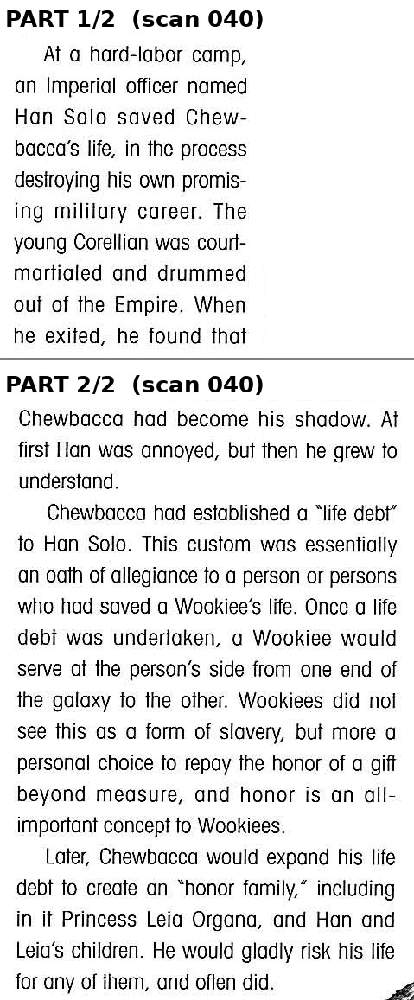

- Note (summary from our notes, not a quotation): As Gethzerion realized her defeat was imminent, she leapt onto a space carrier that was leaving for Zsinj's ship. Han Solo pursued in the Falcon, and the carrier fired, but their missiles were ineffective. Rather than let Gethzerion and the other evil Nightsisters loose on the galaxy, Han Solo armed his own missiles and blew up the carrier.
  — Source: The Essential Guide to Characters (Andy Mangels, Del Rey, 1995), printed p.67, scan p.076. The 1995 guide's telling, not a power feat..
Our notes: `notes/materials/147-essential-guide-to-characters-1995/egc-royal-guards-through-gethzerion.md`
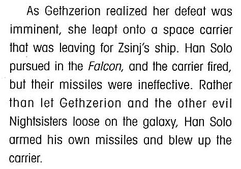

- Note (summary from our notes, not a quotation): Vader soon used Han for another insidious purpose: testing a carbonite-freezing chamber on a living person. Before he was lowered into the carbonite pit, Han and Leia said their good-byes. "I love you," she told him, tears in her eyes. "I know," he replied. And then the intense, incredible cold came, and Han couldn't scream, couldn't move, couldn't see. Conscious but not conscious, Han almost went mad in the dark prison of carbonite, his mind playing the memories of his life.
  — Source: The Essential Guide to Characters (Andy Mangels, Del Rey, 1995), printed p.146–147, scan p.155–156. The 1995 guide's telling, not a power feat..
Our notes: `notes/materials/147-essential-guide-to-characters-1995/egc-luke-through-thrawn.md`
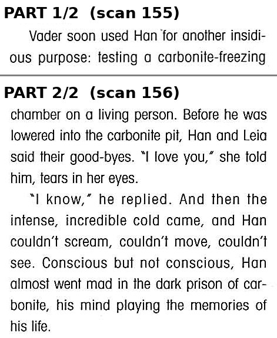

## Essential Guide to Planets and Moons (1998)

What it shows (our notes): "Han!" Leia's accusatory voice echoed through the frozen Hoth corridor. "I thought you'd decided to stay!" The retreating Corellian captain spun to face her, his face flashing with annoyance. "Well, the bounty hunter we ran into on Ord Mantell changed my mind."
> I thought you'd decided to stay!
>
> “Well, the bounty hunter we ran into on Ord Mantell changed my mind.”
>
> “Han, we need you!”
>
> Han gave her a quizzical look, and echoed, “We need?”
— Source: The Essential Guide to Planets and Moons (Daniel Wallace, Del Rey, 1998), printed p.146, scan p.160.
(Excerpt widened 2026-11-17 to the relevant passage, word for word from Star Wars®: Episode V: The Empire Strikes Back™ (by Ryder Windham, created by George Lucas) (text copy `MEGA_The_Episode_Junior_Novelizations_Star_Wars_Episode_V_The_Empire_Strikes_Back_Junior_Novelization_Ryder_Windham_epub`).)
Our notes: `notes/materials/150-essential-guide-to-planets-and-moons-1998/egpm-onderon-through-ordmantell.md`
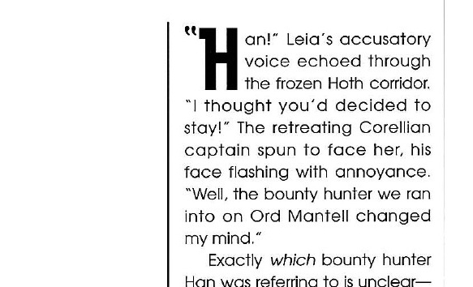

What it shows (our notes): "I've been looking forward to this for a long time," hooted Greedo as he leveled his blaster at Han Solo and prepared to fire.
> (The “par-sec” is a navigational calculation, not a measurement of time; that is, the ship is fast because it’s smart.) Instead of cutting away from the cantina after Ben and Luke leave, Han is caught inside by an alien sent by one Jabba the Hutt.
>
> ALIEN That’s the idea, Solo. You will come outside with me or must I finish it here?
>
> HAN I don’t think they’d like another killing in here.
>
> ALIEN They’d hardly notice …get up.
>
> ALIEN They’d hardly notice …get up. I’ve been looking forward to this for a long time …
>
> HAN I bet you have …
>
> Suddenly the slimy alien disappears in a blinding flash of light. Han pulls his smoking gun from beneath the table as the other patrons look on in bemused amazement.
— Source: The Essential Guide to Planets and Moons (Daniel Wallace, Del Rey, 1998), printed p.158, scan p.172.
(Excerpt widened 2026-11-17 to the relevant passage, word for word from The Making of Star Wars (Enhanced Edition) (J. W. Rinzler) (text copy `novels_tmp_lucas_bts_rinzler_making_of_star_wars_2007_epub_545cca41bb`).)
(Excerpt widened 2026-11-17 to the relevant passage, word for word from George Lucas (Brian Jay Jones), Chapter 11 (text copy `novels_tmp_lucas_bts_jones_a_life_epub_0a66b554e4`).)
(Excerpt widened 2026-11-17 to the relevant passage, word for word from The Making of Star Wars (Enhanced Edition) (J. W. Rinzler) (text copy `novels_tmp_lucas_bts_rinzler_making_of_star_wars_2007_epub_545cca41bb`).)
(Full sentence/passage taken from the source text on file: `novels_tmp_lucas_bts_rinzler_making_of_star_wars_2007_epub`.)
Our notes: `notes/materials/150-essential-guide-to-planets-and-moons-1998/egpm-rodia-through-roon.md`
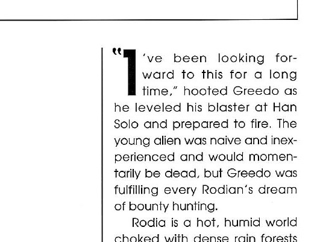

## Essential Guide to Vehicles and Vessels (1996)

- Note (summary from our notes, not a quotation): Beneath the Falcon's battered exterior hides a fast, tough smuggling vessel. It has a Class 0.5 hyperdrive, which is nearly twice as fast as the fastest Imperial warships.
  — Source: The Essential Guide to Vehicles and Vessels (Bill Smith, Del Rey, 1996), printed p.114, scan p.076.
Our notes: `notes/materials/148-essential-guide-to-vehicles-vessels-1996/egvv-lancer-through-moncal.md`
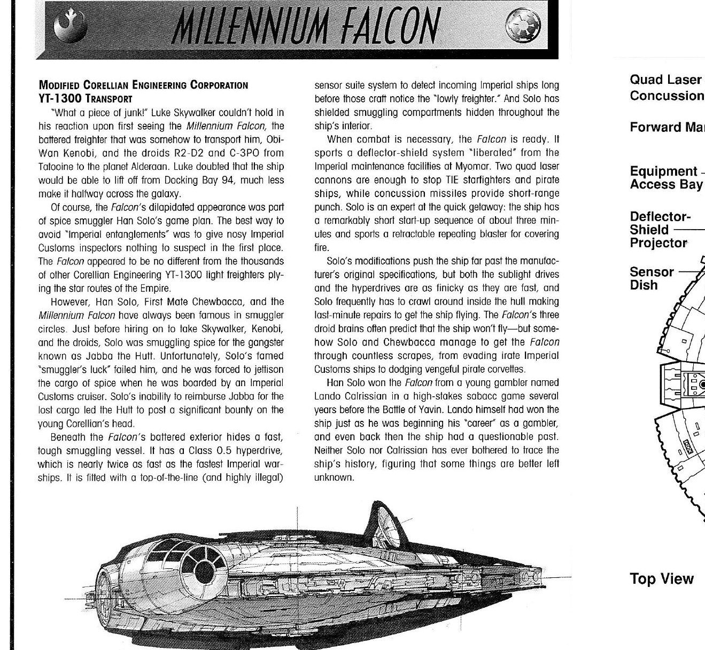

- Note (summary from our notes, not a quotation): Han Solo flew a Z-95 Mark I when he led the defense of an outlaw-tech base against Corporate Sector Authority fighters. Solo used the Z-95's superior atmospheric capabilities to good advantage against the Authority's sluggish IRD fighters.
  — Source: The Essential Guide to Vehicles and Vessels (Bill Smith, Del Rey, 1996), printed p.200, scan p.119.
Our notes: `notes/materials/148-essential-guide-to-vehicles-vessels-1996/egvv-wildkarrde-through-z95.md`
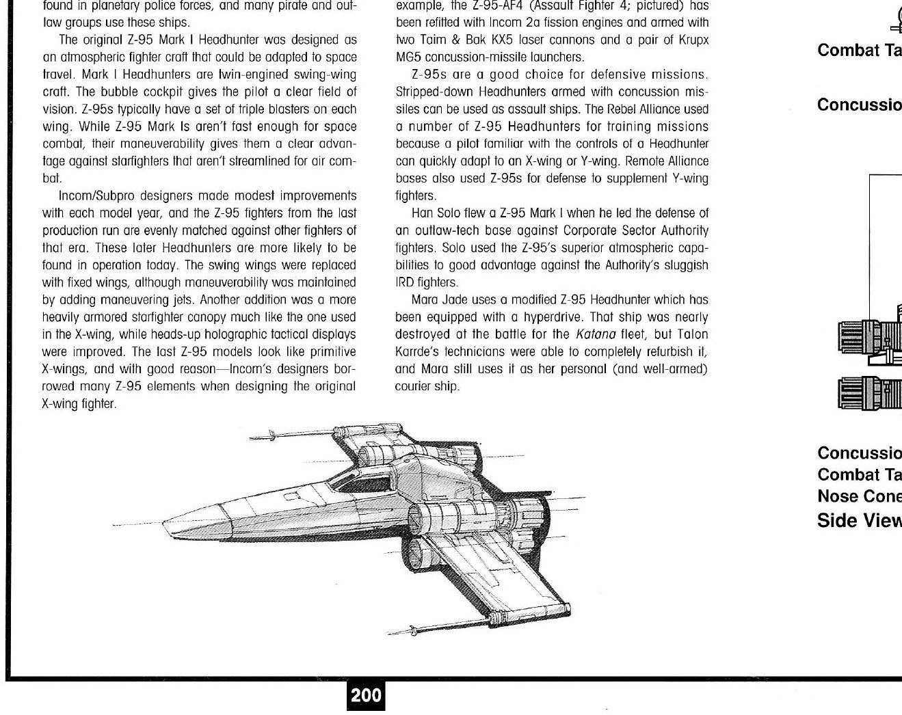

- Note (summary from our notes, not a quotation): Han Solo was imprisoned in the Maw Installation, where he met the Sun Crusher’s designer, Qui Xux [sic], and convinced her of the evil the weapon presented. She, Solo, Chewbacca, and an escaped slave named Kyp Durron stole the Sun Crusher from the Empire. After they delivered the weapon to Coruscant, the New Republic Assembly voted to have the weapon cast down into the gas giant Yavin. However, Kyp retrieved the Sun Crusher and went on a rampage, destroying several Imperial worlds before surrendering the vessel. The Sun Crusher was destroyed at the Battle of the Maw, when it was caught in the gravity well of one of the Maw’s black holes.
  — Source: The Essential Guide to Vehicles and Vessels (Bill Smith, Del Rey, 1996), printed p.162, scan p.100. This 1996 printing spells the name Qui Xux. The character file remains Qwi Xux. The spelling is not normalized. The printed sentence is "stole the Sun Crusher from the Empire." The later sentence "delivered the weapon" is a different printed sentence and is kept..
Our notes: `notes/materials/148-essential-guide-to-vehicles-vessels-1996/egvv-starlight-through-swoop.md`

- Note (summary from our notes, not a quotation): After the rescue of Han Solo, Luke Skywalker and other Rebel heroes used one of Jabba's skiffs to escape from the Great Pit of Carkoon even as Jabba's sail barge exploded spectacularly.
  — Source: The Essential Guide to Vehicles and Vessels (Bill Smith, Del Rey, 1996), printed p.40, scan p.039. The crop states that a rescue of Han Solo had taken place. It does not say who rescued him or how, and it does not say he was on the skiff..
Our notes: `notes/materials/148-essential-guide-to-vehicles-vessels-1996/egvv-chariot-through-enforcer.md`
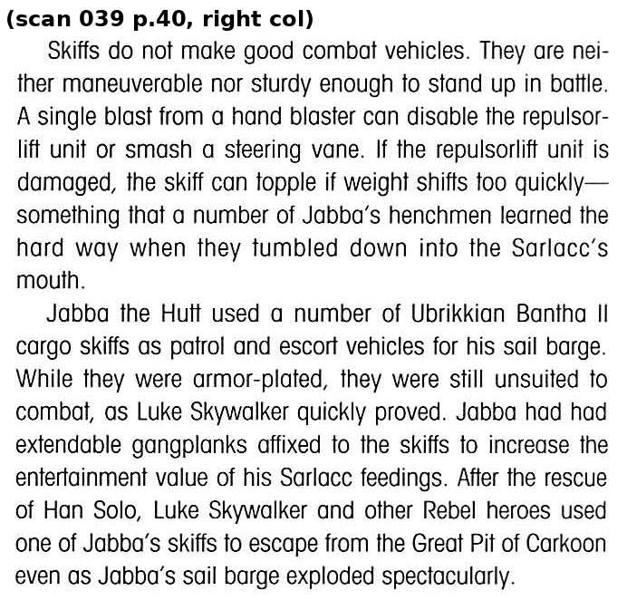

## George Lucas: A Life (Jones, 2016) — real-world / creator commentary

> If the audience doesn’t cheer when Han Solo comes in at the last second in the *Millennium Falcon* to help Luke when he’s being chased by Vader, the picture doesn’t work.
— Source: Brian Jay Jones, *George Lucas: A Life* (Little, Brown, 2016), photo insert — 166-george-lucas-a-life-2016.
Note (our notes, around the quote): Photo-insert caption, typography locked. Marcia Lucas, editing *Star Wars* battle sequences, told Lucas: “If the audience doesn’t cheer when Han Solo comes in at the last second in the *Millennium Falcon* to help Luke when he’s being chased by Vader, the picture doesn’t work.”
Our notes: `notes/materials/166-george-lucas-a-life-2016/jones-13-back-matter.md`; `summary.md`

> “It’s business, kid,” said Lucas.75 Lucas had no idea what was going to happen in Revenge of the Jedi. Beyond the title, he had little more than some notes scribbled on yellow pads. Harrison Ford, tiring of Han Solo, had urged Lucas to kill his character off—but Lucas had hedged his bets in Empire, merely deep-freezing Solo in carbonite. His fate, it seemed, hinged on whether Ford would sign on for the third movie—but now that Lucas had slid a third Star Wars clause into Ford’s contract for multiple Indiana Jones films, Solo seemed safe.
>
> Gary Kurtz still wasn’t so sure. At one point, Kurtz and Lucas had sat down to discuss the plot of the final film, which Kurtz—who had loved Empire’s more serious, grown-up feel—wanted to end on a more poignant, almost downbeat note.
>
> Gary Kurtz still wasn’t so sure. At one point, Kurtz and Lucas had sat down to discuss the plot of the final film, which Kurtz—who had loved Empire’s more serious, grown-up feel—wanted to end on a more poignant, almost downbeat note. “The original idea was that they would recover Han Solo in the early part of the story,” recalled Kurtz, “and that he would die in the middle part of the film in a raid on an Imperial base.”76 That would have left Leia alone to assume her new duties as queen of the upstart Alliance, “with Luke riding off into the sunset, metaphorically, on his own. And that would have been a bittersweet ending,” said Kurtz, “but I think it would have been dramatically stronger.”77 Lucas wouldn’t even consider it—and Kurtz thought he knew why. During production on Empire, Kurtz had spent a fair amount of time ferrying representatives from the Kenner toy company around the set.
>
> And that would have been a bittersweet ending,” said Kurtz, “but I think it would have been dramatically stronger.”77 Lucas wouldn’t even consider it—and Kurtz thought he knew why. During production on Empire, Kurtz had spent a fair amount of time ferrying representatives from the Kenner toy company around the set. Lucas was clearly keeping an eye on the “toyetic” qualities of his franchise—and “George then decided he didn’t want any of the principals killed,” said Kurtz.78 Or, as Ford put it more sardonically, “George didn’t think there was any future in dead Han toys.”79 “It’s a shame,” said Kurtz later. “They make three times as much on toys as they do on films. It’s natural to make decisions that protect the toy business, but that’s not the best thing for making quality films.”80 The Lucas-Kurtz partnership—which had produced three of the most successful films in history in less than a decade—was on increasingly thin ice.
— Source: Brian Jay Jones, *George Lucas: A Life* (Little, Brown, 2016), pp. 302–303; Jones Notes, ch. 9 n.76–80 — 166-george-lucas-a-life-2016; Kurtz’s preferred *Jedi* ending, typography locked: recover Han early.
(Excerpt widened 2026-11-17 to the relevant passage, word for word from George Lucas (Brian Jay Jones) (text copy `novels_tmp_lucas_bts_jones_a_life_epub_0a66b554e4`).)
(Excerpt widened 2026-11-17 to the relevant passage, word for word from George Lucas (Brian Jay Jones) (text copy `novels_tmp_lucas_bts_jones_a_life_epub_0a66b554e4`).)
(Full sentence/passage taken from the source text on file: `novels_tmp_lucas_bts_jones_a_life_epub`.)
Note (our notes, around the quote): Kurtz’s preferred *Jedi* ending, typography locked: recover Han early, “and that he would die in the middle part of the film in a raid on an Imperial base,” with a “bittersweet ending” Lucas “wouldn’t even consider.” Ford, sardonically: “George didn’t think there was any future in dead Han toys.” Kurtz: “They make three times as much on toys as they do on films. It’s natural to make decisions that protect the toy business, but that’s not the best thing for making quality films.”
Our notes: `notes/materials/166-george-lucas-a-life-2016/jones-08-ch09.md`; `summary.md`

> HAN: Sorry for the mess.28 But Lucas was determined to stick to his long-running narrative that he’d had all of the details of the entire Star Wars saga planned out from the start. “Han Solo was going to marry Leia,” he insisted, “and you look back and say, ‘Should he be a cold-blooded killer?’ Because I was thinking mythologically—should he be a cowboy, should he be John Wayne? And I said, ‘Yeah, he should be John Wayne.’ And when you’re John Wayne, you don’t shoot people [first]—you let them have the first shot. It’s a mythological reality that we hope our society pays attention to.”29
>
> Another good try, but fans weren’t buying it, and never would. While Lucas would never regret the alteration—and never quite understand the objections—he would also never live it down, deflecting question after question about it for the next two decades. “The special edition, that’s the one I wanted out there,” he would state in 2004, throwing up his hands in annoyance. “This is the movie I wanted it to be, and I’m sorry you saw half a completed film and fell in love with it.”30 It wasn’t just fans who were annoyed, however; Gary Kurtz, who had produced both Star Wars and Empire, argued that the digital changes were “probably a wrong philosophy.… It’s not the way it was in the first place. The way it was in the first place was the way we released it.”31 Lucas dismissed such razzing; as far as he was concerned, as the creator of the art, he and he alone had the right to do with it as he pleased—though for all his talk, one wonders how he might have reacted to, say, Kurosawa digitally altering even one frame of The Hidden Fortress. Still, he wasn’t above acknowledging the controversy to the fans, even wearing a T-shirt reading HAN SHOT FIRST as he directed Revenge of the Sith.32
>
> In August, Lucas made a trip to Orlando on the pretext of making a surprise appearance at a panel at Star Wars Celebration VI, but with another even more secret agenda in mind. Lucas took the stage at his panel to earsplitting applause, without giving the slightest indication that the gears of Star Wars were slowly turning again. Then, while in Orlando, Lucas took to lunch two other Celebration attendees—Mark Hamill and Carrie Fisher—to try to persuade them to reprise their roles in future Star Wars movies. Hamill was shocked. “The idea that he would say, ‘We want to do VII, VIII, IX’ was the farthest thing from my mind,” said Hamill.74 But he and Fisher both agreed to reprise their roles—and, after considerable discussion, so did Harrison Ford, largely on promises of a meaningful story arc that would close the book on Han Solo once and for all.
— Source: Brian Jay Jones, *George Lucas: A Life* (Little, Brown, 2016), chs. 11 and 13; Jones Notes, ch. 11 n.27–31 — 166-george-lucas-a-life-2016.
(Excerpt widened 2026-11-17 to the relevant passage, word for word from George Lucas (Brian Jay Jones) (text copy `novels_tmp_lucas_bts_jones_a_life_epub_0a66b554e4`).)
(Excerpt widened 2026-11-17 to the relevant passage, word for word from George Lucas (Brian Jay Jones) (text copy `novels_tmp_lucas_bts_jones_a_life_epub_0a66b554e4`).)
(Excerpt widened 2026-11-17 to the relevant passage, word for word from George Lucas (Brian Jay Jones) (text copy `novels_tmp_lucas_bts_jones_a_life_epub_0a66b554e4`).)
(Full sentence/passage taken from the source text on file: `novels_tmp_lucas_bts_jones_a_life_epub`.)
Note (our notes, around the quote): HAN SHOT FIRST and the later sequel deal, typography locked. Jones cites the May 15, 1976 shooting script as proving Greedo never fired. Lucas’s later John Wayne rationale: “you don’t shoot people [first]—you let them have the first shot.” Kurtz called the Special Edition changes “probably a wrong philosophy.… The way it was in the first place was the way we released it.” In 2012 Ford agreed to return “largely on promises of a meaningful story arc that would close the book on Han Solo once and for all.”
Our notes: `notes/materials/166-george-lucas-a-life-2016/jones-10-ch11.md`; `jones-12-ch13.md`; `summary.md`

## Once Upon a Galaxy (Arnold, 1980) — real-world

> HF: It is very hard for me to look objectively at the film. It's George's creation. He gave himself a beautiful princess in Leia and a callow youth in Luke. He gave himself a sage warrior in Ben Kenobi and he gave himself a character called Han Solo, who is described as "a cynical space pirate.” But he's not really a cynic and the phrase "space pirate” doesn't really indicate what he does. In fact, what he does in the story is to function as a kind of synthesizer. He's the most realistic character and consequently, in a way, the easiest one to play. It is a pleasure to play that kind of part. When I read the script I knew nothing about science fiction. I read the script and asked myself "can they really make a movie out of this?' I had no idea how it would feel creating Han. What I did understand was the relation among the four characters I have mentioned. I understood, too, what George had so cleverly done with the robots and other nonhuman creatures. He'd given them human potential. So, from an audience's point of view, my job was to help tell the story. Han helps make everything contemporary, recognizably human, in a way. Anyway, it worked for a lot of people. I was just part of the equation George dreamed up.
>
> And they're wrong. The third dimension is me.
— Source: “It’s George’s creation. He gave himself a beautiful princess in Leia and a callow youth in Luke. He gave himself a sage warrior in Ben Kenobi and he gave himself a character called Han Solo, who is described as ‘a cynical space pirate.’ But he’s not really a cynic and the phrase ‘space pirate’ doesn’t really indicate what he does… He’s the most realistic character and consequently, in a way, the easiest one to play… I was just part of the equation George dreamed up.” “I never thought of the character as having only two dimensions until the critics said so. And they’re wrong. The third dimension is me.” — typography-faithful quotes, Arnold, “Norway,” Wednesday, March 7.; Ford. POV: Ford.
(Excerpt widened 2026-11-17 to the relevant passage, word for word from Once Upon A Galaxy A Journal of the Making of The Empire Strikes Back (Alan Arnold) (text copy `novels_tmp_lucas_bts_arnold_once_upon_a_galaxy_epub_dc813096f5`).)
(Full sentence/passage taken from the source text on file: `novels_tmp_lucas_bts_arnold_once_upon_a_galaxy_epub`.)
Our notes: `notes/materials/169-once-upon-a-galaxy-1980/arnold-00-front-through-london.md`

> I’ll be back… It’s almost contractual
> [fragment — full passage not on file]
— Source: Ford: “As I pass by her, I think Leia ought to say very simply, ‘I love you.’” Kershner: “‘I love you.’ And you say, ‘Just remember that, Leia, because I’ll be back.’ You’ve got to say, ‘I’ll be back.’ You must. It’s almost contractual.” Ford: “If she says ‘I love you,’ and I say ‘I know,’ that’s beautiful and acceptable and funny.” — typography-faithful quotes, Arnold, “EMI Studios, Elstree,” Thursday, June 21.; Ford invents “I know”; Kershner wanted.
Our notes: `notes/materials/169-once-upon-a-galaxy-1980/arnold-01-elstree-june21-july19-27.md`

> As befits a hustler [in] space, there’s a touch of the dude about him
> [fragment — full passage not on file]
— Source: Lucas, via Mollo: “Audiences mustn’t consciously notice the costumes… If they do, you have gone wrong.” Of Han: “As befits a hustler 器 space, there’s a touch of the dude about him.” (器 ≈ in.) Same interview: Luke a “country boy… karate-type shirt”; Leia “akin to a nun’s costume”; Kenobi “a cross between a Samurai and a priest.” — typography-faithful quotes, Arnold, “EMI Studios, Elstree,” Tuesday, July 3.. POV: Mollo.
Our notes: `notes/materials/169-once-upon-a-galaxy-1980/arnold-03-elstree-june-july.md`

What it shows (our notes): Ford, July 5: “urban cowboy… a sucker for a sacrificial end” / maybe the last of Han in the saga
> "Han is full-blooded,” he said. "More than any of the characters he's identifiable. You can see him on the streets of cities, an urban cowboy looking for love and a meaning to things. He's wise in the ways of men but a sucker for a sacrificial end.”
— Source: “it could be the last we see of Han in the saga… He could reappear… if George Lucas writes him into one.” Asked about a third film, Ford: “For at least six months I don’t want to do anything at all.” “Han is full-blooded… urban cowboy… a sucker for a sacrificial end.” Kershner: the freeze is “entirely his [Harrison’s]” scene; “a little tension with Carrie.” — typography-faithful quotes, Arnold, “EMI Studios, Elstree,” Thursday, July 5.; Ford, July 5.
(Excerpt widened 2026-11-17 to the relevant passage, word for word from Once Upon A Galaxy A Journal of the Making of The Empire Strikes Back (Alan Arnold) (text copy `novels_tmp_lucas_bts_arnold_once_upon_a_galaxy_epub_dc813096f5`).)
(Full sentence/passage taken from the source text on file: `novels_tmp_lucas_bts_arnold_once_upon_a_galaxy_epub`.)
Our notes: `notes/materials/169-once-upon-a-galaxy-1980/arnold-03-elstree-june-july.md`

> GL: Yes, it was harder on the first film. I didn't quite know the world that was being created. It was very hazy to start with, but as it became clearer, more concrete, I had a stronger base of reality to work with. It was, so to speak, the reality of unreality. But now I know what Luke Skywalker looks like; I know how lightsabers work; I know what Darth Vader's appearance should be. On the first film I didn't really know all these things. Should Luke be a young intellectual or just a crazy kid? Should Darth Vader be big and tall? How does Han Solo react to danger? That sort of thing. Those decisions, and hundreds more, were made before and during the first picture.
— Source: “On the first film I didn’t really know all these things. Should Luke be a young intellectual or just a crazy kid? Should Darth Vader be big and tall? How does Han Solo react to danger?” — typography-faithful quote, Arnold, “EMI Studios, Elstree,” Thursday, July 19.; Lucas, July 19.
(Excerpt widened 2026-11-17 to the relevant passage, word for word from Once Upon A Galaxy A Journal of the Making of The Empire Strikes Back (Alan Arnold) (text copy `novels_tmp_lucas_bts_arnold_once_upon_a_galaxy_epub_dc813096f5`).)
Our notes: `notes/materials/169-once-upon-a-galaxy-1980/arnold-01-elstree-june21-july19-27.md`

- Note (summary from our notes, not a quotation): Lucas, August 23: Han as “cynical foil” / evolved from the older brother who was to help rescue the father
  — Source: “They all came out of one composite-Luke was the composite… I was dealing with two opposites, and these are the two opposites in myself-a naive, innocent idealism and a view of the world that is cynical, more pessimistic… Leia came out of Luke, so to speak, just as Han did, as the opposite of Luke. Han Solo evolved from my wanting to have a cynical foil for the innocent Luke.” “Originally, the story was about an older brother coming to find his younger brother, who’s living on a farm, so that together they can rescue their father, an old Jedi. The older brother is a battle-hardened warrior. This character evolved into Han, the other side of Luke and an older brother figure.” — typography-faithful quotes, Arnold, “EMI Studios, Elstree,” Thursday, August 23..
Our notes: `notes/materials/169-once-upon-a-galaxy-1980/arnold-04-elstree-august-september.md`

What it shows (our notes): Lucas: Lando as “a kind of alter ego for Han,” from Han’s past
> GL: Since the Star Wars saga is essentially about Luke's background and his destiny, I wanted to round out Han Solo's character a little more. So I brought in a character who was from Han's past, a kind of alter ego for Han. Lando really evolved out of that. He is similar to Han, but different. Lando is more of a rogue, gambler, and con artist than a fast-shooting, fast-talking type.
— Source: “Since the *Star Wars* saga is essentially about Luke’s background and his destiny, I wanted to round out Han Solo’s character a little more. So I brought in a character who was from Han’s past, a kind of alter ego for Han. Lando really evolved out of that. He is similar to Han, but different. Lando is more of a rogue, gambler, and con artist than a fast-shooting, fast-talking type.” — typography-faithful quote, Arnold, “EMI Studios, Elstree,” Thursday, August 23.; Lucas: Lando as.
(Excerpt widened 2026-11-17 to the relevant passage, word for word from Once Upon A Galaxy A Journal of the Making of The Empire Strikes Back (Alan Arnold) (text copy `novels_tmp_lucas_bts_arnold_once_upon_a_galaxy_epub_dc813096f5`).)
(Full sentence/passage taken from the source text on file: `novels_tmp_lucas_bts_arnold_once_upon_a_galaxy_epub`.)
Our notes: `notes/materials/169-once-upon-a-galaxy-1980/arnold-04-elstree-august-september.md`

What it shows (our notes): Hamill: carbon freeze leaves Han “in limbo”; “Han is not vital to future stories”
> Mark Hamill: Well, look at what's happening to Harrison. He wasn't at all sure whether he wanted to repeat his role as Solo, and he's not at all committed to do it a third time. So George has left him in limbo in this one. As Lando Calrissian says after Han is hauled up from the carbon-freezing chamber: "He's in a perfect state of hibernation." So George has given himself the option. Han is not vital to future stories. It's up to Harrison, I guess, as to whether Han comes back into the saga.
— Source: “George Lucas is very clever… He’s not going to compromise himself by making us indispensable… Well, look at what’s happening to Harrison. He wasn’t at all sure whether he wanted to repeat his role as Solo, and he’s not at all committed to do it a third time. So George has left him in limbo in this one. As Lando Calrissian says after Han is hauled up from the carbon-freezing chamber: ‘He’s in a perfect state of hibernation.’ So George has given himself the option. Han is not vital to future stories. It’s up to Harrison, I guess, as to whether Han comes back into the saga.” — typography-faithful quotes, Arnold, “EMI Studios, Elstree,” Friday, August 31..
(Excerpt widened 2026-11-17 to the relevant passage, word for word from Once Upon A Galaxy A Journal of the Making of The Empire Strikes Back (Alan Arnold) (text copy `novels_tmp_lucas_bts_arnold_once_upon_a_galaxy_epub_dc813096f5`).)
(Full sentence/passage taken from the source text on file: `novels_tmp_lucas_bts_arnold_once_upon_a_galaxy_epub`.)
Our notes: `notes/materials/169-once-upon-a-galaxy-1980/arnold-04-elstree-august-september.md`

> JW: There is a new theme for Yoda, the teacher of the Jedi Knights. His theme begins in a kind of piquant way and develops into a more profound, more noble piece. There will be a new theme that could be called the Love Theme developing from the love interest between Princess Leia and Han. There will be a new piece of music for Darth Vader who plays a more important role in this film. In Star Wars he had what you could call a musical fragment, but in the new picture there will be a Grand Imperial March. In addition to those three principal themes there is new thematic material for the ice-planet battle sequences. The Force Theme from Star Wars will be more widely used and developed. Finally, the Star Wars March, which is associated with Luke and the good side of the Force, will be newly presented.
— Source: “There will be a new theme that could be called the Love Theme developing from the love interest between Princess Leia and Han.” — typography-faithful quote, Arnold, “Los Angeles, California,” Saturday, November 17.; Williams: Love Theme.
(Excerpt widened 2026-11-17 to the relevant passage, word for word from Once Upon A Galaxy A Journal of the Making of The Empire Strikes Back (Alan Arnold) (text copy `novels_tmp_lucas_bts_arnold_once_upon_a_galaxy_epub_dc813096f5`).)
(Full sentence/passage taken from the source text on file: `novels_tmp_lucas_bts_arnold_once_upon_a_galaxy_epub`.)
Our notes: `notes/materials/169-once-upon-a-galaxy-1980/arnold-05-marin-la-postscript-aa.md`

## Staff / crew / cast addendum for notes 160–165 — real-world

What it shows (our notes): P. 61, typography as locked: “You can type this [expletive] George, but you sure can’t say it.” Shields prints “[expletive]”; do not silently restore a swear word from another book.
> A technician on the crew complained that the director knew what he wanted, but “the problem was that none of us knew what that was.” The cast also expressed bewilderment at Lucas’s minimal direction. Mark Hamill, who played the role of Luke Skywalker, later told an interviewer, “I have a sneaking suspicion that if there were a way to make movies without actors, George would do it.” Moreover, lines in the script sounded stiff and unbelievable. “I thought I recognized your foul stench when I came aboard,” says Carrie Fischer as Princess Leia, sounding like a prim heroine in a school play. Harrison Ford told Lucas bluntly, “You can type this [expletive] George, but you sure can’t say it.” Lucas wasn’t enjoying himself either. “I had to direct 500 people on Star Wars,” he remembers, “and I hated it. I accept the power to do whatever I like with my camera. But I refuse to command other people.”
— Source: Charles J. Shields, *George Lucas* (Chelsea House, 2002), p. 61 — 160-george-lucas-shields-2002; entered in the 160–165 staff addendum; P. 61, typography as locked.
(Excerpt widened 2026-11-17 to the relevant passage, word for word from novels tmp lucas bts shields 2002 (text copy `novels_tmp_lucas_bts_shields_2002_pdf_ea32f6e53e`).)
(Excerpt widened 2026-11-17 to the relevant passage, word for word from novels tmp lucas bts shields 2002 (text copy `novels_tmp_lucas_bts_shields_2002_pdf_ea32f6e53e`).)
Our notes: `notes/materials/160-george-lucas-shields-2002/shields-02.md`; `notes/materials/160-165-staff-addendum/summary.md`

What it shows (our notes): Introduction, typography locked (British single quotes). Smith says Ford is “repeatedly quoted” telling Lucas, “You can write this shit, but you can’t say it.” This is not the same typography as Shields 2002 (“type this [expletive]”); record both, do not collapse. Same book: at the *American Graffiti* wrap-party reel, Ford shouts “This is a fucking hit!”
> The clue is in the word ‘principal’.  TAGLINE:  SUMMARY:  TRAILER:  SCREENPLAY:  CASTING:  PRODUCTION:  ALTERNATIVE VERSIONS: Lucas often produces alternative versions of his films; he has re-edited Star Wars on an almost annual basis since its original release. This process has sometimes had press and public attention drawn to it (such as during the twentieth anniversary re-release of Star Wars) while on other occasions it has slipped by unnoticed. Here I’ll note some of the major variations in the released versions of his films.  GEORGE LUCAS Introduction CUT SCENES: Find out what didn’t make it into the final cut.  QUOTES: For a man constantly accused of being unable to write dialogue (Harrison Ford is repeatedly quoted as having once told Lucas, ‘You can write this shit, but you can’t say it’) Lucas has come up with more than a few iconic one-liners in his time. The truth is that sometimes Lucas’s dialogue makes you shudder, but sometimes it makes you sing. This section is for noting down the best, worst and the most memorable of what the actors say.  MUSICAL NOTES: A great fan of silent cinema, Lucas sets much store by a musical score and the talents of John Williams in particular. This category is for discussion of the films’ musical elements.
>
> The one location outside Petaluma they used was the round diner, Mel’s, that was to become one of the film’s most enduring visual symbols. This was in downtown San Francisco, and the built-up area around it restricted the camera angles available to Lucas and Wexler; if they’d shot facing away from the diner it would have been painfully obvious that this was an urban environment the actors were in (see ALTERNATIVE VERSIONS).  At the wrap party Lucas showed the exhausted cast and crew a montage of scenes from the picture. Over the applause at the end industry legend has it that Harrison Ford could be heard shouting ‘This is a fucking hit!’ at the top of his voice.  Despite Ford’s enthusiasm, the production’s troubles were far from over - Universal assigned Verna Fields 1 to the production as editor, despite Lucas’s insistence that his wife Marcia cut it. In the end the three of them worked together cutting it at Coppola’s Mill Valley facilities. It had been a hard shoot, but the most difficult period of the film’s gestation was still to come (see RELEASE).
— Source: Jim Smith, *George Lucas* (Virgin Film, 2003), Introduction and pp. 32–36 — 162-george-lucas-jim-smith-2003; entered in the 160–165 staff addendum.
(Excerpt widened 2026-11-17 to the relevant passage, word for word from George Lucas (Smith, Jim, 1978-) (text copy `novels_tmp_lucas_bts_jim_smith_epub_210ab9ca09`).)
(Excerpt widened 2026-11-17 to the relevant passage, word for word from George Lucas (Smith, Jim, 1978-) (text copy `novels_tmp_lucas_bts_jim_smith_epub_210ab9ca09`).)
(Full sentence/passage taken from the source text on file: `novels_tmp_lucas_bts_jim_smith_epub`.)
Our notes: `notes/materials/162-george-lucas-jim-smith-2003/smith-01.md`; `smith-02.md`; `notes/materials/160-165-staff-addendum/summary.md`

What it shows (our notes): *Star Wars* shoot, typography locked. Ford: “George wanted and hired strong personalities.” “Very little time was wasted. George didn’t have an authoritarian attitude like many directors. . . . He was different. . . . He encouraged our contributions.” Mayhew: “My first impression was that he [Lucas] was an average sort of guy,” “He didn’t look like the image of a Hollywood director.”
> Mark Hamill remembers the grueling casting process for his pivotal role, "There were guys literally everywhere, in age from sixteen to thirty-five."
>
> For Star Wars, Lucas cast Mark Hamill as Luke Skywalker (left); Carrie Fisher as Princess Leia (center); and Harrison Ford as Han Solo (right).
>
> Although Ford had been in American Graffiti, he was not yet a star, and Fisher and Hamill had almost no experience in films. The studio was not pleased. Ford recalled that "George wanted and hired strong personalities." Lucas managed to gather the studio's support, however, when he signed the gifted and experienced Alec Guinness to play Obi-Wan Kenobi.
>
> Another problem Lucas faced was trying to create his new world. For the desert scenes, Lucas started to shoot in Tunisia, Africa, in March 1976.
>
> Very little time was wasted. George didn’t have an authoritarian attitude like many directors. . . . He was different. . . . He encouraged our contributions.
>
> Elstree had many sound stages, and it was cheaper to make movies in England than in the United States. Lucas's style came through during filming. He always 51 wanted things to be "faster and more intense." But even though shooting in England was easier than shooting in Tunisia, Lucas still had problems. Time limits put immense pressure on Lucas and the crew.
>
> In the meantime, his crew was finding that Star Wars was a unique experience. "My first impression was that he [Lucas] was an average sort of guy," says Peter Meyhew, the giant actor inside Chewbacca's furry suit.
>
> In the meantime, his crew was finding that Star Wars was a unique experience. "My first impression was that he [Lucas] was an average sort of guy," says Peter Meyhew, the giant actor inside Chewbacca's furry suit. "He didn't look like the image of a Hollywood director." Harrison Ford especially appreciated George's style, "Very little time was wasted.
— Source: Dana Meachen Rau and Christopher Rau, *George Lucas: Creator of Star Wars* (Franklin Watts, 1999) — 163-george-lucas-creator-of-star-wars-1999; entered in the 160–165 staff addendum; *Star Wars* shoot, typography locked. Ford.
(Excerpt widened 2026-11-17 to the relevant passage, word for word from George Lucas : creator of Star wars (Rau, Dana Meachen, 1971-;Rau, Christopher) (text copy `novels_tmp_lucas_bts_creator_of_star_wars_1999_epub_4f5e725e4e`).)
(Excerpt widened 2026-11-17 to the relevant passage, word for word from George Lucas : creator of Star wars (Rau, Dana Meachen, 1971-;Rau, Christopher) (text copy `novels_tmp_lucas_bts_creator_of_star_wars_1999_epub_4f5e725e4e`).)
(Excerpt widened 2026-11-17 to the relevant passage, word for word from George Lucas : creator of Star wars (Rau, Dana Meachen, 1971-;Rau, Christopher) (text copy `novels_tmp_lucas_bts_creator_of_star_wars_1999_epub_4f5e725e4e`).)
(Full sentence/passage taken from the source text on file: `novels_tmp_lucas_bts_creator_of_star_wars_1999_epub`.)
Our notes: `notes/materials/163-george-lucas-creator-of-star-wars-1999/rau-02.md`; `notes/materials/160-165-staff-addendum/summary.md`

> Spielberg wanted Raiders to be as nonstop and thrilling as a ride at an amusement park. Lucas wanted to be true to the style of 1930s serials. The two men have completely opposite approaches to making movies. Spielberg designs the shots and action as they happen, while Lucas creates his films in the editing room.
>
> A 69 A To create Raiders of the Lost Ark, Lucas formed a creative partnership with Steven Spielberg.
>
> \ Spielberg suggested they change the name Indiana Smith to Indiana Jones, because he thought Smith sounded too common. Lucas imagined that Indiana Jones "We're doing a role would be rebellious, but with some morals, a lot like Han Solo.
>
> \ Spielberg suggested they change the name Indiana Smith to Indiana Jones, because he thought Smith sounded too common. Lucas imagined that Indiana Jones "We're doing a role would be rebellious, but with some morals, a lot like Han Solo. "He has m ° del for llttle klds > so to be a person we can we have to be careful. look up to," Lucas We nee d someone thought. "We're doing a who's honest and true role model for little and trusting." kids, so we have to be careful. We need someone who's honest and true and trusting."
>
> "We're doing a who's honest and true role model for little and trusting." kids, so we have to be careful. We need someone who's honest and true and trusting."
>
> At first, Spielberg envisioned Indiana as a little more sleazy, but they compromised on someone "like Harrison Ford" as Lucas described him. They wanted Ford's look, style, and manner. But when the time came for casting, Lucas was looking for an unknown.
>
> He has to be a person we can look up to,
> [fragment — full passage not on file]
>
> We’re doing a role model for little kids, so we have to be careful.
— Source: Dana Meachen Rau and Christopher Rau, *George Lucas: Creator of Star Wars* (Franklin Watts, 1999) — 163-george-lucas-creator-of-star-wars-1999; entered in the 160–165 staff addendum.
(Excerpt widened 2026-11-17 to the relevant passage, word for word from George Lucas : creator of Star wars (Rau, Dana Meachen, 1971-;Rau, Christopher) (text copy `novels_tmp_lucas_bts_creator_of_star_wars_1999_epub_4f5e725e4e`).)
(A fragment line was removed 2026-11-17: its words appear word for word inside the full excerpt in this entry.)
(Fragment completed 2026-11-17 with the full excerpt, word for word from George Lucas : creator of Star wars (Rau, Dana Meachen, 1971-;Rau, Christopher) (text copy `novels_tmp_lucas_bts_creator_of_star_wars_1999_epub_4f5e725e4e`).)
(Excerpt widened 2026-11-17 to the relevant passage, word for word from George Lucas : creator of Star wars (Rau, Dana Meachen, 1971-;Rau, Christopher) (text copy `novels_tmp_lucas_bts_creator_of_star_wars_1999_epub_4f5e725e4e`).)
(Full sentence/passage taken from the source text on file: `novels_tmp_lucas_bts_creator_of_star_wars_1999_epub`.)
(Fragment completed 2026-11-17: full sentence/passage matched word for word in the source text on file: `novels_tmp_lucas_bts_creator_of_star_wars_1999_epub_4f5e725e4e`.)
Note (our notes, around the quote): Indiana Jones compared with Han Solo, typography locked. Lucas imagined Indy “rebellious, but with some morals, a lot like Han Solo.” “He has to be a person we can look up to,” “We’re doing a role model for little kids, so we have to be careful.” Spielberg envisioned someone “a little more sleazy”; they compromised on someone “like Harrison Ford.” Lucas first looked at Tom Selleck; he had wanted to try different actors because Ford had already appeared in five Lucasfilm productions, then finally Ford.
Our notes: `notes/materials/163-george-lucas-creator-of-star-wars-1999/rau-03.md`; `notes/materials/160-165-staff-addendum/summary.md`

## The Making of Star Wars (Rinzler, 2007) — real-world

- Note (summary from our notes, not a quotation): Rough draft: Han Solo “an alien Ureallian,” friend of Kane Starkiller
  — Source: Progression: “HAN SOLO (AN ALIEN UREALLIAN, FRIEND OF KANE STARKILLER) (SWRD)”; Chewbacca a huge furry Wookiee, they meet on the jungle planet Yavin. Do not collapse this alien Han with the later human Corellian pirate. — typography-faithful, Rinzler p. 16–22; Rinzler EE, “Star Wars Progression.”.
Our notes: `notes/materials/170-making-of-star-wars-2007/rinzler-02-chapter-two.md`; `rinzler-13-deluxe-bonus.md`

> a young Corellian pirate only a few years older than Luke,
> [fragment — full passage not on file]
— Source: “Luke is standing next to HAN SOLO, a young Corellian pirate only a few years older than Luke…” Progression: “HAN SOLO, HUMANOID CORELLIAN PIRATE/PILOT WITHOUT A SHIP OF HIS OWN, TEAMED UP WITH CHEWBACCA THE WOOKIEE, AND IN DEBT (TO AN ENORMOUSLY FAT CHARACTER NAMED OXUS—ALL ON UTAPAU)”; “JABBA THE HUTT (A PIRATE)”; later “HAN SOLO BLASTS OFF IN SHIP (WHICH HE’S STOLEN SINGLE-HANDEDLY FROM JABBA)”; “HAN REFUSES TO JOIN THE REBELS.” — typography-faithful, Rinzler p. 26–31; Rinzler EE, “Star Wars Progression.”; Second draft. POV: Second draft.
Note (our notes, around the quote): Second draft: “a young Corellian pirate only a few years older than Luke,” no ship of his own, in debt to Oxus
Our notes: `notes/materials/170-making-of-star-wars-2007/rinzler-02-chapter-two.md`

- Note (summary from our notes, not a quotation): Jabba’s debt: ship construction (third draft) vs. dropped spice shipment (shooting script)
  — Source: “7/ HAN SOLO OWES JABBA THE HUTT MONEY (FOR CONSTRUCTION OF SHIP) (TSW3).” “9/ HAN SOLO SHOOTS AN ALIEN IN CANTINA; HAN IS IN DEBT TO JABBA THE HUTT FOR DROPPING AN ILLEGAL SPICE SHIPMENT; PIRATE SHIP NAMED *MILLENNIUM FALCON* (SWSS).” Record both debts; do not prefer one as “the” reason. — typography-faithful, Rinzler EE, “Star Wars Progression.”.
Our notes: `notes/materials/170-making-of-star-wars-2007/rinzler-13-deluxe-bonus.md`

> Brian would go over and see the miniatures at ILM, and he would tell me that he was envious of George. Brian was doing this movie with girls slamming doors and George was having all this fun making models and building things.”
>
> “Brian and I are very good friends,” Lucas says, “and when I started casting, which is a laborious job that goes on for ten hours a day, with a person coming into your office every two minutes, you try to be pleasant and sharp and to have your analytical eye attuned—but it gets to be very, very difficult day in and day out, week after week. So Brian asked if he could sit in on my sessions and I said, ‘Sure,’ because it’s great to have company, somebody to compare notes with and somebody to keep you alive, so you don’t become completely blotto toward the end of the day.”
>
> THE GAUNTLET “In the beginning we were very open,” Lucas says. “We had two male characters, so I wanted the farm boy to be shorter than Han Solo, so they didn’t conflict visually; I didn’t want two guys looking exactly alike.
>
> THE GAUNTLET “In the beginning we were very open,” Lucas says. “We had two male characters, so I wanted the farm boy to be shorter than Han Solo, so they didn’t conflict visually; I didn’t want two guys looking exactly alike. I also made a decision in the casting to lower the age considerably from what I’d had in mind, because I wanted to make a movie about kids for kids, though, in a way, it’s an adult kid’s movie.”
>
> “We talked about Jodie Foster,” Crittenden says of the actress, who was about fifteen at the time.
— Source: “In the beginning we were very open. We had two male characters, so I wanted the farm boy to be shorter than Han Solo, so they didn’t conflict visually…” — typography-faithful, Rinzler p. 96.; Lucas on casting: the farm boy. POV: George Lucas..
(Excerpt widened 2026-11-17 to the relevant passage, word for word from The Making of Star Wars (Enhanced Edition) (J. W. Rinzler) (text copy `novels_tmp_lucas_bts_rinzler_making_of_star_wars_2007_epub_545cca41bb`).)
(Excerpt widened 2026-11-17 to the relevant passage, word for word from The Making of Star Wars (Enhanced Edition) (J. W. Rinzler) (text copy `novels_tmp_lucas_bts_rinzler_making_of_star_wars_2007_epub_545cca41bb`).)
(Full sentence/passage taken from the source text on file: `novels_tmp_lucas_bts_rinzler_making_of_star_wars_2007_epub`.)
Our notes: `notes/materials/170-making-of-star-wars-2007/rinzler-04-chapter-four.md`

- Note (summary from our notes, not a quotation): Ford, last shooting day (24 June 1976): the character’s behavior comes from the other people and the set
  — Source: “I get a concept of the character, but I don’t get a concept of the way the character will behave until I see how the other people are going to act in a scene and until I get to see what the set is like and the situation.” Rinzler: Han Solo is “not just… Ford’s own interpretation… and Lucas’s direction—Solo was also the right response to the performances of his fellow actors.” — typography-faithful, Rinzler p. 209–210.. POV: Harrison Ford; Rinzler gloss flagged..
Our notes: `notes/materials/170-making-of-star-wars-2007/rinzler-09-chapter-nine.md`

- Note (summary from our notes, not a quotation): Jabba scene cut; Ford joins Marcia lobbying to keep it; exposition moves to Greedo
  — Source: First cut includes “Jabba the Hutt spars with Han Solo.” ILM cannot complete the complicated stop-motion Jabba in time. Marcia lobbies to keep it; “Harrison Ford joins her.” Problems: pacing and performance. Hirsch: “George also thought there were too many phony-looking green Martians that looked like Greedo in the background.” Chew: “George considered putting subtitles under Jabba, and I think that idea got transferred over to Greedo.” Hirsch: exposition (Han a smuggler, wanted, needs the money) incorporated into Greedo’s sequence. — typography-faithful, Rinzler p. 232–233..
Our notes: `notes/materials/170-making-of-star-wars-2007/rinzler-10-chapter-ten.md`

> But when you go to the Death Star, it works just the opposite. Artoo fits in with everything because everything is black and white, and he is primarily white.
>
> We made the stormtroopers white, too (also to mix things up, so not all the bad guys were dressed in dark colors). Even Threepio is out of place in the Death Star, more than Artoo. That was a creative decision to make Threepio part of the people, earth side, which was an esoteric idea, but I liked it.
>
> “The only thing that we varied a little bit was the Han Solo costume: He’s dressed in browns, and has a spaceship, because he is an eclectic. He takes a little from everything.”
>
> NO END IN SIGHT From mid-January to early February 1977 second and third units were scheduled to do pickups and reshoots.
— Source: “The only thing that we varied a little bit was the Han Solo costume: He’s dressed in browns, and has a spaceship, because he is an eclectic. He takes a little from everything.” — typography-faithful, Rinzler p. 247.; Lucas on costume. POV: George Lucas..
(Excerpt widened 2026-11-17 to the relevant passage, word for word from The Making of Star Wars (Enhanced Edition) (J. W. Rinzler) (text copy `novels_tmp_lucas_bts_rinzler_making_of_star_wars_2007_epub_545cca41bb`).)
(Excerpt widened 2026-11-17 to the relevant passage, word for word from The Making of Star Wars (Enhanced Edition) (J. W. Rinzler) (text copy `novels_tmp_lucas_bts_rinzler_making_of_star_wars_2007_epub_545cca41bb`).)
(Full sentence/passage taken from the source text on file: `novels_tmp_lucas_bts_rinzler_making_of_star_wars_2007_epub`.)
Our notes: `notes/materials/170-making-of-star-wars-2007/rinzler-11-chapter-eleven.md`

- Note (summary from our notes, not a quotation): Greedo reshoot, 24–25 January 1977: new Han/Jabba dialogue typed 5 February
  — Source: HAN: “Yes, Greedo. As a matter of fact I was just going to see your boss. Tell Jabba I’ve got his money.” / “Yeah, but this time I’ve got the money!” / “I don’t have it with me… Tell Jabba—” / “Even I get boarded sometimes. You think I had a choice?” / “Over my dead body…” / “Yes, I’ll bet you have…” Greedo’s lines in caps as an “electronic intonation.” Doug Beswick mouth mechanism; Maria de Aragon operates it with a clothespin after the mechanism breaks. — typography-faithful, Rinzler p. 252–253..
Our notes: `notes/materials/170-making-of-star-wars-2007/rinzler-11-chapter-eleven.md`

> “All of the characters I’ve played up until now have not been audience-identification type characters,” he says. “They have been plot devices that set up or explain something.
>
> And the more you fill that kind of part, the more you become a function of the plot and you don’t establish any kind of sympathy with the audience. It’s playing the kind of charm [of Han Solo] that wins people in casting offices. It’s certainly better career-wise to have done something that had an element of romance in it.
>
> “I told George: ‘You can’t say that stuff. You can only type it.’
>
> “I told George: ‘You can’t say that stuff. You can only type it.’ But I was wrong.
>
> It worked,” Ford adds.
>
> But I was wrong. It worked.
— Source: “I told George: ‘You can’t say that stuff. You can only type it.’ But I was wrong. It worked.” Same interview cluster: previous parts were “plot devices,” not “audience-identification type characters”; “It’s playing the kind of charm [of Han Solo] that wins people in casting offices. It’s certainly better career-wise to have done something that had an element of romance in it.” — typography-faithful, Rinzler p. 298–300.; Ford. POV: Harrison Ford..
(Excerpt widened 2026-11-17 to the relevant passage, word for word from The Making of Star Wars (Enhanced Edition) (J. W. Rinzler) (text copy `novels_tmp_lucas_bts_rinzler_making_of_star_wars_2007_epub_545cca41bb`).)
(Excerpt widened 2026-11-17 to the relevant passage, word for word from The Making of Star Wars (Enhanced Edition) (J. W. Rinzler) (text copy `novels_tmp_lucas_bts_rinzler_making_of_star_wars_2007_epub_545cca41bb`).)
Our notes: `notes/materials/170-making-of-star-wars-2007/rinzler-12-chapter-twelve.md`

- Note (summary from our notes, not a quotation): Titelman, Lucas-as-Han (11 August 1977): space gypsies, Wookiees from about seven to twelve, Space Academy, booted for hustling
  — Source: “Han is around thirty years old. His parents might have been killed in a space battle with Han as the only survivor… They abandoned him to the Wookiees when he was about seven years old; he lived with them for about five years. From the time Han was twelve to the time he was fifteen, he was in the Space Academy… he was such a hustler that he got caught selling exam answers to the class. He also tried to race one of the professors in a spaceship and crashed it in the process… he was booted out. Then he went around and did a lot of things, finally coming back to the Wookiees and meeting Chewbacca.” Then three years herding coldppedas on Coonee; assembly-line mechanic on Saberhing. — typography-faithful, Rinzler EE, “George Lucas Expands His Universe.”.
Our notes: `notes/materials/170-making-of-star-wars-2007/rinzler-13-deluxe-bonus.md`

What it shows (our notes): Titelman, Lucas-as-Han: “a free-enterprise small businessman”; “slightly self-destructive”; “a girlfriend in every port”
> He was on an assembly line. He fell into smuggling when he was about twenty.
>
> Smuggling was really the result of the Empire, which has such stringent rules about tariffs, and the trade companies, which are so strong, so monopolistic. Most legitimate operators were squeezed out of the business. So Han could be described as a smuggler, but in reality he’s a free-enterprise small businessman who is trading between systems without benefit of a proper license from the trade unions.
>
> “He smuggled everything under the sun. He smuggled spice along with everything else: various foodstuffs and precious gems and mechanical parts—whatever happened to be available.
>
> You might meet him and he may be worth ten billion credits one day and the next time you meet him, he’s in debt up to his ears.
>
> “The Empire actually destroyed one of his ships, a bigger ship, not as fast as the Millennium Falcon. They blasted him and he had to drop a whole shipment in order to keep from getting caught. The Empire is really the Big Brother who watches over him and causes him trouble.
>
> He doesn’t really think of it as a political thing so much as somebody who is getting in his way, although he frequently works with, and for, bounty hunters, gangsters, Rebels, and the Empire if the price is right.
>
> “He has a girlfriend in every port.”
>
> THE MILLENNIUM FALCON “It’s of Corellian design, from Crell, and is used primarily by the Corellian spice shippers. They transport their goods to the center of the Empire.
— Source: Fell into smuggling at about twenty because of Empire tariffs and monopolistic trade companies. “Han could be described as a smuggler, but in reality he’s a free-enterprise small businessman who is trading between systems without benefit of a proper license from the trade unions.” Gambles heavily; “I think he enjoys this: He’s slightly self-destructive and enjoys being on the brink of disaster… worth ten billion credits one day and the next time you meet him, he’s in debt up to his ears.” Empire destroyed a bigger, slower ship than the *Falcon*; he dropped a whole shipment. “He doesn’t really think of it as a political thing so much as somebody who is getting in his way, although he frequently works with, and for, bounty hunters, gangsters, Rebels, and the Empire if the price is right. He has a girlfriend in every port.” — typography-faithful, Rinzler EE, “George Lucas Expands His Universe.”; Titelman, Lucas-as-Han.
(Excerpt widened 2026-11-17 to the relevant passage, word for word from The Making of Star Wars (Enhanced Edition) (J. W. Rinzler) (text copy `novels_tmp_lucas_bts_rinzler_making_of_star_wars_2007_epub_545cca41bb`).)
(Excerpt widened 2026-11-17 to the relevant passage, word for word from The Making of Star Wars (Enhanced Edition) (J. W. Rinzler) (text copy `novels_tmp_lucas_bts_rinzler_making_of_star_wars_2007_epub_545cca41bb`).)
(Full sentence/passage taken from the source text on file: `novels_tmp_lucas_bts_rinzler_making_of_star_wars_2007_epub`.)
Our notes: `notes/materials/170-making-of-star-wars-2007/rinzler-13-deluxe-bonus.md`

> They blasted him and he had to drop a whole shipment in order to keep from getting caught. The Empire is really the Big Brother who watches over him and causes him trouble.
>
> He doesn’t really think of it as a political thing so much as somebody who is getting in his way, although he frequently works with, and for, bounty hunters, gangsters, Rebels, and the Empire if the price is right.
>
> “He has a girlfriend in every port.”
>
> THE MILLENNIUM FALCON “It’s of Corellian design, from Crell, and is used primarily by the Corellian spice shippers.
>
> THE MILLENNIUM FALCON “It’s of Corellian design, from Crell, and is used primarily by the Corellian spice shippers. They transport their goods to the center of the Empire. The Corellian ship is a very easy ship to know.
— Source: “It’s of Corellian design, from Crell, and is used primarily by the Corellian spice shippers… modifications he made to it are rather extensive—mostly to the navigation system to get through hyperspace in the shortest possible distance (par-sects). Crell is a rather grim planet, mostly gaseous. There’s no surface to it. The cities are large satellites and they float inside the planet… The inhabitants have wings and can fly. They are like porpoises with wings, but they also have claw-like hands.” — typography-faithful, Rinzler EE, “George Lucas Expands His Universe.”; Titelman, Lucas-as-Han: *Falcon*.
(Excerpt widened 2026-11-17 to the relevant passage, word for word from The Making of Star Wars (Enhanced Edition) (J. W. Rinzler) (text copy `novels_tmp_lucas_bts_rinzler_making_of_star_wars_2007_epub_545cca41bb`).)
(Excerpt widened 2026-11-17 to the relevant passage, word for word from The Making of Star Wars (Enhanced Edition) (J. W. Rinzler) (text copy `novels_tmp_lucas_bts_rinzler_making_of_star_wars_2007_epub_545cca41bb`).)
(Full sentence/passage taken from the source text on file: `novels_tmp_lucas_bts_rinzler_making_of_star_wars_2007_epub`.)
Our notes: `notes/materials/170-making-of-star-wars-2007/rinzler-13-deluxe-bonus.md`

> Han: “You’re all clear, Luke. Now blow this turkey and let’s get out of here.”
— Source: HAN: “You’re all clear, Luke. Now blow this turkey and let’s get out of here.” Boards also show Han’s original pirate ship, “about to be replaced by the ‘hamburger’ ship, aka the *Millennium Falcon*,” and Luke’s two trench runs (the first later eliminated). — typography-faithful, Rinzler EE, “Selected Joe Johnston Storyboards.”; Fourth-draft boards. POV: Fourth-draft boards.
(Full sentence/passage taken from the source text on file: `novels_tmp_lucas_bts_rinzler_making_of_star_wars_2007_epub`.)
Our notes: `notes/materials/170-making-of-star-wars-2007/rinzler-13-deluxe-bonus.md`

> Well, those people are still stuck. They didn’t realize that all you have to do is just do it.”
>
> While sharing their major theme, Star Wars develops what is only hinted at in Lucas’s first two features: a more tangible mystical side, a return to the spiritual and perhaps more real self. The arrival of the droids on Tatooine and their purchase by Uncle Owen starts Luke Skywalker on an adventure toward his highest dreams of himself, some of which are thrust upon him and some of which he creates. Where he is drifting in the beginning, he is awakened by the end.
>
> As is Han Solo, although his transition is often overlooked—but he, too, goes from an ambiguous materialism to an acceptance of responsibility. It’s not an accident that Lucas dressed them similarly for the end ceremony.
>
> Final frames capture the speed that Lucas wanted during the final attack on the Death Star, though a few ILMers initially took issue with its departure from reality.
— Source: “Where he is drifting in the beginning, he is awakened by the end. As is Han Solo, although his transition is often overlooked—but he, too, goes from an ambiguous materialism to an acceptance of responsibility. It’s not an accident that Lucas dressed them similarly for the end ceremony.” — typography-faithful, Rinzler p. 305.; Rinzler gloss (flag): Han’s.
(Excerpt widened 2026-11-17 to the relevant passage, word for word from The Making of Star Wars (Enhanced Edition) (J. W. Rinzler) (text copy `novels_tmp_lucas_bts_rinzler_making_of_star_wars_2007_epub_545cca41bb`).)
(Excerpt widened 2026-11-17 to the relevant passage, word for word from The Making of Star Wars (Enhanced Edition) (J. W. Rinzler) (text copy `novels_tmp_lucas_bts_rinzler_making_of_star_wars_2007_epub_545cca41bb`).)
(Full sentence/passage taken from the source text on file: `novels_tmp_lucas_bts_rinzler_making_of_star_wars_2007_epub`.)
Our notes: `notes/materials/170-making-of-star-wars-2007/rinzler-12-chapter-twelve.md`

## The Making of Star Wars: Revenge of the Sith (Rinzler, 2005) — real-world

> be designed for a ten-year-old Han Solo
> [fragment — full passage not on file]
— Source: Padmé “will be pregnant throughout the movie,” and, “in the last of the Episode IV connections, asks that a peasant outfit be designed for a ten-year-old Han Solo.” — typography-faithful, Rinzler ROTS p. 39.; A peasant outfit.
Our notes: `notes/materials/172-making-of-revenge-of-the-sith-2005/rinzler-03-chapter-three.md`

> as requested, and Lucas approves the sketch
> [fragment — full passage not on file]
>
> may have been a slob
> [fragment — full passage not on file]
— Source: “McCaig has also drawn ‘Han Solo as requested, and Lucas approves the sketch.’” Caption: McCaig’s Han Solo concept “hypothesizes that the younger scoundrel may have been a slob.” Same concept-art stage. — typography-faithful, Rinzler ROTS p. 40–41 (January 24 meeting and the caption locked before the p. 42 rough-draft heading).; McCaig draws Han.
Note (our notes, around the quote): McCaig draws Han “as requested, and Lucas approves the sketch”; the younger scoundrel “may have been a slob”
Our notes: `notes/materials/172-making-of-revenge-of-the-sith-2005/rinzler-03-chapter-three.md`

- Note (summary from our notes, not a quotation): Rough draft (January 31, 2003): ten-year-old HAN SOLO joins Yoda on Kashyyyk
  — Source: After Yoda, on Kashyyyk, speaks with the spirit of Qui-Gon Jinn, “Ten-year-old HAN SOLO then joins YODA.” HAN SOLO: “I found part of a transmitter droid near the east bay . . . I think it’s still sending and receiving signals.” Do not collapse this rough-draft appearance with the first-draft cut. — typography-faithful, Rinzler ROTS p. 41..
Our notes: `notes/materials/172-making-of-revenge-of-the-sith-2005/rinzler-03-chapter-three.md`

> HAN SOLO has been eliminated from the film
> [fragment — full passage not on file]
— Source: “HAN SOLO has been eliminated from the film. It is now the CHANCELLOR who tells ANAKIN where to find GENERAL GRIEVOUS.” — typography-faithful, Rinzler ROTS p. 52.; First draft (April 13, 2003).
Our notes: `notes/materials/172-making-of-revenge-of-the-sith-2005/rinzler-03-chapter-three.md`

- Note (summary from our notes, not a quotation): 1976 EMI still of Ford as Han, juxtaposed with the 2003 Sydney company
  — Source: “Twenty-seven years separates these two photos, the first (right) taken on the set at EMI Studios in 1976 (Mark Hamill as Luke, Lucas, Carrie Fisher as Leia, and Harrison Ford as Han) and the second—designed to mirror it—in 2003 on the set in Sydney (Christensen, McCallum, Lucas, Portman, and McGregor).” Printed verb *separates* locked as is. No new Han dialogue. — typography-faithful, Rinzler ROTS p. 66..
Our notes: `notes/materials/172-making-of-revenge-of-the-sith-2005/rinzler-04-part-ii-and-chapter-four.md`

## The Making of The Empire Strikes Back (Rinzler, 2010) — real-world

> ‘Well, because we’re saying that the little people are slaves.’ I said, ‘They’re hogmen. They’re not slaves, they’re workers.’ When Chewbacca finds Threepio in the junk room, I made that scene up, just to have fun with it.”
>
> “Basically, I just work here, you know what I mean?” says Harrison Ford. “In fact, I didn’t get the script until three weeks before we started shooting.”
>
> Ford was now in London, though he would not be traveling to Norway. He’d arrived, along with Hamill and Fisher, on or around February 17.
— Source: “Basically, I just work here, you know what I mean? In fact, I didn’t get the script until three weeks before we started shooting.” — typography-faithful, Rinzler ESB p. 110.; Ford. POV: Harrison Ford..
(Excerpt widened 2026-11-17 to the relevant passage, word for word from research audit work src rinzler making of esb 2010 (text copy `research_audit_work_src_rinzler_making_of_esb_2010_txt_2ed6ac9459`).)
(Excerpt widened 2026-11-17 to the relevant passage, word for word from research audit work src rinzler making of esb 2010 (text copy `research_audit_work_src_rinzler_making_of_esb_2010_txt_2ed6ac9459`).)
Our notes: `notes/materials/171-making-of-the-empire-strikes-back-2010/rinzler-04-chapter-four.md`

> The gold is there.
>
> I needed the gold in order to make the fine jewelry.”
>
> “Kersh wanted to discuss it much more and there was much more to discuss,” says Fisher.
>
> “Unlike a play, you don’t have an audience, so you don’t know what works and what doesn’t—so that’s where both Kersh and George, for me, were the best ever, because they are one body.”
>
> “I never knew that my character only had two dimensions until critics told me,” Ford says.
>
> “I never knew that my character only had two dimensions until critics told me,” Ford says. “I don’t play the third dimension, because it wasn’t the author’s or the director’s choice to do that. But it’s there.
— Source: “I never knew that my character only had two dimensions until critics told me. I don’t play the third dimension, because it wasn’t the author’s or the director’s choice to do that. But it’s there. It has to be there. I don’t have to play it because it’s me. It’s part of me, so the simpler I keep myself, the more it shows. This is a simple kind of enterprise and as such, the motives of the people involved are generally pretty straightforward. I enjoy playing this character. That’s it for me. I cannot conceive of a negative aspect to doing this film.” — typography-faithful, Rinzler ESB p. 146–147.; Ford. POV: Harrison Ford..
(Excerpt widened 2026-11-17 to the relevant passage, word for word from The Making of Star Wars: The Empire Strikes Back (Enhanced Edition) (J. W. Rinzler) (text copy `novels_tmp_lucas_bts_rinzler_making_of_esb_2010_epub_c70684416e`).)
(Excerpt widened 2026-11-17 to the relevant passage, word for word from The Making of Star Wars: The Empire Strikes Back (Enhanced Edition) (J. W. Rinzler) (text copy `novels_tmp_lucas_bts_rinzler_making_of_esb_2010_epub_c70684416e`).)
Our notes: `notes/materials/171-making-of-the-empire-strikes-back-2010/rinzler-05-chapter-five.md`

What it shows (our notes): February 20, 1979, shooting script: Leia “I love you. I couldn’t tell you before, but it’s true.” / Han “Just remember that, ’cause I’ll be back.”
> HAN Yeah … I know … I feel the same way … Keep well. (turns to guard) You’d better chain him until it’s over.
>
> Han takes Leia in his arms and she gives him a passionate kiss.
>
> LEIA …
>
> LEIA … I love you. I couldn’t tell you before, but it’s true.
>
> HAN Just remember that, ’cause I’ll be back.
>
> I couldn’t tell you before, but it’s true.
>
> HAN Just remember that, ’cause I’ll be back.
>
> Irvin Kershner: This set is so peculiar that we’ve got to keep watching little relationships or the thing—like this light, I worry whether it’s too bright back here.
>
> Peter Suschitzky: [laughs] I think you’re just worrying about everything now.
>
> Kershner: [directing stormtroopers] I want the camera back there, which will be out of the way.
>
> Just remember that, ’cause I’ll be back.
— Source: Leia: “I love you. I couldn’t tell you before, but it’s true.” Han: “Just remember that, ’cause I’ll be back.” Do not collapse this printed script text with the June 21 rewrite or with Ford’s later memory. — typography-faithful, Rinzler ESB p. 176–177.; February 20, 1979, shooting script: Leia.
(Excerpt widened 2026-11-17 to the relevant passage, word for word from The Making of Star Wars: The Empire Strikes Back (Enhanced Edition) (J. W. Rinzler) (text copy `novels_tmp_lucas_bts_rinzler_making_of_esb_2010_epub_c70684416e`).)
(Excerpt widened 2026-11-17 to the relevant passage, word for word from The Making of Star Wars: The Empire Strikes Back (Enhanced Edition) (J. W. Rinzler) (text copy `novels_tmp_lucas_bts_rinzler_making_of_esb_2010_epub_c70684416e`).)
Our notes: `notes/materials/171-making-of-the-empire-strikes-back-2010/rinzler-06-chapter-six.md`

What it shows (our notes): June 21, 1979, trailer/set rewrite: if she says “I love you,” “I know” is “beautiful and it’s acceptable and it’s funny”
> Ford: [laughs] But if she says, “I love you,” and I say, “I know,” it’s beautiful and it’s acceptable and it’s funny.
>
> Kershner: [laughs] Right. Okay. Now, I only have one big problem here.
>
> and it’s acceptable and it’s funny.
— Source: Ford: “I think she ought to just say, ‘I love you,’ as I’m passing by her.” After trying “Yeah, I know. Don’t worry, I’ll be back,” and after Kershner insists “you’ve got to say, ‘I’ll be back’ ”: Ford: “But if she says, ‘I love you,’ and I say, ‘I know,’ it’s beautiful and it’s acceptable and it’s funny.” Distinct from the February 20 printed lines. — typography-faithful, Rinzler ESB p. 176–178..
(Excerpt widened 2026-11-17 to the relevant passage, word for word from The Making of Star Wars: The Empire Strikes Back (Enhanced Edition) (J. W. Rinzler) (text copy `novels_tmp_lucas_bts_rinzler_making_of_esb_2010_epub_c70684416e`).)
(Excerpt widened 2026-11-17 to the relevant passage, word for word from The Making of Star Wars: The Empire Strikes Back (Enhanced Edition) (J. W. Rinzler) (text copy `novels_tmp_lucas_bts_rinzler_making_of_esb_2010_epub_c70684416e`).)
(Full sentence/passage taken from the source text on file: `novels_tmp_lucas_bts_rinzler_making_of_esb_2010_epub`.)
Our notes: `notes/materials/171-making-of-the-empire-strikes-back-2010/rinzler-06-chapter-six.md`

> Eventually, with many onlookers, the scene and setups were completed; Hamill would say that he really enjoyed watching Ford and Fisher work in that “Spencer Tracy–Katharine Hepburn way.” “This time was better because people knew they were on some sort of winner,” Daniels says. “You only had to look at the script to see that it was very, very good. Most times watching a scene in the studio is very dull, especially for the thirtieth take. But there were some scenes where people were actually crowding in to watch.”
>
> “The scene where I am about to go down the chute to be carbonized—well, the original line was, ‘I love you, too,’ but I felt that the other way was Han Solo’s way of saying, ‘It’s not over,’ ” says Ford. “I was very interested in that moment and how it works.
>
> We never even shot ‘I love you, too.’
>
> We never even shot ‘I love you, too’
— Source: “The scene where I am about to go down the chute to be carbonized—well, the original line was, ‘I love you, too,’ but I felt that the other way was Han Solo’s way of saying, ‘It’s not over.’ … We never even shot ‘I love you, too.’ We just went ahead. It gave George pause. He had not written the scene with a laugh. But that laugh opens you up emotionally… there’ll never be a payoff for the scene without a laugh.” Do not merge this later memory with the printed February 20 text (which is not “I love you, too”). Script-supervisor continuity records “I love you!” / “I know.” — typography-faithful, Rinzler ESB p. 178, 188.; Ford later. POV: Ford later.
(Excerpt widened 2026-11-17 to the relevant passage, word for word from The Making of Star Wars: The Empire Strikes Back (Enhanced Edition) (J. W. Rinzler) (text copy `novels_tmp_lucas_bts_rinzler_making_of_esb_2010_epub_c70684416e`).)
(Excerpt widened 2026-11-17 to the relevant passage, word for word from The Making of Star Wars: The Empire Strikes Back (Enhanced Edition) (J. W. Rinzler) (text copy `novels_tmp_lucas_bts_rinzler_making_of_esb_2010_epub_c70684416e`).)
(Full sentence/passage taken from the source text on file: `novels_tmp_lucas_bts_rinzler_making_of_esb_2010_epub`.)
Our notes: `notes/materials/171-making-of-the-empire-strikes-back-2010/rinzler-06-chapter-six.md`

What it shows (our notes): April 19, 1980, Northpoint: Lucas says “You see, it’s a mistake”; they keep “I know” because the audience talks about “how great it was”
> I thought this thing was really working. And it got me to thinking that we had solved 10 percent of the problem, not 100 percent of the problem.”
>
> “George was worried about Solo’s line, ‘I know,’ ” Kershner says. “So we sneak-previewed the film and when the line came, the audience roared. George turns to me and says, ‘You see, it’s a mistake.’ Now the picture is over and they’re all talking about that line and how great it was. They all noticed it, so we kept it in the film. George knows what he wants, but he is very flexible and that’s why I like him so much.”
>
> On April 21, the “Action Negative” was delivered to Deluxe, but, in a memo the next day from Kurtz to Robert Greber, the former outlined the last key elements needing completion: The Dolby stereo optical soundtrack negative was on target for delivery on April 29; the mono optical soundtrack negative had three more weeks to go; the 35mm answer print would be completed by Monday or Tuesday of the following week.
— Source: “George was worried about Solo’s line, ‘I know.’ So we sneak-previewed the film and when the line came, the audience roared. George turns to me and says, ‘You see, it’s a mistake.’ Now the picture is over and they’re all talking about that line and how great it was. They all noticed it, so we kept it in the film.” Distinct from the June 21 rewrite and from Ford’s later memory. — typography-faithful, Rinzler ESB p. 322.; April 19, 1980, Northpoint: Lucas says.
(Excerpt widened 2026-11-17 to the relevant passage, word for word from The Making of Star Wars: The Empire Strikes Back (Enhanced Edition) (J. W. Rinzler) (text copy `novels_tmp_lucas_bts_rinzler_making_of_esb_2010_epub_c70684416e`).)
(A fragment line was removed 2026-11-17: its words appear word for word inside the full excerpt in this entry.)
(Excerpt widened 2026-11-17 to the relevant passage, word for word from The Making of Star Wars: The Empire Strikes Back (Enhanced Edition) (J. W. Rinzler) (text copy `novels_tmp_lucas_bts_rinzler_making_of_esb_2010_epub_c70684416e`).)
(Fragment completed 2026-11-17: full sentence/passage matched word for word in the source text on file: `novels_tmp_lucas_bts_rinzler_making_of_esb_2010_epub_c70684416e`.)
Our notes: `notes/materials/171-making-of-the-empire-strikes-back-2010/rinzler-10-chapter-ten.md`

> Arnold asks Hamill.
>
> “Do you feel you, too, could be written out?” Arnold asks Hamill.
>
> “Well, look at what’s happening to Harrison,” Hamill replies. “I think George is very clever in the sense that he’s not going to make any of us do another one in the series against our will. This is very classified information, but Harrison isn’t sure if he wants to do the next one, so they found a way of doing away with him and yet keep him. ‘He’s in a perfect state of hibernation,’ says Billy. So let’s hypothetically say that I gave them a lot of trouble and they didn’t want to use me—they could very easily discover a long-lost sister or brother of mine residing somewhere in another part of the galaxy, and then just refer to the fact that Luke is off searching for Harrison.”
>
> “The problem with these kinds of movies is if you have a hero that can’t be killed, then where’s your drama?” Lucas says.
— Source: “This is very classified information, but Harrison isn’t sure if he wants to do the next one, so they found a way of doing away with him and yet keep him. ‘He’s in a perfect state of hibernation,’ says Billy.” Flag as 1979 speculation, not as a locked production decision. — typography-faithful, Rinzler ESB p. 232–233.; Hamill, 1979, classified: Ford.
(Excerpt widened 2026-11-17 to the relevant passage, word for word from The Making of Star Wars: The Empire Strikes Back (Enhanced Edition) (J. W. Rinzler) (text copy `novels_tmp_lucas_bts_rinzler_making_of_esb_2010_epub_c70684416e`).)
(Excerpt widened 2026-11-17 to the relevant passage, word for word from The Making of Star Wars: The Empire Strikes Back (Enhanced Edition) (J. W. Rinzler) (text copy `novels_tmp_lucas_bts_rinzler_making_of_esb_2010_epub_c70684416e`).)
(Full sentence/passage taken from the source text on file: `novels_tmp_lucas_bts_rinzler_making_of_esb_2010_epub`.)
Our notes: `notes/materials/171-making-of-the-empire-strikes-back-2010/rinzler-08-chapter-eight.md`

> On Friday, June 29, Ford wrapped his role as Han Solo, after shooting ever more Falcon cockpit shots against bluescreen.
— Source: Friday, June 29: “Ford wrapped his role as Han Solo, after shooting ever more *Falcon* cockpit shots against bluescreen.” — typography-faithful, Rinzler ESB p. 194.; Friday, June 29, 1979.
(Full sentence/passage taken from the source text on file: `novels_tmp_lucas_bts_rinzler_making_of_esb_2010_epub`.)
Our notes: `notes/materials/171-making-of-the-empire-strikes-back-2010/rinzler-07-chapter-seven.md`

> Every single print was run and the reject rate on the reels was something like 22 percent.”
>
> The first concept in which Rodis-Jamero hit upon the medical frigate design—“Joe, I’ve got it!”
>
> Rodis-Jamero then refined the idea, which, after being approved, was turned into a three-dimensional ship by the model shop (below).
>
> Lucas inspected that model, planning out shots (with Edlund, Johnson, and Gawley).
>
> As ILM surged toward its several goals, desperately trying to finish on time, someone wrote on the shot status board the Han Solo quote: “Never tell me the odds!”
>
> Color scheme concept for the Rebel Alliance medical frigate by Rodis-Jamero.
>
> A special comp of the medical frigate model and other miniatures against a star backdrop—the establishing shot of the Rebel fleet at the end of Empire.
— Source: “As ILM surged toward its several goals, desperately trying to finish on time, someone wrote on the shot status board the Han Solo quote: ‘Never tell me the odds!’ ” — typography-faithful, Rinzler ESB p. 320–323.; ILM shot-status board: someone writes Han’s line. POV: Rinzler, late postproduction, spring 1980..
(Excerpt widened 2026-11-17 to the relevant passage, word for word from The Making of Star Wars: The Empire Strikes Back (Enhanced Edition) (J. W. Rinzler) (text copy `novels_tmp_lucas_bts_rinzler_making_of_esb_2010_epub_c70684416e`).)
(Excerpt widened 2026-11-17 to the relevant passage, word for word from The Making of Star Wars: The Empire Strikes Back (Enhanced Edition) (J. W. Rinzler) (text copy `novels_tmp_lucas_bts_rinzler_making_of_esb_2010_epub_c70684416e`).)
(Full sentence/passage taken from the source text on file: `novels_tmp_lucas_bts_rinzler_making_of_esb_2010_epub`.)
Our notes: `notes/materials/171-making-of-the-empire-strikes-back-2010/rinzler-10-chapter-ten.md`

> Movie too long.
>
> It was very good … Movie too long.
>
> Luke sometimes gross (hand). Tan Tan [sic] animation could be better, otherwise movie good. It was kind of sad when Han Solo turned into ice. Why are you making me phil [sic] this out?”
>
> Female comments under 10: “You should have less violence, or if you have violence, make it funny violence.
>
> I was unhappy I had to wait so long to see it.
>
> Female comments under 10: “You should have less violence, or if you have violence, make it funny violence.
>
> I hope you find Han Solo!
— Source: Males under 10: “It was kind of sad when Han Solo turned into ice.” Females 16 to 20: “I hope you find Han Solo!” — typography-faithful, Rinzler ESB p. 321–322.; Northpoint preview cards. POV: Northpoint preview cards.
(Excerpt widened 2026-11-17 to the relevant passage, word for word from The Making of Star Wars: The Empire Strikes Back (Enhanced Edition) (J. W. Rinzler) (text copy `novels_tmp_lucas_bts_rinzler_making_of_esb_2010_epub_c70684416e`).)
(Excerpt widened 2026-11-17 to the relevant passage, word for word from The Making of Star Wars: The Empire Strikes Back (Enhanced Edition) (J. W. Rinzler) (text copy `novels_tmp_lucas_bts_rinzler_making_of_esb_2010_epub_c70684416e`).)
Our notes: `notes/materials/171-making-of-the-empire-strikes-back-2010/rinzler-10-chapter-ten.md`

> “The Victorian novelists would keep readers in an anxious state for a month before the publication of a new chapter of a work in progress.” The idea of waiting years for the next chapter, he says, may be a “landmark in the history of popular culture.”
>
> “What matters at the moment is that there is no sense that this ebullient, youthful saga is running thin in imagination or that it has begun to depend excessively on its marvelous special effects—that it is in any danger, in short, of stiffening into mannerism or mere billion-dollar style,” wrote Angell in The New Yorker. “I’m not sure that I’m up to seven more Star Wars adventures (I’m pretty sure that my son is), but I can hardly wait for the next one.”
>
> One big question about the third film had already been answered for the public in August 1980: Harrison Ford had agreed to play Han Solo one more time.
>
> “The next chapter is called Revenge of the Jedi,” says Lucas.
>
> “The next chapter is called Revenge of the Jedi,” says Lucas. “It’s the end of this particular trilogy, the conclusion of the conflict begun in Star Wars between Luke and Darth Vader.
— Source: “One big question about the third film had already been answered for the public in August 1980: Harrison Ford had agreed to play Han Solo one more time.” Ford: people disappointed with the ending “contradict themselves every time, because their next comment is always: ‘I can’t wait for the third one.’ ” Lucas: “The next chapter is called *Revenge of the Jedi*… I won’t say who survives and who doesn’t.” — typography-faithful, Rinzler ESB p. 347–348.. POV: August 1980.
(Excerpt widened 2026-11-17 to the relevant passage, word for word from The Making of Star Wars: The Empire Strikes Back (Enhanced Edition) (J. W. Rinzler) (text copy `novels_tmp_lucas_bts_rinzler_making_of_esb_2010_epub_c70684416e`).)
(Excerpt widened 2026-11-17 to the relevant passage, word for word from The Making of Star Wars: The Empire Strikes Back (Enhanced Edition) (J. W. Rinzler) (text copy `novels_tmp_lucas_bts_rinzler_making_of_esb_2010_epub_c70684416e`).)
Our notes: `notes/materials/171-making-of-the-empire-strikes-back-2010/rinzler-11-chapter-eleven.md`

> EXCITED PERCEPTIONS By the month of May, the financials were clear: To make a profit, Empire would have to earn more than $57,158,514, the sum of its “Before Release Producer fee,” which included the final cost for the film itself—$30,478,433, about $8 million of which was ILM—added to the distributor fee of $20,456,661 and more than $6 million in interest. The guarantees didn’t come close to this figure, so the sequel was going to have to do better than most films in recent memory.
>
> “The marketing campaign was working beautifully,” says Ganis. “And the guiding light for the campaign was George. He knew what he wanted. He’s the one who said to me, ‘I want to do a poster of Han Solo and Princess Leia like the Gone with the Wind poster.’ And if you take a look at the poster for Empire, you’ll see that’s exactly what we did. George is the conceptualizer. He doesn’t want to be out front of it, but he knows how to do it. Every once in a while, we’d try something completely off-the-wall, and then we’d go back to his idea.”
— Source: Ganis: “the guiding light for the campaign was George… ‘I want to do a poster of Han Solo and Princess Leia like the *Gone with the Wind* poster.’” First advertising would feature Han and Leia, followed by posters featuring Darth Vader—“a ‘conscious’ strategy devised by Lucas.” The first theatrical one-sheet is inspired by the 1967 *Gone with the Wind* re-release poster (designed by Tom Jung, painted by Howard Terpning); six artists re-imagine Han and Leia as Rhett and Scarlett; Roger Kastel’s painting is chosen. — typography-faithful, Rinzler ESB p. 323–327.; Lucas on the first poster.
(Excerpt widened 2026-11-17 to the relevant passage, word for word from The Making of Star Wars: The Empire Strikes Back (Enhanced Edition) (J. W. Rinzler) (text copy `novels_tmp_lucas_bts_rinzler_making_of_esb_2010_epub_c70684416e`).)
(Excerpt widened 2026-11-17 to the relevant passage, word for word from The Making of Star Wars: The Empire Strikes Back (Enhanced Edition) (J. W. Rinzler) (text copy `novels_tmp_lucas_bts_rinzler_making_of_esb_2010_epub_c70684416e`).)
Our notes: `notes/materials/171-making-of-the-empire-strikes-back-2010/rinzler-10-chapter-ten.md`

> GL: The next chapter is called "Revenge of the Jedi.” It's the end of this particular trilogy, the conclusion of the conflict begun in Star Wars between Luke and Darth Vader. It resolves that situation once and for all. I won't say who survives and who doesn't, but if we are ever able to link together all three you'd find the story progresses in a very logical fashion.
>
> It resolves that situation once and for all. I won’t say who survives and who doesn’t, but if we are ever able to link together all three, you’d find the story progresses in a very logical fashion.”
>
> “A lot of times, I heard that people were disappointed with the ending of Empire,” Ford says. “But they contradict themselves every time, because their next comment is always: ‘I can’t wait for the third one.’ ”
>
> “I always knew I’d have a problem with Empire because it was the second act, a down movie, and didn’t have an ending,” says Lucas.
>
> “I had to get from number one to number three. I knew if I could just get through number two, I’d be okay.
— Source: “I always knew I’d have a problem with *Empire* because it was the second act, a down movie, and didn’t have an ending. I had to get from number one to number three… In the second film, once we introduce the ‘other,’ it creates tension over whether Luke’s going to die or not. There is also the question, *Is he going to become like his father?* That’s what the real conflict is.” Rinzler gloss (flag): “While Lucas did succeed in creating perhaps the single most memorable cliffhanger in modern times, *Empire* is, as he says, an incomplete work. It would find its final form only when linked with Episode VI.” Han’s unresolved carbonite cliffhanger is part of that incomplete second act. — typography-faithful, Rinzler ESB p. 348.. POV: George Lucas..
(Excerpt widened 2026-11-17 to the relevant passage, word for word from Once Upon A Galaxy A Journal of the Making of The Empire Strikes Back (Alan Arnold) (text copy `novels_tmp_lucas_bts_arnold_once_upon_a_galaxy_epub_dc813096f5`).)
(Excerpt widened 2026-11-17 to the relevant passage, word for word from The Making of Star Wars: The Empire Strikes Back (Enhanced Edition) (J. W. Rinzler) (text copy `novels_tmp_lucas_bts_rinzler_making_of_esb_2010_epub_c70684416e`).)
(Excerpt widened 2026-11-17 to the relevant passage, word for word from The Making of Star Wars: The Empire Strikes Back (Enhanced Edition) (J. W. Rinzler) (text copy `novels_tmp_lucas_bts_rinzler_making_of_esb_2010_epub_c70684416e`).)
Our notes: `notes/materials/171-making-of-the-empire-strikes-back-2010/rinzler-11-chapter-eleven.md`

## The New Essential Guide to Vehicles and Vessels (2003)

> You can't even call your wife on a comlink without Talon Karrde hearing about it.
— Source: The New Essential Guide to Vehicles and Vessels (W. Haden Blackman, Del Rey, 2003), printed p.167, scan p.189..
Note (our notes, around the quote): "You can't even call your wife on a comlink without Talon Karrde hearing about it." —Han Solo.
Our notes: `notes/materials/154-new-essential-guide-to-vehicles-vessels-2003/quotes/QUOTES-INDEX.md`
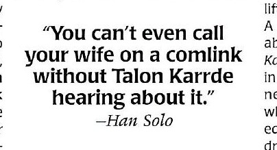

## The New Essential Guide to Weapons and Technology (2004)

> Great shot, kid! That was one in a million!
— Source: The New Essential Guide to Weapons and Technology (W. Haden Blackman, Del Rey, 2004), printed p.75, scan p.101..
Note (our notes, around the quote): "Great shot, kid! That was one in a million!" —Han Solo.
Our notes: `notes/materials/155-new-essential-guide-to-weapons-technology-2004/quotes/QUOTES-INDEX.md`
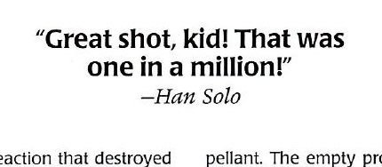

> You don't realize how important a datapad is until you're stranded on Raxus Prime with nothing but your boots and a blaster.
— Source: The New Essential Guide to Weapons and Technology (W. Haden Blackman, Del Rey, 2004), printed p.179, scan p.205..
Note (our notes, around the quote): "You don't realize how important a datapad is until you're stranded on Raxus Prime with nothing but your boots and a blaster." —Han Solo.
Our notes: `notes/materials/155-new-essential-guide-to-weapons-technology-2004/quotes/QUOTES-INDEX.md`
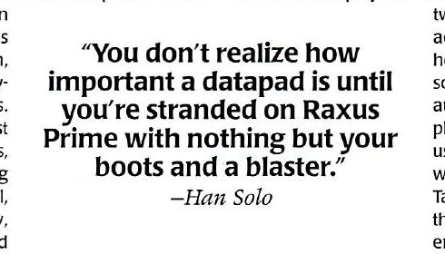

