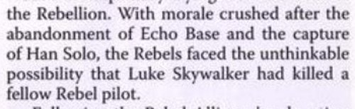
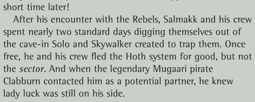

# Han Solo — part 3 of 3

[All parts](README.md) · [Previous](02-legends-njo-5-agents-of-chaos-ii-jedi-eclipse-jame.md) · Last part

# LEGENDS (Legends / EU — main focus)

## The Secret History of Star Wars (Kaminski, 2008) — real-world

> GL: Originally, the story was about an older brother coming to find his younger brother, who's living on a farm, so that together they can rescue their father, an old Jedi. The older brother is a battle-hardened warrior. This character evolved into Han, the other side of Luke and an older brother figure. Ben Kenobi developed from the father figure into a friend of the father.
— Source: typography locked, Kaminski App. B n.2 (Arnold p. 223): “Originally, the story was about an older brother coming to find his younger brother, who’s living on a farm, so that together they can rescue their father, an old Jedi. The older brother is a battle-hardened warrior. This character evolved into Han, the other side of Luke and an older brother figure. Ben Kenobi developed from the father figure into a friend of the father.” Kaminski: “clearly confusing his own drafts” — the father was never imprisoned in draft two; “It is not a lost draft—Lucas simply made a bit of a gaff.” Flag the last sentences as Kaminski; keep the Lucas quote intact. — Kaminski App. B n.2.; Arnold, 1979.
(Excerpt widened 2026-11-17 to the relevant passage, word for word from Once Upon A Galaxy A Journal of the Making of The Empire Strikes Back (Alan Arnold) (text copy `novels_tmp_lucas_bts_arnold_once_upon_a_galaxy_epub_dc813096f5`).)
(Full sentence/passage taken from the source text on file: `novels_tmp_lucas_bts_kaminski_secret_history_pdf`.)
Our notes: `notes/materials/167-secret-history-of-star-wars-2008/kaminski-17-appb.md`

> If there is no evidence at all that suggests Lucas had conceived of the concept before 1978 and if he continually wrote and spoke of them as separate, then, until there is reason to believe there was, we must assume the history I have laid out earlier is correct. Facts seem to suggest that Lucas was entirely ignorant to such a concept until after the film was released. Not only would the concept have to have been off-paper as in not a part of the scripts, but it would also have to be conspicuously absent from all of Lucas’ private notes, which often speculated about such alternate possibilities. For example, Rinzler reports: “Other notes for the second draft contain pieces of scenes and ideas that didn’t make it into the actual script: ‘Jabba in prison cell’; the love relationship between Leia and Luke Starkiller is divided into ‘seven stages/crucial scenes,’ with her being crowned queen at the end; ‘Han Solo a wookie? Wookies talk to plants and animals.’”12 More notes present alternate ideas in previous and future drafts, often suffixed by question marks at the end of them, showing that Lucas was literally pouring his fleeting thoughts out on paper.
— Source: typography locked, Kaminski App. C n.12 (also Ch. V conferences): “Han Solo a wookie? Wookies talk to plants and animals.” Conference background also has Han as an orphan raised by Wookiees, plus a Hemingway trader. — Kaminski App. C n.12; Ch. V.; Second-draft notes. POV: Second-draft notes.
(Excerpt widened 2026-11-17 to the relevant passage, word for word from novels tmp lucas bts kaminski secret history (text copy `novels_tmp_lucas_bts_kaminski_secret_history_pdf_45a5e53edc`).)
(Excerpt widened 2026-11-17 to the relevant passage, word for word from novels tmp lucas bts kaminski secret history (text copy `novels_tmp_lucas_bts_kaminski_secret_history_pdf_45a5e53edc`).)
(Full sentence/passage taken from the source text on file: `novels_tmp_lucas_bts_kaminski_secret_history_pdf`.)
Our notes: `notes/materials/167-secret-history-of-star-wars-2008/kaminski-18-appc.md`; `kaminski-05-ch05.md`

> Lucas laughed and asked what a “wookie” was—“I don’t know, I just made it up,” McGovern replied, and Lucas jotted down the word for future use.2 It was just a neat alien-like word that popped into McGovern’s head and Lucas liked it because it leant an otherworldly quality to the language.3 Later, during the sound mixing for American Graffiti, Walter Murch asked Lucas to grab “R2-D2”—reel two, dialog two—from the shelf. Again, Lucas liked the name and jotted it down for future use, and it ended up on the first page of his notes.4 In fact, The Annotated Screenplays literally says “The names in Star Wars were simply created phonetically.” 5 Lucas Elaborates: “As I was writing, I would say the names to myself and if I had a hard time dealing with a name phonetically, I would change it. It had to do with hearing the name a lot and whether I got used to it or not.” 6 In Rinzler’s Making of book Lucas goes through most of the names and invariable the same answer comes back: phonetic quality.7 On Han Solo: “It could have come from Solo [paper] cups.” On Ben Kenobi: “A combination of a lot of words I put together.” On Leia Organa: “I just picked that name.”
— Source: typography locked, Kaminski App. C: Han’s name “could have come from Solo [paper] cups.” — Kaminski App. C..
(Excerpt widened 2026-11-17 to the relevant passage, word for word from novels tmp lucas bts kaminski secret history (text copy `novels_tmp_lucas_bts_kaminski_secret_history_pdf_45a5e53edc`).)
(Excerpt widened 2026-11-17 to the relevant passage, word for word from novels tmp lucas bts kaminski secret history (text copy `novels_tmp_lucas_bts_kaminski_secret_history_pdf_45a5e53edc`).)
(Full sentence/passage taken from the source text on file: `novels_tmp_lucas_bts_kaminski_secret_history_pdf`.)
Our notes: `notes/materials/167-secret-history-of-star-wars-2008/kaminski-18-appc.md`

> 4 Leia is like Luke in a lot of ways but is confident where he is unsure, active where is awkward. Han too is a closer twin to Luke—both start out as a nobody and become a hero, and one of the least emphasized arcs of the original film is Han’s; he undergoes the exact same hero’s journey as Luke, and it’s no surprise that it is Luke and Han who stand side by side with medals at the conclusion, dressed in similar attire. Costume designer John Mollo tells how this was intentional: “George said, ‘No, I think [Luke] ought to look a bit more like Han [for the medal scene].’ It was a very last minute thing, but we concocted an outfit like Han’s in 521 Appendix G: The Tales of Jonathan Rinzler different colors.” 5 Lucas even states, “Han Solo and Luke are like twin brothers, the spiritual brother and the warrior brother with the devil-may care attitude.” 6 And of course, caught between them is a sort of sister figure if we think of the trio as functioning as a family unit that is a three-fold reflection of Lucas, with Leia bickering with the older brother Han and providing an example of leadership for the awkward younger brother Luke (though she still exists as a sort of outsider from the core Luke-Han duality, which also allows the subdued sexual rivalry for her). The next quote is actually two parts to address.
— Source: typography locked, Kaminski App. G: “Han Solo and Luke are like twin brothers, the spiritual brother and the warrior brother with the devil-may care attitude.” John Mollo: medal-ceremony Luke “ought to look a bit more like Han.” — Kaminski App. G.. POV: George Lucas (Worrell / App. G)..
(Excerpt widened 2026-11-17 to the relevant passage, word for word from novels tmp lucas bts kaminski secret history (text copy `novels_tmp_lucas_bts_kaminski_secret_history_pdf_45a5e53edc`).)
(Excerpt widened 2026-11-17 to the relevant passage, word for word from novels tmp lucas bts kaminski secret history (text copy `novels_tmp_lucas_bts_kaminski_secret_history_pdf_45a5e53edc`).)
(Full sentence/passage taken from the source text on file: `novels_tmp_lucas_bts_kaminski_secret_history_pdf`.)
Our notes: `notes/materials/167-secret-history-of-star-wars-2008/kaminski-22-appg.md`

> The fact that the boy gets the girl—or the girl gets the boy—in the end was a key factor and was as important as Luke overcoming his demons.”
— Source: typography locked, Kaminski Ch. VII, Notes n.557–560. Kasdan (n.557): “I also felt someone had to go. Someone had to die… We should sacrifice somebody.” Ford (n.559): “I thought Han Solo should die. I thought he ought to sacrifice himself for the other two characters… I said ‘he’s got no mama, he’s got no papa, he’s got no future, he has no story responsibilities at this point, so let’s allow him to commit self-sacrifice.’” Lucas (n.560): “It would really have put an unfortunate twist on everything if we had killed off one of the main characters. Luke needed to live, and we needed to have Han and Leia together at the end. The fact that the boy gets the girl—or the girl gets the boy—in the end was a key factor and was as important as Luke overcoming his demons.” Do not collapse this 1981 exchange with Kurtz’s bittersweet Han-death plan (separate entry). — Kaminski Ch. VII, Notes n.557–560.; Ford wanted Han to sacrifice himself; Lucas refused.
(Full sentence/passage taken from the source text on file: `novels_tmp_lucas_bts_kaminski_secret_history_pdf`.)
Our notes: `notes/materials/167-secret-history-of-star-wars-2008/kaminski-07-ch07.md`

> He has shared many fascinating anecdotes and revealed a more candid side of the production of Star Wars. Among his most fascinating and popular revelations however is the supposed “secret history” regarding the Sequel Trilogy and Return of the Jedi. Gary Kurtz, as interviewed by IGN Filmforce in 1999: “At that time [of Empire Strikes Back], [Lucas] always said that he had enough material for three earlier films and three later films, to make a total of nine, and there were outlined materials certainly for a later three that culminated with this big clash with the Emperor in Episode IX. So, we'll never see any of those, based on what he's said now… One of the reasons Jedi came out the way it did was because the story outline of how Jedi was going to be seemed to get tossed out, and one of the reasons I was really unhappy was the fact that all of the carefully constructed story structure of characters and things that we did in Empire was going to carry over into Jedi. The resolution of that film was going to be quite bittersweet, with Han Solo being killed, and the princess having to take over as queen of what remained of her people, leaving everybody else. In effect, Luke was left on his own. None of that happened, of course…
— Source: typography locked, Kaminski App. E: “The resolution of that film was going to be quite bittersweet, with Han Solo being killed, and the princess having to take over as queen of what remained of her people, leaving everybody else. In effect, Luke was left on his own.” Keep Kurtz’s words. Kaminski allows that “some of his comments regarding the original configuration of Return of the Jedi remain valid,” and treats a Ford-refusal backup-death as possible but not conclusive. Do not collapse Kurtz with the 1981 Ford/Lucas exchange, or with Kaminski’s Super-Storyline verdict. — Kaminski App. E.. POV: Kurtz.
(Excerpt widened 2026-11-17 to the relevant passage, word for word from novels tmp lucas bts kaminski secret history (text copy `novels_tmp_lucas_bts_kaminski_secret_history_pdf_45a5e53edc`).)
(Excerpt widened 2026-11-17 to the relevant passage, word for word from novels tmp lucas bts kaminski secret history (text copy `novels_tmp_lucas_bts_kaminski_secret_history_pdf_45a5e53edc`).)
(Full sentence/passage taken from the source text on file: `novels_tmp_lucas_bts_kaminski_secret_history_pdf`.)
Our notes: `notes/materials/167-secret-history-of-star-wars-2008/kaminski-20-appe.md`

- Note (summary from our notes, not a quotation): Black Han Solo / Glynn Turman / the Mifune inquiry
  — Source: typography locked, Kaminski App. B n.9–12. Rinzler p. 69: “Lucas also considered doing the whole film in Japanese with subtitles.” Scaled back to Toshiro Mifune as Obi-Wan, “being particularly interested in Glynn Turman” for Han (App. B n.10, Rinzler p. 124). Crittenden (n.11): “There was talk at one point about having the princess and Ben Kenobi in Japanese, which led George into thinking Han Solo might be black.” Lucas (n.12): “This was actually when I was looking for Ben Kenobi…I was going to use Toshiro Mifune; we even made a preliminary inquiry. If I’d gotten Mifune, I would’ve also used a Japanese princess, and then I would have probably cast a black Han Solo. At the same time, I was investigating Alec Guinness.” — Kaminski App. B n.9–12..
Our notes: `notes/materials/167-secret-history-of-star-wars-2008/kaminski-17-appb.md`

- Note (summary from our notes, not a quotation): A ten-year-old Han Solo on Kashyyyk in the January 31st, 2003 *Sith* rough draft (later cut)
  — Source: typography locked, Kaminski Ch. XIII / App. H: a ten-year-old Han Solo tips Yoda to Grievous’s whereabouts on Kashyyyk in the January 31st, 2003, 55-page rough draft; the character is removed in the April 10th, 2003 first draft. — Kaminski Ch. XIII; App. H..
Our notes: `notes/materials/167-secret-history-of-star-wars-2008/kaminski-13-ch13.md`; `kaminski-23-apph.md`

> We have never actually discussed marriage in this galaxy
> [fragment — full passage not on file]
— Source: typography locked, Kaminski App. D n.14: “In the sequel Luke would be a sixty-year-old Jedi knight. Han Solo and Leia would be together, although Lucas says, ‘They might be married, or not. We have never actually discussed marriage in this galaxy. I don’t even know if it exists yet. Who knows what relationship they will have? I mean, they’re together, let’s put it that way.’” — Kaminski App. D n.14.; 1983.
Our notes: `notes/materials/167-secret-history-of-star-wars-2008/kaminski-19-appd.md`

> The dialog and scene blocking is also loose since Kershner changed and improvised some scenes. The version of this screenplay publically available omits many of the original scene configurations in favour for transcriptions of the revised (and, for at least one scene, reshot) versions as per the final edit of the film. A good example is the carbon freezing of Han Solo, which Alan Arnold’s book details was originally scripted very differently. -Star Wars Episode VI: Revenge of the Jedi First draft February 20th , 1981 This draft, according to Annotated Screenplays, is handwritten.
— Source: typography locked, Kaminski App. H: the public *Empire* shooting script transcribes the final edit; “the carbon freezing of Han Solo… was originally scripted very differently” (Arnold). — Kaminski App. H.; The carbon freezing of Han.
(Excerpt widened 2026-11-17 to the relevant passage, word for word from novels tmp lucas bts kaminski secret history (text copy `novels_tmp_lucas_bts_kaminski_secret_history_pdf_45a5e53edc`).)
(Excerpt widened 2026-11-17 to the relevant passage, word for word from novels tmp lucas bts kaminski secret history (text copy `novels_tmp_lucas_bts_kaminski_secret_history_pdf_45a5e53edc`).)
(Full sentence/passage taken from the source text on file: `novels_tmp_lucas_bts_kaminski_secret_history_pdf`.)
Our notes: `notes/materials/167-secret-history-of-star-wars-2008/kaminski-23-apph.md`

> Again, the inclusion of the producer can be seen more as a formality rather than a creative collaboration. -Star Wars Episode VI: Revenge of the Jedi Second draft September 21st , 1981 This screenplay was written by Kasdan, and is credited as “story by George Lucas, screenplay by Lawrence Kasdan.” Notable changes include the elimination of Had Abbadon, the return of Vader to a more villainous role and the instatement of Dagobah -Star Wars Episode VI: Return of the Jedi Revised Second draft November 1st , 1981 This version credits the screenplay to both Lucas and Kasdan. The Annotated Screenplays describes it as having handwritten notes with it, which resulted in another “Revised second draft” bearing the date of November 11th – with these drafts being titled Return of the Jedi. -Star Wars Episode VI: Return of the Jedi Third draft December 1st , 1981 Credited to Kasdan and Lucas once again. -Notes, December 15th , 1981. Dubbed the “wookie doodle pad,” these were miscellaneous handwritten notes made by Lawrence Kasdan, apparently with regards to Han Solo. -The Annotated Screenplays also lists “Lucas revisions dated January 4th , 1982.” Shooting occurred shortly thereafter. -Prequel expansion notes and outlines, circa 1993 Approximately around this time Lucas began the process of slowly developing elaborate notes on the detailed world and story he would build for the prequels, supplementing the many original notes he had accumulated by the completion of Return of the Jedi ten years earlier. By the next year they are collected in a red binder and organized by subject, such as Jedi, Empire and Outline.
— Source: typography locked, Kaminski App. H: Kasdan notes, December 15th, 1981, “wookie doodle pad,” “apparently with regards to Han Solo.” — Kaminski App. H.; Kasdan, December 15th, 1981: “wookie doodle pad,”.
(Excerpt widened 2026-11-17 to the relevant passage, word for word from novels tmp lucas bts kaminski secret history (text copy `novels_tmp_lucas_bts_kaminski_secret_history_pdf_45a5e53edc`).)
(Excerpt widened 2026-11-17 to the relevant passage, word for word from novels tmp lucas bts kaminski secret history (text copy `novels_tmp_lucas_bts_kaminski_secret_history_pdf_45a5e53edc`).)
(Full sentence/passage taken from the source text on file: `novels_tmp_lucas_bts_kaminski_secret_history_pdf`.)
Our notes: `notes/materials/167-secret-history-of-star-wars-2008/kaminski-23-apph.md`

## Young Jedi Knights 1: *Heirs of the Force* (Kevin J. Anderson & Rebecca Moesta, Boulevard 1995): FULL consecutive read (2026-11-19 CST)

What it shows (our notes): Han understands Lowbacca's Shyriiwook over the comm well enough to get the story.
> “Quiet, old buddy. I heard most of that, but a few of the details were sketchy. Something about a crashed TIE fighter and an Imperial soldier taking them hostage?”
— Source: Young Jedi Knights 1: Heirs of the Force (Kevin J. Anderson & Rebecca Moesta, 1995), ch. 17 (p.175).
(Full sentence/passage taken from the source text on file: `YJK01 Heirs of the Force epub`, checked against the 1995 print scan; OCR slips corrected to the printed text.)
Our notes: `notes/materials/173-yjk-01-heirs-of-the-force/hotf-03.md:96`

What it shows (our notes): Han fires two warning shots that bracket the TIE.
> Han fired two warning shots. Bolts of brilliant light streaked past the squarish planar wings of the Imperial craft—bracketing it, but doing no damage.
— Source: Young Jedi Knights 1: Heirs of the Force (Kevin J. Anderson & Rebecca Moesta, 1995), ch. 21 (p.203).
(Full sentence/passage taken from the source text on file: `YJK01 Heirs of the Force epub`, checked against the 1995 print scan; OCR slips corrected to the printed text.)
Our notes: `notes/materials/173-yjk-01-heirs-of-the-force/hotf-04.md:70`

### Limitations and anti-feats (Heirs of the Force)

What it shows (our notes): LIMITATION / ANTI-FEAT — Han cannot get a target lock on Qorl's TIE, and his repeated shots miss.
> “I can’t get a target lock,” Han said.
>
> The TIE fighter zoomed above the green jewel of the jungle moon.
>
> Arching around in a tight orbit, the Falcon clung to it, following closely. Han fired repeatedly with his laser cannons—but the scarlet bolts missed.
— Source: Young Jedi Knights 1: Heirs of the Force (Kevin J. Anderson & Rebecca Moesta, 1995), ch. 21 (p.207).
(Full sentence/passage taken from the source text on file: `YJK01 Heirs of the Force epub`, checked against the 1995 print scan; OCR slips corrected to the printed text.)
Our notes: `notes/materials/173-yjk-01-heirs-of-the-force/hotf-04.md:63`

What it shows (our notes): LIMITATION / ANTI-FEAT — Qorl jumps to lightspeed as Han fires.
> “It’s not my fault,” Han Solo said, gaping at the vanished target.
— Source: Young Jedi Knights 1: Heirs of the Force (Kevin J. Anderson & Rebecca Moesta, 1995), ch. 21 (p.207).
(Full sentence/passage taken from the source text on file: `YJK01 Heirs of the Force epub`, checked against the 1995 print scan; OCR slips corrected to the printed text.)
Our notes: `notes/materials/173-yjk-01-heirs-of-the-force/hotf-04.md:65`

# CANON (Disney canon — kept separate)

## The Complete Star Wars Encyclopedia, Vol. II (H–O)

> With morale crushed after the abandonment of Echo Base and the capture of Han Solo, the Rebels faced the unthinkable possibility that Luke Skywalker had killed a fellow Rebel pilot.
— Source: scan pages 241–280; Han Solo; Luke Skywalker.
Note (our notes, around the quote): Han Solo; Luke Skywalker: "With morale crushed after the abandonment of Echo Base and the capture of Han Solo, the Rebels faced the unthinkable possibility that Luke Skywalker had killed a fellow Rebel pilot." Source: The Complete Star Wars Encyclopedia, Vol. II, p.265

Our notes: `notes/materials/031-complete-star-wars-encyclopedia-vol-2/06-v2-scan-241-280.md:274`

## Adventures/Rough And Tundra.pdf [Star Wars Roleplaying Game Revised Core (d20, 2002)]

> Given the number of CorSec, Imperial, CSA, and private agents looking for Salmakk, Hoth was a good place to lay low. All the while, Salmakk kept abreast of galactic events. He learned of the price Jabba had put on Solo’s head, the destruction of Alderaan, and of the Rebel victory and Yavin. Imagine his surprise when Solo himself appeared on Hoth a short time later! After his encounter with the Rebels, Salmakk and his crew spent nearly two standard days digging themselves out of the cave-in Solo and Skywalker created to trap them. Once free, he and his crew fled the Hoth system for good, but not the sector. And when the legendary Mugaari pirate Clabburn contacted him as a potential partner, he knew lady luck was still on his side. Salmakk: Male Mon Calamari Scoundrel 8/Soldier 4; Init +6; Defense 22 (+10 class, +2 Dex); Spd 10 m; VP/WP 77/11; Atk +11/+6 melee (2d6+1, vibroblade), +12/+7 ranged (3d8, heavy blaster pistol); SQ amphibious, illicit barter, low-light vision, lucky 2/day, natural astrogator, precise attack +1, sector familiarity x2, uncanny dodge; SV Fort +7, Ref +9, Will +2; FP 0; DSP 2; Rep +6; Str 12, Dex 15, Con 8, Int 14, Wis 10, Cha 10. Challenge Code F. Equipment: Vibroblade, heavy blaster pistol, freighter (Salted Wound).
— Source: Adventures/Rough And Tundra.pdf [Star Wars Roleplaying Game Revised Core.
(Excerpt widened 2026-11-17 to the relevant passage, word for word from research primary sw d20 folder files Star Wars Roleplaying Game Revised Core Adventures Rough And Tundra (text copy `research_primary_sw_d20_folder_files_Star_Wars_Roleplaying_Game_Revised_Core_Adventures_Rough_And_Tundra_pdf_0c241f9999`).)
(Excerpt widened 2026-11-17 to the relevant passage, word for word from research primary sw d20 folder files Star Wars Roleplaying Game Revised Core Adventures Rough And Tundra (text copy `research_primary_sw_d20_folder_files_Star_Wars_Roleplaying_Game_Revised_Core_Adventures_Rough_And_Tundra_pdf_0c241f9999`).)
Note (our notes, around the quote): Han Solo; Luke Skywalker — entry/section: Solo and Skywalker trap Salmakk's pirates on Hoth: "After his encounter with the Rebels, Salmakk and his crew spent nearly two standard days digging themselves out of the cave-in Solo and Skywalker created to trap them. Once free, he and his crew fled the Hoth system for good, but not the sector. And when the legendary Mugaari pirate Clabburn contacted him as a potential partner, he knew lady luck was still on his side." Source: *Rough And Tundra* (SWRPG d20 Revised Core), scan p.4

Our notes: `notes/materials/037-sw-d20-folder/075-rough-and-tundra.md:27`

## Star Wars Insider #137 (2012)

- Note (summary from our notes, not a quotation): Page contents: Next issue: Harrison Ford on Han Solo; Timothy Zahn's Scoundrels plus a short story; Celebration VI; TCW Season Five's first half. On sale December 11 (US). (hand-read)
  — Source: Star Wars Insider #137 (2012).
Our notes: `notes/materials/038-star-wars-insider/137-ins137.md:450`

## Star Wars Handbook 3: Dark Empire (Dark Horse, 1998) + Star Wars Insider #157–159 "The Making of Dark Empire" (Titan, 2015)

- Note (summary from our notes, not a quotation): Covers (the compilation has p. 001 plus alt and alt2): the newsstand "We're Home!" Han and Chewie cover (Countdown to TFA; "Make Mine Star Wars"; Lando); a subscriber Chewbacca cover; and a Han Solo cover ("Star Wars Origins … Journal of the Whills"; Celebration aftermath; Rebels season two). These are official variant covers, not fan-made.
  — Source: Star Wars Insider #157–159 (Titan, 2015): "Of Rebel Dreams and Dark Empires: The Making of a Star Wars Legend" by Michael Kogge, parts 1–3.
Our notes: `notes/materials/046-dark-empire-handbook-3/insider-making-of-01.md:21`

## Star Wars: The Ultimate Visual Guide (Ryder Windham, DK 2005)

> traveling at sublight speed
> [fragment — full passage not on file]
>
> proves that a blaster is no match against the dark side of the Force.
> [fragment — full passage not on file]
>
> decides to test it on Han Solo to see if a human can survive the freezing process.
> [fragment — full passage not on file]
>
> avoids being frozen and impresses Vader with his fighting prowess.
> [fragment — full passage not on file]
>
> 'No, Luke. I am your father.' Vader believes Skywalker can destroy the Emperor, and invites Luke to join him so that they can overthrow Palpatine and rule the galaxy as father and son.
>
> When C-3PO's shattered parts are presented to Darth Vader, he instantly recognizes the droid he built as a child. He orders the parts to be destroyed, but after capturing the Rebels, he learns that the droid's pieces have been recovered by Solo's copilot. The Dark Lord uncharacteristically rescinds his previous order, and has C-3PO's remains delivered to the Wookiee's cell.
>
> Luke tells no one of Vader's claim.
— Source: Star Wars: The Ultimate Visual Guide (DK, 2005): The Civil War and A New Era (pp. 72–111), hand-read notes.
Note (our notes, around the quote): p94-95 Betrayal in the Clouds (3 ABY): Lando "Baron Administrator"; Falcon "traveling at sublight speed". Unexpected meeting: Vader "proves that a blaster is no match against the dark side of the Force." FREEZING SOLO: Vader "decides to test it on Han Solo to see if a human can survive the freezing process." Duel on Cloud City: Luke "avoids being frozen and impresses Vader with his fighting prowess." NIGHTMARISH REVELATION: "'No, Luke. I am your father.' Vader believes Skywalker can destroy the Emperor, and invites Luke to join him so that they can overthrow Palpatine and rule the galaxy as father and son." THANK THE MAKER? [KEY]: "When C-3PO's shattered parts are presented to Darth Vader, he instantly recognizes the droid he built as a child. He orders the parts to be destroyed, but after capturing the Rebels, he learns that the droid's pieces have been recovered by Solo's copilot. The Dark Lord uncharacteristically rescinds his previous order, and has C-3PO's remains delivered to the Wookiee's cell." Uncertain future: "Luke tells no one of Vader's claim."
Our notes: `notes/materials/048-ultimate-visual-guide/uvg-03-civil-war-new-era.md:17`

# Debate and forum claims (unverified)

Forum posts, Suspect Insight debates and Discord debates, respect threads, and verdicts. These are posters' arguments or quotations they typed; none is checked against the book here unless the entry says so.

## https://starwars.fandom.com/wiki/Luke_Skywalker/Legends

> According to Han Solo, his first impression of Skywalker was a naïve kid who needed to be taught a thing or two.[201]
> [fragment — full passage not on file]
— Source: Star Wars Journal: Hero for Hire [per Wookieepedia "Luke Skywalker/Legends" rev 15689902, ref 201; exact text match; agrees with the entry's own ref marker]; per Wookieepedia "Luke Skywalker/Legends" rev 15689902, ref 201; exact text match; agrees with the entry's own ref marker — Source: https://starwars.fandom.com/wiki/Luke_Skywalker/Legends — https://starwars.fandom.com/wiki/Luke_Skywalker/Legends.
Posted by: not named in our notes (see thread/notes link).
(Source: Star Wars Journal: Hero for Hire [per Wookieepedia "Luke Skywalker/Legends" rev 15689902, ref 201; exact text match; agrees with the entry's own ref marker])
Our notes: `external/mega-notes/luke-legends-quotes.txt:133`

## https://comicvine.gamespot.com/forums/star-wars-universe-1943200/darth-sidioussheev-palpatine-super-respect-thread-1877280/

- Note (summary from our notes, not a quotation): [265] Type: feat
  — Source: Darth Sidious/Sheev Palpatine Super Respect Thread — cited-quote extraction — https://comicvine.gamespot.com/forums/star-wars-universe-1943200/darth-sidioussheev-palpatine-super-respect-thread-1877280/; Source named in post: The Official Star Wars Fact File #120.
Posted by: not named in our notes (see thread/notes link).
(Section context: Threat to the Force itself)
(Quote/source-associated text (verbatim):)
(His body mortally wounded by Han Solo, Palpatine tracked down the Solos and desperately sought to transfer his fading essence to the infant Anakin Solo. He was blocked and absorbed by the dying Jedi, Brand, who promised that he and all the other Jedi spirits would ensure the dark sider never returned—a fate Palpatine had feared above all others. The Emperor's reign was over for good.)
(Scaling stated in quote (verbatim):)
(None stated explicitly in this quote block.)
Our notes: `external/mega-notes/sidious-comicvine-respect.txt:2566`; `suspect-insight/respect-threads/darth-sidious--palpatine-emperor-legends.md:1359`

- Note (summary from our notes, not a quotation): [499] Type: feat
  — Source: Darth Sidious/Sheev Palpatine Super Respect Thread — cited-quote extraction — https://comicvine.gamespot.com/forums/star-wars-universe-1943200/darth-sidioussheev-palpatine-super-respect-thread-1877280/; Source named in post: Heir to the Empire sourcebook.
Posted by: not named in our notes (see thread/notes link).
(Section context: Feats)
(Quote/source-associated text (verbatim):)
(With the Emperor dead, the central, powerful evil that had been the cohesive force of the Empire was gone. With the Dark Side diffused and undirected, the Imperials were left with nothing but confusion, desperation, and damp fear. The sudden loss of coordination and fighting spirit allowed Han Solo, Princess Leia and the Rebel Commandos to disable the shield generator.)
(Scaling stated in quote (verbatim):)
(None stated explicitly in this quote block.)
Our notes: `external/mega-notes/sidious-comicvine-respect.txt:5508`; `suspect-insight/respect-threads/darth-sidious--palpatine-emperor-legends.md:3026`

## https://comicvine.gamespot.com/profile/[member]/blog/darth-vader-respect-thread-part-2/102636/

- Note (summary from our notes, not a quotation): [5] Section: Tutaminis/Force Deflection | Type: feat (video, poster's text only)
  — Source: VADER RESPECT THREAD (PART 2) - CITED EXTRACTION — https://comicvine.gamespot.com/profile/[member]/blog/darth-vader-respect-thread-part-2/102636/.
Posted by: not named in our notes (see thread/notes link).
(Text: "He casually absorbs several blaster bolts and proceeds to pull Han Solo's blaster from the latter's hand")
(Video: https://youtu.be/uHH6YVHGh90 (no timestamp given))
(Source named: none (video only) | Label: unclear)
(Scaling: None stated.)
Our notes: `external/mega-notes/vader-comicvine-respect-part2.txt:38`

## Darth Angral (Darth Plagueis the Wise) vs K’Kruhk (AaylaSecuraFan)

> "The son of Han Solo and Leia Organa Solo, Jacen is strong in the Force like his mother and his uncle, Luke Skywalker."
— Source: Darth Angral (Darth Plagueis the Wise) vs K’Kruhk (AaylaSecuraFan) — https://www.suspectinsightforums.com/t4395-stomper-showdown-r4-2-darth-angral-darth-plagueis-the-wise-vs-k-kruhk-aaylasecurafan.
Context: Q4 — Source: Star Wars Encyclopedia | <<QUOTE A Guide to the Star Wars Galaxy 3rd Edition wrote:>>
Posted by: not named in our notes (see thread/notes link).
Our notes: `suspect-insight/debates/028-darth-angral-vs-k-kruhk.md:133`

## Darth Traya (MasterCilghal) vs Jaina Solo (Xolthol)

> I almost expected the things to detonate when Dad opened the package. Since when did Boba Fett ever send my father gifts?
>
> Since his daughter was tortured to death by my brother, actually. We’ve been waiting for Fett’s revenge ever since, but so far … nothing. Just the gift of crushgaunts and armor plate, all made from Mandalorian iron.
>
> So I’m packing for a journey I didn’t think I’d ever make. I’ll give Jag this much: he never said I told you so.
>
> So I’m packing for a journey I didn’t think I’d ever make. I’ll give Jag this much: he never said I told you so. He’s the one who said I needed to learn from someone who had a track record in bringing down Jedi.
>
> If anyone can stop Jacen, then, it’s me. I’m his equal, and I’m the Sword of the Jedi.
>
> If anyone can stop Jacen, then, it's me. I'm his equal, and I'm the Sword of the Jedi. But I just don't have his... training. I've no idea what he learned from Lumiya, let alone what he picked up on his travels during those five years. But he'll make a mistake sooner or later. He's way too cocky not to overestimate himself.
>
> I’m his equal, and I’m the Sword of the Jedi. But I just don’t have his … training. I’ve no idea what he learned from Lumiya, let alone what he picked up on his travels during those five years. But he’ll make a mistake sooner or later. He’s way too cocky not to overestimate himself.
>
> I just hope it’s sooner. And if being a Sith made Jacen invincible, he’d have taken over the galaxy by now.
>
> I have a chance, and Fett’s going to help me make the most of it.
>
> It can’t be that hard to find him.
>
> It can't be that hard to find him. He's a bounty hunter, so I'll hire him like any other client, except I'm not just any other client - I'm Han Solo's daughter, and I'm a Jedi, and Fett has spent a lifetime hunting us.
>
> It can’t be that hard to find him. He’s a bounty hunter, so I’ll hire him like any other client, except I’m not just any other client—I’m Han Solo’s daughter, and I’m a Jedi, and Fett has spent a lifetime hunting us.
>
> And now I’m asking him to train me to hunt and capture my own brother.
>
> For all I know, he’ll laugh in my face—if he ever laughs, that is—and tell me to get lost. But I have to ask him.
>
> For all I know, he’ll laugh in my face—if he ever laughs, that is—and tell me to get lost. But I have to ask him. Swallow pride, eat humble pie, and beg if need be. Dad seems to have thawed a little toward him; I still despise him.
>
> But if he says yes—I swear I’ll be the best pupil he’s ever had. Come on, Fett: show me how it’s done. chapter one When the nation is in its darkest peril, the great warrior-sailor Darakaer shall be summoned from his eternal sleep by a rhythm beaten on his ancient drum. For his final pledge was that he would come to our aid when the drum sounded, and that we should call him when we sailed to meet the foe.
— Source: Darth Traya (MasterCilghal) vs Jaina Solo (Xolthol) — https://www.suspectinsightforums.com/t110-ss-darth-traya-mastercilghal-vs-jaina-solo-xolthol.
(Excerpt widened 2026-11-17 to the relevant passage, word for word from Revelation (Karen Traviss) (text copy `MEGA_Legend_The_Legacy_of_the_Force_Series_Star_Wars_Legacy_of_the_Force_08_Revelation_Karen_Traviss_epub`).)
(Excerpt widened 2026-11-17 to the relevant passage, word for word from Revelation (Karen Traviss) (text copy `MEGA_Legend_The_Legacy_of_the_Force_Series_Star_Wars_Legacy_of_the_Force_08_Revelation_Karen_Traviss_epub`).)
Context: Q85 — Source: [source not stated adjacent]
Posted by: not named in our notes (see thread/notes link).
Our notes: `suspect-insight/debates/055-darth-traya-vs-jaina-solo.md:606`

## Boba Fett Respect Thread - Gen. Discussion - Comic Vine — respect-thread notes

> She could barely believe what she had just heard. Overheard, actually -- Neelah had tapped into the Hound's Tooth's internal communications system through an access panel in the main personnel quarters aboard ship. The cramped space was furnished in Trandoshan taste, all dark tapestries over the bulkheads and a jumble of thinly padded sleeping pallets. The tapestries were fastened down at their corners, to keep them from drifting and tangling in case the ship's artificial gravity failed; they depicted various great moments in Trandoshan history and legend, all of them violent. Even while she had been fiddling with the comm equipment, with the specific intent of eavesdropping on Dengar and Boba Fett, she had been thanking fate that the Hound's original pilot wasn't still aboard.
>
> Her gratitude faded a bit when she finally managed to listen in on the conversation up in the cockpit area. She was dismayed at the manner in which Boba Fett walked all over Dengar, for no more reason than a simple inquiry as to where they were all heading. He's one, Neelah thought disgustedly, that's not going to be much use to me. If things came down to a split between herself and Boba Fett -- and she could already see how that was becoming increasingly likely -- then having the other bounty hunter Dengar on her side wouldn't make much difference. Fett could eliminate them both, without any inconvenience at all.
— Source: SI respect-thread directory: Boba Fett Respect Thread - Gen. Discussion - Comic Vine — https://comicvine.gamespot.com/forums/gen-discussion-1/boba-fett-respect-thread-1581984/.
Context: After Dengar partners up with Boba, it's made abundantly clear that Boba is the dominant party in the arrangement. Throughout The Mandalorian Armor, Dengar makes clear his apprehension and fear for partnering with Boba, believing his own life to be at stake because of how dangerous he is. In Slave Ship, when Dengar chooses to challenge Boba's authority, he is quickly put in his place, as you'll see in the Quotes section below the thread itself. To quickly sum up, here is an excerpt from Neelah's point of view, after she eavesdropped on Dengar and Boba's discussion, all but confirming that Boba could kill both her and Dengar without any issue - an incredible status to have, considering Dengar is a cybernetically augmented master assassin, and one of the best hunters in the galaxy, among the few chosen by Darth Vader to hunt Han Solo.
Posted by: not named in our notes (see thread/notes link).
Our notes: `suspect-insight/respect-threads/boba-fett.md:388`

What it shows (our notes): Under the influence of a drug that forces one to obey the orders of another against their will, Boba disarmed himself for Han Solo and Lando Calrissian. It took him several minutes...
> "Disarm yourself. Now."
> [fragment — full passage not on file]
>
> Minutes later Han and Lando regarded a largish pile of assorted weaponry of all different kinds that lay before them on the sunlit permacrete. “Minions of Xendor,” Han said, shaking his head, “this guy could have set up shop with just what he had on him. Lookit those Mandalorian wristlets. Bet the darts are poisoned, too.”
— Source: SI respect-thread directory: Boba Fett Respect Thread - Gen. Discussion - Comic Vine — https://comicvine.gamespot.com/forums/gen-discussion-1/boba-fett-respect-thread-1581984/.
(Excerpt widened 2026-11-17 to the relevant passage, word for word from The Hutt Gambit (A.C. Crispin) (text copy `MEGA_Legend_The_Han_Solo_Trilogy_Star_Wars_Han_Solo_02_The_Hutt_Gambit_A_C_Crispin_epub`).)
Posted by: not named in our notes (see thread/notes link).
Our notes: `suspect-insight/respect-threads/boba-fett.md:473`

## Bossk Respect Thread — respect-thread notes

> The young Boba Fett receives tips on the bounty hunting trade from (left to right) Bossk, Castas, and Aurra Sing, among others.
>
> After the Battle of Hoth, Darth Vader assembles a group of top bounty hunters to find Han Solo's Millennium Falcon.
>
> The Dark Lord hires only the best bounty hunters to track the Millennium Falcon and it's passengers.
>
> Boba joins Bossk, Aurra Sing, and others to learn the tricks of the bounty hunting trade.
— Source: SI respect-thread directory: Bossk Respect Thread — https://comicvine.gamespot.com/profile/i_like_swords/blog/bossk-respect-thread/118110/.
Context: ―Ultimate Star Wars
Posted by: not named in our notes (see thread/notes link).
Our notes: `suspect-insight/respect-threads/bossk.md:75`

> "I've had much more experience with Bossk than you have." Boba Fett's voice remained level and unperturbed." He and I go back a long way. And believe me, I'm not concerned about any retribution at his hands."
>
> "Fine for you," grumbled Dengar. "Maybe you can take care of him. I'm just worried about what happens when he comes after me. That guy isn't exactly known for being able to forgive and forget. He wakes up ready to bite other creatures' heads off."
>
> I bet, thought Dengar. He leaned against the side of the hatchway, watching Boba Fett make some final navigation adjustments. He'd had his own encounters with Trandoshans, including the former owner of this ship, and they had all been unpleasant. Bossk had had a reputation for a hot temper even back in the days of the old Bounty Hunters Guild, when he'd had presumably less to gripe about. Cross him, and you were likely to get your head unscrewed from your shoulders like the lid of an emergency rations canister. That was what those claws were suitable for, not highspeed, pinpoint starhopping.
— Source: SI respect-thread directory: Bossk Respect Thread — https://comicvine.gamespot.com/profile/i_like_swords/blog/bossk-respect-thread/118110/.
Context: Dengar, one of the most skilled bounty hunters in the galaxy, a former Imperial assassin who was chosen by Vader himself to track down Han Solo among the other great bounty hunters of the day, finds himself in worry of the prospect of Bossk ever coming after him.
Posted by: not named in our notes (see thread/notes link).
Our notes: `suspect-insight/respect-threads/bossk.md:113`

> After personally witnessing the elusiveness of his prey, Lord Vader decided to call in some experts: bounty hunters. This was done partly to accomplish the task of finding the Falcon, and partly to demonstrate the his disappointment with the skills of his Imperial crew.
>
> Vader contacted Boba Fett and other hunters, offering a rich bounty to whoever could capture Solo. The response was staggering. Bounty hunters, mercenaries, assassin droids, and blasters-for-hire the galaxy over responded. From the horde of applicants, Vader’s personal staff selected a small number of the specialists particularly suited for the job. Some of the hunters were hired simply because of their reputations, while others had had personal run-ins with Solo in the past and had a grudge to settle.
>
> Vader dispatched the hunters out, but not as a team. The deadliest beings in the galaxy also happened to carry with them the largest egos, and Vader knew this precluded co-operation.
— Source: SI respect-thread directory: Bossk Respect Thread — https://comicvine.gamespot.com/profile/i_like_swords/blog/bossk-respect-thread/118110/.
Context: Bossk was among the company of bounty hunters summoned by Darth Vader to hunt down Han Solo. Vader did this to demonstrate how disappointed he was with his own Imperial resources. Despite the staggering response to Vader's offer for the contract, coming from bounty hunters, mercenaries, assassin droids and more from all over the galaxy, Bossk was among the six chosen, regarded as the best bounty hunters in all the galaxy as a result.
Posted by: not named in our notes (see thread/notes link).
Our notes: `suspect-insight/respect-threads/bossk.md:165`; `suspect-insight/respect-threads/boba-fett.md:412`

## Dengar(Legends) respect thread — respect-thread notes

What it shows (our notes): Kritkeen's struggle is futile in Dengar's grasp due to his enhanced strength.
> “But what can I do?” Kritkeen asked, and he moved to his desk beside the window. Dengar had his cybernetic eyes set at 64X magnification, and he could see Kritkeen clearly. The man was tall, with a lean build and thick brown hair. He was perhaps a bit stockier than Han Solo, and he had a hatchet nose, but he looked enough like Solo. “I, like you, have others above me that I must serve,” Kritkeen said reasonably. “I would love to save your daughter from the processors, but even if I could rescue her, who would I send in her place? No, her number was chosen. She must be processed.”
>
> - Taken from Payback: The Tale of Dengar
> [fragment — full passage not on file]
— Source: SI respect-thread directory: Dengar(Legends) respect thread — https://www.suspectinsightforums.com/t1746-dengarlegends-respect-thread.
(Excerpt widened 2026-11-17 to the relevant passage, word for word from Tales of the Bounty Hunters (Kevin Anderson) (text copy `MEGA_Legend_The_Tales_from_Series_Star_Wars_Tales_of_the_Bounty_Hunters_Kevin_J_Anderson_epub`).)
Posted by: not named in our notes (see thread/notes link).
Our notes: `suspect-insight/respect-threads/dengar.md:72`

## Gallandro(Legends) respect thread — respect-thread notes

- Note (summary from our notes, not a quotation): Alright well now we're gonna be looking at quite an interesting character. This is the Gunslinger who was the fastest draw in the galaxy before Han Solo! So let's get into this guy and see what he's capable of!
  — Source: SI respect-thread directory: Gallandro(Legends) respect thread — https://www.suspectinsightforums.com/t1721-gallandrolegends-respect-thread.
Posted by: not named in our notes (see thread/notes link).
Our notes: `suspect-insight/respect-threads/gallandro.md:13`

> In his teen years he enlisted in the planetary militia. His service record was exemplary. As he volunteered for increasingly hazardous duty, he became a hero to some.
>
> - Taken from Han Solo and the Corporate Sector Authority
> [fragment — full passage not on file]
— Source: SI respect-thread directory: Gallandro(Legends) respect thread — https://www.suspectinsightforums.com/t1721-gallandrolegends-respect-thread.
Context: (quoted passage)
Posted by: not named in our notes (see thread/notes link).
Our notes: `suspect-insight/respect-threads/gallandro.md:21`

> Once his unit attacked a hospital, Gallandro led the assault. While exploring the wreckage he heard a gun charge up. He'd always been fast, but this time his draw was blindingly quick. An old woman, guarding undernourished brats, fell dead.
>
> - Taken from Han Solo and the Corporate Sector Authority
> [fragment — full passage not on file]
— Source: SI respect-thread directory: Gallandro(Legends) respect thread — https://www.suspectinsightforums.com/t1721-gallandrolegends-respect-thread.
Context: As a teen he joined the Ylix militia in fighting against terrorists and revolutionaries which had been something common and longstanding due to an ancient feud that no one remember what it was about.
Posted by: not named in our notes (see thread/notes link).
Our notes: `suspect-insight/respect-threads/gallandro.md:25`

> For years he drifted from one hot spot to another; for awhile he had a death mark on over a hundred worlds. He was a mercenary, a bodyguard and finally a bounty hunter. Along the way he made many enemies, none of them lasted long.
>
> - Taken from Han Solo and the Corporate Sector Authority
> [fragment — full passage not on file]
— Source: SI respect-thread directory: Gallandro(Legends) respect thread — https://www.suspectinsightforums.com/t1721-gallandrolegends-respect-thread.
Context: He was fast already, but he only got better now with a blinding quick draw.
Posted by: not named in our notes (see thread/notes link).
Our notes: `suspect-insight/respect-threads/gallandro.md:29`

> One funny thing was some idiot claiming to be a member of the Assassin's Guild, a Makite poisoner yet. She claimed she had a contract and he'd ruined it all. Gallandro told her to get to the point. She muttered something about payback. "Are you threatening me?"he asked. She never got to finish, that started his feud with the Guild.
>
> They were a select breed in most folks' eyes, overstuffed clowns to him. Poisoners, snipers, bomb throwers-cowards the lot of them, over the next 10 years they tried just about everything but tossing poisonous insects at him. He walked away from it all.
>
> Finally with half of their Inner Circle depleted they offered him a position by a way of apology.
>
> - Taken from Han Solo and the Corporate Sector Authority
> [fragment — full passage not on file]
— Source: SI respect-thread directory: Gallandro(Legends) respect thread — https://www.suspectinsightforums.com/t1721-gallandrolegends-respect-thread.
Context: Let's put this into perspective for a moment folks, 100 worlds is a lot...the galaxy is an even bigger place, you'd have mercenaries, bounty hunters, assassins each of which would have a degree of skill if they wanted to survive in such a big galaxy, yet none of them took down Gallandro.
Posted by: not named in our notes (see thread/notes link).
Our notes: `suspect-insight/respect-threads/gallandro.md:35`

> "I don't mean to come down on the speed draw. It's just for all the times I've pulled, aimed and fired under a second, most were against the wrong targets or useless. To me the real test is the look before the guns come out.
>
> "There were two times when I felt everything working together-my arm, shoulder, fingers, the whole deal. The first time I was up against...yeah he musta been the fastest gunman alive. Gallandro had me dead to rights, I was just thinking how impressed he would be when I got the blaster aimed at him....when I smelled something burning. It was me.
> [fragment — full passage not on file]
>
> - Han Solo, Taken from Han Solo and the Corporate Sector Authority.
> [fragment — full passage not on file]
— Source: SI respect-thread directory: Gallandro(Legends) respect thread — https://www.suspectinsightforums.com/t1721-gallandrolegends-respect-thread. POV: Han Solo.
Context: So let that sink in for a minute folks....a galaxy wide Assassin organization with professionals who specialize in killing...had half their Inner Circle killed by this 1 man and then apologized to him by offering a position.
Posted by: not named in our notes (see thread/notes link).
Our notes: `suspect-insight/respect-threads/gallandro.md:47`

- Note (summary from our notes, not a quotation): So Han Solo the guy known for his quickdraw, noted Gallandro as being the fastest gunman alive, when everything was working together, Han's arm, shoulder fingers, it still wasn't enough to beat Gallandro.
  — Source: SI respect-thread directory: Gallandro(Legends) respect thread — https://www.suspectinsightforums.com/t1721-gallandrolegends-respect-thread.
Posted by: not named in our notes (see thread/notes link).
Our notes: `suspect-insight/respect-threads/gallandro.md:52`

> "Gallandro? Slick, you're talking about the guy who single-handedly hijacked the Quamar Messenger on her maiden run and took over that pirate's nest, Geedon V, all by himself. And he went to the gun against the Malorm family, drawing head bounty on all five of them. And no one has ever beaten the score he rolled up when he was flying a fighter with Marso's Demons. Besides which, he's the only man who ever forced the Assassins' Guild to default on a contract; he personally canceled half of their Elite Circle-one at a time-plus assorted journeymen and apprentices."
>
> "I know, I know," Han said wearily, sitting down.
>
> - Taken from Han Solo and the Lost Legacy
> [fragment — full passage not on file]
— Source: SI respect-thread directory: Gallandro(Legends) respect thread — https://www.suspectinsightforums.com/t1721-gallandrolegends-respect-thread.
Context: Gallandro makes 4 dead hits on holotargets, spun his blaster twice and then placing it in its holster before the people in the room could even register what he had just did. Also noted as being far and away the most dangerous gunman Han had ever seen, faster than him too.
Posted by: not named in our notes (see thread/notes link).
Our notes: `suspect-insight/respect-threads/gallandro.md:72`

What it shows (our notes): Again just a saying of his exploits, including taking a pirate's nest by himself and no one beating his score in a fighter when he flew with the Marso's Demons.
> "Gallandro! " The gunman gave him a bare, stark smile that held nothing Han could read. Han drew without thinking, then remembered his blaster was empty. Just then a robot appeared behind Gallandro, closing in on him, arms wide. Han never made a conscious decision, but pointed and shouted a warning.
>
> The gunman was too far away to have heard, but he saw Han's expression and understood. He spun and ducked instinctively. The robot just missed with a blow of enormous power. With an incredible display of agility and reflexes, Gallandro seized the arm and rode the robot's recoverybackswing, at the same time putting two quick shots into its head. Letting go, he was flung clear to land lightly and put a last bolt into the robot as it fell.
>
> Han watched the incident with awe. By far the most dangerous machine there was Gallandro. The gunman gave Han a sardonic bow and a mocking grin, then, like a ghost, was gone again in the swirl of battle.
>
> The air was hot with the unleashed energies of the battle. With Skynx’s and Badure’s help, Chewbacca had squirmed free of the fallen robot, while Hasti stood nervous guard. Taking back his bowcaster, the Wookiee made a quick motion toward the robot that had so narrowly missed nailing Han and barked a question.
>
> "It was him, Gallandro," Han told his partner. "A fifty-, maybe sixty-meter tight-beam shot. " The Wookiee shook his head in bewilderment, mane flying.
>
> - Taken from Han Solo and the Lost Legacy
> [fragment — full passage not on file]
— Source: SI respect-thread directory: Gallandro(Legends) respect thread — https://www.suspectinsightforums.com/t1721-gallandrolegends-respect-thread.
(Excerpt widened 2026-11-17 to the relevant passage, word for word from The Han Solo Adventures (Brian Daley) (text copy `MEGA_Legend_The_Han_Solo_Adventures_Star_Wars_Han_Solo_Adventures_99_The_Han_Solo_Adventures_Omnibus_01_03_by_Brian_Daley_epub`).)
Posted by: not named in our notes (see thread/notes link).
Our notes: `suspect-insight/respect-threads/gallandro.md:77`

What it shows (our notes): Take note folks, the Xim War Droids were pretty much withstanding everything that Han, Chewie and some miners were using against them. Such as Rocket Launchers, Chewie's Bowcaster and other things. Yet Gallandro is taking them out with precise shots.
> Wiping the dust from his eyes and spitting it out of his mouth, Han returned to the brink. Among the drifted dust and smoke he could see bridge timbers and the gleam of crumpled armor, the flare of circuit fires, overloaded power packs, broken leads, and shorted weapons. Suddenly Bollux appeared at the other side of the crevasse, waving stiffly, having divested himself of the scavenged equipment. Han returned the wave, laughing. From now on those two are full crewmembers.
>
> A new sound made him look around in surprise and anger, mouthing a Corellian oath. The Millennium Falcon was lifting off. She rose on blaring thrusters, swinging out over the abyss. Han and Chewbacca watched in despair as they saw their ship whisked from under their noses despite all their efforts.
>
> But the freighter settled gently on their side of the crevasse. They got to her just as her ramp-bay doors opened and the main ramp lowered, beneath and astern the cockpit. The main hatch rolled up, and there stood Gallandro. He welcomed them with a smile, his weapon conspicuously holstered. His fine clothing and beautiful scarf were soiled, but other than that, Han reflected, he looked none the worse for someone who had just waded through a horde of war-robots.
>
> His fine clothing and beautiful scarf were soiled, but other than that, Han reflected, he looked none the worse for someone who had just waded through a horde of war-robots. The gunman sketched a mocking bow.
>
> - Taken from Han Solo and the Lost Legacy
> [fragment — full passage not on file]
— Source: SI respect-thread directory: Gallandro(Legends) respect thread — https://www.suspectinsightforums.com/t1721-gallandrolegends-respect-thread.
(Excerpt widened 2026-11-17 to the relevant passage, word for word from The Han Solo Adventures (Brian Daley) (text copy `MEGA_Legend_The_Han_Solo_Adventures_Star_Wars_Han_Solo_Adventures_99_The_Han_Solo_Adventures_Omnibus_01_03_by_Brian_Daley_epub`).)
Posted by: not named in our notes (see thread/notes link).
Our notes: `suspect-insight/respect-threads/gallandro.md:87`

> "You tracked me all the way from the Corporate Sector to tell me that?" Chewbacca had his bowcaster aimed at Gallandro, but Han knew that even that was no guarantee against the man's incredible speeddraw.
>
> - Taken from Han Solo and the Lost Legacy
> [fragment — full passage not on file]
— Source: SI respect-thread directory: Gallandro(Legends) respect thread — https://www.suspectinsightforums.com/t1721-gallandrolegends-respect-thread.
Context: He waded...through a HORDE of Xim War Droids, these droids aren't to be underestimated as they are quite deadly and this guy is just wading through them with no issue.
Posted by: not named in our notes (see thread/notes link).
Our notes: `suspect-insight/respect-threads/gallandro.md:96`

> "Old-fashioned hypno, " Han dismissed it, "nothing you can't overcome if we scare you enough." Gallandro stepped forward with a wintry smile, pulling his pistol in one fluid motion, adjusting it one-handed. A low-power, high-resolution beam sizzled into the ground at the captive's feet, blackening and curling the grass.
>
> - Taken from Han Solo and the Lost Legacy
> [fragment — full passage not on file]
— Source: SI respect-thread directory: Gallandro(Legends) respect thread — https://www.suspectinsightforums.com/t1721-gallandrolegends-respect-thread.
Context: Even with Chewie aiming his bowcaster right at Gallandro, it would do no good against his incredible quickdraw.
Posted by: not named in our notes (see thread/notes link).
Our notes: `suspect-insight/respect-threads/gallandro.md:100`

What it shows (our notes): His draw is one fluid motion.
> “Don’t forget the defensive system!” Hasti called as Han, Gallandro, and Skynx raced off. Among the things their captives had revealed was the fact that the treasure vaults were equipped with defensive security devices; the presence of a firearm in any protected area would trigger automated weapons.
>
> They went deeper into the gloom of the cavernous vestibule, abandoned by the Dellaltians, who had wisely sought other refuge. Han didn’t see a man appear to one side, weapon raised, but Gallandro caught the movement, drew, and fired all in the same instant.
>
> - Taken from Han Solo and the Lost Legacy
> [fragment — full passage not on file]
— Source: SI respect-thread directory: Gallandro(Legends) respect thread — https://www.suspectinsightforums.com/t1721-gallandrolegends-respect-thread.
(Excerpt widened 2026-11-17 to the relevant passage, word for word from The Han Solo Adventures (Brian Daley) (text copy `MEGA_Legend_The_Han_Solo_Adventures_Star_Wars_Han_Solo_Adventures_99_The_Han_Solo_Adventures_Omnibus_01_03_by_Brian_Daley_epub`).)
Posted by: not named in our notes (see thread/notes link).
Our notes: `suspect-insight/respect-threads/gallandro.md:104`

What it shows (our notes): Gallandro draws and fires in the same instant after seeing a man come up with a weapon raised at Han.
> “You require chastening, Solo. Who do you think you are? Truth to tell, you’re nothing but a commonplace outlaw. Your luck has run out: now, call the play!”
>
> Han nodded, knowing Gallandro would if he didn’t. “And this’ll make you feel superior, right?” His hand blurred for his blaster, the best single play of his life.
>
> Their speeddraw mechanics were very different. Han’s incorporated movements of shoulders and knees, a slight dipping, a partial twist. Gallandro’s was ruthless economy, an explosion of every nerve and muscle that moved his right arm alone.
>
> Han's incorporated movements of shoulders and knees, a slight dipping, a partial twist. Gallandro's was ruthless economy, an explosion of every nerve and muscle that moved his right arm alone. When the blaster bolt slammed into his shoulder, Han's overwhelming reaction was surprise; some part of him had believed in his luck to the end. His own draw half-completed, his shot went into the floor.
>
> - Taken from Han Solo and the Lost Legacy
> [fragment — full passage not on file]
— Source: SI respect-thread directory: Gallandro(Legends) respect thread — https://www.suspectinsightforums.com/t1721-gallandrolegends-respect-thread.
(Excerpt widened 2026-11-17 to the relevant passage, word for word from The Han Solo Adventures (Brian Daley) (text copy `MEGA_Legend_The_Han_Solo_Adventures_Star_Wars_Han_Solo_Adventures_99_The_Han_Solo_Adventures_Omnibus_01_03_by_Brian_Daley_epub`).)
Posted by: not named in our notes (see thread/notes link).
Our notes: `suspect-insight/respect-threads/gallandro.md:108`

> Gripping his blaster, Gallandro smirked. "It's a pity, my little friend, but there's too much at stake here: Solo's the only one I can afford to take alive. I shall make this as easy as I can. Hold still." Drawing a bead on Skynx's head, he stepped forward. Energy discharges flashed from hidden emplacements; even Gallandro's fabulous reflexes gave him no edge against the speed of light.
>
> Caught -in a flaring crossfire of defensive weapons, the gunman was hit by a dozen lethal blasts- before he could so much as move. He was the center of an abrupt inferno, then his scorched remains fell to the corridor floor and the smell of incinerated flesh clogged the air.
>
> - Taken from Han Solo and the Lost Legacy
> [fragment — full passage not on file]
— Source: SI respect-thread directory: Gallandro(Legends) respect thread — https://www.suspectinsightforums.com/t1721-gallandrolegends-respect-thread.
Context: Despite Han's own quickdraw, Gallandro proves to be his better.
Posted by: not named in our notes (see thread/notes link).
Our notes: `suspect-insight/respect-threads/gallandro.md:113`

- Note (summary from our notes, not a quotation): Well there you have it folks! Gallandro, the fastest draw in the galaxy before Han Solo.
  — Source: SI respect-thread directory: Gallandro(Legends) respect thread — https://www.suspectinsightforums.com/t1721-gallandrolegends-respect-thread.
Posted by: not named in our notes (see thread/notes link).
Our notes: `suspect-insight/respect-threads/gallandro.md:122`

## Han Solo(Legends) respect thread — respect-thread notes

- Note (summary from our notes, not a quotation): Continuity (from the thread title/directory label): Legends unless the post says otherwise
  — Source: SI respect-thread directory: Han Solo(Legends) respect thread — https://www.suspectinsightforums.com/t1762-han-sololegends-respect-thread.
Posted by: not named in our notes (see thread/notes link).
Our notes: `suspect-insight/respect-threads/han-solo.md:6`

- Note (summary from our notes, not a quotation): Alright folks, we now reach the last of my RTs that I shall be posting here. Now we're gonna be looking at one of the best characters within the SW Mythos, the smuggler turned Rebellion Hero turned to New Republic General, the best friend of Luke Skywalker!
  — Source: SI respect-thread directory: Han Solo(Legends) respect thread — https://www.suspectinsightforums.com/t1762-han-sololegends-respect-thread.
Posted by: not named in our notes (see thread/notes link).
Our notes: `suspect-insight/respect-threads/han-solo.md:13`

> Unbelievably, the truth is not far removed from myth. During his career, Solo has smuggled weapons, contraband and people. He has fought slavers, Imperial frigates and TIE squadrons. He has singe-handedly brought down Imperial corporations and outwitted the galaxy's worst crimelords, dozens of bounty hunters are on his trail, hoping to collect the death-mark price promised by Jabba The Hutt.
>
> The Empire has also placed a price on his head for crimes against the Empire, including high treason, aiding and abetting Rebel spies, conspiracy, breaking into an Imperial facility, liberating a known criminal, breaking out of an Imperial facility, espionage, operating a starship without a licence and destruction of Imperial property.
>
> He is currently the 4th most wanted individual in the entire Empire; the dread Lord Darth Vader himself oversees the search for Solo.
>
> - Taken from The Star Wars Sourcebook 2nd edition
> [fragment — full passage not on file]
— Source: SI respect-thread directory: Han Solo(Legends) respect thread — https://www.suspectinsightforums.com/t1762-han-sololegends-respect-thread.
Context: (quoted passage)
Posted by: not named in our notes (see thread/notes link).
Our notes: `suspect-insight/respect-threads/han-solo.md:21`

> In his youth, Han's blindingly fast draw became almost legendary among the gunmen, petty criminals and smugglers who haunted the fringes of society. On numerous occasions, he outdrew some of the galaxy's most ruthless gunfighters, until his reputation meant that few would risk taking him on in a straight contest of blasters.
>
> - Taken from Fact File 6
> [fragment — full passage not on file]
— Source: SI respect-thread directory: Han Solo(Legends) respect thread — https://www.suspectinsightforums.com/t1762-han-sololegends-respect-thread.
Context: Myth isn't far from the truth for Solo, he's the 4th most wanted in the Empire and having a long list of crimes, outwitted the galaxy's worst crimelords, being chased by dozens of bounty hunters, fighting slavers, Imperials and doing a bunch of other stuff.
Posted by: not named in our notes (see thread/notes link).
Our notes: `suspect-insight/respect-threads/han-solo.md:27`

> The short-range power of Solo's blaster made it effective against stormtrooper armor, while it's owner's skill made him a match for several opponents at once.
>
> - Taken from Fact File 6
> [fragment — full passage not on file]
— Source: SI respect-thread directory: Han Solo(Legends) respect thread — https://www.suspectinsightforums.com/t1762-han-sololegends-respect-thread.
Context: He has a blinding fast drew, outdrawing some of the galaxy's most ruthless gunfighters. It came to a point, where he had such a reputation that few would want to go against him.
Posted by: not named in our notes (see thread/notes link).
Our notes: `suspect-insight/respect-threads/han-solo.md:31`

> Despite being old and well used, the blaster remained deadly accurate, while Han Solo's reflexes seemed little dulled by the passing of time.
>
> - Taken from Fact File 6
> [fragment — full passage not on file]
— Source: SI respect-thread directory: Han Solo(Legends) respect thread — https://www.suspectinsightforums.com/t1762-han-sololegends-respect-thread.
Context: His skill with a blaster is so great, he can take on several opponents at once.
Posted by: not named in our notes (see thread/notes link).
Our notes: `suspect-insight/respect-threads/han-solo.md:35`

> By the age of 17, Han had built a considerable reputation as a swoop bike racer, had picked up a number of alien languages, and was a considerable thief and con-man.
>
> Over the next four years on Carida, Solo showed natural ability, though he never accepted standard Imperial attitudes. Despite graduating top of his year, Solo's military career was abruptly ended on a disciplinary charge after Han refuse orders from Commander Nyklas
> [fragment — full passage not on file]
>
> Fact File SOL 1
> [fragment — full passage not on file]
— Source: SI respect-thread directory: Han Solo(Legends) respect thread — https://www.suspectinsightforums.com/t1762-han-sololegends-respect-thread.
Context: Despite getting up in the age post-ROTJ and into the NR era, Han's reflexes only dulled a little bit.
Posted by: not named in our notes (see thread/notes link).
Our notes: `suspect-insight/respect-threads/han-solo.md:39`

- Note (summary from our notes, not a quotation): By age 17 he already had a great reputation as a swoop bike racer, picking up several alien languages and was a considerable thief/con-man. He then graduates at the top of his class at the Academy.
  — Source: SI respect-thread directory: Han Solo(Legends) respect thread — https://www.suspectinsightforums.com/t1762-han-sololegends-respect-thread.
Posted by: not named in our notes (see thread/notes link).
Our notes: `suspect-insight/respect-threads/han-solo.md:45`

> All that remained of the Forum itself was broken rubble strewn across a huge empty lot. Han stepped off the sidewalk, into the lot. Glass and gravel crunched beneath his feet as he walked across it, toward the main entrance.
>
> He stood in the empty lot, staring at the desolation, with a cool wind tugging at him—and suddenly it struck him as though he were there, that moment, all those years ago:
>
> Standing in the ring. Facing the opponents, with the screams and cheers and taunts of the crowd in his ears. His heart pounding and his breath coming short, as the match flag fluttered down toward the ground, and the other three fighters came at him.
>
> Han took a running leap at the nearest. He got up two meters off the ground and landed a flying kick into the face of the onrushing first fighter. The man's nose broke, his head snapped back.
>
> - Taken from Tales of the Bounty Hunter
> [fragment — full passage not on file]
— Source: SI respect-thread directory: Han Solo(Legends) respect thread — https://www.suspectinsightforums.com/t1762-han-sololegends-respect-thread.
(Fragment completed 2026-11-17 with the full excerpt, word for word from Tales of the Bounty Hunters (Kevin Anderson) (text copy `MEGA_Legend_The_Tales_from_Series_Star_Wars_Tales_of_the_Bounty_Hunters_Kevin_J_Anderson_epub`), which is not the work named in the citation above; check the citation.)
(Fragment completed 2026-11-17: full sentence/passage matched word for word in `MEGA_Legend_The_Tales_from_Series_Star_Wars_Tales_of_the_Bounty_Hunters_Kevin_J_Anderson_epub`, which is not the work named in the citation above; check the citation.)
Context: (quoted passage)
Posted by: not named in our notes (see thread/notes link).
Our notes: `suspect-insight/respect-threads/han-solo.md:51`

What it shows (our notes): Here Han flashbacks to when he was in a Free-For-All fight, he leaped up to one of the 3 fighters that were coming at him, landing a flying kick to his face, breaking his nose and snapping his head back.
> Young Han Solo watched the ring attendant, a Bith, hosing the blood from the previous bout out of the ring, and wondered how he'd gotten himself into such a mess.
>
> Well, not wondering, exactly, that wasn't accurate, since actually he remembered the events with a certain painful clarity. Wondering how he'd been stupid enough to get himself into the current mess was more like it. Han stood in the tunnel with the other three fighters, watching the blood get cleaned off the mat he would shortly be standing on, fighting on, and swore to himself that if he got out of the current mess with his skin still holding his insides inside, he'd learn to deal seconds so well that no one would ever catch him at it.
>
> Anyway, how was a traveling man supposed to know that cheating at cards was a felony in some jerk backwaters? "A felony, "Han muttered aloud. He glanced over and up and up some more at the fighter standing next to him. "What did you get sent to Jubilar for?"
>
> The man looked down a considerable distance at Han and said slowly, “I killed some people.”
>
> Han looked away. “Right … me too,” he lied after a moment. “I killed lots of people.”
>
> The heavily armed ring attendant, standing behind the four of them, growled, “Shut up.”
>
> A movement, out of the corner of his eye, caught Han’s attention; he leaned forward slightly and looked off to the right. A fellow in … gray. Gray combat armor of some sort; he appeared to be watching the ring.
>
> - Taken from Tales of the Bounty Hunters
> [fragment — full passage not on file]
— Source: SI respect-thread directory: Han Solo(Legends) respect thread — https://www.suspectinsightforums.com/t1762-han-sololegends-respect-thread.
(Excerpt widened 2026-11-17 to the relevant passage, word for word from Tales of the Bounty Hunters (Kevin Anderson) (text copy `MEGA_Legend_The_Tales_from_Series_Star_Wars_Tales_of_the_Bounty_Hunters_Kevin_J_Anderson_epub`).)
(Fragment completed 2026-11-17 with the full excerpt, word for word from Tales of the Bounty Hunters (Kevin Anderson) (text copy `MEGA_Legend_The_Tales_from_Series_Star_Wars_Tales_of_the_Bounty_Hunters_Kevin_J_Anderson_epub`), which is not the work named in the citation above; check the citation.)
(Excerpt widened 2026-11-17 to the relevant passage, word for word from Tales of the Bounty Hunters (Kevin Anderson) (text copy `MEGA_Legend_The_Tales_from_Series_Star_Wars_Tales_of_the_Bounty_Hunters_Kevin_J_Anderson_epub`).)
Posted by: not named in our notes (see thread/notes link).
Our notes: `suspect-insight/respect-threads/han-solo.md:58`

> Three of the fighters were what Fett would have expected, big bruisers for whom the Free-For-All ring had been the obvious alternative to conscription. The fourth surprised him; Fett zoomed in on the man?
>
> The face jumped into focus.
> [fragment — full passage not on file]
>
> - Taken from Tales of the Bounty Hunters
> [fragment — full passage not on file]
— Source: SI respect-thread directory: Han Solo(Legends) respect thread — https://www.suspectinsightforums.com/t1762-han-sololegends-respect-thread.
Context: The 3 other fighters that Han fought were so big, Han had to look up, one of them having killed some people.
Posted by: not named in our notes (see thread/notes link).
Our notes: `suspect-insight/respect-threads/han-solo.md:66`

> Fett stopped walking and looked sideways at the man. A small motion, but the Imperial found himself staring into the bounty hunter's darkened visor.
>
> Fett's harsh voice sounded like an attack. "He won. It was one of the bravest things I ever saw." He paused. "I'll enjoy collecting him."
>
> - Taken from Tales of the Bounty Hunters
> [fragment — full passage not on file]
— Source: SI respect-thread directory: Han Solo(Legends) respect thread — https://www.suspectinsightforums.com/t1762-han-sololegends-respect-thread.
Context: Indeed, 3 of the fighters were big bruisers compared to Han and he was only 17 at the time.
Posted by: not named in our notes (see thread/notes link).
Our notes: `suspect-insight/respect-threads/han-solo.md:71`

> She shook off his hold as easily as she would have waved off an annoying insect and roared at Shrike. The captain drew his blaster, and chaos erupted.
>
> "Noooo!" Han screamed, and leaped forward, his foot lashing out in an old street-fighting technique. His instep impacted solidly with Shrike's breastbone. The captain's breath went out in a great whoosh and he went over backward.
>
> - Taken from The Han Solo Trilogy 1: Paradise Snare
> [fragment — full passage not on file]
— Source: SI respect-thread directory: Han Solo(Legends) respect thread — https://www.suspectinsightforums.com/t1762-han-sololegends-respect-thread.
Context: Han had won, Fett noting it was one of the bravest things he'd ever seen.
Posted by: not named in our notes (see thread/notes link).
Our notes: `suspect-insight/respect-threads/han-solo.md:76`

What it shows (our notes): Han leaped and smashed his foot into Shrike's chest, knocking his breath out and sending him over backwards.
> With a muffled curse, Thrackan backhanded Han across the face so hard it split the younger boy's lip. "Shut up!" he snarled. "You've got no right to talk about her. There's nothing wrong with her, hear me? Nothing!"
>
> The blow stung, but Han had been hit often, by experts, and one thing he knew was how to take a punch and stay on his feet. For a moment he was tempted to fly at the older boy's throat, but he made himself relax. There had been genuine pain in Thrackan's eyes as he defended his mother. Han figured he might have done the same thing, if he'd ever had a mother. I have to stay here, he reminded himself. Anything is better than Shrike . . .
>
> “Sorry,” he managed to say.
>
> Thrackan looked a little abashed. “Just watch what you say about my mom, okay?”
>
> - Taken from Han Solo Trilogy 1: Paradise Snare
> [fragment — full passage not on file]
— Source: SI respect-thread directory: Han Solo(Legends) respect thread — https://www.suspectinsightforums.com/t1762-han-sololegends-respect-thread.
(Excerpt widened 2026-11-17 to the relevant passage, word for word from The Paradise Snare (A.C. Crispin) (text copy `MEGA_Legend_The_Han_Solo_Trilogy_Star_Wars_Han_Solo_01_The_Paradise_Snare_A_C_Crispin_epub`).)
(Fragment completed 2026-11-17 with the full excerpt, word for word from The Paradise Snare (A.C. Crispin) (text copy `MEGA_Legend_The_Han_Solo_Trilogy_Star_Wars_Han_Solo_01_The_Paradise_Snare_A_C_Crispin_epub`).)
(Excerpt widened 2026-11-17 to the relevant passage, word for word from The Paradise Snare (A.C. Crispin) (text copy `MEGA_Legend_The_Han_Solo_Trilogy_Star_Wars_Han_Solo_01_The_Paradise_Snare_A_C_Crispin_epub`).)
(Fragment completed 2026-11-17: full sentence/passage matched word for word in the source text on file: `MEGA_Legend_The_Han_Solo_Trilogy_Star_Wars_Han_Solo_01_The_Paradise_Snare_A_C_Crispin_epub`.)
Posted by: not named in our notes (see thread/notes link).
Our notes: `suspect-insight/respect-threads/han-solo.md:81`

What it shows (our notes): Here Han gets backhanded so hard that his lip gets split, but he knows how to take a hit and stay on his feet, getting hit by experts who know how to hit often.
> Han stared at the shining blade of the knife, and wet his lips. He tried to force out words of apology, but a huge burst of red rage welled up in him. All the insults, all the cuffs and blows and beatings—Shrike’s as well as Thrackan’s—seemed to come to a head.
>
> With a bellow as loud as a Wookiee's, Han went berserk. He slammed his fist against Thruckan's arm, sending the knife flying, and slammed his other elbow into Thrackan's stomach. The breath whooshed out of the older boy, and before Thrackan could recover himself, Han was all over him.
>
> Kicking, biting, punching, gouging--Han used every dirty trick he'd learned on the streets to beat up Thrackan. Stunned and reeling from Han's fury, Thrackan never did recover, until the fight ended with Han sitting astride Thrackan, holding the knife to the older boy's throat.
>
> “Hey …” Thrackan’s eyes glittered like a trapped vrelt’s. “Hey, Han, stop kidding around. This isn’t funny.”
>
> “Neither is cutting off my ears,” Han said. “Listen, I’ve had it. You tell me what you know, and you tell me right now, or I swear I’ll cut your throat wide open. And then I’m leaving here. I’ve had it with you.”
>
> - Taken from Han Solo Trilogy 1: Paradise Snare
> [fragment — full passage not on file]
— Source: SI respect-thread directory: Han Solo(Legends) respect thread — https://www.suspectinsightforums.com/t1762-han-sololegends-respect-thread.
(Excerpt widened 2026-11-17 to the relevant passage, word for word from The Paradise Snare (A.C. Crispin) (text copy `MEGA_Legend_The_Han_Solo_Trilogy_Star_Wars_Han_Solo_01_The_Paradise_Snare_A_C_Crispin_epub`).)
(Fragment completed 2026-11-17 with the full excerpt, word for word from The Paradise Snare (A.C. Crispin) (text copy `MEGA_Legend_The_Han_Solo_Trilogy_Star_Wars_Han_Solo_01_The_Paradise_Snare_A_C_Crispin_epub`).)
(Excerpt widened 2026-11-17 to the relevant passage, word for word from The Paradise Snare (A.C. Crispin) (text copy `MEGA_Legend_The_Han_Solo_Trilogy_Star_Wars_Han_Solo_01_The_Paradise_Snare_A_C_Crispin_epub`).)
Posted by: not named in our notes (see thread/notes link).
Our notes: `suspect-insight/respect-threads/han-solo.md:87`

What it shows (our notes): Here Han mauls Thrackan, kickinig, biting, punching, gouging, using every dirty trick he learned on the street.
> Veham! With a hideous crunch that Han could feel through his entire body, the Ylesian Dream crashed into the surface of the planet, shuddered once, and was still.
>
> Han was thrown violently across the cabin. His helmet impacted with the bulkhead, and he lay there, arms and legs flung wide, dazed. He fought to stay conscious. If he passed out, he’d never wake up again. Trying to pull himself up into a sitting position, Han grunted with effort. Waves of blackness threatened. He triggered his suit communications channel. “R2 … R2 … come in!”
>
> “Yes, sir, I am here, sir.” The droid’s mechanical tones sounded a bit shaken. “If you don’t mind my saying so, sir, that appears to have been a most unconventional landing. I am concerned that—”
>
> "Shut UP and OPEN THE CARGO AIRLOCK!" Han wheezed. He managed to push himself up into a sitting position, but he was afraid he wouldn't be able to stay up. He was swaying like a drunk in a high wind.
>
> "But, sir, I warned you that in the interests of security, all entrances would be sealed pending--" Han found the blaster he'd stuck into the outside pocket on his suit and, drawing it, leveled the weapon at R2. "R2, YOU OPEN THAT AIRLOCK NOW, OR I'LL BLAST YOUR METAL HIDE INTO ATOMS!"
>
> The droid's lights flashed frantically. Han's finger tightened on the trigger as he wondered whether he'd have the strength to crawl to the airlock. Blackness hovered at the edges of his vision.
>
> “Yes, sir,” the R2 said. “I am doing as you request.”
>
> Moments later Han felt the concussion as air whoomped into the Dream with near-explosive force. Gasping, he counted to twenty, then, with the last of his remaining strength, wrenched off his helmet. He let himself sink back down onto the deck.
>
> He gasped, found he could breathe, and gulped huge lungfuls of fresh air. Warm air, humid air, air laden with smells he couldn’t identify. But it was rich with oxygen, eminently breathable, and that was all he cared about at the moment.
>
> - Taken from Han Solo Trilogy 1: Paradise Snare
> [fragment — full passage not on file]
— Source: SI respect-thread directory: Han Solo(Legends) respect thread — https://www.suspectinsightforums.com/t1762-han-sololegends-respect-thread.
(Excerpt widened 2026-11-17 to the relevant passage, word for word from The Paradise Snare (A.C. Crispin) (text copy `MEGA_Legend_The_Han_Solo_Trilogy_Star_Wars_Han_Solo_01_The_Paradise_Snare_A_C_Crispin_epub`).)
(Fragment completed 2026-11-17 with the full excerpt, word for word from The Paradise Snare (A.C. Crispin) (text copy `MEGA_Legend_The_Han_Solo_Trilogy_Star_Wars_Han_Solo_01_The_Paradise_Snare_A_C_Crispin_epub`).)
(Excerpt widened 2026-11-17 to the relevant passage, word for word from The Paradise Snare (A.C. Crispin) (text copy `MEGA_Legend_The_Han_Solo_Trilogy_Star_Wars_Han_Solo_01_The_Paradise_Snare_A_C_Crispin_epub`).)
(Fragment completed 2026-11-17: full sentence/passage matched word for word in the source text on file: `MEGA_Legend_The_Han_Solo_Trilogy_Star_Wars_Han_Solo_01_The_Paradise_Snare_A_C_Crispin_epub`.)
Posted by: not named in our notes (see thread/notes link).
Our notes: `suspect-insight/respect-threads/han-solo.md:94`

What it shows (our notes): Han remains conscious after a starship crashes onto a planet, getting thrown violently around across the cabin and crashing to the bulkhead.
> He was very tense during the eye exam, but Nici's droid had been an expert. The Imperial medical droid found nothing wrong.
>
> Han passed the physical with flying colors. His reaction time and reflexes were in the topmost percentile.
>
> Then came the hard part …
>
> - Taken from HST 1: Paradise Snare
> [fragment — full passage not on file]
— Source: SI respect-thread directory: Han Solo(Legends) respect thread — https://www.suspectinsightforums.com/t1762-han-sololegends-respect-thread.
(Excerpt widened 2026-11-17 to the relevant passage, word for word from The Paradise Snare (A.C. Crispin) (text copy `MEGA_Legend_The_Han_Solo_Trilogy_Star_Wars_Han_Solo_01_The_Paradise_Snare_A_C_Crispin_epub`).)
(Fragment completed 2026-11-17 with the full excerpt, word for word from The Paradise Snare (A.C. Crispin) (text copy `MEGA_Legend_The_Han_Solo_Trilogy_Star_Wars_Han_Solo_01_The_Paradise_Snare_A_C_Crispin_epub`).)
(Excerpt widened 2026-11-17 to the relevant passage, word for word from The Paradise Snare (A.C. Crispin) (text copy `MEGA_Legend_The_Han_Solo_Trilogy_Star_Wars_Han_Solo_01_The_Paradise_Snare_A_C_Crispin_epub`).)
Posted by: not named in our notes (see thread/notes link).
Our notes: `suspect-insight/respect-threads/han-solo.md:107`

> Imperial Fighter pilots form an elite group within the Imperial Navy. Only 10% of those accepted into training graduate with commissions.
>
> - Taken from Episodes IV-VI Visual Dictionary
> [fragment — full passage not on file]
— Source: SI respect-thread directory: Han Solo(Legends) respect thread — https://www.suspectinsightforums.com/t1762-han-sololegends-respect-thread.
Context: Enlisting into the Imperial Navy, Han passes the physical with flying colors, his reaction time and reflexes were at the topmost percentile.
Posted by: not named in our notes (see thread/notes link).
Our notes: `suspect-insight/respect-threads/han-solo.md:112`

- Note (summary from our notes, not a quotation): To note, only %10 are accepted into training that graduate with commissions.
  — Source: SI respect-thread directory: Han Solo(Legends) respect thread — https://www.suspectinsightforums.com/t1762-han-sololegends-respect-thread.
Posted by: not named in our notes (see thread/notes link).
Our notes: `suspect-insight/respect-threads/han-solo.md:116`

What it shows (our notes): And I'm afraid . . . Garris . . . that I can't go along with this little scheme of yours . . ." As he spoke, Han had begun lowering his voice, little by little, speaking more and more softly.
> “Really?” Han asked. “I don’t see how just capturing me is going to change your luck. You’d do better to pull some kind of scam on Gamorr. And I’m afraid … Garris … that I can’t go along with this little scheme of yours …” As he spoke, Han had begun lowering his voice, little by little, speaking more and more softly. Unconsciously, Shrike leaned forward slightly to hear—
>
> Unconsciously, Shrike leaned forward slightly to hear--just as Han, with a wild scream, leaped straight at him. One arm swept up in a block, sweeping Shrike's arm, and almost at the same moment, Han brought his knee up into the man's groin. As Shrike doubled over with a grunt, Han punched him in the jaw, hard. The captain went down.
>
> The blaster dropped out of Garris’s hand, and Shrike grabbed for it. Han kicked it away, sending it skittering into the black, sharp-edged shadows. Then he leaped over Shrike’s crouched form and bolted for the ramp leading up to the tallest roof. From there he could hide and catch a horizontal tube or a turbolift.
>
> Han couldn’t believe he’d actually managed to down Shrike in a fight. While he’d been growing up, he’d lived in terror of the captain’s temper and his hard fists.
>
> - Taken from HST1: Paradise Snare
> [fragment — full passage not on file]
— Source: SI respect-thread directory: Han Solo(Legends) respect thread — https://www.suspectinsightforums.com/t1762-han-sololegends-respect-thread.
(Fragment completed 2026-11-17 with the full excerpt, word for word from The Paradise Snare (A.C. Crispin) (text copy `MEGA_Legend_The_Han_Solo_Trilogy_Star_Wars_Han_Solo_01_The_Paradise_Snare_A_C_Crispin_epub`).)
(Excerpt widened 2026-11-17 to the relevant passage, word for word from The Paradise Snare (A.C. Crispin) (text copy `MEGA_Legend_The_Han_Solo_Trilogy_Star_Wars_Han_Solo_01_The_Paradise_Snare_A_C_Crispin_epub`).)
Posted by: not named in our notes (see thread/notes link).
Our notes: `suspect-insight/respect-threads/han-solo.md:124`

What it shows (our notes): Here Han(post Imperial Navy training) beats down Shrike in two strikes.
> The turbolift doors opened. Shrike looked up, just as Han lunged up off the permacrete.
>
> The element of surprise served him for a moment. Han managed to knock the blaster out of Shrike’s hand again, but then Garris was on him. Iron-hard hands clamped around the younger man’s throat. Han’s eyes bulged as he hooked a leg behind Shrike’s and sent the man over backward. Shrike didn’t release his grip, so Han went down with him, and they landed in a kicking, punching sprawl.
>
> Han slammed a fist into Shrike’s midsection, heard the man grunt in pain. The fingers around his throat loosened for a second—then. Shrike released his grip and tried to gouge Han’s eye.
>
> His right eye. The viciously gouging thumb skidded in Shrike's own saliva, and Han turned his head and snapped like an animal. His teeth closed on Shrike's thumb, clamped down. Shrike screamed as Han tore his flesh. The Corellian tasted blood.
>
> Han took advantage of the man's momentary distraction to bring his knee up into Shrike's midsection. The older man's breath whooshed out in a stinking rush of white, into the cold night air.
>
> Han heaved upward, throwing Shrike off him. The man lost his grip and went sprawling backward. Han scrambled for where he'd heard the blaster land--and his fingers found it.
>
> Shrike was already up and heading purposefully for the younger man, when Han came up onto his knees, the blaster pointed directly at him. Han ostentatiously thumbed the intensity level up to its highest setting. “Your turn to freeze, Shrike,” he said. Speaking brought on a spasm of coughing and searing pain in Han’s abused throat, but he managed to get Shrike in his sights.
>
> - Taken from HST1: Paradise Snare
> [fragment — full passage not on file]
— Source: SI respect-thread directory: Han Solo(Legends) respect thread — https://www.suspectinsightforums.com/t1762-han-sololegends-respect-thread.
(Excerpt widened 2026-11-17 to the relevant passage, word for word from The Paradise Snare (A.C. Crispin) (text copy `MEGA_Legend_The_Han_Solo_Trilogy_Star_Wars_Han_Solo_01_The_Paradise_Snare_A_C_Crispin_epub`).)
(Excerpt widened 2026-11-17 to the relevant passage, word for word from The Paradise Snare (A.C. Crispin) (text copy `MEGA_Legend_The_Han_Solo_Trilogy_Star_Wars_Han_Solo_01_The_Paradise_Snare_A_C_Crispin_epub`).)
Posted by: not named in our notes (see thread/notes link).
Our notes: `suspect-insight/respect-threads/han-solo.md:133`

What it shows (our notes): He beats Shrike again even as his hands were around Han's throat(described like an iron grip), kicking, punch, biting into his thumb and throwing him off before grabbing Shrike's blaster.
> Shrike’s orders aboard the Luck were always obeyed; he was not a man to cross without a good reason and a fully charged blaster. He ruled the clan of traders as a less-than-benevolent despot. A slender man of medium height, Garris was handsome in a hard-edged way. Streaks of silver-white above his temples accentuated his black hair and ice-blue eyes. His mouth was thin-lipped; he seldom smiled—and never with good humor. Garris Shrike was an expert shot and had spent his early years as a professional bounty hunter. He’d given it up, though, due to bad “luck”—meaning that his lack of patience had caused him to lose the richest bounties reserved for live delivery. Dead bodies were frequently worth far less.
>
> A slender man of medium height, Garris was handsome in a hard-edged way. Streaks of silver-white above his temples accentuated his black hair and iceblue eyes. His mouth was thin-lipped; he seldom smiled--and never with good humor. Garris Shrike was an expert shot and had spent his early years as a professional bounty hunter.
>
> - Taken from HST1: Paradise Snare
> [fragment — full passage not on file]
— Source: SI respect-thread directory: Han Solo(Legends) respect thread — https://www.suspectinsightforums.com/t1762-han-sololegends-respect-thread.
(Excerpt widened 2026-11-17 to the relevant passage, word for word from The Paradise Snare (A.C. Crispin) (text copy `MEGA_Legend_The_Han_Solo_Trilogy_Star_Wars_Han_Solo_01_The_Paradise_Snare_A_C_Crispin_epub`).)
Posted by: not named in our notes (see thread/notes link).
Our notes: `suspect-insight/respect-threads/han-solo.md:146`

What it shows (our notes): To note, Garris Shrike wasn't a man to be crossed with, a former professional bounty hunter and expert shot.
> The only time Han had been beaten more severely was after the debacle on Jubilar, when he was seventeen. Han had already been bruised and sore from the gladitorial Free-For-All he'd been forced to fight in, after being caught cheating at cards. That time, Shrike hadn't bothered with a strap, he'd just used his fists--battering the boy's face and body until Larrad and several others had pulled him off Han's unconscious form.
>
> And now he’s killed Dewlanna, Han thought bitterly. If anyone ever needed killing, it’s Garris Shrike.
>
> For a moment he wondered why it had never occurred to him to kill the unconscious Shrike before he’d made his getaway aboard the Ylesian Dream. He’d have been doing the inhabitants of Trader’s Luck a favor. Why hadn’t he? He’d had the blaster in his hand …
>
> - Taken from HST 1: Paradise Snare
> [fragment — full passage not on file]
— Source: SI respect-thread directory: Han Solo(Legends) respect thread — https://www.suspectinsightforums.com/t1762-han-sololegends-respect-thread.
(Excerpt widened 2026-11-17 to the relevant passage, word for word from The Paradise Snare (A.C. Crispin) (text copy `MEGA_Legend_The_Han_Solo_Trilogy_Star_Wars_Han_Solo_01_The_Paradise_Snare_A_C_Crispin_epub`).)
(Fragment completed 2026-11-17 with the full excerpt, word for word from The Paradise Snare (A.C. Crispin) (text copy `MEGA_Legend_The_Han_Solo_Trilogy_Star_Wars_Han_Solo_01_The_Paradise_Snare_A_C_Crispin_epub`).)
(Excerpt widened 2026-11-17 to the relevant passage, word for word from The Paradise Snare (A.C. Crispin) (text copy `MEGA_Legend_The_Han_Solo_Trilogy_Star_Wars_Han_Solo_01_The_Paradise_Snare_A_C_Crispin_epub`).)
Posted by: not named in our notes (see thread/notes link).
Our notes: `suspect-insight/respect-threads/han-solo.md:151`

What it shows (our notes): To note beforehand when Han had won the free for all, Shrike gave him an even worse beating than he had gotten in the Arena.
> To this day Han had no clear memory of the next several minutes. They’d recorded the fights, and he’d seen the recording; but the knowledge of what had happened did not connect to his blurred memories of the events themselves. The boy had been hurt, and hurt badly, walking off the mat with a broken arm and a broken jaw, two broken ribs and a concussion and bruises across half his body; the bruises turned purple the next day. The woman who’d cared for Han the next several days, he couldn’t even remember what she’d looked like, she was a strange one and he did remember her running her fingers over the bruises, plainly fascinated—
>
> - Taken from Tales of the Bounty Hunters
> [fragment — full passage not on file]
— Source: SI respect-thread directory: Han Solo(Legends) respect thread — https://www.suspectinsightforums.com/t1762-han-sololegends-respect-thread.
(Fragment completed 2026-11-17 with the full excerpt, word for word from Tales of the Bounty Hunters (Kevin Anderson) (text copy `MEGA_Legend_The_Tales_from_Series_Star_Wars_Tales_of_the_Bounty_Hunters_Kevin_J_Anderson_epub`), which is not the work named in the citation above; check the citation.)
(Excerpt widened 2026-11-17 to the relevant passage, word for word from Tales of the Bounty Hunters (Kevin Anderson) (text copy `MEGA_Legend_The_Tales_from_Series_Star_Wars_Tales_of_the_Bounty_Hunters_Kevin_J_Anderson_epub`).)
Posted by: not named in our notes (see thread/notes link).
Our notes: `suspect-insight/respect-threads/han-solo.md:156`

What it shows (our notes): To note, the beating that Han took in the arena match he won, left him with a broken arm and jaw, two broken ribs, a concussion and bruises across half his body which turned purple the next day.
> The bounty hunter gestured with the blaster. "Drop your blaster, kid, or I'll stun you right in the head and scramble your brains good. The Hutts want you alive, but they didn't say nothing about in your right mind. Drop it."
>
> Shaking, Han dropped the blaster from his nerveless fingers. With a grunt of effort, he tried to get up, but his right leg buckled beneath him.
>
> “My leg …” he mumbled. “Right leg won’t take my weight … Shrike kicked me.”
>
> “Yeah, I saw him. Not very professional of him, but old Shrike always was hot-tempered,” the bounty hunter said. Moving forward, he added, “Now I’m going to give you a hand up. Don’t try—”
>
> "Yeah, I saw him. Not very professional of him, but old Shrike always was hot-tempered," the bounty hunter said. Moving forward, he added, "Now I'm going to give you a hand up. Don't try--" With a demented howl, Han hurled himself headfirst into the bounty hunter's midsection.
>
> This man was younger than Shrike, stronger and faster. But Han was fighting like a madman, with the strength borne of utter desperation. He had nothing to lose, and he knew it.
>
> The bounty hunter went over backward with a yell of surprise. Han threw himself after him, pummeling the man. Recovering himself, the bounty hunter slammed Han across the temple with the muzzle of his blaster.
>
> Blood spurted, ran into Han’s left eye, but the Corellian didn’t let it slow him down. He clawed his way up the other’s body as though it were a jungle vine and headbutted the bounty hunter, slamming his forehead into the man’s nose. Han heard and felt cartilage break against the bone of his skull. The man’s shrill scream rang through the night.
>
> He clawed his way up the other's body as though it were a jungle vine and head-butted the bounty hunter, slamming his forehead into the man's nose. Han heard and felt cartilage break against the bone of his skull. The man's shrill scream rang through the night.
>
> Cursing, the bounty hunter grappled with Han, slamming him on the back and in the kidneys with the blaster. Han grabbed his arm and slammed his hand against the permacrete, wham … WHAM! The blaster dropped from the man’s fingers. Han butted the bounty hunter in the face again, ignoring the splitting of his own skin.
>
> "You're NOT taking me!" the Corellian yelled, slamming his head into the man's face repeatedly. With a yell of terror, the bounty hunter heaved upward with all his strength and sent Han flying.
>
> The Corellian hit, tried to roll, and slammed up against the structure that housed the turbolift. The bounty hunter, his face a gory mask from his broken nose and split lips, rushed for Han, murder in his eyes.
>
> Han waited until the last possible second, then dodged. As the man went by, Han slammed his full weight into the other's shoulder.
>
> The bounty hunter’s head impacted with the stone structure with a crack that seemed to echo throughout the icy night.
>
> The man jerked, went limp, then slid down the wall, to lie motionless on the permacrete.
>
> Weaving, biting his lip, and swallowing bile, Han lurched to his feet and stumbled over to the man. Two fingers against his throat assured the Corellian that the bounty hunter was now as dead as Garris Shrike, who was lying sprawled a few meters away, staring up at the twin moons with blank, sightless eyes.
>
> - Taken from HST1: Paradise Snare
> [fragment — full passage not on file]
— Source: SI respect-thread directory: Han Solo(Legends) respect thread — https://www.suspectinsightforums.com/t1762-han-sololegends-respect-thread.
(Excerpt widened 2026-11-17 to the relevant passage, word for word from The Paradise Snare (A.C. Crispin) (text copy `MEGA_Legend_The_Han_Solo_Trilogy_Star_Wars_Han_Solo_01_The_Paradise_Snare_A_C_Crispin_epub`).)
(Fragment completed 2026-11-17 with the full excerpt, word for word from The Paradise Snare (A.C. Crispin) (text copy `MEGA_Legend_The_Han_Solo_Trilogy_Star_Wars_Han_Solo_01_The_Paradise_Snare_A_C_Crispin_epub`).)
(Excerpt widened 2026-11-17 to the relevant passage, word for word from The Paradise Snare (A.C. Crispin) (text copy `MEGA_Legend_The_Han_Solo_Trilogy_Star_Wars_Han_Solo_01_The_Paradise_Snare_A_C_Crispin_epub`).)
(Fragment completed 2026-11-17: full sentence/passage matched word for word in the source text on file: `MEGA_Legend_The_Han_Solo_Trilogy_Star_Wars_Han_Solo_01_The_Paradise_Snare_A_C_Crispin_epub`.)
Posted by: not named in our notes (see thread/notes link).
Our notes: `suspect-insight/respect-threads/han-solo.md:160`

- Note (summary from our notes, not a quotation): So literally right after his fight with Garriss, another Hunter comes in, by this point Han has a busted leg and yet he throws everything he has at this guy. This Hunter, being stronger and faster than Shrike, Han withstands a blaster muzzle being smashed into his face yet that doesn't slow him down.
  — Source: SI respect-thread directory: Han Solo(Legends) respect thread — https://www.suspectinsightforums.com/t1762-han-sololegends-respect-thread.
Posted by: not named in our notes (see thread/notes link).
Our notes: `suspect-insight/respect-threads/han-solo.md:179`

What it shows (our notes): He headbutts the Hunter breaking his nose and taking all kinds of hits and throws before killing the Hunter by slamming him into stone, his head cracking open and going limp.
> Chewbacca wondered aloud what Han was doing. “Fixing my weapon so it won’t ever hang up in my holster again,” the Corellian explained. “That was a bad couple of seconds in that tavern, there, when I couldn’t draw. I’m a good shot—losing the sight won’t affect my aim.”
>
> Chewie watched as Han worked. After a moment the human spoke again. “Bad enough that I couldn’t draw. If it had been a blaster shoot-out, instead of a slugfest, I don’t think either of us would have made it out of there alive. But I guess it could have been worse. We were actually in more danger at that Ylesian revival. If Veratil’s security people had grabbed us … believe me, pal, those t’landa Til don’t mess around. If they’d caught us, we’d be in deep humbaba manure, my friend.”
>
> - Taken from HST 1: Hutt Gambit
> [fragment — full passage not on file]
— Source: SI respect-thread directory: Han Solo(Legends) respect thread — https://www.suspectinsightforums.com/t1762-han-sololegends-respect-thread.
(Fragment completed 2026-11-17 with the full excerpt, word for word from The Hutt Gambit (A.C. Crispin) (text copy `MEGA_Legend_The_Han_Solo_Trilogy_Star_Wars_Han_Solo_02_The_Hutt_Gambit_A_C_Crispin_epub`).)
(Excerpt widened 2026-11-17 to the relevant passage, word for word from The Hutt Gambit (A.C. Crispin) (text copy `MEGA_Legend_The_Han_Solo_Trilogy_Star_Wars_Han_Solo_02_The_Hutt_Gambit_A_C_Crispin_epub`).)
(Fragment completed 2026-11-17: full sentence/passage matched word for word in the source text on file: `MEGA_Legend_The_Han_Solo_Trilogy_Star_Wars_Han_Solo_02_The_Hutt_Gambit_A_C_Crispin_epub`.)
Posted by: not named in our notes (see thread/notes link).
Our notes: `suspect-insight/respect-threads/han-solo.md:181`

What it shows (our notes): Notes as he takes off the scope to his blaster, that his sight won't be affected.
> They were halfway there, strolling casually and chatting, when Han suddenly stopped in midsentence and swung around, alarmed--and not even sure why. Out of the corner of his eye he caught a glimpse of a paleskinned humanoid with two long fleshy tails instead of hair. The Twi'lek was just stepping out of a doorway behind him. There was a drawn blaster in his hand. As Han turned, the Twi'lek shouted, in accented but understandable Basic, "Halt, both of you, or I shoot you now!"
>
> Han knew instinctively that if he obeyed the command to stop, he'd wind up dead, sooner or later. He didn't hesitate for even a second. With an earsplitting yell, the Corellian threw himself to the side, hit the ground, rolled, and came up on one knee, blaster in hand.
>
> The Twi'lek's weapon spat a blue-green burst. Han dodged.
>
> Stun blast!
> [fragment — full passage not on file]
>
> Han aimed, fired, and the reddish beam struck his attacker midtorso.
>
> Han aimed, fired, and the reddish beam struck his attacker mid-torso. He went down, dead or incapacitated. The Corellian made sure the Twi’lek wasn’t getting up anytime soon, then he turned to look for Chewbacca. The Wookiee was leaning heavily against a parked speeder, dazed. He’d evidently been grazed by the stun beam. Han ran over to him, his heart pounding from the rush of adrenaline. “Did he get you bad, pal?”
>
> - Taken from HST 1: Hutt Gambit
> [fragment — full passage not on file]
— Source: SI respect-thread directory: Han Solo(Legends) respect thread — https://www.suspectinsightforums.com/t1762-han-sololegends-respect-thread.
(Excerpt widened 2026-11-17 to the relevant passage, word for word from The Hutt Gambit (A.C. Crispin) (text copy `MEGA_Legend_The_Han_Solo_Trilogy_Star_Wars_Han_Solo_02_The_Hutt_Gambit_A_C_Crispin_epub`).)
Posted by: not named in our notes (see thread/notes link).
Our notes: `suspect-insight/respect-threads/han-solo.md:187`

What it shows (our notes): Han throws himself to the side, rolls and comes up with his blaster, avoiding a stun blast and killing a bounty hunter.
> Han stared at the weapon, his mouth dry. A bounty hunter. Great. Why am I not surprised? This must be Teroenza's doing. He's found out I'm alive, and he wants me.
>
> If not for instinct and fast reflexes, Han knew, at this very moment he’d be out cold and on his way back to Ylesia to face a terrible vengeance …
>
> He heard Chewbacca make an anxious sound, glanced up, only to find that the encounter had drawn a crowd.
>
> - Taken from HST 1: Hutt Gambit
> [fragment — full passage not on file]
— Source: SI respect-thread directory: Han Solo(Legends) respect thread — https://www.suspectinsightforums.com/t1762-han-sololegends-respect-thread.
(Excerpt widened 2026-11-17 to the relevant passage, word for word from The Hutt Gambit (A.C. Crispin) (text copy `MEGA_Legend_The_Han_Solo_Trilogy_Star_Wars_Han_Solo_02_The_Hutt_Gambit_A_C_Crispin_epub`).)
(Fragment completed 2026-11-17 with the full excerpt, word for word from The Hutt Gambit (A.C. Crispin) (text copy `MEGA_Legend_The_Han_Solo_Trilogy_Star_Wars_Han_Solo_02_The_Hutt_Gambit_A_C_Crispin_epub`).)
(Excerpt widened 2026-11-17 to the relevant passage, word for word from The Hutt Gambit (A.C. Crispin) (text copy `MEGA_Legend_The_Han_Solo_Trilogy_Star_Wars_Han_Solo_02_The_Hutt_Gambit_A_C_Crispin_epub`).)
Posted by: not named in our notes (see thread/notes link).
Our notes: `suspect-insight/respect-threads/han-solo.md:196`

> That night, asleep in his narrow bunk aboard the transport, Han dreamed he was a cadet again, back in the Academy on Carida. In his dream, he was hurrying to finish polishing his boots, then he was assembling in formation on the parade ground, his uniform impeccable, every hair in place, boots shining until he could see his face in them.
>
> - Taken from HST 1: Hutt Gambit
> [fragment — full passage not on file]
>
> One of the several planets in the Caridan system, it was a large high gravity world with a wide variety of terrain. It was the site of the Empire's most important training center.
>
> - Taken from Star Wars Encyclopedia
> [fragment — full passage not on file]
— Source: SI respect-thread directory: Han Solo(Legends) respect thread — https://www.suspectinsightforums.com/t1762-han-sololegends-respect-thread.
Context: Noted to have fast reflexes and that without those and his instincts he would have been out cold.
Posted by: not named in our notes (see thread/notes link).
Our notes: `suspect-insight/respect-threads/han-solo.md:201`

- Note (summary from our notes, not a quotation): He went to the Imperial Academy on Carida for his Navy training, noting that this planet has a higher gravity than normal.
  — Source: SI respect-thread directory: Han Solo(Legends) respect thread — https://www.suspectinsightforums.com/t1762-han-sololegends-respect-thread.
Posted by: not named in our notes (see thread/notes link).
Our notes: `suspect-insight/respect-threads/han-solo.md:207`

What it shows (our notes): His hand dropped to the butt of his blaster---just as a blue-green splat of energy from a stun beam came out of nowhere!
> His hand dropped to the butt of his blaster—
>
> —just as a blue-green splat of energy from a stun beam came out of nowhere!
>
> Han’s reflexes had always been quick, and weeks of living on the run had honed them to a sharp edge. Before the beam splashed against the wall, he threw himself out of the way, landing flat. He rolled across the permacrete, sideways and down. When he came up, his blaster was ready in his hand.
>
> - Taken from HST 1: Hutt Gambit
> [fragment — full passage not on file]
— Source: SI respect-thread directory: Han Solo(Legends) respect thread — https://www.suspectinsightforums.com/t1762-han-sololegends-respect-thread.
(Excerpt widened 2026-11-17 to the relevant passage, word for word from The Hutt Gambit (A.C. Crispin) (text copy `MEGA_Legend_The_Han_Solo_Trilogy_Star_Wars_Han_Solo_02_The_Hutt_Gambit_A_C_Crispin_epub`).)
(Fragment completed 2026-11-17 with the full excerpt, word for word from The Hutt Gambit (A.C. Crispin) (text copy `MEGA_Legend_The_Han_Solo_Trilogy_Star_Wars_Han_Solo_02_The_Hutt_Gambit_A_C_Crispin_epub`).)
(Excerpt widened 2026-11-17 to the relevant passage, word for word from The Hutt Gambit (A.C. Crispin) (text copy `MEGA_Legend_The_Han_Solo_Trilogy_Star_Wars_Han_Solo_02_The_Hutt_Gambit_A_C_Crispin_epub`).)
Posted by: not named in our notes (see thread/notes link).
Our notes: `suspect-insight/respect-threads/han-solo.md:213`

What it shows (our notes): Han has always had quick reflexes, honed to a sharp edge.
> Activating the comm, Han shouted, "I'm coming about, hard to port! You guys get that blasted pirate off my rear!"
>
> The Wookiee snarled as he worked frantically on the shields. Han sent the Star Jewel into a hard port turn, then a second later he felt the faint jolts as the gunners fired.
>
> Another miss!
> [fragment — full passage not on file]
>
> Han cursed and activated the comm. "Listen up, you guys! I want portside gunner one to target the following coordinates, and fire on my order!"
>
> Glancing at his sensors, Han located the position of the first Drell ship, saw that it had swung far out, then turned and was coming back for another run. Han checked his X-Y coordinate grids and made a rapid calculation. He spat out a string of coordinates.
>
> “Coordinates acknowledged, sir!” the portside gunnery chief said.
>
> “Gunner two, target the following coordinates and fire your burst five seconds after gunner one! Got that?” Han reeled off another string of coordinates.
>
> “We copy, Captain!”
>
> “Gunner three, target the following coordinates and fire your weapon five seconds after gunner one.” Again, Han gave the prescribed coordinates.
>
> “Yes, Captain! Ready!”
>
> “Okay … gunner one … prepare to fire!”
>
> What Han was attempting was a military technique called a limited barrage pattern. It was designed to make a ship dodge a burst of fire, only to run right into another blast. Tricky, but if they could get the timing right …
>
> Han counted seconds in his head as he angled his stern slightly toward the Drell, offering the most tempting target he could. Three two.., one!
>
> “Portside gunner one—fire!”
>
> The deadly beam shot out, but as Han had figured, the agile Drell vessel evaded the blast.
>
> Four … three … two … one … Han counted, watching the portside viewscreen. “Yes!” he shouted as the evading ship ran straight into the blast from portside gun two!
>
> Incandescent white fire blossomed against the blackness.
>
> “You got him!”
>
> Cheers erupted from the comm unit.
>
> The Headhunters were zeroing in on another of the Drell ships. Stuttering bursts from their lasers shone red against the star-speckled blackness.
>
> “Another assassination attempt …” Jabba sounded very thoughtful. Han knew that devious mind was working at lightspeed.
>
> “I think so, sir.”
>
> “Interesting,” Jabba grunted. “Captain, may I ask where you learned those … unorthodox … maneuvers?”
>
> “At the Imperial Academy, Your Excellency.”
>
> - Taken from HST 1: Hutt Gambit
> [fragment — full passage not on file]
— Source: SI respect-thread directory: Han Solo(Legends) respect thread — https://www.suspectinsightforums.com/t1762-han-sololegends-respect-thread.
(Excerpt widened 2026-11-17 to the relevant passage, word for word from The Hutt Gambit (A.C. Crispin) (text copy `MEGA_Legend_The_Han_Solo_Trilogy_Star_Wars_Han_Solo_02_The_Hutt_Gambit_A_C_Crispin_epub`).)
(Fragment completed 2026-11-17 with the full excerpt, word for word from The Hutt Gambit (A.C. Crispin) (text copy `MEGA_Legend_The_Han_Solo_Trilogy_Star_Wars_Han_Solo_02_The_Hutt_Gambit_A_C_Crispin_epub`).)
(Excerpt widened 2026-11-17 to the relevant passage, word for word from The Hutt Gambit (A.C. Crispin) (text copy `MEGA_Legend_The_Han_Solo_Trilogy_Star_Wars_Han_Solo_02_The_Hutt_Gambit_A_C_Crispin_epub`).)
(Fragment completed 2026-11-17: full sentence/passage matched word for word in the source text on file: `MEGA_Legend_The_Han_Solo_Trilogy_Star_Wars_Han_Solo_02_The_Hutt_Gambit_A_C_Crispin_epub`.)
Posted by: not named in our notes (see thread/notes link).
Our notes: `suspect-insight/respect-threads/han-solo.md:218`

What it shows (our notes): Not so much a solo showing, but shows that Han can take command when needed as he flies the Star Jewel(Jabba's ship) against some pirates, commanding the Gunners. He later notes to Jabba where he leaved his maneuvers, from the Imperial Academy.
> “Hey, pal, you got questions, let’s go somewhere and talk about this,” Han said. “I can answer every—”
>
> Breaking off in midword, Han flung himself at Tedris, using a very dirty Corellian street-fighting trick. Bjalin went down, then lay on the deck, wheezing for breath, his eyes accusing. Han stooped down, appropriated his old friend’s blaster.
>
> He went down on one knee beside his friend. “Listen to me, Tedris,” he said softly. “You’re not gonna die, though you won’t be real comfy for a while. I want you to know something. I didn’t do it. Okay? Just remember that, later on. And you know something, Tedris? You’re too nice a guy to stay in this lousy, massacre-happy Imperial Navy. Take my advice and get out while you can.”
>
> - Taken from HST 1: Hutt Gambit
> [fragment — full passage not on file]
— Source: SI respect-thread directory: Han Solo(Legends) respect thread — https://www.suspectinsightforums.com/t1762-han-sololegends-respect-thread.
(Fragment completed 2026-11-17 with the full excerpt, word for word from The Hutt Gambit (A.C. Crispin) (text copy `MEGA_Legend_The_Han_Solo_Trilogy_Star_Wars_Han_Solo_02_The_Hutt_Gambit_A_C_Crispin_epub`).)
(Excerpt widened 2026-11-17 to the relevant passage, word for word from The Hutt Gambit (A.C. Crispin) (text copy `MEGA_Legend_The_Han_Solo_Trilogy_Star_Wars_Han_Solo_02_The_Hutt_Gambit_A_C_Crispin_epub`).)
Posted by: not named in our notes (see thread/notes link).
Our notes: `suspect-insight/respect-threads/han-solo.md:246`

What it shows (our notes): Just showing more than Han knows how to street fight very well, taking down Tedris, making him wheeze for breath on the deck.
> At the last instant, the warship’s captain’s nerve gave. The tractor faded as the lighter began a desperate evasion maneuver. With reflexes that were more like precognition, Han threw everything he had into an equally frantic bank. The two ships’ shields couldn’t have left more than a meter or two between them in that blindingly fast near miss.
>
> Chewbacca was already shifting all shields aft. The Falcon’s main batteries, trained astern, hammered at the Authority vessel at close range. Han scored two hits on the lighter, perhaps no more than superficial damage, but a moral victory after a long, bad night. The Authority ship rocked. Chewbacca howled, and Han exulted, “Last licks!”
>
> - Taken from HST 2: At Stars End
> [fragment — full passage not on file]
— Source: SI respect-thread directory: Han Solo(Legends) respect thread — https://www.suspectinsightforums.com/t1762-han-sololegends-respect-thread.
(Excerpt widened 2026-11-17 to the relevant passage, word for word from Scourge (Jeff Grubb), Chapter 1 (text copy `MEGA_Legend_Standalones_Star_Wars_Scourge_Jeff_Grubb_epub`).)
Posted by: not named in our notes (see thread/notes link).
Our notes: `suspect-insight/respect-threads/han-solo.md:252`

> A fighter could hold only so much gee-compensation equipment, enough to lessen simple linear stress and get to a target or scrap in a hurry, but not enough to offset the punishment of tight maneuvering and sudden acceleration. Dog-fighting remained the testing ground of young reflexes, resilience, and coordination.
>
> Once, Han had lived, eaten, and slept high-speed flying. He'd trained under men who thought of little else. Even off-duty life had revolved around hand-eye skills, control, balance. Drunk. He'd stood on his head and played ring-toss, and been flung aloft from a blanket with a handful of darts to twist in midair and throw bull's-eyes time and again. He'd flown ships like this one, and ships a good deal faster, through every conceivable maneuver.
>
> - Taken from HST 2: At Stars End
> [fragment — full passage not on file]
— Source: SI respect-thread directory: Han Solo(Legends) respect thread — https://www.suspectinsightforums.com/t1762-han-sololegends-respect-thread.
Context: His reflexes noted more like precognition.
Posted by: not named in our notes (see thread/notes link).
Our notes: `suspect-insight/respect-threads/han-solo.md:258`

What it shows (our notes): During his Imperial days, his life was all around hand-eye skill, control and balance. Drunk he could stand on his head and play ring toss, flung from a blanket with darts, twist in mid-air and throwing bull's-eyes time and again.
> Torm jumped to his feet with impressive speed, gun drawn. Atuarre pulled her out too, and pointed it at him. But neither Torm's shot at Han nor Atuarre's at him worked.
>
> “Two malfunctions?” Han inquired innocently, unlimbering the blaster at his side. “I betcha mine works, Torm.”
>
> Torm heaved his pistol wildly. Han reacted with a star pilot’s reflexes, slapping the gun out of midair with his left hand. But Torm had already whirled and seized the surprised Atuarre in a savage infighting hold, prepared to break her neck with a slight twist. When she started to resist, he forced her neck to the brink of fracture, making her subside.
>
> - Taken from HST 2: At Stars End
> [fragment — full passage not on file]
— Source: SI respect-thread directory: Han Solo(Legends) respect thread — https://www.suspectinsightforums.com/t1762-han-sololegends-respect-thread.
(Excerpt widened 2026-11-17 to the relevant passage, word for word from The Han Solo Adventures (Brian Daley) (text copy `MEGA_Legend_The_Han_Solo_Adventures_Star_Wars_Han_Solo_Adventures_99_The_Han_Solo_Adventures_Omnibus_01_03_by_Brian_Daley_epub`).)
(Excerpt widened 2026-11-17 to the relevant passage, word for word from The Han Solo Adventures (Brian Daley) (text copy `MEGA_Legend_The_Han_Solo_Adventures_Star_Wars_Han_Solo_Adventures_99_The_Han_Solo_Adventures_Omnibus_01_03_by_Brian_Daley_epub`).)
Posted by: not named in our notes (see thread/notes link).
Our notes: `suspect-insight/respect-threads/han-solo.md:263`

What it shows (our notes): Here he slaps Torm's blaster pistol out of his hand in mid-air, noting with star pilot's reflexes and Torm had noted impressive speed too.
> Then he noticed Han and Bollux and swung his weapon to bear. With only a microcharge in the blaster, Han had to make a quick head shot. The Espo dropped.
>
> “Brown nose,” Han grunted, still hanging on to the ’droid, stooping to grab the riot gun. He manhandled himself and his burden through the emergency door. A furor of shouting reached him; the others had found the elevators useless, and someone had remembered the stairwell. Han secured the door behind him and fired several sustained bursts at its latching mechanism. The metal began to glow and fuse. It was a durable alloy that would shed its heat again in moments, leaving the latch welded shut. Those remaining on the other side would be able to blast their way through with hand weapons, but it would take precious time.
>
> - Taken from HST 2: At Stars End
> [fragment — full passage not on file]
— Source: SI respect-thread directory: Han Solo(Legends) respect thread — https://www.suspectinsightforums.com/t1762-han-sololegends-respect-thread.
(Excerpt widened 2026-11-17 to the relevant passage, word for word from The Han Solo Adventures (Brian Daley) (text copy `MEGA_Legend_The_Han_Solo_Adventures_Star_Wars_Han_Solo_Adventures_99_The_Han_Solo_Adventures_Omnibus_01_03_by_Brian_Daley_epub`).)
Posted by: not named in our notes (see thread/notes link).
Our notes: `suspect-insight/respect-threads/han-solo.md:269`

What it shows (our notes): Makes a quick head shot on an Espo Trooper who was swinging around his weapon.
> "Hmm. Not perfect," Han noted, "but if you supplied the machine with local materials, it would work. And for different serial numbers on each bill you just program that into the machine. That consulting firm must've been a cutrate operation; they didn't even bother to set up a secure currency." The New Regime had obviously been the victim of aggressive salesmanship.
>
> “Hmm. Not perfect,” Han noted, “but if you supplied the machine with local materials, it would work. And for different serial numbers on each bill you just program that into the machine. That consulting firm must’ve been a cut-rate operation; they didn’t even bother to set up a secure currency.” The New Regime had obviously been the victim of aggressive salesmanship. “Well, Keek, what do you—”
>
> Keek had snapped the end off his scroll’s wooden core and pointed it directly at Han, who didn’t doubt for a second that he was looking down the barrel of a gun.
>
> “Lay your pistol on that table, alien primate,” hissed Keek. “You will now have your automaton take the hand truck and he, you, and the traitor Hissal will precede me down the ramp.”
>
> Han gave Bollux the order as he carefully put his blaster on the gameboard, knowing Keek would shoot him if he tried to warn Chewbacca. But as Keek reached to take possession of the blaster, Han inconspicuously touched the gameboard's master control. I Miniature holo-monsters leaped into existence, weird creatures of a dozen worlds, spitting and striking, roaring and hopping. Keek jumped back in surprise, firing his scrollweapon by reflex.
>
> Miniature holo-monsters leaped into existence, weird creatures of a dozen worlds, spitting and striking, roaring and hopping. Keek jumped back in surprise, firing his scroll-weapon by reflex. A beam of orange energy crashed into the board, and the monsters evaporated into nothingness.
>
> At the same instant Han, with a star-pilot’s reflexes, threw himself onto the security chief, catching hold of the hand holding the scroll-gun. He groped for his blaster with his free hand, but Keek’s shot had knocked it from the gameboard.
>
> The security chief possessed incredible strength. Not stopped by the pilot’s desperate punches, Keek hurled him halfway across the compartment and brought his weapon around. Just then Hissal landed on his shoulders, making Keek stagger against the edge of the acceleration couch. The two Brigians struggled, their arms and legs intertwining like a confusion of snakes.
>
> The two Brigians struggled, their arms and legs intertwining like a confusion of snakes. But Keek was stronger than the smaller Hissal. Bit by bit he brought his weapon around for a shot. Han got back into the fight with a side-on kick that knocked the scroll aside so that the charge meant for Hissal burned a deep hole in one of the safety cushions.
>
> The scroll-gun was apparently spent, and Keek began to club Hissal with it. Han tried to clock him, but Keek knocked the pilot to the deck with stunning force, then turned to grapple with the other Brigian, their feet shuffling and kicking around the downed human. Unable to get around them and recover his blaster, Han tripped Keek. The inspector sank, taking Hissal with him.
>
> Han tried to clock him, but Keek knocked the pilot to the deck with stunning force, then turned to grapple with the other Brigian, their feet shuffling and kicking around the downed human. Unable to get around them and recover his blaster, Han tripped Keek. The inspector sank, taking Hissal with him. Suddenly the scroll, which Keek had dropped, rolled into Han's palm. As Keek was kneeling over the fallen Hissal, Han swung the scroll, connecting solidly with the security chief's skull.
>
> Suddenly the scroll, which Keek had dropped, rolled into Han’s palm. As Keek was kneeling over the fallen Hissal, Han swung the scroll, connecting solidly with the security chief’s skull. Keek’s lank body shook with spasms and stiffened. Hissal merely pushed him, and the security chief toppled to the deck.
>
> A roar came from behind them. Chewbacca, seeing his partner unharmed, was visibly relieved. “Where were you?” Han cried. “He just about put out my running lights!” Rubbing the bruises he had received, Han recovered his pistol.
>
> Hissal, collapsed in an acceleration chair, tried to catch his breath. “This isn’t my usual line of endeavor, Captain. Thank you.”
>
> - Taken from HST 2: Han Solo and The Lost Legacy
> [fragment — full passage not on file]
— Source: SI respect-thread directory: Han Solo(Legends) respect thread — https://www.suspectinsightforums.com/t1762-han-sololegends-respect-thread.
(Fragment completed 2026-11-17 with the full excerpt, word for word from The Han Solo Adventures (Brian Daley) (text copy `MEGA_Legend_The_Han_Solo_Adventures_Star_Wars_Han_Solo_Adventures_99_The_Han_Solo_Adventures_Omnibus_01_03_by_Brian_Daley_epub`), which is not the work named in the citation above; check the citation.)
(Excerpt widened 2026-11-17 to the relevant passage, word for word from The Han Solo Adventures (Brian Daley) (text copy `MEGA_Legend_The_Han_Solo_Adventures_Star_Wars_Han_Solo_Adventures_99_The_Han_Solo_Adventures_Omnibus_01_03_by_Brian_Daley_epub`).)
Posted by: not named in our notes (see thread/notes link).
Our notes: `suspect-insight/respect-threads/han-solo.md:274`

> “Half the galaxy, it feels like sometimes.” There had been many runs, many deals, jobs, and foul-ups. “How should I know?” But his expression hardened, and Badure thought Han had a very good idea who might be seeking him.
>
> Han stood in the middle of the forward compartment, listening. The tech station and most of the other equipment in the compartment had been shut down to lower the noise level. He could feel the vibrations of the Millennium Falcon’s engines. He heard a quiet sound behind him.
>
> The tech station and most of the other equipment in the compartment had been shut down to lower the noise level, He could feel the vibrations of the Millennium Falcon's engines. He heard a quiet sound behind him. Han spun, crouching, in execution of the speedraw, firing from the hip.
>
> Han spun, crouching, in execution of the speedraw, firing from the hip. The target-remote, a small globe that moved on squirts of repulsor power and puffs of forced air, didn’t quite dodge his beam. Its counterfire passed over him. Deactivated by his harmless tracer beam, the orb hung immobile, awaiting another practice sequence.
>
> Han looked over to where Bollux, the labor ’droid, sat; his chest panels were open. Blue Max, the computer module installed in the ’droid’s chest cavity, had been controlling the remote. “I told you I wanted a tougher workout than that thing’s idiot circuitry could give me,” Han reprimanded Blue Max.
>
> "I told you I wanted a tougher workout than that thing's idiot circuitry could give me," Han reprimanded Blue Max. Bollux, a gleaming green, barrel- chested automaton, had arms long enough to suggest a simian. The computer, an outrageously expensive package built for maximum capacity, was painted a deep blue, whence came his name.
>
> Bollux, a gleaming green, barrel-chested automaton, had arms long enough to suggest a simian. The computer, an outrageously expensive package built for maximum capacity, was painted a deep blue, whence came his name. Part of Han’s post-Corporate Sector splurge had included the modification the two mechanicals had requested, because without them he and the Wookiee might never have survived. Bollux now contained a newer and more powerful receiver, and Max had been provided with a compact holo-projector.
>
> “That was,” the little module objected. “Can I help it if you’re so flaming fast? I could cut response time to nil, if you want.”
>
> - Taken from HST 2: Han Solo and The Lost Legacy
> [fragment — full passage not on file]
— Source: SI respect-thread directory: Han Solo(Legends) respect thread — https://www.suspectinsightforums.com/t1762-han-sololegends-respect-thread.
(Fragment completed 2026-11-17 with the full excerpt, word for word from The Han Solo Adventures (Brian Daley) (text copy `MEGA_Legend_The_Han_Solo_Adventures_Star_Wars_Han_Solo_Adventures_99_The_Han_Solo_Adventures_Omnibus_01_03_by_Brian_Daley_epub`), which is not the work named in the citation above; check the citation.)
(Excerpt widened 2026-11-17 to the relevant passage, word for word from The Han Solo Adventures (Brian Daley) (text copy `MEGA_Legend_The_Han_Solo_Adventures_Star_Wars_Han_Solo_Adventures_99_The_Han_Solo_Adventures_Omnibus_01_03_by_Brian_Daley_epub`).)
Context: Noted again with star pilot's reflexes, throwing himself on the security chief, Keek hurling him halfway across the compartment, Han getting back into the fight, knocking the scroll-gun away, saving Hissal. Han gets knocked to the deck with stunning force, but he recovers his blaster and trips Keek and then grabbing the scroll-gun, smashing it against Keek's skull taking him out as he toppled to the deck.
Posted by: not named in our notes (see thread/notes link).
Our notes: `suspect-insight/respect-threads/han-solo.md:286`

What it shows (our notes): Here Han hears the quiet sound of a Remote, executing his speedraw, firing from the hip and hitting the Remote. He then complains that he wanted a tougher workout, the droid saying that was a tough workout and just that Han was so dang fast.
> “I know, I know,” Han said wearily, sitting down, “now. If I’d known who he was then, I’d have put a few parsecs between us, at least. But what does a character like that want with me?”
>
> Badure spoke as to a slow-witted child. “Han, don’t make someone like Gallandro back down, then walk away making a fool of him. His kind live on their reputations. You know that as well as I do. They accept no insult and never, never back down. He’ll make you his career until he settles with you.”
>
> You know that as well as I do. They accept no insult and never, never back down. He'll make you his career until he settles with you." Han sighed.
>
> "It's a big galaxy; he can't spend the rest of his life looking for me. " He wished he could believe that. There was a sound behind him, and he threw himself sideways out of his chair, firing in midair, rolling to avoid the remote's sting-shot. His tracer beam hit the dodging globe dead center. "Good try, Max," he commented.
>
> - Taken from HST 2: Han Solo & The Lost Legacy
> [fragment — full passage not on file]
— Source: SI respect-thread directory: Han Solo(Legends) respect thread — https://www.suspectinsightforums.com/t1762-han-sololegends-respect-thread.
(Excerpt widened 2026-11-17 to the relevant passage, word for word from The Han Solo Adventures (Brian Daley) (text copy `MEGA_Legend_The_Han_Solo_Adventures_Star_Wars_Han_Solo_Adventures_99_The_Han_Solo_Adventures_Omnibus_01_03_by_Brian_Daley_epub`).)
Posted by: not named in our notes (see thread/notes link).
Our notes: `suspect-insight/respect-threads/han-solo.md:295`

- Note (summary from our notes, not a quotation): As he's having a conversation, he hears the Remote again from behind, he throws himself sideways and fires midair at the Remote taking it out.
  — Source: SI respect-thread directory: Han Solo(Legends) respect thread — https://www.suspectinsightforums.com/t1762-han-sololegends-respect-thread.
Posted by: not named in our notes (see thread/notes link).
Our notes: `suspect-insight/respect-threads/han-solo.md:301`

> “Keep it then,” Han told Skynx. “But stay down; we’re going for a ride.”
>
> Skynx’s muffled voice came from the shoulder bag, “Perfect idea!”
>
> They made their way back to the dock. Men from Kasarax’s shore gang blocked their way to the embarkation float. Others, not of the gang, had appeared and leaned against walls or stacked cargo, carrying spring-guns, firearms, and makeshift weapons. Han remembered what Shazeen had said: these people had been forced out of a living by Kasarax’s racket. None had been willing to risk riding with Shazeen, but they would see to it no weapons were used to keep Han’s party from doing so. The rest of the shore gang was scattered around the docks, holding weapons of their own. As Han understood it, any shooting would trigger a general bloodbath, but anything short of that was allowable.
>
> As Han understood it, any shooting would trigger a general bloodbath, but anything short of that was allowable. When Han was within a few paces, the shore-gang chief addressed him. "That's close enough." Several of his men were whispering among themselves, seeing the size of the cloaked and hooded Chewbacca.
>
> Han moved closer, giving out a string of bland cordialities. He had the impression that the man was a good brawler and thought: Victory first; questions later! The chief reached to shove him back, with a warning. “I’m not telling you again, stranger!”
>
> The chief reached to shove him back, with a warning. "I'm not telling you again, stranger!" How right, agreed Han silently. He speeddrew, blindingly fast, and placed his gun against the chief's head. The man was shoving and warning one instant, falling the next, with a look of surprise on his face.
>
> How right, agreed Han silently. He speeddrew, blindingly fast, and placed his gun against the chief’s head. The man was shoving and warning one instant, falling the next, with a look of surprise on his face. Han had time to backhand another man and give the shore-gang chief a stiff shove, such was the surprise he had generated. Then he had to duck a truncheon, and the scene erupted.
>
> - Taken from HST 2: Han Solo & The Lost Legacy
> [fragment — full passage not on file]
— Source: SI respect-thread directory: Han Solo(Legends) respect thread — https://www.suspectinsightforums.com/t1762-han-sololegends-respect-thread.
(Excerpt widened 2026-11-17 to the relevant passage, word for word from The Han Solo Adventures (Brian Daley) (text copy `MEGA_Legend_The_Han_Solo_Adventures_Star_Wars_Han_Solo_Adventures_99_The_Han_Solo_Adventures_Omnibus_01_03_by_Brian_Daley_epub`).)
(Excerpt widened 2026-11-17 to the relevant passage, word for word from The Han Solo Adventures (Brian Daley) (text copy `MEGA_Legend_The_Han_Solo_Adventures_Star_Wars_Han_Solo_Adventures_99_The_Han_Solo_Adventures_Omnibus_01_03_by_Brian_Daley_epub`).)
Context: > "Keep it then," Han told Skynx. "But stay down; we're going for a ride." Skynx's muffled voice came from the shoulder bag, "Perfect idea!" They made their way back to the dock. Men from Kasarax's shore gang blocked their way to the embarkation float. Others, not of the gang, had appeared and leaned against walls or stacked cargo, carrying spring-guns, firearms, and makeshift weapons. Han remembered what Shazeen had said: these people had been forced out of a living by Kasarax's racket.
Posted by: not named in our notes (see thread/notes link).
Our notes: `suspect-insight/respect-threads/han-solo.md:307`

What it shows (our notes): Here Han is approached by the chief of the Kasarax shore gang, noting that the chief was a good brawler. Despite that, he speeddrew his blaster, the man falling with a look of surprise, Han backhanding another man, shoving the gang chief and then ducking a truncheon.
> The shore-gang chief felt the vibrations in the hawser, saw Han, and sawed more furiously at the tough fiber. The chief took a moment to slash at the pilot. Han suddenly realized how impetuous he had been, as if another man entirely had occupied his body for a moment. He didn’t quite avoid the stroke and the knifepoint cut across his chin. The water pulled at them both.
>
> He didn't quite avoid the stroke and the knifepoint cut across his chin. The water pulled at them both. But Han avoided the back-slash with dexterity gained in zero-gee acrobatics drills. He lashed out flat-handed in a disarming blow, and the knife plunked into the water.
>
> But Han avoided the back-slash with dexterity gained in zero-gee acrobatics drills. He lashed out flat-handed in a disarming blow, and the knife plunked into the water. As the knife fell, the shore-gang chief began to lose his grip on the hawser. He grabbed at Han, and both men plunged into the water. The lakewater was agonizingly cold and had a peculiar taste.
>
> - Taken from HST 2: Han Solo & The Lost Legacy
> [fragment — full passage not on file]
— Source: SI respect-thread directory: Han Solo(Legends) respect thread — https://www.suspectinsightforums.com/t1762-han-sololegends-respect-thread.
(Excerpt widened 2026-11-17 to the relevant passage, word for word from The Han Solo Adventures (Brian Daley) (text copy `MEGA_Legend_The_Han_Solo_Adventures_Star_Wars_Han_Solo_Adventures_99_The_Han_Solo_Adventures_Omnibus_01_03_by_Brian_Daley_epub`).)
Posted by: not named in our notes (see thread/notes link).
Our notes: `suspect-insight/respect-threads/han-solo.md:316`

What it shows (our notes): Here Han fights the gang chief, avoiding the knife the latter had, thanks to his zero-g acrobatics drills, he then disarms the chief before Han and him plunge into the water.
> “Badure’s right,” Hasti said, holding the survey-map reader up close to her face. “There’s nothing on her at all. And what’s it doing out here anyway? Look, they had to have carved away half that cliff to build it.”
>
> Han was concentrating on the field with his remarkably acute vision. There, guidance lights and warning beacons were dark, understandable at a hidden base; but they seemed to be of a very outdated design. He could make out several craft that appeared to be about the size of spaceboats, and five larger ones. It was difficult to see any details because their tails and afterburners were pointed in his direction. Then he knew what was bothering him.
>
> "Badure, they've got those ships parked and tied down with their rear ends into the wind." Since the craft on the field followed common aerodynamic design principles, the sensible way to position them would have been with their noses into the prevailing air currents.
>
> - Taken from HST 2: Han Solo & The Lost Legacy
> [fragment — full passage not on file]
— Source: SI respect-thread directory: Han Solo(Legends) respect thread — https://www.suspectinsightforums.com/t1762-han-sololegends-respect-thread.
(Excerpt widened 2026-11-17 to the relevant passage, word for word from The Han Solo Adventures (Brian Daley) (text copy `MEGA_Legend_The_Han_Solo_Adventures_Star_Wars_Han_Solo_Adventures_99_The_Han_Solo_Adventures_Omnibus_01_03_by_Brian_Daley_epub`).)
Posted by: not named in our notes (see thread/notes link).
Our notes: `suspect-insight/respect-threads/han-solo.md:322`

What it shows (our notes): Noted to have acute vision, spotting several craft in a field.
> Han sank to his knees, too startled to cry out. Skynx retreated with a terrified chitter. Swaying, clasping his wounded arm to him, Han heard Gallandro say, “That was very good, Solo; you came closer than anyone’s come in a long time. But now I’ll take you back to the Corporate Sector—not that I care about the Authority’s justice, but there are those who have to be shown what it means to stand in my way.”
>
> - Taken from Han Solo & The Lost Legacy
> [fragment — full passage not on file]
— Source: SI respect-thread directory: Han Solo(Legends) respect thread — https://www.suspectinsightforums.com/t1762-han-sololegends-respect-thread.
(Excerpt widened 2026-11-17 to the relevant passage, word for word from The Han Solo Adventures (Brian Daley) (text copy `MEGA_Legend_The_Han_Solo_Adventures_Star_Wars_Han_Solo_Adventures_99_The_Han_Solo_Adventures_Omnibus_01_03_by_Brian_Daley_epub`).)
Posted by: not named in our notes (see thread/notes link).
Our notes: `suspect-insight/respect-threads/han-solo.md:328`

What it shows (our notes): Here Gallandro  who was the fastest gunman in the galaxy(before Han) notes that Han came closer than any other he had went up against in a draw.
> The swoop-rider turned to the woman with an odd smile. "I thought you said Zlarb sent you alone. " He then stared at Han.. "You have a fatal sense of timing, friend. " His hand dipped into the utility pouch on his belt. When it came up again it held something that filled the air with an insistent hum.
>
> Han identified it as some sort of vibroblade, perhaps a butcher’s tool or surgeon’s instrument that the weapons scanners would register as an industrial implement. It had been home-altered to include a large blade, and its haft was fitted with a bulkier power pack. The blade, half again as long as Han’s hand, was difficult to see, vibrating at an incredible rate. It would cut through flesh, bone, and most other materials with little or no resistance.
>
> Han jumped backward as the vibroblade slit the air where he had stood, its droning field sounding aroused now. The woman's voice rang out firmly, "Just stop right there!"
>
> Both men saw that she had produced a small pistol, but when she motioned with it the vibroblader turned on her, blade held ready. His defiance put doubt on her face, but she still pointed the weapon directly at him.
>
> “Quit fanning him with it and shoot!” Han yelled. He saw her finger convulse at the trigger.
>
> Nothing happened. She looked at the pistol in amazement and tried to fire again with no more success. The vibroblader turned to advance at Han again, light-footed, making quick cuts and exploring Han’s defenses, which, in brief, were retreat and avoidance. Against a regular blade Han might have tried to block or parry; a simple laceration, even a deep one, could be set right with the contents of any medi-pack and would have been a price he would have accepted to end the match. But a vibroblade would simply lop off anything that got in its way; standard responses would only get him carved to bits slowly.
>
> Whoever he was, the vibroblader was good. Han was suddenly and tardily sorry he had descended. The man advanced on him more confidently now, weaving his blade in the air, driving Han back step for step, ready to leap forward in an instant if the pilot turned to withdraw.
>
> Han caught sight of his scooter out of the corner of his eye. He side-stepped that way hastily, still facing his opponent. The man circled that way just as quickly, slashing where he thought Han would be, assuming he meant to escape.
>
> But Han stopped and bent sideways at the last moment, snatching his safety helmet off its clip. Enraged at having been tricked, the vibroblader hurried a clumsy backhand stroke. Han swung the helmet by its chinstrap with all his might but only caught the man with a badly aimed blow that bounced from his shoulder and glanced off the side of his head. The light material of the helmet wasn’t enough to down him.
>
> The vibroblader brought his weapon around and up in a move that would have opened Han vertically, but he had jumped back out of range. They shuffled on again, Han still retreating.
>
> They shuffled on again, Han still retreating.
>
> The fight had changed subtly. Han swung away with the helmet, aiming for the hand that held the weapon. Though he was still at a tremendous disadvantage, he just might connect, opening the vibroblader's guard. Then he might close with the man and immobilize his wrist, the only chance he needed.
>
> But his opponent knew that as well as Han. His advance was still strong, but he was careful to avoid the flailing helmet. Then the vibroblader caught the safety helmet with a slash; a broad segment of the tough duraplates went flying free. Seeing that the helmet was too slow and clumsy, Han whirled what was left of it underhand and flung it upward at his opponent's face.
>
> The man avoided it, ducking * quickly to one side, but in that split second Han was inside his guard, his left hand around the wrist that held the weapon. Their free hands locked and they strained against one another. The man was far stronger than he looked; he forced his vibroblade nearer. Han heard the dull burring of the knife's field by his left ear and, distracted by it, fell victim to a deft leg-trip. He fell to his back and the vibroblader fell with him, the two still locked together.
>
> Han managed to roll over, gaining the top position, but his antagonist used the momentum to force another roll, regaining it and bringing Han up sharply against some unseen obstruction. The vibroblader rose a bit, using his weight, straining to bring the blade down. Its drone filled Han's ears as the duel narrowed to a singleminded contest over the few centimeters that separated the blade from Han's neck.
>
> Suddenly the atmosphere of Bonadan seemed to be filled with a tremendous roaring, a flood of sounds. The vibroblader was ripped away so quickly that Han was almost dragged with him. As it was, he was hauled around, nearly wrenching his shoulder before his grip was torn free of the other's hand and wrist.
>
> - Taken from HST 2: Han Solo's Revenge
> [fragment — full passage not on file]
— Source: SI respect-thread directory: Han Solo(Legends) respect thread — https://www.suspectinsightforums.com/t1762-han-sololegends-respect-thread.
(Excerpt widened 2026-11-17 to the relevant passage, word for word from The Han Solo Adventures (Brian Daley) (text copy `MEGA_Legend_The_Han_Solo_Adventures_Star_Wars_Han_Solo_Adventures_99_The_Han_Solo_Adventures_Omnibus_01_03_by_Brian_Daley_epub`).)
(Excerpt widened 2026-11-17 to the relevant passage, word for word from The Han Solo Adventures (Brian Daley) (text copy `MEGA_Legend_The_Han_Solo_Adventures_Star_Wars_Han_Solo_Adventures_99_The_Han_Solo_Adventures_Omnibus_01_03_by_Brian_Daley_epub`).)
Posted by: not named in our notes (see thread/notes link).
Our notes: `suspect-insight/respect-threads/han-solo.md:332`

> There were three full-grown Wookiees in prison uniforms hunched together in the corner, squatting together, sloshing around in what looked like an entire ocean of blood. Han could see that the fur of their faces was slathered in gobbets of meat, and they were snorting and smacking and breathing heavily as they tore into a pile of human remains sprawled around them. The corpses they were devouring appeared to be wearing Imperial guard uniforms.
>
> Han breathed, "What the ... ?"
> [fragment — full passage not on file]
>
> All at once they looked up.
>
> It happened instantaneously—a blur of bloody hair and hot, shaggy musculature jolting toward him faster than his eyes could process. Han’s reflexes took over and he opened fire on the closest one, the point-blank assault tearing the Wookiee’s chest apart, laying it out flat on the floor where the thing flopped and coughed and tried to right itself. The one behind it went pinioning sideways and landed on its side, scrambling to get up while the third trampled over it. Han shot it in the face, snapping it backward. Then he opened on the one that had been trampled, blasting it until he’d reduced it to a mangled heap of trembling fur.
>
> - Taken from Death Troopers
> [fragment — full passage not on file]
— Source: SI respect-thread directory: Han Solo(Legends) respect thread — https://www.suspectinsightforums.com/t1762-han-sololegends-respect-thread.
(Excerpt widened 2026-11-17 to the relevant passage, word for word from Death Troopers (Joe Schreiber) (text copy `MEGA_Legend_Standalones_Star_Wars_Death_Troopers_Joe_Schreiber_epub`).)
Context: So here Han goes up against a swoop biker, who held a modified Vibroblade, it having been altered, being as big as Han's hand. He avoids the blade, using a helmet as a weapon and then getting into the other man's hand, grabbing around the wrist that held the weapon, they fall to the ground, rolling around and Han holds back the other, who was noted to be far stronger than he looked before he gets pulled off of Han.
Posted by: not named in our notes (see thread/notes link).
Our notes: `suspect-insight/respect-threads/han-solo.md:354`

What it shows (our notes): Here Han blasts 3 full grown Death-Wookiees, they moved in blurs but his reflexes took over as he blasted 3 before they could get to him.
> "It means Drop everything and run like hell" Han said. Leia looked back over her shoulder at the massed rock creatures that still kept pressing forward no matter how many Han blasted. "He always was the brains of this operation."
>
> “I was thinking the same thing.” Han had to leap back and dodge, ducking toward her as the rock creatures started to flow out of the walls to either side of him. “Go! Chewie, get the droid! I’m right behind you!”
>
> Chewbacca swept R2 up in his massive hairy arms and shambled off unsteadily, though his gait was strengthening with every step. R2 kept his holoprojector aimed at the ceiling to provide as much light as possible. Leia pelted along after them, throwing glances back to make sure Han was still right behind her, which he was, running hard, firing at random back over his shoulder.
>
> The rock creatures came after them in a swelling wave of stone.
>
> They ran.
> [fragment — full passage not on file]
>
> Han drew even with her, puffing. “Got any idea … where we’re going?”
>
> “Sure.” Leia’s breath had gone short, too. “Away from them.”
>
> “I mean … do you have a feeling … what might be up ahead?”
>
> “You went pretty fast … from it’s one thing to see Luke do it to Use the Force, Leia, didn’t you?” She tried for her usual crisply tart tone, but the wheeze of her breath only made her sound tired.
>
> “My line of work … you gotta be a … flexible thinker.”
>
> “Just keep running. Follow … him.” She waved a hand toward Chewbacca, who pounded along the cavernway ahead of them. “Don’t know what’s ahead,” she said. “Not escaping … know that much.”
>
> - Taken from Luke Skywalker and the Shadows of Mindor
> [fragment — full passage not on file]
— Source: SI respect-thread directory: Han Solo(Legends) respect thread — https://www.suspectinsightforums.com/t1762-han-sololegends-respect-thread.
(Excerpt widened 2026-11-17 to the relevant passage, word for word from Luke Skywalker and the Shadows of Mindor (Matthew Stover) (text copy `MEGA_Legend_Standalones_Star_Wars_Luke_Skywalker_and_the_Shadows_of_Mindor_Matthew_Stover_epub`).)
(Fragment completed 2026-11-17 with the full excerpt, word for word from Luke Skywalker and the Shadows of Mindor (Matthew Stover) (text copy `MEGA_Legend_Standalones_Star_Wars_Luke_Skywalker_and_the_Shadows_of_Mindor_Matthew_Stover_epub`).)
(Excerpt widened 2026-11-17 to the relevant passage, word for word from Luke Skywalker and the Shadows of Mindor (Matthew Stover) (text copy `MEGA_Legend_Standalones_Star_Wars_Luke_Skywalker_and_the_Shadows_of_Mindor_Matthew_Stover_epub`).)
(Fragment completed 2026-11-17: full sentence/passage matched word for word in the source text on file: `MEGA_Legend_Standalones_Star_Wars_Luke_Skywalker_and_the_Shadows_of_Mindor_Matthew_Stover_epub`.)
Posted by: not named in our notes (see thread/notes link).
Our notes: `suspect-insight/respect-threads/han-solo.md:363`

What it shows (our notes): Han runs even with Leia, noted that she went pretty fast, possibly using The Force to an extent.
> Before Han could make sense of what he saw, the man had leapt across the floor and seized Han by the throat with one enormous hand and lifted him effortlessly into the air. Han smacked him across the face with his empty blaster hard enough to lay open one cheek to the bone, but the huge man didn't seem to notice; he only cupped Han's chin with his other hand and began to push his head back, and back, while pulling with the hand that wrapped Han's neck and growling.
>
> Cartilage crackled and something popped in his cervical vertebrae, and the only sound Han could make was a thin gargling rasp. He was starting to seriously wonder if maybe Leia’d had the right idea with her don’t antagonize him thing, until she shouted something that sounded, blurred and vague through the roaring in his ears, like Stop! If he dies so do I!, which Han thought was a pretty darn silly threat to make, since both of them dying appeared to be the point of this whole exercise—but to his foggily half-conscious astonishment, the pressure on his neck slackened and the roar in his ears faded as blood began to circulate again.
>
> "Let him go." Leia stood with the empty hold-out's emitter jammed up under her own chin and her finger on the trigger.
>
> "I mean it."
> [fragment — full passage not on file]
>
> The huge hand opened, and Han sagged to the floor, gasping. The man stood with hands once again open and spread. Leia said, "Now back away from him. Slowly."
>
> The huge man took a step back, but only one.
>
> “Keep going.”
>
> The man dropped to one knee and slowly lowered his right hand to the floor, and in the instant his palm touched the luminescent lichen, the entire cavern went dark.
>
> Han felt an inhumanly swift rush pass by him; he kicked blindly in the darkness but missed. All he could do was croak, "Leia, look out!"
>
> “Han—” Whatever she’d hoped to say was smothered to snorts and gasping; then there were only muffled sounds of struggle. Han scrambled to his feet in the darkness and lunged toward the noise. Something hit him across the legs and he fell—
>
> And the floor he fell on splashed.
>
> This can’t be good, he thought. He managed to make it to his hands and knees … and the gooey floor hardened again, becoming stone that clamped solid around feet, calves, knees, and hands, and over his wrists to halfway up his forearms. “Let me go! Let me go, you freak! Don’t touch her. Don’t you dare touch her! Leia!”
>
> - Taken from Luke Skywalker and the Shadows of Mindor
> [fragment — full passage not on file]
— Source: SI respect-thread directory: Han Solo(Legends) respect thread — https://www.suspectinsightforums.com/t1762-han-sololegends-respect-thread.
(Excerpt widened 2026-11-17 to the relevant passage, word for word from Luke Skywalker and the Shadows of Mindor (Matthew Stover) (text copy `MEGA_Legend_Standalones_Star_Wars_Luke_Skywalker_and_the_Shadows_of_Mindor_Matthew_Stover_epub`).)
(Fragment completed 2026-11-17 with the full excerpt, word for word from Luke Skywalker and the Shadows of Mindor (Matthew Stover) (text copy `MEGA_Legend_Standalones_Star_Wars_Luke_Skywalker_and_the_Shadows_of_Mindor_Matthew_Stover_epub`).)
(Excerpt widened 2026-11-17 to the relevant passage, word for word from Luke Skywalker and the Shadows of Mindor (Matthew Stover) (text copy `MEGA_Legend_Standalones_Star_Wars_Luke_Skywalker_and_the_Shadows_of_Mindor_Matthew_Stover_epub`).)
(Fragment completed 2026-11-17: full sentence/passage matched word for word in the source text on file: `MEGA_Legend_Standalones_Star_Wars_Luke_Skywalker_and_the_Shadows_of_Mindor_Matthew_Stover_epub`.)
Posted by: not named in our notes (see thread/notes link).
Our notes: `suspect-insight/respect-threads/han-solo.md:377`

- Note (summary from our notes, not a quotation): Han gets grabbed by the throat and lifted effortlessly into the air, he smacks the guy across the face hard enough to open a cheek to the bone.
  — Source: SI respect-thread directory: Han Solo(Legends) respect thread — https://www.suspectinsightforums.com/t1762-han-sololegends-respect-thread.
Posted by: not named in our notes (see thread/notes link).
Our notes: `suspect-insight/respect-threads/han-solo.md:391`

What it shows (our notes): His cartilage in his neck cracked and something in his cervical vertebrate popped, even half-conscious at this point, he was still able to kick after he had been let go and then even getting to his feet and lunging, hitting the floor again and getting up once more.
> Han's vision had cleared enough now for him to see Dracmus, and it was plain that the Selonian was more than prepared to give a good fight. She had her mouth open, putting her needle-sharp teeth on clear display.
>
> The only thing Han had going for him was surprise, and he decided to use it. He shouted at the top of his lungs and charged straight for Dracmus, his head down. He got under her guard, if just barely, and managed to give her a good solid head butt to the gut. He hit her hard enough to knock down a human, but she managed to use her tail to steady herself against the floor and stay upright. She took a swipe at his head with her left hand-paw. She didn’t connect fully, but it was enough to send him sprawling.
>
> He got under her guard, if just barely, and managed to give her a good solid head butt to the gut. He hit her hard enough to knock down a human, but she managed to use her tail to steady herself against the floor and stay upright. She took a swipe at his head with her left handpaw.
>
> He slammed his left shoulder into the side of the raised platform and almost fell. He recovered and spun to his right just in time to dodge another open-handed slap at his head.
>
> And in that split second Han knew he could trust her, at least part of the way. He saw her claws retract in the split second before her hand-paw whipped past his face, and she had missed by less than the length of those claws.
>
> No claws. She could have raked them across his face twice by now. She was playing fair, or would be until it came down to killing Han or Thrackan’s goons killing them both. He would have to lose fast, and convincingly. That ought to be easy. He could do it with both hands tied behind his back. At least he’d better be able to do so. He pulled at the bindings on his wrists, but it was clear that they weren’t going to give.
>
> Han dodged another swing from the left, but ran straight into the sucker punch to his chest. The blow knocked him clean off his feet. He landed on the hard stresscrete floor, taking most of the fall across the top of his back, even though he managed to crush his hands and bounce the back of his head off the stresscrete.
>
> Dracmus was lunging for him before he could even begin to recover, and it was either Han's dumb luck or Dracmus's superb reflexes that sent her diving left as he rolled right.
>
> Han managed to roll to his feet one more time—and almost collapsed again. His ankle had somehow gotten twisted in that last fall. Just what he needed. A bad sprain. He swore under his breath and hobbled to the far side of the chamber as fast as he could. His right eye was beginning to swell, and he was pretty sure his nose was bleeding. If this was going easy on him, he’d hate to deal with Dracmus in a bad mood. But he was going to have to trust her. Either she was going to change her mind and kill him, or she wasn’t.
>
> She swung around and came toward him in the stalking, wide-stepping gait of a wrestler, her arms spread wide, her tail slashing back and forth. The men on either side of the chamber were hooting and cheering and cursing. The air was getting thick, and the lights in the room seemed to have dimmed. Han shook his head again to try to clear it, and instantly regretted it as his dizziness got worse. He was not going to last much longer.
>
> He was not going to last much longer.
>
> Finish it. He would have to finish it quick, and go down fighting, satisfy Thrackan that he had gotten a good show. Han knew that Thrackan, at least the Thrackan of old, would only be satisfied if Han were knocked out by a blow from Dracmus. He’d feel cheated if Han simply passed out, collapsed in a heap, but that was going to happen if Han stayed in this thing much longer. And Han did not want Thrackan to be dissatisfied. Not when he had a blaster handy to vent his frustrations and Han available as a convenient target. Han thought that Thrackan wanted him alive, but he wasn’t sure enough to bet his life on it. Besides, a well-aimed blaster bolt could maim him and still leave him perfectly alive.
>
> And Han did not want Thrackan to be dissatisfied. Not when he had a blaster handy to vent his frustrations and Han available as a convenient target Han thought that Thrackan wanted him alive, but he wasn't sure enough to bet his life on it. Besides, a wellaimed blaster bolt could maim him and still leave him perfectly alive.
>
> Keep fighting. Han staggered to the right, circling around.
>
> Keep fighting. Han staggered to the right, circling around. Dracmus came no closer, but circled as well, watching for her chance. Han yanked once more at his wrist restraints, out of frustration as much as anything else, and was astonished to feel them snap.
>
> Either the restraints’ locks had been damaged in the fall or, more likely, Thrackan had put him in gimmicked restraints to start with, something that could released by remote control at whatever moment seemed most amusing to the operator. It didn’t matter. He had his hands. He spread his arms wide in a wrestler’s stance and moved in on Dracmus.
>
> Dracmus was at least as surprised as Han to realize her opponent suddenly had his hands free. She back pedaled a bit, putting a bit more distance between Han and herself. She snarled, a sound full of anger and frustration, and Han felt sure she meant it. She wasn't acting.
>
> Dracmus was at least as surprised as Han to realize her opponent suddenly had his hands free. She backpedaled a bit, putting a bit more distance between Han and herself. She snarled, a sound full of anger and frustration, and Han felt sure she meant it. She wasn’t acting. She might or might not want to kill Han, but she had every intention of beating him.
>
> Well, he was going to make her work for it. The advantages were all still with Dracmus, but maybe, now, he had a fighting chance. He feinted to the left, once, twice, and then to the right before diving straight in, grasping his hands together in a pile-driver punch to the gut, to knock the wind out of her. He remembered at the last possible moment to strike higher on her abdomen than he would on a human. He caught the right spot, but just barely. She staggered backward, and Han scrambled to regain his own balance and follow up. She had sagged down enough that Han could try for a punch in the snout, a delicate spot on the Selonian anatomy. He swung and connected cleanly—and then instantly wondered if doing so was such a good idea.
>
> From the expression on Dracmus’s face, it clearly hurt a lot—but it also got her good and mad. Those sharp jaws swung around and snapped down on thin air a centimeter from Han’s arm, and even before he had stopped dodging, an iron-hard fist hit him square in the chest. If it had hit him in the stomach, he would have doubled over in pain, but Dracmus had placed her blow too high. As it was, Han was thrown onto the floor. He recovered and winced with pain as he got back to his feet. It seemed likely that either the blow or the landing had bruised or cracked a rib.
>
> Dracmus’s tail was lashing back and forth, and she had her fangs bared—but she did not dive in to get her teeth around his throat, or rake her claws across his eyes. She was still restraining herself, at least somewhat. Han realized that he had to throw this fight immediately, before she lost all control of her anger and moved in for the kill. “Use your tail!” he bellowed to her in Selonian. “Batter me with that!”
>
> She was still restraining herself, at least somewhat.
>
> The mad, angry light in her eye seemed to dim for a moment, and she looked at him, as if she were surprised to see him there. Good. Maybe that meant the words were reaching her—though Han could not be altogether sure. She swung toward him and snapped her jaws at him again, and Han dodged back to his left. Even though he had urged her to make the move, he didn’t even realize she was still swinging around, pivoting on one foot to bring her tail around. She had it raised high, and caught Han neatly in the head with it.
>
> Han staggered one last time, and lurched backward, slumping over until he was facing his cousin on his throne. Han's vision was going, going black, but he could see Thrackan grinning at him, laughing, that face that was so similar to his own contorted by a cruel, sadistic leer.
>
> Han was almost glad when the darkness closed over him.
>
> - Taken from Corellian Trilogy: Assault at Selonia
> [fragment — full passage not on file]
— Source: SI respect-thread directory: Han Solo(Legends) respect thread — https://www.suspectinsightforums.com/t1762-han-sololegends-respect-thread.
(Excerpt widened 2026-11-17 to the relevant passage, word for word from Ambush at Corellia (Roger Macbride Allen), Chapter One (text copy `MEGA_Legend_The_Corellian_Trilogy_Star_Wars_Corellian_Trilogy_01_Ambush_at_Corellia_Roger_MacBride_Allen_epub`).)
Posted by: not named in our notes (see thread/notes link).
Our notes: `suspect-insight/respect-threads/han-solo.md:393`

- Note (summary from our notes, not a quotation): So here Han fights Dracmus(a Selonian) while handcuffed, he hits her hard enough with a head butt to knock down a human, but she using her tail to steady herself. She swipes at him, and though not fully connecting, it still sent Han sprawling, his shoulder slamming to the side of the platform.
  — Source: SI respect-thread directory: Han Solo(Legends) respect thread — https://www.suspectinsightforums.com/t1762-han-sololegends-respect-thread.
Posted by: not named in our notes (see thread/notes link).
Our notes: `suspect-insight/respect-threads/han-solo.md:433`

- Note (summary from our notes, not a quotation): In short Han takes a serious of blows, yet he still keeps going, getting some bad injuries yet still standing, even though Dracmus wasn't wanting to kill him, she was wanting to beat him, she was restraining herself somewhat during the fight.
  — Source: SI respect-thread directory: Han Solo(Legends) respect thread — https://www.suspectinsightforums.com/t1762-han-sololegends-respect-thread.
Posted by: not named in our notes (see thread/notes link).
Our notes: `suspect-insight/respect-threads/han-solo.md:435`

> 'I'm sorry, too,' Han snapped. In that instant, he cleared his blaster from its holster, aimed it directly at the figure in black, and began to pump laser bolts Vader's way.
>
> But the man who may have been the fastest draw in the galaxy was not fast enough to surprise Vader.
>
> - Taken from ESB novel
> [fragment — full passage not on file]
— Source: SI respect-thread directory: Han Solo(Legends) respect thread — https://www.suspectinsightforums.com/t1762-han-sololegends-respect-thread.
Context: This being more an endurance, durability feat as Han takes some pretty nasty blows, yet still able to avoid and take her attacks despite all this before finally falling unconscious.
Posted by: not named in our notes (see thread/notes link).
Our notes: `suspect-insight/respect-threads/han-solo.md:437`

What it shows (our notes): Noted as the man who may have been the fastest in the galaxy with a blaster.
> Mara winced in sympathetic pain as Solo was thrown backwards into the guardrail at the front of the hologram pit. Through the crackle of the lightning she heard Organa Solo shout her husband’s name and jump to his side, dropping her blaster and igniting her lightsaber just in time to catch the third blast of lightning on the green-white blade. Abruptly, C’baoth shifted his aim upward to the damaged catwalk hanging precariously over their heads. The lightning flashed again—
>
> And with a crack of exploding metal the center of the catwalk split apart. Pivoting on its last remaining support strut, it toppled ponderously downward toward Organa Solo.
>
> Her head movement must have caught Karrde’s eye. He looked up at her, his face expressionless. Still patting the vornskrs, he tilted his head fractionally toward Solo and Organa Solo. Frowning, Mara followed his gaze—
>
> And froze. Beside the section of catwalk wreckage still half covering his wife, Solo was moving. Slowly, a couple of centimeters at a time, he was creeping across the floor.
>
> Toward the blaster Organa Solo had dropped.
>
> “You ask too much, Skywalker,” C’baoth warned softly. “Mara Jade will be mine. Must be mine. It is the destiny demanded of her by the Force. Not even you may trifle with that.”
>
> "They're not too bad," she said, catching his arm to help steady him. "But Han's going to need medical treatment—he's got some bad burns."
>
> "So does Mara," Karrde said grimly, coming up the steps holding an unconscious Mara in his arms. "We have to get her to the Wild Karrde as quickly as possible."
>
> “So does Mara,” Karrde said grimly, coming up the steps holding an unconscious Mara in his arms. “We have to get her to the Wild Karrde as quickly as possible.”
>
> “So does Mara,” Karrde said grimly, coming up the steps holding an unconscious Mara in his arms. “We have to get her to the Wild Karrde as quickly as possible.”
>
> “So give them a call,” Han said. He was kneeling over the dead Luuke clone, gazing down at him. “Tell them to come pick us up.”
>
> - The Last Command(In-Sidiousvader)
> [fragment — full passage not on file]
— Source: SI respect-thread directory: Han Solo(Legends) respect thread — https://www.suspectinsightforums.com/t1762-han-sololegends-respect-thread.
(Excerpt widened 2026-11-17 to the relevant passage, word for word from The Last Command (Timothy Zahn) (text copy `MEGA_Legend_The_Thrawn_Trilogy_Star_Wars_Thrawn_Trilogy_03_The_Last_Command_Timothy_Zahn_epub`).)
(Excerpt widened 2026-11-17 to the relevant passage, word for word from The Last Command (Timothy Zahn) (text copy `MEGA_Legend_The_Thrawn_Trilogy_Star_Wars_Thrawn_Trilogy_03_The_Last_Command_Timothy_Zahn_epub`).)
(Fragment completed 2026-11-17 with the full excerpt, word for word from The Last Command (Timothy Zahn) (text copy `MEGA_Legend_The_Thrawn_Trilogy_Star_Wars_Thrawn_Trilogy_03_The_Last_Command_Timothy_Zahn_epub`).)
(Excerpt widened 2026-11-17 to the relevant passage, word for word from The Last Command (Timothy Zahn) (text copy `MEGA_Legend_The_Thrawn_Trilogy_Star_Wars_Thrawn_Trilogy_03_The_Last_Command_Timothy_Zahn_epub`).)
(Excerpt widened 2026-11-17 to the relevant passage, word for word from The Last Command (Timothy Zahn) (text copy `MEGA_Legend_The_Thrawn_Trilogy_Star_Wars_Thrawn_Trilogy_03_The_Last_Command_Timothy_Zahn_epub`).)
(Fragment completed 2026-11-17: full sentence/passage matched word for word in the source text on file: `MEGA_Legend_The_Thrawn_Trilogy_Star_Wars_Thrawn_Trilogy_03_The_Last_Command_Timothy_Zahn_epub`.)
Posted by: not named in our notes (see thread/notes link).
Our notes: `suspect-insight/respect-threads/han-solo.md:442`

- Note (summary from our notes, not a quotation): Here Han gets thrown back by C'baoth's lighting, yet he's still able to move if not slowly towards a blaster Leia had dropped. Later noting to have some bad burns.
  — Source: SI respect-thread directory: Han Solo(Legends) respect thread — https://www.suspectinsightforums.com/t1762-han-sololegends-respect-thread.
Posted by: not named in our notes (see thread/notes link).
Our notes: `suspect-insight/respect-threads/han-solo.md:457`

> Warto- A hulking green-skinned Boltrunian, Warto was working as a laborer aboard a Corellian freighter. He made a meager living mugging weaker beings and as a starport crate-buster, hauling strong-boxes for spacers who couldn't afford to rent binary load-lifters.
>
> - Taken from Gamer 4
> [fragment — full passage not on file]
— Source: SI respect-thread directory: Han Solo(Legends) respect thread — https://www.suspectinsightforums.com/t1762-han-sololegends-respect-thread.
Context: Here Han takes hits from Warto(a Boltrunian), getting sent flying yet not really injured, he then one shots another bar patron after avoiding his swing before getting hit again and again not really being injured.
Posted by: not named in our notes (see thread/notes link).
Our notes: `suspect-insight/respect-threads/han-solo.md:463`

> Heavy Lifting- The Droid's lifting arms are equally powerful and able to lift several tonnes without straining their hydraulic pivots.
>
> - Taken from Fact File 30
> [fragment — full passage not on file]
— Source: SI respect-thread directory: Han Solo(Legends) respect thread — https://www.suspectinsightforums.com/t1762-han-sololegends-respect-thread.
Context: Warto was a laborer, being a starport crate buster and hauling strong-boxes for those who couldn't rent load lifters.
Posted by: not named in our notes (see thread/notes link).
Our notes: `suspect-insight/respect-threads/han-solo.md:467`

- Note (summary from our notes, not a quotation): Now load lifters can lift several tons without strain, now I doubt that all the boxes Warto handled were in that range. But the fact that people would need Load Lifters to move strong boxes, would suggest even one box would be considerably heavy, probably taking more than 1 or 2 with human strength to lift
  — Source: SI respect-thread directory: Han Solo(Legends) respect thread — https://www.suspectinsightforums.com/t1762-han-sololegends-respect-thread.
Posted by: not named in our notes (see thread/notes link).
Our notes: `suspect-insight/respect-threads/han-solo.md:471`

- Note (summary from our notes, not a quotation): [image: https://comicvine1.cbsistatic.com/uploads/original/12/127594/5836700-0338215296-7_zps.png]
  — Source: SI respect-thread directory: Han Solo(Legends) respect thread — https://www.suspectinsightforums.com/t1762-han-sololegends-respect-thread.
Posted by: not named in our notes (see thread/notes link).
Context: Now load lifters can lift several tons without strain, now I doubt that all the boxes Warto handled were in that range. But the fact that people would need Load Lifters to move strong boxes, would suggest even one box would be considerably heavy, probably taking more than 1 or 2 with human strengt
Our notes: `suspect-insight/respect-threads/han-solo.md:472`

- Note (summary from our notes, not a quotation): [image: https://comicvine1.cbsistatic.com/uploads/original/12/127594/5836702-0055447580-8_zps.png]
  — Source: SI respect-thread directory: Han Solo(Legends) respect thread — https://www.suspectinsightforums.com/t1762-han-sololegends-respect-thread.
Posted by: not named in our notes (see thread/notes link).
Context: Now load lifters can lift several tons without strain, now I doubt that all the boxes Warto handled were in that range. But the fact that people would need Load Lifters to move strong boxes, would suggest even one box would be considerably heavy, probably taking more than 1 or 2 with human strengt
Our notes: `suspect-insight/respect-threads/han-solo.md:473`

- Note (summary from our notes, not a quotation): These scans has Han avoiding a hit from a large droid, then taking a hit, being able to remain conscious. The droid was able to send Chewie flying.
  — Source: SI respect-thread directory: Han Solo(Legends) respect thread — https://www.suspectinsightforums.com/t1762-han-sololegends-respect-thread.
Posted by: not named in our notes (see thread/notes link).
Our notes: `suspect-insight/respect-threads/han-solo.md:475`

- Note (summary from our notes, not a quotation): [image: https://comicvine1.cbsistatic.com/uploads/original/12/127594/5836704-0526183829-Captu.png]
  — Source: SI respect-thread directory: Han Solo(Legends) respect thread — https://www.suspectinsightforums.com/t1762-han-sololegends-respect-thread.
Posted by: not named in our notes (see thread/notes link).
Context: These scans has Han avoiding a hit from a large droid, then taking a hit, being able to remain conscious. The droid was able to send Chewie flying.
Our notes: `suspect-insight/respect-threads/han-solo.md:476`

- Note (summary from our notes, not a quotation): [image: https://comicvine1.cbsistatic.com/uploads/original/12/127594/5836705-7613486258-Captu.png]
  — Source: SI respect-thread directory: Han Solo(Legends) respect thread — https://www.suspectinsightforums.com/t1762-han-sololegends-respect-thread.
Posted by: not named in our notes (see thread/notes link).
Context: These scans has Han avoiding a hit from a large droid, then taking a hit, being able to remain conscious. The droid was able to send Chewie flying.
Our notes: `suspect-insight/respect-threads/han-solo.md:477`

- Note (summary from our notes, not a quotation): Surviving a speeder crash.
  — Source: SI respect-thread directory: Han Solo(Legends) respect thread — https://www.suspectinsightforums.com/t1762-han-sololegends-respect-thread.
Posted by: not named in our notes (see thread/notes link).
Our notes: `suspect-insight/respect-threads/han-solo.md:479`

- Note (summary from our notes, not a quotation): [image: https://comicvine1.cbsistatic.com/uploads/original/12/127594/5836729-5000109730-BEWv_5zS3CG8u0HQIO1shqpi5Md_fQjOq-jNzA2Hn2cjBgbOab0pbQ2_Eaau4NQfCwrG9okWa5UDUVjveyH3S8lXGJbx22BYApvxyNmUGir33I1najcU9Di2RlTO4NJJY_mz7A%3Ds0]
  — Source: SI respect-thread directory: Han Solo(Legends) respect thread — https://www.suspectinsightforums.com/t1762-han-sololegends-respect-thread.
Posted by: not named in our notes (see thread/notes link).
Context: Surviving a speeder crash.
Our notes: `suspect-insight/respect-threads/han-solo.md:480`

- Note (summary from our notes, not a quotation): [image: https://comicvine1.cbsistatic.com/uploads/original/12/127594/5836730-3536647681-u_zps.png]
  — Source: SI respect-thread directory: Han Solo(Legends) respect thread — https://www.suspectinsightforums.com/t1762-han-sololegends-respect-thread.
Posted by: not named in our notes (see thread/notes link).
Context: Surviving a speeder crash.
Our notes: `suspect-insight/respect-threads/han-solo.md:481`

- Note (summary from our notes, not a quotation): These scans has him withstanding torture, Choba saying that Han was the stronger than anyone he's ever had.
  — Source: SI respect-thread directory: Han Solo(Legends) respect thread — https://www.suspectinsightforums.com/t1762-han-sololegends-respect-thread.
Posted by: not named in our notes (see thread/notes link).
Our notes: `suspect-insight/respect-threads/han-solo.md:483`

- Note (summary from our notes, not a quotation): [image: https://comicvine1.cbsistatic.com/uploads/original/12/127594/5836731-8666530151-54_zp.png]
  — Source: SI respect-thread directory: Han Solo(Legends) respect thread — https://www.suspectinsightforums.com/t1762-han-sololegends-respect-thread.
Posted by: not named in our notes (see thread/notes link).
Context: These scans has him withstanding torture, Choba saying that Han was the stronger than anyone he's ever had.
Our notes: `suspect-insight/respect-threads/han-solo.md:484`

> Garrals are the guard beasts genetically engineered by the Empire. Decades ago, Imperial ground commanders realized that no matter how well a trooper was trained, it was still possible for guards to lapse and allow an enemy to pass in Imperial territory. An Imperial garrison commander, Luthos Garral, bred a predatory animal, crossbreeding the Mantessanpanthac and a number of similar domestic and wild beasts.
>
> The result of Garral's experiment was named in his honor: a two-meter long gray-furred killing beast.
>
> - Taken from The Last Command Sourcebook
> [fragment — full passage not on file]
— Source: SI respect-thread directory: Han Solo(Legends) respect thread — https://www.suspectinsightforums.com/t1762-han-sololegends-respect-thread.
Context: Here he is reacting and firing at a Garrals which leaped at him from behind.
Posted by: not named in our notes (see thread/notes link).
Our notes: `suspect-insight/respect-threads/han-solo.md:486`

- Note (summary from our notes, not a quotation): Garrals were genetically engineered killing beasts, to help with patrol, using them as watchdogs as Mara Jade notes.
  — Source: SI respect-thread directory: Han Solo(Legends) respect thread — https://www.suspectinsightforums.com/t1762-han-sololegends-respect-thread.
Posted by: not named in our notes (see thread/notes link).
Our notes: `suspect-insight/respect-threads/han-solo.md:491`

- Note (summary from our notes, not a quotation): [image: https://comicvine1.cbsistatic.com/uploads/original/12/127594/5836768-1067686910-RzZ0RdowJJpgGoXlekOvhgHl94we-lE6Bkqrl70DN2rPiJ_V1RokSeXtyGXnS4byAZKY3oMUAV-z%3Ds0]
  — Source: SI respect-thread directory: Han Solo(Legends) respect thread — https://www.suspectinsightforums.com/t1762-han-sololegends-respect-thread.
Posted by: not named in our notes (see thread/notes link).
Context: Garrals were genetically engineered killing beasts, to help with patrol, using them as watchdogs as Mara Jade notes.
Our notes: `suspect-insight/respect-threads/han-solo.md:492`

- Note (summary from our notes, not a quotation): [image: https://comicvine1.cbsistatic.com/uploads/original/12/127594/5836769-9922797787-HsVIaXZ6zGlKDrU-IDo00sJEjOunRJxE688rJxRg3Dy8ApEezWmb87UQh8Z_BGftP8fVyDV7zjds%3Ds0]
  — Source: SI respect-thread directory: Han Solo(Legends) respect thread — https://www.suspectinsightforums.com/t1762-han-sololegends-respect-thread.
Posted by: not named in our notes (see thread/notes link).
Context: Garrals were genetically engineered killing beasts, to help with patrol, using them as watchdogs as Mara Jade notes.
Our notes: `suspect-insight/respect-threads/han-solo.md:493`

- Note (summary from our notes, not a quotation): In a rage, Han breaks free of an Imperial Sentinels Iron-like grip. These guys towering over even the likes of Chewbacca, even able to hold him.
  — Source: SI respect-thread directory: Han Solo(Legends) respect thread — https://www.suspectinsightforums.com/t1762-han-sololegends-respect-thread.
Posted by: not named in our notes (see thread/notes link).
Our notes: `suspect-insight/respect-threads/han-solo.md:495`

- Note (summary from our notes, not a quotation): [image: https://comicvine1.cbsistatic.com/uploads/original/12/127594/5836773-8072359375-J7oQy_5pRernmF5lZtAreQMg8vKLb44zallW5qK6oeyvLsEkSxgnlfBhDLcTqbXoMmd2PtgERyMxi3wKHLvzM2ded-jzZ_XdzSNGUgOyfBGa3nBRJbkCwTySiTneyrLpuhiReg%3Ds0]
  — Source: SI respect-thread directory: Han Solo(Legends) respect thread — https://www.suspectinsightforums.com/t1762-han-sololegends-respect-thread.
Posted by: not named in our notes (see thread/notes link).
Context: In a rage, Han breaks free of an Imperial Sentinels Iron-like grip. These guys towering over even the likes of Chewbacca, even able to hold him.
Our notes: `suspect-insight/respect-threads/han-solo.md:496`

- Note (summary from our notes, not a quotation): [image: https://comicvine1.cbsistatic.com/uploads/original/12/127594/5836774-7659100687-8MXRytlJ7mfGdLW1xYsbZdac9FDGXzGwb_vRt7lrud1_HdV_yIebUOqWtrKZOym4Czm4RMtwaLooOQjqizmMopwBX1wMmNDUz2Kc-GRaV0D64r0Ta8JnLtuVpcUjo4JY8XEo5Q%3Ds0]
  — Source: SI respect-thread directory: Han Solo(Legends) respect thread — https://www.suspectinsightforums.com/t1762-han-sololegends-respect-thread.
Posted by: not named in our notes (see thread/notes link).
Context: In a rage, Han breaks free of an Imperial Sentinels Iron-like grip. These guys towering over even the likes of Chewbacca, even able to hold him.
Our notes: `suspect-insight/respect-threads/han-solo.md:497`

- Note (summary from our notes, not a quotation): [image: https://comicvine1.cbsistatic.com/uploads/original/12/127594/5836775-3135303948-dWh9p7ySDowDaD3WyxoF2rVPvKxU1PcJsL7cDrIhYibSySMYGzrgRFBZRMQAmiBQx1fgPa9QqPf_Z0c080GgxloKqxeAc3Zvst2cGmFbbsZ8Hnqhlub-MWfAKK8J21fxnnq4Bg%3Ds0]
  — Source: SI respect-thread directory: Han Solo(Legends) respect thread — https://www.suspectinsightforums.com/t1762-han-sololegends-respect-thread.
Posted by: not named in our notes (see thread/notes link).
Context: In a rage, Han breaks free of an Imperial Sentinels Iron-like grip. These guys towering over even the likes of Chewbacca, even able to hold him.
Our notes: `suspect-insight/respect-threads/han-solo.md:498`

- Note (summary from our notes, not a quotation): [image: https://comicvine1.cbsistatic.com/uploads/original/12/127594/5836776-5812461867-iFc-AanfR3MZXJQkLkO7t0psCRnKGw5QromDfrQCT7qFhiiWYCJCXLQ2rQpDwds5-ZuDo7Idf6ubPjTFoNLnU97sG6h80t5YIiKaO_D_0VdCCVAGfbAF7qdL0OtVnhp1-2RaXA%3Ds0]
  — Source: SI respect-thread directory: Han Solo(Legends) respect thread — https://www.suspectinsightforums.com/t1762-han-sololegends-respect-thread.
Posted by: not named in our notes (see thread/notes link).
Context: In a rage, Han breaks free of an Imperial Sentinels Iron-like grip. These guys towering over even the likes of Chewbacca, even able to hold him.
Our notes: `suspect-insight/respect-threads/han-solo.md:499`

> Trandoshans are fiercely strong, predatory, and natural hunters. They have scaly, foul-smelling hides, powerful, three-clawed limbs and ugly, canine-like skulls, characterized by sharp teeth and bulbous, hypersensitive eyes.
>
> ―Star Wars Fact File: 32
> [fragment — full passage not on file]
— Source: SI respect-thread directory: Han Solo(Legends) respect thread — https://www.suspectinsightforums.com/t1762-han-sololegends-respect-thread.
Context: Here Han takes on a group of Trandoshans, taking a few hits from him and dealing hits of his own, actually able to stagger and push them back with his.
Posted by: not named in our notes (see thread/notes link).
Our notes: `suspect-insight/respect-threads/han-solo.md:501`

> From infancy, the males are trained as warriors and are shown many different methods of hunting.
>
> - Taken from Essential Guide to Aliens
> [fragment — full passage not on file]
— Source: SI respect-thread directory: Han Solo(Legends) respect thread — https://www.suspectinsightforums.com/t1762-han-sololegends-respect-thread.
Context: Trandoshans are fiercely strong, predators and natural hunters.
Posted by: not named in our notes (see thread/notes link).
Our notes: `suspect-insight/respect-threads/han-solo.md:505`

- Note (summary from our notes, not a quotation): The males from infancy are trained as warriors and in hunting.
  — Source: SI respect-thread directory: Han Solo(Legends) respect thread — https://www.suspectinsightforums.com/t1762-han-sololegends-respect-thread.
Posted by: not named in our notes (see thread/notes link).
Our notes: `suspect-insight/respect-threads/han-solo.md:509`

- Note (summary from our notes, not a quotation): [image: https://comicvine1.cbsistatic.com/uploads/original/12/127594/5836886-6940713249-5716321-5498856992-LrnnATshwNQLLvfBN3fQAgMY8lk5yx2iTGVHNb7ufGYdNUHgb-ZWt8McfyAvOtoC_rvZkQIX3lVMshusZyNkuP9KqnHUARQQTT4bA44wCOM4rGfX92nzEqNbxjOmLAENcwCuCQs%253Ds0]
  — Source: SI respect-thread directory: Han Solo(Legends) respect thread — https://www.suspectinsightforums.com/t1762-han-sololegends-respect-thread.
Posted by: not named in our notes (see thread/notes link).
Context: The males from infancy are trained as warriors and in hunting.
Our notes: `suspect-insight/respect-threads/han-solo.md:510`

- Note (summary from our notes, not a quotation): [image: https://comicvine1.cbsistatic.com/uploads/original/12/127594/5836887-3301350703-5716322-9428492488-NHeiCoJ6yfW9F_ex2xhd4gcU-hclqONTHn2nadAasN-_DUQnzi0HgDgRyR1Bc6ZOISs6VQmkb-nWrQIltGHGzTQN7EcE31H1AJGoe-nMGVVcdFRfQtzMK9mMdLei0eXQ4SByIFI%253Ds0]
  — Source: SI respect-thread directory: Han Solo(Legends) respect thread — https://www.suspectinsightforums.com/t1762-han-sololegends-respect-thread.
Posted by: not named in our notes (see thread/notes link).
Context: The males from infancy are trained as warriors and in hunting.
Our notes: `suspect-insight/respect-threads/han-solo.md:511`

- Note (summary from our notes, not a quotation): Here Han fights with Jahan Cross against a group of thugs while holding a conversation with the latter, Han able to knock down a Gamorrean with a single hit.(Which are noted for their strength.)
  — Source: SI respect-thread directory: Han Solo(Legends) respect thread — https://www.suspectinsightforums.com/t1762-han-sololegends-respect-thread.
Posted by: not named in our notes (see thread/notes link).
Our notes: `suspect-insight/respect-threads/han-solo.md:513`

- Note (summary from our notes, not a quotation): [image: https://comicvine1.cbsistatic.com/uploads/original/12/127594/6811080-2868942932-68109.jpg]
  — Source: SI respect-thread directory: Han Solo(Legends) respect thread — https://www.suspectinsightforums.com/t1762-han-sololegends-respect-thread.
Posted by: not named in our notes (see thread/notes link).
Context: Here Han fights with Jahan Cross against a group of thugs while holding a conversation with the latter, Han able to knock down a Gamorrean with a single hit.(Which are noted for their strength.)
Our notes: `suspect-insight/respect-threads/han-solo.md:514`

- Note (summary from our notes, not a quotation): [image: https://comicvine1.cbsistatic.com/uploads/original/12/127594/6811081-3008421804-68109.jpg]
  — Source: SI respect-thread directory: Han Solo(Legends) respect thread — https://www.suspectinsightforums.com/t1762-han-sololegends-respect-thread.
Posted by: not named in our notes (see thread/notes link).
Context: Here Han fights with Jahan Cross against a group of thugs while holding a conversation with the latter, Han able to knock down a Gamorrean with a single hit.(Which are noted for their strength.)
Our notes: `suspect-insight/respect-threads/han-solo.md:515`

- Note (summary from our notes, not a quotation): [image: https://comicvine1.cbsistatic.com/uploads/original/12/127594/6811082-7488246749-68109.jpg]
  — Source: SI respect-thread directory: Han Solo(Legends) respect thread — https://www.suspectinsightforums.com/t1762-han-sololegends-respect-thread.
Posted by: not named in our notes (see thread/notes link).
Context: Here Han fights with Jahan Cross against a group of thugs while holding a conversation with the latter, Han able to knock down a Gamorrean with a single hit.(Which are noted for their strength.)
Our notes: `suspect-insight/respect-threads/han-solo.md:516`

- Note (summary from our notes, not a quotation): [image: https://comicvine1.cbsistatic.com/uploads/original/12/127594/6811083-4651446230-68109.jpg]
  — Source: SI respect-thread directory: Han Solo(Legends) respect thread — https://www.suspectinsightforums.com/t1762-han-sololegends-respect-thread.
Posted by: not named in our notes (see thread/notes link).
Context: Here Han fights with Jahan Cross against a group of thugs while holding a conversation with the latter, Han able to knock down a Gamorrean with a single hit.(Which are noted for their strength.)
Our notes: `suspect-insight/respect-threads/han-solo.md:517`

- Note (summary from our notes, not a quotation): [image: https://comicvine1.cbsistatic.com/uploads/original/12/127594/6811084-9769008220-985z2.jpg]
  — Source: SI respect-thread directory: Han Solo(Legends) respect thread — https://www.suspectinsightforums.com/t1762-han-sololegends-respect-thread.
Posted by: not named in our notes (see thread/notes link).
Context: Here Han fights with Jahan Cross against a group of thugs while holding a conversation with the latter, Han able to knock down a Gamorrean with a single hit.(Which are noted for their strength.)
Our notes: `suspect-insight/respect-threads/han-solo.md:518`

- Note (summary from our notes, not a quotation): So getting stranded on Raxus Prime, Han is being chased down by Mandalorians. Yet despite old age and getting wounds, he comes out on top. Here he is fighting one in H2H and being crafty with a trick.
  — Source: SI respect-thread directory: Han Solo(Legends) respect thread — https://www.suspectinsightforums.com/t1762-han-sololegends-respect-thread.
Posted by: not named in our notes (see thread/notes link).
Our notes: `suspect-insight/respect-threads/han-solo.md:520`

- Note (summary from our notes, not a quotation): [image: https://comicvine1.cbsistatic.com/uploads/original/12/127594/6810913-0221594163-Xn6wJ.jpg]
  — Source: SI respect-thread directory: Han Solo(Legends) respect thread — https://www.suspectinsightforums.com/t1762-han-sololegends-respect-thread.
Posted by: not named in our notes (see thread/notes link).
Context: So getting stranded on Raxus Prime, Han is being chased down by Mandalorians. Yet despite old age and getting wounds, he comes out on top. Here he is fighting one in H2H and being crafty with a trick.
Our notes: `suspect-insight/respect-threads/han-solo.md:521`

- Note (summary from our notes, not a quotation): [image: https://comicvine1.cbsistatic.com/uploads/original/12/127594/6810914-0760533657-YHI1M.jpg]
  — Source: SI respect-thread directory: Han Solo(Legends) respect thread — https://www.suspectinsightforums.com/t1762-han-sololegends-respect-thread.
Posted by: not named in our notes (see thread/notes link).
Context: So getting stranded on Raxus Prime, Han is being chased down by Mandalorians. Yet despite old age and getting wounds, he comes out on top. Here he is fighting one in H2H and being crafty with a trick.
Our notes: `suspect-insight/respect-threads/han-solo.md:522`

- Note (summary from our notes, not a quotation): [image: https://comicvine1.cbsistatic.com/uploads/original/12/127594/6810915-2282420603-uuG10.jpg]
  — Source: SI respect-thread directory: Han Solo(Legends) respect thread — https://www.suspectinsightforums.com/t1762-han-sololegends-respect-thread.
Posted by: not named in our notes (see thread/notes link).
Context: So getting stranded on Raxus Prime, Han is being chased down by Mandalorians. Yet despite old age and getting wounds, he comes out on top. Here he is fighting one in H2H and being crafty with a trick.
Our notes: `suspect-insight/respect-threads/han-solo.md:523`

- Note (summary from our notes, not a quotation): [image: https://comicvine1.cbsistatic.com/uploads/original/12/127594/6810916-2599338354-htQdc.jpg]
  — Source: SI respect-thread directory: Han Solo(Legends) respect thread — https://www.suspectinsightforums.com/t1762-han-sololegends-respect-thread.
Posted by: not named in our notes (see thread/notes link).
Context: So getting stranded on Raxus Prime, Han is being chased down by Mandalorians. Yet despite old age and getting wounds, he comes out on top. Here he is fighting one in H2H and being crafty with a trick.
Our notes: `suspect-insight/respect-threads/han-solo.md:524`

- Note (summary from our notes, not a quotation): He travels halfway across Raxus Prime and for a week he's been fighting Mandalorians all the while having no real supplies other than what he's able to scrounge up.
  — Source: SI respect-thread directory: Han Solo(Legends) respect thread — https://www.suspectinsightforums.com/t1762-han-sololegends-respect-thread.
Posted by: not named in our notes (see thread/notes link).
Our notes: `suspect-insight/respect-threads/han-solo.md:526`

- Note (summary from our notes, not a quotation): Finally Boba Fett calls it quits and thanks Han for weeding out the Mandalorians who weren't gonna be apart of his army and there were still a bunch of Mandalorians around.
  — Source: SI respect-thread directory: Han Solo(Legends) respect thread — https://www.suspectinsightforums.com/t1762-han-sololegends-respect-thread.
Posted by: not named in our notes (see thread/notes link).
Our notes: `suspect-insight/respect-threads/han-solo.md:528`

What it shows (our notes): He takes a backhand from a Imperial Scout Trooper, getting sent to the ground, he gets up and prevents the Trooper from drawing his pistol, throwing him against a tree and engaging him in H2H.
> They flattened to the ground and watched.
>
> Han was engaged in a rousing fist fight with one of the scouts—he hadn’t looked so happy in days. The other scout jumped on his speeder bike to escape. But by the time he’d ignited the engines, Chewie was able to get off a few shots from his crossbow laser. The ill-fated scout crashed instantly against an enormous tree; a brief, muffled explosion followed.
>
> - Taken from ROTJ novel.
> [fragment — full passage not on file]
— Source: SI respect-thread directory: Han Solo(Legends) respect thread — https://www.suspectinsightforums.com/t1762-han-sololegends-respect-thread.
(Excerpt widened 2026-11-17 to the relevant passage, word for word from Return of the Jedi (James Kahn) (text copy `MEGA_Legend_The_Episode_Novelizations_Star_Wars_Episode_VI_Return_of_the_Jedi_James_Kahn_epub`).)
Posted by: not named in our notes (see thread/notes link).
Our notes: `suspect-insight/respect-threads/han-solo.md:534`

- Note (summary from our notes, not a quotation): Han has a rousing fist fight with the Scout.
  — Source: SI respect-thread directory: Han Solo(Legends) respect thread — https://www.suspectinsightforums.com/t1762-han-sololegends-respect-thread.
Posted by: not named in our notes (see thread/notes link).
Our notes: `suspect-insight/respect-threads/han-solo.md:539`

- Note (summary from our notes, not a quotation): Recall folks that Stormtroopers  are highly trained combatants.
  — Source: SI respect-thread directory: Han Solo(Legends) respect thread — https://www.suspectinsightforums.com/t1762-han-sololegends-respect-thread.
Posted by: not named in our notes (see thread/notes link).
Our notes: `suspect-insight/respect-threads/han-solo.md:541`

> Faster than the wink of an eye, Han draws his blaster and pops off a couple of shots directly at Vader.
>
> - Taken from ESB script
> [fragment — full passage not on file]
— Source: SI respect-thread directory: Han Solo(Legends) respect thread — https://www.suspectinsightforums.com/t1762-han-sololegends-respect-thread.
Context: [image: https://comicvine1.cbsistatic.com/uploads/original/12/127594/5836898-8198418065-lOorm.gif]
Posted by: not named in our notes (see thread/notes link).
Context: Recall folks that Stormtroopers  are highly trained combatants.
Our notes: `suspect-insight/respect-threads/han-solo.md:542`

- Note (summary from our notes, not a quotation): Draws faster than the wink of an eye at Darth Vader.
  — Source: SI respect-thread directory: Han Solo(Legends) respect thread — https://www.suspectinsightforums.com/t1762-han-sololegends-respect-thread.
Posted by: not named in our notes (see thread/notes link).
Our notes: `suspect-insight/respect-threads/han-solo.md:546`

- Note (summary from our notes, not a quotation): Well there you have it folks!
  — Source: SI respect-thread directory: Han Solo(Legends) respect thread — https://www.suspectinsightforums.com/t1762-han-sololegends-respect-thread.
Posted by: not named in our notes (see thread/notes link).
Our notes: `suspect-insight/respect-threads/han-solo.md:550`

- Note (summary from our notes, not a quotation): Han Solo! A bit, I probably have missed some stuff here and there, but I feel this is pretty good in gauging his abilities. So enjoy folks, this ends my respect thread migration.
  — Source: SI respect-thread directory: Han Solo(Legends) respect thread — https://www.suspectinsightforums.com/t1762-han-sololegends-respect-thread.
Posted by: not named in our notes (see thread/notes link).
Our notes: `suspect-insight/respect-threads/han-solo.md:552`

> This is genuinely amazing Wolf, very well done.
— Source: SI respect-thread directory: Han Solo(Legends) respect thread — https://www.suspectinsightforums.com/t1762-han-sololegends-respect-thread.
Context: (quoted passage)
Posted by: not named in our notes (see thread/notes link).
(Source (as named in the post's quote header): LadyKulvax wrote:)
Our notes: `suspect-insight/respect-threads/han-solo.md:560`; `suspect-insight/respect-threads/han-solo.md:556`

- Note (summary from our notes, not a quotation): Thanks, it was a loooot of reading and digging, but I feel I did Han a good service.
  — Source: SI respect-thread directory: Han Solo(Legends) respect thread — https://www.suspectinsightforums.com/t1762-han-sololegends-respect-thread.
Posted by: not named in our notes (see thread/notes link).
Our notes: `suspect-insight/respect-threads/han-solo.md:564`

> This is great. But, you missed Han’s best feat: he can draw his blaster before Luke can even react.
— Source: SI respect-thread directory: Han Solo(Legends) respect thread — https://www.suspectinsightforums.com/t1762-han-sololegends-respect-thread.
Context: This is great. But, you missed Han’s best feat: he can draw his blaster before Luke can even react.
Posted by: not named in our notes (see thread/notes link).
(Source (as named in the post's quote header): IdrisianGraecus wrote:)
Our notes: `suspect-insight/respect-threads/han-solo.md:572`; `suspect-insight/respect-threads/han-solo.md:568`

- Note (summary from our notes, not a quotation): Thanks, though as noted I didn't get everything.
  — Source: SI respect-thread directory: Han Solo(Legends) respect thread — https://www.suspectinsightforums.com/t1762-han-sololegends-respect-thread.
Posted by: not named in our notes (see thread/notes link).
Our notes: `suspect-insight/respect-threads/han-solo.md:576`

> Wolf's on rampage. Respect for making these threads mate.
— Source: SI respect-thread directory: Han Solo(Legends) respect thread — https://www.suspectinsightforums.com/t1762-han-sololegends-respect-thread.
Context: (quoted passage)
Posted by: not named in our notes (see thread/notes link).
(Source (as named in the post's quote header): HellfireUnit wrote:)
Our notes: `suspect-insight/respect-threads/han-solo.md:584`; `suspect-insight/respect-threads/han-solo.md:580`

- Note (summary from our notes, not a quotation): I'm done now though heh, but thanks. I hope they have all helped in some capacity.
  — Source: SI respect-thread directory: Han Solo(Legends) respect thread — https://www.suspectinsightforums.com/t1762-han-sololegends-respect-thread.
Posted by: not named in our notes (see thread/notes link).
Our notes: `suspect-insight/respect-threads/han-solo.md:588`

## Agent Jahan Cross(Legends) respect thread — respect-thread notes

- Note (summary from our notes, not a quotation): Just fighting some thugs with Han Solo, even showing to hold back the strength of a Gamorrean who are known for being physically powerful.
  — Source: SI respect-thread directory: Agent Jahan Cross(Legends) respect thread — https://www.suspectinsightforums.com/t1607-agent-jahan-crosslegends-respect-thread.
Posted by: not named in our notes (see thread/notes link).
Our notes: `suspect-insight/respect-threads/jahan-cross.md:49`

- Note (summary from our notes, not a quotation): [image: https://comicvine1.cbsistatic.com/uploads/original/12/127594/4081127-1175272926-35_zp.png]
  — Source: SI respect-thread directory: Agent Jahan Cross(Legends) respect thread — https://www.suspectinsightforums.com/t1607-agent-jahan-crosslegends-respect-thread.
Posted by: not named in our notes (see thread/notes link).
Context: Just fighting some thugs with Han Solo, even showing to hold back the strength of a Gamorrean who are known for being physically powerful.
Our notes: `suspect-insight/respect-threads/jahan-cross.md:50`

- Note (summary from our notes, not a quotation): [image: https://comicvine1.cbsistatic.com/uploads/original/12/127594/4081128-4099292787-36_zp.png]
  — Source: SI respect-thread directory: Agent Jahan Cross(Legends) respect thread — https://www.suspectinsightforums.com/t1607-agent-jahan-crosslegends-respect-thread.
Posted by: not named in our notes (see thread/notes link).
Context: Just fighting some thugs with Han Solo, even showing to hold back the strength of a Gamorrean who are known for being physically powerful.
Our notes: `suspect-insight/respect-threads/jahan-cross.md:51`

## Mara Jade Skywalker Respect Thread (2022) — respect-thread notes

- Note (summary from our notes, not a quotation): As of 9ABY, Mara Jade has the lightsaber skills of Luke Skywalker, the blaster abilities of Han Solo, the willpower of Leia Organa-Solo and Lando Calrissian's ability to improvise:
  — Source: SI respect-thread directory: Mara Jade Skywalker Respect Thread (2022) — https://www.suspectinsightforums.com/t4439-mara-jade-skywalker-respect-thread-2022.
Posted by: not named in our notes (see thread/notes link).
Our notes: `suspect-insight/respect-threads/mara-jade.md:91`

- Note (summary from our notes, not a quotation): [image: https://i.servimg.com/u/f21/20/06/49/72/image020.jpg]
  — Source: SI respect-thread directory: Mara Jade Skywalker Respect Thread (2022) — https://www.suspectinsightforums.com/t4439-mara-jade-skywalker-respect-thread-2022.
Posted by: not named in our notes (see thread/notes link).
Context: As of 9ABY, Mara Jade has the lightsaber skills of Luke Skywalker, the blaster abilities of Han Solo, the willpower of Leia Organa-Solo and Lando Calrissian's ability to improvise:
Our notes: `suspect-insight/respect-threads/mara-jade.md:92`

## The Fringe(Legends) respect thread. — respect-thread notes

What it shows (our notes): Egome Fass is an Enforcer, as such it's noted Enforcers are known for their physical prowess and can usually lift 1 ton.
> Badure rammed his elbows back into the face of his guard and turned to grapple with him. Chewbacca was less fortunate. Preparing to enter the fray, he was unaware that the massive Egome Fass had stolen up behind him. The enforcer’s hard fist crashed into the base of the Wookiee’s skull.
>
> Chewbacca staggered, nearly falling to his knees, but his tremendous strength bore him up again. He turned groggily to give battle, but Egome Fass’s first blow had given the enforcer a formidable edge. He avoided Chewbacca’s slowed counterpunch and landed another blow, bringing his fist down on the Wookiee’s shoulder. And this time the Falcon’s first mate went down.
>
> - Taken from Han Solo Trilogy 2, book 3
> [fragment — full passage not on file]
— Source: SI respect-thread directory: The Fringe(Legends) respect thread. — https://www.suspectinsightforums.com/t1546-the-fringelegends-respect-thread.
(Excerpt widened 2026-11-17 to the relevant passage, word for word from The Han Solo Adventures (Brian Daley) (text copy `MEGA_Legend_The_Han_Solo_Adventures_Star_Wars_Han_Solo_Adventures_99_The_Han_Solo_Adventures_Omnibus_01_03_by_Brian_Daley_epub`).)
(Fragment completed 2026-11-17: full sentence/passage matched word for word in the source text on file: `MEGA_Legend_The_Han_Solo_Adventures_Star_Wars_Han_Solo_Adventures_99_The_Han_Solo_Adventures_Omnibus_01_03_by_Brian_Daley_epub`.)
Posted by: not named in our notes (see thread/notes link).
Our notes: `suspect-insight/respect-threads/thread-the-fringe-legends-respect-thread.md:310`

> **Chewbacca would have torn the hysterical woman from his friend, but at the same moment he was struck from be hind, a heavy blow from a thick forearm. The Wookiee fell to his knees, losing his bowcaster, as a huge weight fell upon him: Egome Fass, the enforcer. The two huge creatures rolled over and over, wrestling, tearing at one another.
> [fragment — full passage not on file]
>
> - Taken from Han Solo Trilogy 2, Book 3**
> [fragment — full passage not on file]
— Source: SI respect-thread directory: The Fringe(Legends) respect thread. — https://www.suspectinsightforums.com/t1546-the-fringelegends-respect-thread.
Context: Egome, 2 shots Chewbacca with hard fist blows, sending the Wookiee to the floor.
Posted by: not named in our notes (see thread/notes link).
Our notes: `suspect-insight/respect-threads/thread-the-fringe-legends-respect-thread.md:316`

> **Chewbacca and Egome Fass had gone to war. It had been the second time Fuoch's enforcer had struck the Wookiee from behind. What the Falcon's first mate felt now could only pallidly be described as outrage. Han waved Badure off when the old man would have shot Egome Fass.
> [fragment — full passage not on file]
>
> The two punched and grasped at one another while Han leaned against the rail to watch the honor match., "Aren't you going to help him?" Hasti puffed, her face showing the scratches and abrasions of her own match.
>
> - Taken from Han Solo Trilogy 2, Book 3**
> [fragment — full passage not on file]
— Source: SI respect-thread directory: The Fringe(Legends) respect thread. — https://www.suspectinsightforums.com/t1546-the-fringelegends-respect-thread.
Context: Drops Chewie to his knees with an elbow before falling ontop of him, starting to wrestle with the Wookiee.
Posted by: not named in our notes (see thread/notes link).
Our notes: `suspect-insight/respect-threads/thread-the-fringe-legends-respect-thread.md:320`

What it shows (our notes): Egome takes on Chewie who is in a rage, the two trading blows with one another and grasping eachother.
> “Chewie wouldn’t appreciate that,” Han told her, keeping one eye on the rallying of robots at the end of the bridge. But he eased a pistol from Badure’s belt in case the match didn’t go as it should.
>
> Egome Fass had gotten a choke-hold on Chewbacca. Rather than squirm out of it or apply an in-fighting trick, the Wookiee chose to lock both hands on his opponent’s arm and turn it into a contest of pure strength. Egome Fass was bulkier, Chewbacca more agile, but the question of brute force was still open. Their arms quivered and muscles jumped in the straining backs.
>
> Their arms quivered and muscles jumped in the straining backs. Bit by bit the arm was levered away from Chewbacca's throat. The Wookiee showed his fangs in savage triumph, and burst free of the hold. But Egome Fass wasn't done with tests of strength. He lunged at his antagonist for a -deadly hug. Chewbacca accepted it.
>
> They staggered back and forth, first the Wookiee’s feet leaving the bridge, then the enforcer’s. Both applied their full brawn in fearsome constriction. Egome Fass’s feet were lifted clear of the bridge and stayed that way as the Wookiee held him aloft, muscles standing out like cables under Chewbacca’s pelt. The enforcer’s struggle became more frantic, less aggressive. Panic crept into his movements. Then there was a crack, and Egome Fass’s body slumped. Chewbacca let go, and the enforcer slid limply to the bridge’s surface. The Wookiee had to rest a paw on a support to steady himself.
>
> - Taken from Han Solo Trilogy 2, Book 3**
> [fragment — full passage not on file]
— Source: SI respect-thread directory: The Fringe(Legends) respect thread. — https://www.suspectinsightforums.com/t1546-the-fringelegends-respect-thread.
(Excerpt widened 2026-11-17 to the relevant passage, word for word from The Han Solo Adventures (Brian Daley) (text copy `MEGA_Legend_The_Han_Solo_Adventures_Star_Wars_Han_Solo_Adventures_99_The_Han_Solo_Adventures_Omnibus_01_03_by_Brian_Daley_epub`).)
(Fragment completed 2026-11-17: full sentence/passage matched word for word in the source text on file: `MEGA_Legend_The_Han_Solo_Adventures_Star_Wars_Han_Solo_Adventures_99_The_Han_Solo_Adventures_Omnibus_01_03_by_Brian_Daley_epub`.)
Posted by: not named in our notes (see thread/notes link).
Our notes: `suspect-insight/respect-threads/thread-the-fringe-legends-respect-thread.md:325`

## Respect Tyvokka — respect-thread notes

> The spaceport aliens are spacers, mostly... a few mediocre pilots, the rest navigators or crewmen in between assignments. None of them has had the experience in hand-to-hand combat and general rough-housing that Han Solo has... and most certainly none of them has ever stood up to a Wookiee.
> [fragment — full passage not on file]
>
> [Han Solo:] If there's a manlike alien anywhere in the galaxy that can take on an angry Wookiee and live to tell the tale, I've sure never seen him!
— Source: SI respect-thread directory: Respect Tyvokka — https://www.suspectinsightforums.com/t4471-respect-tyvokka.
Context: [EMBED: https://www.youtube.com/embed/ElZfE1AVDPQ]
Posted by: not named in our notes (see thread/notes link).
(Source (as named in the post's quote header): Star Wars #7 (1977, Roy Thomas, Howard Chaykin) wrote:)
(Source (as named in the post's quote header): Star Wars #7 (1977, Roy Thomas, Howard Chaykin) wrote:)
Our notes: `suspect-insight/respect-threads/tyvokka.md:93`

## Vhonte Tervho Respect Thread — respect-thread notes

- Note (summary from our notes, not a quotation): First off, Vhonte is compared to Gallandro and Boba Fett, as a legend who shun's celebrity, whereas they're famous bounty hunters. This is definetly high praise, as Boba obviously is an incredible gunslinger, and those that don't know Gallandro, can look here: https://www.suspectinsightforums.com/t1721-gallandrolegends-respect-thread?highlight=gallandro  . But long story short, he's Han Solo's superior.
  — Source: SI respect-thread directory: Vhonte Tervho Respect Thread — https://www.suspectinsightforums.com/t4379-vhonte-tervho-respect-thread.
Posted by: not named in our notes (see thread/notes link).
Our notes: `suspect-insight/respect-threads/vhonte-tervho.md:48`

## Matchup Verdicts — Research Log

- Note (summary from our notes, not a quotation): Date compiled: 2026-10-20
  — Source: Matchup Verdicts — Research Log.
Posted by: verdict file (verdicts.md).
Our notes: `verdicts.md:1094`; `verdicts.md:1116`

- Note (summary from our notes, not a quotation): Versions/conditions: Unknown (Discord-only debate; directory metadata only)
  — Source: Matchup Verdicts — Research Log.
Posted by: verdict file (verdicts.md).
Our notes: `verdicts.md:1095`; `verdicts.md:1117`

- Note (summary from our notes, not a quotation): Forum result (FORUM OPINION): Victor: Quarsh (Opponent Timeout) [from directory; debate content inaccessible]
  — Source: Matchup Verdicts — Research Log.
Posted by: FORUM OPINION.
Our notes: `verdicts.md:1096`

- Note (summary from our notes, not a quotation): Key reasoning: Unavailable: private Discord channel.
  — Source: Matchup Verdicts — Research Log.
Posted by: verdict file (verdicts.md).
Our notes: `verdicts.md:1097`; `verdicts.md:1119`

- Note (summary from our notes, not a quotation): What could flip it: Unknown.
  — Source: Matchup Verdicts — Research Log.
Posted by: verdict file (verdicts.md).
Our notes: `verdicts.md:1099`; `verdicts.md:1121`

- Note (summary from our notes, not a quotation): Deep notes: suspect-insight/debates/047-han-solo-vs-ven-zallow.md
  — Source: Matchup Verdicts — Research Log.
Posted by: verdict file (verdicts.md).
Our notes: `verdicts.md:1100`

- Note (summary from our notes, not a quotation): Forum result (FORUM OPINION): Victor: [member] (Opponent Timeout) [from directory; debate content inaccessible]
  — Source: Matchup Verdicts — Research Log.
Posted by: FORUM OPINION.
Our notes: `verdicts.md:1118`

- Note (summary from our notes, not a quotation): Deep notes: suspect-insight/debates/049-han-solo-vs-jango-fett.md
  — Source: Matchup Verdicts — Research Log.
Posted by: verdict file (verdicts.md).
Our notes: `verdicts.md:1122`

## Verdict pointers

- `verdicts.md:1093` — #47 — Han Solo (Quarsh) vs Ven Zallow (Crusader)
- `verdicts.md:1115` — #49 — Han Solo ([member]) vs Jango Fett (Jax)
- `suspect-insight/debates/047-han-solo-vs-ven-zallow.md` — SI debate #47: Han Solo (Quarsh) vs Ven Zallow (Crusader) — Result (FORUM OPINION): 
- `suspect-insight/debates/049-han-solo-vs-jango-fett.md` — SI debate #49: Han Solo ([member]) vs Jango Fett (Jax) — Result (FORUM OPINION): 

# NJO FULL re-read additions (2026-11-17)
Verbatim excerpts from the full consecutive re-read of the New Jedi Order novels (Dark Journey through The Unifying Force), each shown with the text around it and its source chapter.

## *Dark Journey*
Han flips the Falcon on her side to slip two plasma shots and make coralskippers collide.

> Kyp punched the drive. His head seemed determined to burrow between his shoulders as the ship made a sudden leap. An enormous, ship-swallowing plasma comet scorched a path through the place he had just been—and directly toward his friend’s ship.
>
> But Han turned the Falcon abruptly up on her port side. The missile streaked past, taking out a pair of disoriented coralskippers before it cooled into tumbling rock.
>
> The old ship leveled out and then whirled away, tracing an oddly teetering path as Han deftly evaded incoming fire. Then he abruptly flipped onto the starboard side. Another massive bolt shot by, missing the ship but heating the underside to a glowing red. The Falcon levelled out suddenly. Two confused coralskippers collided overhead.

— Source: *Dark Journey* (Elaine Cunningham, Del Rey 2002), chapter 4 (DJ).

Han recognizes his daughter by how the frigate flies: "how many could make a hunk of rock twirl like a Twi'lek dancing girl?".

> Han fired a missile at the frigate, waiting a hair’s breadth longer than he had with Kyp. The Yuuzhan Vong ship rolled deftly aside as if the pilot had been expecting the attack. Han’s missile struck one of the skips that trailed protectively in its wake. A shielding singularity swallowed the first assault, but Mara finished the job with a quick one–two attack.
>
> “That’s Jaina,” Han said firmly. “Thousands of pilots can get from here to there in an X-wing, but how many could make a hunk of rock twirl like a Twi’lek dancing girl?”
>
> “Han—”
>
> “Two,” he stated, answering his own question. “And I’m the other one.”

— Source: *Dark Journey* (Elaine Cunningham, Del Rey 2002), chapter 5 (DJ).

## *Rebel Dream*
Han rolls the Falcon out of the path of a Vong plasma bolt as the fleet ambushes them.

> “No, I’m showing heavy gravitic abnormalities here. We were pulled out of hyperspace by the presence of—” Han’s eyes snapped wide open and he yanked at the Falcon’s controls, sending the onetime freighter into a rolling dive its original manufacturers had never intended it to experience. Shouts of surprise—and a couple of thrill-rider glee—erupted from the passenger compartment.
>
> A glowing trail of fire, ejecta from a Yuuzhan Vong plasma cannon, ripped through space where the Falcon had just been. Han pitched his voice to be heard throughout the ship: “Take the guns! We’re in the middle of a Vong fleet!”

— Source: *Rebel Dream* (Aaron Allston, Del Rey 2002), chapter 6 (RD).

Han loops the Falcon painfully tight to confuse the pursuing coralskippers.

> “Three we can handle,” Han said. This time he remembered to shout, “Hold on!” Then he set the freighter into a painfully tight loop upward. He was pushed hard back into his pilot’s couch as the acceleration compensator failed to keep up with the maneuver.
>
> In the midst of the maneuver, when the acceleration forces were at their height, he glanced at his wife, expecting her to be crushed motionless against the back of her chair, but she was actually sitting forward against the tremendous acceleration. She gave him an amused, even superior, look.
>
> A Jedi technique, it had to be, something on the order of levitating rocks. He tried to keep jealousy from his expression, and called over his shoulder, “Alema, wait for the booms before firing, one-two-three.”
>
> “Understood!”

— Source: *Rebel Dream* (Aaron Allston, Del Rey 2002), chapter 7 (RD).

## *Rebel Stand*
Han tells Admiral Werl the Vong will hit Borleias like an asteroid bombardment and asks for surprises.

> Once they were out of the admiral’s office, and off the military base she used as her headquarters, Leia asked, “All right. So you got us something for our help when we were expecting nothing. What, precisely, do we do with eight submersibles we don’t need? Which won’t do us any good against the Yuuzhan Vong?”

— Source: *Rebel Stand* (Aaron Allston, Del Rey 2003), chapter 4 (RS).

Han explains why four submersibles are "mobile homes that fire explosive shells" for resistance cells.

> “You’ve been thinking of the resistance cells as being set up in the major cities, with vehicles and ordnance stored in caves, forgotten underground tanks, whatever the operatives can find. But those submersibles, however antiquated, can serve as preliminary resistance bases … and can be used to find caves that can only be reached from underwater. They’re not weapons to use on the Yuuzhan Vong, Leia, they’re mobile homes that fire explosive shells. Enough for four whole resistance cells.”

— Source: *Rebel Stand* (Aaron Allston, Del Rey 2003), chapter 4 (RS).

Han argues that when playing for a result rather than for fun, it is better to cheat at cards.

> Leia looked into her husband’s eyes, suspicious. “I worry whenever anything that sounds even vaguely like philosophy comes out of your mouth. What are you getting at?”
>
> He flashed her a trust-me grin. “I’m getting at the fact that you’re talking about playing a fair game. It’s much better under these circumstances to cheat at cards. Better, faster, and surer.”

— Source: *Rebel Stand* (Aaron Allston, Del Rey 2003), chapter 5 (RS).

Han shrugs off Mudlath's torture threat: "I was tortured by Darth Vader.".

> “You mean torture?” Han perked up. “Well … if you have to. But make it a good one. One I haven’t seen before. I was tortured by Darth Vader.”
>
> “So was I,” Leia said. “That was before we met.”
>
> “You’ll have to go some to top him.”

— Source: *Rebel Stand* (Aaron Allston, Del Rey 2003), chapter 9 (RS).

Han builds a shielded "battleship tactics" fort from a scrap plate and fires two rifles blind through fist-sized holes.

> “Battleship tactics.” He hauled on the heaviest plate of scrap metal in their vicinity, toppling it so that it covered the two of them almost completely. Their improvised fort was now lit only by the red glow from Leia’s weapon.
>
> Han indicated two spots on the plate. “Holes here and here. Fist-sized.”
>
> Leia complied, burning two apertures in the metal. The air now stank with the odor of superheated durasteel. “You won’t be able to see to aim.”
>
> “Who needs to aim?” Han picked up one rifle in each hand, switched each to full autofire, inserted the barrels in the holes, angled them up more toward the ceiling, and began firing.

— Source: *Rebel Stand* (Aaron Allston, Del Rey 2003), chapter 10 (RS).

Han tells Leia their jailbreak "was fun" and she agrees: "Welcome back, Princess.".

> “Leia, you have to admit, that was fun.”
>
> “Fun. Getting kidnapped, jailed, threatened with torture, shot at—fun.”
>
> “That’s right.”
>
> Leia felt her face twist into a smile she had no control over. “All right, all right. Despite everything, it was fun.”
>
> “Welcome back, Princess.”

— Source: *Rebel Stand* (Aaron Allston, Del Rey 2003), chapter 10 (RS).

## *Destiny's Way*
Han mocks what the Empire would have done about the Yuuzhan Vong, a supercolossal battle machine with an unbolted access plate.

> “That’s not what the Empire would have done, Commander,” Han said. “What the Empire would have done was build a supercolossal Yuuzhan Vong–killing battle machine. They would have called it the Nova Colossus or the Galaxy Destructor or the Nostril of Palpatine or something equally grandiose. They would have spent billions of credits, employed thousands of contractors and subcontractors, and equipped it with the latest in death-dealing technology. And you know what would have happened? It wouldn’t have worked. They’d forget to bolt down a metal plate over an access hatch leading to the main reactors, or some other mistake, and a hotshot enemy pilot would drop a bomb down there and blow the whole thing up. Now that’s what the Empire would have done.”
>
> Leia, striving to contain her laughter, detected what might have been amusement in Vana Dorja’s brown eyes.
>
> “Perhaps you’re right,” Dorja conceded.
>
> “You’re right I’m right, Commander,” Han said, and poured himself a glass of water.

— Source: *Destiny's Way* (Walter Jon Williams, Del Rey 2002), chapter 1 (DW).

Han times concussion missiles and laser fire around a dovin basal mine to destroy six coralskippers in one pass.

> Anticipation drew a metallic streak down his tongue. He felt a prickle of sweat on his scalp.
>
> “Five.” He triggered the first pair of concussion missiles, knowing that, unlike the laser cannon, they did not strike at the speed of light.
>
> “Two.” Han triggered another pair of missiles. The Millennium Falcon’s engines howled as they fought the pull of the dovin basal’s gravity.
>
> “Fire.” The dovin basal swept past, and suddenly the display lit with the six approaching coralskippers. The combined power of the eight lasers fired straight at them.
>
> The six coralskippers had also split into two Vs of three craft each, the formations on slightly diverging courses, but both formations were running into the Falcon and her armament at a combined velocity of better than 90 percent of the speed of light. None of them had shifted their dovin basals to warp space defensively ahead of them, and the pilots had only an instant to perceive the doom staring them in the face, and no time to react. The first formation ran right into the first pair of missiles and the turbolaser fire, and all three erupted in fire as their coral hulls shattered into fragments.
>
> The second formation, diverging, was not so suitably placed. One coralskipper was hit by a missile and pinwheeled off into the darkness, trailing flame. Another ran into a burst of laser fire and exploded. The third raced on, looping around the gravity mine where Han’s detectors could no longer see it.

— Source: *Destiny's Way* (Walter Jon Williams, Del Rey 2002), chapter 1 (DW).

Han brakes to cross the coralskippers' timing, then orders interdicting fire to ambush two skips.

> The Yuuzhan Vong were prepared for any eventuality. Unless, of course, he simply didn’t do what they expected. If he didn’t dive into the dovin basal as their tactics clearly assumed …
>
> Han cut power to the sublight engines and hit the braking thrusters. The Millennium Falcon slowed as if she’d hit a patch of mud.
>
> “Skips crossing the bow port to starboard!” he called. A volley of plasma cannon projectiles preceded the lead pair of fighters that arced from behind the blind spot of the dovin basal, bright glowing projectiles that curved strangely in the mine’s weird gravity well. The projectiles crossed the Falcon’s bows at a comfortable distance, followed an instant later by the fighters themselves, both moving too fast to alter their trajectory once they saw the Falcon’s position. Laser fire pulsed around them, but Han didn’t see any hits. He was already pouring power to the sublight engines, letting the space mine’s gravity well take the Falcon into its embrace.
>
> He nearly missed his timing: the plasma cannon volley that preceded the single fighter’s appearance from around the singularity almost clipped his tail. The fighter itself crossed his stern at a blistering pace. Han wrenched the controls and altered course, heading not toward the dovin basal, but away from it.

— Source: *Destiny's Way* (Walter Jon Williams, Del Rey 2002), chapter 1 (DW).

Han points out to Pellaeon that plants only grow in rows in a highly artificial environment.

> “Each receives its proper allotment of space and sunlight, and no more,” Pellaeon said. “That’s fair, don’t you think?”
>
> “But plants don’t naturally grow in rows,” Han pointed out. “This is only possible—” He gave a deliberate glance at the glass arboretum overhead. “—in a highly artificial environment.”

— Source: *Destiny's Way* (Walter Jon Williams, Del Rey 2002), chapter 12 (DW).

Han refuses Errant Venture and commands the smugglers from the Falcon, saying a Star Destroyer is too big a target.

> Han—Captain Solo, again, with his insignia pinned to his otherwise civilian vest—commanded the Smugglers’ Alliance squadron from the Millennium Falcon. “I’m happier in a smaller ship,” he said when Booster Terrik offered Errant Venture. “And besides, a Star Destroyer is too big a target.”

— Source: *Destiny's Way* (Walter Jon Williams, Del Rey 2002), chapter 25 (DW).

Han tells the squadron the only hope is speed, flexibility and, hopefully, tactical brilliance.

> “Well then,” Han breathed. He looked at the displays again, then flicked on the comm. “This is Captain Solo,” he told the squadron. “We can’t hope to match the enemy with numbers or firepower, so we’ll have to make use of speed, flexibility, and—” His brow creased in worry. “—tactical brilliance,” he finished hopefully.

— Source: *Destiny's Way* (Walter Jon Williams, Del Rey 2002), chapter 25 (DW).

Han realizes the Vong are heading for Jaina and sends the smugglers across the front of the enemy formation.

> Anger flared in Leia’s voice. “They’re not running! They’re heading straight for Jaina!”
>
> There was a moment of stunned comprehension, and then the lines in Han’s face turned grim. “Right.” He faced front and snapped on the comm. “This is Solo,” he said. “It’s up to us to hold the Vong until our people can catch up and finish them off. Everyone pick your targets carefully—this will not be fun.”
>
> He rolled the Millennium Falcon toward the enemy and throttled up.
>
> The enemy ships—hundreds of them—got nearer and nearer.
>
> “Keep an eye on the displays, sweetheart,” Han told Leia. “When this gets hairy, I don’t want anyone sneaking up on us.”
>
> Han brought the Smugglers’ Alliance squadron right across the front of the Yuuzhan Vong formation, which meant that every weapon on his squadron bore on the enemy, while the enemy could only reply with bow weapons. Han was either going to blow the Vong noses off or force them from their course.

— Source: *Destiny's Way* (Walter Jon Williams, Del Rey 2002), chapter 25 (DW).

Han leads the smugglers' improvised attack against the Vong squadron.

> The Smugglers’ Alliance squadron was doing a lot of brilliant flying, but it was outnumbered and many of its ships, like Millennium Falcon, were unsuited for fleet combat. Fortunately the enemy seemed largely at a loss as to how to cope with the attack—the Alliance had no uniform ships, therefore no uniform tactics, and that meant that both sides were improvising, and the smugglers had a lot more experience at improvising than the Yuuzhan Vong.
>
> “Look out!” At the yelp from Leia, Han jerked at the sweat-slick controls and managed to avoid being swatted by the huge Errant Venture, the only real capital ship under his command. The Star Destroyer was pumping fire in all directions, from every weapon on the ship, and as the largest New Republic target was receiving a lot of attention in return. Booster Terrik was driving straight at one enemy ship after another, trying to force them away from their course—a tactic fraught with hazard, but thus far he seemed to be doing well enough. Perhaps the Vong remembered the way Lusankya had rammed their worldship at Borleias.
>
> Han found a pair of smuggler ships in the melee, and these had proton missile launchers. “Follow me,” he told them, “I’ll carve a path for you.”
>
> And he led them in another slash at the Yuuzhan Vong.

— Source: *Destiny's Way* (Walter Jon Williams, Del Rey 2002), chapter 25 (DW).

## *Force Heretic I: Remnant*
Han objects that the Yevetha are on the move and the group would be barging in with a handful of X-wings and a rusty frigate.

> “Where’s the problem?” Jaina’s father leaned heavily over the map displays, his jaw tightening. “We’ve lost contact with Galantos and Whettam because the Yevetha have taken advantage of our little distraction and are on the move again. And you want us to go barging in there with a handful of X-wings and a rusty old frigate? There’s the problem, Leia.”

— Source: *Force Heretic I: Remnant* (Sean Williams and Shane Dix, Del Rey 2003), Part Two (FHR).

Han jokes he would prefer the middle of a Vong war fleet to a Yevethan cell.

> The attempt at levity seemed to work. Jaina’s mother took a deep breath and let it out in a gust. “You’re right, of course,” she said, patting her husband’s hand as he squeezed her shoulders. “There’s a bigger picture we need to consider. Until we know for certain that there’s something wrong, we keep going as planned. To the Koornacht Cluster.”
>
> “What was I thinking?” Han exclaimed. “If it’s not too late to change my mind, I’d like to put in a vote for Bastion. The middle of a Yuuzhan Vong war fleet has to be better than a Yevethan cell.”

— Source: *Force Heretic I: Remnant* (Sean Williams and Shane Dix, Del Rey 2003), Part Two (FHR).

Han holds Thrum at blasterpoint and has him take the group through the guards to the landing field.

> As expected, when they reached the exit to the diplomatic quarters, they found a couple of guards stationed there. Han drew them all to a halt around a corner and turned his blaster on Thrum.
>
> “Okay, flatfoot,” he said, pushing the barrel of his weapon into the small of the Fia’s back. “You’re going to take us through here and to the landing field. Got it? We’re your guests and they’re just guards, so I’m sure regulations will cover it.”

— Source: *Force Heretic I: Remnant* (Sean Williams and Shane Dix, Del Rey 2003), Part Three (FHR).

Han says they should have left the Fia to their fate for consorting with the enemy.

> “With good reason,” Han said. “I can’t believe we spent so much energy trying to save a bunch of mass murderers from a fate they probably deserve. If we hadn’t come along when we did, the Fia would be crated up in one of those slaveships right now and headed for one of the occupied worlds. We should have left them to it.”
>
> “You don’t mean that, Han,” Leia said.
>
> “Don’t tell me you’re going to forgive them for what they did.” Han looked as though he couldn’t believe what he was hearing. “The Yevetha don’t know how to lose. They’re as bad as the Vong in that respect—or were, anyway. They would’ve fought to the last, and the Fia knew it. That makes them as guilty of genocide as the Yuuzhan Vong.”

— Source: *Force Heretic I: Remnant* (Sean Williams and Shane Dix, Del Rey 2003), Part Three (FHR).

## *Force Heretic III: Reunion*
Han argues the sabacc game was fair since he was scanned on the way in.

> “Hey!” Han exclaimed, standing up and stabbing a finger at Talien’s enormous nose. “You scanned me on the way in. If I’d had a skifter on me, you’d’ve known about it.”
>
> The Givin’s bony mouthplates ground together in frustration. “Skifter or no skifter, Solo, I still say it’s safer to believe in human nature than the kind of luck you’re claiming.”
>
> “Come off it, Ren. You’re saying I cheated in a game I didn’t even know existed until I docked here a couple of days ago?” He snorted derisively. “You’re giving me a lot more credit than I deserve.”

— Source: *Force Heretic III: Reunion* (Sean Williams and Shane Dix, Del Rey 2003), Part One (FHU).

Han grins that the odds being stacked against them makes it interesting.

> “It doesn’t take much foresight to know we’re still outnumbered. While it’s nice that we have company and all, it still only makes two Star Destroyers against sixteen of the big uglies.”
>
> “I know,” Han said, a wide, familiar grin settling onto his face. “It makes it so much more interesting when the odds are stacked against you, don’t you think?”

— Source: *Force Heretic III: Reunion* (Sean Williams and Shane Dix, Del Rey 2003), Part One (FHU).

Han bets his life on hiding the Falcon in Esfandia's atmosphere and tells Droma to trust him.

> “I’d bet my life on it.”
>
> “And mine.” The Ryn tooted mournfully. “That’s the problem.”
>
> “Hey, trust me, okay?” The ship glided forward in silence for a few seconds before he added, “I know what I’m doing.”
>
> Leia clutched her seat even tighter, having heard those words from her husband all too often in the past. Han usually did know what he was doing, but the ride was rarely an easy one.

— Source: *Force Heretic III: Reunion* (Sean Williams and Shane Dix, Del Rey 2003), Part Two (FHU).

Han insists he could patch the shield generators anytime he wanted.

> “And your confidence comes from having done this kind of thing so many times before?”
>
> Droma’s dig prompted Han to stick his head out from the hatch again and point the clamp at the Ryn.
>
> “Hey, just because I’ve never actually done this before doesn’t mean I couldn’t do it anytime I wanted.”

— Source: *Force Heretic III: Reunion* (Sean Williams and Shane Dix, Del Rey 2003), Part Three (FHU).

Han weighs drawing the Yuuzhan Vong fire with a plan that relied on the fleet getting the message.

> “I think the time has come to move,” Droma said bluntly.
>
> “We can’t move,” Han said. “We’ll melt our guests.”
>
> “They’re going to be melted anyway when those shields fail—and then we’ll all die.”
>
> Han nodded. “Drawing the fire of the Yuuzhan Vong seemed a good idea at the time, but it kind of relied on those upstairs getting our message.”

— Source: *Force Heretic III: Reunion* (Sean Williams and Shane Dix, Del Rey 2003), Part Three (FHU).

Han realizes the relay base was there all along.

> Han chuckled before she could finish what she’d been about to say. “Portholes, right?”
>
> “The relay base?” Droma sounded as though he could hardly believe his eyes—or his luck.
>
> “It was here all along,” Han said, cutting power to the repulsors and letting the Falcon settle to the bottom.

— Source: *Force Heretic III: Reunion* (Sean Williams and Shane Dix, Del Rey 2003), Part Three (FHU).

## *The Final Prophecy*
Han admits he had no idea what he was doing at the Death Star.

> “I was older than you,” Han said, rising from the table. He got up and went toward the cockpit. But he stopped and turned, with one hand on the hatch.
>
> “And, to answer your question,” he said, “no, I didn’t have the faintest idea what I was doing.” He chuckled briefly, shook his head, and vanished into the corridor.

— Source: *The Final Prophecy* (Greg Keyes, Del Rey 2003), chapter 9 (FP).

Han scolds Tahiri for flying off alone to Dagobah.

> Han Solo scowled and shook a crooked finger at Tahiri. “Kid,” he drawled, “I hope you aren’t counting on another lucky break your whole life, because you’ve just used up whatever you may have had coming.”
>
> “Easy, Han,” Leia interposed. “Anyway, look who’s talking. They don’t call it Solo luck for nothing.”
>
> “ ‘They’ don’t know what they’re talking about,” Han replied. “I’ve never needed luck—I’ve always depended on skill.”
>
> “Of course you have, dear,” Leia said, raising her eyebrows.
>
> “Yeah, well, I—anyway, that’s not the issue,” Han grumbled. “The issue is you, young lady, flying off against good advice to a planet that’s always been trouble for this family, alone, running past a Yuuzhan Vong frigate in an X-wing—”

— Source: *The Final Prophecy* (Greg Keyes, Del Rey 2003), chapter 9 (FP).

Han admits he never spent much time in situation rooms.

> He watched Sovv return to control, feeling itchy. He hadn’t spent much time in situation rooms—he’d always been on the other end of things, mostly ignoring everything he heard from control. Sure, battle computers were great, but they didn’t feel anything. They didn’t have instinct to help them out.

— Source: *The Final Prophecy* (Greg Keyes, Del Rey 2003), chapter 17 (FP).

Han tells Sovv his news about the drones just became more important.

> “We’ve just lost touch with Gamma,” another communications officer reported. He punched wildly at his controls and then looked up, his face very pale. “Sir, the HoloNet’s down. I can’t find a live relay anywhere.”
>
> “General,” Han said, “I think my news just became a lot more important.”

— Source: *The Final Prophecy* (Greg Keyes, Del Rey 2003), chapter 17 (FP).

Han proposes a courier service because the Falcon is the fastest ship.

> “We don’t have the HoloNet. Hyperwave’s not good enough for those distances. The only thing we have faster than light is ships, and the Millennium Falcon is the fastest ship there is.”
>
> “He’s right,” Leia said. “We need to set up a courier service, and fast. It’s not just this battle, either—the Yuuzhan Vong will certainly take advantage of this blackout to strike. We could lose whole star systems without knowing about it.”

— Source: *The Final Prophecy* (Greg Keyes, Del Rey 2003), chapter 17 (FP).

Han greets Captain Devis who turns out to be a fan.

> He keyed to answer. “Wrack, this is Millennium Falcon. Looks like you’re a little lost. The Imperial Remnant is about twenty parsecs from here. Do you mind telling me whose orders you’re under?”
>
> There was a gravid pause. Then the voice returned. “Captain Solo, I presume. You’re every bit as insolent as I’d heard.”
>
> “Now, listen—” Han began, but the captain cut him off.
>
> “And it’s a great pleasure to meet you.” Devis suddenly sounded very young. “I thought I recognized Millennium Falcon from the holos, but I couldn’t be positive. How can I be of service?”
>
> “Ah—” For a rare moment, Han was speechless. “Well, nice to meet you, too,” he said. Not exactly what he’d been expecting, even with the recent alliance. He had a fan in the Empire? “But I suppose I still need an answer to my question before we continue this little love fest.”

— Source: *The Final Prophecy* (Greg Keyes, Del Rey 2003), chapter 19 (FP).

Han sends word and heads to see what is going on with Alpha.

> “True,” Han said. “And I’m such a stickler for orders …” He opened the channel again. “Captain Devis, could you do me a favor and send another courier?”
>
> “Yes, of course.”
>
> “Thanks. Tell the Grand Admiral we’re going to see what’s going on with Alpha. As soon as we know something, we’ll report back directly to him.”

— Source: *The Final Prophecy* (Greg Keyes, Del Rey 2003), chapter 19 (FP).

Han decides to attack the interdictor because Jaina is down there.

> “They haven’t noticed we’re here yet,” Han said. “They don’t even have any ships on this side. We’ve got a good clean shot at them. With a little surprise on our side, a little know-how—sure, why not?”
>
> “But our weapons aren’t sufficient to incapacitate a ship of that size,” the droid pointed out.
>
> Leia leaned over and kissed Han on the cheek. “That’s never stopped him before.”
>
> Han felt the lump in his throat swell, but he forced a smile. “This is just more of the usual, Threepio. Don’t worry yourself.”

— Source: *The Final Prophecy* (Greg Keyes, Del Rey 2003), chapter 32 (FP).

Han tells Devis they will stay and take out the interdictor.

> “Pellaeon might not arrive in time. He might even decide not to come at all, given the situation. Heck, he might have troubles of his own. We’re going to stay and take out that interdictor.”
>
> “That could be quite a task,” Devis said.
>
> “All in a day’s work,” Han replied. “Just hurry up and bring us a little relief, will you?”
>
> “I’ll send a wingmate,” Devis said, “but I’m staying to help.”
>
> “I—” Han looked back at the battle, remembering that Jaina was down there, somewhere. “I would appreciate the help, Captain Devis. Thank you.”

— Source: *The Final Prophecy* (Greg Keyes, Del Rey 2003), chapter 32 (FP).

Han asks Leia to take the upper turret.

> He turned to Leia. “Sweetheart, could you get to one of the turbolasers? Our Noghri friends are picking it up pretty fast, but in this situation, I’d rather have you—” He stopped, almost unable to continue, and most of the swagger went out of his voice. “I’d rather have you here, next to me,” he finished. “But I need you in the upper turret.”
>
> She gave his hand a squeeze. “I know. I’ll put Meewalh in the other.”
>
> She stood to go, but before she could leave the cockpit, he pulled her down for a kiss. “Be careful up there, huh?” he said.
>
> “I always am.”

— Source: *The Final Prophecy* (Greg Keyes, Del Rey 2003), chapter 32 (FP).

Han starts his lasers on the interdictor's seam.

> Han tilted the ship to put the seam where the two cones met in the Money Lane and started in with the quad lasers. An instant later, the turret guns joined him. Voids appeared in spidery clusters, sucking the blasts into nothingness. Han launched a concussion missile to either side of the fire lane, and had the satisfaction of seeing both plow into the craggy yorik coral surface, rupturing it and sending shock waves crawling out toward the thin ends of the ship.

— Source: *The Final Prophecy* (Greg Keyes, Del Rey 2003), chapter 32 (FP).

Han weaves the Falcon through the interdictor's fire and compliments the TIE pilots.

> Han fired another pair of concussion missiles—one got through, the other exploded when it was about to be sucked in by a void. That happened near enough to the Falcon that the shock wave bounced him from his orbit and sent him away from the centerline. Suddenly he was no longer outside the interdictor’s line of direct fire, but squarely in it. He stood the Falcon on her thin side relative to the interdictor to minimize his target surface, weaving through withering fire, dropping lower to keep the blasts from converging on him. When he was practically skating on the ship’s surface, he turned abruptly up and out.
>
> “Wow,” he heard Devis say. Han’s jaw nearly dropped—the two TIEs had stayed with him the whole way. Behind them were only three skips of the original six. Han didn’t have to wonder what had happened to the other three—not with pilots like that.
>
> Even as he watched, the TIEs broke and came around, putting the skips between them and the big guns of the cruiser, and proceeded to take them apart.
>
> “That’s some pretty fancy flying,” Han commented. “Good thing there weren’t more like you when we were fighting the Empire.”

— Source: *The Final Prophecy* (Greg Keyes, Del Rey 2003), chapter 32 (FP).

Han watches Devis sacrifice himself and realizes he never knew what Devis looked like.

> “Thanks for the help,” Han told him. “I can handle it from here. You just get clear.” He fired off the last of his concussion missiles, blowing another gouge in the interdictor, and focused his quad lasers on the hole. Yorik coral churned and evaporated. He dropped even lower, hoping a void didn’t get him, and continued to strafe.
>
> An enormous explosion rocked the ship.
>
> “What was that?” he asked of everyone and no one in particular.
>
> “My wingmate,” Devis replied. His voice had a rattling quality to it. “He took a direct hit.”
>
> “You’re still back there?” Han snapped. “Get out! Make sure Pellaeon is coming!”
>
> “A little late for that, I’m afraid,” Devis said. “But maybe I can still be of service. It was a great honor flying with you, Captain Solo. Tell … tell Admiral Pellaeon I did what I thought was best.”
>
> “Devis, what are you—”
>
> But then the TIE came screaming by on his starboard. It was spinning as if it had lost a stabilizer, but somehow the kid had still managed to aim it. It smacked into the interdictor like a meteor, blasting off a chunk of yorik coral almost the size of the Falcon and leaving an incandescent hole. Atmosphere blew out into the void, along with a few figures that could only be Yuuzhan Vong.
>
> Han pulled up, pulling a few skips through the explosion as he did so.
>
> “Threepio?” he demanded.
>
> “I’m sorry, sir,” the droid said. “The interdictor is still functioning.”
>
> Which means it was all for nothing, kid, Han thought. He realized he didn’t even know what Devis had looked like.

— Source: *The Final Prophecy* (Greg Keyes, Del Rey 2003), chapter 32 (FP).

Han decides to make another pass and tells Leia he loves her.

> “Nothing,” he said. “We’ve lost the TIEs and the interdictor is still on-line. If we make another pass, they’ll bring us down for sure.”
>
> “If we don’t—”
>
> “Yeah, I know,” Han said. “Even if Pellaeon comes, it’ll be too little, too late. So we make another pass, right?”
>
> “Right.”
>
> “Right.” He spun the ship in a vicious roll that brought the interdictor back into view. “I love you, sweetheart,” he said.
>
> “I love you too, you old pirate.”

— Source: *The Final Prophecy* (Greg Keyes, Del Rey 2003), chapter 32 (FP).

Han tells Prann what he expects after holding a blaster on his daughter.

> “You were holding a blaster on my daughter. What do you expect from me, a kiss and flowers?”
>
> “Oh—yeah.” Prann muttered, almost as if to himself. “I was just—angry, you know. I wouldn’t have really done anything.”
>
> “The rest of you,” Han shouted. “I want you back at your posts, because this crate isn’t going anywhere until every last Alliance ship has made it out, understand?”

— Source: *The Final Prophecy* (Greg Keyes, Del Rey 2003), chapter 34 (FP).

Han knocks Prann down and tells him never to touch his daughter again.

> Her father’s fist suddenly lashed out, cracking the butt of his blaster against the side of Prann’s head. Prann dropped as if Han had used the business end of the weapon.
>
> “If you ever touch my daughter again, I’ll kill you,” he said.

— Source: *The Final Prophecy* (Greg Keyes, Del Rey 2003), chapter 34 (FP).

Han says you don't get used to losing people.

> “Yes, if it weren’t for them we would have all died,” Wedge said. “Even as it is, we lost way too much here. Pash Cracken, Judder Page …” He shook his head. “Old friends, young people I never knew.”
>
> He looked up at them, and to Jaina he seemed suddenly old. “You’d think I would be used to it by now.”
>
> “You don’t get used to it,” Han said.

— Source: *The Final Prophecy* (Greg Keyes, Del Rey 2003), chapter 34 (FP).

Han tells Pellaeon that Devis died taking down the interdictor.

> Han shuffled a bit. “I’m sorry, Admiral, he, ah—didn’t make it. He died helping to take down the interdictor.”
>
> A strange expression passed over Pellaeon’s face like a cloud, and like a cloud it was quickly gone. But Jaina caught something in the Force, something unmistakable.
>
> “I see,” Pellaeon said.
>
> “He said to tell you he did what he thought was right.”
>
> Pellaeon clasped his hands behind his back and looked at the floor. “Well, yes, that sounds like him,” he said. He glanced at Han. “He was a great admirer of yours, I believe, Captain Solo, despite the fact that in Imperial holos you are most often portrayed as something of a villain. Or perhaps that’s why he admired you.”

— Source: *The Final Prophecy* (Greg Keyes, Del Rey 2003), chapter 34 (FP).

Han toasts all our sons and daughters.

> “Because,” Jaina said, remembering what she’d just felt in the Force, “I think Devis was his son.”
>
> They were all silent for a moment, until Han raised his glass.
>
> “To all of our sons and all of our daughters,” he said, “be they with us or beyond.”

— Source: *The Final Prophecy* (Greg Keyes, Del Rey 2003), chapter 34 (FP).

Han catches Leia when she senses Luke and Jacen are gone.

> They had finished watching the sunset and were walking back to the apartment when Leia suddenly stumbled. Han caught her.
>
> “Hey,” he said, “you know you don’t have to act all clumsy to get my attention.” But then he felt how tense she was. “What’s wrong?”
>
> “It’s Jacen, and Luke—and Tahiri, they—”
>
> “Are they all right?”
>
> “I don’t know,” she said. “It’s not like my contact with them has been all that strong, but I felt them, especially Luke and Jacen. Now it’s like—they’re gone.”
>
> Han suddenly felt very cold.
>
> “You mean dead?”
>
> “No, not like that. I would know it if they died—I know I would.”
>
> “Then I’m sure they’re fine,” Han said, uncertain whether he believed that or not.
>
> “Yes,” Leia echoed. “I’m sure they are.”

— Source: *The Final Prophecy* (Greg Keyes, Del Rey 2003), Epilogue (FP).

## *The Unifying Force*
Han thinks about being at home with Leia aboard the Falcon after Chewbacca's death.

> Han and Leia had experienced some troubled months following Chewbacca’s death. But she had waited him out; and wherever they traveled now, no matter how much danger they put themselves in—mostly at Han’s instigation—they were completely at home with each other. To Han, each and every action felt right. He had no yearning to be anywhere but where he was—with his beloved partner.
>
> It was a sappy thought, he told himself. But undeniably true.
>
> As if reading his thoughts, Leia turned slightly in his direction, lifting her chin a bit to show him a dubious look. “You’re in a good mood for someone setting out on a dangerous rescue mission.”
>
> Han made light of the moment. “Beating Threepio at dejarik has made a new man of me.”
>
> Leia tilted her head. “Not too new, I hope.” She placed one hand atop his, on the yoke, and with the other traced the raised scar on his chin. “It’s taken me thirty years to get used to the old you.”
>
> “Me, too,” he said, without humor.

— Source: *The Unifying Force* (James Luceno, Del Rey 2004), chapter 2 (UF).

Han assigns Cakhmaim and Meewalh as the Falcon takes off to pick up the escapees.

> Han slid to a halt just short of the connector that accessed the cockpit, and swung to the Noghri.
>
> “Cakhmaim, get to the dorsal gun turret. And this time remember to lead your targets—even though I know it goes against your grain. Meewalh, I’m going to need you here to help our packages get safely aboard.”

— Source: *The Unifying Force* (James Luceno, Del Rey 2004), chapter 2 (UF).

Han reverses the Falcon through a corkscrew rollover to put two coralskippers in front of him.

> Determined to lure their pair of pursuers away from the swoop, he threw the freighter into a sudden ascent. When they had climbed halfway to the stars, he dropped the ship into a stomach-churning corkscrew. Pulling out sharply, he twisted the ship through a looping rollover, emerging from the combo headed in the opposite direction, with the two coralskippers in front of him.
>
> He grinned at Leia. “Now who’s in charge?”

— Source: *The Unifying Force* (James Luceno, Del Rey 2004), chapter 3 (UF).

Han kills the coralskipper that killed the swoop pilot.

> Exposed, the skip pilot went evasive, moving into the gun-sights and out again, but with mounting panic as the Falcon settled calmly into kill position. The dorsal laser cannon was programmed to fire three-beam bursts that, all these years later, still had the ability to outwit the dovin basals of the older, perhaps more dim-witted coralskippers. While the enemy craft was quick to deploy a gravitic anomaly that engulfed the first and second beams, the third got through, blowing a huge chunk of yorik coral from the vessel’s fantail. Han tweaked the yoke to place the skip in the Money Lane, and his left hand tightened on the trigger of the belly gun’s remote firing mechanism. Sustained bursts from the twin cannons whittled the skip to half its size; then it blew, throwing pieces of coral wreckage in every direction.
>
> “That’s for the swoop pilot,” Han said soberly. He turned his attention to the second skip, which, desperate to avoid a similar fate, was jinking and juking all over the sky.

— Source: *The Unifying Force* (James Luceno, Del Rey 2004), chapter 3 (UF).

Han waits at the base of the ramp and decides on Plan B.

> Crouched at the top of the extended ramp, Han peered down at the rushing water not twenty meters below. Wind and salt spray howled through the opening, blowing his hair every which way and making it difficult for him to keep his eyes open.
>
> “Captain Solo,” C-3PO said from the ring corridor. “Princess Leia wishes you to know that the swoop is approaching. Apparently the pilot feels confident that he can complete the transfer to Millennium Falcon without suffering too much internal damage or … perishing in the attempt.”
>
> Han threw the droid a wide-eyed look. “Perishing?”
>
> “Certainly the odds are against him. If he were piloting a speeder bike, perhaps. But swoops are notorious for going out of control at the slightest provocation!”
>
> Han nodded grimly. A former swoop racer, he knew that C-3PO was right. Taking in the situation now, he wondered if even he could make the jump.
>
> “I’m going to the bottom!” he shouted.
>
> C-3PO canted his golden head. “Sir?”
>
> Han made a downward motion. “The bottom of the ramp.” “Sir, I have a bad feeling …”

— Source: *The Unifying Force* (James Luceno, Del Rey 2004), chapter 3 (UF).

Han and Leia rotate the Falcon sideways so the swoop can jump aboard.

> He was back in the pilot’s chair, his hands tight on the control yoke, while Leia feathered the thrusters, cheating the Falcon through its quarter turn. Flying sideways, Han could see the coralskippers that had a second earlier been “behind” the ship, as well as the swoop, which was flying just off the blunt tip of the starboard docking arm. Hoping to minimize the chances of the pilot’s overshooting his mark and smashing headlong into the bulkhead at the top of the ramp, Han adjusted the Falcon’s forward speed to match that of the swoop.
>
> “He’s accelerating!” Leia said.
>
> “Threepio! Meewalh!” Han yelled over his right shoulder. “Our guest’s coming aboard!” Glancing out the right side of the viewport, he saw the Jenet leap the swoop toward the ramp—the Falcon’s narrow but open mouth.
>
> “Now!” he told Leia.
>
> Deftly she fed power to the attitude thrusters, allowing the ship to complete a full clockwise rotation, even as a series of crashing sounds were echoing their way into the cockpit from the ring corridor.

— Source: *The Unifying Force* (James Luceno, Del Rey 2004), chapter 3 (UF).

Han volunteered the Falcon for the mission without knowing the details.

> Leia cut her wide-open eyes to Han. “When did that happen?”
>
> “I, uh, might’ve said something to Wedge earlier.”
>
> “You didn’t even know what the mission was going to entail.”
>
> Han smiled crookedly. “I basically said that he could put us down for whatever they had in mind.”

— Source: *The Unifying Force* (James Luceno, Del Rey 2004), chapter 5 (UF).

Han tells Page that Wedge sends regards and apologies for Bilbringi.

> Han squatted down in front of Captain Page. “If we’d known you were on Selvaris, we wouldn’t have left without you.”
>
> Page shook his head in bafflement. “You were at Selvaris?”
>
> “We picked up one of your escapees,” Han explained. “A Jenet.”
>
> “Garban—Thorsh,” Cracken said in obvious relief.
>
> “How else do you think we knew about the convoy?”
>
> “Thank the Force,” Page mumbled.
>
> “Wedge sends his regards,” Han said. “He says he’s sorry about Bilbringi, and even sorrier that rescuing you took as long as it did.”
>
> Page mustered a smile. “I’m gonna kiss him when I see him.”
>
> “I’d be careful about that,” Han said. “He might just send you back.”

— Source: *The Unifying Force* (James Luceno, Del Rey 2004), chapter 9 (UF).

Han offers to take eighty prisoners aboard the Falcon.

> The colonel looked baffled. “So soon?”
>
> “The Vong must have gotten off a distress call, sir.”
>
> “Have the transports docked?”
>
> “One or two.”
>
> Han stepped forward. “We can cram eighty or so aboard the Falcon.” He looked at the colonel. “Can you take the rest?”

— Source: *The Unifying Force* (James Luceno, Del Rey 2004), chapter 9 (UF).

Han offers Page his blaster to kill Malik Carr.

> “Not necessary, Han,” Page interrupted. “Malik Carr speaks fluent Basic. He was commander of the Selvaris camp. Has a particular fondness for subjecting prisoners and droids to immolation pits.”
>
> Han proffered his blaster to Page. “No one here’ll think any the less of you.”
>
> Page shook his head. “I know how important we were to Shimrra, and Malik Carr’s going to show up on Coruscant empty-handed.” He grinned. “He’ll get his due from his own kind—unless, of course, he kills himself in dishonor beforehand.”

— Source: *The Unifying Force* (James Luceno, Del Rey 2004), chapter 9 (UF).

Han says the Falcon can take as much as she needs to and orders the gunners not to ease up.

> “How much more of this can the Falcon take?” Page asked.
>
> “As much as she needs to,” Han growled, without meaning to.
>
> Leia thought she heard uncertainty beneath the bluster.
>
> Han adjusted his headset mike. “Cakhmaim, Meewalh, don’t ease up on those guns! I don’t care if they are overheating! Right now they’re the only things keeping those skips away from us!”

— Source: *The Unifying Force* (James Luceno, Del Rey 2004), chapter 9 (UF).

Han reallocates power and counts down to lightspeed while the Falcon is hit.

> Han’s eyes darted to the display screens, then widened. “It’s worse than it sounded. But we’re not done yet.” He reached forward to toggle switches, reallocating power to the rear shields.
>
> “Can we make lightspeed?” Cracken asked.
>
> “While I have a breath in me.”
>
> Away to starboard, punched by an enemy fighter, a Peace Brigade freighter cracked open, belching fire, atmosphere, and a whirlwind of debris.
>
> Han pounded the console with his fist. “Nice shooting, Cakhmaim.” He paused, then said, “All right, all right, the kill’s yours, Meewalh.”
>
> He pivoted in his chair and smiled lopsidedly. “They think this is some kind of—”
>
> The cockpit turned blinding white. Han’s words swirled to nothingness, and time slowed for an indeterminate period.
>
> A second explosion of intense light followed. A wave of concussive sound barreled into the cockpit through the sliding hatch, and Leia’s ears popped. C-3PO let out a wail from somewhere aft.
>
> “Shields are down to forty percent,” she said when she could.
>
> Han could scarcely hear her. He reached over his left shoulder, his hand knowing precisely where to go, like that of a musician at a keyboard. Finished with whatever adjustments he had made, he smiled for show.
>
> Leia heard him mumble, “Come on, baby, hold together just twenty seconds more …” He caught her watching him. “Don’t worry.”
>
> She shrugged. “Who’s worrying?”

— Source: *The Unifying Force* (James Luceno, Del Rey 2004), chapter 9 (UF).

Han and Leia banter about who reassures the passengers.

> Han looked from Page to Cracken to Leia, who had remained in the copilot’s chair throughout the lightspeed transit. “Didn’t you tell them everything would be fine?”
>
> She shrugged. “Maybe they don’t trust me.”
>
> Han strapped into the pilot’s chair and swiveled to the two Alliance officers. “You can trust whatever she says.”
>
> Page grinned. “Well, that’s just it, Han. She told us to ask you.”
>
> Han frowned at Leia. “Maybe it’s time we reviewed our roles aboard this ship. I do the piloting. You reassure the passengers that the pilot always knows what he’s doing.”
>
> “Of course, Captain,” Leia said. “Might I tell the passengers exactly where we’re headed?”

— Source: *The Unifying Force* (James Luceno, Del Rey 2004), chapter 11 (UF).

Han evades missiles and grabs holos of the yammosk clustership before heading for Caluula Station.

> Han veered the Falcon hard to port, a second before two magma missiles raced past the ship’s mandibles. “Somebody’s changed the rules!” He leaned toward the intercom and called the two Noghri by name, then fell silent for a moment, listening to their reply.
>
> “I don’t care if the targeting computers aren’t responding! You’ve got eyes, haven’t you?” He growled to himself. “Have to do everything myself around here—”
>
> A molten projectile hit the Falcon broadside, and a wire-filled module dropped, sparking, from the cockpit ceiling. Han barrel-rolled the ship, then dived abruptly. Alarms were screeching even before he pulled out of the maneuver, and the authenticators began painting dozens of yellow bezels on the tactical display screens.
>
> Han and Leia looked up at the same time to find themselves squared off with a Yuuzhan Vong battle group of capital vessels, gunboat analogs, tenders, and what was certainly a yammosk-bearing clustership, similar to the one Han had helped cripple at Fondor. Sentry coralskippers were already streaking for the Falcon.
>
> “You know, you have a real knack for this!” Leia said while she called for a status readout on the shields.
>
> “It’s not me,” Han protested. “The navicomputer has itself convinced that trouble is the Falcon’s default preference!”
>
> “A likely story.”
>
> Han didn’t alter course. “Grab a holo of that clustership. Download any drive signatures you can pick up and paste everything into the battle analysis computer. Then hold on to your stomach!”

— Source: *The Unifying Force* (James Luceno, Del Rey 2004), chapter 11 (UF).

Han promises the Falcon will get inside the shield window with time to spare.

> “Pull in the welcome mat while we’re making our approach,” Han said, “and the Falcon’ll still get us inside with time to spare.”
>
> “We won’t hold you to that, Millennium Falcon, but come on in.”
>
> “First we’ve got to lose these rock spitters.”
>
> Routing additional power to the main thrusters, Han fire-walled the throttle and began to take the Falcon through a repertoire of stomach-churning evasive maneuvers. The tandem-piloted skips did their best to keep up, singeing the Falcon’s, stern with gouts of plasma. But as the Falcon neared the station, the enemy vessels had to contend also with laser beams and the sting of ion cannons.

— Source: *The Unifying Force* (James Luceno, Del Rey 2004), chapter 11 (UF).

Han and Leia joke about his fan club.

> Leia folded her arms across her chest and stared at Han. “That’s the tenth person who’s recognized you. What is this, a gathering of your fan club?”
>
> Han frowned at her. “Very funny.”
>
> “No, really, Han. Maybe you should have become an actor instead of a war hero. Just think of the following you’d have.”
>
> Han grabbed hold of his own chin. “You’d pay good credits to see this face blown up a hundred times normal size?”
>
> Leia pretended to think about it. “When you put it that way …”

— Source: *The Unifying Force* (James Luceno, Del Rey 2004), chapter 12 (UF).

Han reasons the Yuuzhan Vong would concentrate on Lianna and may be staging against Mon Calamari.

> “If they’re looking at occupying the rest of the Tion Hegemony, they’d have concentrated their efforts at Lianna,” Han said. “For one thing, it’s closer to the Perlemian, which they pretty much control anyway, from Coruscant to the Cron Drift.” He shook his head. “They’ve got something else in mind. Maybe using Caluula as a staging area for an attack on Mon Calamari.”

— Source: *The Unifying Force* (James Luceno, Del Rey 2004), chapter 12 (UF).

Han tells Garray he and Leia will repair the Falcon themselves and would stay and help if not for Cracken.

> “Well, you’ve seen our starfighters. They’re held together with spit and glue, just like we are. Ever since the HoloNet went down, we’ve had to rely on courier communication with Mon Cal, and that takes anywhere from three to five local days. In fact, we dispatched a ship just hours before you arrived. Galactic Alliance command hasn’t been able to spare us any matériel, in any event. So we’re critically short on food, munitions, spare parts, bacta. Many of the volunteers who came to our support are wounded. We’ve a lot of sick and dying.” Garray paused, becoming more somber by the moment. “I’ve been fighting the Yuuzhan Vong for four years. I feel like I was a lot younger when this war started.”
>
> “We all were, Commander,” Han said.
>
> He recognized Garray’s type: done in by years of command; of sending soldiers to their deaths. A man who no longer needed to prove to himself that he was a hero. He was just doing his job, and hating himself for it.
>
> Garray forced himself to brighten. “But don’t worry, we’ll get the Falcon repaired, and we’ll have you on your way in no time.”
>
> “We don’t want to take your personnel away from their jobs, Commander,” Han said firmly. “Leia and I will see to the repairs ourselves.” He paused, then added: “Between you and me, Garray, if Cracken and the rest weren’t expected on Mon Calamari, we’d be staying behind to help you.”

— Source: *The Unifying Force* (James Luceno, Del Rey 2004), chapter 12 (UF).

Han spins Leia out of the way of an amphistaff and shoots the warrior.

> Blasters fired nonstop, and the thrumming blade of Leia’s lightsaber batted away a hail of thud bugs. But the line couldn’t be held. Outnumbered, the defenders were forced to fall back. The Yuuzhan Vong pressed the attack, stopping only to drag away and bind those they had stunned. The warriors exulted at the taking of each captive, even though six of their number might have died to gain one victim.
>
> Withdrawing deeper into the station, Leia was glancing over her shoulder as she approached a corridor intersection when Han suddenly threw his left arm around her waist and twirled her off to one side. From the scarlet glow of the intersecting corridor dropped an amphistaff thick as a war club, slicing the air where she would have been and hitting the deck with a hollow thud! The warrior attached to the amphistaff howled and sprang forward, falling victim to a precisely placed bolt from Han’s sidearm.
>
> “You do care, after all,” Leia said around a short-lived grin. Still in his one-armed embrace, she went up on her toes to kiss him on the cheek.
>
> Han smiled and let her go. “What’s a star without his leading lady?”

— Source: *The Unifying Force* (James Luceno, Del Rey 2004), chapter 13 (UF).

Han has C-3PO talk the Yuuzhan Vong away from the blast shield.

> Han listened for a moment, then swung to Leia. “I’ve got something that just might pass for an idea. Threepio, get over here!”
>
> The droid rose unsteadily from behind a rodent’s nest of corroded ventilation ducts. “Coming, sir.”
>
> Han looked straight into C-3PO’s photoreceptors. “Three-pio, I want you to talk to the Yuuzhan Vong in their own language.”
>
> “Talk to them? But I wouldn’t begin to know what to say.”
>
> Han’s nostrils flared. “What, suddenly you’re at a loss for words? Tell them that all warriors are needed for individual combat in the number one module. Tell them it’s lunchtime for all I care!”
>
> “I don’t believe the Yuuzhan Vong have a word for—”
>
> “Do as Han says, Threepio,” Leia interrupted.
>
> C-3PO’s head moved in fits and starts. “How can I possibly mimic—”
>
> “Boost the bass settings of your audio output modifier,” a soldier suggested.
>
> C-3PO canted his head. “Oh. I didn’t think of that.”
>
> “Yeah, and throw in some sound effects while you’re at it,” Han added.
>
> It took C-3PO a moment to realize that Han was joking. “Sound effects, indeed,” he muttered. “Why doesn’t someone just paint a target on my recharge coupling.”
>
> Han hurried him to a public address comlink mounted on the interior bulkhead. “Say something!”
>
> Placing his vocabulator close to the mike grate, C-3PO began to speak. “Bruk tukken Vong pratte, al’tanna brenzlit tchurokk …”
>
> Almost instantly, the war cries ceased.
>
> “That’s the idea!” Han encouraged. “Keep talking!”

— Source: *The Unifying Force* (James Luceno, Del Rey 2004), chapter 13 (UF).

Han tells a young soldier he will not be taken.

> Everyone moved back from the shield to take up positions in the corridor. Again, Han checked the charge of his blaster, which was down to 50 percent.
>
> “I’m not letting them take me alive, Captain,” a soldier nearby said.
>
> Han aimed his forefinger at the young man. “You’re not going to be taken. Leave it at that, soldier.”

— Source: *The Unifying Force* (James Luceno, Del Rey 2004), chapter 13 (UF).

Han is choked by a warrior and rescued by soldiers' rocket darts.

> Han broke for her side, shooting from the hip to drop two of Leia’s would-be contenders. Two others were quick to fill the gap. One lost his head to Leia’s blade. The other flew straight at Han, driving him clear across the corridor and hard into the exterior bulkhead. Dodging hammer blows, Han slid down the wall and squirmed between the warrior’s legs, hoping to be able to choke him from behind. But the warrior spun while Han was struggling to stand, vising his huge hands around Han’s neck in an asth-korr throat hold and whirling him back against the bulkhead.
>
> Han saw stars; then darkness made a narrow tunnel of his vision. He was gasping for breath when the warrior’s head suddenly exploded. The hands on Han’s throat loosened, and the body crumpled to the deck, taking Han with it. Certain that Leia had saved him, he tried to crawl out from under the Yuuzhan Vong, but the corpse wouldn’t budge. His outstretched right hand seized on a small object and he held it up to his eyes. As long as a human finger, and somewhat thicker, it was an older-generation rocket dart, with its obviously defective explosive tip still attached.
>
> Han wriggled free of the fallen warrior in time to see four more Yuuzhan Vong felled from behind by blaster bolts and rocket darts. The fatal volley was coming from halfway down the corridor, where half a dozen soldiers were crouched, kneeling, and prone on the deck.

— Source: *The Unifying Force* (James Luceno, Del Rey 2004), chapter 13 (UF).

Han and Leia wonder whether the trooper is Boba Fett.

> Leia was suddenly alongside Han and helping him to his feet, but her gaze was directed down the corridor. When she finally turned to Han, her eyes were wide, her mouth a rictus of astonishment.
>
> “Fett?” Han managed. “Fett?”
>
> Leia shook her head in refusal. “It can’t be him. Anyone could be inside that armor!”
>
> Han nodded his head in agreement. “That’s gotta be it. Besides, I mean, even if it is him, he was probably trying to kill me, not save me.”
>
> The galaxy’s most notorious bounty hunter, Boba Fett had nearly been the death of Han, Leia, and even C-3PO following the Battle of Hoth, during the Galactic Civil War. But the then-Rebels had evened the score on Tatooine by dropping Fett into the hungry maw of a Sarlacc that resided in the desert world’s Great Pit of Carkoon. Many believed that Fett had ended his days there, but Han and Leia knew better, having encountered Fett on several occasions since his escape from the Sarlacc. However, there had been no accounts of the man since the start of the Yuuzhan Vong war, and Han was inclined to agree with Leia that the trooper who had saluted him could have been anyone. And yet there was the familiar voice of the man who had called himself “Hurn.”

— Source: *The Unifying Force* (James Luceno, Del Rey 2004), chapter 13 (UF).

Han and Leia yank C-3PO to the deck before the missile blast.

> One step ahead of C-3PO, Han and Leia each grabbed one of the droid’s arms and yanked him down to the deck. The projectile exploded in the center of the hold, flattening everyone within a radius of ten meters. Fifty or more stunned or dying Yuuzhan Vong warriors formed the circumference of the detonation zone.

— Source: *The Unifying Force* (James Luceno, Del Rey 2004), chapter 14 (UF).

Han notices the new warriors use amphistaffs like lightsabers.

> Leia fielded those she could. Taken by surprise, a dozen Caluula soldiers were dropped in their tracks. The volley of deflected bugs flew back down the corridor at the approaching Yuuzhan Vong, only to be returned by several warriors at the head of the pack. Han caught a glimpse of five comparatively short warriors, smeared head to toe in black blood rather than sheathed in the usual arthropod armor. Odder still, was the way they were holding their amphistaffs to parry thud bugs and blasterbolts.
>
> “They’re using them like lightsabers,” he said.
>
> “That seems to be the idea,” Leia replied breathlessly.
>
> Han shook his head in incredulity. “More new models?”
>
> “I don’t think we should wait around to ask!”

— Source: *The Unifying Force* (James Luceno, Del Rey 2004), chapter 14 (UF).

Han doubts leaving but accepts the Selvaris officers must reach Mon Calamari.

> Han stared at him. “You’ve got to be kidding.” He gestured broadly. “It’s worse out there than in here!”
>
> “I concur, sir. Nevertheless, she’s patched up and ready to go. Nowhere near good as new, but you should be able to limp her to Mon Calamari in a couple of microjumps.”
>
> Han and Leia traded doubtful looks.
>
> “Each officer we rescued from Selvaris could rally ten thousand additional troops to our cause,” Leia said.
>
> Ultimately, Han nodded. “A bunch of people a lot smarter than me figured this out, so I guess we have to trust that they’re right.”
>
> Leia smiled. “Spoken like a true enlisted man.”

— Source: *The Unifying Force* (James Luceno, Del Rey 2004), chapter 14 (UF).

Han orders Pash Cracken and the others aboard.

> “Everybody get on board,” Han said, “before we end up EV without a ship.” When Pash Cracken and a few of the other officers didn’t move, he stormed over to them. “You waiting for a formal invitation?”
>
> Cracken almost smiled. “With all due respect, Han, we’ve decided to remain here and do what we can.”
>
> Han made his lips a thin line. “Pash, this is bigger than Caluula, and you know it. Alliance command is counting on you people to rally support in your home systems. Besides, you can’t make a difference here. Those are evacuation klaxons you’re hearing.”
>
> “Han’s right, Major,” Leia said.
>
> Cracken still didn’t move. “We’ll take our chances, Princess.”
>
> She blew out her breath. “Your father’s never going to forgive us, Pash.”
>
> “He’ll understand.”

— Source: *The Unifying Force* (James Luceno, Del Rey 2004), chapter 14 (UF).

Han recognizes Boba Fett clearing the lane for the Falcon.

> One of the curve-tailed, tandem-piloted coralskippers appeared in the wraparound viewport, coming straight at the Falcon. “Take the shot!” Han said into the intercom.
>
> Singularities formed in advance of the approaching skip, but sheer firepower overwhelmed them, and the vessel came apart in roiling fire.
>
> “Cakhmaim is really getting good,” Leia said.
>
> Han shook his head negatively. “That wasn’t him.”
>
> He leaned back in his seat to glance through the upper panes of the viewport. A classic Firespray-class security patrol craft shot overhead. A cross-shaped ship affixed to an oval engine suite, it was followed by four Gladiators, so named because they looked like swords thrust to the hilt through circular shields.
>
> “It is Fett! And he’s clearing a lane for us!” Han snorted. “Just like him to make sure he has the upper hand on a debt.”

— Source: *The Unifying Force* (James Luceno, Del Rey 2004), chapter 14 (UF).

Han and Boba Fett exchange parting words.

> Boba Fett’s voice crackled through the comm. “Just wanted to remind you, Solo, that my personal fight was always with the Jedi. You were nothing more than cargo.”
>
> Han snorted. “For what it’s worth, Fett, you were never more than a nuisance.”
>
> Fett laughed shortly. “To better days, Captain.”
>
> “Count on it.”
>
> Sowing mines far to port and starboard, the Firespray continued to break a trail for the near-weaponless Falcon; then Fett tipped the patrol craft’s short wings in salute and vanished.

— Source: *The Unifying Force* (James Luceno, Del Rey 2004), chapter 14 (UF).

Han jokes the kids turned the house into party central.

> “You disappear for a couple of days,” Han said when he was past his initial astonishment, “and the kids turn the house into party central.”
>
> Wordlessly he and Leia maneuvered the Falcon through corridors formed by the massive ships. The confined lanes were thick with starfighters and tenders. Ultimately they were requested to surrender control of the freighter to one of Ralroost’s tractor beams, which carried them gently into the cruiser’s immense starboard docking bay. A large crowd had turned out to welcome the Falcon home, and cheers and applause filled the scrubbed air as Han, Leia, and their roster of very influential people descended the boarding ramp.

— Source: *The Unifying Force* (James Luceno, Del Rey 2004), chapter 16 (UF).

Han says they spent three days at sublight repairing the repairs.

> Wordlessly he and Leia maneuvered the Falcon through corridors formed by the massive ships. The confined lanes were thick with starfighters and tenders. Ultimately they were requested to surrender control of the freighter to one of Ralroost’s tractor beams, which carried them gently into the cruiser’s immense starboard docking bay. A large crowd had turned out to welcome the Falcon home, and cheers and applause filled the scrubbed air as Han, Leia, and their roster of very influential people descended the boarding ramp.
>
> Jaina rushed from the sidelines to hug her parents for dear life.
>
> Han was nonplussed. “We’d’ve been here sooner, but we had to spend three days at sublight making repairs to the repairs.”

— Source: *The Unifying Force* (James Luceno, Del Rey 2004), chapter 16 (UF).

Han warns it is premature to treat the heretics as allies.

> “If they’re even alive,” Han said. “The Shamed Ones could have staged a sacrifice of their own, in honor of whatever deity they worship.” He glanced at Cracken. “Sorry, Airen, but I think it’s premature to consider these heretics as allies.”

— Source: *The Unifying Force* (James Luceno, Del Rey 2004), chapter 16 (UF).

Han asks why the fleets should not scatter.

> Han regarded the inscrutable Sullustan and the gray-haired human. If there was any lingering bad blood between Sovv and Bel Iblis over what had occurred during the evacuation of Coruscant, there was no evidence of it now. In fact, everyone at the table appeared to have reached an accord.
>
> “Why wouldn’t we be better off scattering our fleets?” he asked carefully. “We’ve enough ships to open dozens of new fronts.”

— Source: *The Unifying Force* (James Luceno, Del Rey 2004), chapter 16 (UF).

Han questions staging areas and warns about what happened at Fondor.

> Han shook his head in confusion. “Staging areas for what? The farther from Mon Calamari you place those fleets, the more trouble we’ll have communicating with them. And if you’re thinking of jumping them back to Mon Calamari by surprise, then maybe you need to be reminded of what happened to the Hapans at Fondor.”

— Source: *The Unifying Force* (James Luceno, Del Rey 2004), chapter 16 (UF).

Han says he believes Jacen but the officers are not as smart.

> Han was quick to put his arm around Leia’s shoulders. “Easy there, manka cat. What’d you expect Kre’fey to say?”
>
> Leia turned to him. “You believe Jacen.”
>
> “Of course I believe him. But these people aren’t as smart as we are.”
>
> “That’s not what you said at Caluula.”
>
> Han waved his free hand in dismissal. “Ah, that was only for show.”

— Source: *The Unifying Force* (James Luceno, Del Rey 2004), chapter 17 (UF).

Han volunteers for the Caluula mission though it does not add up.

> “Doesn’t add up. If Caluula had been defended in the first place, the Vong wouldn’t have been able to use it as a staging area now.”
>
> Suddenly Han was on his feet. Leia assumed that he wanted to share his concerns with everyone on the rostrum. Instead, he said, “I want to be counted in on the Caluula mission.”
>
> Admiral Kre’fey swung to him. “Thank you, Captain Solo. Consider it done.”
>
> Leia was still staring at him when he sat down.
>
> “What?” he said.
>
> “You, is what. Selvaris, then back to Selvaris. Caluula, and now back to Caluula? Besides, you just volunteered for something you said didn’t add up.”
>
> “Yeah, but I’d sooner volunteer us for the mission than have anyone else risk it.”

— Source: *The Unifying Force* (James Luceno, Del Rey 2004), chapter 17 (UF).

Han says he wants to do it for everyone who died or was captured at Caluula.

> Leia shook her head in wonder. “You’re trying to get us killed, is that it?”
>
> “Just the opposite.” Han grinned. “I can’t have you getting bored with me.”
>
> “Well, this should be good for at least another twenty-five years.”
>
> Han patted her leg, then grew serious. “Here’s the real reason: I want us to do it for everyone who died or was captured at Caluula.”

— Source: *The Unifying Force* (James Luceno, Del Rey 2004), chapter 17 (UF).

Han says he would use the Force every chance and Leia jokes about sabacc.

> Han laughed through his nose. “Don’t get me wrong, kid. If I had the ability, I’d be using it every chance I could.”
>
> “You only think you would,” Leia said, slipping into her backpack as she caught up with them. “Would you use it when you play sabacc?”
>
> Han considered it. “Might take some of the fun out of the game.”
>
> “And I know you wouldn’t want that,” she said.

— Source: *The Unifying Force* (James Luceno, Del Rey 2004), chapter 20 (UF).

Han trades barbs with Wraw.

> “We’re here to make sure you don’t have to,” Han said. “We’ve got enough unhappy Bothans without adding you to the list.”
>
> Wraw laughed hoarsely. “As good with his mouth as he is with his blaster. That’s what I’ve always heard about you.”
>
> “I aim true, if that’s what you mean.” Han had more to say, but Leia touched his arm in a gesture of restraint. From the start, he and the long-faced Bothan spy had butted heads, but he appreciated Leia’s reminding him of mission priorities.

— Source: *The Unifying Force* (James Luceno, Del Rey 2004), chapter 20 (UF).

Han reminisces about the old days with Leia and the kids.

> Lately when he wasn’t thinking about the war or dwelling on the deaths of Anakin and Chewbacca, he would often catch himself reminiscing about the old days, or wondering what it would be like to return to the worlds of his youth without his tall, thick-furred sidekick, but with Leia and the kids. The person who had scammed his way through half the Outer Rim was very much alive inside him, and for all the lavish parties on Coruscant, the diplomatic affairs, state dinners, and royal weddings he’d been obliged to attend during the past twenty-some years, he was still more comfortable around beings like Sasso and Ferfer than he was around Senators and princes, the wealthy and influential. Weather-beaten faces and hands callused from hard work; the great outdoors instead of some refresher; food dug from the soil or yanked from the trees instead of factory-produced foodstuffs …
>
> Maybe someday he and Leia would get the chance, he told himself.

— Source: *The Unifying Force* (James Luceno, Del Rey 2004), chapter 20 (UF).

Han votes to burn the biot so the bissops cannot sniff it out.

> Leia regarded him questioningly. “I hope you’re not thinking of cooking it.”
>
> “I am curious … but no. I’m trying to decide whether to burn it or bury it.”
>
> “I vote for burning it,” Han said from behind them. “Otherwise the bissops might be able to sniff it out.”

— Source: *The Unifying Force* (James Luceno, Del Rey 2004), chapter 21 (UF).

Han suggests the Yuuzhan Vong may have disturbed the winged-star casings.

> “That’s true,” she told him. “But on Moltok we have been able to simulate the life cycle in controlled settings.”
>
> “Maybe the Yuuzhan Vong have something to do with the casings not opening on schedule,” Han suggested. “They might have introduced some organism that’s affected the ecology. Look what they did on Tynna and Duro.”

— Source: *The Unifying Force* (James Luceno, Del Rey 2004), chapter 21 (UF).

Han tells Wraw everyone is on the same side.

> “I figure you spend a lot of your time hanging around with low-life characters,” Han said. “But everyone here is on the same side, understand?”
>
> “You’re one to talk about consorting with low-life characters, Solo.”
>
> Han forced a smile. “I got over it, pal. So maybe you should look to me as an example.”
>
> The Bothan nodded. “I’ll give it thought.”
>
> Han fell back to ride alongside Leia.
>
> “Why do you even bother?” she asked.
>
> “Well, either I’m going to change his mind, or I’m going to change his face.”
>
> “You still won’t be rearranging the person inside.”
>
> “Maybe not, but I’ll feel a whole lot better.”

— Source: *The Unifying Force* (James Luceno, Del Rey 2004), chapter 21 (UF).

Han spots the ambush point and kills a bissop and warrior.

> Han rose up on his stirrups and motioned to an outcropping of rocks below the next switchback. “Looks like a decent ambush point.”
>
> Kyp nodded. “That’s my thinking, too.”
>
> They hastened through the switchback and into a gulch, where Sasso and Page were waiting. Ferfer led the mounts away, and everyone else scrambled to take up firing positions in the boulders on both sides of the trail—Han, Leia, Page, and Meloque on one side; Wraw, Sasso, and Kyp on the other.
>
> Han sighted down the barrel of the military blaster; Page did the same with the DC-15 rifle. Meloque wrapped her huge hand around the wooden grip of the antique sidearm. Leia took hold of her lightsaber, but didn’t activate it.
>
> Shortly they heard the patrol approaching. First to appear were a trio of bissop hounds. Low-bodied creatures, they moved in a waddling motion, their long snouts sniffing the air and ground, and their clawed feet leaving distinctive tracks in the dirt. Behind them walked three Yuuzhan Vong warriors armed with amphistaffs and bandoliers of thud and razor bugs. Two were sporting shoulder-mounted tactical villips. Behind them came three warriors on riding beasts as large as grutchyna but as sedate as rontos.
>
> “I’ll take the tracker on the right,” Page whispered to Han. “You take the one in the middle. Go for the villips first.”
>
> Page waved a signal across the canyon to where Kyp and the others were concealed.
>
> Then everyone hunkered down to wait for the patrol to move into the crossfire.

— Source: *The Unifying Force* (James Luceno, Del Rey 2004), chapter 21 (UF).

Han says the win was not luck and warns of a trap.

> Han emerged from the boulders to see Kyp kick a coufee out of the hand of the only Yuuzhan Vong left standing, then pierce the warrior through the neck as he was running for his mount, as if in an attempt to flee. A blur of motion drew Han’s attention to the left, and he swung around, flattening himself to the ground. The last of the three bissops hurdled him and bounded up into the rocks, close to where Meloque was crouched, staring distractedly at her heavy-gripped blaster.
>
> Unable to get a clear shot at the retreating beast, Page shouted to Meloque: “Kill the hound!”
>
> She glanced at the escaping bissop, then in bewilderment at Wraw. “It’s just an animal—”
>
> “Kill it!” Page repeated.
>
> “I—”
>
> Bolts from Wraw’s weapon stopped the bissop dead, just short of its disappearing over the rim of the gulch.
>
> “Butchers,” the Ho’Din said as sudden quiet descended. She staggered out of the rocks, and down onto the trail to join Leia and the others. “Butchers!”
>
> “Bissops are trained to return to base,” Page said calmly. “Another patrol would have picked up our trail in no time flat.”
>
> Meloque heard him out, then nodded dully.
>
> Six Yuuzhan Vong, two lizard-hounds, and one quenak lay sprawled in the dirt. Page moved from warrior to warrior, making certain that each was dead. He put the convulsing quenak out of its misery with a single bolt, then did the same to three amphistaffs.

— Source: *The Unifying Force* (James Luceno, Del Rey 2004), chapter 21 (UF).

Han examines the crashed coralskipper and cannot explain it.

> “Dovin basal’s dead,” he said.
>
> “Same with the rock spitters,” Kyp replied.
>
> The Jedi Master was circling the craft while Wraw and Sasso inspected the cockpit. Page, Ferfer, and Meloque were scouting the forest to the north, in the direction of Caluula City. The timbus were grazing contentedly nearby.
>
> Han stood up, put the edge of his hand to his brow, and gazed at the splintered trees. “Came in from that direction.” He pointed to a depression some distance away. “Hit the ground there, plowed its way through those bushes, and came to a stop here.”
>
> Kyp completed his circle of the craft, nodding his head. “Only question is, what brought it down?”
>
> “Caluula Orbital. What else?”
>
> Kyp regarded the coralskipper. “No signs of laserfire from batteries or starfighter cannons.”
>
> Han’s forehead wrinkled. “Can’t be.” He ducked down to appraise what he could of the underside, then stood up. “Must have caught a bolt straight through the canopy.”
>
> “No signs of that either,” Sasso said, jumping down to the ground.
>
> Han looked at Kyp. “Could have been stunned by an ion cannon …” He let his words trail off when he realized the impossibility of it. “No craft comes down the gravity well at terminal velocity and ends up looking like this one.”
>
> Kyp nodded in agreement. “From the way the trees are sheared off and the depth of the initial impact crater, the skip couldn’t have been higher than three hundred meters.”
>
> “A patrol craft,” Sasso said.

— Source: *The Unifying Force* (James Luceno, Del Rey 2004), chapter 24 (UF).

Han tells Kyp they are being reeled in.

> Sasso left to find Meloque, Page, and Ferfer. Han, Leia, and Kyp were gathering the timbus when Han said, “You realize we’re being reeled in.”
>
> Kyp nodded. “It’s probably been that way from the beginning. But that doesn’t mean we still can’t pull this mission off. We just have to watch our backs.”
>
> “Speaking of which, did Intelligence run backgrounds on Sasso and Ferfer?”
>
> “You’d have to check with Wraw. I do know that both of them joined the resistance before the Yuuzhan Vong showed up in the Caluula system. Sasso even served on Caluula Orbital for a while.”
>
> “So at least we’re not being sold to the Vong.”
>
> “As far as I can tell.”

— Source: *The Unifying Force* (James Luceno, Del Rey 2004), chapter 24 (UF).

Han threatens to teach Wraw the ways of the world.

> “Grandchildren? You’ll be lucky to even have kids of your own.”
>
> Wraw closed the sketch pad. “If I do, I know I’ll have sense enough to keep them out of the war.”
>
> Han advanced on the Bothan with menacing familiarity. “I’m going to have to teach you the ways of the world before this is over.”

— Source: *The Unifying Force* (James Luceno, Del Rey 2004), chapter 24 (UF).

Han dives between Leia and the amphistaff and is bitten in the neck.

> A quartet of bolts holed the warrior Leia had targeted. But at once, the other warrior commanded his amphistaff to withdraw from the pommel of Kyp’s lightsaber and fly toward Leia.
>
> Seeing what was coming, Han dived forward in a frantic attempt to place himself between Leia and the attenuating weapon. Leia watched in horror as the amphistaff struck Han solidly in the neck—and not merely with its rounded head.
>
> The jaws of the living weapon gaped, and it sank two long fangs into Han’s flesh.
>
> Han landed hard on his side, but quickly got to his knees. He managed to squeeze off three more bolts before the blaster slipped from his trembling hand. He slumped backward on his heels in shock, then tipped to one side, his body curling inward, with his shaking hands close to his chest.
>
> Kyp raced forward, only to be set upon by three of the warriors.
>
> Leia’s mouth fell open in a silent scream. She dropped the lightsaber and ran to Han. Gazing in horror at the twin punctures in his neck, she vised his spasming right hand between hers.
>
> “Han,” she cried. “Han!”
>
> Meloque was suddenly by her side, lifting Han’s head from the ground. His face was a bloodless mask of pain and sorrow.
>
> “I k-knew from the s-s-start this wasn’t my war,” he stammered. Twin rivulets of blood coursed from the wounds in his neck.

— Source: *The Unifying Force* (James Luceno, Del Rey 2004), chapter 24 (UF).

Han says he knew from the start this was not his war.

> Meloque was suddenly by her side, lifting Han’s head from the ground. His face was a bloodless mask of pain and sorrow.
>
> “I k-knew from the s-s-start this wasn’t my war,” he stammered. Twin rivulets of blood coursed from the wounds in his neck.

— Source: *The Unifying Force* (James Luceno, Del Rey 2004), chapter 24 (UF).

Han fires on the attacking warriors.

> Han shot Leia the briefest of astonished looks and drew his blaster.
>
> Page did the same with his rifle, but he hadn’t even lifted it to firing position when it was whipped from his grip by one of the longest amphistaffs Leia had seen, and hurled through the air like a twig. Sasso was already charging the enemy wielding the amphistaff, but he didn’t get three meters when the warrior leapt over him and, on landing, whirled and thrust a coufee deep into the Rodian’s back.
>
> Kyp and Leia ignited their lightsabers at the same instant. Continuous fire from Han and Wraw had driven two of the warriors to the ground, but neither had been hit. Kyp raced for the nearest one, catching the warrior across the chest with a powerful upswing of his blade. The Yuuzhan Vong growled and rolled, but his dark, unarmored flesh showed only a shallow bloodless furrow.
>
> Kyp whirled and brought the blade down like an ax. Evading the strike, the warrior rose to one knee and unfurled his amphistaff. The serpentlike creature elongated and wrapped itself around the hilt of the lightsaber. But Kyp wasn’t about to surrender his weapon. In a virtual tug-of-war with the creature, he spun and backflipped, but to little effect. At the same time, a second amphistaff lassoed him around the waist and arms and yanked him roughly to the ground.

— Source: *The Unifying Force* (James Luceno, Del Rey 2004), chapter 24 (UF).

Han wakes from the venom and jokes about the smell and flitnats.

> Under guard of six warriors who could barely stay on their feet, Team Meloque, including Han, had been herded into the yammosk chamber and left there to marinate in blorash jelly while the female shaper and the cadre of slayers departed Caluula. From deeper inside the minshal had come the sounds of at least three craft lifting out of their berthing spaces.
>
> An hour had passed since then, and something strange was beginning to happen to the blorash jelly. Though it had held everyone fast when they had first been thrown into it, the jelly was losing viscosity. When it liquefied to the point that Leia could sit upright, she immediately started to crawl on hands and knees toward Han, who had been returning slowly to consciousness the whole while.
>
> The first words out of his mouth were “What stinks?”
>
> Leia ignored the question and clamped her arms around his chest, hugging him to her.
>
> He blinked, stretched his eyelids open, blinked some more, and began to glance around. “You’re getting blorash all over us.”
>
> Leia put her face close to his. “Just my way of making sure we stay together—no matter what else happens.”
>
> “Welcome back to the fun,” Page yelled from across the chamber.
>
> Han raised his right hand in a curt wave to the captain, Kyp, Wraw, and Meloque, who were more or less sitting up in the adhesive pool. He cut his eyes back to Leia. “You want to tell me about the what else part?”
>
> “Commander Malik Carr plans to sacrifice us to the yammosk.”

— Source: *The Unifying Force* (James Luceno, Del Rey 2004), chapter 25 (UF).

Han asks why he is not dead and spots the weapons.

> “Hey, I know this role by heart.” He smiled weakly, then grew serious. “But tell me something. How come I’m supposed to be dead, and instead all I’ve got is numb lips, a sore throat, and a headache?”
>
> “We’re not sure. But the reason has something to do with Caluula.”
>
> “They picked the wrong planet to occupy,” Wraw said, moving toward them. His fur rippled in a kind of delight.
>
> “Everything’s sick,” Leia went on. “Not just the winged-stars. Everything here—the warriors, the dilating membranes, even the slayers’ amphistaffs—which means that their venom is probably also weakened.”
>
> “Slayers?”
>
> “The enhanced warriors.”
>
> Han nodded. “No wonder they were able to take us like they did.” His eyes snapped open, as if he had just recalled something. “Sasso. Ferfer.”
>
> “Dead,” Leia said, almost swallowing the word.
>
> Han hung his head, then stiffened in her embrace. “Where are our weapons?”
>
> Leia stretched out her arm. “There.”
>
> Han followed her forefinger to where the weapons had been dumped in a heap on the far side of the chamber, close to where half a dozen Yuuzhan Vong guards were either dozing or passed out. Every weapon, including the two light-sabers, was smeared with red blood, perhaps fresh from Sasso and Ferfer.

— Source: *The Unifying Force* (James Luceno, Del Rey 2004), chapter 25 (UF).

Han admits he arranged backup because he distrusted the mission.

> Leia showed Han a skeptical look. “You knew about this.”
>
> He shrugged. “I didn’t trust this whole operation from the start. I figured we’d been compromised somehow, so I wanted to make sure we had backup. Sorry I didn’t tell you.”
>
> “That’s against orders, Solo,” Wraw said harshly.
>
> “So bring me up on charges when we get back to Mon Calamari.”
>
> “Don’t think I won’t try.”

— Source: *The Unifying Force* (James Luceno, Del Rey 2004), chapter 25 (UF).

Han storms at Wraw over Alpha Red and the sacrifice of Caluula.

> His hands curled into claws, Han stormed across the chamber, but he made it only halfway to Wraw before Kyp wrapped his arms around him in restraint.
>
> “That’s why Caluula’s governor promised a peaceful surrender,” Han yelled. “Your people let the orbital station fall, just so you could launch this half-witted plan!”
>
> “Take it easy, Solo,” Wraw said. “If I’d been in on the planning at that level, you think I’d be along on this little joyride? I’m here as an observer—nothing more.”
>
> “Nothing more?” Han struggled against Kyp’s hold. The muscles in his neck stood out like cables. “This whole op has been nothing but a reconnaissance to see if Alpha Red had done the trick!”
>
> “Not true,” Wraw fired back. “Our mission was to destroy the yammosk, and now the thing’s dead. Alliance had good reason to believe that the Vong were planning to use Caluula as a fallback point. I’ve no explanation as to why there aren’t more war vessels in orbit.”
>
> Han relaxed, and Kyp let him go. “So if Alpha Red failed, then we’d be on hand to make sure the yammosk was killed.”
>
> Wraw shrugged again. “Director Scaur is big on redundancy. But, yes, he wanted to be confident that the yammosk would die one way or the other.”
>
> “You knew all along,” Leia said to Wraw. “The patrol we ambushed, the crashed coralskipper …”
>
> “I’ll admit that I was encouraged by what I saw.”
>
> Han sneered. “You’re no better than the Yuuzhan Vong.”

— Source: *The Unifying Force* (James Luceno, Del Rey 2004), chapter 27 (UF).

Han tells Wraw he is no better than the Yuuzhan Vong.

> Wraw shrugged again. “Director Scaur is big on redundancy. But, yes, he wanted to be confident that the yammosk would die one way or the other.”
>
> “You knew all along,” Leia said to Wraw. “The patrol we ambushed, the crashed coralskipper …”
>
> “I’ll admit that I was encouraged by what I saw.”
>
> Han sneered. “You’re no better than the Yuuzhan Vong.”

— Source: *The Unifying Force* (James Luceno, Del Rey 2004), chapter 27 (UF).

Han identifies the slayer ship and hopes the crew dies before reversion.

> Han looked at Leia. “The skips that chased us to Caluula. They must have been grown for the slayers.”
>
> Han’s alarm was enough for Talon. His hand tightened on the comlink. “Crev, tell me you’ve still got that vessel in your sights!”
>
> “Hang on, Talon.”
>
> Everyone fell silent, waiting through several more moments of static; then Crev’s voice returned.
>
> “Talon, sorry to report that the craft jumped to hyperspace before we could nail it.”
>
> Meloque put her face in her hands and began to sob.
>
> Han worked his jaw in anger and dismay. “Our only hope is that the crew dies before that ship reverts to realspace.”

— Source: *The Unifying Force* (James Luceno, Del Rey 2004), chapter 27 (UF).

Han argues about leaving the Falcon in orbit.

> “It’s beautiful,” Leia said.
>
> Luke laughed lightly. “I wish you could have seen it before all the hyperspace jumps we’ve been forced to make.”
>
> “You’ve got a lot of explaining to do,” Han said. “How ’bout giving us some landing instructions?”
>
> Luke fell briefly silent. “Han, I’m afraid you’re going to have to leave the Falcon in synchronous orbit.”
>
> Han showed Leia a puzzled look and muted the mike. “The pollen must be affecting him.” He reactivated the mike. “You’re kidding, right?”
>
> “I’m dead serious,” Luke said. “Booster’s going to have to do the same.”
>
> “Luke, a Star Destroyer I can understand,” Han said. “But if this is about suitable landing platforms, I’ve parked the Falcon inside asteroids.”
>
> “It has nothing to do with that. Sekot refuses to allow warships on the surface.”

— Source: *The Unifying Force* (James Luceno, Del Rey 2004), chapter 29 (UF).

Han says nothing can stop the Yuuzhan Vong now except perhaps one thing.

> “Yeah, well, you’d better tell this Sekot to keep the hyperdrives idling, ’cause after what almost happened at Mon Calamari, I don’t know that anything can stop the Yuuzhan Vong now.” He fell silent briefly, then muttered: “Well, there is one thing—”
>
> “We may know a way,” Luke cut in.
>
> Han blew out his breath. “I hope you’re right, Luke. But how’re we supposed to get planetside from stationary orbit? We can’t just jam everyone into the escape pods.”

— Source: *The Unifying Force* (James Luceno, Del Rey 2004), chapter 29 (UF).

Han says he would die to give Jacen and Jaina a better life.

> “I keep thinking that my father must have finally come to this point when he summoned the strength to save Luke from the Emperor. I know from her journal that my grandmother felt this way. And I have the strongest feeling that my mother must have also reached this stage—with war erupting all around her, her homeworld threatened … Is this what Jacen has been trying to tell us all along—that violence is never the answer, even if it seems the shortest and most direct path?”
>
> Han shook his head. “I don’t know, Leia. But I know I’d die to give him and Jaina a better life than the one we’ve had.” He smiled lopsidedly. “Even though I wouldn’t change a day of it, because of you.”

— Source: *The Unifying Force* (James Luceno, Del Rey 2004), chapter 29 (UF).

Han tells Leia look who you are talking to.

> Leia nodded. “I know. I know because I feel the same way, Han. But I can’t bear the thought of anything happening to you. Especially after what I saw you go through on Caluula—”
>
> “Come on,” he said, lifting her chin. “Look who you’re talking to.”
>
> She smiled faintly, and sniffed. “If bluster counts for anything, you’ll outlive us all.”

— Source: *The Unifying Force* (James Luceno, Del Rey 2004), chapter 29 (UF).

Han puts his arm around Jaina and says let's see how things develop.

> “How’s that?” she asked harshly “I’m not in line for a living ship, and my X-wing is still in stationary orbit.”
>
> “I mean that you’re needed here,” Mara said calmly.
>
> While Jaina stared at her aunt in indecision, Han put his arm around Jaina’s waist. “Let’s just see how things develop, okay?”

— Source: *The Unifying Force* (James Luceno, Del Rey 2004), chapter 33 (UF).

Han says Sekot might at least warm up the hyperspace drives.

> Mara looked at Luke. “Presumably the same ones that repelled the original Far Outsiders, and annihilated Commander Val’s forces at Klasse Ephemora,” Luke said.
>
> “Luke, we’re talking about an armada,” Han thought to point out. “Sekot might want to at least think about warming up the hyperspace drives.”

— Source: *The Unifying Force* (James Luceno, Del Rey 2004), chapter 33 (UF).

Han admires Kyp's Sekotan ship and jokes it is not the Falcon.

> “Well, she’s not the Falcon,” Han said, “but I’m sure she’ll do until the next living ship comes along.”
>
> Kyp took his gaze from the ship long enough to glance at Han and laugh. “Wish I could tell you to take it for a spin.”
>
> Han nodded. “Yeah, I wish you could, too.”

— Source: *The Unifying Force* (James Luceno, Del Rey 2004), chapter 34 (UF).

Han encourages Leia to join the Jedi and adds his voice to May the Force be with us.

> Luke took his lightsaber from his belt, ignited the blade, and held it over his head. Wordlessly, the other Jedi began to follow suit. Taking note of Leia’s hesitation, Han nodded in encouragement.
>
> “Go,” he said quietly, “you’re as much a Jedi as any of them.”
>
> The Jedi tightened up around Luke, angling their light-sabers slightly so that the tips pointed toward his, and in the end creating a stand of colorful blades that thrummed ominously in the crisp air.
>
> “This day has been years in the making. What we do from this moment forward will test our fealty to the Force in a way that the Jedi haven’t been tested in more than a generation. Be mindful that we are not the purveyors of conflict and inequity, but the guardians of peace and justice. Above all, we want what the Force wants, no matter where that leads us. If some of us are not seen again today, that does not mean that our actions will have been in vain or will not be remembered.”
>
> Han looked to those who didn’t have lightsabers—the few outside the circle: Jabitha, Harrar, and Danni—wondering where he fit in. But he added his voice to the rest when they said, as one, “May the Force be with us!”

— Source: *The Unifying Force* (James Luceno, Del Rey 2004), chapter 34 (UF).

Han says whether Shimrra is mad or desperate they have him on the run.

> “The fires are Shimrra’s doing,” Harrar said. “The Supreme Overlord has asked the World Brain to set Yuuzhan’tar ablaze—to prevent anyone from occupying it.” The priest sounded despondent. “Shimrra wouldn’t have done this unless he fears defeat. Either that or the proximity of Zonama Sekot has deranged him.”
>
> “Whether he’s desperate or mad, we have him on the run,” Han said, elated.

— Source: *The Unifying Force* (James Luceno, Del Rey 2004), chapter 35 (UF).

Han says he can get the Falcon through to Shimrra.

> “All things Yuuzhan Vong answer to Shimrra,” Harrar said. “The dhuryam is responsible for integrating the activities of all our planetshaping biots. It is not a servant, but a partner—fully intelligent, fully aware, capable of making decisions based on information it receives from telepathically linked creatures, and from the Supreme Overlord himself. But Shimrra may have convinced the dhuryam that intense fires were needed to open latent seedpods, so that trees could grow to replace those lost during the recent landquakes. He may have suggested to the dhuryam that it fashion clearings in the forests, so that saplings might glean additional light, as well as nourishment from trees felled and reduced to ash by the fires.”
>
> “All the more reason for us to get to Shimrra now,” Han said, pacing at the foot of the Millennium Falcon’s landing ramp. “If Page got his transports past the dovin basals, I know I can get the Falcon through.”

— Source: *The Unifying Force* (James Luceno, Del Rey 2004), chapter 35 (UF).

Han says this ship is no air taxi and they started this together and will end it together.

> “That’s our job,” Han said suddenly, reaching for Leia’s right hand. With the other Jedi, Magister Jabitha, and the pair of droids gazing at him in sudden alarm, he added: “D’you think we were just going to give the rest of you a ride there?” He jerked his thumb at the Millennium Falcon. “This ship ain’t no air taxi.” He snorted ruefully, then grew solemn. “Besides, we started this together in the Outer Rim, and we’re going to end it together.”
>
> “Or his name isn’t Han Solo,” Leia said, in a way that mixed amusement and resignation.
>
> Han grinned in a lopsided fashion. “Took the words right out of my mouth.”

— Source: *The Unifying Force* (James Luceno, Del Rey 2004), chapter 35 (UF).

Han says the party is as they left it as the Falcon streaks toward Coruscant.

> “This party’s just the way we left it,” Han said as the Falcon streaked for the embattled galactic center.
>
> “I missed that one, Dad,” Jaina said flatly from the copilot’s chair.
>
> “Me, too,” Jacen said from behind her. Peripherally, Han saw his son glance at the Yuuzhan Vong priest in the adjacent chair. “Harrar and I were on a worldship over Myrkr.”
>
> Regretting his facile statement, Han went back to attending to the Falcon’s instruments.

— Source: *The Unifying Force* (James Luceno, Del Rey 2004), chapter 36 (UF).

Han recalls the fall of Coruscant and the losses at Myrkr.

> The fall of Coruscant had been among the worst days of his life—almost as horrible as when Chewbacca had died at Sernpidal. The images of the evacuation were burned into his memory: Yuuzhan Vong hurling themselves and hostages against the planetary shields, a steady rain of flaming spacecraft, he and Leia trying to flee Eastport with baby Ben, C-3PO, a YVH droid, and a potted ladalum … Their escape sabotaged at the Falcon’s docking bay by a disguised Senator Viqi Shesh and an innocent twelve-year-old kid named Dab Hantaq—Tarc—who happened to bear a likeness to young Anakin.
>
> The death of Adarakh, Leia’s bodyguard, at Shesh’s hand.
>
> The sky dazzled by plasma balls.
>
> Towers crumbling, people stampeding for the few starliners and government yachts that remained on the surface …
>
> And light-years away at the Inner Rim world of Myrkr, Anakin dying, Jaina fleeing in a stolen enemy ship, Jacen in the clutches of Vergere—captured or rescued, depending on how you looked at it. Han squeezed his eyes shut in recalled despair.

— Source: *The Unifying Force* (James Luceno, Del Rey 2004), chapter 36 (UF).

Han trades remarks with Harrar about the word party.

> “Party,” Harrar said abruptly. “Many of our warriors use that term to describe combat engagements. You have the makings of a Supreme Commander, Han Solo.”
>
> Han laughed shortly, recalling that Jacen had said that the priest was fascinated with him. “Thanks for thinking of me, Harrar, but no matter what anyone says about it, I happen to like my face just the way it is.”

— Source: *The Unifying Force* (James Luceno, Del Rey 2004), chapter 36 (UF).

Han threads the Falcon through the dovin basal voids with the X-wing escort.

> The spacecraft that housed the orbital dovin basals might have been fragments of Coruscant’s deliberately smashed moon, but the voids they generated were as large as shock-ball stadiums. With the X-wings pressing close, Han sent the Falcon on her starboard side to edge between two gaping shield singularities. The ship wasn’t through the strait when a third void yawned.
>
> “Feed that thing something!” Jaina said over the net.
>
> The starfighter pilots responded by paying out pairs of proton torpedoes. Instantly warped off course, the glowing orbs were ingested by the gravitic anomaly. With the dovin basal momentarily distracted, Han called on the sublight drives for a burst of speed and rocketed the Falcon past the maw. Yet another singularity opened in front of the ship, but this time Han made careful use of the braking thrusters to nuzzle the Falcon close enough so that gravity whipped the freighter around the void and threw it deeper into the atmosphere. He did the same with the succeeding quartet of wells, using the gravitic distortions to sling the ship in an elongated double-S from one to the next.

— Source: *The Unifying Force* (James Luceno, Del Rey 2004), chapter 36 (UF).

Han fights off coralskippers and a matalok cruiser with Luke and Leia in the turrets.

> Han yawed hard to port, and began weaving through the storm of ejecta. The X-wing that had ridden in on the Falcon’s tail hung close, but couldn’t keep pace with the larger ship. Han tried to swerve back on course to shield the starfighter, but even the Falcon was capable of only so much twisting and veering. Molten rock splashed against the Falcon’s screens, but the main body of the salvo flooded over the mandibles and caught the hapless X-wing head-on.
>
> Han bit back a curse and leaned into the control yoke, dropping the Falcon like a stone, straight for the ascending matalok. Intent on squaring off with the cruiser, he had the concussion missile launchers armed when the proximity alarms began to blare.
>
> “Four skips to starboard!” Jaina said. “Intercept course!”
>
> Han performed a lightning-fast pushover. “Give your mom and your uncle a heads-up!”
>
> Displaying their customary contempt for evasive tactics, the skips broke ranks and came at the Falcon from separate vectors, firing at extreme range. Han heard the top and belly quad lasers begin to chuff and chunder, and banked slightly to starboard to place two of the hostiles in the Money Lane. Outwitting the shield singularities generated by the dovin basals, the powerful guns began to make immediate strikes, chopping away at the skips’ yorik coral hulls. A final burst from Leia in the dorsal turret sent one of the craft colliding into the other.
>
> “Nice work!” Han said. “Now see if you can get rid of the other two!”

— Source: *The Unifying Force* (James Luceno, Del Rey 2004), chapter 36 (UF).

Han reminds himself he is flying over buried structures not hills.

> Han punched the throttle, whipping the freighter up and over a burning mound, then dropped down over the expansive plain from which Imperial/New Republic City had grown. He had to keep reminding himself that he wasn’t flying over hills but over buried structures; that what appeared to be an escarpment had been a kilometers-long block of residential buildings; that the geometric craters dotting the landscape were the foundations of the great edifices themselves, now filled with cobalt-blue water or lush forest.

— Source: *The Unifying Force* (James Luceno, Del Rey 2004), chapter 36 (UF).

Han sets the Falcon down and tells Cakhmaim and Meewalh to stay aboard.

> Homing in on the beacon, Han veered the Falcon slightly north and began a slow descent through the smoke. He realized that they were going to be setting down at the western terminus of the Glitannai Esplanade—but principally because the map display established as much. Formerly a stretch of fashionable shops and restaurants spread across the spacious rooftops of Judicial Plaza, the Glitannai was now a deep canyon, spanned in a few places by organiform bridges and channeling a flow of whitewater toward the Citadel.
>
> Aware of the Falcon’s approach, Alliance soldiers began to appear on a spacious sheltered balcony that jutted out over the former promenade and had been secured by commandos for use as a landing zone. Engaging the repulsorlifts, Han steered the ship onto the ledge and let her settle down on her landing gear. Just to be on the safe side, he lowered the repeating blaster from its hidden compartment in the forward hull, and activated the interrupter template that would prevent the weapon from damaging the landing ramp or hard-stand.
>
> Last to file from the cockpit, Han found Leia, Luke, Mara, Tahiri, and Kenth waiting in the ring corridor, already sheathed in biosuits. While Jacen and Jaina were slipping into their suits, he palmed the bulkhead switch that extended the entry ramp.
>
> “Cakhmaim, Meewalh,” he shouted toward the forward compartment. “You and the droids remain aboard. We’re not going to be here long.”

— Source: *The Unifying Force* (James Luceno, Del Rey 2004), chapter 36 (UF).

Han and Luke agree to make this one the last.

> Han embraced his children and Mara, and clamped his hands on the tops of Luke’s shoulders. “We’ve been in worse straits than this, right?”
>
> Luke grinned. “More times than I can count.”
>
> Han nodded soberly. “Then maybe we should make this one count as the last one.”
>
> “I’ll abide by that if you will.”
>
> “You just watch me.”

— Source: *The Unifying Force* (James Luceno, Del Rey 2004), chapter 36 (UF).

Han says the next step is the World Brain and he hopes Harrar will think of something.

> Han put his arm around Leia and began to lead her back to the Falcon after the Jedi, Page’s Commandos, and the YVH droids had moved out. At the ramp Leia blew out her breath and looked up at him.
>
> “For our next trick …”
>
> “We set a course for the World Brain.”
>
> “And when we get there?”
>
> Han compressed his lips. “I’m hoping Harrar’ll think of something.”

— Source: *The Unifying Force* (James Luceno, Del Rey 2004), chapter 36 (UF).

Han says nothing short of a planet-buster will crack the World Brain's skullcap.

> Airborne at the extreme edge of the tempest that was lashing the northern quarter of the sacred precinct, the Falcon banked toward the former Legislative District. Owing to the toughness of its honeycomb and crumple zone engineering, the Senate itself had survived the Yuuzhan Vong barrage, but now the famed edifice was covered by the half-kilometer-high hemisphere that sheltered the World Brain.
>
> “No mystery why we’re not taking flak from plasma emplacements,” Han said, as he and Leia powered the freighter through a reconnaissance fly-by. “Nothing short of a planet-buster is going to crack that skullcap.”

— Source: *The Unifying Force* (James Luceno, Del Rey 2004), chapter 37 (UF).

Han scouts the dome and thorns hedge with Harrar.

> Han growled and rubbed his head. “So how are we supposed to get inside the thing, if you’re telling me that bombs can’t?”
>
> Harrar leaned toward the viewport. “Complete your overflight. Let us see if we can’t locate the entrance to the secret passageway Jacen and Vergere used to escape from the Well.”
>
> As Han banked the Falcon to the west, Leia gazed at the sprawl of vegetation-clad structures below, then pointed toward the extreme southwest projection of the dome. “Borsk Fey’lya’s office would have been right about there.”
>
> Han sighted down her finger. “Right there, buried under who knows how many tons of yorik coral.”
>
> Leia glanced at him. “I guess the dome has spread out since Jacen was here.”
>
> “You could say that.”
>
> “An unexpected turn of events,” Harrar said.
>
> Han growled. “I’m getting tired of surprises. There has to be another way in.”
>
> “Perhaps the front door,” C-3PO said.
>
> “Yeah, we’ll just go up and knock,” Han said. “Isn’t that how you got yourself into Jabba’s palace?”
>
> “Actually, Captain Solo—”
>
> “The front entrance may prove problematic,” Harrar interrupted. “Continue your circle, and I’ll show you why.”
>
> Lit from within by explosions and flashes of lightning, the northern horizon was a towering anvil of black clouds. Han veered east around the two-kilometer-wide dome, and a long elongated tunnel came into view, protruding from the dome. The hemispherical corridor appeared to be made of the interwoven branches of thousands of slender trees.

— Source: *The Unifying Force* (James Luceno, Del Rey 2004), chapter 37 (UF).

Han agrees to Harrar's plan to fly the Falcon through the hedge.

> A slow grin took shape on Han’s face. “He’s serious—and he’s right.” He looked at Leia. “We can do it.”
>
> Leia started to speak, but swallowed whatever she had in mind to say and began again. “Well, you said he’d think of something, and I guess he has.”
>
> Han patted her left arm with affection. “Better tighten up your crash webbing. You, too, Goldenrod.”

— Source: *The Unifying Force* (James Luceno, Del Rey 2004), chapter 37 (UF).

Han flies the Falcon into the hedge maze and orders concussion missiles.

> “You’re sure about this,” Leia said while Han was flipping switches on the console.
>
> “No. But luckily we don’t have time to think about it.”
>
> Han dropped the freighter lower and accelerated. The thorned half circle of mouth grew larger and larger in the viewport. Reflexively, Leia leaned back in her chair and clamped her hands on the armrests.
>
> “Hang on,” Han said. “Hang on …”
>
> And suddenly they were inside the maze.
>
> But the Falcon wasn’t even all the way through the opening when the three of them realized that the ride was going to be worse than they had imagined. The resilient knitted branches knocked the ship harshly from one side to the other. The Falcon rattled and shuddered, in danger of being spun completely around. The longest of the thorns drew prolonged and deafening screeches from the hull. External components groaned and squealed as they were ripped away—cowlings, rectenna, fuel-driver pressure stabilizers … And ahead of them, the throat of the hedge maze was closing—narrowing as they watched.
>
> “Fire the concussion missiles!” Han said.
>
> Leia squeezed the trigger, sending one pair, then another streaking down the tunnel, tearing through the thorns and branches and ultimately exploding against whatever constituted the entrance to the dome.
>
> “Angle the deflectors!”
>
> Leia raised the forward shields as a boiling torrent of fire and debris came back at them, washing over the Falcon, stripping away more parts, and scoring and scorching the hull plates.

— Source: *The Unifying Force* (James Luceno, Del Rey 2004), chapter 37 (UF).

Han fights to stabilize the Falcon as it snags in the hedge.

> Then, suddenly, the ship broke through to a broad, wedge-shaped causeway formed by the limbs of great trees, whose leaf-bearing branches—now aflame—tangled toward the sky on either side. The foot of the causeway was a hundred meters high, but it tapered to an arrowhead as it rose, forming a thorn-hedged ramp whose point touched the massive, ruined hatch sphincter that had long ago enveloped the Great Door of the Senate.
>
> Han fought to keep the ship stabilized as it skidded across the former plaza and raced into the second stretch of hedge. But the durasteel-hard branches prevailed, slowing, then snagging the spasming ship. Stalled, the Falcon came to a final rest angled to one side and ten meters from the missile-damaged entrance. While two of the landing disks were in touch with the paving stones, the entire port side of the ship was upended and held fast by the interlocked branches.
>
> “Guess this is as far as we go,” Han said, staring straight ahead, with his hands still clenched on the control yoke.
>
> Leia blew out her breath and swallowed hard. “Nothing like a quiet arrival.”

— Source: *The Unifying Force* (James Luceno, Del Rey 2004), chapter 37 (UF).

Han orders the droids to stay and passes thermal charges to the Noghri.

> “All right, you two, quit arguing,” Han said. “Forget the mess. Just keep the ship warmed up and stick close to the comlink.”
>
> Han extended the landing ramp, which didn’t drop far before hitting solid ground.
>
> “Once we are inside the Well, we will be safe from ambushes by warriors,” Harrar said. “But whatever you do between here and there, Han Solo, you must not kill the shaper. We will need his or her scent markers to get us safely into the Well. I know certain things about the brain, but not enough to incapacitate it.”
>
> Han passed out thermal charges to the Noghri, then clipped two onto his own belt. “Just in case we have any trouble persuading it to surrender.”

— Source: *The Unifying Force* (James Luceno, Del Rey 2004), chapter 37 (UF).

Han is ambushed in the atrium and Harrar says it isn't the Well.

> “I thought you said there wouldn’t be warriors inside the Well!” Han yelled as he and the Noghri were ducking and triggering blaster rounds.
>
> “This isn’t the Well,” the priest said. “This is merely the atrium!”
>
> Batting aside thud and razor bugs, Leia led the retreat. They backed through the iris hatch, firing at their pursuers without aiming. Stumbling into the plaza, they raced for the Falcon, only to find her completely enclosed by the thorned hedge.

— Source: *The Unifying Force* (James Luceno, Del Rey 2004), chapter 37 (UF).

Han surrenders when a warrior presses a blade to Leia's throat.

> Pressed against the dejarik table with his blaster in one hand and his other gripping Leia’s shoulder, Han dodged lashes and amphistaffs and thrusts from coufees, but he refused to yield until at last one of the warriors managed to press the tip of his serpentine weapon to Leia’s throat. Then, grimacing, he dropped his blaster arm to his side in a gesture of surrender.
>
> “All right, you’ve got us,” he said to the advancing warriors. “I’m sure we can work something out …”
>
> It was unlikely that any of them understood Basic, but they took Han’s meaning when he set his blaster down and Leia did the same with her deactivated lightsaber.

— Source: *The Unifying Force* (James Luceno, Del Rey 2004), chapter 38 (UF).

Han shoots the warriors and orders the ramp raised.

> “Threepio, get ready to close the ramp!” Captain Solo yelled. He fired off several blasterbolts, then ducked a hurled amphistaff and threw himself onto the ramp. “Close it!”
>
> “But, sir—”
>
> “Leia, get into the cockpit! Raise the ship!”

— Source: *The Unifying Force* (James Luceno, Del Rey 2004), chapter 38 (UF).

Han and Leia banter as they are marched to the Well.

> “I thought you had your fill of this on Caluula,” Leia said to Han, who walked at her left hand.
>
> “Ah, that was only a yammosk,” he said, feigning nonchalance. “Now we’re going to be sacrificed to a World Brain.”
>
> “We really are coming up in the world,” Leia said in the same unflappable tone. She paused, then in a more serious voice added: “I don’t suppose we can count on Lando and Talon flying to the rescue this time.”
>
> Han compressed his lips, then gave her his best lopsided grin. “Chin up, sweetheart. This isn’t over yet.”

— Source: *The Unifying Force* (James Luceno, Del Rey 2004), chapter 39 (UF).

Han grins as the heretics arrive.

> The cadre of warriors shoved the captives to one side, whirled, and fanned out across the cavern. Amphistaffs unwound from the warriors’ forearms, stiffing into poison-spitting batons. Ensconced in their bandoliers, thud and razor bugs vibrated in urgency. All eyes were on the entry when a crowd of scrawny Yuuzhan Vong began to pour into the cavern from the hedge-lined causeway, shouting demands and brandishing crude weapons.
>
> Shamed Ones, Leia realized. Heretics!
>
> Han grinned at her again. “See, what’d I tell you?”
>
> She wagged her head uncertainly. “You’re getting scary in your old age.”

— Source: *The Unifying Force* (James Luceno, Del Rey 2004), chapter 39 (UF).

Han threatens Qelah Kwaad with a thermal detonator.

> “Either you’re going to change its mind, or we’re going to change it,” Han told Qelah Kwaad. His right hand held one of the thermal detonators he had retrieved, his thumb close to the orb’s trigger. He waited for Harrar to translate the warning, then added: “There’s no two ways around this.”

— Source: *The Unifying Force* (James Luceno, Del Rey 2004), chapter 39 (UF).

Han grabs Qelah Kwaad and threatens to send her for a swim.

> Han scowled. “Yeah, well, Shimrra’s not here, so she’s going to have to take a crack at it.” Reaching out, he grabbed the shaper by the arm and flung her to the edge of the platform. “Maybe if I just send you for a swim—”
>
> “No!” Qelah Kwaad said in Basic. “The dhuryam cannot be touched! Take your hands from me and I promise to do what I can.”
>
> “I figured you’d listen to reason,” Han said, grinning as he let go.
>
> The shaper composed herself and leaned over the pool. Sweat began to bead her trestled brow, then fall into the agitated pool. Almost immediately the dhuryam breached the surface—a yellow eye as big as a starfighter glaring up at those on the platform. Then its mate appeared, blinking and fixing on everyone. A spray of powerful tentacles surrounding the creature’s mouth sliced through the humid air, faster than Han’s eyes could follow.
>
> “Seems a bit upset,” he said, backing away from the edge and readying the detonator’s thumb trigger.

— Source: *The Unifying Force* (James Luceno, Del Rey 2004), chapter 39 (UF).

Han arms the grenade as the dhuryam grows quiescent.

> Then all at once the Well stopped shaking, and the dhuryam grew quiescent. Two of the longer tentacles stretched out to touch Qelah Kwaad, then Harrar, in what seemed a display of submission or compliance.
>
> The shaper and the priest traded looks of incredulity. “It’s as pliant as a young yammosk,” Harrar said.
>
> Han thumbed the grenade’s arming trigger forward.

— Source: *The Unifying Force* (James Luceno, Del Rey 2004), chapter 39 (UF).

Han asks Nom Anor about the coffer.

> Han swung to Nom Anor. “You know anything about this?”
>
> “The Shamed One must have been referring to Shimrra’s private chambers—his … bunker in the summit.” Thinking fast, he added: “I’ve been there. I can lead you to it.”
>
> “Then what are we waiting for?”

— Source: *The Unifying Force* (James Luceno, Del Rey 2004), chapter 41 (UF).

Han says it was a bit thorny but they managed.

> Han traded brief glances with his wife, then mustered a smile. “A bit thorny, but we managed.”
>
> Easing the lightsaber from her brother’s grip, Leia took his left hand between hers. “We’ve won, Luke. Once the word spreads that Shimrra is dead, the armada will deteriorate—if it hasn’t already.”

— Source: *The Unifying Force* (James Luceno, Del Rey 2004), chapter 41 (UF).

Han says someone has to tell the dhuryam enough is enough.

> “Someone has to tell the dhuryam that enough’s enough,” Han said.
>
> Nom Anor’s heart began to pound. In sudden realization, he placed the palm of his left hand against the outer wall. “The dhuryam isn’t doing this! The vessel is being readied for launch!”
>
> Wide-eyed, Han looked at the three women. “Take Luke out of here. Nom Anor and I will find Jaina and Jacen.” He glanced at Nom Anor. “Right?”
>
> “Of course,” Nom Anor said in a distracted voice.
>
> Leia stood up. “Not without me, you won’t.”
>
> Han regarded her, then nodded his head.

— Source: *The Unifying Force* (James Luceno, Del Rey 2004), chapter 41 (UF).

Han tells the women to take Luke and says he and Nom Anor will find the twins.

> Nom Anor’s heart began to pound. In sudden realization, he placed the palm of his left hand against the outer wall. “The dhuryam isn’t doing this! The vessel is being readied for launch!”
>
> Wide-eyed, Han looked at the three women. “Take Luke out of here. Nom Anor and I will find Jaina and Jacen.” He glanced at Nom Anor. “Right?”

— Source: *The Unifying Force* (James Luceno, Del Rey 2004), chapter 41 (UF).

Han questions Nom Anor about the ship and Shimrra's head.

> Han grabbed Nom Anor by the upper arm. “You said this ship would only respond to Shimrra.”
>
> Nom Anor nodded. “Onimi must have found a way to deceive the controls.”
>
> Han pointed to Shimrra’s head. “You’re sure that’s the Supreme Overlord, and not a lookalike?”

— Source: *The Unifying Force* (James Luceno, Del Rey 2004), chapter 41 (UF).

Han and Nom Anor debate the escape route.

> Han rushed to the console and peered through the blister transparency. “Then the Falcon’s, gotta be out there somewhere.” He turned to Nom Anor. “I’ve seen Yuuzhan Vong evacuate their ships, wearing those gnullith masks—”
>
> “There’s a better way.” Nom Anor cut him off. “This vessel is equipped with a yorik-trema. What you call a ‘crate’—a landing craft.”
>
> Han showed him a long-suffering look. “What, you were waiting for me to ask?”

— Source: *The Unifying Force* (James Luceno, Del Rey 2004), chapter 42 (UF).

Han draws his blaster and tells Nom Anor to save it.

> Nom Anor glanced from the first lock to the second, then forced a relieved sigh. “Thank you for catching my error, Jacen Solo. What with leading the Shamed Ones in rebellion and witnessing Onimi’s death, I was momentarily confused—”
>
> Han drew his blaster. “Save it.”

— Source: *The Unifying Force* (James Luceno, Del Rey 2004), chapter 42 (UF).

Han lowers his blaster and gestures for Nom Anor to enter.

> Han and Leia helped their daughter into the yorik-trema; then Han reappeared, blaster in hand, to usher his son aboard. He stood at the lock for a long moment, coming to his own decision. Nom Anor watched Han’s jaw bunch with fury, then relax. In the end, Han lowered his blaster and gestured for Nom Anor to enter the craft.

— Source: *The Unifying Force* (James Luceno, Del Rey 2004), chapter 42 (UF).

Han complains about crawling through the umbilical.

> “Come on, Mara,” Han said through gritted teeth. “Use the tractor beam.”
>
> “That won’t help,” Jaina said as she tugged the flimsy cognition hood from her head. “Our only chance is to get aboard the Falcon.” Her eyes roamed over the irregularly pulsing control console. “There’s just enough life left in this ship for it to extend an umbilical.”
>
> “Oh, no,” Han muttered. “Not again.”
>
> Jaina tweaked one of the organiform control arms that grew from the console. Accompanied by wet, squishy sounds, the central section of the craft’s cramped deck softened, and an osmotic membrane began to form. Han glanced at the expanding circle in growing dismay, imagining the craft’s intestinelike cofferdam flailing in space as it attempted to vacuum-seal against the Falcon’s portside docking ring or dorsal hatch.
>
> Abruptly the freighter snagged the yorik-trema, stopping it from tumbling. The deck membrane irised open, and a nauseating odor invaded the cabin space.
>
> Han clamped his right hand over his mouth. “How do we know the umbilical’s properly sealed against the hatch?”
>
> “It’s not the tightest fit, Dad,” Jaina said, “but it’s one we can survive.”
>
> Jacen peered into the confined, throbbing tube. “Guess we’re going to have to crawl.”
>
> Han’s face fell. “Ah, this is too much—even for me.”
>
> Leia glanced at him. “I’ll go first, if it’ll make you feel better.”
>
> “Only thing that’s gonna make me feel better is an EVA suit.”
>
> Leia stroked his whiskered face. “Be brave, darling.”

— Source: *The Unifying Force* (James Luceno, Del Rey 2004), chapter 42 (UF).

Han drinks brandy with the smugglers and jokes about retirement.

> With the lifting of Sekot’s stricture regarding warships on Zonama’s surface, the western rim of the Middle Distance canyon had become a landing and launch zone. The Millennium Falcon was parked there, as was Jade Shadow, along with a few Sekotan fighters and the several shuttles that had carried the Jedi adults and children from Errant Venture.
>
> Dressed in a black synfleece jacket, stylish trousers, a rakish cap, and fingerless gloves, Lando meandered with design among the ships, spotting Han at last, seated at a table with Talon, Booster, and Crev Bombassa, in an open-fronted shed built of Sekotan lamina. The three men were as bundled up as Lando was, and their amiable laughter rode out on shortlived breath clouds.
>
> “Where is everybody?” Lando asked when he joined them. “This place is as quiet as a convention of Defels.”
>
> “Big meeting in the boras,” Han said offhandedly.
>
> Lando grinned and prized a bottle of expensive Corellian brandy from his coat pocket. “Perfect time for us to warm our bones. Besides, there’s just enough to go around.”
>
> Han rubbed his bare hands together in anticipation. “Wasn’t I just saying that cantinas are in very short supply around here?”
>
> Crev glanced around in wariness. “Maybe you should keep your voice low. You know, in case … someone’s listening?”
>
> Booster tugged at his beard. “It is a little spooky, isn’t it?”
>
> Talon gazed at the canyon and the distant tree line. “Now that you mention it.”

— Source: *The Unifying Force* (James Luceno, Del Rey 2004), chapter 44 (UF).

Han jokes about Droma and swears he saw Fett at Caluula.

> Han sniffed. “Figures Droma would come out of this smelling like a flower.” He paused, then added: “Of course, knowing Droma, he’s somewhere saying the same about me.”
>
> “Yeah,” Tycho said. “We didn’t think you could become a bigger hero than you already were, old man.”
>
> Wedge smiled. “Someday they’ll raise a statue—”
>
> Han held up his hands. “I’ve already heard that one from Leia. Besides, every world, every system’s contributed a hero to this war.” He put his elbows on the table and leaned forward. “I haven’t told this to anyone, but I swear on the Falcon that I saw Fett at Caluula, and he did as much as anyone to try to save that station from the Vong.”

— Source: *The Unifying Force* (James Luceno, Del Rey 2004), chapter 44 (UF).

Han toasts the spouses and says Sekot is having an effect on everyone.

> “To the war’s true unsung heroes,” Han said, “the spouses.” When he had set down his glass, he turned back to Lando. “Seriously, Lando. What’s the game plan?”
>
> “Let me put it this way. With the need for so much rebuilding—of worlds, governments, trading routes—and new markets opening in the Imperial Remnant, Chiss space, even parts of the Unknown Regions, there’ll be no shortage of opportunities for people motivated more by philanthropy than profit.”
>
> “To our noble selves,” Tycho said, toasting with the final sip. “Few of us left.”
>
> Finishing the drinks, the seven of them slammed the tumblers on the table.
>
> “More by philanthropy than profit,” Han repeated. Taking a deep breath, he leaned his crude chair away from the table and gazed about him. “I swear, this crazy place is having an effect on everyone.”

— Source: *The Unifying Force* (James Luceno, Del Rey 2004), chapter 44 (UF).

Han says he knows where to hang the painting in the Falcon.

> Han put one arm around Leia’s shoulders, and extended the other to Pellaeon. “I know just where to hang it,” he told Leia as he was pumping the admiral’s hand.
>
> Leia raised her eyes to his. “Hang it? Han, we don’t even have a home. Unless you mean—”
>
> He nodded. “Our cozy cabin space on the Falcon. Right over the bunk.”

— Source: *The Unifying Force* (James Luceno, Del Rey 2004), chapter 45 (UF).

Han speaks to Chewbacca's carving and says it is finally over.

> “You can relax now, pal,” he was saying. “It’s finally over. We fought the good fight and won, and, for me anyway, it was you who set the tone. Your sacrifice at Sernpidal was symbolic of the whole war, with millions giving their lives to save family, friends, people they didn’t know, members of species they’d never seen before, even droids. Thank you, for that, Chewie, and for giving Anakin the extra time he needed to fulfill his own destiny. I’ll never forget you.”
>
> Tears running down his cheeks, he turned to Luke, who had brought something that had been discovered by a demolition crew near the remains of the Citadel, on Coruscant.
>
> It was Anakin’s lightsaber, which Tahiri had dropped while helping carry Luke to the Falcon. Han and Leia hadn’t planned to leave the lightsaber with Chewie, until the moment when the Falcon had put down on Thiss.

— Source: *The Unifying Force* (James Luceno, Del Rey 2004), chapter 45 (UF).

Han plants Anakin's lightsaber in Chewbacca's memorial branch.

> Han got a two-handed grip on the handle, as one might a staff, so that the blade would point straight down. Activating it, he raised it over his head, then drove it down, almost vertically into the flattened area of the fallen limb. The tip of the energy blade struck the hardwood and began to burn through, producing a rich, fragrant smoke. And when it had burned a hole deep enough to bury four or so centimeters of the pommel itself, Han switched it off, so that the handle stuck fast in the limb.
>
> Luke stepped forward. “Should the need ever arise, it can be withdrawn by someone as virtuous as yourself, Chewbacca.”

— Source: *The Unifying Force* (James Luceno, Del Rey 2004), chapter 45 (UF).

Han says he has a ship to rebuild.

> “You okay?” Han asked.
>
> Luke smiled lightly. “Just thinking that it seems like yesterday we set out to find a place where you and Leia could take a vacation, and Mara could cure herself of the illness Nom Anor gave her.”
>
> Han nodded. “And the day before that when you and I met in a cantina on Tatooine.”
>
> Luke looked at him. “You’ve lost a son and a best friend, and the Jedi have been reduced by half their number. But the galaxy is more unified than it has been in generations. The years since the conclusion to the Civil War seem like an unavoidable period of transition to a present that no longer rings with uncertainty.”
>
> “There’s a lot of things I’d probably do differently,” Han said, “but I’m not complaining. It can be a fresh start—providing I can keep your sister from getting involved in politics.”
>
> “And providing I can keep you from adventuring,” Leia interjected.
>
> Han gestured to himself in false innocence. “Hey, I don’t have the time for adventuring. I’ve got a ship to rebuild—practically from the framework up.”
>
> “How many rebuilds will that make?” Luke asked.
>
> Han grinned with secret knowledge. “More than you know.”

— Source: *The Unifying Force* (James Luceno, Del Rey 2004), chapter 45 (UF).

Han agrees to bring Luke and Mara on vacation to the Corporate Sector.

> “We checked out Denon—” Leia started to say.
>
> “—but it’s not for us,” Han completed.
>
> “Corellia?” Luke asked.
>
> Han shook his head. “Not the place it was.”
>
> “Han wants to go to the Corporate Sector,” Leia said.
>
> “We’re long overdue for celebrating our twentieth wedding anniversary, and I know some worlds there …” He allowed his words to trail off, shook his head, and began to smile.
>
> Luke and Mara traded knowing glances. “What would you say to having Mara, Ben, and me as company?” Luke said. “We’re supposed to meet with Kam and some of the others on Ossus, but that’s not for a couple of weeks.”
>
> “Ossus,” Han said, “why that’s practically next door to the CorpSec. No two ways about it, you’ve gotta join us.”
>
> [We promise not to get in the way,] someone said in Shyriiwook.
>
> Han glanced to his right to see Waroo and Lowbacca approaching him.

— Source: *The Unifying Force* (James Luceno, Del Rey 2004), chapter 45 (UF).

Han learns Waroo and Lowbacca assume Chewbacca's life debt.

> [Now that the war has ended,] Chewie’s son continued, [Lowie and I will be assuming my father’s life debt to you.]
>
> Han’s jaw dropped and his eyes went wide. “But we’re going on a vacation. And we’ve finally managed to convince Cakhmaim and Meewalh to take one themselves.”
>
> No one said a word until Leia broke the silence with an explosive chuckle, then out-loud laughter, which Luke, Mara, Jacen, Jaina, Ben, and the Wookiees were quick to amplify. Han tightened his lips and sent a scowl around the table. Then he, too, began to laugh, warmly and continuously, until tears were streaming down his cheeks and his sides started to ache.

— Source: *The Unifying Force* (James Luceno, Del Rey 2004), chapter 45 (UF).

The Solos and Skywalkers laugh together under the wroshyr trees.

> And gradually their bittersweet laughter floated from the wooden table, up past the lanterns, the wind chimes, and the thick branches from which they dangled, meandering up through the crowns of the tallest wroshyr trees and gliding weightless into the twilight sky, up, ever up into stars too numerous to count, defying the stillness of vacuum and dispersing, vectoring out across space and time, as if destined to be heard in galaxies far, far away …

— Source: *The Unifying Force* (James Luceno, Del Rey 2004), chapter 45 (UF).

