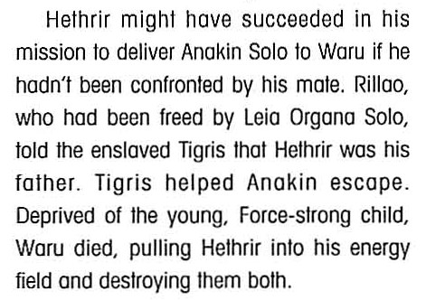
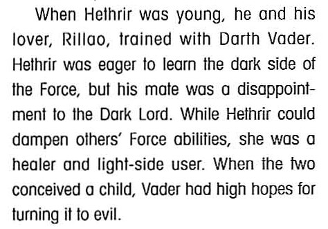

# Hethrir

- **Aliases:** —
- **Era:** —
- **Continuity:** default Legends; entries present for: Legends
- **Research tier:** untiered (not listed as INTRO/DEEP/MASTERY in legends-feats.md)
- **Entries:** 16 (10 with quotations; 0 quotations extended to the full sentence/passage from the source text on file; 1 marked as fragments). Rebuilt 2026-11-17 from 19 old entries; old file: `characters/_bak/hethrir.md.bak-20261117`.
- **How to read:** each entry is the quotation in full (block quote), then its source and point of view. "Note" lines are summaries from our notes, not quotations. `[fragment — full passage not on file]` means the source text is not on the box, so only the words in our notes are shown. Debate and forum material is in the last section and is unverified.

# LEGENDS (Legends / EU — main focus)

## Star Wars: The New Essential Chronology (Del Rey, 2005): power-scaling and lore notes

> During the Empire's reign, Hethrir and his mate, Rillao, had been trained by Darth Vader in the ways of the Dark Jedi. Palpatine was so impressed with Hethrir's abilities that he promoted him to Procurator of Justice
> [fragment — full passage not on file]
— Source: Part Nine: Uprisings and Insurgencies.
Note (our notes, around the quote): Darth Vader (Anakin Skywalker); Palpatine (Darth Sidious) — Hethrir trained by Vader: "During the Empire's reign, Hethrir and his mate, Rillao, had been trained by Darth Vader in the ways of the Dark Jedi. Palpatine was so impressed with Hethrir's abilities that he promoted him to Procurator of Justice" Source: The New Essential Chronology, p.177

Our notes: `notes/materials/027-new-essential-chronology/09-part-nine-uprisings-and-insurgencies.md:11`

> Chairman tyon tried to reassure the Chief of State by speculating that the Incident was a “coup abduc- Son’~in Codru-Ji society, chikiren of royal birth were routinely kidnapped and ransomed by rival political factions. The truth was much more complicated.
>
> The children had been kidnapped by Lord Hethrir, a near-human Firrerreo. During the Empire's reign, Hethrir and his mate, Rillao, had been trained by Darth Vader in the ways of the Dark Jedi. Palpatine was so im- pressed with Hethrir’s abilities that he promoted him to Procurator of Justice=an unprecedented appointment for a nonhuman in the New Order. The Procurator of Justice was responsible for carrying out Imperial death ¥ Hethrir, leader of the Empire Reborn, contemplates grand schemes. sentences against bath individuals and entire worlds. AS [Avr we fo Ves hav) 2 (477 === PDF p.188 === Endor. He fled to the Outer Rim aboard an artificial planetoid given to him by the Emperor, and began attracting wealthy backers to fund his fledgling “Empire Reborn” movement.
>
> His skilis with the dark side of the Force, while minor compared to those of Vader or Palpatine, were enough to win over any doubters, Hethrirs core financing came through the sale of slaves. While serving as Procurator, he had dispatched dozens of passenger freighters Into deep Space, each loaded with prisoners kept In suspended anima- ion.
— Source: Part Nine: Uprisings and Insurgencies; art caption.
(Excerpt widened 2026-11-17 to the relevant passage, word for word from research primary new essential chronology nec paged (text copy `research_primary_new_essential_chronology_nec_paged_txt_88b808b5bc`).)
(Excerpt widened 2026-11-17 to the relevant passage, word for word from research primary new essential chronology nec paged (text copy `research_primary_new_essential_chronology_nec_paged_txt_88b808b5bc`).)
Note (our notes, around the quote): art caption: "Hethrir, leader of the Empire Reborn, contemplates grand schemes." Source: The New Essential Chronology, p.177, caption

Our notes: `notes/materials/027-new-essential-chronology/09-part-nine-uprisings-and-insurgencies.md:13`

> His skills with the dark side of the Force, while minor compared to those of Vader or Palpatine, were enough to win over any doubters.
— Source: Part Nine: Uprisings and Insurgencies.
Note (our notes, around the quote): Darth Vader (Anakin Skywalker); Palpatine (Darth Sidious) — Hethrir minor next to Vader or Palpatine: "His skills with the dark side of the Force, while minor compared to those of Vader or Palpatine, were enough to win over any doubters." Source: The New Essential Chronology, p.178

Our notes: `notes/materials/027-new-essential-chronology/09-part-nine-uprisings-and-insurgencies.md:20`

## Star Wars Saga Edition: Jedi Academy Training Manual (WotC, 2009): power-scaling and lore notes

> With the funds from the slave trade, he outfits the Empire Reborn with arms and ships.
>
> After establishing the armed forces for the Empire Reborn, Hethrir approaches a Chistori named Desann to create an army of Dark Jedi. By selecting only Humans with Force potential and cleansing them through Waru, Hethrir and Desann create the Reborn. However, the Reborn are defeated by Luke Skywalker and Kyle Katarn.
>
> After his defeat, Hethrir has one chance to redeem himself to Waru and return to power. He abducts Jacen, Jaina, and Anakin Solo with the inten- tion of sacrificing them to Waru.
>
> After his defeat, Hethrir has one chance to redeem himself to Waru and return to power. He abducts Jacen, Jaina, and Anakin Solo with the inten- tion of sacrificing them to Waru. However, Han Solo, his wife Leia, and Luke Skywalker join with Rillao and manage to rescue the abductees, although Anakin is nearly lost. Enraged by Hethrir's failure, Waru consumes him and returns home to its own dimension.
>
> Enraged by Hethrir's failure, Waru consumes him and returns home to its own dimension.
>
> Hethrir Encounters With Hethrir's slave trade in full swing during the early days of the New Republic, any number of people might find themselves abducted and imprisoned, especially those who are Force-sensitive, to be used either as test subjects for his experiments or as sacrifices to Waru. If any heroes find themselves pursuing Desann or the Reborn, they might choose to take their goal one step further and try to bring down Hethrir as well.
— Source: Chapter VI: Dangers of Study.
(Excerpt widened 2026-11-17 to the relevant passage, word for word from research primary jedi academy training manual jatm paged (text copy `research_primary_jedi_academy_training_manual_jatm_paged_txt_fea130719f`).)
(Excerpt widened 2026-11-17 to the relevant passage, word for word from research primary jedi academy training manual jatm paged (text copy `research_primary_jedi_academy_training_manual_jatm_paged_txt_fea130719f`).)
Note (our notes, around the quote): Han Solo; Leia Organa Solo; Luke Skywalker — Hethrir — rescue of the Solo children: "However, Han Solo, his wife Leia, and Luke Skywalker join with Rillao and manage to rescue the abductees, although Anakin is nearly lost." Source: Jedi Academy Training Manual, p.120

Our notes: `notes/materials/028-jedi-academy-training-manual/06-ch6-dangers-of-study.md:60`

> After pushing Rillao and their unborn son out of his life, Hethrir develops his abilities and proves his commitment by destroying his own homeworld of Firrerre.
>
> Hethrir foresees the Empire's demise at Endor and develops a plan for its revival called the Empire Reborn, with him as the new Emperor. After cementing his power base in the Crseih system and gaining the assistance of an extradimensional being called Waru, Hethrir finances the Empire Reborn through a slave trade created using political prisoners and his own people, the Firrerreo, that are stored in sleeper ships. With the funds from the slave trade, he outfits the Empire Reborn with arms and ships.
>
> After establishing the armed forces for the Empire Reborn, Hethrir approaches a Chistori named Desann to create an army of Dark Jedi. By selecting only Humans with Force potential and cleansing them through Waru, Hethrir and Desann create the Reborn.
>
> After establishing the armed forces for the Empire Reborn, Hethrir approaches a Chistori named Desann to create an army of Dark Jedi. By selecting only Humans with Force potential and cleansing them through Waru, Hethrir and Desann create the Reborn. However, the Reborn are defeated by Luke Skywalker and Kyle Katarn.
>
> After his defeat, Hethrir has one chance to redeem himself to Waru and return to power. He abducts Jacen, Jaina, and Anakin Solo with the inten- tion of sacrificing them to Waru.
— Source: Chapter VI: Dangers of Study; Luke Skywalker; Kyle Katarn — Hethrir — the Reborn.
(Excerpt widened 2026-11-17 to the relevant passage, word for word from research primary jedi academy training manual jatm paged (text copy `research_primary_jedi_academy_training_manual_jatm_paged_txt_fea130719f`).)
(Excerpt widened 2026-11-17 to the relevant passage, word for word from research primary jedi academy training manual jatm paged (text copy `research_primary_jedi_academy_training_manual_jatm_paged_txt_fea130719f`).)
Note (our notes, around the quote): Luke Skywalker; Kyle Katarn — Hethrir — the Reborn: "However, the Reborn are defeated by Luke Skywalker and Kyle Katarn." Source: Jedi Academy Training Manual, p.120

Our notes: `notes/materials/028-jedi-academy-training-manual/06-ch6-dangers-of-study.md:62`

## The Complete Star Wars Encyclopedia, Vol. II (H–O)

- Note (summary from our notes, not a quotation): Page contents: 1059 words, 27 paragraphs | headings/entries: Hessler, Evan; Hestiv, General; HE-suit; Hesz, Tal; Het, Doton; Heth, Morturr; Hethar; Hethrir, Lord; Hetsime, Nala; Hett, A'Sharad
  — Source: scan pages 41–80.
Our notes: `notes/materials/031-complete-star-wars-encyclopedia-vol-2/01-v2-scan-041-080.md:22`

## The Complete Star Wars Encyclopedia, Vol. III (P–Z)

> Both had been students of Darth Vader, but while Hethrir embraced the dark side of the Force and even helped destroy his own world as proof of his loyalty to the Empire, Rillao's powers came from the light side and she fled with her unborn child.
— Source: scan pages 241–280; Darth Vader (Anakin Skywalker).
Note (our notes, around the quote): Darth Vader (Anakin Skywalker): "Both had been students of Darth Vader, but while Hethrir embraced the dark side of the Force and even helped destroy his own world as proof of his loyalty to the Empire, Rillao's powers came from the light side and she fled with her unborn child." Source: The Complete Star Wars Encyclopedia, Vol. III, p.247

Our notes: `notes/materials/032-complete-star-wars-encyclopedia-vol-3/06-v3-scan-241-280.md:122`

## Dark Side Sourcebook (d20, 2001)

- Note (summary from our notes, not a quotation): Page contents: 1258 words, 121 paragraphs | headings/entries: Index; Drain Energy 14, 17; Drain Force 17; Drain Knowledge 15, 17, 40; Durron, Kyp 12, 104, 105; Dxun tomb beast 112; Emperor Reborn 120, 126; Empress Teta system 8, 74, 75, 76; Endor 10, 91, 92, 94, 110; Force, the 6, 7, 40, 55; Force illusions 16; Force Points, gaining 40; Force-based skills 13, 17; Gepta, Rokur 80; Gethzerion 81, 82, 108, 134; Great Hyperspace War, the 7,; Harth, Set 83; Hatred (feat) 18; Hethrir, Lord 92, 93; Illusion (feat) 15, 17; Imperial campaign 51; Imperial Sentinel 99; Imperial Sovereign Protector 92, 99; Interrogator droid 63; Ismaren, trek 106; Jade, Mara 26, 53, 99; Jedgar 94, 96; Jedi characters 20; Jedi consular 158; Jedi, corrupted 31; Jedi guardian 157; Jedi, history of 7; Jedi hunters 87; Jerec 101; Kadanm 94, 96, 97 Kai,; Tamith 108, 109; Kalgrath 116; Sedriss, Executor 99, 102; Sense (feat) 54; Sing, Aurra 87, 88; Sith acolyte 31, 74; Skywalker, Luk
  — Source: Chapter Seven: Dark Side Campaigns; back matter.
Our notes: `notes/materials/035-dark-side-sourcebook/07-ch7-campaigns.md:117`

## Characters/The Dark Forces Saga/The Dark Forces Saga, Part 6.pdf [Star Wars Roleplaying Game Revised Core (d20, 2002)]

> Eventually, Desann crossed paths with Imperial Admiral Galak Fyyar, who promptly took the Chistori to meet his obscure master, the Procurator of Justice Lord Hethrir. Despite the Procurator's prejudice toward aliens, Lord Hethrir made Desann his right hand in his Empire Reborn, reasoning that even Emperor Palpatine had made some exceptions.
— Source: Characters/The Dark Forces Saga/The Dark Forces Saga, Part 6.pdf [Star Wa.
Note (our notes, around the quote): Desann; Admiral Galak Fyyar; Lord Hethrir; Palpatine (Darth Sidious) — entry/section: Desann and Hethrir: "Eventually, Desann crossed paths with Imperial Admiral Galak Fyyar, who promptly took the Chistori to meet his obscure master, the Procurator of Justice Lord Hethrir. Despite the Procurator's prejudice toward aliens, Lord Hethrir made Desann his right hand in his Empire Reborn, reasoning that even Emperor Palpatine had made some exceptions." Source: *The Dark Forces Saga, Part 6* (SWRPG d20 Revised Core), scan p.2

Our notes: `notes/materials/037-sw-d20-folder/133-the-dark-forces-saga-part-6.md:37`

- Note (summary from our notes, not a quotation): Desann; Lord Hethrir; Tavion Axmis — entry/section: Desann trains Tavion: "Hethrir entrusted Desann with training a number of his Empire Youths, individuals who had shown a potent Force-sensitivity and devotion to Hethrir's cause and had been specially "purified" by a demigod known as Waru. Desann took one of these Youths, Tavion, as his apprentice. He even experimented with imbuing Human Empire Youths who had little to no talent in the Force -- chosen by Hethrir due to the magistrate’s racist philosophies -- with dark side powers using atrusian crystals and Sith alchemy." Source: *The Dark Forces Saga, Part 6* (SWRPG d20 Revised Core), scan p.2
  — Source: Characters/The Dark Forces Saga/The Dark Forces Saga, Part 6.pdf [Star Wa.

Our notes: `notes/materials/037-sw-d20-folder/133-the-dark-forces-saga-part-6.md:39`

> Lastly, Hethrir tasked Desann with finding a fabled Jedi valley made known to him by his ally, Inquisitor Tremayne. Tricking the Jedi Kyle Katarn into revealing the location of the Valley of the Jedi, Desann led his band of trainees to the Force nexus on Ruusan, quadrupling their innate powers with the residue of the ancient Jedi sprits. To these specially empowered Empire Youths Desann gave the name the Reborn.
— Source: Characters/The Dark Forces Saga/The Dark Forces Saga, Part 6.pdf [Star Wa.
Note (our notes, around the quote): Desann; Lord Hethrir; Antinnis Tremayne; Kyle Katarn — entry/section: The Reborn: "Lastly, Hethrir tasked Desann with finding a fabled Jedi valley made known to him by his ally, Inquisitor Tremayne. Tricking the Jedi Kyle Katarn into revealing the location of the Valley of the Jedi, Desann led his band of trainees to the Force nexus on Ruusan, quadrupling their innate powers with the residue of the ancient Jedi sprits. To these specially empowered Empire Youths Desann gave the name the Reborn." Source: *The Dark Forces Saga, Part 6* (SWRPG d20 Revised Core), scan p.2

Our notes: `notes/materials/037-sw-d20-folder/133-the-dark-forces-saga-part-6.md:41`

## Sourcebooks/Threats of the Galaxy.pdf [Star Wars Roleplaying Game Saga Edition (2007)] (scan pages 1–60)

> By deceiving Kyle Katarn into giving away the location of the Valley of the Jedi and the Force nexus located there, Hethrir increased his powers fourfold by absorbing energy from ancient Jedi and Sith spirits.
— Source: Sourcebooks/Threats of the Galaxy.pdf [Star Wars Roleplaying Game Saga Ed; Kyle Katarn. POV: Kyle Katarn, about Hethrir.
Note (our notes, around the quote): Kyle Katarn: "By deceiving Kyle Katarn into giving away the location of the Valley of the Jedi and the Force nexus located there, Hethrir increased his powers fourfold by absorbing energy from ancient Jedi and Sith spirits." Source: *Threats of the Galaxy* (SWRPG Saga Edition), scan p.30

Our notes: `notes/materials/037-sw-d20-folder/731-threats-of-the-galaxy-scan-001-060.md:216`

## Star Wars Insider #82 (2005)

- Note (summary from our notes, not a quotation): Page contents: Ask the Master (Pablo Hidalgo), "A Grab Bag of Lightsabers": Grievous' trophy lightsaber is Obi-Wan's (Ty Teiger prop; Luke's Episode VI saber resembles it); did the Sith continue (Vader and Sidious seeking secret apprentices; Emperor's Hands; Vader's apprentices Tyne Vost, Hethrir, Shira Brie/Lumiya; Sith relics and followers). Questioners omitted. (hand-read)
  — Source: Star Wars Insider #82 (2005).
Our notes: `notes/materials/038-star-wars-insider/082-ins082.md:255`

## Essential Guide to Characters (1995)

- Note (summary from our notes, not a quotation): Hethrir might have succeeded in his mission to deliver Anakin Solo to Waru if he hadn't been confronted by his mate. Rillao, who had been freed by Leia Organa Solo, told the enslaved Tigris that Hethrir was his father. Tigris helped Anakin escape. Deprived of the young, Force-strong child, Waru died, pulling Hethrir into his energy field and destroying them both.
  — Source: The Essential Guide to Characters (Andy Mangels, Del Rey, 1995), printed p.70, scan p.079. The 1995 guide's telling, not a power feat..
Our notes: `notes/materials/147-essential-guide-to-characters-1995/egc-greedo-through-mara.md`

- Note (summary from our notes, not a quotation): When Hethrir was young, he and his lover, Rillao, trained with Darth Vader. Hethrir was eager to learn the dark side of the Force, but his mate was a disappointment to the Dark Lord. While Hethrir could dampen others’ Force abilities, she was a healer and light-side user. When the two conceived a child, Vader had high hopes for turning it to evil.
  — Source: The Essential Guide to Characters (Andy Mangels, Del Rey, 1995), printed p.70, scan p.079. The 1995 guide's telling, not a power feat..
Our notes: `notes/materials/147-essential-guide-to-characters-1995/egc-greedo-through-mara.md`

# Debate and forum claims (unverified)

Forum posts, Suspect Insight debates and Discord debates, respect threads, and verdicts. These are posters' arguments or quotations they typed; none is checked against the book here unless the entry says so.

## Exar Kun Supreme Respect Thread (NEW UPDATE 8/28/2022) — respect-thread notes

> Seven years after the Battle of Endor, when Luke Skywalker established an academy with the intention of rebuilding the Jedi Order, the spirit of the ancient Sith Lord Exar Kun returned to prevent the Jedi Brotherhood's resurrection. Three short years later, another Sith daemon, this time the Dark Lord Marka Ragnos, also was called back from the realm of Chaos to terrorize the galaxy. This latter event was not isolated. Some of the disciples of Ragnos had formerly been aligned with the dark sider Hethrir and his Empire Reborn, which had been defeated only a short time prior. Worse, soon after the encounter with Ragnos, the lifeless body of the reformed Sith acolyte Flint was found on Belderone: an ancient Jedi lightsaber in hand, a cauterized hole through his throat.
>
> The Force seethed with the suggestion of a grand, sinister scheme.
— Source: SI respect-thread directory: Exar Kun Supreme Respect Thread (NEW UPDATE 8/28/2022) — https://www.suspectinsightforums.com/t822-exar-kun-supreme-respect-thread-new-update-8-28-2022.
Context: The return of the spirits of Exar Kun and Marka Ragnos seemed to entail a grand sinister plot in the Force:
Posted by: not named in our notes (see thread/notes link).
(Source (as named in the post's quote header): Evil Never Dies: The Sith Dynasties, starwars.com wrote:)
Our notes: `suspect-insight/respect-threads/exar-kun--exar-kun-ancient-power.md:1037`; `suspect-insight/debates/102-darth-tyranus-vs-marka-ragnos.md:329`; `suspect-insight/respect-threads/marka-ragnos.md:797`
