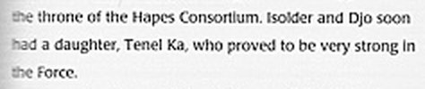

# Isolder

- **Aliases:** —
- **Era:** —
- **Continuity:** default Legends; entries present for: Legends
- **Research tier:** untiered (not listed as INTRO/DEEP/MASTERY in legends-feats.md)
- **Entries:** 48 (37 with quotations; 11 quotations extended to the full sentence/passage from the source text on file; 3 marked as fragments; 18 before the 2026-11-17 fragment fill). Rebuilt 2026-11-17 from 52 old entries; old file: `characters/_bak/isolder.md.bak-20261117`. Added 2026-11-19: 1 entries from Young Jedi Knights 1: Heirs of the Force (full read).
- **How to read:** each entry is the quotation in full (block quote), then its source and point of view. "Note" lines are summaries from our notes, not quotations. `[fragment — full passage not on file]` means the source text is not on the box, so only the words in our notes are shown. Debate and forum material is in the last section and is unverified.

# LEGENDS (Legends / EU — main focus)

## Legacy of the Force 1–9: novel notes from the other agent (reference copy)

> You will put all Hapan military forces under my command, with ships’ senior officers to be supplied by the Galactic Alliance … or your daughter will die.” *(L1083)*
>
> “By doing what you did to me, you changed me into someone capable of doing exactly what I have promised. *(L1085)*
>
> They even seemed lighter in color than usual. *(L1085)*
>
> “I’ve watched the recording a dozen times, and each time I see a man whose humanity has been utterly extracted from him.” *(L1095)*
— Source: L1083; L1085; L1095 — Legacy of the Force 7: Fury (novel, read in full): feats, scaling and story notes; Caedus's ultimatum: all Hapan forces under his command.
(Full sentence/passage taken from the source text on file: `novels_tmp_fury_FULL_txt`.)
Note (our notes, around the quote): Caedus's ultimatum: all Hapan forces under his command «or your daughter will die» (L1083); «you changed me into someone capable of doing exactly what I have promised» (L1085); eyes «lighter in color than usual» (L1085) [Sith eyes]. Isolder: «a man whose humanity has been utterly extracted from him» (L1095).
Our notes: `notes/materials/021-legacy-of-the-force/lotf-7-fury-notes.md:260`

- Note (summary from our notes, not a quotation): L4766 · Jaina: Force-hurls a guard through a door. L4920 · Caedus: Force-snaps Isolder's neck.
  — Source: Legacy of the Force 9: Invincible (novel, read in full): feats, scaling and story notes.
Our notes: `notes/materials/021-legacy-of-the-force/lotf-9-invincible-notes.md:60`

What it shows (our notes): Caedus/Jacen: tries to recommit to «To serve.» (L887), but kills Isolder, tortures Mirta, and uses Tahiri's grief («That was kind of the point», L4632). His love for Allana survives to the end: he vetoes the nanokiller (L4596) and dies warning Tenel Ka (L5184). Jaina's verdict: «he became Jacen again for a second» (L5914); the galaxy he wanted is born under Daala (L5904).
> “Okay,” Tahiri said. “But letting me believe we could bring Anakin back was a terrible way to use me. I still haven’t forgiven you.”
>
> “And I doubt you ever will,” Caedus said. “That was kind of the point.”
>
> “I think he became Jacen again for a second before I … *(L5914)*
— Source: L887; L4596; L5184; L5914 — Legacy of the Force 9: Invincible (novel, read in full): feats, scaling and story notes.
(Excerpt widened 2026-11-17 to the relevant passage, word for word from Invincible (Troy Denning) (text copy `MEGA_Legend_The_Legacy_of_the_Force_Series_Star_Wars_Legacy_of_the_Force_09_Invincible_Troy_Denning_epub`).)
(Full sentence/passage taken from the source text on file: `lotf_tmp_b9_epub`.)
Our notes: `notes/materials/021-legacy-of-the-force/lotf-9-invincible-notes.md:144`

- Note (summary from our notes, not a quotation): Role/arc: a GA dictator who tries to recommit to «To serve.» (L887), then kills Roegr, Vatok and Isolder. He vetoes the nanokiller to save Allana (L4596) and dies warning Tenel Ka (L5184).
  — Source: L887; L4596; L5184 — Legacy of the Force 9: Invincible (novel, read in full): feats, scaling and story notes.
Our notes: `notes/materials/021-legacy-of-the-force/lotf-9-invincible-notes.md:258`

> Jaina was too disciplined to let her shock distract her, but she was shocked. Beskar’gam was some of the toughest armor in the galaxy, able to deflect blaster bolts and lightsaber strikes with little more than a scorch mark, and her brother had just destroyed a piece with a tap. Had he mastered the shatterpoint?
>
> Somehow, Caedus forced himself back to his feet. That would have been impressive—if it weren’t so kriffing scary.
>
> anticipating her every move *(L5112–5116)*
> [fragment — full passage not on file]
>
> In the next instant Jaina felt herself rushing toward its searing heat, and it took all her Force strength to pull herself aside the half meter that saved her life. *(L5150–5152)*
— Source: L2315–2347; L2586; L3682–3688; L4920 — Legacy of the Force 9: Invincible (novel, read in full): feats, scaling and story notes; Key feats.
(Full sentence/passage taken from the source text on file: `lotf_tmp_b9_epub`.)
(Fragment completed 2026-11-17: full sentence/passage matched word for word in the source text on file: `MEGA_Legend_The_Legacy_of_the_Force_Series_Star_Wars_Legacy_of_the_Force_09_Invincible_Troy_Denning_epub`.)
Note text that was attached to the quote line: *(Nickel One, L2305–2309)*
Note text that was attached to the quote line: *(L2586)*
Note (our notes, around the quote): Key feats: «her brother had just destroyed a piece with a tap. Had he mastered the shatterpoint?» (Nickel One, L2305–2309). Kills Roegr and Vatok one-armed, using Vatok as cover from Jaina's sniping (L2315–2347). Rises after losing his arm: «That would have been impressive-if it weren't so kriffing scary.» (L2586). Tracks the Jedi base by Jaina's blood trail (L3682–3688). Snaps Isolder's neck with the Force (L4920). In the final duel he is «anticipating her every move» (L5112–5116), and against his TK pull «it took all her Force strength to pull herself aside the half meter» (L5150–5152).
Our notes: `notes/materials/021-legacy-of-the-force/lotf-9-invincible-notes.md:259`

## Star Wars: The New Essential Chronology (Del Rey, 2005): power-scaling and lore notes

> Isolder and Djo soon had a daughter, Tenel Ka, who proved to be very strong in the Force.
— Source: Part Six: Birth of the New Republic; Tenel Ka. POV: Tenel Ka, about Isolder.
Note (our notes, around the quote): Tenel Ka: "Isolder and Djo soon had a daughter, Tenel Ka, who proved to be very strong in the Force." Source: The New Essential Chronology, p.145

Our notes: `notes/materials/027-new-essential-chronology/06-part-six-birth-of-the-new-republic.md:128`

## The Complete Star Wars Encyclopedia, Vol. I (A–G)

> Another, an Eliminator model 434, tried to kill Princess Leia Organa on Coruscant, but it was destroyed by Prince Isolder's bodyguard Captain Astarta.
— Source: scan pages 41–80; Leia Organa Solo. POV: Leia Organa Solo, about Isolder.
Note (our notes, around the quote): Leia Organa Solo: "Another, an Eliminator model 434, tried to kill Princess Leia Organa on Coruscant, but it was destroyed by Prince Isolder's bodyguard Captain Astarta." Source: The Complete Star Wars Encyclopedia, Vol. I, p.45
Our notes: `notes/materials/030-complete-star-wars-encyclopedia-vol-1/01-v1-scan-041-080.md:161`

> Isolder refused and Caedus angrily strangled him with the Force, then ordered the Beam Racer destroyed.
— Source: scan pages 41–80; Jacen Solo (Darth Caedus).
Note (our notes, around the quote): Jacen Solo (Darth Caedus): "Isolder refused and Caedus angrily strangled him with the Force, then ordered the Beam Racer destroyed." Source: The Complete Star Wars Encyclopedia, Vol. I, p.65
Our notes: `notes/materials/030-complete-star-wars-encyclopedia-vol-1/01-v1-scan-041-080.md:323`

## The Complete Star Wars Encyclopedia, Vol. II (H–O)

> But when Leia Organa Solo pleaded with the Consortium for help in combating the Yuuzhan Vong, it took an honor duel between Prince Isolder and Archon Beed Thane to get the necessary support.
— Source: scan pages 1–40; Leia Organa Solo. POV: Leia Organa Solo, about Isolder.
Note (our notes, around the quote): Leia Organa Solo: "But when Leia Organa Solo pleaded with the Consortium for help in combating the Yuuzhan Vong, it took an honor duel between Prince Isolder and Archon Beed Thane to get the necessary support." Source: The Complete Star Wars Encyclopedia, Vol. II, p.16
Our notes: `notes/materials/031-complete-star-wars-encyclopedia-vol-2/00-v2-scan-001-040.md:145`

> Caedus's arrival came during his attempt to destroy the Jedi Order's base in the Transitory Mists, and Isolder believed that his interrogation had finally come.
— Source: scan pages 121–160; Jacen Solo (Darth Caedus).
Note (our notes, around the quote): Jacen Solo (Darth Caedus): "Caedus's arrival came during his attempt to destroy the Jedi Order's base in the Transitory Mists, and Isolder believed that his interrogation had finally come." Source: The Complete Star Wars Encyclopedia, Vol. II, p.121
Our notes: `notes/materials/031-complete-star-wars-encyclopedia-vol-2/03-v2-scan-121-160.md:54`

> Isolder's freedom was only guaranteed if he removed himself from the battle zone, since Caedus and his technicians had rigged the Beam Racer to explode if it was shot just once.
— Source: scan pages 121–160; Jacen Solo (Darth Caedus).
Note (our notes, around the quote): Jacen Solo (Darth Caedus): "Isolder's freedom was only guaranteed if he removed himself from the battle zone, since Caedus and his technicians had rigged the Beam Racer to explode if it was shot just once." Source: The Complete Star Wars Encyclopedia, Vol. II, p.121
Our notes: `notes/materials/031-complete-star-wars-encyclopedia-vol-2/03-v2-scan-121-160.md:56`

## The New Essential Guide to Characters (2002)

> A noninterventionist Hapan ambassador, Archon Beed Thane of Vergill, deliberately insulted Leia in order to provoke Isolder into an honor duel.
— Source: scan pages 61–90; Leia Organa Solo. POV: Leia Organa Solo, about Isolder.
Note (our notes, around the quote): Leia Organa Solo: "A noninterventionist Hapan ambassador, Archon Beed Thane of Vergill, deliberately insulted Leia in order to provoke Isolder into an honor duel." Source: The New Essential Guide to Characters, p.87
Our notes: `notes/materials/034-new-essential-guide-to-characters/02-negc-scan-061-090.md:149`

## Sourcebooks/The New Jedi Order Sourcebook.pdf [Star Wars Roleplaying Game (d20, 2000)] (scan pages 61–120)

- Note (summary from our notes, not a quotation): Page contents: 896 words, 19 paragraphs | headings/entries: The Hapan Fleet; AO S; Prince Isolder, Hapan Ruler; Swirls of Chaos
  — Source: Sourcebooks/The New Jedi Order Sourcebook.pdf [Star Wars Roleplaying Game.
Our notes: `notes/materials/037-sw-d20-folder/049-the-new-jedi-order-sourcebook-scan-061-120.md:205`

## Locations/Planet Hoppers/Hapes - Ladies First/Part 3 - Beneath the Planet of the Amazons.pdf [Star Wars Roleplaying Game Revised Core (d20, 2002)]

- Note (summary from our notes, not a quotation): Page contents: The crew is sent to a prison moon; Bricker and Faal chained beneath the Fountain Palace; Ta'a Chume slaps Kelan and asks about her son Isolder (hand-read)
  — Source: Locations/Planet Hoppers/Hapes - Ladies First/Part 3 - Beneath the Planet.
Our notes: `notes/materials/037-sw-d20-folder/596-part-3-beneath-the-planet-of-the.md:10`

> I seek information about one of your . . . kinsman. Another Hapan pirate, who has also left the galaxy behind. My son, Isolder.
— Source: Locations/Planet Hoppers/Hapes - Ladies First/Part 3 - Beneath the Planet.
Note (our notes, around the quote): No single roster character (rules/setting/general) — entry/section: Ta'a Chume to Kelan Faal: "I seek information about one of your . . . kinsman. Another Hapan pirate, who has also left the galaxy behind. My son, Isolder." Source: *Part 3 - Beneath the Planet of the Amazons* (SWRPG d20 Revised Core), scan p.1
Our notes: `notes/materials/037-sw-d20-folder/596-part-3-beneath-the-planet-of-the.md:12`

- Note (summary from our notes, not a quotation): Page contents: Execution threatened at dawn; Kelan's assurance; GM notes: "Ta'a Chume" is a title; Isolder hunting his brother's killer; stats Noble 19, Cha 22, gun of command, CL H; Part Four teaser; "Jedi Counseling" plug (hand-read)
  — Source: Locations/Planet Hoppers/Hapes - Ladies First/Part 3 - Beneath the Planet.
Our notes: `notes/materials/037-sw-d20-folder/596-part-3-beneath-the-planet-of-the.md:17`

## Locations/Planet Hoppers/Hapes - Ladies First/Part 4 - Escape from the Planet of the Amazons.pdf [Star Wars Roleplaying Game Revised Core (d20, 2002)]

- Note (summary from our notes, not a quotation): Page contents: Lady Elliar throws Kelan a second gun of command; he stuns his mother; revealed as Isolder; Ta'a Chume shakes it off and recaptures him (hand-read)
  — Source: Locations/Planet Hoppers/Hapes - Ladies First/Part 4 - Escape from the Pl.
Our notes: `notes/materials/037-sw-d20-folder/597-part-4-escape-from-the-planet-of.md:15`

> Shut up, mother, and order the release of Captain Bricker and the crew of the Mourning Glory. Immediately. After that, why don't you just stare into the sky for awhile?
— Source: Locations/Planet Hoppers/Hapes - Ladies First/Part 4 - Escape from the Pl.
Note (our notes, around the quote): No single roster character (rules/setting/general) — entry/section: Isolder ("Kelan Faal") to Ta'a Chume: "Shut up, mother, and order the release of Captain Bricker and the crew of the Mourning Glory. Immediately. After that, why don't you just stare into the sky for awhile?" Source: *Part 4 - Escape from the Planet of the Amazons* (SWRPG d20 Revised Core), scan p.2
Our notes: `notes/materials/037-sw-d20-folder/597-part-4-escape-from-the-planet-of.md:17`

> Chume'da, leave this life and come home.
— Source: Locations/Planet Hoppers/Hapes - Ladies First/Part 4 - Escape from the Pl.
Note (our notes, around the quote): No single roster character (rules/setting/general) — entry/section: Ta'a Chume to Isolder: "Chume'da, leave this life and come home." Source: *Part 4 - Escape from the Planet of the Amazons* (SWRPG d20 Revised Core), scan p.2
Our notes: `notes/materials/037-sw-d20-folder/597-part-4-escape-from-the-planet-of.md:19`

## Sourcebooks/Coruscant and the Core Worlds.pdf [Star Wars Roleplaying Game Revised Core (d20, 2002)] (scan pages 1–60)

- Note (summary from our notes, not a quotation): Page contents: Grand Reception Hall (Leia welcomes Prince Isolder); Kallarak Amphitheater; University of Coruscant; Coruscant Livestock Exchange and Exhibition begins (hand-read)
  — Source: Sourcebooks/Coruscant and the Core Worlds.pdf [Star Wars Roleplaying Game.
Our notes: `notes/materials/037-sw-d20-folder/665-coruscant-and-the-core-worlds-scan-001-060.md:88`

## Sourcebooks/Geonosis and the Outer Rim Worlds.pdf [Star Wars Roleplaying Game Revised Core (d20, 2002)] (scan pages 1–60)

- Note (summary from our notes, not a quotation): Page contents: Dathomir: history continued (Palpatine destroys prison ships; Gethzerion; Warlord Zsinj and Rancor Base; Han Solo; Teneniel Djo marries Prince Isolder; witches to Luke's academy; Great Canyon Nightsisters; Yuuzhan Vong); people (matriarchy and magic). (hand-read)
  — Source: Sourcebooks/Geonosis and the Outer Rim Worlds.pdf [Star Wars Roleplaying.
Our notes: `notes/materials/037-sw-d20-folder/667-geonosis-and-the-outer-rim-worlds-scan-001-060.md:208`

> Native witch Teneniel Djo married the off-worlder Prince Isolder to become the Queen Mother of the Hapes Consortium, while several other witches left the planet to study at Luke Skywalker’s Jedi academy.
— Source: Sourcebooks/Geonosis and the Outer Rim Worlds.pdf [Star Wars Roleplaying.
Note (our notes, around the quote): Teneniel Djo; Luke Skywalker — entry/section: Teneniel Djo becomes Queen Mother: "Native witch Teneniel Djo married the off-worlder Prince Isolder to become the Queen Mother of the Hapes Consortium, while several other witches left the planet to study at Luke Skywalker’s Jedi academy." Source: *Geonosis and the Outer Rim Worlds* (SWRPG d20 Revised Core), scan p.32
Our notes: `notes/materials/037-sw-d20-folder/667-geonosis-and-the-outer-rim-worlds-scan-001-060.md:214`

## Sourcebooks/Galaxy of Intrigue.pdf [Star Wars Roleplaying Game Saga Edition (2007)] (scan pages 61–120)

- Note (summary from our notes, not a quotation): Page contents: Hapan Methods (Gun of Command); Notable Members: Prince Isolder, Queen Mother Ta'a Chume; Using the Hapans. (hand-read)
  — Source: Sourcebooks/Galaxy of Intrigue.pdf [Star Wars Roleplaying Game Saga Editi.
Our notes: `notes/materials/037-sw-d20-folder/716-galaxy-of-intrigue-scan-061-120.md:329`

## Legacy of the Force, own full read (Betrayal, Revelation, Invincible)

- Note (summary from our notes, not a quotation): c10–c13: Tahiri's lightning kills Shevu; Ben escapes [c10 ¶132–157]. Caedus's blood stains on Jaina won't wash off [c11 ¶4; c11 ¶16–19]. Ben shoves SD-XX into space; the *Anakin Solo* captures Isolder [c12 ¶138–149]. Caedus interrogates the paralysed Mirta, finds the Jedi base by a Nightsister blood trail [c13 ¶53–56] and decides to kill Luke [c13 ¶128].
  — Source: Legacy of the Force 9: Invincible (Troy Denning, 2008) — own full read.
Our notes: `notes/materials/040-lotf-own-read/lotf-9-invincible.md:9`

- Note (summary from our notes, not a quotation): c17–c18: Jaina finds Mirta in the prison hold [c17 ¶69–100]. Caedus snaps Isolder's neck with the Force [c17 ¶136] and finds that the Moffs took Isolder's blood anyway [c18 ¶65–66]. Final duel in the Biodisposal Pit: Jaina kills Caedus while he reaches out to warn Tenel Ka [c18 ¶74–120].
  — Source: Legacy of the Force 9: Invincible (Troy Denning, 2008) — own full read.
Our notes: `notes/materials/040-lotf-own-read/lotf-9-invincible.md:11`

> Caedus made a twisting motion with his hand, snapping Isolder’s head around backward. There was a loud pop that made Caedus feel a little sick to his stomach, and the prince collapsed at his feet, dead before he hit the catwalk.
— Source: Legacy of the Force 9: Invincible (Troy Denning, 2008) — own full read.
(Excerpt widened 2026-11-17 to the relevant passage, word for word from Invincible (Troy Denning) (text copy `MEGA_Legend_The_Legacy_of_the_Force_Series_Star_Wars_Legacy_of_the_Force_09_Invincible_Troy_Denning_epub`).)
(Full sentence/passage taken from the source text on file: `lotf_tmp_b9_epub`.)
Note (our notes, around the quote): | F33 | c17 ¶120; c17 ¶136 | Caedus | Force-pulls Isolder off his bunk, then kills him with a twist: "snapping Isolder’s head around backward" | — |
Context: | # | Ref | Character | Feat | Quote / note |
Our notes: `notes/materials/040-lotf-own-read/lotf-9-invincible.md:49`

What it shows (our notes): Pre-conditions: Caedus has had a stump for about a week, has just found Isolder's needle marks and is racing to stop the missile boat [c18 ¶65–73]. Jaina's ribs are half-healed. Both are concealed: "impossible to sense Caedus in the Force" [c18 ¶83].
> A black boot heel came shooting under Jaina’s guard, driving hard into her sore ribs. She stifled a cry and circled into the shadows, trying to acclimate her eyes to the darkness because it was impossible to sense Caedus in the Force. He fought to keep his advantage, dancing back and forth behind his crimson blade, anticipating her every move—and making her pay for each step with a painful kick or elbow strike.
— Source: Legacy of the Force 9: Invincible (Troy Denning, 2008) — own full read.
(Excerpt widened 2026-11-17 to the relevant passage, word for word from Invincible (Troy Denning) (text copy `MEGA_Legend_The_Legacy_of_the_Force_Series_Star_Wars_Legacy_of_the_Force_09_Invincible_Troy_Denning_epub`).)
(Full sentence/passage taken from the source text on file: `lotf_tmp_b9_epub`.)
Context: D7 FINAL DUEL: Jaina (alone) vs Caedus, Biodisposal Pit [c18 ¶74–120]:
Our notes: `notes/materials/040-lotf-own-read/lotf-9-invincible.md:100`

## NJO 5, *Agents of Chaos II: Jedi Eclipse* (James Luceno, Del Rey 2000): FULL consecutive re-read (2026-11-16 CST)

What it shows (our notes): "Demonstrating uncanny speed and precision, Isolder backhanded Thane across the face"; Captain Astarta; "My seconds will call on you in the morning"; "Thus begins the schism."
> “Enough,” Isolder snapped.
>
> But Thane was far from finished; he played to the crowd once more. “He prefers the company of a daughter who has denounced her Hapan heritage …”
>
> Tenel Ka took a forward step, only to be blocked by her father.
>
> “… and a speaker of half-truths like Ambassador Solo—”
>
> Demonstrating uncanny speed and precision, Isolder backhanded Thane across the face, knocking him into the crowd and drawing blood from his lower lip. Instantly Isolder’s longtime friend and former bodyguard Captain Astarta was at his side, flinging a thick braid of red hair over her shoulder and positioning her hands to parry or strike, as need be.
>
> Two of Thane’s supporters had rushed to take him by the arms and stand him on his feet, but now he threw them aside, wiped his hand across his mouth, and snorted a laugh at Isolder.
>
> “The spurned suitor to the rescue.”
>
> Leia’s heart sank. She could feel Isolder battling to control his rage. As angry as she was at him for allowing himself to be provoked, she couldn’t help but dread Thane’s next move.
>
> “My seconds will call on you in the morning, Chume’da Isolder,” the archon of Vergill said with complete sobriety.
>
> Isolder returned a formal nod of assent. “My seconds will be waiting to greet them.”
>
> “Thus begins the schism,” Ta’a Chume said in a sad, quiet voice as Thane and his supporters headed for the door.
— Source: The New Jedi Order: Agents of Chaos II: Jedi Eclipse (James Luceno, Del Rey 2000), JE ch. 8 — 118 Jedi Eclipse notes (re-read 2026-11-16).
(Excerpt widened 2026-11-17 to the relevant passage, word for word from Jedi Eclipse (James Luceno) (text copy `MEGA_Legend_The_New_Jedi_Order_Series_Star_Wars_New_Jedi_Order_05_Agents_of_Chaos_02_Jedi_Eclipse_James_Luceno_epub`).)
(Excerpt widened 2026-11-17 to the relevant passage, word for word from Jedi Eclipse (James Luceno) (text copy `MEGA_Legend_The_New_Jedi_Order_Series_Star_Wars_New_Jedi_Order_05_Agents_of_Chaos_02_Jedi_Eclipse_James_Luceno_epub`).)
(Fragment completed 2026-11-17: full sentence/passage matched word for word in the source text on file: `MEGA_Legend_The_New_Jedi_Order_Series_Star_Wars_New_Jedi_Order_05_Agents_of_Chaos_02_Jedi_Eclipse_James_Luceno_epub`.)
Note text that was attached to the quote line: (JE ch. 8) — **"Demonstrating uncanny speed and precision, Isolder backhanded Thane across the face"; Captain Astarta; "My seconds will call on you in the morning"; "Thus begins the schism."**
Our notes: `notes/materials/118-njo-05-jedi-eclipse/je-02.md:8`

What it shows (our notes): C-3PO on the Lorell Raider martial art and teräs käsi; "Isolder spent two years as a privateer"; the stakes: Vergill's support if Isolder wins, Hapes withheld if he loses
> Leia was still recovering from the unexpectedness of the disclosure when Isolder, Teneniel Djo, and Astarta strode into view.
>
> “With mere moments to spare he arrives,” Ta’a Chume remarked on seeing them. “How like him.”
>
> Trailing the prince and queen mother came staffers and other witnesses, including C-3PO, who hurried to Leia’s side.
>
> “Mistress Leia,” the droid began in a fret, “I had hoped you would decide to spare yourself the torment of having to watch Prince Isolder engage in such an antiquated and obviously vain exercise, in what can only be considered pecking-order politics.”
>
> Leia frowned at him, thinking of Corran Horn’s contest with the Yuuzhan Vong commander Shedao Shai at Ithor. “As the insulted party, I could hardly absent myself, Threepio.”
>
> “But, Mistress,” C-3PO pressed, “do you have any idea of what Prince Isolder and Archon Thane are about to do?”
>
> Leia glanced at the lawn where Thane’s seconds and Astarta were establishing the ground rules, and the archon and the prince were already donning the sensor- and electrode-studded headgear, power gloves, boots, and body armor that were integral to the contest.
>
> “I have some idea,” Leia said.
>
> The droid tilted his head to one side and flapped his stiff arms. “Then you shouldn’t permit yourself to watch. This form of hand-to-hand combat has its origin in a martial art developed by the Lorell Raiders when their chief preoccupation was the capture and distribution of female prisoners. While perhaps not as deadly or as mystical in nature as teräs käsi—the ‘steel hands’ technique taught by the Followers of Palawa in the Pacanth Reach star cluster in the Outer Rim—it is nonetheless—”
>
> Leia shushed him. “Isolder spent two years as a privateer,” she said quietly. “I’m sure he knows a few moves.”
>
> “But, Mistress,” C-3PO said hopelessly.
>
> She silenced him again in order to hear what Isolder was telling Thane as they faced off in the center of the lawn.
>
> “Should you win, you will not only have redeemed your honor but earned the right to brag of having defeated the prince of Hapes. Should I win, I gain nothing more than the right to demand that you solicit the pardon of my daughter and of Ambassador Organa Solo for your remarks.”
>
> Thane sneered at him. “If you’d like to sweeten the pot, Prince Isolder, you need only say so.”
>
> Isolder slipped his right hand into the power glove and flexed his fingers. “Should I win, I want your pledge that Vergill will support the New Republic.”
>
> The witnesses gasped. “This cannot be permitted!” someone shouted.
>
> “Neither of you has the right!” another voice added.
>
> Thane considered it while the arguments continued. “You have my pledge,” the archon said at last. “Providing that Hapes will withhold support if you lose.”
>
> “You bring disgrace on all our Houses!” a witness remarked.
>
> Isolder nodded. “You have my pledge.”
>
> Leia’s heart raced.
>
> Beside her, Ta’a Chume said, “This has been Thane’s goal all along. As Hapes goes, so goes half the Consortium of worlds.” She looked at Leia. “You see what my son undertakes for you?”
— Source: The New Jedi Order: Agents of Chaos II: Jedi Eclipse (James Luceno, Del Rey 2000), JE ch. 11 — 118 Jedi Eclipse notes (re-read 2026-11-16).
(Excerpt widened 2026-11-17 to the relevant passage, word for word from Jedi Eclipse (James Luceno) (text copy `MEGA_Legend_The_New_Jedi_Order_Series_Star_Wars_New_Jedi_Order_05_Agents_of_Chaos_02_Jedi_Eclipse_James_Luceno_epub`).)
(Excerpt widened 2026-11-17 to the relevant passage, word for word from Jedi Eclipse (James Luceno) (text copy `MEGA_Legend_The_New_Jedi_Order_Series_Star_Wars_New_Jedi_Order_05_Agents_of_Chaos_02_Jedi_Eclipse_James_Luceno_epub`).)
(Fragment completed 2026-11-17: full sentence/passage matched word for word in the source text on file: `MEGA_Legend_The_New_Jedi_Order_Series_Star_Wars_New_Jedi_Order_05_Agents_of_Chaos_02_Jedi_Eclipse_James_Luceno_epub`.)
Note text that was attached to the quote line: (JE ch. 11) — **C-3PO on the Lorell Raider martial art and teräs käsi; "Isolder spent two years as a privateer"; the stakes: Vergill's support if Isolder wins, Hapes withheld if he loses**
Our notes: `notes/materials/118-njo-05-jedi-eclipse/je-02.md:31`

What it shows (our notes): the duel: Thane's "double- and triple-kick combinations"; "A punch from Isolder drove Thane clear across the lawn"; a feint, a rib kick; two–two, sudden death
> On the lawn, the principal referee raised a red scarf high overhead and let it flutter to the ground. It had scarcely touched the tallest blade of grass when the fight commenced.
>
> Hapan tradition dictated that honor duels commence with little fanfare and even less preamble. Leia quickly grasped that it was largely a matter of making sure that everyone had their wagers in place. From what she could gather by eavesdropping on nearby conversations—and Ta’a Chume’s avowals to the contrary—Thane was favored to win.
>
> Despite his agitation, or perhaps as a response to it, C-3PO insisted on providing commentary, even after the fight had begun. Olmahk, by contrast, was clearly entranced, down on his haunches at the edge of the manicured lawn, his bulging eyes riveted on Isolder and Thane as they circled, feeling each other out with tentative kicks and punches.
>
> Like Isolder, Thane was tall and muscular, but his thick legs and broad shoulders made Isolder look positively wiry by comparison. His moves, as he loosened up, suggested both great power and dexterity, and he wasn’t timid about showing right away that he was good. He came at Isolder with double- and triple-kick combinations, fired by the same leg, recocking and letting fly without bringing his foot down in between.
>
> And he had fast hands, as well.
>
> Isolder parried the attack skillfully, but refrained from counterpunching, as if undecided about which offense to employ. Even so, it was obvious to Leia that they were both essentially footfighters, with Thane’s style drawing on traditional techniques and Isolder’s on straightforward boxing.
>
> The rules of the honor duel were known to everyone present, save for her and Olmahk, but Leia understood that the body armor and headgear served a dual purpose. In addition to dampening the bone-breaking and electroshock capabilities of the gloves and boots, the sensor-studded padding indicated when a contestant landed a scoring blow, by way of a remote receiver.
>
> “What an appalling display,” C-3PO remarked worriedly. “And I fear it will only get worse, Mistress. Where most opponents agree beforehand to refrain from inflicting serious injury, the prince and the archon waived the usual restrictions!”
>
> Leia tried to ignore him. At the same time, she repressed an urge to think aloud, Don’t do this, Isolder, for fear that he might hear her through the Force and come undone. Corran Horn’s actions at Ithor had been noble, and yet they had failed to preserve the planet.
>
> Isolder and Thane worked each other around for several long minutes without scoring, though the punishing blows they rained on each other sounded like the muffled reports of ancient firearms. Exposed flesh reddened and swelled. A punch from Isolder drove Thane clear across the lawn; a front kick by the archon lifted the prince completely off his feet. Then both of them scored in rapid succession when Isolder left himself open to a blow to the head in order to land a powerful twisting punch to Thane’s ribs.
>
> The rooting of the onlookers was enthusiastic, but nothing like the bloodthirsty tumult professional gamblers would have raised. Inaudibly, Teneniel Djo, Tenel Ka, and some of the advisers intoned calming chants.
>
> Leia kept her concern in check by telling herself that what she was witnessing was no different from so many of the lightsaber practice duels she’d seen and engaged in over the years.
>
> Isolder and Thane went at each other again, this time at Isolder’s lead, with a set-piece attack of left fist, right fist. Thane confidently went for the block and counter against an expected right roundhouse kick, only to realize too late that it was a feint. Isolder cocked his leg back like lightning and again struck him in the ribs. Falling back, Thane grimaced in pain, but managed nonetheless to slip in an off-balance counterkick that caught Isolder unprepared.
>
> The primary referee glanced at the remote receiver and declared points for each fighter. With the match a two-two tie and both of them panting, he called for a sudden-death round.
— Source: The New Jedi Order: Agents of Chaos II: Jedi Eclipse (James Luceno, Del Rey 2000), JE ch. 11 — 118 Jedi Eclipse notes (re-read 2026-11-16).
(Excerpt widened 2026-11-17 to the relevant passage, word for word from Jedi Eclipse (James Luceno) (text copy `MEGA_Legend_The_New_Jedi_Order_Series_Star_Wars_New_Jedi_Order_05_Agents_of_Chaos_02_Jedi_Eclipse_James_Luceno_epub`).)
(Excerpt widened 2026-11-17 to the relevant passage, word for word from Jedi Eclipse (James Luceno) (text copy `MEGA_Legend_The_New_Jedi_Order_Series_Star_Wars_New_Jedi_Order_05_Agents_of_Chaos_02_Jedi_Eclipse_James_Luceno_epub`).)
(Fragment completed 2026-11-17: full sentence/passage matched word for word in the source text on file: `MEGA_Legend_The_New_Jedi_Order_Series_Star_Wars_New_Jedi_Order_05_Agents_of_Chaos_02_Jedi_Eclipse_James_Luceno_epub`.)
Note text that was attached to the quote line: (JE ch. 11) — **the duel: Thane's "double- and triple-kick combinations"; "A punch from Isolder drove Thane clear across the lawn"; a feint, a rib kick; two–two, sudden death**
Our notes: `notes/materials/118-njo-05-jedi-eclipse/je-02.md:32`

What it shows (our notes): Isolder's thigh nearly disabled and his forearm broken; he repeats the left-right-roundhouse with "broken timing"; the kick to the headguard wins the match
> “Sudden death?” C-3PO moaned in alarm. “Sudden death?”
>
> It was plain that Thane understood how Isolder had set a trap for him. Once more he moved tentatively, though seemingly less out of respect for Isolder’s prowess than out of wariness for his talent to deceive.
>
> Isolder kept his distance, as well, ultimately forcing Thane to bore in on him. The archon faked a punch, twirled, and cycloned his right foot at Isolder’s thigh. Isolder twisted to avoid the full force of the impact, but an agonized yelp escaped him, and everyone realized that he had nearly been incapacitated.
>
> The injured leg collapsed under him, and he dropped to one knee, aiming a stiff-armed punch to Thane’s midsection on the way down. Thane anticipated the blow and stopped short, just out of range, then brought one foot around and down in a crescent kick meant to shatter Isolder’s extended forearm and open him up for a frontal attack. But Isolder withdrew his arm in time and shoulder-rolled out of harm’s way. Shooting to a crouch, he launched himself at Thane.
>
> Thane backed away, windmilling his arms to parry punches and kicks, then stepping to one side and executing a fast one-handed forward flip, right foot extended to smash Isolder in the face.
>
> Isolder stooped, catching Thane’s lower calf in the crook of the X he formed with raised forearms, then called on his thigh muscles to spring him upright. Thane’s planted foot slipped on the grass, and he slammed supine to the ground.
>
> Isolder went after him, whirling for a back kick going in. But Thane spun on his shoulders and neatly swept Isolder’s feet out from under him. Springing themselves upright, they exchanged lightning volleys of kicks and body punches. Plosive sounds cut the salt air as they alternated in having the wind knocked out of them.
>
> Thane’s right foot caught Isolder’s left forearm just above the edge of the power glove, and Leia was certain she heard bone fracture. It struck her all at once that sudden death could mean just that.
>
> Surprised that neither of them had scored, the crowd grew louder, urging each man on. Leia heard Captain Astarta’s voice cut through the din, commanding Isolder to regain focus. Only Leia and Ta’a Chume stood silently now, wrapped in concern.
>
> With a deft hop, Isolder reversed his stance to keep his maimed forearm out of the line of fire and launched another counteroffensive. Thane’s huge fist tagged him a glancing blow on the side of the head, but the archon received a toe kick to the knee in return.
>
> Thane apparently wasn’t accustomed to fighting someone his own size, and Isolder made the most of it. Time and again he caught Thane’s foot in his upper arm or shoulder or managed to duck his head out of the way. But Isolder appeared to be tiring. With little left to pitch that he hadn’t already tried, he again advanced with left fist, right fist, as windup for a right roundhouse kick.
>
> Leia’s breath caught in her throat. It was the most elementary and binary kind of gamble. Thane had to decide whether Isolder was setting the move up as a feint, or was going to commit to it this time. It came down to whether or not Thane believed Isolder was fool enough to stake everything—his reputation, Thane’s promise to side with Hapes with regard to the Yuuzhan Vong, perhaps even the respect of the royal family and Leia—on trying the same trick after it had been compromised the first go-round.
>
> Thane set himself for a feint and counter. Isolder let him believe he had chosen correctly by using broken timing—appearing for an instant to be faking—then let fly the intended roundhouse.
>
> From the sound of the impact, it was clear that Isolder had planned the kick to connect with enough force to end the match. Even so, he exercised more restraint than Thane probably would have shown. The slap of the boot on the headguard echoed off the black rocks that graced the shore, and the primary referee had one hand up to signal the winning point before Thane had hit the ground.
— Source: The New Jedi Order: Agents of Chaos II: Jedi Eclipse (James Luceno, Del Rey 2000), JE ch. 11 — 118 Jedi Eclipse notes (re-read 2026-11-16).
(Excerpt widened 2026-11-17 to the relevant passage, word for word from Jedi Eclipse (James Luceno) (text copy `MEGA_Legend_The_New_Jedi_Order_Series_Star_Wars_New_Jedi_Order_05_Agents_of_Chaos_02_Jedi_Eclipse_James_Luceno_epub`).)
(Excerpt widened 2026-11-17 to the relevant passage, word for word from Jedi Eclipse (James Luceno) (text copy `MEGA_Legend_The_New_Jedi_Order_Series_Star_Wars_New_Jedi_Order_05_Agents_of_Chaos_02_Jedi_Eclipse_James_Luceno_epub`).)
(Fragment completed 2026-11-17: full sentence/passage matched word for word in the source text on file: `MEGA_Legend_The_New_Jedi_Order_Series_Star_Wars_New_Jedi_Order_05_Agents_of_Chaos_02_Jedi_Eclipse_James_Luceno_epub`.)
Note text that was attached to the quote line: (JE ch. 11) — **Isolder's thigh nearly disabled and his forearm broken; he repeats the left-right-roundhouse with "broken timing"; the kick to the headguard wins the match**
Our notes: `notes/materials/118-njo-05-jedi-eclipse/je-02.md:33`

What it shows (our notes): Isolder doesn't flaunt it; Thane: "I will honor my pledge … applaud you for moving the Consortium one step closer to what will no doubt prove to be a catastrophic campaign."
> Betting stakes were changing hands even as the two opponents were bowing to each other. Given the added wager, many of the witnesses were beside themselves with outrage, and arguments began to erupt on all sides of the lawn.
>
> One to whom success came often, Isolder didn’t flaunt his victory. Even the customary embraces he received from his wife and daughter failed to elicit so much as a smile. Archon Thane appeared grudgingly congratulatory, but Leia could see that there would be no lasting peace between House Thane and House Isolder.
>
> At the moment, however, that didn’t matter. Thane’s loss meant at least one more vote on the side of supporting the New Republic.
>
> Thane and his seconds began to storm away from the lawn, but before he reached the path that led to the dock, Thane changed direction and angled for Leia.
>
> She braced herself.
>
> “Ambassador, I will make my formal apology when the Consortium representatives convene to vote on the issue of rendering aid to the New Republic,” he began.“Rest assured that I will honor my pledge to stand with Prince Isolder.” He scowled, despite himself. “For now I wish only to applaud you for moving the Consortium one step closer to what will no doubt prove to be a catastrophic campaign.”
— Source: The New Jedi Order: Agents of Chaos II: Jedi Eclipse (James Luceno, Del Rey 2000), JE ch. 11 — 118 Jedi Eclipse notes (re-read 2026-11-16).
(Excerpt widened 2026-11-17 to the relevant passage, word for word from Jedi Eclipse (James Luceno) (text copy `MEGA_Legend_The_New_Jedi_Order_Series_Star_Wars_New_Jedi_Order_05_Agents_of_Chaos_02_Jedi_Eclipse_James_Luceno_epub`).)
(A fragment line was removed 2026-11-17: its words appear word for word inside the full excerpt in this entry.)
(Fragment completed 2026-11-17 with the full excerpt, word for word from Jedi Eclipse (James Luceno) (text copy `MEGA_Legend_The_New_Jedi_Order_Series_Star_Wars_New_Jedi_Order_05_Agents_of_Chaos_02_Jedi_Eclipse_James_Luceno_epub`).)
(Excerpt widened 2026-11-17 to the relevant passage, word for word from Jedi Eclipse (James Luceno) (text copy `MEGA_Legend_The_New_Jedi_Order_Series_Star_Wars_New_Jedi_Order_05_Agents_of_Chaos_02_Jedi_Eclipse_James_Luceno_epub`).)
(Fragment completed 2026-11-17: full sentence/passage matched word for word in the source text on file: `MEGA_Legend_The_New_Jedi_Order_Series_Star_Wars_New_Jedi_Order_05_Agents_of_Chaos_02_Jedi_Eclipse_James_Luceno_epub`.)
Note text that was attached to the quote line: (JE ch. 11) — **Isolder doesn't flaunt it; Thane: "I will honor my pledge … applaud you for moving the Consortium one step closer to what will no doubt prove to be a catastrophic campaign."**
Our notes: `notes/materials/118-njo-05-jedi-eclipse/je-02.md:34`

What it shows (our notes): Isolder: "The light that shines on the Consortium today could very well be eclipsed tomorrow"; "By a vote of thirty-two in favor to thirty-one opposed, the Consortium avows to support the New Republic"
> “Everyone who has wished to be heard on the issue of the Consortium pledging support to the New Republic has been heard,” Isolder began when the commotion in the hall had settled. “It’s clear that we have no consensus on this issue, and the vote is certain to be close. The decision to go to war is never an easy one, and our decision this day is made all the more difficult because we appear to be safely distanced from that war. But bear in mind the counsel of Ambassador Organa Solo: This quiet will not endure. The light that shines on the Consortium today could very well be eclipsed tomorrow, and any battles avoided will ultimately have to be fought, perhaps by us alone. I won’t stand here and reiterate the many arguments that have been presented, denigrating one stance or bolstering another. I ask only that each of you eschew politics and vote the will of the people you represent. That is our commitment, and by doing so we vote our conscience.”
>
> The process was infuriatingly meticulous. With Teneniel Djo and her attendants looking on from a balcony, voting was done by hand rather than electronically, with representatives bringing forth their finest heirloom quills and employing their most baroque calligraphy. The votes—sometimes missives—were read and tallied by a panel of senescent judges; then the results were hand-delivered to the royal balcony in the form of a natural-fiber scroll resting on an outsize shimmersilk pillow.
>
> The queen mother herself made the announcement.
>
> “By a vote of thirty-two in favor to thirty-one opposed, the Consortium avows to support the New Republic in its just and decisive actions against the Yuuzhan Vong.”
>
> Isolder’s champions cheered and his detractors railed. It was a long while before Teneniel Djo could restore order.
>
> “The vote is concluded,” she said at last. “I ask now that personal differences be set aside and the word of law accepted, so that we may enter into this momentous resolution in a spirit of union.”
>
> The grumbling gradually subsided, and delegates shook hands or embraced one another ceremoniously. The sudden fellowship struck Leia as counterfeit as an arranged marriage.
— Source: The New Jedi Order: Agents of Chaos II: Jedi Eclipse (James Luceno, Del Rey 2000), JE ch. 18 — 118 Jedi Eclipse notes (re-read 2026-11-16).
(Excerpt widened 2026-11-17 to the relevant passage, word for word from Jedi Eclipse (James Luceno) (text copy `MEGA_Legend_The_New_Jedi_Order_Series_Star_Wars_New_Jedi_Order_05_Agents_of_Chaos_02_Jedi_Eclipse_James_Luceno_epub`).)
(Excerpt widened 2026-11-17 to the relevant passage, word for word from Jedi Eclipse (James Luceno) (text copy `MEGA_Legend_The_New_Jedi_Order_Series_Star_Wars_New_Jedi_Order_05_Agents_of_Chaos_02_Jedi_Eclipse_James_Luceno_epub`).)
(Fragment completed 2026-11-17: full sentence/passage matched word for word in the source text on file: `MEGA_Legend_The_New_Jedi_Order_Series_Star_Wars_New_Jedi_Order_05_Agents_of_Chaos_02_Jedi_Eclipse_James_Luceno_epub`.)
Note text that was attached to the quote line: (JE ch. 18) — **Isolder: "The light that shines on the Consortium today could very well be eclipsed tomorrow"; "By a vote of thirty-two in favor to thirty-one opposed, the Consortium avows to support the New Republic"**
Our notes: `notes/materials/118-njo-05-jedi-eclipse/je-03.md:28`

What it shows (our notes): Isolder: "Who was I fighting for if not you?"; Leia: "I came to Hapes, Isolder—as an envoy of the New Republic"
> “Mistress,” C-3PO said with a touch of alarm, “the prince approaches.”
>
> Turning, Leia saw a beaming Isolder marching toward her, throwing his richly embroidered cloak over one shoulder. For a moment she feared that he was actually going to scoop her up and twirl her around, but he came to a halt just out of arm’s reach.
>
> “We won the day, Leia. In spite of everything, we won the day.” He scanned the crowded hall until he located Archon Thane, then motioned at him with his chin. “Look how Thane sulks. If he’d had his way, the vote would have been reversed.” He swung to Leia. “You realize it was his plan all along to insult you, then best me in combat after I had agreed to his wager. But we prevailed.”
>
> Leia stared at him with mounting disquiet. “The last thing I wanted was for this decision to hinge on the outcome of a grudge match, Isolder.”
>
> His gleaming, hero’s smile held. “Perhaps not, but that is often the way on Hapes—and besides, you know that I wouldn’t have done any less for you.”
>
> “But I don’t want you doing this for me—any more than I wanted you fighting to protect my honor.”
>
> Isolder regarded her quizzically. “Who was I fighting for if not you? Why did you come to me?”
>
> “I came to Hapes, Isolder—as an envoy of the New Republic. That’s the truth of it.”
>
> “Of course you did. And you were right to come here.” He eased the moment with an understanding smile. “All that aside, you have your wish. We stand side by side in battle.”
>
> Leia’s attempt to emulate his expression failed, as something that had been at the edge of her consciousness all week long suddenly rushed to mind.
>
> Scarcely eight years earlier, with many of the warships of the New Republic fleet undergoing repairs and upgrades, Luke had been asked by the senate to appeal to the Bakurans for help in putting an end to a rebellion in the Corellian sector. More to the point, Luke had been asked to appeal to his close friend Gaeriel Captison, even though she had retired from public service after the death of her husband, former Imperial Pter Thanas. Gaeriel had pledged her support, and with the aid of several Bakuran naval vessels, the crisis had been resolved. But at a terrible cost. Gaeriel, Bakuran Admiral Ossilege, and thousands more had been killed. Luke still spoke of his guilt, especially after visits with Gaeriel’s young daughter Malinza, whom he had pledged to keep safe.
— Source: The New Jedi Order: Agents of Chaos II: Jedi Eclipse (James Luceno, Del Rey 2000), JE ch. 18 — 118 Jedi Eclipse notes (re-read 2026-11-16).
(Excerpt widened 2026-11-17 to the relevant passage, word for word from Jedi Eclipse (James Luceno) (text copy `MEGA_Legend_The_New_Jedi_Order_Series_Star_Wars_New_Jedi_Order_05_Agents_of_Chaos_02_Jedi_Eclipse_James_Luceno_epub`).)
(Excerpt widened 2026-11-17 to the relevant passage, word for word from Jedi Eclipse (James Luceno) (text copy `MEGA_Legend_The_New_Jedi_Order_Series_Star_Wars_New_Jedi_Order_05_Agents_of_Chaos_02_Jedi_Eclipse_James_Luceno_epub`).)
(Fragment completed 2026-11-17: full sentence/passage matched word for word in the source text on file: `MEGA_Legend_The_New_Jedi_Order_Series_Star_Wars_New_Jedi_Order_05_Agents_of_Chaos_02_Jedi_Eclipse_James_Luceno_epub`.)
Note text that was attached to the quote line: (JE ch. 18) — **Isolder: "Who was I fighting for if not you?"; Leia: "I came to Hapes, Isolder—as an envoy of the New Republic"**
Our notes: `notes/materials/118-njo-05-jedi-eclipse/je-03.md:29`

What it shows (our notes): "You can't do this, Isolder. You mustn't join us"; Isolder: "This is in our blood, Leia. You need never fear on our account."
> “Leia, what is it?” Isolder asked, holding her upright. “Leia?”
>
> Coming back to herself almost as quickly as she had become lost, she took a calming breath and eased out of his hold. Then she gaped at him, wide-eyed. “You can’t do this, Isolder. You mustn’t join us.”
>
> His brow furrowed. “What are you talking about? The vote has been taken. The matter is already decided.”
>
> “Then call for a revote. Tell everyone you’ve rethought Hapes’s position.”
>
> “Are you mad? Do you know what you’re asking of me?”
>
> “Isolder, you must listen to me—”
>
> “The decision has been made.”
>
> Leia wanted desperately to carry on the fight, but all words fled her. She stared, then touched her fingers to her forehead. Isolder was gazing at her knowingly.
>
> “You’re worried that something will go wrong,” he said, “and you don’t want the responsibility of having decided our fate. But you needn’t worry. We made our pledge free and clear. We know exactly what we’re getting into. This is in our blood, Leia. You need never fear on our account.”
>
> “But—”
>
> “Is there a chance the Yuuzhan Vong will overlook us?”
>
> She considered it. “Probably not.”
>
> “Then what choice do we have? Do we fight the invaders alongside you and avail ourselves of greater numbers, or wait to be attacked and be forced to engage them in our own space with only what ships we have?”
>
> She compressed her lips and nodded. “You’re right.” She managed a faint smile. “Isolder, I’m sorry for what I said earlier.”
>
> He waved away the apology. “Words are of no importance. What is, is that we always remain friends.”
>
> “Done.” (JE ch. 18) — **"You can't do this, Isolder. You mustn't join us"; Isolder: "This is in our blood, Leia. You need never fear on our account."**
> [fragment — full passage not on file]
— Source: The New Jedi Order: Agents of Chaos II: Jedi Eclipse (James Luceno, Del Rey 2000), JE ch. 18 — 118 Jedi Eclipse notes (re-read 2026-11-16).
(Excerpt widened 2026-11-17 to the relevant passage, word for word from Jedi Eclipse (James Luceno) (text copy `MEGA_Legend_The_New_Jedi_Order_Series_Star_Wars_New_Jedi_Order_05_Agents_of_Chaos_02_Jedi_Eclipse_James_Luceno_epub`).)
(Fragment completed 2026-11-17 with the full excerpt, word for word from Jedi Eclipse (James Luceno) (text copy `MEGA_Legend_The_New_Jedi_Order_Series_Star_Wars_New_Jedi_Order_05_Agents_of_Chaos_02_Jedi_Eclipse_James_Luceno_epub`).)
(Excerpt widened 2026-11-17 to the relevant passage, word for word from Jedi Eclipse (James Luceno) (text copy `MEGA_Legend_The_New_Jedi_Order_Series_Star_Wars_New_Jedi_Order_05_Agents_of_Chaos_02_Jedi_Eclipse_James_Luceno_epub`).)
(Fragment completed 2026-11-17: full sentence/passage matched word for word in the source text on file: `MEGA_Legend_The_New_Jedi_Order_Series_Star_Wars_New_Jedi_Order_05_Agents_of_Chaos_02_Jedi_Eclipse_James_Luceno_epub`.)
Our notes: `notes/materials/118-njo-05-jedi-eclipse/je-03.md:31`

What it shows (our notes): Isolder: "you are as strong in the Force as any of them"; Leia: "We're in danger of losing everything … I see a long road ahead of us"; she agrees to sail to Coruscant on his ship; "What light was she seeing? What world was she seeing?"
> He offered her his arm and they walked a few paces, much to the obvious dismay of C-3PO.
>
> “I believe your droid is agitated,” Isolder said quietly.
>
> Leia laughed. “I’m sure he is. Threepio was very much Han’s supporter when you were crazy enough to consider me fit to be a queen mother.”
>
> Isolder laughed shortly, then stopped to gaze at her. “Leia, as a friend, may I ask you something? You’ve been preoccupied for the whole of your stay here. Each time I’ve attempted to visit you, you’ve avoided me. Is something wrong—between us or otherwise?”
>
> “I have been distracted,” she conceded.
>
> “May I know the reason?”
>
> She forced a breath. “I wouldn’t know where to begin.”
>
> “My mother once told me that when a Jedi is distracted, when she loses her focus, she becomes vulnerable.”
>
> “I’m not a Jedi.”
>
> “There’s no more need for secrets, Padmé. Don’t you see? I’m not a Jedi anymore. There aren’t any Jedi. There’s just me.”
>
> “But you are as strong in the Force as any of them. What is it, Leia?”
>
> Leia’s eyes narrowed perceptibly. “We’re in real danger, Isolder. We’re in danger of losing everything we’ve fought to attain since the defeat of the Empire.”
>
> “Are you saying that the Yuuzhan Vong cannot be defeated?”
>
> She took a moment. “I’m not sure. I see a long road ahead of us.”
>
> “How clearly do you see this road?”
>
> She shook her head. “Not clearly enough to know where all the rough spots lie.”
>
> She shook her head. “Not clearly enough to know where all the rough spots lie.”
>
> She shook her head. “Not clearly enough to know where all the rough spots lie.”
>
> They resumed walking, without speaking. “Will you accompany me to Coruscant aboard my personal ship?” Isolder asked finally.
>
> “What about Teneniel Djo?”
>
> “She will remain on Hapes,” Isolder said flatly.
>
> Once more the vision stormed through Leia’s mind, then abated. What light was she seeing? What world was she seeing?
>
> “Of course I will,” she said after a moment.
>
> With the Falcon safely docked, Han and Droma cleared Ruan customs and hastened for the spaceport terminal. If not for the crowds, they might have sprinted.
— Source: The New Jedi Order: Agents of Chaos II: Jedi Eclipse (James Luceno, Del Rey 2000), JE ch. 18 — 118 Jedi Eclipse notes (re-read 2026-11-16).
(Excerpt widened 2026-11-17 to the relevant passage, word for word from Jedi Eclipse (James Luceno) (text copy `MEGA_Legend_The_New_Jedi_Order_Series_Star_Wars_New_Jedi_Order_05_Agents_of_Chaos_02_Jedi_Eclipse_James_Luceno_epub`).)
(Excerpt widened 2026-11-17 to the relevant passage, word for word from The Dark Lord Trilogy (James Luceno) (text copy `MEGA_Legend_The_Episode_Novelizations_Star_Wars_Revenge_of_the_Sith_99_The_Dark_Lord_Trilogy_James_Luceno_epub`).)
(Excerpt widened 2026-11-17 to the relevant passage, word for word from Jedi Eclipse (James Luceno) (text copy `MEGA_Legend_The_New_Jedi_Order_Series_Star_Wars_New_Jedi_Order_05_Agents_of_Chaos_02_Jedi_Eclipse_James_Luceno_epub`).)
(Excerpt widened 2026-11-17 to the relevant passage, word for word from The Dark Lord Trilogy (James Luceno) (text copy `MEGA_Legend_The_Episode_Novelizations_Star_Wars_Revenge_of_the_Sith_99_The_Dark_Lord_Trilogy_James_Luceno_epub`).)
(Fragment completed 2026-11-17: full sentence/passage matched word for word in the source text on file: `MEGA_Legend_The_New_Jedi_Order_Series_Star_Wars_New_Jedi_Order_05_Agents_of_Chaos_02_Jedi_Eclipse_James_Luceno_epub`.)
(Fragment completed 2026-11-17: full sentence/passage matched word for word in the source text on file: `MEGA_Legend_The_Episode_Novelizations_Star_Wars_Revenge_of_the_Sith_99_The_Dark_Lord_Trilogy_James_Luceno_epub`.)
Note text that was attached to the quote line: (JE ch. 18) — **Isolder: "you are as strong in the Force as any of them"; Leia: "We're in danger of losing everything … I see a long road ahead of us"; she agrees to sail to Coruscant on his ship; "What light was she seeing? What world was she seeing?"**
Our notes: `notes/materials/118-njo-05-jedi-eclipse/je-03.md:32`

> In groups of three and four, at times escorted by gunboats and squadrons of Miy’til fighters or vintage X-wings, the warships of the Hapan fleet reverted to realspace over the planet Commenor, on the Rimward edge of the Core. Arrayed in a sweeping arc, the sleek Nova-class battle cruisers and Olanjii/Charubah double-saucered Battle Dragons were a vibrantly colored counterpoint to the New Republic’s fleet of Star Destroyers, lumpish Mon Calamari vessels, and unembellished Bothan warships.
>
> Gazing at the assembled armada from the shuttle that was conveying her and Isolder from the prince’s deep-carnelian Song of War to Commodore Brand’s flagship, Leia felt as if she and everyone she held dear were trapped in the current of a tumultuous river that was sweeping them into unknown regions, scattering some, leaving many abandoned on ravaged shores, and carrying others over the falls to oblivion … The feeling had accompanied her from Hapes, troubling her through all the long hours of talk with Isolder, who was seemingly as enthralled by the prospect of going to war with the Yuuzhan Vong as he had been by the chance to trade punches and kicks with Beed Thane.
>
> “True to our pirate roots, the Hapans prefer swift, ruthless strikes,” he had told Leia more than once during the voyage. “Hurt an enemy at the start of an engagement and he is yours, for as the fight progresses, his fear of you will intensify and will become your ally.”
>
> Each time he said it, Leia had recalled Ithor and Gyndine, and the ruthless tactics the Yuuzhan Vong had employed. But the real source of her apprehension was the vision she had had following the Consortium’s vote. Whenever she shut her eyes, vague images of destruction played at the edges of her awareness, as if massing for a full-scale assault. Anyone else might have been able to explain the dark images as owing to concerns for the lives of close friends and loved ones, but Leia was too attuned to the Force to dismiss them so expediently. She was convinced that the Force had shown her a possible future, while declining to provide her with a clear sense of just which paths were to be avoided. It helped slightly to be home, but in fact, proximity to Coruscant had not alleviated her anxiety. And she had yet to hear from Han, not even by a message delivered through the kids or Luke.
>
> “What power we have marshaled,” Isolder said from the shuttle’s passenger cabin window, where he stood with his fingers pressed to the transparisteel panel. “I doubt that even the Yuuzhan Vong would fail to be impressed.”
>
> “Oh, they’d be impressed,” Leia said, joining him. “But instead of fazing them, a display like this would only goad them on.”
>
> Still, as she scanned the hundreds of capital ships anchored in local space—more than a hundred of which had trailed the Song of War from Hapes—she couldn’t help but be overwhelmed.
>
> Painted to symbolize the Consortium worlds they represented, the Battle Dragons consisted of large dorsal saucers linked to smaller ventral ones by dozens of slender rotation struts. Ion and hyperdrive engines were wedged astern, and the bridge sat aft on the dorsal face of the upper saucer, the perimeter of which was studded with ion cannons. As a means of compensating for the ship’s relatively slow weapons-recharge rate, the equally distributed cannons were mounted on a drive disk that allowed them to be rotated for fire as need be. Sandwiched between and affixed to both saucers of the Battle Dragon were sixteen massive pulse-mass mines, each of which was capable of simulating the effects of mass shadows, thus hindering ships from making jumps into hyperspace.
>
> By contrast, the Nova-class battle cruiser resembled a mountain climber’s two-pronged ice claw, with the ship’s viper-headed bridge occupying the distal end of what would be the tool’s long handle. Exceptionally fast, well shielded, and equipped for long-range reconnaissance, the cruiser boasted twenty-five turbolasers, ten laser cannons, and ten ion cannons, and could carry twelve Miy’til fighters and six Hetrinar assault bombers.
— Source: The New Jedi Order: Agents of Chaos II: Jedi Eclipse (James Luceno, Del Rey 2000), JE ch. 23 — 118 Jedi Eclipse notes (re-read 2026-11-16).
(Fragment completed 2026-11-17: full sentence/passage matched word for word in the source text on file: `MEGA_Legend_The_New_Jedi_Order_Series_Star_Wars_New_Jedi_Order_05_Agents_of_Chaos_02_Jedi_Eclipse_James_Luceno_epub`.)
Note text that was attached to the quote line: (JE ch. 23) — **the Hapan fleet arrives at Commenor (Nova-class battle cruisers, Battle Dragons with "sixteen massive pulse-mass mines"); Isolder: "Hurt an enemy at the start of an engagement and he is yours"; Leia's vision persists: "the Force had shown her a possible future"**
Context: the Hapan fleet arrives at Commenor (Nova-class battle cruisers, Battle Dragons with "sixteen massive pulse-mass mines"); Isolder: "Hurt an enemy at the start of an engagement and he is yours"; Leia's vision persists: "the Force had shown her a possible future"
Our notes: `notes/materials/118-njo-05-jedi-eclipse/je-04.md:23`

What it shows (our notes): the HIMS sustainers explained; Isolder's Battle Dragons and four Interdictors to block the Outliers; Leia reaches through the Force for her children, Luke and Mara, but for Han gets "images of a raging torrent and a plunge into measureless blackness"
> “Commodore,” Leia interrupted.
>
> Brand turned to her and nodded. “Yes, Ambassador, your sons are already aboard Centerpoint. I apologize if some of this comes as a surprise, but all information regarding Centerpoint has been issued on a need-to-know basis.”
>
> Leia looked away from Brand to hide her distress. She also refused to acknowledge Isolder’s inquisitive stare.
>
> “When the Yuuzhan Vong fleet emerges from hyperspace in the Corellia system, the interdiction field will rob them of the ability to go to lightspeed, and will essentially hold them fast. When that much has been achieved, many of the warships anchored here, and at Kuat and Bothawui—all of which have been retrofitted with hyperwave inertial momentum sustainers produced by the Fondor shipyards—will launch, penetrating the interdiction field at its farthest extreme, and advance through a series of microjumps to engage the enemy.”
>
> Brand swung to an ancillary holoprojector, above which was displayed a schematic of the HIMS. “For those of you unfamiliar with the hyperwave sustainer, the device relies on a gravitic sensor to alert a ship to an impending interdiction field, as well as to initiate a rapid shutdown of the hyperdrive. Simultaneously the sustainer allows for the creation of a static hyperspace bubble, which, while incapable of furnishing thrust, holds the ship in hyperspace while it is carried forward by momentum.”
>
> Brand turned to his audience. “Our ships will have one heck of a time trying to maintain formation, but they will be able to get the drop on the enemy fleet.”
>
> He looked over at the Hapans. “Prince Isolder, since your ships are not HIMS-equipped, your command will be responsible for preventing Yuuzhan Vong vessels from attempting an escape through the Outlier systems. The reasons for assigning you this task are twofold. Your Battle Dragons carry pulse-mass mines, which can effectively extend the limits of Centerpoint’s interdiction field. To assist you in this, we are placing at your disposal four Immobilizer 418A Interdictor cruisers. But more important, your ships’ weapons-linked battle computers provide for pinpoint accuracy against single targets, which is precisely what is required to dumbfound the dovin basals that protect Yuuzhan Vong vessels.”
>
> “Ordinarily we prefer swift, ruthless strikes,” Isolder said. “But if surgical strikes are called for, then you shall have them, Commodore.”
>
> Leia managed not to wince. She knew, though, that she could take no more of Brand’s briefing. His every gesture and assumption filled her with dread, no less so than Isolder’s brash eagerness and posturing self-assurance.
>
> Retreating from the surrounding din, she reached out with the Force for Anakin and Jacen, then for Jaina, Luke, Mara, and some of the other Jedi. Each returned a subtle resonance, which, if nothing else, allayed her concerns temporarily. But when Leia tried to reach out for Han—whom she could sometimes feel, even through his denial of the Force—all she got back were images of a raging torrent and a plunge into measureless blackness.
— Source: The New Jedi Order: Agents of Chaos II: Jedi Eclipse (James Luceno, Del Rey 2000), JE ch. 23 — 118 Jedi Eclipse notes (re-read 2026-11-16).
(Excerpt widened 2026-11-17 to the relevant passage, word for word from Jedi Eclipse (James Luceno) (text copy `MEGA_Legend_The_New_Jedi_Order_Series_Star_Wars_New_Jedi_Order_05_Agents_of_Chaos_02_Jedi_Eclipse_James_Luceno_epub`).)
(Excerpt widened 2026-11-17 to the relevant passage, word for word from Jedi Eclipse (James Luceno) (text copy `MEGA_Legend_The_New_Jedi_Order_Series_Star_Wars_New_Jedi_Order_05_Agents_of_Chaos_02_Jedi_Eclipse_James_Luceno_epub`).)
(Fragment completed 2026-11-17: full sentence/passage matched word for word in the source text on file: `MEGA_Legend_The_New_Jedi_Order_Series_Star_Wars_New_Jedi_Order_05_Agents_of_Chaos_02_Jedi_Eclipse_James_Luceno_epub`.)
Note text that was attached to the quote line: (JE ch. 23) — **the HIMS sustainers explained; Isolder's Battle Dragons and four Interdictors to block the Outliers; Leia reaches through the Force for her children, Luke and Mara, but for Han gets "images of a raging torrent and a plunge into measureless blackness"**
Our notes: `notes/materials/118-njo-05-jedi-eclipse/je-04.md:25`

What it shows (our notes): Leia: "No!"; Task Force Aleph: routes from Bothawui "seeded … with dovin basal remotes … six ships have been diverted into collisions with mass shadows"; Isolder: "Eager, Commodore"; Leia nearly faints
> “The Hapan fleet is prepared to launch,” Isolder said.
>
> “No!” Leia found herself saying. Brand and Isolder stared at her. “No,” she repeated quietly.
>
> Brand looked at Isolder. “Thank you, Prince Isolder, but I’ve already ordered elements of the Fifth Fleet to launch from Bothawui. We’re waiting to hear from them.”
>
> Leia swung to the communication console, her heart racing.
>
> “Commenor command, this is Task Force Aleph,” a distressed voice said. “The enemy has seeded all routes linking Bothawui and Fondor with dovin basal remotes. Half the task force has been yanked from hyperspace, and six ships have been diverted into collisions with mass shadows. We’re in harm’s way, sir. We have no choice but to retreat to the Outer Rim and jump to Fondor from Eriadu or Sullust.”
>
> “They’ll arrive too late,” Brand muttered, then turned to Isolder. “You say your forces are prepared?”
>
> Isolder straightened to his full and considerable height. “Eager, Commodore.”
>
> Leia’s breath caught in her throat, and the TIC began to spin before her eyes. She had to hook her arm through Brand’s to keep from falling.
— Source: The New Jedi Order: Agents of Chaos II: Jedi Eclipse (James Luceno, Del Rey 2000), JE ch. 25 — 118 Jedi Eclipse notes (re-read 2026-11-16).
(Excerpt widened 2026-11-17 to the relevant passage, word for word from Jedi Eclipse (James Luceno) (text copy `MEGA_Legend_The_New_Jedi_Order_Series_Star_Wars_New_Jedi_Order_05_Agents_of_Chaos_02_Jedi_Eclipse_James_Luceno_epub`).)
(Excerpt widened 2026-11-17 to the relevant passage, word for word from Jedi Eclipse (James Luceno) (text copy `MEGA_Legend_The_New_Jedi_Order_Series_Star_Wars_New_Jedi_Order_05_Agents_of_Chaos_02_Jedi_Eclipse_James_Luceno_epub`).)
(Fragment completed 2026-11-17: full sentence/passage matched word for word in the source text on file: `MEGA_Legend_The_New_Jedi_Order_Series_Star_Wars_New_Jedi_Order_05_Agents_of_Chaos_02_Jedi_Eclipse_James_Luceno_epub`.)
Note text that was attached to the quote line: (JE ch. 25) — **Leia: "No!"; Task Force Aleph: routes from Bothawui "seeded … with dovin basal remotes … six ships have been diverted into collisions with mass shadows"; Isolder: "Eager, Commodore"; Leia nearly faints**
Our notes: `notes/materials/118-njo-05-jedi-eclipse/je-04.md:51`

What it shows (our notes): Leia and Isolder: "But you knew what was going to happen. You sensed it"; "misdirected fire from a weapon we didn't even know existed"; "A weapon enabled by Anakin." "Who also refused to fire it"; the Consortium splits; "War benefits those who devise ever more expedient methods of destruction"
> On a hover platform close to where the Justice Council was convened, Isolder’s former bodyguard, Astarta, opened the hatch to the prince’s personal quarters aboard the shuttle that was to return the Hapans to the Battle Dragon Song of War, just then in stationary orbit above Coruscant. Astarta showed Leia her most barbed glare before leaving the two of them alone.
>
> Isolder was standing at the cabin’s broad viewport, his back turned to the hatch. In the aftermath of the Battle of Fondor, events had conspired to prevent them from seeing each other for almost two weeks, and the Song of War was scheduled to launch for Hapes later that day.
>
> Leia waited for him to turn from the view of Coruscant’s impossibly tall towers before moving toward him, but the pained expression on his face brought her to a halt after only two steps.
>
> “Isolder, I’m so sorry,” she blurted, eyes brimming with tears.
>
> He compressed his lips, biting back whatever he had in mind to say, then sighed deeply. “Leia, we spoke of this before the fleet left Hapes. I told you then that I would never hold you accountable for any untoward outcome. We knew what we were risking by going to war.”
>
> Having expected him to say just that, Leia nodded silently.
>
> Frowning, Isolder stepped away from the viewport to regard her. “But you knew what was going to happen. You sensed it.”
>
> Leia let out her breath. “I sensed some tragedy in the making, but I didn’t know when or where, or even if it would transpire. I knew that some of what I was feeling owed to concerns for my children. But I couldn’t separate those from sudden doubts about having brought you into this, or about Commodore Brand’s strategy for Corellia.”
>
> Unable to continue, she shook her head mournfully.
>
> Isolder glanced away from her for a moment. “I’ve been asking myself if it would be easier to have been defeated by the Yuuzhan Vong rather than by misdirected fire from a weapon we didn’t even know existed.”
>
> “A weapon enabled by Anakin,” Leia said quietly.
>
> “Who also refused to fire it,” Isolder was quick to point out. “Leia, you must understand, we accept what has happened to us, without hostility or regret.”
>
> She held his sad gaze. “What will happen now?”
>
> He ran his hand over his mouth. “Well, I don’t anticipate a triumphant homecoming. The Consortium has split along lines dictated by the vote that landed us here. The naysayers have declared a victory, despite the fact that we have all suffered a dreadful loss. They’re calling for a policy of isolation—as if the Transitory Mists alone will be able to protect us from the long reach of the Yuuzhan Vong.”
>
> Leia nodded. “A similar rift has occurred in the New Republic Senate. The sneak attack on Fondor has galvanized the Core Worlds into preparing for the worst, but at the expense of alienating many of the Inner Rim worlds. Support for Fey’lya has been shaken, and the senate will probably demote or demand resignations from Commodore Brand and Admiral Sovv, even though they are desperately needed.”
>
> Isolder considered it. “That is the difference between the Consortium and the New Republic, perhaps between the old and new ways. Representatives of the New Republic are free to express their outrage without fear of breaching decorum or provoking an honor duel.” Isolder snorted a self-deprecating laugh. “I don’t know which is the best method of governing, but I know that the Hapans will put on a brave front. Already the people of my world are saying that our fleet, though destroyed, saved the day for Fondor and the New Republic.”
>
> “I could have let you die in the Fobosi district, but I couldn’t allow that to happen when there was still so much I didn’t know; so many powers that remained just outside my reach. And as it happened, I acted wisely in rescuing you. Otherwise how could I be standing here and you be dying? I actually thought you would die on Sojourn—and you would have if the Hutt hadn’t tipped you off to Veruna’s scheme.
>
> Isolder shook his head. “That is unknown. But we will at our next engagement with the Yuuzhan Vong. I’m sure of that now, because we are compelled to make the deaths suffered at Fondor count for something.”
>
> “You’ll at least have the quick-recharge weapons technology Archon Thane wanted,” Leia said.
>
> Isolder worked his jaw. “Scarcely a consolation, but it will have to suffice.” He looked at Leia. “War benefits those who devise ever more expedient methods of destruction. Let us hope we can outmaster the Yuuzhan Vong at their own game.”
— Source: The New Jedi Order: Agents of Chaos II: Jedi Eclipse (James Luceno, Del Rey 2000), JE ch. 28 — 118 Jedi Eclipse notes (re-read 2026-11-16).
(Excerpt widened 2026-11-17 to the relevant passage, word for word from Jedi Eclipse (James Luceno) (text copy `MEGA_Legend_The_New_Jedi_Order_Series_Star_Wars_New_Jedi_Order_05_Agents_of_Chaos_02_Jedi_Eclipse_James_Luceno_epub`).)
(Excerpt widened 2026-11-17 to the relevant passage, word for word from Jedi Eclipse (James Luceno) (text copy `MEGA_Legend_The_New_Jedi_Order_Series_Star_Wars_New_Jedi_Order_05_Agents_of_Chaos_02_Jedi_Eclipse_James_Luceno_epub`).)
(Excerpt widened 2026-11-17 to the relevant passage, word for word from Darth Plagueis (James Luceno), Chapter 30 (text copy `MEGA_Legend_Standalones_Star_Wars_Darth_Plagueis_James_Luceno_epub`).)
(Fragment completed 2026-11-17: full sentence/passage matched word for word in the source text on file: `MEGA_Legend_Standalones_Star_Wars_Darth_Plagueis_James_Luceno_epub`.)
(Fragment completed 2026-11-17: full sentence/passage matched word for word in the source text on file: `MEGA_Legend_The_New_Jedi_Order_Series_Star_Wars_New_Jedi_Order_05_Agents_of_Chaos_02_Jedi_Eclipse_James_Luceno_epub`.)
Note text that was attached to the quote line: (JE ch. 28) — **Leia and Isolder: "But you knew what was going to happen. You sensed it"; "misdirected fire from a weapon we didn't even know existed"; "A weapon enabled by Anakin." "Who also refused to fire it"; the Consortium splits; "War benefits those who devise ever more expedient methods of destruction"**
Our notes: `notes/materials/118-njo-05-jedi-eclipse/je-04.md:80`

> Demonstrating uncanny speed and precision, Isolder backhanded Thane across the face, knocking him into the crowd and drawing blood from his lower lip. Instantly Isolder’s longtime friend and former bodyguard Captain Astarta was at his side, flinging a thick braid of red hair over her shoulder and positioning her hands to parry or strike, as need be.
— Source: The New Jedi Order: Agents of Chaos II: Jedi Eclipse (James Luceno, Del Rey 2000), JE ch. 8 — 118 Jedi Eclipse notes (re-read 2026-11-16).
(Fragment completed 2026-11-17: full sentence/passage matched word for word in the source text on file: `MEGA_Legend_The_New_Jedi_Order_Series_Star_Wars_New_Jedi_Order_05_Agents_of_Chaos_02_Jedi_Eclipse_James_Luceno_epub`.)
Note text that was attached to the quote line: (JE ch. 8) — **Isolder backhands Thane "with uncanny speed and precision"**
Context: Isolder backhands Thane "with uncanny speed and precision"
Our notes: `notes/materials/118-njo-05-jedi-eclipse/summary.md:7`

> Isolder and Thane worked each other around for several long minutes without scoring, though the punishing blows they rained on each other sounded like the muffled reports of ancient firearms. Exposed flesh reddened and swelled. A punch from Isolder drove Thane clear across the lawn; a front kick by the archon lifted the prince completely off his feet. Then both of them scored in rapid succession when Isolder left himself open to a blow to the head in order to land a powerful twisting punch to Thane’s ribs.
— Source: The New Jedi Order: Agents of Chaos II: Jedi Eclipse (James Luceno, Del Rey 2000), JE ch. 11 — 118 Jedi Eclipse notes (re-read 2026-11-16).
(Fragment completed 2026-11-17: full sentence/passage matched word for word in the source text on file: `MEGA_Legend_The_New_Jedi_Order_Series_Star_Wars_New_Jedi_Order_05_Agents_of_Chaos_02_Jedi_Eclipse_James_Luceno_epub`.)
Note text that was attached to the quote line: (JE ch. 11) — **"A punch from Isolder drove Thane clear across the lawn"**
Context: "A punch from Isolder drove Thane clear across the lawn"
Our notes: `notes/materials/118-njo-05-jedi-eclipse/summary.md:11`

> Thane set himself for a feint and counter. Isolder let him believe he had chosen correctly by using broken timing—appearing for an instant to be faking—then let fly the intended roundhouse.
>
> From the sound of the impact, it was clear that Isolder had planned the kick to connect with enough force to end the match. Even so, he exercised more restraint than Thane probably would have shown. The slap of the boot on the headguard echoed off the black rocks that graced the shore, and the primary referee had one hand up to signal the winning point before Thane had hit the ground.
— Source: The New Jedi Order: Agents of Chaos II: Jedi Eclipse (James Luceno, Del Rey 2000), JE ch. 11 — 118 Jedi Eclipse notes (re-read 2026-11-16).
(Fragment completed 2026-11-17: full sentence/passage matched word for word in the source text on file: `MEGA_Legend_The_New_Jedi_Order_Series_Star_Wars_New_Jedi_Order_05_Agents_of_Chaos_02_Jedi_Eclipse_James_Luceno_epub`.)
Note text that was attached to the quote line: (JE ch. 11) — **Isolder's broken-timing roundhouse wins the duel**
Context: Isolder's broken-timing roundhouse wins the duel
Our notes: `notes/materials/118-njo-05-jedi-eclipse/summary.md:12`

What it shows (our notes): Isolder: "you are as strong in the Force as any of them"
> “There’s no more need for secrets, Padmé. Don’t you see? I’m not a Jedi anymore. There aren’t any Jedi. There’s just me.”
>
> “I’m not a Jedi.”
>
> “But you are as strong in the Force as any of them. What is it, Leia?”
— Source: The New Jedi Order: Agents of Chaos II: Jedi Eclipse (James Luceno, Del Rey 2000), JE ch. 18 — 118 Jedi Eclipse notes (re-read 2026-11-16).
(Excerpt widened 2026-11-17 to the relevant passage, word for word from The Dark Lord Trilogy (James Luceno) (text copy `MEGA_Legend_The_Episode_Novelizations_Star_Wars_Revenge_of_the_Sith_99_The_Dark_Lord_Trilogy_James_Luceno_epub`).)
(Excerpt widened 2026-11-17 to the relevant passage, word for word from Jedi Eclipse (James Luceno) (text copy `MEGA_Legend_The_New_Jedi_Order_Series_Star_Wars_New_Jedi_Order_05_Agents_of_Chaos_02_Jedi_Eclipse_James_Luceno_epub`).)
(Excerpt widened 2026-11-17 to the relevant passage, word for word from Jedi Eclipse (James Luceno) (text copy `MEGA_Legend_The_New_Jedi_Order_Series_Star_Wars_New_Jedi_Order_05_Agents_of_Chaos_02_Jedi_Eclipse_James_Luceno_epub`).)
Our notes: `notes/materials/118-njo-05-jedi-eclipse/summary.md:36`

## https://starwars.fandom.com/wiki/Luke_Skywalker/Legends

> Luke safely landed himself and Isolder from a free fall drop from orbit with the Force.
— Source: The Courtship of Princess Leia [per Wookieepedia "Luke Skywalker/Legends" rev 15689902, ref 51; exact text match]; per Wookieepedia "Luke Skywalker/Legends" rev 15689902, ref 51; exact text match — Source: https://starwars.fandom.com/wiki/Luke_Skywalker/Legends — https://starwars.fandom.com/wiki/Luke_Skywalker/Legends.
(Source: The Courtship of Princess Leia [per Wookieepedia "Luke Skywalker/Legends" rev 15689902, ref 51; exact text match])
Our notes: `external/mega-notes/luke-legends-quotes.txt:185`

## Young Jedi Knights 1: *Heirs of the Force* (Kevin J. Anderson & Rebecca Moesta, Boulevard 1995): FULL consecutive read (2026-11-19 CST)

What it shows (our notes): Isolder told Tenel Ka that his two years as a disguised privateer prepared him for leadership better than his royal tutors did.
> Her father, Isolder of Hapes, had always said that the two years he spent in disguise working as a privateer had done more to prepare him for leadership than any training the royal tutors of Hapes could provide.
— Source: Young Jedi Knights 1: Heirs of the Force (Kevin J. Anderson & Rebecca Moesta, 1995), ch. 13 (p.140).
(Full sentence/passage taken from the source text on file: `YJK01 Heirs of the Force epub`, checked against the 1995 print scan; OCR slips corrected to the printed text.)
Our notes: `notes/materials/173-yjk-01-heirs-of-the-force/hotf-03.md:26`

# Debate and forum claims (unverified)

Forum posts, Suspect Insight debates and Discord debates, respect threads, and verdicts. These are posters' arguments or quotations they typed; none is checked against the book here unless the entry says so.

## Darth Traya (MasterCilghal) vs Jaina Solo (Xolthol)

> Instead, he deactivated his blade.
>
> "Jaina, listen to me." There was a throaty, gurgling quality to Caedus's voice, and it seemed obvious that the only thing keeping him on his feet was Force energy-a lot of it. "You need to get out of my way. I'm trying to save Tenel Ka and Allana."
>
> "Sure you are," Jaina scoffed. As she spoke, she extended her Force awareness in all directions, trying to figure out why Caedus was stalling when his body was running out of time. "Just like you saved Isolder."
>
> "Isolder would have made the same choice. In fact, he did." Caedus clipped his lightsaber to his belt, a trust-building gesture that might have had some meaning, had he not been a lying Sith murderer. "Jaina, we don't have time for this."
>
> "So die already."
> [fragment — full passage not on file]
>
> Jaina launched herself into a Force flip, tumbling over the conveyor belt head-down so that she could strike before Caedus had time to unclip and ignite his lightsaber.
>
> Caedus didn’t even try. He simply glanced toward the open mouth of the fusion incinerator. In the next instant Jaina felt herself rushing toward its searing heat, and it took all her Force strength to pull herself aside the half meter that saved her life.
— Source: Darth Traya (MasterCilghal) vs Jaina Solo (Xolthol) — https://www.suspectinsightforums.com/t110-ss-darth-traya-mastercilghal-vs-jaina-solo-xolthol.
(Excerpt widened 2026-11-17 to the relevant passage, word for word from Invincible (Troy Denning) (text copy `MEGA_Legend_The_Legacy_of_the_Force_Series_Star_Wars_Legacy_of_the_Force_09_Invincible_Troy_Denning_epub`).)
(Excerpt widened 2026-11-17 to the relevant passage, word for word from Invincible (Troy Denning) (text copy `MEGA_Legend_The_Legacy_of_the_Force_Series_Star_Wars_Legacy_of_the_Force_09_Invincible_Troy_Denning_epub`).)
Context: Q136 — Source: Invincible
Posted by: not named in our notes (see thread/notes link).
Our notes: `suspect-insight/debates/055-darth-traya-vs-jaina-solo.md:985`

## Exar Kun (AncientPower) vs Darth Sidious (Darth Durin's Baneling)

> Luke Skywalker, meanwhile, is on a quest for information that will help him rebuild the Jedi Order. On frigid Toola, he uncovers a partial recording of Jedi Master Yoda from a damaged four-hundred-year-old holographic cylinder. In it, Yoda describes the Jedi training vessel Chu’unthor, stranded on Dathomir. Luke joins with Isolder to venture to Dathomir. Luke looks to find the vessel as well as his friends, while Isolder seeks to rescue Leia and reclaim her as his potential betrothed.
>
> The newcomers to Dathomir promptly encounter the Witches of the planet. The warriors of the Singing Mountain Clan are noble and fearless females who enslave males as breeding stock and ride atop trained rancor beasts.
>
> The newcomers to Dathomir promptly encounter the Witches of the planet. The warriors of the Singing Mountain Clan are noble and fearless females who enslave males as breeding stock and ride atop trained rancor beasts. The Witch named Teneniel Djo at first wants to enslave Luke and Isolder, but she later comes to respect them. Such is not the case with the wicked Nightsister clan ruled by Gethzerion. They are cruel and evil magic wielders who long to escape the blockaded world. Years earlier, Palpatine was alarmed by their growing power and purposely stranded them on Dathomir.
>
> They are cruel and evil magic wielders who long to escape the blockaded world. Years earlier, Palpatine was alarmed by their growing power and purposely stranded them on Dathomir.
>
> Zsinj wants Han as his prisoner and orders Gethzerion to deliver him. To ensure her compliance, Zsinj threatens to plunge the entire planet into darkness using an orbital nightcloak. Solo surrenders himself to Gethzerion to spare the world. This act of self-sacrifice causes Leia to realize that she is still in love with Han.
— Source: Exar Kun (AncientPower) vs Darth Sidious (Darth Durin's Baneling) — https://www.suspectinsightforums.com/t4488-ss-exar-kun-ancientpower-vs-darth-sidious-durin.
(Excerpt widened 2026-11-17 to the relevant passage, word for word from The Essential Reader’s Companion: Star Wars (Pablo Hidalgo) (text copy `primary_essential_guides_eg_readers_companion_2012_Star_Wars_The_Essential_Readers_Companion_Pablo_Hidalgo_8O9y2bib_epub_e20384df21`).)
(Excerpt widened 2026-11-17 to the relevant passage, word for word from The Essential Reader’s Companion: Star Wars (Pablo Hidalgo) (text copy `primary_essential_guides_eg_readers_companion_2012_Star_Wars_The_Essential_Readers_Companion_Pablo_Hidalgo_8O9y2bib_epub_e20384df21`).)
Context: Q10 — Source: The Essential Reader's Companion | <<QUOTE The Essential Guide To Planets And Moons wrote:>>
Posted by: not named in our notes (see thread/notes link).
Our notes: `suspect-insight/debates/123-exar-kun-vs-darth-sidious.md:115`
