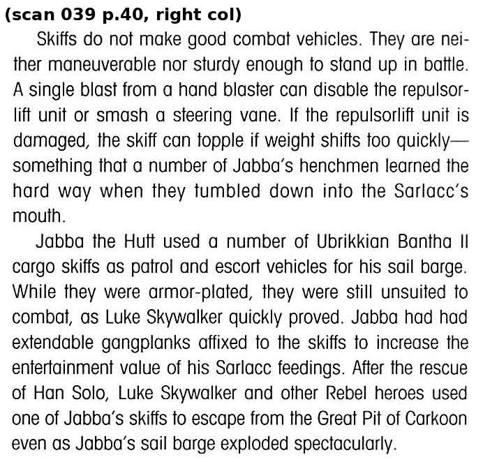

# Jabba the Hutt

- **Aliases:** Jabba, Jabba Desilijic Tiure
- **Era:** Prequel–Galactic Civil War
- **Continuity:** default Legends; entries present for: Canon, Legends
- **Research tier:** untiered (not listed as INTRO/DEEP/MASTERY in legends-feats.md)
- **Entries:** 536 (226 with quotations; 3 quotations extended to the full sentence/passage from the source text on file; 151 marked as fragments; 199 before the 2026-11-17 fragment fill). Rebuilt 2026-11-17 from 616 old entries; old file: `characters/_bak/jabba-the-hutt.md.bak-20261117`.
- **How to read:** each entry is the quotation in full (block quote), then its source and point of view. "Note" lines are summaries from our notes, not quotations. `[fragment — full passage not on file]` means the source text is not on the box, so only the words in our notes are shown. Debate and forum material is in the last section and is unverified.

# LEGENDS (Legends / EU — main focus)

## Jedi Academy Trilogy (Kevin J. Anderson, 1994): Jedi Search, Dark Apprentice, Champions of the Force (power-scaling notes)

> “I have an important matter to address,” he said. For a moment he was reminded of when he had walked alone into the dank corridors of Jabba the Hutt’s palace—but this time there were no piglike Gamorrean guards that he could manipulate with a twist of his fingers and a touch of the Force.
— Source: Jedi Search, ch.2, PDF p.23-24 — Owner Material 026 — Jedi Academy Trilogy: Jedi Search (Kevin J. Anderson); Narration compares the Senate to Jabba’s palace.
(Excerpt widened 2026-11-17 to the relevant passage, word for word from Jedi Search (Kevin Anderson) (text copy `MEGA_Legend_The_Jedi_Academy_Trilogy_Star_Wars_Jedi_Academy_01_Jedi_Search_Kevin_J_Anderson_epub`).)
Note (our notes, around the quote): Narration compares the Senate to Jabba’s palace: "For a moment he was reminded of when he had walked alone into the dank corridors of Jabba the Hutt’s palace—but this time there were no piglike Gamorrean guards that he could manipulate with a twist of his fingers and a touch of the Force." Source: Jedi Search, ch.2, PDF p.23-24
Our notes: `notes/materials/026-jedi-academy-trilogy/jedi-search.md:42`

## Star Wars: The New Essential Chronology (Del Rey, 2005): power-scaling and lore notes

> but the rookie Jedi Knight decimated the Hutt's entourage with ease. Leia strangled Jabba, leading to the collapse of the Desilijic crime family.
> [fragment — full passage not on file]
— Source: Part Five: The Galactic Civil War; Luke Skywalker — Jabba's sail barge.
Note (our notes, around the quote): Luke Skywalker — Jabba's sail barge: "but the rookie Jedi Knight decimated the Hutt's entourage with ease. Leia strangled Jabba, leading to the collapse of the Desilijic crime family." Source: The New Essential Chronology, p.123
Our notes: `notes/materials/027-new-essential-chronology/05-part-five-galactic-civil-war.md:170`

> Beldorian, at nine meters, was staggeringly large even for a Hutt, and possessed none of the corpulent rolls that immobilized lazy Hutts like Jabba. All muscle and fire, he slithered toward Leia like a snake, but a long, swift side cut with her lightsaber messily ended the career of Beldorian the Splendid.
— Source: Part Eight: The Return of the Jedi Knights; Leia Organa Solo — Leia kills Beldorian. POV: speaker not named in our notes.
Note (our notes, around the quote): Leia Organa Solo — Leia kills Beldorian: "Beldorian, at nine meters, was staggeringly large even for a Hutt, and possessed none of the corpulent rolls that immobilized lazy Hutts like Jabba. All muscle and fire, he slithered toward Leia like a snake, but a long, swift side cut with her lightsaber messily ended the career of Beldorian the Splendid." Source: The New Essential Chronology, p.175
Our notes: `notes/materials/027-new-essential-chronology/08-part-eight-return-of-the-jedi-knights.md:138`

## The Complete Star Wars Encyclopedia, Vol. I (A–G)

> Beedo A relative of Greedo from the Tetsus clan, he took the bounty hunter's place in Jabba the Hutt's gang after Greedo was killed by Han Solo at the Mos Eisley cantina.
— Source: scan pages 81–120; Greedo; Han Solo.
Note (our notes, around the quote): Greedo; Han Solo: "Beedo A relative of Greedo from the Tetsus clan, he took the bounty hunter's place in Jabba the Hutt's gang after Greedo was killed by Han Solo at the Mos Eisley cantina." Source: The Complete Star Wars Encyclopedia, Vol. I, p.66
Our notes: `notes/materials/030-complete-star-wars-encyclopedia-vol-1/02-v1-scan-081-120.md:12`

> Boorka the Hutt A Hutt rival to Jabba the Hutt on Tatooine near Mos Osnoe, he allied himself with Sev'Rance Tann during the Clone Wars.
— Source: scan pages 81–120; Sev'rance Tann. POV: Sev'rance Tann, about Jabba the Hutt.
Note (our notes, around the quote): Sev'rance Tann: "Boorka the Hutt A Hutt rival to Jabba the Hutt on Tatooine near Mos Osnoe, he allied himself with Sev'Rance Tann during the Clone Wars." Source: The Complete Star Wars Encyclopedia, Vol. I, p.86
Our notes: `notes/materials/030-complete-star-wars-encyclopedia-vol-1/02-v1-scan-081-120.md:168`

> Bossk then spent some time in Jabba's palace, but fled the Hutt's sail barge before Luke Skywalker and Princess Leia destroyed the craft.
— Source: scan pages 81–120; Bossk; Luke Skywalker; Leia Organa Solo — entry/section: Bossk.
Note (our notes, around the quote): Bossk; Luke Skywalker; Leia Organa Solo — entry/section: Bossk: "Bossk then spent some time in Jabba's palace, but fled the Hutt's sail barge before Luke Skywalker and Princess Leia destroyed the craft." Source: The Complete Star Wars Encyclopedia, Vol. I, p.88
Our notes: `notes/materials/030-complete-star-wars-encyclopedia-vol-1/02-v1-scan-081-120.md:188`

## The Complete Star Wars Encyclopedia, Vol. II (H–O)

> After Han Solo killed Greedo in the Mos Eisley cantina, Jabba ordered Heater to hire bounty hunters to bring Solo to justice.
— Source: scan pages 1–40; Han Solo; Greedo.
Note (our notes, around the quote): Han Solo; Greedo: "After Han Solo killed Greedo in the Mos Eisley cantina, Jabba ordered Heater to hire bounty hunters to bring Solo to justice." Source: The Complete Star Wars Encyclopedia, Vol. II, p.30
Our notes: `notes/materials/031-complete-star-wars-encyclopedia-vol-2/00-v2-scan-001-040.md:243`

- Note (summary from our notes, not a quotation): Page contents: 1044 words, 17 paragraphs | headings/entries: Jab, JillJoo; Jabba; Jabba's Throne Room
  — Source: scan pages 121–160.
Our notes: `notes/materials/031-complete-star-wars-encyclopedia-vol-2/03-v2-scan-121-160.md:113`

> As a fight erupted on and near Jabba's desert sail barge, Princess Leia Organa—who had been put in chains and a skimpy outfit by Jabba—pulled her chain leash around the Hutt's neck, strangling him.
— Source: scan pages 121–160; Leia Organa Solo. POV: Leia Organa Solo, about Jabba the Hutt.
Note (our notes, around the quote): Leia Organa Solo: "As a fight erupted on and near Jabba's desert sail barge, Princess Leia Organa—who had been put in chains and a skimpy outfit by Jabba—pulled her chain leash around the Hutt's neck, strangling him." Source: The Complete Star Wars Encyclopedia, Vol. II, p.130
Our notes: `notes/materials/031-complete-star-wars-encyclopedia-vol-2/03-v2-scan-121-160.md:115`

> Karrde, Talon The lawless shadows of the underworld spawned despicable characters possessed of greed, vice, and a lack of scruples—kingpins like Jabba the Hutt, capable of killing without compunction.
— Source: scan pages 201–240; Darth Talon — entry/section: Karrde, Talon.
Note (our notes, around the quote): Darth Talon — entry/section: Karrde, Talon: "Karrde, Talon The lawless shadows of the underworld spawned despicable characters possessed of greed, vice, and a lack of scruples—kingpins like Jabba the Hutt, capable of killing without compunction." Source: The Complete Star Wars Encyclopedia, Vol. II, p.200
Our notes: `notes/materials/031-complete-star-wars-encyclopedia-vol-2/05-v2-scan-201-240.md:49`

> After learning that Luke had survived the encounter, Vader ordered Kohvrekhar to Tatooine to ensure that Jabba the Hutt and his henchmen didn't capture or kill Skywalker.
— Source: scan pages 201–240; Luke Skywalker; Darth Vader (Anakin Skywalker).
Note (our notes, around the quote): Luke Skywalker; Darth Vader (Anakin Skywalker): "After learning that Luke had survived the encounter, Vader ordered Kohvrekhar to Tatooine to ensure that Jabba the Hutt and his henchmen didn't capture or kill Skywalker." Source: The Complete Star Wars Encyclopedia, Vol. II, p.223
Our notes: `notes/materials/031-complete-star-wars-encyclopedia-vol-2/05-v2-scan-201-240.md:290`

## The Complete Star Wars Encyclopedia, Vol. III (P–Z)

> The towering monster was killed by Luke Skywalker when the Jedi was forced into the pit by Jabba's treachery.
— Source: scan pages 81–120; Luke Skywalker. POV: Luke Skywalker, about Jabba the Hutt.
Note (our notes, around the quote): Luke Skywalker: "The towering monster was killed by Luke Skywalker when the Jedi was forced into the pit by Jabba's treachery." Source: The Complete Star Wars Encyclopedia, Vol. III, p.78
Our notes: `notes/materials/032-complete-star-wars-encyclopedia-vol-3/02-v3-scan-081-120.md:45`

> Years later, Nat Secura suffered severe burns when Jabba the Hutt enslaved many natives of Ryloth, and Bib Fortuna brought him to Jabba's palace.
— Source: scan pages 121–160; Aayla Secura — entry/section: Secura, Nat.
Note (our notes, around the quote): Aayla Secura — entry/section: Secura, Nat: "Years later, Nat Secura suffered severe burns when Jabba the Hutt enslaved many natives of Ryloth, and Bib Fortuna brought him to Jabba's palace." Source: The Complete Star Wars Encyclopedia, Vol. III, p.134
Our notes: `notes/materials/032-complete-star-wars-encyclopedia-vol-3/03-v3-scan-121-160.md:149`

- Note (summary from our notes, not a quotation): Luke Skywalker: "She beat him to Jabba's palace and went undercover as "Arica," but she failed in her mission, and Luke went on to help destroy the Emperor along with his second Death Star battle station." Source: The Complete Star Wars Encyclopedia, Vol. III, p.166
  — Source: scan pages 161–200. POV: Luke Skywalker, about Jabba the Hutt.
Our notes: `notes/materials/032-complete-star-wars-encyclopedia-vol-3/04-v3-scan-161-200.md:149`

> Pote Snitkin piloted one of Jabba's skiffs and was among those killed during Luke Skywalker's rescue of Han Solo and Princess Leia from the Hutt.
— Source: scan pages 161–200; Luke Skywalker; Han Solo; Leia Organa Solo.
Note (our notes, around the quote): Luke Skywalker; Han Solo; Leia Organa Solo: "Pote Snitkin piloted one of Jabba's skiffs and was among those killed during Luke Skywalker's rescue of Han Solo and Princess Leia from the Hutt." Source: The Complete Star Wars Encyclopedia, Vol. III, p.170
Our notes: `notes/materials/032-complete-star-wars-encyclopedia-vol-3/04-v3-scan-161-200.md:203`

> She eventually killed Jabba by strangling him with the very chain that bound her.
— Source: scan pages 161–200; Jaina Solo — entry/section: Solo, Jaina.
Note (our notes, around the quote): Jaina Solo — entry/section: Solo, Jaina: "She eventually killed Jabba by strangling him with the very chain that bound her." Source: The Complete Star Wars Encyclopedia, Vol. III, p.177
Our notes: `notes/materials/032-complete-star-wars-encyclopedia-vol-3/04-v3-scan-161-200.md:282`

## The New Essential Guide to Characters (2002)

> Jabba, however, foresaw Dengar's betrayal and staked the bounty hunter out in the desert to die.
— Source: scan pages 31–60; Dengar. POV: Dengar, about Jabba the Hutt.
Note (our notes, around the quote): Dengar: "Jabba, however, foresaw Dengar's betrayal and staked the bounty hunter out in the desert to die." Source: The New Essential Guide to Characters, p.54
Our notes: `notes/materials/034-new-essential-guide-to-characters/01-negc-scan-031-060.md:122`

> Dengar survived, but Jabba didn't return from his trip to the Great Pit of Carkoon.
— Source: scan pages 31–60; Dengar. POV: Dengar, about Jabba the Hutt.
Note (our notes, around the quote): Dengar: "Dengar survived, but Jabba didn't return from his trip to the Great Pit of Carkoon." Source: The New Essential Guide to Characters, p.54
Our notes: `notes/materials/034-new-essential-guide-to-characters/01-negc-scan-031-060.md:124`

- Note (summary from our notes, not a quotation): Page contents: 425 words, 14 paragraphs | headings/entries: Fe all his infamy, Jabba the Hutt; CH ae a as,
  — Source: scan pages 31–60.
Our notes: `notes/materials/034-new-essential-guide-to-characters/01-negc-scan-031-060.md:153`

- Note (summary from our notes, not a quotation): Page contents: 467 words, 20 paragraphs | headings/entries: STAR WARS:; THE New ESSENTIAL GUIDE TO CHARACTERS; Praise spilled forth from Jabba's
  — Source: scan pages 61–90.
Our notes: `notes/materials/034-new-essential-guide-to-characters/02-negc-scan-061-090.md:38`

> Ki-Adi-Mundi opposed him again, and Jabba fought off a takeover attempt raised by his rival Gardulla.
— Source: scan pages 61–90; Ki-Adi-Mundi. POV: Ki-Adi-Mundi, about Jabba the Hutt.
Note (our notes, around the quote): Ki-Adi-Mundi: "Ki-Adi-Mundi opposed him again, and Jabba fought off a takeover attempt raised by his rival Gardulla." Source: The New Essential Guide to Characters, p.88
Our notes: `notes/materials/034-new-essential-guide-to-characters/02-negc-scan-061-090.md:156`

- Note (summary from our notes, not a quotation): Page contents: 410 words, 10 paragraphs | headings/entries: With word of Jabba's demise,
  — Source: scan pages 61–90.
Our notes: `notes/materials/034-new-essential-guide-to-characters/02-negc-scan-061-090.md:166`

## Adventures/Tempest feud.pdf [Star Wars Roleplaying Game (d20, 2000)] (scan pages 1–60)

- Note (summary from our notes, not a quotation): Page contents: Hutt secret third name example: Jabba Desilijic Tiure. (hand-read)
  — Source: Adventures/Tempest feud.pdf [Star Wars Roleplaying Game (d20, 2000)] (sca.
Our notes: `notes/materials/037-sw-d20-folder/030-tempest-feud-scan-001-060.md:45`

## Sourcebooks/Rebellion Era Sourcebook.pdf [Star Wars Roleplaying Game (d20, 2000)] (scan pages 1–60)

- Note (summary from our notes, not a quotation): Page contents: 487 words, 60 paragraphs | headings/entries: Introduction Chapter 1: A New Hope; Fall of the Republic; The Outer Rim; The Doctrine of Fear; Common Droids; Darth Vader: Dark Lord of the Sith; The End of the Senate; Death Star Personnel; The Milrtary-industrial Complex The Imperial Star Destroyer; Imperial intelligence Blackhole; The Corporate Sector Working for the CSA; Scouring the Galaxy Hoth; Echo Base; Probe Droid; AT-ATs; Cold Assault Trooper Rebel Forces; Vader's Fleet; Yoda's Tutelage Bespin; Cloud City; Heroes of Yavin: Update; Chapter 9: The Empire Strikes Back 88; Contents; Jabba the Hutt; Jabba's Court; The Rebel Fleet; Alliance Leaders; Strike Team; Rebel Commandos; A Second Death Star; The Emperor; Ewoks; Ewok Inventions; Ewoks at War; Ewok Heroes; The Battle of Endor; Luke Skywalker Update Leia Organa Update; Han Solo Update Chewbacca Update Bakura; Ssi-Ruu
  — Source: Sourcebooks/Rebellion Era Sourcebook.pdf [Star Wars Roleplaying Game (d20.
Our notes: `notes/materials/037-sw-d20-folder/043-rebellion-era-sourcebook-scan-001-060.md:25`

- Note (summary from our notes, not a quotation): Page contents: Jabba has held his position as reigning Tatooine crime lord 'since well before the Clone Wars' (hand-read)
  — Source: Sourcebooks/Rebellion Era Sourcebook.pdf [Star Wars Roleplaying Game (d20.
Our notes: `notes/materials/037-sw-d20-folder/043-rebellion-era-sourcebook-scan-001-060.md:134`

## Sourcebooks/Rebellion Era Sourcebook.pdf [Star Wars Roleplaying Game (d20, 2000)] (scan pages 61–120)

- Note (summary from our notes, not a quotation): Page contents: Double Bounty letter (Calk Fen to Jabba): Han Solo has cost Jabba more than 1.3 million credits; 'I am betting on Boba Fett to bring him back to Tatooine' (hand-read)
  — Source: Sourcebooks/Rebellion Era Sourcebook.pdf [Star Wars Roleplaying Game (d20.
Our notes: `notes/materials/037-sw-d20-folder/043-rebellion-era-sourcebook-scan-061-120.md:273`

## Sourcebooks/Rebellion Era Sourcebook.pdf [Star Wars Roleplaying Game (d20, 2000)] (scan pages 121–161)

- Note (summary from our notes, not a quotation): Page contents: Jabba 'respects and admires Xizor and his Black Sun operation'; Big Gizz Thug 12 CC D; swoop gang (hand-read)
  — Source: Sourcebooks/Rebellion Era Sourcebook.pdf [Star Wars Roleplaying Game (d20.
Our notes: `notes/materials/037-sw-d20-folder/043-rebellion-era-sourcebook-scan-121-161.md:88`

- Note (summary from our notes, not a quotation): Page contents: Rescue of Han Solo: Luke 'attempted to use the Force against Jabba, but the crime lord simply laughed him off. The Hutt was not some weak-minded fool like Fortuna'; Luke dropped the portcullis on the rancor, 'It died instantly'; Sarlacc consumed Boba Fett—'or so they thought' (hand-read)
  — Source: Sourcebooks/Rebellion Era Sourcebook.pdf [Star Wars Roleplaying Game (d20.
Our notes: `notes/materials/037-sw-d20-folder/043-rebellion-era-sourcebook-scan-121-161.md:93`

> Lando, meanwhile, : Sé j \fter d Ti it } reat post by Prince Xiz and the i f # inally took action as well, A confusing battle ensued, When types walker and his compan . ver, the Sarlace had consumed Boba Fett and many quard a oY ent on to rescue Han Solo from the clutches of the A : ; of Jabba's quards, Leia had strangled Jabba with the chair his h ile ¢ qstcr iba the Hutt ¢ complex plat put Land t that bound her to the Hutt, and Luke had destroyed the ' mask Calrissian into Jabba's palace, where he disquised himself as : ; : : massive sail barge, The companions were free, Jabba wi : f ne of ba ) ce quards.
— Source: Sourcebooks/Rebellion Era Sourcebook.pdf [Star Wars Roleplaying Game (d20.
Note (our notes, around the quote): Lando Calrissian; Boba Fett; Han Solo; Leia Organa Solo; Luke Skywalker: "Lando, meanwhile, : Sé j \fter d Ti it } reat post by Prince Xiz and the i f # inally took action as well, A confusing battle ensued, When types walker and his compan . ver, the Sarlace had consumed Boba Fett and many quard a oY ent on to rescue Han Solo from the clutches of the A : ; of Jabba's quards, Leia had strangled Jabba with the chair his h ile ¢ qstcr iba the Hutt ¢ complex plat put Land t that bound her to the Hutt, and Luke had destroyed the ' mask Calrissian into Jabba's palace, where he disquised himself as : ; : : massive sail barge, The companions were free, Jabba wi : f ne of ba ) ce quards." Source: *Rebellion Era Sourcebook* (SWRPG d20), scan p.131
Our notes: `notes/materials/037-sw-d20-folder/043-rebellion-era-sourcebook-scan-121-161.md:95`

- Note (summary from our notes, not a quotation): Page contents: Jabba's court: Bib Fortuna, Salacious Crumb, Ephant Mon; Gamorrean captain Ortugg Thug 4 CC B (hand-read)
  — Source: Sourcebooks/Rebellion Era Sourcebook.pdf [Star Wars Roleplaying Game (d20.
Our notes: `notes/materials/037-sw-d20-folder/043-rebellion-era-sourcebook-scan-121-161.md:122`

- Note (summary from our notes, not a quotation): Page contents: Mos Eisley Mourners: four ancient DX-series war droids (Soldier 7, VP/WP 46/16, CC D) released on Jabba's death to kill his possible enemies incl. Bib Fortuna and Lady Valarian; Kisa Shaki's ambition 'since the time of Xim the Despot' (hand-read)
  — Source: Sourcebooks/Rebellion Era Sourcebook.pdf [Star Wars Roleplaying Game (d20.
Our notes: `notes/materials/037-sw-d20-folder/043-rebellion-era-sourcebook-scan-121-161.md:132`

## Sourcebooks/Secrets of Tatooine.pdf [Star Wars Roleplaying Game (d20, 2000)] (scan pages 1–60)

> It is a massive, fearsome monster that hides itself under the endless sand and drags in unwary passersby to slowly digest them over the course of several centuries. Criminals frequently use it to dispose of victims or rivals, and Jabba the Hutt finds the screams of the Sarlacc's meals particularly soothing.
— Source: Sourcebooks/Secrets of Tatooine.pdf [Star Wars Roleplaying Game (d20, 200.
Note (our notes, around the quote): The Sarlacc; Jabba the Hutt — entry/section: Great Pit of Carkoon: "It is a massive, fearsome monster that hides itself under the endless sand and drags in unwary passersby to slowly digest them over the course of several centuries. Criminals frequently use it to dispose of victims or rivals, and Jabba the Hutt finds the screams of the Sarlacc's meals particularly soothing." Source: *Secrets of Tatooine* (SWRPG d20), scan p.8
Our notes: `notes/materials/037-sw-d20-folder/045-secrets-of-tatooine-scan-001-060.md:47`

> Jabba the Hutt has long been interested in capturing a krayt dragon—originally because of the rumor of the dragon pearls, but in later years because he wanted to see how his pet rancor would fare against one of the giant lizards.
— Source: Sourcebooks/Secrets of Tatooine.pdf [Star Wars Roleplaying Game (d20, 200; Jabba the Hutt — entry/section: Krayt Dragon.
Note (our notes, around the quote): Jabba the Hutt — entry/section: Krayt Dragon: "Jabba the Hutt has long been interested in capturing a krayt dragon—originally because of the rumor of the dragon pearls, but in later years because he wanted to see how his pet rancor would fare against one of the giant lizards." Source: *Secrets of Tatooine* (SWRPG d20), scan p.15
Our notes: `notes/materials/037-sw-d20-folder/045-secrets-of-tatooine-scan-001-060.md:88`

- Note (summary from our notes, not a quotation): Page contents: Jedi Knights Sidrona Diath and son Dace Diath came from Tatooine in the early-settler era; worrt once attacked its own reflection; Jabba keeps worrts at his palace (hand-read)
  — Source: Sourcebooks/Secrets of Tatooine.pdf [Star Wars Roleplaying Game (d20, 200.
Our notes: `notes/materials/037-sw-d20-folder/045-secrets-of-tatooine-scan-001-060.md:103`

- Note (summary from our notes, not a quotation): Page contents: B'omarr monks: brain removed into a jar as 'gift', granted to Alkhara 'and every crime lord since'; timeline lists Jabba killed by Leia Organa (hand-read)
  — Source: Sourcebooks/Secrets of Tatooine.pdf [Star Wars Roleplaying Game (d20, 200.
Our notes: `notes/materials/037-sw-d20-folder/045-secrets-of-tatooine-scan-001-060.md:108`

- Note (summary from our notes, not a quotation): Page contents: Hutts bought farmers' loans and turned defaulters into slaves; 'not all Hutts were as cruel to their slaves as the infamous Jabba would one day be' (hand-read)
  — Source: Sourcebooks/Secrets of Tatooine.pdf [Star Wars Roleplaying Game (d20, 200.
Our notes: `notes/materials/037-sw-d20-folder/045-secrets-of-tatooine-scan-001-060.md:128`

- Note (summary from our notes, not a quotation): Page contents: Sail barge used by Jabba's court at Carkoon (ROTJ); Anakin's Podracer Radon-Ulzer 620C, Sebulba's Collor Pondrat Plug-F Mammoth (hand-read)
  — Source: Sourcebooks/Secrets of Tatooine.pdf [Star Wars Roleplaying Game (d20, 200.
Our notes: `notes/materials/037-sw-d20-folder/045-secrets-of-tatooine-scan-001-060.md:158`

> Always accustomed to bribing and extorting Republic officials who bothered to visit Tatooine, the Hutts actually found life somewhat easier for the two decades prior to the establishment of Imperial rule. The Hutts' best guess was that someone located close to the Republic Senate was diverting attention away from Tatooine for some unknown reason.
— Source: Sourcebooks/Secrets of Tatooine.pdf [Star Wars Roleplaying Game (d20, 200.
Note (our notes, around the quote): Jabba the Hutt; Palpatine (Darth Sidious) — entry/section: The Rise of the Empire Era: "Always accustomed to bribing and extorting Republic officials who bothered to visit Tatooine, the Hutts actually found life somewhat easier for the two decades prior to the establishment of Imperial rule. The Hutts' best guess was that someone located close to the Republic Senate was diverting attention away from Tatooine for some unknown reason." Source: *Secrets of Tatooine* (SWRPG d20), scan p.31
Our notes: `notes/materials/037-sw-d20-folder/045-secrets-of-tatooine-scan-001-060.md:170`

> Each of the Hutts on Tatooine is trying to edge out the others, to one degree or another. Unfortunately for the rest, Jabba is much more focused on his scheming than he pretends to be. Unless something changes radically in the near future, he will attain his goal much sooner than the others suspect.
— Source: Sourcebooks/Secrets of Tatooine.pdf [Star Wars Roleplaying Game (d20, 200; Jabba the Hutt — entry/section: Who's In Charge.
Note (our notes, around the quote): Jabba the Hutt — entry/section: Who's In Charge: "Each of the Hutts on Tatooine is trying to edge out the others, to one degree or another. Unfortunately for the rest, Jabba is much more focused on his scheming than he pretends to be. Unless something changes radically in the near future, he will attain his goal much sooner than the others suspect." Source: *Secrets of Tatooine* (SWRPG d20), scan p.32
Our notes: `notes/materials/037-sw-d20-folder/045-secrets-of-tatooine-scan-001-060.md:177`

- Note (summary from our notes, not a quotation): Page contents: 739 words, 38 paragraphs | headings/entries: Semple Ciess One Infrections; Sample Class Two Infractions; Murder or manslaughter of a free citizen,; Semple Class Three Infrections; CITIES OF TATOOINE; Jabba the Hutt; Pa -
  — Source: Sourcebooks/Secrets of Tatooine.pdf [Star Wars Roleplaying Game (d20, 200.
Our notes: `notes/materials/037-sw-d20-folder/045-secrets-of-tatooine-scan-001-060.md:187`

> To draw attention away from his acquisition of power, Jabba graciously surrendered control of Mos Espa's slave trade to his onetime rival Gardulla—just in time for the Republic to finally enforce its antislavery laws on the last few Outer Rim worlds that still allowed the industry. Gardulla was ruined, and Jabba was that much closer to controlling Tatooine.
— Source: Sourcebooks/Secrets of Tatooine.pdf [Star Wars Roleplaying Game (d20, 200.
Note (our notes, around the quote): Jabba the Hutt; Gardulla the Hutt — entry/section: Jabba the Hutt: "To draw attention away from his acquisition of power, Jabba graciously surrendered control of Mos Espa's slave trade to his onetime rival Gardulla—just in time for the Republic to finally enforce its antislavery laws on the last few Outer Rim worlds that still allowed the industry. Gardulla was ruined, and Jabba was that much closer to controlling Tatooine." Source: *Secrets of Tatooine* (SWRPG d20), scan p.34
Our notes: `notes/materials/037-sw-d20-folder/045-secrets-of-tatooine-scan-001-060.md:189`

> The first was Naroon Cuthus, who was so efficient that Jabba ultimately had to eliminate him; he knew far too much to live. A pair of ambitious smugglers replaced Cuthus: Bidlo Kwerve, a Corellian, and Bib Fortuna, a Twi'lek. Jabba played them against each other to prevent either from becoming a threat to him, but Fortuna eventually got the upper hand. Kwerve received the dubious distinction of becoming the first being Jabba fed to his pet rancor.
— Source: Sourcebooks/Secrets of Tatooine.pdf [Star Wars Roleplaying Game (d20, 200.
Note (our notes, around the quote): Jabba the Hutt; Ephant Mon; Bib Fortuna — entry/section: Jabba the Hutt: "The first was Naroon Cuthus, who was so efficient that Jabba ultimately had to eliminate him; he knew far too much to live. A pair of ambitious smugglers replaced Cuthus: Bidlo Kwerve, a Corellian, and Bib Fortuna, a Twi'lek. Jabba played them against each other to prevent either from becoming a threat to him, but Fortuna eventually got the upper hand. Kwerve received the dubious distinction of becoming the first being Jabba fed to his pet rancor." Source: *Secrets of Tatooine* (SWRPG d20), scan p.35
Our notes: `notes/materials/037-sw-d20-folder/045-secrets-of-tatooine-scan-001-060.md:196`

> (Ultimately, Ephant Mon earned Jabba's scorn because of his respect for the Jedi powers of Luke Skywalker — but that respect also enabled him to outlive Jabba.)
— Source: Sourcebooks/Secrets of Tatooine.pdf [Star Wars Roleplaying Game (d20, 200.
Note (our notes, around the quote): Ephant Mon; Jabba the Hutt; Luke Skywalker — entry/section: Jabba the Hutt: "(Ultimately, Ephant Mon earned Jabba's scorn because of his respect for the Jedi powers of Luke Skywalker — but that respect also enabled him to outlive Jabba.)" Source: *Secrets of Tatooine* (SWRPG d20), scan p.35
Our notes: `notes/materials/037-sw-d20-folder/045-secrets-of-tatooine-scan-001-060.md:198`

> Jabba planned to execute them, but they had prepared for such a contingency, and instead killed Jabba. This of course delighted Bib Fortuna, who had been preparing to assassinate Jabba himself anyway. But when he returned to the palace to seize his prize, he discovered that the B'omarr monks had concealed their own plans from him. Bib Fortuna soon found himself a disembodied brain floating in a containment sphere amid the most enlightened minds of the B'omarr.
— Source: Sourcebooks/Secrets of Tatooine.pdf [Star Wars Roleplaying Game (d20, 200.
Note (our notes, around the quote): Bib Fortuna; Jabba the Hutt; Han Solo — entry/section: Bib Fortuna: "Jabba planned to execute them, but they had prepared for such a contingency, and instead killed Jabba. This of course delighted Bib Fortuna, who had been preparing to assassinate Jabba himself anyway. But when he returned to the palace to seize his prize, he discovered that the B'omarr monks had concealed their own plans from him. Bib Fortuna soon found himself a disembodied brain floating in a containment sphere amid the most enlightened minds of the B'omarr." Source: *Secrets of Tatooine* (SWRPG d20), scan p.36
Our notes: `notes/materials/037-sw-d20-folder/045-secrets-of-tatooine-scan-001-060.md:209`

> Gambling on the Podraces gradually drained away Gardulla's fortunes, and she found herself giving up various luxuries, such as slaves (including Shmi Skywalker and her infant son Anakin) on unlucky bets. Jabba tricked her into backing a Xexto pilot named Gasgano and betting heavily on him. Jabba already knew (by virtue of his astromech droid's oddsfiguring skills) that Gasgano could never beat Sebulba—Jabba's favorite.
— Source: Sourcebooks/Secrets of Tatooine.pdf [Star Wars Roleplaying Game (d20, 200.
Note (our notes, around the quote): Gardulla the Hutt; Jabba the Hutt; Shmi Skywalker; Darth Vader (Anakin Skywalker); Sebulba — entry/section: Gardulla the Hutt: "Gambling on the Podraces gradually drained away Gardulla's fortunes, and she found herself giving up various luxuries, such as slaves (including Shmi Skywalker and her infant son Anakin) on unlucky bets. Jabba tricked her into backing a Xexto pilot named Gasgano and betting heavily on him. Jabba already knew (by virtue of his astromech droid's oddsfiguring skills) that Gasgano could never beat Sebulba—Jabba's favorite." Source: *Secrets of Tatooine* (SWRPG d20), scan p.37
Our notes: `notes/materials/037-sw-d20-folder/045-secrets-of-tatooine-scan-001-060.md:220`

- Note (summary from our notes, not a quotation): Page contents: Rebellion era: governor Tour Aryon keeps Tatooine from the Emperor's notice and quietly removes Jabba's rivals; "Lady" Valarian the Whiphid runs the Lucky Despot (hand-read)
  — Source: Sourcebooks/Secrets of Tatooine.pdf [Star Wars Roleplaying Game (d20, 200.
Our notes: `notes/materials/037-sw-d20-folder/045-secrets-of-tatooine-scan-001-060.md:249`

- Note (summary from our notes, not a quotation): Page contents: Prefect Eugene Talmont (Diplomat 2, CC B) aims to bring Jabba to justice while taking bribes (hand-read)
  — Source: Sourcebooks/Secrets of Tatooine.pdf [Star Wars Roleplaying Game (d20, 200.
Our notes: `notes/materials/037-sw-d20-folder/045-secrets-of-tatooine-scan-001-060.md:254`

- Note (summary from our notes, not a quotation): Page contents: Lt. Harburik (Noble 2/Soldier 3/Officer 1, VP/WP 30/12, CC C) throws stormtroopers at Jabba's agents; sandtrooper Thug 3; Garindan "Long Snoot" Kubaz Diplomat 4 spy paid by both Talmont and Jabba (hand-read)
  — Source: Sourcebooks/Secrets of Tatooine.pdf [Star Wars Roleplaying Game (d20, 200.
Our notes: `notes/materials/037-sw-d20-folder/045-secrets-of-tatooine-scan-001-060.md:264`

> She finally reached agreements with Jabba in which she paid him an exorbitant sum to leave him in peace and promised not to try to extend her criminal operations farther than the spaceport. Officially, they both honor their side of the bargain—but the truce between them is a shaky one. Each is constantly testing the other's defenses, seeking a way to eliminate the competition once and for all.
— Source: Sourcebooks/Secrets of Tatooine.pdf [Star Wars Roleplaying Game (d20, 200; Lady Valarian; Jabba the Hutt — entry/section: Lady Valarian.
Note (our notes, around the quote): Lady Valarian; Jabba the Hutt — entry/section: Lady Valarian: "She finally reached agreements with Jabba in which she paid him an exorbitant sum to leave him in peace and promised not to try to extend her criminal operations farther than the spaceport. Officially, they both honor their side of the bargain—but the truce between them is a shaky one. Each is constantly testing the other's defenses, seeking a way to eliminate the competition once and for all." Source: *Secrets of Tatooine* (SWRPG d20), scan p.49
Our notes: `notes/materials/037-sw-d20-folder/045-secrets-of-tatooine-scan-001-060.md:296`

> warrior of the huge bounty on Han Solo's head. Predictably, D'Wopp decided to set out at once to collect the prize. Valarian objected—violently—to her new mate's poor timing (and choice of patrons), and in the ensuing argument, she killed her own newlywed husband.
> [fragment — full passage not on file]
— Source: Sourcebooks/Secrets of Tatooine.pdf [Star Wars Roleplaying Game (d20, 200.
Note (our notes, around the quote): Lady Valarian; Han Solo; Jabba the Hutt — entry/section: Lady Valarian: "warrior of the huge bounty on Han Solo's head. Predictably, D'Wopp decided to set out at once to collect the prize. Valarian objected—violently—to her new mate's poor timing (and choice of patrons), and in the ensuing argument, she killed her own newlywed husband." Source: *Secrets of Tatooine* (SWRPG d20), scan p.50
Our notes: `notes/materials/037-sw-d20-folder/045-secrets-of-tatooine-scan-001-060.md:303`

> With Jabba's own death just before the Battle of Endor, Valarian finally had her chance to seize Jabba's empire. Assuming that all Jabba's lieutenants had been killed aboard his sail barge—there certainly wasn't any news coming out of Jabba's palace—Valarian quickly took over Jabba's operations in and around Mos Eisley and began extending her reach into Tatooine's other cities as well. Of course, without Jabba around to call the shots, most of the Hutt's smuggler contacts drifted to other patrons, notably the elusive Talon Karrde.
— Source: Sourcebooks/Secrets of Tatooine.pdf [Star Wars Roleplaying Game (d20, 200.
Note (our notes, around the quote): Lady Valarian; Jabba the Hutt; Talon Karrde — entry/section: Lady Valarian: "With Jabba's own death just before the Battle of Endor, Valarian finally had her chance to seize Jabba's empire. Assuming that all Jabba's lieutenants had been killed aboard his sail barge—there certainly wasn't any news coming out of Jabba's palace—Valarian quickly took over Jabba's operations in and around Mos Eisley and began extending her reach into Tatooine's other cities as well. Of course, without Jabba around to call the shots, most of the Hutt's smuggler contacts drifted to other patrons, notably the elusive Talon Karrde." Source: *Secrets of Tatooine* (SWRPG d20), scan p.50
Our notes: `notes/materials/037-sw-d20-folder/045-secrets-of-tatooine-scan-001-060.md:305`

> When Jabba smeared meat all over the assassin droid and threw it to his rancor, all that was left was twisted scraps of metal and broken gears. Lady Valarian rescued the scrap and paid to have it rebuilt and reprogrammed—all because she knew it would spoil Jabba's fun.
— Source: Sourcebooks/Secrets of Tatooine.pdf [Star Wars Roleplaying Game (d20, 200; Jabba the Hutt; Lady Valarian — entry/section: Eefive-Tootoo.
Note (our notes, around the quote): Jabba the Hutt; Lady Valarian — entry/section: Eefive-Tootoo: "When Jabba smeared meat all over the assassin droid and threw it to his rancor, all that was left was twisted scraps of metal and broken gears. Lady Valarian rescued the scrap and paid to have it rebuilt and reprogrammed—all because she knew it would spoil Jabba's fun." Source: *Secrets of Tatooine* (SWRPG d20), scan p.50
Our notes: `notes/materials/037-sw-d20-folder/045-secrets-of-tatooine-scan-001-060.md:307`

- Note (summary from our notes, not a quotation): Page contents: Ortugg Gamorrean captain Thug 4 (vibro-ax +9, 2d10+4); Tessek Quarren accountant skimming Jabba's money; Zutton "Snaggletooth" Scout 3/Soldier 3 VP/WP 55/14 paints his targets (hand-read)
  — Source: Sourcebooks/Secrets of Tatooine.pdf [Star Wars Roleplaying Game (d20, 200.
Our notes: `notes/materials/037-sw-d20-folder/045-secrets-of-tatooine-scan-001-060.md:316`

> While unswervingly loyal to Jabba, Ephant Mon is hardly an exemplary individual. Throughout his long life, he has been a mercenary, a slaver, and has even tangled with the Jedi—once actually kidnapping the daughter of Cerean Jedi Master Ki-Adi-Mundi. The Chevin has survived for so long largely by betraying his business associates faster than they can betray him.
— Source: Sourcebooks/Secrets of Tatooine.pdf [Star Wars Roleplaying Game (d20, 200; Ephant Mon; Ki-Adi-Mundi — entry/section: Ephant Mon.
Note (our notes, around the quote): Ephant Mon; Ki-Adi-Mundi — entry/section: Ephant Mon: "While unswervingly loyal to Jabba, Ephant Mon is hardly an exemplary individual. Throughout his long life, he has been a mercenary, a slaver, and has even tangled with the Jedi—once actually kidnapping the daughter of Cerean Jedi Master Ki-Adi-Mundi. The Chevin has survived for so long largely by betraying his business associates faster than they can betray him." Source: *Secrets of Tatooine* (SWRPG d20), scan p.51
Our notes: `notes/materials/037-sw-d20-folder/045-secrets-of-tatooine-scan-001-060.md:318`

- Note (summary from our notes, not a quotation): Page contents: 431 words, 24 paragraphs | headings/entries: Jabba's Palsce; JABBA'S THRONE ROOM >; S SSR SS; SCALE IN METERS
  — Source: Sourcebooks/Secrets of Tatooine.pdf [Star Wars Roleplaying Game (d20, 200.
Our notes: `notes/materials/037-sw-d20-folder/045-secrets-of-tatooine-scan-001-060.md:332`

> Like every resident before him, Jabba arrogantly believes that the monks are merely pacifistic scholars who suffer the series of occupations as only the weak truly can. Little does he know that the monks are planning to one day remove his brain and make him one of them.
— Source: Sourcebooks/Secrets of Tatooine.pdf [Star Wars Roleplaying Game (d20, 200; Jabba the Hutt — entry/section: Jabba's Palace.
Note (our notes, around the quote): Jabba the Hutt — entry/section: Jabba's Palace: "Like every resident before him, Jabba arrogantly believes that the monks are merely pacifistic scholars who suffer the series of occupations as only the weak truly can. Little does he know that the monks are planning to one day remove his brain and make him one of them." Source: *Secrets of Tatooine* (SWRPG d20), scan p.53
Our notes: `notes/materials/037-sw-d20-folder/045-secrets-of-tatooine-scan-001-060.md:334`

> The bounty was finally claimed by the infamous bounty hunter Boba Fett, who managed to increase the sum even further by suggesting that Han Solo (now frozen in carbonite) could be considered not just a bounty, but a piece of artwork—created by none other than the Dark Lord of the Sith, Darth Vader. Amused at the notion, Jabba paid Boba Fett 250,000 credits for Solo.
— Source: Sourcebooks/Secrets of Tatooine.pdf [Star Wars Roleplaying Game (d20, 200.
Note (our notes, around the quote): Han Solo; Jabba the Hutt; Boba Fett; Darth Vader (Anakin Skywalker) — entry/section: Jabba the Hutt: "The bounty was finally claimed by the infamous bounty hunter Boba Fett, who managed to increase the sum even further by suggesting that Han Solo (now frozen in carbonite) could be considered not just a bounty, but a piece of artwork—created by none other than the Dark Lord of the Sith, Darth Vader. Amused at the notion, Jabba paid Boba Fett 250,000 credits for Solo." Source: *Secrets of Tatooine* (SWRPG d20), scan p.55
Our notes: `notes/materials/037-sw-d20-folder/045-secrets-of-tatooine-scan-001-060.md:346`

> Han Solo's friends-including the newly trained Jedi Knight, Luke Skywalker—attempted a rescue, but earned Jabba's wrath when they not only freed Han from the carbonite, but killed his pet rancor. Infuriated, Jabba attempted to execute Skywalker, Solo, and Solo's copilot, the Wookiee Chewbacca, by feeding them to the Sarlacc. But Solo's companions turned the tables on Jabba. The sluglike crime lord died aboard his sail barge over the Great Pit of Carkoon, strangled to death by Leia Organa.
— Source: Sourcebooks/Secrets of Tatooine.pdf [Star Wars Roleplaying Game (d20, 200.
Note (our notes, around the quote): Jabba the Hutt; Leia Organa Solo; Luke Skywalker; Han Solo; Chewbacca; Jabba's Rancor — entry/section: Jabba the Hutt: "Han Solo's friends-including the newly trained Jedi Knight, Luke Skywalker—attempted a rescue, but earned Jabba's wrath when they not only freed Han from the carbonite, but killed his pet rancor. Infuriated, Jabba attempted to execute Skywalker, Solo, and Solo's copilot, the Wookiee Chewbacca, by feeding them to the Sarlacc. But Solo's companions turned the tables on Jabba. The sluglike crime lord died aboard his sail barge over the Great Pit of Carkoon, strangled to death by Leia Organa." Source: *Secrets of Tatooine* (SWRPG d20), scan p.55
Our notes: `notes/materials/037-sw-d20-folder/045-secrets-of-tatooine-scan-001-060.md:348`

> Jabba rewarded Bib Fortuna by making him his majordomo—and rewarded Bidlo Kwerve by making him the rancor's first meal. Jabba's rancor is actually somewhat small for its species; it has been in captivity for so long that it hasn't completely matured physically.
— Source: Sourcebooks/Secrets of Tatooine.pdf [Star Wars Roleplaying Game (d20, 200.
Note (our notes, around the quote): Jabba's Rancor; Bib Fortuna; Jabba the Hutt — entry/section: The Rancor: "Jabba rewarded Bib Fortuna by making him his majordomo—and rewarded Bidlo Kwerve by making him the rancor's first meal. Jabba's rancor is actually somewhat small for its species; it has been in captivity for so long that it hasn't completely matured physically." Source: *Secrets of Tatooine* (SWRPG d20), scan p.55
Our notes: `notes/materials/037-sw-d20-folder/045-secrets-of-tatooine-scan-001-060.md:350`

> Crumb's job as jester is to make Jabba laugh at least once each day—or be eaten (either by the rancor, or Jabba himself). He has managed to survive years at Jabba's side, and everyone in Jabba's employ hates him, so he has plainly done his job well. (There are as many plots to kill Salacious Crumb as there are to kill Jabba himself.)
— Source: Sourcebooks/Secrets of Tatooine.pdf [Star Wars Roleplaying Game (d20, 200; Salacious Crumb; Jabba the Hutt — entry/section: Salacious Crumb.
Note (our notes, around the quote): Salacious Crumb; Jabba the Hutt — entry/section: Salacious Crumb: "Crumb's job as jester is to make Jabba laugh at least once each day—or be eaten (either by the rancor, or Jabba himself). He has managed to survive years at Jabba's side, and everyone in Jabba's employ hates him, so he has plainly done his job well. (There are as many plots to kill Salacious Crumb as there are to kill Jabba himself.)" Source: *Secrets of Tatooine* (SWRPG d20), scan p.55
Our notes: `notes/materials/037-sw-d20-folder/045-secrets-of-tatooine-scan-001-060.md:352`

> Keeping Solo brought about Jabba's death, Han Solo's friends-including the newly trained Jedi Knight, Luke Skywalker—attempted a rescue, but earned Jabba's wrath when they not only freed Han from the carbonite, but killed his pet rancor. infuriated, Jabba attempted to execute Skywalker, Solo, -and Solo's copilot, the Wookiee Chewbacca, by feeding them to the Sarlacc.
— Source: Sourcebooks/Secrets of Tatooine.pdf [Star Wars Roleplaying Game (d20, 200; Han Solo; Luke Skywalker; Chewbacca.
Note (our notes, around the quote): Han Solo; Luke Skywalker; Chewbacca: "Keeping Solo brought about Jabba's death, Han Solo's friends-including the newly trained Jedi Knight, Luke Skywalker—attempted a rescue, but earned Jabba's wrath when they not only freed Han from the carbonite, but killed his pet rancor. infuriated, Jabba attempted to execute Skywalker, Solo, -and Solo's copilot, the Wookiee Chewbacca, by feeding them to the Sarlacc." Source: *Secrets of Tatooine* (SWRPG d20), scan p.55
Our notes: `notes/materials/037-sw-d20-folder/045-secrets-of-tatooine-scan-001-060.md:354`

## Sourcebooks/Secrets of Tatooine.pdf [Star Wars Roleplaying Game (d20, 2000)] (scan pages 61–95)

> Unfortunately for him, in a moment of weakness Olan found himself at the mercy of Bib Fortuna. Now, with the aid of the B'omarr monks, the Twi'leks have traded places, and it is Bib Fortuna who rules the monastery while Firith Olan is forced to watch from a transparent globe jar. Meanwhile, Bib Fortuna has not only his own funds and Jabba's mountain of treasure, but Firith Olan's accounts—as well as Olan's face, voice, eyes, fingerprints, and cell structure, for purposes of identification.
— Source: Sourcebooks/Secrets of Tatooine.pdf [Star Wars Roleplaying Game (d20, 200; Bib Fortuna — entry/section: Bib Fortuna Returns.
Note (our notes, around the quote): Bib Fortuna — entry/section: Bib Fortuna Returns: "Unfortunately for him, in a moment of weakness Olan found himself at the mercy of Bib Fortuna. Now, with the aid of the B'omarr monks, the Twi'leks have traded places, and it is Bib Fortuna who rules the monastery while Firith Olan is forced to watch from a transparent globe jar. Meanwhile, Bib Fortuna has not only his own funds and Jabba's mountain of treasure, but Firith Olan's accounts—as well as Olan's face, voice, eyes, fingerprints, and cell structure, for purposes of identification." Source: *Secrets of Tatooine* (SWRPG d20), scan p.62
Our notes: `notes/materials/037-sw-d20-folder/045-secrets-of-tatooine-scan-061-095.md:17`

- Note (summary from our notes, not a quotation): Page contents: Adventure Between Sand and Sky: Devaronian crime lord Ranon Djelkh at war with Jabba plots to kill him with a mole serpent lured by tirginni cologne; enforcer Oggun Bantha-Horn; smuggler Harbo Wiis (hand-read)
  — Source: Sourcebooks/Secrets of Tatooine.pdf [Star Wars Roleplaying Game (d20, 200.
Our notes: `notes/materials/037-sw-d20-folder/045-secrets-of-tatooine-scan-061-095.md:97`

> If they advertise on Tatooine that they have it, they receive a visit from a Twi'lek named Bib Fortuna, who asks where they got it. If they tell him, Fortuna asserts that the cologne belongs to his master—Jabba the Hutt. Jabba purchased it from Harbo Wiis, but the smuggler turned up dead without the cologne, and Jabba has been searching for it ever since.
— Source: Sourcebooks/Secrets of Tatooine.pdf [Star Wars Roleplaying Game (d20, 200; Bib Fortuna; Jabba the Hutt — entry/section: Epilogue.
Note (our notes, around the quote): Bib Fortuna; Jabba the Hutt — entry/section: Epilogue: "If they advertise on Tatooine that they have it, they receive a visit from a Twi'lek named Bib Fortuna, who asks where they got it. If they tell him, Fortuna asserts that the cologne belongs to his master—Jabba the Hutt. Jabba purchased it from Harbo Wiis, but the smuggler turned up dead without the cologne, and Jabba has been searching for it ever since." Source: *Secrets of Tatooine* (SWRPG d20), scan p.91
Our notes: `notes/materials/037-sw-d20-folder/045-secrets-of-tatooine-scan-061-095.md:174`

> He moved his way up the underworld food chain, trafficking in whatever the black market wanted, until he finally hit his ceiling: Jabba the Hutt. Jabba had previously ignored Ranon, but when the Devaronian finally came to his attention, Jabba offered him a job. Ranon was infuriated—he wasn't going to settle for a position as a Hutt's minion!
— Source: Sourcebooks/Secrets of Tatooine.pdf [Star Wars Roleplaying Game (d20, 200; Jabba the Hutt — entry/section: Ranon Djelkh.
Note (our notes, around the quote): Jabba the Hutt — entry/section: Ranon Djelkh: "He moved his way up the underworld food chain, trafficking in whatever the black market wanted, until he finally hit his ceiling: Jabba the Hutt. Jabba had previously ignored Ranon, but when the Devaronian finally came to his attention, Jabba offered him a job. Ranon was infuriated—he wasn't going to settle for a position as a Hutt's minion!" Source: *Secrets of Tatooine* (SWRPG d20), scan p.92
Our notes: `notes/materials/037-sw-d20-folder/045-secrets-of-tatooine-scan-061-095.md:181`

## Sourcebooks/Star Wars Roleplaying Game Core Rulebook.pdf [Star Wars Roleplaying Game (d20, 2000)] (scan pages 241–300)

> Chewbacca has remained Han's friend through countless adventures, helping to rescue him from the clutches of the gangster Jabba the Hutt, facing the three-eyed Trioculus, recruiting the smuggler Talon Karrde and the assassin Mara Jade to fight Grand Admiral Thrawn, destroying the Wayland weapons and cloning facilities, and even helping to raise Han's children.
— Source: Sourcebooks/Star Wars Roleplaying Game Core Rulebook.pdf [Star Wars Rolep; Chewbacca; Mara Jade Skywalker; Grand Admiral Thrawn.
Note (our notes, around the quote): Chewbacca; Mara Jade Skywalker; Grand Admiral Thrawn: "Chewbacca has remained Han's friend through countless adventures, helping to rescue him from the clutches of the gangster Jabba the Hutt, facing the three-eyed Trioculus, recruiting the smuggler Talon Karrde and the assassin Mara Jade to fight Grand Admiral Thrawn, destroying the Wayland weapons and cloning facilities, and even helping to raise Han's children." Source: *Star Wars Roleplaying Game Core Rulebook* (SWRPG d20), scan p.243
Our notes: `notes/materials/037-sw-d20-folder/046-star-wars-roleplaying-game-core-rulebook-scan-241-300.md:46`

## Star Wars Gamer/Star Wars Gamer 01.pdf [Star Wars Roleplaying Game (d20, 2000)] (scan pages 61–100)

> Jabba the Hutt first attracted the meticulous Jerriko in Hutt Space, where the Anzat was able to dispose of a certain trouble some Force wizard without attracting undue attention, either to
> [fragment — full passage not on file]
— Source: Star Wars Gamer/Star Wars Gamer 01.pdf [Star Wars Roleplaying Game (d20,; Dannik Jerriko; Jabba the Hutt — entry/section: Anzati: Dannik Jerriko.
Note (our notes, around the quote): Dannik Jerriko; Jabba the Hutt — entry/section: Anzati: Dannik Jerriko: "Jabba the Hutt first attracted the meticulous Jerriko in Hutt Space, where the Anzat was able to dispose of a certain trouble some Force wizard without attracting undue attention, either to" Source: *Star Wars Gamer 01* (SWRPG d20), scan p.82
Our notes: `notes/materials/037-sw-d20-folder/050-star-wars-gamer-01-scan-061-100.md:119`

> In a confusing flurry of events, the young Skywalker returned—almost as seasoned as his old master, Kenobi, had been—killed Jabba's rancor, and was taken out to the Great Pit of Carkoon, where he somehow man aged to kill Jabba.
— Source: Star Wars Gamer/Star Wars Gamer 01.pdf [Star Wars Roleplaying Game (d20,; Dannik Jerriko; Luke Skywalker — entry/section: Anzati: Dannik Jerriko.
Note (our notes, around the quote): Dannik Jerriko; Luke Skywalker — entry/section: Anzati: Dannik Jerriko: "In a confusing flurry of events, the young Skywalker returned—almost as seasoned as his old master, Kenobi, had been—killed Jabba's rancor, and was taken out to the Great Pit of Carkoon, where he somehow man aged to kill Jabba." Source: *Star Wars Gamer 01* (SWRPG d20), scan p.82
Our notes: `notes/materials/037-sw-d20-folder/050-star-wars-gamer-01-scan-061-100.md:123`

> But someone—a Human female, vaguely reminiscent of the young Skywalker—beat him to it, and Solo was placed under heavy guard, In a confusing flurry of events, the young Skywalker returned—almost as seasoned as his old master, Kenobi, had been—killed Jabba's rancor, and was taken out to the Great Pit of Carkoon, where he somehow man aged to kill Jabba.
— Source: Star Wars Gamer/Star Wars Gamer 01.pdf [Star Wars Roleplaying Game (d20,; Obi-Wan Kenobi. POV: Obi-Wan Kenobi, about Jabba the Hutt.
Note (our notes, around the quote): Obi-Wan Kenobi: "But someone—a Human female, vaguely reminiscent of the young Skywalker—beat him to it, and Solo was placed under heavy guard, In a confusing flurry of events, the young Skywalker returned—almost as seasoned as his old master, Kenobi, had been—killed Jabba's rancor, and was taken out to the Great Pit of Carkoon, where he somehow man aged to kill Jabba." Source: *Star Wars Gamer 01* (SWRPG d20), scan p.82
Our notes: `notes/materials/037-sw-d20-folder/050-star-wars-gamer-01-scan-061-100.md:125`

- Note (summary from our notes, not a quotation): Page contents: Demolition: Jabba's illegal vehicular combat tournament between ESB and ROTJ; Boba Fett reigning champion; Lando as Tamtel Skreej; Malakili rides the rancor (hand-read)
  — Source: Star Wars Gamer/Star Wars Gamer 01.pdf [Star Wars Roleplaying Game (d20,.
Our notes: `notes/materials/037-sw-d20-folder/050-star-wars-gamer-01-scan-061-100.md:185`

## Star Wars Gamer/Star Wars Gamer 03.pdf [Star Wars Roleplaying Game (d20, 2000)] (scan pages 61–104)

- Note (summary from our notes, not a quotation): Page contents: 570 words, 26 paragraphs | headings/entries: ABYSSIN ORNAMENT &; Wouwnoto Wooxitt; Mmmm, Reflections tI. This; Jawas of Doom; Jabba and ali his buddies I
  — Source: Star Wars Gamer/Star Wars Gamer 03.pdf [Star Wars Roleplaying Game (d20,.
Our notes: `notes/materials/037-sw-d20-folder/052-star-wars-gamer-03-scan-061-104.md:217`

## Star Wars Gamer/Star Wars Gamer 05.pdf [Star Wars Roleplaying Game (d20, 2000)] (scan pages 1–60)

- Note (summary from our notes, not a quotation): Page contents: Seeds of Villainy cont.: personal villain (Jabba vs Han), organization villain (Black Sun, Trade Federation), living weapon (Darth Maul), mastermind (Sidious, second Death Star deception), growing villains with the heroes, 'obscure death rule', 'Just remember two words: Clone Vats' (hand-read)
  — Source: Star Wars Gamer/Star Wars Gamer 05.pdf [Star Wars Roleplaying Game (d20,.
Our notes: `notes/materials/037-sw-d20-folder/054-star-wars-gamer-05-scan-001-060.md:303`

## Star Wars Gamer/Star Wars Gamer 06.pdf [Star Wars Roleplaying Game (d20, 2000)] (scan pages 1–60)

- Note (summary from our notes, not a quotation): Page contents: Embra the Hutt: businesslike, fair-dealing Hutt rival of Jabba, Yavin Vassilika contest via 4-LOM, Zuckuss, Sardu Sallowe; lives on Mazhar in the Gordian Reach. Moff Harsh: refused cybernetic legs after Chabosh, Captain of Star Destroyer Cauldron, Moff of the Bosph sector (hand-read)
  — Source: Star Wars Gamer/Star Wars Gamer 06.pdf [Star Wars Roleplaying Game (d20,.
Our notes: `notes/materials/037-sw-d20-folder/055-star-wars-gamer-06-scan-001-060.md:366`

## Star Wars Gamer/Star Wars Gamer 06.pdf [Star Wars Roleplaying Game (d20, 2000)] (scan pages 61–95)

- Note (summary from our notes, not a quotation): Page contents: Galaxies E3 demo: Classic-era setting between ANH and ESB with Naboo visitable (Great Grass Plains, Otoh Gunga, Theed, Lianorm Swamps); eight playable species; radial grass, 80+ emotes and emoticon-driven animations, kaadu behaviour variety; Tatooine with Jabba, dewback taming, droid companions, krayt dragon; Space Expansion announced for 2003 (1,600 m Star Destroyer) (hand-read)
  — Source: Star Wars Gamer/Star Wars Gamer 06.pdf [Star Wars Roleplaying Game (d20,.
Our notes: `notes/materials/037-sw-d20-folder/055-star-wars-gamer-06-scan-061-095.md:182`

## Star Wars Gamer/Star Wars Gamer 07.pdf [Star Wars Roleplaying Game (d20, 2000)] (scan pages 1–60)

- Note (summary from our notes, not a quotation): Page contents: Hook 'Troubles' (docking-bay owners hire a Kubaz poisoner and offworld mercenaries); Mos Eisley map with old locations (Dowager Queen, Chalmun's, Docking Bay 94 of the De Maal brothers, Jabba's townhouse, Dim-U monastery, Lucky Despot, Momaw Nadon) and the four new ones (hand-read)
  — Source: Star Wars Gamer/Star Wars Gamer 07.pdf [Star Wars Roleplaying Game (d20,.
Our notes: `notes/materials/037-sw-d20-folder/056-star-wars-gamer-07-scan-001-060.md:313`

## Star Wars Gamer/Star Wars Gamer 10.pdf [Star Wars Roleplaying Game (d20, 2000)] (scan pages 1–60)

- Note (summary from our notes, not a quotation): Page contents: Handoff: Mara follows the tails to a house and is caught by Markko; she has lost her Force warning sense and wonders whether the Force was ever hers or only the Emperor acting through her; the locals mention Talon Karrde, a would-be smuggling chief filling Jabba's void; Alec Pradeux was among Palpatine's advisors (hand-read)
  — Source: Star Wars Gamer/Star Wars Gamer 10.pdf [Star Wars Roleplaying Game (d20,.
Our notes: `notes/materials/037-sw-d20-folder/059-star-wars-gamer-10-scan-001-060.md:175`

## Characters/Hutts/Aruk and Jiliac.pdf [Star Wars Roleplaying Game Revised Core (d20, 2002)]

- Note (summary from our notes, not a quotation): Page contents: Intro; Aruk (Besadii, Ylesia spice) and Jiliac (Desilijic); Durga and Jabba; Aruk stats; Hutt Gambit sidebar (hand-read)
  — Source: Characters/Hutts/Aruk and Jiliac.pdf [Star Wars Roleplaying Game Revised.
Our notes: `notes/materials/037-sw-d20-folder/084-aruk-and-jiliac.md:10`

- Note (summary from our notes, not a quotation): Jabba the Hutt — entry/section: Family feud, Hutt style: "Time to play the family feud, Hutt style. In this salivating installment of "Hutt! Hutt! Hutt!" we'll take a look at two bitter enemies whose ongoing competition will leave both in the cold, cold ground -- and Jabba the Hutt the most powerful gangster in the galaxy." Source: *Aruk and Jiliac* (SWRPG d20 Revised Core), scan p.1
  — Source: Characters/Hutts/Aruk and Jiliac.pdf [Star Wars Roleplaying Game Revised.
Our notes: `notes/materials/037-sw-d20-folder/084-aruk-and-jiliac.md:12`

> Besadii's main competition, the Desilijic clan led by Jiliac and his offspring Jabba, are unable to make inroads at Ylesia with Aruk in charge. The Desilijic solution? Poison.
— Source: Characters/Hutts/Aruk and Jiliac.pdf [Star Wars Roleplaying Game Revised; Jabba the Hutt — entry/section: The Desilijic solution: poison.
Note (our notes, around the quote): Jabba the Hutt — entry/section: The Desilijic solution: poison: "Besadii's main competition, the Desilijic clan led by Jiliac and his offspring Jabba, are unable to make inroads at Ylesia with Aruk in charge. The Desilijic solution? Poison." Source: *Aruk and Jiliac* (SWRPG d20 Revised Core), scan p.1
Our notes: `notes/materials/037-sw-d20-folder/084-aruk-and-jiliac.md:14`

> Jiliac's oldest, Jabba, never lets family get in the way of ambition.
— Source: Characters/Hutts/Aruk and Jiliac.pdf [Star Wars Roleplaying Game Revised.
Note (our notes, around the quote): Jabba the Hutt — entry/section: Jabba never lets family get in the way: "Jiliac's oldest, Jabba, never lets family get in the way of ambition." Source: *Aruk and Jiliac* (SWRPG d20 Revised Core), scan p.1
Our notes: `notes/materials/037-sw-d20-folder/084-aruk-and-jiliac.md:16`

## Characters/Hutts/Groodo and Ka'Pa.pdf [Star Wars Roleplaying Game Revised Core (d20, 2002)]

> He was one of the only Hutts to do regular business with the New Republic after Jabba's death despite that organization's political elevation of his murderer, Leia Organa.
— Source: Characters/Hutts/Groodo and Ka'Pa.pdf [Star Wars Roleplaying Game Revised.
Note (our notes, around the quote): Leia Organa Solo; Jabba the Hutt — entry/section: Ka'Pa deals with the New Republic despite Leia: "He was one of the only Hutts to do regular business with the New Republic after Jabba's death despite that organization's political elevation of his murderer, Leia Organa." Source: *Groodo and Ka'Pa* (SWRPG d20 Revised Core), scan p.2
Our notes: `notes/materials/037-sw-d20-folder/086-groodo-and-kapa.md:25`

## Characters/Hutts/Hutt! Hutt! Hutt!.pdf [Star Wars Roleplaying Game Revised Core (d20, 2002)]

- Note (summary from our notes, not a quotation): Page contents: Intro; Zorba's history, imprisonment on Kip, Jabba's rise, secret will, Cloud City plot against Leia; sidebar (hand-read)
  — Source: Characters/Hutts/Hutt! Hutt! Hutt!.pdf [Star Wars Roleplaying Game Revise.
Our notes: `notes/materials/037-sw-d20-folder/087-hutt-hutt-hutt.md:10`

> This month, a pair of big slugs with blood ties to the mighty (and mighty infamous) Jabba Desilijic Tiure -- the Tatooine kingpin's jailbird pop Zorba and his ambitious nephew Gorga. Neither one was quite the legend Jabba was, but then, Jabba was one of the most powerful Hutts ever to lick a dancing girl.
— Source: Characters/Hutts/Hutt! Hutt! Hutt!.pdf [Star Wars Roleplaying Game Revise.
Note (our notes, around the quote): Jabba the Hutt — entry/section: Jabba, one of the most powerful Hutts: "This month, a pair of big slugs with blood ties to the mighty (and mighty infamous) Jabba Desilijic Tiure -- the Tatooine kingpin's jailbird pop Zorba and his ambitious nephew Gorga. Neither one was quite the legend Jabba was, but then, Jabba was one of the most powerful Hutts ever to lick a dancing girl." Source: *Hutt! Hutt! Hutt!* (SWRPG d20 Revised Core), scan p.1
Our notes: `notes/materials/037-sw-d20-folder/087-hutt-hutt-hutt.md:12`

- Note (summary from our notes, not a quotation): Jabba the Hutt — entry/section: Jabba takes control of the Desilijic clan: "Jabba, of course, did far better than his father ever anticipated. The younger Hutt undertook a series of shrewd
  — Source: Characters/Hutts/Hutt! Hutt! Hutt!.pdf [Star Wars Roleplaying Game Revise.
Our notes: `notes/materials/037-sw-d20-folder/087-hutt-hutt-hutt.md:14`

## Characters/Hutts/Malta and Quaffug.pdf [Star Wars Roleplaying Game Revised Core (d20, 2002)]

- Note (summary from our notes, not a quotation): Page contents: Intro; Malta, the Vassilika bet with Jabba and Embra, hires Bossk, Dengar, IG-88; Malta stats (hand-read)
  — Source: Characters/Hutts/Malta and Quaffug.pdf [Star Wars Roleplaying Game Revise.
Our notes: `notes/materials/037-sw-d20-folder/088-malta-and-quaffug.md:10`

> Lando went up against Quaffug the Hutt, on the other hand, alone, and on two separate occasions -- once not long before the hunt for the Vassilika, and another time just before the rescue of Han Solo from Jabba's clutches.
— Source: Characters/Hutts/Malta and Quaffug.pdf [Star Wars Roleplaying Game Revise.
Note (our notes, around the quote): Lando Calrissian; Han Solo; Jabba the Hutt — entry/section: Lando vs Quaffug twice: "Lando went up against Quaffug the Hutt, on the other hand, alone, and on two separate occasions -- once not long before the hunt for the Vassilika, and another time just before the rescue of Han Solo from Jabba's clutches." Source: *Malta and Quaffug* (SWRPG d20 Revised Core), scan p.1
Our notes: `notes/materials/037-sw-d20-folder/088-malta-and-quaffug.md:14`

- Note (summary from our notes, not a quotation): Jabba the Hutt — entry/section: Malta, Jabba's 'friend': "Malta the Hutt is one of many sycophants that, had they both been members of a different species, would have been called Jabba's friend. But few Hutts have "friends" per se, and Malta learned that old saw anew when he entered a betting competition with Jabba and Embra, another Hutt hanger-on. Though Malta, as one might expect, attempted to ensure he would win the bet by cheating, he failed spectacularly." Source: *Malta and Quaffug* (SWRPG d20 Revised Core), scan p.1
  — Source: Characters/Hutts/Malta and Quaffug.pdf [Star Wars Roleplaying Game Revise.
Our notes: `notes/materials/037-sw-d20-folder/088-malta-and-quaffug.md:16`

## Characters/Miniatures/Bounty Hunters Preview 6.pdf [Star Wars Roleplaying Game Revised Core (d20, 2002)]

> Challenge Code C. Equipment: Heavy blaster pistol (personalized: +2 attack, –2 damage), visor (allows normal sight in visible spectrum). Skills: Balance +6, Computer Use +8, Disable Device +8, Hide +12, Listen +8, Move Silently +8, Read/Write Basic, Read/Write Defel, Search +8, Sense Motive +5, Speak Basic, Speak Bothese, Speak Defel, Speak Huttese, Spot +8, Tumble +6. Feats: Stealthy, Weapon Focus (heavy blaster pistol), Weapon Group Proficiency (blaster pistols, simple weapons). * See Ultimate Alien Anthology, page 44. ** See Arms & Equipment Guide, page 5. Bib Fortuna Bib Fortuna was Jabba the Hutt's scheming major­domo, a manipulative advisor with grand plans to take over the Hutt's criminal empire. Fortuna started out as a ryll smuggler on his homeworld of Ryloth. He was arrested, but he escaped to Tatooine where he and his associate Bidlo Kwerve ran spice runs for Jabba. However, Fortuna had bigger plans, which he put in motion by becoming a slaver for the Hutt. Jabba was impressed enough to make him an advisor. Fortuna quickly did away with his rivals within the criminal organization, becoming major­ domo and caretaker of day­to­day operations. Unfortunately for the Twi'lek, his plans to eliminate Jabba and take full control fell apart, ironically enough, because of Jabba's death. The B'omarr monks that had agreed to help Fortuna captured him instead.
— Source: Characters/Miniatures/Bounty Hunters Preview 6.pdf [Star Wars Roleplaying.
(Excerpt widened 2026-11-17 to the relevant passage, word for word from h primary sw d20 folder files Star Wars Roleplaying Game Revised Core Characters Miniatures Bounty Hunters Preview 6 (text copy `h_primary_sw_d20_folder_files_Star_Wars_Roleplaying_Game_Revised_Core_Characters_Miniatures_Bounty_Hunters_Preview_6_pdf_715ac16dd3`).)
(Excerpt widened 2026-11-17 to the relevant passage, word for word from h primary sw d20 folder files Star Wars Roleplaying Game Revised Core Characters Miniatures Bounty Hunters Preview 6 (text copy `h_primary_sw_d20_folder_files_Star_Wars_Roleplaying_Game_Revised_Core_Characters_Miniatures_Bounty_Hunters_Preview_6_pdf_715ac16dd3`).)
Note (our notes, around the quote): Bib Fortuna; Jabba the Hutt — entry/section: Bib Fortuna's rise in Jabba's service: "Bib Fortuna was Jabba the Hutt's scheming major-domo, a manipulative advisor with grand plans to take over the Hutt's criminal empire. Fortuna started out as a ryll smuggler on his homeworld of Ryloth. He was arrested, but he escaped to Tatooine where he and his associate Bidlo Kwerve ran spice runs for Jabba. However, Fortuna had bigger plans, which he put in motion by becoming a slaver for the Hutt. Jabba was impressed enough to make him an advisor." Source: *Bounty Hunters Preview 6* (SWRPG d20 Revised Core), scan p.2
Our notes: `notes/materials/037-sw-d20-folder/098-bounty-hunters-preview-6.md:21`

> Fortuna quickly did away with his rivals within the criminal organization, becoming majordomo and caretaker of day-to-day operations. Unfortunately for the Twi'lek, his plans to eliminate Jabba and take full control fell apart, ironically enough, because of Jabba's death. The B'omarr monks that had agreed to help Fortuna captured him instead. He was doomed to become a disembodied brain among the B'omarr until an ally named Firth Olan provided Fortuna with a replacement body.
— Source: Characters/Miniatures/Bounty Hunters Preview 6.pdf [Star Wars Roleplaying.
Note (our notes, around the quote): Bib Fortuna; Jabba the Hutt — entry/section: Bib Fortuna's fall to the B'omarr monks: "Fortuna quickly did away with his rivals within the criminal organization, becoming majordomo and caretaker of day-to-day operations. Unfortunately for the Twi'lek, his plans to eliminate Jabba and take full control fell apart, ironically enough, because of Jabba's death. The B'omarr monks that had agreed to help Fortuna captured him instead. He was doomed to become a disembodied brain among the B'omarr until an ally named Firth Olan provided Fortuna with a replacement body." Source: *Bounty Hunters Preview 6* (SWRPG d20 Revised Core), scan p.2
Our notes: `notes/materials/037-sw-d20-folder/098-bounty-hunters-preview-6.md:23`

## Characters/Miniatures/Bounty Hunters Preview 7.pdf [Star Wars Roleplaying Game Revised Core (d20, 2002)]

> Formerly a smuggler, currently a Rebel, and always a scoundrel, this miniature represents Han Solo around the time of the Battle of Hoth and his capture on Bespin. He's more capable than he was the day he signed on to take an old man, a farm boy, and two droids to Alderaan, but he's not yet the leader he'll become when he takes command of a team sent to destroy the shield bunker on Endor. Despite having worked with the Rebel Alliance for years, a recent run-in with a bounty hunter on Ord Mantell reminded Han of his former career -- and his staggering debt to Jabba the Hutt.
— Source: Characters/Miniatures/Bounty Hunters Preview 7.pdf [Star Wars Roleplaying.
Note (our notes, around the quote): Han Solo; Jabba the Hutt — entry/section: Han Solo between Alderaan and Endor: "Formerly a smuggler, currently a Rebel, and always a scoundrel, this miniature represents Han Solo around the time of the Battle of Hoth and his capture on Bespin. He's more capable than he was the day he signed on to take an old man, a farm boy, and two droids to Alderaan, but he's not yet the leader he'll become when he takes command of a team sent to destroy the shield bunker on Endor. Despite having worked with the Rebel Alliance for years, a recent run-in with a bounty hunter on Ord Mantell reminded Han of his former career -- and his staggering debt to Jabba the Hutt." Source: *Bounty Hunters Preview 7* (SWRPG d20 Revised Core), scan p.1
Our notes: `notes/materials/037-sw-d20-folder/099-bounty-hunters-preview-7.md:12`

## Characters/Miniatures/Fringe Benefits.pdf [Star Wars Roleplaying Game Revised Core (d20, 2002)]

- Note (summary from our notes, not a quotation): Page contents: Duros Mercenary (Thug 4, CC B); Gamorrean Guard (Jabba's Palace guards under Captain Ortugg; Soldier 2, CC B); Ithorian Scout (Scout 2, CC B); Mon Calamari Mercenary (Thug 6) begins (hand-read)
  — Source: Characters/Miniatures/Fringe Benefits.pdf [Star Wars Roleplaying Game Rev.
Our notes: `notes/materials/037-sw-d20-folder/107-fringe-benefits.md:15`

## Characters/Miniatures/We Don't Need That Scum.pdf [Star Wars Roleplaying Game Revised Core (d20, 2002)]

> One of the most surprising bounty hunters is the protocol droid 4-LOM. After becoming independent, 4-LOM explored the galaxy as an unusual broker of information. He eventually found employment from Jabba the Hutt. The crime lord saw promise in 4-LOM as a bounty hunter, so he upgraded the droid and introduced him to his partner Zuckuss.
— Source: Characters/Miniatures/We Don't Need That Scum.pdf [Star Wars Roleplaying.
Note (our notes, around the quote): 4-LOM; Jabba the Hutt; Zuckuss — entry/section: 4-LOM becomes a bounty hunter: "One of the most surprising bounty hunters is the protocol droid 4-LOM. After becoming independent, 4-LOM explored the galaxy as an unusual broker of information. He eventually found employment from Jabba the Hutt. The crime lord saw promise in 4-LOM as a bounty hunter, so he upgraded the droid and introduced him to his partner Zuckuss." Source: *We Don't Need That Scum* (SWRPG d20 Revised Core), scan p.1
Our notes: `notes/materials/037-sw-d20-folder/115-we-dont-need-that-scum.md:12`

> Equipment: Customized blaster rifle (+1 to hit, –1 damage), Relby­v10 micro grenade launcher (see below), 10 stun grenades, customized padded flight suit (–1 armor check penalty), binders, modified YV­666 light freighter (Hound's Tooth). Skills: Astrogate +4, Computer Use +3, Gather Information +5, Hide +5, Intimidate +5, Knowledge (alien species) +3, Knowledge (streetwise) +3, Knowledge (Trandosha) +5, Move Silently +7, Pilot +7, Read/Write Basic, Read/Write Dosh, Search +3, Speak Basic, Speak Dosh, Speak Shyriiwook (understand only), Spot +2, Survival +3, Swim +4. Feats: Armor Proficiency (light, medium), Dodge, Point Blank Shot, Starship Operations (space transports), Track, Weapon Focus (blaster rifles), Weapon Group Proficiency (blaster pistols, blaster rifles, heavy weapons, simple weapons, vibro weapons). Dengar Ever since he was involved in a swoop accident with a young Han Solo, Dengar's life has been fueled by a desire for revenge. After the accident, his body was rebuilt by the Empire and he became a cold­hearted assassin only having the feelings of anger and revenge. He eventually left this career and became a bounty hunter often used by Jabba the Hutt. This version of Dengar is from the early days of his bounty hunter career. He has not yet acquired the riot gun that he is seen wielding in The Empire Strikes Back. An alternate version of Dengar can be found in issue #6 of Star Wars Gamer magazine.
— Source: Characters/Miniatures/We Don't Need That Scum.pdf [Star Wars Roleplaying; Dengar; Han Solo; Jabba the Hutt — entry/section: Dengar's revenge.
(Excerpt widened 2026-11-17 to the relevant passage, word for word from ch primary sw d20 folder files Star Wars Roleplaying Game Revised Core Characters Miniatures We Don t Need That Scum (text copy `ch_primary_sw_d20_folder_files_Star_Wars_Roleplaying_Game_Revised_Core_Characters_Miniatures_We_Don_t_Need_That_Scum_pdf_5d79f2f39d`).)
(Excerpt widened 2026-11-17 to the relevant passage, word for word from ch primary sw d20 folder files Star Wars Roleplaying Game Revised Core Characters Miniatures We Don t Need That Scum (text copy `ch_primary_sw_d20_folder_files_Star_Wars_Roleplaying_Game_Revised_Core_Characters_Miniatures_We_Don_t_Need_That_Scum_pdf_5d79f2f39d`).)
Note (our notes, around the quote): Dengar; Han Solo; Jabba the Hutt — entry/section: Dengar's revenge: "Ever since he was involved in a swoop accident with a young Han Solo, Dengar's life has been fueled by a desire for revenge. After the accident, his body was rebuilt by the Empire and he became a cold-hearted assassin only having the feelings of anger and revenge. He eventually left this career and became a bounty hunter often used by Jabba the Hutt." Source: *We Don't Need That Scum* (SWRPG d20 Revised Core), scan p.2
Our notes: `notes/materials/037-sw-d20-folder/115-we-dont-need-that-scum.md:28`

> Equipment: Padded battle armor, Valken­38 blaster carbine, binder cuffs, blaster pistol, utility belt, modified Corellion JumpMaster 5000 (Punishing One). Skills: Astrogate +4, Bluff +5, Computer Use +6, Demolitions +6, Gather Information +6, Hide +7, Intimidate +6, Knowledge (streetwise) +6, Listen +5, Move Silently +8, Pilot +12, Profession (bounty hunter) +4, Profession (gambler) +4, Read/Write Basic, Repair +3, Speak Basic, Speak Huttese, Spot +5, Survival +23 Treat Injury +2. Feats: Armor Proficiency (light, medium), Point Blank Shot, Precise Shot, Skill Emphasis (pilot), Starship Operations (starfighter), Track, Weapon Group Proficiency (blaster pistols, blaster rifles, heavy weapons, simple weapons, vibro weapons). Greedo Greedo spent his adolescent years living in a seedy spaceport on Nar Shaddaa. It was there that he was brought into a life of crime that eventually led to employment by Jabba the Hutt. Greedo had the potential for being a dangerous bounty hunter, but he made the fatal mistake of underestimating one of his first targets: the smuggler known as Han Solo. Greedo: Male Rodian Scoundrel 4; Init +2 (+2 Dex); Defense 15 (+3 class, +2 Dex); Spd 10 m; VP/WP 19/11; Atk +4 melee (1d4+1, knife) or +6 ranged (3d8+2 or DC 18 stun, heavy blaster pistol); SQ Illicit barter, lucky (1/day), precise attack +1; SV Fort +1, Ref +6, Will +1; SZ M; FP 0; DSP 1; Rep +1; Str 13, Dex 14, Con 11, Int 12, Wis 8, Cha 9. Challenge Code C.
— Source: Characters/Miniatures/We Don't Need That Scum.pdf [Star Wars Roleplaying.
(Excerpt widened 2026-11-17 to the relevant passage, word for word from ch primary sw d20 folder files Star Wars Roleplaying Game Revised Core Characters Miniatures We Don t Need That Scum (text copy `ch_primary_sw_d20_folder_files_Star_Wars_Roleplaying_Game_Revised_Core_Characters_Miniatures_We_Don_t_Need_That_Scum_pdf_5d79f2f39d`).)
(Excerpt widened 2026-11-17 to the relevant passage, word for word from ch primary sw d20 folder files Star Wars Roleplaying Game Revised Core Characters Miniatures We Don t Need That Scum (text copy `ch_primary_sw_d20_folder_files_Star_Wars_Roleplaying_Game_Revised_Core_Characters_Miniatures_We_Don_t_Need_That_Scum_pdf_5d79f2f39d`).)
(Full sentence/passage taken from the source text on file: `ch_primary_sw_d20_folder_files_Star_Wars_Roleplaying_Game_Revised_Core_Characters_Miniatures_We_Don_t_Need_That_Scum_pdf`.)
Note (our notes, around the quote): Greedo; Jabba the Hutt; Han Solo — entry/section: Greedo's fatal mistake (part 1 of 2, continues next page): "Greedo spent his adolescent years living in a seedy spaceport on Nar Shaddaa. It was there that he was brought into a life of crime that eventually led to employment by Jabba the Hutt. Greedo had the potential for being a" Source: *We Don't Need That Scum* (SWRPG d20 Revised Core), scan p.2
Our notes: `notes/materials/037-sw-d20-folder/115-we-dont-need-that-scum.md:30`

> Skills: Astrogate +4, Bluff +5, Computer Use +6, Demolitions +6, Gather Information +6, Hide +7, Intimidate +6, Knowledge (streetwise) +6, Listen +5, Move Silently +8, Pilot +12, Profession (bounty hunter) +4, Profession (gambler) +4, Read/Write Basic, Repair +3, Speak Basic, Speak Huttese, Spot +5, Survival +23 Treat Injury +2. Feats: Armor Proficiency (light, medium), Point Blank Shot, Precise Shot, Skill Emphasis (pilot), Starship Operations (starfighter), Track, Weapon Group Proficiency (blaster pistols, blaster rifles, heavy weapons, simple weapons, vibro weapons). Greedo Greedo spent his adolescent years living in a seedy spaceport on Nar Shaddaa. It was there that he was brought into a life of crime that eventually led to employment by Jabba the Hutt. Greedo had the potential for being a dangerous bounty hunter, but he made the fatal mistake of underestimating one of his first targets: the smuggler known as Han Solo. Greedo: Male Rodian Scoundrel 4; Init +2 (+2 Dex); Defense 15 (+3 class, +2 Dex); Spd 10 m; VP/WP 19/11; Atk +4 melee (1d4+1, knife) or +6 ranged (3d8+2 or DC 18 stun, heavy blaster pistol); SQ Illicit barter, lucky (1/day), precise attack +1; SV Fort +1, Ref +6, Will +1; SZ M; FP 0; DSP 1; Rep +1; Str 13, Dex 14, Con 11, Int 12, Wis 8, Cha 9. Challenge Code C.
— Source: Characters/Miniatures/We Don't Need That Scum.pdf [Star Wars Roleplaying.
(Excerpt widened 2026-11-17 to the relevant passage, word for word from ch primary sw d20 folder files Star Wars Roleplaying Game Revised Core Characters Miniatures We Don t Need That Scum (text copy `ch_primary_sw_d20_folder_files_Star_Wars_Roleplaying_Game_Revised_Core_Characters_Miniatures_We_Don_t_Need_That_Scum_pdf_5d79f2f39d`).)
(Excerpt widened 2026-11-17 to the relevant passage, word for word from ch primary sw d20 folder files Star Wars Roleplaying Game Revised Core Characters Miniatures We Don t Need That Scum (text copy `ch_primary_sw_d20_folder_files_Star_Wars_Roleplaying_Game_Revised_Core_Characters_Miniatures_We_Don_t_Need_That_Scum_pdf_5d79f2f39d`).)
(Full sentence/passage taken from the source text on file: `ch_primary_sw_d20_folder_files_Star_Wars_Roleplaying_Game_Revised_Core_Characters_Miniatures_We_Don_t_Need_That_Scum_pdf`.)
Note (our notes, around the quote): Greedo; Jabba the Hutt; Han Solo — entry/section: Greedo's fatal mistake (part 2 of 2, continued from previous page): "dangerous bounty hunter, but he made the fatal mistake of underestimating one of his first targets: the smuggler known as Han Solo." Source: *We Don't Need That Scum* (SWRPG d20 Revised Core), scan p.3
Our notes: `notes/materials/037-sw-d20-folder/115-we-dont-need-that-scum.md:42`

## Jedi Counselling/Jedi Counseling 30 - Cross Breeding.pdf [Star Wars Roleplaying Game Revised Core (d20, 2002)]

- Note (summary from our notes, not a quotation): Gavin Darklighter; Rystall; Jabba the Hutt — entry/section: Can species cross-breed?: "A: Technically, it's not possible for species to cross breed. That's actually part of the definition of "species": that they are not capable of breeding with other species. In fact, that's part of a subplot (a love affair between Gavin Darklighter and a Bothan pilot) in the X-Wing novels by Michael Stackpole and Aaron Allston.
  — Source: Jedi Counselling/Jedi Counseling 30 - Cross Breeding.pdf [Star Wars Rolep.
Our notes: `notes/materials/037-sw-d20-folder/195-jedi-counseling-30-cross-breeding.md:12`

- Note (summary from our notes, not a quotation): That said, there has been at least one cross-breed in Star Wars: Rystall, the redhaired dancer in Jabba's Palace in Return of the Jedi. She's described as the half-breed product of a union between a Human father and an alien mother. So it's possible for some species to interbreed, but it seems unlikely that there are half-Human/half-Twi'lek characters, or we'd have seen some evidence of them in the Star Wars universe by now. Unlikely, but not impossible -- it is, after all, your campaign." Source: *Jedi Counseling 30 - Cross Breeding* (SWRPG d20 Revised Core), scan p.1
  — Source: Jedi Counselling/Jedi Counseling 30 - Cross Breeding.pdf [Star Wars Rolep.
Our notes: `notes/materials/037-sw-d20-folder/195-jedi-counseling-30-cross-breeding.md:13`

## Jedi Counselling/Jedi Counseling 47 - Clone Cost.pdf [Star Wars Roleplaying Game Revised Core (d20, 2002)]

- Note (summary from our notes, not a quotation): Jabba the Hutt; Oola — entry/section: Pricing slaves (Jabba and Oola): "Q: I have a player who has mentioned wanting to purchase a slave, though that idea has passed. But it did bring up the question of exactly how much a slave would cost. In Tales from Jabba's Palace, it was stated that Jabba paid quite a large sum for Oola and her companion. How much is a large amount? Would cost be modified based upon training (levels and skills), in both the case of a clone and a slave?
  — Source: Jedi Counselling/Jedi Counseling 47 - Clone Cost.pdf [Star Wars Roleplayi.
Our notes: `notes/materials/037-sw-d20-folder/213-jedi-counseling-47-clone-cost.md:12`

## Jedi Counselling/Jedi Counseling 51.pdf [Star Wars Roleplaying Game Revised Core (d20, 2002)]

> A Droid character...is not subject to commander effects.
> [fragment — full passage not on file]
— Source: Jedi Counselling/Jedi Counseling 51.pdf [Star Wars Roleplaying Game Revis.
Note (our notes, around the quote): IG-88; 4-LOM; Jabba the Hutt — entry/section: IG-88 and 4-LOM don't get Jabba's commander bonus: "Q: I've noticed that the Droid descriptor states: "A Droid character...is not subject to commander effects." Does this mean that IG-88 and 4-LOM would not get the +2 Attack bonus from Jabba the Hutt's commander effect if they were his followers even though they are Bounty Hunters as well as Droids?
Our notes: `notes/materials/037-sw-d20-folder/218-jedi-counseling-51.md:19`

## Jedi Counselling/Jedi Counseling 52 - Zap!.pdf [Star Wars Roleplaying Game Revised Core (d20, 2002)]

- Note (summary from our notes, not a quotation): Page contents: Range, speeder bikes, Jabba Fringe Reinforcements, commander effects, Vader AoO (hand-read)
  — Source: Jedi Counselling/Jedi Counseling 52 - Zap!.pdf [Star Wars Roleplaying Gam.
Our notes: `notes/materials/037-sw-d20-folder/219-jedi-counseling-52-zap.md:20`

> A: You build a 100-point squad, look at your opponent, and then add 30 points of Fringe characters. Yes, this does give you a total of 130 points of characters, but you do not score any points for defeating any of these extra 30 points of characters. (They are built into Jabba the Hutt's point value -- by himself, he definitely isn't worth 50 points!)
— Source: Jedi Counselling/Jedi Counseling 52 - Zap!.pdf [Star Wars Roleplaying Gam; Jabba the Hutt — entry/section: Jabba's Fringe Reinforcements.
Note (our notes, around the quote): Jabba the Hutt — entry/section: Jabba's Fringe Reinforcements: "A: You build a 100-point squad, look at your opponent, and then add 30 points of Fringe characters. Yes, this does give you a total of 130 points of characters, but you do not score any points for defeating any of these extra 30 points of characters. (They are built into Jabba the Hutt's point value -- by himself, he definitely isn't worth 50 points!)" Source: *Jedi Counseling 52 - Zap!* (SWRPG d20 Revised Core), scan p.2
Our notes: `notes/materials/037-sw-d20-folder/219-jedi-counseling-52-zap.md:22`

## Jedi Counselling/Jedi Counseling 72.pdf [Star Wars Roleplaying Game Revised Core (d20, 2002)]

- Note (summary from our notes, not a quotation): Page contents: Hurled characters; double-bladed lightsaber/EWP errata; Jabba speeder bike; Wat Tambor Droid Mark (hand-read)
  — Source: Jedi Counselling/Jedi Counseling 72.pdf [Star Wars Roleplaying Game Revis.
Our notes: `notes/materials/037-sw-d20-folder/241-jedi-counseling-72.md:24`

- Note (summary from our notes, not a quotation): Jabba the Hutt — entry/section: Jabba the Hutt on a speeder bike: "Q: I have a question about the speeder bike tile in Ultimate Missions: Rebel Storm. Can Jabba the Hutt use one? It seems a little silly, given his size.
  — Source: Jedi Counselling/Jedi Counseling 72.pdf [Star Wars Roleplaying Game Revis.
Our notes: `notes/materials/037-sw-d20-folder/241-jedi-counseling-72.md:30`

- Note (summary from our notes, not a quotation): A: Yes, Jabba the Hutt (or any Large-size character, for that matter) can indeed use the speeder bike tile. And yes, it may seem a little silly. But if you imagine that speeder bikes have adjustable seats -- very adjustable, with entire foldout platforms to hold up Jabba's massive frame -- it's not quite so ridiculous. After all, the speeder bike manufacturers don't only sell to Humans, right? They should have plenty of leeway for adjustable seating and controls; otherwise, that would be a big market to lose!
  — Source: Jedi Counselling/Jedi Counseling 72.pdf [Star Wars Roleplaying Game Revis.
(In any event, Jabba on a speeder bike isn't that impressive. His speed doesn't increase, after all, so perhaps the speeder's engine is spending so much power staying aloft that it can't devote much to thrust!" Source: *Jedi Counseling 72* (SWRPG d20 Revised Core), scan p.2)
Our notes: `notes/materials/037-sw-d20-folder/241-jedi-counseling-72.md:31`

## Jedi Counselling/Jedi Counseling 77.pdf [Star Wars Roleplaying Game Revised Core (d20, 2002)]

- Note (summary from our notes, not a quotation): Page contents: Jabba commander effect answer; Tusken Raider on Bantha; house rule Other Melee Attacks; corners (hand-read)
  — Source: Jedi Counselling/Jedi Counseling 77.pdf [Star Wars Roleplaying Game Revis.
Our notes: `notes/materials/037-sw-d20-folder/246-jedi-counseling-77.md:28`

## Jedi Counselling/Jedi Counseling 99.pdf [Star Wars Roleplaying Game Revised Core (d20, 2002)]

- Note (summary from our notes, not a quotation): Boushh; Leia Organa Solo; Guri; Prince Xizor; Chewbacca; Han Solo — entry/section: Boushh does not count as Princess Leia: "A: No, Boushh does not count as Princess Leia for any purpose. Princess Leia did indeed disguise herself as the Ubese bounty hunter when she brought Chewbacca to Jabba's palace in Return of the Jedi. However, the real Boushh was a bounty hunter for quite some time before that, and this miniature is meant to represent him, not Leia.
  — Source: Jedi Counselling/Jedi Counseling 99.pdf [Star Wars Roleplaying Game Revis.
Our notes: `notes/materials/037-sw-d20-folder/270-jedi-counseling-99.md:42`

## Living Force Campaign/Adventures/Among the Stars/Year 5/515 - EndTimes - The Eye.pdf [Star Wars Roleplaying Game Revised Core (d20, 2002)]

> 28 A narrow chasm gapes in front of you – your speeder can’t be that far off the ground! 30 The ground is rocky and uneven, with spiky stones sticking up between the trees – very dangerous! 35 Okay, that’s not a narrow chasm, it’s a good fifteen meters wide! 40 Ultimately, this should be a cinematic combat. If you’re not a huge fan of the ship combat rules or you don’t have any hardcore pilots in the group, just make it into a classic running fight. Exciting and interesting, with lots of flavor. This is the kind of fight where Force points can be come and go faster than dancing girls at Jabba’s palace. And it’s the first of several combats the heroes are going to have to endure as we soften them up for Len… The Eye Page 12 Encounter 4: …the Jungle Key ideas of this encounter: another of the threats that stands in the way, the first of two that are direct byproducts of the darkstaff’s presence, confronts the heroes As soon as the combat with the speeder-riding mercenaries is completed, two things happen. We’ll provide both of them as box-text, and you should present them in the following order. Your heart begins to slow as the sounds of battle fade.
— Source: Living Force Campaign/Adventures/Among the Stars/Year 5/515 - EndTimes -.
(Excerpt widened 2026-11-17 to the relevant passage, word for word from Star Wars Roleplaying Game Revised Core Living Force Campaign Adventures Among the Stars Year 5 515 EndTimes The Eye (text copy `Star_Wars_Roleplaying_Game_Revised_Core_Living_Force_Campaign_Adventures_Among_the_Stars_Year_5_515_EndTimes_The_Eye_pdf_eb445617f0`).)
(Excerpt widened 2026-11-17 to the relevant passage, word for word from Star Wars Roleplaying Game Revised Core Living Force Campaign Adventures Among the Stars Year 5 515 EndTimes The Eye (text copy `Star_Wars_Roleplaying_Game_Revised_Core_Living_Force_Campaign_Adventures_Among_the_Stars_Year_5_515_EndTimes_The_Eye_pdf_eb445617f0`).)
Note (our notes, around the quote): No single roster character (rules/setting/general) — entry/section: Encounter 3: "This is the kind of fight where Force points can be come and go faster than dancing girls at Jabba's palace." Source: *515 - EndTimes - The Eye* (SWRPG d20 Revised Core), p.11
Our notes: `notes/materials/037-sw-d20-folder/353-515-endtimes-the-eye.md:142`

## Living Force Campaign/Articles/Year 4/05:06:04 - Swoop and Dive.pdf [Star Wars Roleplaying Game Revised Core (d20, 2002)]

- Note (summary from our notes, not a quotation): Page contents: Why he came (Metatheran Cartel Podrace sponsorship, war); flying for the Hutts; Jabba (hand-read)
  — Source: Living Force Campaign/Articles/Year 4/05:06:04 - Swoop and Dive.pdf [Star.
Our notes: `notes/materials/037-sw-d20-folder/463-05-06-04-swoop-and-dive.md:17`

- Note (summary from our notes, not a quotation): Page contents: Jabba anecdote; the Tatooine kid who beat Sebulba; 700 races, 132 top-two finishes, 568 'mechanical problems' (hand-read)
  — Source: Living Force Campaign/Articles/Year 4/05:06:04 - Swoop and Dive.pdf [Star.
Our notes: `notes/materials/037-sw-d20-folder/463-05-06-04-swoop-and-dive.md:22`

## Sourcebooks/Galactic Campaign Guide.pdf [Star Wars Roleplaying Game Revised Core (d20, 2002)] (scan pages 1–60)

- Note (summary from our notes, not a quotation): Page contents: Mini-campaigns: Pay Off the Debt (Han Solo's debt to Jabba; Qui-Gon seeks currency for a hyperdrive), others (hand-read)
  — Source: Sourcebooks/Galactic Campaign Guide.pdf [Star Wars Roleplaying Game Revis.
Our notes: `notes/materials/037-sw-d20-folder/666-galactic-campaign-guide-scan-001-060.md:96`

> Much of Han Solo’s motivation during Star Wars: A New Hope focuses on accumulating credits to pay his debt to Jabba the Hutt. Qui-Gon Jinn’s activities on Tatooine during The Phantom Menace focus on finding local currency to buy a new hyperdrive for Queen Amidala’s Royal Starship.
— Source: Sourcebooks/Galactic Campaign Guide.pdf [Star Wars Roleplaying Game Revis.
Note (our notes, around the quote): Han Solo; Jabba the Hutt; Qui-Gon Jinn — entry/section: Pay Off the Debt examples: "Much of Han Solo’s motivation during Star Wars: A New Hope focuses on accumulating credits to pay his debt to Jabba the Hutt. Qui-Gon Jinn’s activities on Tatooine during The Phantom Menace focus on finding local currency to buy a new hyperdrive for Queen Amidala’s Royal Starship." Source: *Galactic Campaign Guide* (SWRPG d20 Revised Core), scan p.17
Our notes: `notes/materials/037-sw-d20-folder/666-galactic-campaign-guide-scan-001-060.md:98`

- Note (summary from our notes, not a quotation): Page contents: Pacing (Battle of Endor; Jabba's palace scenes alternate interaction and action); Cliffhangers (hand-read)
  — Source: Sourcebooks/Galactic Campaign Guide.pdf [Star Wars Roleplaying Game Revis.
Our notes: `notes/materials/037-sw-d20-folder/666-galactic-campaign-guide-scan-001-060.md:194`

> The protagonists have all faced defeat in one form or another: Han Solo has been captured and transported to Jabba the Hutt and an unknown fate; Luke Skywalker has been seriously injured physically and psychologically in his confrontation with Darth Vader; and so on.
— Source: Sourcebooks/Galactic Campaign Guide.pdf [Star Wars Roleplaying Game Revis; Han Solo; Luke Skywalker; Darth Vader (Anakin Skywalker).
Note (our notes, around the quote): Han Solo; Luke Skywalker; Darth Vader (Anakin Skywalker): "The protagonists have all faced defeat in one form or another: Han Solo has been captured and transported to Jabba the Hutt and an unknown fate; Luke Skywalker has been seriously injured physically and psychologically in his confrontation with Darth Vader; and so on." Source: *Galactic Campaign Guide* (SWRPG d20 Revised Core), scan p.33
Our notes: `notes/materials/037-sw-d20-folder/666-galactic-campaign-guide-scan-001-060.md:196`

> Han Solo helps rescue Princess Leia from the Death Star because Luke Skywalker claims he'll be rewarded with credits the smuggler intends to use in paying off his debt to Jabba the Hutt. He later changes his mind, knowing that the reward of friendship with the Rebel Alliance, and Luke and Leia in particular, has far greater value. In The Phantom Menace, Obi-Wan Kenobi serves Qui-Gon Jinn as his Padawan, with the aspirations of gaining experience to become a full Jedi Knight.
— Source: Sourcebooks/Galactic Campaign Guide.pdf [Star Wars Roleplaying Game Revis.
Note (our notes, around the quote): Han Solo; Leia Organa Solo; Luke Skywalker; Obi-Wan Kenobi; Qui-Gon Jinn — entry/section: Han's reward changes: "Han Solo helps rescue Princess Leia from the Death Star because Luke Skywalker claims he'll be rewarded with credits the smuggler intends to use in paying off his debt to Jabba the Hutt. He later changes his mind, knowing that the reward of friendship with the Rebel Alliance, and Luke and Leia in particular, has far greater value. In The Phantom Menace, Obi-Wan Kenobi serves Qui-Gon Jinn as his Padawan, with the aspirations of gaining experience to become a full Jedi Knight." Source: *Galactic Campaign Guide* (SWRPG d20 Revised Core), scan p.47
Our notes: `notes/materials/037-sw-d20-folder/666-galactic-campaign-guide-scan-001-060.md:272`

## Sourcebooks/Galactic Campaign Guide.pdf [Star Wars Roleplaying Game Revised Core (d20, 2002)] (scan pages 61–120)

> The ventilation tube into which Luke Skywalker fell after his confrontation with Darth Vader on Cloud City was a form of pitfall. Although he suffered no damage due to the chutelike interior, he fell through a “trap door,” more accurately called a debris vent to keep the system clear. A deadlier pitfall was the trap door Jabba installed in his throne room, which didn’t deal any direct damage but led to a chute that deposited victims in the den of his pet rancor.
— Source: Sourcebooks/Galactic Campaign Guide.pdf [Star Wars Roleplaying Game Revis.
Note (our notes, around the quote): Luke Skywalker; Darth Vader (Anakin Skywalker); Jabba the Hutt — entry/section: Cloud City vent and Jabba's trap door: "The ventilation tube into which Luke Skywalker fell after his confrontation with Darth Vader on Cloud City was a form of pitfall. Although he suffered no damage due to the chutelike interior, he fell through a “trap door,” more accurately called a debris vent to keep the system clear. A deadlier pitfall was the trap door Jabba installed in his throne room, which didn’t deal any direct damage but led to a chute that deposited victims in the den of his pet rancor." Source: *Galactic Campaign Guide* (SWRPG d20 Revised Core), scan p.102
Our notes: `notes/materials/037-sw-d20-folder/666-galactic-campaign-guide-scan-061-120.md:219`

- Note (summary from our notes, not a quotation): Page contents: Gambler cont. (Lando's deal with Vader, rescue from Jabba); Law Enforcement Officer; Man on the Street; Mechanic; Instant Contacts sidebar (hand-read)
  — Source: Sourcebooks/Galactic Campaign Guide.pdf [Star Wars Roleplaying Game Revis.
Our notes: `notes/materials/037-sw-d20-folder/666-galactic-campaign-guide-scan-061-120.md:249`

> even riskier venture: A legitimate business in a Tibanna gas mining facility on Bespin. He puts all his assets in danger by making a dangerous deal with Darth Vader and betraying his old friends, yet eventually puts his loyalty, skills, and past experience on the line to save them from Jabba the Hutt.
> [fragment — full passage not on file]
— Source: Sourcebooks/Galactic Campaign Guide.pdf [Star Wars Roleplaying Game Revis.
Note (our notes, around the quote): Lando Calrissian; Darth Vader (Anakin Skywalker); Jabba the Hutt — entry/section: Lando the classy gambler: "even riskier venture: A legitimate business in a Tibanna gas mining facility on Bespin. He puts all his assets in danger by making a dangerous deal with Darth Vader and betraying his old friends, yet eventually puts his loyalty, skills, and past experience on the line to save them from Jabba the Hutt." Source: *Galactic Campaign Guide* (SWRPG d20 Revised Core), scan p.108
Our notes: `notes/materials/037-sw-d20-folder/666-galactic-campaign-guide-scan-061-120.md:251`

## Sourcebooks/Galactic Campaign Guide.pdf [Star Wars Roleplaying Game Revised Core (d20, 2002)] (scan pages 121–162)

- Note (summary from our notes, not a quotation): Page contents: Themes: Desire, Duty, Family, Fear, Growth and Understanding, Honor (Han's debts to Jabba), Loss, Mistaken Identity, Sacrifice, Trust (hand-read)
  — Source: Sourcebooks/Galactic Campaign Guide.pdf [Star Wars Roleplaying Game Revis.
Our notes: `notes/materials/037-sw-d20-folder/666-galactic-campaign-guide-scan-121-162.md:225`

> Han Solo loses his honor in the smuggling community by failing to pay off his debts to Jabba; he forges a new reputation by helping his friends eliminate the Hutt crime lord.
— Source: Sourcebooks/Galactic Campaign Guide.pdf [Star Wars Roleplaying Game Revis; Han Solo; Jabba the Hutt — entry/section: Han's lost honor.
Note (our notes, around the quote): Han Solo; Jabba the Hutt — entry/section: Han's lost honor: "Han Solo loses his honor in the smuggling community by failing to pay off his debts to Jabba; he forges a new reputation by helping his friends eliminate the Hutt crime lord." Source: *Galactic Campaign Guide* (SWRPG d20 Revised Core), scan p.154
Our notes: `notes/materials/037-sw-d20-folder/666-galactic-campaign-guide-scan-121-162.md:227`

- Note (summary from our notes, not a quotation): Page contents: Trust (Leia as Boushh with Chewbacca before Jabba); Vengeance; Archetypal Adventure Plots: Collection, Delivery (hand-read)
  — Source: Sourcebooks/Galactic Campaign Guide.pdf [Star Wars Roleplaying Game Revis.
Our notes: `notes/materials/037-sw-d20-folder/666-galactic-campaign-guide-scan-121-162.md:232`

> In Return of the Jedi, Princess Leia, disguised as the bounty hunter Boushh, proves her criminal nature by “capturing” Chewbacca and then threatening Jabba over the reward money.
— Source: Sourcebooks/Galactic Campaign Guide.pdf [Star Wars Roleplaying Game Revis.
Note (our notes, around the quote): Leia Organa Solo; Chewbacca; Jabba the Hutt — entry/section: Leia as Boushh: "In Return of the Jedi, Princess Leia, disguised as the bounty hunter Boushh, proves her criminal nature by “capturing” Chewbacca and then threatening Jabba over the reward money." Source: *Galactic Campaign Guide* (SWRPG d20 Revised Core), scan p.155
Our notes: `notes/materials/037-sw-d20-folder/666-galactic-campaign-guide-scan-121-162.md:234`

## Sourcebooks/Geonosis and the Outer Rim Worlds.pdf [Star Wars Roleplaying Game Revised Core (d20, 2002)] (scan pages 61–120)

- Note (summary from our notes, not a quotation): Page contents: Geonosis: petranaki scimitar, caster's net, beastwarden's shield; new vehicle flitknot speeder (Count Dooku's escape at the Battle of Geonosis); hooks Jewel of the Desert (Jabba's caravel, Marmio Mio) and Into the Catacombs (Poggle the Lesser). (hand-read)
  — Source: Sourcebooks/Geonosis and the Outer Rim Worlds.pdf [Star Wars Roleplaying.
Our notes: `notes/materials/037-sw-d20-folder/667-geonosis-and-the-outer-rim-worlds-scan-061-120.md:15`

- Note (summary from our notes, not a quotation): Page contents: Kintan: Ma'kis'shaalas (former Morgukai turned Jedi; known to Yoda, Windu and Tsyr; Male Nikto Soldier 4/Elite Trooper 2/Jedi Guardian 3); new creature Kintan strider (guard beasts of Jabba, Zorba and Durga; dejarik piece). (hand-read)
  — Source: Sourcebooks/Geonosis and the Outer Rim Worlds.pdf [Star Wars Roleplaying.
Our notes: `notes/materials/037-sw-d20-folder/667-geonosis-and-the-outer-rim-worlds-scan-061-120.md:219`

> Hutt lords such as Jabba, Zorba, and Durga have further popularized the creature's use as a guard (and attack) beast.
— Source: Sourcebooks/Geonosis and the Outer Rim Worlds.pdf [Star Wars Roleplaying; Jabba the Hutt — entry/section: Hutts' Kintan striders.
Note (our notes, around the quote): Jabba the Hutt — entry/section: Hutts' Kintan striders: "Hutt lords such as Jabba, Zorba, and Durga have further popularized the creature's use as a guard (and attack) beast." Source: *Geonosis and the Outer Rim Worlds* (SWRPG d20 Revised Core), scan p.90
Our notes: `notes/materials/037-sw-d20-folder/667-geonosis-and-the-outer-rim-worlds-scan-061-120.md:223`

## Sourcebooks/Hero's Guide.pdf [Star Wars Roleplaying Game Revised Core (d20, 2002)] (scan pages 61–120)

- Note (summary from our notes, not a quotation): Page contents: Table 5-8 ISB Special Agent; Bonus Feat, Personal Transport; Hutt Criminal Syndicate description (Jabba, kajidics, Nal Hutta). (hand-read)
  — Source: Sourcebooks/Hero's Guide.pdf [Star Wars Roleplaying Game Revised Core (d2.
Our notes: `notes/materials/037-sw-d20-folder/668-heros-guide-scan-061-120.md:204`

> Among the most powerful of these, for many years at least, was Jabba, leader of the Desilijic clan. Though he was a criminal mastermind, many considered him little more than a decadent thug. Jabba ruled his clan from his palace on the edge of Tatooine's Dune Sea—an awful place from which few were lucky enough to ever return. Sooner or later, all smuggling, all loan-sharking, all assassination, slavery, piracy, protection, and spice passed across Jabba's plate, and he always helped himself to a hefty slice. The rest of the Hutt leaders would gladly have eliminated him, but Jabba is nothing if not well defended; his palace is a veritable fortress, virtually unassailable. It wasn't until he crossed paths with Jedi Luke Skywalker that his reign—and life—came to an end.
— Source: Sourcebooks/Hero's Guide.pdf [Star Wars Roleplaying Game Revised Core (d2.
Note (our notes, around the quote): Jabba the Hutt; Luke Skywalker — entry/section: Jabba, leader of the Desilijic clan: "Among the most powerful of these, for many years at least, was Jabba, leader of the Desilijic clan. Though he was a criminal mastermind, many considered him little more than a decadent thug. Jabba ruled his clan from his palace on the edge of Tatooine's Dune Sea—an awful place from which few were lucky enough to ever return. Sooner or later, all smuggling, all loan-sharking, all assassination, slavery, piracy, protection, and spice passed across Jabba's plate, and he always helped himself to a hefty slice. The rest of the Hutt leaders would gladly have eliminated him, but Jabba is nothing if not well defended; his palace is a veritable fortress, virtually unassailable. It wasn't until he crossed paths with Jedi Luke Skywalker that his reign—and life—came to an end." Source: *Hero's Guide* (SWRPG d20 Revised Core), scan p.97
Our notes: `notes/materials/037-sw-d20-folder/668-heros-guide-scan-061-120.md:206`

## Sourcebooks/Revised Core Rulebook.pdf [Star Wars Roleplaying Game Revised Core (d20, 2002)] (scan pages 61–120)

> Obi-Wan Kenobi successfully uses this application of the skill to get past the stormtrooper checkpoint in A New Hope. Jabba the Hutt and Watto both make their Will saves against this application of the skill in Return of the Jedi and The Phantom Menace, respectively.
— Source: Sourcebooks/Revised Core Rulebook.pdf [Star Wars Roleplaying Game Revised.
Note (our notes, around the quote): Obi-Wan Kenobi — entry/section: Affect Mind examples (Revised Core Rulebook, Ch4 Force skills): "Obi-Wan Kenobi successfully uses this application of the skill to get past the stormtrooper checkpoint in A New Hope. Jabba the Hutt and Watto both make their Will saves against this application of the skill in Return of the Jedi and The Phantom Menace, respectively." Source: *Revised Core Rulebook* (SWRPG d20 Revised Core), scan p.78
Our notes: `notes/materials/037-sw-d20-folder/671-revised-core-rulebook-scan-061-120.md:97`

## Sourcebooks/Ultimate Adversaries.pdf [Star Wars Roleplaying Game Revised Core (d20, 2002)] (scan pages 1–60)

> Darth Vader, Boba Fett, and Jabba the Hutt all opposed Luke Skywalker in his quest to reestablish the Jedi Order. Darth Sidious, Darth Maul, and Count Dooku worked to eliminate the Jedi and establish dominion over all the worlds of the Old Republic.
— Source: Sourcebooks/Ultimate Adversaries.pdf [Star Wars Roleplaying Game Revised.
Note (our notes, around the quote): Darth Vader (Anakin Skywalker); Boba Fett; Jabba the Hutt; Luke Skywalker; Palpatine (Darth Sidious); Darth Maul; Count Dooku — entry/section: Chapter One: Villains: "Darth Vader, Boba Fett, and Jabba the Hutt all opposed Luke Skywalker in his quest to reestablish the Jedi Order. Darth Sidious, Darth Maul, and Count Dooku worked to eliminate the Jedi and establish dominion over all the worlds of the Old Republic." Source: *Ultimate Adversaries* (SWRPG d20 Revised Core), scan p.8
Our notes: `notes/materials/037-sw-d20-folder/672-ultimate-adversaries-scan-001-060.md:49`

> Bossk jumped at the chance to hunt one of his longtime nemeses, the Wookiee Chewbacca. He had started his career as a bounty hunter by hunting down escaped Wookiee slaves; during one of his expeditions, he ran afoul of Chewbacca. The Wookiee defeated the bounty hunter, tearing off one of his arms at the elbow during the intense battle that followed their meeting. His constant defeats only made Bossk obsessed with catching the Wookiee, and he has been known to turn down lucrative jobs in order to pursue the one prey he has not been able to capture. His best chance came when Chewbacca and his allies were captured by Boba Fett on Cloud City, but the bounty hunter refused to release Chewbacca to Bossk since his intention was to deliver the Wookiee to Jabba the Hutt on Tatooine. This infuriated Bossk, who harbored resentment toward Boba Fett until the bounty hunter's fall into the Sarlacc Pit.
— Source: Sourcebooks/Ultimate Adversaries.pdf [Star Wars Roleplaying Game Revised.
Note (our notes, around the quote): Bossk; Chewbacca; Boba Fett; Jabba the Hutt — entry/section: Bossk and Chewbacca: "Bossk jumped at the chance to hunt one of his longtime nemeses, the Wookiee Chewbacca. He had started his career as a bounty hunter by hunting down escaped Wookiee slaves; during one of his expeditions, he ran afoul of Chewbacca. The Wookiee defeated the bounty hunter, tearing off one of his arms at the elbow during the intense battle that followed their meeting. His constant defeats only made Bossk obsessed with catching the Wookiee, and he has been known to turn down lucrative jobs in order to pursue the one prey he has not been able to capture. His best chance came when Chewbacca and his allies were captured by Boba Fett on Cloud City, but the bounty hunter refused to release Chewbacca to Bossk since his intention was to deliver the Wookiee to Jabba the Hutt on Tatooine. This infuriated Bossk, who harbored resentment toward Boba Fett until the bounty hunter's fall into the Sarlacc Pit." Source: *Ultimate Adversaries* (SWRPG d20 Revised Core), scan p.12
Our notes: `notes/materials/037-sw-d20-folder/672-ultimate-adversaries-scan-001-060.md:75`

## Sourcebooks/Ultimate Adversaries.pdf [Star Wars Roleplaying Game Revised Core (d20, 2002)] (scan pages 61–120)

- Note (summary from our notes, not a quotation): Page contents: Swoop gang encounters (Skulls, Nova Demons, Jabba's swoop gang); Swoop Punk; Swoop Veteran. (hand-read)
  — Source: Sourcebooks/Ultimate Adversaries.pdf [Star Wars Roleplaying Game Revised.
Our notes: `notes/materials/037-sw-d20-folder/672-ultimate-adversaries-scan-061-120.md:30`

- Note (summary from our notes, not a quotation): Page contents: K'lor'slug traits/stats; Krayt Dragon, Canyon (dragon pearls, Jabba); Krayt Dragon, Greater begins. (hand-read)
  — Source: Sourcebooks/Ultimate Adversaries.pdf [Star Wars Roleplaying Game Revised.
Our notes: `notes/materials/037-sw-d20-folder/672-ultimate-adversaries-scan-061-120.md:192`

## Sourcebooks/Ultimate Alien Anthology.pdf [Star Wars Roleplaying Game Revised Core (d20, 2002)] (scan pages 61–120)

- Note (summary from our notes, not a quotation): Page contents: Hutt (example names incl. Jabba, Gardulla) traits. (hand-read)
  — Source: Sourcebooks/Ultimate Alien Anthology.pdf [Star Wars Roleplaying Game Revi.
Our notes: `notes/materials/037-sw-d20-folder/673-ultimate-alien-anthology-scan-061-120.md:82`

## Sourcebooks/Galaxy at War.pdf [Star Wars Roleplaying Game Saga Edition (2007)] (scan pages 1–60)

> much like Jabba the Hutt used a captured rancor
> [fragment — full passage not on file]
— Source: Sourcebooks/Galaxy at War.pdf [Star Wars Roleplaying Game Saga Edition (2.
Note (our notes, around the quote): Page contents: Gelagrub (Felucia, clone mounts, hazard resistance) CL3. Beasts as weapons; gutkurr (Ryloth, Separatist; exported by crime lords "much like Jabba the Hutt used a captured rancor"). (hand-read)
Our notes: `notes/materials/037-sw-d20-folder/715-galaxy-at-war-scan-001-060.md:333`

## Sourcebooks/Galaxy of Intrigue.pdf [Star Wars Roleplaying Game Saga Edition (2007)] (scan pages 1–60)

- Note (summary from our notes, not a quotation): Page contents: Chapter II intro: film scenes as skill challenges (asteroid chase, Luke's negotiation with Jabba, the Podrace, Obi-Wan's Jango Fett investigation). (hand-read)
  — Source: Sourcebooks/Galaxy of Intrigue.pdf [Star Wars Roleplaying Game Saga Editi.
Our notes: `notes/materials/037-sw-d20-folder/716-galaxy-of-intrigue-scan-001-060.md:190`

## Sourcebooks/Rebellion Era Campaign Guide.pdf [Star Wars Roleplaying Game Saga Edition (2007)] (scan pages 61–120)

- Note (summary from our notes, not a quotation): Page contents: M12-L Kimogila stat block cont. M22-T Krayt Gunship (commissioned by Jabba the Hutt; last of MandalMotors' "scaled killer" series with Dunelizard, Kimogila, Scyk; Imperial advisor imprisoned; after Endor workers ousted the Imperial advisor to support the New Republic) and stat block. (hand-read)
  — Source: Sourcebooks/Rebellion Era Campaign Guide.pdf [Star Wars Roleplaying Game.
Our notes: `notes/materials/037-sw-d20-folder/722-rebellion-era-campaign-guide-scan-061-120.md:35`

> The M22-T Krayt gunship was originally commissioned by Jabba the Hutt to serve as a command ship for his most powerful and loyal lieutenants.
— Source: Sourcebooks/Rebellion Era Campaign Guide.pdf [Star Wars Roleplaying Game; Darth Krayt. POV: Darth Krayt, about Jabba the Hutt.
Note (our notes, around the quote): Darth Krayt: "The M22-T Krayt gunship was originally commissioned by Jabba the Hutt to serve as a command ship for his most powerful and loyal lieutenants." Source: *Rebellion Era Campaign Guide* (SWRPG Saga Edition), scan p.66
Our notes: `notes/materials/037-sw-d20-folder/722-rebellion-era-campaign-guide-scan-061-120.md:37`

- Note (summary from our notes, not a quotation): Page contents: Imperial Pursuit (Vader leads the hunt; ISB and COMPNOR; Hoth; Luke trains with Yoda and duels Vader on Cloud City; death of Prince Xizor; Leia kills Jabba). The Battle of Endor and the Dawn of the New Republic (Vader turned back and throws the Emperor to his death; Alliance of Free Planets; Mon Mothma as Chief Councilor; Imperial warlords). (hand-read)
  — Source: Sourcebooks/Rebellion Era Campaign Guide.pdf [Star Wars Roleplaying Game.
Our notes: `notes/materials/037-sw-d20-folder/722-rebellion-era-campaign-guide-scan-061-120.md:181`

## Sourcebooks/Rebellion Era Campaign Guide.pdf [Star Wars Roleplaying Game Saga Edition (2007)] (scan pages 121–161)

- Note (summary from our notes, not a quotation): Page contents: IG-88 stat block (CL 14). Dengar biography (swoop crash with Han Solo, Imperial assassin, Holy Children of Asrat, Hoth, Manaroo, Jabba's palace, partnership with Boba Fett). Pull quote (Han Solo). (hand-read)
  — Source: Sourcebooks/Rebellion Era Campaign Guide.pdf [Star Wars Roleplaying Game.
Our notes: `notes/materials/037-sw-d20-folder/722-rebellion-era-campaign-guide-scan-121-161.md:188`

> The pair is freed after Jabba is killed by Princess Leia at the Great Pit of Carkoon.
— Source: Sourcebooks/Rebellion Era Campaign Guide.pdf [Star Wars Roleplaying Game; Leia Organa Solo. POV: Leia Organa Solo, about Jabba the Hutt.
Note (our notes, around the quote): Leia Organa Solo: "The pair is freed after Jabba is killed by Princess Leia at the Great Pit of Carkoon." Source: *Rebellion Era Campaign Guide* (SWRPG Saga Edition), scan p.145
Our notes: `notes/materials/037-sw-d20-folder/722-rebellion-era-campaign-guide-scan-121-161.md:192`

- Note (summary from our notes, not a quotation): Page contents: Jabba the Hutt's Criminal Organization (Desilijic clan, B'omarr monastery palace, rancor, sarlacc; after Jabba's death Kumac and Jelasi, then Zorba). Jabba the Hutt biography and Jabba the Hutt (Episode VI) stat block (CL 12). Bib Fortuna biography (Bidlo Kwerve, rancor, BT-16 brain jar, Firith Olan) and stat block (CL 5) start. (hand-read)
  — Source: Sourcebooks/Rebellion Era Campaign Guide.pdf [Star Wars Roleplaying Game.
Our notes: `notes/materials/037-sw-d20-folder/722-rebellion-era-campaign-guide-scan-121-161.md:252`

- Note (summary from our notes, not a quotation): Page contents: Bib Fortuna stat block end. Gamorrean Guard (nine guards led by Ortugg) and Gamorrean Guard (Episode VI) stat block (CL 2). Sidebar "Using Jabba's Organization". (hand-read)
  — Source: Sourcebooks/Rebellion Era Campaign Guide.pdf [Star Wars Roleplaying Game.
Our notes: `notes/materials/037-sw-d20-folder/722-rebellion-era-campaign-guide-scan-121-161.md:264`

## Sourcebooks/Scavenger's Guide to Droids.pdf [Star Wars Roleplaying Game Saga Edition (2007)] (scan pages 61–120)

- Note (summary from our notes, not a quotation): Page contents: Droideka Mark II background: original decommissioned after the Clone Wars; Zann Consortium discovers a Hypori factory during the Galactic Civil War and fights Jabba the Hutt for it; not playable. Modifications: Magnetic Starship Turret (Riders of the Maelstrom smugglers); Sith Jedi Hunter (gyroscope, simultaneous cannons, lightsaber-disrupting emitters). Sidebars: "Encountering a Droideka" (landspeeder chase); "Use Only Genuine Droideka Parts" (Jawa narrator: Mark I/II parts interchangeable; sandcrawler security; Mark I in Mark II casing scams). (hand-read)
  — Source: Sourcebooks/Scavenger's Guide to Droids.pdf [Star Wars Roleplaying Game S.
Our notes: `notes/materials/037-sw-d20-folder/724-scavengers-guide-to-droids-scan-061-120.md:135`

## Sourcebooks/Scum and Villany.pdf [Star Wars Roleplaying Game Saga Edition (2007)] (scan pages 1–60)

- Note (summary from our notes, not a quotation): Page contents: Front cover: Star Wars Roleplaying Game, Scum and Villainy; authors Gary Astleford, Robert J. Schwalb, Owen K.C. Stephens, Rodney Thompson, JD Wiker (sheet-viewed; cover art of Han, Boba Fett, Jabba and others). (hand-read)
  — Source: Sourcebooks/Scum and Villany.pdf [Star Wars Roleplaying Game Saga Edition.
Our notes: `notes/materials/037-sw-d20-folder/725-scum-and-villany-scan-001-060.md:10`

## Sourcebooks/Scum and Villany.pdf [Star Wars Roleplaying Game Saga Edition (2007)] (scan pages 61–120)

> (and at times corrupt) bureaucracy. Certainly, the smuggler makes a profit from supplying
> [fragment — full passage not on file]
— Source: Sourcebooks/Scum and Villany.pdf [Star Wars Roleplaying Game Saga Edition.
Note (our notes, around the quote): Page contents: Chapter 3 intro (crime as a building block of society; smuggling vs profiteering; heroes in a Scum and Villainy campaign). A Gathering of Anti-Heroes (pre-campaign discussion of philosophies; "mystery loner" heroes; introductory scenario). Art: Jabba the Hutt with Salacious Crumb (image-read; OCR missed a line, restored from image: "(and at times corrupt) bureaucracy. Certainly, the smuggler makes a profit from supplying"). (hand-read)
Our notes: `notes/materials/037-sw-d20-folder/725-scum-and-villany-scan-061-120.md:59`

- Note (summary from our notes, not a quotation): Page contents: Booster Terrik cont. (Pulsar Skate; Antilles family, Wedge; Z-95; 5 years on Kessel; released after Hoth; fought Ysanne Isard; Yag'Dhul Station; Hutts and Talon Karrde; Star Destroyer Virulence renamed Errant Venture; Corran Horn, Rogue Squadron). Stat block CL 12 (Medium Human scoundrel 5/soldier 5/crime lord 2). Boushh begins (Ubese bounty hunter impersonated by Leia Organa at Jabba's Palace). (hand-read)
  — Source: Sourcebooks/Scum and Villany.pdf [Star Wars Roleplaying Game Saga Edition.
Our notes: `notes/materials/037-sw-d20-folder/725-scum-and-villany-scan-061-120.md:279`

## Sourcebooks/Scum and Villany.pdf [Star Wars Roleplaying Game Saga Edition (2007)] (scan pages 121–180)

- Note (summary from our notes, not a quotation): Page contents: GenoHaradan cont. (Knights of the Old Republic Campaign Guide). Hutt Kajidics (Nal Hutta; Hutt Space; Nikto, Gamorreans; Jabba's example). Swoop Gangs (Tatooine, Taris; Hidden Beks of Taris in the Mandalorian Wars). (hand-read)
  — Source: Sourcebooks/Scum and Villany.pdf [Star Wars Roleplaying Game Saga Edition.
Our notes: `notes/materials/037-sw-d20-folder/725-scum-and-villany-scan-121-180.md:37`

- Note (summary from our notes, not a quotation): Page contents: Chapter VI: Mini-Adventures opener. Full-page art (image-viewed): film still of Luke Skywalker aiming a blaster among Jabba's palace denizens (a Gamorrean guard, Ree-Yees-like and other aliens). No body text. (hand-read)
  — Source: Sourcebooks/Scum and Villany.pdf [Star Wars Roleplaying Game Saga Edition.
Our notes: `notes/materials/037-sw-d20-folder/725-scum-and-villany-scan-121-180.md:219`

## Sourcebooks/Scum and Villany.pdf [Star Wars Roleplaying Game Saga Edition (2007)] (scan pages 181–225)

- Note (summary from our notes, not a quotation): Page contents: Chapter VII opener: "The Fell Star" (full-page art). (Image-viewed) Film-still collage: Han Solo, Leia (Boushh-era cloak) and Gamorrean guards in Jabba's palace, with C-3PO walking the Tatooine dunes. (hand-read)
  — Source: Sourcebooks/Scum and Villany.pdf [Star Wars Roleplaying Game Saga Edition.
Our notes: `notes/materials/037-sw-d20-folder/725-scum-and-villany-scan-181-225.md:70`

## Sourcebooks/Star Wars Gamemaster Screen.pdf [Star Wars Roleplaying Game Saga Edition (2007)]

- Note (summary from our notes, not a quotation): Page contents: Player-side art panel (no text; image-viewed): armed woman scoundrel, Boba Fett and Slave I, Han Solo firing a blaster, Leia in the slave outfit, Jabba's sail barge, planets. (hand-read)
  — Source: Sourcebooks/Star Wars Gamemaster Screen.pdf [Star Wars Roleplaying Game S.
Our notes: `notes/materials/037-sw-d20-folder/726-star-wars-gamemaster-screen.md:40`

## Sourcebooks/Starships of the Galaxy.pdf [Star Wars Roleplaying Game Saga Edition (2007)] (scan pages 61–120)

- Note (summary from our notes, not a quotation): Page contents: Gozanti cont. (diplomatic vessels, mobile command centers). Krayt's Honor (Gozanti defending Jabba the Hutt's yacht before the Clone Wars; Kel Dor captain Siqo Vass with Layn Wynest posing as captain; Q-ship; Trade Federation bounty) with Capabilities and stat block CL 11. (hand-read)
  — Source: Sourcebooks/Starships of the Galaxy.pdf [Star Wars Roleplaying Game Saga.
Our notes: `notes/materials/037-sw-d20-folder/727-starships-of-the-galaxy-scan-061-120.md:220`

## Sourcebooks/The Clone Wars Campaign Guide.pdf [Star Wars Roleplaying Game Saga Edition (2007)] (scan pages 1–60)

- Note (summary from our notes, not a quotation): Page contents: A Galaxy at War (neutral worlds crushed; Utapau forced to build Mankvim-814 and Porax-38 fighters; Tatooine embroiled via the plot to trick Jabba the Hutt; Techno Union facility on Nelvaan). Choosing Sides (Republic, Separatist, trade organizations, fringe/neutral heroes). Purple sidebar (missed by base OCR; read via crop/tesseract): What You Need to Play (Saga core; Starships of the Galaxy and Threats of the Galaxy optional; website errata). (hand-read)
  — Source: Sourcebooks/The Clone Wars Campaign Guide.pdf [Star Wars Roleplaying Game.
Our notes: `notes/materials/037-sw-d20-folder/728-the-clone-wars-campaign-guide-scan-001-060.md:45`

## Sourcebooks/The Clone Wars Campaign Guide.pdf [Star Wars Roleplaying Game Saga Edition (2007)] (scan pages 61–120)

> The desert is merciless. It takes everything from you.
— Source: Sourcebooks/The Clone Wars Campaign Guide.pdf [Star Wars Roleplaying Game.
Note (our notes, around the quote): Page contents: Sullust (SoroSuub in the Commerce Guild; secedes; Confederacy fortress world; failed Republic invasion). Tatooine (Republic spaceport destroyed by Sev'rance Tann's forces at Boorka the Hutt's request; Jabba betrays Boorka to the Jedi while supplying cortosis ore to the Techno Union). Trandosha (Senator Yarua, a Wookiee; Wookiee blockade; Trandoshan groups aid the Separatists). Epigraph: "The desert is merciless. It takes everything from you." -Anakin Skywalker. (hand-read)
Our notes: `notes/materials/037-sw-d20-folder/728-the-clone-wars-campaign-guide-scan-061-120.md:432`

## Web Articles.pdf [Star Wars Roleplaying Game Saga Edition (2007)] (scan pages 181–240)

- Note (summary from our notes, not a quotation): Page contents: Skirmish cont.: Round 13 (R2-D2 and C-3PO fall into the sand; Leia turns the cannon; Chewbacca's Jury-Rigger reroll repairs the skiff +2 steps; Han takes cover; Lando to the pilot's position; Luke grabs a rope); Round 14 (Leia grabs Luke; Chewbacca on the magnetic grapplers; Luke fires the cannon into the sail barge and swings across with Leia; Lando's Pilot check, pick up the droids, Jabba's sail barge explodes); Next Time: starship and vehicle combat. (hand-read)
  — Source: Web Articles.pdf [Star Wars Roleplaying Game Saga Edition (2007)] (scan p.
Our notes: `notes/materials/037-sw-d20-folder/732-web-articles-scan-181-240.md:261`

> Round 14 Initiative Table Princess Leia moves over to the rope as well, grabbing hold of Luke. Chewbacca moves to take control of the skiff's magnetic grapplers. Lando delays, waiting on his companions. Luke fires the blaster cannon at the sail barge, sending powerful bolts of energy into the vehicle's core. Then he and Leia swing on the rope across the Great Pit of Carkoon, landing safely on the skiff where their friends await. Lando makes a Pilot check, rolling a 13 for a result of 29, which is enough to increase the skiff's speed by an additional 2 squares, allowing them to pick up the droids and flee to safety as Jabba's sail barge explodes in a ball of fire in the sands behind them. Next Time Starship and vehicle combat! 27 R2-D2 and C-3PO 23 Princess Leia 18 Chewbacca 18 Han Solo (–2, persistent) 18 Lando Calrissian 13 Luke Skywalker 23 Princess Leia 18 Lando Calrissian 13 Luke Skywalker 203 Starship and Vehicle Combat By Rodney Thompson From the opening scenes of A New Hope, starships have played an integral role in the Star Wars saga. For players of the Star Wars Roleplaying Game, starships represent a chance to get into the cockpit of an X-wing and perform the same kinds of amazing feats that Luke Skywalker did when he blew up the Death Star.
— Source: Web Articles.pdf [Star Wars Roleplaying Game Saga Edition (2007)] (scan p; Lando Calrissian. POV: Lando Calrissian, about Jabba the Hutt.
(Excerpt widened 2026-11-17 to the relevant passage, word for word from research primary sw d20 folder files Star Wars Roleplaying Game Saga Edition Web Articles (text copy `research_primary_sw_d20_folder_files_Star_Wars_Roleplaying_Game_Saga_Edition_Web_Articles_pdf_6187a774ab`).)
(Excerpt widened 2026-11-17 to the relevant passage, word for word from research primary sw d20 folder files Star Wars Roleplaying Game Saga Edition Web Articles (text copy `research_primary_sw_d20_folder_files_Star_Wars_Roleplaying_Game_Saga_Edition_Web_Articles_pdf_6187a774ab`).)
Note (our notes, around the quote): Lando Calrissian: "Lando makes a Pilot check, rolling a 13 for a result of 29, which is enough to increase the skiff's speed by an additional 2 squares, allowing them to pick up the droids and flee to safety as Jabba's sail barge explodes in a ball of fire in the sands behind them." Source: *Web Articles* (SWRPG Saga Edition), scan p.202
Our notes: `notes/materials/037-sw-d20-folder/732-web-articles-scan-181-240.md:263`

- Note (summary from our notes, not a quotation): Page contents: Bringing Balance cont.: (Not So) Fast Tracks: celebrations (Hail to the Winner, Anakin Skywalker; The Parade; Throne Room/End Title; Victory Celebration/End Title), alien encounters (Jar Jar's Introduction and the Swim to Otoh Gunga; The Dune Sea of Tatooine/Jawa Sandcrawler; Arrival on Dagobah; Ewok Feast/Part of the Tribe), enemy encounters (Enter Darth Maul; Zam the Assassin; Grievous Speaks to Lord Sidious; Imperial Attack; Imperial Starfleet Deployed/City in the Clouds; Shuttle Tydirium Approaches Endor), establishment views (Mos Espa Arena Band; Cantina Band; Jabba's Baroque Recital; Jedi Rocks); album-cover image. (hand-read)
  — Source: Web Articles.pdf [Star Wars Roleplaying Game Saga Edition (2007)] (scan p.
Our notes: `notes/materials/037-sw-d20-folder/732-web-articles-scan-181-240.md:343`

- Note (summary from our notes, not a quotation): Page contents: Multiple Attacks cont.: Dual Weapon Mastery vs. Double Attack (no free hand), Triple Attack, Multiattack Proficiency talents (elite trooper, Jedi Knight); never risk multiple attacks if exposed; Activating Multiple Attacks in the Miniatures Game (cover chokepoints; keep activations: cheap units, Rodian Black Sun Vigo, Jabba the Hutt's Fringe add-on, San Hill's commander effect and Separatist Reserves 20, R2-D2 Astromech Droid, Lobot). Synergy (Tips & Tactics 3): Squad Synergy in the Minis Game (Rebel Captain/Rebel Troopers; Luke Skywalker, Hero of Yavin, 35 points: Deadly Attack, Flurry Attack, Double Attack, Twin Attack, Lightsaber Deflect, Force 3). (hand-read)
  — Source: Web Articles.pdf [Star Wars Roleplaying Game Saga Edition (2007)] (scan p.
Our notes: `notes/materials/037-sw-d20-folder/732-web-articles-scan-181-240.md:392`

## The Lucasfilm Fan Club Magazine #1 (1987)

- Note (summary from our notes, not a quotation): Page contents: Daniels interview concluded: a possible prequel trilogy, wanting to see why 3PO is like he is and keep him with R2, favorite memories from each film (the Mos Eisley overlook in Star Wars, Irvin Kershner on Empire, the Jabba's palace cooking scene on Jedi), and his framed Trivial Pursuit card. Real-world. (hand-read)
  — Source: The Lucasfilm Fan Club Magazine #1 (1987).
Our notes: `notes/materials/038-star-wars-insider/001-lfc001.md:40`

## The Lucasfilm Fan Club Magazine #9 (1989)

- Note (summary from our notes, not a quotation): Page contents: Collections concluded: foam latex is deteriorating (only Jabba's eyes and two arms remain); Bies restored Luke's landspeeder; insurance values (radio-controlled R2-D2 and the Executor model, $100,000 each); exhibitions; Skywalker Ranch displays (Speeder Bike with Biker Scout, the Tippett/Berg stop-motion chess figures, Luke's lightsaber); a full-size Obi-Wan mannequin of unknown purpose; an X-wing model and McQuarrie art stolen before 1977. Real-world. (hand-read)
  — Source: The Lucasfilm Fan Club Magazine #9 (1989).
Our notes: `notes/materials/038-star-wars-insider/009-lfc009.md:90`

## The Lucasfilm Fan Club Magazine #12 (1990)

> What I need is a 'cultured' voice... I thought of you
> [fragment — full passage not on file]
— Source: The Lucasfilm Fan Club Magazine #12 (1990). POV: Page contents, about Jabba the Hutt.
Note (our notes, around the quote): Page contents: "Clive Revill: The Real Emperor" by Desire' Gonzales: Revill voiced the Emperor in ESB at his old friend Irvin Kershner's request (Kershner: "What I need is a 'cultured' voice... I thought of you"); he had been interested in Jabba the Hutt; his path from accountancy to the Old Vic Theatre School. Real-world. The article spells the ROTJ actor "Ian McDermott" (the actor is Ian McDiarmid). Family and home details are omitted. (hand-read)
Our notes: `notes/materials/038-star-wars-insider/012-lfc012.md:120`

## Star Wars Insider #23 (1994)

- Note (summary from our notes, not a quotation): Page contents: Dan Madsen's letter on the new format; sidebar: Special Edition of Star Wars due in theaters 1997 for the twentieth anniversary, with new footage including a Jabba/Han meeting shot during principal photography, new effects shots of Mos Eisley, remixed digital soundtrack, Fox distributing; first new-trilogy film planned for 1998, set about forty years before A New Hope. (hand-read)
  — Source: Star Wars Insider #23 (1994).
Our notes: `notes/materials/038-star-wars-insider/023-ins023.md:25`

## Star Wars Insider #24 (1995)

- Note (summary from our notes, not a quotation): Page contents: Star News (Jon Bradley Snyder): Tarik the black bear, used for Ben Burtt's Wookiee grunts, died; Topps Widevision Star Wars cards; Dark Horse one-shots announced: Jabba the Hutt (Jim Woodring script, Steve Bissette pencils, March '95) and Boba Fett (John Wagner with Cam Kennedy, Nov '95); QVC special in February; Japanese-influence article noting Charles Lippincott on Vader's samurai-styled helmet; reader notes on favorite trilogy moments. (hand-read)
  — Source: Star Wars Insider #24 (1995).
Our notes: `notes/materials/038-star-wars-insider/024-ins024.md:55`

> I would do the work for free
> [fragment — full passage not on file]
— Source: Star Wars Insider #24 (1995).
Note (our notes, around the quote): Page contents: Pam Roller, "A Profile of 'Artiste Extraordinaire' Ralph McQuarrie", pp47-52: Boeing/NASA background; Anderson pop-up book and The Illustrated Star Wars Universe; matte and production paintings; Vader design (silk across face, Japanese warrior helmet); R2-D2/C-3PO designs; Chewbacca started out very menacing; Phil Tippett's Jabba design won out over his; "I would do the work for free"; later Close Encounters and Cocoon. (hand-read)
Our notes: `notes/materials/038-star-wars-insider/024-ins024.md:240`

## Star Wars Insider #25 (1995)

- Note (summary from our notes, not a quotation): Page contents: Toy Fair continued: Galoob Micro Machines playsets (Dagobah, Tatooine/Jabba's Palace, Millennium Falcon/Rebel Base) and transforming sets. (hand-read)
  — Source: Star Wars Insider #25 (1995).
Our notes: `notes/materials/038-star-wars-insider/025-ins025.md:123`

## Star Wars Insider #30 (1996)

- Note (summary from our notes, not a quotation): Page contents: Gatefold cover (pp1-4, image-read): Han Solo and the digital Jabba the Hutt from the Special Edition; cover teasers. Image-read, S only. (hand-read)
  — Source: Star Wars Insider #30 (1996).
Our notes: `notes/materials/038-star-wars-insider/030-ins030.md:10`

## Star Wars Insider #32 (1997)

- Note (summary from our notes, not a quotation): Page contents: 273 words, 16 paragraphs | headings/entries: Ze; DELUXE COLLECTIBLES; Kallywood studio, L26K $1,100.00; Deluxe Boba Fett Helmet; TRILOGY; LLC? = $75.00; Jabba the Hutt Maquette; LLC3 $239.00
  — Source: Star Wars Insider #32 (1997).
Our notes: `notes/materials/038-star-wars-insider/032-ins032.md:212`

## Star Wars Insider #33 (1997)

- Note (summary from our notes, not a quotation): Page contents: Jamie Painter "An Insider Interview with Phil Tippett" (pp65-68, printed 60-63; illustration Russ Kaiser): stop-motion career, chess match, wampa design, AT-AT and tauntaun animation, Jedi creature shop (Jabba, rancor), Jurassic Park. Real-world. (hand-read)
  — Source: Star Wars Insider #33 (1997).
Our notes: `notes/materials/038-star-wars-insider/033-ins033.md:351`

## Star Wars Insider #34 (1997)

- Note (summary from our notes, not a quotation): Page contents: Dan Madsen "Prequel Update" with Rick McCallum (pp9-10, printed 9-10): Liam Neeson as a Jedi Master mentor to Obi-Wan, Ewan McGregor as Obi-Wan aged 25-28, Jake Lloyd as young Anakin, Natalie Portman as the Queen, Pernilla August as Anakin's mother; Leavesden 850,000 sq ft, about 50 sets; artists Iain McCaig, Doug Chiang, Terryl Whitlatch, Jay Shuster; Frank Oz returns as Yoda, CG only when Yoda needs to walk; R2-D2 and the beginnings of C-3PO; Jabba small role; biggest set the capital city exterior. T for Obi-Wan age and Qui-Gon mentor role. (hand-read)
  — Source: Star Wars Insider #34 (1997).
Our notes: `notes/materials/038-star-wars-insider/034-ins034.md:54`

> In the Star Wars Universe: Femi Taylor, Oola-La! *(pp17-18, printed 17-18)*
— Source: Star Wars Insider #34 (1997); Page contents: Scott Chernoff.
Note (our notes, around the quote): Page contents: Scott Chernoff "In the Star Wars Universe: Femi Taylor, Oola-La!" (pp17-18, printed 17-18): Taylor the only original cast member to shoot new SE footage; Jabba drops Oola into the rancor pit; cut Oola storyline (T). Family details omitted. (hand-read)
Our notes: `notes/materials/038-star-wars-insider/034-ins034.md:99`

## Star Wars Insider #35 (1997)

- Note (summary from our notes, not a quotation): Page contents: 334 words, 28 paragraphs | headings/entries: CARD SETS; FAX 24 HOURS: 1-303-574-9442; A 24k Gold Star Wars Cards; Limited Edition of 1,000; Lice Han and Jabba; LLCS Luke; LLCIO—OséLeis; LLeh Darth Vader; LLCI2 Obi-Wan Kenobi $69.95 each; Shadows of the Empire Metal; LTc42 $30.00; Jedi Knights Metal; Lrc43 $14.00; Star Wars First Anthology; UTC6K = $32.00; Star Wars Finest Card Set; CIF = $69.95; The Empire Strikes Back
  — Source: Star Wars Insider #35 (1997).
Our notes: `notes/materials/038-star-wars-insider/035-ins035.md:249`

> Making Special Edition Collectibles: A Talk with Designer Eric Larson
> [fragment — full passage not on file]
— Source: Star Wars Insider #35 (1997); Page contents. POV: Page contents, about Jabba the Hutt.
Note (our notes, around the quote): Page contents: "Making Special Edition Collectibles: A Talk with Designer Eric Larson" (pp79-83, printed 63-67; P80 promo art; P82 "A Partial List of Worldwide Special Edition Promotional Collectibles" compiled by Josh Ling): Pizza Hut, Frito-Lay, Taco Bell, KFC promotions; Jabba's alphabet; Jeremy Bulloch anecdote; Douglas Toys Wicket. Real-world. (hand-read)
Our notes: `notes/materials/038-star-wars-insider/035-ins035.md:437`

## Star Wars Insider #37 (1998)

- Note (summary from our notes, not a quotation): Page contents: Peet Janes (byline crop-verified) profile of Kilian Plunkett (printed 72-75): Aliens: Labyrinth with Jim Woodring, editor Ryder Windham; panels from "The Jabba Tape". Real-world. (hand-read)
  — Source: Star Wars Insider #37 (1998).
Our notes: `notes/materials/038-star-wars-insider/037-ins037.md:407`

- Note (summary from our notes, not a quotation): Page contents: Plunkett continued (printed 75): Big Gizz and Spiker, Jabba the Hutt's swoop gang, brought back for "The Jabba Tape" in Topps Star Wars Galaxy Magazine. T line (crop-verified). (hand-read)
  — Source: Star Wars Insider #37 (1998).
Our notes: `notes/materials/038-star-wars-insider/037-ins037.md:422`

- Note (summary from our notes, not a quotation): Page contents: Decipher Jabba's Palace SWCCG ad (back cover). Ad copy only. (hand-read)
  — Source: Star Wars Insider #37 (1998).
Our notes: `notes/materials/038-star-wars-insider/037-ins037.md:471`

## Star Wars Insider #38 (1998)

- Note (summary from our notes, not a quotation): Page contents: Poll ranks 10-6: Jabba, Wedge, Yoda, R2-D2, Chewbacca. Fan quotes S only. (hand-read)
  — Source: Star Wars Insider #38 (1998).
Our notes: `notes/materials/038-star-wars-insider/038-ins038.md:402`

- Note (summary from our notes, not a quotation): Page contents: Scouting continued: Bomarr monk described as a background character in Jabba's palace; Star Force Collectibles store; Adventure Journal. Questioners and store address omitted. Real-world. (hand-read)
  — Source: Star Wars Insider #38 (1998).
Our notes: `notes/materials/038-star-wars-insider/038-ins038.md:447`

- Note (summary from our notes, not a quotation): Page contents: Decipher SWCCG Jabba's Palace ad (image-read). Ad copy only. (hand-read)
  — Source: Star Wars Insider #38 (1998).
Our notes: `notes/materials/038-star-wars-insider/038-ins038.md:472`

## Star Wars Insider #39 (1998)

- Note (summary from our notes, not a quotation): Page contents: Blakiston concluded: secret peek at Jabba the Hutt; UN year; stage and screen career. Article notes Mothma's book-universe background as the only Senator to openly oppose Palpatine (T). Family and home details omitted. (hand-read)
  — Source: Star Wars Insider #39 (1998).
Our notes: `notes/materials/038-star-wars-insider/039-ins039.md:105`

## Star Wars Insider #40 (1998)

- Note (summary from our notes, not a quotation): Page contents: Rawcliffe pewter figurines ad (Jabba's Palace characters). Ad copy only. (hand-read)
  — Source: Star Wars Insider #40 (1998).
Our notes: `notes/materials/038-star-wars-insider/040-ins040.md:20`

## Star Wars Insider #41 (1998)

- Note (summary from our notes, not a quotation): Page contents: Jawa Trader: posters and art (Dorman Jabba print, Boba Fett print signed by Jeremy Bulloch). Ad copy only. (hand-read)
  — Source: Star Wars Insider #41 (1998).
Our notes: `notes/materials/038-star-wars-insider/041-ins041.md:182`

- Note (summary from our notes, not a quotation): Page contents: Jawa Trader: CCG Jabba's Palace and Cloud City expansions. Ad copy only. (hand-read)
  — Source: Star Wars Insider #41 (1998).
Our notes: `notes/materials/038-star-wars-insider/041-ins041.md:187`

## Star Wars Insider #42 (1999)

- Note (summary from our notes, not a quotation): Page contents: Jawa Trader: books and comics (Warrior Princess, Crimson Empire, Jabba: Art of the Deal, Boba Fett: Death, Lies and Treachery, Action Figure Archive, Visual Dictionary, Cross-Sections, Tomart's guide). Ad copy only. (hand-read)
  — Source: Star Wars Insider #42 (1999).
Our notes: `notes/materials/038-star-wars-insider/042-ins042.md:238`

## Star Wars Insider #43 (1999)

- Note (summary from our notes, not a quotation): Page contents: Spencer Gifts collectibles ad (Han in carbonite, Vader, Jabba, Boba Fett maquettes). Ad copy only. (hand-read)
  — Source: Star Wars Insider #43 (1999).
Our notes: `notes/materials/038-star-wars-insider/043-ins043.md:50`

- Note (summary from our notes, not a quotation): Page contents: Matt Yeo, "It's Still Not Easy Being Greedo": Paul Blake, the British-shoot Greedo; also played the Rodian in the Jabba hangar scene. See T. (hand-read)
  — Source: Star Wars Insider #43 (1999).
Our notes: `notes/materials/038-star-wars-insider/043-ins043.md:328`

## Star Wars Insider #44 (1999)

- Note (summary from our notes, not a quotation): Page contents: TPM photo captions: Jabba at Boonta Eve podrace, Anakin podracing. No power statements. (hand-read)
  — Source: Star Wars Insider #44 (1999).
Our notes: `notes/materials/038-star-wars-insider/044-ins044.md:60`

## Star Wars Insider #45 (1999)

- Note (summary from our notes, not a quotation): Page contents: Photo: fan with Jabba sculpted backdrop at Celebration booth. Caption only. (hand-read)
  — Source: Star Wars Insider #45 (1999).
Our notes: `notes/materials/038-star-wars-insider/045-ins045.md:389`

## Star Wars Insider #46 (1999)

- Note (summary from our notes, not a quotation): Page contents: Photo-comic cont.: Elstree dressing rooms (Ford, Fisher, Hamill), Jabba's palace, Boba Fett (Bulloch) chase, Throne Room. Parody, non-canon. (hand-read)
  — Source: Star Wars Insider #46 (1999).
Our notes: `notes/materials/038-star-wars-insider/046-ins046.md:166`

- Note (summary from our notes, not a quotation): Page contents: Obituaries: Declan Mulholland (unused Jabba scene), John Stears (effects, R2-D2). Production history. (hand-read)
  — Source: Star Wars Insider #46 (1999).
Our notes: `notes/materials/038-star-wars-insider/046-ins046.md:446`

## Star Wars Insider #47 (1999)

> all Yoda-type characters
> [fragment — full passage not on file]
— Source: Star Wars Insider #47 (1999).
Note (our notes, around the quote): Page contents: Quinn end: assisted Jabba, Ackbar, Yoda's right hand; early Jedi Council "all Yoda-type characters". Production only. (hand-read)
Our notes: `notes/materials/038-star-wars-insider/047-ins047.md:107`

> Dancing Mara: Mara took on the identity of Arica, a dancer in Jabba's palace, beating Luke there in a failed attempt to assassinate him.
— Source: Star Wars Insider #47 (1999).
Note (our notes, around the quote): Mara Jade Skywalker; Luke Skywalker — entry/section: Mara Jade feature caption, printed p. 55: "Dancing Mara: Mara took on the identity of Arica, a dancer in Jabba's palace, beating Luke there in a failed attempt to assassinate him." Source: *Star Wars Insider #47* (1999), scan p.57
Our notes: `notes/materials/038-star-wars-insider/047-ins047.md:306`

## Star Wars Insider #50 (2000)

- Note (summary from our notes, not a quotation): Page contents: Comics Link (Rich Handley): Roy Thomas, Howard Chaykin, Steve Leialoha on Marvel's 1977 adaptation, yellow Jabba, Jaxxon; Thomas left, uninterested in the Force (pp. 70-71). (hand-read)
  — Source: Star Wars Insider #50 (2000).
Our notes: `notes/materials/038-star-wars-insider/050-ins050.md:379`

## Star Wars Insider #52 (2000)

> This is my face
> [fragment — full passage not on file]
— Source: Star Wars Insider #52 (2000).
Note (our notes, around the quote): Page contents: Comics Link: Lando (Scoundrel's Wages), droids, Obi-Wan (Silent Drifting), Wedge (Phantom Affair), Fett ("This is my face"), Jabba, Palpatine (Dark Empire); Dark Empire panel of the cloned Emperor. (hand-read)
Our notes: `notes/materials/038-star-wars-insider/052-ins052.md:333`

- Note (summary from our notes, not a quotation): Page contents: Gamescape (Blake Fischer): Star Wars Demolition; Jabba's tournament between ESB and ROTJ. (hand-read)
  — Source: Star Wars Insider #52 (2000).
Our notes: `notes/materials/038-star-wars-insider/052-ins052.md:357`

## Star Wars Insider #54 (2001)

> This pilot of Jabba the Hutt's skiff is available only through the Star Wars Fan Club. Even though he was killed when Luke rescued Han and Chewie in Return of the Jedi...
> [fragment — full passage not on file]
— Source: Star Wars Insider #54 (2001); Page contents: Jawa Trader exclusive: Pote Snitkin action figure (.
Note (our notes, around the quote): Page contents: Jawa Trader exclusive: Pote Snitkin action figure ("This pilot of Jabba the Hutt's skiff is available only through the Star Wars Fan Club. Even though he was killed when Luke rescued Han and Chewie in Return of the Jedi..."), $8.99. Product copy only. (hand-read)
Our notes: `notes/materials/038-star-wars-insider/054-ins054.md:262`

## Star Wars Insider #55 (2001)

- Note (summary from our notes, not a quotation): Page contents: Daley feature cont. (magazine p. 47): Han Solo at Stars' End; NPR chose Daley for the 1979-80 radio play for his handling of Han Solo; the radio drama includes a Han confrontation with one of Jabba's hired thugs; pull quote from James Luceno; photo captions (cake celebrating Han Solo at Stars' End). (hand-read)
  — Source: Star Wars Insider #55 (2001).
Our notes: `notes/materials/038-star-wars-insider/055-ins055.md:260`

- Note (summary from our notes, not a quotation): Page contents: Daley feature cont. (magazine p. 48): Star Wars radio drama poster; Jedi radio drama recorded while Daley had pancreatic cancer; "Daley Affirmation" sidebar transcribes the cast's in-character tribute tape (Leia, Han, Jabba, Salacious Crumb, R2, Luke). (hand-read)
  — Source: Star Wars Insider #55 (2001).
Our notes: `notes/materials/038-star-wars-insider/055-ins055.md:265`

## Star Wars Insider #56 (2001)

> Will the real Malastare please stand up? *(hand-read)*
— Source: Star Wars Insider #56 (2001). POV: Page contents, about Jabba the Hutt.
Note (our notes, around the quote): Page contents: "Unseen Planets" cont. (magazine p. 56): Malastare cont. - Panaka naming Bail Antilles and Ainlee Teem; cut script line in which Jabba introduced "Sebulba tuta Malastare"; Episode I Visual Dictionary calling Sebulba an arboreal Dug from Malastare; The Insider's Guide to Episode I placing him in Pixelito; full-page illustration of Podracing through Pixelito with caption (Gran and Dug slaves); pull quote "Will the real Malastare please stand up?" (hand-read)
Our notes: `notes/materials/038-star-wars-insider/056-ins056.md:288`

- Note (summary from our notes, not a quotation): Page contents: "The Palace of Jabba the Hutt" by Chris Reiff & Chris Trevas (Set Piece, magazine p. 72): Return of the Jedi Stage Six at Elstree - raised set with puppeteers under the floor and in the walls, Sy Snootles' three operators, Jabba's three-month build and three internal operators with his own make-up person, 100-degree heat, hairdryers cooling masks, Gamorrean guards propping mouths open with sticks; captions on the chef's barbecued bantha and the Tauntaun-head trophy beside the carbonite slab holding Han Solo. (hand-read)
  — Source: Star Wars Insider #56 (2001). POV: Page contents, about Jabba the Hutt.
Our notes: `notes/materials/038-star-wars-insider/056-ins056.md:322`

- Note (summary from our notes, not a quotation): Page contents: "The Palace of Jabba the Hutt" cont. (magazine p. 73): prop callouts - Lando's vibro-ax weapon built from a hairdryer, toy gun and garden-watering device on plumbing pipe; Luke's blaster as dressed-up German air pistols; Chewbacca's bandolier of metal electronics-project boxes; Jabba's food bowl of rubber creatures with a live frog; Leia's bounty-hunter disguise kit-bashed by ILM from model kits including Vader's TIE fighter and a Ferrari Formula 1 car; Rodian vests reused from Leia's Hoth costume and dyed orange. (hand-read)
  — Source: Star Wars Insider #56 (2001). POV: Page contents, about Jabba the Hutt.
Our notes: `notes/materials/038-star-wars-insider/056-ins056.md:327`

> Exclusive! Episode I DVD interviews & photos!
>
> Plus: spectacular Episode II Attack of the Clones photos!
>
> Card Wars on Coruscant,
> [fragment — full passage not on file]
— Source: Star Wars Insider #56 (2001).
Note (our notes, around the quote): Page contents: Flip cover (Kevin Smith side): Star Wars Insider cover with Jay & Silent Bob; cover lines "Exclusive! Episode I DVD interviews & photos!", Anthony Daniels, Ahmed Best, Kevin Smith, "Plus: spectacular Episode II Attack of the Clones photos!", "Card Wars on Coruscant," "Building Jabba's Palace." (hand-read)
Our notes: `notes/materials/038-star-wars-insider/056-ins056.md:452`

## Star Wars Insider #57 (2001)

- Note (summary from our notes, not a quotation): Page contents: Star News (magazine p. 23): McGregor's Highland Games role, polar-bear documentary "The Bear Facts" and short-film judging; "Artoo's Story Revealed" box - spoof documentary "Artoo Detoo: Beneath the Dome" (joke captions about Artoo's "drinking problem", American Graffiti and Richard Dreyfuss, shadowing Coppola and Lucas; verified on crop), airing with The Phantom Menace's Fox broadcast premiere November 25 and on starwars.com; Magic of Myth exhibit highlights (C-3PO, R2-D2, Chewbacca, Yoda, Darth Vader, Jabba the Hutt and Salacious Crumb, audio tour by James Earl Jones). (hand-read)
  — Source: Star Wars Insider #57 (2001).
Our notes: `notes/materials/038-star-wars-insider/057-ins057.md:92`

> What rival did Boba Fett outduel in space above Tatooine to deliver Han Solo to Jabba the Hutt?
— Source: Star Wars Insider #57 (2001); Boba Fett; Han Solo — entry/section: Quiz question.
Note (our notes, around the quote): Boba Fett; Han Solo — entry/section: Quiz question: "What rival did Boba Fett outduel in space above Tatooine to deliver Han Solo to Jabba the Hutt?" Source: *Star Wars Insider #57* (2001), scan p.24
Our notes: `notes/materials/038-star-wars-insider/057-ins057.md:135`

## Star Wars Insider #58 (2002)

- Note (summary from our notes, not a quotation): Page contents: Star Wars Q&A ends (magazine p. 97): Hutts called "he" until pregnant with a brood, then "she"; Jabba's tastes in humanoid females looked on with disdain by many Hutts; turning on a lightsaber needs no Force (Han used Luke's), safety deactivation and lock-on switches, The Crystal Star's dark side sect with internal switches; English lettering on the Death Star (one of several alphabets for Basic besides Aurebesh and Naboo futhark; real reason: legibility); droid names. Illustration of Jabba with his dancers. Box: "Questions?" send to [email omitted] (include Q&A in subject) or Q&A, Star Wars Insider, [postal address omitted]. (hand-read)
  — Source: Star Wars Insider #58 (2002).
Our notes: `notes/materials/038-star-wars-insider/058-ins058.md:487`

## Star Wars Insider #59 (2002)

> I grew up in the Star Wars saga
> [fragment — full passage not on file]
— Source: Star Wars Insider #59 (2002).
Note (our notes, around the quote): Page contents: Leia feature cont. (magazine p. 38): Leia propels the story (spotting the probe droid on Hoth, rescuing Luke at Cloud City, freeing Han, killing Jabba, allies on Endor); no damsel in distress; quotes from a 1998 Insider favorite-character poll; her memories of her mother; Fisher cast at 19, told Bantha Tracks in 1982 "I grew up in the Star Wars saga". (hand-read)
Our notes: `notes/materials/038-star-wars-insider/059-ins059.md:246`

- Note (summary from our notes, not a quotation): Page contents: Leia feature cont. (magazine p. 41): Fisher on character development across the trilogy; fame after 1977 (SNL, Blues Brothers, Holiday Special); Kershner's rehearsals on Empire; Under the Rainbow and Faerie Tale Theatre; Jedi - Leia disguised as Boushh, choking Jabba with a chain, learning Luke is her brother; sidebar "Postcards From the Edge" filmography. (hand-read)
  — Source: Star Wars Insider #59 (2002).
Our notes: `notes/materials/038-star-wars-insider/059-ins059.md:273`

> Leia's character undergoes quite a change in Jedi,
> [fragment — full passage not on file]
>
> They found a way for her to be very nice while remaining strong and committed. Leia is quite feminine, and her character is as clearly defined as the boys are—and she even dresses like a woman.
— Source: Star Wars Insider #59 (2002).
Note (our notes, around the quote): Leia Organa Solo; Luke Skywalker; Jabba the Hutt — entry/section: Carrie Fisher on Leia in Return of the Jedi: "Fisher then returned to the Star Wars saga one last time, filming the movie that was initially going to be called Revenge of the Jedi, in 1982 and in which Leia dons a disguise as bounty hunter Boushh and later chokes Jabba the Hutt with a chain. The final episode turned out to be Fisher's biggest acting challenge yet, as the character sheds her caustic façade and displays a softer side when she discovers that Luke is her brother. "Leia's character undergoes quite a change in Jedi," she said. "They found a way for her to be very nice while remaining strong and committed. Leia is quite feminine, and her character is as clearly defined as the boys are—and she even dresses like a woman." —Carrie Fisher, Star Wars Insider 59, p. 41" Source: *Star Wars Insider #59* (2002), scan p.41
Our notes: `notes/materials/038-star-wars-insider/059-ins059.md:275`

> Set Piece: Rebel Alliance Briefing Room - Take a seat, but keep an eye out for pigeons
> [fragment — full passage not on file]
— Source: Star Wars Insider #59 (2002); Page contents. POV: Page contents, about Jabba the Hutt.
Note (our notes, around the quote): Page contents: "Set Piece: Rebel Alliance Briefing Room - Take a seat, but keep an eye out for pigeons" by Chris Reiff & Chris Trevas (magazine p. 86): Elstree Stage 5 (Star Destroyer sets in Empire) became the Return of the Jedi briefing room and bridge of Admiral Ackbar's cruiser Home One; tin roof and rain noise; pigeons forced re-recording of the Mon Mothma, General Madine and Admiral Ackbar monologues nine months later; Richard Marquand and about 75 extras. Callouts (verified on crops): Ishi Tib aliens nicknamed Star Fish, also seen in Jabba's palace; puppeteer Tim Rose played Ackbar in the full-body suit and operated the separate close-up puppet; the 3D graphic of the forest moon and Death Star was one of ILM's earliest uses of computer animation on film. (hand-read)
Our notes: `notes/materials/038-star-wars-insider/059-ins059.md:628`

## Star Wars Insider #60 (2002)

> Inside Attack of the Clones!
> [fragment — full passage not on file]
— Source: Star Wars Insider #60 (2002); Page contents: Cover, Star Wars Insider #60 (movie release issue).
Note (our notes, around the quote): Page contents: Cover, Star Wars Insider #60 (movie release issue): "Inside Attack of the Clones!"; Ewan McGregor, Hayden Christensen, Natalie Portman, George Lucas; Attack of the Clones excerpt from the novel by R. A. Salvatore; Droids of Episode II; Who's Who in Jabba's Palace; Behind the Magic: battle droids; all-new Star Wars action figures and games. Cover photo of Anakin, Obi-Wan and Padmé. (hand-read)
Our notes: `notes/materials/038-star-wars-insider/060-ins060.md:10`

- Note (summary from our notes, not a quotation): Page contents: Contents (magazine p. 4), Features: Inside the Attack (David West Reynolds), Return of the Jedi (Ewan McGregor interview, Scott Chernoff), Forbidden Love (Natalie Portman interview), Journey to the Dark Side (Hayden Christensen interview), The Plot Thickens (George Lucas interview), Attack of the Clones (novel excerpt, R. A. Salvatore), Droids of Episode II (Daniel Wallace), Who's Who in Jabba's Palace (Daniel Wallace), Back on Topps (Chris Fawcett), Man of 1,000 Voices (Rich Handley interview with Anthony Daniels' fellow voice actor). On the cover: Anakin Skywalker (Hayden Christensen) and Obi-Wan Kenobi (Ewan McGregor) ordered to protect Senator Padmé Amidala (Natalie Portman). Full-page photo of Anakin. (hand-read)
  — Source: Star Wars Insider #60 (2002).
Our notes: `notes/materials/038-star-wars-insider/060-ins060.md:25`

> I keep my friends close, and my enemies even closer.
— Source: Star Wars Insider #60 (2002). POV: Page contents, about Jabba the Hutt.
Note (our notes, around the quote): Page contents: "Who's Who in Jabba's Palace" by Daniel Wallace, illustrated by Dennis Cramer. Pull quote attributed to Jabba the Hutt: "I keep my friends close, and my enemies even closer." Intro traces the palace denizens from ILM creature-shop nicknames (the Day the Earth Stood Still "Klaatu, Barada, Nikto" joke) through West End Games' Galaxy Guide 6, Tales from Jabba's Palace (1995) and Decipher's Jabba's Palace CCG expansion (1998), which created Sergeant Doallyn. (hand-read)
Also noted as: Jabba the Hutt — entry/section: Pull quote, Who's Who in Jabba's Palace: ""I keep my friends close, and my enemies even closer." —Jabba the Hutt (pull quote), Star Wars Insider 60, p. 82" Source: *Star Wars Insider #60* (2002), scan p.82
Our notes: `notes/materials/038-star-wars-insider/060-ins060.md:620`; `notes/materials/038-star-wars-insider/060-ins060.md:622`

- Note (summary from our notes, not a quotation): Page contents: Title art: "Palace" over Jabba's palace exterior and close-up of Jabba the Hutt's face. (hand-read)
  — Source: Star Wars Insider #60 (2002).
Our notes: `notes/materials/038-star-wars-insider/060-ins060.md:631`

> The tubby rancor-keeper is best remembered for his crying jag following the death of his pet. Tales from Jabba's Palace explored the bond between trainer and monster, revealing that Malakili had plotted with Jabba's Whipid rival Lady Valarian to free the rancor from its cruel captivity, only to see those hopes dashed when Luke Skywalker brought a gate down on the creature's head. More recently, the Star Wars ongoing comic gave a glimpse of Malakili's early days in the Circus Horrificus, and LucasArts' Star Wars Demolition allowed gamers to control Malakili and his rancor as contestants in a smash-and-crash vehicular brawl.
— Source: Star Wars Insider #60 (2002); Luke Skywalker; Lady Valarian; Jabba's Rancor — entry/section: Malakili.
Note (our notes, around the quote): Luke Skywalker; Lady Valarian; Jabba's Rancor — entry/section: Malakili: "The tubby rancor-keeper is best remembered for his crying jag following the death of his pet. Tales from Jabba's Palace explored the bond between trainer and monster, revealing that Malakili had plotted with Jabba's Whipid rival Lady Valarian to free the rancor from its cruel captivity, only to see those hopes dashed when Luke Skywalker brought a gate down on the creature's head. More recently, the Star Wars ongoing comic gave a glimpse of Malakili's early days in the Circus Horrificus, and LucasArts' Star Wars Demolition allowed gamers to control Malakili and his rancor as contestants in a smash-and-crash vehicular brawl." Source: *Star Wars Insider #60* (2002), scan p.84
Our notes: `notes/materials/038-star-wars-insider/060-ins060.md:638`

- Note (summary from our notes, not a quotation): Page contents: Who's Who cont.: Beedo (end), Salacious Crumb, Hermi Odle, Ortugg, Ree-Yees, Pote Snitkin, Weequay. "Test Your Knowledge" quiz box (5 questions) with upside-down answers: 1. Jabba disintegrated him; 2. Jabba the Hutt (in Star Wars: A New Hope Special Edition); 3. He had hibernation sickness; 4. Fifteen percent; 5. Gran and Humans. (hand-read)
  — Source: Star Wars Insider #60 (2002).
Our notes: `notes/materials/038-star-wars-insider/060-ins060.md:681`

- Note (summary from our notes, not a quotation): Page contents: Star Wars Q&A "Answers to Your Star Wars Questions" with Pablo Hidalgo, Internet Content Provider for starwars.com: the Jabba's palace "perimeter droid" is a B'omarr Monk brain in a modified BT-16 droid shell; full Aurebesh/English key (first printed 1995 in a miniatures roleplaying supplement) shown; why B-wings are called B-wings ("blade"; Ackbar and Verpine; ILM "A"/"B" fighters, "Bill-wing" after Bill George; LucasArts T-wing); the ladder to Luke's X-wing (begins). (hand-read)
  — Source: Star Wars Insider #60 (2002).
Our notes: `notes/materials/038-star-wars-insider/060-ins060.md:996`

## Star Wars Insider #61 (2002)

- Note (summary from our notes, not a quotation): Page contents: Celebration II Report cont.: the 30-minute trilogy play (troupe members on playing Jabba, Han Solo, Nien Numb, Tarkin/Yoda, Vader/Chewbacca and Obi-Wan; names omitted); "Scanning for Life" sidebar on Gentle Giant's mobile scanner used on Episode II actors, with Gentle Giant's Mitchel Wu on the Mini-Bust process (scan winners' names omitted). (hand-read)
  — Source: Star Wars Insider #61 (2002).
Our notes: `notes/materials/038-star-wars-insider/061-ins061.md:262`

- Note (summary from our notes, not a quotation): Page contents: Letters cont.: issue 60 as a souvenir for Attack of the Clones; the Loje Nella puppet visible in Jabba's Palace (correction to issue 60's "Who's Who in Jabba's Palace"); a fan photo with Temuera Morrison; an omission (Melina Carniss) from "Who's Who in Jabba's Palace"; a fan poem "We Love You Chewie, Oh Yes We Do" (CHEWBACCA acrostic). Index of Advertisers. Letter-writer names omitted. (hand-read)
  — Source: Star Wars Insider #61 (2002).
Our notes: `notes/materials/038-star-wars-insider/061-ins061.md:627`

- Note (summary from our notes, not a quotation): Page contents: Q&A cont.: origin of the Klaatu, Barada and Nikto names and their later Expanded Universe species (photo captions of six aliens), Jabba's Desilijic tattoo, what bantha fodder ("poodoo") means, why Jedi use lightsabers; how to submit questions. (hand-read)
  — Source: Star Wars Insider #61 (2002).
Our notes: `notes/materials/038-star-wars-insider/061-ins061.md:642`

## Star Wars Insider #62 (2002)

- Note (summary from our notes, not a quotation): Page contents: Star Wars Galaxies cont.: Mos Espa design; "Star Wars Ewoks" (creatures from the Ewoks cartoon, the hanadak); "Jabba's Soap Opera" (NPCs from Tales from Jabba's Palace). (hand-read)
  — Source: Star Wars Insider #62 (2002).
Our notes: `notes/materials/038-star-wars-insider/062-ins062.md:572`

- Note (summary from our notes, not a quotation): Page contents: "Star Wars Q&A with Pablo Hidalgo": crystal vs electrum lightsabers, Jabba's voice, Padmé's fall on Geonosis, why Jango hired Zam, why Jango didn't kill Obi-Wan and Anakin, Artoo's rockets, Threepio's coverings deleted scene. (hand-read)
  — Source: Star Wars Insider #62 (2002). POV: Page contents, about Jabba the Hutt.
Our notes: `notes/materials/038-star-wars-insider/062-ins062.md:692`

## Star Wars Insider #63 (2002)

- Note (summary from our notes, not a quotation): Page contents: Elstree cont.: the "Star Wars stage" (Hoth hangar, Dagobah), Stage 3 fire during The Shining, Return of the Jedi (Ewok village, Jabba's palace); Hard Times; photo captions (Edlund, Johnson, Kershner, Kurtz, Billy Dee Williams). (hand-read)
  — Source: Star Wars Insider #63 (2002).
Our notes: `notes/materials/038-star-wars-insider/063-ins063.md:283`

## Star Wars Insider #64 (2002)

- Note (summary from our notes, not a quotation): Page contents: Gift Guide: Attakus Jabba the Hutt and Princess Leia statues. (hand-read)
  — Source: Star Wars Insider #64 (2002).
Our notes: `notes/materials/038-star-wars-insider/064-ins064.md:397`

## Star Wars Insider #65 (2003)

- Note (summary from our notes, not a quotation): Page contents: Who's Who in Star Wars Galaxies (JD Wiker): Tatooine/Jabba's Palace — Prefect Eugene Talmont, Dera Darklighter. (hand-read)
  — Source: Star Wars Insider #65 (2003).
Our notes: `notes/materials/038-star-wars-insider/065-ins065.md:169`

## Star Wars Insider #67 (2003)

- Note (summary from our notes, not a quotation): Page contents: Insider's Guide: lost scenes and early-draft material (Vader and royal guards; Jabba's Jedi-killing boast). (hand-read)
  — Source: Star Wars Insider #67 (2003).
Our notes: `notes/materials/038-star-wars-insider/067-ins067.md:148`

## Star Wars Insider #70 (2003)

- Note (summary from our notes, not a quotation): Page contents: Freeborn profile ends: Jabba the Hutt with Kenny Baker in the tail. (hand-read)
  — Source: Star Wars Insider #70 (2003).
Our notes: `notes/materials/038-star-wars-insider/070-ins070.md:216`

## Star Wars Insider #71 (2003)

- Note (summary from our notes, not a quotation): Page contents: Infinities: Return of the Jedi preview opens: alternate-history premise; writer Adam Gallardo on the divergence in Jabba's palace when Threepio's head pops off; Fett flees Tatooine with Han; how Gallardo pitched the story. (hand-read)
  — Source: Star Wars Insider #71 (2003).
Our notes: `notes/materials/038-star-wars-insider/071-ins071.md:352`

> The divergence takes place right at the beginning of the film in Jabba's palace. There's a moment between Jabba and Leia [disguised as Boushh] where Jabba strikes See-Threepio because he's unhappy with his translations. In the film, Threepio is just knocked around a bit, but in Infinities, he falls, and his head pops off and there's no one to translate between Jabba and Leia.
— Source: Star Wars Insider #71 (2003).
Note (our notes, around the quote): C-3PO; Jabba the Hutt; Leia Organa Solo — entry/section: Infinities: Return of the Jedi divergence: ""The divergence takes place right at the beginning of the film in Jabba's palace. There's a moment between Jabba and Leia [disguised as Boushh] where Jabba strikes See-Threepio because he's unhappy with his translations. In the film, Threepio is just knocked around a bit, but in Infinities, he falls, and his head pops off and there's no one to translate between Jabba and Leia." —Adam Gallardo, Star Wars Insider 71, p. 65" Source: *Star Wars Insider #71* (2003), scan p.65
Our notes: `notes/materials/038-star-wars-insider/071-ins071.md:354`

- Note (summary from our notes, not a quotation): Page contents: Hasbro column: Jedi Master Points eBay auction program (Jorg Sacul, Toy Fair Vader); 2004 basic figures in monthly themed waves; the Ultra line (wampa with cave, Ultra Jabba); Comic-Con Clone Wars figures (Asajj Ventress). (hand-read)
  — Source: Star Wars Insider #71 (2003).
Our notes: `notes/materials/038-star-wars-insider/071-ins071.md:384`

## Star Wars Insider #72 (2003)

- Note (summary from our notes, not a quotation): Page contents: Star Wars Q&A (Pablo Hidalgo): why Vader's lightsaber casts a shadow in Jedi; why Sidious hasn't shown a lightsaber; why Luke entered Jabba's palace unarmed; how Anakin's Episode II saber differs from Luke's; Mace Windu's three hilt designs and purple blade. (hand-read)
  — Source: Star Wars Insider #72 (2003).
Our notes: `notes/materials/038-star-wars-insider/072-ins072.md:505`

## Star Wars Insider #73 (2004)

- Note (summary from our notes, not a quotation): Page contents: Radio dramas continued: the cast (Mark Hamill, Anthony Daniels, Perry King, Ann Sachs, Brock Peters, Bernard Behrens, Keene Curtis); record NPR ratings; the 10-episode Empire drama (1983) with John Lithgow's Yoda; HighBridge Audio's 1996 Jedi adaptation with Ed Asner's Jabba, and Daley's death after recording concluded. (hand-read)
  — Source: Star Wars Insider #73 (2004).
Our notes: `notes/materials/038-star-wars-insider/073-ins073.md:270`

- Note (summary from our notes, not a quotation): Page contents: Radio dramas continued: Paul Hecht, the Emperor in all three dramatizations, on radio, being influenced by Ian McDiarmid, and his sons' pride; Fardon recalls acting out the Emperor's lightning; Edward Asner introduced as Jabba. (hand-read)
  — Source: Star Wars Insider #73 (2004).
Our notes: `notes/materials/038-star-wars-insider/073-ins073.md:292`

- Note (summary from our notes, not a quotation): Page contents: Radio dramas continued: Edward Asner voicing Jabba without electronic aid, his love of radio and wish to do the prequels; David Alan Grier, a Yale student of John Madden, as Stormtrooper #2; cast photo captions. (hand-read)
  — Source: Star Wars Insider #73 (2004).
Our notes: `notes/materials/038-star-wars-insider/073-ins073.md:301`

> I blew myself up in bullfrog fashion each time I spoke,
> [fragment — full passage not on file]
>
> man, you can really get stretch marks.
> [fragment — full passage not on file]
>
> I wanted to emulate the movie-Jabba as closely as possible, so I gained 5,000 pounds. Didn't do much for my love life, though.
— Source: Star Wars Insider #73 (2004); Jabba the Hutt — entry/section: Asner on playing Jabba.
Note (our notes, around the quote): Jabba the Hutt — entry/section: Asner on playing Jabba: ""I blew myself up in bullfrog fashion each time I spoke," adding, "man, you can really get stretch marks." … "I wanted to emulate the movie-Jabba as closely as possible, so I gained 5,000 pounds. Didn't do much for my love life, though." —Edward Asner, Star Wars Insider 73, p. 50" Source: *Star Wars Insider #73* (2004), scan p.50
Our notes: `notes/materials/038-star-wars-insider/073-ins073.md:303`

- Note (summary from our notes, not a quotation): Page contents: Toy Box photos, Basic Wave 3 Jabba's Palace: J'Quille ("Tooth Face"), holographic Luke, Lando as the skiff guard Tamtel Skreej, and Tanus Spijek, an Elom and former Rebel spy. (hand-read)
  — Source: Star Wars Insider #73 (2004).
Our notes: `notes/materials/038-star-wars-insider/073-ins073.md:472`

- Note (summary from our notes, not a quotation): Page contents: Toy Box photos continued: Rappertunie with his growdi harmonique; Ultra Wave 2 Jabba the Hutt with the Court Denizens three-pack (Bubo, Wol Cabasshite, a B'omarr Monk). (hand-read)
  — Source: Star Wars Insider #73 (2004).
Our notes: `notes/materials/038-star-wars-insider/073-ins073.md:481`

- Note (summary from our notes, not a quotation): Page contents: Q&A continued: Endor orbits a gas giant (the Kahn novelization's vanished-planet claim and the Dark Force Rising Sourcebook's no-primary claim are superseded); a moon isn't a standard size; Jabba doesn't appear in a film asked about; Rieekan's "death mark" line; how Leia knew to find Obi-Wan on Tatooine through Bail Organa. (hand-read)
  — Source: Star Wars Insider #73 (2004).
Our notes: `notes/materials/038-star-wars-insider/073-ins073.md:533`

## Star Wars Insider #74 (2004)

- Note (summary from our notes, not a quotation): Page contents: Q&A continued: Lucas's notes on Kashyyyk's murky underworld; how Qui-Gon and Obi-Wan stay dry entering Otoh Gunga; the E.T. Senate cameo and Luceno's Senator Grebleips; no Sullustans in Jabba's court; why Jedi robes look like common robes (and Uncle Owen's). (hand-read)
  — Source: Star Wars Insider #74 (2004).
Our notes: `notes/materials/038-star-wars-insider/074-ins074.md:591`

## Star Wars Insider #75 (2004)

- Note (summary from our notes, not a quotation): Page contents: "The Emperor's Hand" Mara Jade profile: Zahn's 1991 Heir to the Empire creation (Talon Karrde's lieutenant; "Mara" means "bitter" in Hebrew, "Jade" for her green eyes); model Shannon Baksa-McRandle; Mara at Jabba's palace with orders to kill Luke; her parallels with Luke, Han, Leia, Lando and Vader. (hand-read)
  — Source: Star Wars Insider #75 (2004). POV: Page contents, about Jabba the Hutt.
Our notes: `notes/materials/038-star-wars-insider/075-ins075.md:478`

- Note (summary from our notes, not a quotation): Page contents: Action Figure Archive continued ("Expanding Your Collection"): the column picks up where the 1999 book left off; 3-D Display Dioramas (Cantina Aliens, Jabba's Palace) and an Internet-exclusive Muftak figure set. (hand-read)
  — Source: Star Wars Insider #75 (2004).
Our notes: `notes/materials/038-star-wars-insider/075-ins075.md:553`

## Star Wars Insider #76 (2004)

> In A New Threat, Jabba gives Boba his first big assignment: to capture Wat Tambor. Fans will remember Wat Tambor as one of the Separatist conspirators who meets with Dooku in Episode II. After escaping a Republic prison, Tambor has fled to Xagobah, a strange, fogbound world covered with toxic fungi and dominated by the eerie Mazariyan Citadel.
— Source: Star Wars Insider #76 (2004).
Note (our notes, around the quote): Boba Fett; Wat Tambor; Jabba the Hutt; Count Dooku — entry/section: Boba's first big assignment: "In A New Threat, Jabba gives Boba his first big assignment: to capture Wat Tambor. Fans will remember Wat Tambor as one of the Separatist conspirators who meets with Dooku in Episode II. After escaping a Republic prison, Tambor has fled to Xagobah, a strange, fogbound world covered with toxic fungi and dominated by the eerie Mazariyan Citadel." Source: *Star Wars Insider #76* (2004), scan p.76
Our notes: `notes/materials/038-star-wars-insider/076-ins076.md:441`

- Note (summary from our notes, not a quotation): Page contents: Q&A continued: Jabba's Gamorrean guards; no Endor holocaust (The Glove of Darth Vader's wormhole); why Jar Jar was banished; Luke's changed line in the ESB Special Edition; Luke and Asajj Ventress are not Sith Lords. (hand-read)
  — Source: Star Wars Insider #76 (2004).
Our notes: `notes/materials/038-star-wars-insider/076-ins076.md:556`

## Star Wars Insider #77 (2004)

- Note (summary from our notes, not a quotation): Page contents: Editor's letter (Brett Rector): Lucasfilm and IDG Entertainment (GamePro's publisher) take over Insider; "Bookshelf" becomes "Jedi Library" and "Toy Box" becomes "Jabba's Collection"; Hyperspace access with each subscription; Bantha Tracks in every issue; staff box. (hand-read)
  — Source: Star Wars Insider #77 (2004).
Our notes: `notes/materials/038-star-wars-insider/077-ins077.md:35`

## Star Wars Insider #78 (2004)

- Note (summary from our notes, not a quotation): Page contents: Contents: Prequel Update (Pablo Hidalgo), 50 Factoids about the Original Trilogy (Daniel Wallace), The Restoration of Star Wars, Battlefront, DVD menus, Ralph McQuarrie part 2 (Ron Magid), THX 1138, Jedi Library, Drawn by the Force, Ask the Master, Scouting the Galaxy, Jabba's Collectibles, Anchorhead Arcade (KOTOR II), Bantha Tracks. (hand-read)
  — Source: Star Wars Insider #78 (2004).
Our notes: `notes/materials/038-star-wars-insider/078-ins078.md:20`

- Note (summary from our notes, not a quotation): Page contents: Factoids 4–9: Declan Mulholland's Jabba scene, restored with CG for the Special Edition; differences in the opening-day print (Aunt Beru's original voice; the "Episode IV" label added in 1981); the lava-sea climax of an early Return of the Jedi draft; ILM's Howie Weed and the cantina's lizard/elephant aliens (the same mask); alternative rebel-base planets; the new wampa footage. (hand-read)
  — Source: Star Wars Insider #78 (2004).
Our notes: `notes/materials/038-star-wars-insider/078-ins078.md:236`

- Note (summary from our notes, not a quotation): Page contents: Hyperspace "From the Archives" photo page (edited by Paul Ens; content by Pablo Hidalgo): C-3PO and Oola; Robert Watts on the tauntaun prop; Episode I Senate delegations; the blasted wampa at Echo Base; Massassi Base maquette; the Luke/Biggs reunion; Jabba's Special Edition dancers. (hand-read)
  — Source: Star Wars Insider #78 (2004).
Our notes: `notes/materials/038-star-wars-insider/078-ins078.md:561`

## Star Wars Insider #79 (2005)

- Note (summary from our notes, not a quotation): Page contents: Contents: Episode III postproduction at ILM, "The Wookiees Walk Amongst Us" (Peter Mayhew), Lucas's AFI Life Achievement Award, Celebration III updates, Clone Wars villains, Technical Readout, Yoda's species, eBay collecting, Jump to Lightspeed, Jabba's Collectibles (Episode III Sneak Preview figures; behind the scenes at Hasbro), The Best of Hyperspace (Pablo Hidalgo and Bonnie Burton), a day on the Revenge of the Sith set. (hand-read)
  — Source: Star Wars Insider #79 (2005).
Our notes: `notes/materials/038-star-wars-insider/079-ins079.md:25`

- Note (summary from our notes, not a quotation): Page contents: McQuarrie Part 3 title page: Return of the Jedi painting of Jabba's throne room (Jabba, Salacious Crumb, Bib Fortuna, a Gamorrean guard) with an inset photo of McQuarrie painting. (hand-read)
  — Source: Star Wars Insider #79 (2005).
Our notes: `notes/materials/038-star-wars-insider/079-ins079.md:346`

- Note (summary from our notes, not a quotation): Page contents: McQuarrie Part 3: the Death Star approach solved with a painted plastic sphere and 3D dish model; upwards of 40 Empire mattes painted at ILM in northern California; his favorite matte (Han's arrival in Cloud City); no mattes for Return of the Jedi; Jabba's domain, speeder bikes and Ewoks from his imagination. (hand-read)
  — Source: Star Wars Insider #79 (2005).
Our notes: `notes/materials/038-star-wars-insider/079-ins079.md:356`

- Note (summary from our notes, not a quotation): Page contents: McQuarrie Part 3: Jabba's castle design (cylindrical forms; inspiration from Gene Autry serial The Phantom Empire and The Wizard of Oz); interior drawings; Jabba's sail barge evolved from a Mississippi riverboat idea; subconscious design process. (hand-read)
  — Source: Star Wars Insider #79 (2005).
Our notes: `notes/materials/038-star-wars-insider/079-ins079.md:363`

> Where There's a Whill... *(Yoda's species unknown; Journal of the Whills)*
> [fragment — full passage not on file]
— Source: Star Wars Insider #79 (2005).
Note (our notes, around the quote): Page contents: Ask the Master continued: Yuzzem debuted in Splinter of the Mind's Eye and the wampa was once called a Yuzzem; the single Yuzzum puppet in Jabba's palace and CG Joh Yowza; Spotlight Question "Where There's a Whill..." (Yoda's species unknown; Journal of the Whills). (hand-read)
Our notes: `notes/materials/038-star-wars-insider/079-ins079.md:386`

- Note (summary from our notes, not a quotation): Page contents: Jabba's Collection, "Episode III Toys: The Frenzy Is About To Begin": sneak preview products due February 1 ahead of the April 2005 line; Anakin's Jedi starfighter; Wookiee Super-Soaker blaster (35 feet); sneak preview action figures beginning with fan-chosen-color R4-G9. (hand-read)
  — Source: Star Wars Insider #79 (2005).
Our notes: `notes/materials/038-star-wars-insider/079-ins079.md:503`

> Go to starwars.com to see more Hasbro collectibles! *(hand-read)*
— Source: Star Wars Insider #79 (2005).
Note (our notes, around the quote): Page contents: Jabba's Collection continues: sneak preview figures (R4-G9 with Obi-Wan; a new film-based General Grievous; Tion Medon of Utapau; Wookiee Warrior), and sidebar "Making the Figure, Part I" (concept and development phases; squeeze-legs action features); top-right box "Go to starwars.com to see more Hasbro collectibles!" (hand-read)
Our notes: `notes/materials/038-star-wars-insider/079-ins079.md:517`

## Star Wars Insider #81 (2005)

- Note (summary from our notes, not a quotation): Page contents: Contents, Insider 81: features Prequel Update (Rector), The Droids of Episode III (Daniel Wallace), I, Jedi (McGregor, Rector), Material World (Trisha Biggar costumes, Rector), Omega Squad: Targets (Karen Traviss); departments Comlink, Skywalking, Jedi Library (Jason Fry on Stover's novelization), Drawn by the Force (Wallace on Dark Horse RotS comic), Technical Readout (Chris Trevas), Ask the Master (Hidalgo), Scouting the Galaxy (Sansweet), Jabba's Collection, Anchorhead Arcade (RotS video game), Best of Hyperspace, Laugh It Up Fuzzball (Gregory Harsh), Bantha Tracks (Mary Franklin). (hand-read)
  — Source: Star Wars Insider #81 (2005).
Our notes: `notes/materials/038-star-wars-insider/081-ins081.md:25`

- Note (summary from our notes, not a quotation): Page contents: "Line gear" humor feature (Gregory Harsh) for fans waiting in line for Revenge of the Sith (May 19): parody products (Jabba Slabba, Lite Side Sipper, Obi-Wand flashlight, R2-D2 Roll-On Deodorant). (hand-read)
  — Source: Star Wars Insider #81 (2005). POV: Page contents, about Jabba the Hutt.
Our notes: `notes/materials/038-star-wars-insider/081-ins081.md:571`

## Star Wars Insider #82 (2005)

- Note (summary from our notes, not a quotation): Page contents: Contents (July/August 2005): features The Starships of Episode III (Daniel Wallace), The Dark Lord Cometh (Hayden Christensen, Brett Rector), The Evil Within (Ian McDiarmid, Rector), Queen Mother of the Galaxy (Natalie Portman, Rector); departments Comlink, Skywalking (Mary Franklin and Brett Rector), Jedi Library (Jason Fry), Drawn by the Force (Wallace), Technical Readout (Chris Trevas), Ask the Master (Pablo Hidalgo), Anchorhead Arcade (Sid Shuman), Scouting the Galaxy (Steve Sansweet), Jabba's Collection (Rector), Best of Hyperspace (Hidalgo and Bonnie Burton), Bantha Tracks (Mary Franklin), Laugh It Up, Fuzzball (Randy Martinez). (hand-read)
  — Source: Star Wars Insider #82 (2005).
Our notes: `notes/materials/038-star-wars-insider/082-ins082.md:25`

- Note (summary from our notes, not a quotation): Page contents: Jabba's Collection (collectibles): Hasbro Star Wars Evolution gift sets (Anakin to Vader; clone troopers to stormtroopers with head sculpts based on Bodie Taylor and Temuera Morrison; Sith from Maul to Dooku to Palpatine). (hand-read)
  — Source: Star Wars Insider #82 (2005).
Our notes: `notes/materials/038-star-wars-insider/082-ins082.md:472`

## Star Wars Insider #83 (2005)

- Note (summary from our notes, not a quotation): Page contents: Jabba's Collection (Brett Rector): Hasbro Star Wars Ultimate Lightsaber kit (14+ pieces); Insider's editor-in-chief shows off his lightsaber creations. (hand-read)
  — Source: Star Wars Insider #83 (2005).
Our notes: `notes/materials/038-star-wars-insider/083-ins083.md:452`

- Note (summary from our notes, not a quotation): Page contents: Jabba's Collection continued: Hasbro's 500th 3¾-inch figure, Special Edition Darth Vader in his meditation chamber; Gentle Giant Clone Wars maquettes series 2 (General Grievous, Anakin Skywalker with scar, Barriss Offee and Luminara Unduli). (hand-read)
  — Source: Star Wars Insider #83 (2005).
Our notes: `notes/materials/038-star-wars-insider/083-ins083.md:457`

- Note (summary from our notes, not a quotation): Page contents: Jabba's Collection concluded: Code 3 Legendary Cast 3D posters (Style A posters for the trilogy, Style D 1978 re-release); Code 3 diecast Republic Gunship and AT-ST. (hand-read)
  — Source: Star Wars Insider #83 (2005).
Our notes: `notes/materials/038-star-wars-insider/083-ins083.md:462`

## Star Wars Insider #84 (2005)

- Note (summary from our notes, not a quotation): Page contents: Contents, Insider 84 Nov/Dec 2005: features Guide to the Grand Army of the Republic (Karen Traviss and Ryan Kaufman, p24), The Art of Revenge of the Sith Part Two (J.W. Rinzler, p32), Lurking in the Shadows (Daniel Wallace, p44), HoloNet News (Daniel Wallace with Pablo Hidalgo, p52), Posters of Episode IV (Pete Vilmur, p64); departments Comlink, Skywalking, Jedi Library (Jason Fry), Drawn by the Force (Purge by John Ostrander and Doug Wheatley; last days of Quinlan Vos in Star Wars Republic), Technical Readout (Chris Trevas), Ask the Master (Pablo Hidalgo), Scouting the Galaxy (Steve Sansweet), Jabba's Collection, Best of Hyperspace (Pablo Hidalgo and Bonnie Burton), Bantha Tracks (Mary Franklin), Emperor's Exhibit (Matt Busch); StarWarsShop box: vac-metalized red-finished Darth Vader (hand-read)
  — Source: Star Wars Insider #84 (2005).
Our notes: `notes/materials/038-star-wars-insider/084-ins084.md:25`

- Note (summary from our notes, not a quotation): Page contents: Jabba's Collection (Brett Rector), "Hasbro Battle Packs Hit the Front Lines": seven Battle Packs (incl. Attack on Coruscant with Commander Bacara); Code 3 Revenge of the Jedi 3-D poster (hand-read)
  — Source: Star Wars Insider #84 (2005).
Our notes: `notes/materials/038-star-wars-insider/084-ins084.md:436`

- Note (summary from our notes, not a quotation): Page contents: Jabba's Collection: Gentle Giant scout trooper statue, Vader and Yoda busts; Master Replicas second-edition AT-AT (750 pieces, Phil Tippett plaque) (hand-read)
  — Source: Star Wars Insider #84 (2005).
Our notes: `notes/materials/038-star-wars-insider/084-ins084.md:445`

## Star Wars Insider #85 (2006)

- Note (summary from our notes, not a quotation): Page contents: Jabba's Collection (Brett Rector): "Unleash Your Inner Collector": Hasbro Unleashed Battle Packs (Utapau commanders Cody and Obi-Wan, Battle Droids, Clone Trooper Attack Battalion), Wave 2 sneak peek (Bly and Aayla Secura's 327th Star Corps) (hand-read)
  — Source: Star Wars Insider #85 (2006).
Our notes: `notes/materials/038-star-wars-insider/085-ins085.md:458`

- Note (summary from our notes, not a quotation): Page contents: Jabba's Collection continued: Gentle Giant Empire Strikes Back bust-ups, AMT model kits (Jedi starfighter, droid tri-fighter, droid separatist tank) (hand-read)
  — Source: Star Wars Insider #85 (2006).
Our notes: `notes/materials/038-star-wars-insider/085-ins085.md:463`

## Star Wars Insider #86 (2006)

- Note (summary from our notes, not a quotation): Page contents: Jabba's Collection (Frank Parisi): Sideshow 12-inch Luke Skywalker Jedi Knight and Anakin; Star Wars Transformers (hand-read)
  — Source: Star Wars Insider #86 (2006).
Our notes: `notes/materials/038-star-wars-insider/086-ins086.md:362`

- Note (summary from our notes, not a quotation): Page contents: Jabba's Collection continued: Hasbro wave two, Gentle Giant busts and statues (Darth Maul) (hand-read)
  — Source: Star Wars Insider #86 (2006).
Our notes: `notes/materials/038-star-wars-insider/086-ins086.md:367`

## Star Wars Insider #87 (2006)

- Note (summary from our notes, not a quotation): Page contents: Jabba's Collection (Frank Parisi): Darth Maul in Effect (Master Replicas FX lightsaber); Transformers Wave 3; Ultimate Galactic Hunt (hand-read)
  — Source: Star Wars Insider #87 (2006).
Our notes: `notes/materials/038-star-wars-insider/087-ins087.md:385`

- Note (summary from our notes, not a quotation): Page contents: Jabba's Collection cont.: Hasbro exclusives; Mos Eisley Cantina busts; Gentle Giant Yoda statue; Qui-Gon lightsaber replica; Emperor Palpatine mini bust (hand-read)
  — Source: Star Wars Insider #87 (2006).
Our notes: `notes/materials/038-star-wars-insider/087-ins087.md:390`

## Star Wars Insider #88 (2006)

- Note (summary from our notes, not a quotation): Page contents: Scouting: Sharper Image Vader/stormtrooper banners; Jabba foam-filled maquette (hand-read)
  — Source: Star Wars Insider #88 (2006).
Our notes: `notes/materials/038-star-wars-insider/088-ins088.md:331`

- Note (summary from our notes, not a quotation): Page contents: Jabba's Collection "At Last They Will Have Their Revenge": Sideshow 12-inch Darth Maul, probe droids, Medicom VSD figures, Gentle Giant animated Boba Fett maquette (hand-read)
  — Source: Star Wars Insider #88 (2006).
Our notes: `notes/materials/038-star-wars-insider/088-ins088.md:404`

- Note (summary from our notes, not a quotation): Page contents: Jabba's Collection: LEGO Star Destroyer and Jabba's Barge; premium format Luke on Dagobah with Yoda (hand-read)
  — Source: Star Wars Insider #88 (2006).
Our notes: `notes/materials/038-star-wars-insider/088-ins088.md:409`

## Star Wars Insider #89 (2006)

- Note (summary from our notes, not a quotation): Page contents: Jabba's Collection "Han Shoots Fir- Ah, You Know": Mos Eisley Cantina bookends (Gentle Giant), Rancor statue, Premium Format Boba Fett (Sideshow) (hand-read)
  — Source: Star Wars Insider #89 (2006).
Our notes: `notes/materials/038-star-wars-insider/089-ins089.md:153`

- Note (summary from our notes, not a quotation): Page contents: Jabba's Collection: Jabba's Throne and Salacious Crumb pack, Leia as Boushh, Bib Fortuna, Jabba 1:6, Deluxe clone trooper mini bust (hand-read)
  — Source: Star Wars Insider #89 (2006).
Our notes: `notes/materials/038-star-wars-insider/089-ins089.md:158`

- Note (summary from our notes, not a quotation): Page contents: Jabba's Collection: Darth Vader's Sith Starfighter, Unleashed Battle Packs wave 5, Studio Scale Millennium Falcon (Master Replicas) (hand-read)
  — Source: Star Wars Insider #89 (2006).
Our notes: `notes/materials/038-star-wars-insider/089-ins089.md:163`

- Note (summary from our notes, not a quotation): Page contents: Jabba's Collection: Obi-Wan Episode III Force FX, Force Action lightsabers; Ad: Memorabilia Fest 06 (Billy Dee Williams, Ray Park, Nalini Krishan, Christian Simpson, Daniel Logan) (hand-read)
  — Source: Star Wars Insider #89 (2006).
Our notes: `notes/materials/038-star-wars-insider/089-ins089.md:168`

- Note (summary from our notes, not a quotation): Page contents: Story Changes: Han and Greedo's face-off; Don't Look Now (Jabba docking bay, Declan Mulholland, Biggs); Punch Lines (hand-read)
  — Source: Star Wars Insider #89 (2006).
Our notes: `notes/materials/038-star-wars-insider/089-ins089.md:183`

- Note (summary from our notes, not a quotation): Page contents: Underworld illustration (Xizor, Jabba, Han, Boba Fett, underworld figures) (hand-read)
  — Source: Star Wars Insider #89 (2006).
Our notes: `notes/materials/038-star-wars-insider/089-ins089.md:218`

- Note (summary from our notes, not a quotation): Page contents: Empire at War: Forces of Corruption (Tyber Zann vs. Jabba) (hand-read)
  — Source: Star Wars Insider #89 (2006).
Our notes: `notes/materials/038-star-wars-insider/089-ins089.md:362`

- Note (summary from our notes, not a quotation): Page contents: Best of Hyperspace: Galactic Gallery: Ken Ralston Jabba's palace candidates and Night Crew; early Joe Johnston wampa ice creature (hand-read)
  — Source: Star Wars Insider #89 (2006).
Our notes: `notes/materials/038-star-wars-insider/089-ins089.md:392`

## Star Wars Insider #90 (2006)

- Note (summary from our notes, not a quotation): Page contents: Jabba's Collection: "Bad Guys Wear Red": Gentle Giant Royal Guard statue (3,500, $165), Darth Maul and Chewbacca mini-busts, Sideshow 12-inch Endor Rebel soldiers (hand-read)
  — Source: Star Wars Insider #90 (2006).
Our notes: `notes/materials/038-star-wars-insider/090-ins090.md:162`

- Note (summary from our notes, not a quotation): Page contents: StarWarsShop Collector's Picks by Darren Lee Phillipson (Lucas Licensing): Gentle Giant rancor statue, LEGO Jabba's Sail Barge, Force Action lightsaber, Kotobukiya R2-D2 and C-3PO, AT-AT T-shirt (hand-read)
  — Source: Star Wars Insider #90 (2006).
Our notes: `notes/materials/038-star-wars-insider/090-ins090.md:464`

## Star Wars Insider #91 (2007)

- Note (summary from our notes, not a quotation): Page contents: Jabba's Collection: Heavy Metal: Attakus metal collection figures (Darth Vader, Obi-Wan Kenobi, C-3PO, R2-D2, stormtrooper variants; 2,500 pieces; $90-$115) and dioramas (Millennium Falcon $2,589, Death Star Hall $825, both $3,200; 400 pieces); Attakus resin statues (Oola 14.9 inches $375, sandtrooper 15.7 inches $389, Imperial probe droid 15.6 inches $459; 1,500 pieces) (hand-read)
  — Source: Star Wars Insider #91 (2007).
Our notes: `notes/materials/038-star-wars-insider/091-ins091.md:159`

- Note (summary from our notes, not a quotation): Page contents: Jabba's Collection: LEGO vehicle sets (AT-ST $19.99, Y-wing $39.99, General Grievous starfighter $19.99); LEGO battle packs (Droids, Clone Troopers, $9.99); Gentle Giant statues (Han Solo on tauntaun, 3,000 pieces, $189, March; Princess Leia as Jabba's slave, April, $180) (hand-read)
  — Source: Star Wars Insider #91 (2007).
Our notes: `notes/materials/038-star-wars-insider/091-ins091.md:164`

- Note (summary from our notes, not a quotation): Page contents: Jabba's Collection: Gentle Giant animated maquettes (C-3PO, Luke Skywalker, stormtrooper; 8 inches, $80); Medicom Yoda VCD via Sideshow ($59.99); 30th Anniversary Fact: The Early Bird Certificate Package; web links (hand-read)
  — Source: Star Wars Insider #91 (2007).
Our notes: `notes/materials/038-star-wars-insider/091-ins091.md:169`

- Note (summary from our notes, not a quotation): Page contents: Jabba's Collection: Sideshow life-sized Yoda bust ($549.99); Medicom 12-inch Real Action Hero clone trooper (1,000 pieces, $149.99); Gentle Giant mini-busts (Obi-Wan Kenobi, Luke Skywalker Jedi Knight, Jango Fett, Zuckuss; $50) (hand-read)
  — Source: Star Wars Insider #91 (2007).
Our notes: `notes/materials/038-star-wars-insider/091-ins091.md:178`

- Note (summary from our notes, not a quotation): Page contents: Comic Marvels cont.: Continuity 101: Jabba! You've Lost Weight! (issue 2, Howard Chaykin; walrus-faced Jabba; issue 28), Count the Jedi (Annual 1, Chris Claremont; Majestrix of Skye; S'kytri), Won't Someone Please Think of the Children? (issue 68, Fenn Shysa and 211 Mandalorian supercommandos under chief officer Boba Fett) (hand-read)
  — Source: Star Wars Insider #91 (2007).
Our notes: `notes/materials/038-star-wars-insider/091-ins091.md:402`

- Note (summary from our notes, not a quotation): Page contents: Star Wars Shop: Holiday Gift Ideas (porcelain Jabba ornament, Attakus Vader, Kotobukiya Vader and slave Leia, Cinema by the Bay proofs signed by George Lucas, Francis Ford Coppola and Saul Zaentz, Steinbach Vader nutcracker limited to 7,500) (hand-read)
  — Source: Star Wars Insider #91 (2007).
Our notes: `notes/materials/038-star-wars-insider/091-ins091.md:523`

## Star Wars Insider #92 (2007)

- Note (summary from our notes, not a quotation): Page contents: Contents: features (The In-Between Theory by Patrice Girod; The Toys That Never Were by Chris Fawcett; Unknown Origins by J.W. Rinzler) and departments (Comlink, Skywalking, Jedi Library, Drawn by the Force, Jabba's Collection, Technical Readout: Rebel Snowspeeder, Ask the Master: Darth Bane, Scouting the Galaxy, Star Wars International: toys from Brazil, Best of Hyperspace: unproduced Empire Micro Collection, Padawan Corner: how to draw Admiral Ackbar, Bantha Tracks: Tournament of Roses, Pirates of the Boards part II, Puzzle Planet: The Models of Revenge of the Sith Part III by Frank Parisi); StarWarsShop note (hand-read)
  — Source: Star Wars Insider #92 (2007).
Our notes: `notes/materials/038-star-wars-insider/092-ins092.md:20`

- Note (summary from our notes, not a quotation): Page contents: Jabba's Collection "No Reward Is Worth This": Sideshow Darth Maul Premium Format Figure ($274.99; Exclusive $299.99 with Sith Probe accessory); Gentle Giant Princess Leia mini bust ($50); Gentle Giant Clone Wars Roron Corobb maquette ($80) (hand-read)
  — Source: Star Wars Insider #92 (2007).
Our notes: `notes/materials/038-star-wars-insider/092-ins092.md:134`

- Note (summary from our notes, not a quotation): Page contents: Jabba's Collection cont.: Sideshow Bubo creature pack (womp rat, rock wart, Bubo; $39.99); Hasbro Comic Packs wave two (Luke in stormtrooper armor and R2-D2, Obi-Wan & Alpha ARC Trooper, Quinlan Vos & Vilmarh Grahrk); Sideshow dejarik holochess set ($39.99) (hand-read)
  — Source: Star Wars Insider #92 (2007).
Our notes: `notes/materials/038-star-wars-insider/092-ins092.md:143`

- Note (summary from our notes, not a quotation): Page contents: Delsaux Q&A: political messages (dropped Eiffel Tower image), Lucas's influence, staging Jabba in an abandoned house, first fully digital work, compositing the statues (hand-read)
  — Source: Star Wars Insider #92 (2007).
Our notes: `notes/materials/038-star-wars-insider/092-ins092.md:175`

## Star Wars Insider #94 (2007)

- Note (summary from our notes, not a quotation): Page contents: In Focus "Gentle Giant's All Star Cast": Princess Leia mini bust (6,000, $50), Obi-Wan Kenobi mini bust (6,000, $50), Dengar mini bust (4,000, $50), Clone Wars Yoda on Kybuck maquette (3,500, $90), Jabba the Hutt statue with Oola and a Jawa (2,500, $295); arrival dates June/July '07 (hand-read)
  — Source: Star Wars Insider #94 (2007).
Our notes: `notes/materials/038-star-wars-insider/094-ins094.md:126`

> Peter Mayhew on His First Day on the Star Wars Set *(Docking Bay 94 with Jabba)*
> [fragment — full passage not on file]
— Source: Star Wars Insider #94 (2007). POV: Page contents, about Jabba the Hutt.
Note (our notes, around the quote): Page contents: "Harrison Ford & Peter Mayhew: Han Solo & Chewbacca" (In Their Own Words): boxes "Peter Mayhew on Getting the Part of Chewbacca" (Sinbad and the Eye of the Tiger, Stuart Freeborn), "Harrison Ford on Acting in Star Wars", "Peter Mayhew on His First Day on the Star Wars Set" (Docking Bay 94 with Jabba), "Peter Mayhew on Chewie's Original Role", "Harrison Ford on Star Wars as a Fantasy"; stills Chewbacca and Leia, Mos Eisley, Falcon hold, Yavin medal ceremony group (hand-read)
Our notes: `notes/materials/038-star-wars-insider/094-ins094.md:335`

> It was the scene on Docking Bay 94 with Jabba and Han Solo, where they consult each other. That was my first day's shooting, and it will stay in my mind forever and ever, because I was a new boy, a new costume and everything was still strange.
— Source: Star Wars Insider #94 (2007); Jabba the Hutt; Han Solo; Chewbacca — entry/section: First day.
Note (our notes, around the quote): Jabba the Hutt; Han Solo; Chewbacca — entry/section: First day: ""It was the scene on Docking Bay 94 with Jabba and Han Solo, where they consult each other. That was my first day's shooting, and it will stay in my mind forever and ever, because I was a new boy, a new costume and everything was still strange." —Peter Mayhew, Star Wars Insider 94, p. 35" Source: *Star Wars Insider #94* (2007), scan p.35
Our notes: `notes/materials/038-star-wars-insider/094-ins094.md:343`

- Note (summary from our notes, not a quotation): Page contents: Ford & Mayhew concl. (Ford on the success of Star Wars, Mayhew on the public reaction, Ford on the legacy, George Lucas on Harrison Ford; photo Chewbacca makeup with Stuart Freeborn) and "Declan Mulholland: Jabba the Hutt" (human stand-in, died 1999; boxes on his Star Wars experience, his co-star, his director); stills of the cut Docking Bay 94 scene (hand-read)
  — Source: Star Wars Insider #94 (2007).
Our notes: `notes/materials/038-star-wars-insider/094-ins094.md:361`

## Star Wars Insider #95 (2007)

> Would you believe that Star Wars Insider missed this amazing event?
— Source: Star Wars Insider #95 (2007).
Note (our notes, around the quote): Page contents: Celebration IV photo spread: Slave Leia gathering with Jabba ("Would you believe that Star Wars Insider missed this amazing event?"); Colin Higgins with his poster; Vader Project helmets; Lorne Peterson; "Lobot" Chicken and Seth Green; Wedge "Mark One" Colin Higgins reading Legacy (hand-read)
Our notes: `notes/materials/038-star-wars-insider/095-ins095.md:231`

## Star Wars Insider #97 (2007)

- Note (summary from our notes, not a quotation): Page contents: Photo page: Luke and Leia (Yavin ceremony costumes), Luke at gunnery controls, Leia in metal bikini (Jabba's palace) (hand-read)
  — Source: Star Wars Insider #97 (2007).
Our notes: `notes/materials/038-star-wars-insider/097-ins097.md:156`

## Star Wars Insider #99 (2008)

> To keep the mystique he shouldn't take the helmet off. You see Darth Vader unveiled, but with Fett I feel it would be best if you never see his face.
>
> He may be best know [sic] as Boba Fett...
> [fragment — full passage not on file]
— Source: Star Wars Insider #99 (2008); Page contents: Bulloch interview cont.: pull quote.
Note (our notes, around the quote): Page contents: Bulloch interview cont.: pull quote "To keep the mystique he shouldn't take the helmet off. You see Darth Vader unveiled, but with Fett I feel it would be best if you never see his face." —Jeremy Bulloch; box "Jeremy Bulloch: Films Without Fett" ("He may be best know [sic] as Boba Fett..."): Peter Sellers on Hoffman, Lindsay Anderson on O Lucky Man!, The Spy Who Loved Me; Fett, Jabba's palace hunters images (hand-read)
Our notes: `notes/materials/038-star-wars-insider/099-ins099.md:193`

> Dead or Alive! (Extra bounty if delivered frozen in carbonite!)
— Source: Star Wars Insider #99 (2008).
Note (our notes, around the quote): Page contents: Guild Handbook cont.: "Bounty Alert" WANTED poster (Han Solo and Chewbacca, "Dead or Alive! (Extra bounty if delivered frozen in carbonite!)", contact Bib Fortuna at Jabba's palace, Tatooine; reward courtesy of Jabba the Hutt; small warning text illegible even zoomed); "Intel" Zuckuss stat box with Zuckuss image; "Download" Slave I schematic with Boba Fett quote; "Data" Guild Leaders box (hand-read)
Our notes: `notes/materials/038-star-wars-insider/099-ins099.md:245`

> I usually take the sketch that our planning division provides us and draw out an overall image. Then I create a rough sculpt. Afterwards, I work on the detail. I mainly use Sculpey [clay] to mold. I try to maintain whatever makes the character unique. Zuckuss took me about 20 days, especially working on the skin texture. I'd like to work on Jabba the Hutt, all the Jedi, the Rancor that dwells under Jabba's palace—in fact, all creatures in general!
— Source: Star Wars Insider #99 (2008); Zuckuss; Jabba the Hutt — entry/section: Abe on sculpting Zuckuss.
Note (our notes, around the quote): Zuckuss; Jabba the Hutt — entry/section: Abe on sculpting Zuckuss: ""I usually take the sketch that our planning division provides us and draw out an overall image. Then I create a rough sculpt. Afterwards, I work on the detail. I mainly use Sculpey [clay] to mold. I try to maintain whatever makes the character unique. Zuckuss took me about 20 days, especially working on the skin texture. I'd like to work on Jabba the Hutt, all the Jedi, the Rancor that dwells under Jabba's palace—in fact, all creatures in general!" —Junnosuke Abe, Star Wars Insider 99, p. 34" Source: *Star Wars Insider #99* (2008), scan p.34
Our notes: `notes/materials/038-star-wars-insider/099-ins099.md:305`

## Star Wars Insider #100 (2008)

- Note (summary from our notes, not a quotation): Page contents: Top 100: 25 Jabba the Hutt (photo); 26 Darth Sidious (left text column; first words of each line blurred in the scan, verbatim quoted only where legible); 24 The Galactic Republic (Senate chamber image) (hand-read)
  — Source: Star Wars Insider #100 (2008).
Our notes: `notes/materials/038-star-wars-insider/100-ins100.md:500`

## Star Wars Insider #101 (2008)

> Carbonite Coolness! Rest your drinks on Jabba's trophy!
>
> Now you can chill at your desk, in true Solo-style!
— Source: Star Wars Insider #101 (2008); Page contents: Launch Pad.
Note (our notes, around the quote): Page contents: Launch Pad: "Carbonite Coolness! Rest your drinks on Jabba's trophy!" (Han-in-carbonite desk by Tom Spina Designs for Mark Hall of Casting Crowns); caption "Now you can chill at your desk, in true Solo-style!"; "Hoth and Cold" meter (Frozen in Carbonite / Banished to Hoth / Bound for Kessel) with Hercules, NASA, Waiting for the Force items; Emperor Palpatine cutout (hand-read)
Our notes: `notes/materials/038-star-wars-insider/101-ins101.md:131`

> Return of the Jedi was the only one of three where we didn't start on location. We did all of the studio interiors like Jabba's palace first, at Elstree. Once we'd wrapped up in England we went to Yuma, Arizona. We actually stayed in California, just across the state line. We shot the exterior of Jabba's sail barge with the Sarlacc pit. ... Then we moved up from there to the most north-westerly point in California, a place called Smith River.
> [fragment — full passage not on file]
— Source: Star Wars Insider #101 (2008); Jabba the Hutt — entry/section: Watts on Jedi locations.
Note (our notes, around the quote): Jabba the Hutt — entry/section: Watts on Jedi locations: ""Return of the Jedi was the only one of three where we didn't start on location. We did all of the studio interiors like Jabba's palace first, at Elstree. Once we'd wrapped up in England we went to Yuma, Arizona. We actually stayed in California, just across the state line. We shot the exterior of Jabba's sail barge with the Sarlacc pit. ... Then we moved up from there to the most north-westerly point in California, a place called Smith River." —Robert Watts, Star Wars Insider 101, p. 20" Source: *Star Wars Insider #101* (2008), scan p.20
Our notes: `notes/materials/038-star-wars-insider/101-ins101.md:235`

## Star Wars Insider #102 (2008)

- Note (summary from our notes, not a quotation): Page contents: Big Interview opener (Stuart Freeborn): full-page CGI Yoda with green lightsaber; ghosted Jabba the Hutt and Yoda puppet images in background; "Big Interview" logo (hand-read)
  — Source: Star Wars Insider #102 (2008).
Our notes: `notes/materials/038-star-wars-insider/102-ins102.md:193`

- Note (summary from our notes, not a quotation): Page contents: Freeborn feature (cont.): photos Chewbacca, Leia (slave costume) with Jabba the Hutt, Yoda puppet close-up, Greedo head; pull quote; "Fan Response" and "Vital Equipment!" yellow boxes (hand-read)
  — Source: Star Wars Insider #102 (2008).
Our notes: `notes/materials/038-star-wars-insider/102-ins102.md:224`

> I envisaged Jabba as having a more pointed face, but when the latex was stretched across the framework, it flattened his face.
— Source: Star Wars Insider #102 (2008); Jabba the Hutt — entry/section: Freeborn on Jabba's face.
Note (our notes, around the quote): Jabba the Hutt — entry/section: Freeborn on Jabba's face: ""I envisaged Jabba as having a more pointed face, but when the latex was stretched across the framework, it flattened his face." —Stuart Freeborn, Star Wars Insider 102, p. 23" Source: *Star Wars Insider #102* (2008), scan p.23
Our notes: `notes/materials/038-star-wars-insider/102-ins102.md:226`; `notes/materials/038-star-wars-insider/102-ins102.md:255`

- Note (summary from our notes, not a quotation): Page contents: Freeborn feature (end): Yoda puppet photo; Jabba the Hutt puppet photo; "Expanded Universe" yellow box; "Jabba Meets Jedi!" section; special-thanks line; folio INSIDER 25 (hand-read)
  — Source: Star Wars Insider #102 (2008).
Our notes: `notes/materials/038-star-wars-insider/102-ins102.md:253`

> Just as the director was about to call action, he suddenly decided to place the bowl on the other side! It shows that no matter how ready you think you might be, something can always go wrong.
— Source: Star Wars Insider #102 (2008); Jabba the Hutt — entry/section: Freeborn on the toad scene.
Note (our notes, around the quote): Jabba the Hutt — entry/section: Freeborn on the toad scene: ""Just as the director was about to call action, he suddenly decided to place the bowl on the other side! It shows that no matter how ready you think you might be, something can always go wrong." —Stuart Freeborn, Star Wars Insider 102, p. 25" Source: *Star Wars Insider #102* (2008), scan p.25
Our notes: `notes/materials/038-star-wars-insider/102-ins102.md:257`

- Note (summary from our notes, not a quotation): Page contents: Dudman interview pt 3: montage of Return of the Jedi creature masks/puppets (Gamorrean guard, Bib Fortuna, Jawa-like, Ewok and Jabba's palace aliens); vertical "Master and Apprentice" graphic; pull quote; Q&A column; folio 32 INSIDER (hand-read)
  — Source: Star Wars Insider #102 (2008).
Our notes: `notes/materials/038-star-wars-insider/102-ins102.md:335`

> Certainly with Jabba the Hutt, we were pushing an envelope.
— Source: Star Wars Insider #102 (2008); Jabba the Hutt — entry/section: Dudman on Jabba.
Note (our notes, around the quote): Jabba the Hutt — entry/section: Dudman on Jabba: ""Certainly with Jabba the Hutt, we were pushing an envelope." —Nick Dudman, Star Wars Insider 102, p. 32" Source: *Star Wars Insider #102* (2008), scan p.32
Our notes: `notes/materials/038-star-wars-insider/102-ins102.md:337`

- Note (summary from our notes, not a quotation): Page contents: Dudman interview end: Jabba's palace throne-room miniature/diorama photo (Jabba and court); wampa head photo; pull quote; Q&A columns; folio INSIDER 33 (hand-read)
  — Source: Star Wars Insider #102 (2008).
Our notes: `notes/materials/038-star-wars-insider/102-ins102.md:346`

## Star Wars Insider #104 (2008)

- Note (summary from our notes, not a quotation): Page contents: Bantha Tracks vol. 35: "Star Wars Celebration Japan: The Fans' Tale" (July 19-21, Makuhari Messe; Jabba prop by the 501st); submission guidelines (hand-read)
  — Source: Star Wars Insider #104 (2008).
Our notes: `notes/materials/038-star-wars-insider/104-ins104.md:423`

## Star Wars Insider #105 (2008)

- Note (summary from our notes, not a quotation): Page contents: Visual commentary production notes: EV-9D9 voiced by Richard Marquand (Yeardley Smith in radio drama); Sy Snootles Special Edition makeover; Greeata and Rystáll in the Palpatones and at the Galaxies Opera House in ROTS; Jabba puppet 18 ft, six operators; rancor 18-inch foam-latex puppet; Gamorrean Jubnuk; floating microphone is a modified remote like Luke's training remote. (hand-read)
  — Source: Star Wars Insider #105 (2008).
Our notes: `notes/materials/038-star-wars-insider/105-ins105.md:93`

- Note (summary from our notes, not a quotation): Page contents: 1996 month by month: Tales from Jabba's Palace; X-Wing Rogue Squadron comic "The Phantom Affair"; Before the Storm (Luke searches for his mother, finds an imposter); Shadows of the Empire novel, sourcebook, toys and N64 game (Dash vs IG-88 and Boba Fett); Golden Age of the Sith #0 (5,000 years before the films); The Krytos Trap (plague on newly captured Coruscant); Dark Forces PlayStation. (hand-read)
  — Source: Star Wars Insider #105 (2008).
Our notes: `notes/materials/038-star-wars-insider/105-ins105.md:206`

## Star Wars Insider #106 (2009)

- Note (summary from our notes, not a quotation): Page contents: Han Solo feature art: Han before Jabba with Gamorrean guards (Reese '93); inset art of Han at sabacc. (hand-read)
  — Source: Star Wars Insider #106 (2009).
Our notes: `notes/materials/038-star-wars-insider/106-ins106.md:257`

## Star Wars Insider #107 (2009)

- Note (summary from our notes, not a quotation): Page contents: Coleman interview end: cinematic "shooting" approach, ROTS opening space battle, a Mace Windu episode he directed chosen as season finale; cameo list (ROTS opera house patron, TPM podrace spectator in Jabba's box). Out-of-universe. (hand-read)
  — Source: Star Wars Insider #107 (2009).
Our notes: `notes/materials/038-star-wars-insider/107-ins107.md:195`

- Note (summary from our notes, not a quotation): Page contents: Next issue: Matt Lanter (Anakin), Ashley Eckstein (Ahsoka), Dave Prowse, Jabba's slave girls. US newsstands March 17, UK April 2. (hand-read)
  — Source: Star Wars Insider #107 (2009).
Our notes: `notes/materials/038-star-wars-insider/107-ins107.md:365`

## Star Wars Insider #108 (2009)

- Note (summary from our notes, not a quotation): Page contents: "Oola La!" Femi Taylor interview: Cats background; dancing in the slave collar on a leash attached to a full-sized Jabba operated by four puppeteers; heavy head-tails; little backstory given. Out-of-universe. (hand-read)
  — Source: Star Wars Insider #108 (2009). POV: Page contents, about Jabba the Hutt.
Our notes: `notes/materials/038-star-wars-insider/108-ins108.md:234`

> so real and huge
> [fragment — full passage not on file]
— Source: Star Wars Insider #108 (2009).
Note (our notes, around the quote): Page contents: Taylor interview end: two days building the new rancor-pit set; blue-screen work; memory of Jabba ("so real and huge"). Out-of-universe. (hand-read)
Our notes: `notes/materials/038-star-wars-insider/108-ins108.md:244`

- Note (summary from our notes, not a quotation): Page contents: Toys cont.: Rubies costumes (Boba Fett, shadow stormtrooper, Jabba). Ask Lobot: how the rancor got into the pit — Inside the Worlds of the Star Wars Trilogy adds a heavy-duty doorway to a secondary pen for creatures like Caridan combat arachnids pitted against the rancor (Tales from Jabba's Palace); Malakili could walk the rancor outside. Questioner names omitted. (hand-read)
  — Source: Star Wars Insider #108 (2009).
Our notes: `notes/materials/038-star-wars-insider/108-ins108.md:329`

## Star Wars Insider #109 (2009)

- Note (summary from our notes, not a quotation): Page contents: Visual guide: Podrace arena carved into rock, cotton-bud crowd model, 49ers crowd audio, Anakin's helmet by Taieb, Warwick Davis as Weazel, R5-X2 calculating odds for Jabba. (hand-read)
  — Source: Star Wars Insider #109 (2009).
Our notes: `notes/materials/038-star-wars-insider/109-ins109.md:151`

## Star Wars Insider #110 (2009)

> Don't worry about me, I'll be fine... Seriously.
> [fragment — full passage not on file]
— Source: Star Wars Insider #110 (2009).
Note (our notes, around the quote): Page contents: Interrogation Droid: Carrie Fisher — title "Your Royal Holiness"; memoir "The Empire Strikes Wishful Drinking"; Leia on Prozac; Mos Eisley cocktail "A smoking mynock!"; karaoke "Billie Jean"; recasting (Ellen Page, Mary-Louise Parker); wanted dialogue with Jabba ("Don't worry about me, I'll be fine... Seriously."). (hand-read)
Our notes: `notes/materials/038-star-wars-insider/110-ins110.md:74`

## Star Wars Insider #111 (2009)

- Note (summary from our notes, not a quotation): Page contents: Village collection cont.: Lars moisture farm and Jabba's Palace accessory villages; Dagobah planned. Out-of-universe. (hand-read)
  — Source: Star Wars Insider #111 (2009).
Our notes: `notes/materials/038-star-wars-insider/111-ins111.md:274`

## Star Wars Insider #113 (2009)

- Note (summary from our notes, not a quotation): Page contents: Contents cont. and variant-cover notice: Launch Pad, Unleashed (Force Unleashed Ultimate Sith Edition), Interrogation Droid Matt Lanter, Jedi Archive Vader on set, The Old Republic trailer p51, Classic Moment p74 Vader boards the Tantive IV, Books, Comics (final KOTOR), Retro Jabba, Incoming. Out-of-universe. (hand-read)
  — Source: Star Wars Insider #113 (2009).
Our notes: `notes/materials/038-star-wars-insider/113-ins113.md:30`

- Note (summary from our notes, not a quotation): Page contents: TFU USE article: alternative timeline levels (Starkiller as Emperor's apprentice after Vader defeated; Jabba's palace; Tatooine encounter with a Jedi Master in hiding; dark side Battle of Hoth vs Luke); team led by Haden Blackman, produced by Julio Torres. Out-of-universe. (hand-read)
  — Source: Star Wars Insider #113 (2009).
Our notes: `notes/materials/038-star-wars-insider/113-ins113.md:347`

- Note (summary from our notes, not a quotation): Page contents: 1,000 Collectibles: chapters Play With It, Wear It, Eat It or Keep It, Look At It, Use It, Can You Believe It?; items include a signed plaster leg cast of a stuntman injured jumping off Jabba's sail skiff; Sansweet says there are a lot more than 1,000 items. (hand-read)
  — Source: Star Wars Insider #113 (2009).
Our notes: `notes/materials/038-star-wars-insider/113-ins113.md:498`

- Note (summary from our notes, not a quotation): Page contents: Retro (Gus Lopez): Jabba the Hutt collectibles—vintage Kenner playset with Salacious Crumb and throne, Micro Collection prototype, POTF2 Jabba with Han (Special Edition CG likeness), TPM Jabba that spits food at a gong. (hand-read)
  — Source: Star Wars Insider #113 (2009).
Our notes: `notes/materials/038-star-wars-insider/113-ins113.md:519`

- Note (summary from our notes, not a quotation): Page contents: Retro continued: Jabba plush (Hasbro Buddies), "Slabba the Mutt" parody plush; Jabba prototypes. (hand-read)
  — Source: Star Wars Insider #113 (2009).
Our notes: `notes/materials/038-star-wars-insider/113-ins113.md:524`

- Note (summary from our notes, not a quotation): Page contents: Retro continued: Jabba ceramics—Sigma ROTJ bank, Javva the Hutt mug, Star Jars cookie jar, Pepperidge Farm Jabba cookie, Jabba Peach Melba yogurt (UK), unproduced Pepsi Jabba beanbag chair prototype. (hand-read)
  — Source: Star Wars Insider #113 (2009).
Our notes: `notes/materials/038-star-wars-insider/113-ins113.md:529`

- Note (summary from our notes, not a quotation): Page contents: Retro continued: Jabba beanbag chair, Javva mug, puppet parts ("Jabba bladders") from the ROTJ puppet, Rubies inflatable adult Jabba costume. (hand-read)
  — Source: Star Wars Insider #113 (2009).
Our notes: `notes/materials/038-star-wars-insider/113-ins113.md:534`

- Note (summary from our notes, not a quotation): Page contents: Bantha Tracks fan art and poem: Leia and Jabba, a Mythosaur skull tattoo, "Vader Grunge", a Vader poem, a Boba Fett/sarlacc cartoon. Fan names omitted. (hand-read)
  — Source: Star Wars Insider #113 (2009).
Our notes: `notes/materials/038-star-wars-insider/113-ins113.md:584`

## Star Wars Insider #117 (2010)

- Note (summary from our notes, not a quotation): Page contents: Contents: Books (Allies) p40?, Comics, Incoming p66, Bounty Hunters p72, Bantha Tracks p74, Classic Moment (Luke encounters Jabba) p78; edition covers. (hand-read)
  — Source: Star Wars Insider #117 (2010).
Our notes: `notes/materials/038-star-wars-insider/117-ins117.md:30`

- Note (summary from our notes, not a quotation): Page contents: Books: Adventures in Hyperspace (Ryder Windham), Fire Ring Race and Shinbone Showdown, Han and Chewie run the Five Fire Rings of Fornax for Jabba; Rebel Force: Uprising (Alex Wheeler), Luke vs. Imperial mastermind Rezi Soresh. (hand-read)
  — Source: Star Wars Insider #117 (2010).
Our notes: `notes/materials/038-star-wars-insider/117-ins117.md:336`

- Note (summary from our notes, not a quotation): Page contents: Ask Lobot (anonymous): B-wing cockpit scenes with Ten Numb filmed but cut; white flightsuit probably only costume tests. Comics: Star Wars Omnibus collecting first 26 Marvel issues (Jaxxon, two-legged Jabba). (hand-read)
  — Source: Star Wars Insider #117 (2010).
Our notes: `notes/materials/038-star-wars-insider/117-ins117.md:351`

> killed many Jedi Knights *(draft, not canon)*
> [fragment — full passage not on file]
— Source: Star Wars Insider #117 (2010).
Note (our notes, around the quote): Page contents: Classic Moment, ROTJ Jabba's throne room (original script; film dialogue, S only). Insider Trivia: in the second-draft ROTJ script Jabba tells Luke he has "killed many Jedi Knights" (draft, not canon). What They Said: Carrie Fisher on the bathing suit (DVD commentary, 2006). (hand-read)
Our notes: `notes/materials/038-star-wars-insider/117-ins117.md:421`

> Your mind powers will not work on me, boy
> [fragment — full passage not on file]
— Source: Star Wars Insider #117 (2010).
Note (our notes, around the quote): Page contents: Classic Moment: Luke's Jedi mind trick on Bib Fortuna fails on Jabba ("Your mind powers will not work on me, boy"); Luke pulls a guard's pistol with the Force (film script, S only). Why It's a Classic. Next time: Mace Windu vs. Sidious. (hand-read)
Our notes: `notes/materials/038-star-wars-insider/117-ins117.md:426`

## Star Wars Insider #118 (2010)

- Note (summary from our notes, not a quotation): Page contents: Jedi Archive captions: C-3PO at Jabba's palace; TPM Threepio puppet rig; Silas Carson and Anthony Daniels off-set; droids in Echo Base. (hand-read)
  — Source: Star Wars Insider #118 (2010).
Our notes: `notes/materials/038-star-wars-insider/118-ins118.md:248`

## Star Wars Insider #119 (2010)

- Note (summary from our notes, not a quotation): Page contents: ESB facts: Oscars, BAFTA, Grammy, Golden Globe, Saturn and Hugo awards; Lucas fined over $250,000 for no opening credits; Willrow Hood figure; Emperor's original look (woman's face, chimp eyes, Clive Revill voice); Yoda's moustache lip; Lobot voiced by Tom Kane in Demolition and TFU; tauntaun head trophy in Jabba's palace. (hand-read)
  — Source: Star Wars Insider #119 (2010).
Our notes: `notes/materials/038-star-wars-insider/119-ins119.md:261`

## Star Wars Insider #121 (2010)

- Note (summary from our notes, not a quotation): Page contents: Game On: Super Star Wars: Return of the Jedi (EV-9D9 attacks the Ewok village; Jabba boss spitting frogs); Jedi Knight: Dark Forces II (Kyle Katarn gets a lightsaber; moral choices). (hand-read)
  — Source: Star Wars Insider #121 (2010).
Our notes: `notes/materials/038-star-wars-insider/121-ins121.md:273`

## Star Wars Insider #124 (2011)

- Note (summary from our notes, not a quotation): Page contents: Maquettes (read from the image): artistic license; Kilian Plunkett; maquettes of Mama the Hutt, Jabba, Palpatine and Obi-Wan. (hand-read)
  — Source: Star Wars Insider #124 (2011).
Our notes: `notes/materials/038-star-wars-insider/124-ins124.md:208`

## Star Wars Insider #125 (2011)

- Note (summary from our notes, not a quotation): Page contents: Third Strike: "Evil Plans" droid wash; the Hutt Council (Jabba, Oruba, Arok, Marlo, Gorga) and gangster-movie nods; Quinlan Vos's animated debut (Big Lebowski line). (hand-read)
  — Source: Star Wars Insider #125 (2011).
Our notes: `notes/materials/038-star-wars-insider/125-ins125.md:151`

- Note (summary from our notes, not a quotation): Page contents: Peter Mayhew interview (Jonathan Wilkins): first day as Chewie on the Docking Bay 94 set (the cut Jabba scene); Alec Guinness; getting back into the character; the Episode III costume. (hand-read)
  — Source: Star Wars Insider #125 (2011).
Our notes: `notes/materials/038-star-wars-insider/125-ins125.md:215`

## Star Wars Insider #126 (2011)

- Note (summary from our notes, not a quotation): Page contents: Jedi Archive: captions for Boussh and Chewbacca in Jabba's palace (Carrie Fisher, Peter Mayhew). (hand-read)
  — Source: Star Wars Insider #126 (2011).
Our notes: `notes/materials/038-star-wars-insider/126-ins126.md:212`

## Star Wars Insider #127 (2011)

- Note (summary from our notes, not a quotation): Page contents: Jedi Archive: Jabba the Hutt (puppet photo, early concept sketches). (hand-read)
  — Source: Star Wars Insider #127 (2011).
Our notes: `notes/materials/038-star-wars-insider/127-ins127.md:273`

- Note (summary from our notes, not a quotation): Page contents: Jedi Archive: Jabba; the Japanese ad model; McQuarrie concept art; Leia and Bib Fortuna (Michael Carter) caption. (hand-read)
  — Source: Star Wars Insider #127 (2011).
Our notes: `notes/materials/038-star-wars-insider/127-ins127.md:278`

- Note (summary from our notes, not a quotation): Page contents: Kenner prototypes: the Han Solo blaster squirt gun; the gyro lightsaber; unreleased Micro Collection playsets (Bacta Chamber, Torture Chamber, Jabba's Palace). (hand-read)
  — Source: Star Wars Insider #127 (2011).
Our notes: `notes/materials/038-star-wars-insider/127-ins127.md:338`

## Star Wars Insider #128 (2011)

- Note (summary from our notes, not a quotation): Page contents: Radio Drama: Daley's unused opening; John Whitman's rewrite puts Luke in Ben's home tuning adegan crystals, gives many of Fett's lines to Jabba's dancer "Arica" (Mara Jade), and alludes to Threepio flying the Falcon over Coruscant (Shadows of the Empire); the 1996 cast (Joshua Fardon as Luke, Arye Gross as Lando, Ed Begley Jr. as Boba Fett, Ed Asner as Jabba, Anthony Daniels). (hand-read)
  — Source: Star Wars Insider #128 (2011).
Our notes: `notes/materials/038-star-wars-insider/128-ins128.md:177`

- Note (summary from our notes, not a quotation): Page contents: Bantha Tracks: kids' fandom issue, including a "Snow Jabba" sculpture, fan art and crafts (fan names omitted). (hand-read)
  — Source: Star Wars Insider #128 (2011).
Our notes: `notes/materials/038-star-wars-insider/128-ins128.md:403`

## Star Wars Insider #129 (2011)

- Note (summary from our notes, not a quotation): Page contents: Feature: Squid Head named Quarren in The Star Wars Sourcebook (1987); the Jabba's palace Quarren named Tessek in Galaxy Guide 5; Mon Calamari/Dac described as a water world with floating cities above and Quarren below. (hand-read)
  — Source: Star Wars Insider #129 (2011).
Our notes: `notes/materials/038-star-wars-insider/129-ins129.md:94`

- Note (summary from our notes, not a quotation): Page contents: Rogues' Gallery: fringers as the gray between good and evil (Han, Cad Bane, Vilmarh Grahrk, Jabba, Bib Fortuna); D&D alignment comparison. (hand-read)
  — Source: Star Wars Insider #129 (2011).
Our notes: `notes/materials/038-star-wars-insider/129-ins129.md:279`

> Fringers make everything better
> [fragment — full passage not on file]
— Source: Star Wars Insider #129 (2011).
Note (our notes, around the quote): Page contents: Rogues' Gallery: Tatooine as the fringe capital (Jabba, Gardulla, Jawas); bounty hunters as "just business" (Boba Fett works for whoever pays); Principle #5 "Fringers make everything better" (Marn Hierogryph, Vilmarh Grahrk, HK-47, TOR smuggler and bounty hunter classes). (hand-read)
Our notes: `notes/materials/038-star-wars-insider/129-ins129.md:298`

## Star Wars Insider #131 (2012)

- Note (summary from our notes, not a quotation): Page contents: Pope interview: Lucas personally approved the strip; Moebius and Mézières; art captions (a Tusken on a bantha in the Jundland Wastes; Luke arriving at Jabba's palace); upcoming Battling Boy, THB, Psychenaut. (hand-read)
  — Source: Star Wars Insider #131 (2012).
Our notes: `notes/materials/038-star-wars-insider/131-ins131.md:180`

## Star Wars Insider #134 (2012)

- Note (summary from our notes, not a quotation): Page contents: Rogues Gallery (Leland Y. Chee): Jabba's court #1–16 (Hermi Odle, Klaatu, Mosep Binneed, Ree-Yees, Bossk, Boba Fett, Amanaman, Ortugg, Nysad, Snipp Nkik, Herat, Yarna d'al' Gargan, Yoxgit, Rayc Ryjerd, J'Quille). (hand-read)
  — Source: Star Wars Insider #134 (2012).
Our notes: `notes/materials/038-star-wars-insider/134-ins134.md:306`

- Note (summary from our notes, not a quotation): Page contents: Rogues Gallery #17–29: Geezum, Saelt-Marae, Gauron Nas Tal, Rogua, Tessek, Jabba Desilijic Tiure, Bib Fortuna, Tanus Spijek, Ephant Mon, Bubo, a rock wart, Droopy McCool, Salacious B. Crumb. (hand-read)
  — Source: Star Wars Insider #134 (2012).
Our notes: `notes/materials/038-star-wars-insider/134-ins134.md:311`

## Star Wars Insider #135 (2012)

- Note (summary from our notes, not a quotation): Page contents: Incoming: LEGO Malevolence (1,101 pieces), Saesee Tiin's starfighter, Jabba's Palace. (hand-read)
  — Source: Star Wars Insider #135 (2012).
Our notes: `notes/materials/038-star-wars-insider/135-ins135.md:366`

- Note (summary from our notes, not a quotation): Page contents: Bantha Tracks weddings: a stormtrooper honor guard and a Jabba and Slave Leia cake; costuming couples (names omitted). (hand-read)
  — Source: Star Wars Insider #135 (2012).
Our notes: `notes/materials/038-star-wars-insider/135-ins135.md:396`

## Star Wars Insider #136 (2012)

> not helpless, as Jabba would later learn the hard way
> [fragment — full passage not on file]
— Source: Star Wars Insider #136 (2012).
Note (our notes, around the quote): Page contents: Fisher: sci-fi films and books; love comics. Leia's Greatest Looks: the gold bikini ("not helpless, as Jabba would later learn the hard way"). (hand-read)
Our notes: `notes/materials/038-star-wars-insider/136-ins136.md:95`

## Star Wars Insider #138 (2013)

- Note (summary from our notes, not a quotation): Page contents: Books: "Smugglers, Tramps, and Thieves" (Dan Wallace): Scoundrels set after the first Death Star; Han breaks into a Black Sun boss's vault to pay off Jabba; Lando still holds a grudge over the Falcon; Zahn quotes ("lightsabers (slightly damaged)"). (hand-read)
  — Source: Star Wars Insider #138 (2013).
Our notes: `notes/materials/038-star-wars-insider/138-ins138.md:304`

- Note (summary from our notes, not a quotation): Page contents: Incoming (James Burns): Hasbro's Angry Birds Star Wars Battle Games (AT-AT, Darth Vader's Lightsaber, Fight on Tatooine, Jabba's Palace, Early Birds), Mystery Bags, $9.99–39.99. (hand-read)
  — Source: Star Wars Insider #138 (2013).
Our notes: `notes/materials/038-star-wars-insider/138-ins138.md:353`

## Star Wars Insider #139 (2013)

> a pirate, an anarchist, a Bond villain
> [fragment — full passage not on file]
— Source: Star Wars Insider #139 (2013).
Note (our notes, around the quote): Page contents: My Star Wars: puppeteer Toby Philpott (Jabba's left arm, head and tongue in ROTJ; interview by Mark Newbold). He first saw the films as research; on 2001 and Campbell; Jabba's palace is his favorite scene (Jabba as "a pirate, an anarchist, a Bond villain"); his first autograph; The Dark Crystal led to Star Wars. (hand-read)
Our notes: `notes/materials/038-star-wars-insider/139-ins139.md:125`

- Note (summary from our notes, not a quotation): Page contents: Classic Moment (words Neil Edwards): Oola's death in Jabba's throne room (ROTJ 1983 script excerpt); the EU (Tales from Jabba's Palace: Oola and Sienn'rha meet Luke in Mos Eisley); a Femi Taylor quote on reshooting for the 1997 Special Edition (cites Insider #108). (hand-read)
  — Source: Star Wars Insider #139 (2013).
Our notes: `notes/materials/038-star-wars-insider/139-ins139.md:291`

## Star Wars Insider #140 (2013)

- Note (summary from our notes, not a quotation): Page contents: Rogues Gallery, continued (viewed): 5. Bo-Katan, 6. Jabba the Hutt, 7. Pre Vizsla (with the darksaber), 8. Lom. Labels only; no text entries. (hand-read)
  — Source: Star Wars Insider #140 (2013).
Our notes: `notes/materials/038-star-wars-insider/140-ins140.md:244`

## Star Wars Insider #141 (2013)

> The illustrious Jabba bids you welcome...
> [fragment — full passage not on file]
— Source: Star Wars Insider #141 (2013); Page contents: Contents opener art: Jabba's palace (.
Label in our notes: See-Threepio, ROTJ). (hand-read
Our notes: `notes/materials/038-star-wars-insider/141-ins141.md:25`

- Note (summary from our notes, not a quotation): Page contents: Freeborn tribute photos (viewed): the Freeborns in front of the Jabba's palace set; Yoda and Stuart Freeborn. (hand-read)
  — Source: Star Wars Insider #141 (2013).
Our notes: `notes/materials/038-star-wars-insider/141-ins141.md:100`

> Insect droid at desk
> [fragment — full passage not on file]
— Source: Star Wars Insider #141 (2013).
Note (our notes, around the quote): Page contents: Archive (viewed): model maker Paul Huston on the large AT-ST crushed between two trees in the Ewok ambush; "Insect droid at desk" concept by Norman Reynolds for Jabba's throne room (Dec 1981). (hand-read)
Our notes: `notes/materials/038-star-wars-insider/141-ins141.md:160`

- Note (summary from our notes, not a quotation): Page contents: Vinylmation Droids Juniors; Jabba/Salacious and Carbonite Han limited sets; plush (Endor Luke, Kneesaa, Chip 'n' Dale Ewoks). (hand-read)
  — Source: Star Wars Insider #141 (2013).
Our notes: `notes/materials/038-star-wars-insider/141-ins141.md:374`

## Star Wars Insider #142 (2013)

- Note (summary from our notes, not a quotation): Page contents: ROTJ archive (viewed): continuity Polaroids of "forest" rebel troopers (extras' names left out); Nilo Rodis-Jamero's April 1981 "palace guard" concept for Jabba's fortress. (hand-read)
  — Source: Star Wars Insider #142 (2013).
Our notes: `notes/materials/038-star-wars-insider/142-ins142.md:230`

- Note (summary from our notes, not a quotation): Page contents: Kogge, continued: "Spaghetti Dinners and Space Operas": Charley Lippincott pitches the comic; McQuarrie's cantina painting convinces Thomas; panel caption on Marvel's Jabba. (hand-read)
  — Source: Star Wars Insider #142 (2013).
Our notes: `notes/materials/038-star-wars-insider/142-ins142.md:255`

- Note (summary from our notes, not a quotation): Page contents: Celebration Europe: Jabba's Palace reunion guests, Gus Lopez collecting panels, fan-club list. (hand-read)
  — Source: Star Wars Insider #142 (2013).
Our notes: `notes/materials/038-star-wars-insider/142-ins142.md:447`

## Star Wars Insider #143 (2013)

- Note (summary from our notes, not a quotation): Page contents: Contents: features (An Ewok's Memoirs, Jabba's Palace, Acting the Part, Making Jedi, James Kahn, Pinball, Skiff Secrets, Thru the Lens, Kenobi fiction). (hand-read)
  — Source: Star Wars Insider #143 (2013).
Our notes: `notes/materials/038-star-wars-insider/143-ins143.md:25`

- Note (summary from our notes, not a quotation): Page contents: Full-page photo (viewed): Luke in his black hooded cloak on the Jabba's palace set; no text. (hand-read)
  — Source: Star Wars Insider #143 (2013).
Our notes: `notes/materials/038-star-wars-insider/143-ins143.md:100`

- Note (summary from our notes, not a quotation): Page contents: "Inside Jabba's Court" opening spread (viewed): photo of the Jabba's palace set. (hand-read)
  — Source: Star Wars Insider #143 (2013). POV: Page contents, about Jabba the Hutt.
Our notes: `notes/materials/038-star-wars-insider/143-ins143.md:145`

- Note (summary from our notes, not a quotation): Page contents: Inside Jabba's Court spread, continued (viewed): Mark Newbold talks to the cast and crew. (hand-read)
  — Source: Star Wars Insider #143 (2013).
Our notes: `notes/materials/038-star-wars-insider/143-ins143.md:150`

- Note (summary from our notes, not a quotation): Page contents: Jabba's palace oral history: Femi Taylor (Oola; nearly strangled by the leash; personal acquaintance details left out) and Gerald Home (Tessek; the sauna-like set). (hand-read)
  — Source: Star Wars Insider #143 (2013).
Our notes: `notes/materials/038-star-wars-insider/143-ins143.md:155`

- Note (summary from our notes, not a quotation): Page contents: Jabba's palace oral history: Anthony Daniels on the smoky set, the Jabba crew, and Threepio's fall. (hand-read)
  — Source: Star Wars Insider #143 (2013).
Our notes: `notes/materials/038-star-wars-insider/143-ins143.md:160`

- Note (summary from our notes, not a quotation): Page contents: Jabba's palace oral history: Simon Williamson (Max Rebo, Gamorrean guards Gartogg and Jubnuk). (hand-read)
  — Source: Star Wars Insider #143 (2013).
Our notes: `notes/materials/038-star-wars-insider/143-ins143.md:165`

- Note (summary from our notes, not a quotation): Page contents: Jabba's palace oral history: Toby Philpott on operating Jabba with Dave Barclay and Mike Edmonds. (hand-read)
  — Source: Star Wars Insider #143 (2013).
Our notes: `notes/materials/038-star-wars-insider/143-ins143.md:170`

- Note (summary from our notes, not a quotation): Page contents: Jabba's palace oral history: Tim Rose on the Sy Snootles reverse-string marionette and Salacious Crumb. (hand-read)
  — Source: Star Wars Insider #143 (2013).
Our notes: `notes/materials/038-star-wars-insider/143-ins143.md:175`

> He commands without even saying anything
> [fragment — full passage not on file]
— Source: Star Wars Insider #143 (2013).
Note (our notes, around the quote): Page contents: Jabba's palace oral history: Jeremy Bulloch on playing Boba Fett in the palace ("He commands without even saying anything"). (hand-read)
Our notes: `notes/materials/038-star-wars-insider/143-ins143.md:180`

- Note (summary from our notes, not a quotation): Page contents: Rogues Gallery: "Jabba's Henchmen!" (Leland Y. Chee; viewed): skiff guards named Gailid, Brock Starsher, Pagetti Rook and Pote Snitkin. Name labels only, no bios or feats. (hand-read)
  — Source: Star Wars Insider #143 (2013).
Our notes: `notes/materials/038-star-wars-insider/143-ins143.md:185`

- Note (summary from our notes, not a quotation): Page contents: Making ROTJ Unseen (viewed): Marquand and Ford in the Rebel hangar set; Norman Reynolds's "Key musician, Jabba's" artwork for Red Ball Jett (Max Rebo). (hand-read)
  — Source: Star Wars Insider #143 (2013).
Our notes: `notes/materials/038-star-wars-insider/143-ins143.md:237`

> very clear and distinct vision
> [fragment — full passage not on file]
— Source: Star Wars Insider #143 (2013).
Note (our notes, around the quote): Page contents: Kahn profile, continued: Spielberg recommends him to Lucas; Lucas's "very clear and distinct vision"; first draft in three weeks; Kahn's novelization description of Jabba quoted (descriptive, not a feat). (hand-read)
Our notes: `notes/materials/038-star-wars-insider/143-ins143.md:267`

- Note (summary from our notes, not a quotation): Page contents: Books: The Surprise Attack of Jabba the Puppett (Origami Yoda, non-canon middle-grade) and William Shakespeare's Star Wars (Ian Doescher; non-canon mashup). (hand-read)
  — Source: Star Wars Insider #143 (2013).
Our notes: `notes/materials/038-star-wars-insider/143-ins143.md:403`

## Star Wars Insider #144 (2013)

- Note (summary from our notes, not a quotation): Page contents: ROTJ Unseen: Mark Hamill does "Hamlet" with a skull on the rancor set; Norman Reynolds and Robert Watts on the Emperor's throne set; continuity Polaroid of food props from Jabba's barge. (hand-read)
  — Source: Star Wars Insider #144 (2013).
Our notes: `notes/materials/038-star-wars-insider/144-ins144.md:227`

## Star Wars Insider #145 (2013)

- Note (summary from our notes, not a quotation): Page contents: Comics: Omnibus: Wild Space Volume 2 (October 2): Sergio Aragonés, Tag & Bink, Podracing Tales, Jabba comics, Scoundrel's Wages, Visionaries. (hand-read)
  — Source: Star Wars Insider #145 (2013).
Our notes: `notes/materials/038-star-wars-insider/145-ins145.md:381`

## Star Wars Insider #146 (2014)

- Note (summary from our notes, not a quotation): Page contents: 285 words, 36 paragraphs | headings/entries: SINISTER PURPOSE; Mysterious symbols adorn Fett's armor,; Jeremy Bulloch, who played Fett; Millennium Fatcon, the brief glance exchanged; Jabba's throne room, offering Boushh a; This stillness and sense of purpose made; Fett's bursts of action—snapping his rifle up; But the Fett of Empive and Jedi
  — Source: Star Wars Insider #146 (2014).
Our notes: `notes/materials/038-star-wars-insider/146-ins146.md:75`

- Note (summary from our notes, not a quotation): Page contents: Also: Cog Hive Seven description (warden, cannibal gang, gladiatorial matches); cameos by Jabba and Komari Vosa; paperback releases of The Old Republic: Annihilation (Theron Shan and Teff'ith, crop-verified) and Scoundrels. (hand-read)
  — Source: Star Wars Insider #146 (2014).
Our notes: `notes/materials/038-star-wars-insider/146-ins146.md:377`

## Star Wars Insider #147 (2014)

- Note (summary from our notes, not a quotation): Page contents: Carter cont.: makeup casts, the Revenge of the Jedi crew sweatshirt, lifting Carrie Fisher toward Jabba. Family detail omitted. (hand-read)
  — Source: Star Wars Insider #147 (2014).
Our notes: `notes/materials/038-star-wars-insider/147-ins147.md:279`

## Star Wars Insider #148 (2014)

- Note (summary from our notes, not a quotation): Page contents: Bantha Tracks fan art (Jabba and rancor, female Royal Guard, C-3PO, Boba Fett) and submission guidelines (fan names omitted). (hand-read)
  — Source: Star Wars Insider #148 (2014).
Our notes: `notes/materials/038-star-wars-insider/148-ins148.md:526`

## Star Wars Insider #149 (2014)

- Note (summary from our notes, not a quotation): Page contents: Hasbro Black Series 6" (ROTS Anakin-as-Vader with swappable heads, clone trooper, sandtrooper, Chewbacca, ROTJ Vader, ROTJ Luke) and 6" Deluxe (speeder bike with biker scout, Jabba). (hand-read)
  — Source: Star Wars Insider #149 (2014).
Our notes: `notes/materials/038-star-wars-insider/149-ins149.md:400`

- Note (summary from our notes, not a quotation): Page contents: QMx ship replica key-chains (Falcon, Star Destroyer, Slave I); Diamond Select TIE bottle opener; Comic Images plush (Jabba, dewback, Y-wing, Star Destroyer); Mimoco BatteryBot (Vader, R2-D2). (hand-read)
  — Source: Star Wars Insider #149 (2014).
Our notes: `notes/materials/038-star-wars-insider/149-ins149.md:405`

- Note (summary from our notes, not a quotation): Page contents: Red Five continued: 3 Mosep Binneed, the Nimbanel "Monkey Jabba" stand-in from the ANH novelization and Marvel adaptation (Howard Chaykin), later established as Jabba's accountant and used in Miller's Kenobi; 4 Lumiya; 5 Marn "The Gryph" Hierogryph, Miller's own KOTOR comics con man (fake modern art, stolen fleek eels, Trandoshan flatcakes, planets). (hand-read)
  — Source: Star Wars Insider #149 (2014).
Our notes: `notes/materials/038-star-wars-insider/149-ins149.md:474`

## Star Wars Insider #150 (2014)

> People Power #1 onwards
> [fragment — full passage not on file]
— Source: Star Wars Insider #150 (2014).
Note (our notes, around the quote): Page contents: Milestone: the 1997 Special Editions (Jabba/Han scene restored, Greedo shoots first, Coruscant celebration; 2004 DVD and 2011 Blu-ray changes); editor's-desk sidebars (Brian Daley radio drama; "People Power #1 onwards" thanking staff). (hand-read)
Our notes: `notes/materials/038-star-wars-insider/150-ins150.md:94`

## Star Wars Insider #153 (2014)

- Note (summary from our notes, not a quotation): Page contents: My Star Wars: Steve Blum (Zeb), interview by Jonathan Wilkins: saw Star Wars on opening night in Westwood in May 1977; Han, Jabba and Chewbacca favorites; Luke destroying the Death Star; Artoo; Vader. (hand-read)
  — Source: Star Wars Insider #153 (2014).
Our notes: `notes/materials/038-star-wars-insider/153-ins153.md:95`

- Note (summary from our notes, not a quotation): Page contents: My Star Wars art (viewed): numbered stills (Star Destroyer, Jabba, Han and Chewie, Leia, R2-D2, Luke and Vader). (hand-read)
  — Source: Star Wars Insider #153 (2014).
Our notes: `notes/materials/038-star-wars-insider/153-ins153.md:100`

## Star Wars Insider Best Buy Exclusive Collector's Issue (2004)

- Note (summary from our notes, not a quotation): Page contents: Aliens: Bith and Jabba the Hutt entries (viewed); Bib Fortuna shown. (hand-read)
  — Source: Star Wars Insider Best Buy Exclusive Collector's Issue.
Our notes: `notes/materials/038-star-wars-insider/154-insbestbuy2004.md:228`

## Star Wars Insider Special Edition (2010)

- Note (summary from our notes, not a quotation): Page contents: Han Solo feature concluded (text block viewed; OCR garbled): Ylesia/Bria Tharen, Kessel Run for Jabba and dumped shipment, Boba Fett tells Solo Bria died for the Death Star plans; sources list. (hand-read)
  — Source: Star Wars Insider Special Edition (2010).
Our notes: `notes/materials/038-star-wars-insider/157-insspecial2010.md:151`

- Note (summary from our notes, not a quotation): Page contents: Stuart Freeborn: Jabba the Hutt challenge (real-world, S only; illness/family omitted). (hand-read)
  — Source: Star Wars Insider Special Edition (2010).
Our notes: `notes/materials/038-star-wars-insider/157-insspecial2010.md:350`

- Note (summary from our notes, not a quotation): Page contents: ROTJ commentary: Wol Cabasshite (Ghoel) and Jabba's palace denizens (S only). (hand-read)
  — Source: Star Wars Insider Special Edition (2010).
Our notes: `notes/materials/038-star-wars-insider/157-insspecial2010.md:445`

## Star Wars Insider Special Edition (2014)

- Note (summary from our notes, not a quotation): Page contents: Jabba the Hutt collectibles by Gus Lopez (collectibles, S only). (hand-read)
  — Source: Star Wars Insider Special Edition (2014).
Our notes: `notes/materials/038-star-wars-insider/160-insspecial2014.md:640`

- Note (summary from our notes, not a quotation): Page contents: Jabba the Hutt collectibles continued (S only). (hand-read)
  — Source: Star Wars Insider Special Edition (2014).
Our notes: `notes/materials/038-star-wars-insider/160-insspecial2014.md:645`

- Note (summary from our notes, not a quotation): Page contents: Jabba the Hutt collectibles continued (viewed): Jabba toys and Return of the Jedi items; no feats. (hand-read)
  — Source: Star Wars Insider Special Edition (2014).
Our notes: `notes/materials/038-star-wars-insider/160-insspecial2014.md:650`

- Note (summary from our notes, not a quotation): Page contents: Jabba the Hutt collectibles concluded (viewed): mug, plush and "Jabba Bladders" items; no feats. (hand-read)
  — Source: Star Wars Insider Special Edition (2014).
Our notes: `notes/materials/038-star-wars-insider/160-insspecial2014.md:655`

## Star Wars: Dark Empire (1991–92), Dark Empire II (1994–95), Empire's End (1995), single issues, hand-read

> "But the highest clan of Hutts, brothers of the dead gangster Jabba, have placed a fabulous price on the heads of Han and Leia... a price that attracts the attention of an old enemy: Boba Fett!"
> [fragment — full passage not on file]
— Source: Star Wars: Dark Empire #4 — "Book 4: Confrontation on the Smugglers' Moon" (Jun 1992).
Context: — Star Wars: Dark Empire #4, p. 3
Our notes: `notes/materials/041-dark-empire/de1-04.md:9`

## Dark Empire Sourcebook (West End Games, 1993), hand-read

> "Stealing a gram of antimatter from the physics lab, he had Intended to blast the Academy Seal off the surface of the “mascot moon,” a rocky planetoid in high orbit. Instead, the blast destroyed the planetoid." — p. 45 (Mako Spince)
> [fragment — full passage not on file]
>
> "Wyrmyr: Enough, of this. He blew up a moon!" — p. 46 (hearing transcript; "Cadet Solo" was a witness)
> [fragment — full passage not on file]
— Source: Dark Empire Sourcebook — chunk 3: Chapter Two part B, Chapter Three "The Fringe" (printed pp. 39–60).
Context: Lore: Jabba's death triggered "a full-scale Hutt clan war" (p. 44); Talon Karrde built a "massive" empire in a few years (p. 44). Deep Core hauler licences give smugglers immunity "for any actions against the New Republic" (p. 44).
Our notes: `notes/materials/043-dark-empire-sourcebook/03-empire-reborn-b-and-fringe.md:12`

What it shows (our notes): Lore: Fett was found blistered near the pit, "covered with some sort of knotted fibrous material"; one month in a coma (p. 55–56). Sarlacc blood exchange keeps victims alive while digesting them; genetic samples in Fett's blood "matched guys Jabba had iced years ago" (p. 56).
> Revving the engines, he skimmed over and saw... Boba Fett. 56 Well, he guessed it was Boba, never having seen him without armor or clothes. The way he looked now, that was a habit to keep. “Boba, what happened here?” “...never ... call ... me ... enhhhhhh...” That was Fett all right, near the lip of a crevasse. He looked awful, blistered and covered with some sort of knotted fibrous material, like tile inside of a wyykmelon. As Dengar clambered on the ledge, for a second he thought he saw Fett’s helmet disappear down a hole over the ledge. Fett was still clutching some kind of flare gun, nothing Dengar recognized though. Out just beyond the ledge and a few hundred meters down was a pile of metal shards. Must he a Jawa dumping ground, if there was such a thing.
>
> The trouble was an allergic reaction to foreign blood types in his system combined with an industrial-grade neuro-toxin. He asked the droid about the blood shifting. The only theory it had was the Sarlacc couldn’t digest its own food without help, so it fed its blood into the victims, and the blood slowly broke down their proteins, before re-entering the Sarlacc. Somehow, the blood fed the victims enough nutrients to keep them alive, so the Sarlacc had a constant food source. Meanwhile, the poor victims rolled around and got slowly dissolved. Dengar shivered as the droid droned on, thinking about the genetic samples in Boba’s blood. Some of it matched guys Jabba had iced years ago. All that “digested in the belly of the Sarlacc for a thousand years” yakkity yak was true, and Boba had been in the middle of it. It gave him the chills. A month later, Fett came out of his coma. Dengar didn’t want to think about it when he could hear him discussing escape plans with guys ten years dead.
— Source: Dark Empire Sourcebook — chunk 3: Chapter Two part B, Chapter Three "The Fringe" (printed pp. 39–60); Lore: Fett was found blistered near the pit.
(Excerpt widened 2026-11-17 to the relevant passage, word for word from WEG40071 Star Wars Dark Empire Sourcebook pdf x.txt (text copy `MEGA_WEG40071_Star_Wars_Dark_Empire_Sourcebook_pdf_x`).)
(Excerpt widened 2026-11-17 to the relevant passage, word for word from WEG40071 Star Wars Dark Empire Sourcebook pdf x.txt (text copy `MEGA_WEG40071_Star_Wars_Dark_Empire_Sourcebook_pdf_x`).)
(Fragment completed 2026-11-17: full sentence/passage matched word for word in the source text on file: `MEGA_WEG40071_Star_Wars_Dark_Empire_Sourcebook_pdf_x`.)
Note text that was attached to the quote line: *(p. 56)*
Our notes: `notes/materials/043-dark-empire-sourcebook/03-empire-reborn-b-and-fringe.md:36`

What it shows (our notes): Dyyz "Megadeath" Nataz: blew up Jabba's "insystem palace asteroid" with an exploding freighter (p. 58); "detonite (10 charges, 5D damage each)", heat projector armor (p. 58).
> Of course, Jabba had levied an impressive bounty on their heads, but teamed together they easily handled all the bounty hunters who came after them. They started recycling the gear from the dispatched hunters and set out to become bounty hunters themselves. Ironically, their exploits have proven so spectacular that a local youth band has adopted Dyyz as a mascot character; he doesn’t care as long as they obey the law. Dyyz Nataz Type: Bounty Hunter DEXTERITY 4D Blaster 7D+1. blaster artillery 5D+1. brawling parry 6D. dodge 5D+1, melee combat 7D, vehicle blasters 8D KNOWLEDGE 2D+2 Alien species 4D+1. intimidation 5D+1, law enforcement 6D+2. planetary systems 5D+1, streetwise 9D +1. willpower 3D+1 MECHANICAL 2D+2 Repulsorlift operation 6D, space transports 4D PERCEPTION 3D Bargain 4D+1, investigation 7D+2, search 5D+1. sneak 7D STRENGTH 3D+2 Brawling 6D+2, stamina 7D TECHNICAL 2D Blaster repair 5D, demolition 5D, first aid 3D+1, security 8D+1 Character Points: 8 Move: 8* (Due to bulk of armor; 10 without armor.) Equipment: Blaster rifle (5D+1 damage), detonite (10 charges, 5D damage each), blast armor (+2D+2 physical +1D energy, -1D Dexterity and related skills; internal comlink; sealed enviro/atmosphere system: concealed. forearm mounted vibroknives (STR+1D damage, uses melee Combat skill, Easy difficulty to hit ); heat projector (causes 5D damage to anyone who touches armor, can only work for two rounds), 3 medpacs. 2 weeks rations. 3 pairs magbinders, 750 credits.
— Source: Dark Empire Sourcebook — chunk 3: Chapter Two part B, Chapter Three "The Fringe" (printed pp. 39–60).
(Excerpt widened 2026-11-17 to the relevant passage, word for word from WEG40071 Star Wars Dark Empire Sourcebook pdf x.txt (text copy `MEGA_WEG40071_Star_Wars_Dark_Empire_Sourcebook_pdf_x`).)
(Excerpt widened 2026-11-17 to the relevant passage, word for word from WEG40071 Star Wars Dark Empire Sourcebook pdf x.txt (text copy `MEGA_WEG40071_Star_Wars_Dark_Empire_Sourcebook_pdf_x`).)
(Fragment completed 2026-11-17: full sentence/passage matched word for word in the source text on file: `MEGA_WEG40071_Star_Wars_Dark_Empire_Sourcebook_pdf_x`.)
Our notes: `notes/materials/043-dark-empire-sourcebook/03-empire-reborn-b-and-fringe.md:40`

> gifted with godlike intelligence *(p. 87)*
> [fragment — full passage not on file]
— Source: Dark Empire Sourcebook — chunk 5: Chapter Five "Planets" (pp. 81–90) + Chapter Six "Starships" part A (pp. 91–99).
Note (our notes, around the quote): Da Soocha = "Waking Planet" in Huttese, from a myth of a living ocean "gifted with godlike intelligence" (p. 87). R2-D2 took the coordinates from Jabba's computers (p. 87).
Our notes: `notes/materials/043-dark-empire-sourcebook/05-planets-and-starships-a.md:21`

## The Thrawn Trilogy (Timothy Zahn): Heir to the Empire, Dark Force Rising, The Last Command, plus the Heir 20th Anniversary extras

> He was standing by the window, dressed in that same black tunic, pants, and high boots that he’d worn that day at Jabba’s palace.
>
> That day she’d stood silently by and watched … and let him destroy her life.
— Source: Heir to the Empire — notes part 6: Chapters 19–21 (to line 2517); Mara's backstory hint. POV: Mara's backstory hint, about Jabba the Hutt.
(Excerpt widened 2026-11-17 to the relevant passage, word for word from Heir to the Empire (Timothy Zahn) (text copy `MEGA_Legend_The_Thrawn_Trilogy_Star_Wars_Thrawn_Trilogy_01_Heir_to_the_Empire_20th_Anniversary_Edition_Timothy_Zahn_epub`).)
(Excerpt widened 2026-11-17 to the relevant passage, word for word from Heir to the Empire (Timothy Zahn) (text copy `MEGA_Legend_The_Thrawn_Trilogy_Star_Wars_Thrawn_Trilogy_01_Heir_to_the_Empire_20th_Anniversary_Edition_Timothy_Zahn_epub`).)
(Fragment completed 2026-11-17: full sentence/passage matched word for word in the source text on file: `MEGA_Legend_The_Thrawn_Trilogy_Star_Wars_Thrawn_Trilogy_01_Heir_to_the_Empire_20th_Anniversary_Edition_Timothy_Zahn_epub`.)
Note text that was attached to the quote line: *(ch. 21)*
Label in our notes: ch. 21
Our notes: `notes/materials/044-thrawn-trilogy/heir-06.md:20`

What it shows (our notes): With no Force, Luke uses the krayt-dragon call "Ben Kenobi had used to scare the sand people". He takes his saber back from Mara's belt and cuts the vornskr in half. The vornskr tail-whips Luke and tears off Artoo's welder and grasping arm "almost casually" (ch. 26).
> “Oh, right,” she said sardonically. “The great, omniscient Jedi. See all, hear all, know all, understand all. No, we didn’t actually meet; but I was there, if you’d bothered to notice me. I was a dancer at Jabba the Hutt’s palace the day you came for Solo.”
>
> “Vader?” She all but spat the name. “Don’t make me laugh. Vader was a fool, and skating on the edge of treason along with it. My master sent me to Jabba’s to kill you, not recruit you.”
>
> "I was his hand, Skywalker ... That’s how I was known to his inner court: as the Emperor’s Hand. I served him all over the galaxy, doing jobs the Imperial Fleet and stormtroopers couldn’t handle. That was my one great talent, you see—I could hear his call from anywhere in the Empire, and report back to him the same way. I exposed traitors for him, brought down his enemies" — Heir, ch. 26
> [fragment — full passage not on file]
>
> "The Emperor did ... He knew. And what he knew, I knew." — Heir, ch. 26 (the Emperor knew of Vader's Cloud City offer)
> [fragment — full passage not on file]
>
> “No,” Luke said soberly. “Jabba was highly resistant to the mind-controlling aspects of the Force.”
>
> But if she had been on the Sail Barge …
— Source: Heir to the Empire — notes part 9: Chapters 26–29 (to line 3618).
(Excerpt widened 2026-11-17 to the relevant passage, word for word from Heir to the Empire (Timothy Zahn) (text copy `MEGA_Legend_The_Thrawn_Trilogy_Star_Wars_Thrawn_Trilogy_01_Heir_to_the_Empire_20th_Anniversary_Edition_Timothy_Zahn_epub`).)
(Excerpt widened 2026-11-17 to the relevant passage, word for word from Heir to the Empire (Timothy Zahn) (text copy `MEGA_Legend_The_Thrawn_Trilogy_Star_Wars_Thrawn_Trilogy_01_Heir_to_the_Empire_20th_Anniversary_Edition_Timothy_Zahn_epub`).)
(Fragment completed 2026-11-17: full sentence/passage matched word for word in the source text on file: `MEGA_Legend_The_Thrawn_Trilogy_Star_Wars_Thrawn_Trilogy_01_Heir_to_the_Empire_20th_Anniversary_Edition_Timothy_Zahn_epub`.)
Note text that was attached to the quote line: — Heir, ch. 26
Note text that was attached to the quote line: — Heir, ch. 26 (Luke)
Our notes: `notes/materials/044-thrawn-trilogy/heir-09.md:5`

- Note (summary from our notes, not a quotation): Luke's saber was hidden in Artoo's dome at Jabba's, confirmed here (ch. 28).
  — Source: Heir to the Empire — notes part 9: Chapters 26–29 (to line 3618).
Our notes: `notes/materials/044-thrawn-trilogy/heir-09.md:22`

> someone who could meet Luke's Jedi power head-on … out of the normal chain of command, lest Vader get wind
> [fragment — full passage not on file]
— Source: Heir 20th Anniversary: Author Annotations (Zahn "TZ" and editor Betsy Mitchell "BM"), all chapters 1–32; ch. 26 n2: the Emperor's Hand was.
Note (our notes, around the quote): ch. 26 n2: the Emperor's Hand was "someone who could meet Luke's Jedi power head-on … out of the normal chain of command, lest Vader get wind". She was sent to kill Luke at Jabba's palace.
Our notes: `notes/materials/044-thrawn-trilogy/heir20-03.md:43`

- Note (summary from our notes, not a quotation): Lando places Mara as a dancer at Jabba's who "begging" to come on the Sail Barge.
  — Source: The Last Command: notes part 4, ch. 9–10 (and ch. 11 opening).
Our notes: `notes/materials/044-thrawn-trilogy/tlc-04.md:13`

## The Thrawn Trilogy Sourcebook (West End Games, 1996; WEG 40131)

> "If she had been allowed to go on the sail barge with the rest of Jabba's court, Luke's vision would have been history instead of one possible past." — p. 86
> [fragment — full passage not on file]
>
> "Her one great talent was that she could hear the Emperor's call no matter where she was, and she could report back to him in the same way." — p. 87
> [fragment — full passage not on file]
— Source: Thrawn Trilogy Sourcebook, notes part 7: PDF pp. 76–87 (book pp. 79–90), Ch. 4 end; Ch. 5 The Fringe (start).
Context: Mara Jade (Na'al confidential journal):
Our notes: `notes/materials/045-thrawn-trilogy-sourcebook/tts-07.md:20`

> Jabba the Hutt was perhaps the most well known and powerful crime lord to ever carve out a territory
> [fragment — full passage not on file]
— Source: Thrawn Trilogy Sourcebook, notes part 8: PDF pp. 87–96 (book pp. 90–99), Ch. 5 The Fringe (cont.); Sidebar "Populating the Fringe": crime lords are rare (.
Note (our notes, around the quote): Sidebar "Populating the Fringe": crime lords are rare ("Jabba the Hutt was perhaps the most well known and powerful crime lord to ever carve out a territory"); also smugglers, mercs, pirates, bounty hunters.
Our notes: `notes/materials/045-thrawn-trilogy-sourcebook/tts-08.md:14`

## Star Wars Handbook 3: Dark Empire (Dark Horse, 1998) + Star Wars Insider #157–159 "The Making of Dark Empire" (Titan, 2015)

> The bounty on the Solos had quadrupled since the death of Jabba the Hutt.
— Source: Star Wars Handbook 3: Dark Empire (Dark Horse, 1998), notes part 1: pp. 000–026 (complete handbook).
Note (our notes, around the quote): "The bounty on the Solos had quadrupled since the death of Jabba the Hutt." Salla Zend and Shug Ninx appear; the *Starlight Intruder* hauled freight to Byss.
Context: p. 014: Nar Shaddaa (Nadeau and Ensign; Nestelle):
Our notes: `notes/materials/046-dark-empire-handbook-3/hb3-01.md:75`

## Star Wars Visual Dictionaries, Episodes I–VI (DK, 1998–2005) + The Phantom Menace Expanded Visual Dictionary (DK, 2012)

> more than 100,000 spectators
> [fragment — full passage not on file]
>
> a little-known official ... legally rules the city, but the wealthy gangster 'First Citizen' Jabba the Hutt is really in control
> [fragment — full passage not on file]
— Source: Star Wars Episode I: The Visual Dictionary (DK, 1999): hand-read notes; p56-57 Podrace Crowd: Mos Espa Arena (DATA FILE.
Note (our notes, around the quote): p56-57 Podrace Crowd: Mos Espa Arena (DATA FILE: "more than 100,000 spectators"); podrace balloons; race cam droid; viewscreens; Jabba the Hutt ("a little-known official ... legally rules the city, but the wealthy gangster 'First Citizen' Jabba the Hutt is really in control"); Bib Fortuna, Diva Shaliqua, Gardulla, Diva Funquita, Chokk, RS-X2, dwarf nuna. The Podracers: Boles Roor, Mars Guo, Mawhonic, Ark "Bumpy" Roose, Neva Kee, Elan Mak, Clegg Holdfast, Aldar Beedo, Ebe Endocott, Wan Sandage, Dud Bolt, Ody Mandrell.
Our notes: `notes/materials/047-visual-dictionaries/vd1-ep1.md:65`

> oversees his criminal empire from an old B'omarr monastery
> [fragment — full passage not on file]
>
> used in the Parliament of Moralan before that species' extinction at the Hutts' hands
> [fragment — full passage not on file]
>
> brought back by one of Jabba's assassins
> [fragment — full passage not on file]
>
> Muscular tail can deliver powerful blows.
— Source: Star Wars: The Phantom Menace — The Expanded Visual Dictionary (DK, 2012): hand-read notes (new and revised material only); p94 Jabba's Box [revised; KEY]: Jabba.
Note (our notes, around the quote): p94 Jabba's Box [revised; KEY]: Jabba "oversees his criminal empire from an old B'omarr monastery"; HUTT HEIRLOOM: gong "used in the Parliament of Moralan before that species' extinction at the Hutts' hands"; Diva Shaliqua (half-breed Theelin, retinue of Ingoda the Hutt); R5-X2 (secret transmitter from Marlo the Hutt); dwarf nunas "brought back by one of Jabba's assassins"; "Muscular tail can deliver powerful blows."
Our notes: `notes/materials/047-visual-dictionaries/vd1x-expanded.md:95`

> Aurra Sing is surrounded by rumors: it is claimed she is an Anzati vampire, a failed Padawan, a Hutt-built cyborg, or a Clawdite shape-shifter.
>
> wanted in dozens of systems for crimes committed as an assassin, pirate, and bounty hunter ... harbors a particular hatred of Jedi. Known aliases include Nashtah and Shatta Aunuanna
> [fragment — full passage not on file]
>
> to neutralize targets from incredible distances
> [fragment — full passage not on file]
— Source: Star Wars: The Phantom Menace — The Expanded Visual Dictionary (DK, 2012): hand-read notes (new and revised material only).
Note (our notes, around the quote): p95 [revised/NEW] DATA FILE: Gardulla battles Jabba for control of Tatooine's black market; [KEY] "Aurra Sing is surrounded by rumors: it is claimed she is an Anzati vampire, a failed Padawan, a Hutt-built cyborg, or a Clawdite shape-shifter." Bib Fortuna (former spice smuggler and slave trader). Aurra Sing [KEY]: "wanted in dozens of systems for crimes committed as an assassin, pirate, and bounty hunter ... harbors a particular hatred of Jedi. Known aliases include Nashtah and Shatta Aunuanna"; two DX-13 pistols with dual triggers; Czerka Adventurer rifle "to neutralize targets from incredible distances"; boots of rancor skin.
Our notes: `notes/materials/047-visual-dictionaries/vd1x-expanded.md:96`

> Where dozens of professional assassins had failed, Leia succeeds in putting an end to the contemptible crime lord Jabba the Hutt.
>
> still one of the best shots in the Alliance
> [fragment — full passage not on file]
>
> the youngest person ever to hold a seat in the Galactic Senate
> [fragment — full passage not on file]
>
> excellent tactician and an expert shot with a blaster. She virtually never misses.
> [fragment — full passage not on file]
— Source: Star Wars: The Visual Dictionary (DK, 1998; Episodes IV–VI): hand-read notes.
Note (our notes, around the quote): p13 Leia cont.: Ice Princess (Echo Base); Jabba's Slave (lashaa silk, jerba leather boots); "Where dozens of professional assassins had failed, Leia succeeds in putting an end to the contemptible crime lord Jabba the Hutt." Rebel Leader: "still one of the best shots in the Alliance". Forest Diplomat. DATA FILE: "the youngest person ever to hold a seat in the Galactic Senate"; "excellent tactician and an expert shot with a blaster. She virtually never misses."
Our notes: `notes/materials/047-visual-dictionaries/vd46-ep4-6.md:18`

> MERCENARY PIRATE, smuggler captain, and cocksure braggart
> [fragment — full passage not on file]
>
> through petty thievery to gain a commission in the Academy, from which he was later expelled
> [fragment — full passage not on file]
>
> in the best game of sabacc he ever played
> [fragment — full passage not on file]
>
> His reputation as a gunfighter matches his renown as captain of the Falcon.
>
> The regulars could have warned Greedo that Han was the wrong man to threaten
> [fragment — full passage not on file]
>
> Between Han's fast draw and Chewbacca's violent strength, the two are not to be trifled with.
>
> As a child Solo was raised by space gypsies
> [fragment — full passage not on file]
— Source: Star Wars: The Visual Dictionary (DK, 1998; Episodes IV–VI): hand-read notes; p14 Han Solo.
Note (our notes, around the quote): p14 Han Solo: "MERCENARY PIRATE, smuggler captain, and cocksure braggart"; worked up "through petty thievery to gain a commission in the Academy, from which he was later expelled"; won the Falcon "in the best game of sabacc he ever played"; "His reputation as a gunfighter matches his renown as captain of the Falcon." DL-44 pistol. Greedo scene ("The regulars could have warned Greedo that Han was the wrong man to threaten"). "Between Han's fast draw and Chewbacca's violent strength, the two are not to be trifled with." Jabba bounty. DATA FILE: "As a child Solo was raised by space gypsies"; medal of honor.
Our notes: `notes/materials/047-visual-dictionaries/vd46-ep4-6.md:19`

- Note (summary from our notes, not a quotation): p21 R2-D2 cont.: callouts (life-scan mesh scanner antenna, motivator housing, memory chip "Stored experiences", durasteel shell, motorized all-terrain treads); Jabba's personnel fit him to serve drinks on the sail barge.
  — Source: Star Wars: The Visual Dictionary (DK, 1998; Episodes IV–VI): hand-read notes.
Our notes: `notes/materials/047-visual-dictionaries/vd46-ep4-6.md:24`

> His penetrating judgment at the Battle of Tanaab won Lando promotion
> [fragment — full passage not on file]
— Source: Star Wars: The Visual Dictionary (DK, 1998; Episodes IV–VI): hand-read notes; p23 General Lando.
Note (our notes, around the quote): p23 General Lando: "His penetrating judgment at the Battle of Tanaab won Lando promotion"; Lobot ("Chief Administrative Aide of Cloud City", cybernetic implants, direct contact with the city's central computer). Vibro-axe polearm (Jabba's skiff guard). DATA FILE: comlink security code addresses all of Cloud City; old underworld contact secures guard job at Jabba's palace.
Our notes: `notes/materials/047-visual-dictionaries/vd46-ep4-6.md:26`

> Unlike many of his competitors, Jabba is highly intelligent
> [fragment — full passage not on file]
>
> Jabba Desilijic Tiure ... comes from the planet Nal Hutta ... raised (by his father, also a crime lord)
> [fragment — full passage not on file]
>
> Hutts ... often exploit their physical power to control weaker species. Hutts run most of the galaxy's large criminal syndicates.
> [fragment — full passage not on file]
>
> Hutt skin secretes oil and mucus, making Hutts difficult to seize
> [fragment — full passage not on file]
>
> Body has no skeleton
> [fragment — full passage not on file]
>
> Jabba's only real friend: the Hutt once saved his life
> [fragment — full passage not on file]
>
> once ate a detonation link needed for a bomb, foiling an attempt to assassinate Jabba.
> [fragment — full passage not on file]
— Source: Star Wars: The Visual Dictionary (DK, 1998; Episodes IV–VI): hand-read notes; p44-45 Jabba the Hutt.
Note (our notes, around the quote): p44-45 Jabba the Hutt: "Unlike many of his competitors, Jabba is highly intelligent"; gladiatorial games and creative executions. B'omarr monks (spider-droid brain carriers; oldest have four legs, newer six); palace originally a B'omarr monastery. Oola (kidnapped by majordomo Bib Fortuna). "Jabba Desilijic Tiure ... comes from the planet Nal Hutta ... raised (by his father, also a crime lord)"; "Hutts ... often exploit their physical power to control weaker species. Hutts run most of the galaxy's large criminal syndicates." Callouts: "Hutt skin secretes oil and mucus, making Hutts difficult to seize"; "Body has no skeleton". Sail barge Khetanna. Hermi Odle (Baragwin armorer); Ephant Mon ("Jabba's only real friend: the Hutt once saved his life"). Salacious Crumb (Kowakian monkey-lizard). DATA FILE: estate in Mos Eisley; eats nine meals a day; Buboicullaar (Bubo) is intelligent and "once ate a detonation link needed for a bomb, foiling an attempt to assassinate Jabba."
Our notes: `notes/materials/047-visual-dictionaries/vd46-ep4-6.md:44`

> The Hutt regards the inevitable plots as amusement, pitting the different schemers against each other before compassing their destruction.
>
> grew wealthy as a slave trader of his own people ... As Jabba's chief lieutenant, he plots to kill his boss
> [fragment — full passage not on file]
>
> a powerful and dreaded, if cowardly, individual
> [fragment — full passage not on file]
— Source: Star Wars: The Visual Dictionary (DK, 1998; Episodes IV–VI): hand-read notes; p46 Jabba's Entourage.
Note (our notes, around the quote): p46 Jabba's Entourage: "The Hutt regards the inevitable plots as amusement, pitting the different schemers against each other before compassing their destruction." Twi'lek dagger and poisons (rock wart sting juice, chall granules, krayt dragon venom). Bib Fortuna ("grew wealthy as a slave trader of his own people ... As Jabba's chief lieutenant, he plots to kill his boss"; "a powerful and dreaded, if cowardly, individual"); predecessor majordomo Sevan Domna killed in an assassination attempt decades ago. Tessek (Quarren accountant; embezzles and plans to assassinate Jabba).
Our notes: `notes/materials/047-visual-dictionaries/vd46-ep4-6.md:45`

> a brutal Whiphid from the cold planet of Toola ... actually a spy for a rival crime lord ... planning to kill the Hutt with a slow-acting poison
> [fragment — full passage not on file]
>
> cannot be bribed or persuaded to betray
> [fragment — full passage not on file]
>
> Bib Fortuna and a now-murdered associate brought to Jabba his rancor monster, discovered in a mysterious crashed ship in the Tatooine desert
> [fragment — full passage not on file]
— Source: Star Wars: The Visual Dictionary (DK, 1998; Episodes IV–VI): hand-read notes; p47 Skiff guard's blaster; skiff guards; Elom (extortion); J'Quille (.
Note (our notes, around the quote): p47 Skiff guard's blaster; skiff guards; Elom (extortion); J'Quille ("a brutal Whiphid from the cold planet of Toola ... actually a spy for a rival crime lord ... planning to kill the Hutt with a slow-acting poison"). Gamorrean Guards ("cannot be bribed or persuaded to betray"; prefer hand-to-hand weapons; vibro-lance, heavy-duty ax). DATA FILE: Jabba knows Tessek is plotting (revealed by a B'omarr monk); "Bib Fortuna and a now-murdered associate brought to Jabba his rancor monster, discovered in a mysterious crashed ship in the Tatooine desert"; Jabba doesn't like humans; Rodian hunters, sociopathic Snivvian, Weequay thugs.
Our notes: `notes/materials/047-visual-dictionaries/vd46-ep4-6.md:46`

> slaves to debt, heavy spice users, or the singing dregs of galactic society
> [fragment — full passage not on file]
>
> feels entitled to feed bad musicians to his rancor
> [fragment — full passage not on file]
>
> blue Ortolan ... accepted a contract with Jabba that pays only in free meals
> [fragment — full passage not on file]
— Source: Star Wars: The Visual Dictionary (DK, 1998; Episodes IV–VI): hand-read notes; p48-49 Jabba's Entertainers: bands are.
Note (our notes, around the quote): p48-49 Jabba's Entertainers: bands are "slaves to debt, heavy spice users, or the singing dregs of galactic society"; Yarna d'al' Gargan (Askajian dancer); Doda Bodonawieedo (Rodian); Barquin D'an (brother of Figrin D'an); Ak-rev (drum master from a Sriluurian monastery to Am-Shak; assisted by Klatoonian Umpass-stay, secretly a bodyguard); Rystáll, Greeata; Bontormian klesplong; Lyn Me (Twi'lek from Ryloth's northern continent). DATA FILE: Jabba "feels entitled to feed bad musicians to his rancor"; Max Rebo's homeworld name "Rapotwanalantonee"; Shawda Ubb. Droopy McCool (Kitonak); Sy Snootles; Max Rebo ("blue Ortolan ... accepted a contract with Jabba that pays only in free meals"); red ball jet organ.
Our notes: `notes/materials/047-visual-dictionaries/vd46-ep4-6.md:47`

> Outsmarting all his bounty hunter rivals, Boba Fett tracks Solo to Bespin
> [fragment — full passage not on file]
>
> Energized blast dissipation vest
> [fragment — full passage not on file]
>
> Braided Wookiee scalps attest past hunts
> [fragment — full passage not on file]
>
> Journeyman protector honor sash
> [fragment — full passage not on file]
>
> less susceptible to damper shield effects than a conventional thermal detonator, and capable of tearing a starship engine into fragments.
> [fragment — full passage not on file]
— Source: Star Wars: The Visual Dictionary (DK, 1998; Episodes IV–VI): hand-read notes; p51 Boba Fett cont..
Note (our notes, around the quote): p51 Boba Fett cont.: "Outsmarting all his bounty hunter rivals, Boba Fett tracks Solo to Bespin"; callouts: EE-3 blaster rifle, "Energized blast dissipation vest", "Braided Wookiee scalps attest past hunts", "Journeyman protector honor sash", spring-loaded boot spikes. Survival knife, sonic beam weapon, knee pad rocket darts; anti-security blades. Renewed assignment with Jabba for a bonus on the Han Solo bounty. [KEY] Multi-detonator: "less susceptible to damper shield effects than a conventional thermal detonator, and capable of tearing a starship engine into fragments."
Our notes: `notes/materials/047-visual-dictionaries/vd46-ep4-6.md:49`

> the haunt of the weirdest clientele in town
> [fragment — full passage not on file]
>
> as long as foolish outsiders don't step in and get their heads blown off, everyone can have their own version of a good time
> [fragment — full passage not on file]
>
> under the assumed name of Labria, on the run from a wicked past and one of the galaxy's highest bounties for his deadly crimes
> [fragment — full passage not on file]
>
> Bodies or severed limbs from altercations in the cantina never seem to be there when the authorities show up
> [fragment — full passage not on file]
— Source: Star Wars: The Visual Dictionary (DK, 1998; Episodes IV–VI): hand-read notes; p58-59 The Cantina Crowd: Mos Eisley Cantina.
Note (our notes, around the quote): p58-59 The Cantina Crowd: Mos Eisley Cantina "the haunt of the weirdest clientele in town"; "as long as foolish outsiders don't step in and get their heads blown off, everyone can have their own version of a good time"; bartender threatens to poison drinks; droid detector. Hrchek Kal Fas (Saurin droid trader), Duros, Devaronian "under the assumed name of Labria, on the run from a wicked past and one of the galaxy's highest bounties for his deadly crimes"; Muftak (Talz pickpocket). DATA FILE: Garindan (insect-eating informant with an Imperial comlink) spotted Luke and Ben; "Bodies or severed limbs from altercations in the cantina never seem to be there when the authorities show up". Figrin D'an and the Modal Nodes (Bith; Clak'dor VII; Figrin an expert gambler; asked to play at Jabba's palace); Tech Mor, Tedn D'hai, Nalan Cheel, Doikk Na'ts; kloo horn, fanfar, ommni box, bandfill, fizz.
Our notes: `notes/materials/047-visual-dictionaries/vd46-ep4-6.md:55`

> impossibly gigantic asteroid lurkers
> [fragment — full passage not on file]
>
> Silicon-based space slugs survive in a vacuum, digesting minerals with a uranium-based metabolism. Recently a titan space slug was documented by an Imperial Star Destroyer on a pursuit mission in an asteroid field. The slug attacked and digested part of the Imperial vessel before being subdued.
>
> Standing three meters high
> [fragment — full passage not on file]
>
> Cunning predators, wampas are normally solitary beasts, but they have been known to band together with uncanny intelligence in the face of threats like human settlements.
>
> painful neurotoxic venom ... to kill even large prey
> [fragment — full passage not on file]
>
> Standing five meters tall, this fearsome carnivore possesses an armored skin and colossal strength
> [fragment — full passage not on file]
>
> little-known legends of rancor-like monsters on the remote planet of Dathomir
> [fragment — full passage not on file]
>
> Tough, rigid hide can absorb blaster bolts
> [fragment — full passage not on file]
>
> Lying in wait at the bottom of the Great Pit of Carkoon ... The Sarlacc slowly digests its victims over hundreds of years, merging with their metabolisms and keeping them alive to feed off their tortured consciousness
> [fragment — full passage not on file]
— Source: Star Wars: The Visual Dictionary (DK, 1998; Episodes IV–VI): hand-read notes.
Note (our notes, around the quote): p60-61 Creatures: sand creatures of Tatooine's deep deserts can grow to over 100 meters in length; "impossibly gigantic asteroid lurkers". Space Slug [KEY]: "Silicon-based space slugs survive in a vacuum, digesting minerals with a uranium-based metabolism. Recently a titan space slug was documented by an Imperial Star Destroyer on a pursuit mission in an asteroid field. The slug attacked and digested part of the Imperial vessel before being subdued." Mynocks (silicon-based; feed on starship energy emissions). Dianoga (up to ten meters; older specimens "very aggressive"). Wampa: "Standing three meters high"; "Cunning predators, wampas are normally solitary beasts, but they have been known to band together with uncanny intelligence in the face of threats like human settlements." Ronto; womp rat (Tatooine); worrt; rock wart ("painful neurotoxic venom ... to kill even large prey"). Rancor Monster [KEY]: "Standing five meters tall, this fearsome carnivore possesses an armored skin and colossal strength"; "little-known legends of rancor-like monsters on the remote planet of Dathomir"; "Tough, rigid hide can absorb blaster bolts". Malakili (keeper; gaffi stick gift from Tusken Raiders for killing a giant mutant womp rat). Sarlacc: "Lying in wait at the bottom of the Great Pit of Carkoon ... The Sarlacc slowly digests its victims over hundreds of years, merging with their metabolisms and keeping them alive to feed off their tortured consciousness". DATA FILE: dianogas change color to their last meal; Jabba's pet Hoover sucks blood of sleeping victims.
Our notes: `notes/materials/047-visual-dictionaries/vd46-ep4-6.md:56`

> regarded as slaves and third-class citizens
> [fragment — full passage not on file]
>
> Her programming corrupted ... employing bizarre forms of droid torture
> [fragment — full passage not on file]
— Source: Star Wars: The Visual Dictionary (DK, 1998; Episodes IV–VI): hand-read notes; p62-63 Droids: droids.
Note (our notes, around the quote): p62-63 Droids: droids "regarded as slaves and third-class citizens". WED-15-77 Treadwell; CZ-1 (secretary droid, Stacchati); AV-6R7 (Imperial V-series supervisor building the second Death Star for Moff Jerjerrod; deprived of arms for failing to track a faulty power droid); EV-9D9 ("Her programming corrupted ... employing bizarre forms of droid torture"); 8D8 (Verpine-made, lobotomized and reprogrammed for Jabba's torture chamber); LIN-V8K (mining droid; refurbished by Jawas); WED 15 "Septoid 2" (Fixer's Treadwell, Toshi power station, Anchorhead). DATA FILE: most droids have memory banks periodically erased; R5-D4 "Red" blew his motivator so Owen Lars would take R2 instead.
Our notes: `notes/materials/047-visual-dictionaries/vd46-ep4-6.md:57`

## Star Wars: The Ultimate Visual Guide (Ryder Windham, DK 2005)

> a life-form will be conceived by the midi-chlorians, charged with the destiny of bringing balance to the Force ... a nine-year-old slave named Anakin Skywalker, who possesses powers not unlike those of a Jedi. After Anakin's mother, Shmi, confides that Anakin's conception occured [sic] without a father, Qui-Gon conducts a blood test that confirms that Anakin's cells have the highest concentration of midi-chlorians ever recorded.
> [fragment — full passage not on file]
>
> Anakin's Force-assisted intuition enables him to compete at Podracing, a high-speed sport usually limited to nimble aliens with quick reflexes.
>
> won and lost a few small fortunes
> [fragment — full passage not on file]
>
> in time for the Jedi Master to thwart Maul's ferocious assault
> [fragment — full passage not on file]
>
> the lightsaber-wielding attacker is a Sith Lord.
> [fragment — full passage not on file]
>
> is deemed too old and filled with anger.
> [fragment — full passage not on file]
— Source: Star Wars: The Ultimate Visual Guide (DK, 2005): A Galaxy Far, Far Away and The Old Republic (cover to p. 49), hand-read notes; p36-37 The Chosen One? (32 BBY) [KEY]. POV: Podracing; THE SITH REVEALED; about Jabba the Hutt.
Note (our notes, around the quote): p36-37 The Chosen One? (32 BBY) [KEY]: "a life-form will be conceived by the midi-chlorians, charged with the destiny of bringing balance to the Force ... a nine-year-old slave named Anakin Skywalker, who possesses powers not unlike those of a Jedi. After Anakin's mother, Shmi, confides that Anakin's conception occured [sic] without a father, Qui-Gon conducts a blood test that confirms that Anakin's cells have the highest concentration of midi-chlorians ever recorded." Podracing: "Anakin's Force-assisted intuition enables him to compete at Podracing, a high-speed sport usually limited to nimble aliens with quick reflexes." C-3PO built from a Cybot Galactica skeleton. Rival racer Sebulba. Watto "won and lost a few small fortunes"; sells Shmi to a moisture farmer. THE SITH REVEALED: Maul arrives "in time for the Jedi Master to thwart Maul's ferocious assault"; Qui-Gon tells the Council "the lightsaber-wielding attacker is a Sith Lord." Jabba "Born Jabba Desilijic Tiure". Council's decision: Anakin "is deemed too old and filled with anger."
Our notes: `notes/materials/048-ultimate-visual-guide/uvg-01-galaxy-old-republic.md:26`

> deliberately leaves C-3PO unaware of various details
> [fragment — full passage not on file]
>
> it was Hutt tradition to fight blindfolded ... Jabba had his henchmen batter the Gamorreans. The nine survivors remain in awe of Jabba's fighting skills.
> [fragment — full passage not on file]
>
> Jabba is immune to Jedi mind tricks
> [fragment — full passage not on file]
>
> A birthday gift to Jabba from Bib Fortuna
> [fragment — full passage not on file]
>
> After several agonizing days, Fett blasts his way out of the creature and is rescued by his fellow bounty hunter, Dengar.
>
> in a small patrol craft
> [fragment — full passage not on file]
— Source: Star Wars: The Ultimate Visual Guide (DK, 2005): The Civil War and A New Era (pp. 72–111), hand-read notes; p98-99 Prisoners of Jabba the Hutt (3 ABY): Luke.
Note (our notes, around the quote): p98-99 Prisoners of Jabba the Hutt (3 ABY): Luke "deliberately leaves C-3PO unaware of various details". JABBA AND THE GAMORREANS: Jabba hired 12; "it was Hutt tradition to fight blindfolded ... Jabba had his henchmen batter the Gamorreans. The nine survivors remain in awe of Jabba's fighting skills." Jabba's palace: B'omarr monastery; "ultra-strong duranium". ENTER THE JEDI: "Jabba is immune to Jedi mind tricks". Rancor "A birthday gift to Jabba from Bib Fortuna". Hutt's last gasp. BOBA FETT LIVES!: "After several agonizing days, Fett blasts his way out of the creature and is rescued by his fellow bounty hunter, Dengar." Sail barge Khetanna; Bib Fortuna escapes "in a small patrol craft".
Our notes: `notes/materials/048-ultimate-visual-guide/uvg-03-civil-war-new-era.md:19`

> And worst of all, in all these instances, the previous histories were denied and then covered up. It seems that with the mega-success of Star Wars, Lucas developed a complex for having to put forth the image that all had been elaborately planned by him, a years-old preparation that was finally seeing its satisfactory realization. Perhaps because he was pleased that all of his background story would finally pay off, he began to boast about how he had “detailed histories,” “voluminous notes” and “treatments on all the films”—although based somewhat on truth (he did indeed have notes on character backgrounds, as all writers do), they were gross exaggerations and very misleading, and as time went on they would grow to outright lies. A typical example comes in of interview in Alan Arnold’s book on the making of The Empire Strikes Back: “Alan Arnold: Tell me more about the overall concept of the Star Wars saga. George Lucas: There are essentially nine films in a series of three trilogies… AA: How much is written? GL: I have story treatments on all nine…Originally, when I wrote Star Wars, it developed into an epic on the scale of War and Peace, so big I couldn't possibly make it into a movie. So I cut it in half, but it was still too big, so I cut each half into three parts. I then had material for six movies. After the success of Star Wars I added another trilogy… So I'm still left with three trilogies of nine films.
>
> The saga, originally the adventures of Luke Skywalker, finally evolved into the story of Darth Vader.
>
> In Lucas's original script, Obi-Wan Kenobi (Alec Guinness) survived his duel with Darth Vader. Preproduction was already underway when Lucas decided to kill Obi-Wan, whose death dramatically increased the threat of both Vader and the Death Star.
>
> the second movement of a symphony
> [fragment — full passage not on file]
>
> Jedi was a much tougher movie to pull off
> [fragment — full passage not on file]
>
> it was the end
> [fragment — full passage not on file]
>
> Directing is like a war
> [fragment — full passage not on file]
>
> first major feature shot entirely on high-definition videotape
> [fragment — full passage not on file]
>
> In IV, people didn't know whether Vader was a robot or a monster, or if there was anybody in there. This way, when you see him walk into the spaceship in Episode IV, you're going to say, 'Oh my God, that's Anakin. The poor guy is still stuck in that suit.' So the tension and drama is completely reversed.
— Source: Star Wars: The Ultimate Visual Guide (DK, 2005): Behind the Scenes, Expanding the Universe, Timeline, Index, Acknowledgments, back cover (pp. 112–144 + covers),.
(Excerpt widened 2026-11-17 to the relevant passage, word for word from novels tmp lucas bts kaminski secret history (text copy `novels_tmp_lucas_bts_kaminski_secret_history_pdf_45a5e53edc`).)
(Fragment completed 2026-11-17 with the full excerpt, word for word from novels tmp lucas bts kaminski secret history (text copy `novels_tmp_lucas_bts_kaminski_secret_history_pdf_45a5e53edc`).)
(Excerpt widened 2026-11-17 to the relevant passage, word for word from novels tmp lucas bts kaminski secret history (text copy `novels_tmp_lucas_bts_kaminski_secret_history_pdf_45a5e53edc`).)
(Full sentence/passage taken from the source text on file: `novels_tmp_lucas_bts_kaminski_secret_history_pdf`.)
(Fragment completed 2026-11-17: full sentence/passage matched word for word in the source text on file: `novels_tmp_lucas_bts_kaminski_secret_history_pdf_45a5e53edc`.)
Note (our notes, around the quote): p116-117 The Star Wars Saga: script begun 1972; "developed into an epic on the scale of War and Peace, so big I couldn't possibly make it into a movie. So I cut it in half, but it was still too big, so I cut each half into three parts. I then had material for six movies." "The saga, originally the adventures of Luke Skywalker, finally evolved into the story of Darth Vader." EP IV: "In Lucas's original script, Obi-Wan Kenobi (Alec Guinness) survived his duel with Darth Vader. Preproduction was already underway when Lucas decided to kill Obi-Wan, whose death dramatically increased the threat of both Vader and the Death Star." EP V: Kershner "the second movement of a symphony". Three directors. EP VI: Kasdan 2000: "Jedi was a much tougher movie to pull off"; Hamill "it was the end". Reinventing Jabba (Declan Mulholland). EP I: script begun "November 1, 1994"; "Directing is like a war". EP II: 1979 prophecy on video; "first major feature shot entirely on high-definition videotape". EP III (2005 interview) [KEY]: "In IV, people didn't know whether Vader was a robot or a monster, or if there was anybody in there. This way, when you see him walk into the spaceship in Episode IV, you're going to say, 'Oh my God, that's Anakin. The poor guy is still stuck in that suit.' So the tension and drama is completely reversed." Skywalker Ranch 1,700 → 6,500 acres.
Our notes: `notes/materials/048-ultimate-visual-guide/uvg-04-behind-scenes-back-matter.md:8`

> credited to the director but ghostwritten by Alan Dean Foster
> [fragment — full passage not on file]
>
> In 1978, Foster's Splinter of the Mind's Eye became the first official Star Wars 'expanded universe' novel
> [fragment — full passage not on file]
>
> George looked at the helmet and said it never looked better!
>
> Who knew there would be sequels or Special Editions?
>
> introduced Mara Jade and Grand Admiral Thrawn
> [fragment — full passage not on file]
>
> features new sequences that expand Anakin's fall to the dark side, inspired by a meeting with Lucas
> [fragment — full passage not on file]
>
> over 100 collected editions
> [fragment — full passage not on file]
— Source: Star Wars: The Ultimate Visual Guide (DK, 2005): Behind the Scenes, Expanding the Universe, Timeline, Index, Acknowledgments, back cover (pp. 112–144 + covers),; p132-133 Star Wars Publishing: Nov 1976 novelization.
Note (our notes, around the quote): p132-133 Star Wars Publishing: Nov 1976 novelization "credited to the director but ghostwritten by Alan Dean Foster"; half-million sold by Feb 1977. "In 1978, Foster's Splinter of the Mind's Eye became the first official Star Wars 'expanded universe' novel". Favorite Vader (McQuarrie cover: "George looked at the helmet and said it never looked better!"). MARVEL COMICS: Roy Thomas; Chaykin, Leialoha; thin bipedal Jabba in #2: "Who knew there would be sequels or Special Editions?" Saga continues: Heir to the Empire (Bantam, 1991) "introduced Mara Jade and Grand Admiral Thrawn". Brian Daley Han Solo novels. Rinzler's Art of ROTS foreword quote. Stover's ROTS novelization "features new sequences that expand Anakin's fall to the dark side, inspired by a meeting with Lucas". Dark Horse: Mike Richardson 1986, SW comics since 1991; "over 100 collected editions"; Brian Ching Republic #67 (2004).
Our notes: `notes/materials/048-ultimate-visual-guide/uvg-04-behind-scenes-back-matter.md:16`

## The Making of Star Wars: Return of the Jedi (J. W. Rinzler, Del Rey 2013)

> Very few people remember this now, but Star Wars appeared in only something like 32 theaters in the country when it first opened; yet every one of those theaters was showing a 70-millimeter print with 6-track Dolby Stereo, at a time when Dolby was brand-new and the 70mm format was practically extinct.
>
> I’d heard rumblings about Star Wars before it came out, through back channels, from film-savvy friends, but the general public had no idea what it was. Because of that, Star Wars had a sexy sort of street cred that other films didn’t. Save for Alec Guinness, the film’s lead actors were unknowns. But as I sat in the theater waiting for the lights to dim and the curtains to open, the feeling in the air was unmistakable: This was going to be something.
>
> “Something” was an understatement. What followed was probably the most amazing experience I’ve ever witnessed between a film and its audience.
>
> “Something” was an understatement. What followed was probably the most amazing experience I’ve ever witnessed between a film and its audience. Almost immediately, right after the Flash Gordon– inspired crawl, as the rebels’ ship was pursued by an endlessly enormous Imperial starcruiser … something happened that never happens in Oregon—the opening shot of a movie got an ovation.
>
> This wasn’t Hollywood, where knowledgeable industry people show appreciation for the efforts of their fellow co-workers. This was Oregon, where audiences had never, ever, in my experience (and I saw a lot of movies growing up), applauded a shot.
>
> This wasn’t Hollywood, where knowledgeable industry people show appreciation for the efforts of their fellow co-workers. This was Oregon, where audiences had never, ever, in my experience (and I saw a lot of movies growing up), applauded a shot.
>
> Though this is an extremely difficult thing for an actor to pull off (along with the growing formality of Luke’s speech as the trilogy goes on), Hamill handled it all with grace and commitment. Because Hamill believed completely, we did, too.
>
> But by now I was deep into the Star Wars saga. The first two films had set my expectations very high, and, truth be told, I had a few beefs with Jedi, which started when the opening crawl mentioned the Empire secretly beginning construction of a new armored battle station “even more powerful than the first dreaded Death Star.”
>
> More powerful? The first one could blow up a planet—how much “more powerful” could it get?
>
> There were other qualms. The disconnect between Jedi’s Luke Skywalker and Empire’s Luke, who had cut short his training against the advice of his Jedi mentors to save his friends, then (a) failed to save his friends; (b) got his ass kicked, losing a hand in the process; and (c) found out the most dastardly villain in the galaxy was also his dad.
>
> cocky dude who shows up in Jabba’s palace
> [fragment — full passage not on file]
>
> They won’t have to struggle, as George did, with overcoming either tremendous initial skepticism toward Star Wars or the creative challenge of chiseling it from the limitless white void of undefined possibilities. Instead, they will wrestle with the audience’s outsize expectations, or with the conflict between the artist’s fear of playing it too safely and the businessman’s fear of perceived risk to an “intellectual property” that is now proven to be extremely valuable.
>
> There will be more Star Wars films in the foreseeable future. But for many of us, it will always be about the original trilogy and the courageous journey of art and entrepreneurship that these films made possible—and which led to the creation of both an impressive body of films and innovative companies, such as Pixar, Industrial Light & Magic, Skywalker Sound, and THX.
>
> Now that George has extracted himself from his corporate responsibilities to once again enjoy the freedoms of an experimental filmmaker, it’s hard not to think of Luke Skywalker’s other father in the last shot of Return of the Jedi: finally freed of all the machinery …
>
> … and smiling.
>
> INTRODUCTION The making of each Star Wars film has mirrored the general mood of its respective cinematic chapter.
>
> … and smiling.
>
> INTRODUCTION The making of each Star Wars film has mirrored the general mood of its respective cinematic chapter. Episode IV was a scrappy battle pitting a small, resolute group of dreamers against the institutions of fear, which resulted in a euphoric victory for writer-director George Lucas and his creative collaborators.
>
> . . . and smiling.
— Source: The Making of Return of the Jedi (J. W. Rinzler, Del Rey 2013): notes part 1, front matter and ch. 1 (pp. 2–15).
(Excerpt widened 2026-11-17 to the relevant passage, word for word from The Making of Star Wars: Return of the Jedi (Enhanced Edition) (J. W. Rinzler) (text copy `MEGA_Star_Wars_Other_The_Making_of_Star_Wars_Return_of_the_Jedi_J_W_Rinzler_Enhanced_Edition_epub`).)
(Fragment completed 2026-11-17 with the full excerpt, word for word from The Making of Star Wars: Return of the Jedi (Enhanced Edition) (J. W. Rinzler) (text copy `MEGA_Star_Wars_Other_The_Making_of_Star_Wars_Return_of_the_Jedi_J_W_Rinzler_Enhanced_Edition_epub`).)
(Excerpt widened 2026-11-17 to the relevant passage, word for word from The Making of Star Wars: Return of the Jedi (Enhanced Edition) (J. W. Rinzler) (text copy `MEGA_Star_Wars_Other_The_Making_of_Star_Wars_Return_of_the_Jedi_J_W_Rinzler_Enhanced_Edition_epub`).)
(Fragment completed 2026-11-17: full sentence/passage matched word for word in the source text on file: `MEGA_Star_Wars_Other_The_Making_of_Star_Wars_Return_of_the_Jedi_J_W_Rinzler_Enhanced_Edition_epub`.)
Note (our notes, around the quote): Brad Bird foreword (pp. vi–vii): the Portland opening night of *Star Wars*, where "the opening shot of a movie got an ovation" and Vader was booed on sight. His beefs with *Jedi*: a second Death Star "even more powerful" ("The first one could blow up a planet—how much “more powerful” could it get?") and the "cocky dude who shows up in Jabba’s palace". He closes on Lucas, freed after the Disney sale, as "Luke Skywalker’s other father in the last shot of Return of the Jedi: finally freed of all the machinery . . . / . . . and smiling."
Our notes: `notes/materials/052-making-of-rotj/rotj-01.md:11`

What it shows (our notes): The cut 1976 Jabba scene. Lucas asked Fox for about $80,000 "and Fox said: ‘We'll give you 40.’" (p. 11).
> One character, named Jabba the Hutt, was being resurrected by Lucas from the cutting-room floor of Star Wars. Back on Friday, April 9, 1976, a live-action Jabba had lived briefly, played by Declan Mulholland, in a scene with Han Solo shot at Elstree Studios during principal photography of the first film. “The original idea was that he’d be a monster,” says Lucas. “But then we couldn’t make him a monster, so we cast him as a human. I was going to superimpose or matte in a monster. I asked Fox for extra money for more creatures in the Cantina, to shoot some more stuff in the desert, and also to do this bluescreen Jabba to fit into that scene. I needed about $80,000 to do it all, and Fox said: ‘We’ll give you 40.’ [sic] So we actually cut the scene out before we got to the point of shooting the monster part.”
>
> Lucas proceeded to set down second and third outlines (see sidebar). As they took form, in addition to exhuming Jabba, he seemed to be quite consciously rewriting the original second and third acts from his 1974 Star Wars rough draft, in which the heroes of that version land on a jungle planet, fight trackers, make an alliance with furry primitives (Wookiees), and attack the Death Star.
— Source: The Making of Return of the Jedi (J. W. Rinzler, Del Rey 2013): notes part 1, front matter and ch. 1 (pp. 2–15).
(Excerpt widened 2026-11-17 to the relevant passage, word for word from The Making of Star Wars: Return of the Jedi (Enhanced Edition) (J. W. Rinzler) (text copy `MEGA_Star_Wars_Other_The_Making_of_Star_Wars_Return_of_the_Jedi_J_W_Rinzler_Enhanced_Edition_epub`).)
(Excerpt widened 2026-11-17 to the relevant passage, word for word from The Making of Star Wars: Return of the Jedi (Enhanced Edition) (J. W. Rinzler) (text copy `MEGA_Star_Wars_Other_The_Making_of_Star_Wars_Return_of_the_Jedi_J_W_Rinzler_Enhanced_Edition_epub`).)
(Fragment completed 2026-11-17: full sentence/passage matched word for word in the source text on file: `MEGA_Star_Wars_Other_The_Making_of_Star_Wars_Return_of_the_Jedi_J_W_Rinzler_Enhanced_Edition_epub`.)
Note text that was attached to the quote line: *(p. 11)*
Our notes: `notes/materials/052-making-of-rotj/rotj-01.md:26`

> Han, how are things?
> [fragment — full passage not on file]
— Source: The Making of Return of the Jedi (J. W. Rinzler, Del Rey 2013): notes part 1, front matter and ch. 1 (pp. 2–15).
Note (our notes, around the quote): p. 10: an early Jabba concept with a Lucas-style handwritten note, "Han, how are things?", dated "9.80". Below it are Jay Vigon's "Revenge of the Jedi" logo treatments.
Our notes: `notes/materials/052-making-of-rotj/rotj-01.md:33`

What it shows (our notes): Tatooine: an "Ollony" and the "Del Andues". Luke's gift is a "Durellian spice extractor". Jabba: "I have killed many Jedi Knights in my time . . ." The "sloth pit" plays the Sarlacc's role.
What it shows (our notes): Rough draft summary sidebar (pp. 20–33). Rinzler: the draft "has two Death Stars, which are always better than one" and Vader is "actively trying to recruit and preserve Luke in order to defeat the Emperor".
> Lando and Chewie arrive bearing the Durellian spice extractor as a gift. Jabba refuses to negotiate and has them seized; they are taken away as girls begin to dance.
>
> Lando and Chewie pass R2 pushing a broom in a hallway; in their cell they meet up with a bearded Han Solo; he scratches the Wookiee’s chest. Han is about to hit Lando when Chewie explains how Lando rescued them on Cloud City.
>
> Now Luke enters the palace, using a Jedi mind trick on Bib Fortuna. When he is brought before Jabba, the Hutt cannot be manipulated and remarks, “I have killed many Jedi Knights in my time …”
>
> Now Luke enters the palace, using a Jedi mind trick on Bib Fortuna. When he is brought before Jabba, the Hutt cannot be manipulated and remarks, “I have killed many Jedi Knights in my time …” Luke is dropped into the rancor pit, but jumps back up 20 feet and holds on to the grate; two filthy Jawas mash his fingers with the butts of their lazer rifles. Luke then kills the rancor by crushing it with a massive toothed door; the rancor keeper is distraught.
— Source: The Making of Return of the Jedi (J. W. Rinzler, Del Rey 2013): notes part 1, front matter and ch. 1 (pp. 2–15).
(Excerpt widened 2026-11-17 to the relevant passage, word for word from The Making of Star Wars: Return of the Jedi (Enhanced Edition) (J. W. Rinzler) (text copy `MEGA_Star_Wars_Other_The_Making_of_Star_Wars_Return_of_the_Jedi_J_W_Rinzler_Enhanced_Edition_epub`).)
(Excerpt widened 2026-11-17 to the relevant passage, word for word from The Making of Star Wars: Return of the Jedi (Enhanced Edition) (J. W. Rinzler) (text copy `MEGA_Star_Wars_Other_The_Making_of_Star_Wars_Return_of_the_Jedi_J_W_Rinzler_Enhanced_Edition_epub`).)
Our notes: `notes/materials/052-making-of-rotj/rotj-01.md:42`

What it shows (our notes): Jabba: Lucas: "Sydney Greenstreet ... Marlon Brando in the Godfather". Tippett: "All that I needed to do was put a fez on Jabba, and he would’ve been Sydney Greenstreet." Rodis-Jamero: "‘He’s using a model and I only have paper. A model always wins.’" (p. 37). The Ralston "critter" on a leash later became the Klingon "dog" in *Star Trek III* (p. 37 caption).
> I wanna see some stuff and I’m gonna write to that.’ But you see something in his eyes and that give you an idea.”
>
> “Jabba is based on evil sultan-like characters,” Lucas says. “I guess Sydney Greenstreet would be a good example; and Marlon Brando in the Godfather would be a good example. There’s always been rotund, evil sultans who sit on their beds while others are tortured in front of them.”
>
> “All that I needed to do was put a fez on Jabba, and he would’ve been Sydney Greenstreet,”
>
> Tippett would say, referring to the actor most famous for his role in The Maltese Falcon (1941). “Jabba the Hutt was kind of a design free-for-all.
>
> Tippett would say, referring to the actor most famous for his role in The Maltese Falcon (1941). “Jabba the Hutt was kind of a design free-for-all. George just said, ‘Okay, here’s the competition: You all, Joe and Nilo and Chris Walas, see what you can come up with.’
>
> ‘He’s using a model and I only have paper. A model always wins.’ *(p. 37)*
— Source: The Making of Return of the Jedi (J. W. Rinzler, Del Rey 2013): notes part 1, front matter and ch. 1 (pp. 2–15); Jabba: Lucas: "Sydney Greenstreet ... Marlon Brando in the Godfather". Tippett.
(Excerpt widened 2026-11-17 to the relevant passage, word for word from The Making of Star Wars: Return of the Jedi (Enhanced Edition) (J. W. Rinzler) (text copy `MEGA_Star_Wars_Other_The_Making_of_Star_Wars_Return_of_the_Jedi_J_W_Rinzler_Enhanced_Edition_epub`).)
(Excerpt widened 2026-11-17 to the relevant passage, word for word from The Making of Star Wars: Return of the Jedi (Enhanced Edition) (J. W. Rinzler) (text copy `MEGA_Star_Wars_Other_The_Making_of_Star_Wars_Return_of_the_Jedi_J_W_Rinzler_Enhanced_Edition_epub`).)
Our notes: `notes/materials/052-making-of-rotj/rotj-01.md:54`

- Note (summary from our notes, not a quotation): pp. 35–38: an Ewok held down by an Imperial, Ralston "critters", the Monster Shop assignment chart, and a Polaroid of Tippett's Jabba maquette.
  — Source: The Making of Return of the Jedi (J. W. Rinzler, Del Rey 2013): notes part 1, front matter and ch. 1 (pp. 2–15).
Our notes: `notes/materials/052-making-of-rotj/rotj-01.md:65`

> a sac-like stomach that wiggled and sloshed when Jabba laughed ... And a runny nose.
> [fragment — full passage not on file]
>
> This film is the monster movie. *(p. 43)*
— Source: Making of RotJ: notes part 2, ch. 2 (end) to the story-conference sidebar (pp. 43–70); Jabba spec. POV: Jabba spec.
Label in our notes: Watts: (p. 43
Our notes: `notes/materials/052-making-of-rotj/rotj-02.md:4`

> There are three parts to the movie: Jabba, the Ewoks, and Luke and the Emperor ... Luke redeems his father, which is the classic fairytale ... feel absolutely good about life. *(p. 65)*
> [fragment — full passage not on file]
— Source: Making of RotJ: notes part 2, ch. 2 (end) to the story-conference sidebar (pp. 43–70); Lucas's thesis. POV: Lucas's thesis, about Jabba the Hutt.
Label in our notes: p. 65
Context: Story conference sidebar (pp. 62–70), all from the transcript:
Our notes: `notes/materials/052-making-of-rotj/rotj-02.md:30`

What it shows (our notes): Leia disguised as the bounty hunter delivering Chewie (Marquand's idea). Kasdan: "a great Shakespearean court scene: girl dressed up as a boy." (pp. 66–67). Jabba: "‘So you like to kiss? I like to kiss, too.’" Leia strangles Jabba with the chain: "It’s The Godfather" (pp. 67–68).
What it shows (our notes): Story conference sidebar (pp. 62–70), all from the transcript:
> We have to give Chewie something meaningful to do, but it may just be physical.
>
> Lucas: The only thing that makes me nervous, is that it’s the same trick that they used to get Leia out of the Death Star, which was to dress Chewie up like a prisoner.
>
> Kasdan: Is she speaking in an alien language?
>
> Lucas: She can speak in an alien language if you want.
>
> Kasdan: Then it’s a great Shakespearean court scene: girl dressed up as a boy.
>
> Kasdan: Then it’s a great Shakespearean court scene: girl dressed up as a boy. To work back from the skiff, I was wondering if Artoo, when Luke says these droids are my gift to you, instead of putting Artoo to work as a janitor, which is not doing that much good for us, what if Bib says, “We need a translator and Artoo is perfect for our barge where we lost our Artoo unit,” which is part of Luke’s plan.
>
> Lucas: Yes, that’s possible.
>
> Lucas: Yes.
>
> But when he comes in and says, “I want to bargain for Han,” he is hoping that will work.
>
> Lucas: Yes.
>
> SOLLOZZO STRIKES AGAIN Lucas: When Han and Leia are discovered, you just see a huge wall stuffed with a giant crowd of monsters, floor to ceiling, wall to wall. Jabba is sitting back there and says, “So you like to kiss? I like to kiss, too.”
>
> Kasdan: I love this.
>
> Lucas: Jabba knows that at any moment she could try to kill him, but he loves that.
— Source: Making of RotJ: notes part 2, ch. 2 (end) to the story-conference sidebar (pp. 43–70).
(Excerpt widened 2026-11-17 to the relevant passage, word for word from The Making of Star Wars: Return of the Jedi (Enhanced Edition) (J. W. Rinzler) (text copy `MEGA_Star_Wars_Other_The_Making_of_Star_Wars_Return_of_the_Jedi_J_W_Rinzler_Enhanced_Edition_epub`).)
(Excerpt widened 2026-11-17 to the relevant passage, word for word from The Making of Star Wars: Return of the Jedi (Enhanced Edition) (J. W. Rinzler) (text copy `MEGA_Star_Wars_Other_The_Making_of_Star_Wars_Return_of_the_Jedi_J_W_Rinzler_Enhanced_Edition_epub`).)
(Fragment completed 2026-11-17: full sentence/passage matched word for word in the source text on file: `MEGA_Star_Wars_Other_The_Making_of_Star_Wars_Return_of_the_Jedi_J_W_Rinzler_Enhanced_Edition_epub`.)
Note text that was attached to the quote line: *(pp. 66–67)*
Our notes: `notes/materials/052-making-of-rotj/rotj-02.md:33`

- Note (summary from our notes, not a quotation): Blue Harvest. The code name was used for the Miller-Rellim lease ($5,000 fee donated to the Rowdy Creek Fish Hatcheries), with the tagline "Horror beyond imagination" and a fake Halloween 1983 release (p. 87). Jabba's palace "optically enhanced" creatures were planned: Lava Man, Amoeba Man, Stop-Motion Man, Fog Man (pp. 87–88). Deep Roy did Ewok fittings (p. 88).
  — Source: Making of RotJ: notes part 2, ch. 2 (end) to the story-conference sidebar (pp. 43–70).
Our notes: `notes/materials/052-making-of-rotj/rotj-02.md:62`

> That type of thing.”
>
> “So much of the negotiations centered around Marvin Davis after he bought the studio,”
>
> Roffman would add. “Davis was a billionaire who had made his money speculating for oil. He lived in Denver, a bigger than life character, literally bigger than life.
>
> Davis also had a lot of ties to the entertainment community. He always did this big fundraising ball and hobnobbed with stars.”
>
> Davis also had a lot of ties to the entertainment community. He always did this big fundraising ball and hobnobbed with stars.” (Erroneous rumors would say that Jabba the Hutt was modeled on Davis, but the crime lord had been designed long before Davis came into the picture.) “We delivered our letter placing them on notice that we were invoking the right of first negotiation/first refusal, as provided in the Star Wars agreement,” Faxon wrote in his notes. In layman’s terms, that meant war: Lucasfilm was threatening to find another studio to distribute Jedi if an agreement couldn’t be reached within 30 days.
— Source: Making of RotJ: notes part 2, ch. 2 (end) to the story-conference sidebar (pp. 43–70).
(Excerpt widened 2026-11-17 to the relevant passage, word for word from The Making of Star Wars: Return of the Jedi (Enhanced Edition) (J. W. Rinzler) (text copy `MEGA_Star_Wars_Other_The_Making_of_Star_Wars_Return_of_the_Jedi_J_W_Rinzler_Enhanced_Edition_epub`).)
(Excerpt widened 2026-11-17 to the relevant passage, word for word from The Making of Star Wars: Return of the Jedi (Enhanced Edition) (J. W. Rinzler) (text copy `MEGA_Star_Wars_Other_The_Making_of_Star_Wars_Return_of_the_Jedi_J_W_Rinzler_Enhanced_Edition_epub`).)
(Fragment completed 2026-11-17: full sentence/passage matched word for word in the source text on file: `MEGA_Star_Wars_Other_The_Making_of_Star_Wars_Return_of_the_Jedi_J_W_Rinzler_Enhanced_Edition_epub`.)
Note text that was attached to the quote line: *(p. 90)*
Note (our notes, around the quote): Finance: Lucasfilm's net income to July 1981 was $12,191,000; the Bank of Boston underwrites Jedi (p. 90). Merchandising split: Fox gets 10% after principal photography (p. 90). Marvin Davis buys Fox. Rinzler: "Erroneous rumors would say that Jabba the Hutt was modeled on Davis" (p. 90). The deal is closed with a $2.4 million Empire betterment for Fox, and network broadcast of Star Wars is delayed until January 1984 (p. 91).
Our notes: `notes/materials/052-making-of-rotj/rotj-02.md:65`

> ‘I have seen you like to kiss ... And I like to kiss, also!’
> [fragment — full passage not on file]
>
> LEIA Death?
>
> THREEPIO Worse. *(p. 93)*
> [fragment — full passage not on file]
>
> If you have even the brains of a bantha, you’ll begin to bargain with me now. *(p. 94)*
— Source: Making of RotJ: notes part 2, ch. 2 (end) to the story-conference sidebar (pp. 43–70).
Note (our notes, around the quote): Second draft sidebar (Sept 21, 1981), from p. 93: the moon is now "JUS-ENDOR"; Han is blind after carbonite; Jabba: "‘I have seen you like to kiss ... And I like to kiss, also!’" / "LEIA Death? / THREEPIO Worse." (p. 93). Luke to Jabba: "If you have even the brains of a bantha, you’ll begin to bargain with me now." (p. 94).
Our notes: `notes/materials/052-making-of-rotj/rotj-02.md:67`

- Note (summary from our notes, not a quotation): p. 69: a McQuarrie production painting of the droids walking the road to Jabba's palace. pp. 72–73: Johnston's Endor landing platform with a giant dish/gun among the tree stumps, and Reynolds's shuttle-in-docking-bay concept.
  — Source: Making of RotJ: notes part 2, ch. 2 (end) to the story-conference sidebar (pp. 43–70).
Our notes: `notes/materials/052-making-of-rotj/rotj-02.md:70`

> In my mind she is Jabba’s daughter. *(p. 100)*
— Source: Making of RotJ: notes part 2, ch. 2 (end) to the story-conference sidebar (pp. 43–70).
Note (our notes, around the quote): Marquand on casting: Bib Fortuna (Mike Carter) should have "pink eyes". The fat dancer: "In my mind she is Jabba’s daughter." (p. 100).
Our notes: `notes/materials/052-making-of-rotj/rotj-02.md:82`

What it shows (our notes): Marquand's rebel briefing room "sort of like Britain’s last stand in 1940". Lucas: "‘They win because they’ve got the best equipment.’" (p. 110). Jabba took "four tons of clay" (Freeborn; sculpted by John Coppinger) (p. 110).
> Marquand, Kazanjian, Watts, Reynolds, and other HODs returned to Elstree to examine the sets and tend to a thousand questions, from blueprints and set maquettes to supplies, camera tests, and more Ewok fittings (Kazanjian was not able to fulfill his promise of returning with a script in hand). “You look at the maquette and you know your actors are going to go down this corridor and you’re going to shoot down this way and shoot back to make it look like another corridor,” says Kazanjian. “George would sit there and say, ‘We don’t need this corridor’—and save us $70,000. Usually he made every set smaller and smaller and smaller. But when you see the movie, you’ll see that they are all still gigantic.”
>
> “I had this concept of the rebel briefing room as being a rather beaten up meeting place, sort of like Britain’s last stand in 1940 before the Americans joined the war,”
>
> Marquand says. “Norman thought this was terrific, too.
>
> Marquand says. “Norman thought this was terrific, too. But when we showed it to George, he said, ‘No, no, no, you’ve got it completely wrong.
>
> Marquand says. “Norman thought this was terrific, too. But when we showed it to George, he said, ‘No, no, no, you’ve got it completely wrong.
>
> Your concept of how the rebels win is not the way they win. They win because they’ve got the best equipment.
>
> four tons of clay *(Freeborn; sculpted by John Coppinger)*
> [fragment — full passage not on file]
— Source: Making of RotJ: notes part 2, ch. 2 (end) to the story-conference sidebar (pp. 43–70); Marquand's rebel briefing room.
(Excerpt widened 2026-11-17 to the relevant passage, word for word from The Making of Star Wars: Return of the Jedi (Enhanced Edition) (J. W. Rinzler) (text copy `MEGA_Star_Wars_Other_The_Making_of_Star_Wars_Return_of_the_Jedi_J_W_Rinzler_Enhanced_Edition_epub`).)
(Fragment completed 2026-11-17 with the full excerpt, word for word from The Making of Star Wars: Return of the Jedi (Enhanced Edition) (J. W. Rinzler) (text copy `MEGA_Star_Wars_Other_The_Making_of_Star_Wars_Return_of_the_Jedi_J_W_Rinzler_Enhanced_Edition_epub`).)
(Excerpt widened 2026-11-17 to the relevant passage, word for word from The Making of Star Wars: Return of the Jedi (Enhanced Edition) (J. W. Rinzler) (text copy `MEGA_Star_Wars_Other_The_Making_of_Star_Wars_Return_of_the_Jedi_J_W_Rinzler_Enhanced_Edition_epub`).)
(Fragment completed 2026-11-17: full sentence/passage matched word for word in the source text on file: `MEGA_Star_Wars_Other_The_Making_of_Star_Wars_Return_of_the_Jedi_J_W_Rinzler_Enhanced_Edition_epub`.)
Note text that was attached to the quote line: *(p. 110)*
Our notes: `notes/materials/052-making-of-rotj/rotj-02.md:91`

> I felt like Boris Badenov in Rocky and Bullwinkle
> [fragment — full passage not on file]
>
> They were talking to him. The walls were thin and the sound was muffled.
>
> There was this tension going on and it was actually far more interesting than the script, so I don’t think I got to the end of it before they kicked me out.”
>
> “It wasn’t until Harrison came to London that George and I showed him the script,”
>
> Marquand says. “Harrison said, ‘Well, I understand, you know, you love Luke, that’s okay.’ ”
>
> “Harrison used to say, ‘Give me as few lines as possible; I don’t want any lines,’ ”
>
> Lucas would say.
>
> Lucas would say. “He was never the one to say, ‘I want my part to be bigger.’ ”
>
> Anthony Daniels was pleased with his role as written. “We’d had a lot of discussions before shooting about the script and about how Threepio would feel about certain aspects of the story and how he would feel about Luke or Han and what would be his thought processes.”
— Source: Making of RotJ: notes part 2, ch. 2 (end) to the story-conference sidebar (pp. 43–70).
(Excerpt widened 2026-11-17 to the relevant passage, word for word from The Making of Star Wars: Return of the Jedi (Enhanced Edition) (J. W. Rinzler) (text copy `MEGA_Star_Wars_Other_The_Making_of_Star_Wars_Return_of_the_Jedi_J_W_Rinzler_Enhanced_Edition_epub`).)
(Excerpt widened 2026-11-17 to the relevant passage, word for word from The Making of Star Wars: Return of the Jedi (Enhanced Edition) (J. W. Rinzler) (text copy `MEGA_Star_Wars_Other_The_Making_of_Star_Wars_Return_of_the_Jedi_J_W_Rinzler_Enhanced_Edition_epub`).)
(Fragment completed 2026-11-17: full sentence/passage matched word for word in the source text on file: `MEGA_Star_Wars_Other_The_Making_of_Star_Wars_Return_of_the_Jedi_J_W_Rinzler_Enhanced_Edition_epub`.)
Note text that was attached to the quote line: *(p. 120)*
Note (our notes, around the quote): The insurance policy is about $4 million. Lucas arrives Jan 7 with the shooting script, Williams's temp Jabba music and the Betamax videomatic. Only Lucas, Kazanjian and Marquand had the secret "blue" pages (p. 120). Hamill: "I felt like Boris Badenov in Rocky and Bullwinkle". Ford: "‘Well, I understand, you know, you love Luke, that’s okay.’" Lucas: "Harrison used to say, ‘Give me as few lines as possible’" (p. 120).
Our notes: `notes/materials/052-making-of-rotj/rotj-02.md:105`

> There was this tension going on and it was actually far more interesting than the script, so I don’t think I got to the end of it before they kicked me out.”
>
> “It wasn’t until Harrison came to London that George and I showed him the script,”
>
> Marquand says. “Harrison said, ‘Well, I understand, you know, you love Luke, that’s okay.’ ”
>
> “Harrison used to say, ‘Give me as few lines as possible; I don’t want any lines,’ ”
>
> Lucas would say. “He was never the one to say, ‘I want my part to be bigger.’ ”
>
> Anthony Daniels was pleased with his role as written. “We’d had a lot of discussions before shooting about the script and about how Threepio would feel about certain aspects of the story and how he would feel about Luke or Han and what would be his thought processes.”
>
> “I’d almost found Threepio a drag in Empire,” says Marquand.
>
> “I’d almost found Threepio a drag in Empire,” says Marquand. “I felt very awful that he’d been given dialogue to do because nobody could think of any way of filling in that space. He also represents the sort of character that I don’t get on with very well, the sort of character that always aggravates me.
>
> Even earlier than his discussions with Marquand, Daniels had lunched with Lucas while the latter was in England for Raiders. The former had felt that his character had served as comic relief and not much more in Empire, never fulfilling its purpose. “George is of course intelligent enough to realize that selfish actors become specialists in their own roles and can contribute greatly,” says Daniels. “So I yanked George aside one day and said, ‘Listen, give me something to do in this next movie.’ We had a long discussion about Threepio’s function. I said that I visualized Threepio as someone who might lead an army, but only because he was trailing at the back when they all turned around.”
>
> The sets that Lucas walked with his director and producers the day of his arrival were either nearly finished or well on their way, thanks to Reynolds’s art department and Welch’s numerous construction workers. On the village set a rehearsal had 41 background Ewoks, six principal Ewoks, and Kenny Baker as Wicket.
>
> “That was added way late. What happened really, was the puppeteer underneath, including Phil Tippett at times, would be playing with Crumb or they would peck at somebody’s ear or do something novel—and we couldn’t help but fall in love with him and enlarge the part.”
>
> “I fell in love with Salacious and everybody in the shop had fallen in love with Salacious,” says Lucas. “So I expanded his part. Instead of this non-descript background character, I made him Jabba’s sidekick, who comments on what Jabba is saying. We couldn’t really have him repeat everything Jabba said, because it would be too confusing, but he comments by laughing at what Jabba says and by watching.”
>
> “I got a lot of rehearsal time with Jabba,” says Marquand. “He’s an actor like any other.
>
> “George stepped forward and started making changes. There was like a brass hair clip and it just didn’t look right, so that was thrown out and a new wig brought in, and Pat, who is marvelous, changed it.”
>
> With hair and costumes approved, the first round of sets built, a script in hand, monsters delivered from the United States, creatures completed in the UK, and all personnel in place, cast and crew were ready for action. Radios were delivered to the production offices, and the PA system at EMI was rigged per the assistant directors’ requirements. To get everyone in the spirit of the venture, to rev them up, Star Wars and Empire were screened in the studio’s theater.
>
> “George said to me, ‘There’s not a lot that’s new in this one—this film is a culmination of everything that’s gone before,’ ” says Hamill. “But I think that’s what’s going to make this one a great, great experience for everyone—it’s had the best and most elaborate setup in the history of film.”
>
> A map of Elstree Studios during the time of Empire, but also used during the Jedi shoot.
— Source: Making of RotJ: notes part 2, ch. 2 (end) to the story-conference sidebar (pp. 43–70); Marquand. POV: Marquand, about Jabba the Hutt.
(Excerpt widened 2026-11-17 to the relevant passage, word for word from The Making of Star Wars: Return of the Jedi (Enhanced Edition) (J. W. Rinzler) (text copy `MEGA_Star_Wars_Other_The_Making_of_Star_Wars_Return_of_the_Jedi_J_W_Rinzler_Enhanced_Edition_epub`).)
(Excerpt widened 2026-11-17 to the relevant passage, word for word from The Making of Star Wars: Return of the Jedi (Enhanced Edition) (J. W. Rinzler) (text copy `MEGA_Star_Wars_Other_The_Making_of_Star_Wars_Return_of_the_Jedi_J_W_Rinzler_Enhanced_Edition_epub`).)
(Fragment completed 2026-11-17: full sentence/passage matched word for word in the source text on file: `MEGA_Star_Wars_Other_The_Making_of_Star_Wars_Return_of_the_Jedi_J_W_Rinzler_Enhanced_Edition_epub`.)
Note text that was attached to the quote line: *(pp. 120–121)*
Note text that was attached to the quote line: *(p. 121)*
Note (our notes, around the quote): Marquand: "I’d almost found Threepio a drag in Empire". Daniels: "I visualized Threepio as someone who might lead an army, but only because he was trailing at the back" (pp. 120–121). The Ewok set went over budget by more than $100,000. A hole was cut in Jabba's throne for Salacious's puppeteer. Lucas: "I made him Jabba’s sidekick" (p. 121). Hamill: Lucas said "this film is a culmination of everything that’s gone before" (p. 121).
Our notes: `notes/materials/052-making-of-rotj/rotj-02.md:106`

What it shows (our notes): Oola: Marquand wanted Femi Taylor's skin with "a purplish haze". Lucas: "‘No, no. She’s green!’" (p. 128). Lucas: "The difficulty is that Jabba can’t move" (p. 128). Watts calls the film "The Monster Movie" (p. 128).
> Wardrobe mistress Janet Tebrooke talks with Fisher next to the Y-wing on the same set.
>
> THE MONSTER MASH On Friday, Reynolds flew to the States to check on set construction in Yuma and Crescent City, while Femi Taylor (Oola) had a costume and makeup fitting. “One of the characters I wanted is an alien dancing girl,” says Marquand. “I knew a black girl who was a terrific dancer, one of the leads in the London production of Cats. The alien face and appearance was designed to her. I wanted to keep the color of her skin, but add a purplish haze with gold dust over it. George said, ‘No, no. She’s green!’ I said, ‘What?!’ He said, ‘Yeah green.’ And then I thought, That really is rather good.”
>
> During the weekend, while the gate and hallway sets were struck, Lucas and Marquand, with the art department, blocked out shots for Jabba’s throne room.
>
> with the art department, blocked out shots for Jabba’s throne room. “The difficulty is that Jabba can’t move,” Lucas would say.
— Source: Making of RotJ: notes part 2, ch. 2 (end) to the story-conference sidebar (pp. 43–70).
(Excerpt widened 2026-11-17 to the relevant passage, word for word from The Making of Star Wars: Return of the Jedi (Enhanced Edition) (J. W. Rinzler) (text copy `MEGA_Star_Wars_Other_The_Making_of_Star_Wars_Return_of_the_Jedi_J_W_Rinzler_Enhanced_Edition_epub`).)
(Excerpt widened 2026-11-17 to the relevant passage, word for word from The Making of Star Wars: Return of the Jedi (Enhanced Edition) (J. W. Rinzler) (text copy `MEGA_Star_Wars_Other_The_Making_of_Star_Wars_Return_of_the_Jedi_J_W_Rinzler_Enhanced_Edition_epub`).)
(Fragment completed 2026-11-17: full sentence/passage matched word for word in the source text on file: `MEGA_Star_Wars_Other_The_Making_of_Star_Wars_Return_of_the_Jedi_J_W_Rinzler_Enhanced_Edition_epub`.)
Note text that was attached to the quote line: *(p. 128)*
Our notes: `notes/materials/052-making-of-rotj/rotj-02.md:113`

> “There is video content at this location that is not currently supported for your eReading device. The caption for this content is displayed below.”
>
> A printed daily of Jabba negotiating with Luke (Hamill delivers his lines off camera); Jabba speaks in English, and moves as directed by Marquand at Elstree Studios, January 1982. (0:53) “I’d spend most of my time yelling at Jabba,” says Marquand. “Because it was really only on the first day of shooting that we worked out a way in which we could all communicate.
>
> But Jabba is a pig and I found myself yelling at this ghastly slug, ‘Come on, blink your eyes!’ It says a lot about everybody’s patience that it worked.
>
> But Jabba is a pig and I found myself yelling at this ghastly slug, ‘Come on, blink your eyes!’ It says a lot about everybody’s patience that it worked. It’s great that people could be as professional as that, because it was incredibly hot on that set, particularly for Tony Daniels and Chewbacca.”
>
> a dangling leg ... it flailed around in distress. I heard, ‘Cut!!’ *(pp. 135–136)*
> [fragment — full passage not on file]
>
> Fortunately, David would make things happen fairly quickly.”
>
> The claustrophobic set contained everything from a large cooking spit behind the dais and galactic fruit to a metal grate in the floor, mattresses for trapdoor falls, chains, weapons, and musical instruments. “The range of creatures in Jabba’s palace did compound my problems,” Reynolds says, “because it meant that the entire set had to be built up off the floor in order to accommodate the people who would be working the creatures from below. The entire area had to be removable with individual panels—sort of like trap doors—and that became very expensive. The other problem was the sheer number of people involved—make-up, puppeteers, wardrobe, video, engineers. I remember once going in there when we were trying to finish the set and screaming at everyone, ‘Get off! Get off!’ It was like Piccadilly Circus.”
>
> “On this film there was so much going-on with the preparation of effects, set dressing, getting people costumed and made up,” says DP Alan Hume. “Then they were all milling around on the set, doing their own thing and making a lot of row and noise when doing it—they were totally unaware of the private battle I am having, trying to ‘paint’ a nice picture with my lamps and electricians.”
— Source: Making of RotJ: notes part 2, ch. 2 (end) to the story-conference sidebar (pp. 43–70).
(Excerpt widened 2026-11-17 to the relevant passage, word for word from The Making of Star Wars: Return of the Jedi (Enhanced Edition) (J. W. Rinzler) (text copy `MEGA_Star_Wars_Other_The_Making_of_Star_Wars_Return_of_the_Jedi_J_W_Rinzler_Enhanced_Edition_epub`).)
(Excerpt widened 2026-11-17 to the relevant passage, word for word from The Making of Star Wars: Return of the Jedi (Enhanced Edition) (J. W. Rinzler) (text copy `MEGA_Star_Wars_Other_The_Making_of_Star_Wars_Return_of_the_Jedi_J_W_Rinzler_Enhanced_Edition_epub`).)
(Fragment completed 2026-11-17: full sentence/passage matched word for word in the source text on file: `MEGA_Star_Wars_Other_The_Making_of_Star_Wars_Return_of_the_Jedi_J_W_Rinzler_Enhanced_Edition_epub`.)
Note text that was attached to the quote line: *(p. 136)*
Note (our notes, around the quote): Jabba: 18 ft long, operated by Philpott, Barclay and Edmonds, all from Henson's *Dark Crystal* team; the set was "a fire hazard". Marquand: "Jabba is a pig and I found myself yelling at this ghastly slug, ‘Come on, blink your eyes!’" The frog: "a dangling leg ... it flailed around in distress. I heard, ‘Cut!!’" (pp. 135–136). Marquand: "It was hell." (p. 136). Reynolds: "It was like Piccadilly Circus." (p. 136).
Our notes: `notes/materials/052-making-of-rotj/rotj-02.md:118`

What it shows (our notes): Leia and Jabba. Barclay to Fisher: "‘That’s not my shoulder.’" Fisher: "Strip me—and I’m silent!" / "This was no bikini. It was metal. It didn’t go where you went ... Dignity was out of the question." Marquand: "Carrie loved Jabba". Philpott stuck Jabba's tongue "right in Carrie’s ear" (pp. 138, 141). Fisher decided to become a writer during these scenes (p. 141).
> “Luckily, he’s nice and soft. And whenever I was doing a scene face-to-face with Jabba it was like talking to a real person, because his eyes focus, they squint, they open and close.”
>
> After Leia’s entrance and attempted rescue of Han, she becomes one of Jabba’s slave girls. “When you’re filming, it is just a panic,” says Philpott. “All we could see was a grainy ‘security camera’ shot of Jabba on tiny monitors hanging on our chests, which made stuff hard. Dave told me he had to put Jabba’s right hand on Leia’s shoulder, but heard her say, quite calmly, ‘That’s not my shoulder.’ ”
>
> “The thing that killed me about this setup was, Okay you put me in this bathing suit—but then I have to stop talking from here on? Strip me—and I’m silent!” Fisher would note, again remarking on her character’s about-face.
>
> This was no bikini. It was metal. It didn’t go where you went ... Dignity was out of the question.
> [fragment — full passage not on file]
>
> right in Carrie’s ear *(pp. 138, 141)*
> [fragment — full passage not on file]
— Source: Making of RotJ: notes part 2, ch. 2 (end) to the story-conference sidebar (pp. 43–70); Leia and Jabba. Barclay to Fisher.
(Excerpt widened 2026-11-17 to the relevant passage, word for word from The Making of Star Wars: Return of the Jedi (Enhanced Edition) (J. W. Rinzler) (text copy `MEGA_Star_Wars_Other_The_Making_of_Star_Wars_Return_of_the_Jedi_J_W_Rinzler_Enhanced_Edition_epub`).)
(Excerpt widened 2026-11-17 to the relevant passage, word for word from The Making of Star Wars: Return of the Jedi (Enhanced Edition) (J. W. Rinzler) (text copy `MEGA_Star_Wars_Other_The_Making_of_Star_Wars_Return_of_the_Jedi_J_W_Rinzler_Enhanced_Edition_epub`).)
(Fragment completed 2026-11-17: full sentence/passage matched word for word in the source text on file: `MEGA_Star_Wars_Other_The_Making_of_Star_Wars_Return_of_the_Jedi_J_W_Rinzler_Enhanced_Edition_epub`.)
Our notes: `notes/materials/052-making-of-rotj/rotj-02.md:120`

> George ... said, ‘Get it out of there. Stop it.’ *(p. 143)*
> [fragment — full passage not on file]
>
> ‘when that helmet comes off and you see the face of Laurence Olivier or John Gielgud, people are not going to be able to take it seriously.’
> [fragment — full passage not on file]
>
> Luke couldn’t have a black daddy *(pp. 143–144)*
> [fragment — full passage not on file]
>
> the worst place of all and the hottest set was the interior of Jabba’s sail barge *(p. 144)*
> [fragment — full passage not on file]
— Source: Making of RotJ: notes part 2, ch. 2 (end) to the story-conference sidebar (pp. 43–70).
Note (our notes, around the quote): Prowse and Shaw. Kazanjian on Marquand's red lights on the Star Destroyer bridge: "George ... said, ‘Get it out of there. Stop it.’" (p. 143). Lucas on the unmasked face: "‘when that helmet comes off and you see the face of Laurence Olivier or John Gielgud, people are not going to be able to take it seriously.’" Shaw: "Luke couldn’t have a black daddy" (pp. 143–144). Marquand: "the worst place of all and the hottest set was the interior of Jabba’s sail barge" (p. 144).
Our notes: `notes/materials/052-making-of-rotj/rotj-02.md:124`

> THE 4:12 TO YUMA APRIL TO MAY 1982 CHAPTER EIGHT Between April 1 and April 12, the first day of the Yuma location shoot, hundreds of problems had still to be solved before cameras could roll. Bikers and dune buggyists had been so troubled by reports that Jabba’s barge would be detonated or would somehow interfere with their activities, a rumor spread that they were preparing to “torch” the set. That fear had resulted in the erection of a 400-by-400-foot barbed wire cyclone fence around the perimeter. Possibly the largest location set built in movie history, at 130 feet wide, 150 feet long, and 65 feet high, Jabba’s barge rested on 130 wooden posts (each 27 feet high) stuck 4 feet into the ground. The construction team had also “paved” a two-mile road to the Buttercup Valley location from Yuma, from the rest stop off the I-8 freeway—the closest point to the location site, where pavement ended and sand began—laboring 12 hours a day, six days a week, for five months; to maintain the road, a 4,000-gallon tanker made as many as 20 trips a day back and forth to the All-American Canal, watering the sand to make it dense and hard, and therefore drivable.
>
> Norman Reynolds had been allocated a million-dollar budget to clear the valley floor of vegetation and construct a four-acre shooting area within the fence.
>
> Our guys loved it. I mean they just absolutely loved it. Because all film people talk the same language and all crews are pretty outrageous, extroverted kinds of characters. You know, they ride in like cowboys, whether they are cockneys or they’re guys from wherever.”
>
> Two days before cameras were to roll, script supervisor Pamela Mann and DP Alan Hume surveyed the set. Reynolds was still shaking his head in wonder, according to Peecher, over a total of $2.5 million spent for a two-and-a-half-minute sequence.
>
> The massive space underneath the barge housed offices, a 150-seat commissary that would serve over 200 lunches a day, and storage areas scattered amid the wooden posts.
>
> The production office, medical center, and carpenters’ shops were out in the open, disguised as sand dunes.
— Source: The Making of Star Wars: Return of the Jedi, part 3: Ch. 7 (end) and Ch. 8 (pp. 171–205).
(Excerpt widened 2026-11-17 to the relevant passage, word for word from The Making of Star Wars: Return of the Jedi (Enhanced Edition) (J. W. Rinzler) (text copy `MEGA_Star_Wars_Other_The_Making_of_Star_Wars_Return_of_the_Jedi_J_W_Rinzler_Enhanced_Edition_epub`).)
(Excerpt widened 2026-11-17 to the relevant passage, word for word from The Making of Star Wars: Return of the Jedi (Enhanced Edition) (J. W. Rinzler) (text copy `MEGA_Star_Wars_Other_The_Making_of_Star_Wars_Return_of_the_Jedi_J_W_Rinzler_Enhanced_Edition_epub`).)
(Excerpt widened 2026-11-17 to the relevant passage, word for word from The Making of Star Wars: Return of the Jedi (Enhanced Edition) (J. W. Rinzler) (text copy `MEGA_Star_Wars_Other_The_Making_of_Star_Wars_Return_of_the_Jedi_J_W_Rinzler_Enhanced_Edition_epub`).)
(Fragment completed 2026-11-17: full sentence/passage matched word for word in the source text on file: `MEGA_Star_Wars_Other_The_Making_of_Star_Wars_Return_of_the_Jedi_J_W_Rinzler_Enhanced_Edition_epub`.)
Note text that was attached to the quote line: *(pp. 186–187)*
Note (our notes, around the quote): Jabba's barge in Buttercup Valley: 130 × 150 × 65 ft on 130 posts, "Possibly the largest location set built in movie history", with a 400 × 400 ft barbed-wire fence against bikers' threats to "torch" it. The crew: "Building what . . . where?!" About $2.5 million for "a two-and-a-half-minute sequence" (pp. 186–187). Bloom's telex quotes the Statue of Liberty poem when Immigration approves the UK crew (p. 186).
Our notes: `notes/materials/052-making-of-rotj/rotj-03.md:18`

> I thought, Oh, gee. But I can understand how it went wrong on that particular scene.”
>
> “George knew that it wasn’t going to be good,” Roffman would say. “He had this kind of dread of what [he was] going to see. He told me that when they sat down to watch it, Richard Marquand said, ‘We’ve worked really hard and this is as good as this movie’s going to be.’ They watched it and basically said, ‘Thank you, Richard.’ George took it over at that point; he just rolled up his sleeves, because he was going to be in the editing room for a long time to get this film done.”
>
> “We didn’t get it right for George,” Barton would say. “We had a screening at George’s house.
>
> The first cut on a film is never wonderful ... It is always horrible
> [fragment — full passage not on file]
>
> Assistant editor Steve Starkey outside editorial updating the progress wall. Each shot in the film was color-coded, the specific color denoting whether it was temp, partial, final, etc.
>
> Assistant articulation engineer Ebon Stromquist models the rancor claws, which were to be part of the man-in-suit rancor design. The finished weight of the completed hands and monster suit proved to be too impractical, however, and a rod puppet was chosen instead for the rancor.  Muren, Johnston, and Tippett working on the rancor sequence storyboards.
>
> In the director’s cut, none of the alien languages were yet in place, with Jabba still speaking English, a little like Truman Capote. In Jabba’s palace, Chewbacca was thrown down the stairs, while the rancor scene was cut together from the man-in-suit telematics.
>
> On their skiff, Luke explains to Han that he had to get them all into the open to effect their escape; at the pit, all of the stuntmen’s efforts paid off, with great falls into the Sarlacc maw.
>
> “You will destroy it!” the Emperor’s whisper was more final than any scream.
>
> “Yes, Your Highness.”
>
> Palpatine turned back to Luke—the former, shaking with glee; the latter, with outrage.
>
> “Yes, Your Highness.”
>
> They are using a miniature set constructed on a four-by-eight foot sheet of plywood, with a green carpet over it, populated with trees made from two-foot-high cardboard tubes painted brown (left over from E.T.). On the bikes are toy action figures.
>
> “There is video content at this location that is not currently supported for your eReading device. The caption for this content is displayed below.”
>
> An excerpt from the telematics (or videomatics) of the rocket bike chase, with temp sound and voices by sound designer Ben Burtt, shot at ILM, fall 1981. (0:38) In the scene on Dagobah, Yoda welcomes death: “Twilight is upon me and soon night must fall.
>
> “There is video content at this location that is not currently supported for your eReading device. The caption for this content is displayed below.”
>
> Marquand’s cut features the Emperor ordering the Death Star to turn its laser on Endor (a scene that will not make the final cut), circa August 19, 1982. (1:11) In addition to Lucas and Barton in the editing room at Sprockets was editor Duwayne Dunham, who says that Lucas had not shown the film in any of its earlier edited forms to Marcia. “He told me, ‘Always save a person whose opinion you trust for the very end.’ ”
>
> “I love film editing,” Marcia Lucas would tell a reporter. “I have an innate ability to take good material and make it better, and to take bad material and make it fair.
>
> I think I’m even an editor in life.”
>
> George has a reputation for being a man who takes all the footage and re-cuts it, because he just loves to get his hands on film.”
>
> “The advantage is that normally producers do this cut and they frequently don’t know a great deal about filmmaking, which can be very heartbreaking,” Barton continues.
>
> “In this case, it’s quite a relief to know that the person who is going to make the decision in the end is someone whose technique and taste one admires. I can’t imagine that the cut will differ too much, since we are cutting the movie very tight. The film will be fast, very fast—packed with stuff. I think it’s got more story, more plot, more action, more monsters, better monsters—much more like Raiders in space.”
>
> “Sean will be here now right to the very bitter end,” adds Marquand. “And George is a transformed man.
— Source: The Making of Star Wars: Return of the Jedi, part 3: Ch. 7 (end) and Ch. 8 (pp. 171–205).
(Excerpt widened 2026-11-17 to the relevant passage, word for word from The Making of Star Wars: Return of the Jedi (Enhanced Edition) (J. W. Rinzler) (text copy `MEGA_Star_Wars_Other_The_Making_of_Star_Wars_Return_of_the_Jedi_J_W_Rinzler_Enhanced_Edition_epub`).)
(Excerpt widened 2026-11-17 to the relevant passage, word for word from Return of the Jedi (James Kahn) (text copy `MEGA_Legend_The_Episode_Novelizations_Star_Wars_Episode_VI_Return_of_the_Jedi_James_Kahn_epub`).)
(Excerpt widened 2026-11-17 to the relevant passage, word for word from The Making of Star Wars: Return of the Jedi (Enhanced Edition) (J. W. Rinzler) (text copy `MEGA_Star_Wars_Other_The_Making_of_Star_Wars_Return_of_the_Jedi_J_W_Rinzler_Enhanced_Edition_epub`).)
(Excerpt widened 2026-11-17 to the relevant passage, word for word from The Making of Star Wars: Return of the Jedi (Enhanced Edition) (J. W. Rinzler) (text copy `MEGA_Star_Wars_Other_The_Making_of_Star_Wars_Return_of_the_Jedi_J_W_Rinzler_Enhanced_Edition_epub`).)
(Excerpt widened 2026-11-17 to the relevant passage, word for word from Return of the Jedi (James Kahn) (text copy `MEGA_Legend_The_Episode_Novelizations_Star_Wars_Episode_VI_Return_of_the_Jedi_James_Kahn_epub`).)
(Fragment completed 2026-11-17: full sentence/passage matched word for word in the source text on file: `MEGA_Star_Wars_Other_The_Making_of_Star_Wars_Return_of_the_Jedi_J_W_Rinzler_Enhanced_Edition_epub`.)
(Fragment completed 2026-11-17: full sentence/passage matched word for word in the source text on file: `MEGA_Legend_The_Episode_Novelizations_Star_Wars_Episode_VI_Return_of_the_Jedi_James_Kahn_epub`.)
Note text that was attached to the quote line: *(Marcia)*
Note text that was attached to the quote line: *(p. 227)*
Note (our notes, around the quote): The director's cut screening (Aug 1982) had no effects shots. Roffman: Marquand said "‘We’ve worked really hard and this is as good as this movie’s going to be.’ They watched it and basically said, ‘Thank you, Richard.’ George took it over at that point". Lucas: "The first cut on a film is never wonderful ... It is always horrible". What that cut contained: Jabba speaking English "a little like Truman Capote", Lando hugging goodbye, Vader Force-strangling Jerjerrod, Luke and Leia's sibling scene ending in "a goodbye kiss", WWII dogfight footage, and the Emperor ordering Endor destroyed ("You will destroy it!") (pp. 226–227). Dunham: Lucas told him "‘Always save a person whose opinion you trust for the very end.’" (Marcia) (p. 227). Barton: "much more like Raiders in space." (p. 227).
Our notes: `notes/materials/052-making-of-rotj/rotj-03.md:41`

> a horrible, horrible drastic cut ... about 250 ships we’d shot
> [fragment — full passage not on file]
>
> “And he won’t try to please any department. Just ask Richard and Ken about their favorite shots that were cut. You can’t take it personally. George has an overall cinematic view of how he wants to present his movie and we’re just part of the team trying to present him with an image that he can cut film to.”
>
> “Early in the evening one night, Howard Kazanjian comes into editorial holding in his hand this reel,” Dunham would say. “It’s got a bunch of film on it, this huge effects sequence that George had just eliminated.
>
> “Early in the evening one night, Howard Kazanjian comes into editorial holding in his hand this reel,” Dunham would say. “It’s got a bunch of film on it, this huge effects sequence that George had just eliminated. Howard was so flustered; he walked in my room and he could hardly talk and says, ‘What … what … what … what did George do? This is about $250,000 worth of work right here!’ I just looked at him and said, ‘Well, maybe we can use it in the next movie.’ ”
>
> Howard was so flustered; he walked in my room and he could hardly talk and says, ‘What … what … what … what did George do? This is about $250,000 worth of work right here!’ I just looked at him and said, ‘Well, maybe we can use it in the next movie.’ ”
>
> In fact, Lucas was now rolling up his sleeves and diving in, becoming the presence that some had perceived as lacking during the first few months of postproduction at ILM—though still suffering keenly due to his impending separation. “I barely was able to do it,” Lucas would say. “When you’re making a movie and you’re committed to something, you have to get it done—even when you’re sick. If you get sick on a production, you have to go and work. You can’t be sick; you can’t have normal emotions.
>
> it’s like a baby: When they cry, you can actually tell why ... It’s a partnership *(pp. 259–260)*
> [fragment — full passage not on file]
>
> “I barely was able to do it,” Lucas would say. “When you’re making a movie and you’re committed to something, you have to get it done—even when you’re sick. If you get sick on a production, you have to go and work. You can’t be sick; you can’t have normal emotions. You have to get the work done every day no matter how you do it. You just have to plow through all that stuff.
>
> You look at the Jabba the Hutt scene and say, ‘Oh, that’s what he wanted the cantina to be.’ ... ‘That’s what the end battle was supposed to be in the first one.’ *(p. 261)*
> [fragment — full passage not on file]
— Source: The Making of Star Wars: Return of the Jedi, part 3: Ch. 7 (end) and Ch. 8 (pp. 171–205).
(Excerpt widened 2026-11-17 to the relevant passage, word for word from The Making of Star Wars: Return of the Jedi (Enhanced Edition) (J. W. Rinzler) (text copy `MEGA_Star_Wars_Other_The_Making_of_Star_Wars_Return_of_the_Jedi_J_W_Rinzler_Enhanced_Edition_epub`).)
(Fragment completed 2026-11-17 with the full excerpt, word for word from The Making of Star Wars: Return of the Jedi (Enhanced Edition) (J. W. Rinzler) (text copy `MEGA_Star_Wars_Other_The_Making_of_Star_Wars_Return_of_the_Jedi_J_W_Rinzler_Enhanced_Edition_epub`).)
(Excerpt widened 2026-11-17 to the relevant passage, word for word from The Making of Star Wars: Return of the Jedi (Enhanced Edition) (J. W. Rinzler) (text copy `MEGA_Star_Wars_Other_The_Making_of_Star_Wars_Return_of_the_Jedi_J_W_Rinzler_Enhanced_Edition_epub`).)
(Fragment completed 2026-11-17: full sentence/passage matched word for word in the source text on file: `MEGA_Star_Wars_Other_The_Making_of_Star_Wars_Return_of_the_Jedi_J_W_Rinzler_Enhanced_Edition_epub`.)
Note text that was attached to the quote line: *(pp. 260–261)*
Note (our notes, around the quote): "Black Friday" (Nov 22): up to 100 effects shots were changed. Ralston: "a horrible, horrible drastic cut ... about 250 ships we’d shot" were thrown away. Dunham to Kazanjian: "‘Well, maybe we can use it in the next movie.’" Lucas: "it’s like a baby: When they cry, you can actually tell why ... It’s a partnership" (pp. 259–260). Lucas: "You can’t be sick; you can’t have normal emotions." (pp. 260–261). Lucas: "You look at the Jabba the Hutt scene and say, ‘Oh, that’s what he wanted the cantina to be.’ ... ‘That’s what the end battle was supposed to be in the first one.’" (p. 261). About 2,200 storyboards in total (p. 260).
Our notes: `notes/materials/052-making-of-rotj/rotj-03.md:59`

> ‘Y manu machoo Vader con yum num’ ... I wanted to say, ‘Goo boo Vader,’ but George wouldn’t let me do that. He thought it sounded rude. *(pp. 270–271)*
> [fragment — full passage not on file]
>
> After Fisher did another day of ADR, Harrison Ford recorded his lines, followed by Frank Oz. Up north at Sprockets, Burtt was taping additional voices for many of the secondary characters.
>
> Known for his work as Pacifica Radio KPFA’s drama and literature director, Erik Bauersfeld performed as both Bib Fortuna and Admiral Ackbar. “I went next door, where Ben showed me photos of Ackbar and Bib, and I did what I thought they sounded like. It took about an hour. I had done many voices for radio, but I do not speak Huttese. I had no idea what I was saying. Ben gave me a general idea and I just did it.”
>
> The creator of Hardware Wars (1978), the first Star Wars parody/homage, Ernie Fosselius did the voices of the two rancor keepers. Per Burtt’s direction, he channeled Laurel and Hardy.
>
> “I pitch-shifted his voice as low as it would go while still maintaining intelligibility. Then a sub-harmonic generator was used to derive even deeper tones, almost an earthquake rumble in short bursts, which were mixed in with the words. On top of all this was added a slurpy noise that I got from the sound of my wife’s macaroni and cheese being fondled in a bowl.”
>
> Then a sub-harmonic generator was used to derive even deeper tones, almost an earthquake rumble in short bursts, which were mixed in with the words. On top of all this was added a slurpy noise that I got from the sound of my wife’s macaroni and cheese being fondled in a bowl.”
>
> The crime lord’s sadistic laugh was a combination of humans, hippos, hyenas, and more elements blended together. “Ben is already developing wonderful, extra characteristics for Jabba,” says Marquand, who was now further along on his next film. “I think Jabba is becoming very frightening.”
>
> Burtt often auditioned crew for bit parts.
— Source: The Making of Star Wars: Return of the Jedi, part 3: Ch. 7 (end) and Ch. 8 (pp. 171–205).
(Excerpt widened 2026-11-17 to the relevant passage, word for word from The Making of Star Wars: Return of the Jedi (Enhanced Edition) (J. W. Rinzler) (text copy `MEGA_Star_Wars_Other_The_Making_of_Star_Wars_Return_of_the_Jedi_J_W_Rinzler_Enhanced_Edition_epub`).)
(Excerpt widened 2026-11-17 to the relevant passage, word for word from The Making of Star Wars: Return of the Jedi (Enhanced Edition) (J. W. Rinzler) (text copy `MEGA_Star_Wars_Other_The_Making_of_Star_Wars_Return_of_the_Jedi_J_W_Rinzler_Enhanced_Edition_epub`).)
(Fragment completed 2026-11-17: full sentence/passage matched word for word in the source text on file: `MEGA_Star_Wars_Other_The_Making_of_Star_Wars_Return_of_the_Jedi_J_W_Rinzler_Enhanced_Edition_epub`.)
Note (our notes, around the quote): Ewokese came from an 80-year-old Kalmyk speaker, "Grandma Vodka", plus Tibetan and Nepalese words. Daniels: "‘Y manu machoo Vader con yum num’ ... I wanted to say, ‘Goo boo Vader,’ but George wouldn’t let me do that. He thought it sounded rude." (pp. 270–271). Bauersfeld voiced both Bib Fortuna and Ackbar ("I do not speak Huttese"). Fosselius (*Hardware Wars*) voiced the rancor keepers. Larry Ward voiced Jabba, with "my wife’s macaroni and cheese being fondled in a bowl" for the slurp. Barron is the AT-ST driver's scream. Mark Dodson's laugh became Salacious Crumb. Howie Hammerman did the Sarlacc burp (p. 272).
Our notes: `notes/materials/052-making-of-rotj/rotj-03.md:65`

> George personally approves every single element ... every ship, every planet, every lazerburst. *(p. 275)*
> [fragment — full passage not on file]
— Source: The Making of Star Wars: Return of the Jedi, part 3: Ch. 7 (end) and Ch. 8 (pp. 171–205).
Note (our notes, around the quote): Sound sources: Jabba's door combines Fort Cronkite bulkheads, the *Raiders* boulder rumble and an acacia being felled. A Howard Johnson's air conditioner gives the spacecraft rumble. The Emperor's lightning uses Ken Strickfaden's original 1931 *Frankenstein* lab props (p. 274). The "Optical Dogs" took their name from a leftover *Poltergeist* dog element that kept turning up in Jedi dailies as a joke (p. 275). Repola: "George personally approves every single element ... every ship, every planet, every lazerburst." (p. 275).
Our notes: `notes/materials/052-making-of-rotj/rotj-03.md:68`

> contribute maybe 15 or 20 percent ... it will not work as a popular movie running on 25 percent.
> [fragment — full passage not on file]
>
> “Richard loved it,” Lucas would say. “I was relieved that we finally got the thing done. When you’re working on something like that for 10 years, just reaching the finish line is a huge relief. And I thought it worked well. You know, there were issues.
>
> I was never quite happy with the music at the end of the movie. It fell short in a few places where I had wanted more—but, all in all, I was happy.”
>
> As postproduction wound down to a near stop, Duignan hosted an ILM wrap party at her house in Oakland.
>
> “He must be totally fried. And now he’s getting dragged into Indiana Jones because they’re having problems. Yes, they are. I can see him just kicking all the way as they drag him over to England. He’s trapped, in a lot of ways.”
>
> Lucas’s outward journey was only his latest involvement with the film; its script already reflected to some degree his darker mood. “The story in Temple of Doom was indicative of the way I was feeling at that point,” he would emphasize many times to the press.
>
> Kazanjian sent a telex to Spielberg, Frank Marshall, Robert Watts, and Kathleen Kennedy, wishing them well on their Indy sequel: “From the desert to the sea, to all of southeast Asia, our thoughts are with you on this historic day. May the crack of the whip and the force of the heavens be with you.”
— Source: The Making of Star Wars: Return of the Jedi, part 3: Ch. 7 (end) and Ch. 8 (pp. 171–205); **Lucas: the effects.
(Excerpt widened 2026-11-17 to the relevant passage, word for word from The Making of Star Wars: Return of the Jedi (Enhanced Edition) (J. W. Rinzler) (text copy `MEGA_Star_Wars_Other_The_Making_of_Star_Wars_Return_of_the_Jedi_J_W_Rinzler_Enhanced_Edition_epub`).)
(Excerpt widened 2026-11-17 to the relevant passage, word for word from The Making of Star Wars: Return of the Jedi (Enhanced Edition) (J. W. Rinzler) (text copy `MEGA_Star_Wars_Other_The_Making_of_Star_Wars_Return_of_the_Jedi_J_W_Rinzler_Enhanced_Edition_epub`).)
(Fragment completed 2026-11-17: full sentence/passage matched word for word in the source text on file: `MEGA_Star_Wars_Other_The_Making_of_Star_Wars_Return_of_the_Jedi_J_W_Rinzler_Enhanced_Edition_epub`.)
Note text that was attached to the quote line: *(p. 317)*
Note text that was attached to the quote line: *(p. 322)*
Note (our notes, around the quote): Lucas: the effects "contribute maybe 15 or 20 percent ... it will not work as a popular movie running on 25 percent." Lucas: "I was never quite happy with the music at the end of the movie." (p. 317). E.T. Oscars for Muren, Burtt and Williams (Apr 11) (p. 317). Lucas then left for Sri Lanka and *Temple of Doom*: "The story in Temple of Doom was indicative of the way I was feeling at that point" (p. 322). Break-even was estimated at $115M (p. 322). Ewoks, Jabba and Boushh toys were held back until after release (p. 322).
Our notes: `notes/materials/052-making-of-rotj/rotj-03.md:86`

## Prima Official Game Guide: *Star Wars: The Clone Wars — Lightsaber Duels* / *Jedi Alliance* (flip-book)

> how were the Jedi able to curry the favor of the scoundrel Jabba and the Hutts during the Clone Wars? *(p. 4)*
> [fragment — full passage not on file]
— Source: Prima Official Game Guide: Star Wars The Clone Wars — Lightsaber Duels (Wii) — part 1 (print guide, full).
Note (our notes, around the quote): A sidebar headed "Lightsaber Duels and Jedi Alliance" frames both games: "how were the Jedi able to curry the favor of the scoundrel Jabba and the Hutts during the Clone Wars?" (p. 4)
Context: Introduction (pp. 3–5): recaps the films.
Our notes: `notes/materials/054-prima-lightsaber-duels/ld-01.md:20`

> Little do the Jedi know that Count Dooku was behind the kidnapping, and the Separatist leader plans to frame the Jedi for the crime and sign his own treaty with Jabba.
— Source: Prima Official Game Guide: Star Wars The Clone Wars — Lightsaber Duels (Wii) — part 1 (print guide, full); Teth Castle Dungeon (pp. 90–91): Anakin vs. Ventress. Crawl.
Note (our notes, around the quote): Teth Castle Dungeon (pp. 90–91): Anakin vs. Ventress. Crawl: "Little do the Jedi know that Count Dooku was behind the kidnapping, and the Separatist leader plans to frame the Jedi for the crime and sign his own treaty with Jabba." The fight ends with Ventress cut down into the rancor pit and the rancor coming between Anakin and Ventress. The guide also calls the clone troopers "stormtroopers" throughout.
Our notes: `notes/materials/054-prima-lightsaber-duels/ld-01.md:98`

## *Dark Forces Official Player's Guide* (1995), filed in MEGA's "Prima Guides" folder but not a Prima book

> Jabba the Hutt, the Fat One, the Slimy One, returns. This is not good. He's taken my gear, all my weapons, the nava card — and Jan.
— Source: *Dark Forces Official Player's Guide* (1995): part 1, front matter, Strategy Briefing and the 14-mission shoot-through; X, Jabba's Ship (PDF p. 151).
Our notes: `notes/materials/056-prima-dark-forces/df-01.md:66`

> has solicited the help of an underworld kingpin, unknown to us at this time *(PDF p. 248)*
> [fragment — full passage not on file]
>
> the one that has been a thorn in Mohc's side *(PDF p. 251)*
> [fragment — full passage not on file]
— Source: *Dark Forces Official Player's Guide* (1995): part 1, front matter, Strategy Briefing and the 14-mission shoot-through.
Note (our notes, around the quote): The underworld link: in the script (part 2) Madine reports that Mohc "has solicited the help of an underworld kingpin, unknown to us at this time" (PDF p. 248). Later Jabba calls Kyle "the one that has been a thorn in Mohc's side" (PDF p. 251). The guide never names Jabba as the kingpin outright.
Our notes: `notes/materials/056-prima-dark-forces/df-01.md:89`

> Katarn was once an impressive Imperial officer, but he was weak and gave up on the struggle for our new order.
>
> My new hire will see to that...
> [fragment — full passage not on file]
>
> From the darkness behind Madine emerges BOBA FETT, Jabba the Hutt's hired gun, looking silent and deadly. *(PDF p. 246)*
— Source: *Dark Forces Official Player's Guide* (1995): part 3, Chapter 4 "Dark Forces Script & Conceptual Art" and the back matter (printed pp. 213–234, PDF pp. 235–259); Mohc confirms Kyle's backstory.
Label in our notes: Then: . (PDF p. 246
Our notes: `notes/materials/056-prima-dark-forces/df-03.md:31`

> It looks like it’s freezing out there. I'm glad I'm not you. *(PDF p. 249)*
— Source: *Dark Forces Official Player's Guide* (1995): part 3, Chapter 4 "Dark Forces Script & Conceptual Art" and the back matter (printed pp. 213–234, PDF pp. 235–259).
Note (our notes, around the quote): Mission VIII (Robotics Construction Facility, Anteevy: Ice Station Beta): Jan says, "It looks like it’s freezing out there. I'm glad I'm not you." (PDF p. 249)
Our notes: `notes/materials/056-prima-dark-forces/df-03.md:40`

> I got word that he has placed a healthy death mark on your head. Every bounty hunter in the system will be out for your hide.
>
> is called a nava card. And it’s your only ticket to the Arc Hammer.
> [fragment — full passage not on file]
>
> The ENORMOUS SHIP of Jabba the Hutt fills the screen. *(PDF p. 250)*
— Source: *Dark Forces Official Player's Guide* (1995): part 3, Chapter 4 "Dark Forces Script & Conceptual Art" and the back matter (printed pp. 213–234, PDF pp. 235–259); Mission IX (Nar Shaddaa, the Vertical City: The Death Mark).
Note (our notes, around the quote): Mission IX (Nar Shaddaa, the Vertical City: The Death Mark): "I got word that he has placed a healthy death mark on your head. Every bounty hunter in the system will be out for your hide." The objective "is called a nava card. And it’s your only ticket to the Arc Hammer." Then "The ENORMOUS SHIP of Jabba the Hutt fills the screen." (PDF p. 250)
Our notes: `notes/materials/056-prima-dark-forces/df-03.md:41`

> So this is Katarn, the one that has been a thorn in Mohc's side. Your reputation has traveled far. Too bad you have interfered with my affairs.
>
> There's nothing like roast Kell dragon.
— Source: *Dark Forces Official Player's Guide* (1995): part 3, Chapter 4 "Dark Forces Script & Conceptual Art" and the back matter (printed pp. 213–234, PDF pp. 235–259); Mission X, Jabba.
Note (our notes, around the quote): Mission X, Jabba: "So this is Katarn, the one that has been a thorn in Mohc's side. Your reputation has traveled far. Too bad you have interfered with my affairs." Kyle: "There's nothing like roast Kell dragon." The OCR garbles the speaker tag and the start of Kyle's line. Jabba: "Throw him in!" (PDF p. 251)
Our notes: `notes/materials/056-prima-dark-forces/df-03.md:42`

> Jabba the Hutt's hired gun
> [fragment — full passage not on file]
— Source: *Dark Forces Official Player's Guide* (1995): part 3, Chapter 4 "Dark Forces Script & Conceptual Art" and the back matter (printed pp. 213–234, PDF pp. 235–259).
Note (our notes, around the quote): Reading note: this is as close as the guide comes to naming Jabba as Mohc's "underworld kingpin". Jabba's line implies a link, and the Mission VI stage direction calls Fett "Jabba the Hutt's hired gun", but the guide never states that Jabba is the kingpin.
Our notes: `notes/materials/056-prima-dark-forces/df-03.md:43`

## Darth Plagueis (novel, read in full): feats, scaling, quotes and story notes

- Note (summary from our notes, not a quotation): [P-33] Ch25 — Force lie-detection on a Force-immune Hutt. «Jabba wasn't lying.» L5701
  — Source: Darth Plagueis (novel, read in full): feats, scaling, quotes and story notes.
Our notes: `external/mega-notes/darth-plagueis-notes.md:217`

What it shows (our notes): [P-32] Ch26 — survives a nuclear strike (tech, not Force). «leveling everything within a twenty-kilometer radius» L6061 → the cloaked Infiltrator plus Jabba's warning. No Force credit.
> Plagueis swung to the navicomputer as concussions rocked the ship. He had placed one hand on the device’s keyboard when the sky seemed to give birth to a sphere of blinding light. Following a moment of absolute stillness, a cascade of infernal energy descended on what remained of the fort and concentric rings of explosive power radiated outward, leveling everything within a twenty-kilometer radius from ground zero. The Infiltrator was lifted like a bird caught in a thermal, and for a moment all its systems failed.
— Source: Darth Plagueis (novel, read in full): feats, scaling, quotes and story notes; [P-32] Ch26 — survives a nuclear strike (tech, not Force)..
(Excerpt widened 2026-11-17 to the relevant passage, word for word from Darth Plagueis (James Luceno), Chapter 26 (text copy `MEGA_Legend_Standalones_Star_Wars_Darth_Plagueis_James_Luceno_epub`).)
(Fragment completed 2026-11-17: full sentence/passage matched word for word in the source text on file: `MEGA_Legend_Standalones_Star_Wars_Darth_Plagueis_James_Luceno_epub`.)
Our notes: `external/mega-notes/darth-plagueis-notes.md:218`

What it shows (our notes): Role: crime lord and Damask's reluctant partner. He visits Sojourn (Ch25), resents Black Sun and Gardulla, and later tips Plagueis off to the Sojourn attack (L7279: «and you would have if the Hutt hadn't tipped you off to Veruna's scheme»).
> “I could have let you die in the Fobosi district, but I couldn’t allow that to happen when there was still so much I didn’t know; so many powers that remained just outside my reach. And as it happened, I acted wisely in rescuing you. Otherwise how could I be standing here and you be dying? I actually thought you would die on Sojourn—and you would have if the Hutt hadn’t tipped you off to Veruna’s scheme.
— Source: Darth Plagueis (novel, read in full): feats, scaling, quotes and story notes.
(Excerpt widened 2026-11-17 to the relevant passage, word for word from Darth Plagueis (James Luceno), Chapter 30 (text copy `MEGA_Legend_Standalones_Star_Wars_Darth_Plagueis_James_Luceno_epub`).)
(Fragment completed 2026-11-17: full sentence/passage matched word for word in the source text on file: `MEGA_Legend_Standalones_Star_Wars_Darth_Plagueis_James_Luceno_epub`.)
Our notes: `external/mega-notes/darth-plagueis-notes.md:1226`

> “Appearances can be deceiving,” Jabba said. “I’ve tried to undermine her influence by fomenting distrust among the so-called Sand People—the Tusken Raiders—but success at chasing her offworld continues to elude me.”
>
> Jabba wriggled, restraining his anger. “In return for your help, I will weaken Black Sun’s influence with the Trade Federation Directorate—”
— Source: L5671; L5691 — Darth Plagueis (novel, read in full): feats, scaling, quotes and story notes; Key lines.
(Excerpt widened 2026-11-17 to the relevant passage, word for word from Darth Plagueis (James Luceno), Chapter 25 (text copy `MEGA_Legend_Standalones_Star_Wars_Darth_Plagueis_James_Luceno_epub`).)
(Fragment completed 2026-11-17: full sentence/passage matched word for word in the source text on file: `MEGA_Legend_Standalones_Star_Wars_Darth_Plagueis_James_Luceno_epub`.)
Note text that was attached to the quote line: *(L5671)*
Note text that was attached to the quote line: *(L5691)*
Label in our notes: L5671); (L5691
Our notes: `external/mega-notes/darth-plagueis-notes.md:1227`

What it shows (our notes): Scaling implications: none. Plagueis will not ask Jabba for a favor «out of concern for what the dark side might demand of him in return» (L6855).
> The invasion and occupation of Naboo were proceeding on schedule, and the swamps were being searched in an effort to locate and isolate the principal underwater habitats of the planet’s indigenous Gungans, before they could pose a threat. But the two Jedi, Queen Amidala, and her retinue of body doubles and guards had succeeded in blasting their way through the blockade. With Maul’s help, counterfeit messages from the Queen’s adviser Sio Bibble had been transmitted to the missing starship, and one transmission had returned a faint connection trace to the Hutt-owned world of Tatooine. On learning as much, Plagueis had considered asking Jabba to apprehend the Queen, but not for long, out of concern for what the dark side might demand of him in return.
— Source: L6855 — Darth Plagueis (novel, read in full): feats, scaling, quotes and story notes.
(Excerpt widened 2026-11-17 to the relevant passage, word for word from Darth Plagueis (James Luceno), Chapter 29 (text copy `MEGA_Legend_Standalones_Star_Wars_Darth_Plagueis_James_Luceno_epub`).)
(Fragment completed 2026-11-17: full sentence/passage matched word for word in the source text on file: `MEGA_Legend_Standalones_Star_Wars_Darth_Plagueis_James_Luceno_epub`.)
Note text that was attached to the quote line: *(L6855)*
Our notes: `external/mega-notes/darth-plagueis-notes.md:1228`

- Note (summary from our notes, not a quotation): Complete quote register (26 lines: every sentence that names Jabba the Hutt, verbatim, in book order):
  — Source: Darth Plagueis (novel, read in full): feats, scaling, quotes and story notes.
Our notes: `external/mega-notes/darth-plagueis-notes.md:1229`

> “They are precisely the reason I wish to remove myself from Nal Hutta—and from the likes of Jabba Desilijic Tiure and the rest. With your financial assistance I can accomplish that. I know that you have befriended Hutts in your own planetary neighborhood.”
— Source: Darth Plagueis (novel, read in full): feats, scaling, quotes and story notes; Ch6 The Hunters' Moon L1295.
(Excerpt widened 2026-11-17 to the relevant passage, word for word from Darth Plagueis (James Luceno), Chapter 6 (text copy `MEGA_Legend_Standalones_Star_Wars_Darth_Plagueis_James_Luceno_epub`).)
Context: Complete quote register (26 lines: every sentence that names Jabba the Hutt, verbatim, in book order):
Our notes: `external/mega-notes/darth-plagueis-notes.md:1230`

> Teem spoke to it. “Perhaps Gardulla’s rivalry with Jabba Tiure will one day result in Malastare’s resurgence.” His eyestalks twisted toward the Dugs. “Though I’m certain Boss Cabra favors Gardulla, out of respect for the help she provided on Nar Shaddaa.”
— Source: Darth Plagueis (novel, read in full): feats, scaling, quotes and story notes; Ch14 The Shape of His Shadow L3453.
(Excerpt widened 2026-11-17 to the relevant passage, word for word from Darth Plagueis (James Luceno), Chapter 14 (text copy `MEGA_Legend_Standalones_Star_Wars_Darth_Plagueis_James_Luceno_epub`).)
Context: Complete quote register (26 lines: every sentence that names Jabba the Hutt, verbatim, in book order):
Our notes: `external/mega-notes/darth-plagueis-notes.md:1231`; `external/mega-notes/darth-plagueis-notes.md:1278`

> “Welcome, Jabba Desilijic Tiure,” Plagueis said through his transpirator mask.
>
> Droids had restored some semblance of order to the room and installed tables and chairs. Morning light streamed through square openings high in the wall, and a fire crackled in the stone hearth.
— Source: Darth Plagueis (novel, read in full): feats, scaling, quotes and story notes; Ch25 The Discreet Charm of the Meritocracy L5645.
(Excerpt widened 2026-11-17 to the relevant passage, word for word from Darth Plagueis (James Luceno) (text copy `MEGA_Legend_Standalones_Star_Wars_Darth_Plagueis_James_Luceno_epub`).)
(Excerpt widened 2026-11-17 to the relevant passage, word for word from Darth Plagueis (James Luceno) (text copy `MEGA_Legend_Standalones_Star_Wars_Darth_Plagueis_James_Luceno_epub`).)
Context: Complete quote register (26 lines: every sentence that names Jabba the Hutt, verbatim, in book order):
Our notes: `external/mega-notes/darth-plagueis-notes.md:1232`

> “A pleasure to see you again after so many years, Magister Damask,” Jabba said in coarse Basic. The ageless criminal lolled his huge tongue and maneuvered his great slug body onto a low platform the droids had erected. Gazing around, he added, “You and your droid must visit my little place on Tatooine in the Western Dune Sea.”
— Source: Darth Plagueis (novel, read in full): feats, scaling, quotes and story notes; Ch25 The Discreet Charm of the Meritocracy L5649.
(Excerpt widened 2026-11-17 to the relevant passage, word for word from Darth Plagueis (James Luceno), Chapter 25 (text copy `MEGA_Legend_Standalones_Star_Wars_Darth_Plagueis_James_Luceno_epub`).)
Context: Complete quote register (26 lines: every sentence that names Jabba the Hutt, verbatim, in book order):
Our notes: `external/mega-notes/darth-plagueis-notes.md:1233`

> Like Toydarians and Yinchorri, Hutts were immune to Force suggestions. Had Jabba known how many of his species Plagueis had experimented on over the decades, he might not have been as sociable, but then the Hutt’s own penchant for ruthlessness and torture were legendary. As a tattoo on his arm attested, he cared only for members of his clan. He didn’t bother to introduce his subordinates by name, but as was often the case with many of the thugs and ne’er-do-wells with whom he surrounded himself, two of them had reputations that preceded them. The pink-complexioned Twi’lek was Bib Fortuna, a former spice smuggler whose own species had turned its back on him. Tall and red-eyed, he had sharp little teeth and thick, shiny lekku growing from a hairless cranium that looked as if it had been inexpertly stuffed with rocks. The Chevin—a two-meter-high snout that had sprouted arms, legs, and tail—was Ephant Mon. Celebrated as a warrior among his own kind—and mildly Force-sensitive—he wore a blanket someone might have thrown over him to hide his ugliness. Plagueis knew from contacts in the Trade Federation that Mon was involved in a smuggling operation on technophobic Cerea, supplying swoops to a gang of young upstarts.
— Source: Darth Plagueis (novel, read in full): feats, scaling, quotes and story notes; Ch25 The Discreet Charm of the Meritocracy L5653.
(Excerpt widened 2026-11-17 to the relevant passage, word for word from Darth Plagueis (James Luceno), Chapter 25 (text copy `MEGA_Legend_Standalones_Star_Wars_Darth_Plagueis_James_Luceno_epub`).)
Context: Complete quote register (26 lines: every sentence that names Jabba the Hutt, verbatim, in book order):
Our notes: `external/mega-notes/darth-plagueis-notes.md:1234`

> “Diva Shaliqua,” Jabba said when he realized that Plagueis was studying her. “A singer in the band.”
>
> “As her name suggests.”
— Source: Darth Plagueis (novel, read in full): feats, scaling, quotes and story notes; Ch25 The Discreet Charm of the Meritocracy L5657.
(Excerpt widened 2026-11-17 to the relevant passage, word for word from Darth Plagueis (James Luceno) (text copy `MEGA_Legend_Standalones_Star_Wars_Darth_Plagueis_James_Luceno_epub`).)
(Excerpt widened 2026-11-17 to the relevant passage, word for word from Darth Plagueis (James Luceno) (text copy `MEGA_Legend_Standalones_Star_Wars_Darth_Plagueis_James_Luceno_epub`).)
Context: Complete quote register (26 lines: every sentence that names Jabba the Hutt, verbatim, in book order):
Our notes: `external/mega-notes/darth-plagueis-notes.md:1235`

> “A gift from Ingoda, in place of credits owed to me.” Jabba’s big eyes settled on the Theelin. “She and Diva Funquita came as a pair, but I made Funquita a present to Gardulla in the hope of smoothing over our lingering rivalry.” He grunted. “My first mistake. The second: introducing Shaliqua to Romeo Treblanc, who would move worlds to possess her.”
— Source: Darth Plagueis (novel, read in full): feats, scaling, quotes and story notes; Ch25 The Discreet Charm of the Meritocracy L5661.
(Excerpt widened 2026-11-17 to the relevant passage, word for word from Darth Plagueis (James Luceno), Chapter 25 (text copy `MEGA_Legend_Standalones_Star_Wars_Darth_Plagueis_James_Luceno_epub`).)
Context: Complete quote register (26 lines: every sentence that names Jabba the Hutt, verbatim, in book order):
Our notes: `external/mega-notes/darth-plagueis-notes.md:1236`

> Notorious for his gambling, Treblanc owned the Galaxies Opera House on Coruscant. Why Jabba chose to associate with gamblers and other lowlifes was a mystery to Plagueis. In some ways the Hutt’s illicit empire was the inverse of Hego Damask’s, where, if nothing else, the criminals were at least politicians, corporate honchos, and financiers. His coming to Sojourn was both uncharacteristic and unexpected.
— Source: Darth Plagueis (novel, read in full): feats, scaling, quotes and story notes; Ch25 The Discreet Charm of the Meritocracy L5663.
(Excerpt widened 2026-11-17 to the relevant passage, word for word from Darth Plagueis (James Luceno), Chapter 25 (text copy `MEGA_Legend_Standalones_Star_Wars_Darth_Plagueis_James_Luceno_epub`).)
Context: Complete quote register (26 lines: every sentence that names Jabba the Hutt, verbatim, in book order):
Our notes: `external/mega-notes/darth-plagueis-notes.md:1237`

> Jabba reacted in annoyance. “As always, straight to the heart of the matter. But I can appreciate the fact that you’re a busy Muun.” He wriggled to adjust his position on the platform. “I know you were instrumental thirty years ago in giving Gardulla the run of Tatooine, as a base for her slavery operations and Podracing events. I’ve come this far to inform you that Tatooine will soon have a new overseer.” He gestured to himself. “Me.”
— Source: Darth Plagueis (novel, read in full): feats, scaling, quotes and story notes; Ch25 The Discreet Charm of the Meritocracy L5667.
(Excerpt widened 2026-11-17 to the relevant passage, word for word from Darth Plagueis (James Luceno), Chapter 25 (text copy `MEGA_Legend_Standalones_Star_Wars_Darth_Plagueis_James_Luceno_epub`).)
(Fragment completed 2026-11-17: full sentence/passage matched word for word in the source text on file: `MEGA_Legend_Standalones_Star_Wars_Darth_Plagueis_James_Luceno_epub`.)
Context: Complete quote register (26 lines: every sentence that names Jabba the Hutt, verbatim, in book order):
Our notes: `external/mega-notes/darth-plagueis-notes.md:1238`

> “Appearances can be deceiving,” Jabba said. “I’ve tried to undermine her influence by fomenting distrust among the so-called Sand People—the Tusken Raiders—but success at chasing her offworld continues to elude me.”
— Source: Darth Plagueis (novel, read in full): feats, scaling, quotes and story notes; Ch25 The Discreet Charm of the Meritocracy L5671.
(Excerpt widened 2026-11-17 to the relevant passage, word for word from Darth Plagueis (James Luceno), Chapter 25 (text copy `MEGA_Legend_Standalones_Star_Wars_Darth_Plagueis_James_Luceno_epub`).)
Context: Complete quote register (26 lines: every sentence that names Jabba the Hutt, verbatim, in book order):
Our notes: `external/mega-notes/darth-plagueis-notes.md:1239`

- Note (summary from our notes, not a quotation): Ch25 The Discreet Charm of the Meritocracy L5675 «Jabba appraised him.»
  — Source: Darth Plagueis (novel, read in full): feats, scaling, quotes and story notes.
Context: Complete quote register (26 lines: every sentence that names Jabba the Hutt, verbatim, in book order):
Our notes: `external/mega-notes/darth-plagueis-notes.md:1240`

> Plagueis shrugged. “Your information is incomplete, Jabba. I haven’t funded her enterprises in a decade.”
>
> Jabba balled his hands in anger. “You have influence over members of the Banking Clan and the Trade Federation who are funding her.”
— Source: Darth Plagueis (novel, read in full): feats, scaling, quotes and story notes; Ch25 The Discreet Charm of the Meritocracy L5681.
(Excerpt widened 2026-11-17 to the relevant passage, word for word from Darth Plagueis (James Luceno) (text copy `MEGA_Legend_Standalones_Star_Wars_Darth_Plagueis_James_Luceno_epub`).)
(Excerpt widened 2026-11-17 to the relevant passage, word for word from Darth Plagueis (James Luceno) (text copy `MEGA_Legend_Standalones_Star_Wars_Darth_Plagueis_James_Luceno_epub`).)
(Fragment completed 2026-11-17: full sentence/passage matched word for word in the source text on file: `MEGA_Legend_Standalones_Star_Wars_Darth_Plagueis_James_Luceno_epub`.)
Context: Complete quote register (26 lines: every sentence that names Jabba the Hutt, verbatim, in book order):
Our notes: `external/mega-notes/darth-plagueis-notes.md:1241`

> Jabba balled his hands in anger. “You have influence over members of the Banking Clan and the Trade Federation who are funding her.”
— Source: Darth Plagueis (novel, read in full): feats, scaling, quotes and story notes; Ch25 The Discreet Charm of the Meritocracy L5683.
(Excerpt widened 2026-11-17 to the relevant passage, word for word from Darth Plagueis (James Luceno), Chapter 25 (text copy `MEGA_Legend_Standalones_Star_Wars_Darth_Plagueis_James_Luceno_epub`).)
Context: Complete quote register (26 lines: every sentence that names Jabba the Hutt, verbatim, in book order):
Our notes: `external/mega-notes/darth-plagueis-notes.md:1242`

> Plagueis frowned in disappointment. “You must know that I’ve no need of credits, Jabba. And you wouldn’t have come this far, as you say, unless you had learned a few things that might sway me over to your side.”
— Source: Darth Plagueis (novel, read in full): feats, scaling, quotes and story notes; Ch25 The Discreet Charm of the Meritocracy L5689.
(Excerpt widened 2026-11-17 to the relevant passage, word for word from Darth Plagueis (James Luceno), Chapter 25 (text copy `MEGA_Legend_Standalones_Star_Wars_Darth_Plagueis_James_Luceno_epub`).)
Context: Complete quote register (26 lines: every sentence that names Jabba the Hutt, verbatim, in book order):
Our notes: `external/mega-notes/darth-plagueis-notes.md:1243`

> Jabba wriggled, restraining his anger. “In return for your help, I will weaken Black Sun’s influence with the Trade Federation Directorate—”
— Source: Darth Plagueis (novel, read in full): feats, scaling, quotes and story notes; Ch25 The Discreet Charm of the Meritocracy L5691.
(Excerpt widened 2026-11-17 to the relevant passage, word for word from Darth Plagueis (James Luceno), Chapter 25 (text copy `MEGA_Legend_Standalones_Star_Wars_Darth_Plagueis_James_Luceno_epub`).)
(Fragment completed 2026-11-17: full sentence/passage matched word for word in the source text on file: `MEGA_Legend_Standalones_Star_Wars_Darth_Plagueis_James_Luceno_epub`.)
Context: Complete quote register (26 lines: every sentence that names Jabba the Hutt, verbatim, in book order):
Our notes: `external/mega-notes/darth-plagueis-notes.md:1244`

> Jabba inflated his body, then allowed the air to escape him in a protracted, mirthless laugh. “I know something you may not yet know about the Bando Gora.”
— Source: Darth Plagueis (novel, read in full): feats, scaling, quotes and story notes; Ch25 The Discreet Charm of the Meritocracy L5695.
(Excerpt widened 2026-11-17 to the relevant passage, word for word from Darth Plagueis (James Luceno), Chapter 25 (text copy `MEGA_Legend_Standalones_Star_Wars_Darth_Plagueis_James_Luceno_epub`).)
Context: Complete quote register (26 lines: every sentence that names Jabba the Hutt, verbatim, in book order):
Our notes: `external/mega-notes/darth-plagueis-notes.md:1245`

> Plagueis raised himself somewhat in the chair. Hideously masked Bando Gora assassins had become a growing concern in the Outer Rim, posing a problem to the leadership of some of the cartels Plagueis backed. “Now you have my interest, Jabba.”
— Source: Darth Plagueis (novel, read in full): feats, scaling, quotes and story notes; Ch25 The Discreet Charm of the Meritocracy L5697.
(Excerpt widened 2026-11-17 to the relevant passage, word for word from Darth Plagueis (James Luceno), Chapter 25 (text copy `MEGA_Legend_Standalones_Star_Wars_Darth_Plagueis_James_Luceno_epub`).)
Context: Complete quote register (26 lines: every sentence that names Jabba the Hutt, verbatim, in book order):
Our notes: `external/mega-notes/darth-plagueis-notes.md:1246`

> “The cult has a new leader,” Jabba went on, happy to have the high ground. “A human female, she has entered into a plan with Gardulla, a Malastare Dug named Sebolto, and a Republic Senator to distribute contaminated death sticks, as a means of supplying the Bando Gora with brain-dead recruits.”
— Source: Darth Plagueis (novel, read in full): feats, scaling, quotes and story notes; Ch25 The Discreet Charm of the Meritocracy L5699.
(Excerpt widened 2026-11-17 to the relevant passage, word for word from Darth Plagueis (James Luceno), Chapter 25 (text copy `MEGA_Legend_Standalones_Star_Wars_Darth_Plagueis_James_Luceno_epub`).)
Context: Complete quote register (26 lines: every sentence that names Jabba the Hutt, verbatim, in book order):
Our notes: `external/mega-notes/darth-plagueis-notes.md:1247`

- Note (summary from our notes, not a quotation): Ch25 The Discreet Charm of the Meritocracy L5701 «Jabba wasn't lying.»
  — Source: Darth Plagueis (novel, read in full): feats, scaling, quotes and story notes.
Context: Complete quote register (26 lines: every sentence that names Jabba the Hutt, verbatim, in book order):
Our notes: `external/mega-notes/darth-plagueis-notes.md:1248`

> “I’ve heard rumors.”
>
> Again Jabba was telling the truth. “Rumors will suffice for now.”
>
> The Hutt rubbed his meaty hands together. “Her name is Komari Vosa, and word has it that she is a former Jedi.”
— Source: Darth Plagueis (novel, read in full): feats, scaling, quotes and story notes; Ch25 The Discreet Charm of the Meritocracy L5705.
(Excerpt widened 2026-11-17 to the relevant passage, word for word from Darth Plagueis (James Luceno) (text copy `MEGA_Legend_Standalones_Star_Wars_Darth_Plagueis_James_Luceno_epub`).)
(Excerpt widened 2026-11-17 to the relevant passage, word for word from Darth Plagueis (James Luceno) (text copy `MEGA_Legend_Standalones_Star_Wars_Darth_Plagueis_James_Luceno_epub`).)
Context: Complete quote register (26 lines: every sentence that names Jabba the Hutt, verbatim, in book order):
Our notes: `external/mega-notes/darth-plagueis-notes.md:1249`

> “I appreciate your punctuality, Jabba Desilijic Tiure. As I do the advance intelligence that allowed me to avoid being atomized.”
— Source: Darth Plagueis (novel, read in full): feats, scaling, quotes and story notes; Ch26 Their Baser Nature L6081.
(Excerpt widened 2026-11-17 to the relevant passage, word for word from Darth Plagueis (James Luceno), Chapter 26 (text copy `MEGA_Legend_Standalones_Star_Wars_Darth_Plagueis_James_Luceno_epub`).)
Context: Complete quote register (26 lines: every sentence that names Jabba the Hutt, verbatim, in book order):
Our notes: `external/mega-notes/darth-plagueis-notes.md:1250`

- Note (summary from our notes, not a quotation): Ch26 Their Baser Nature L6091 «Jabba guffawed again.»
  — Source: Darth Plagueis (novel, read in full): feats, scaling, quotes and story notes.
Context: Complete quote register (26 lines: every sentence that names Jabba the Hutt, verbatim, in book order):
Our notes: `external/mega-notes/darth-plagueis-notes.md:1251`

> Sidious nodded. “We owe Jabba a great debt.”
>
> “I spoke briefly with Veruna from the Hutt’s ship.”
>
> Sidious grinned slightly. “I suspected as much when I learned just prior to the summit that he had abdicated, and that Padmé Naberri had been appointed Queen. He has apparently hidden himself away in Naboo’s Western Reaches.”
— Source: Darth Plagueis (novel, read in full): feats, scaling, quotes and story notes; Ch27 Calibrations L6125.
(Excerpt widened 2026-11-17 to the relevant passage, word for word from Darth Plagueis (James Luceno) (text copy `MEGA_Legend_Standalones_Star_Wars_Darth_Plagueis_James_Luceno_epub`).)
(Excerpt widened 2026-11-17 to the relevant passage, word for word from Darth Plagueis (James Luceno) (text copy `MEGA_Legend_Standalones_Star_Wars_Darth_Plagueis_James_Luceno_epub`).)
Context: Complete quote register (26 lines: every sentence that names Jabba the Hutt, verbatim, in book order):
Our notes: `external/mega-notes/darth-plagueis-notes.md:1252`

> “I have promised Gardulla to Jabba. As for the Bando Gora …” Plagueis rose from the chair, walked to the curtained windows, and peered outside. “There is a rumor worth pursuing that Master Dooku’s former apprentice, Komari Vosa, is not only alive but the cult’s newest leader, and eager to avenge herself on the Jedi Order for having abandoned her and her comrades on Baltizaar.”
— Source: Darth Plagueis (novel, read in full): feats, scaling, quotes and story notes; Ch27 Calibrations L6151.
(Excerpt widened 2026-11-17 to the relevant passage, word for word from Darth Plagueis (James Luceno), Chapter 27 (text copy `MEGA_Legend_Standalones_Star_Wars_Darth_Plagueis_James_Luceno_epub`).)
Context: Complete quote register (26 lines: every sentence that names Jabba the Hutt, verbatim, in book order):
Our notes: `external/mega-notes/darth-plagueis-notes.md:1253`; `external/mega-notes/darth-plagueis-notes.md:1291`

> “Another favor from Jabba?” Sidious asked.
>
> “The Hutt has become an ally,” Plagueis said.
>
> “With Black Sun headless, he’ll have free rein over the spice trade.”
— Source: Darth Plagueis (novel, read in full): feats, scaling, quotes and story notes; Ch29 The Force Strikes Back L6889.
(Excerpt widened 2026-11-17 to the relevant passage, word for word from Darth Plagueis (James Luceno) (text copy `MEGA_Legend_Standalones_Star_Wars_Darth_Plagueis_James_Luceno_epub`).)
(Excerpt widened 2026-11-17 to the relevant passage, word for word from Darth Plagueis (James Luceno) (text copy `MEGA_Legend_Standalones_Star_Wars_Darth_Plagueis_James_Luceno_epub`).)
(Fragment completed 2026-11-17: full sentence/passage matched word for word in the source text on file: `MEGA_Legend_Standalones_Star_Wars_Darth_Plagueis_James_Luceno_epub`.)
Context: Complete quote register (26 lines: every sentence that names Jabba the Hutt, verbatim, in book order):
Our notes: `external/mega-notes/darth-plagueis-notes.md:1255`

- Note (summary from our notes, not a quotation): Role: Hutt crime lord and gambler (L1265). Damask trades on her rivalry with Jabba and Black Sun (Ch6), and her death-stick ring with Ainlee Teem is later used to ruin Teem (L6887).
  — Source: L1265; L6887 — Darth Plagueis (novel, read in full): feats, scaling, quotes and story notes.
Our notes: `external/mega-notes/darth-plagueis-notes.md:1258`

> Plagueis stretched out with the Force to peer into the Hutt. Jabba wasn’t lying. “This human female,” he said.
— Source: Darth Plagueis (novel, read in full): feats, scaling, quotes and story notes; [Ch25, P-33/32].
(Excerpt widened 2026-11-17 to the relevant passage, word for word from Darth Plagueis (James Luceno), Chapter 25 (text copy `MEGA_Legend_Standalones_Star_Wars_Darth_Plagueis_James_Luceno_epub`).)
Label in our notes: L5701
Our notes: `external/mega-notes/darth-plagueis-notes.md:2563`

## https://starwars.fandom.com/wiki/Mara_Jade_Skywalker

- Note (summary from our notes, not a quotation): Disguised as Arica in Jabba's Palace, she captured Melina Carniss and used the Force to make Carniss shoot a Gamorrean guard. She fought through three rows of guards, used the Force to put two to sleep, and brought down six more with a force pike. [29]
  — Source: Mara Jade Skywalker — research extraction — https://starwars.fandom.com/wiki/Mara_Jade_Skywalker.
Our notes: `external/mega-notes/mara-jade-quotes.txt:52`

- Note (summary from our notes, not a quotation): [29] “Sleight of Hand: The Tale of Mara Jade” — Tales from Jabba's Palace
  — Source: Mara Jade Skywalker — research extraction — https://starwars.fandom.com/wiki/Mara_Jade_Skywalker.
Our notes: `external/mega-notes/mara-jade-quotes.txt:162`

## https://starwars.fandom.com/wiki/Darth_Plagueis/Legends

- Note (summary from our notes, not a quotation): [FEAT/CLAIM] [Powers and abilities] Plagueis was able to reach into Jabba the Hutt with his power and know Jabba was not lying.[1]
  — Source: Darth Plagueis [per Wookieepedia "Darth Plagueis/Legends" rev 15697098, ref 1; exact text match; agrees with the entry's own ref marker]; per Wookieepedia "Darth Plagueis/Legends" rev 15697098, ref 1; exact text match; agrees with the entry's own ref marker — Darth Plagueis — Legends feat and statement extraction — https://starwars.fandom.com/wiki/Darth_Plagueis/Legends.
(Source: Darth Plagueis [per Wookieepedia "Darth Plagueis/Legends" rev 15697098, ref 1; exact text match; agrees with the entry's own ref marker])
Our notes: `external/mega-notes/plagueis-legends-quotes.txt:553`

## Essential Guide to Vehicles and Vessels (1996)

- Note (summary from our notes, not a quotation): If the repulsorlift unit is damaged, the skiff can topple if weight shifts too quickly—something that a number of Jabba's henchmen learned the hard way when they tumbled down into the Sarlacc's mouth.
  — Source: The Essential Guide to Vehicles and Vessels (Bill Smith, Del Rey, 1996), printed p.40, scan p.039. The printed wording is "Jabba had had." The crop does not say who rescued Han Solo or how. This is the guide's telling, not a power feat..
Our notes: `notes/materials/148-essential-guide-to-vehicles-vessels-1996/egvv-chariot-through-enforcer.md`

# CANON (Disney canon — kept separate)

## Sourcebooks/Rebellion Era Campaign Guide.pdf [Star Wars Roleplaying Game Saga Edition (2007)] (scan pages 121–161)

- Note (summary from our notes, not a quotation): Page contents: Chapter VIII intro: the galactic fringe during the Dark Times; Rebels hire smugglers and fringe criminals; organizations may shift between ally and villain; Rebels may balk at dealing with Jabba the Hutt. The Empire and the Fringe: corrupt officials take bribes; Darth Vader calls on bounty hunters; relationships end when the Empire decides a group is no longer useful. (hand-read)
  — Source: Sourcebooks/Rebellion Era Campaign Guide.pdf [Star Wars Roleplaying Game.
Our notes: `notes/materials/037-sw-d20-folder/722-rebellion-era-campaign-guide-scan-121-161.md:156`

## Star Wars Insider #126 (2011)

- Note (summary from our notes, not a quotation): Page contents: Interrogation Droid: Catherine Taber (Padmé in TCW, Leia in TFU) answers humorous mash-up questions (Padmé in Jabba's palace, Leia on Jar Jar, etc.). (hand-read)
  — Source: Star Wars Insider #126 (2011).
Our notes: `notes/materials/038-star-wars-insider/126-ins126.md:65`

## Star Wars Insider #134 (2012)

- Note (summary from our notes, not a quotation): Page contents: McQuarrie tribute: Forbidden Planet remake paintings; ROTJ speeder bikes, A-wings, Jabba's palace and sail barge; Trumbull rides; retirement before the prequels (health details omitted); TCW used his unused designs. About Paul Bateman. (hand-read)
  — Source: Star Wars Insider #134 (2012).
Our notes: `notes/materials/038-star-wars-insider/134-ins134.md:211`

# Debate and forum claims (unverified)

Forum posts, Suspect Insight debates and Discord debates, respect threads, and verdicts. These are posters' arguments or quotations they typed; none is checked against the book here unless the entry says so.

## FNU Ulic Qel-Droma (Vaelias) vs TUF Jacen Solo (RNGesus)

> History is vague as to the Sing's whereabouts in the decades that followed. The growing galactic strife eclipsed her from public notice, and she disappeared for years. There are reports that she resurfaced during the Galactic Civil War as a combatant in Jabba the Hutt's demolition contests. Forty years after the Battle of Yavin, in the chaos that surrounded the growing tensions between Coruscant and Corellia, Aurra Sing once again surfaced as a deadly bounty hunter. She was hired to assassinate Hapan Queen Mother Tenel Ka and her young daughter Allana, but was ultimately foiled by Jacen Solo.
>
> **-Databank: Sing, Aurra**
> [fragment — full passage not on file]
— Source: FNU Ulic Qel-Droma (Vaelias) vs TUF Jacen Solo (RNGesus) — https://www.suspectinsightforums.com/t4394-stomper-showdown-r4-1-freedon-nadd-uprising-ulic-qel-droma-vaelias-vs-tuf-jacen-solo-rngesus4.
Context: Q89 — Source: [source not stated adjacent] (preceding line: "BIG ONE: (She was still fighting lol)")
Posted by: not named in our notes (see thread/notes link).
Our notes: `suspect-insight/debates/029-fnu-ulic-qel-droma-vs-tuf-jacen-solo.md:624`

## The Hero of Coruscant (RNGesus) vs Oppo Rancisis and Greedo (Cheth)

> Han snorted. “Chewie, you know as well as I do that Jabba’s just sendin’ us a little message, hirin’ that dumb thug, Greedo. If Jabba really wanted me dead, he’d hire somebody competent to do the job. Greedo’s so stupid he couldn’t find his behind with both hands and lasertorch.”
>
> Greedo's so stupid he couldn't find his behind with both hands and a laser-torch."
>
> "Hrrrrrmnnnnn . . ." Chewbacca also had a low opinion of the Rodian.
>
> **-Rebel Dawn**
> [fragment — full passage not on file]
— Source: The Hero of Coruscant (RNGesus) vs Oppo Rancisis and Greedo (Cheth) — https://www.suspectinsightforums.com/t4433-pt-tournament-prelim-round-rng-hero-of-coruscant-vs-cheth-oppo-rancisis-greedo.
(Excerpt widened 2026-11-17 to the relevant passage, word for word from Rebel Dawn (A.C. Crispin) (text copy `MEGA_Legend_The_Han_Solo_Trilogy_Star_Wars_Han_Solo_03_Rebel_Dawn_A_C_Crispin_epub`).)
Context: Q28 — Source: [source not stated adjacent] (preceding line: "Han and Chewie ruthlessly roast Greedo multiple times. And while you could say it's just their bias, there certainly is truth to their words:")
Posted by: not named in our notes (see thread/notes link).
Our notes: `suspect-insight/debates/037-the-hero-of-coruscant-vs-oppo-rancisis-and-greedo.md:245`

> "You're not here for a bounty?" Han said.
>
> "Hhhhhuuuhhhh?" echoed Chewie, as amazed as his partner.
>
> "Jabba told Greedo there was a bounty on you," Fett said. "But he's just using that idiot to keep you on your toes. A reminder that he's serious about you paying up. If Jabba really wanted you dead, you know who he'd hire."
>
> **-Rebel Dawn**
> [fragment — full passage not on file]
— Source: The Hero of Coruscant (RNGesus) vs Oppo Rancisis and Greedo (Cheth) — https://www.suspectinsightforums.com/t4433-pt-tournament-prelim-round-rng-hero-of-coruscant-vs-cheth-oppo-rancisis-greedo.
Context: Q29 — Source: [source not stated adjacent] (preceding line: "BOBA FETT also notes that Greedo is trash and given that BOBA FETT is an omnipotent GOD, he's more than qualified to judge Greedo. And therefore, we should take his words at face value here:")
Posted by: not named in our notes (see thread/notes link).
Our notes: `suspect-insight/debates/037-the-hero-of-coruscant-vs-oppo-rancisis-and-greedo.md:254`

## Darth Plagueis (Meatpants) vs Galen Marek (HP_Legend)

> **Right, so the sole reason Sidious views Plagueis as seemingly almost omnipotent is that he escaped the devastation of Sojourn due to a tip-off from Jabba alerting him of the bombing before it happened (not a display of Force Power). You’re essentially arguing Sidious is like, “Wow, Plagueis flew away from a bombing in an invisible ship due to receiving a warning about it just prior, that makes him really strong in the Force.” which doesn’t make any sense in the slightest. The more logical take is to assume that this quote has nothing to do with Force Power and that Sidious stating Plagueis is omnipotent refers to him having almost unlimited allies and resources at his disposal.**
— Source: Darth Plagueis (Meatpants) vs Galen Marek (HP_Legend) — https://www.suspectinsightforums.com/t387-ss-darth-plagueis-meatpants-vs-galen-marek-arkhamasylum3.
Context: Q142 — Source: I
Posted by: not named in our notes (see thread/notes link).
Our notes: `suspect-insight/debates/066-darth-plagueis-vs-galen-marek.md:1600`

## Boba Fett Respect Thread - Gen. Discussion - Comic Vine — respect-thread notes

> Boba Fett had snapped his blaster rifle up into firing position in less than a heartbeat, as most of Jabba's other guards dived for cover.
— Source: SI respect-thread directory: Boba Fett Respect Thread - Gen. Discussion - Comic Vine — https://comicvine.gamespot.com/forums/gen-discussion-1/boba-fett-respect-thread-1581984/.
Context: Boba draws his blaster rifle faster than a heartbeat.
Posted by: not named in our notes (see thread/notes link).
Our notes: `suspect-insight/respect-threads/boba-fett.md:101`

What it shows (our notes): Even without his blaster, Boba packs enough weaponry to destroy Jabba the Hutt and his guards.
> Realizing that he would never be allowed to approach Jabba carrying his BlasTech EE-3 rifle, Fett carefully laid it down on the bottom step. He was still armed dangerously enough to have killed Jabba and completely destroyed the audience chamber, and Jabba probably knew that, but the Hutt Lord also knew Boba Fett’s reputation for honesty. Jabba had paid him to come here and speak with him, and it would have been a breach of bounty hunter protocol for Fett to accept such a meeting if he’d had an outstanding bounty on Jabba’s grotesque head.
— Source: SI respect-thread directory: Boba Fett Respect Thread - Gen. Discussion - Comic Vine — https://comicvine.gamespot.com/forums/gen-discussion-1/boba-fett-respect-thread-1581984/.
(Excerpt widened 2026-11-17 to the relevant passage, word for word from The Hutt Gambit (A.C. Crispin) (text copy `MEGA_Legend_The_Han_Solo_Trilogy_Star_Wars_Han_Solo_02_The_Hutt_Gambit_A_C_Crispin_epub`).)
Posted by: not named in our notes (see thread/notes link).
Our notes: `suspect-insight/respect-threads/boba-fett.md:480`

> The blazing sands of Tatooine seemed doubly bright after the darkness of Jabba's throne room, but Boba Fett's Mandalorian helmet automatically filtered out the harmful rays, allowing him to see clearly.
— Source: SI respect-thread directory: Boba Fett Respect Thread - Gen. Discussion - Comic Vine — https://comicvine.gamespot.com/forums/gen-discussion-1/boba-fett-respect-thread-1581984/.
Context: (quoted passage)
Posted by: not named in our notes (see thread/notes link).
Our notes: `suspect-insight/respect-threads/boba-fett.md:526`

## Bossk Respect Thread — respect-thread notes

- Note (summary from our notes, not a quotation): Bossk, after being defeated by Luke Skywalker  was left with one right arm and one right leg, with the stump of his left leg being supported by a sawed off blaster barrel. In this same condition he appeared before Jabba the Hutt, who dropped him, unarmed, into his rancor pit. It is unknown as to how he did it exactly, but Bossk faced the rancor and survived to tell the tale. He did not kill the creature as it appeared in Return of the Jedi , so he undoubtedly escaped. The only apparent method available is to rip through the durasteel cell bars in the rancor pit, so there's a possibility that Bossk tore those open, otherwise he would have outmaneuvered and/or outsmarted the beast.
  — Source: SI respect-thread directory: Bossk Respect Thread — https://comicvine.gamespot.com/profile/i_like_swords/blog/bossk-respect-thread/118110/.
Posted by: not named in our notes (see thread/notes link).
Our notes: `suspect-insight/respect-threads/bossk.md:369`

What it shows (our notes): Bossk also mused in one of his additions to the Bounty Hunter's Guild Journal that he had once faced a rancor and taken one of it's teeth; this could be a reference to his encounter with Jabba's rancor.
> The creature in the doorway held the blaster in his right hand and as he stepped fully into the cantina it became clear that his left arm ended at his shoulder in a cauterized stump. His scaled face was bruised and dented, and one red eye clouded over with green blood. He lurched through the door on one leg, and swung the blaster across the cantina, spraying laserfire in every direction.
>
> He raised his eyes above the edge of the table, just enough to scope out the situation. Bossk, who had attached the sawed-off barrel of a blast rifle to the charred stump of his left leg, was framed in the doorway, his own blast rifle peppering the cantina with laserfire. His two allies, the Gamorreans who had blasted through the windows, stood in opposite corners of the cantina, firing at anything that moved.
>
> As Bossk released a nearly imperceptible sigh in relief, Jabba depressed a button on his pipe. "But he might," Jabba said, chuckling, as a trapdoor opened beneath the bounty hunter and he dropped to his fate. The rancor hadn't eaten for some days, and it howled in delight at the appearance of a new meal. If Bossk was as tough a warrior as he claimed to be, he would survive.
— Source: SI respect-thread directory: Bossk Respect Thread — https://comicvine.gamespot.com/profile/i_like_swords/blog/bossk-respect-thread/118110/.
(Excerpt widened 2026-11-17 to the relevant passage, word for word from Star Wars®: Rebel Force #3: Renegade (Alex Wheeler) (text copy `MEGA_Rebel_Force_Series_Star_Wars_Rebel_Force_03_Renegade_Alex_Wheeler_epub`).)
Posted by: not named in our notes (see thread/notes link).
Our notes: `suspect-insight/respect-threads/bossk.md:371`

## Respect Darth Vader (canon) — respect-thread notes

- Note (summary from our notes, not a quotation): Deflects the blaster fire from multiple guards at Jabba's palace:
  — Source: SI respect-thread directory: Respect Darth Vader (canon) — https://www.suspectinsightforums.com/t3334-respect-darth-vader-canon.
Posted by: not named in our notes (see thread/notes link).
Our notes: `suspect-insight/respect-threads/darth-vader--vader-darth-suit-canon.md:653`

## Darth Wyyrlok III Respect Thread — respect-thread notes

- Note (summary from our notes, not a quotation): The invasion and occupation of Naboo were proceeding on schedule, and the swamps were being searched in an effort to locate and isolate the principal underwater habitats of the planet’s indigenous Gungans, before they could pose a threat. But the two Jedi, Queen Amidala, and her retinue of body doubles and guards had succeeded in blasting their way through the blockade. With Maul’s help, counterfeit messages from the Queen’s adviser Sio Bibble had been transmitted to the missing starship, and one transmission had returned a faint connection trace to the Hutt-owned world of Tatooine. On learning as much, Plagueis had considered asking Jabba to apprehend the Queen, but not for long, out of concern for what the dark side might demand of him in return.
  — Source: SI respect-thread directory: Darth Wyyrlok III Respect Thread — https://www.suspectinsightforums.com/t2805-darth-wyyrlok-iii-respect-thread.
Posted by: not named in our notes (see thread/notes link).
Our notes: `suspect-insight/respect-threads/darth-wyyrlok.md:462`; `external/mega-notes/darth-plagueis-notes.md:1254`

## Han Solo(Legends) respect thread — respect-thread notes

> Unbelievably, the truth is not far removed from myth. During his career, Solo has smuggled weapons, contraband and people. He has fought slavers, Imperial frigates and TIE squadrons. He has singe-handedly brought down Imperial corporations and outwitted the galaxy's worst crimelords, dozens of bounty hunters are on his trail, hoping to collect the death-mark price promised by Jabba The Hutt.
>
> The Empire has also placed a price on his head for crimes against the Empire, including high treason, aiding and abetting Rebel spies, conspiracy, breaking into an Imperial facility, liberating a known criminal, breaking out of an Imperial facility, espionage, operating a starship without a licence and destruction of Imperial property.
>
> He is currently the 4th most wanted individual in the entire Empire; the dread Lord Darth Vader himself oversees the search for Solo.
>
> - Taken from The Star Wars Sourcebook 2nd edition
> [fragment — full passage not on file]
— Source: SI respect-thread directory: Han Solo(Legends) respect thread — https://www.suspectinsightforums.com/t1762-han-sololegends-respect-thread.
Context: (quoted passage)
Posted by: not named in our notes (see thread/notes link).
Our notes: `suspect-insight/respect-threads/han-solo.md:21`

What it shows (our notes): Han has always had quick reflexes, honed to a sharp edge.
> Activating the comm, Han shouted, "I'm coming about, hard to port! You guys get that blasted pirate off my rear!"
>
> The Wookiee snarled as he worked frantically on the shields. Han sent the Star Jewel into a hard port turn, then a second later he felt the faint jolts as the gunners fired.
>
> Another miss!
> [fragment — full passage not on file]
>
> Han cursed and activated the comm. "Listen up, you guys! I want portside gunner one to target the following coordinates, and fire on my order!"
>
> Glancing at his sensors, Han located the position of the first Drell ship, saw that it had swung far out, then turned and was coming back for another run. Han checked his X-Y coordinate grids and made a rapid calculation. He spat out a string of coordinates.
>
> “Coordinates acknowledged, sir!” the portside gunnery chief said.
>
> “Gunner two, target the following coordinates and fire your burst five seconds after gunner one! Got that?” Han reeled off another string of coordinates.
>
> “We copy, Captain!”
>
> “Gunner three, target the following coordinates and fire your weapon five seconds after gunner one.” Again, Han gave the prescribed coordinates.
>
> “Yes, Captain! Ready!”
>
> “Okay … gunner one … prepare to fire!”
>
> What Han was attempting was a military technique called a limited barrage pattern. It was designed to make a ship dodge a burst of fire, only to run right into another blast. Tricky, but if they could get the timing right …
>
> Han counted seconds in his head as he angled his stern slightly toward the Drell, offering the most tempting target he could. Three two.., one!
>
> “Portside gunner one—fire!”
>
> The deadly beam shot out, but as Han had figured, the agile Drell vessel evaded the blast.
>
> Four … three … two … one … Han counted, watching the portside viewscreen. “Yes!” he shouted as the evading ship ran straight into the blast from portside gun two!
>
> Incandescent white fire blossomed against the blackness.
>
> “You got him!”
>
> Cheers erupted from the comm unit.
>
> The Headhunters were zeroing in on another of the Drell ships. Stuttering bursts from their lasers shone red against the star-speckled blackness.
>
> “Another assassination attempt …” Jabba sounded very thoughtful. Han knew that devious mind was working at lightspeed.
>
> “I think so, sir.”
>
> “Interesting,” Jabba grunted. “Captain, may I ask where you learned those … unorthodox … maneuvers?”
>
> “At the Imperial Academy, Your Excellency.”
>
> - Taken from HST 1: Hutt Gambit
> [fragment — full passage not on file]
— Source: SI respect-thread directory: Han Solo(Legends) respect thread — https://www.suspectinsightforums.com/t1762-han-sololegends-respect-thread.
(Excerpt widened 2026-11-17 to the relevant passage, word for word from The Hutt Gambit (A.C. Crispin) (text copy `MEGA_Legend_The_Han_Solo_Trilogy_Star_Wars_Han_Solo_02_The_Hutt_Gambit_A_C_Crispin_epub`).)
(Fragment completed 2026-11-17 with the full excerpt, word for word from The Hutt Gambit (A.C. Crispin) (text copy `MEGA_Legend_The_Han_Solo_Trilogy_Star_Wars_Han_Solo_02_The_Hutt_Gambit_A_C_Crispin_epub`).)
(Excerpt widened 2026-11-17 to the relevant passage, word for word from The Hutt Gambit (A.C. Crispin) (text copy `MEGA_Legend_The_Han_Solo_Trilogy_Star_Wars_Han_Solo_02_The_Hutt_Gambit_A_C_Crispin_epub`).)
(Fragment completed 2026-11-17: full sentence/passage matched word for word in the source text on file: `MEGA_Legend_The_Han_Solo_Trilogy_Star_Wars_Han_Solo_02_The_Hutt_Gambit_A_C_Crispin_epub`.)
Posted by: not named in our notes (see thread/notes link).
Our notes: `suspect-insight/respect-threads/han-solo.md:218`

What it shows (our notes): Not so much a solo showing, but shows that Han can take command when needed as he flies the Star Jewel(Jabba's ship) against some pirates, commanding the Gunners. He later notes to Jabba where he leaved his maneuvers, from the Imperial Academy.
> “Hey, pal, you got questions, let’s go somewhere and talk about this,” Han said. “I can answer every—”
>
> Breaking off in midword, Han flung himself at Tedris, using a very dirty Corellian street-fighting trick. Bjalin went down, then lay on the deck, wheezing for breath, his eyes accusing. Han stooped down, appropriated his old friend’s blaster.
>
> He went down on one knee beside his friend. “Listen to me, Tedris,” he said softly. “You’re not gonna die, though you won’t be real comfy for a while. I want you to know something. I didn’t do it. Okay? Just remember that, later on. And you know something, Tedris? You’re too nice a guy to stay in this lousy, massacre-happy Imperial Navy. Take my advice and get out while you can.”
>
> - Taken from HST 1: Hutt Gambit
> [fragment — full passage not on file]
— Source: SI respect-thread directory: Han Solo(Legends) respect thread — https://www.suspectinsightforums.com/t1762-han-sololegends-respect-thread.
(Fragment completed 2026-11-17 with the full excerpt, word for word from The Hutt Gambit (A.C. Crispin) (text copy `MEGA_Legend_The_Han_Solo_Trilogy_Star_Wars_Han_Solo_02_The_Hutt_Gambit_A_C_Crispin_epub`).)
(Excerpt widened 2026-11-17 to the relevant passage, word for word from The Hutt Gambit (A.C. Crispin) (text copy `MEGA_Legend_The_Han_Solo_Trilogy_Star_Wars_Han_Solo_02_The_Hutt_Gambit_A_C_Crispin_epub`).)
Posted by: not named in our notes (see thread/notes link).
Our notes: `suspect-insight/respect-threads/han-solo.md:246`

## Jango Fett Respect Thread - Gen. Discussion - Comic Vine — respect-thread notes

- Note (summary from our notes, not a quotation): Out-shoots a room full of bandits and their leader, single handedly - every other mercenary sent after these bandits by Jabba the Hutt was killed, so as far as unnamed characters go, they're pretty good.
  — Source: SI respect-thread directory: Jango Fett Respect Thread - Gen. Discussion - Comic Vine — https://comicvine.gamespot.com/forums/gen-discussion-1/jango-fett-respect-thread-1557582/.
Posted by: not named in our notes (see thread/notes link).
Our notes: `suspect-insight/respect-threads/jango-fett.md:278`

What it shows (our notes): Vosa has also moved faster than the eye can see, easily deflected blaster fire from every direction simultaneously and rapidly cut down Jabba the Hutt's mercenaries.
> “Dugway! Keepuna!”
>
> “Dugway! Keepuna!”
>
> The Gamorreans opened fire from either side, but Vosa moved faster than they could shoot, faster even than the naked eye could see. Adapting the Form One style of Soresu, she whirled her lightsabers in front of her, their blades absorbing and deflecting the blasts easily from all sides.
>
> The outcome was never truly in doubt. Darting forward, she slashed the blaster directly from the hand of the nearest thug, piston-kicked him backward, and spun to bisect the Trandoshan behind her neatly at the waist.
>
> The outcome was never truly in doubt. Darting forward, she slashed the blaster directly from the hand of the nearest thug, piston-kicked him backward, and spun to bisect the Trandoshan behind her neatly at the waist. Throughout it all, the expression on her face—focused yet unhurried, almost relaxed—revealed virtually nothing about what was happening inside her mind, nor about the true purpose of her visit here."
>
> -- Maul: Lockdown
> [fragment — full passage not on file]
— Source: SI respect-thread directory: Jango Fett Respect Thread - Gen. Discussion - Comic Vine — https://comicvine.gamespot.com/forums/gen-discussion-1/jango-fett-respect-thread-1557582/.
(Excerpt widened 2026-11-17 to the relevant passage, word for word from Lockdown: Star Wars (Maul) (Joe Schreiber) (text copy `MEGA_Legend_Darth_Maul_Star_Wars_Maul_Lockdown_Joe_Schreiber_epub`).)
(Excerpt widened 2026-11-17 to the relevant passage, word for word from Lockdown: Star Wars (Maul) (Joe Schreiber) (text copy `MEGA_Legend_Darth_Maul_Star_Wars_Maul_Lockdown_Joe_Schreiber_epub`).)
Posted by: not named in our notes (see thread/notes link).
Our notes: `suspect-insight/respect-threads/jango-fett.md:325`

## Mara Jade Skywalker Respect Thread (2022) — respect-thread notes

- Note (summary from our notes, not a quotation): Mara Jade very nearly killed Luke Skywalker, only being stopped because Jabba the Hutt refused to take her with them to the Sarlacc pit:
  — Source: SI respect-thread directory: Mara Jade Skywalker Respect Thread (2022) — https://www.suspectinsightforums.com/t4439-mara-jade-skywalker-respect-thread-2022.
Posted by: not named in our notes (see thread/notes link).
Our notes: `suspect-insight/respect-threads/mara-jade.md:80`

- Note (summary from our notes, not a quotation): [image: https://i.servimg.com/u/f21/20/06/49/72/scree118.jpg]
  — Source: SI respect-thread directory: Mara Jade Skywalker Respect Thread (2022) — https://www.suspectinsightforums.com/t4439-mara-jade-skywalker-respect-thread-2022.
Posted by: not named in our notes (see thread/notes link).
Context: Mara Jade very nearly killed Luke Skywalker, only being stopped because Jabba the Hutt refused to take her with them to the Sarlacc pit:
Our notes: `suspect-insight/respect-threads/mara-jade.md:81`

- Note (summary from our notes, not a quotation): [image: https://i.servimg.com/u/f21/20/06/49/72/scree119.jpg]
  — Source: SI respect-thread directory: Mara Jade Skywalker Respect Thread (2022) — https://www.suspectinsightforums.com/t4439-mara-jade-skywalker-respect-thread-2022.
Posted by: not named in our notes (see thread/notes link).
Context: Mara Jade very nearly killed Luke Skywalker, only being stopped because Jabba the Hutt refused to take her with them to the Sarlacc pit:
Our notes: `suspect-insight/respect-threads/mara-jade.md:82`

## Prince Xizor(Legends) respect thread — respect-thread notes

- Note (summary from our notes, not a quotation): Not so much a feat, I just included this for laughs. But Jabba is nothing compared to Xizor.
  — Source: SI respect-thread directory: Prince Xizor(Legends) respect thread — https://www.suspectinsightforums.com/t1664-prince-xizorlegends-respect-thread.
Posted by: not named in our notes (see thread/notes link).
Our notes: `suspect-insight/respect-threads/prince-xizor.md:186`

## Imperial Stormtrooper(Legends) respect thread. — respect-thread notes

> Future Stormtroopers trekked across burning deserts, slogged through dense rain forests, trained on heaving oceans and endured frostbite on the polar ice caps. Carida's life forms included the combat arachnids. Creatures so renowned for their fighting prowess, Jabba the Hutt purchased several to battle his pet rancor.
>
> - Taken from Essential Guide to Planets and Moons
> [fragment — full passage not on file]
— Source: SI respect-thread directory: Imperial Stormtrooper(Legends) respect thread. — https://www.suspectinsightforums.com/t1475-imperial-stormtrooperlegends-respect-thread.
Context: The high gravity world also strengthens the muscles of Stormtroopers, also further noting it has rain forests, mountains and crawling with venomous multi-legged reptiles.
Posted by: not named in our notes (see thread/notes link).
Our notes: `suspect-insight/respect-threads/thread-imperial-stormtrooper-legends-respect-thread.md:42`

- Note (summary from our notes, not a quotation): They go through burning deserts, slog through dense rain forests, heaving oceans and enduring frostbite on polar ice caps. They also face combat arachnids, which are renowned for their fighting prowess that Jabba purchased several to battle his rancor.
  — Source: SI respect-thread directory: Imperial Stormtrooper(Legends) respect thread. — https://www.suspectinsightforums.com/t1475-imperial-stormtrooperlegends-respect-thread.
Posted by: not named in our notes (see thread/notes link).
Our notes: `suspect-insight/respect-threads/thread-imperial-stormtrooper-legends-respect-thread.md:46`

- Note (summary from our notes, not a quotation): [image: https://2img.net/i.imgur.com/UpDtKIl.png]
  — Source: SI respect-thread directory: Imperial Stormtrooper(Legends) respect thread. — https://www.suspectinsightforums.com/t1475-imperial-stormtrooperlegends-respect-thread.
Posted by: not named in our notes (see thread/notes link).
Context: They go through burning deserts, slog through dense rain forests, heaving oceans and enduring frostbite on polar ice caps. They also face combat arachnids, which are renowned for their fighting prowess that Jabba purchased several to battle his rancor.
Our notes: `suspect-insight/respect-threads/thread-imperial-stormtrooper-legends-respect-thread.md:47`

- Note (summary from our notes, not a quotation): [image: https://comicvine1.cbsistatic.com/uploads/scale_super/12/127594/5664977-8727554506-46100.jpg]
  — Source: SI respect-thread directory: Imperial Stormtrooper(Legends) respect thread. — https://www.suspectinsightforums.com/t1475-imperial-stormtrooperlegends-respect-thread.
Posted by: not named in our notes (see thread/notes link).
Context: They go through burning deserts, slog through dense rain forests, heaving oceans and enduring frostbite on polar ice caps. They also face combat arachnids, which are renowned for their fighting prowess that Jabba purchased several to battle his rancor.
Our notes: `suspect-insight/respect-threads/thread-imperial-stormtrooper-legends-respect-thread.md:48`

## Wrenga Jixton(Legends) respect thread — respect-thread notes

> The rumor that Spiker's unique armor given to him by Jabba is true. The Hutt wants to make sure his informant is well protected, both from the dangers that are part of the gang's operations and from possible assassination attempts if Big Gizz ever wises up.
>
> - Taken from SOTE Sourcebook
> [fragment — full passage not on file]
>
> The imposing trooper in the jagged armor swung a leg over his swoop and swaggered over to Gizz's side. Every surface was covered in armor, every piece bristling with metal spikes.
>
> - Taken from SOTE Sourcebook 'Just another day at work.'
> [fragment — full passage not on file]
— Source: SI respect-thread directory: Wrenga Jixton(Legends) respect thread — https://www.suspectinsightforums.com/t1682-wrenga-jixtonlegends-respect-thread.
Context: 2nd scan is him one shotting Spiker.
Posted by: not named in our notes (see thread/notes link).
Our notes: `suspect-insight/respect-threads/wrenga-jixton.md:68`

- Note (summary from our notes, not a quotation): Spiker having unique armor that covers him from head to toe, to protect him from the dangers of being apart of Jabba's gang and also assassination attempts.
  — Source: SI respect-thread directory: Wrenga Jixton(Legends) respect thread — https://www.suspectinsightforums.com/t1682-wrenga-jixtonlegends-respect-thread.
Posted by: not named in our notes (see thread/notes link).
Our notes: `suspect-insight/respect-threads/wrenga-jixton.md:74`

- Note (summary from our notes, not a quotation): 3rd scan is a showing of his throwing knife, killing one of Jabba's aides before he is able to fire his blaster while aiming it right at Jix.
  — Source: SI respect-thread directory: Wrenga Jixton(Legends) respect thread — https://www.suspectinsightforums.com/t1682-wrenga-jixtonlegends-respect-thread.
Posted by: not named in our notes (see thread/notes link).
Our notes: `suspect-insight/respect-threads/wrenga-jixton.md:76`
