# Jagged Fel

- **Aliases:** Jag Fel, Jag
- **Era:** New Republic
- **Continuity:** default Legends; entries present for: Canon, Legends
- **Research tier:** untiered (not listed as INTRO/DEEP/MASTERY in legends-feats.md)
- **Entries:** 240 (98 with quotations; 67 quotations extended to the full sentence/passage from the source text on file; 18 marked as fragments; 33 before the 2026-11-17 fragment fill). Rebuilt 2026-11-17 from 193 old entries; old file: `characters/_bak/jagged-fel.md.bak-20261117`.
- **How to read:** each entry is the quotation in full (block quote), then its source and point of view. "Note" lines are summaries from our notes, not quotations. `[fragment — full passage not on file]` means the source text is not on the box, so only the words in our notes are shown. Debate and forum material is in the last section and is unverified.

# LEGENDS (Legends / EU — main focus)

## Legacy of the Force 1–9: novel notes from the other agent (reference copy)

> Horn plucked the dart from the air. *(L5559)*
>
> Leia raised one hand. Alema felt the blowgun twitch-and the dart within it shot backward, straight into her mouth. *(L5591–5593)*
— Source: Ch18 · L5555–5643; L5559; L5573–5577; L5591–5593 — Legacy of the Force 4: Exile (novel), feats and scaling notes.
(Full sentence/passage taken from the source text on file: `novels_tmp_exile_exile_epub`.)
Note (our notes, around the quote): Ch18 · L5555–5643 · The Errant Venture trap on Alema (FEAT, several): Corran «plucked the dart from the air» (L5559). Alema throws her saber to cut down a chandelier, and Zekk catches it with the Force (L5573–5577). Leia: «Leia raised one hand. Alema felt the blowgun twitch-and the dart within it shot backward, straight into her mouth.» (L5591–5593). Alema cuts through a turbolift floor (L5619–5621). Jag's armor stops her dart and he shoots her, breaking her clavicle (L5639–5641). She TK-hurls Jag into cargo crates (L5643) and escapes in Lavint's ship (L5659). *Context:* a 5-on-1 ambush. Alema is crippled but still escapes.
Our notes: `notes/materials/021-legacy-of-the-force/lotf-4-exile-notes.md:58`

What it shows (our notes): S7 · L995 · Jag on Alema: «She can scrub herself from the short-term memory of people». Cilghal later develops a counter-technique (L3761).
> “In those two years,” Jag concluded, “I gave a lot of thought to Alema Rar, to what she was, what she could do. Afterward, I continued researching her … and investigating ways to counter her Killik abilities. She can scrub herself from the short-term memory of people, meaning that you can run into her and, if you survive, moments after the encounter you have no memory of meeting her. It makes her terribly hard to track. Her Killik abilities and remaining Jedi powers make her an extreme danger to you and your sister—and to the galaxy.”
— Source: L3761 — Legacy of the Force 4: Exile (novel), feats and scaling notes; S7 · L995 · Jag on Alema.
(Excerpt widened 2026-11-17 to the relevant passage, word for word from Exile (Aaron Allston), Chapter Five (text copy `MEGA_Legend_The_Legacy_of_the_Force_Series_Star_Wars_Legacy_of_the_Force_04_Exile_Aaron_Allston_epub`).)
(Full sentence/passage taken from the source text on file: `novels_tmp_exile_exile_epub`.)
Our notes: `notes/materials/021-legacy-of-the-force/lotf-4-exile-notes.md:79`

- Note (summary from our notes, not a quotation): | D4 | Jedi trap vs. Alema | Ch18, *Errant Venture* | Alema escapes, wounded | Corran, Zekk, Leia, Jaina, Jag |
  — Source: Legacy of the Force 4: Exile (novel), feats and scaling notes.
Context: | # | Fight | Where | Result | Context |
Our notes: `notes/materials/021-legacy-of-the-force/lotf-4-exile-notes.md:100`

> Pellaeon closed the link and sat chewing over Niathal’s words for a while, wondering how much worse Jacen might become if Niathal were taken out of the picture for any reason. *(Corran, L3447)*
— Source: Legacy of the Force 4: Exile (novel), feats and scaling notes. POV: Corran, about Jagged Fel.
(Full sentence/passage taken from the source text on file: `lotf_tmp_b8_epub`.)
Note (our notes, around the quote): Exile: Jag (disowned), Wedge (resigned), the Solos (fugitives), Ben (stranded on Ziost), and the Skywalker-Solo family «taken out of the picture» (Corran, L3447).
Our notes: `notes/materials/021-legacy-of-the-force/lotf-4-exile-notes.md:162`

> Afterward, I continued researching her … and investigating ways to counter her Killik abilities. She can scrub herself from the short-term memory of people, meaning that you can run into her and, if you survive, moments after the encounter you have no memory of meeting her. *(L995)*
>
> Alema's a Jedi who thinks like an assassin. *(L5445)*
— Source: L995; L5445 — Legacy of the Force 4: Exile (novel), feats and scaling notes; Statements: Jag.
(Full sentence/passage taken from the source text on file: `novels_tmp_exile_exile_epub`.)
Label in our notes: Statements: Jag: (L995). Leia: (L5445
Our notes: `notes/materials/021-legacy-of-the-force/lotf-4-exile-notes.md:233`

- Note (summary from our notes, not a quotation): Feats: his armor stops Alema's dart and he shoots her, breaking her clavicle (Ch18, L5639–5641). She TK-hurls him into crates (L5643).
  — Source: Ch18, L5639–5641; L5643 — Legacy of the Force 4: Exile (novel), feats and scaling notes.
Our notes: `notes/materials/021-legacy-of-the-force/lotf-4-exile-notes.md:251`

- Note (summary from our notes, not a quotation): Scaling: an elite non-Force fighter who can hurt Force users with prep and armor. This is the start of his anti-Jedi role (Fury).
  — Source: Legacy of the Force 4: Exile (novel), feats and scaling notes.
Our notes: `notes/materials/021-legacy-of-the-force/lotf-4-exile-notes.md:252`

> It's hiding its presence in the Force. *(L1039)*
— Source: L1039; L1001–1021; L1051 — Legacy of the Force 6: Inferno (novel, read in full): feats, scaling and story notes.
Note (our notes, around the quote): Alema's new ship (the Sith sphere, stolen) hides its presence in the Force: «It's hiding its presence in the Force.» (L1039); Jaina notices only the physical depression in the canopy (L1001–1021) — Jaina sensing/deduction. Jag declines to disable it (L1051).
Our notes: `notes/materials/021-legacy-of-the-force/lotf-6-inferno-notes.md:269`

> “Maybe Jaina should sit on the vessel,” Jag suggested. “She’s the better pilot anyway, and you and I will be just as effective on the ground.” *(L1085, statement Jaina > Zekk/Jag as pilot)*
— Source: L1059; L1063 — Legacy of the Force 6: Inferno (novel, read in full): feats, scaling and story notes.
(Full sentence/passage taken from the source text on file: `novels_tmp_inferno_FULL_txt`.)
Note (our notes, around the quote): Alema at Roqoo Depot inflicted wounds like her own on a whole freighter crew; survivors' memories blurred (L1059). Jaina: «My brother?» as Alema's next target, joke (L1063). Jag: «She's the better pilot anyway» (L1085, statement Jaina > Zekk/Jag as pilot).
Our notes: `notes/materials/021-legacy-of-the-force/lotf-6-inferno-notes.md:270`

> high, arcing Force flip
> [fragment — full passage not on file]
>
> Jaina ignited her lightsaber and batted half a dozen stun bolts back at the men who had fired them, then came down next to Orame. *(L1159)*
>
> Jaina Force-jerked the feet from beneath one of her attackers, then pointed at another and Force-hurled him across two control stations into the last man holding a weapon. *(L1165)*
— Source: L1159–1170; L1159; L1165 — Legacy of the Force 6: Inferno (novel, read in full): feats, scaling and story notes; Jaina vs GAG "flight controllers" (L1159–1170): danger sense →.
(Full sentence/passage taken from the source text on file: `novels_tmp_inferno_FULL_txt`.)
Note (our notes, around the quote): Jaina vs GAG "flight controllers" (L1159–1170): danger sense → «high, arcing Force flip»; «batted half a dozen stun bolts back at the men who had fired them» (L1159); Force-jerks feet, «Force-hurled him across two control stations» (L1165) — feat (with Jag's stun support).
Our notes: `notes/materials/021-legacy-of-the-force/lotf-6-inferno-notes.md:271`

> Alema Rar has the ability to wipe the memory of seeing her from even Jedi minds. *(L1293, statement)*
— Source: L1313–1329; L1321; L1317 — Legacy of the Force 6: Inferno (novel, read in full): feats, scaling and story notes; Jag. POV: Jag.
Note (our notes, around the quote): Jag: «Alema Rar has the ability to wipe the memory of seeing her from even Jedi minds.» (L1293, statement). Jaina & Jag surrender weapons to protect the children (L1313–1329); Jaina removes her lightsaber's focusing crystal (L1321). Zekk stays hidden in StealthX via battle-meld (L1317).
Our notes: `notes/materials/021-legacy-of-the-force/lotf-6-inferno-notes.md:274`

> Forceenhanced knife-hand strike *(sic, OCR)*
> [fragment — full passage not on file]
>
> Had Jaina been as skilled as her uncle, there might have been a way to incapacitate the pair without killing them. *(L3327, POV statement Luke > Jaina in control)*
>
> Jaina crossed the roof in two Force bounds and came down between the two troopers. Before they could turn, she had pressed the muzzle of her longblaster against the sharpshooter’s helmet and planted one boot in the middle of his spotter’s back.
>
> "You're a Jedi, "Jag replied. "How can anyone sneak up on you?" *(L3283)*
— Source: L3325–3329; L3337; L3341–3343; L3283 — Legacy of the Force 6: Inferno (novel, read in full): feats, scaling and story notes.
(Excerpt widened 2026-11-17 to the relevant passage, word for word from Inferno (Troy Denning) (text copy `MEGA_Legend_The_Legacy_of_the_Force_Series_Star_Wars_Legacy_of_the_Force_06_Inferno_Troy_Denning_epub`).)
(Full sentence/passage taken from the source text on file: `novels_tmp_inferno_FULL_txt`.)
Note (our notes, around the quote): Jaina's commando feats: Force-snapped branch distraction; silently kills a sniper team by neck-snap + «Forceenhanced knife-hand strike» (sic, OCR) (L3325–3329): «Had Jaina been as skilled as her uncle, there might have been a way to incapacitate the pair without killing them.» (L3327, POV statement Luke > Jaina in control). Force-leap halfway up a roof (L3337); «crossed the roof in two Force bounds» and kills second sniper team (L3341–3343). Jag: «"You're a Jedi, "Jag replied. "How can anyone sneak up on you?"» (L3283).
Our notes: `notes/materials/021-legacy-of-the-force/lotf-6-inferno-notes.md:337`

> Almost faster than the eye could follow, Jaina lunged. *(L2035)*
— Source: L2035; L2065–2075; L2079–2081 — Legacy of the Force 7: Fury (novel, read in full): feats, scaling and story notes; L2035, L2065–2081 · Jaina / Jag.
Note (our notes, around the quote): L2035, L2065–2081 · Jaina / Jag: «Almost faster than the eye could follow, Jaina lunged.» (L2035). She wins two bouts, then Jag takes her blade on beskar, crushes the practice hilt and wins (L2065–2075). Jaina Force-throws him into a tree (L2079–2081). *Shows:* Jaina's speed; the anti-Jedi lesson is set up.
Also cited as: L2035; L4451–4455 — Legacy of the Force 7: Fury (novel, read in full): feats, scaling and story notes; Key feats.
Also noted as: Key feats: «Almost faster than the eye could follow, Jaina lunged.» (L2035). Reads through Alema's phantom "Jag": «Predictable, Alema, predictable.» (L4451–4455).
Our notes: `notes/materials/021-legacy-of-the-force/lotf-7-fury-notes.md:57`; `notes/materials/021-legacy-of-the-force/lotf-7-fury-notes.md:464`

- Note (summary from our notes, not a quotation): Ch15 · L2573–2575 · ysalamir: hides Jaina, Han, Zekk and Jag from Caedus aboard his own ship.
  — Source: Ch15 · L2573–2575 — Legacy of the Force 7: Fury (novel, read in full): feats, scaling and story notes.
Our notes: `notes/materials/021-legacy-of-the-force/lotf-7-fury-notes.md:62`

What it shows (our notes): L4205–4207, L4253–4255 · Alema: mynock phantoms tied to real people: «Burn that and you burn yourself.» Leia, Han, Jaina, Zekk and Jag are all targeted at once. The cost: «already panting, tired by the effort of maintaining so many phantoms at once» (L4341).
> Leia gulped. “Burn that and you burn yourself. That mynock is a Force phantom. And it’s you.”
>
> Han looked outraged. “A mynock? Kill me, sure, but does she have to insult me?”
>
> She was already panting, tired by the effort of maintaining so many phantoms at once. *(L4341)*
— Source: L4341 — Legacy of the Force 7: Fury (novel, read in full): feats, scaling and story notes.
(Excerpt widened 2026-11-17 to the relevant passage, word for word from Fury (Aaron Allston) (text copy `MEGA_Legend_The_Legacy_of_the_Force_Series_Star_Wars_Legacy_of_the_Force_07_Fury_Aaron_Allston_epub`).)
(Excerpt widened 2026-11-17 to the relevant passage, word for word from Fury (Aaron Allston) (text copy `MEGA_Legend_The_Legacy_of_the_Force_Series_Star_Wars_Legacy_of_the_Force_07_Fury_Aaron_Allston_epub`).)
(Full sentence/passage taken from the source text on file: `novels_tmp_fury_FULL_txt`.)
Our notes: `notes/materials/021-legacy-of-the-force/lotf-7-fury-notes.md:71`

- Note (summary from our notes, not a quotation): L4451–4455 · Jaina: reads through the phantom "Jag" and dodges Alema's hidden blade: «Predictable, Alema, predictable.»
  — Source: Legacy of the Force 7: Fury (novel, read in full): feats, scaling and story notes.
Our notes: `notes/materials/021-legacy-of-the-force/lotf-7-fury-notes.md:74`

- Note (summary from our notes, not a quotation): L4741–4749 · Alema: tears a 4 m section of track loose and clubs Jag with it twice. The beskar holds.
  — Source: Legacy of the Force 7: Fury (novel, read in full): feats, scaling and story notes.
Our notes: `notes/materials/021-legacy-of-the-force/lotf-7-fury-notes.md:77`

> Her right arm was gone from just below the elbow. *(L4785)*
>
> He felt the crack of Alema's vertebrae under his hand as they shattered. *(L4803)*
>
> “We cannot feel droid intent, and lasers travel faster than the eye can follow.” *(L4773)*
— Source: L4785; L4803; L4773 — Legacy of the Force 7: Fury (novel, read in full): feats, scaling and story notes.
(Full sentence/passage taken from the source text on file: `novels_tmp_fury_FULL_txt`.)
Note (our notes, around the quote): L4767–4803 · Jag kills Alema: she Force-pulls his blaster mid-draw. It is rigged and explodes: «Her right arm was gone from just below the elbow.» (L4785). Then «He felt the crack of Alema's vertebrae under his hand as they shattered.» (L4803). Her own analysis of the weakness: «We cannot feel droid intent» (L4773).
Our notes: `notes/materials/021-legacy-of-the-force/lotf-7-fury-notes.md:78`

- Note (summary from our notes, not a quotation): | D | Alema vs. Jaina, Zekk and Jag (asteroid) | Ch24–27, L4253–4803 | long | Jag kills Alema | Alema was drained by phantoms, lost Ship, and had one working arm. Zekk took dark-side damage. Jag had a broken leg. | Prep and tech beat Force power. Template for Jaina's later plan. |
  — Source: Legacy of the Force 7: Fury (novel, read in full): feats, scaling and story notes.
Context: | # | Fight | Where (lines) | Length | Winner | Holding back / help / injuries | What it suggests |
Our notes: `notes/materials/021-legacy-of-the-force/lotf-7-fury-notes.md:138`

- Note (summary from our notes, not a quotation): Let the enemy do the work: the operation's catchphrase (L5707, L5887) mirrors Jag's anti-Jedi lessons and Seyah's self-targeting trick.
  — Source: Legacy of the Force 7: Fury (novel, read in full): feats, scaling and story notes.
Our notes: `notes/materials/021-legacy-of-the-force/lotf-7-fury-notes.md:187`

> I couldn't even feel her in the Force. Only Lumpy. I mean, Waroo. *(L573)*
>
> It seems more likely that she was a fiction. An agent of, or an alternate identity of, Lumiya herself.” *(L657)*
>
> She's going to use this technique again. And she'll get better with practice. *(L613)*
— Source: L557; L573; L589–593; L597 — Legacy of the Force 7: Fury (novel, read in full): feats, scaling and story notes.
(Full sentence/passage taken from the source text on file: `novels_tmp_fury_FULL_txt`.)
Note (our notes, around the quote): Jaina repaired the *Falcon*. Alema left no fingerprints, threads or skin cells (L557); Leia: «I couldn't even feel her in the Force. Only Lumpy. I mean, Waroo.» (L573). Jaina's theory: Alema is projecting a phantom, like Brisha Syo's evil Mara phantom that Ben fought (L589–593), via the Sith sphere (L597). Jag: Brisha Syo was likely «a fiction. An agent of, or an alternate identity of, Lumiya herself.» (L657). Jag: «She's going to use this technique again. And she'll get better with practice.» (L613). Han's plan: reconstruct the asteroid's location from Caedus's shuttle telemetry aboard the *Anakin Solo* (L615–623).
Our notes: `notes/materials/021-legacy-of-the-force/lotf-7-fury-notes.md:243`

> Tough, tough metal. Legend says armor made from the stuff can take a lightsaber hit and survive. *(L1141)*
— Source: L1133; L1141; L1177–1187 — Legacy of the Force 7: Fury (novel, read in full): feats, scaling and story notes.
(Full sentence/passage taken from the source text on file: `novels_tmp_fury_FULL_txt`.)
Note (our notes, around the quote): Fett sends Han beskar crushgaunts and breastplate «With deepest sympathy» (L1133). Han: beskar «Legend says armor made from the stuff can take a lightsaber hit and survive» (L1141). Jag takes the armor for the hunt on Alema (L1177–1187).
Our notes: `notes/materials/021-legacy-of-the-force/lotf-7-fury-notes.md:262`

> She thinks she's going to have to face her brother. And that one of them's not going to come out of it alive. *(L1199)*
>
> “I’m trying to find a way to tell her that if you sharpen a sword all the time, even when it’s not dull, by the time you need it there’s no metal left. *(L1203)*
— Source: L1199; L1203 — Legacy of the Force 7: Fury (novel, read in full): feats, scaling and story notes; Jag on Jaina as "Sword of the Jedi".
(Full sentence/passage taken from the source text on file: `novels_tmp_fury_FULL_txt`.)
Note (our notes, around the quote): Jag on Jaina as "Sword of the Jedi": «She thinks she's going to have to face her brother. And that one of them's not going to come out of it alive.» (L1199); «if you sharpen a sword all the time, even when it's not dull, by the time you need it there's no metal left.» (L1203).
Our notes: `notes/materials/021-legacy-of-the-force/lotf-7-fury-notes.md:263`

> But in hand-to-hand combat, you’re nowhere near my equal. And you can’t begin to simulate Jacen’s abilities. *(L2013)*
>
> He's studied Alema Rar for years. He knows what she's capable of. I'm worse. *(L2019)*
— Source: L1987–1999; L2013; L2019 — Legacy of the Force 7: Fury (novel, read in full): feats, scaling and story notes.
(Full sentence/passage taken from the source text on file: `novels_tmp_fury_FULL_txt`.)
Note (our notes, around the quote): Jag arrives in Vader-like GAG armor (the beskar gift) to spar (L1987–1999). Jaina: «in hand-to-hand combat, you're nowhere near my equal. And you can't begin to simulate Jacen's abilities.» (L2013); «He's studied Alema Rar for years. He knows what she's capable of. I'm worse.» (L2019).
Our notes: `notes/materials/021-legacy-of-the-force/lotf-7-fury-notes.md:292`

> Almost faster than the eye could follow, Jaina lunged. Jag moved his blade laterally to sweep her point out of line, a clumsy maneuver suited to a first-year sword student. Jaina disengaged before their blades met and thrust, popping her blade across the side of Jag’s neck.
>
> “That you’re training yourself to lose. To die.” *(L2097)*
>
> You've been sharpening yourself into an amazing sword, but you've forgotten what it means to be a Jedi. *(L2107)*
>
> But you need to be thinking like someone who hunts Jedi. Like me.” *(L2115)*
>
> “On top of that, you’ve got no sense of humor, you’re more Force-blind than a rock, you handle a lightsaber like a drunken Hutt, and you’re short. *(L2165)*
— Source: L2065–2069; L2075; L2079–2081; L2097 — Legacy of the Force 7: Fury (novel, read in full): feats, scaling and story notes.
(Excerpt widened 2026-11-17 to the relevant passage, word for word from Fury (Aaron Allston), Chapter Twelve (text copy `MEGA_Legend_The_Legacy_of_the_Force_Series_Star_Wars_Legacy_of_the_Force_07_Fury_Aaron_Allston_epub`).)
(Full sentence/passage taken from the source text on file: `novels_tmp_fury_FULL_txt`.)
Note (our notes, around the quote): Jaina vs Jag (training sabers; Jag in beskar crushgaunts and breastplate, L2023–2121): Jaina wins bouts 1–2 easily («Almost faster than the eye could follow, Jaina lunged.» L2035). Bout 3: Jag takes the blade on his beskar forearm, crushes Jaina's practice saber hilt (L2065–2069), and wins with a neck strike (L2075). Jaina Force-throws Jag five meters into a tree in anger (L2079–2081). Jag: «you're training yourself to lose. To die.» (L2097); «You've been sharpening yourself into an amazing sword, but you've forgotten what it means to be a Jedi.» (L2107); «you need to be thinking like someone who hunts Jedi. Like me.» (L2115) — this is the seed of Jaina's later Mandalorian training and her anti-Jedi tactics vs Caedus (Invincible). Zekk: Jag is «more Force-blind than a rock, you handle a lightsaber like a drunken Hutt» (L2165).
Our notes: `notes/materials/021-legacy-of-the-force/lotf-7-fury-notes.md:293`; `notes/materials/021-legacy-of-the-force/lotf-7-fury-notes.md:113`

> making everything inside its border un-detectable by Force-sensitives outside its range
> [fragment — full passage not on file]
— Source: L2573–2575 — Legacy of the Force 7: Fury (novel, read in full): feats, scaling and story notes.
Note (our notes, around the quote): An ysalamir hides Jaina, Han, Zekk and Jag from Caedus's senses (L2573–2575) — lore: «making everything inside its border un-detectable by Force-sensitives outside its range».
Our notes: `notes/materials/021-legacy-of-the-force/lotf-7-fury-notes.md:308`

> Alema attacked, lunging at Zekk with speed surpassing that which her Jedi training should have allowed her. *(L3127)*
>
> Experimentally, he launched a sonar ping. Registering higher than the range of hearing of most species, it was not audible, but it returned an image about as crude as that of his radar set. And Alema was nowhere on that image.
>
> If you just want some more sword training, Alema, come back to the Order. Luke will whistle you up a youngling to practice against. *(L3157)*
— Source: L3127; L3133; L3135; L3157 — Legacy of the Force 7: Fury (novel, read in full): feats, scaling and story notes; Alema projection vs Zekk, Leia, Jag: lunges.
(Excerpt widened 2026-11-17 to the relevant passage, word for word from Fury (Aaron Allston), Chapter Eighteen (text copy `MEGA_Legend_The_Legacy_of_the_Force_Series_Star_Wars_Legacy_of_the_Force_07_Fury_Aaron_Allston_epub`).)
(Full sentence/passage taken from the source text on file: `novels_tmp_fury_FULL_txt`.)
Note (our notes, around the quote): Alema projection vs Zekk, Leia, Jag: lunges «with speed surpassing that which her Jedi training should have allowed her» (L3127). Leia fights her only defensively, like «a stage performer» (L3133). Jag's sensor helmet: on infrared Alema is «a homogeneous color» (L3135); «And Alema was nowhere on that image.» (sonar, L3137) — the projection is detectable by tech. Leia: «If you just want some more sword training, Alema, come back to the Order. Luke will whistle you up a youngling to practice against.» (L3157). The projection ripples like a sail and vanishes (L3161–3163). Lesson: the projection can only hurt those who fight back/accept it [check later].
Our notes: `notes/materials/021-legacy-of-the-force/lotf-7-fury-notes.md:320`

> He gestured at the material of his flight suit. “Laced with cortosis alloy. Not much—with the Temple and the academy at Ossus both abandoned, Master Luke could supply me with only a little. But a little still means that a graze from a lightsaber could result in minor or no damage instead of an amputation. *(L3771)*
>
> He shrugged; his entire torso rose as one piece. “It doesn’t make me a Jedi … but we don’t need another Jedi. We need something she can’t predict. *(L3779)*
— Source: L3763–3769; L3771; L3779; L3785 — Legacy of the Force 7: Fury (novel, read in full): feats, scaling and story notes.
(Full sentence/passage taken from the source text on file: `novels_tmp_fury_FULL_txt`.)
Note (our notes, around the quote): Jag's Jedi-hunter kit: beskar helmet/breastplate/crushgaunts, thruster pack, custom oversized blaster with a secret feature (L3763–3769), flight suit «Laced with cortosis alloy ... a graze from a lightsaber could result in minor or no damage instead of an amputation» (L3771); «It doesn't make me a Jedi. ... but we don't need another Jedi. We need something she can't predict.» (L3779). Karrde's data gives probable coordinates of Brisha Syo's (Lumiya's) habitat (L3785).
Our notes: `notes/materials/021-legacy-of-the-force/lotf-7-fury-notes.md:338`

> for the first time in months, perhaps years, there was nothing of Sith training to his thoughts ... There was only what he felt. *(L3843)*
> [fragment — full passage not on file]
— Source: L3839–3847; L3843; L3845 — Legacy of the Force 7: Fury (novel, read in full): feats, scaling and story notes; Caedus tells Allana he is her father (L3839–3847).
Note (our notes, around the quote): Caedus tells Allana he is her father (L3839–3847): «for the first time in months, perhaps years, there was nothing of Sith training to his thoughts ... There was only what he felt.» (L3843). Allana: «Daddy.» (L3845). Allana had threatened him with her injector pen (L3805, L3827).
Our notes: `notes/materials/021-legacy-of-the-force/lotf-7-fury-notes.md:339`

> “It seems that among the resources she inherited from Lumiya is a Force technique permitting her the projection of phantoms across space. It appears in every way to match the lost technique of Darth Vectivus.”
>
> At those words, the murmur rose again. “Vectivus’s history is clear. He was a fraud,” someone muttered. *(L3879)*
— Source: L3855–3893; L3877; L3879; L3865 — Legacy of the Force 7: Fury (novel, read in full): feats, scaling and story notes.
(Excerpt widened 2026-11-17 to the relevant passage, word for word from Fury (Aaron Allston), Chapter Twenty-Two (text copy `MEGA_Legend_The_Legacy_of_the_Force_Series_Star_Wars_Legacy_of_the_Force_07_Fury_Aaron_Allston_epub`).)
(Full sentence/passage taken from the source text on file: `novels_tmp_fury_FULL_txt`.)
Note (our notes, around the quote): One Sith conclave on Korriban (L3855–3893): Dician (tattooed, poses as a Confederation intel operative, L3875); white-eyed leader. Lore: Alema's phantom projection «appears in every way to match the lost technique of Darth Vectivus» (L3877); «Vectivus's history is clear. He was a fraud» (L3879). They gave Alema an «ersatz Sith Holocron» that tracked her (L3865). Orders: take the warship *Poison Moon*, destroy the dark-side energy source powering the technique, capture or kill Alema (L3891).
Our notes: `notes/materials/021-legacy-of-the-force/lotf-7-fury-notes.md:340`

- Note (summary from our notes, not a quotation): Tenel Ka on Endor with Luke (L3903–3931).
  — Source: L3903–3931 — Legacy of the Force 7: Fury (novel, read in full): feats, scaling and story notes.
Our notes: `notes/materials/021-legacy-of-the-force/lotf-7-fury-notes.md:341`

> With the odds shifted away from the Alliance, Jacen and Niathal may have to sue for peace. Rescuing Allana could end this war, Tenel Ka.” *(L3973)*
>
> I don't see visions of the future anymore. *(L3955)*
— Source: L3963; L3965; L3973–3975; L3973 — Legacy of the Force 7: Fury (novel, read in full): feats, scaling and story notes.
(Full sentence/passage taken from the source text on file: `novels_tmp_fury_FULL_txt`.)
Note (our notes, around the quote): Tenel Ka tells Luke of Allana's kidnapping; she can feel Allana moving with the *Anakin Solo* (L3963). Luke realizes the girl in the Blur was Allana (L3965). The Jedi Order offers to rescue Allana (L3973–3975); Luke: «Rescuing Allana could end this war» (L3973). Tenel Ka: «I don't see visions of the future anymore.» (L3955).
Our notes: `notes/materials/021-legacy-of-the-force/lotf-7-fury-notes.md:342`

> She had been hunted many times, but this was the first time she had ever been hunted in a place where she made the rules—all the rules. *(L4023)*
>
> It was at times like this that the vast amount of dark side power down below was an impediment instead of a blessing—like a racing thruster engine, it offered many resources but tended to drown out all lesser noises around it. *(L4017)*
— Source: L3985–3995; L4023; L4017 — Legacy of the Force 7: Fury (novel, read in full): feats, scaling and story notes.
(Full sentence/passage taken from the source text on file: `novels_tmp_fury_FULL_txt`.)
Note (our notes, around the quote): Han/Leia in the *Falcon*, Jag in X-wing, Jaina & Zekk in StealthXs locate the asteroid (L3985–3995). Alema senses being hunted: «this was the first time she had ever been hunted in a place where she made the rules-all the rules.» (L4023). The dark power «like a racing thruster engine ... tended to drown out all lesser noises» (L4017).
Our notes: `notes/materials/021-legacy-of-the-force/lotf-7-fury-notes.md:344`

- Note (summary from our notes, not a quotation): Jag flies into the habitat with his thruster pack through vacuum (L4077–4087); finds two improvised bombs (L4109). Zekk traces the Sith ship's trail down into the asteroid (L4115–4117). «Let's end this.» (L4125).
  — Source: L4077–4087; L4109; L4115–4117; L4125 — Legacy of the Force 7: Fury (novel, read in full): feats, scaling and story notes.
Our notes: `notes/materials/021-legacy-of-the-force/lotf-7-fury-notes.md:346`

> Burn that and you burn yourself. *(L4205–4207)*
>
> On Kashyyyk and here, none had demonstrated an ability to project damage at range, as with a blaster—the phantoms seemed to be contained, confined to the limits of the bodies they simulated. Some could wield lightsabers, but that made a certain amount of sense, as the Jedi regarded their lightsabers as extensions of themselves. *(L4317)*
— Source: L4205–4207; L4253–4255; L4317; L4231 — Legacy of the Force 7: Fury (novel, read in full): feats, scaling and story notes.
(Full sentence/passage taken from the source text on file: `novels_tmp_fury_FULL_txt`.)
Note (our notes, around the quote): Alema's phantoms are linked to real people: a mynock on the *Falcon*'s viewport is a phantom «And it's you» (Han) — «Burn that and you burn yourself.» (L4205–4207); a flock of 20+ mynock phantoms in the caverns, the lead one is Jag (L4253–4255). Lore/statement: phantoms «seemed to be contained, confined to the limits of the bodies they simulated. Some could wield lightsabers» (L4317). Alema also brushes the *Poison Moon* (L4231). *Poison Moon* attacks the *Falcon* and launches raiding shuttles (L4285–4289).
Our notes: `notes/materials/021-legacy-of-the-force/lotf-7-fury-notes.md:348`

- Note (summary from our notes, not a quotation): Jag blocks mynock tails on his beskar (L4325) and is towed away (L4331).
  — Source: L4325; L4331 — Legacy of the Force 7: Fury (novel, read in full): feats, scaling and story notes.
Our notes: `notes/materials/021-legacy-of-the-force/lotf-7-fury-notes.md:350`

> Into his words he poured his own power of will, and felt it joined, strengthened by the power of this dark place. *(L4405)*
>
> But it was strong, so very strong, and it laughed at his pathetic efforts. *(L4423)*
— Source: L4405; L4407–4409; L4409; L4413–4417 — Legacy of the Force 7: Fury (novel, read in full): feats, scaling and story notes.
(Full sentence/passage taken from the source text on file: `novels_tmp_fury_FULL_txt`.)
Note (our notes, around the quote): Zekk frees the Sith sphere from Alema by opening himself to the dark side (Shadow Academy techniques, L4383–4387): «Into his words he poured his own power of will, and felt it joined, strengthened by the power of this dark place.» (L4405); erodes Alema's «older orders» (L4407–4409) — FEAT (Zekk out-wills Alema's hold on Ship with dark-side help; cf. Alema overpowering Ship in Inferno L1399–1411). Ship flees (L4409). Zekk then falls under the dark side: plans to kill Alema, then Jag, then bind Jaina through their link (L4413–4417); «it was strong, so very strong, and it laughed at his pathetic efforts.» (L4423).
Our notes: `notes/materials/021-legacy-of-the-force/lotf-7-fury-notes.md:354`

> I'm prepared to die. Are you? *(L4467)*
— Source: L4451–4453; L4455; L4467 — Legacy of the Force 7: Fury (novel, read in full): feats, scaling and story notes.
Note (our notes, around the quote): Jaina spots the phantom-"Jag" by Force-sensing (Jag's own "assumption" lesson, L4443–4447): the phantom becomes Alema and slashes with a blue-black lightsaber, only cutting her robe (L4451–4453). «Predictable, Alema, predictable.» (L4455). Jaina: «I'm prepared to die. Are you?» (L4467).
Our notes: `notes/materials/021-legacy-of-the-force/lotf-7-fury-notes.md:355`

- Note (summary from our notes, not a quotation): The dark energy is «Eating Zekk» (L4503); Jaina loses his presence (L4507). Ship leaves; Alema vanishes from both fights (L4525, L4537). Jag hits a wall; left leg cracked, blacks out (L4565).
  — Source: L4503; L4507; L4565 — Legacy of the Force 7: Fury (novel, read in full): feats, scaling and story notes.
Our notes: `notes/materials/021-legacy-of-the-force/lotf-7-fury-notes.md:358`

> Yours, with your mask, five minutes. Who dies first? Go on. *(L4719)*
— Source: L4701; L4715–4725; L4719 — Legacy of the Force 7: Fury (novel, read in full): feats, scaling and story notes.
(Full sentence/passage taken from the source text on file: `novels_tmp_fury_FULL_txt`.)
Note (our notes, around the quote): Jag's blaster bolt from above knocks Alema 50 m down (L4701). Jag sends Jaina up to save Zekk (L4715–4725): «Who dies first? Go on.» (L4719).
Our notes: `notes/materials/021-legacy-of-the-force/lotf-7-fury-notes.md:367`

> His left leg, probably already broken at the thigh, was suddenly engulfed in greater pain, as though his bone marrow had been replaced by a lit lightsaber blade. *(L4747)*
— Source: L4737; L4741–4749; L4747 — Legacy of the Force 7: Fury (novel, read in full): feats, scaling and story notes.
(Full sentence/passage taken from the source text on file: `novels_tmp_fury_FULL_txt`.)
Note (our notes, around the quote): Alema Force-tosses Jag's explosive pouch off the track before he can detonate it (L4737). Alema tears a 4 m section of track free and swings it like a club at Jag twice (L4741–4749); the beskar plate holds; Jag's leg «probably already broken at the thigh» (L4747) — FEAT (Alema TK).
Our notes: `notes/materials/021-legacy-of-the-force/lotf-7-fury-notes.md:368`

> Her right arm was gone from just below the elbow. *(L4785)*
>
> He felt the crack of Alema's vertebrae under his hand as they shattered. *(L4803)*
— Source: L4767; L4785; L4803; L4793 — Legacy of the Force 7: Fury (novel, read in full): feats, scaling and story notes.
Note (our notes, around the quote): Alema Force-pulls Jag's blaster mid-draw without looking (L4767). Jag's trick blaster has a distance-triggered explosive (the secret feature from L3763) and explodes in her hand: «Her right arm was gone from just below the elbow.» (L4785). Jag snaps Alema's neck with his crushgaunt: «He felt the crack of Alema's vertebrae under his hand as they shattered.» (L4803). Her last word: «Remember.» (L4793).
Our notes: `notes/materials/021-legacy-of-the-force/lotf-7-fury-notes.md:369`

> It's in me. The evil of this place. *(L4823)*
— Source: L4823; L4843–4849; L4929–4931; L4941–4945 — Legacy of the Force 7: Fury (novel, read in full): feats, scaling and story notes; Zekk dark-side-sick. POV: Zekk dark-side-sick, about Jagged Fel.
Note (our notes, around the quote): Zekk dark-side-sick: «It's in me. The evil of this place.» (L4823); Jaina carries him up. A space mine (fission) rolls down the track (L4843–4849). The habitat is blown loose; Jaina uses a shadow bomb to blow open the hangar wall (L4889, L4909). The asteroid is destroyed by fission bombs (L4929–4931). Jag survives and reaches his X-wing (L4941–4945).
Our notes: `notes/materials/021-legacy-of-the-force/lotf-7-fury-notes.md:371`

- Note (summary from our notes, not a quotation): Jag's injuries: neck, left elbow fracture, multiple breaks in left thigh, internal injuries (L5393). Killing Alema severed his last clan tie (L5421). Jaina: «Yes. I am.» (his friend) (L5453).
  — Source: L5393; L5421; L5453 — Legacy of the Force 7: Fury (novel, read in full): feats, scaling and story notes.
Our notes: `notes/materials/021-legacy-of-the-force/lotf-7-fury-notes.md:380`

- Note (summary from our notes, not a quotation): Teppler secretly contacts Phennir (L5483–5495).
  — Source: L5483–5495 — Legacy of the Force 7: Fury (novel, read in full): feats, scaling and story notes.
Our notes: `notes/materials/021-legacy-of-the-force/lotf-7-fury-notes.md:381`

- Note (summary from our notes, not a quotation): Phennir urges Teppler to remove Koyan (L5533–5537); Teppler considers a joint ruler arrangement with Admiral Delpin (L5553–5561).
  — Source: L5533–5537; L5553–5561 — Legacy of the Force 7: Fury (novel, read in full): feats, scaling and story notes.
Our notes: `notes/materials/021-legacy-of-the-force/lotf-7-fury-notes.md:382`

> That boy can fly
> [fragment — full passage not on file]
— Source: L6785–6809; L6831; L6811 — Legacy of the Force 7: Fury (novel, read in full): feats, scaling and story notes.
Note (our notes, around the quote): Caedus chases them; Jag flies the *Falcon* to the air lock (L6785–6809); Katarn: «Two-Injured-Men-and-a-Droid Shuttle Service» (L6831). Wedge: «That boy can fly» / «another Jagged Antilles» (L6811).
Our notes: `notes/materials/021-legacy-of-the-force/lotf-7-fury-notes.md:426`

> She took a moment to consider her words. “I’m his twin. I have as much power as he does … potentially. But he’s had training I haven’t. I need to counter it with training he hasn’t had. *(L7039)*
>
> But I think Alema was just about my match. Jacen … he’s far more dangerous.” *(L7041)*
— Source: L7039; L7041 — Legacy of the Force 7: Fury (novel, read in full): feats, scaling and story notes; Jaina's self-assessment (STATEMENT, Jaina, reliable re: potential).
(Full sentence/passage taken from the source text on file: `novels_tmp_fury_FULL_txt`.)
Label in our notes: L7039). Jag (STATEMENT): (L7041
Our notes: `notes/materials/021-legacy-of-the-force/lotf-7-fury-notes.md:432`; `notes/materials/021-legacy-of-the-force/lotf-7-fury-notes.md:126`

> training yourself to lose *(L2097)*
> [fragment — full passage not on file]
— Source: L2097 — Legacy of the Force 7: Fury (novel, read in full): feats, scaling and story notes.
Note (our notes, around the quote): Role/arc: hardening into the Sword of the Jedi. Jag tells her she is «training yourself to lose» (L2097). She ends by going to Fett.
Our notes: `notes/materials/021-legacy-of-the-force/lotf-7-fury-notes.md:463`

- Note (summary from our notes, not a quotation): Fights/results: beats Jag twice in training, then loses when beskar takes her blade (L2065–2075).
  — Source: L2065–2075 — Legacy of the Force 7: Fury (novel, read in full): feats, scaling and story notes.
Our notes: `notes/materials/021-legacy-of-the-force/lotf-7-fury-notes.md:466`

- Note (summary from our notes, not a quotation): Role/arc: a Jedi-hunter in beskar and cortosis who ends his clan duty by killing Alema.
  — Source: Legacy of the Force 7: Fury (novel, read in full): feats, scaling and story notes.
Our notes: `notes/materials/021-legacy-of-the-force/lotf-7-fury-notes.md:470`

> Her right arm was gone from just below the elbow. *(L4785)*
>
> He felt the crack of Alema's vertebrae under his hand as they shattered. *(L4803)*
— Source: L4741–4749; L4785; L4803 — Legacy of the Force 7: Fury (novel, read in full): feats, scaling and story notes.
Note (our notes, around the quote): Key feats: survives two hits from a 4 m section of track on beskar (L4741–4749). Booby-trapped blaster: «Her right arm was gone from just below the elbow.» (L4785). «He felt the crack of Alema's vertebrae under his hand as they shattered.» (L4803).
Our notes: `notes/materials/021-legacy-of-the-force/lotf-7-fury-notes.md:471`

> But you need to be thinking like someone who hunts Jedi. Like me.” *(L2115)*
>
> But I think Alema was just about my match. Jacen … he’s far more dangerous.” *(L7041)*
— Source: L2115; L7041 — Legacy of the Force 7: Fury (novel, read in full): feats, scaling and story notes; Statements.
(Full sentence/passage taken from the source text on file: `novels_tmp_fury_FULL_txt`.)
Label in our notes: L2115). (L7041
Our notes: `notes/materials/021-legacy-of-the-force/lotf-7-fury-notes.md:472`

- Note (summary from our notes, not a quotation): Scaling: with prep he kills a drained dark Jedi. The template for Jaina's plan.
  — Source: Legacy of the Force 7: Fury (novel, read in full): feats, scaling and story notes.
Our notes: `notes/materials/021-legacy-of-the-force/lotf-7-fury-notes.md:473`

- Note (summary from our notes, not a quotation): Fights/results: Leia holds her phantom three times. Jag kills her.
  — Source: Legacy of the Force 7: Fury (novel, read in full): feats, scaling and story notes.
Our notes: `notes/materials/021-legacy-of-the-force/lotf-7-fury-notes.md:479`

- Note (summary from our notes, not a quotation): L3846–3858 · Jaina: beats Zekk, Lowbacca, Tesar and Jag at once with electrostaffs (training, three days post-surgery).
  — Source: Legacy of the Force 9: Invincible (novel, read in full): feats, scaling and story notes.
Our notes: `notes/materials/021-legacy-of-the-force/lotf-9-invincible-notes.md:54`

- Note (summary from our notes, not a quotation): Luke: foresight strategist. He jams Caedus's visions, sacrifices Ben's freedom and Jaina's anonymity, and refuses to be the killer because «I win» would make him the next darkness (L1505, L769). Political endgame: Jag over the Moffs.
  — Source: Legacy of the Force 9: Invincible (novel, read in full): feats, scaling and story notes.
Our notes: `notes/materials/021-legacy-of-the-force/lotf-9-invincible-notes.md:146`

> The attack landed but did not slice, the blade sliding along a beskar neck guard to burn a dark furrow into Fett’s green armor. Jaina gasped in surprise, but managed to stifle the apology—regret is a weakness—that rose automatically to her lips.
>
> Despite the ringing in her ears and the gauze in her head—despite her hugely aching skull and the big knot of hurt swelling on her brow—Jaina had never been so filled with the Force. *(L2552)*
>
> The Force came pouring in from all sides, saturating Jaina and devouring her, filling her with a roaring maelstrom of power, carrying away her pain and leaving in its place the strength not only to survive, but to rise and fight. *(L5154–5160)*
— Source: Ch1, L481; L2552; L2564–2566; L3846–3858 — Legacy of the Force 9: Invincible (novel, read in full): feats, scaling and story notes; Key feats: her saber.
(Excerpt widened 2026-11-17 to the relevant passage, word for word from Invincible (Troy Denning) (text copy `MEGA_Legend_The_Legacy_of_the_Force_Series_Star_Wars_Legacy_of_the_Force_09_Invincible_Troy_Denning_epub`).)
(Full sentence/passage taken from the source text on file: `lotf_tmp_b8_epub`.)
Note (our notes, around the quote): Key feats: her saber «landed but did not slice» on Fett's beskar (Ch1, L481). Kills a twelve-man gun crew in seconds (Ch6–7). At Nickel One she «had never been so filled with the Force» (L2552) and cuts off Caedus's arm with a beskad (L2564–2566). Beats Zekk, Lowbacca, Tesar and Jag at once in training three days after surgery (L3846–3858). Shatterpoint crumbles raw beskar (L3896–3906). In the final duel she draws «a roaring maelstrom of power» (L5154–5160), cuts his Achilles tendon (L5164–5172) and kills him (L5180–5186).
Our notes: `notes/materials/021-legacy-of-the-force/lotf-9-invincible-notes.md:267`

## The Complete Star Wars Encyclopedia, Vol. I (A–G)

> When Serpa tried to capture and harm the younglings there, Delpho was overpowered by Jaina Solo, who was working with Zekk and Jagged Fel to free the students.
— Source: scan pages 161–200; Jaina Solo. POV: Jaina Solo, about Jagged Fel.
Note (our notes, around the quote): Jaina Solo: "When Serpa tried to capture and harm the younglings there, Delpho was overpowered by Jaina Solo, who was working with Zekk and Jagged Fel to free the students." Source: The Complete Star Wars Encyclopedia, Vol. I, p.181
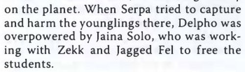
Our notes: `notes/materials/030-complete-star-wars-encyclopedia-vol-1/04-v1-scan-161-200.md:317`

> With the eventual defeat of Darth Caedus—the former Jacen Solo—Luke Skywalker offered a splinter group of Imperial Moffs a chance to rejoin the Galactic Alliance provided they submit to the command and leadership of Jagged Fel.
— Source: scan pages 241–280; Jacen Solo (Darth Caedus); Luke Skywalker.
Note (our notes, around the quote): Jacen Solo (Darth Caedus); Luke Skywalker: "With the eventual defeat of Darth Caedus—the former Jacen Solo—Luke Skywalker offered a splinter group of Imperial Moffs a chance to rejoin the Galactic Alliance provided they submit to the command and leadership of Jagged Fel." Source: The Complete Star Wars Encyclopedia, Vol. I, p.260
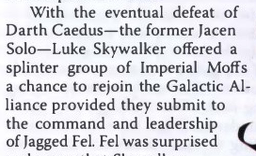
Our notes: `notes/materials/030-complete-star-wars-encyclopedia-vol-1/06-v1-scan-241-280.md:222`

## The Complete Star Wars Encyclopedia, Vol. II (H–O)

> Captain Jag simply placed his vessel behind Plo Koon's and fired on the Jedi fighter, causing it to crash into the side of a building and explode.
— Source: scan pages 121–160; Plo Koon. POV: Plo Koon, about Jagged Fel.
Note (our notes, around the quote): Plo Koon: "Captain Jag simply placed his vessel behind Plo Koon's and fired on the Jedi fighter, causing it to crash into the side of a building and explode." Source: The Complete Star Wars Encyclopedia, Vol. II, p.134
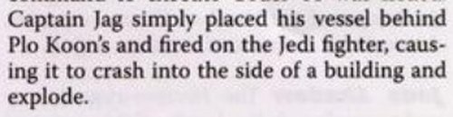
Our notes: `notes/materials/031-complete-star-wars-encyclopedia-vol-2/03-v2-scan-121-160.md:149`

## The Complete Star Wars Encyclopedia, Vol. III (P–Z)

> Sneaky was destroyed several years after the end of the Yuuzhan Vong War, when Jaina was shot down over Tenupe by Jagged Fel.
— Source: scan pages 161–200; Jaina Solo. POV: Jaina Solo, about Jagged Fel.
Note (our notes, around the quote): Jaina Solo: "Sneaky was destroyed several years after the end of the Yuuzhan Vong War, when Jaina was shot down over Tenupe by Jagged Fel." Source: The Complete Star Wars Encyclopedia, Vol. III, p.170
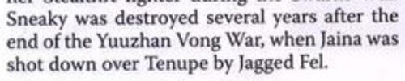
Our notes: `notes/materials/032-complete-star-wars-encyclopedia-vol-3/04-v3-scan-161-200.md:199`

## The New Essential Guide to Characters (2002)

- Note (summary from our notes, not a quotation): Page contents: 431 words, 21 paragraphs | headings/entries: JAGGED FEL; Jag'-géd Fel; GALLANDRO Ga-lan'-dro; ZAKARISZ GHENT Za-kar'-iz Gént; WiLmMARH "UILLIc" GRAHRK Vil'=mar "Vil'-l@" Gra-rkh; A'SHARAD HETT A'-sha-rad Hét; Lornp HoTH Hoth; QueEN JAMILLIA; Ja-mil'-la; DEXTER JETTSTER Déx'-tiir Jét'-stair
  — Source: scan pages 181–210.
Our notes: `notes/materials/034-new-essential-guide-to-characters/06-negc-scan-181-210.md:153`

## Star Wars Gamer/Star Wars Gamer 07.pdf [Star Wars Roleplaying Game (d20, 2000)] (scan pages 1–60)

- Note (summary from our notes, not a quotation): Page contents: Fiction 'Red Sky, Blue Flame' (Elaine Cunningham): 14-year-old Jag Fel at a hidden Chiss academy under Asdroni and two other moons, flying the battered clawcraft Blue Flame; Chief mechanic Obersken, Commandant Gimald Nurvodo; the false Thrawn return exposed; Commander Stent reports Voss Parck's liaison post fallen; a pirate freighter crashes through the dome (hand-read)
  — Source: Star Wars Gamer/Star Wars Gamer 07.pdf [Star Wars Roleplaying Game (d20,.
Our notes: `notes/materials/037-sw-d20-folder/056-star-wars-gamer-07-scan-001-060.md:60`

> Obersken sent him a look of unmitigated disgust. “Rash, undisciplined. There’s no room for heroes in this corp. How many times have I told you that?”
— Source: Star Wars Gamer/Star Wars Gamer 07.pdf [Star Wars Roleplaying Game (d20,; Obersken — entry/section: Obersken scolds Jag.
(Excerpt widened 2026-11-17 to the relevant passage, word for word from 19ABY: Red Sky, Blue Flame (Elaine Cunningham) (text copy `MEGA_All_Short_Stories_19ABY_Red_Sky_Blue_Flame_Elaine_Cunningham_epub`).)
Note (our notes, around the quote): Obersken — entry/section: Obersken scolds Jag: "“Rash, undisciplined. There's no room for heroes in this corp. How many times have I told you that?”" Source: *Star Wars Gamer 07* (SWRPG d20), scan p.12
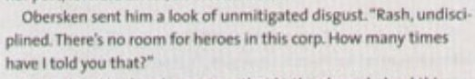
Our notes: `notes/materials/037-sw-d20-folder/056-star-wars-gamer-07-scan-001-060.md:67`

> “Win or lose is hardly the issue. The disregard of rules, the presumption of an individual who placed his impulses above the collective wisdom of tradition and clan, this we cannot allow.” He paused for a disgusted sniff. “You are your brother all over again.”
— Source: Star Wars Gamer/Star Wars Gamer 07.pdf [Star Wars Roleplaying Game (d20,; Gimald Nurvodo — entry/section: Commandant Gimald rebukes Jag.
(Excerpt widened 2026-11-17 to the relevant passage, word for word from 19ABY: Red Sky, Blue Flame (Elaine Cunningham) (text copy `MEGA_All_Short_Stories_19ABY_Red_Sky_Blue_Flame_Elaine_Cunningham_epub`).)
Note (our notes, around the quote): Gimald Nurvodo — entry/section: Commandant Gimald rebukes Jag: "“Win or lose is hardly the issue. The disregard of rules, the presumption of an individual who placed his impulses above the collective wisdom of tradition and clan, this we cannot allow.”" Source: *Star Wars Gamer 07* (SWRPG d20), scan p.12
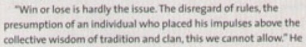
Our notes: `notes/materials/037-sw-d20-folder/056-star-wars-gamer-07-scan-001-060.md:69`

- Note (summary from our notes, not a quotation): Page contents: Red Sky, Blue Flame: cadet commander Shawnkyr Nuruodo takes command after Stent dies; Jag reveals Thrawn engineered his own exile to accept Imperial recruitment, and that Voss Parck staged Soontir Fel's disappearance; Baron Fel once mistook Jag for Wedge; Jag's blue piping marks him as never Chiss; Jag plans to lure the pirates down by flying badly (hand-read)
  — Source: Star Wars Gamer/Star Wars Gamer 07.pdf [Star Wars Roleplaying Game (d20,.
Our notes: `notes/materials/037-sw-d20-folder/056-star-wars-gamer-07-scan-001-060.md:79`

> He glanced back. One corner of her lips quirked up, an almost imperceptible gesture of approval. “We want the enemy to land and seek easy plunder. Do not dissuade them by flying too well.”
— Source: Star Wars Gamer/Star Wars Gamer 07.pdf [Star Wars Roleplaying Game (d20,; Shawnkyr Nuruodo — entry/section: Shawnkyr's parting order to Jag.
(Excerpt widened 2026-11-17 to the relevant passage, word for word from 19ABY: Red Sky, Blue Flame (Elaine Cunningham) (text copy `MEGA_All_Short_Stories_19ABY_Red_Sky_Blue_Flame_Elaine_Cunningham_epub`).)
Note (our notes, around the quote): Shawnkyr Nuruodo — entry/section: Shawnkyr's parting order to Jag: "“We want the enemy to land and seek easy plunder. Do not dissuade them by flying too well.”" Source: *Star Wars Gamer 07* (SWRPG d20), scan p.16
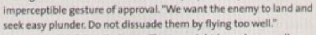
Our notes: `notes/materials/037-sw-d20-folder/056-star-wars-gamer-07-scan-001-060.md:91`

> “Defeat can be the shortest path to deception.”
— Source: Star Wars Gamer/Star Wars Gamer 07.pdf [Star Wars Roleplaying Game (d20,; Jagged Fel — entry/section: Jag replies to Shawnkyr.
Note (our notes, around the quote): Jagged Fel — entry/section: Jag replies to Shawnkyr: "“Defeat can be the shortest path to deception.”" Source: *Star Wars Gamer 07* (SWRPG d20), scan p.16
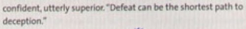
Our notes: `notes/materials/037-sw-d20-folder/056-star-wars-gamer-07-scan-001-060.md:93`

> “Yes, the same Imperial officer who ‘found’ the exiled Thrawn and brought him to Coruscant,” Jag said impatiently, “and the captain of the Star Destroyer who accompanied Grand Admiral Thrawn to the so-called Unknown Regions after his supposed fall from Imperial grace. Thrawn planned each step, drawing Imperial forces into Chiss territory for the protection of his people. The Imperial Remnant gained outposts and alliances, and Thrawn gained a conduit for ships and weaponry.”
>
> and the captain of the Star Destroyer who accompanied Grand Admiral Thrawn to the so-called Unknown Regions after his supposed fall froen Imperial grace.
> [fragment — full passage not on file]
— Source: Star Wars Gamer/Star Wars Gamer 07.pdf [Star Wars Roleplaying Game (d20,; Grand Admiral Thrawn. POV: Grand Admiral Thrawn, about Jagged Fel.
(Fragment completed 2026-11-17 with the full excerpt, word for word from 19ABY: Red Sky, Blue Flame (Elaine Cunningham) (text copy `MEGA_All_Short_Stories_19ABY_Red_Sky_Blue_Flame_Elaine_Cunningham_epub`), which is not the work named in the citation above; check the citation.)
Note (our notes, around the quote): Grand Admiral Thrawn: ""Yes, the same Imperial officer who 'found' the exiled Thrawn and brought him to Coruscant," Jag said impatiently, "and the captain of the Star Destroyer who accompanied Grand Admiral Thrawn to the so-called Unknown Regions after his supposed fall froen Imperial grace." Source: *Star Wars Gamer 07* (SWRPG d20), scan p.16
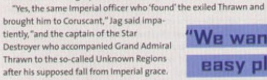
Our notes: `notes/materials/037-sw-d20-folder/056-star-wars-gamer-07-scan-001-060.md:95`

- Note (summary from our notes, not a quotation): Page contents: Red Sky, Blue Flame climax: Jag downs two pirate X-wings with torpedoes and a Z-95 with an ejected overloaded hyperdrive, feigns a crash with a cadet's body; the surviving cadets hang from ropes above mirrored transparisteel plates so the pirates fire low; Shawnkyr hands Jag her cadet commander insignia (hand-read)
  — Source: Star Wars Gamer/Star Wars Gamer 07.pdf [Star Wars Roleplaying Game (d20,.
Our notes: `notes/materials/037-sw-d20-folder/056-star-wars-gamer-07-scan-001-060.md:100`

- Note (summary from our notes, not a quotation): Page contents: 958 words, 40 paragraphs | headings/entries: Jag Fel, Hurnan Pilot; Equipment: Charric, cadet's clothing, clawcraft starfighter; STAR WARS GAMER 27
  — Source: Star Wars Gamer/Star Wars Gamer 07.pdf [Star Wars Roleplaying Game (d20,.
Our notes: `notes/materials/037-sw-d20-folder/056-star-wars-gamer-07-scan-001-060.md:105`

> “He will always be with us, as long as we can learn from his example.”  They considered this. “I had always dreamed of serving Thrawn,” Shawnkyr said slowly. “That is not to be. But I, too, can learn from example. It took the Chiss too long to recognize the leader he was, and learn to follow. This mistake is not one I will repeat.”
— Source: Star Wars Gamer/Star Wars Gamer 07.pdf [Star Wars Roleplaying Game (d20,; Jagged Fel — entry/section: Jag on Thrawn to the cadets.
(Excerpt widened 2026-11-17 to the relevant passage, word for word from 19ABY: Red Sky, Blue Flame (Elaine Cunningham) (text copy `MEGA_All_Short_Stories_19ABY_Red_Sky_Blue_Flame_Elaine_Cunningham_epub`).)
Note (our notes, around the quote): Jagged Fel — entry/section: Jag on Thrawn to the cadets: "“He will always be with us, as long as we can learn from his example.”" Source: *Star Wars Gamer 07* (SWRPG d20), scan p.18
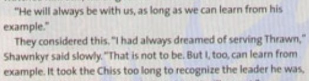
Our notes: `notes/materials/037-sw-d20-folder/056-star-wars-gamer-07-scan-001-060.md:107`

> Shawnkyr put a hand on his arm and began to propel them both toward the corvette. “I have high hopes for you, Lieutenant,” she said quietly. “Do not disappoint me by acting the hero’s part.”
— Source: Star Wars Gamer/Star Wars Gamer 07.pdf [Star Wars Roleplaying Game (d20,; Shawnkyr Nuruodo — entry/section: Shawnkyr to Jag.
(Excerpt widened 2026-11-17 to the relevant passage, word for word from 19ABY: Red Sky, Blue Flame (Elaine Cunningham) (text copy `MEGA_All_Short_Stories_19ABY_Red_Sky_Blue_Flame_Elaine_Cunningham_epub`).)
Note (our notes, around the quote): Shawnkyr Nuruodo — entry/section: Shawnkyr to Jag: "“I have high hopes for you, Lieutenant,” she said quietly. “Do not disappoint me by acting the hero's part.”" Source: *Star Wars Gamer 07* (SWRPG d20), scan p.18
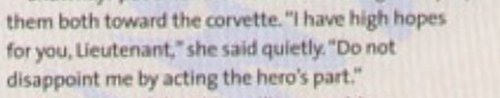
Our notes: `notes/materials/037-sw-d20-folder/056-star-wars-gamer-07-scan-001-060.md:109`

## Star Wars Gamer/Star Wars Gamer 07.pdf [Star Wars Roleplaying Game (d20, 2000)] (scan pages 61–108)

- Note (summary from our notes, not a quotation): Page contents: HoloNet letters: Elaine Cunningham's Jag Fel story this issue; reader theory that Yoda and Yaddle are Whills answered "Comment I cannot," is all Yoda has to say; d3/d2 explained (d6 halved) (hand-read)
  — Source: Star Wars Gamer/Star Wars Gamer 07.pdf [Star Wars Roleplaying Game (d20,.
Our notes: `notes/materials/037-sw-d20-folder/056-star-wars-gamer-07-scan-061-108.md:290`

## Living Force Campaign/Adventures/Among the Stars/Year 4/402 - Jedi Code - The Way of the Force.pdf [Star Wars Roleplaying Game Revised Core (d20, 2002)]

- Note (summary from our notes, not a quotation): No single roster character (rules/setting/general) — entry/section: Jag Murrock: ""Through the hole-- "
  — Source: Living Force Campaign/Adventures/Among the Stars/Year 4/402 - Jedi Code -.
Our notes: `notes/materials/037-sw-d20-folder/325-402-jedi-code-the-way-of-the.md:91`

> There are extra notes afterwards. Play him as the “Crotchety Old Prospector”. He actually is one, though a lot more sophisticated than he’s trying to show. He’s also an ex-military man. He normally talks like anyone else, but is laying it on a bit thick. Who are you? “Name’s Jag Murrock. Who’re you Wormies?” The Way of the Force Page 10 What’s a “Wormie”? “Groundworm, gravity-slave, dirt-pounder. Could see none o’you are worth spit in nullgee.” NOTE TO THE GM: modify if any of the heroes have the Zero-G Training feat. “’Cept her”, that sort of thing.
— Source: Living Force Campaign/Adventures/Among the Stars/Year 4/402 - Jedi Code -.
(Excerpt widened 2026-11-17 to the relevant passage, word for word from playing Game Revised Core Living Force Campaign Adventures Among the Stars Year 4 402 Jedi Code The Way of the Force (text copy `playing_Game_Revised_Core_Living_Force_Campaign_Adventures_Among_the_Stars_Year_4_402_Jedi_Code_The_Way_of_the_Force_pdf_0107300939`).)
(Excerpt widened 2026-11-17 to the relevant passage, word for word from playing Game Revised Core Living Force Campaign Adventures Among the Stars Year 4 402 Jedi Code The Way of the Force (text copy `playing_Game_Revised_Core_Living_Force_Campaign_Adventures_Among_the_Stars_Year_4_402_Jedi_Code_The_Way_of_the_Force_pdf_0107300939`).)
Note (our notes, around the quote): No single roster character (rules/setting/general) — entry/section: Jag Murrock: "Who are you? "Name's Jag Murrock. Who're you Wormies?"" Source: *402 - Jedi Code - The Way of the Force* (SWRPG d20 Revised Core), p.9
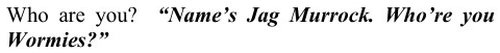
Our notes: `notes/materials/037-sw-d20-folder/325-402-jedi-code-the-way-of-the.md:96`

- Note (summary from our notes, not a quotation): Page contents: E1 Lanius' briefing; E2 Snem Noonb's factory and the droid revolt; E3 Jag Murrock's claim (hand-read)
  — Source: Living Force Campaign/Adventures/Among the Stars/Year 4/402 - Jedi Code -.
Our notes: `notes/materials/037-sw-d20-folder/325-402-jedi-code-the-way-of-the.md:101`

What it shows (our notes): No single roster character (rules/setting/general) — entry/section: Jag Murrock: "But the Jedi have been taking crystals from this asteroid for years, I thought. "Oh, have they? That's mighty innerestin'. That would explain where they went."
> Only a Spot (DC 20/25/30/35) reveals something interesting amid all the numerical data: this is a claim renewal. Jag must have owned this for a while. (If they spotted that and decide to mention it.) Ah, this thing says you’ve owned this rock for longer than two years. “Ayup.” But the Jedi have been taking crystals from this asteroid for years, I thought. “Oh, have they? That’s mighty innerestin’. That would explain where they went.” (Protestations of misunderstanding.) “You jest let me worrit about that. Time for you to clear out.” How do we know this thing is genuine?
— Source: Living Force Campaign/Adventures/Among the Stars/Year 4/402 - Jedi Code -.
(Excerpt widened 2026-11-17 to the relevant passage, word for word from playing Game Revised Core Living Force Campaign Adventures Among the Stars Year 4 402 Jedi Code The Way of the Force (text copy `playing_Game_Revised_Core_Living_Force_Campaign_Adventures_Among_the_Stars_Year_4_402_Jedi_Code_The_Way_of_the_Force_pdf_0107300939`).)
(Excerpt widened 2026-11-17 to the relevant passage, word for word from playing Game Revised Core Living Force Campaign Adventures Among the Stars Year 4 402 Jedi Code The Way of the Force (text copy `playing_Game_Revised_Core_Living_Force_Campaign_Adventures_Among_the_Stars_Year_4_402_Jedi_Code_The_Way_of_the_Force_pdf_0107300939`).)
Our notes: `notes/materials/037-sw-d20-folder/325-402-jedi-code-the-way-of-the.md:108`

## Star Wars Insider #57 (2001)

- Note (summary from our notes, not a quotation): Page contents: Star News end and "Next Issue: 58" box (magazine p. 25): Return to Tatooine - Joel Edgerton (Owen Lars) and Bonnie Piesse (Beru Whitesun); Billy Dee Williams (Lando Calrissian); new column Behind the Magic (Watto at ILM); Celebration II; "2¢ = $10? Sometimes..." reader-survey box; Star Wars Gamer #7 ad ("Living on the Fringe", Jag Fel among the Chiss, Bartyn's Landing, Secrets of Mos Eisley); Neeson in K-19: The Widowmaker with Harrison Ford (Han Solo). (hand-read)
  — Source: Star Wars Insider #57 (2001).
Our notes: `notes/materials/038-star-wars-insider/057-ins057.md:104`

> Jag Fel, son of legendary TIE fighter ace Baron Soontir Fel, has exhibited a budding romantic interest in Jaina Solo.
— Source: Star Wars Insider #57 (2001); Jaina Solo — entry/section: Jaina Solo.
Note (our notes, around the quote): Jaina Solo — entry/section: Jaina Solo: "Jag Fel, son of legendary TIE fighter ace Baron Soontir Fel, has exhibited a budding romantic interest in Jaina Solo." Source: *Star Wars Insider #57* (2001), scan p.47
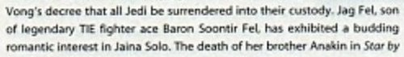
Our notes: `notes/materials/038-star-wars-insider/057-ins057.md:352`

## Star Wars Insider #58 (2002)

- Note (summary from our notes, not a quotation): Page contents: Bookshelf: "Flirting with the Dark Side - Jaina Solo's New Master" by Daniel Wallace, special thanks to Jason Fry (magazine p. 78): interview with Elaine Cunningham on the New Jedi Order novel Dark Journey (standalone softcover following Star by Star); story picks up with Jaina fleeing in a stolen Yuuzhan Vong ship; Hapes and Ta'a Chume; Cunningham's father's WWII story as a parallel; Jaina's romantic situation (Zekk, Jag Fel, Kyp Durron). (hand-read)
  — Source: Star Wars Insider #58 (2002).
Our notes: `notes/materials/038-star-wars-insider/058-ins058.md:384`

- Note (summary from our notes, not a quotation): Jaina Solo; Jagged Fel; Han Solo; Leia Organa Solo; Kyp Durron — entry/section: Elaine Cunningham on Jaina, Jag, and Kyp: "Jag Fel intrigues her. I see their interaction as very similar to that between a young Han and Leia—only the roles are flipped. Jag is about honor and duty, and Jaina, at least to a by-the-books guy like Jag, falls closer to the "scruffy scoundrel" mark. —Elaine Cunningham, Star Wars Insider 58, p. 79" Source: *Star Wars Insider #58* (2002), scan p.62
  — Source: Star Wars Insider #58 (2002).

Our notes: `notes/materials/038-star-wars-insider/058-ins058.md:393`

## Star Wars Insider #59 (2002)

- Note (summary from our notes, not a quotation): Page contents: Rebel Rumblings cont. (magazine p. 96; writers' names omitted): Boba Fett/Jaster Mereel continuity reply (hunters are shifty with names; films need not obey the EU); "Love Is a Four-Letter Word" (romance in the novels; reply notes Jag Fel and Jaina in Dark Journey); "Love Laws" (Jedi and love; reply offers three theories); crossword answers; Index of Advertisers. (hand-read)
  — Source: Star Wars Insider #59 (2002).
Our notes: `notes/materials/038-star-wars-insider/059-ins059.md:687`

## Star Wars Insider #74 (2004)

- Note (summary from our notes, not a quotation): Page contents: NJO synopses: Dark Tide II: Ruin (Elegos A'Kla dies as emissary; Corran Horn duels Shedao Shai over Ithor; Jagged Fel and Tsavong Lah introduced); the author's five favourite books (Vector Prime, Hero's Trial, Star by Star, Traitor, The Unifying Force); Agents of Chaos I: Hero's Trial (a grieving Han, Droma, Vergere introduced). (hand-read)
  — Source: Star Wars Insider #74 (2004).
Our notes: `notes/materials/038-star-wars-insider/074-ins074.md:138`

- Note (summary from our notes, not a quotation): Page contents: NJO synopses: Edge of Victory I: Conquest (Anakin rescues Tahiri on occupied Yavin 4; the Jeedai cult), the "Ylesia" e-book and Jag Fel Gamer story, Edge of Victory II: Rebirth (Onimi, Shimrra, Ben Skywalker introduced), and Gamer serial addenda. (hand-read)
  — Source: Star Wars Insider #74 (2004).
Our notes: `notes/materials/038-star-wars-insider/074-ins074.md:150`

> Soontir Fel Jag’s dad and Wedge's brother-in-law, this legendary baron flew with the New Republic and various incarnations of the Empire before throwing im his lot with the Chiss.
— Source: Star Wars Insider #74 (2004).
Note (our notes, around the quote): Soontir Fel; Wedge Antilles — entry/section: Star Wars Insider 074 (2004): "Soontir Fel Jag’s dad and Wedge's brother-in-law, this legendary baron flew with the New Republic and various incarnations of the Empire before throwing im his lot with the Chiss." Source: *Star Wars Insider #74* (2004), scan p.28
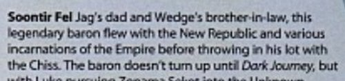
Our notes: `notes/materials/038-star-wars-insider/074-ins074.md:183`

## Star Wars Insider #84 (2005)

- Note (summary from our notes, not a quotation): Page contents: Guide cont.: Sergeant Fox (501st, Journeyman Protectors, spared Bail Organa at the Temple), Commander Deviss (Hawkbat at Geonosis, promoted by Bly after Altyr V), Captain "Jag" Jai'galaar (ARC-170 test pilot, Plo Koon's wingman at Cato Neimoidia); Sky Corps art (hand-read)
  — Source: Star Wars Insider #84 (2005).
Our notes: `notes/materials/038-star-wars-insider/084-ins084.md:189`

## Star Wars Insider #87 (2006)

- Note (summary from our notes, not a quotation): Page contents: Incident reports 890-A Plo Koon (Captain Jag, Cato Neimoidia) and 890-B Aayla Secura (Commander Bly, Felucia) (hand-read)
  — Source: Star Wars Insider #87 (2006).
Our notes: `notes/materials/038-star-wars-insider/087-ins087.md:170`

## Star Wars Insider #134 (2012)

- Note (summary from our notes, not a quotation): Page contents: "Getaway" fiction art (Joe Corroney): Jaina, Pharika, the holocron, Jag. (hand-read)
  — Source: Star Wars Insider #134 (2012). POV: Page contents.
Our notes: `notes/materials/038-star-wars-insider/134-ins134.md:356`

- Note (summary from our notes, not a quotation): Page contents: "Getaway," exclusive fiction by Christie Golden (post-FotJ honeymoon): Jag and Jaina on Sakuub, with Karn Valenti and Lina Zek as doubles on Hapes; the Sky Temple of Karsol; Abeloth mentioned. (hand-read)
  — Source: Star Wars Insider #134 (2012). POV: Page contents, about Jagged Fel.
Our notes: `notes/materials/038-star-wars-insider/134-ins134.md:361`

- Note (summary from our notes, not a quotation): Page contents: "Getaway": Jaina finds a Jedi holocron disguised as a rock; Pharika betrays them and shoots Jag's foot; a mystery ship appears. (hand-read)
  — Source: Star Wars Insider #134 (2012). POV: Page contents.
Our notes: `notes/materials/038-star-wars-insider/134-ins134.md:376`

## Legacy of the Force, own full read (Betrayal, Revelation, Invincible)

- Note (summary from our notes, not a quotation): c19–c20, epl: Ben stops Tahiri's baradium warhead and she surrenders [c19 ¶107–152]. The Jedi take the *Anakin Solo*, and Luke puts Jag Fel over the Moffs [c20 ¶81–97]. Daala becomes Chief of State [epl ¶35]. Allana is alive as "Amelia" [epl ¶63–70].
  — Source: Legacy of the Force 9: Invincible (Troy Denning, 2008) — own full read.
Our notes: `notes/materials/040-lotf-own-read/lotf-9-invincible.md:12`

- Note (summary from our notes, not a quotation): | F25 | c14 ¶5–8 | Jaina | Training: drops Zekk, Lowbacca, Tesar and Jag with electrostaffs | Spar |
  — Source: Legacy of the Force 9: Invincible (Troy Denning, 2008) — own full read.
Context: | # | Ref | Character | Feat | Quote / note |
Our notes: `notes/materials/040-lotf-own-read/lotf-9-invincible.md:41`

> “Shatterpoint is a Force technique, Jag, not a physical one,” Luke said, speaking from the edge of the courtyard. “And Jaina does need to practice. It shouldn’t aggravate her injuries.” He turned to Cilghal. “Right?”
>
> Jaina should not have been surprised that her uncle had mastered the technique himself—but she was. So she had foolishly blurted out something about it being a lost art, and that hardly anyone could master it. Luke had simply smiled and replied that an art was not lost just because it could be wielded only by a handful, and that if her twin brother was one of the few capable of learning it, so was she.
— Source: Legacy of the Force 9: Invincible (Troy Denning, 2008) — own full read; | S17 | c14 ¶24; c14 ¶28 | Luke / narration |.
(Excerpt widened 2026-11-17 to the relevant passage, word for word from Invincible (Troy Denning) (text copy `MEGA_Legend_The_Legacy_of_the_Force_Series_Star_Wars_Legacy_of_the_Force_09_Invincible_Troy_Denning_epub`).)
(Full sentence/passage taken from the source text on file: `lotf_tmp_b9_epub`.)
Label in our notes: Luke | High |
Context: | # | Ref | Speaker | Statement | Reliability |
Our notes: `notes/materials/040-lotf-own-read/lotf-9-invincible.md:76`

## The Dark Nest Trilogy (Troy Denning, Del Rey 2005): FULL consecutive re-read (2026-11-16 CST)

What it shows (our notes): Battle-meld aftereffect: "Their prolonged use of it on the Myrkr mission had weakened the boundaries among their minds" (Cilghal's diagnosis). This is why Jaina "had failed to reconnect with Jagged Fel". Anakin died "seven years later" (on Jaina's count).
> It had taken Cilghal only a few days to diagnose the problem as a delayed reaction to the Jedi battle-meld. Their prolonged use of it on the Myrkr mission had weakened the boundaries among their minds, with the result that now their emotions tended to fill the Force and blur together whenever they were close to each other. *(Cilghal's diagnosis)*
>
> Sometimes Jaina believed the side effect was also the reason so many strike team survivors found it difficult to move on with their lives. Tenel Ka was doing well as the Hapan queen, and Tekli and Tahiri seemed to regard Zonama Sekot as both a friend and a home, but the rest of them—Jaina, Alema, Zekk, Tesar, Lowbacca, even Jacen—still seemed lost, unable to maintain a connection with anyone who had not been there. Jaina knew that was why she had failed to reconnect with Jagged Fel during their desperate rendezvous when he had still been serving as Chiss liaison to the Galactic Alliance. She loved him, but she’d just grown increasingly distant from him. From everyone, really.
— Source: Dark Nest I: The Joiner King (Troy Denning, Del Rey 2005): notes part 1; Battle-meld aftereffect. POV: Battle-meld aftereffect, about Jagged Fel.
(Excerpt widened 2026-11-17 to the relevant passage, word for word from The Joiner King (Troy Denning) (text copy `MEGA_Legend_The_Dark_Nest_Trilogy_Star_Wars_Dark_Nest_01_The_Joiner_King_Troy_Denning_epub`).)
(Full sentence/passage taken from the source text on file: `dn_tmp_jk_epub`.)
Our notes: `notes/materials/051-dark-nest-trilogy/jk-01.md:57`

What it shows (our notes): A cloaked Chiss Star Destroyer, Victory-like but "sleeker, longer, and narrower, with a conical hull", appears after the Jedi fire, which was "one of Jag Fel’s favorite tactics".
> Jaina was close enough to the battle now that she could see the laser cannons flashing inside the whirling cloud of dartships. Four waving fingers of darkness marked the areas where the tractor beams were sweeping the Taat out of space, slowly pulling them toward the Star Destroyer. The vessel itself resembled a gray version of the Empire’s old Victory-class Star Destroyers, save that it was a little sleeker, longer, and narrower, with a conical hull that gave it a menacing, needle-like appearance. It was impossible to tell where the bridge was located—it was not in the Chiss nature to reveal such a crucial detail just for the looking—but a dome-shaped bulge amidships probably housed the cloaking equipment that had masked the vessel’s approach.
>
> It had been one of Jag Fel’s favorite tactics, when they had flown together against the Yuuzhan Vong. Jaina reached out toward the Star Destroyer, searching for his familiar presence, but could not find him among all the beings on the vessel—at least not in the middle of the battle.
— Source: Dark Nest I: The Joiner King: notes part 2 (ch. 9 onward); A cloaked Chiss Star Destroyer, Victory-like but.
(Excerpt widened 2026-11-17 to the relevant passage, word for word from The Joiner King (Troy Denning) (text copy `MEGA_Legend_The_Dark_Nest_Trilogy_Star_Wars_Dark_Nest_01_The_Joiner_King_Troy_Denning_epub`).)
(Full sentence/passage taken from the source text on file: `dn_tmp_jk_epub`.)
(Fragment completed 2026-11-17: full sentence/passage matched word for word in the source text on file: `MEGA_Legend_The_Dark_Nest_Trilogy_Star_Wars_Dark_Nest_01_The_Joiner_King_Troy_Denning_epub`.)
Our notes: `notes/materials/051-dark-nest-trilogy/jk-02.md:45`

> “That’s what I mean,” Han said. “Everything was a compromise for those kids. They never had anything simple to fight for.”
>
> “They had the Dark Jedi and the Diversity Alliance,” Leia countered. “They had the Yuuzhan Vong. That was all pretty clear.”
>
> “And all of it was stuff to fight against,” Han said. “I’m talking about something to fight for, something pure to build.
>
> Leia was beginning to see what Han was driving at. “You mean they didn’t have the Rebellion.”
>
> “Right,” Han said. “The Killiks are peaceful underdogs, minding their own business in neutral territory, and the Chiss are trying to starve them out. I can see how Jaina might think that’s a pretty clear-cut case of the weak needing protection from the strong. Heck, it almost makes me want to fight for them.”
>
> “What a relief,” Leia said. “I thought for a minute you were going to say we had to let her and the others stay with the Colony.”
>
> “When black holes shine,” Han scoffed. “What I’m saying is we have to make them think it’s their choice. I don’t want to take that spark away. Jaina finally has the same look in her eye that you did when I rescued you from the Death Star.”
— Source: Dark Nest I: The Joiner King: notes part 2 (ch. 9 onward); Han's theory of Jaina. POV: Han's theory of Jaina, about Jagged Fel.
(Excerpt widened 2026-11-17 to the relevant passage, word for word from The Joiner King (Troy Denning) (text copy `MEGA_Legend_The_Dark_Nest_Trilogy_Star_Wars_Dark_Nest_01_The_Joiner_King_Troy_Denning_epub`).)
(Excerpt widened 2026-11-17 to the relevant passage, word for word from The Joiner King (Troy Denning) (text copy `MEGA_Legend_The_Dark_Nest_Trilogy_Star_Wars_Dark_Nest_01_The_Joiner_King_Troy_Denning_epub`).)
(Full sentence/passage taken from the source text on file: `dn_tmp_jk_epub`.)
Our notes: `notes/materials/051-dark-nest-trilogy/jk-02.md:69`

What it shows (our notes): Leia on Zekk: "that unwashed vent crawler she brought home". Juun cites the "Talu insertion in the Zsinj campaign" and the holovid *Special Delivery*.
> “We can,” Leia corrected. She could sense that Han did not entirely agree with her; that now he was the one hiding something up his sleeve. “We’re in this together, nerf herder. This won’t be like the time you left me to deal with that unwashed vent crawler she brought home.”
>
> “Like the Talu insertion in the Zsinj campaign,” Juun declared. “The Falcon will act as a decoy while the StealthXs penetrate the enemy’s perimeter.”
— Source: Dark Nest I: The Joiner King: notes part 2 (ch. 9 onward); Leia on Zekk. POV: Leia, about Jagged Fel.
(Excerpt widened 2026-11-17 to the relevant passage, word for word from The Joiner King (Troy Denning) (text copy `MEGA_Legend_The_Dark_Nest_Trilogy_Star_Wars_Dark_Nest_01_The_Joiner_King_Troy_Denning_epub`).)
(Full sentence/passage taken from the source text on file: `dn_tmp_jk_epub`.)
(Fragment completed 2026-11-17: full sentence/passage matched word for word in the source text on file: `MEGA_Legend_The_Dark_Nest_Trilogy_Star_Wars_Dark_Nest_01_The_Joiner_King_Troy_Denning_epub`.)
Our notes: `notes/materials/051-dark-nest-trilogy/jk-02.md:70`

What it shows (our notes): Lowbacca dreams of Chewbacca in the Shadow Forest. Jaina EV at Kalarba "spent several hours talking to Yoda ... because he spent the whole time speaking in Gamorrean."
> It was probably just an empty wreck. Or maybe Lowbacca was seeing things. His EV suit was automatically holding his oxygen consumption at a minimum, feeding him just enough air to keep him functional, and hallucinations were common under such circumstances. Jaina had told him she spent several hours talking to Yoda when she went EV Unfortunately, she had not been able to understand anything he said because he spent the whole time speaking in Gamorrean.
— Source: Dark Nest I: The Joiner King: notes part 2 (ch. 9 onward).
(Excerpt widened 2026-11-17 to the relevant passage, word for word from The Joiner King (Troy Denning) (text copy `MEGA_Legend_The_Dark_Nest_Trilogy_Star_Wars_Dark_Nest_01_The_Joiner_King_Troy_Denning_epub`).)
(Full sentence/passage taken from the source text on file: `dn_tmp_jk_epub`.)
Our notes: `notes/materials/051-dark-nest-trilogy/jk-02.md:71`

What it shows (our notes): The Chiss lay a clawcraft ambush in the rings. Lowbacca triggers his own beacon so the Jedi won't fly into it. "Jaina had lost too much during the war—Anakin, Chewbacca, Ganner, Ulaha, and on and on."
> Jaina had lost too much during the war—Anakin, Chewbacca, Ganner, Ulaha, and on and on. She was determined to lose no more.
— Source: Dark Nest I: The Joiner King: notes part 2 (ch. 9 onward).
(Excerpt widened 2026-11-17 to the relevant passage, word for word from The Joiner King (Troy Denning) (text copy `MEGA_Legend_The_Dark_Nest_Trilogy_Star_Wars_Dark_Nest_01_The_Joiner_King_Troy_Denning_epub`).)
Our notes: `notes/materials/051-dark-nest-trilogy/jk-02.md:72`

> “That would fall under the heading of military intelligence, Captain Solo,” Jag replied. “But rest assured, the Jedi Wookiee has been recovered. He’ll be treated with all the rights and privileges due any enemy combatant—as will the rest of your rogue Jedi, when we capture them.”
— Source: Dark Nest I: The Joiner King: notes part 2 (ch. 9 onward); Jag Fel is "Rescue One"..
(Excerpt widened 2026-11-17 to the relevant passage, word for word from The Joiner King (Troy Denning) (text copy `MEGA_Legend_The_Dark_Nest_Trilogy_Star_Wars_Dark_Nest_01_The_Joiner_King_Troy_Denning_epub`).)
Our notes: `notes/materials/051-dark-nest-trilogy/jk-02.md:73`

> It makes us proud ... Good.
> [fragment — full passage not on file]
— Source: Dark Nest I: The Joiner King: notes part 4 (end of ch. 29 onward).
Note (our notes, around the quote): More than 100,000 dartships are massed. The Bornaryn freighter *Roaming Ronto* (a Gallofree medium freighter) brings turbolaser batteries; this is Tesar's trade deal coming home. Jaina and Zekk feel "It makes us proud ... Good."
Our notes: `notes/materials/051-dark-nest-trilogy/jk-04.md:36`

What it shows (our notes): Jacen's presence stirs "in the place that had always belonged to her brother". Jaina's black fury over Anakin lets her act, but the Will pins her and Zekk in the tunnel: "Her anger was no match for the Will of the Colony." Jaina wonders: "Would it truly be so bad if there was a war, and the Colony won? For once, there would be true galactic peace".
> Jaina felt a stirring deep down inside, in the place that had always belonged to her brother Jacen, and she knew he was with her, urging her to fight back, to throw off her lethargy, to break the Colony’s hold on her and reach for that part of her that was just Jaina.
>
> Jaina began to despair. Her anger was no match for the Will of the Colony. She had to find another way.
>
> Would it truly be so bad if there was a war, and the Colony won? For once, there would be true galactic peace—no vying for resources, no clashes of interest, no territorial conquests, just all the peoples of the galaxy working together for the common good. Was that so wrong?
— Source: Dark Nest I: The Joiner King: notes part 4 (end of ch. 29 onward); Jacen's presence stirs.
(Excerpt widened 2026-11-17 to the relevant passage, word for word from The Joiner King (Troy Denning) (text copy `MEGA_Legend_The_Dark_Nest_Trilogy_Star_Wars_Dark_Nest_01_The_Joiner_King_Troy_Denning_epub`).)
(Full sentence/passage taken from the source text on file: `dn_tmp_jk_epub`.)
Our notes: `notes/materials/051-dark-nest-trilogy/jk-04.md:37`

> Come get me, lover boy ... If you can.
> [fragment — full passage not on file]
— Source: Dark Nest I: The Joiner King: notes part 4 (end of ch. 29 onward).
Note (our notes, around the quote): A plan built on love, not anger. She feigns surrender, then reaches Jag through the Force: "Come get me, lover boy ... If you can." Jag realizes it is a warning of an ambush.
Our notes: `notes/materials/051-dark-nest-trilogy/jk-04.md:38`

What it shows (our notes): "Idol Smasher" is an old Yuuzhan Vong-war encryption system. Jag: "I’m convinced she saved our fleet." Leia briefs both sides on the Dark Nest: "Only in the sense that any sentient mind is ruled by its own unconscious mind".
> “Yes, I know,” Fel said. “I think … actually, I’m convinced she saved our fleet.”
>
> Leia’s jaw fell, but her voice betrayed no hint of her shock. “You find that surprising, Jag? The Jedi are here to stop a war, not choose sides.”
>
> “You’re telling us that the Colony is ruled by a hidden nest?” Fel asked, incredulous.
>
> “Only in the sense that any sentient mind is ruled by its own unconscious mind,” Leia said. “Influenced might be a better term—though in the Killiks’ case the influence is very heavy. We’re fairly sure the Dark Nest is responsible for the Colony’s decision to inhabit Qoribu.”
— Source: Dark Nest I: The Joiner King: notes part 4 (end of ch. 29 onward).
(Excerpt widened 2026-11-17 to the relevant passage, word for word from The Joiner King (Troy Denning) (text copy `MEGA_Legend_The_Dark_Nest_Trilogy_Star_Wars_Dark_Nest_01_The_Joiner_King_Troy_Denning_epub`).)
(Excerpt widened 2026-11-17 to the relevant passage, word for word from The Joiner King (Troy Denning) (text copy `MEGA_Legend_The_Dark_Nest_Trilogy_Star_Wars_Dark_Nest_01_The_Joiner_King_Troy_Denning_epub`).)
(Full sentence/passage taken from the source text on file: `dn_tmp_jk_epub`.)
Our notes: `notes/materials/051-dark-nest-trilogy/jk-04.md:43`

What it shows (our notes): Mara spent a month in bacta. The Chiss release Lowbacca at Jag's "very vigorous objections". The Fel family guarantees his parole. "Commander Fel will receive a promotion". Formbi to Leia: "You have achieved peace in our time." (an ironic echo)
> “Commander Fel will receive a promotion in recognition of his judgment here,” Formbi said. “But is you who deserves our thanks. You have achieved peace in our time.”
>
> You have achieved peace in our time. *(an ironic echo)*
— Source: Dark Nest I: The Joiner King: notes part 4 (end of ch. 29 onward).
(Excerpt widened 2026-11-17 to the relevant passage, word for word from The Joiner King (Troy Denning) (text copy `MEGA_Legend_The_Dark_Nest_Trilogy_Star_Wars_Dark_Nest_01_The_Joiner_King_Troy_Denning_epub`).)
(Fragment completed 2026-11-17: full sentence/passage matched word for word in the source text on file: `MEGA_Legend_The_Dark_Nest_Trilogy_Star_Wars_Dark_Nest_01_The_Joiner_King_Troy_Denning_epub`.)
Our notes: `notes/materials/051-dark-nest-trilogy/jk-04.md:91`

> And with you ... Both of you.
> [fragment — full passage not on file]
>
> “Like we’re going to choke on it,” Jaina answered.
>
> “But we’ll survive.” Zekk rubbed his forearm along Jaina’s, and she began to make low clicking sounds in her throat. “We have each other.”
>
> “That’s about all.” Leia looked back out the window.
>
> “That’s about all.” Leia looked back out the window.
>
> “And we have hope,” Han insisted. “As long as we have each other, there’s still hope for us, for Jacen and Jaina—wherever they are—even for the New Republic.”
— Source: Dark Nest I: The Joiner King: notes part 4 (end of ch. 29 onward); Jag to Jaina and Zekk. POV: Jag.
(Excerpt widened 2026-11-17 to the relevant passage, word for word from The Joiner King (Troy Denning) (text copy `MEGA_Legend_The_Dark_Nest_Trilogy_Star_Wars_Dark_Nest_01_The_Joiner_King_Troy_Denning_epub`).)
(Excerpt widened 2026-11-17 to the relevant passage, word for word from Star by Star (Troy Denning) (text copy `MEGA_Legend_The_New_Jedi_Order_Series_Star_Wars_New_Jedi_Order_10_Star_by_Star_Troy_Denning_epub`).)
(Excerpt widened 2026-11-17 to the relevant passage, word for word from The Joiner King (Troy Denning) (text copy `MEGA_Legend_The_Dark_Nest_Trilogy_Star_Wars_Dark_Nest_01_The_Joiner_King_Troy_Denning_epub`).)
(Excerpt widened 2026-11-17 to the relevant passage, word for word from Star by Star (Troy Denning) (text copy `MEGA_Legend_The_New_Jedi_Order_Series_Star_Wars_New_Jedi_Order_10_Star_by_Star_Troy_Denning_epub`).)
(Full sentence/passage taken from the source text on file: `dn_tmp_jk_epub`.)
Our notes: `notes/materials/051-dark-nest-trilogy/jk-04.md:92`

What it shows (our notes): Kyp and Jaina: "Kyp’s been feeling a little … sentimental … toward me lately." Jag ambushes her with a kiss in her cabin ("Conducting an experiment"). She skins him at sabacc: "you’ve also paid in advance for others."
> Jaina felt herself flush. “Kyp’s been feeling a little … sentimental … toward me lately.”
>
> Jacen looked at her in solemn surprise. It was that solemnity, Jaina decided, that she disliked most about him.
>
> “Yes. But you’ve also paid in advance for others.”
>
> Jag raised his scarred eyebrow. “That’s a good thing to know. When might I collect?”
— Source: Bundled e-book: *Star Wars: The New Jedi Order: Ylesia* (Walter Jon Williams, 2002), as included in the Joiner King epub; Kyp and Jaina. POV: Kyp and Jaina, about Jagged Fel.
(Excerpt widened 2026-11-17 to the relevant passage, word for word from The Joiner King (Troy Denning) (text copy `MEGA_Legend_The_Dark_Nest_Trilogy_Star_Wars_Dark_Nest_01_The_Joiner_King_Troy_Denning_epub`).)
(Excerpt widened 2026-11-17 to the relevant passage, word for word from The Joiner King (Troy Denning) (text copy `MEGA_Legend_The_Dark_Nest_Trilogy_Star_Wars_Dark_Nest_01_The_Joiner_King_Troy_Denning_epub`).)
(Full sentence/passage taken from the source text on file: `novels_tmp_ylesia_ylesia_epub`.)
Our notes: `notes/materials/051-dark-nest-trilogy/jk-05-ylesia.md:17`

- Note (summary from our notes, not a quotation): Jag's echelon bombing run runs along an invisible line so that no fire hits friendly forces. Maal Lah loses a leg.
  — Source: Bundled e-book: *Star Wars: The New Jedi Order: Ylesia* (Walter Jon Williams, 2002), as included in the Joiner King epub.
Our notes: `notes/materials/051-dark-nest-trilogy/jk-05-ylesia.md:29`

What it shows (our notes): Jacen's "Vongsense" detects a second Vong fleet hidden behind the extended flank: "He called up his Vongsense, the strange telepathy he had developed with Yuuzhan Vong lifeforms during his captivity." Kre'fey: "How can I hurt the Vong today? We’ve answered that question". Jag calls Jacen "Spooky Mind-Meld Man".
> A missing piece. The piece fell into place with a snap that Jacen felt shuddering in his nerves. With some reluctance he banished the Force and the comforts of the meld from his mind, and he called up his Vongsense, the strange telepathy he had developed with Yuuzhan Vong lifeforms during his captivity.
>
> Kre’fey snarled. “How can I hurt the Vong today? We’ve answered that question, haven’t we?”
>
> One of his staff officers gave a triumphant smile. “Troopships report the landing party has been recovered, Admiral.”
— Source: Bundled e-book: *Star Wars: The New Jedi Order: Ylesia* (Walter Jon Williams, 2002), as included in the Joiner King epub.
(Excerpt widened 2026-11-17 to the relevant passage, word for word from The Joiner King (Troy Denning) (text copy `MEGA_Legend_The_Dark_Nest_Trilogy_Star_Wars_Dark_Nest_01_The_Joiner_King_Troy_Denning_epub`).)
(Excerpt widened 2026-11-17 to the relevant passage, word for word from The Joiner King (Troy Denning) (text copy `MEGA_Legend_The_Dark_Nest_Trilogy_Star_Wars_Dark_Nest_01_The_Joiner_King_Troy_Denning_epub`).)
(Full sentence/passage taken from the source text on file: `novels_tmp_ylesia_ylesia_epub`.)
Our notes: `notes/materials/051-dark-nest-trilogy/jk-05-ylesia.md:30`

- Note (summary from our notes, not a quotation): Jaina/Jag. Leia shoots Jag down; his beacon is later found in a rift valley (SW ch. 22, epilogue).
  — Source: The Dark Nest Trilogy: summary of strongest findings.
Our notes: `notes/materials/051-dark-nest-trilogy/summary.md:26`

What it shows (our notes): The *Admiral Ackbar* arrives, crewed by Unu. Jagged Fel commands the drop ship. Jaina's feelings cause a break in the joint mind; Zekk: "We have to stop lying to ourselves." Jaina explodes a laser cannon with Force-thrown sand. Jacen rolls the wreck so Fel can trigger the vape charges, and the bomb is erased. Jaina: "You helped Jag! ... You don’t want us to recover this weapon!"
> Zekk glared at her out of one eye. “We have to stop lying to ourselves. It’ll get us killed.”
>
> “You helped Jag!” Jaina added. As Jaina made her accusation, she and Zekk were turning back toward the bomb—now about three hundred meters above, still at the top of the dune. “You don’t want us to recover this weapon!”
— Source: Dark Nest III: *The Swarm War* (Troy Denning, 2006), notes part 1: front matter, prologue, ch. 1–.
(Excerpt widened 2026-11-17 to the relevant passage, word for word from The Unseen Queen (Troy Denning) (text copy `MEGA_Legend_The_Dark_Nest_Trilogy_Star_Wars_Dark_Nest_02_The_Unseen_Queen_Troy_Denning_epub`).)
(Full sentence/passage taken from the source text on file: `dn_tmp_sw_epub`.)
Our notes: `notes/materials/051-dark-nest-trilogy/sw-01.md:12`

What it shows (our notes): FIGHT: the vape-charge fight; Jacen Force-rolls the drop ship to free Jag ("You don't want us to recover this weapon!")
> Now that the laser cannons had fallen silent, Jaina leapt out of the crater and led the charge toward the top of the dune. Half the Chiss commando squad stopped and started to lay fire down the slope, while the rest raced the last few meters to the bomb and began to string a linked line of vape charges around it.
>
> Jaina and the other Jedi Knights continued their ascent, deflecting the charric beams back toward the Chiss who were working to set the charges. Four of these commandos fell before their fellows realized what the Jedi were doing, but the survivors were too well trained to lose focus.
>
> By the time Jaina and the others neared the crest of the dune, the charges had been placed and the survivors were scrambling to rejoin their companions. The squad leader fell back behind the rest of the squad and began to punch an activation code into a signaling unit built into the armor on his forearm.
>
> Jaina pointed in the leader’s direction and used the Force to tear his hand away from the buttons, and the rest of the Chiss turned their charric guns on her.
>
> Zekk stepped in front of Jaina, deflecting beam after beam into the leader’s chest armor. The impact drove him back toward the wreckage of the drop ship, finally splitting his armor when he came to a stop against the hull.
>
> Then Tesar and Lowbacca and Tahiri were among the surviving commandos, batting their charric beams aside, kicking their guns from their hands and ordering them to surrender.
>
> The Chiss did not, of course. Apparently more frightened of becoming Killik Joiners than of dying, they fought on with their knives, their hands, leaving the Jedi no choice but to kill, amputate, and Force-shove. Intent on securing the triggering device, Jaina and Zekk circled past the brawl and started toward the squad leader, who lay crumpled and immobile beside the drop ship.
>
> And that was when a loud groan sounded from the hull. Jaina and Zekk paused, thinking the craft was about to explode. Instead, it rolled away from them, revealing a dark jagged hole where the near wing had once connected to the fuselage.
>
> Realizing someone had to be using the Force, Jaina and Zekk glanced over their shoulders and found Jacen looking in the drop ship’s direction. He smiled, then nodded past them toward the vessel.
>
> When Jaina and Zekk turned around again, it was to find a coughing, brown-haired human staggering out of the fuselage. He was covered in soot, and he looked so stunned and scorched that it seemed a miracle he was moving at all.
>
> “Jag?” Jaina gasped.
>
> She and Zekk started forward to help, but Fel merely stooped down and depressed a button on the dead squad leader’s forearm.
>
> The signaling unit emitted a single loud beep.
>
> Fel did not even glance in Jaina and Zekk’s direction. He simply turned away and hurled himself over the far side of the dune.
>
> Jaina and Zekk spun back toward their companions. “Run!”
>
> Jaina’s warning was hardly necessary. The rest of the Jedi were already turning away from the confused commandos, Force-leaping toward the bottom of the dune.
>
> Jaina and Zekk found Jacen and adjusted their own leap so they came down on the slope next to him.
>
> “You planned that!” Jaina accused her brother.
>
> “Planned what?” Jacen asked.
>
> He leapt the rest of the way to the bottom of the dune, where he was joined by Tahiri, Tesar, and Lowbacca. Jaina and Zekk landed next to the group an instant later.
>
> “The vape charges!” Zekk accused.
>
> “You helped Jag!” Jaina added. As Jaina made her accusation, she and Zekk were turning back toward the bomb—now about three hundred meters above, still at the top of the dune. “You don’t want us to recover this weapon!”
>
> “That’s ridiculous. I was only trying to save Jag’s life.” Jacen’s voice was calm and smooth. “I thought you would thank me for that.”
>
> “Ask Jag to thank you,” Jaina snapped.
>
> She and Zekk raised their hands, reaching out to grasp the vape charges in the Force, but they were too late. A white flash swallowed the crest of the dune. They threw up their arms to shield their eyes, then heard a deep growl reverberating across the desert and felt the sand shuddering beneath their feet.
>
> When they looked up, the top of the dune was gone—and so was the bomb. (SW Prologue) — **FIGHT: the vape-charge fight; Jacen Force-rolls the drop ship to free Jag ("You don't want us to recover this weapon!")**
> [fragment — full passage not on file]
— Source: The Swarm War (Troy Denning, Del Rey 2005), SW Prologue — 051 Dark Nest trilogy notes (re-read 2026-11-16).
(Excerpt widened 2026-11-17 to the relevant passage, word for word from The Unseen Queen (Troy Denning) (text copy `MEGA_Legend_The_Dark_Nest_Trilogy_Star_Wars_Dark_Nest_02_The_Unseen_Queen_Troy_Denning_epub`).)
(Fragment completed 2026-11-17 with the full excerpt, word for word from The Unseen Queen (Troy Denning) (text copy `MEGA_Legend_The_Dark_Nest_Trilogy_Star_Wars_Dark_Nest_02_The_Unseen_Queen_Troy_Denning_epub`).)
(Excerpt widened 2026-11-17 to the relevant passage, word for word from The Unseen Queen (Troy Denning) (text copy `MEGA_Legend_The_Dark_Nest_Trilogy_Star_Wars_Dark_Nest_02_The_Unseen_Queen_Troy_Denning_epub`).)
(Fragment completed 2026-11-17: full sentence/passage matched word for word in the source text on file: `MEGA_Legend_The_Dark_Nest_Trilogy_Star_Wars_Dark_Nest_02_The_Unseen_Queen_Troy_Denning_epub`.)
Our notes: `notes/materials/051-dark-nest-trilogy/sw-01.md:14`

What it shows (our notes): Jag Fel knows Luke's entire plan ("someone close enough to know Luke's entire plan"—the leak)
> “Sorry—someone’s shooting at us.” Han continued to corkscrew toward Tenupe, which was now so large that its cloud-blanketed face filled the entire forward viewport. “Is that you, Jag?”
>
> “It is,” Jagged Fel confirmed. “And I will not tolerate any more casualties.”
>
> “Then I advise you to order Zark Leader to stop pursuit,” Leia retorted.
>
> “I am Zark Leader,” Jagged replied coolly. “And I am not at liberty to end this pursuit. If you do not stop immediately, there is only one way this can end.”
>
> “You’re a squadron leader now?” Han asked, ignoring Fel’s threats. “What’d you do to get busted down that far?”
>
> “Nothing.” The cockpit speaker crackled with Jagged’s indignation. “My rank remains intact. Bring the Falcon to a—”
>
> “You’re the same rank?” Leia broke in. “Are you telling me a commander is leading this squadron?”
>
> “Captain, actually,” Jagged replied.
>
> “Captain?” Han began to feel sick to his stomach. The Chiss Expansionary Defense Fleet used the naval system of ranks, so captain was a command-grade rank—the equivalent of colonel in terms of Galactic Alliance ground forces—and Han could think of only one reason a command officer would fly a patrol mission. “You’re here because of us! You knew we were coming!”
>
> “I should have thought that was obvious, Captain Solo,” Jagged said.
>
> Han did not respond. He was too busy trying to bring the Falcon out of her spin … and silently promising a painful death to whoever had betrayed them to the Chiss. Only a handful of people outside the Jedi order had known of the Solos’ destination, so it would not be difficult to track down the spy and put a blaster bolt through his head.
>
> “But now that you understand,” Jagged continued, “perhaps you see how hopeless your situation really is.”
>
> “Hopeless?” Han scoffed. “I’m not even worried!”
>
> He shoved throttles one through three past the overload stops. The Falcon began to spiral even more wildly, and a slight tremble returned to the yoke.
>
> “Han,” Leia said.
>
> “Yeah?”
>
> “I’m a little bit worried.”
>
> “Rel-l-lax.” The yoke was vibrating so hard in Han’s hands that it made his teeth chatter. “Those are rain clouds down there.”
>
> “So?”
>
> “So when we pull up under them,” Han explained, “they’ll put out the entry burn.”
>
> “You’re entering a gravity dive?” Juun’s voice was filled with awe. “May I have permission to record? We should document how you pull out—especially given the damage to our controls.”
>
> “If we pull out,” Leia groaned. She hated gravity dives. “But go ahead. What can it hurt?”
>
> “We’ll pull out,” Han said, “assuming Saba and Tarfang get that vector plate disconnected. And we’ll need to know if there are any mountains in that mess. Better run a terrain scan.”
>
> “I’ll try,” Leia said. “It’s difficult to get a reading while we’re spiraling out of control to our deaths like this.”
>
> “Who’s out of control?”
>
> Leia began to activate the imaging scanners, struggling to keep her hands on the appropriate switches as the Falcon bucked and shook. Zark Squadron continued to zing cannon fire at their stern, but the Noghri’s accuracy seemed to have a chilling effect on the Chiss. Despite the renowned speed of their clawcraft, Fel’s pilots were closing the distance much slower than Han had expected—and not nearly fast enough to keep them from reaching the planet, as Juun had calculated.
>
> “Wait a minute!” Han said. They were so close to Tenupe now that all they could see ahead was pale mass of green clouds, marked here and there by a blue blob of cloudless sea, spinning past the forward viewport ever more quickly. “Something’s not right.”
>
> “You can say that again.” Leia sent the terrain scan to his display. “Look at this.”
>
> The map showed a rugged jungle planet of high mountains and vast drainage basins, with no large oceans, but rivers wide enough to see from orbit. It also showed a dozen cruisers converging on the Falcon’s point of entry, their course and original locations clearly outlined by the huge vapor trails they were leaving in their wakes.
>
> “Get a tactical readout on those—”
>
> The data appeared on Han’s tactical display. As he had expected, they were drop cruisers—terrible in space combat, but ideal for supporting planetside operations. And the energy blooms on their hulls suggested they all had fully charged tractor beams.
>
> “This is a setup!” Han pulled the three functional throttles back to three-quarter power—not suddenly, but enough to buy a little reaction time. “Jag is trying to drive us into a trap!”
>
> “Trying, Han?” Leia asked.
>
> “Trying,” Han growled. “Nobody traps Han Solo.”
>
> Han waited until the Tenupe’s little red moon showed through the top of the canopy, then jerked back on the yoke. A series of muffled crashes rumbled up the access corridor—the inertial compensators could not quite neutralize the high g forces—but the planet’s cloud-swaddled face vanished from the forward viewport.
>
> Jagged Fel’s voice came over the cockpit speaker immediately. “I told my superiors that trap wouldn’t fool you. But if you check your tactical monitor, you’ll discover your situation has only grown more hopeless.”
>
> Han checked his display and had to agree. A pair of Chiss Star Destroyers had appeared on Tenupe’s horizon, eliminating all hope of escaping around the curve of the planet. Zark Squadron was cutting the corner behind the Falcon, approaching at an angle and continuing to fire.
>
> “Don’t force me to destroy you and the Princess, Captain Solo,” Jagged said. “Things didn’t work out between Jaina and me, but I still remember you all fondly.”
>
> “Do what you have to, kid.” Han pushed the three functioning throttles back past their overload stops. “I always liked Kyp Durron better anyway.”
>
> Leia slapped the comm microphones off. “Han! Are you crazy?” she demanded. “Kyp?”
>
> “Relax.” Han gave her a crooked smile. “I’m just trying to make him mad. I know Kyp’s way too old for her.”
>
> Leia closed her eyes and shook her head. “Do you really think now is a good time to make Jag angry? He has an entire fleet at his disposal.”
>
> “Nothing to worry about,” Han said. “He’s bluffing.”
>
> “Han, Jagged was raised by Chiss. They don’t know how to bluff.”
>
> “Must be why they’re so bad at it.” Han winked at her. “Send Meewalh and Cakhmaim to help Saba and Tarfang with that vector plate. I don’t think we’re going to need them in the turrets much longer, but it would be nice to have control of this tub again.”
>
> Leia activated the intercom and relayed the order. The laser cannons had barely stopped firing before Jagged’s voice came over the comm again.
>
> “You have stopped firing on us—thank you.” He sounded genuinely relieved. “But I cannot stop firing on you until the Falcon comes to a dead stop.”
>
> “Jagged, we all know that if you were serious about this, we’d already be space dust,” Leia replied. “What I can’t figure out is why you’re going to so much trouble to save us.”
>
> “Your confusion surprises me, Princess,” Jagged said. “I should think the reason would be obvious to someone of your diplomatic and military background. You and Captain Solo will be valuable prisoners—and so will Master Sebatyne and Bwua’tu’s master spies, the Ewok and the Sullustan.”
>
> “You’re very well informed, Jag,” Leia said. “But not well enough. If you knew our mission, you’d know we’re trying to end the war. You would be helping—”
>
> “I know you and Captain Solo came here to find Jaina and her, ah, companion,” Jag retorted. “I also know you want to help them smuggle a Killik commando squad into one of our command and control centers. I know your brother believes—wrongly—that this maneuver will prove to us how difficult it would be to win a war against the Killiks. He also believes it will make it easier for him to persuade the ruling houses to accept the peace that he intends to impose on the Colony. Is there anything else about your mission that I should know?”
>
> “No, that about covers it,” Han said, speaking through gritted teeth. He had assumed that some spy eavesdropping in a hangar or briefing room had betrayed them. But clearly, it been someone a lot closer to the Jedi order than that—someone close enough to know Luke’s entire plan. “You think it’ll work?”
>
> “No,” Jagged said icily. “I’d have to kill you first.”
>
> “Yeah, that’s what I figured,” Han said.
>
> Zark Squadron continued to pour fire after the Falcon. Another damage alarm started to scream—prompting Juun to take C-3PO and rush aft—but the clawcraft began to drift back on the tactical display. The Star Destroyers began to lay barrages of fire ahead of the Falcon, trying to channel her into tractor beam range, or force her to stop and wait for boarding.
— Source: The Swarm War (Troy Denning, Del Rey 2005), SW ch. 17 — 051 Dark Nest trilogy notes (re-read 2026-11-16).
(Excerpt widened 2026-11-17 to the relevant passage, word for word from The Swarm War (Troy Denning) (text copy `MEGA_Legend_The_Dark_Nest_Trilogy_Star_Wars_Dark_Nest_03_The_Swarm_War_Troy_Denning_epub`).)
(A fragment line was removed 2026-11-17: its words appear word for word inside the full excerpt in this entry.)
(Fragment completed 2026-11-17 with the full excerpt, word for word from The Swarm War (Troy Denning) (text copy `MEGA_Legend_The_Dark_Nest_Trilogy_Star_Wars_Dark_Nest_03_The_Swarm_War_Troy_Denning_epub`).)
(Excerpt widened 2026-11-17 to the relevant passage, word for word from The Swarm War (Troy Denning) (text copy `MEGA_Legend_The_Dark_Nest_Trilogy_Star_Wars_Dark_Nest_03_The_Swarm_War_Troy_Denning_epub`).)
(Fragment completed 2026-11-17: full sentence/passage matched word for word in the source text on file: `MEGA_Legend_The_Dark_Nest_Trilogy_Star_Wars_Dark_Nest_03_The_Swarm_War_Troy_Denning_epub`.)
Note text that was attached to the quote line: (SW ch. 17) — **Jag Fel knows Luke's entire plan ("someone close enough to know Luke's entire plan"—the leak)**
Our notes: `notes/materials/051-dark-nest-trilogy/sw-01.md:147`

What it shows (our notes): Han loses his ear; "It required all her willpower to keep from Force-choking Baltke to death"; only Jag knows the source
> “I imagine you want to know what the Jedi’s plans are,” Leia prompted.
>
> Baltke shook his head. “Already know ’em.”
>
> Leia frowned. “You do?”
>
> “Aaaaffirmative.” He nodded for emphasis. “We want to know why.”
>
> “Aaaaffirmative.” He nodded for emphasis. “We want to know why.”
>
> “Why what?”
>
> “Why the Jedi are forcing the Galactic Alliance to side with the Colony against us.”
>
> “We’re not,” Leia said.
>
> “We’re not,” Leia said.
>
> “And we’re not buying at auction,” Han said. “We’re not agreeing to that. We’re not dumb enough to let you have someone run up the bidding.”
>
> Baltke snorted sadly, then twisted around to look up toward the display screen in the corner. He clicked the comm unit on his lapel. “She’s lying. Cut something off this time.”
>
> The officer in the vidimage smiled. Then he activated his laser scalpel and pressed the tip to the base of Han’s ear.
>
> “I’m not lying.” Leia put the Force behind her words. “It’s the truth.”
>
> “The truth?” Baltke seemed confused, and Leia realized that the belief she was fighting was deeply ingrained. “But the Killiks ambushed us with a brand-new Alliance Star Destroyer at Snevu!”
>
> “Yes, I know,” Leia said. “It was the Admiral Ackbar. The Killiks captured her in the Murgo Choke. That was shortly before Admiral Bwua’tu prevented the Colony’s battle fleet from leaving the Utegetu Nebula.”
>
> “The Killiks? Capturing an Alliance Star Destroyer?” Baltke was clearly having trouble believing this, even under the influence of the mind-weakening drug. “That doesn’t seem very likely, Princess.”
>
> The officer in the display began to cut into the skin around Han’s ear, prompting Han to clench his teeth and tense against his restraints. His head—wisely—remained still.
>
> “You stupid rodder!” Leia yelled. It required all her willpower to keep from Force-choking Baltke to death, but she held herself in restraint. The Noghri had not yet reached Han, or what she was seeing would not be happening. “I saw it with my own eyes. I was there!”
>
> “You were there?” Baltke continued to watch the display screen, his face blank and disinterested, as though he saw someone’s ear get detached in slow motion every day. “I’m sure that’s why the capture looked so convincing in newsholo footage.”
>
> Leia groaned. “Look, I’m never going to convince you that it wasn’t staged.” She could not take her eyes off Han’s anguished face. “So why don’t you stop cutting and ask your source?”
>
> “Our source?”
>
> “The person who told you about the Falcon’s mission!” Leia said. Whoever that was, he—or she—was also going to pay for what Han was suffering now—assuming Leia could trick Baltke into revealing the traitor’s identity. “You clearly have good reason to trust your source.”
>
> “An excellent suggestion.” Baltke nodded a little too enthusiastically. “I’ll pass it along to Commander Fel.”
>
> “Maybe you should stop torturing Han until you can confirm my answer.” Leia used the Force again, trying to make Baltke think that was a good idea. “I am telling the truth.”
>
> Balkte stood and pressed his comlink. “Wait.”
>
> Han’s torturer glanced over his shoulder, then stopped, the laser scalpel still held to Han’s ear.
>
> Leia exhaled in relief. “Thank you,” she said. “By the time you get a message to Coruscant, there wouldn’t have been enough left of him to—”
>
> “Coruscant?” Baltke asked, looking confused.
>
> “That is where your source is, isn’t it?” Leia focused all her attention on Baltke, alert to any hint of deception … in his face or in the Force. “Or is he with the fleet?”
>
> “You’d have to ask Captain Fel.” Baltke’s tone was helpful, as though he really believed Jagged might tell them. “He’s the only one who knows who the source is.”
>
> Baltke cocked his head and frowned, no doubt listening to instructions over a hidden earpiece, and Leia tried not to choke on the growing lump of disappointment in her throat. Even if Baltke was somehow defeating his own truth drug, there was no hint of deception in either his face or the Force. As far as he knew, Jagged Fel was the only person who knew the identity of the mission’s betrayer.
>
> Baltke’s face turned a lighter shade of blue. “You’re very clever, Princess—but cleverness carries a price.” He depressed his comlink again. “Finish it.”
>
> The officer resumed cutting, removing Han’s ear, then stepped back with the appendage pinched between his thumb and forefinger. Han’s mouth opened in a roar, and he shook his head, spraying a line of blood across the man’s blue face. Leia grew so angry and sick inside that she had to fight to keep from retching.
>
> “I hope you remember my warning, Commander!” Leia snarled. “Because I certainly do.”
>
> “Of course,” Baltke replied pleasantly. “And I hope you remember what will happen if you attempt anything so foolish.” Again, the display screen showed the two guards pointing their charric pistols at the back of Han’s head. “Now perhaps we should discuss your daughter’s activities.”
>
— Source: The Swarm War (Troy Denning, Del Rey 2005), SW ch. 19 — 051 Dark Nest trilogy notes (re-read 2026-11-16).
(A fragment line was removed 2026-11-17: its words appear word for word inside the full excerpt in this entry.)
(Excerpt widened 2026-11-17 to the relevant passage, word for word from The Swarm War (Troy Denning) (text copy `MEGA_Legend_The_Dark_Nest_Trilogy_Star_Wars_Dark_Nest_03_The_Swarm_War_Troy_Denning_epub`).)
(Excerpt widened 2026-11-17 to the relevant passage, word for word from Tatooine Ghost (Troy Denning) (text copy `MEGA_Legend_Tatooine_Ghost_Star_Wars_Tatooine_Ghost_Troy_Denning_epub`).)
(Fragment completed 2026-11-17 with the full excerpt, word for word from The Swarm War (Troy Denning) (text copy `MEGA_Legend_The_Dark_Nest_Trilogy_Star_Wars_Dark_Nest_03_The_Swarm_War_Troy_Denning_epub`).)
(Fragment completed 2026-11-17 with the full excerpt, word for word from The Swarm War (Troy Denning) (text copy `MEGA_Legend_The_Dark_Nest_Trilogy_Star_Wars_Dark_Nest_03_The_Swarm_War_Troy_Denning_epub`).)
(Fragment completed 2026-11-17 with the full excerpt, word for word from Tatooine Ghost (Troy Denning) (text copy `MEGA_Legend_Tatooine_Ghost_Star_Wars_Tatooine_Ghost_Troy_Denning_epub`).)
(Excerpt widened 2026-11-17 to the relevant passage, word for word from The Swarm War (Troy Denning) (text copy `MEGA_Legend_The_Dark_Nest_Trilogy_Star_Wars_Dark_Nest_03_The_Swarm_War_Troy_Denning_epub`).)
(Excerpt widened 2026-11-17 to the relevant passage, word for word from Tatooine Ghost (Troy Denning) (text copy `MEGA_Legend_Tatooine_Ghost_Star_Wars_Tatooine_Ghost_Troy_Denning_epub`).)
(Fragment completed 2026-11-17: full sentence/passage matched word for word in the source text on file: `MEGA_Legend_The_Dark_Nest_Trilogy_Star_Wars_Dark_Nest_03_The_Swarm_War_Troy_Denning_epub`.)
(Fragment completed 2026-11-17: full sentence/passage matched word for word in the source text on file: `MEGA_Legend_Tatooine_Ghost_Star_Wars_Tatooine_Ghost_Troy_Denning_epub`.)
Note text that was attached to the quote line: (SW ch. 19) — **Han loses his ear; "It required all her willpower to keep from Force-choking Baltke to death"; only Jag knows the source**
Our notes: `notes/materials/051-dark-nest-trilogy/sw-01.md:166`

What it shows (our notes): FEAT: Jaina Force-tips Jag's clawcraft into a dive; Jag vs Jaina and Zekk; the Clawcraft Spin in atmosphere ("No one can fly like that without the Force!")
> Zekk’s shields overloaded and flashed out in a second. Before Jaina could move into lead position, his StealthX took a hit in the nose and another in an upper wing, and still the clawcraft kept coming.
>
> Then Jaina realized the pilot had no intention of veering away. With her and Zekk flying in overlap formation, the explosion from a midair collision would be enough to take them both out.
>
> The thought had barely entered Jaina’s mind before Zekk was breaking left. Jaina broke in the opposite direction, trying to force a hesitation by making the enemy choose between targets.
>
> The Chiss was too good to hesitate. He smoothly switched targets and took aim at the side of Jaina’s StealthX, pounding through her shields and blowing head-sized holes into her fuselage. Unable to shoot back, she used the Force to tip his clawcraft downward, redirecting his fire and forcing him into a dive that carried him beneath her starfighter instead of crashing into it.
>
> As the starfighter streaked past, the Force fairly crackled with the pilot’s frustration—with his very human-feeling frustration. Jaina reached out to him and felt an all-too-familiar presence. “Blast,” she muttered. Jagged Fel.
>
> Knowing better than to let a clawcraft pilot—particularly this clawcraft pilot—get behind her, Jaina pivoted the StealthX over its wing and started after him.
>
> “Sneaky, open a hailing channel to our target.”
>
> The droid squeaked a long objection, which Jaina could barely hear over all the damage alarms—and which she could not read because her display was out.
>
> “Comm protocols don’t apply right now,” Jaina said, taking a guess at what her astromech was upset about. “The enemy already knows where we are. They can see us.”
>
> Sneaky whistled in refusal.
>
> “If I have to do it myself, I’m ejecting you,” Jaina said.
>
> The channel was open by the time she fell in behind the clawcraft.
>
> “Jag, what are you doing here?” she demanded.
>
> “Trying to shoot you down,” Jag said. “But I forget—that’s supposed to be a military secret. Now I guess I have to kill you.”
>
> Jaina probably should not have been surprised by the bitterness in Jag’s voice, but she was, and he nearly broke free by rolling to the left. Fortunately, Zekk was there pouring laser bolts into the clawcraft’s exhaust tail, and Jag had to slip back into Jaina’s sights when overload static began to snake across his shields. He tried to escape again by breaking hard to the right, but this time Jaina was ready and forced him back by sending a stream of cannon bolts past his flank.
>
> “Jag, you shouldn’t take this so personally,” Jaina said. She noticed that he was gradually turning, trying to draw them away from the defoliators. “You and I were over a long time before Zekk and I met Taat.”
>
> “You think I care whose antennae you rub?” Jagged retorted. “You betrayed your honor.”
>
> “Our honor?” Jaina was confused. “We haven’t made you any—”
>
> “I guaranteed Lowbacca’s parole at Qoribu,” Jagged reminded her. “And you returned my courtesy with betrayal. at Supply Depot Thrago and the Battle of Snevu. My family’s reputation has suffered.”
>
> As had its finances, if Jaina recalled the terms of the guarantee correctly. Aristocra Formbi had said the Fels would have to repay any damages Lowbacca caused if he violated the parole—and before returning to the Alliance, he had taken part in the destruction of not only several million liters of space fuel, but also dozens of clawcraft and a couple of capital ships.
>
> “Jag, I’m sorry,” Jaina said. The second wave of clawcraft reached visual range and—ignoring the possibility of hitting Jagged by accident—opened fire on the StealthXs. “In the urgency of the situation, the parole just didn’t occur to us.”
>
> “Don’t apologize. The fault is all mine.” Jagged continued his turn and started to climb, trying to set up Jaina and Zekk for his wingmates. “I should never have made the mistake of thinking Jedi had honor.”
>
> The rebuke hurt more than it should have, perhaps because Jaina and Zekk knew it was justified—and because Jaina knew that it reflected Jagged’s current disdain for her. But this was war, and they could not allow personal feelings to interfere with stopping those defoliators—not when whatever the vessels were carrying felt so malevolent and deadly.
>
> “Jagged, we—I—want you to know that I still love you. And I always will.” Jaina activated her attack sensors and locked Jagged’s clawcraft as the primary target. “But if you can eject, you should do it now.”
>
> Jaina and Zekk opened fire.
>
> But Jagged had already gone into the Clawcraft Spin, whirling his starfighter around its ball-shaped cockpit and spraying laser bolts in every direction as he fell away in an erratic spiral impossible to target. It was a popular tactic in space combat, but in an atmosphere it was so dangerous and difficult that most pilots would have preferred to take their chances with no shields and one engine. Yet Jagged Fel somehow managed to keep the air resistance from tearing his craft apart, and by the time he vanished into the clouds, he was already emerging from the spin and starting to pull up.
>
> Maybe we shouldn’t warn him next time, Zekk suggested.
>
> You’re just saying that because you’re jealous, Jaina joked.
>
> Yeah, but not over you, Zekk replied. No one can fly like that without the Force!
>
> A cannon bolt flashed past Jaina’s cockpit—so close that it raised a heat blister in the canopy—and she and Zekk turned and dived. With their forward shields down and the Chiss behaving more like Killik suicide fliers than clawcraft pilots, their only chance of stopping the defoliators lay in catching the two vessels in the clouds, where their StealthXs could remain hidden until they attacked. The clawcraft pursued, but both Jaina and Zekk still had their rear shields and were able to endure the short pounding they received before reaching cover.
— Source: The Swarm War (Troy Denning, Del Rey 2005), SW ch. 21 — 051 Dark Nest trilogy notes (re-read 2026-11-16).
(Excerpt widened 2026-11-17 to the relevant passage, word for word from The Swarm War (Troy Denning) (text copy `MEGA_Legend_The_Dark_Nest_Trilogy_Star_Wars_Dark_Nest_03_The_Swarm_War_Troy_Denning_epub`).)
(Excerpt widened 2026-11-17 to the relevant passage, word for word from The Swarm War (Troy Denning) (text copy `MEGA_Legend_The_Dark_Nest_Trilogy_Star_Wars_Dark_Nest_03_The_Swarm_War_Troy_Denning_epub`).)
(Fragment completed 2026-11-17: full sentence/passage matched word for word in the source text on file: `MEGA_Legend_The_Dark_Nest_Trilogy_Star_Wars_Dark_Nest_03_The_Swarm_War_Troy_Denning_epub`.)
Note text that was attached to the quote line: (SW ch. 21) — **FEAT: Jaina Force-tips Jag's clawcraft into a dive; Jag vs Jaina and Zekk; the Clawcraft Spin in atmosphere ("No one can fly like that without the Force!")**
Our notes: `notes/materials/051-dark-nest-trilogy/sw-01.md:182`

What it shows (our notes): FEATS: Leia's Force-guided gunnery ("allowed the Force to guide her hand"); "for every starfighter she had destroyed, Saba had taken out two"; Leia shoots down Jag ("he might as well have been trying to dodge light"); an ejection flare is possible
> “She also knowz that you know she can take care of herself,” Saba said. “And that you would never let the Chisz rupture one of those parasite bombz. Even a few eggz might be enough to kill her friendz’ species.”
>
> Han sighed. “You’re saying we have to recover that wing, aren’t you?”
>
> “I’m afraid so,” Leia said. The cold ache of disappointment in her stomach was only partially relieved by the feelings of encouragement and approval coming from Jaina and Zekk through the meld. “But nothing says you can’t edge a little closer on the way past. Saba and I would enjoy some target practice.”
>
> The Falcon rolled into a dive so steep that it sent all the unstowed equipment and supplies flying around the interior of the cabin and holds. Leia ignored the crashing and banging and continued to fire. She also ignored the clawcraft now pouring cannon bolts after the Falcon. Instead, she used the Force to target the craft that continued to harass her daughter and Zekk, far below.
>
> Even at that distance, even in an atmosphere, the Falcon’s powerful quad cannons were more than a match for the light shielding of a clawcraft. She sent one tumbling toward the clouds. Another burst into a ball of flame as it seemed to simply fly into a stream of Saba’s bolts, then Leia hit a third starfighter with a series of glancing shots that forced it into an uncontrolled spin.
>
> And finally, the two StealthXs had a clear lane down into the clouds. Jaina and Zekk dived into it, smoking and fluttering, with a dozen clawcraft hanging on their tails, but still in one piece. The meld grew warm with their gratitude; then the turret lights dimmed as the nearest clawcraft began to take a toll on the Falcon’s shields.
>
> Han rolled again, causing even more crashing in the cabin, and the entry burn grew so intense that Leia could no longer see through the flames. She swung her cannons toward the clawcraft, then forgot about the targeting display and allowed the Force to guide her hand as she squeezed the triggers. The synthetic rumble of the fire-control computer announced one hit, then two, then one more, and suddenly she sensed no more targets.
>
> Leia checked the display and found the thermal blossoms of a dozen dissipating explosions. Incredibly, for every starfighter she had destroyed, Saba had taken out two.
>
> “Rodder!” Leia gasped. “Maybe I’ll be able to do that when I’m a Master.”
>
> “Maybe?” Saba began to siss uncontrollably for some reason no one but a Barabel would ever understand. “Leia, now is no time for your jokez! This one must focuz.”
>
> The entry burn paled as the Falcon entered the clouds, then faded away altogether as they emerged into a downpour so fierce that Leia could barely see the freight-handling mandibles at the front of the ship. The targeting display showed the eight clawcraft that had followed the defoliator wing down. They were firing at the wing—which was catching updrafts and flittering back and forth so wildly that even Saba would have had trouble hitting it. They were also shooting at an empty area behind the wing, which Leia assumed to be Alema’s StealthX. She felt no shame in wishing them good luck with the latter target.
>
> C-3PO’s voice came over the intercom. “How helpful!” he announced. “The Chiss appear to be shooting at their own bombs. Perhaps we should withdraw.”
>
> “They’re not just shooting at them, chipbrain,” Han said. “They’re trying to detonate them.”
>
> “How odd,” C-3PO replied. “Won’t they detonate on impact anyway?”
>
> “Only if they’re armed,” Leia interjected. “And obviously they’re not. The pilots weren’t on-mark yet when their defoliator was hit.”
>
> The fire-control computer began to designate targets in order of threat level, and Leia and Saba opened up with their quad cannons again. A trio of clawcraft erupted in flames before three of the others finally stopped attacking Alema and the wing and rolled out to come after the Falcon.
>
> Saba switched to the Falcon’s attackers, leaving Leia to stop the other two from rupturing the parasite bombs. Her targets were clever, positioning themselves between the Falcon and the tumbling wing, so that she could not fire on them without running the risk of hitting the bombs. She looked out into the blinding rain and found one of the starfighters in the Force, then focused only on that and released all conscious control of her hand.
>
> Leia felt the turret shudder as her quad cannons fired, then the fire-control computer announced the target’s destruction with a synthetic rumble. She reached out to the other clawcraft in the Force—and was astonished to feel the familiar presence of Jagged Fel in the pilot’s seat.
>
> “Han,” Leia said over the intercom. “That last clawcraft, it’s Jag!”
>
> “What? How do you …” Han caught himself. “Right—forget I asked.”
>
> Leia could tell by Han’s tone that he was no more eager to kill Jagged Fel than she was, but they did not seem to have a lot of options. Saba was still exchanging cannon bolts with the clawcraft she had not yet killed, and they all knew that it would not be long before the squadron that had chased Jaina and Zekk into the clouds gave up their search and rushed over to help with the wing.
>
> “I guess the shoe is on the other foot,” Han said. “What are you going to do? We’ve got to shoot him down.”
>
> “I know,” Leia said. “But give me a hailing channel.”
>
> “Go ahead, Princess,” Juun said.
>
> “Jagged Fel, I’m sure you know who this is.”
>
> “Princess Leia?” Jagged did not seem surprised. “I told them it’s impossible to hold Jedi prisoners.”
>
> “Well, they know now.” Leia placed her finger on the triggers. “If you can eject, I suggest you do it fast.”
>
> Jagged sighed. “I’ve been hearing that from a lot of Solo women lately.”
>
> Leia barely heard him. She was already deep in the Force, focusing all her attention on his starfighter.
>
> She felt her finger twitch, and said, “Good-bye, Jag.”
>
> The turret began to shudder and did not stop. Leia felt her hand moving, following Jagged’s evasion attempts, but he might as well have been trying to dodge light. She followed his juking and jinking through the Force for a moment, then began to anticipate him, and an instant later she heard the synthetic rumble of the fire-control computer.
>
> But Leia did not feel the shock of his death.
>
> She dropped her gaze to the targeting display and saw the fading blossom of his clawcraft explosion, but the image was not fine enough to determine whether some of the debris she saw fluttering away was an EV unit.
>
> “Han, did he—”
>
> “I don’t know,” Han cut in. “I might have seen an ejection flare before you fired, but we’ve got other problems right now.”
— Source: The Swarm War (Troy Denning, Del Rey 2005), SW ch. 22 — 051 Dark Nest trilogy notes (re-read 2026-11-16).
(Excerpt widened 2026-11-17 to the relevant passage, word for word from The Swarm War (Troy Denning) (text copy `MEGA_Legend_The_Dark_Nest_Trilogy_Star_Wars_Dark_Nest_03_The_Swarm_War_Troy_Denning_epub`).)
(Excerpt widened 2026-11-17 to the relevant passage, word for word from The Swarm War (Troy Denning) (text copy `MEGA_Legend_The_Dark_Nest_Trilogy_Star_Wars_Dark_Nest_03_The_Swarm_War_Troy_Denning_epub`).)
(Fragment completed 2026-11-17: full sentence/passage matched word for word in the source text on file: `MEGA_Legend_The_Dark_Nest_Trilogy_Star_Wars_Dark_Nest_03_The_Swarm_War_Troy_Denning_epub`.)
Note text that was attached to the quote line: (SW ch. 22) — **FEATS: Leia's Force-guided gunnery ("allowed the Force to guide her hand"); "for every starfighter she had destroyed, Saba had taken out two"; Leia shoots down Jag ("he might as well have been trying to dodge light"); an ejection flare is possible**
Our notes: `notes/materials/051-dark-nest-trilogy/sw-01.md:190`

What it shows (our notes): Jaina muses about Jag joining: "the Dawn Rumble would be so much more—". Her first Wuluw is killed and the old rage comes back ("since the deaths of Anakin and Chewbacca"). Attrition math: "Kill one Killik, and ten thousand would take its place."
> And if Jag became a Joiner, she mused, the Dawn Rumble would be so much more—
>
> “R u u buruub!” Wuluw burst out. The little Killik started to turn and flee back down the tunnel. “Bur!”
>
> Jaina had seen—had caused—so much carnage in combat that she had believed herself numb to the storm of emotions it spawned. But the loss of the frightened little Wuluw brought it all back—all the fear and the anger and the guilt, the despair and the loneliness and the soul-scorching rage that had been lurking just beneath the surface since the deaths of Anakin and Chewbacca and so many others.
>
> A Killik could lay a thousand eggs a month, and within a year, those eggs would be battle-ready nymphs. In two years, the survivors would lay eggs of their own. Kill one Killik, and ten thousand would take its place. Kill ten thousand, and a million would take theirs. If the Chiss wanted to survive this war, they had only one choice: withdraw to their own borders and sue for peace. It was that simple.
— Source: *The Swarm War* notes part 2: ch. 10–; Jaina muses about Jag joining. POV: Jaina muses, about Jagged Fel.
(Excerpt widened 2026-11-17 to the relevant passage, word for word from The Swarm War (Troy Denning) (text copy `MEGA_Legend_The_Dark_Nest_Trilogy_Star_Wars_Dark_Nest_03_The_Swarm_War_Troy_Denning_epub`).)
(Excerpt widened 2026-11-17 to the relevant passage, word for word from The Swarm War (Troy Denning) (text copy `MEGA_Legend_The_Dark_Nest_Trilogy_Star_Wars_Dark_Nest_03_The_Swarm_War_Troy_Denning_epub`).)
(Full sentence/passage taken from the source text on file: `dn_tmp_sw_epub`.)
Our notes: `notes/materials/051-dark-nest-trilogy/sw-02.md:14`

What it shows (our notes): Jag ("Zark Leader", a captain flying a squadron) was waiting: "You’re here because of us! You knew we were coming!" He knows the whole plan, "to smuggle a Killik commando squad into one of our command and control centers ... the peace that he intends to impose on the Colony". Han: "it had to be someone close to us." (The reader knows it was Jacen; see ch. 15.)
> “Captain?” Han began to feel sick to his stomach. The Chiss Expansionary Defense Fleet used the naval system of ranks, so captain was a command-grade rank—the equivalent of colonel in terms of Galactic Alliance ground forces—and Han could think of only one reason a command officer would fly a patrol mission. “You’re here because of us! You knew we were coming!”
>
> to smuggle a Killik commando squad into one of our command and control centers ... the peace that he intends to impose on the Colony
> [fragment — full passage not on file]
>
> “Leia, it had to be someone close to us.” *(The reader knows it was Jacen; see ch. 15.)*
— Source: *The Swarm War* notes part 2: ch. 10–; Jag ("Zark Leader", a captain flying a squadron) was waiting.
(Excerpt widened 2026-11-17 to the relevant passage, word for word from The Swarm War (Troy Denning) (text copy `MEGA_Legend_The_Dark_Nest_Trilogy_Star_Wars_Dark_Nest_03_The_Swarm_War_Troy_Denning_epub`).)
(Full sentence/passage taken from the source text on file: `dn_tmp_sw_epub`.)
Our notes: `notes/materials/051-dark-nest-trilogy/sw-02.md:42`

What it shows (our notes): Han: "I always liked Kyp Durron better anyway." Leia: "Jagged was raised by Chiss. They don’t know how to bluff." Han dives into the gravity well with the No. 4 nacelle out.
> “Do what you have to, kid.” Han pushed the three functioning throttles back past their overload stops. “I always liked Kyp Durron better anyway.”
>
> “Han, Jagged was raised by Chiss. They don’t know how to bluff.”
>
> “Must be why they’re so bad at it.” Han winked at her. “Send Meewalh and Cakhmaim to help Saba and Tarfang with that vector plate. I don’t think we’re going to need them in the turrets much longer, but it would be nice to have control of this tub again.”
— Source: *The Swarm War* notes part 2: ch. 10–; Han. POV: Han, about Jagged Fel.
(Excerpt widened 2026-11-17 to the relevant passage, word for word from The Swarm War (Troy Denning) (text copy `MEGA_Legend_The_Dark_Nest_Trilogy_Star_Wars_Dark_Nest_03_The_Swarm_War_Troy_Denning_epub`).)
(Excerpt widened 2026-11-17 to the relevant passage, word for word from The Swarm War (Troy Denning) (text copy `MEGA_Legend_The_Dark_Nest_Trilogy_Star_Wars_Dark_Nest_03_The_Swarm_War_Troy_Denning_epub`).)
Our notes: `notes/materials/051-dark-nest-trilogy/sw-02.md:43`

What it shows (our notes): Leia: "Han, I love—". Han suspects Omas ("Cal Omas would sacrifice us in a minute"). Jag: "Insanity runs in her family." The "Shattered Moon" cluster (about 50–60 pieces) is "teeming with insects", so Leia surrenders.
> “That’s the only thing that makes sense,” Han said. “Cal Omas would sacrifice us in a minute if he thought it would convince the Chiss that the Alliance isn’t at war with the Ascendancy.”
>
> “I’m finally starting to understand Jaina,” he said. “Insanity runs in her family. Only a madman would attempt a planet-skip in a damaged ship.”
— Source: *The Swarm War* notes part 2: ch. 10–; Leia: "Han, I love—". Han suspects Omas (. POV: Leia, about Jagged Fel.
(Excerpt widened 2026-11-17 to the relevant passage, word for word from The Swarm War (Troy Denning) (text copy `MEGA_Legend_The_Dark_Nest_Trilogy_Star_Wars_Dark_Nest_03_The_Swarm_War_Troy_Denning_epub`).)
(Full sentence/passage taken from the source text on file: `dn_tmp_sw_epub`.)
(Fragment completed 2026-11-17: full sentence/passage matched word for word in the source text on file: `MEGA_Legend_The_Dark_Nest_Trilogy_Star_Wars_Dark_Nest_03_The_Swarm_War_Troy_Denning_epub`.)
Our notes: `notes/materials/051-dark-nest-trilogy/sw-02.md:44`

- Note (summary from our notes, not a quotation): Commander Baltke (fake eye patch; really "A battle surgeon"). A faked holo shows Han having an S cut on his cheek and his ear removed. Leia turns the truth drug back on Baltke: only Jag knows the source.
  — Source: *The Swarm War* notes part 2: ch. 10–.
Our notes: `notes/materials/051-dark-nest-trilogy/sw-02.md:54`

> “You think I care whose antennae you rub?” Jagged retorted. “You betrayed your honor.”
>
> “Our honor?” Jaina was confused. “We haven’t made you any—”
>
> “I guaranteed Lowbacca’s parole at Qoribu,” Jagged reminded her. “And you returned my courtesy with betrayal. at Supply Depot Thrago and the Battle of Snevu. My family’s reputation has suffered.”
>
> “Don’t apologize. The fault is all mine.” Jagged continued his turn and started to climb, trying to set up Jaina and Zekk for his wingmates. “I should never have made the mistake of thinking Jedi had honor.”
>
> “Jagged, we—I—want you to know that I still love you. And I always will.” Jaina activated her attack sensors and locked Jagged’s clawcraft as the primary target. “But if you can eject, you should do it now.”
>
> Yeah, but not over you, Zekk replied. No one can fly like that without the Force!
>
> A cannon bolt flashed past Jaina’s cockpit—so close that it raised a heat blister in the canopy—and she and Zekk turned and dived. With their forward shields down and the Chiss behaving more like Killik suicide fliers than clawcraft pilots, their only chance of stopping the defoliators lay in catching the two vessels in the clouds, where their StealthXs could remain hidden until they attacked. The clawcraft pursued, but both Jaina and Zekk still had their rear shields and were able to endure the short pounding they received before reaching cover.
— Source: *The Swarm War* notes part 3: ch. 20 (cont.)–25, epilogue, end matter.
(Excerpt widened 2026-11-17 to the relevant passage, word for word from The Swarm War (Troy Denning) (text copy `MEGA_Legend_The_Dark_Nest_Trilogy_Star_Wars_Dark_Nest_03_The_Swarm_War_Troy_Denning_epub`).)
(Excerpt widened 2026-11-17 to the relevant passage, word for word from The Swarm War (Troy Denning) (text copy `MEGA_Legend_The_Dark_Nest_Trilogy_Star_Wars_Dark_Nest_03_The_Swarm_War_Troy_Denning_epub`).)
(Full sentence/passage taken from the source text on file: `dn_tmp_sw_epub`.)
Note (our notes, around the quote): Clawcraft ram proton torpedoes to protect the defoliators. Jag to Jaina: "You betrayed your honor ... I guaranteed Lowbacca’s parole at Qoribu ... My family’s reputation has suffered." / "I should never have made the mistake of thinking Jedi had honor." Jaina: "I still love you. And I always will ... if you can eject, you should do it now." Jag does a "Clawcraft Spin" in atmosphere; Zekk: "No one can fly like that without the Force!"
Our notes: `notes/materials/051-dark-nest-trilogy/sw-03.md:10`

- Note (summary from our notes, not a quotation): Juun quotes "Spy Primer" by Kyle Katarn. Han: "Keep up". Saba and Leia drop clawcraft from the gantries.
  — Source: *The Swarm War* notes part 3: ch. 20 (cont.)–25, epilogue, end matter.
Our notes: `notes/materials/051-dark-nest-trilogy/sw-03.md:14`

What it shows (our notes): Han: "This time, my daughter comes first." Saba: "you would never let the Chisz rupture one of those parasite bombz". Saba downs two for each of Leia's. Leia: "Maybe I’ll be able to do that when I’m a Master."
> “It doesn’t matter,” Han said. “This time, my daughter comes first. What do I care if her creepy friends get wiped—”
>
> “She also knowz that you know she can take care of herself,” Saba said. “And that you would never let the Chisz rupture one of those parasite bombz. Even a few eggz might be enough to kill her friendz’ species.”
>
> “Rodder!” Leia gasped. “Maybe I’ll be able to do that when I’m a Master.”
>
> “Maybe?” Saba began to siss uncontrollably for some reason no one but a Barabel would ever understand. “Leia, now is no time for your jokez! This one must focuz.”
— Source: *The Swarm War* notes part 3: ch. 20 (cont.)–25, epilogue, end matter; Han. POV: Han, about Jagged Fel.
(Excerpt widened 2026-11-17 to the relevant passage, word for word from The Swarm War (Troy Denning) (text copy `MEGA_Legend_The_Dark_Nest_Trilogy_Star_Wars_Dark_Nest_03_The_Swarm_War_Troy_Denning_epub`).)
(Excerpt widened 2026-11-17 to the relevant passage, word for word from The Swarm War (Troy Denning) (text copy `MEGA_Legend_The_Dark_Nest_Trilogy_Star_Wars_Dark_Nest_03_The_Swarm_War_Troy_Denning_epub`).)
(Full sentence/passage taken from the source text on file: `dn_tmp_sw_epub`.)
Our notes: `notes/materials/051-dark-nest-trilogy/sw-03.md:15`

What it shows (our notes): Leia: "Good-bye, Jag." She
> Jagged sighed. “I’ve been hearing that from a lot of Solo women lately.”
>
> Leia barely heard him. She was already deep in the Force, focusing all her attention on his starfighter.
>
> But Leia did not feel the shock of his death. *("I might have seen an ejection flare")*
>
> “I don’t know,” Han cut in. “I might have seen an ejection flare before you fired, but we’ve got other problems right now.”
— Source: *The Swarm War* notes part 3: ch. 20 (cont.)–25, epilogue, end matter; Jag. POV: Jag.
(Excerpt widened 2026-11-17 to the relevant passage, word for word from The Swarm War (Troy Denning) (text copy `MEGA_Legend_The_Dark_Nest_Trilogy_Star_Wars_Dark_Nest_03_The_Swarm_War_Troy_Denning_epub`).)
(Excerpt widened 2026-11-17 to the relevant passage, word for word from The Swarm War (Troy Denning) (text copy `MEGA_Legend_The_Dark_Nest_Trilogy_Star_Wars_Dark_Nest_03_The_Swarm_War_Troy_Denning_epub`).)
(Full sentence/passage taken from the source text on file: `dn_tmp_sw_epub`.)
Our notes: `notes/materials/051-dark-nest-trilogy/sw-03.md:16`

What it shows (our notes): Pellaeon: Jag is . Saba
> “Of course,” Formbi retorted. “The Chiss will agree to your terms, provided the Alliance will promise to come to our aid in the event of another unprovoked Killik attack.”
>
> “Why shouldn’t we?” Pellaeon asked. “We’re the ones who are promising there will be no Killik attacks.”
>
> Formbi frowned. “So you are,” he agreed. “But this is a formal treaty. Don’t you need authorization from Chief Omas?”
>
> “I don’t see why. It was my impression that their relationship was over long before her parents shot him down.” Formbi grew thoughtful for a moment, then finally said, “Unfortunately, Commander Fel has not been recovered yet. His rescue beacon is transmitting from a rift valley inaccessible to recovery craft. We’ve sent in a team to search for him on foot.”
>
> “You are not telling?” Saba burst out, speaking for the first time. “Jaina Solo will be a shenbit for a month!”
— Source: *The Swarm War* notes part 3: ch. 20 (cont.)–25, epilogue, end matter; Treaty: the Alliance will aid the Chiss.
(Excerpt widened 2026-11-17 to the relevant passage, word for word from The Swarm War (Troy Denning) (text copy `MEGA_Legend_The_Dark_Nest_Trilogy_Star_Wars_Dark_Nest_03_The_Swarm_War_Troy_Denning_epub`).)
(Excerpt widened 2026-11-17 to the relevant passage, word for word from The Swarm War (Troy Denning) (text copy `MEGA_Legend_The_Dark_Nest_Trilogy_Star_Wars_Dark_Nest_03_The_Swarm_War_Troy_Denning_epub`).)
(Full sentence/passage taken from the source text on file: `dn_tmp_sw_epub`.)
Our notes: `notes/materials/051-dark-nest-trilogy/sw-03.md:36`

What it shows (our notes): The Chiss blame Jedi for the Thrago strike. "Jagged Fel seems convinced that one of the pilots was Jaina. He claims he recognizes her flying style." "Nobody was killed—and that convinces me that it was Jedi". The Qoribu Truce is declared violated.
> “That’s impossible,” Luke said quickly. “Jedi don’t launch preemptive strikes!”
>
> “Then a handful of Jedi loaned their StealthXs to some Killiks,” Darklighter said. “The Chiss sent along a security holo from one of the ammunition dumps that was taken out. It shows a pair of StealthXs pretty clearly. And Jagged Fel seems convinced that one of the pilots was Jaina. He claims he recognizes her flying style.”
>
> “That’s what the Chiss would like to know,” Darklighter replied. “Nobody was killed—and that convinces me that it was Jedi—so the Chiss aren’t treating the attack as an act of war. But they are taking it as proof that they need to handle the Killiks themselves. They’ve declared the Qoribu Truce violated and are preparing to launch an assault to push the Colony back.”
— Source: The Unseen Queen: notes part 2, ch. 10–.
(Excerpt widened 2026-11-17 to the relevant passage, word for word from The Unseen Queen (Troy Denning) (text copy `MEGA_Legend_The_Dark_Nest_Trilogy_Star_Wars_Dark_Nest_02_The_Unseen_Queen_Troy_Denning_epub`).)
(Excerpt widened 2026-11-17 to the relevant passage, word for word from The Unseen Queen (Troy Denning) (text copy `MEGA_Legend_The_Dark_Nest_Trilogy_Star_Wars_Dark_Nest_02_The_Unseen_Queen_Troy_Denning_epub`).)
(Full sentence/passage taken from the source text on file: `dn_tmp_uq_epub`.)
Our notes: `notes/materials/051-dark-nest-trilogy/uq-02.md:73`

## NJO 3, *Dark Tide II: Ruin* (Michael A. Stackpole, Del Rey 2000): FULL consecutive re-read (2026-11-16 CST)

What it shows (our notes): Jaina's Force reading of the dignitaries; Jagged Fel's Force presence ("shone like a magnesium flare in darkest night")
> She and Ganner slipped toward the front of the crowd as Luke and Mara Skywalker were welcomed. Polite but muted applause arose from the assembled dignitaries, with most of it coming from the Ithorians. They clearly welcomed a Jedi presence on their world, though Jaina sensed that Borsk Fey’lya would be perfectly happy if those Jedi died in the defense of Ithor.
>
> Next came the Imperial Remnant’s contingent. Admiral Pellaeon came first and moved down the long line of dignitaries with an economy of motion that suggested he wanted nothing but to be back planning Ithor’s defense. A wave of emotional warmth rolled off him as he greeted Admiral Kre’fey, Colonel Darklighter, Luke Skywalker, and Wedge Antilles. It lessened slightly as he shook hands with Jaina’s mother, then took his place beside her as the other Imperials were introduced.
>
> Several moffs had made the trip to Ithor, and all of them looked like tired functionaries save for Ephin Sarreti, the moff from Bastion. What impressed Jaina about him was the genuine sense of enthusiasm pouring off him as he greeted Borsk Fey’lya and the New Republic’s other ministers. He exchanged comments with each of them, apparently impressing them with his knowledge of their lives or homes. Shock exploded from most of them, with tendrils of suspicion snaking out in its wake.
>
> Ganner half smiled. “Well, now, there’s a plaything to keep Chief of State Fey’lya occupied.”
>
> “Good, give him less time to advise the military about the defense of Ithor.”
>
> Any comment Ganner might have been about to offer died as a new and strong presence sent ripples out through the Force. Jaina knew from having been around people like her father and Wedge Antilles that these ripples didn’t come from any conscious use of the Force; some people just so brimmed with life and confidence that they shone like a magnesium flare in darkest night. She rose up on tiptoes to see who it was, then felt a shock run through her.
>
> At the head of a dozen blue-skinned Chiss came a human walking along with a crisp formality to his step. Taller than she was, but not as tall as Ganner, he had a wiry muscularity about him that his black uniform could not hide. His black hair had been cut short, which showed off a white lock that traced the line of a scar that started at his right eyebrow and ran back into his hair. His pale green eyes seemed tinged with a chill that matched his manner. Only the red stripes along his pants legs and cuffing his sleeves seemed at odds with his solemnity.
>
> He mounted the dais at a step, leaving the Chiss in their white uniforms to file along the front of the platform and stand at attention. He bowed sharply to Relal Tawron and shook his hand. The Ithorian high priest turned to introduce him to Borsk Fey’lya, but the Chiss leader bypassed the chief of state and the rest of his cabinet. He marched along until he met Admiral Kre’fey, again executed a stiffly formal bow, and shook hands. He repeated this process with Colonel Darklighter and Luke Skywalker.
>
> As he moved down the line, gasps and hubbub began to rise in the crowd. It increased as he bowed before Wedge, then smiled and allowed the older man to enfold him in a hug. Before Jaina could figure out what was happening there, the Chiss leader greeted Admiral Pellaeon. Ignoring the Remnant moffs, the young man then stepped off the front of the dais.
— Source: The New Jedi Order: Dark Tide II: Ruin (Michael A. Stackpole, Del Rey 2000), RU ch. 24 — 116 Dark Tide II notes (re-read 2026-11-16).
(Excerpt widened 2026-11-17 to the relevant passage, word for word from Ruin: Dark Tide II (Michael A. Stackpole) (text copy `MEGA_Legend_The_New_Jedi_Order_Series_Star_Wars_New_Jedi_Order_03_Dark_Tide_02_Ruin_Michael_A_Stackpole_epub`).)
(Excerpt widened 2026-11-17 to the relevant passage, word for word from Ruin: Dark Tide II (Michael A. Stackpole) (text copy `MEGA_Legend_The_New_Jedi_Order_Series_Star_Wars_New_Jedi_Order_03_Dark_Tide_02_Ruin_Michael_A_Stackpole_epub`).)
(Fragment completed 2026-11-17: full sentence/passage matched word for word in the source text on file: `MEGA_Legend_The_New_Jedi_Order_Series_Star_Wars_New_Jedi_Order_03_Dark_Tide_02_Ruin_Michael_A_Stackpole_epub`.)
Note text that was attached to the quote line: (RU ch. 24) — **Jaina's Force reading of the dignitaries; Jagged Fel's Force presence ("shone like a magnesium flare in darkest night")**
Our notes: `notes/materials/116-njo-03-dark-tide-ruin/ru-03.md:54`

What it shows (our notes): Jag Fel to Jaina: "A Jedi, too … You are a difficult kill"; Jag snubs the politicians; "Yes, Uncle?" to Wedge
> He’s coming straight at me!
>
> He drew himself up before her, straight of limb and muscularly taut, then snapped his head and upper body forward in a bow that was not as deep as that given the others, but was nonetheless respectful. “I am Jagged Fel.” He straightened, and she started to blush as his green-eyed gaze raked her over. “A Jedi, too. Fascinating.”
>
> Jaina blinked. “Too?”
>
> “In addition to being a superior pilot. You are a difficult kill.”
>
> She wasn’t sure why, but she smiled at him. “You meant that as a compliment.”
>
> Jag Fel nodded. “Among the Chiss it is high praise indeed. I was only a bit better than you at your age.”
>
> “Which was what, about two years ago?” Ganner asked mockingly.
>
> Neither Fel’s expression nor his sense in the Force betrayed any embarrassment at Ganner’s question. “Yes, just before I took command of my squadron.”
>
> Wedge Antilles stepped down from the dais and approached them. “Colonel Fel.”
>
> “Yes, Uncle?”
>
> “You should return to the dais and greet those people you bypassed.” Wedge nodded toward Borsk Fey’lya and his confederates. “They’re fairly important.”
>
> Fel shook his head. “They’re politicians.”
>
> Wedge lowered his voice. “The impression is that you skipped them because they are not human.”
>
> Fel turned to face the dais and raised his voice. “If they believe I did not greet them because they are not human, they are stupid. I did not greet them because they are politicians.”
>
> A Sullustan senator stepped forward. “A convenient label behind which you hide your xenophobia.”
>
> Surprise stiffened Fel’s spine, and disbelief flooded his words. “You are accusing me of having an antialien bias?”
— Source: The New Jedi Order: Dark Tide II: Ruin (Michael A. Stackpole, Del Rey 2000), RU ch. 24 — 116 Dark Tide II notes (re-read 2026-11-16).
(Excerpt widened 2026-11-17 to the relevant passage, word for word from Ruin: Dark Tide II (Michael A. Stackpole) (text copy `MEGA_Legend_The_New_Jedi_Order_Series_Star_Wars_New_Jedi_Order_03_Dark_Tide_02_Ruin_Michael_A_Stackpole_epub`).)
(A fragment line was removed 2026-11-17: its words appear word for word inside the full excerpt in this entry.)
(Fragment completed 2026-11-17 with the full excerpt, word for word from Ruin: Dark Tide II (Michael A. Stackpole) (text copy `MEGA_Legend_The_New_Jedi_Order_Series_Star_Wars_New_Jedi_Order_03_Dark_Tide_02_Ruin_Michael_A_Stackpole_epub`).)
(Fragment completed 2026-11-17 with the full excerpt, word for word from novels tmp dark tide ruin FULL, Chapter Twenty-Four (text copy `novels_tmp_dark_tide_ruin_FULL_txt_6130dfbbe2`).)
(Excerpt widened 2026-11-17 to the relevant passage, word for word from Ruin: Dark Tide II (Michael A. Stackpole) (text copy `MEGA_Legend_The_New_Jedi_Order_Series_Star_Wars_New_Jedi_Order_03_Dark_Tide_02_Ruin_Michael_A_Stackpole_epub`).)
(Fragment completed 2026-11-17: full sentence/passage matched word for word in the source text on file: `MEGA_Legend_The_New_Jedi_Order_Series_Star_Wars_New_Jedi_Order_03_Dark_Tide_02_Ruin_Michael_A_Stackpole_epub`.)
(Fragment completed 2026-11-17: full sentence/passage matched word for word in the source text on file: `novels_tmp_dark_tide_ruin_FULL_txt_6130dfbbe2`.)
Note text that was attached to the quote line: (RU ch. 24) — **Jag Fel to Jaina: "A Jedi, too … You are a difficult kill"; Jag snubs the politicians; "Yes, Uncle?" to Wedge**
Our notes: `notes/materials/116-njo-03-dark-tide-ruin/ru-03.md:55`

What it shows (our notes): Fey'lya vs Jag Fel: "Where I come from, Chief Fey'lya, I am in the minority. I am the alien … My older brother died fighting, as did a younger sister … things in the Unknown Regions that would have made it look insignificant"; "We will win the battle for Ithor. Its salvation … is beyond our ability to control."
> Pwoe, A Quarren senator, opened his hands. “It floods from you, Colonel Fel. Your uniform is cut on Imperial lines, harkening back to the uniform of your father’s 181st Imperial fighter group, one of the most effective Imperial units at suppressing the Rebellion. Your formality. Greetings like that were last seen at the Imperial court. The disdain with which you bypassed us makes it more than obvious.”
>
> Fel shook his head. “Where I come from—”
>
> Borsk Fey’lya cut him off. “Where you come from is an archaeo-Imperial community. Grand Admiral Thrawn gathered his most staunch and reactionary followers and set them up like a pocket of infection. You’ve festered out there, hating every moment we have been in control of what was once your empire. You’ve inherited the attitudes that oppressed us for ages, and now, here you are, ready to resume control, all under the guise of helping us.”
>
> “Stop, please.” The Chiss leader held up a hand. “Don’t make even more of a fool of yourself.”
>
> Borsk Fey’lya’s violet eyes blazed. “How patronizing! You have to tell me what is best for me! You, born to privilege, have no idea what it is like to be discriminated against because of your species. You have no idea what it is like to sacrifice to win freedom.” He flicked a hand at the dozen Chiss before the dais. “You even dare parade your nonhuman subordinates before us, reminding us of how Imperials should always be in the lead.”
>
> Jaina felt a cold calm come over Jag Fel as his hands slowly unknotted. “Where I come from, Chief Fey’lya, I am in the minority. I am the alien. If you remember anything from the history of your precious Rebellion, it is that Thrawn was uncompromising, and that is a trait of his people. I was raised among them, raised with them, judged by their standards. I met those standards. I exceeded those standards.”
>
> He took a step forward and pointed at the Chiss men and women who had accompanied him. “I won command of my squadron. These people competed to join that squadron. They wanted to fly with me, not because I am a man or because I am an Imperial, but because I am a superior pilot and leader.
>
> “And as for fighting for my freedom, I’ve been doing that in the Unknown Regions for all my life. My mother gave birth to five children. My older brother died fighting, as did a younger sister. Why are we out there? Why are we fighting? A threat to the New Republic like the Yuuzhan Vong has long been anticipated. You remember the devastation of the Yevethan Great Purge? There were things in the Unknown Regions that would have made it look insignificant, save we were there and stopped them.”
>
> Fel pressed his hands together. “You accuse me of xenophobia, but you ignored the fact that I greeted my host, an Ithorian, and immediately greeted Admiral Kre’fey, a Bothan. You saw what you wanted to see. This is what you accuse me of, accuse Imperials of: that we saw only bestiality where there was sapience and nobility. I have come here to help defend you against the Yuuzhan Vong, and yet what you choose to see is some specter of the past.”
>
> He looked around the room. “That is why I bypassed you. I came to fight a war, not to play political games. My mission is to help you maintain your freedom, not to help you gather more power to yourself, or to take it from you.”
>
> Leia Organa Solo stepped forward, holding a hand out to forestall any rebuttal by the New Republic’s Bothan leader. “We want that help. From you, from the Remnant, from all the peoples of the New Republic. Working together is the only way we will defeat the Yuuzhan Vong and save Ithor.”
>
> People began applauding her mother’s words, and Jaina joined them. With public agreement, the politicians retreated a bit, and it would have been easy to imagine the situation had been solved. Still, Jaina found herself haunted by what Fey’lya and the others had said. The vehemence in their words had previously been directed at her mother, with similar accusations of her desire to take power away from nonhumans. And whispers about the Jedi, blaming them for the loss of Garqi and Dubrillion, somehow suggesting the Jedi brought the Yuuzhan Vong down on the New Republic. They make me wonder if we’re not being positioned to take the blame if Ithor falls.
>
> Jag Fel turned and looked at her, and Jaina wondered if, somehow, he were reading her mind. She met his stare unflinchingly. “We will save Ithor.”
>
> He nodded. “We will win the battle for Ithor. Its salvation, well …” He spared a glance for the knot of New Republic politicians. “Its salvation is in other hands and, I am afraid, is beyond our ability to control.”
— Source: The New Jedi Order: Dark Tide II: Ruin (Michael A. Stackpole, Del Rey 2000), RU ch. 24 — 116 Dark Tide II notes (re-read 2026-11-16).
(Excerpt widened 2026-11-17 to the relevant passage, word for word from Ruin: Dark Tide II (Michael A. Stackpole) (text copy `MEGA_Legend_The_New_Jedi_Order_Series_Star_Wars_New_Jedi_Order_03_Dark_Tide_02_Ruin_Michael_A_Stackpole_epub`).)
(Excerpt widened 2026-11-17 to the relevant passage, word for word from Ruin: Dark Tide II (Michael A. Stackpole) (text copy `MEGA_Legend_The_New_Jedi_Order_Series_Star_Wars_New_Jedi_Order_03_Dark_Tide_02_Ruin_Michael_A_Stackpole_epub`).)
(Fragment completed 2026-11-17: full sentence/passage matched word for word in the source text on file: `MEGA_Legend_The_New_Jedi_Order_Series_Star_Wars_New_Jedi_Order_03_Dark_Tide_02_Ruin_Michael_A_Stackpole_epub`.)
Note text that was attached to the quote line: (RU ch. 24) — **Fey'lya vs Jag Fel: "Where I come from, Chief Fey'lya, I am in the minority. I am the alien … My older brother died fighting, as did a younger sister … things in the Unknown Regions that would have made it look insignificant"; "We will win the battle for Ithor. Its salvation … is beyond our ability to control."**
Our notes: `notes/materials/116-njo-03-dark-tide-ruin/ru-03.md:56`

What it shows (our notes): Jag Fel and Jaina: "There is no absence of risk"; "In Chiss society, there is no adolescence"; "You're not grim"; Wedge and his sister's son
> “What they have done there is unusual.”
>
> She turned as Jag Fel entered the pilot room. He wore a black flight suit with red stripes on the sleeves and legs. He wasn’t as formal as he had been at the reception, but neither did he seem casual. Looking at him, she would have refused to believe he was Wedge’s nephew if not for the resemblance around the eyes and nose.
>
> “Pretty much everything the Yuuzhan Vong do is unusual, as far as I’m concerned.” Jaina folded her arms across her chest and looked back at the deck. “They’ve spent an hour scanning the thing. I can’t imagine there is much more they can learn without cracking it open.”
>
> “There isn’t. That’s not what they are doing.” Fel came and stood beside her, his reflection easily visible in the transparisteel over the viewport. “They don’t know what is in there, and they’re just making sure that if it’s harmful, they don’t get blamed for releasing it.”
>
> “You say that as if it’s a bad thing to be cautious.”
>
> He shook his head. “They know they cannot be certain of what is in there. All they can do is reduce uncertainty to statistically insignificant levels. What they are wasting is time. We are at war. There is no absence of risk. There are times when one just has to do what needs to be done to win.”
>
> He shook his head. “They know they cannot be certain of what is in there. All they can do is reduce uncertainty to statistically insignificant levels. What they are wasting is time. We are at war. There is no absence of risk. There are times when one just has to do what needs to be done to win.”
>
> He shook his head. “They know they cannot be certain of what is in there. All they can do is reduce uncertainty to statistically insignificant levels. What they are wasting is time. We are at war. There is no absence of risk. There are times when one just has to do what needs to be done to win.”
>
> Jaina turned and looked at him. “In theory you’re only two years older than me, but you’re talking like you’re old enough to be my dad.”
>
> He nodded once. “Forgive me. I was judging you based on your accomplishments, not your age.”
>
> She blinked and felt anger spike. “What is that supposed to mean?”
>
> The flesh around Fel’s eyes hardened. “You are a Jedi. You are a superior pilot in an elite squadron. The dedication and skill required for these things are well known. I made the mistake of assuming too much about you.”
>
> Jaina frowned. “I’m reading your tracking data, but still don’t have a lock on your target.”
>
> Jag Fel sighed. “In Chiss society, there is no adolescence. Chiss children mature early and are given adult responsibilities very quickly. Those of us humans living with them were raised as they were raised. Intellectually I knew things were not the same here in the New Republic, but—”
>
> “You think I’m a child?” Jaina gave him an icy glare. “You think I’m soft or something?”
>
> Fel broke eye contact, and she noticed a blush rising on his cheeks. He raised a hand to ward off her comments, then shook his head. In doing that he peeled off a decade or two and seemed, to her, for the first time to be someone his own age.
>
> “Not soft, no, not at all. You have determination and courage, but you lack—”
>
> “Lack what?”
>
> He frowned and glanced out at the shuttle. “You’re not grim.”
>
> Jaina caught herself before she could proclaim that she was, in fact, grim—grim enough to outgrim him even. “Um, no, I mean, there are times, yes, but being grim takes such a toll.”
>
> “It does at that.” He pointed a finger toward two men walking across the deck. They were wearing environment suits, but the clear headgear made them easily recognizable. “My, ah, uncle … when he hugged me at that reception … We’d met barely an hour before, privately, and he was surprised to learn who I was, but in no time after that … Where I come from, there are men that I have never seen smile before, and here he was, in the midst of a difficult situation, and he was happy to meet me. Not because I was an ally, but because I was his sister’s son. And he accepted me despite the fact that my mother’s departure from the New Republic hurt him deeply.”
>
> Jaina reached out and rested a hand on Fel’s shoulder. “Wedge is like that. Most people are. Life is too harsh not to take what pleasure you can find in it, and certainly learning of his sister and how her life has gone would be wonderful to him. No matter how bad things might be, a joke, a smile, a pat on the back help break the tension.”
>
> Fel raised his chin, and Jaina could feel his defenses repairing themselves. “Among the Chiss, celebration is saved until the job is done.”
>
> “Even if it is never-ending?”
>
> “If it isn’t ended, the celebration is false.”
>
> “No, its necessary.” She looked at him, at his strong profile, at the determination on his face, and felt a shiver run down her spine. That he was handsome there was no disputing, and the cockiness, which was backed by fantastic skill as a pilot, had its charm. She admired the way he’d stood up to the New Republic’s politicians—most of whom disgusted her because of the way they treated her mother. Even the Imperial formality was attractive in a quaint sort of way.
>
> I wonder if my mother saw my father that same way?
>
> The second that thought occurred to her she pulled her hand back from Fel’s shoulder abruptly. Oh, no, I am not going to let myself fall for some guy who thinks grim is the normal state of being. Not the time or place to even be thinking about it.
>
> Fel glanced over when she pulled her hand away, then half smiled. “The Chiss, despite the impression I might have given you, are a thoughtful people. Deliberate, calculating, but not above a flight of fantasy or two. They are not averse to wondering where they would be, had life been different. Whom they would have met, how they would have met, what would have become of them.”
>
> “And you mention this because?”
>
> “Because …” He hesitated, then looked out at the deck. “I was wondering what Uncle Wedge would have thought of my older brother.”
>
> Jaina smiled and looked out at the deck. “The only problem with those flights of fancy are that life never works as cleanly as we’d like. Sometimes a meeting is just a meeting. Other times it’s a prelude.”
>
> Fel laughed lightly. “Had I said that, you would have accused me of talking as if I were your father’s age again.”
>
> “I might well have, but probably not.” She didn’t glance at him, but did look at his reflection. “The nice thing about being an adolescent is being able to make mature decisions when you need them and being able to just flow along with life when you don’t.”
> [fragment — full passage not on file]
— Source: The New Jedi Order: Dark Tide II: Ruin (Michael A. Stackpole, Del Rey 2000), RU ch. 28 — 116 Dark Tide II notes (re-read 2026-11-16).
(Fragment completed 2026-11-17 with the full excerpt, word for word from Ruin: Dark Tide II (Michael A. Stackpole) (text copy `MEGA_Legend_The_New_Jedi_Order_Series_Star_Wars_New_Jedi_Order_03_Dark_Tide_02_Ruin_Michael_A_Stackpole_epub`).)
(Excerpt widened 2026-11-17 to the relevant passage, word for word from Ruin: Dark Tide II (Michael A. Stackpole) (text copy `MEGA_Legend_The_New_Jedi_Order_Series_Star_Wars_New_Jedi_Order_03_Dark_Tide_02_Ruin_Michael_A_Stackpole_epub`).)
(Fragment completed 2026-11-17 with the full excerpt, word for word from Ruin: Dark Tide II (Michael A. Stackpole) (text copy `MEGA_Legend_The_New_Jedi_Order_Series_Star_Wars_New_Jedi_Order_03_Dark_Tide_02_Ruin_Michael_A_Stackpole_epub`).)
(Fragment completed 2026-11-17 with the full excerpt, word for word from Ruin: Dark Tide II (Michael A. Stackpole) (text copy `MEGA_Legend_The_New_Jedi_Order_Series_Star_Wars_New_Jedi_Order_03_Dark_Tide_02_Ruin_Michael_A_Stackpole_epub`).)
(Excerpt widened 2026-11-17 to the relevant passage, word for word from Ruin: Dark Tide II (Michael A. Stackpole) (text copy `MEGA_Legend_The_New_Jedi_Order_Series_Star_Wars_New_Jedi_Order_03_Dark_Tide_02_Ruin_Michael_A_Stackpole_epub`).)
(Fragment completed 2026-11-17: full sentence/passage matched word for word in the source text on file: `MEGA_Legend_The_New_Jedi_Order_Series_Star_Wars_New_Jedi_Order_03_Dark_Tide_02_Ruin_Michael_A_Stackpole_epub`.)
Note text that was attached to the quote line: (RU ch. 28) — **Jag Fel and Jaina: "There is no absence of risk"; "In Chiss society, there is no adolescence"; "You're not grim"; Wedge and his sister's son**
Our notes: `notes/materials/116-njo-03-dark-tide-ruin/ru-04.md:5`

What it shows (our notes): Pellaeon is recalled; Corran "the man who killed Ithor"; Jag Fel stays with two squadrons; Pellaeon: "There will come a time when they are more afraid of not helping you."
> Admiral Gilad Pellaeon paused at the landing ramp on his shuttle, turned, and shook Admiral Kre’fey’s hand. As he did so, he felt a sense of profound loss. “You do know, Admiral, that I wish things could have turned out differently. I found working with you fascinating, even enlightening. Imperial Space will benefit from what I learned here.”
>
> The Bothan nodded. “I know that, Admiral, and share your feelings. I also know, despite what others might whisper, that you harbor no antialien bias. I have never felt anything but respect from you, and have nothing but respect and admiration for you.”
>
> “Thank you, Traest.” The Imperial officer broke his grip and clasped his hands at the small of his back. “Had we managed to defend Ithor, to save it, I am certain my people would not be recalling me. They are scared, of course. That weapon would have been tough to stop no matter what. I’m not sure having fleets orbiting worlds could prevent the Yuuzhan Vong from doing that to any world they choose. But if I don’t have the fleet at home, the civil population will panic, and we are as good as lost if that happens. We have, in microcosm, the problem you have in the New Republic.”
>
> “I only wish it were as simple a problem as that suggests.” Kre’fey looked around the aft landing bay on the Ralroost and the knots of Ithorian refugees huddled here and there. “You don’t have the best hope for the New Republic being blamed for the loss of Ithor. You don’t have every little administrative sector deciding it has to defend itself. Ithor’s destruction has sent terror storming through the government Some people want to appease the Yuuzhan Vong, others want to fight them, and I have no doubt, some would willingly ally with them if they were given the chance to destroy old enemies.”
>
> Pellaeon nodded. “In some ways, victory over the Empire was the worst thing that could have happened to the New Republic. Your hatred of us united you. Now forces seek to divide you for their own gain. You are fortunate, though, because your role in all this has been nothing but praised.”
>
> The Bothan sighed. “My cousin is being lauded for his brave action in the first encounter. He comes out looking like a hero. He finds it expedient to elevate me to his side, making him yet greater, which is what the people want.”
>
> “It’s what they need: heroes to believe in.”
>
> “I know, Gilad, and I would not deny them heroes, but I would rather they believed in you or the Jedi, instead of someone who made the best of being at the wrong place at the wrong time.” Traest scratched his head. “I feel sorriest for Corran Horn.”
>
> Pellaeon nodded slowly. “Yes, the man who lost Ithor.”
>
> “Oh, then you’ve only seen the early news holos. As the week has dragged on he’s become the man who killed Ithor.”
>
> “Someone had to take the blame.” The Imperial admiral smiled. “You know, for the half hour between his victory and the planet’s death, I was proud of what he did, the stand he took. He’d won the day and managed to save countless lives. Now it is all for nothing.”
>
> “Worse than nothing. The Jedi are being held up to ridicule; the military will have senatorial oversight.” Traest smiled. “Any chance Imperial Space is recruiting?”
>
> Pellaeon laughed aloud. “And I was thinking I would ask you to save me a spot in that empire you’ll carve out of the Unknown Regions.”
>
> “It would be my pleasure, sir.” The Bothan flashed teeth in a friendly smile. “I will keep you informed of how we are faring.”
>
> “I’d appreciate that, and will reciprocate.” Pellaeon nodded, then looked at the other two men walking up to him. “General Antilles, Colonel Fel, what have you decided?”
>
> Jagged Fel clasped his hands at the small of his back. “I’ll be sending one of my squadrons back with you, sir. They will carry a report back to my father. I’ll remain here with two squadrons, liaising with Rogue Squadron. I hope, sir, you understand my desire to stay here.”
>
> “Understand, yes. Respect and envy, even.” Pellaeon offered the younger man his hand. They shook, then Pellaeon shook Wedge Antilles’s hand. “This is not the last you shall see of me, my friends. Right now, my people are afraid of helping you. There will come a time when they are more afraid of not helping you. I will return then. I just hope it won’t be too late.”
>
> “That is our hope, as well.” Traest Kre’fey again shook Admiral Pellaeon’s hand. “May your course plots be easy and your orbits safe.”
>
> “The same to you.” Pellaeon nodded and started up the ramp. He looked back once, just to make sure he would remember them because he was not certain at all that he would ever see them again. Then the landing ramp retracted, and his shuttle carried him home.
— Source: The New Jedi Order: Dark Tide II: Ruin (Michael A. Stackpole, Del Rey 2000), RU ch. 37 — 116 Dark Tide II notes (re-read 2026-11-16).
(Excerpt widened 2026-11-17 to the relevant passage, word for word from Ruin: Dark Tide II (Michael A. Stackpole) (text copy `MEGA_Legend_The_New_Jedi_Order_Series_Star_Wars_New_Jedi_Order_03_Dark_Tide_02_Ruin_Michael_A_Stackpole_epub`).)
(Excerpt widened 2026-11-17 to the relevant passage, word for word from Ruin: Dark Tide II (Michael A. Stackpole) (text copy `MEGA_Legend_The_New_Jedi_Order_Series_Star_Wars_New_Jedi_Order_03_Dark_Tide_02_Ruin_Michael_A_Stackpole_epub`).)
(Fragment completed 2026-11-17: full sentence/passage matched word for word in the source text on file: `MEGA_Legend_The_New_Jedi_Order_Series_Star_Wars_New_Jedi_Order_03_Dark_Tide_02_Ruin_Michael_A_Stackpole_epub`.)
Note text that was attached to the quote line: (RU ch. 37) — **Pellaeon is recalled; Corran "the man who killed Ithor"; Jag Fel stays with two squadrons; Pellaeon: "There will come a time when they are more afraid of not helping you."**
Our notes: `notes/materials/116-njo-03-dark-tide-ruin/ru-04.md:70`

## *Star by Star* (Troy Denning, Del Rey 2001): FULL consecutive re-read (2026-11-16 CST)

What it shows (our notes): Lowie rewires a targeting brain ("That's just Sith"); 2-1S repaired with parts Zekk's Force talent finds; Zekk's look; Jaina's feelings for him now "closer to what she felt for her brothers"; the spark of Jag Fel on the Tafanda Bay; "Where did I put that hydrospanner?"
> On the deck below, a Yuuzhan Vong targeting brain lay open on a wardroom table, its nutrient bath filling the chamber with the stink of rotten seaweed. Nestled in a nutlike shell no larger than a human fist, the organ was a tangle of axons and dendrons webbing together a gelatinous muddle of neuron clusters. Though Jaina found the structure of the biotic computer hopelessly bewildering, Lowbacca was engrossed in dissecting the thing, using a small set of steristeel tools to snip here and move there, grunting in satisfaction as the fibers reattached themselves in new locations. Finally, he fused a short thread of axon between two lengths of dendron, then chortled in delight as an eyestalk hanging from the front of the casing rose and focused on Jaina.
>
> Lowbacca growled a request, which Em Teedee, recently retrieved from the equipment pod, translated as, “Master Lowbacca asks if you would be kind enough to circumnavigate the table.”
>
> Though Jaina understood Wookiee well enough to know Lowbacca had phrased the request somewhat less eloquently, she did as asked. The eye followed her progress, using a control stem on the back of the shell to spin the brain around as she circled.
>
> “Lowie, get some help,” Jaina laughed. “That’s just Sith.”
>
> Lowbacca growled a chuckle, then steadied the shell with a big hand and slipped a pair of needle-nosed fiber snips inside. Turning away from the targeting brain, Jaina found Zekk waiting with a photon trap from their equipment pod’s sensor system.
>
> “There weren’t any extra detector films in the droid kit,” he said. “Maybe we can take a sheet from this and trim one down.”
>
> Dagga gave the matter some thought, then nodded. “It’s worth a try.”
>
> She turned to examine the situation more closely just as the second pilot stepped around the Wookiee’s craft. Thrackan saw the slim, dark-haired form and felt all the color drain from his face. He turned away abruptly, but it was too late.
>
> Jaina led the way across the wardroom to where 2-1S stood, silently regrowing his laminanium armor and running internal diagnostics. Since awakening from their healing trances, Jaina, Zekk, and Lowbacca had been working nonstop to help the war droid repair himself, but 2-1S still looked like he had grabbed the wrong end of a turbolaser. They had replaced his recessed photoreceptors with extras from the repair kit Lando had included in the equipment pod, but several thud bugs had penetrated deep inside the skull casing, smashing circuit boards and detection mediums beyond all hope of repair. Fortunately, having spent much of his life as an equipment forager in Coruscant’s dangerous undercity, Zekk had a Force-enhanced talent for finding things. So far, he had scavenged substitutes for the infrared and ultrasonic sensors, and now possibly the gamma analyzers, as well.
>
> Jaina took the thin sheet of detector film from the photon trap and held it up for 2-1S. “What about this for your gamma system?”
>
> YVH 2-1S ran his photoreceptors over the sheet, then crackled, “Affirmative.” His voice was a static-filled ghost of Lando’s, but that was the least of their worries. “Double the thickness.”
>
> “Another success for Zekk,” Jaina said. She turned and found herself looking directly into his green two-tone eyes, a sentiment much deeper than friendship evident in the way he held her gaze. Jaina waited a moment for him to look away, and, when he did not, passed the detector film back to him. “Hold this while I get the cutter.”
>
> Though hardly blind to the disappointment that clouded Zekk’s face, Jaina was careful to maintain a neutral expression as she reached for the lasicutter. Her reaction was not because she lacked feelings for Zekk—in fact, a few years ago she had found it difficult to keep her thoughts off him—but over time her feelings had changed from infatuation to something closer to what she felt for her brothers. It was love, certainly, but nothing physical—nothing like the spark that had passed through her on the Tafanda Bay, when Jag Fel had ignored Borsk Fey’lya’s entire cabinet to introduce himself to her.
>
> That had made her stomach flutter … but she was being silly. She had no idea where Jag Fel was—probably not even in the known galaxy—and even less whether they were ever likely to meet again. If she insisted on waiting for a jolt like that again, she would be Mara’s age before she ever …
>
> “Jaina?” Zekk fluttered the detector film in her face. “Are you going to cut or not?”
>
> “Of course, but we need measurements.” Jaina turned away to hide her blush. “Where did I put that hydrospanner?”
— Source: The New Jedi Order: Star by Star (Troy Denning, Del Rey 2001), SBS ch. 25 — 124 notes (re-read 2026-11-16).
(Excerpt widened 2026-11-17 to the relevant passage, word for word from Star by Star (Troy Denning) (text copy `MEGA_Legend_The_New_Jedi_Order_Series_Star_Wars_New_Jedi_Order_10_Star_by_Star_Troy_Denning_epub`).)
(Excerpt widened 2026-11-17 to the relevant passage, word for word from The Joiner King (Troy Denning) (text copy `MEGA_Legend_The_Dark_Nest_Trilogy_Star_Wars_Dark_Nest_01_The_Joiner_King_Troy_Denning_epub`).)
(Excerpt widened 2026-11-17 to the relevant passage, word for word from Star by Star (Troy Denning) (text copy `MEGA_Legend_The_New_Jedi_Order_Series_Star_Wars_New_Jedi_Order_10_Star_by_Star_Troy_Denning_epub`).)
(Excerpt widened 2026-11-17 to the relevant passage, word for word from The Joiner King (Troy Denning) (text copy `MEGA_Legend_The_Dark_Nest_Trilogy_Star_Wars_Dark_Nest_01_The_Joiner_King_Troy_Denning_epub`).)
(Fragment completed 2026-11-17: full sentence/passage matched word for word in the source text on file: `MEGA_Legend_The_Dark_Nest_Trilogy_Star_Wars_Dark_Nest_01_The_Joiner_King_Troy_Denning_epub`.)
(Fragment completed 2026-11-17: full sentence/passage matched word for word in the source text on file: `MEGA_Legend_The_New_Jedi_Order_Series_Star_Wars_New_Jedi_Order_10_Star_by_Star_Troy_Denning_epub`.)
Note text that was attached to the quote line: (SBS ch. 25) — **Lowie rewires a targeting brain ("That's just Sith"); 2-1S repaired with parts Zekk's Force talent finds; Zekk's look; Jaina's feelings for him now "closer to what she felt for her brothers"; the spark of Jag Fel on the Tafanda Bay; "Where did I put that hydrospanner?"**
Our notes: `notes/materials/124-njo-10-star-by-star/sbs-04.md:53`

## NJO 11: Dark Journey (Elaine Cunningham) — DONE

- Note (summary from our notes, not a quotation): LORE: Baron Soontir Fel (Csilla/Chiss) debates son Jagged Fel (~20); Coruscant fall holovid; Anakin reported dead; Jag relief that Jaina lives; Jag + Shawnkyr Nuruodo sent to scout Core/NR collapse (l.~2101–2218). Baron grief: third child to war after Davin/Cherith.
  — Source: Dark Journey — Notes batch 01 (front → Ch.13 partial) — 125-njo-11-dark-journey/dj-01-front-ch1-13.md.
Our notes: `notes/materials/125-njo-11-dark-journey/dj-01-front-ch1-13.md:18`

## NJO 14: Traitor (Matthew Woodring Stover) — DONE

- Note (summary from our notes, not a quotation): Ch.1 open: Leia Force-touch Jacen alive; Han half-belief; Imperial Cmdr Vana Dorja aboard Falcon; Hydian Way dovin-basal mine ambush; Han/Leia/Dorja vs coralskippers; Jagged Fel + Chiss clawcraft/E-wings rescue; dinner invite (10543–11324).
  — Source: Traitor — Notes batch 05 BACK MATTER (FULL.txt l.10481–16549 EOF) — 129-njo-14-traitor/tr-05-back-matter.md.
Our notes: `notes/materials/129-njo-14-traitor/tr-05-back-matter.md:11`

## NJO 15: Destiny’s Way (Walter Jon Williams) — DONE

- Note (summary from our notes, not a quotation): Jagged Fel + Chiss clawcraft + E-wings finish skips/mine; dinner invite.
  — Source: Destiny’s Way — Notes batch 01 (FULL.txt l.1–~3684) — 130-njo-15-destinys-way/dw-01-front-ch1-9.md.
Our notes: `notes/materials/130-njo-15-destinys-way/dw-01-front-ch1-9.md:14`

## Star by Star — notes 07 (FULL.txt l.12237–15136) — all back matter

- Note (summary from our notes, not a quotation): 14288–14737: LEGACY era intro + excerpts (Legacy of the Force / Fate of the Jedi: Luke dream “he doesn’t exist”; Jacen+Ben Adumar factory; Jaina+Jag Fel; Valin Horn impostor Mirax — Force psychosis beat).
  — Source: Star by Star — notes 07 (FULL.txt l.12237–15136) — all back matter — 124-njo-10-star-by-star/sbs-07.md.
Our notes: `notes/_superseded/124-njo-10-star-by-star-2026-11-09/sbs-07.md:14`

## Star Wars: Legacy—War #1–6 (2010–11): power-scaling notes with panels

- Note (summary from our notes, not a quotation): | #6 | 115–136 | WAR PART SIX | Sith Temple (Coruscant), *Jagged Fel*, the sun, Korriban, aftermath | Cade vs Krayt: lightning, dark transfer, the vision. Cade rejects Krayt and stabs him. Fel tries to launch the toxin and Draco strikes him down. Troopers go mad, K'Kruhk warns of suicide runs, Nihl withdraws. Cade flies Krayt's body into the sun, Luke's ghost appears, Cade ejects. Fel's funeral and the Triumvirate. Nihl's dispersal speech. Cade revived from a hibernation trance. Epilogue. |
  — Source: Legacy—War #1–6 (2010–11): power-scaling notes with panels.
Context: | Issue | PDF pages | Title on recap page | Setting | Main events |
Our notes: `notes/materials/010-legacy-war.md:41`

- Note (summary from our notes, not a quotation): The *Jagged Fel* (p120–121). Fel moves to launch the toxin. He pushes Marasiah and Sinde through glass, and Draco invokes his oath.
  — Source: Legacy—War #1–6 (2010–11): power-scaling notes with panels.
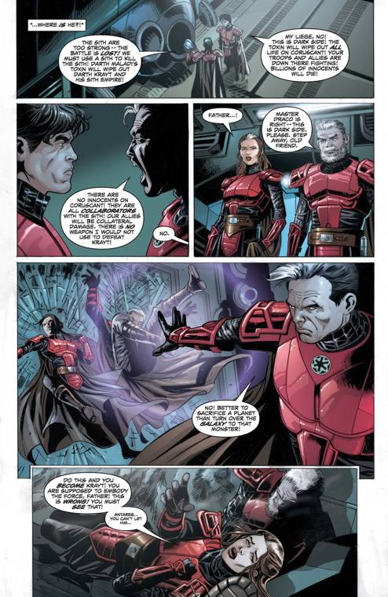
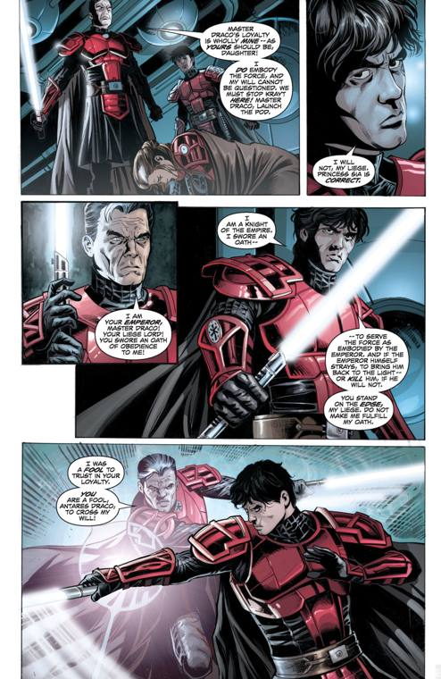
Our notes: `notes/materials/010-legacy-war.md:133`

- Note (summary from our notes, not a quotation): | 22 | Fel vs Marasiah + Sinde | *Jagged Fel* pod bay | p120 (#6) | One push through glass takes out both | They were pleading, not fighting |
  — Source: Legacy—War #1–6 (2010–11): power-scaling notes with panels.
Context: | # | Fight | Where | Pages (issue) | Outcome | Conditions / outside help |
Our notes: `notes/materials/010-legacy-war.md:947`

- Note (summary from our notes, not a quotation): | 23 | Antares Draco vs Roan Fel | *Jagged Fel* pod bay | p121–126 (#6) | Draco strikes Fel down as Fel lunges for the console | About a page of blade-lock; Fel turned his back |
  — Source: Legacy—War #1–6 (2010–11): power-scaling notes with panels.
Context: | # | Fight | Where | Pages (issue) | Outcome | Conditions / outside help |
Our notes: `notes/materials/010-legacy-war.md:948`

- Note (summary from our notes, not a quotation): p119–121. Cutaways to the fleet and the *Jagged Fel*.
  — Source: Legacy—War #1–6 (2010–11): power-scaling notes with panels.
Our notes: `notes/materials/010-legacy-war.md:965`

> A DARK SHUDDER IN THE FORCE! KRAYT IS DEAD!
— Source: Legacy—War #1–6 (2010–11): power-scaling notes with panels; p126. On the *Jagged Fel*, Draco senses it.
Note (our notes, around the quote): p126. On the *Jagged Fel*, Draco senses it: "A DARK SHUDDER IN THE FORCE! KRAYT IS DEAD!"
Our notes: `notes/materials/010-legacy-war.md:974`

## https://starwars.fandom.com/wiki/Jaina_Solo_Fel

- Note (summary from our notes, not a quotation): In the final duel aboard the Anakin Solo, Jaina caught Caedus off guard by stabbing him in the abdomen. Both used Force powers and unarmed combat. Caedus cut her stomach while Jaina cut his Achilles tendon; with one arm and one good leg, Caedus could no longer prevent his death. Jaina then slashed through his torso and heart, killing him [90]. She survived with numerous injuries and was extracted by Jagged Fel [90].
  — Source: Legacy of the Force: Invincible [per Wookieepedia "Jaina Solo Fel" rev 15688894, ref 90; per-sentence approximate match (5/6 sentences matched, min 0.64), verify; agrees with the entry's own ref marker]; per Wookieepedia "Jaina Solo Fel" rev 15688894, ref 90; per-sentence approximate match (5/6 sentences matched, min 0.64), verify; agrees with the entry's own ref marker — JAINA SOLO FEL — ARTICLE EXTRACTION — https://starwars.fandom.com/wiki/Jaina_Solo_Fel.
(Source: Legacy of the Force: Invincible [per Wookieepedia "Jaina Solo Fel" rev 15688894, ref 90; per-sentence approximate match (5/6 sentences matched, min 0.64), verify; agrees with the entry's own ref marker])
Our notes: `external/mega-notes/jaina-solo-quotes.txt:34`

- Note (summary from our notes, not a quotation): During the Kashyyyk events, Jaina, Jagged Fel, and Zekk defeated an apparent Alema Rar attack, later deducing it was only a Force phantom controlled by Rar [14]. The article does not credit Jaina with killing the real Rar there.
  — Source: UNRESOLVED (sentence not found in current Wookieepedia article revision; primary source not identified) — JAINA SOLO FEL — ARTICLE EXTRACTION — https://starwars.fandom.com/wiki/Jaina_Solo_Fel.
(Source: UNRESOLVED (sentence not found in current Wookieepedia article revision; primary source not identified))
Our notes: `external/mega-notes/jaina-solo-quotes.txt:62`

- Note (summary from our notes, not a quotation): Jagged Fel defeated Jaina in a sparring session while wearing Boba Fett’s crushgaunts and beskar plates. Angry, Jaina used the Force to hurl Fel into a tree; the article says the armor prevented a potentially fatal result [14].
  — Source: Legacy of the Force: Fury [per Wookieepedia "Jaina Solo Fel" rev 15688894, ref 14; per-sentence approximate match (2/3 sentences matched, min 0.77), verify; agrees with the entry's own ref marker]; per Wookieepedia "Jaina Solo Fel" rev 15688894, ref 14; per-sentence approximate match (2/3 sentences matched, min 0.77), verify; agrees with the entry's own ref marker — JAINA SOLO FEL — ARTICLE EXTRACTION — https://starwars.fandom.com/wiki/Jaina_Solo_Fel.
(Source: Legacy of the Force: Fury [per Wookieepedia "Jaina Solo Fel" rev 15688894, ref 14; per-sentence approximate match (2/3 sentences matched, min 0.77), verify; agrees with the entry's own ref marker])
Our notes: `external/mega-notes/jaina-solo-quotes.txt:66`

- Note (summary from our notes, not a quotation): Against Galactic Alliance Guard forces at the Jedi academy, she cleared coma gas from her body, warned others, and with Jagged Fel picked off sniper teams; Zekk, not Jaina, severed Major Serpa’s arm [88].
  — Source: Legacy of the Force: Inferno [per Wookieepedia "Jaina Solo Fel" rev 15688894, ref 88; per-sentence approximate match (2/2 sentences matched, min 0.60), verify; agrees with the entry's own ref marker]; per Wookieepedia "Jaina Solo Fel" rev 15688894, ref 88; per-sentence approximate match (2/2 sentences matched, min 0.60), verify; agrees with the entry's own ref marker — JAINA SOLO FEL — ARTICLE EXTRACTION — https://starwars.fandom.com/wiki/Jaina_Solo_Fel.
(Source: Legacy of the Force: Inferno [per Wookieepedia "Jaina Solo Fel" rev 15688894, ref 88; per-sentence approximate match (2/2 sentences matched, min 0.60), verify; agrees with the entry's own ref marker])
Our notes: `external/mega-notes/jaina-solo-quotes.txt:81`

## Legends Feats & Quotes (Star Wars Legends / EU)

> TO SERVE THE FORCE AS EMBODIED BY THE EMPEROR. AND IF THE EMPEROR HIMSELF STRAYS, TO BRING HIM BACK TO THE LIGHT -- OR KILL HIM, IF HE WILL NOT.
>
> — Antares Draco, Star Wars: Legacy—War #6, p121
> [fragment — full passage not on file]
>
> WAIT, MY LIEGE! WAIT! DID YOU FEEL IT?! A DARK SHUDDER IN THE FORCE! ... KRAYT IS DEAD!
> [fragment — full passage not on file]
>
> — Antares Draco, Star Wars: Legacy—War #6, p126
> [fragment — full passage not on file]
— Source: Legends Feats & Quotes (Star Wars Legends / EU). POV: Antares Draco, about Jagged Fel.
Context: Senses Krayt's death from the Jagged Fel; strikes down Emperor Fel under the Knights' oath (material 010; p121, p126, Legacy—War #6)
Our notes: `legends-feats.md:2956`

# CANON (Disney canon — kept separate)

## Star Wars Insider #134 (2012)

- Note (summary from our notes, not a quotation): Page contents: Contents: TCW Season 4 moments, Sith language, Tom Angleberger, Force Speed run, Nilo Rodis-Jamero, Warfare shipbuilding, Harley Brown on Yoda, Jaina/Jag fiction after FotJ, Brian Muir My Star Wars, Mercy Kill. (hand-read)
  — Source: Star Wars Insider #134 (2012).
Our notes: `notes/materials/038-star-wars-insider/134-ins134.md:30`

# Debate and forum claims (unverified)

Forum posts, Suspect Insight debates and Discord debates, respect threads, and verdicts. These are posters' arguments or quotations they typed; none is checked against the book here unless the entry says so.

## Legacy of the Force 1–9: novel notes from the other agent (reference copy)

- Note (summary from our notes, not a quotation): Alema loses every direct contest (Leia's reversed dart, Jag's shot, Leia's flurry) but escapes every time.
  — Source: Legacy of the Force 4: Exile (novel), feats and scaling notes.
Posted by: not named in our notes (see thread/notes link).
Our notes: `notes/materials/021-legacy-of-the-force/lotf-4-exile-notes.md:139`

- Note (summary from our notes, not a quotation): Alema: dangerous at range through phantoms; drained in person; killed by Jag.
  — Source: Legacy of the Force 7: Fury (novel, read in full): feats, scaling and story notes.
Posted by: not named in our notes (see thread/notes link).
Our notes: `notes/materials/021-legacy-of-the-force/lotf-7-fury-notes.md:155`

- Note (summary from our notes, not a quotation): Non-Force: Jag with prep can kill a weakened dark Jedi (Fight D).
  — Source: Legacy of the Force 7: Fury (novel, read in full): feats, scaling and story notes.
Posted by: not named in our notes (see thread/notes link).
Our notes: `notes/materials/021-legacy-of-the-force/lotf-7-fury-notes.md:156`

- Note (summary from our notes, not a quotation): Jaina vs. Caedus: at end of *Fury*, Jaina is the top Knight (S8) with equal potential but less training (S22). Jag's Jedi-hunter lessons (S10) and the Alema kill (Fight D) are the blueprint for how she beats Caedus in *Invincible*. Caedus would beat this Jaina, but she leaves to close the gap.
  — Source: Legacy of the Force 7: Fury (novel, read in full): feats, scaling and story notes.
Posted by: not named in our notes (see thread/notes link).
Our notes: `notes/materials/021-legacy-of-the-force/lotf-7-fury-notes.md:216`

- Note (summary from our notes, not a quotation): Alema's death is a prep-and-tech kill on a drained opponent. It is not evidence that Jag ≥ a healthy Alema.
  — Source: Legacy of the Force 7: Fury (novel, read in full): feats, scaling and story notes.
Posted by: not named in our notes (see thread/notes link).
Our notes: `notes/materials/021-legacy-of-the-force/lotf-7-fury-notes.md:218`

What it shows (our notes): RESULT: Alema Rar killed by Jag Fel, a non-Force-user using anti-Jedi tactics (the theme he taught Jaina in Ch12). Alema was badly drained by maintaining phantoms and by losing Ship (L4581). Alema on her own weakness: «Droids firing lasers-now, that would have been intelligent and dangerous to us.» / «We cannot feel droid intent» (L4771–4773).
> Oh, but I do learn. The sensor inside that blaster is now informing its processor that it’s gone beyond a certain distance from me. Five …
>
> “Droids firing lasers—now, that would have been intelligent and dangerous to us.”
>
> “We cannot feel droid intent, and lasers travel faster than the eye can follow.” *(L4771–4773)*
— Source: L4581; L4771–4773 — Legacy of the Force 7: Fury (novel, read in full): feats, scaling and story notes.
(Excerpt widened 2026-11-17 to the relevant passage, word for word from Fury (Aaron Allston), Chapter Twenty-Seven (text copy `MEGA_Legend_The_Legacy_of_the_Force_Series_Star_Wars_Legacy_of_the_Force_07_Fury_Aaron_Allston_epub`).)
(Full sentence/passage taken from the source text on file: `novels_tmp_fury_FULL_txt`.)
Posted by: not named in our notes (see thread/notes link).
Our notes: `notes/materials/021-legacy-of-the-force/lotf-7-fury-notes.md:370`

## https://starwars.fandom.com/wiki/Jaina_Solo_Fel

- Note (summary from our notes, not a quotation): Jagged Fel’s statement that she was an “excellent Sword” but becoming a “terrible Jedi,” and his warning that Rar or Caedus would not fight like a Jedi, are character opinions and tactical criticism [14].
  — Source: UNRESOLVED (sentence not found in current Wookieepedia article revision; primary source not identified) — JAINA SOLO FEL — ARTICLE EXTRACTION — https://starwars.fandom.com/wiki/Jaina_Solo_Fel.
Posted by: not named in our notes (see thread/notes link).
(Source: UNRESOLVED (sentence not found in current Wookieepedia article revision; primary source not identified))
Our notes: `external/mega-notes/jaina-solo-quotes.txt:106`

## Legends feat notes

- Note (summary from our notes, not a quotation): The Errant Venture trap on Alema (L5555-5659): Leia reverses Alema's dart into her mouth (L5593), Corran catches a dart, and Jag breaks her clavicle. Alema escapes.
  — Source: L5555-5659; L5593 — Legends feat notes — https://starwars.fandom.com/wiki/Palpatine/Legends ; https://comicvine.gamespot.com/emperor-palpatine/4005-16164/ ; https://www.suspectinsightforums.com/t1921-darth-krayt-versus-darth-sidious.
Posted by: not named in our notes (see thread/notes link).
Our notes: `external/mega-notes/legends-feats.md:568`

- Note (summary from our notes, not a quotation): Jag kills Alema (L4767-4803) with a rigged blaster and a beskar crushgaunt.
  — Source: L4767-4803 — Legends feat notes — https://starwars.fandom.com/wiki/Palpatine/Legends ; https://comicvine.gamespot.com/emperor-palpatine/4005-16164/ ; https://www.suspectinsightforums.com/t1921-darth-krayt-versus-darth-sidious.
Posted by: not named in our notes (see thread/notes link).
Our notes: `external/mega-notes/legends-feats.md:607`

## Verdicts and rankings (living file)

> “I’m not sure you can gain anything from sparring more with me. You’ve outstripped me with the lightsaber. Practice is all you think about, day and night. I doubt any Jedi Knight can stand against you. You need to practice against a Master.”
>
> Grand Master Skywalker, Ben Skywalker, half the Jedi Knights, all the Jedi Masters … every pilot I know plans to be there in a starfighter the next time he’s in one. So I suggest you get in line.”
>
> “If it is someone else, I won’t complain. But if it has to be me, I want to be ready. You showed me I wasn’t.” She took a moment to consider her words. “I’m his twin. I have as much power as he does … potentially. But he’s had training I haven’t. I need to counter it with training he hasn’t had. And the sort of ingenuity you showed me.”
>
> He watched her in the deepening shadows. “I’ll give you whatever help I can.
>
> But I think Alema was just about my match. Jacen … he’s far more dangerous.”
>
> Her brother seemed to anticipate every shot before she took it. *(Inferno L4303)*
>
> But you need to be thinking like someone who hunts Jedi. Like me.” *(Fury L2115)*
— Source: L7041; L7067 — Verdicts and rankings (living file); Reasoning: Zekk.
(Excerpt widened 2026-11-17 to the relevant passage, word for word from Fury (Aaron Allston) (text copy `MEGA_Legend_The_Legacy_of_the_Force_Series_Star_Wars_Legacy_of_the_Force_07_Fury_Aaron_Allston_epub`).)
(Excerpt widened 2026-11-17 to the relevant passage, word for word from Fury (Aaron Allston) (text copy `MEGA_Legend_The_Legacy_of_the_Force_Series_Star_Wars_Legacy_of_the_Force_07_Fury_Aaron_Allston_epub`).)
(Excerpt widened 2026-11-17 to the relevant passage, word for word from Fury (Aaron Allston) (text copy `MEGA_Legend_The_Legacy_of_the_Force_Series_Star_Wars_Legacy_of_the_Force_07_Fury_Aaron_Allston_epub`).)
(Full sentence/passage taken from the source text on file: `novels_tmp_fury_fury_epub`.)
(Fragment completed 2026-11-17: full sentence/passage matched word for word in the source text on file: `MEGA_Legend_The_Legacy_of_the_Force_Series_Star_Wars_Legacy_of_the_Force_07_Fury_Aaron_Allston_epub`.)
Note text that was attached to the quote line: *(Fury L1957)*
(Fragment completed 2026-11-17: full sentence/passage matched word for word in the source text on file: `MEGA_Legend_The_Legacy_of_the_Force_Series_Star_Wars_Legacy_of_the_Force_07_Fury_Aaron_Allston_epub`.)
Note text that was attached to the quote line: *(Fury L7039)*
Note text that was attached to the quote line: *(L7041)*
Note (our notes, around the quote): Reasoning: Zekk: «I doubt any Jedi Knight can stand against you. You need to practice against a Master.» (Fury L1957). Jaina herself: «I have as much power as he does. ... potentially. But he's had training I haven't.» (Fury L7039). Jag, who just killed Alema: «Jacen. ... he's far more dangerous.» (L7041). In the Inferno dogfight, «Her brother seemed to anticipate every shot before she took it.» (Inferno L4303). Caedus beat a Master plus three Knights at once while still hurt (Fury L1545-1745). Jag's lesson, «you need to be thinking like someone who hunts Jedi. Like me.» (Fury L2115), and his prep-based kill of Alema show the route she takes. Fury ends with her going «Toward her teacher.» (L7067). See jaina-solo-quotes.txt L17, L30, L34 for the later duel.
Posted by: verdict file (verdicts.md).
Our notes: `external/mega-notes/verdicts.md:44`

> not much of a challenge *(Tempest L5832)*
> [fragment — full passage not on file]
— Source: L5593; L6601; L5641 — Verdicts and rankings (living file); Reasoning: Mara beat her at Roqoo.
Note (our notes, around the quote): Reasoning: Mara beat her at Roqoo: «not much of a challenge» (Tempest L5832). Alema's only edge was a distraction that cost Luke his hand. In Exile, Alema loses every direct contest: Leia reverses her dart (L5593), Leia drives her back (L6601), and Jag breaks her clavicle (L5641). What keeps her alive is erasing people's memories and running.
Posted by: verdict file (verdicts.md).
Our notes: `external/mega-notes/verdicts.md:97`

## Kyp Durron (RNGesus) vs Darth Thanaton (Darth Plagueis the Wise)

> They traded places then, Jaina suddenly opening up with her weapons, Kyp handing the task of flying evasively over to his reflexes while his mind went elsewhere.
>
> Luke Skywalker had done this once, a couple of years ago. He’d mentioned it to the other Jedi. No one else had tried it because it had exhausted Luke to the point of collapse, and Jedi were seldom in a position to survive a technique that tired them so completely.
>
> They were past the second wave of coralskippers now and heading toward the cloud surrounding Jag. Beyond it, not far now, was the second interdictor. Kyp knew that other skips had to be converging on him and Jaina. He didn't bother to look at his sensor board. They weren't relevant now.
>
> And he didn't think he'd be as terribly drained as Luke by the technique. He was stronger in the Force than Luke Skywalker.
>
> He'd known that almost since they'd met - that he had more pure power than the legendary Jedi Master. But this was, perhaps, the first time he'd been able to say it to himself without a little thrill of pride. He was just stronger, and that was all. It usually didn't matter. Now it did.
>
> **-Enemy Lines: Rebel Dream**
> [fragment — full passage not on file]
— Source: Kyp Durron (RNGesus) vs Darth Thanaton (Darth Plagueis the Wise) — https://www.suspectinsightforums.com/t4418-stomper-showdown-finale-kyp-durron-rng-vs-darth-thanaton-darth-plagueis-the-wise.
(Excerpt widened 2026-11-17 to the relevant passage, word for word from Rebel Dream: Enemy Lines I (Aaron Allston) (text copy `MEGA_Legend_The_New_Jedi_Order_Series_Star_Wars_New_Jedi_Order_12_Enemy_Lines_01_Rebel_Dream_Aaron_Allston_epub`).)
(Excerpt widened 2026-11-17 to the relevant passage, word for word from Rebel Dream: Enemy Lines I (Aaron Allston) (text copy `MEGA_Legend_The_New_Jedi_Order_Series_Star_Wars_New_Jedi_Order_12_Enemy_Lines_01_Rebel_Dream_Aaron_Allston_epub`).)
Context: Q63 — Source: [source not stated adjacent] (preceding line: "More Comparison:")
Posted by: not named in our notes (see thread/notes link).
Our notes: `suspect-insight/debates/030-kyp-durron-vs-darth-thanaton.md:413`

## Darth Traya (MasterCilghal) vs Jaina Solo (Xolthol)

> I almost expected the things to detonate when Dad opened the package. Since when did Boba Fett ever send my father gifts?
>
> Since his daughter was tortured to death by my brother, actually. We’ve been waiting for Fett’s revenge ever since, but so far … nothing. Just the gift of crushgaunts and armor plate, all made from Mandalorian iron.
>
> So I’m packing for a journey I didn’t think I’d ever make. I’ll give Jag this much: he never said I told you so.
>
> So I’m packing for a journey I didn’t think I’d ever make. I’ll give Jag this much: he never said I told you so. He’s the one who said I needed to learn from someone who had a track record in bringing down Jedi.
>
> If anyone can stop Jacen, then, it’s me. I’m his equal, and I’m the Sword of the Jedi.
>
> If anyone can stop Jacen, then, it's me. I'm his equal, and I'm the Sword of the Jedi. But I just don't have his... training. I've no idea what he learned from Lumiya, let alone what he picked up on his travels during those five years. But he'll make a mistake sooner or later. He's way too cocky not to overestimate himself.
>
> I’m his equal, and I’m the Sword of the Jedi. But I just don’t have his … training. I’ve no idea what he learned from Lumiya, let alone what he picked up on his travels during those five years. But he’ll make a mistake sooner or later. He’s way too cocky not to overestimate himself.
>
> I just hope it’s sooner. And if being a Sith made Jacen invincible, he’d have taken over the galaxy by now.
>
> I have a chance, and Fett’s going to help me make the most of it.
>
> It can’t be that hard to find him.
>
> It can't be that hard to find him. He's a bounty hunter, so I'll hire him like any other client, except I'm not just any other client - I'm Han Solo's daughter, and I'm a Jedi, and Fett has spent a lifetime hunting us.
>
> It can’t be that hard to find him. He’s a bounty hunter, so I’ll hire him like any other client, except I’m not just any other client—I’m Han Solo’s daughter, and I’m a Jedi, and Fett has spent a lifetime hunting us.
>
> And now I’m asking him to train me to hunt and capture my own brother.
>
> For all I know, he’ll laugh in my face—if he ever laughs, that is—and tell me to get lost. But I have to ask him.
>
> For all I know, he’ll laugh in my face—if he ever laughs, that is—and tell me to get lost. But I have to ask him. Swallow pride, eat humble pie, and beg if need be. Dad seems to have thawed a little toward him; I still despise him.
>
> But if he says yes—I swear I’ll be the best pupil he’s ever had. Come on, Fett: show me how it’s done. chapter one When the nation is in its darkest peril, the great warrior-sailor Darakaer shall be summoned from his eternal sleep by a rhythm beaten on his ancient drum. For his final pledge was that he would come to our aid when the drum sounded, and that we should call him when we sailed to meet the foe.
— Source: Darth Traya (MasterCilghal) vs Jaina Solo (Xolthol) — https://www.suspectinsightforums.com/t110-ss-darth-traya-mastercilghal-vs-jaina-solo-xolthol.
(Excerpt widened 2026-11-17 to the relevant passage, word for word from Revelation (Karen Traviss) (text copy `MEGA_Legend_The_Legacy_of_the_Force_Series_Star_Wars_Legacy_of_the_Force_08_Revelation_Karen_Traviss_epub`).)
(Excerpt widened 2026-11-17 to the relevant passage, word for word from Revelation (Karen Traviss) (text copy `MEGA_Legend_The_Legacy_of_the_Force_Series_Star_Wars_Legacy_of_the_Force_08_Revelation_Karen_Traviss_epub`).)
Context: Q85 — Source: [source not stated adjacent]
Posted by: not named in our notes (see thread/notes link).
Our notes: `suspect-insight/debates/055-darth-traya-vs-jaina-solo.md:606`

## Mara Jade Skywalker (EmperorCaedus) vs Darth Wyyrlok III (DC77)

> They traded places then, Jaina suddenly opening up with her weapons, Kyp handing the task of flying evasively over to his reflexes while his mind went elsewhere.
>
> Luke Skywalker had done this once, a couple of years ago. He’d mentioned it to the other Jedi. No one else had tried it because it had exhausted Luke to the point of collapse, and Jedi were seldom in a position to survive a technique that tired them so completely.
>
> They were past the second wave of coralskippers now and heading toward the cloud surrounding Jag. Beyond it, not far now, was the second interdictor. Kyp knew that other skips had to be converging on him and Jaina. He didn't bother to look at his sensor board. They weren't relevant now.
>
> And he didn't think he'd be as terribly drained as Luke by the technique. He was stronger in the Force than Luke Skywalker.
>
> He'd known that almost since they'd met - that he had more pure power than the legendary Jedi Master. But this was, perhaps, the first time he'd been able to say it to himself without a little thrill of pride. He was just stronger, and that was all. It usually didn't matter. Now it did.
>
> He armed a proton torpedo and fired it. He felt its physical presence as, in a matter of seconds, it closed the distance between him and the interdictor... and was swallowed by another void.
>
> He felt it enter the void, felt which of the many singularities it was.
>
> And he seized upon that void, directing all his Force abilities and discipline against it.
>
> It was like using a thin metal rod to push a grounded landspeeder. Too much pressure and it would bend, becoming useless. Too little and nothing would happen. He had to find the right pressure to budge it, to set it into motion and keep it going that way...
>
> For a moment, the only things in the universe were him, Jaina, and the void. He moved the void, turned it around, moved it back the other direction.
>
> Then he was himself again, in the cockpit, watching the flank of the interdictor distort. The void had moved back and touched the interdictor, and now the interdictor elongated into it, extending what looked like a pliant extrusion of what he knew to be hardened yorik coral into the singularity.
>
> The portions of the interdictor in closest proximity to the void accelerated faster into its maw so that portions farther back tore, venting gases into space. But the incredible gravity of the singularity didn't allow the remainder of the ship to tear away and be free. It dragged greater and greater portions of the interdictor into it, compressing them, rending them, and in a moment the interdictor was gone.
— Source: Mara Jade Skywalker (EmperorCaedus) vs Darth Wyyrlok III (DC77) — https://www.suspectinsightforums.com/t4396-ss-mara-jade-skywalker-emperorcaedus-vs-darth-wyyrlok-iii-dc77.
(Excerpt widened 2026-11-17 to the relevant passage, word for word from Rebel Dream: Enemy Lines I (Aaron Allston) (text copy `MEGA_Legend_The_New_Jedi_Order_Series_Star_Wars_New_Jedi_Order_12_Enemy_Lines_01_Rebel_Dream_Aaron_Allston_epub`).)
(Excerpt widened 2026-11-17 to the relevant passage, word for word from Rebel Dream: Enemy Lines I (Aaron Allston) (text copy `MEGA_Legend_The_New_Jedi_Order_Series_Star_Wars_New_Jedi_Order_12_Enemy_Lines_01_Rebel_Dream_Aaron_Allston_epub`).)
Context: Q7 — Source: Star Wars: New Jedi Order: Enemy Lines 1: Rebel Dreams
Posted by: not named in our notes (see thread/notes link).
Our notes: `suspect-insight/debates/093-mara-jade-skywalker-vs-darth-wyyrlok-iii.md:107`

## Cilghal respect thread (in progress) — respect-thread notes

> Sorry for the wait, but i’ve Been absent from the forum for some time due to personal issues. As for your question, I’m not sure whether or not Cilghal was present at the time. But consider that that that meeting was extremely important because it addressed how the jedi would deal Caedus so I imagine she too was present. Of course she didn’t talk or anything. I could be wrong though.
>
> **But could she convince the Masters?
>
> Several of them were gathered around a table behind her, holding an impromptu war council with Luke, Jagged Fel, and her father and mother—the renowned Han and Leia Solo. Not for the first time in her life, Jaina wondered whether she could ever live up to her parents’ legend, how she could possibly impact the galaxy as they had during their long and illustrious lives.
— Source: SI respect-thread directory: Cilghal respect thread (in progress) — https://www.suspectinsightforums.com/t356-cilghal-respect-thread-in-progress.
(Excerpt widened 2026-11-17 to the relevant passage, word for word from Invincible (Troy Denning) (text copy `MEGA_Legend_The_Legacy_of_the_Force_Series_Star_Wars_Legacy_of_the_Force_09_Invincible_Troy_Denning_epub`).)
Context: (quoted passage)
Posted by: not named in our notes (see thread/notes link).
(Source (as named in the post's quote header): YVH Cilghal wrote:)
(Source (as named in the post's quote header): Legacy of the Force: Invincable wrote:)
Our notes: `suspect-insight/respect-threads/cilghal.md:185`

# NJO FULL re-read additions (2026-11-17)
Verbatim excerpts from the full consecutive re-read of the New Jedi Order novels (Dark Journey through The Unifying Force), each shown with the text around it and its source chapter.

## *Dark Journey*
Jag and Shawnkyr blow up the lead coralskipper of a suicide squadron by detonating a missile in its path.

> Jag fired a concussion missile at the lead vessel. Shawnkyr followed with a barrage of laserfire, exploding the missile just short of the alien’s shielding, and right in the path of the diamond-shaped wedge.
>
> The lead skip pulled up sharply, but the leading edge of the explosion caught it and sent it tumbling wildly. Jag fired a second missile. The out-of-control ship exploded. Shards of black coral streaked across the sudden brightness, the opposite image of starlines against the blackness of space.

— Source: *Dark Journey* (Elaine Cunningham, Del Rey 2002), chapter 11 (DJ).

Jag charges into a brawl in the Solo tent with his charrik and finds Han Solo fighting.

> Jag drew his one-handed charrik from his weapons belt and kicked into a run. He tore open the flap and charged in, leading with the small Chiss blaster.
>
> A fist flashed up over his guard and into his face. Jag’s head snapped back, and he staggered back a couple of paces as he shook off the blow.
>
> It took Jag only a second or two to regroup, but by then his assailant had already turned his attention to another foe, a tall man in Hapan uniform. The brawler delivered a punch that spun the Hapan around and sent him crashing facedown onto a folding table.
>
> A familiar, lopsided leer lifted the corner of the man’s split lip, and he hurled himself at a burly warrior who was crouched in guard position. The two of them went down with a crash, taking a makeshift shelf and several pieces of battered crockery down with them.
>
> This, then, was Han Solo, and Jaina’s father.
>
> Feeling strangely enlightened, Jag took quick stock of the battlefield. Han Solo and the man he’d just taken down had struggled to their feet. They lurched about the tent, sometimes grappling for a disabling hold, then the next moment hauling back a fist to deliver a short-arm jab.

— Source: *Dark Journey* (Elaine Cunningham, Del Rey 2002), chapter 20 (DJ).

Jag stuns the Hapan attackers and pulls the last assailant off Han Solo.

> Jag fired a short stun bolt that sent the man pitching forward, then swung his weapon toward the next assailant—a burly Hapan woman who’d snatched up a chair and hoisted it aloft with both hands. This she brought down, hard, in the general direction of the two struggling men.
>
> Jag quickly fired a stun charge, but this only served to send the woman hurtling forward, adding momentum to her already impressive swing. The three combatants went down in a tangle of limbs.
>
> Striding forward, Jag hoisted the uniformed man—the only person still moving—and tossed him off the aging Rebel hero. The Hapan dived for the tent wall and scuttled under the durasilk. Jag briefly considered pursuit, then knelt beside the too-still man.

— Source: *Dark Journey* (Elaine Cunningham, Del Rey 2002), chapter 20 (DJ).

## *Rebel Dream*
Jag reveals he designed his fighter's decoration days earlier because he predicted Jaina's order.

> “No. I decided on this design days ago, when I calculated that you’d be issuing that directive.”
>
> Days ago? Jaina felt a flash of surprise and irritation. How dare he attempt to predict her this way?
>
> How dare he do it successfully?

— Source: *Rebel Dream* (Aaron Allston, Del Rey 2002), chapter 9 (RD).

Jag flies his clawcraft into the cloud of hostages and rams them away from Borleias's atmosphere.

> “I’ve called for shuttles. And I’ll let you know when I’m useless. I recommend you follow my lead and discontinue trying to slow them to a stop.” Jag’s clawcraft darted ahead of the X-wings, maneuvered with delicacy into the cloud of victims, matching and then slightly surpassing their speed.
>
> Then, with skill that was on the wrong side of impossible, Jag rotated his clawcraft and sideslipped it until it was mere meters to the side of a dark-skinned human male. Jag flicked his thrusters and the clawcraft slowed. The clawcraft slammed into the human at somewhere between twenty and thirty kilometers per hour; the man, stunned but not completely incapacitated, flailed around frantically as he was vectored away from Borleias.
>
> The clawcraft rotated; as soon as that victim was clear of any possible ion wash, Jag touched his thrusters again, and maneuvered until he was alongside a second victim. That one, too, he rammed, as delicately as possible, an impact that appeared to hurt the Twi’lek woman’s arm, but sent her off at an angle that would not propel her into Borleias’s atmosphere.

— Source: *Rebel Dream* (Aaron Allston, Del Rey 2002), chapter 10 (RD).

Jag proposes that Kyp Durron should bow to Jaina to convince Vong spies she is a goddess.

> “I’m happy to participate in any plan so long as it’s the best plan to accomplish its goal,” Jag said. He straightened and slapped shut the hatch that had allowed him access to the claw’s internal systemry. He ignored Sharr and addressed Jaina directly. “This isn’t the best plan. You haven’t thought it out.”
>
> Jaina gave him a cold stare. “Yes, it is. You just don’t want to do it.”
>
> “No, I have a better idea.”
>
> Sharr snorted. “Better than what an expert on psychological warfare and a Jedi Knight have assembled. Of course.”
>
> Jag turned an unfriendly smile on him. “Kyp Durron.” Sharr’s expression changed as he considered the suggestion.
>
> Jag continued, “To your presumed Yuuzhan Vong spies and observers, I’m just an unknown quantity—a pilot from a place the Yuuzhan Vong haven’t encountered yet. But Jedi Master Kyp Durron, if they see him bowing to her, carrying her baggage, digging dirt from beneath her nails—”

— Source: *Rebel Dream* (Aaron Allston, Del Rey 2002), chapter 11 (RD).

Jag charges a Vong interdictor's bow with shadow bombs in tow to open a hole for the squadron.

> Jag aimed straight in at the capital ship’s bow, the node where its dovin basals were concentrated—the dovin basals that dragged the ship through space, that projected the voids that drank incoming damage, that projected gravitic fluctuations into hyperspace to drag ships in transit back into realspace—and to keep nearby craft from making the jump into hyperspace. And finally Jaina knew and understood Jag’s plan.
>
> His evasive maneuvers became tighter, faster, more random as he neared the interdictor and its full array of plasma cannons opened up on him. Jaina, through her tentative Force connection with Jag, could feel little spikes of alarm and adrenaline go through him, something she would never have guessed, given his calm demeanor in every situation.
>
> “Coming up on drop point,” Jag said, his tone as indifferent as if he’d just ordered a meal he didn’t look forward to eating. “Three, two …” His clawcraft began spraying laserfire in a spiral pattern, the interdictor’s voids greedily sucking it all in. Jaina could see the voids concentrating there before Jag’s clawcraft, anticipating the spread of his attack.
>
> Anticipating. He was so good at anticipating, predicting, that he could use the anticipation of his enemies as a weapon against them. Jaina shook her head.
>
> “… one, drop.”
>
> Jag’s clawcraft vectored again, another angle only a TIE craft could manage, but he continued to direct his laserfire against the flank of the interdictor. Its voids tracked, staying ahead of his lasers.

— Source: *Rebel Dream* (Aaron Allston, Del Rey 2002), chapter 13 (RD).

## *Rebel Stand*
Jag tells Shawnkyr he is staying for Borleias because it is the surest test of Yuuzhan Vong determination.

> He shook his head. “I’ve come to additional conclusions that suggest we should stay.”
>
> “May I hear them?”
>
> “I believe that this engagement, here on Borleias, will be the surest test of Yuuzhan Vong determination and character. Only in seeing how this campaign plays out can we provide a definitive analysis of the enemy that our people will someday face.”
>
> “So it is your plan to return to Chiss space immediately upon the fall of Borleias.”
>
> “No.”
>
> “Then I have failed to understand you.”
>
> “I didn’t describe all my conclusions. A second one, not related to the first, is that my presence here may affect coming events, in a small but perhaps measurable way, and that to abandon this campaign now would not only do it harm, but eventually do harm to our people as well. Any damage I do to the enemy here is damage the enemy cannot do to us when they reach us.”

— Source: *Rebel Stand* (Aaron Allston, Del Rey 2003), chapter 4 (RS).

Jag explains his loyalty to the Chiss rests on the traits they embody, not just birth.

> “I think you’re wrong. I am not loyal to the Chiss because my parents were accepted by them, or because I have grown up among them. I’m loyal because they embody traits I admire and respect; they make those traits part of the very fiber of our society. Traits such as strength in the face of aggression, such as acknowledgment of duty before self-interest. The Chiss, however, are not the only people with admirable traits, not the only ones who deserve to survive the Yuuzhan Vong, and not the only ones I identify with. Not anymore.”

— Source: *Rebel Stand* (Aaron Allston, Del Rey 2003), chapter 4 (RS).

## *Destiny's Way*
Jag Fel argues the Empire could not survive alongside the Yuuzhan Vong because the Vong oppose all technology.

> The superior tone was back in Jag’s voice. “Leaving aside any issues of perfidy—and it’s perfectly true that Yuuzhan Vong guarantees can’t be trusted—there exist long-term issues of compatibility. The Vong and the Empire simply want different things. The Empire wants a return to the power and respect it once enjoyed. The Yuuzhan Vong want not only the complete domination of the galaxy, but an ideological and religious domination as well—they want their way of life to triumph. And while some aspects of Yuuzhan Vong life are compatible with the Empire—the discipline, the unquestioning obedience to authority—other areas are not. The Yuuzhan Vong are opposed to all forms of technology.”
>
> He held up a hand. “And where is the Empire without its technology? The Empire has always relied on a technological solution to its problems. If it adopted Yuuzhan Vong biotechnology instead, it would concede whatever advantages it has, and make itself dependent on the Vong.”

— Source: *Destiny's Way* (Walter Jon Williams, Del Rey 2002), chapter 2 (DW).

## *Ylesia*
Jag explains that he ambushed Jaina in her cabin as an experiment to resolve the ambiguity in her messages.

> A moment later—and the length of that moment was something she would not forgive herself—it occurred to her to resist. Her arms were securely pinned, so she summoned the Force and flung her assailant across the room. There was a crash, and items tumbled off a shelf. Jaina took a step to the door and waved on the lights.
>
> Jagged Fel lay sprawled across her bed. He touched the back of his head gingerly.
>
> “Couldn’t you just have slapped me?” he asked.
>
> “What are you doing here?”
>
> “Conducting an experiment.”
>
> “A what?” Furious.
>
> His pale green eyes rose to meet hers. “I detected a degree of ambiguity in your last few messages,” he said. “I could no longer tell what your feelings toward me might be, so I thought an experiment was in order. I decided to place you in a situation that wasn’t the least bit ambiguous, and see how you reacted.” An insufferable smile touched the corners of his mouth. “And the experiment was a success.”
>
> “Right. You got thrown into the wall.”
>
> “But before you remembered to be outraged, there was a moment that was worth all the pain.” His eyes turned to the door. “Hello there, galactic hero. Your mother told me you’d escaped.”

— Source: *Ylesia* (Walter Jon Williams, Del Rey 2002), Ylesia (YL).

Jag tells Jaina she must learn to delegate and share work with Lowbacca and Tesar.

> “Jaina,” he said. “Please allow me to observe, one officer to another, that it is not necessary to do all the work yourself. You absolutely must learn to delegate. You have two capable, veteran lieutenants in Lowbacca and Tesar Sebatyne, and not only will it aid you if you share the work with them, it will aid their development as officers.”
>
> Jaina permitted herself a thin smile. “So it’s to the benefit of my officers and pilots to spend the evening in my cabin alone with you?”
>
> He nodded. “Precisely.”

— Source: *Ylesia* (Walter Jon Williams, Del Rey 2002), Ylesia (YL).

Jag leads the Chiss squadron along an invisible line so their fire cannot hit friendly forces.

> Black against the western sky was the Chiss squadron, the craft flying nearly wingtip to wingtip, echeloned back from the leader in a kind of half wedge.
>
> Of course, Jaina thought in admiration. Jag Fel would be in the lead, flying along an invisible line down the battlefield between the Yuuzhan Vong and the New Republic troops. The others were echeloned onto the Vong side of the line—as long as they maintained their alignment on the leader, their fire couldn’t hit friendly forces.

— Source: *Ylesia* (Walter Jon Williams, Del Rey 2002), Ylesia (YL).

Jag suggests Thrackan could prove his innocence by volunteering for truth-drug interrogation.

> “If Sal-Solo wishes to prove his innocence,” Jag said, “he need only volunteer for interrogation under truth drugs. If his collaboration was involuntary, the drugs would reveal it.” Grim amusement passed across his scarred features. “But I think he’s afraid that such an interrogation would reveal how he came to be in the hands of the Yuuzhan Vong in the first place. That’s what would truly condemn him.”

— Source: *Ylesia* (Walter Jon Williams, Del Rey 2002), Ylesia (YL).

## *Force Heretic I: Remnant*
Jag drops into the Chiss Forbelean Defense stance while sparring with Jaina.

> He stood, dropping into the classic Chiss “Forbelean Defense” stance. From such a position, virtually all forms of attack could be deflected. On the opposite side of the mat, Jaina Solo dusted off her loose-fitting training outfit.

— Source: *Force Heretic I: Remnant* (Sean Williams and Shane Dix, Del Rey 2003), Part One (FHR).

Jag explains that the Chiss are taught the position matters, not the person holding it.

> “Even if I did know,” Jag said, maintaining steady eye contact with the Jedi Master, “I wouldn’t tell you. You see, the Chiss are taught from the earliest days of training that it is not the person holding the position that is important, but rather the position itself. Individuals must allow themselves to be subsumed into the role society expects them to play. If you asked for someone by name, they would on principle not talk to you. If you asked for them by rank, however, they would not hesitate.”

— Source: *Force Heretic I: Remnant* (Sean Williams and Shane Dix, Del Rey 2003), Part One (FHR).

Jag tells Luke the Chiss do not ask to be judged by anyone.

> “But it’s good, I think. For all of us. We need another example of the Chiss to help us judge their nature, and you are as good as one of them. Thrawn was brilliant, but not the best ambassador a culture could wish for.”
>
> Jag stiffened defensively. “The Chiss do not ask to be judged, Master Skywalker. Not by you; not by anyone.”

— Source: *Force Heretic I: Remnant* (Sean Williams and Shane Dix, Del Rey 2003), Part One (FHR).

Jag sees intense hatred in Tahiri's eyes at the departure and reaches for his blaster, ready to shoot her if she moved against Jaina.

> Jag Fel wasn’t one for flights of fancy, but he also wasn’t one for ignoring what his senses told him, either—so when he saw the look of disgust on Tahiri’s face and the intense hatred in her eyes, his hand had reached automatically for the blaster at his side. If she was to make any move whatsoever for Jaina or her family, he wanted to be ready. Had she shown any indication of attacking, he would have shot her down without hesitation.

— Source: *Force Heretic I: Remnant* (Sean Williams and Shane Dix, Del Rey 2003), Part Two (FHR).

Jag jams the Fia's listening devices in the diplomatic quarters.

> “Sorry,” said the tall, handsome pilot. “Can’t help you, I’m afraid.” Shrugging off his backpack containing equipment he’d brought with him and placing it on the table in the middle of the room, Jag turned to Leia and said, “I’ve patched us into the planetary comm network and have opened a link to Selonia. I think we’re safe in assuming that our encryption is light-years ahead of what these guys have here.”
>
> “And the rooms?” Leia asked.
>
> “Bugged, of course,” he said. “But it’s okay; I’ve jammed them. We’re clean.” Jag glanced at Tahiri when he said that, then quickly looked away. “We should be safe here now.”

— Source: *Force Heretic I: Remnant* (Sean Williams and Shane Dix, Del Rey 2003), Part Two (FHR).

Jag objects to Jaina scouting the Koornacht Cluster alone and offers to run the squadron.

> The only dissenting voice came from Jag. “This is crazy,” he said to her parents. “You can’t be seriously considering sending Jaina off into unknown territory like this.”
>
> “We’re not sending her,” Leia said. “She volunteered.”
>
> “Besides, if the Fia are telling the truth,” Han put in, “then the territory’s likely to be safer now than it ever was.”
>
> “And if they’re not telling the truth?” Jag asked.
>
> “What’s your problem, Jag?” Jaina piped up frostily.
>
> “Look, I don’t mean to imply that you couldn’t handle it,” Jag said. He looked uncomfortable confronting the combined Solo family. “I’m just thinking of the squadron, that’s all. Who’s going to run it with you gone?”
>
> “You, of course,” she said, surprised that she should even have to point this out. “It’ll take me a couple of hours or more to prep for the mission. That’ll give you time to get back up here and take over, won’t it?”

— Source: *Force Heretic I: Remnant* (Sean Williams and Shane Dix, Del Rey 2003), Part Two (FHR).

Jag finds the silver pendant Tahiri held, a scarred creature carved on its face.

> Even as he said this, already bending over again to continue his search, he caught a glint of something silver in the carpet farther along the corridor. Cautiously, so as not to lose sight of it, he walked toward it. There, at the edge of the corridor fully four meters from where they’d been looking, was a small object poking out of the carpet. If it was the thing that Tahiri had been holding, then she must have flung it when spinning around defensively with her lightsaber; then, he imagined, it had been pushed deeper into the pile by the large feet of one of the Fia. Otherwise it would have surely been spotted before now.
>
> He reached down and plucked it from the carpet. It was small, about half the size of his thumb joint, and looked to him to be a pendant or charm of some kind. It was metallic in nature, but with a grown texture, rather than forged. There was a hole through which a chain or thong might have been threaded, and on the face were carvings in an unknown language. It was surprisingly heavy.
>
> The creature it portrayed was hideous and completely unfamiliar, but that wasn’t so surprising, Jag thought. There were many different types of creature in the Galactic Alliance, and most of them were unfamiliar to him—just as the various cultures of the Unknown Regions would be unfamiliar to them. One thing about the creature portrayed did trouble him, though: It seemed to be covered in scars.

— Source: *Force Heretic I: Remnant* (Sean Williams and Shane Dix, Del Rey 2003), Part Two (FHR).

Jag receives a vanishing warning message telling him to leave Galantos and ponders its meaning.

> YOU MUST LEAVE HERE IMMEDIATELY.
>
> Jag stared at it for a long moment, startled. He quickly surveyed the bay for signs of someone watching him, but saw no one suspicious lurking about. Then, when he looked back at the screen, the message had disappeared. He tried to access it again, but the maintenance logs showed no record of it ever having existed in the first place. Whoever had left the message for him had made sure it would be erased as soon it had been read.
>
> But why? And if the sender had been so keen to have him leave, then why put the message in such an inaccessible spot? Placing it in the flight systems, where he wasn’t likely to see it until he was already leaving anyway, seemed redundant. Unless, maybe, the person responsible for the message had no choice but to use this means. Or perhaps the message was intended for him alone, and this was the only way to ensure that no one else saw or heard it.
>
> He fought a growing sense of unease. Tahiri, the pendant, this message … There were too many questions without answers, and none of them sat easily with him. He fleetingly considered staying behind to help Leia and Han, but quickly dismissed the idea. There was no actual evidence that anything was up; there were just a couple of hints and warnings, as well as the workings of his suspicious mind. Besides, Han and Leia could look after themselves; they had had plenty of practice at it, after all.

— Source: *Force Heretic I: Remnant* (Sean Williams and Shane Dix, Del Rey 2003), Part Two (FHR).

Jag finds no communications fault on Galantos and deduces the Fia deliberately cut themselves off.

> Jag focused on that problem instead of the many others batting at him. He had initially assumed that the communications fault would be easily fixed, so they could move on to their second port of call. But when he and C-3PO had analyzed the records automatically kept by the planetary transceiver serving Galantos and the rest of the system, he had found that there was no fault at all. From there they had contacted the nearest intersector network and ascertained that communications between Galantos and the rest of the galaxy could be easily reestablished, once a small routing correction was made. The fact that it hadn’t been made was suggestive, but Jag hadn’t decided of exactly what, yet. It was almost as though the Fia had deliberately cut themselves off.
>
> But why would they do that? With the Yevetha at their back door, along with a wealth of minerals the rest of the galaxy would surely be interested in, contact with the outside would be exactly what they’d want. Except, Jag thought, that the Fia claimed that the Yevetha were no longer a threat, and they seemed to be turning a tidy profit from someone, anyway.

— Source: *Force Heretic I: Remnant* (Sean Williams and Shane Dix, Del Rey 2003), Part Two (FHR).

Jag asks Jaina whose side the Fia would take and warns of launches from Galantos.

> “Let me ask you a question,” he said after a moment. “If you were the Fia and you’d done a deal with the Yuuzhan Vong, but we showed up and started fighting your allies, whose side would you fight on?”
>
> “I don’t know, Jag.” She wiped sweat from her eyes with the back of her gloved hand. “Why? Does it matter?”
>
> He paused slightly before answering. “Take a look at your telemetry,” he said.
>
> She did so, and saw multiple launches from three locations across Galantos, followed by formations of ion engine signatures thrusting for space. She couldn’t help it: she felt fatigued all over again.
>
> “Whichever side they’re on,” said Jag, “here they come …”

— Source: *Force Heretic I: Remnant* (Sean Williams and Shane Dix, Del Rey 2003), Part Three (FHR).

Jag redirects the squadrons to knock out the blastboat analog carrying the yammosk.

> He changed to the new channel. “Our priority up to now has been to knock out the slaveships,” he said. “But that situation has changed. Those scarheads are getting themselves together, so we’re going to need to take out that last ship. Whatever’s doing the thinking for them, it’s in there.”

— Source: *Force Heretic I: Remnant* (Sean Williams and Shane Dix, Del Rey 2003), Part Three (FHR).

Jag demonstrates the stutterfire-and-torpedo technique against a coralskipper for his Fian wingmen.

> He guided his new wingmates around the slaveships and along a rolling strike path toward the blastboat analog. Skips immediately swooped in to deter them, dividing the Y-wing formation into quarters. Two of the old boats stayed with Jag, but they only managed to keep up because he showed restraint and kept his maneuvering to a minimum. As soon as the first of the skips appeared in his targeting reticle, however, he let his instincts take over.
>
> The skip danced across his scopes, narrowly avoiding the stutterfire he sent arcing toward its coral-armored back. Dovin basals snatched energy out of the vacuum, greedily absorbing everything he threw at them. His two wingmates added to the barrage, but they hadn’t yet picked up the new techniques. Their input was little more than a distraction. Nonetheless, he appreciated all the help he got.
>
> “Like this, guys,” he said, hugging tight to the skip’s tail and sending pulses of energy waves at it, then quickly launched a proton torpedo down the throat of the overloaded dovin basal. The coralskipper exploded into highly energized dust particles that peppered his cockpit as he passed through the remains of the ship.

— Source: *Force Heretic I: Remnant* (Sean Williams and Shane Dix, Del Rey 2003), Part Three (FHR).

Jag tells Jaina she is acting like Jaina Solo and that is nothing to be ashamed of.

> “I’m sure Miza would ask the same question, Jaina.”
>
> She was silent for a moment as the name of the dead Chiss pilot sunk in. “I’m acting like a child, aren’t I?”
>
> “Actually, you’re acting like Jaina Solo—and that’s nothing to be ashamed of, I assure you.”

— Source: *Force Heretic I: Remnant* (Sean Williams and Shane Dix, Del Rey 2003), Part Three (FHR).

Jag explains that many Chiss mourned Thrawn's defeat and some resentment remains toward the New Republic.

> “But to us he was a Chiss, Jaina. The Expansionary Defense Fleet has been struggling for decades to protect our borders. Using the Empire as a tool, Thrawn made more progress in a few years than all the others combined. Yes, he may have overreached at the end, but still, when the New Republic finally defeated him, there were many among us who mourned. That’s partly why we tend to side with the Empire. It’s not just because we’re closer to them than we are to you along most of our borders. There’s still resentment.”

— Source: *Force Heretic I: Remnant* (Sean Williams and Shane Dix, Del Rey 2003), Part Four (FHR).

## *Force Heretic II: Refugee*
Jag and Leia doubt Cundertol's story of single-handedly overpowering seven kidnappers with not a scratch on him.

> Leia frowned. “You’re saying he single-handedly overpowered a crew of seven? That’s certainly not the Senator Cundertol I remember.”
>
> “I’m skeptical, too,” Jag said from orbit. “But I suppose it’s not completely impossible. He’s fit, and he had the element of surprise. One thing that really bothers me is that he did it without taking any cuts or bruises.”
>
> “You’re sure about that?” Leia asked.
>
> “I’m telling you, I stood right beside him as he told his story, and there wasn’t a scratch on the man. Ever known anyone to come out of a fistfight without so much as a fat lip or a grazed knuckle?”
>
> “He’s got a point,” Han said. His posture indicated that he was devoting at least as much attention to Jaina’s gesticulating at local security forces outside as he was to Jag. “But have you got anything else? Anything substantial?”
>
> “Nothing. He refused a medical exam.”
>
> “Todra’s chief medico is a Duros, though, right? And if I recall, Cundertol is pro-human through and through, right, Leia?”
>
> “Definitely more than just a hint of Empire, Jag,” Leia confirmed. “He could have simply wanted to avoid contact with an alien.”
>
> “Yet he signs an alliance with the P’w’eck?”
>
> “He’d sign an alliance with an arachnor if he thought it politically expedient,” Leia said.

— Source: *Force Heretic II: Refugee* (Sean Williams and Shane Dix, Del Rey 2003), Part Two (FHF).

Jag recalls his father's advice to outsee your enemy and be three steps ahead.

> He had taken a mixed flight out to patrol the edges of Selonia’s orbit, wary of any “unauthorized” activity while attention was focused below. Both P’w’eck and Bakuran contingents were quiet, the two big alien assault carriers, Errinung’ka and Firrinree, orbiting in quadrants diametrically opposed to the two local defenders, Defender and Sentinel. The latter had two full squadrons of P’w’eck fighter craft stationed at close quarters, plus two squat picket ships. If things were to turn nasty, for whatever reason, they could do a lot of damage while the Bakurans tried to get their balance. While Jag obviously hoped nothing untoward would happen, he had to think tactically.
>
> “Don’t just outguess your enemy,” his father had once said, “but outsee him, too. Always assume that he’s two steps ahead of the current play, and be three steps ahead yourself.”

— Source: *Force Heretic II: Refugee* (Sean Williams and Shane Dix, Del Rey 2003), Part Four (FHF).

Jag discovers the honor guard Y-wings are being tractored to the carriers and resolves to stop it.

> He scanned the formation for energy emissions and soon discovered that “shadowing” was as far from the truth as it could get. The two droid ships had powerful tractor beams locked on the Y-wing and were forcing it to go where they wanted it.
>
> He plotted its course. In two orbits, it would intersect with the carrier Firrinree. A cold chill ran through him. The droid ships were kidnapping the pilot!
>
> A quick scan confirmed that the same was true of all the other honor guard flights. Powerless to resist the P’w’eck tractor beams, the Bakuran pilots were helpless in the trap sprung on them—and half of the Bakuran’s Defense Fleet was about to be taken down with them.
>
> There was no way he could warn Twin Suns, Selonia, or General Panib. However, he wasn’t about to sit back and let those pilots be reeled in to be enteched. He could only hope that others would understand his actions and follow his lead.

— Source: *Force Heretic II: Refugee* (Sean Williams and Shane Dix, Del Rey 2003), Part Four (FHF).

Jag and the pilots learn V'sett fighters are vulnerable to converging pairs.

> But the Chiss had fought the Ssi-ruuvi fighters before and, even after years of technical improvements, they were capable of doing so again now. V’sett fighters, Jag soon discovered, were vulnerable to multiple attacks. Converging in pairs from different angles was difficult to coordinate without the benefit of effective communications, but all the pilots read the situation similarly and they managed to struggle through. With a few multiple attacks under their belts, it got steadily easier, and in no time at all they were taking out V’sett fighters in sufficient quantities to make the Ssi-ruuk think twice. Soon the dense and volatile orbits surrounding Bakura were a mass of energy, dangerous for pilots on both sides to navigate through.

— Source: *Force Heretic II: Refugee* (Sean Williams and Shane Dix, Del Rey 2003), Part Four (FHF).

Jag vows he would sooner blow his engines than allow his soul to be entechment-drained into a battle droid.

> Jag vowed then and there that he would not share a similar fate. He would sooner blow his engines than allow his soul to be sucked out and squeezed into a battle droid. But how could he do that when there was a chance he and his pilots could escape? While there was life, there was hope.

— Source: *Force Heretic II: Refugee* (Sean Williams and Shane Dix, Del Rey 2003), Part Four (FHF).

Jag leads the captured pilots out of the tractor beams and attacks the carrier's tractor beam generators.

> Jag clicked three times in rapid succession to call for attention. The captured Twin Sun pilots clicked in immediately. There was a growing rustle over the comm indicating that others were noticing the change and wondering what was going on. He didn’t have much time; he would have to act fast before the Ssi-ruuk noticed.
>
> When the tractor beams dropped once more, he clicked twice, then twice again. It was the squadron’s code for “attack,” and the response was instantaneous. Jag and his pilots pushed their ships from a standing start to full throttle at virtually the same instant. Tearing free of the weakened forces binding them, they roared out of formation and swooped around to attack the unprepared Ssi-ruuk. The V’sett fighters were, much to their surprise, caught in the droid ships’ tractor beams, reducing their maneuverability. Within seconds, it was over. The Ssi-ruuk were destroyed and the tractor beams holding the remainder of the captives fell away completely.
>
> The formation immediately dissolved into chaos. Communications cleared. Jag opened his comm on all frequencies, hoping to regain order before the jamming returned.
>
> “Stay calm, people!” he ordered. “Maintain your original formations! Do not fire on the droid ships! I repeat, do not fire on the droid ships. They’re piloted by the P’w’eck, remember, and they’re on our side. They were the ones who got us here.”
>
> “What’s so good about here?” one of the Bakuran pilots returned.

— Source: *Force Heretic II: Refugee* (Sean Williams and Shane Dix, Del Rey 2003), Part Four (FHF).

## *Force Heretic III: Reunion*
Jag resolves to do whatever is necessary for safety if Riina wakes.

> Jaina had wanted to make sure that someone was at Tahiri’s bedside at all times, in case she woke up.
>
> It was Jag’s shift. He just hoped it wouldn’t be on his watch that Tahiri opened her eyes—because if it was Riina who emerged, he knew he would do whatever was necessary for the safety of all concerned.

— Source: *Force Heretic III: Reunion* (Sean Williams and Shane Dix, Del Rey 2003), Part One (FHU).

Jag permits casual banter in his mixed squadron and reasons the fleet should target the yammosk.

> Ordinarily, Jag would never have permitted such casual banter among his pilots. The Chiss were taught discipline before they could crawl. But he’d found that, in this instance, with the squadron’s mix of Galactic Alliance and Chiss pilots, a small amount of informality helped everyone come together and function effectively as a team in the most trying of circumstances—such as now, at three-quarters strength, and grossly outnumbered besides.
>
> “Don’t take any chances,” he ordered his pilots. “We’re here to protect the Selonia. Besides the Falcon, we’re all that stands between it and Kur-hashan.”
>
> “Copy, One,” came back Three, currently harassing a blastboat analog many times its size. “Where is the Falcon, anyway?”
>
> Jag scanned the displays before him, looking for the distinctive disk-shaped freighter. It wasn’t immediately visible, and he didn’t have time to look for it, as the Yuuzhan Vong resistance suddenly stiffened and he found himself in the middle of what seemed like three firefights at once. A grin formed on his face as he put aside thoughts of the squadron in favor of his own survival. To Jag, there was nothing quite as satisfying as confronting a worthy adversary. Until now, the Yuuzhan Vong fleet had seemed disorganized, almost dispirited, and his pilots had managed to pick them out of the sky with relative ease. But there seemed to be some spirit returning to their attack. The advantage of surprise was well and truly gone.

— Source: *Force Heretic III: Reunion* (Sean Williams and Shane Dix, Del Rey 2003), Part Two (FHU).

Pellaeon orders Jag to surprise him and Jag asks what Jaina would do.

> “Colonel, I have a mission for three of your best pilots,” he said. “The northern flank is proving resistant to our tactics. I’d like you to reinforce the message we’re trying to deliver.”
>
> “Yes, sir.”
>
> “There’s a yammosk in there somewhere. We haven’t been able to get close enough to find it yet, but we’re working on it. When we do locate it, I’d like you to keep it distracted. I want it out of the picture.”
>
> “Understood, sir.” There was a slight pause. “Any further instructions, Admiral?”
>
> “Such as?”
>
> “Approach vectors, rendezvous coordinates, attack runs—”
>
> Pellaeon smiled. “Why don’t you just surprise me, Colonel?”
>
> Jag frowned behind the controls of his clawcraft.
>
> “Surprise you, sir?”
>
> For a moment, Jag swore the Admiral was chuckling—but that simply couldn’t be possible. Grand Admiral Pellaeon—who had served under Thrawn, and who had almost single-handedly prevented the Imperial Remnant from flying apart in a thousand fragments—was not renowned for his sense of humor.
>
> “Do you have a problem with that, Colonel?”
>
> “No, sir. I just—”
>
> “Then carry out your orders. We don’t have time to debate the matter.”
>
> The line fell silent, and Jag was left shaking his head. Surprise me.

— Source: *Force Heretic III: Reunion* (Sean Williams and Shane Dix, Del Rey 2003), Part Two (FHU).

Jag finds the crazy plan to take on the northern flank.

> A Yuuzhan Vong corvette and a cruiser analog, hugging the planet jealously in a low orbit, dominated the northern flank. Presumably the yammosk was in one of those two ships. Swarms of coralskippers were gathering to them like nanja flies to a thawing corpse. Outnumbered four to one, Imperial TIE fighters did their best to keep the alien warriors from gaining a foothold. Once they got themselves organized, Pellaeon’s second Star Destroyer, Relentless, would become vulnerable on that side, as would the planet itself and the relay base with it. As it was, Pellaeon was only just managing to hang on and avoid the Yuuzhan Vong pinning him down, and ending the battle once and for all. And if the relay base was taken out, the battle itself would become altogether meaningless.
>
> Jag could see the importance of securing that section of the battleground. But sending three fighters against a cruiser, a corvette, and countless fighters was madness of the first order. What was he supposed to do? Ram the cruiser? He’d be lucky to get past the dovin basals! And even if he did, what would the momentum of one small starfighter do against a ship of that size?
>
> What would Jaina do? he asked himself again, forcing himself to think laterally.

— Source: *Force Heretic III: Reunion* (Sean Williams and Shane Dix, Del Rey 2003), Part Two (FHU).

Jag tells his wingmen to cover him while he plays dead.

> “I do,” he replied. He couldn’t quite believe it himself, so there was no point in attempting to explain it to them just yet. “Behave as normal, and don’t be surprised if I go into a spin for no reason. Just cover me, okay? Make sure nothing picks me off while I’m playing dead.”
>
> “What if you are dead? How will we tell the difference?”
>
> “In the long run, I think you’ll know.”
>
> He quickly double-checked the calculations. Yes, this could work. He wasn’t used to relying on chance, but he was prepared to make an exception here, and the idea of that gave him an unaccountable thrill. Not just because he would be surprising Pellaeon, either: it was also because he was surprising himself.
>
> As he angled his flight toward a knot of coralskippers harrying a nearby Imperial squadron, he sent his thoughts out to Jaina. He wasn’t Force-sensitive and he doubted she could hear him, but he was sure she’d understand.
>
> Wish me luck, Jaina.
>
> Then, gunning his engines, he swooped in to attack.

— Source: *Force Heretic III: Reunion* (Sean Williams and Shane Dix, Del Rey 2003), Part Two (FHU).

Jag fakes a death roll into the dead gunship and survives the blast inside the hulk.

> Jag took the shot on his port shields and stuttered his engines as though he’d been hit. His clawcraft went into a wild tumble, careening dangerously across the battlefield. Stars slewed around him in a disorienting tangle, and he had to rely on his instincts in ways rarely called upon to make sure he was heading in the right direction. Only when the scarred bulk of the dead gunship loomed vertiginously over him did he kill the illusion—and then just for a split second.
>
> Everything depended on him being able to convince those that saw him that his “death roll” was genuine, while at the same time maintaining enough control over his ship to ensure he wasn’t actually killed.
>
> A fraction of a second before colliding with the gunship, he fired his laser cannons. The resulting explosion boiled yorik coral in a great plume from the gunship, enveloping him in fire and debris. For a brief moment, he was actually cushioned by the blast—a situation he had initially feared might be untenable, until he checked the rating on his shields and found that they could take it. Inertial dampeners soaked up his residual momentum and brought him and his clawcraft to a creaking halt deep within the hull of the ruined gunship.
>
> It had been a rough ride, and it took him a minute to get himself back together and make sure everything was still in one piece. His shields were recharging, the body of his starfighter was still rigid, and his weapons systems were still working. So far, so good.

— Source: *Force Heretic III: Reunion* (Sean Williams and Shane Dix, Del Rey 2003), Part Two (FHU).

Jag uses his laser cannon like a vibroscalpel to carve the gunship's mass.

> Using the laser cannon as a surgeon would wield a vibroscalpel, he began to sculpt the interior of the gunship. Taking great care to avoid the weight-bearing stanchions against which his starfighter pressed, he cut great chunks out of the spaces around him and let them fall back into the exhaust plume. Relatively speaking, the thrust his starfighter could apply to the gunship was small, since the gunship massed many times more than his engine was used to propelling. He couldn’t do anything about thrust, but he could affect the mass he was pushing against. By eating away at the gunship from the inside and letting the pieces tumble back into the wake, he could gradually increase the effect his clawcraft’s engine was having. And that this inert wreck was suddenly accelerating across the skies of Esfandia wouldn’t necessarily arouse the Yuuzhan Vong’s suspicions. In large space battles, active debris was a common and occasionally dangerous hazard.

— Source: *Force Heretic III: Reunion* (Sean Williams and Shane Dix, Del Rey 2003), Part Two (FHU).

Jag rides the gunship fragment into the corvette and wonders if Jaina would have gone this far.

> Jag rode the wild tumbling of the third fragment as it arrowed toward the Yuuzhan Vong corvette hanging alongside the damaged cruiser. The Yuuzhan Vong were quick; he had to give them that. They were already concentrating their fire on his ride, hoping to overload the lingering dovin basals and blow the threat into a million pieces. When their shots cut through the debris enough to impact on his shields, he retaliated, knowing that the move would take them by surprise. A lethal piece of debris was bad enough; that it would return fire would have been completely unexpected.
>
> His shots had the required effect. The Yuuzhan Vong gunners were distracted long enough for the gunship fragment to hit the corvette’s hull. Just before the collision, Jag made sure the fragment was between him and the corvette; nevertheless, the impact was intense enough to almost buckle his shields. The shock wave from the resulting explosion caused him to black out for a moment, and when he came to again he found himself immersed in a white-hot ball of gas and debris. Repeating the tactic he’d employed in the gunship, he fired his way out of the impact point, tunneling deep into the heart of the corvette.

— Source: *Force Heretic III: Reunion* (Sean Williams and Shane Dix, Del Rey 2003), Part Two (FHU).

Jag sits beside Jaina and tells her he loves her.

> When they were gone and the door had shut behind them, Jag put his flight helmet down on the end of the bed and sat beside Jaina. He took her free hand in both of his. It was limp and lifeless, and cool to the touch. Despite his determination to want to help her, now that he was alone he had to admit that he really didn’t know if there was anything useful he could do. There was no enemy he could line up in a targeting reticle and fire upon; there was just Jaina, locked in the mind of a very sick young woman who also needed help.
>
> “I’m here,” he whispered close in to her ear. “And I’m not going anywhere, Jaina. Not until you wake up. You know what that means, don’t you? It means that Twin Suns Squadron is unattended. And we can’t have that, can we?”
>
> He stared at her face in silence. He hadn’t really expected his words to have an immediate impact upon her condition, but he couldn’t help hoping they would—that just hearing his voice would be enough to make her come back. But when he searched her expression for any sign of recognition, he found none. She remained still, emotionless, sleeping …
>
> He squeezed her hand between his. Although he knew the room was probably being monitored, he didn’t care who saw him, who heard him, or who might disapprove of his sentiments. All he cared about right now was Jaina. And from the way his heart ached, that’s all he felt he could ever care about.
>
> “I love you, Jaina,” he said. The words came easily for him. “Please come back to me.”

— Source: *Force Heretic III: Reunion* (Sean Williams and Shane Dix, Del Rey 2003), Part Three (FHU).

Jag refuses to give Riina a chance to recover and stab them all with Tahiri's lightsaber.

> He stood and put himself between Jaina and Tahiri—the thing in Tahiri’s body! “Call Captain Mayn,” he instructed Vigos. “Tell her—”
>
> A hand gripped his forearm, and he looked down in surprise to find Jaina restraining him.
>
> “Wait,” she said. “Let’s hear her out.”
>
> “If she doesn’t know who she is, then how do we know she’s Tahiri? I’m not giving Riina the chance to get better so she can stab us all in the backs with Tahiri’s lightsaber!”

— Source: *Force Heretic III: Reunion* (Sean Williams and Shane Dix, Del Rey 2003), Part Three (FHU).

Jag counts the motley crew who together represent everyone with a stake.

> They were a diverse group, and among them they represented just about everyone who had a stake in the outcome of the battle. Jag and Jocell stood for the Chiss; Gxin came from the Empire, as did the six military-issue speeder bikes they’d brought with them on the mission; the Galactic Alliance was represented by Jaina and Enton Adelmaa’j; and Tahiri carried the Yuuzhan Vong inside her now. They were a motley crew, it was true, but together Jag was sure they’d be able to teach the Yuuzhan Vong ground forces a thing or two about atmospheric combat.

— Source: *Force Heretic III: Reunion* (Sean Williams and Shane Dix, Del Rey 2003), Part Four (FHU).

Jag fights turbulence as the hulk breaks apart and the team is sucked out.

> Jag felt the explosion through his suit. It was immediately overwhelmed by the shock of the hull breaking apart. In no time at all the alien hulk had cracked open completely, as per the plan. They were sucked out, one by one, into a swirling hurricane. Jag fought the turbulence, feeling his speeder kick in as he approached the hard ground below. He didn’t have time to note the locations of the others, but the maser system kept tabs on all of them, displaying their locations as red dots on his helmet’s display.

— Source: *Force Heretic III: Reunion* (Sean Williams and Shane Dix, Del Rey 2003), Part Four (FHU).

Jag strafes the reptoids and drops a thermal mine to save Tahiri.

> Jag stitched a line of fire across the contracting line of alien foot soldiers. At least a dozen went down screaming.
>
> “Jag, back here!”
>
> The comm message was from Tahiri. She was warding off four reptoids, two of them armed with coufees. The other two were throwing thud bugs whenever they saw an opening. Jag swept in low across the fight and dropped a thermal mine in the middle of the reptoids, shooting at the two with coufees on his way out.
>
> When the thermal mine went off, bits of reptoids were sent flying every which way. Something thumped against the side of his helmet, and he ducked in case more pieces were following. Guiding his bucking speeder around in a circle, he came back to check on Tahiri and the others.

— Source: *Force Heretic III: Reunion* (Sean Williams and Shane Dix, Del Rey 2003), Part Four (FHU).

Jag takes the controls toward the transponder and says he always flies well.

> “Got it,” Jag said, taking the controls. “We’ll meet you back at the base—either on this speeder or the crest of a shock wave.”
>
> Han offered a half smile and a lazy salute. “Fly well.”
>
> “I always do.” The Chiss pilot gunned the engine and sped off toward the transponder.

— Source: *Force Heretic III: Reunion* (Sean Williams and Shane Dix, Del Rey 2003), Part Four (FHU).

Jag argues against Eniknar's sacrifice and then relents.

> “How do we even know we can trust Eniknar?” he argued, pulling away from the injured security chief so his objection wouldn’t be overheard. “Droma warned us to be careful of him, right? Leia thinks he’s a traitor. What if this is a ruse? If we leave him to—”
>
> “It’s not a ruse,” Tahiri said.
>
> “How can you be so sure?”
>
> Her gaze dropped to Eniknar, seeming to stare into him rather than at him. After a long moment, she looked back at Jag.
>
> “I just am.”
>
> “Well, that still doesn’t mean he has to be the one who sacrifices—”
>
> “Jag,” she interrupted sternly. “We don’t have time for this. From the look of him, I doubt that he’s going to survive very long anyway.”
>
> Jag sighed. She was right; they were running out of time. He leaned back down to Eniknar.
>
> “Are you sure?” he said, offering one last resistance to the plan. “We could try—”

— Source: *Force Heretic III: Reunion* (Sean Williams and Shane Dix, Del Rey 2003), Part Four (FHU).

Jag notes the Chiss aversion to suicide and wonders who the real traitor is.

> “Not for those of us who will remember him.” Eniknar’s sacrifice didn’t sit well with Jag for so many reasons he had difficulty identifying them all. Chiss culture had a strong aversion to suicide, regarding it wasteful and unjustifiable. Although Eniknar’s gesture would save many more lives, it still rankled.
>
> But there was something else that bothered him more. If Eniknar wasn’t the traitor as everyone had believed him to be, then who was?

— Source: *Force Heretic III: Reunion* (Sean Williams and Shane Dix, Del Rey 2003), Part Four (FHU).

## *The Final Prophecy*
Jag answers Lensi that war is not fought on sentiment and the commander who broke ranks betrayed his people.

> “Such is war,” Jag said. “Fondor was considered the more strategic target. The liberation of Duro may come next, it may not.” He nodded his head around the crowded room. “Many of the pilots here have lost a homeworld to the Vong. You think you’re alone? You think every one of them wouldn’t prioritize the liberation of their homeworld over every other, if they were given the choice? War isn’t fought on the basis of sentiment and desire. Battles must accomplish tactical goals.”
>
> “Your ‘tactical goals’ see many of my people dead today.”
>
> “Because they disobeyed orders,” Jag snapped. “They signed on under General Antilles. If they had paid attention to him, most if not all of them would still be alive. If you want to know who betrayed your people to death, look to the commander who broke ranks.”

— Source: *The Final Prophecy* (Greg Keyes, Del Rey 2003), chapter 4 (FP).

Jag notices the skips have tails or bleeding sacks.

> “Twin One,” Rar asked, “did you see what that was attached to it?” Her tone very much said, “I told you so.”
>
> “Don’t know,” Jaina replied. “I didn’t really see it until the detonation. Looked like a tail.”
>
> “Skips don’t usually have tails,” Rar responded.
>
> “It might have been a cofferdam.”
>
> “Mine’s got one, too,” Jag said. “I thought I saw something bleeding out of it.”
>
> Stifling an uneasy feeling, Jaina used lasers as the skips pulled ahead, and nailed one right through the dovin basal. In the flare she saw that this one had a tail as well. Or a big sack of some sort, now empty.

— Source: *The Final Prophecy* (Greg Keyes, Del Rey 2003), chapter 22 (FP).

Jag destroys a skip chasing Jaina.

> “Then pick the squadrons well. And fast, because soon we’ll need them against skips.”
>
> “I have him, Twin Leader,” Jag said. Even as he did so, glowing chunks of yorik coral bloomed out into the void.
>
> Jaina breathed a sigh of relief. That pretty much did it for the fast-skip wave.

— Source: *The Final Prophecy* (Greg Keyes, Del Rey 2003), chapter 22 (FP).

Jag asks if they are running and is ordered to jump with Five and Six.

> “We’re running, Colonel?” Jag asked, the surprise more than evident in his usually reserved voice.
>
> “Not exactly,” she said, though it felt that way.
>
> “We’ve got a head start,” Eight reported. “We’ve got pursuers, but they’re pretty far behind.”
>
> He should have sent Scimitar, she thought. A-wings are faster.
>
> “They’ll catch up, Eight,” she said. “Before they do, I want some distance from the fleets. We’re splitting up. Jag, as soon as we’re out of range of that interdictor, you’re taking Five and Six to the coordinates I’m sending you. We’ll cover you until you’ve made the jump.”
>
> “Jump, Colonel?”

— Source: *The Final Prophecy* (Greg Keyes, Del Rey 2003), chapter 24 (FP).

Jag says he doesn't like leaving Jaina behind.

> “Copy.” Jag didn’t sound happy. She sighed and switched to a private channel.
>
> “Jag, I need someone I can rely on, someone with command experience. Can you do this, or not?”
>
> “I don’t like it. I don’t like leaving you behind.”
>
> “Then go do your job and hurry back, okay?”
>
> “Yes, Colonel.”

— Source: *The Final Prophecy* (Greg Keyes, Del Rey 2003), chapter 24 (FP).

## *The Unifying Force*
Jag tries to reassure Jaina and asks what the Force tells her.

> Tall and wiry, with a shock of white in his black hair, he was the son of Soontir Fel and Syal Antilles, both of whom had elected to remain in Chiss space. Like his Chiss confederates in Vanguard Squadron, Jag wore a black uniform with red piping.
>
> “Are you all right?” he asked with uncommon alarm. “Did something happen?”
>
> They held each other for a moment before Jaina straightened. “I’m fine. No, actually, I’m not fine. I’m scared to death.”
>
> Jag’s green eyes searched her face. “Of what?”
>
> She shook her head in uncertainty. “Possibilities.”
>
> He took her right hand in his. “No message from your parents.”
>
> “Nothing. And no word of Jacen.”
>
> Jag firmed his lips. “I’m certain that all of them are fine.”
>
> She frowned slightly. “How are you certain? Or is that just something people say when they don’t know what else to say?”
>
> Jag blinked. “I … well, perhaps it’s something of both. Do I know for a fact that Jacen and your parents are all right? No. Does my heart tell me that they’re all right? It seems to.”
>
> Jaina smiled without mirth. “No medicine like logic, is there?”
>
> Jag’s fine eyebrows beetled. A scar ran from his right brow almost to his hairline. “I—”
>
> “No, you’re right. I’m driving myself mad. Thanks.”
>
> He studied her. “What does the Force tell you?”
>
> “Let’s just say that the Force isn’t painting as cheerful a picture as the one you just did.”
>
> Jag’s expression grew skeptical. “You could be mistaken.”
>
> “You mean, the Force might be throwing me a curve?” She shook her head. “It doesn’t work that way.”

— Source: *The Unifying Force* (James Luceno, Del Rey 2004), chapter 14 (UF).

Jag suggests they talk heart to heart when the war ends.

> He started to say something, then stopped and began again. “Perhaps we can talk heart to heart when the war ends.”
>
> “Jag, I’m sorry. I’m just preoccupied.”
>
> “No, really. Besides, I’m slated to report to General Bel Iblis. I’ll look for you later.”

— Source: *The Unifying Force* (James Luceno, Del Rey 2004), chapter 14 (UF).

Jag destroys three coralskippers and leads Twin Suns to Jaina.

> Jaina called on the exhausted thrusters to propel the X-wing out of its tumble and through a broad bank. At the same time, she reset the inertial compensator and got her bearings. She was still inside the kill circle of coralskippers and pickets, but Chiss clawcraft and Y-wings were hammering away at the slowly contracting perimeter, creating exit holes for the trapped starfighters. Jaina saw Jag’s clawcraft destroy three coralskippers in a blur of corkscrewing maneuvers and laser-fire.

— Source: *The Unifying Force* (James Luceno, Del Rey 2004), chapter 25 (UF).

Jag leads Vanguard's six remaining clawcraft.

> Out of the fight, Jaina pivoted the X-wing to starboard in an effort to observe the re-formation of the scattered squadrons. Twin Suns survivors were flying with Rogue Squadron, and Blackmoon and Scimitar were similarly mingled. Vanguard was down to six clawcraft, but Jag was still leading them.

— Source: *The Unifying Force* (James Luceno, Del Rey 2004), chapter 25 (UF).

Jag leads Twin Suns and Rogue Squadron's escort toward Coruscant.

> Jag absorbed the desolation in a glance as his clawcraft swooped from the open belly of the Star Destroyer Right to Rule. Twin Suns’ complement of clawcraft and X-wings streaked behind him in a trailing wedge. Off to Jag’s port side, and slightly to stern, flew Rogue Squadron; to starboard, the Wraiths and Taanab Yellow Aces. Centered and shielded by the near wing of starfighters were three lightly armed troop transports. Two were of the same vintage as the 170-meter-long bulbous-lobed Record Time, which had been sacrificed at Coruscant shortly after the planet’s capture. The third was a pre-Empire vessel, almost four hundred meters long, and might have been a precursor of Right to Rule herself.
>
> The main body of the Yuuzhan Vong armada had made the jump to lightspeed only an hour earlier, but Warmaster Nas Choka had left enough vessels in orbit to test the mettle of the Alliance. Even with Star Destroyers, Mon Cal cruisers, and Corellian gunships arriving from unguarded insertion points, the Yuuzhan Vong were capable of engaging each separate battle group.
>
> The enemy flotilla that rushed to meet the Fourth Fleet was made up of light cruiser and assault cruiser analogs, from whose hull panels jutted forked arms housing plasma cannon emplacements and clusters of coralskippers. Simultaneous with the emergence of the starfighters, the skips had dropped from their barnaclelike perches and were now racing outward from the edge of Coruscant’s envelope, eager for contest.

— Source: *The Unifying Force* (James Luceno, Del Rey 2004), chapter 34 (UF).

Jag leads his mixed Chiss and Alliance group as shield trios and notes the absence of Force users.

> “Shield trios,” Jag commanded his group over the tactical net. “Stick close to the transports, and stay alert for course corrections. Don’t allow yourselves to be drawn into individual conflicts.”
>
> The group was split evenly between Chiss and Alliance pilots, but for the first time since Twin Suns’ inception at the Jedi base known as Eclipse, there wasn’t a Force-user among them. Jag had originally flown with Twin Suns at Borleias, when the squadron had been handed over to Jaina, and he had flown with her for most of the past year at Galantos, Bakura, and in other campaigns. Their training, coupled with his deep affection for her, sometimes made him wonder if he hadn’t become sensitized to the Force—or at least to Jaina’s use of the Force. At Hapes, and as recently as Mon Calamari, where Jaina’s X-wing had been crippled, he seemed to be able to intuit her needs or requests. Incapable of communicating with her squadron, she had reached out through the Force and Jag had heard her—clear enough, at any rate, to have anticipated and relayed Jaina’s orders to her wingmates. With Jaina absent—on Zonama Sekot, according to Gavin Darklighter—the starfighter group felt less responsive, though Jag maintained a strong combat bond with the Chiss pilots, especially Shawnkyr and Eprill.

— Source: *The Unifying Force* (James Luceno, Del Rey 2004), chapter 34 (UF).

Jag fights to protect the transport as Twin Suns lose fighters.

> Flying just at the perimeter of the transport’s shields, Jag’s clawcraft was jarred by every projectile that found its target. The comm channel was a babble of voices, as pilots issued warnings of strafing runs or declared the status of their ships. Explosive light washed into the spherical cockpit of Twin Suns One from astern, and Jag glanced at his displays to see Twin Eight and Eleven vanish from the grid. With scant room to maneuver, he tried to make the most of every squeeze of the trigger, but the skips had the advantage of being able to take evasive action, whereas the starfighters were intent on protecting their ward.

— Source: *The Unifying Force* (James Luceno, Del Rey 2004), chapter 34 (UF).

Jag is redesignated escort for transport one.

> Right to Rule control boomed in Jag’s ears. “Twin Suns Leader, come about to zero-zero-three. You are redesignated escort for number one transport. As soon as your group is clear, we’re going to try to burn a tunnel to the surface.”
>
> Jag hauled on the control yoke, gravitational forces all but burying him in the seat as he slewed to port. The dozen remaining members of his group followed in formation, sticking close enough to one another to provide adjuvant shielding. Ahead of them, transport one had dropped inside the tier of dovin basals and was rushing for the surface, blunt nose aglow from friction. Twenty years earlier Coruscant had been liberated from Imperial forces by loosing a group of criminals to sow confusion, and by sabotaging the planet’s shield generators. Now liberation would depend largely on the actions of a thousand commandos and a handful of resistance fighters, and the off chance of their being able to mobilize the Yuuzhan Vong heretics into an insurgent force.

— Source: *The Unifying Force* (James Luceno, Del Rey 2004), chapter 34 (UF).

Jag identifies the range artillery and orders Shawnkyr and Eprill to hold it.

> Without warning, enemy artillery fire erupted from the tree line around the clearing, fountaining molten ejecta and flaming projectiles high into the air. Flying nap of the forest, Jag spotted the distinctive sail-like spine plates of the armored beast the Yuuzhan Vong called a rakamat, and the Alliance knew as a range. The blue-green reptilian creatures were the size of small buildings, and on Borleias had proved almost impossible to stop.
>
> “That plasma is coming from a range, east of the landing zone,” Jag said over the tactical net. “Shawnkyr, Eprill, see if you can hold it at bay long enough for Page’s Commandos to insert.”

— Source: *The Unifying Force* (James Luceno, Del Rey 2004), chapter 34 (UF).

Jag is caught by a fireball and crashes into the forest.

> With projectiles streaking out of the trees, Gavin Darklighter’s Rogues buzzed like angry hornets, torching everything that moved. Jag was racing to join them when a fireball caught the clawcraft from behind, blowing away pieces of the starboard solar panels and sending him into an uncontrollable spin.
>
> The crowns of the trees rushed up at him, then patches of soggy ground. The clawcraft whined as it slammed into the canopy, and darkness engulfed him.

— Source: *The Unifying Force* (James Luceno, Del Rey 2004), chapter 34 (UF).

Jag is pulled from his crashed clawcraft and thanks Page.

> A human soldier rapped the knuckles of his gloved hand against the circular viewport of Jag’s inverted clawcraft. “Hang on a minute, flyboy,” he yelled.
>
> All at once the access hatch above—or under—Jag’s head opened, and several pairs of hands were reaching inside the cockpit to release him from the crash webbing that secured him to the seat.
>
> “Down you go,” the same one who had rapped on the viewport said.
>
> Jag allowed himself to descend into the upraised hands of his rescuers, and to continue to be supported by them while he was planted on his feet, with the world spinning around him and the blood that had gathered in his head draining back to where it belonged. Someone removed Jag’s helmet and put the mouth of a canteen to his lips.
>
> When the long moment of dizziness had passed, he saw that the clawcraft—missing three of its sweeping talon-shaped solar array panels—had crashed upside down in a copse of tangled, fruit-bearing trees that rose from the middle of an oozy villip paddy. The soldiers around him wore jet backpacks, holotransceiving helmets, and combat biosuits. Seen through the snarl of branches overhead, Coruscant’s bruised sky was torn to ribbons with contrails, meteors, and countless dirtbound coralskippers and starfighters. Explosions strobed and flashed in tiers behind scudding clouds of gray smoke.

— Source: *The Unifying Force* (James Luceno, Del Rey 2004), chapter 35 (UF).

Jag meets Wraith operatives and Shamed Ones with Page.

> “I know who you are,” Jag said. “Thank you for coming to my aid.”
>
> Page shrugged off the gratitude and motioned to the men on either side of him. “Garik Loran,” he said, naming the shaven-skulled one; then, “Kell Tainer,” naming the one with the receding hairline.
>
> “Wraith Squadron,” Jag said, shaking hands with each of them. “I met both of you on Borleias.” He glanced at Page. “Just before my clawcraft was hit, I saw number two transport crash.”
>
> Page nodded grimly. “Grutchins took it down and chewed their way through the hull. We’ve sent a squad to search the canyon for survivors.”
>
> “Captain Page,” a young Bothan interrupted. “We’ve made contact with the indigenous force.”
>
> Jag, Page, and the pair of Wraith Squadron Intelligence operatives turned to see four Yuuzhan Vong males being ushered through the perimeter. The humanoids were scarcely scarred compared to most of the Yuuzhan Vong warriors Jag had seen, but all had pronounced deformities, some of the face, others of the limbs.
>
> Shamed Ones, he thought.
>
> The tallest and most deformed of the four executed a facsimile of an Alliance salute. “Take us to your leaders,” he said in Basic, as if by rote.

— Source: *The Unifying Force* (James Luceno, Del Rey 2004), chapter 35 (UF).

Jag is given a blaster and welcomed to the commandos.

> Page pressed a blaster into Jag’s gloved right hand. “Welcome to the commandos, Colonel.”
>
> “The fires are Shimrra’s doing,” Harrar said. “The Supreme Overlord has asked the World Brain to set Yuuzhan’tar ablaze—to prevent anyone from occupying it.” The priest sounded despondent. “Shimrra wouldn’t have done this unless he fears defeat. Either that or the proximity of Zonama Sekot has deranged him.”

— Source: *The Unifying Force* (James Luceno, Del Rey 2004), chapter 35 (UF).

Jag leads an attack on the Citadel in a sluggish X-wing.

> Jag thought of himself first and foremost as a starfighter pilot, not a dirt flier. He had accepted the assignment to lead Twins Suns onto Coruscant, but without the enthusiasm he might have demonstrated for a space mission. Like many who had earned their wings in zero-g, atmosphere was anathema. Maneuvers weren’t so much performed as wrested from a craft—no matter how aerodynamic the design or how responsive the repulsorlift engine. The carbon-scored green X-wing he had been given at Westport felt sluggish and unwieldy, especially compared to a clawcraft. But Jag’s complaints were only that. There was a mission to execute, and he was not about to shirk his commitment to seeing it through.
>
> Streaking east from the now-Alliance-occupied landing field, he wove the snubfighter through a hail of ascending plasma fire and descending wreckage. Dominating the forward view was the rounded summit of Shimrra’s fortress, rising from the thick blanket of cloud cover and smoke that smothered most of the sacred precinct. Only two years earlier the elegant summits of dozens of spacescrapers would have been visible above the clouds, but now there was only the craggy mountaintop.

— Source: *The Unifying Force* (James Luceno, Del Rey 2004), chapter 38 (UF).

Jag reunites with Shawnkyr over the Citadel.

> “All ships form up on me for a portwise sweep. Set your weapons for stutterfire and follow up with whatever torps and missiles you’ve got left. Remember: it may look like a mountain but it’s actually a ship. Which means it can be cracked open.”
>
> “Following you in, Rogue One.”
>
> Jag saw that two of the fighters off his starboard wingtip were clawcraft, and he opened a channel to the closest one.
>
> “Twin Suns Four, I’ve got your port side.”
>
> “Jag!” the pilot returned. “I thought you were dead!”
>
> “Saved by a tree, of all things, Shawnkyr.”

— Source: *The Unifying Force* (James Luceno, Del Rey 2004), chapter 38 (UF).

Jag tells Shawnkyr they will go home when they finish this.

> “Are you about ready to go home now?”
>
> “As soon as we finish this—you have my word.”
>
> She laughed shortly. “This part of the galaxy has made a romantic of you, Fel.”
>
> “Still watching my back, is that it?”
>
> “Who will if I won’t?” Shawnkyr said. “Oh, I forgot. And just where is the Sword?”
>
> “Below—moving west.”
>
> “Then we’d better take care not to bring this mountain down on her head.”

— Source: *The Unifying Force* (James Luceno, Del Rey 2004), chapter 38 (UF).

Jag asks where Jaina is and is told to escort the Falcon.

> “Where’s Jaina?” he asked no one in particular.
>
> “Somewhere inside with Jacen,” Kenth said. “Han, Leia, and Nom Anor are looking for them.”
>
> Jag put his hand to his brow and gazed up the summit. “I’m going in,” he said.
>
> He hadn’t moved before Mara stretched out her arm to restrain him. “No, you’re not, flyboy. We don’t know what’s going on in there. We’ve got to get Luke to one of the hospital frigates, so if you want to help, the Falcon could use an escort.”
>
> Jag looked from Luke to Mara and nodded. “I’ll bring my starfighter around.”

— Source: *The Unifying Force* (James Luceno, Del Rey 2004), chapter 41 (UF).

Jag visits Jaina and holds her.

> Jagged Fel had been assigned to the starfighter team that escorted the Yuuzhan Vong transports from Coruscant to Zonama Sekot. Inside two Star Destroyers were the weaponless yorik-trema that would shuttle the tens of thousands to their new home in the planet’s southern hemisphere. The trackless forests were severely scarred as a result of the blight the Yuuzhan Vong warriors had delivered to the surface fifty years earlier, but the first groups to arrive were already settled in the warmest valleys, and their minshals, damuteks, grashals, and crèches appeared to have taken well to their new circumstances—from what could be seen at an altitude of twenty kilometers, at any rate. Though Alliance personnel were prohibited from landing, Jag had received special permission from General Farlander to pay a brief visit to the Middle Distance, ostensibly to speak with the Solos, but in fact to one Solo in particular.

— Source: *The Unifying Force* (James Luceno, Del Rey 2004), chapter 45 (UF).

Jag asks Jaina to come to Csilla and says he'll be liaison to the Alliance.

> “Jaina, time is scarce, so I’ll come straight to the point. I’m returning to Csilla, and I want you to come with me. I know that my parents and my sister, Wynssa, would love to meet you.”
>
> Even though a light smile formed on her lips, the answer was in her eyes, and Jag felt as if he had been deflated.
>
> “I’d love to see Csilla—really. But this isn’t the right time.”
>
> “For Csilla, or for us?”
>
> Her face wrinkled, and she took her lower lip between her teeth. “Don’t make this too hard on me, okay?”
>
> “It’s your parents, isn’t it? They hate the thought of you consorting with the son of a former Imperial. It goes against the Skywalker-Solo grain.”
>
> She frowned. “You’re way off. After what you did for my father at Hapes, and all you’ve done since, they practically consider you family. And even if that was true, do you think that would stop me from going with you?”
>
> “It’s Kyp, then.”
>
> “Wrong again.”
>
> Jag beetled his brows. “I don’t understand. What’s made you change your mind about us?”
>
> She shook her head. “I think it’s good that you’re going to Csilla. I need some time to work through everything that’s happened, Jag.”
>
> “I love you, Jaina,” he blurted.

— Source: *The Unifying Force* (James Luceno, Del Rey 2004), chapter 45 (UF).

