# Jaina Solo — part 1 of 3

[All parts](README.md) · [Next](02-legends-njo-6-5-recovery-troy-denning-del-rey-e-bo.md)

# Jaina Solo

- **Aliases:** Jaina
- **Era:** NJO–LotF
- **Continuity:** default Legends; entries present for: Canon, Legends
- **Research tier:** DEEP
- **Entries:** 1326 (688 with quotations; 264 marked as fragments; recounted after the public-release cleanup). Rebuilt 2026-11-17 from 1394 old entries; old file: `characters/_bak/jaina-solo.md.bak-20261117`.
- **How to read:** each entry is the quotation in full (block quote), then its source and point of view. "Note" lines are summaries from our notes, not quotations. `[fragment — full passage not on file]` means the source text is not on the box, so only the words in our notes are shown. Debate and forum material is in the last section and is unverified.

# LEGENDS (Legends / EU — main focus)

## Legacy of the Force 1–9: novel notes from the other agent (reference copy)

- Note (summary from our notes, not a quotation): Ch7–16: Klauskin's fleet arrives off Corellia. Jaina, Zekk, Kolir and Thann fail to kidnap Prime Minister Saxan's convoy party (Ch9, Ch14). At Centerpoint, Thrackan Sal-Solo floors Jacen with a sonic weapon; Jacen fights through, then is tricked twice by Thrackan's recordings (Ch10–15). Ben, separately, faces the "Anakin Solo" droid (Ch15). Centerpoint's self-destruct is triggered; Thrackan escapes.
  — Source: Legacy of the Force 1: Betrayal (novel): feats, scaling and story notes.
Our notes: `notes/materials/021-legacy-of-the-force/lotf-1-betrayal-notes.md:18`

- Note (summary from our notes, not a quotation): Ch17–21: Peace talks at Toryaz Station. A commando raid hits every delegation at once; Luke, Mara, Jacen, Jaina, Zekk, Han and Leia repel it (Ch19–20). Investigation follows.
  — Source: Legacy of the Force 1: Betrayal (novel): feats, scaling and story notes.
Our notes: `notes/materials/021-legacy-of-the-force/lotf-1-betrayal-notes.md:19`

- Note (summary from our notes, not a quotation): Role/arc: Corellian loyalist drifting from the GA; flies with Wedge at Tralus; sees Jaina «didn't need him» (L8019).
  — Source: L8019 — Legacy of the Force 1: Betrayal (novel): feats, scaling and story notes.
Our notes: `notes/materials/021-legacy-of-the-force/lotf-1-betrayal-notes.md:172`

- Note (summary from our notes, not a quotation): Role/arc: Jedi Knight and diplomat who, at Tralus, manipulates and lies to protect Han and Jaina, then rejects that path (L8183).
  — Source: L8183 — Legacy of the Force 1: Betrayal (novel): feats, scaling and story notes.
Our notes: `notes/materials/021-legacy-of-the-force/lotf-1-betrayal-notes.md:178`

- Note (summary from our notes, not a quotation): Role/arc: Knight and pilot on Team Purella; dominant in the Tralus air war (Han's POV, L8021).
  — Source: Legacy of the Force 1: Betrayal (novel): feats, scaling and story notes.
Our notes: `notes/materials/021-legacy-of-the-force/lotf-1-betrayal-notes.md:184`

> Had Jaina destroyed them with a flip of her hand and a Force technique? *(L8015)*
— Source: L2033–L2041; L4161; L8015 — Legacy of the Force 1: Betrayal (novel): feats, scaling and story notes.
(Full sentence/passage taken from the source text on file: `lotf_tmp_b1_epub`.)
Note (our notes, around the quote): Feats: destroys YVH droids in the failed kidnap (L2033–L2041); emerges in the Toryaz raid with saber lit (L4161). Han wonders whether she downed missiles «with a flip of her hand and a Force technique» (L8015).
Our notes: `notes/materials/021-legacy-of-the-force/lotf-1-betrayal-notes.md:185`

> Part Han, part Leia, and all herself, she dominated the air around her. *(L8021)*
— Source: L8021 — Legacy of the Force 1: Betrayal (novel): feats, scaling and story notes; Quote (about her).
Label in our notes: L8021
Our notes: `notes/materials/021-legacy-of-the-force/lotf-1-betrayal-notes.md:186`

- Note (summary from our notes, not a quotation): Scaling: top Knight / ace; no saber duel in this book.
  — Source: Legacy of the Force 1: Betrayal (novel): feats, scaling and story notes.
Our notes: `notes/materials/021-legacy-of-the-force/lotf-1-betrayal-notes.md:187`

- Note (summary from our notes, not a quotation): Scaling: Knight calibration below Jaina.
  — Source: Legacy of the Force 1: Betrayal (novel): feats, scaling and story notes.
Our notes: `notes/materials/021-legacy-of-the-force/lotf-1-betrayal-notes.md:204`

> Jacen had mastered a Theran technique that let him use the Force to hear remotely. *(L2569)*
>
> That was what he needed to know. He was certain now that his mother was using the Force to stop the cracks in the drive housing from spreading and ripping the Falcon apart as the ship reentered the atmosphere. It was a massive task. She needed help.
>
> Use the Force I'm channeling through you. *(L2599–2603)*
>
> He had drowned out her presence in his own mind with the sheer strength of the telekinesis he was projecting. *(L2601, about Jaina)*
>
> But he had the sense of clutching something tight to his chest, and an awareness somewhere outside his mind and yet at its core showed him the Falcon enveloped in the Force, the hull around her drive assembly compressed instead of expanding catastrophically. *(L2605)*
>
> If Jacen hadn't projected the Force through Leia, you'd have needed a shovel to pick us up at the spaceport. *(L2985)*
>
> You've developed some impressive skills lately. *(L3033)*
— Source: Ch6 · L2569–2609; L2569; L2599–2603; L2605 — Legacy of the Force 2: Bloodlines (novel), feats and scaling notes; Ch6 · L2569–2609 · Jacen + Leia (FEAT, KEY, shared).
(Excerpt widened 2026-11-17 to the relevant passage, word for word from Bloodlines (Karen Traviss) (text copy `MEGA_Legend_The_Legacy_of_the_Force_Series_Star_Wars_Legacy_of_the_Force_02_Bloodlines_Karen_Traviss_epub`).)
(Full sentence/passage taken from the source text on file: `novels_tmp_bloodlines_bloodlines_epub`.)
Note (our notes, around the quote): Ch6 · L2569–2609 · Jacen + Leia (FEAT, KEY, shared): «Jacen had mastered a Theran technique that let him use the Force to hear remotely.» (L2569). From the Temple he listens to the Falcon's cockpit as it re-enters. Leia is holding the ship's cracking drive housing together with the Force («It was a massive task.», L2593). Jacen channels his telekinesis through her: «Use the Force I'm channeling through you.» (L2599–2603). «He had drowned out her presence in his own mind with the sheer strength of the telekinesis he was projecting.» (L2601, about Jaina). Result: «the hull around her drive assembly compressed instead of expanding catastrophically» (L2605). Afterward: Han, «If Jacen hadn't projected the Force through Leia, you'd have needed a shovel to pick us up at the spaceport.» (L2985). Luke: «You've developed some impressive skills lately.» (L3033).
Our notes: `notes/materials/021-legacy-of-the-force/lotf-2-bloodlines-notes.md:60`

> Even for him, Jaina Solo was a serious challenge in aerial combat. *(L4561)*
>
> He realized he could have taken a serious shot and he still might not have hit her. *(L4577)*
>
> Or maybe I'm slowing down. *(L4563)*
— Source: Ch11 · L4561–4577; L4561; L4577; L4563 — Legacy of the Force 2: Bloodlines (novel), feats and scaling notes; Ch11 · L4561–4577 · Jaina vs. Luke, training (FEAT, piloting).
(Full sentence/passage taken from the source text on file: `novels_tmp_bloodlines_bloodlines_epub`.)
Note (our notes, around the quote): Ch11 · L4561–4577 · Jaina vs. Luke, training (FEAT, piloting): «Even for him, Jaina Solo was a serious challenge in aerial combat.» (L4561). Luke «could have taken a serious shot and he still might not have hit her» (L4577). *Context:* a live-fire exercise. Luke wonders «Or maybe I'm slowing down.» (L4563).
Our notes: `notes/materials/021-legacy-of-the-force/lotf-2-bloodlines-notes.md:75`

What it shows (our notes): Ch11 · L4621 · Jaina (FEAT, surprise): «Luke, caught off-guard by his own shame at Ben's appearance, failed to block Jaina's Force push as the captain hit the wall of the mess». *Context:* Luke was distracted and not opposing her as an enemy.
> This time it was Jaina who exploded. Her fists were balled. Luke, caught off-guard by his own shame at Ben’s appearance, failed to block Jaina’s Force push as the captain hit the wall of the mess, upending his chair. Jaina lunged forward. Luke managed to shove in front of her. Two other pilot officers stepped in, sending chairs tumbling to stop their comrade from doing anything else stupid.
— Source: Ch11 · L4621 — Legacy of the Force 2: Bloodlines (novel), feats and scaling notes; Ch11 · L4621 · Jaina (FEAT, surprise).
(Excerpt widened 2026-11-17 to the relevant passage, word for word from Bloodlines (Karen Traviss), Chapter Eleven (text copy `MEGA_Legend_The_Legacy_of_the_Force_Series_Star_Wars_Legacy_of_the_Force_02_Bloodlines_Karen_Traviss_epub`).)
(Full sentence/passage taken from the source text on file: `novels_tmp_bloodlines_bloodlines_epub`.)
Our notes: `notes/materials/021-legacy-of-the-force/lotf-2-bloodlines-notes.md:76`

> Corellians were excellent pilots, but they weren't Jedi. *(L5641)*
>
> Jacen could have sent the Corellian spiraling harmlessly away by using the Force to tip his wings. *(L5659)*
>
> You fired the opening shot of the real war. *(L5671)*
— Source: Ch14 · L5637–5663; L5641; L5651; L5659 — Legacy of the Force 2: Bloodlines (novel), feats and scaling notes.
(Full sentence/passage taken from the source text on file: `novels_tmp_bloodlines_bloodlines_epub`.)
Note (our notes, around the quote): Ch14 · L5637–5663 · Jacen, Jaina, Zekk vs. 3 Corellian assault fighters (FEAT, piloting): «Corellians were excellent pilots, but they weren't Jedi.» (L5641). Jacen dodges a missile with chaff (L5651), then makes a deliberate choice: he «could have sent the Corellian spiraling harmlessly away by using the Force to tip his wings» (L5659), but kills him with lasers instead. Jaina: «You fired the opening shot of the real war.» (L5671).
Our notes: `notes/materials/021-legacy-of-the-force/lotf-2-bloodlines-notes.md:81`

What it shows (our notes): Ch17 · L6817–6819 · Jaina vs. Jacen (FEAT, mental): she shoves him out of her mind: «Get out of my head».
> Get out of my head. He could grasp the meaning as clearly as if she could share words with him. Back off.
— Source: Ch17 · L6817–6819 — Legacy of the Force 2: Bloodlines (novel), feats and scaling notes.
(Excerpt widened 2026-11-17 to the relevant passage, word for word from Bloodlines (Karen Traviss), Chapter Seventeen (text copy `MEGA_Legend_The_Legacy_of_the_Force_Series_Star_Wars_Legacy_of_the_Force_02_Bloodlines_Karen_Traviss_epub`).)
Our notes: `notes/materials/021-legacy-of-the-force/lotf-2-bloodlines-notes.md:95`

What it shows (our notes): Ch17 · L6913 · Jacen (FEAT, ruthless): he «sent a spread of five torpedoes into the freighter» after Jaina refuses («Colonel Solo, I'm refusing that order.», L6909).
> Jacen lined up the icons on his console and sent a spread of five torpedoes into the freighter.
>
> “Colonel Solo, I’m refusing that order.”
>
> Jaina cut her comlink and swung back to the picket line. Jacen seethed. She was crazy. Civilian or not, the freighter had opened fire. Retreating or not, it still had functioning cannons. It was a clear threat.
— Source: Ch17 · L6913 — Legacy of the Force 2: Bloodlines (novel), feats and scaling notes; Ch17 · L6913 · Jacen (FEAT, ruthless): he.
(Excerpt widened 2026-11-17 to the relevant passage, word for word from Bloodlines (Karen Traviss) (text copy `MEGA_Legend_The_Legacy_of_the_Force_Series_Star_Wars_Legacy_of_the_Force_02_Bloodlines_Karen_Traviss_epub`).)
(Excerpt widened 2026-11-17 to the relevant passage, word for word from Bloodlines (Karen Traviss) (text copy `MEGA_Legend_The_Legacy_of_the_Force_Series_Star_Wars_Legacy_of_the_Force_02_Bloodlines_Karen_Traviss_epub`).)
(Full sentence/passage taken from the source text on file: `novels_tmp_bloodlines_bloodlines_epub`.)
Our notes: `notes/materials/021-legacy-of-the-force/lotf-2-bloodlines-notes.md:96`

- Note (summary from our notes, not a quotation): B. Jacen/Jaina/Zekk vs. 3 Corellian fighters (Ch14). The Jedi win. Jacen chooses to kill even though he could have disabled.
  — Source: Legacy of the Force 2: Bloodlines (novel), feats and scaling notes.
Our notes: `notes/materials/021-legacy-of-the-force/lotf-2-bloodlines-notes.md:140`

- Note (summary from our notes, not a quotation): F. Contests of will rather than fights: Jacen's illusions vs. Luke (Ch5, Ch8, partly successful). Jacen vs. Jaina's mind (Ch17, Jaina pushes him out). Jacen's dispel vs. Lumiya's illusion (Ch16). Jacen's masking vs. Lumiya's reading (Ch23, Jacen wins).
  — Source: Legacy of the Force 2: Bloodlines (novel), feats and scaling notes.
Our notes: `notes/materials/021-legacy-of-the-force/lotf-2-bloodlines-notes.md:144`

- Note (summary from our notes, not a quotation): Jaina: pushes Jacen out of her mind (feat #31) and challenges Luke in the air (feat #19). This foreshadows her role in Invincible.
  — Source: Legacy of the Force 2: Bloodlines (novel), feats and scaling notes.
Our notes: `notes/materials/021-legacy-of-the-force/lotf-2-bloodlines-notes.md:171`

- Note (summary from our notes, not a quotation): Fights/results: beats Ailyn Vel easily (Ch11, L4771–4775). With Jaina and Zekk, beats three Corellian fighters and kills one he could have spared (Ch14, L5659). Jaina pushes him out of her mind (Ch17, L6817–6819).
  — Source: Ch11, L4771–4775; Ch14, L5659; Ch17, L6817–6819 — Legacy of the Force 2: Bloodlines (novel), feats and scaling notes.
Our notes: `notes/materials/021-legacy-of-the-force/lotf-2-bloodlines-notes.md:247`

> Or maybe I'm slowing down. *(Ch11, L4563)*
>
> I know Jacen is turning to the dark side, and that it's beyond anything that you or I did when we ventured there. *(Ch19, L7533)*
— Source: Ch11, L4563; Ch19, L7533 — Legacy of the Force 2: Bloodlines (novel), feats and scaling notes.
Note (our notes, around the quote): Statements: narration still ranks him first (L6653, above). He admits to Jaina's flying, «Or maybe I'm slowing down.» (Ch11, L4563). Luke on Jacen: «I know Jacen is turning to the dark side, and that it's beyond anything that you or I did when we ventured there.» (Ch19, L7533).
Our notes: `notes/materials/021-legacy-of-the-force/lotf-2-bloodlines-notes.md:261`

- Note (summary from our notes, not a quotation): Fights/results: a training dogfight in which Jaina is «a serious challenge» (Ch11, L4561). Jaina's Force push lands while he is distracted (Ch11, L4621). No real duel.
  — Source: Ch11, L4561; Ch11, L4621 — Legacy of the Force 2: Bloodlines (novel), feats and scaling notes.
Our notes: `notes/materials/021-legacy-of-the-force/lotf-2-bloodlines-notes.md:263`

- Note (summary from our notes, not a quotation): Role/arc: a 31-year-old fighter pilot (L2867) who refuses Jacen's order to fire, an early sign of her role as the Sword.
  — Source: L2867 — Legacy of the Force 2: Bloodlines (novel), feats and scaling notes.
Our notes: `notes/materials/021-legacy-of-the-force/lotf-2-bloodlines-notes.md:282`

> He realized he could have taken a serious shot and he still might not have hit her. *(Ch11, L4577)*
>
> Get out of my head *(Ch17, L6817–6819)*
— Source: Ch11, L4577; Ch11, L4621; Ch17, L6817–6819 — Legacy of the Force 2: Bloodlines (novel), feats and scaling notes; Key feats: in training, Luke.
(Full sentence/passage taken from the source text on file: `novels_tmp_bloodlines_bloodlines_epub`.)
Note (our notes, around the quote): Key feats: in training, Luke «could have taken a serious shot and he still might not have hit her» (Ch11, L4577). She lands a Force push on Luke (Ch11, L4621). She expels Jacen from her mind: «Get out of my head» (Ch17, L6817–6819).
Our notes: `notes/materials/021-legacy-of-the-force/lotf-2-bloodlines-notes.md:283`

> Colonel Solo, I'm refusing that order. *(Ch17, L6909)*
>
> You fired the opening shot of the real war. *(Ch14, L5671)*
— Source: Ch17, L6909; Ch14, L5671 — Legacy of the Force 2: Bloodlines (novel), feats and scaling notes; Notable quote.
Note (our notes, around the quote): Notable quote: «Colonel Solo, I'm refusing that order.» (Ch17, L6909). To Jacen: «You fired the opening shot of the real war.» (Ch14, L5671).
Our notes: `notes/materials/021-legacy-of-the-force/lotf-2-bloodlines-notes.md:284`

- Note (summary from our notes, not a quotation): Fights/results: with Jacen and Zekk, beats three Corellian fighters (Ch14).
  — Source: Legacy of the Force 2: Bloodlines (novel), feats and scaling notes.
Our notes: `notes/materials/021-legacy-of-the-force/lotf-2-bloodlines-notes.md:285`

- Note (summary from our notes, not a quotation): Scaling: an elite pilot, close to Luke in a fighter. Her mental resistance to Jacen foreshadows the Invincible duel.
  — Source: Legacy of the Force 2: Bloodlines (novel), feats and scaling notes.
Our notes: `notes/materials/021-legacy-of-the-force/lotf-2-bloodlines-notes.md:286`

- Note (summary from our notes, not a quotation): Scaling: a competent Knight-level user with fast reactions against non-Force threats. She sits below Jaina and Jacen.
  — Source: Legacy of the Force 2: Bloodlines (novel), feats and scaling notes.
Our notes: `notes/materials/021-legacy-of-the-force/lotf-2-bloodlines-notes.md:293`

What it shows (our notes): Ch2 · L720–722 · Leia (FEAT, sensing): she senses Jaina and Zekk through their meld at long range. Jaina is «astonished by her mother's Force sensitivity».
> Jaina activated her eavesdropping array, then instructed Sneaker to inform her when he began to pick up signals. But several more seconds passed, and Jaina began to think she and Zekk would not catch up before the Falcon escaped the Kiris Cluster’s weak gravity and entered hyperspace.
>
> Finally, the outline of the Falcon’s sensor dish grew visible above the brilliant glow of her ion drives, and Sneaker reported that the eavesdropping array was picking up stray signals. Jaina and Zekk strengthened their contact and swung out to opposite sides of the target—then felt a wave of astonishment roll through the meld as Leia discerned its presence.
>
> Jaina pulled out immediately and, astonished by her mother’s Force sensitivity, tried to make her presence very small. Her eavesdropping array lit up as it began to capture and record electronic pulses from inside the Falcon.
>
> Jaina pulled out immediately and, astonished by her mother’s Force sensitivity, tried to make her presence very small. Her eavesdropping array lit up as it began to capture and record electronic pulses from inside the Falcon. An instant later she sensed Leia searching for her and tried to draw in on herself even further, but there was no hiding from one’s own mother—not when that mother was Leia Solo, anyway.
— Source: Ch2 · L720–722 — Legacy of the Force 3: Tempest (novel), feats and scaling notes.
(Excerpt widened 2026-11-17 to the relevant passage, word for word from Star Wars: Legacy of the Force: Tempest (Troy Denning) (text copy `MEGA_Legend_The_Legacy_of_the_Force_Series_Star_Wars_Legacy_of_the_Force_03_Tempest_Troy_Denning_epub`).)
(Excerpt widened 2026-11-17 to the relevant passage, word for word from Star Wars: Legacy of the Force: Tempest (Troy Denning) (text copy `MEGA_Legend_The_Legacy_of_the_Force_Series_Star_Wars_Legacy_of_the_Force_03_Tempest_Troy_Denning_epub`).)
(Full sentence/passage taken from the source text on file: `novels_tmp_tempest_tempest_epub`.)
Our notes: `notes/materials/021-legacy-of-the-force/lotf-3-tempest-notes.md:47`

> Even Jedi were a poor match for the accuracy and ferocious firepower of YVH battle droids. *(L3360)*
— Source: Ch13 · L3360–3420; L3360; L3370–3372; L3396–3410 — Legacy of the Force 3: Tempest (novel), feats and scaling notes.
Note (our notes, around the quote): Ch13 · L3360–3420 · Jaina and Zekk vs. YVH battle droids (FEAT): the narration says «Even Jedi were a poor match for the accuracy and ferocious firepower of YVH battle droids.» (L3360). Jaina Force-flips past two cannons (L3370–3372), hides by controlling her heartbeat (L3396–3410), and slide-cuts a YVH at the knee (L3416–3418). She takes shrapnel (L3420).
Our notes: `notes/materials/021-legacy-of-the-force/lotf-3-tempest-notes.md:61`

What it shows (our notes): Ch18 · L4936–4942 · Ben (FEAT, concealment): Ben «drew a veneer of calm over his Force presence so Jaina and Zekk would not sense his» lie (the text has the OCR typo "He" for "lie"). At L4942: «not even Jacen could always tell when he was lying».
> Jaina looked vaguely worried. “Where are you learning all this stuff?”
>
> Again, Ben winced inwardly. Weren’t other apprentices learning anything Jacen was teaching him?
>
> “It’s part of my GAG training.” Ben drew a veneer of calm over his Force presence so Jaina and Zekk would not sense his lie. “We need to know all that spy stuff.”
>
> Ben drew a veneer of calm over his Force presence so Jaina and Zekk would not sense his lie. “We need to know all that spy stuff.”
>
> “Well, you must be studying hard,” Zekk said. “Because I think you’re right.”
>
> Jaina nodded.
>
> “It makes sense. The real spy is probably one of Galney’s consorts.
>
> Tenel Ka would have no reason to talk to them anyway.” She glanced back to Ben. “And Hapan noblewomen have a bad habit of underestimating male duplicity.”
>
> The comment sent a bolt of alarm shooting through Ben, but he did his best to stay calm, reminding himself that during their practice sessions, not even Jacen could always tell when he was lying. “I’m glad that stuff finally came in useful.
>
> The comment sent a bolt of alarm shooting through Ben, but he did his best to stay calm, reminding himself that during their practice sessions, not even Jacen could always tell when he was lying. “I’m glad that stuff finally came in useful. To tell the truth, I was beginning to wonder if those instructors were making it up.”
— Source: Ch18 · L4936–4942 — Legacy of the Force 3: Tempest (novel), feats and scaling notes; Ch18 · L4936–4942 · Ben (FEAT, concealment): Ben.
(Excerpt widened 2026-11-17 to the relevant passage, word for word from Star Wars: Legacy of the Force: Tempest (Troy Denning) (text copy `MEGA_Legend_The_Legacy_of_the_Force_Series_Star_Wars_Legacy_of_the_Force_03_Tempest_Troy_Denning_epub`).)
(Excerpt widened 2026-11-17 to the relevant passage, word for word from Star Wars: Legacy of the Force: Tempest (Troy Denning) (text copy `MEGA_Legend_The_Legacy_of_the_Force_Series_Star_Wars_Legacy_of_the_Force_03_Tempest_Troy_Denning_epub`).)
(Full sentence/passage taken from the source text on file: `novels_tmp_tempest_tempest_epub`.)
Our notes: `notes/materials/021-legacy-of-the-force/lotf-3-tempest-notes.md:64`

- Note (summary from our notes, not a quotation): Ch24 · L6712–6722 · Ben wounds Zekk: Ben ignites on Jaina; Zekk grabs him, a turbolaser shock jolts the ship, and the blade slashes Zekk. Jaina Force-lifts Zekk (L6748).
  — Source: Ch24 · L6712–6722; L6748 — Legacy of the Force 3: Tempest (novel), feats and scaling notes.
Our notes: `notes/materials/021-legacy-of-the-force/lotf-3-tempest-notes.md:83`

- Note (summary from our notes, not a quotation): | D5 | Jaina/Zekk vs. YVH droids | Ch13 | Droids crippled | Jaina wounded |
  — Source: Legacy of the Force 3: Tempest (novel), feats and scaling notes.
Context: | # | Fight | Where | Result | Context |
Our notes: `notes/materials/021-legacy-of-the-force/lotf-3-tempest-notes.md:127`

> There's one law, Jaina, and it applies to everyone- even to Solos. *(L6990)*
— Source: L6990 — Legacy of the Force 3: Tempest (novel), feats and scaling notes; Notable quotes.
Label in our notes: L6990
Our notes: `notes/materials/021-legacy-of-the-force/lotf-3-tempest-notes.md:228`

What it shows (our notes): Key feats: knocks Luke off the beam with a Force-shoved wobble ball (Ch3, L866). Hides a lie from Jaina and Zekk (Ch18, L4936). Narration: «not even Jacen could always tell when he was lying» (L4942).
> “It makes sense. The real spy is probably one of Galney’s consorts.
>
> Tenel Ka would have no reason to talk to them anyway.” She glanced back to Ben. “And Hapan noblewomen have a bad habit of underestimating male duplicity.”
>
> The comment sent a bolt of alarm shooting through Ben, but he did his best to stay calm, reminding himself that during their practice sessions, not even Jacen could always tell when he was lying. “I’m glad that stuff finally came in useful.
>
> The comment sent a bolt of alarm shooting through Ben, but he did his best to stay calm, reminding himself that during their practice sessions, not even Jacen could always tell when he was lying. “I’m glad that stuff finally came in useful. To tell the truth, I was beginning to wonder if those instructors were making it up.”
>
> always tell when he was lying. *(L4942)*
— Source: Ch3, L866; Ch18, L4936; L4942 — Legacy of the Force 3: Tempest (novel), feats and scaling notes.
(Excerpt widened 2026-11-17 to the relevant passage, word for word from Star Wars: Legacy of the Force: Tempest (Troy Denning) (text copy `MEGA_Legend_The_Legacy_of_the_Force_Series_Star_Wars_Legacy_of_the_Force_03_Tempest_Troy_Denning_epub`).)
(Excerpt widened 2026-11-17 to the relevant passage, word for word from Star Wars: Legacy of the Force: Tempest (Troy Denning) (text copy `MEGA_Legend_The_Legacy_of_the_Force_Series_Star_Wars_Legacy_of_the_Force_03_Tempest_Troy_Denning_epub`).)
(Full sentence/passage taken from the source text on file: `novels_tmp_tempest_tempest_epub`.)
Our notes: `notes/materials/021-legacy-of-the-force/lotf-3-tempest-notes.md:271`

- Note (summary from our notes, not a quotation): Role/arc: a discharged pilot turned Jedi agent, battle-melded with Zekk.
  — Source: Legacy of the Force 3: Tempest (novel), feats and scaling notes.
Our notes: `notes/materials/021-legacy-of-the-force/lotf-3-tempest-notes.md:277`

What it shows (our notes): Key feats: against YVH droids, where narration says «Even Jedi were a poor match for the accuracy and ferocious firepower of YVH battle droids» (Ch13, L3360). She Force-flips past cannons, controls her heartbeat to hide (L3396–3410), and slide-cuts a YVH at the knee (L3416–3418). She lifts the wounded Zekk (L6748).
> The Ducha would be terrified that if they survived any attempts to kill them, they would warn Tenel Ka of her involvement in the coup. She turned to go. “Let’s get back to the—”
>
> Jaina stopped when two hulking forms stepped out from behind a dwelling. They had wedge-shaped torsos, massive systems-packed arms, and gray laminanium armor. With red photoreceptors gleaming from the socket mountings of their distinctive death’s-head faces, there was no mistaking the droids’ make.
>
> “Why-Vees!” Jaina’s heart leapt into her throat.
>
> “Why-Vees!” Jaina’s heart leapt into her throat. Even Jedi were a poor match for the accuracy and ferocious firepower of YVH battle droids. She and Zekk ignited their lightsabers.
>
> Even Jedi were a poor match for the accuracy and ferocious firepower of YVH battle droids. She and Zekk ignited their lightsabers.
>
> “Uncle Luke better have a talk with Lando about who he’s selling those things to.”
>
> Zar frowned at their hissing blades. “No need for that, Jedi Solo.
>
> and ferocious firepower of YVH battle droids. *(Ch13, L3360)*
— Source: Ch13, L3360; L3396–3410; L3416–3418; L6748 — Legacy of the Force 3: Tempest (novel), feats and scaling notes; Key feats: against YVH droids, where narration says.
(Excerpt widened 2026-11-17 to the relevant passage, word for word from Star Wars: Legacy of the Force: Tempest (Troy Denning) (text copy `MEGA_Legend_The_Legacy_of_the_Force_Series_Star_Wars_Legacy_of_the_Force_03_Tempest_Troy_Denning_epub`).)
(Excerpt widened 2026-11-17 to the relevant passage, word for word from Star Wars: Legacy of the Force: Tempest (Troy Denning) (text copy `MEGA_Legend_The_Legacy_of_the_Force_Series_Star_Wars_Legacy_of_the_Force_03_Tempest_Troy_Denning_epub`).)
(Full sentence/passage taken from the source text on file: `novels_tmp_tempest_tempest_epub`.)
Our notes: `notes/materials/021-legacy-of-the-force/lotf-3-tempest-notes.md:278`

- Note (summary from our notes, not a quotation): Fights/results: cripples the droids but takes shrapnel (L3420).
  — Source: L3420 — Legacy of the Force 3: Tempest (novel), feats and scaling notes.
Our notes: `notes/materials/021-legacy-of-the-force/lotf-3-tempest-notes.md:279`

- Note (summary from our notes, not a quotation): Scaling: a strong Knight. She sits below Mara and Jacen here.
  — Source: Legacy of the Force 3: Tempest (novel), feats and scaling notes.
Our notes: `notes/materials/021-legacy-of-the-force/lotf-3-tempest-notes.md:280`

> Jaina activated her eavesdropping array, then instructed Sneaker to inform her when he began to pick up signals. But several more seconds passed, and Jaina began to think she and Zekk would not catch up before the Falcon escaped the Kiris Cluster’s weak gravity and entered hyperspace.
>
> Finally, the outline of the Falcon’s sensor dish grew visible above the brilliant glow of her ion drives, and Sneaker reported that the eavesdropping array was picking up stray signals. Jaina and Zekk strengthened their contact and swung out to opposite sides of the target—then felt a wave of astonishment roll through the meld as Leia discerned its presence.
>
> Jaina pulled out immediately and, astonished by her mother’s Force sensitivity, tried to make her presence very small. Her eavesdropping array lit up as it began to capture and record electronic pulses from inside the Falcon.
>
> Jaina pulled out immediately and, astonished by her mother’s Force sensitivity, tried to make her presence very small. Her eavesdropping array lit up as it began to capture and record electronic pulses from inside the Falcon. An instant later she sensed Leia searching for her and tried to draw in on herself even further, but there was no hiding from one’s own mother—not when that mother was Leia Solo, anyway.
>
> The big Hapan went limp for a second—then his fingers dug into Han’s thigh so hard that Han had to cry out.
>
> He struck with the hammer-fist again, and the sentry finally dropped to the floor in an unmoving heap.
>
> By this time Leia was hauling the other guard—also unconscious—into the room. Though the fellow was just as large as the one Han had handled, his hands and feet were already bound, and Leia was using only one hand to drag him. Han would have liked to believe she was using the Force, but he knew better. After four years of Sabastyle Jedi training, she was just that strong.
>
> “Everything okay?” Leia asked.
>
> “Everything okay?” Leia asked. “Do you need help?”
>
> “I’m … fine,” Han panted.
>
> used the Force to crush two more beneath a flying suit of heavy plexoid armor *(Ch7, L1832)*
> [fragment — full passage not on file]
— Source: Ch2, L720–722; Ch5, L1460; Ch7, L1832; Ch14, L3776 — Legacy of the Force 3: Tempest (novel), feats and scaling notes.
(Excerpt widened 2026-11-17 to the relevant passage, word for word from Star Wars: Legacy of the Force: Tempest (Troy Denning) (text copy `MEGA_Legend_The_Legacy_of_the_Force_Series_Star_Wars_Legacy_of_the_Force_03_Tempest_Troy_Denning_epub`).)
(Excerpt widened 2026-11-17 to the relevant passage, word for word from Star Wars: Legacy of the Force: Tempest (Troy Denning) (text copy `MEGA_Legend_The_Legacy_of_the_Force_Series_Star_Wars_Legacy_of_the_Force_03_Tempest_Troy_Denning_epub`).)
(Fragment completed 2026-11-17 with the full excerpt, word for word from Star Wars: Legacy of the Force: Tempest (Troy Denning) (text copy `MEGA_Legend_The_Legacy_of_the_Force_Series_Star_Wars_Legacy_of_the_Force_03_Tempest_Troy_Denning_epub`).)
(Excerpt widened 2026-11-17 to the relevant passage, word for word from Star Wars: Legacy of the Force: Tempest (Troy Denning) (text copy `MEGA_Legend_The_Legacy_of_the_Force_Series_Star_Wars_Legacy_of_the_Force_03_Tempest_Troy_Denning_epub`).)
(Excerpt widened 2026-11-17 to the relevant passage, word for word from Star Wars: Legacy of the Force: Tempest (Troy Denning) (text copy `MEGA_Legend_The_Legacy_of_the_Force_Series_Star_Wars_Legacy_of_the_Force_03_Tempest_Troy_Denning_epub`).)
(Full sentence/passage taken from the source text on file: `novels_tmp_tempest_tempest_epub`.)
(Fragment completed 2026-11-17: full sentence/passage matched word for word in the source text on file: `MEGA_Legend_The_Legacy_of_the_Force_Series_Star_Wars_Legacy_of_the_Force_03_Tempest_Troy_Denning_epub`.)
Note text that was attached to the quote line: *(Ch2, L720–722)*
(Fragment completed 2026-11-17: full sentence/passage matched word for word in the source text on file: `MEGA_Legend_The_Legacy_of_the_Force_Series_Star_Wars_Legacy_of_the_Force_03_Tempest_Troy_Denning_epub`.)
Note text that was attached to the quote line: *(Ch5, L1460)*
Note (our notes, around the quote): Key feats: senses Jaina and Zekk's meld at range, and Jaina is «astonished by her mother's Force sensitivity» (Ch2, L720–722). Strength from training: «she was just that strong» (Ch5, L1460). At the Hapan palace she kills three assassins and «used the Force to crush two more beneath a flying suit of heavy plexoid armor» (Ch7, L1832). Deflects full-power bolts upward so she kills no one (Ch14, L3776). Flies the *Falcon* through a partial Reverse Slingshot (Ch22, L5988–5994).
Our notes: `notes/materials/021-legacy-of-the-force/lotf-3-tempest-notes.md:284`

- Note (summary from our notes, not a quotation): | D4 | Jedi trap vs. Alema | Ch18, *Errant Venture* | Alema escapes, wounded | Corran, Zekk, Leia, Jaina, Jag |
  — Source: Legacy of the Force 4: Exile (novel), feats and scaling notes.
Context: | # | Fight | Where | Result | Context |
Our notes: `notes/materials/021-legacy-of-the-force/lotf-4-exile-notes.md:100`

- Note (summary from our notes, not a quotation): Feats: Zekk catches Alema's thrown saber with the Force (Ch18, L5573–5577). Jaina is part of the trap team.
  — Source: Ch18, L5573–5577 — Legacy of the Force 4: Exile (novel), feats and scaling notes.
Our notes: `notes/materials/021-legacy-of-the-force/lotf-4-exile-notes.md:246`

> I don't think the three of us are a match for Lumiya. *(L4815)*
— Source: L4815 — Legacy of the Force 4: Exile (novel), feats and scaling notes; Statement: Zekk.
Label in our notes: Statement: Zekk: (L4815
Our notes: `notes/materials/021-legacy-of-the-force/lotf-4-exile-notes.md:247`

- Note (summary from our notes, not a quotation): Scaling: Knight level, below Lumiya by their own estimate.
  — Source: Legacy of the Force 4: Exile (novel), feats and scaling notes.
Our notes: `notes/materials/021-legacy-of-the-force/lotf-4-exile-notes.md:248`

> Luke had beaten him. *(L4961)*
— Source: L4961 — Legacy of the Force 6: Inferno (novel, read in full): feats, scaling and story notes.
Note (our notes, around the quote): Headline: this is the Luke vs. Caedus book. Luke humiliates Caedus with raw telekinesis in Ch11, hides from him completely (Ch8, Ch17, Ch19), and then beats him in a no-quarter duel in the Embrace-of-Pain chamber (Ch19). Caedus's own POV concedes: «Luke had beaten him.» (L4961). Also: Ben's assassination attempt on Caedus, Caedus burns Kashyyyk, Jaina "kills" Luke (he faked it), Tenel Ka turns on Caedus, Leia vs. Tahiri, and the One Sith on Korriban.
Our notes: `notes/materials/021-legacy-of-the-force/lotf-6-inferno-notes.md:11`

What it shows (our notes): Ch4 · L1159–1165 · Jaina: «batted half a dozen stun bolts back at the men who had fired them» (L1159) and Force-hurls a trooper «across two control stations» (L1165).
> Jaina’s spine nettled with danger sense, and she sprang into a high, arcing Force flip that carried her into the heart of the planetary hologram. Several of the flight controllers cried out in alarm and sprang to their feet, their hands rising from their laps holding blaster pistols they hadn’t had time to draw. Jaina ignited her lightsaber and batted half a dozen stun bolts back at the men who had fired them, then came down next to Orame.
>
> across two control stations *(L1165)*
> [fragment — full passage not on file]
— Source: Ch4 · L1159–1165; L1159; L1165 — Legacy of the Force 6: Inferno (novel, read in full): feats, scaling and story notes; Ch4 · L1159–1165 · Jaina.
(Excerpt widened 2026-11-17 to the relevant passage, word for word from Inferno (Troy Denning) (text copy `MEGA_Legend_The_Legacy_of_the_Force_Series_Star_Wars_Legacy_of_the_Force_06_Inferno_Troy_Denning_epub`).)
(Full sentence/passage taken from the source text on file: `novels_tmp_inferno_FULL_txt`.)
(Fragment completed 2026-11-17: full sentence/passage matched word for word in the source text on file: `MEGA_Legend_The_Legacy_of_the_Force_Series_Star_Wars_Legacy_of_the_Force_06_Inferno_Troy_Denning_epub`.)
Note text that was attached to the quote line: *(L1159)*
Our notes: `notes/materials/021-legacy-of-the-force/lotf-6-inferno-notes.md:45`

- Note (summary from our notes, not a quotation): Ch14 · L3197–3219 · Jaina: through coma gas, Force-hurls the gasser and kills an officer in the dark with a Force-guided thrown spoon.
  — Source: Ch14 · L3197–3219 — Legacy of the Force 6: Inferno (novel, read in full): feats, scaling and story notes.
Our notes: `notes/materials/021-legacy-of-the-force/lotf-6-inferno-notes.md:65`

What it shows (our notes): Ch14 · L3325–3343 · Jaina: silently kills two sniper teams («crossed the roof in two Force bounds», L3341).
> Jaina crossed the roof in two Force bounds and came down between the two troopers. Before they could turn, she had pressed the muzzle of her longblaster against the sharpshooter’s helmet and planted one boot in the middle of his spotter’s back.
— Source: Ch14 · L3325–3343 — Legacy of the Force 6: Inferno (novel, read in full): feats, scaling and story notes; Ch14 · L3325–3343 · Jaina: silently kills two sniper teams (.
(Excerpt widened 2026-11-17 to the relevant passage, word for word from Inferno (Troy Denning) (text copy `MEGA_Legend_The_Legacy_of_the_Force_Series_Star_Wars_Legacy_of_the_Force_06_Inferno_Troy_Denning_epub`).)
(Full sentence/passage taken from the source text on file: `novels_tmp_inferno_FULL_txt`.)
Our notes: `notes/materials/021-legacy-of-the-force/lotf-6-inferno-notes.md:66`

> Zekk lashed out so fast that even Jaina did not see the attack, only Serpa’s remaining arm swinging away from Vekki’s neck and his body whirling to the floor. *(L3415)*
— Source: Ch14 · L3409–3415; L3415 — Legacy of the Force 6: Inferno (novel, read in full): feats, scaling and story notes.
(Full sentence/passage taken from the source text on file: `novels_tmp_inferno_FULL_txt`.)
Note (our notes, around the quote): Ch14 · L3409–3415 · Zekk: severs Serpa's weapon arm, then strikes so fast that «even Jaina did not see the attack» (L3415).
Also cited as: Ch14, L3415 — Legacy of the Force 6: Inferno (novel, read in full): feats, scaling and story notes.
Also noted as: Feat: cuts off Serpa's weapon arm with a strike so fast that «even Jaina did not see the attack» (Ch14, L3415).
Our notes: `notes/materials/021-legacy-of-the-force/lotf-6-inferno-notes.md:67`; `notes/materials/021-legacy-of-the-force/lotf-6-inferno-notes.md:470`

> Jacen had been looking for the Jedi combat-meld. *(L4253)*
— Source: Ch17 · L4261; L4253 — Legacy of the Force 6: Inferno (novel, read in full): feats, scaling and story notes.
(Full sentence/passage taken from the source text on file: `novels_tmp_inferno_FULL_txt`.)
Note (our notes, around the quote): Ch17 · L4261 · Luke and Jaina: both draw their presences in to hide from Caedus, who is «looking for the Jedi combat-meld» (L4253).
Our notes: `notes/materials/021-legacy-of-the-force/lotf-6-inferno-notes.md:76`

> Her brother seemed to anticipate every shot before she took it. *(L4303)*
— Source: Ch17 · L4285–4315; L4291; L4303; L4301 — Legacy of the Force 6: Inferno (novel, read in full): feats, scaling and story notes.
Note (our notes, around the quote): Ch17 · L4285–4315 · Caedus in a StealthX vs. Luke + Jaina: Caedus was waiting for them (L4291). «Her brother seemed to anticipate every shot before she took it.» (L4303). Jaina still lands hits (L4301) and takes off one of his wing cannons (L4315). Caedus goads her through the Force (L4307–4309).
Our notes: `notes/materials/021-legacy-of-the-force/lotf-6-inferno-notes.md:77`

What it shows (our notes): Ch17 · L4317–4325 · Luke (fake death): Luke's damaged fighter skids into Jaina's fire and explodes. «Luke Skywalker was dead. / And Jaina had shot him down.» Revealed later as a fake (L4739–4741, L5301).
> She pulled up more by instinct than because she wanted to avoid crashing. Had there been time to think about it, she might well have flown her battered StealthX straight into the looming mass of the Anakin Solo’s bridge, because this was one mission from which she truly did not want to return.
>
> Luke Skywalker was dead.
>
> And Jaina had shot him down.
— Source: Ch17 · L4317–4325 — Legacy of the Force 6: Inferno (novel, read in full): feats, scaling and story notes.
(Excerpt widened 2026-11-17 to the relevant passage, word for word from Inferno (Troy Denning) (text copy `MEGA_Legend_The_Legacy_of_the_Force_Series_Star_Wars_Legacy_of_the_Force_06_Inferno_Troy_Denning_epub`).)
(Excerpt widened 2026-11-17 to the relevant passage, word for word from Inferno (Troy Denning) (text copy `MEGA_Legend_The_Legacy_of_the_Force_Series_Star_Wars_Legacy_of_the_Force_06_Inferno_Troy_Denning_epub`).)
Our notes: `notes/materials/021-legacy-of-the-force/lotf-6-inferno-notes.md:78`

> Luke was weaving through the storm almost effortlessly, slipping away from turbolaser strikes half a second before they blossomed, ducking cannon bolts as though he had a telepathic connection to the gunner’s mind. And maybe he did, for all Jaina knew. She had thought she had a fair understanding of his Force abilities, but if his flying was any example, he hadn’t revealed half of what he could do. Maybe not even a quarter.
— Source: Legacy of the Force 6: Inferno (novel, read in full): feats, scaling and story notes; | S12 | L4227 | Jaina (POV) | Luke.
(Excerpt widened 2026-11-17 to the relevant passage, word for word from Inferno (Troy Denning) (text copy `MEGA_Legend_The_Legacy_of_the_Force_Series_Star_Wars_Legacy_of_the_Force_06_Inferno_Troy_Denning_epub`).)
(Full sentence/passage taken from the source text on file: `novels_tmp_inferno_FULL_txt`.)
Note (our notes, around the quote): | S12 | L4227 | Jaina (POV) | Luke «hadn't revealed half of what he could do. Maybe not even a quarter.» | Medium-high. A hype statement from a top pilot. |
Context: | # | Line | Speaker / POV | Statement | Reliability |
Our notes: `notes/materials/021-legacy-of-the-force/lotf-6-inferno-notes.md:127`

- Note (summary from our notes, not a quotation): | C | Caedus vs. Luke + Jaina, StealthX | Ch17, L4273–4319 | short | No result. Luke fakes his death | Caedus was waiting in ambush. Luke was flying a damaged fighter on purpose. | Caedus ≥ Jaina as a pilot here; his precognition beats her aim. |
  — Source: Ch17, L4273–4319 — Legacy of the Force 6: Inferno (novel, read in full): feats, scaling and story notes.
Context: | # | Fight | Where (lines) | Length | Winner | Holding back / help / injuries | What it suggests |
Our notes: `notes/materials/021-legacy-of-the-force/lotf-6-inferno-notes.md:149`

> She pulled up more by instinct than because she wanted to avoid crashing. Had there been time to think about it, she might well have flown her battered StealthX straight into the looming mass of the Anakin Solo’s bridge, because this was one mission from which she truly did not want to return.
>
> Luke Skywalker was dead.
>
> And Jaina had shot him down.
>
> And Jaina had shot him down. *(L4323–4325)*
— Source: L4323–4325 — Legacy of the Force 6: Inferno (novel, read in full): feats, scaling and story notes.
(Excerpt widened 2026-11-17 to the relevant passage, word for word from Inferno (Troy Denning) (text copy `MEGA_Legend_The_Legacy_of_the_Force_Series_Star_Wars_Legacy_of_the_Force_06_Inferno_Troy_Denning_epub`).)
(Excerpt widened 2026-11-17 to the relevant passage, word for word from Inferno (Troy Denning) (text copy `MEGA_Legend_The_Legacy_of_the_Force_Series_Star_Wars_Legacy_of_the_Force_06_Inferno_Troy_Denning_epub`).)
Label in our notes: / (L4323–4325
Our notes: `notes/materials/021-legacy-of-the-force/lotf-6-inferno-notes.md:207`

> It's hiding its presence in the Force. *(L1039)*
— Source: L1039; L1001–1021; L1051 — Legacy of the Force 6: Inferno (novel, read in full): feats, scaling and story notes.
Note (our notes, around the quote): Alema's new ship (the Sith sphere, stolen) hides its presence in the Force: «It's hiding its presence in the Force.» (L1039); Jaina notices only the physical depression in the canopy (L1001–1021) — Jaina sensing/deduction. Jag declines to disable it (L1051).
Our notes: `notes/materials/021-legacy-of-the-force/lotf-6-inferno-notes.md:269`

> “Maybe Jaina should sit on the vessel,” Jag suggested. “She’s the better pilot anyway, and you and I will be just as effective on the ground.” *(L1085, statement Jaina > Zekk/Jag as pilot)*
— Source: L1059; L1063 — Legacy of the Force 6: Inferno (novel, read in full): feats, scaling and story notes.
(Full sentence/passage taken from the source text on file: `novels_tmp_inferno_FULL_txt`.)
Note (our notes, around the quote): Alema at Roqoo Depot inflicted wounds like her own on a whole freighter crew; survivors' memories blurred (L1059). Jaina: «My brother?» as Alema's next target, joke (L1063). Jag: «She's the better pilot anyway» (L1085, statement Jaina > Zekk/Jag as pilot).
Our notes: `notes/materials/021-legacy-of-the-force/lotf-6-inferno-notes.md:270`

> high, arcing Force flip
> [fragment — full passage not on file]
>
> Jaina ignited her lightsaber and batted half a dozen stun bolts back at the men who had fired them, then came down next to Orame. *(L1159)*
>
> Jaina Force-jerked the feet from beneath one of her attackers, then pointed at another and Force-hurled him across two control stations into the last man holding a weapon. *(L1165)*
— Source: L1159–1170; L1159; L1165 — Legacy of the Force 6: Inferno (novel, read in full): feats, scaling and story notes; Jaina vs GAG "flight controllers" (L1159–1170): danger sense →.
(Full sentence/passage taken from the source text on file: `novels_tmp_inferno_FULL_txt`.)
Note (our notes, around the quote): Jaina vs GAG "flight controllers" (L1159–1170): danger sense → «high, arcing Force flip»; «batted half a dozen stun bolts back at the men who had fired them» (L1159); Force-jerks feet, «Force-hurled him across two control stations» (L1165) — feat (with Jag's stun support).
Our notes: `notes/materials/021-legacy-of-the-force/lotf-6-inferno-notes.md:271`

- Note (summary from our notes, not a quotation): Roqoo Depot lies on a straight hyperlane route to Kavan → Jaina suspects Alema in Mara's death (L1239–1245).
  — Source: L1239–1245 — Legacy of the Force 6: Inferno (novel, read in full): feats, scaling and story notes.
Our notes: `notes/materials/021-legacy-of-the-force/lotf-6-inferno-notes.md:273`

> Alema Rar has the ability to wipe the memory of seeing her from even Jedi minds. *(L1293, statement)*
— Source: L1313–1329; L1321; L1317 — Legacy of the Force 6: Inferno (novel, read in full): feats, scaling and story notes; Jag. POV: Jag, about Jaina Solo.
Note (our notes, around the quote): Jag: «Alema Rar has the ability to wipe the memory of seeing her from even Jedi minds.» (L1293, statement). Jaina & Jag surrender weapons to protect the children (L1313–1329); Jaina removes her lightsaber's focusing crystal (L1321). Zekk stays hidden in StealthX via battle-meld (L1317).
Our notes: `notes/materials/021-legacy-of-the-force/lotf-6-inferno-notes.md:274`

What it shows (our notes): Alema senses Jaina's battle-meld projection (L1339). Alema believes Jacen «had not blundered until his mentor was killed» (L1351). Lore: the meditation sphere is «a sort of Force-augmented control vessel, designed to amplify a commander's battle meditation abilities while also concealing his or her location from the enemy.» (L1353).
> Jacen had not blundered until his mentor was killed, then—within days of her death—he had overreached himself. *(L1351)*
>
> Alema linked her datapad to the archives computer she had been accessing, then downloaded the limited data she had found regarding the vessel she had inherited from Lumiya. According to Jedi histories, Ship—it refused to reveal its name, so Alema just called it Ship—was an ancient meditation sphere, a sort of thinking starship that had at one time been used by Jedi and Sith alike. From what little the records had revealed, the meditation sphere was a sort of Force-augmented control vessel, designed to amplify a commander’s battle meditation abilities while also concealing his or her location from the enemy.
— Source: L1339; L1351; L1353 — Legacy of the Force 6: Inferno (novel, read in full): feats, scaling and story notes; Alema senses Jaina's battle-meld projection (L1339). Alema believes Jacen.
(Excerpt widened 2026-11-17 to the relevant passage, word for word from Inferno (Troy Denning) (text copy `MEGA_Legend_The_Legacy_of_the_Force_Series_Star_Wars_Legacy_of_the_Force_06_Inferno_Troy_Denning_epub`).)
(Full sentence/passage taken from the source text on file: `novels_tmp_inferno_FULL_txt`.)
Our notes: `notes/materials/021-legacy-of-the-force/lotf-6-inferno-notes.md:276`

> Yet he’s imprisoned over a million Coruscanti residents—for what? *(L2929)*
— Source: L2929; L2933; L2939 — Legacy of the Force 6: Inferno (novel, read in full): feats, scaling and story notes; Leia's speech: Jacen imprisoned.
(Full sentence/passage taken from the source text on file: `novels_tmp_inferno_FULL_txt`.)
Note (our notes, around the quote): Leia's speech: Jacen imprisoned «over a million Coruscanti residents» (L2929); True Victory Party members dead (L2933); Jacen fired on the Falcon with Jaina and Ben aboard (L2939).
Our notes: `notes/materials/021-legacy-of-the-force/lotf-6-inferno-notes.md:326`

> “It might—but if you can’t handle an old man like Omas, how are you going to eliminate two Jedi Masters and Jaina?” *(L3129)*
>
> “No—we’re going to Kashyyyk to hunt down a band of traitors and deserters.” *(L3159–3163)*
>
> The Battle of Kuat had been raging for over a week now, and both sides were losing several capital ships a day and suffering casualties ten thousand at a time. *(L3153)*
— Source: L3129; L3137–3141; L3147; L3159–3163 — Legacy of the Force 6: Inferno (novel, read in full): feats, scaling and story notes; Caedus. POV: Caedus, about Jaina Solo.
(Full sentence/passage taken from the source text on file: `novels_tmp_inferno_FULL_txt`.)
Note (our notes, around the quote): Caedus: «if you can't handle an old man like Omas, how are you going to eliminate two Jedi Masters and Jaina?» (L3129). Ben betrays Luke's Kashyyyk plan to regain trust (L3137–3141). Caedus punches the wall (L3147); orders Fifth Fleet + *Anakin Solo* to Kashyyyk «to hunt down a band of traitors and deserters» (L3159–3163). Battle of Kuat «raging for over a week» (L3153).
Our notes: `notes/materials/021-legacy-of-the-force/lotf-6-inferno-notes.md:332`

> All of you, be ready. *(L3175)*
— Source: L3175; L3179; L3185–3195 — Legacy of the Force 6: Inferno (novel, read in full): feats, scaling and story notes; Ben's warning reaches Jaina in her dreams.
Note (our notes, around the quote): Ben's warning reaches Jaina in her dreams: «All of you, be ready.» (L3175) — Ben long-range Force message (from Kuat to Ossus). Zekk hiding in the forest (L3179). Jaina fights coma gas by anchoring with Force-awareness (L3185–3195).
Our notes: `notes/materials/021-legacy-of-the-force/lotf-6-inferno-notes.md:334`

- Note (summary from our notes, not a quotation): Jaina through coma gas: Force-hurls the gasser into walls (L3197); Force-guided thrown sharpened spoon kills an officer in the dark (L3211–3219); mercy-hypo (L3221–3225).
  — Source: L3197; L3211–3219; L3221–3225 — Legacy of the Force 6: Inferno (novel, read in full): feats, scaling and story notes.
Our notes: `notes/materials/021-legacy-of-the-force/lotf-6-inferno-notes.md:335`

- Note (summary from our notes, not a quotation): Serpa's ritual: children arranged in circle (L3233–3249). Serpa shoots Tionne (knee, then later arm/leg amputated by bolts) (L3275, L3349); Tionne «Force-slap» too slow (L3275). Serpa's snipers kill Jedi Knights Vis'l & Loli (L3297); Kam Solusar, Ozlo, Jerga shot down by sniper fire when drawn out (L3345, L3355; «K. Solusar down» — not stated dead; *Fury* L683 has Kam and Tionne recovering). Alfi and Hedda down (L3355).
  — Source: L3233–3249; L3275; L3297; L3355 — Legacy of the Force 6: Inferno (novel, read in full): feats, scaling and story notes.
Our notes: `notes/materials/021-legacy-of-the-force/lotf-6-inferno-notes.md:336`

> Forceenhanced knife-hand strike *(sic, OCR)*
> [fragment — full passage not on file]
>
> Had Jaina been as skilled as her uncle, there might have been a way to incapacitate the pair without killing them. *(L3327, POV statement Luke > Jaina in control)*
>
> Jaina crossed the roof in two Force bounds and came down between the two troopers. Before they could turn, she had pressed the muzzle of her longblaster against the sharpshooter’s helmet and planted one boot in the middle of his spotter’s back.
>
> "You're a Jedi, "Jag replied. "How can anyone sneak up on you?" *(L3283)*
— Source: L3325–3329; L3337; L3341–3343; L3283 — Legacy of the Force 6: Inferno (novel, read in full): feats, scaling and story notes.
(Excerpt widened 2026-11-17 to the relevant passage, word for word from Inferno (Troy Denning) (text copy `MEGA_Legend_The_Legacy_of_the_Force_Series_Star_Wars_Legacy_of_the_Force_06_Inferno_Troy_Denning_epub`).)
(Full sentence/passage taken from the source text on file: `novels_tmp_inferno_FULL_txt`.)
Note (our notes, around the quote): Jaina's commando feats: Force-snapped branch distraction; silently kills a sniper team by neck-snap + «Forceenhanced knife-hand strike» (sic, OCR) (L3325–3329): «Had Jaina been as skilled as her uncle, there might have been a way to incapacitate the pair without killing them.» (L3327, POV statement Luke > Jaina in control). Force-leap halfway up a roof (L3337); «crossed the roof in two Force bounds» and kills second sniper team (L3341–3343). Jag: «"You're a Jedi, "Jag replied. "How can anyone sneak up on you?"» (L3283).
Our notes: `notes/materials/021-legacy-of-the-force/lotf-6-inferno-notes.md:337`

> Jaina fired at the closest team, trusting her aim to the Force, then barrel-rolling, firing again, and dropping off the roof into the courtyard. *(L3383–3386)*
>
> Jaina really missed her lightsaber. *(L3387)*
>
> Zekk lashed out so fast that even Jaina did not see the attack, only Serpa’s remaining arm swinging away from Vekki’s neck and his body whirling to the floor.
>
> “From now on,” Zekk said, “we’ll be asking the questions.”
>
> "From now on, "Zekk said, "we'll be asking the questions." *(L3417)*
— Source: L3383–3386; L3387; L3393–3397; L3397 — Legacy of the Force 6: Inferno (novel, read in full): feats, scaling and story notes; Jaina rolls off the roof firing.
(Excerpt widened 2026-11-17 to the relevant passage, word for word from Inferno (Troy Denning) (text copy `MEGA_Legend_The_Legacy_of_the_Force_Series_Star_Wars_Legacy_of_the_Force_06_Inferno_Troy_Denning_epub`).)
(Excerpt widened 2026-11-17 to the relevant passage, word for word from Inferno (Troy Denning) (text copy `MEGA_Legend_The_Legacy_of_the_Force_Series_Star_Wars_Legacy_of_the_Force_06_Inferno_Troy_Denning_epub`).)
(Full sentence/passage taken from the source text on file: `novels_tmp_inferno_FULL_txt`.)
Note (our notes, around the quote): Jaina rolls off the roof firing «trusting her aim to the Force» (L3383–3386); «Jaina really missed her lightsaber.» (L3387). Students revolt using the Force to hurl troopers and disarm them (L3393–3397); some students killed (L3397). Zekk severs Serpa's weapon arm, then strikes so fast «even Jaina did not see the attack» (L3409–3415) — Zekk speed (Serpa an unpowered human). «"From now on, "Zekk said, "we'll be asking the questions."» (L3417).
Our notes: `notes/materials/021-legacy-of-the-force/lotf-6-inferno-notes.md:338`

> “After my mistake with Lumiya?” Luke shook his head.
>
> “It’s better for someone else to handle this. Talk to the Council Masters if you need additional resources.”
>
> seems to have disappeared *(L4155)*
> [fragment — full passage not on file]
— Source: L4083; L4095; L4119–4135; L4139 — Legacy of the Force 6: Inferno (novel, read in full): feats, scaling and story notes.
(Excerpt widened 2026-11-17 to the relevant passage, word for word from Inferno (Troy Denning) (text copy `MEGA_Legend_The_Legacy_of_the_Force_Series_Star_Wars_Legacy_of_the_Force_06_Inferno_Troy_Denning_epub`).)
(Excerpt widened 2026-11-17 to the relevant passage, word for word from Inferno (Troy Denning) (text copy `MEGA_Legend_The_Legacy_of_the_Force_Series_Star_Wars_Legacy_of_the_Force_06_Inferno_Troy_Denning_epub`).)
(Full sentence/passage taken from the source text on file: `novels_tmp_inferno_FULL_txt`.)
(Fragment completed 2026-11-17: full sentence/passage matched word for word in the source text on file: `MEGA_Legend_The_Legacy_of_the_Force_Series_Star_Wars_Legacy_of_the_Force_06_Inferno_Troy_Denning_epub`.)
Note text that was attached to the quote line: *(L4139)*
Note (our notes, around the quote): Students got their lightsabers back; Serpa's battalion subdued (L4083). Luke can't feel Ben (L4095). Jaina tells Luke about Alema at Roqoo Depot; Luke suspects Alema of Mara's murder (L4119–4135) and delegates hunting her to Jaina: «After my mistake with Lumiya? ... It's better for someone else to handle this.» (L4139). Luke's plan: diversion strike on the Fifth Fleet, then a run at the *Anakin Solo* (L4151). Jaina flies with Luke. Tahiri «seems to have disappeared» (L4155).
Our notes: `notes/materials/021-legacy-of-the-force/lotf-6-inferno-notes.md:359`

> He’d become another Emperor, and he simply had to be stopped. *(L4175)*
— Source: L4169; L4175; L4179–4193; L4213 — Legacy of the Force 6: Inferno (novel, read in full): feats, scaling and story notes; Luke draws his presence in, won't meld (L4169). Jaina: Jacen.
(Full sentence/passage taken from the source text on file: `novels_tmp_inferno_FULL_txt`.)
Note (our notes, around the quote): Luke draws his presence in, won't meld (L4169). Jaina: Jacen «become another Emperor, and he simply had to be stopped» (L4175). A Bothan fleet arrives to defend Kashyyyk (L4179–4193) — Caedus's strategy working. StealthX wing splits into six squadrons (L4213).
Also cited as: L4175 — Legacy of the Force 6: Inferno (novel, read in full): feats, scaling and story notes; Role/arc: commando and ace. She decides Jacen will.
Also noted as: Role/arc: commando and ace. She decides Jacen will «become another Emperor, and he simply had to be stopped» (L4175).
Our notes: `notes/materials/021-legacy-of-the-force/lotf-6-inferno-notes.md:360`; `notes/materials/021-legacy-of-the-force/lotf-6-inferno-notes.md:449`

> Luke was weaving through the storm almost effortlessly, slipping away from turbolaser strikes half a second before they blossomed, ducking cannon bolts as though he had a telepathic connection to the gunner’s mind. And maybe he did, for all Jaina knew. She had thought she had a fair understanding of his Force abilities, but if his flying was any example, he hadn’t revealed half of what he could do. Maybe not even a quarter. *(L4227)*
— Source: L4217–4237; L4227 — Legacy of the Force 6: Inferno (novel, read in full): feats, scaling and story notes.
(Full sentence/passage taken from the source text on file: `novels_tmp_inferno_FULL_txt`.)
Note (our notes, around the quote): *Vulnerator* anticipates the StealthXs; three Night Blades killed in the opening salvo (L4217–4237). Luke's flying: «weaving through the storm almost effortlessly, slipping away from turbolaser strikes half a second before they blossomed, ducking cannon bolts as though he had a telepathic connection to the gunner's mind ... if his flying was any example, he hadn't revealed half of what he could do. Maybe not even a quarter.» (L4227) — FEAT + Jaina POV STATEMENT (Luke's hidden depth).
Our notes: `notes/materials/021-legacy-of-the-force/lotf-6-inferno-notes.md:361`; `notes/materials/021-legacy-of-the-force/lotf-6-inferno-notes.md:75`

What it shows (our notes): Jaina realizes «Luke was hiding from Jacen» — Jacen had been «looking for the Jedi combat-meld» (L4251–4253). Luke and Jaina draw in their presences (L4261). Luke's wild maneuvers: «it was the Force instead of bolts and welds holding his craft together» (L4269).
> Luke was hiding from Jacen.
>
> Jacen was the reason the Fifth was so prepared, why they seemed to be expecting the StealthX attack—even with the distraction provided by the arrival of the Bothan fleet. Jacen had been looking for the Jedi combat-meld.
>
> Jacen had been looking for the Jedi combat-meld. *(L4251–4253)*
>
> Still, Luke pushed his StealthX harder, accelerating into a wild series of rolls that made her suspect it was the Force instead of bolts and welds holding his craft together. *(L4269)*
— Source: L4251–4253; L4261; L4269 — Legacy of the Force 6: Inferno (novel, read in full): feats, scaling and story notes; Jaina realizes.
(Excerpt widened 2026-11-17 to the relevant passage, word for word from Inferno (Troy Denning) (text copy `MEGA_Legend_The_Legacy_of_the_Force_Series_Star_Wars_Legacy_of_the_Force_06_Inferno_Troy_Denning_epub`).)
(Excerpt widened 2026-11-17 to the relevant passage, word for word from Inferno (Troy Denning) (text copy `MEGA_Legend_The_Legacy_of_the_Force_Series_Star_Wars_Legacy_of_the_Force_06_Inferno_Troy_Denning_epub`).)
(Full sentence/passage taken from the source text on file: `novels_tmp_inferno_FULL_txt`.)
Our notes: `notes/materials/021-legacy-of-the-force/lotf-6-inferno-notes.md:362`

> He had to have been waiting for Luke to come after him. "He knew the whole plan!" *(L4291)*
— Source: L4273–4299; L4285; L4291 — Legacy of the Force 6: Inferno (novel, read in full): feats, scaling and story notes.
Note (our notes, around the quote): CAEDUS (in a StealthX) ambushes Luke & Jaina at the *Anakin Solo* (L4273–4299): blows down Jaina's rear shields and an engine (L4273, L4281); hems Luke below the midline with fire (L4285). «He had to have been waiting for Luke to come after him. "He knew the whole plan!"» (L4291).
Our notes: `notes/materials/021-legacy-of-the-force/lotf-6-inferno-notes.md:363`

> He anticipated and slipped in the opposite direction, and one of her bolts lit up Luke's rear shields. *(L4297)*
>
> Her brother seemed to anticipate every shot before she took it. *(L4303)*
>
> Jaina reached out to Luke, trying to draw him into a combat-meld—and found only Jacen’s presence, powerful and dark and mocking. She had no business flying here against real pilots, he seemed to be saying; she ought to be back at the academy looking after the young ones. *(L4307)*
>
> Jacen jinked out of the way, taking a wing hit that sent a laser cannon spinning away, and Jaina found herself looking at the stern of Luke’s StealthX, watching in relief as it veered away from her line of cannon bolts. *(L4315)*
— Source: L4297; L4303; L4307; L4309 — Legacy of the Force 6: Inferno (novel, read in full): feats, scaling and story notes; Jaina vs Caedus dogfight. POV: Jaina vs Caedus dogfight.
(Full sentence/passage taken from the source text on file: `novels_tmp_inferno_FULL_txt`.)
Note (our notes, around the quote): Jaina vs Caedus dogfight: «He anticipated and slipped in the opposite direction, and one of her bolts lit up Luke's rear shields.» (L4297); «Her brother seemed to anticipate every shot before she took it.» (L4303) — FEAT (Caedus precognitive evasion). Caedus mocks her in the Force: «She had no business flying here against real pilots» (L4307); «a dark chuckle» goading her (L4309). Jaina stitches bolts across his upper shields (L4301); Caedus takes «a wing hit that sent a laser cannon spinning away» (L4315).
Our notes: `notes/materials/021-legacy-of-the-force/lotf-6-inferno-notes.md:364`

> Do it! ... Lock'em down! *(L4311)*
> [fragment — full passage not on file]
>
> Luke Skywalker was dead. And Jaina had shot him down. *(L4323–4325)*
— Source: L4317–4325; L4311; L4323–4325 — Legacy of the Force 6: Inferno (novel, read in full): feats, scaling and story notes; Luke's StealthX "destroyed" by Jaina's fire (L4317–4325): Luke's voice.
Note (our notes, around the quote): Luke's StealthX "destroyed" by Jaina's fire (L4317–4325): Luke's voice «Do it! ... Lock'em down!» (L4311); his damaged engine flames and skids into her line of fire. «Luke Skywalker was dead. And Jaina had shot him down.» (L4323–4325). [Wookieepedia: Luke faked his death to infiltrate the *Anakin Solo* — see luke-legends-quotes.txt L108, L157; check later chapters.]
Our notes: `notes/materials/021-legacy-of-the-force/lotf-6-inferno-notes.md:365`

- Note (summary from our notes, not a quotation): Fights/results: loses to Luke twice (Ch11 TK, Ch19 duel). Beats Ben (Ch15). Draws the dogfight with Luke and Jaina (Ch17).
  — Source: Legacy of the Force 6: Inferno (novel, read in full): feats, scaling and story notes.
Our notes: `notes/materials/021-legacy-of-the-force/lotf-6-inferno-notes.md:432`

> It was hard to imagine his uncle having the strength to probe for guilty emotions right now, but the galaxy was littered with the body parts of those who had underestimated the strength of Luke Skywalker. *(L713)*
>
> She had thought she had a fair understanding of his Force abilities, but if his flying was any example, he hadn’t revealed half of what he could do. Maybe not even a quarter. *(L4227)*
— Source: L713; L4227 — Legacy of the Force 6: Inferno (novel, read in full): feats, scaling and story notes; Statements: Caedus's POV.
(Full sentence/passage taken from the source text on file: `novels_tmp_inferno_FULL_txt`.)
Note (our notes, around the quote): Statements: Caedus's POV: «the galaxy was littered with the body parts of those who had underestimated the strength of Luke Skywalker.» (L713). Jaina's POV: he «hadn't revealed half of what he could do. Maybe not even a quarter.» (L4227).
Our notes: `notes/materials/021-legacy-of-the-force/lotf-6-inferno-notes.md:438`

> Jaina ignited her lightsaber and batted half a dozen stun bolts back at the men who had fired them, then came down next to Orame. *(Ch4, L1159)*
>
> Jaina crossed the roof in two Force bounds and came down between the two troopers. *(L3341)*
— Source: Ch4, L1159; Ch14, L3197–3219; L3341; L4315 — Legacy of the Force 6: Inferno (novel, read in full): feats, scaling and story notes; Key feats.
(Full sentence/passage taken from the source text on file: `novels_tmp_inferno_FULL_txt`.)
Note (our notes, around the quote): Key feats: «batted half a dozen stun bolts back at the men who had fired them» (Ch4, L1159). Through coma gas, kills an officer with a Force-guided thrown spoon (Ch14, L3197–3219). Takes out two sniper teams, «crossed the roof in two Force bounds» (L3341). Shoots a wing cannon off Caedus's StealthX (L4315).
Our notes: `notes/materials/021-legacy-of-the-force/lotf-6-inferno-notes.md:450`

> Her brother seemed to anticipate every shot before she took it. *(L4303)*
>
> Had Jaina been as skilled as her uncle, there might have been a way to incapacitate the pair without killing them. *(L3327)*
— Source: L4303; L3327 — Legacy of the Force 6: Inferno (novel, read in full): feats, scaling and story notes; Statements: her own POV.
Note (our notes, around the quote): Statements: her own POV: «Her brother seemed to anticipate every shot before she took it.» (L4303). «Had Jaina been as skilled as her uncle, there might have been a way to incapacitate the pair without killing them.» (L3327).
Our notes: `notes/materials/021-legacy-of-the-force/lotf-6-inferno-notes.md:451`; `notes/materials/021-legacy-of-the-force/lotf-6-inferno-notes.md:128`; `notes/materials/021-legacy-of-the-force/lotf-6-inferno-notes.md:129`

- Note (summary from our notes, not a quotation): Scaling: Caedus ≥ Jaina in a fighter here. Luke > Jaina in control.
  — Source: Legacy of the Force 6: Inferno (novel, read in full): feats, scaling and story notes.
Our notes: `notes/materials/021-legacy-of-the-force/lotf-6-inferno-notes.md:452`

> Almost faster than the eye could follow, Jaina lunged. *(L2035)*
— Source: L2035; L2065–2075; L2079–2081 — Legacy of the Force 7: Fury (novel, read in full): feats, scaling and story notes; L2035, L2065–2081 · Jaina / Jag.
Note (our notes, around the quote): L2035, L2065–2081 · Jaina / Jag: «Almost faster than the eye could follow, Jaina lunged.» (L2035). She wins two bouts, then Jag takes her blade on beskar, crushes the practice hilt and wins (L2065–2075). Jaina Force-throws him into a tree (L2079–2081). *Shows:* Jaina's speed; the anti-Jedi lesson is set up.
Also cited as: L2035; L4451–4455 — Legacy of the Force 7: Fury (novel, read in full): feats, scaling and story notes; Key feats.
Also noted as: Key feats: «Almost faster than the eye could follow, Jaina lunged.» (L2035). Reads through Alema's phantom "Jag": «Predictable, Alema, predictable.» (L4451–4455).
Our notes: `notes/materials/021-legacy-of-the-force/lotf-7-fury-notes.md:57`; `notes/materials/021-legacy-of-the-force/lotf-7-fury-notes.md:464`

- Note (summary from our notes, not a quotation): Ch15 · L2573–2575 · ysalamir: hides Jaina, Han, Zekk and Jag from Caedus aboard his own ship.
  — Source: Ch15 · L2573–2575 — Legacy of the Force 7: Fury (novel, read in full): feats, scaling and story notes.
Our notes: `notes/materials/021-legacy-of-the-force/lotf-7-fury-notes.md:62`

What it shows (our notes): L4205–4207, L4253–4255 · Alema: mynock phantoms tied to real people: «Burn that and you burn yourself.» Leia, Han, Jaina, Zekk and Jag are all targeted at once. The cost: «already panting, tired by the effort of maintaining so many phantoms at once» (L4341).
> Leia gulped. “Burn that and you burn yourself. That mynock is a Force phantom. And it’s you.”
>
> Han looked outraged. “A mynock? Kill me, sure, but does she have to insult me?”
>
> She was already panting, tired by the effort of maintaining so many phantoms at once. *(L4341)*
— Source: L4341 — Legacy of the Force 7: Fury (novel, read in full): feats, scaling and story notes.
(Excerpt widened 2026-11-17 to the relevant passage, word for word from Fury (Aaron Allston) (text copy `MEGA_Legend_The_Legacy_of_the_Force_Series_Star_Wars_Legacy_of_the_Force_07_Fury_Aaron_Allston_epub`).)
(Excerpt widened 2026-11-17 to the relevant passage, word for word from Fury (Aaron Allston) (text copy `MEGA_Legend_The_Legacy_of_the_Force_Series_Star_Wars_Legacy_of_the_Force_07_Fury_Aaron_Allston_epub`).)
(Full sentence/passage taken from the source text on file: `novels_tmp_fury_FULL_txt`.)
Our notes: `notes/materials/021-legacy-of-the-force/lotf-7-fury-notes.md:71`

- Note (summary from our notes, not a quotation): L4451–4455 · Jaina: reads through the phantom "Jag" and dodges Alema's hidden blade: «Predictable, Alema, predictable.»
  — Source: Legacy of the Force 7: Fury (novel, read in full): feats, scaling and story notes.
Our notes: `notes/materials/021-legacy-of-the-force/lotf-7-fury-notes.md:74`

> “I’m not sure you can gain anything from sparring more with me. You’ve outstripped me with the lightsaber. Practice is all you think about, day and night. I doubt any Jedi Knight can stand against you. You need to practice against a Master.”
— Source: Legacy of the Force 7: Fury (novel, read in full): feats, scaling and story notes; | S8 | L1957 | Zekk |.
(Full sentence/passage taken from the source text on file: `novels_tmp_fury_FULL_txt`.)
Note (our notes, around the quote): | S8 | L1957 | Zekk | «You've outstripped me with the lightsaber ... I doubt any Jedi Knight can stand against you. You need to practice against a Master.» | High. Jaina is the top Knight, below Master. |
Context: | # | Line | Speaker / POV | Statement | Reliability |
Our notes: `notes/materials/021-legacy-of-the-force/lotf-7-fury-notes.md:111`; `notes/materials/021-legacy-of-the-force/lotf-7-fury-notes.md:290`

> The theory they’d developed concerning her Force phantoms and their limitations seemed to be proving true. On Kashyyyk and here, none had demonstrated an ability to project damage at range, as with a blaster—the phantoms seemed to be contained, confined to the limits of the bodies they simulated. Some could wield lightsabers, but that made a certain amount of sense, as the Jedi regarded their lightsabers as extensions of themselves.
— Source: Legacy of the Force 7: Fury (novel, read in full): feats, scaling and story notes; | S13 | L4317 | Jaina (POV) | phantoms.
(Excerpt widened 2026-11-17 to the relevant passage, word for word from Fury (Aaron Allston), Chapter Twenty-Four (text copy `MEGA_Legend_The_Legacy_of_the_Force_Series_Star_Wars_Legacy_of_the_Force_07_Fury_Aaron_Allston_epub`).)
(Full sentence/passage taken from the source text on file: `novels_tmp_fury_FULL_txt`.)
Label in our notes: | High (lore). |
Context: | # | Line | Speaker / POV | Statement | Reliability |
Our notes: `notes/materials/021-legacy-of-the-force/lotf-7-fury-notes.md:116`

- Note (summary from our notes, not a quotation): | D | Alema vs. Jaina, Zekk and Jag (asteroid) | Ch24–27, L4253–4803 | long | Jag kills Alema | Alema was drained by phantoms, lost Ship, and had one working arm. Zekk took dark-side damage. Jag had a broken leg. | Prep and tech beat Force power. Template for Jaina's later plan. |
  — Source: Legacy of the Force 7: Fury (novel, read in full): feats, scaling and story notes.
Context: | # | Fight | Where (lines) | Length | Winner | Holding back / help / injuries | What it suggests |
Our notes: `notes/materials/021-legacy-of-the-force/lotf-7-fury-notes.md:138`

- Note (summary from our notes, not a quotation): About 40–41 ABY, weeks after *Inferno*. It sets up *Revelation*: Jaina goes to Fett, Ben suspects Jacen, Allana is safe on Hapes, and the One Sith head toward Ziost.
  — Source: Legacy of the Force 7: Fury (novel, read in full): feats, scaling and story notes.
Our notes: `notes/materials/021-legacy-of-the-force/lotf-7-fury-notes.md:208`

> I couldn't even feel her in the Force. Only Lumpy. I mean, Waroo. *(L573)*
>
> It seems more likely that she was a fiction. An agent of, or an alternate identity of, Lumiya herself.” *(L657)*
>
> She's going to use this technique again. And she'll get better with practice. *(L613)*
— Source: L557; L573; L589–593; L597 — Legacy of the Force 7: Fury (novel, read in full): feats, scaling and story notes.
(Full sentence/passage taken from the source text on file: `novels_tmp_fury_FULL_txt`.)
Note (our notes, around the quote): Jaina repaired the *Falcon*. Alema left no fingerprints, threads or skin cells (L557); Leia: «I couldn't even feel her in the Force. Only Lumpy. I mean, Waroo.» (L573). Jaina's theory: Alema is projecting a phantom, like Brisha Syo's evil Mara phantom that Ben fought (L589–593), via the Sith sphere (L597). Jag: Brisha Syo was likely «a fiction. An agent of, or an alternate identity of, Lumiya herself.» (L657). Jag: «She's going to use this technique again. And she'll get better with practice.» (L613). Han's plan: reconstruct the asteroid's location from Caedus's shuttle telemetry aboard the *Anakin Solo* (L615–623).
Our notes: `notes/materials/021-legacy-of-the-force/lotf-7-fury-notes.md:243`

> She thinks she's going to have to face her brother. And that one of them's not going to come out of it alive. *(L1199)*
>
> “I’m trying to find a way to tell her that if you sharpen a sword all the time, even when it’s not dull, by the time you need it there’s no metal left. *(L1203)*
— Source: L1199; L1203 — Legacy of the Force 7: Fury (novel, read in full): feats, scaling and story notes; Jag on Jaina as "Sword of the Jedi".
(Full sentence/passage taken from the source text on file: `novels_tmp_fury_FULL_txt`.)
Note (our notes, around the quote): Jag on Jaina as "Sword of the Jedi": «She thinks she's going to have to face her brother. And that one of them's not going to come out of it alive.» (L1199); «if you sharpen a sword all the time, even when it's not dull, by the time you need it there's no metal left.» (L1203).
Our notes: `notes/materials/021-legacy-of-the-force/lotf-7-fury-notes.md:263`

> Jaina, you're playing too rough. You're a danger to yourself and others. *(L1979)*
— Source: L1963–1965; L1979 — Legacy of the Force 7: Fury (novel, read in full): feats, scaling and story notes.
Note (our notes, around the quote): Jaina Force-pulls Zekk's saber, somersaults over him using his pull, kicks his knee (L1963–1965); Zekk: «Jaina, you're playing too rough. You're a danger to yourself and others.» (L1979).
Our notes: `notes/materials/021-legacy-of-the-force/lotf-7-fury-notes.md:291`

> But in hand-to-hand combat, you’re nowhere near my equal. And you can’t begin to simulate Jacen’s abilities. *(L2013)*
>
> He's studied Alema Rar for years. He knows what she's capable of. I'm worse. *(L2019)*
— Source: L1987–1999; L2013; L2019 — Legacy of the Force 7: Fury (novel, read in full): feats, scaling and story notes.
(Full sentence/passage taken from the source text on file: `novels_tmp_fury_FULL_txt`.)
Note (our notes, around the quote): Jag arrives in Vader-like GAG armor (the beskar gift) to spar (L1987–1999). Jaina: «in hand-to-hand combat, you're nowhere near my equal. And you can't begin to simulate Jacen's abilities.» (L2013); «He's studied Alema Rar for years. He knows what she's capable of. I'm worse.» (L2019).
Our notes: `notes/materials/021-legacy-of-the-force/lotf-7-fury-notes.md:292`; `notes/materials/021-legacy-of-the-force/lotf-7-fury-notes.md:112`

> Almost faster than the eye could follow, Jaina lunged. Jag moved his blade laterally to sweep her point out of line, a clumsy maneuver suited to a first-year sword student. Jaina disengaged before their blades met and thrust, popping her blade across the side of Jag’s neck.
>
> “That you’re training yourself to lose. To die.” *(L2097)*
>
> You've been sharpening yourself into an amazing sword, but you've forgotten what it means to be a Jedi. *(L2107)*
>
> But you need to be thinking like someone who hunts Jedi. Like me.” *(L2115)*
>
> “On top of that, you’ve got no sense of humor, you’re more Force-blind than a rock, you handle a lightsaber like a drunken Hutt, and you’re short. *(L2165)*
— Source: L2065–2069; L2075; L2079–2081; L2097 — Legacy of the Force 7: Fury (novel, read in full): feats, scaling and story notes.
(Excerpt widened 2026-11-17 to the relevant passage, word for word from Fury (Aaron Allston), Chapter Twelve (text copy `MEGA_Legend_The_Legacy_of_the_Force_Series_Star_Wars_Legacy_of_the_Force_07_Fury_Aaron_Allston_epub`).)
(Full sentence/passage taken from the source text on file: `novels_tmp_fury_FULL_txt`.)
Note (our notes, around the quote): Jaina vs Jag (training sabers; Jag in beskar crushgaunts and breastplate, L2023–2121): Jaina wins bouts 1–2 easily («Almost faster than the eye could follow, Jaina lunged.» L2035). Bout 3: Jag takes the blade on his beskar forearm, crushes Jaina's practice saber hilt (L2065–2069), and wins with a neck strike (L2075). Jaina Force-throws Jag five meters into a tree in anger (L2079–2081). Jag: «you're training yourself to lose. To die.» (L2097); «You've been sharpening yourself into an amazing sword, but you've forgotten what it means to be a Jedi.» (L2107); «you need to be thinking like someone who hunts Jedi. Like me.» (L2115) — this is the seed of Jaina's later Mandalorian training and her anti-Jedi tactics vs Caedus (Invincible). Zekk: Jag is «more Force-blind than a rock, you handle a lightsaber like a drunken Hutt» (L2165).
Our notes: `notes/materials/021-legacy-of-the-force/lotf-7-fury-notes.md:293`

> making everything inside its border un-detectable by Force-sensitives outside its range
> [fragment — full passage not on file]
— Source: L2573–2575 — Legacy of the Force 7: Fury (novel, read in full): feats, scaling and story notes.
Note (our notes, around the quote): An ysalamir hides Jaina, Han, Zekk and Jag from Caedus's senses (L2573–2575) — lore: «making everything inside its border un-detectable by Force-sensitives outside its range».
Our notes: `notes/materials/021-legacy-of-the-force/lotf-7-fury-notes.md:308`

What it shows (our notes): Holocam loop package by Iella Antilles (L2601–2603). Jaina's kick «breaking ribs despite his chest armor» (L2609). Zekk in GAG armor heads to the tractor beams with «very specialized holocomm gear» (L2629). Jaina into Caedus's shuttle (L2627) for the Lumiya-asteroid data.
> As the pair caught sight of the intruders in their peripheral vision, Jag hit the button to shut the doors. Jaina and Zekk stepped forward and launched attacks. Jaina’s kick took her target clean off his feet, breaking ribs despite his chest armor, sending him into deep unconsciousness. But Zekk’s opponent, clearly an experienced hand-to-hand combatant, blocked Zekk’s punch with his rifle butt and swung the barrel around to fire.
>
> very specialized holocomm gear *(L2629)*
> [fragment — full passage not on file]
— Source: L2601–2603; L2609; L2629; L2627 — Legacy of the Force 7: Fury (novel, read in full): feats, scaling and story notes; Holocam loop package by Iella Antilles (L2601–2603). Jaina's kick.
(Excerpt widened 2026-11-17 to the relevant passage, word for word from Fury (Aaron Allston), Chapter Fifteen (text copy `MEGA_Legend_The_Legacy_of_the_Force_Series_Star_Wars_Legacy_of_the_Force_07_Fury_Aaron_Allston_epub`).)
(Full sentence/passage taken from the source text on file: `novels_tmp_fury_FULL_txt`.)
(Fragment completed 2026-11-17: full sentence/passage matched word for word in the source text on file: `MEGA_Legend_The_Legacy_of_the_Force_Series_Star_Wars_Legacy_of_the_Force_07_Fury_Aaron_Allston_epub`.)
Note text that was attached to the quote line: *(L2609)*
Our notes: `notes/materials/021-legacy-of-the-force/lotf-7-fury-notes.md:309`

> She had been hunted many times, but this was the first time she had ever been hunted in a place where she made the rules—all the rules. *(L4023)*
>
> It was at times like this that the vast amount of dark side power down below was an impediment instead of a blessing—like a racing thruster engine, it offered many resources but tended to drown out all lesser noises around it. *(L4017)*
— Source: L3985–3995; L4023; L4017 — Legacy of the Force 7: Fury (novel, read in full): feats, scaling and story notes.
(Full sentence/passage taken from the source text on file: `novels_tmp_fury_FULL_txt`.)
Note (our notes, around the quote): Han/Leia in the *Falcon*, Jag in X-wing, Jaina & Zekk in StealthXs locate the asteroid (L3985–3995). Alema senses being hunted: «this was the first time she had ever been hunted in a place where she made the rules-all the rules.» (L4023). The dark power «like a racing thruster engine ... tended to drown out all lesser noises» (L4017).
Our notes: `notes/materials/021-legacy-of-the-force/lotf-7-fury-notes.md:344`

- Note (summary from our notes, not a quotation): Zekk Force-pushes Jaina out of the path of the sphere's shot (L4353–4355); the Sith meditation sphere (Alema's ship) fires from the dark and severs the track twice (L4355, L4363). Zekk reads its self-image through the Force (L4357). Zekk stays to distract it: «By dying, probably.» (L4371). He taunts the ship with contempt through the Force (L4377); it grasps at him (L4379).
  — Source: L4353–4355; L4357; L4371; L4377 — Legacy of the Force 7: Fury (novel, read in full): feats, scaling and story notes.
Our notes: `notes/materials/021-legacy-of-the-force/lotf-7-fury-notes.md:353`

> Into his words he poured his own power of will, and felt it joined, strengthened by the power of this dark place. *(L4405)*
>
> But it was strong, so very strong, and it laughed at his pathetic efforts. *(L4423)*
— Source: L4405; L4407–4409; L4409; L4413–4417 — Legacy of the Force 7: Fury (novel, read in full): feats, scaling and story notes.
(Full sentence/passage taken from the source text on file: `novels_tmp_fury_FULL_txt`.)
Note (our notes, around the quote): Zekk frees the Sith sphere from Alema by opening himself to the dark side (Shadow Academy techniques, L4383–4387): «Into his words he poured his own power of will, and felt it joined, strengthened by the power of this dark place.» (L4405); erodes Alema's «older orders» (L4407–4409) — FEAT (Zekk out-wills Alema's hold on Ship with dark-side help; cf. Alema overpowering Ship in Inferno L1399–1411). Ship flees (L4409). Zekk then falls under the dark side: plans to kill Alema, then Jag, then bind Jaina through their link (L4413–4417); «it was strong, so very strong, and it laughed at his pathetic efforts.» (L4423).
Our notes: `notes/materials/021-legacy-of-the-force/lotf-7-fury-notes.md:354`

> I'm prepared to die. Are you? *(L4467)*
— Source: L4451–4453; L4455; L4467 — Legacy of the Force 7: Fury (novel, read in full): feats, scaling and story notes.
Note (our notes, around the quote): Jaina spots the phantom-"Jag" by Force-sensing (Jag's own "assumption" lesson, L4443–4447): the phantom becomes Alema and slashes with a blue-black lightsaber, only cutting her robe (L4451–4453). «Predictable, Alema, predictable.» (L4455). Jaina: «I'm prepared to die. Are you?» (L4467).
Our notes: `notes/materials/021-legacy-of-the-force/lotf-7-fury-notes.md:355`

- Note (summary from our notes, not a quotation): The dark energy is «Eating Zekk» (L4503); Jaina loses his presence (L4507). Ship leaves; Alema vanishes from both fights (L4525, L4537). Jag hits a wall; left leg cracked, blacks out (L4565).
  — Source: L4503; L4507; L4565 — Legacy of the Force 7: Fury (novel, read in full): feats, scaling and story notes.
Our notes: `notes/materials/021-legacy-of-the-force/lotf-7-fury-notes.md:358`

> Say, how are you going to climb the track and swing a lightsaber with only one working arm?” *(L4677)*
— Source: L4667–4669; L4671; L4677 — Legacy of the Force 7: Fury (novel, read in full): feats, scaling and story notes.
(Full sentence/passage taken from the source text on file: `novels_tmp_fury_FULL_txt`.)
Note (our notes, around the quote): Jaina cuts a gap in the rails to wreck the railcar (L4667–4669); Alema thrown out, catches a cross-tie (L4671). Jaina: «how are you going to climb the track and swing a lightsaber with only one working arm?» (L4677).
Our notes: `notes/materials/021-legacy-of-the-force/lotf-7-fury-notes.md:362`

> With the universe still out of balance? With the wicked not punished? We think not. *(L4683)*
— Source: L4683 — Legacy of the Force 7: Fury (novel, read in full): feats, scaling and story notes; Alema refuses surrender. POV: Alema refuses surrender, about Jaina Solo.
Label in our notes: L4683
Our notes: `notes/materials/021-legacy-of-the-force/lotf-7-fury-notes.md:365`

> Energy—invisible, reeking of the dark side—slammed into Jaina, forcing her back. The track she held on to bent several meters above her head, moving her out of the way. *(L4695)*
>
> The track she held on to bent several meters above her head, moving her out of the way. The blow drove the wind from her lungs and sent a wave of pain through her chest. *(L4697)*
>
> She began climbing as though the vertical track were a staircase, using only her feet and the Force. *(L4699)*
— Source: L4695; L4697; L4699 — Legacy of the Force 7: Fury (novel, read in full): feats, scaling and story notes; Alema's dark-side Force blow on Jaina. POV: Alema's dark-side Force blow, about Jaina Solo.
(Full sentence/passage taken from the source text on file: `novels_tmp_fury_FULL_txt`.)
Note (our notes, around the quote): Alema's dark-side Force blow on Jaina: «Energy-invisible, reeking of the dark side-slammed into Jaina, forcing her back. The track she held on to bent several meters above her head» (L4695); «The blow drove the wind from her lungs» (L4697) — FEAT (Alema; Jaina caught off guard). Alema leaps 20 m past her and climbs the track «using only her feet and the Force» (L4699).
Our notes: `notes/materials/021-legacy-of-the-force/lotf-7-fury-notes.md:366`; `notes/materials/021-legacy-of-the-force/lotf-7-fury-notes.md:76`

> Yours, with your mask, five minutes. Who dies first? Go on. *(L4719)*
— Source: L4701; L4715–4725; L4719 — Legacy of the Force 7: Fury (novel, read in full): feats, scaling and story notes.
(Full sentence/passage taken from the source text on file: `novels_tmp_fury_FULL_txt`.)
Note (our notes, around the quote): Jag's blaster bolt from above knocks Alema 50 m down (L4701). Jag sends Jaina up to save Zekk (L4715–4725): «Who dies first? Go on.» (L4719).
Our notes: `notes/materials/021-legacy-of-the-force/lotf-7-fury-notes.md:367`

> His left leg, probably already broken at the thigh, was suddenly engulfed in greater pain, as though his bone marrow had been replaced by a lit lightsaber blade. *(L4747)*
— Source: L4737; L4741–4749; L4747 — Legacy of the Force 7: Fury (novel, read in full): feats, scaling and story notes.
(Full sentence/passage taken from the source text on file: `novels_tmp_fury_FULL_txt`.)
Note (our notes, around the quote): Alema Force-tosses Jag's explosive pouch off the track before he can detonate it (L4737). Alema tears a 4 m section of track free and swings it like a club at Jag twice (L4741–4749); the beskar plate holds; Jag's leg «probably already broken at the thigh» (L4747) — FEAT (Alema TK).
Our notes: `notes/materials/021-legacy-of-the-force/lotf-7-fury-notes.md:368`

> Her right arm was gone from just below the elbow. *(L4785)*
>
> He felt the crack of Alema's vertebrae under his hand as they shattered. *(L4803)*
— Source: L4767; L4785; L4803; L4793 — Legacy of the Force 7: Fury (novel, read in full): feats, scaling and story notes.
Note (our notes, around the quote): Alema Force-pulls Jag's blaster mid-draw without looking (L4767). Jag's trick blaster has a distance-triggered explosive (the secret feature from L3763) and explodes in her hand: «Her right arm was gone from just below the elbow.» (L4785). Jag snaps Alema's neck with his crushgaunt: «He felt the crack of Alema's vertebrae under his hand as they shattered.» (L4803). Her last word: «Remember.» (L4793).
Our notes: `notes/materials/021-legacy-of-the-force/lotf-7-fury-notes.md:369`

> It's in me. The evil of this place. *(L4823)*
— Source: L4823; L4843–4849; L4929–4931; L4941–4945 — Legacy of the Force 7: Fury (novel, read in full): feats, scaling and story notes; Zekk dark-side-sick. POV: Zekk dark-side-sick, about Jaina Solo.
Note (our notes, around the quote): Zekk dark-side-sick: «It's in me. The evil of this place.» (L4823); Jaina carries him up. A space mine (fission) rolls down the track (L4843–4849). The habitat is blown loose; Jaina uses a shadow bomb to blow open the hangar wall (L4889, L4909). The asteroid is destroyed by fission bombs (L4929–4931). Jag survives and reaches his X-wing (L4941–4945).
Our notes: `notes/materials/021-legacy-of-the-force/lotf-7-fury-notes.md:371`

- Note (summary from our notes, not a quotation): Jag's injuries: neck, left elbow fracture, multiple breaks in left thigh, internal injuries (L5393). Killing Alema severed his last clan tie (L5421). Jaina: «Yes. I am.» (his friend) (L5453).
  — Source: L5393; L5421; L5453 — Legacy of the Force 7: Fury (novel, read in full): feats, scaling and story notes.
Our notes: `notes/materials/021-legacy-of-the-force/lotf-7-fury-notes.md:380`

> She took a moment to consider her words. “I’m his twin. I have as much power as he does … potentially. But he’s had training I haven’t. I need to counter it with training he hasn’t had. *(L7039)*
>
> But I think Alema was just about my match. Jacen … he’s far more dangerous.” *(L7041)*
— Source: L7039; L7041 — Legacy of the Force 7: Fury (novel, read in full): feats, scaling and story notes; Jaina's self-assessment (STATEMENT, Jaina, reliable re: potential).
(Full sentence/passage taken from the source text on file: `novels_tmp_fury_FULL_txt`.)
Label in our notes: L7039). Jag (STATEMENT): (L7041
Our notes: `notes/materials/021-legacy-of-the-force/lotf-7-fury-notes.md:432`

What it shows (our notes): Final line: Jaina leaves «Toward an act of last resort. / Toward her teacher.» (L7065–7067), setting up her training with Boba Fett in *Revelation*.
> “I know; you said that.”
>
> “But now I know where. I need to make some preparations. Don’t worry: I’ll say good-bye before I leave.”
>
> She turned away from his baffled expression and headed back to the outpost. Toward her mission.
>
> She turned away from his baffled expression and headed back to the outpost. Toward her mission. Toward an act of last resort.
>
> Toward her teacher. acknowledgments Thanks go to:
>
> Karen Traviss and Troy Denning, my partners in crime; Shelly Shapiro, Sue Rostoni, Keith Clayton, and Leland Chee, for making things work right; My Eagle-Eyes (Chris Cassidy, Kelly Frieders, Helen Keier, Beth Loubet, Bob Quinlan, Roxanne Quinlan, and Luray Richmond), for helping keep my errors down to a necessary minimum; My agent, Russ Galen; and Dr. James Dooner, without whose skill and generosity I might not have retained enough vision to finish this book.
>
> Toward her teacher. *(L7065–7067)*
— Source: L7065–7067 — Legacy of the Force 7: Fury (novel, read in full): feats, scaling and story notes; Final line: Jaina leaves.
(Excerpt widened 2026-11-17 to the relevant passage, word for word from Fury (Aaron Allston) (text copy `MEGA_Legend_The_Legacy_of_the_Force_Series_Star_Wars_Legacy_of_the_Force_07_Fury_Aaron_Allston_epub`).)
(Excerpt widened 2026-11-17 to the relevant passage, word for word from Fury (Aaron Allston) (text copy `MEGA_Legend_The_Legacy_of_the_Force_Series_Star_Wars_Legacy_of_the_Force_07_Fury_Aaron_Allston_epub`).)
Our notes: `notes/materials/021-legacy-of-the-force/lotf-7-fury-notes.md:433`

> training yourself to lose *(L2097)*
> [fragment — full passage not on file]
— Source: L2097 — Legacy of the Force 7: Fury (novel, read in full): feats, scaling and story notes.
Note (our notes, around the quote): Role/arc: hardening into the Sword of the Jedi. Jag tells her she is «training yourself to lose» (L2097). She ends by going to Fett.
Our notes: `notes/materials/021-legacy-of-the-force/lotf-7-fury-notes.md:463`

> “I’m not sure you can gain anything from sparring more with me. You’ve outstripped me with the lightsaber. Practice is all you think about, day and night. I doubt any Jedi Knight can stand against you. *(L1957)*
>
> She took a moment to consider her words. “I’m his twin. I have as much power as he does … potentially. But he’s had training I haven’t. *(L7039)*
— Source: L1957; L7039 — Legacy of the Force 7: Fury (novel, read in full): feats, scaling and story notes; Statements: Zekk.
(Full sentence/passage taken from the source text on file: `novels_tmp_fury_FULL_txt`.)
Note (our notes, around the quote): Statements: Zekk: «You've outstripped me with the lightsaber ... I doubt any Jedi Knight can stand against you.» (L1957). Her own: «I'm his twin. I have as much power as he does. ... potentially. But he's had training I haven't.» (L7039).
Our notes: `notes/materials/021-legacy-of-the-force/lotf-7-fury-notes.md:465`; `notes/materials/021-legacy-of-the-force/lotf-7-fury-notes.md:125`

- Note (summary from our notes, not a quotation): Fights/results: beats Jag twice in training, then loses when beskar takes her blade (L2065–2075).
  — Source: L2065–2075 — Legacy of the Force 7: Fury (novel, read in full): feats, scaling and story notes.
Our notes: `notes/materials/021-legacy-of-the-force/lotf-7-fury-notes.md:466`

- Note (summary from our notes, not a quotation): Scaling: the top Knight, below Master tier. This sets up Invincible.
  — Source: Legacy of the Force 7: Fury (novel, read in full): feats, scaling and story notes.
Our notes: `notes/materials/021-legacy-of-the-force/lotf-7-fury-notes.md:467`

- Note (summary from our notes, not a quotation): Scaling: with prep he kills a drained dark Jedi. The template for Jaina's plan.
  — Source: Legacy of the Force 7: Fury (novel, read in full): feats, scaling and story notes.
Our notes: `notes/materials/021-legacy-of-the-force/lotf-7-fury-notes.md:473`

- Note (summary from our notes, not a quotation): Method (be precise about depth): I went through every line in order, front matter to L8485. Because of length, most narrative paragraphs were read through a per-paragraph view (first 150–230 characters of each paragraph, with the file line number); every combat, Force-use, power-statement, and Caedus/Jaina/Luke/Ben/Fett/Tahiri passage that matters for verdicts was then pulled and read in full, and all «…» quotes below were copied from full lines. Politics-only passages (Moff Council, Niathal–Pellaeon talks, Fett family scenes) were read at the paragraph-opening level, so fine detail inside long paragraphs there could be missed. `L####` is the line number in the source file. There is no back-matter interview in this edition.
  — Source: Legacy of the Force 8: Revelation (novel, read in full): feats, scaling and story notes.
Our notes: `notes/materials/021-legacy-of-the-force/lotf-8-revelation-notes.md:8`

- Note (summary from our notes, not a quotation): Headline: the Mandalorian training / Mara-evidence book. Jaina goes to Boba Fett and is trained in anti-Jedi thinking (Fett, Beviin, Mirta, ex-Jedi Bardan Jusik). Ben and Shevu prove Jacen killed Mara (her hair in his StealthX; his recorded confession). Luke beats Caedus in a StealthX duel at Fondor, ripping his fighter apart with the Force, but lets him escape rather than kill civilians. Caedus brings down Fondor's planetary shield by mass mind-influence and bombs Oridin City. Niathal relieves him; the GA splits. Tahiri murders Pellaeon and becomes Caedus's apprentice. Daala returns. On *Bloodfin*, Mirta and Jaina gut Tahiri, Jaina breaks Caedus's Force choke, and a Mandalorian kneecaps Caedus. Jaina resolves to kill her brother «out of love».
  — Source: Legacy of the Force 8: Revelation (novel, read in full): feats, scaling and story notes.
Our notes: `notes/materials/021-legacy-of-the-force/lotf-8-revelation-notes.md:11`

What it shows (our notes): Ch7 · L2909–2913 · Fett vs Jaina (barn, training): Fett sucker-punches her; she slashes «up across Fett's chest in a split sec-ond» by reflex; beskar leaves only «a scorch mark ... from belly to chin». *Shows:* beskar stops a real lightsaber slash; Jaina's reflexes; Fett is «a blank slate in the Force» to her (L2867). Training; she «still held back» (L2953).
> up across Fett's chest in a split sec-ond
> [fragment — full passage not on file]
>
> a scorch mark ... from belly to chin
> [fragment — full passage not on file]
>
> “He could get rich on that.” Fett didn’t sound as if he were mocking. In fact, he felt totally neutral to her; a blank slate in the Force, nothing to read. “Why does he need spies and secret police if he can eavesdrop wherever he wants?”
— Source: Ch7 · L2909–2913; L2867; L2953 — Legacy of the Force 8: Revelation (novel, read in full): feats, scaling and story notes.
(Excerpt widened 2026-11-17 to the relevant passage, word for word from Revelation (Karen Traviss), Chapter Seven (text copy `MEGA_Legend_The_Legacy_of_the_Force_Series_Star_Wars_Legacy_of_the_Force_08_Revelation_Karen_Traviss_epub`).)
(Full sentence/passage taken from the source text on file: `lotf_tmp_b8_epub`.)
Our notes: `notes/materials/021-legacy-of-the-force/lotf-8-revelation-notes.md:38`

- Note (summary from our notes, not a quotation): Ch8 · L3383 · Jaina (concealment): Caedus «couldn't feel Jaina» when he searches for her. *Shows:* her Force-hiding works on him at galactic range.
  — Source: Ch8 · L3383 — Legacy of the Force 8: Revelation (novel, read in full): feats, scaling and story notes.
Our notes: `notes/materials/021-legacy-of-the-force/lotf-8-revelation-notes.md:39`

> “Great start, Solo,” she said. It was the first time she had been taken down in a saber fight of any kind for years. Beviin jumped to his feet and pulled her up. “I can’t be that stupid … can I?”
>
> He came straight at her, stick raised, with an animal explosion of breath. Instantly she felt him change in the Force into complete lack of all emotion except a single … word, yes, almost a word: end. He closed in and rained blows on her like a machine, no style, no grace, no pause, until she fell back and he still kept hammering her while she lay in a ball and instinctively shielded her head. She wondered for a terrifying irrational moment if he really was going to beat her to death with this small stick. Was he ever going to stop? There was no hatred in there, just a terrible focus, the rest of the world shut out. Then something flipped a switch in her and she threw him back with the Force, scared for both of them.
— Source: Ch9 · L3763–3771 — Legacy of the Force 8: Revelation (novel, read in full): feats, scaling and story notes.
(Excerpt widened 2026-11-17 to the relevant passage, word for word from Revelation (Karen Traviss), Chapter Nine (text copy `MEGA_Legend_The_Legacy_of_the_Force_Series_Star_Wars_Legacy_of_the_Force_08_Revelation_Karen_Traviss_epub`).)
(Full sentence/passage taken from the source text on file: `lotf_tmp_b8_epub`.)
Note (our notes, around the quote): Ch9 · L3763–3771, L3849 · Beviin vs Jaina (beskad training): she is «taken down in a saber fight of any kind» for the first time in years and only scores by Force-pushing and pinning him; Beviin's berserker mode with a stick — «complete lack of all emotion except a single... word ... end» — hammers her down until she throws him off with the Force. *Shows:* Mandalorian total-war mindset; a lesson, not a power scale.
Our notes: `notes/materials/021-legacy-of-the-force/lotf-8-revelation-notes.md:41`

What it shows (our notes): L7015–7023 · Jaina + Mirta vs Tahiri (2v1): Tahiri deflects Mirta's fire, but her lightsaber «simply failed to slice through» Mirta's beskar (L7019); Jaina fights in Beviin's «blind violence» mode (L7021); Mirta's vibroblade cuts Tahiri's femoral artery (L7023).
> She cannoned into Tahiri and the impact lifted the Jedi bodily. It had to be the pure shock of seeing this ball of armored, cursing fury coming at her, not caring if the enemy held blaster, lightsaber, or ion cannon, that rooted Tahiri just long enough to get hit hard. She lashed out with the lightsaber. Jaina could see Tahiri through the faceplate and knew she would never forget her look of horror as the blade of energy simply failed to slice through Mirta’s body: My lightsaber doesn’t work. For any Jedi, it was a shocking, naked moment.
— Source: L7019; L7021; L7023 — Legacy of the Force 8: Revelation (novel, read in full): feats, scaling and story notes.
(Excerpt widened 2026-11-17 to the relevant passage, word for word from Revelation (Karen Traviss), Chapter Seventeen (text copy `MEGA_Legend_The_Legacy_of_the_Force_Series_Star_Wars_Legacy_of_the_Force_08_Revelation_Karen_Traviss_epub`).)
(Full sentence/passage taken from the source text on file: `lotf_tmp_b8_epub`.)
Also cited as: Legacy of the Force 8: Revelation (Karen Traviss, 2008) — own full read.
Also noted as: | F20 | c17 ¶67–72 | Mirta (+ Jaina) | Beats Tahiri's reaction time; Tahiri's blade "simply failed to slice through Mirta’s body"; vibroblade cuts her femoral artery | Beskar |
Our notes: `notes/materials/021-legacy-of-the-force/lotf-8-revelation-notes.md:57`; `notes/materials/040-lotf-own-read/lotf-8-revelation.md:35`

- Note (summary from our notes, not a quotation): L8439–8445 · Venku: wields two blue lightsabers sparring with Jaina (no result given).
  — Source: Legacy of the Force 8: Revelation (novel, read in full): feats, scaling and story notes.
Our notes: `notes/materials/021-legacy-of-the-force/lotf-8-revelation-notes.md:63`

> We’ve been waiting for Fett’s revenge ever since, but so far … nothing. Just the gift of crushgaunts and armor plate, all made from Mandalorian iron.
>
> So I’m packing for a journey I didn’t think I’d ever make. I’ll give Jag this much: he never said I told you so. He’s the one who said I needed to learn from someone who had a track record in bringing down Jedi.
>
> If anyone can stop Jacen, then, it’s me. I’m his equal, and I’m the Sword of the Jedi.
>
> If anyone can stop Jacen, then, it’s me. I’m his equal, and I’m the Sword of the Jedi. But I just don’t have his … training. I’ve no idea what he learned from Lumiya, let alone what he picked up on his travels during those five years. But he’ll make a mistake sooner or later.
>
> But I just don’t have his … training. I’ve no idea what he learned from Lumiya, let alone what he picked up on his travels during those five years. But he’ll make a mistake sooner or later. He’s way too cocky not to overestimate himself.
>
> I just hope it’s sooner. And if being a Sith made Jacen invincible, he’d have taken over the galaxy by now.
— Source: Legacy of the Force 8: Revelation (novel, read in full): feats, scaling and story notes; | S1 | L97 | Jaina (journal) |.
(Excerpt widened 2026-11-17 to the relevant passage, word for word from Revelation (Karen Traviss) (text copy `MEGA_Legend_The_Legacy_of_the_Force_Series_Star_Wars_Legacy_of_the_Force_08_Revelation_Karen_Traviss_epub`).)
(Excerpt widened 2026-11-17 to the relevant passage, word for word from Revelation (Karen Traviss) (text copy `MEGA_Legend_The_Legacy_of_the_Force_Series_Star_Wars_Legacy_of_the_Force_08_Revelation_Karen_Traviss_epub`).)
(Full sentence/passage taken from the source text on file: `lotf_tmp_b8_epub`.)
Note (our notes, around the quote): | S1 | L97 | Jaina (journal) | «I'm his equal, and I'm the Sword of the Jedi. But I just don't have his... training.» / «He's way too cocky not to overestimate himself.» | High as self-assessment; repeats *Fury* L7039. |
Context: | # | Line | Speaker / POV | Statement | Reliability |
Our notes: `notes/materials/021-legacy-of-the-force/lotf-8-revelation-notes.md:71`; `notes/materials/021-legacy-of-the-force/lotf-8-revelation-notes.md:326`

> Jacen and I are matched in terms of Force strengths. But he's picked up training in Force tech-niques I don't even understand
> [fragment — full passage not on file]
— Source: Legacy of the Force 8: Revelation (novel, read in full): feats, scaling and story notes; | S2 | L2475 | Jaina to Fett |.
Note (our notes, around the quote): | S2 | L2475 | Jaina to Fett | «Jacen and I are matched in terms of Force strengths. But he's picked up training in Force tech-niques I don't even understand» | High. Third statement of equal power / unequal training. |
Context: | # | Line | Speaker / POV | Statement | Reliability |
Our notes: `notes/materials/021-legacy-of-the-force/lotf-8-revelation-notes.md:72`

> the best Luke ... could do
> [fragment — full passage not on file]
>
> Luke was the greatest Jedi Master, and he’d just exposed the absolute limits of his powers, a suicidal gamble in any war. No—no, the Force had laid out the evidence for Caedus, and all he had to do was look at it from the right perspective. Caedus truly knew his enemy now. And he knew that Luke’s best shot wasn’t good enough.
— Source: Legacy of the Force 8: Revelation (novel, read in full): feats, scaling and story notes.
(Excerpt widened 2026-11-17 to the relevant passage, word for word from Revelation (Karen Traviss), Chapter Thirteen (text copy `MEGA_Legend_The_Legacy_of_the_Force_Series_Star_Wars_Legacy_of_the_Force_08_Revelation_Karen_Traviss_epub`).)
Note (our notes, around the quote): | S6 | L5683–5687 | Caedus (POV) | the illusion and the StealthX attack were «the best Luke ... could do»; «Luke's best shot wasn't good enough.» | Low for power (rationalization; Luke was capturing, not killing). High as characterization: Caedus believes Luke won't kill him — the blind spot *Invincible* exploits via Jaina. |
Context: | # | Line | Speaker / POV | Statement | Reliability |
Our notes: `notes/materials/021-legacy-of-the-force/lotf-8-revelation-notes.md:76`

> By the way, did you know your brother can change his appearance in a fight, to look like someone else?”
— Source: Legacy of the Force 8: Revelation (novel, read in full): feats, scaling and story notes; | S20 | L7247 | Fett to Jaina |.
(Full sentence/passage taken from the source text on file: `lotf_tmp_b8_epub`.)
Note (our notes, around the quote): | S20 | L7247 | Fett to Jaina | «did you know your brother can change his appearance in a fight, to look like someone else?» | High (intel; Jaina is forewarned for *Invincible*). |
Context: | # | Line | Speaker / POV | Statement | Reliability |
Our notes: `notes/materials/021-legacy-of-the-force/lotf-8-revelation-notes.md:90`

- Note (summary from our notes, not a quotation): | D | Jaina + Mirta vs Tahiri | L7015–7027 | seconds | Jaina/Mirta | 2v1; beskar; Tahiri fleeing | Tahiri < Jaina; beskar counters lightsabers. |
  — Source: Legacy of the Force 8: Revelation (novel, read in full): feats, scaling and story notes.
Context: | # | Fight | Where (lines) | Length | Winner | Holding back / help / injuries | What it suggests |
Our notes: `notes/materials/021-legacy-of-the-force/lotf-8-revelation-notes.md:104`

- Note (summary from our notes, not a quotation): | E | Caedus (choke) vs Jaina (break) | L7027 | a moment | Jaina breaks it | Caedus exhausted (L7081), blind through a hatch, multitasking | Jaina can contest Caedus's TK when he is drained. Low-medium weight. |
  — Source: L7081 — Legacy of the Force 8: Revelation (novel, read in full): feats, scaling and story notes.
Context: | # | Fight | Where (lines) | Length | Winner | Holding back / help / injuries | What it suggests |
Our notes: `notes/materials/021-legacy-of-the-force/lotf-8-revelation-notes.md:105`

- Note (summary from our notes, not a quotation): | F | Caedus vs Carid (docking tube) | L7051–7157 | seconds | Caedus escapes, kneecapped | Exhausted; holding Tahiri; illusion fails | Illusions don't stop a non-Force pro who expects them (sets up Jaina). |
  — Source: Legacy of the Force 8: Revelation (novel, read in full): feats, scaling and story notes.
Context: | # | Fight | Where (lines) | Length | Winner | Holding back / help / injuries | What it suggests |
Our notes: `notes/materials/021-legacy-of-the-force/lotf-8-revelation-notes.md:106`

- Note (summary from our notes, not a quotation): | G | Fett / Beviin vs Jaina (training) | L2843–2989, L3743–3863 | short | Trainers win the lessons | Jaina held back; beskar; unfamiliar weapons | Not a power scale. Method: commit, no restraint, exploit assumptions. |
  — Source: Legacy of the Force 8: Revelation (novel, read in full): feats, scaling and story notes.
Context: | # | Fight | Where (lines) | Length | Winner | Holding back / help / injuries | What it suggests |
Our notes: `notes/materials/021-legacy-of-the-force/lotf-8-revelation-notes.md:107`

- Note (summary from our notes, not a quotation): Caedus/Jacen: dissociating. He forgets Tebut is dead (L1417), rebrands his sacrifice as Allana (S21), stops feeling Jaina and declares Jacen «Gone» (S22), sees phantom fleets, spews his confession to the one honest man he trusts. Power grows in breadth (Fight B) while judgment and control decay (yellow eyes L4197, L5859; holozine rage L7409–7421). He still values loyalty (rescues Tahiri personally, L6415, L7089).
  — Source: L1417 — Legacy of the Force 8: Revelation (novel, read in full): feats, scaling and story notes.
Our notes: `notes/materials/021-legacy-of-the-force/lotf-8-revelation-notes.md:140`

> I'll bring him in *(L779)*
> [fragment — full passage not on file]
>
> “It’s about saying: this is as far as it goes. I have to stop him now.” *(L8373)*
— Source: L779; L8373; L2983; L5559–5561 — Legacy of the Force 8: Revelation (novel, read in full): feats, scaling and story notes; Jaina: from.
(Full sentence/passage taken from the source text on file: `lotf_tmp_b8_epub`.)
Note (our notes, around the quote): Jaina: from «I'll bring him in» (L779) to «this is as far as it goes. I have to stop him now» (L8373). Learns to «Be someone else» (L2983), to commit without restraint, and to separate love from approval (L5559–5561).
Our notes: `notes/materials/021-legacy-of-the-force/lotf-8-revelation-notes.md:143`

- Note (summary from our notes, not a quotation): Boba Fett: father/grandfather arc (Sintas, Mirta, Ailyn); principled refusal to kill Jacen himself (L7681); professional respect for Jaina (L7359).
  — Source: L7681; L7359 — Legacy of the Force 8: Revelation (novel, read in full): feats, scaling and story notes.
Our notes: `notes/materials/021-legacy-of-the-force/lotf-8-revelation-notes.md:145`

- Note (summary from our notes, not a quotation): 41 ABY, twelve-plus weeks after Mara's death. Sets up *Invincible*: Jaina trained and resolved; the Jedi in the Transitory Mists; Tahiri found the old Endor base (L8019); Niathal's government in exile; Daala allied with Fett; Caedus kneecapped with a cracked chest.
  — Source: L8019 — Legacy of the Force 8: Revelation (novel, read in full): feats, scaling and story notes.
Our notes: `notes/materials/021-legacy-of-the-force/lotf-8-revelation-notes.md:174`

- Note (summary from our notes, not a quotation): Fights/results: loses to Luke in fighters (Ch12). Jaina breaks his choke (L7027). Carid shoots him through the knee after seeing through the Ailyn Vel illusion (L7135–7143).
  — Source: L7027; L7135–7143 — Legacy of the Force 8: Revelation (novel, read in full): feats, scaling and story notes.
Our notes: `notes/materials/021-legacy-of-the-force/lotf-8-revelation-notes.md:314`

> I'll bring him in *(L779)*
> [fragment — full passage not on file]
>
> “It’s about saying: this is as far as it goes. I have to stop him now.” *(L8373)*
>
> And he knows you. Be someone else. *(L2983)*
— Source: L779; L8373; L2983 — Legacy of the Force 8: Revelation (novel, read in full): feats, scaling and story notes; Role/arc: goes from.
(Full sentence/passage taken from the source text on file: `lotf_tmp_b8_epub`.)
Note (our notes, around the quote): Role/arc: goes from «I'll bring him in» (L779) to «this is as far as it goes. I have to stop him now» (L8373). Learns from Fett: «And he knows you. Be someone else.» (L2983).
Our notes: `notes/materials/021-legacy-of-the-force/lotf-8-revelation-notes.md:324`

> up across Fett's chest
> [fragment — full passage not on file]
>
> Jaina put every scrap of strength she had into breaking Jacen’s invisible Force choke hold on Mirta. She saw it like a black chain and visualized the links flying apart just as Carid shot past her and scrambled up the ladder followed by Vevut. *(L7027)*
— Source: Ch7, L2909–2913; L3383; L7027; L7021 — Legacy of the Force 8: Revelation (novel, read in full): feats, scaling and story notes; Key feats: a reflex slash.
(Full sentence/passage taken from the source text on file: `lotf_tmp_b8_epub`.)
Note (our notes, around the quote): Key feats: a reflex slash «up across Fett's chest» that beskar stops (Ch7, L2909–2913). Caedus «couldn't feel Jaina» (L3383). Breaks his choke: «She saw it like a black chain and visualized the links flying apart» (L7027). Fights Tahiri in Beviin's «blind violence» mode (L7021).
Our notes: `notes/materials/021-legacy-of-the-force/lotf-8-revelation-notes.md:325`

- Note (summary from our notes, not a quotation): Scaling: equal to Caedus in potential and behind him in training. Her concealment beats his senses. This is the setup for Invincible.
  — Source: Legacy of the Force 8: Revelation (novel, read in full): feats, scaling and story notes.
Our notes: `notes/materials/021-legacy-of-the-force/lotf-8-revelation-notes.md:327`

- Note (summary from our notes, not a quotation): Scaling: Tahiri < Jaina (2v1 here, but clearly outmatched).
  — Source: Legacy of the Force 8: Revelation (novel, read in full): feats, scaling and story notes.
Our notes: `notes/materials/021-legacy-of-the-force/lotf-8-revelation-notes.md:339`

- Note (summary from our notes, not a quotation): Role/arc: trains Jaina, contracts with Daala, and refuses to kill Jacen himself (L7681).
  — Source: L7681 — Legacy of the Force 8: Revelation (novel, read in full): feats, scaling and story notes.
Our notes: `notes/materials/021-legacy-of-the-force/lotf-8-revelation-notes.md:342`

What it shows (our notes): Feats: sucker-punches Jaina, and her slash leaves only «a scorch mark» on his beskar (L2909–2913). He is «a blank slate in the Force» to her (L2867).
> “He could get rich on that.” Fett didn’t sound as if he were mocking. In fact, he felt totally neutral to her; a blank slate in the Force, nothing to read. “Why does he need spies and secret police if he can eavesdrop wherever he wants?”
— Source: L2909–2913; L2867 — Legacy of the Force 8: Revelation (novel, read in full): feats, scaling and story notes.
(Excerpt widened 2026-11-17 to the relevant passage, word for word from Revelation (Karen Traviss), Chapter Seven (text copy `MEGA_Legend_The_Legacy_of_the_Force_Series_Star_Wars_Legacy_of_the_Force_08_Revelation_Karen_Traviss_epub`).)
(Full sentence/passage taken from the source text on file: `lotf_tmp_b8_epub`.)
Our notes: `notes/materials/021-legacy-of-the-force/lotf-8-revelation-notes.md:343`

What it shows (our notes): Feats: takes Jaina down «in a saber fight of any kind» for the first time in years, in berserker mode (Ch9, L3763–3771). She escapes only with the Force.
> “Great start, Solo,” she said. It was the first time she had been taken down in a saber fight of any kind for years. Beviin jumped to his feet and pulled her up. “I can’t be that stupid … can I?”
— Source: Ch9, L3763–3771 — Legacy of the Force 8: Revelation (novel, read in full): feats, scaling and story notes; Feats: takes Jaina down.
(Excerpt widened 2026-11-17 to the relevant passage, word for word from Revelation (Karen Traviss), Chapter Nine (text copy `MEGA_Legend_The_Legacy_of_the_Force_Series_Star_Wars_Legacy_of_the_Force_08_Revelation_Karen_Traviss_epub`).)
(Full sentence/passage taken from the source text on file: `lotf_tmp_b8_epub`.)
Our notes: `notes/materials/021-legacy-of-the-force/lotf-8-revelation-notes.md:348`

- Note (summary from our notes, not a quotation): Feats: her beskar turns Tahiri's blade, and she cuts Tahiri's femoral artery (L7019–7023). Caedus chokes her and Jaina frees her (L7027).
  — Source: L7019–7023; L7027 — Legacy of the Force 8: Revelation (novel, read in full): feats, scaling and story notes.
Our notes: `notes/materials/021-legacy-of-the-force/lotf-8-revelation-notes.md:352`

- Note (summary from our notes, not a quotation): Feats: spars with Jaina using two blue lightsabers, with no result given (L8439–8445).
  — Source: L8439–8445 — Legacy of the Force 8: Revelation (novel, read in full): feats, scaling and story notes.
Our notes: `notes/materials/021-legacy-of-the-force/lotf-8-revelation-notes.md:366`

- Note (summary from our notes, not a quotation): Method (be precise about depth): I went through every non-blank line in order, front matter to L5971. Most narrative paragraphs were read through a per-paragraph view (first ~105 characters, with the file line number). Every fight and Force-power passage was then pulled and read in full: Nickel One (Ch8–9), Ben vs Tahiri (Ch10, Ch19), shatterpoint (Ch14), the Throat battle (Ch15), the final duel (Ch18). So were every Caedus/Jaina/Luke power statement and the epilogue. All «…» quotes were copied from full lines. Politics and banter passages were read at the paragraph-opening level only. `L####` is the line number in the source file.
  — Source: Legacy of the Force 9: Invincible (novel, read in full): feats, scaling and story notes.
Our notes: `notes/materials/021-legacy-of-the-force/lotf-9-invincible-notes.md:8`

- Note (summary from our notes, not a quotation): Feat vs. statement: Section 2 is what the narration shows; Section 3 is what characters say or think (STATEMENT); *(POV)* marks narration filtered through a character. Denning's framing: the book is built to let Jaina win as the «Sword of the Jedi» (L799, L5632–5640). It does so by preparation (Mandalorian training, shatterpoint), by Caedus's arrogance (S9, S10), and by catching him wounded and distracted. Then it reframes his death as a half-redemption: he stops fighting to warn Tenel Ka (L5182–5184). It is not framed as Jaina out-powering him; she says the opposite (S6).
  — Source: L5182–5184 — Legacy of the Force 9: Invincible (novel, read in full): feats, scaling and story notes.
Our notes: `notes/materials/021-legacy-of-the-force/lotf-9-invincible-notes.md:10`

- Note (summary from our notes, not a quotation): Ch1 · L159–163, L335–347 · Jaina: Force-clears a Verpine swarm; Force-blows back a nanokiller cloud.
  — Source: Ch1 · L159–163 — Legacy of the Force 9: Invincible (novel, read in full): feats, scaling and story notes.
Our notes: `notes/materials/021-legacy-of-the-force/lotf-9-invincible-notes.md:34`

What it shows (our notes): Ch1 · L481 · Jaina vs Fett (reflex): her lightsaber «landed but did not slice» on his beskar neck guard.
> The attack landed but did not slice, the blade sliding along a beskar neck guard to burn a dark furrow into Fett’s green armor. Jaina gasped in surprise, but managed to stifle the apology—regret is a weakness—that rose automatically to her lips.
— Source: Ch1 · L481 — Legacy of the Force 9: Invincible (novel, read in full): feats, scaling and story notes; Ch1 · L481 · Jaina vs Fett (reflex): her lightsaber.
(Excerpt widened 2026-11-17 to the relevant passage, word for word from Invincible (Troy Denning) (text copy `MEGA_Legend_The_Legacy_of_the_Force_Series_Star_Wars_Legacy_of_the_Force_09_Invincible_Troy_Denning_epub`).)
(Full sentence/passage taken from the source text on file: `lotf_tmp_b8_epub`.)
Our notes: `notes/materials/021-legacy-of-the-force/lotf-9-invincible-notes.md:35`

- Note (summary from our notes, not a quotation): Ch5 · L1469–1513 · Luke (foresight jamming): alters what Caedus sees in his visions and hides Jaina from them.
  — Source: Ch5 · L1469–1513 — Legacy of the Force 9: Invincible (novel, read in full): feats, scaling and story notes.
Our notes: `notes/materials/021-legacy-of-the-force/lotf-9-invincible-notes.md:37`

- Note (summary from our notes, not a quotation): Ch6–7 · L1801–1853, L1913–1929 · Jaina: dropsuit kills of Starhunters; a twelve-man gun crew in seconds.
  — Source: Legacy of the Force 9: Invincible (novel, read in full): feats, scaling and story notes.
Our notes: `notes/materials/021-legacy-of-the-force/lotf-9-invincible-notes.md:38`

- Note (summary from our notes, not a quotation): L2315–2347 · Caedus vs Mandalorians + sniper Jaina: kills Roegr; a mag-pellet hits his shoulder (L2317); he fires Force lightning through the aperture (L2323). One-armed, he deflects for the Moffs, out-fights Vatok, and keeps Vatok between himself and Jaina's line of fire (L2341–2343), then kills him.
  — Source: L2317; L2323; L2341–2343 — Legacy of the Force 9: Invincible (novel, read in full): feats, scaling and story notes.
Our notes: `notes/materials/021-legacy-of-the-force/lotf-9-invincible-notes.md:43`

> Aing-Tii fighting-sight
> [fragment — full passage not on file]
— Source: L2503; L2517; L2525; L2533 — Legacy of the Force 9: Invincible (novel, read in full): feats, scaling and story notes.
Note (our notes, around the quote): L2503–2545 · "Luke"/Jaina vs Caedus (Caedus POV): a kick lands before his «Aing-Tii fighting-sight» warns him (L2503). A «pure relentless ferocity» combination (L2517); a Force blast «through the seats» (L2525); Caedus's darts dodged (L2533). He buries the attacker under a corpse and throws a grenade (L2535–2545).
Our notes: `notes/materials/021-legacy-of-the-force/lotf-9-invincible-notes.md:45`

> Despite the ringing in her ears and the gauze in her head—despite her hugely aching skull and the big knot of hurt swelling on her brow—Jaina had never been so filled with the Force. *(L2552)*
>
> Then Jaina experienced an abrupt draining as her Force energies returned to their normal level. *(L2598)*
— Source: L2552; L2556; L2564–2566; L2570 — Legacy of the Force 9: Invincible (novel, read in full): feats, scaling and story notes; L2552–2576 · Jaina (empowered).
(Full sentence/passage taken from the source text on file: `lotf_tmp_b9_epub`.)
Note (our notes, around the quote): L2552–2576 · Jaina (empowered): «had never been so filled with the Force» (L2552). Returns the grenade (L2556); cuts off Caedus's arm with Vatok's beskad after he trades shoulder for throat (L2564–2566); cuts his thigh (L2570). Caedus's point-blank Force lightning throws her into a wall and breaks her ribs (L2572–2574). The surge then drains: «her Force energies returned to their normal level» (L2598).
Our notes: `notes/materials/021-legacy-of-the-force/lotf-9-invincible-notes.md:46`

- Note (summary from our notes, not a quotation): L3682–3688 · Caedus (blood trail): locates the Jedi base by the Nightsister blood trail through Jaina's stains.
  — Source: Legacy of the Force 9: Invincible (novel, read in full): feats, scaling and story notes.
Our notes: `notes/materials/021-legacy-of-the-force/lotf-9-invincible-notes.md:53`

- Note (summary from our notes, not a quotation): L3846–3858 · Jaina: beats Zekk, Lowbacca, Tesar and Jag at once with electrostaffs (training, three days post-surgery).
  — Source: Legacy of the Force 9: Invincible (novel, read in full): feats, scaling and story notes.
Our notes: `notes/materials/021-legacy-of-the-force/lotf-9-invincible-notes.md:54`

- Note (summary from our notes, not a quotation): L3896–3906 · Jaina (shatterpoint): crumbles homogoni, plastoid and raw beskar with fingertips.
  — Source: Legacy of the Force 9: Invincible (novel, read in full): feats, scaling and story notes.
Our notes: `notes/materials/021-legacy-of-the-force/lotf-9-invincible-notes.md:55`

- Note (summary from our notes, not a quotation): L4310 · Caedus (sensing): senses Jaina and Zekk in the Throat through the blood trail/combat-meld; Zekk's StealthX is destroyed (L4330).
  — Source: L4330 — Legacy of the Force 9: Invincible (novel, read in full): feats, scaling and story notes.
Our notes: `notes/materials/021-legacy-of-the-force/lotf-9-invincible-notes.md:58`

- Note (summary from our notes, not a quotation): L4766 · Jaina: Force-hurls a guard through a door. L4920 · Caedus: Force-snaps Isolder's neck.
  — Source: Legacy of the Force 9: Invincible (novel, read in full): feats, scaling and story notes.
Our notes: `notes/materials/021-legacy-of-the-force/lotf-9-invincible-notes.md:60`

- Note (summary from our notes, not a quotation): L5100–5102 · Jaina: ambush stab through Caedus's gut; he Force-blasts her into a wall anyway.
  — Source: Legacy of the Force 9: Invincible (novel, read in full): feats, scaling and story notes.
Our notes: `notes/materials/021-legacy-of-the-force/lotf-9-invincible-notes.md:63`

- Note (summary from our notes, not a quotation): L5106–5110 · both: his lightning absorbed by her blade; her Force-hurl throws him into the pit.
  — Source: Legacy of the Force 9: Invincible (novel, read in full): feats, scaling and story notes.
Our notes: `notes/materials/021-legacy-of-the-force/lotf-9-invincible-notes.md:64`

> anticipating her every move
> [fragment — full passage not on file]
— Source: Legacy of the Force 9: Invincible (novel, read in full): feats, scaling and story notes; L5112–5116 · Caedus (melee edge): impossible to sense.
Note (our notes, around the quote): L5112–5116 · Caedus (melee edge): impossible to sense, «anticipating her every move»; smashes her cheekbone.
Our notes: `notes/materials/021-legacy-of-the-force/lotf-9-invincible-notes.md:65`

- Note (summary from our notes, not a quotation): L5122–5132 · Jaina: droid-pull, stomp onto the conveyor; escapes a Force neck-twist; chin kick.
  — Source: Legacy of the Force 9: Invincible (novel, read in full): feats, scaling and story notes.
Our notes: `notes/materials/021-legacy-of-the-force/lotf-9-invincible-notes.md:66`

What it shows (our notes): L5154–5160 · Jaina (light-side surge): draws on «love of what her brother had been» → «a roaring maelstrom of power». Shuts the door with the Force; blocks his lightning.
> Then Jaina opened herself fully to the Force, drawing it in through the power of her emotions—not through her anger or pain, as a Sith might, but through her love of what her brother had been … the teenage jokester who could always find hope in a desperate situation, the questioning warrior who had bested the Yuuzhan Vong warmaster in personal combat, the reluctant champion who had shown a galaxy the way to compassionate victory.
>
> The Force came pouring in from all sides, saturating Jaina and devouring her, filling her with a roaring maelstrom of power, carrying away her pain and leaving in its place the strength not only to survive, but to rise and fight.
— Source: Legacy of the Force 9: Invincible (novel, read in full): feats, scaling and story notes; L5154–5160 · Jaina (light-side surge): draws on.
(Excerpt widened 2026-11-17 to the relevant passage, word for word from Invincible (Troy Denning) (text copy `MEGA_Legend_The_Legacy_of_the_Force_Series_Star_Wars_Legacy_of_the_Force_09_Invincible_Troy_Denning_epub`).)
(Full sentence/passage taken from the source text on file: `lotf_tmp_b9_epub`.)
Our notes: `notes/materials/021-legacy-of-the-force/lotf-9-invincible-notes.md:68`

- Note (summary from our notes, not a quotation): L5164–5172 · exchange: his kick breaks her forearm; his blade cuts her abdomen; her blade cuts his Achilles tendon.
  — Source: Legacy of the Force 9: Invincible (novel, read in full): feats, scaling and story notes.
Our notes: `notes/materials/021-legacy-of-the-force/lotf-9-invincible-notes.md:69`

- Note (summary from our notes, not a quotation): L5180–5186 · Jaina (kill): a high slash to his armless side; he does not defend, reaching out to warn Tenel Ka; blade to the heart.
  — Source: Legacy of the Force 9: Invincible (novel, read in full): feats, scaling and story notes.
Our notes: `notes/materials/021-legacy-of-the-force/lotf-9-invincible-notes.md:70`

> “That’s not really news, Mirta,” Jaina said. “Maybe not even true. He’s magnitudes stronger than me in the Force. All I’ve got on him is five weeks of Mandalorian commando training.”
— Source: Legacy of the Force 9: Invincible (novel, read in full): feats, scaling and story notes; | S6 | L4836 | Jaina |.
(Excerpt widened 2026-11-17 to the relevant passage, word for word from Invincible (Troy Denning) (text copy `MEGA_Legend_The_Legacy_of_the_Force_Series_Star_Wars_Legacy_of_the_Force_09_Invincible_Troy_Denning_epub`).)
Note (our notes, around the quote): | S6 | L4836 | Jaina | «He's magnitudes stronger than me in the Force. All I've got on him is five weeks of Mandalorian commando training.» | High for raw power (post-Nickel One, no reason to flatter him). Slightly overstated vs. S1 of *Revelation* ("equal"). |
Context: | # | Line | Speaker / POV | Statement | Reliability |
Our notes: `notes/materials/021-legacy-of-the-force/lotf-9-invincible-notes.md:87`

> Recalling the surge of Force power she had experienced when she fought Caedus the first time, Jaina wondered if she should reach out to her uncle Luke when the fight began. Perhaps he would be able to bolster her strength as he had on Nickel One. But then she recalled Mirta’s comment about her brother underestimating her, and she realized that calling on Luke would be a mistake. From what Mirta had said—and what she had observed herself on Nickel One—Caedus was obsessed with their uncle. He would be ready for Luke’s strength, prepared to see through Luke’s illusions as he had not been the first time.
>
> If Jaina expected to win this fight, she would have to fight in a different way—her own way.
>
> She stepped into the cargo lift and descended. There was a growing stench of disinfectant and hot metal, and the air grew warm and still. When she reached the morgue level, she was tempted to use the Force to probe for the location of Caedus’s guards. She resisted. Either the guards were waiting for her or they weren’t—and if they weren’t, she would only be giving Caedus a warning he did not need or deserve.
— Source: Legacy of the Force 9: Invincible (novel, read in full): feats, scaling and story notes; | S12 | L5004 | Jaina POV | Caedus.
(Excerpt widened 2026-11-17 to the relevant passage, word for word from Invincible (Troy Denning) (text copy `MEGA_Legend_The_Legacy_of_the_Force_Series_Star_Wars_Legacy_of_the_Force_09_Invincible_Troy_Denning_epub`).)
(Excerpt widened 2026-11-17 to the relevant passage, word for word from Invincible (Troy Denning) (text copy `MEGA_Legend_The_Legacy_of_the_Force_Series_Star_Wars_Legacy_of_the_Force_09_Invincible_Troy_Denning_epub`).)
(Full sentence/passage taken from the source text on file: `lotf_tmp_b9_epub`.)
Note (our notes, around the quote): | S12 | L5004 | Jaina POV | Caedus «would be ready for Luke's strength ... she would have to fight in a different way-her own way.» | High. The final duel is explicitly Jaina without Luke's boost. |
Context: | # | Line | Speaker / POV | Statement | Reliability |
Our notes: `notes/materials/021-legacy-of-the-force/lotf-9-invincible-notes.md:93`

> But Caedus seemed to know that Jaina had already killed him, and whatever he had in mind, it was not vengeance. When her blade came around, his lightsaber was still hanging at his side. He was staring up toward the ceiling, his gaze fixed somewhere far beyond the murk overhead, and the only attempt he made to save himself was to take one step back into the light spilling from the furnace.
>
> It would not be enough, Jaina knew. She closed her eyes and felt the lightsaber sink in, felt it slicing through his ribs into his chest. And Jaina felt something in the Force, too—something that made her pulse stop and her chest sink and her blood freeze in her veins. Her brother was reaching out to Tenel Ka, screaming at her through the Force, warning her there was danger, urging her to take Allana and …
— Source: Legacy of the Force 9: Invincible (novel, read in full): feats, scaling and story notes; | S14 | L5182–5184 | Narration (Jaina POV) |.
(Full sentence/passage taken from the source text on file: `lotf_tmp_b9_epub`.)
Note (our notes, around the quote): | S14 | L5182–5184 | Narration (Jaina POV) | «whatever he had in mind, it was not vengeance ... Her brother was reaching out to Tenel Ka» | High. He did not defend against the killing blow. |
Context: | # | Line | Speaker / POV | Statement | Reliability |
Our notes: `notes/materials/021-legacy-of-the-force/lotf-9-invincible-notes.md:95`

> “I think he became Jacen again for a second before I … before I killed him.”
>
> “Jaina, it’s okay.” Her mother started to reach for her arm again, then barely caught herself. “If you had hesitated, you would be the dead one.”
— Source: Legacy of the Force 9: Invincible (novel, read in full): feats, scaling and story notes; | S15 | L5914, L5808 | Jaina |.
(Excerpt widened 2026-11-17 to the relevant passage, word for word from Invincible (Troy Denning) (text copy `MEGA_Legend_The_Legacy_of_the_Force_Series_Star_Wars_Legacy_of_the_Force_09_Invincible_Troy_Denning_epub`).)
(Excerpt widened 2026-11-17 to the relevant passage, word for word from Invincible (Troy Denning) (text copy `MEGA_Legend_The_Legacy_of_the_Force_Series_Star_Wars_Legacy_of_the_Force_09_Invincible_Troy_Denning_epub`).)
Label in our notes: | Characterization (author intent: partial redemption). |
Context: | # | Line | Speaker / POV | Statement | Reliability |
Our notes: `notes/materials/021-legacy-of-the-force/lotf-9-invincible-notes.md:96`; `notes/materials/021-legacy-of-the-force/lotf-9-invincible-notes.md:269`

> had been the last
> [fragment — full passage not on file]
— Source: Legacy of the Force 9: Invincible (novel, read in full): feats, scaling and story notes; | S18 | L2309 | Narration (Jaina POV) | shatterpoint: Mace Windu.
Note (our notes, around the quote): | S18 | L2309 | Narration (Jaina POV) | shatterpoint: Mace Windu «had been the last» | Medium (Jaina's academy knowledge; Luke also knows it, S11). |
Context: | # | Line | Speaker / POV | Statement | Reliability |
Our notes: `notes/materials/021-legacy-of-the-force/lotf-9-invincible-notes.md:99`

- Note (summary from our notes, not a quotation): | A | Caedus vs 4 Mandalorian commandos + Jaina sniping | L2281–2347 | ~a minute | Caedus (kills Roegr, Vatok; paralyzes Mirta) | Shot in the shoulder, fought one-armed for the second half; Jaina without the Force | Caedus is elite vs non-Force pros even in beskar (shatterpoint). |
  — Source: Legacy of the Force 9: Invincible (novel, read in full): feats, scaling and story notes.
Context: | # | Fight | Where (lines) | Length | Winner | Holding back / help / injuries | What it suggests |
Our notes: `notes/materials/021-legacy-of-the-force/lotf-9-invincible-notes.md:109`

> filled with the Force
> [fragment — full passage not on file]
— Source: Legacy of the Force 9: Invincible (novel, read in full): feats, scaling and story notes.
Note (our notes, around the quote): | B | Jaina (Luke-boosted, seen as Luke) vs Caedus, Nickel One | L2499–2612 | under a minute | Jaina/Luke on damage (arm, thigh); Jaina also badly hurt by lightning | Caedus already pellet-shot; Jaina dazed but «filled with the Force» via Luke (L2552, L2598, S10) | Not clean Jaina-solo evidence; reads as Jaina+Luke > wounded Caedus. Caedus fears Luke one-on-one (S3). |
Context: | # | Fight | Where (lines) | Length | Winner | Holding back / help / injuries | What it suggests |
Our notes: `notes/materials/021-legacy-of-the-force/lotf-9-invincible-notes.md:110`

> Jaina wins the war she prepared for
> [fragment — full passage not on file]
— Source: Legacy of the Force 9: Invincible (novel, read in full): feats, scaling and story notes.
Note (our notes, around the quote): | C | Jaina (alone) vs Caedus, biodisposal pit — FINAL DUEL | L5088–5186 | ~a minute or two | Jaina kills Caedus | Caedus one-armed, gut-stabbed in the first second, distracted by the Allana threat, stops defending at the end. Jaina: ribs re-broken, cheekbone smashed, forearm broken, abdomen cut, back burned. No Luke boost (S12). | Jaina's prep, commitment and light-side surge beat a crippled, distracted Caedus. Caedus still had the edge in melee and TK until the tendon cut. Supports "Jaina wins the war she prepared for", not "Jaina > peak Caedus". |
Context: | # | Fight | Where (lines) | Length | Winner | Holding back / help / injuries | What it suggests |
Our notes: `notes/materials/021-legacy-of-the-force/lotf-9-invincible-notes.md:111`

What it shows (our notes): Caedus/Jacen: tries to recommit to «To serve.» (L887), but kills Isolder, tortures Mirta, and uses Tahiri's grief («That was kind of the point», L4632). His love for Allana survives to the end: he vetoes the nanokiller (L4596) and dies warning Tenel Ka (L5184). Jaina's verdict: «he became Jacen again for a second» (L5914); the galaxy he wanted is born under Daala (L5904).
> “Okay,” Tahiri said. “But letting me believe we could bring Anakin back was a terrible way to use me. I still haven’t forgiven you.”
>
> “And I doubt you ever will,” Caedus said. “That was kind of the point.”
>
> “I think he became Jacen again for a second before I … *(L5914)*
— Source: L887; L4596; L5184; L5914 — Legacy of the Force 9: Invincible (novel, read in full): feats, scaling and story notes.
(Excerpt widened 2026-11-17 to the relevant passage, word for word from Invincible (Troy Denning) (text copy `MEGA_Legend_The_Legacy_of_the_Force_Series_Star_Wars_Legacy_of_the_Force_09_Invincible_Troy_Denning_epub`).)
(Full sentence/passage taken from the source text on file: `lotf_tmp_b9_epub`.)
Our notes: `notes/materials/021-legacy-of-the-force/lotf-9-invincible-notes.md:144`

> “I still love him,” Jaina admitted. “But that won’t make me hesitate—not even for a nanosecond.” *(L795)*
— Source: L795; L5564; L5004; L5154 — Legacy of the Force 9: Invincible (novel, read in full): feats, scaling and story notes; Jaina: from.
(Full sentence/passage taken from the source text on file: `lotf_tmp_b9_epub`.)
Note (our notes, around the quote): Jaina: from «I still love him ... But that won't make me hesitate» (L795) to killing him, and then mourning him with the twin bond restored (L5564). She wins by doing it «her own way» (L5004), drawing strength from love, not anger (L5154).
Also cited as: L795; L5004; L5154 — Legacy of the Force 9: Invincible (novel, read in full): feats, scaling and story notes; Role/arc: goes from.
Also noted as: Role/arc: goes from «I still love him ... But that won't make me hesitate» (L795) to killing him «her own way» (L5004) with strength drawn from love (L5154).
Our notes: `notes/materials/021-legacy-of-the-force/lotf-9-invincible-notes.md:145`; `notes/materials/021-legacy-of-the-force/lotf-9-invincible-notes.md:266`

- Note (summary from our notes, not a quotation): Luke: foresight strategist. He jams Caedus's visions, sacrifices Ben's freedom and Jaina's anonymity, and refuses to be the killer because «I win» would make him the next darkness (L1505, L769). Political endgame: Jag over the Moffs.
  — Source: Legacy of the Force 9: Invincible (novel, read in full): feats, scaling and story notes.
Our notes: `notes/materials/021-legacy-of-the-force/lotf-9-invincible-notes.md:146`

- Note (summary from our notes, not a quotation): Boba Fett / Mandalorians: Fett stays outside the duel; Roegr and Vatok die; Mirta paralyzed; Fett and Mirta exiled from Mandalore by the nanokiller (L5848). Fett's lessons pay off in Jaina's beskad cut and commitment.
  — Source: L5848 — Legacy of the Force 9: Invincible (novel, read in full): feats, scaling and story notes.
Our notes: `notes/materials/021-legacy-of-the-force/lotf-9-invincible-notes.md:150`

- Note (summary from our notes, not a quotation): Sacrifice and its cost: Luke won't kill Caedus because victory would corrupt him; Jaina kills Caedus at the cost of her twin.
  — Source: Legacy of the Force 9: Invincible (novel, read in full): feats, scaling and story notes.
Our notes: `notes/materials/021-legacy-of-the-force/lotf-9-invincible-notes.md:154`

> Then the blade reached Caedus's heart, and he dropped at her feet, and Jaina felt nothing at all. *(L5186)*
— Source: L5186 — Legacy of the Force 9: Invincible (novel, read in full): feats, scaling and story notes.
Label in our notes: L5186
Our notes: `notes/materials/021-legacy-of-the-force/lotf-9-invincible-notes.md:164`

> “Hello, Jaina,” Allana’s small voice said. “They tell me we’re going to be sisters now.” *(L5938)*
— Source: L5938 — Legacy of the Force 9: Invincible (novel, read in full): feats, scaling and story notes.
(Full sentence/passage taken from the source text on file: `lotf_tmp_b9_epub`.)
Label in our notes: L5938
Our notes: `notes/materials/021-legacy-of-the-force/lotf-9-invincible-notes.md:165`

- Note (summary from our notes, not a quotation): Shatterpoint (L2307–2309, L3884–3906): perceiving the Force-bonds of matter; Mace Windu named; Luke has mastered it and teaches Jaina.
  — Source: Legacy of the Force 9: Invincible (novel, read in full): feats, scaling and story notes.
Our notes: `notes/materials/021-legacy-of-the-force/lotf-9-invincible-notes.md:168`

- Note (summary from our notes, not a quotation): Author intent: Denning chooses Jaina to win (Sword of the Jedi), Luke to remain the stronger but morally restrained Master (S1), and Caedus to die half-redeemed. He goes out of his way to show Caedus as frightening even crippled (L2586, L5102–5104, L5134), so the win reads as earned but not a power upset.
  — Source: Legacy of the Force 9: Invincible (novel, read in full): feats, scaling and story notes.
Our notes: `notes/materials/021-legacy-of-the-force/lotf-9-invincible-notes.md:176`

> Jaina was too disciplined to let her shock distract her, but she was shocked. Beskar’gam was some of the toughest armor in the galaxy, able to deflect blaster bolts and lightsaber strikes with little more than a scorch mark, and her brother had just destroyed a piece with a tap. Had he mastered the shatterpoint?
>
> Somehow, Caedus forced himself back to his feet. That would have been impressive—if it weren’t so kriffing scary.
>
> anticipating her every move *(L5112–5116)*
> [fragment — full passage not on file]
>
> In the next instant Jaina felt herself rushing toward its searing heat, and it took all her Force strength to pull herself aside the half meter that saved her life. *(L5150–5152)*
— Source: L2315–2347; L2586; L3682–3688; L4920 — Legacy of the Force 9: Invincible (novel, read in full): feats, scaling and story notes; Key feats.
(Full sentence/passage taken from the source text on file: `lotf_tmp_b9_epub`.)
(Fragment completed 2026-11-17: full sentence/passage matched word for word in the source text on file: `MEGA_Legend_The_Legacy_of_the_Force_Series_Star_Wars_Legacy_of_the_Force_09_Invincible_Troy_Denning_epub`.)
Note text that was attached to the quote line: *(Nickel One, L2305–2309)*
Note text that was attached to the quote line: *(L2586)*
Note (our notes, around the quote): Key feats: «her brother had just destroyed a piece with a tap. Had he mastered the shatterpoint?» (Nickel One, L2305–2309). Kills Roegr and Vatok one-armed, using Vatok as cover from Jaina's sniping (L2315–2347). Rises after losing his arm: «That would have been impressive-if it weren't so kriffing scary.» (L2586). Tracks the Jedi base by Jaina's blood trail (L3682–3688). Snaps Isolder's neck with the Force (L4920). In the final duel he is «anticipating her every move» (L5112–5116), and against his TK pull «it took all her Force strength to pull herself aside the half meter» (L5150–5152).
Our notes: `notes/materials/021-legacy-of-the-force/lotf-9-invincible-notes.md:259`

> All that mattered was that Luke was here, somehow, and that he was the one swordsman in the galaxy whom Caedus did not dare fight one-armed. Even as Luke leapt forward weaving a basket of lightsaber slashes, Caedus sprang back out of the projection booth, launching himself into a high Force flip designed to put as much distance between himself and his attacker as possible.
>
> barely managed to survive *(L2519)*
> [fragment — full passage not on file]
>
> When he realized Luke was flying it, his intestines had filled with ice. *(L4382)*
>
> He's magnitudes stronger than me in the Force. *(L4836)*
>
> Not like your brother. Not anyone that powerful. *(L229)*
— Source: L2515; L2519; L4382; L4836 — Legacy of the Force 9: Invincible (novel, read in full): feats, scaling and story notes; Statements: his POV: Luke is.
(Excerpt widened 2026-11-17 to the relevant passage, word for word from Invincible (Troy Denning) (text copy `MEGA_Legend_The_Legacy_of_the_Force_Series_Star_Wars_Legacy_of_the_Force_09_Invincible_Troy_Denning_epub`).)
(Full sentence/passage taken from the source text on file: `lotf_tmp_b9_epub`.)
(Fragment completed 2026-11-17: full sentence/passage matched word for word in the source text on file: `MEGA_Legend_The_Legacy_of_the_Force_Series_Star_Wars_Legacy_of_the_Force_09_Invincible_Troy_Denning_epub`.)
Note text that was attached to the quote line: *(L2515)*
Note (our notes, around the quote): Statements: his POV: Luke is «the one swordsman in the galaxy whom Caedus did not dare fight one-armed» (L2515). On Inferno: he «barely managed to survive» (L2519). Seeing Luke's Bes'uliik, «his intestines had filled with ice» (L4382). Jaina: «He's magnitudes stronger than me in the Force.» (L4836). Fett: «Not like your brother. Not anyone that powerful.» (L229).
Our notes: `notes/materials/021-legacy-of-the-force/lotf-9-invincible-notes.md:260`

- Note (summary from our notes, not a quotation): Fights/results: beats four Mandalorian commandos. Loses an arm to Jaina, boosted by Luke (Nickel One). Killed by Jaina alone (Ch18) while one-armed and gut-stabbed in the first second, and he stops defending at the end (L5182–5184).
  — Source: L5182–5184 — Legacy of the Force 9: Invincible (novel, read in full): feats, scaling and story notes.
Our notes: `notes/materials/021-legacy-of-the-force/lotf-9-invincible-notes.md:262`

- Note (summary from our notes, not a quotation): Scaling: below Luke, above Jaina in raw power. Peak LotF Caedus is a top-tier Sith but not at the Sidious/Vader peak (see verdicts.md).
  — Source: Legacy of the Force 9: Invincible (novel, read in full): feats, scaling and story notes.
Our notes: `notes/materials/021-legacy-of-the-force/lotf-9-invincible-notes.md:263`

> The attack landed but did not slice, the blade sliding along a beskar neck guard to burn a dark furrow into Fett’s green armor. Jaina gasped in surprise, but managed to stifle the apology—regret is a weakness—that rose automatically to her lips.
>
> Despite the ringing in her ears and the gauze in her head—despite her hugely aching skull and the big knot of hurt swelling on her brow—Jaina had never been so filled with the Force. *(L2552)*
>
> The Force came pouring in from all sides, saturating Jaina and devouring her, filling her with a roaring maelstrom of power, carrying away her pain and leaving in its place the strength not only to survive, but to rise and fight. *(L5154–5160)*
— Source: Ch1, L481; L2552; L2564–2566; L3846–3858 — Legacy of the Force 9: Invincible (novel, read in full): feats, scaling and story notes; Key feats: her saber.
(Excerpt widened 2026-11-17 to the relevant passage, word for word from Invincible (Troy Denning) (text copy `MEGA_Legend_The_Legacy_of_the_Force_Series_Star_Wars_Legacy_of_the_Force_09_Invincible_Troy_Denning_epub`).)
(Full sentence/passage taken from the source text on file: `lotf_tmp_b8_epub`.)
Note (our notes, around the quote): Key feats: her saber «landed but did not slice» on Fett's beskar (Ch1, L481). Kills a twelve-man gun crew in seconds (Ch6–7). At Nickel One she «had never been so filled with the Force» (L2552) and cuts off Caedus's arm with a beskad (L2564–2566). Beats Zekk, Lowbacca, Tesar and Jag at once in training three days after surgery (L3846–3858). Shatterpoint crumbles raw beskar (L3896–3906). In the final duel she draws «a roaring maelstrom of power» (L5154–5160), cuts his Achilles tendon (L5164–5172) and kills him (L5180–5186).
Our notes: `notes/materials/021-legacy-of-the-force/lotf-9-invincible-notes.md:267`

> She still had both arms, but the fact that her brother remained standing at all proved how much greater his Force powers were than her own. *(L2592)*
>
> He's convinced you couldn't have taken his arm-at least not alone. *(L4838)*
— Source: L2592; L4838 — Legacy of the Force 9: Invincible (novel, read in full): feats, scaling and story notes; Statements: her POV.
(Full sentence/passage taken from the source text on file: `lotf_tmp_b9_epub`.)
Note (our notes, around the quote): Statements: her POV: «the fact that her brother remained standing at all proved how much greater his Force powers were than her own» (L2592). Mirta: «He's convinced you couldn't have taken his arm-at least not alone.» (L4838).
Our notes: `notes/materials/021-legacy-of-the-force/lotf-9-invincible-notes.md:268`

- Note (summary from our notes, not a quotation): Scaling: Jaina beats a crippled, distracted Caedus. That does not make her stronger than peak Caedus.
  — Source: Legacy of the Force 9: Invincible (novel, read in full): feats, scaling and story notes.
Our notes: `notes/materials/021-legacy-of-the-force/lotf-9-invincible-notes.md:270`

> Now you know who to call if you need a mountain moved. *(L5684)*
— Source: Ch5, L1469–1513; L2469; L4344–4354; L5680 — Legacy of the Force 9: Invincible (novel, read in full): feats, scaling and story notes.
Note (our notes, around the quote): Key feats: jams and edits Caedus's visions (Ch5, L1469–1513). His body «just wasn't there» during Nickel One (L2469), meaning he was flow-walking or projecting through Jaina. Bes'uliik bombing run on the bridge (L4344–4354). Shears a blast door's thirty-centimeter locking pins (L5680). Han: «Now you know who to call if you need a mountain moved.» (L5684).
Our notes: `notes/materials/021-legacy-of-the-force/lotf-9-invincible-notes.md:274`

> "It's worse," Luke said. "I win." *(L1505)*
>
> He had been fighting Luke one moment, Jaina the next, and then they had both been there—not just illusions of them, but presences real enough to bat blaster bolts back at the stormtroopers attacking them. *(L3688)*
— Source: L1505; L3688 — Legacy of the Force 9: Invincible (novel, read in full): feats, scaling and story notes; Statements: on fighting Caedus himself.
(Full sentence/passage taken from the source text on file: `lotf_tmp_b9_epub`.)
Note (our notes, around the quote): Statements: on fighting Caedus himself: «"It's worse," Luke said. "I win."» (L1505). Caedus's POV: «fighting Luke one moment, Jaina the next, and then they had both been there-not just illusions» (L3688).
Our notes: `notes/materials/021-legacy-of-the-force/lotf-9-invincible-notes.md:275`

- Note (summary from our notes, not a quotation): Role: stays out of the duel. His lessons pay off in Jaina's beskad cut.
  — Source: Legacy of the Force 9: Invincible (novel, read in full): feats, scaling and story notes.
Our notes: `notes/materials/021-legacy-of-the-force/lotf-9-invincible-notes.md:290`

> “He knowz you are the Sword,” Saba corrected. “Does one win a battle by breaking the Sword, or the warrior who wieldz it?” *(L4028)*
— Source: L4028 — Legacy of the Force 9: Invincible (novel, read in full): feats, scaling and story notes; Statement.
(Full sentence/passage taken from the source text on file: `lotf_tmp_b9_epub`.)
Note (our notes, around the quote): Statement: «He knowz you are the Sword ... Does one win a battle by breaking the Sword, or the warrior who wieldz it?» (L4028). Caedus targets Luke instead of Jaina, which is his blind spot.
Our notes: `notes/materials/021-legacy-of-the-force/lotf-9-invincible-notes.md:311`; `notes/materials/021-legacy-of-the-force/lotf-9-invincible-notes.md:100`

## Jedi Academy Trilogy (Kevin J. Anderson, 1994): Jedi Search, Dark Apprentice, Champions of the Force (power-scaling notes)

> Han claimed that the two kids knew how to use their powers more than they admitted. He had found cabinet doors mysteriously unlocked after he had fastened them securely, and sometimes shiny baubles left on high shelves were suddenly found underfoot as if they had been played with. The food synthesizers, far out of reach, had once been reprogrammed to add a double portion of sweetening to all recipes, even the soup.
— Source: Dark Apprentice, ch.13, PDF p.104 — Owner Material 026 — Jedi Academy Trilogy: Dark Apprentice (Kevin J. Anderson); Twins’ telekinetic mischief (also: Jaina Solo). POV: Twins’ telekinetic mischief, about Jaina Solo.
(Excerpt widened 2026-11-17 to the relevant passage, word for word from Dark Apprentice (Kevin Anderson), Chapter 13 (text copy `MEGA_Legend_The_Jedi_Academy_Trilogy_Star_Wars_Jedi_Academy_02_Dark_Apprentice_Kevin_J_Anderson_epub`).)
Note (our notes, around the quote): Twins’ telekinetic mischief (also: Jaina Solo): "He had found cabinet doors mysteriously unlocked after he had fastened them securely, and sometimes shiny baubles left on high shelves were suddenly found underfoot as if they had been played with." Source: Dark Apprentice, ch.13, PDF p.104
Our notes: `notes/materials/026-jedi-academy-trilogy/dark-apprentice.md:281`

> While they couldn’t communicate telepathically with each other word for word, they did know in a clear but general way what the other was thinking. When Jacen broke away from Chewbacca to run through the glacier eyries of the Snow Falcons, he headed to the left. At the same time, Jaina sprinted in the opposite direction, brushing past a startled Threepio. The twins used their fledgling talent with the Force to guide them into one of the other openings that led to an exit corridor.
— Source: Dark Apprentice, ch.21, PDF p.163 — Owner Material 026 — Jedi Academy Trilogy: Dark Apprentice (Kevin J. Anderson); Twins use the Force to slip away (also: Jaina Solo).
(Excerpt widened 2026-11-17 to the relevant passage, word for word from Dark Apprentice (Kevin Anderson), Chapter 21 (text copy `MEGA_Legend_The_Jedi_Academy_Trilogy_Star_Wars_Jedi_Academy_02_Dark_Apprentice_Kevin_J_Anderson_epub`).)
Note (our notes, around the quote): Twins use the Force to slip away (also: Jaina Solo): "The twins used their fledgling talent with the Force to guide them into one of the other openings that led to an exit corridor." Source: Dark Apprentice, ch.21, PDF p.163
Our notes: `notes/materials/026-jedi-academy-trilogy/dark-apprentice.md:282`

> They popped out the cage pins two at a time in rapid succession. Small pieces of metal flew like tiny projectiles in all directions. Suddenly without support, the long metal fingers fell open to the ground with an incredible clang.
— Source: Dark Apprentice, ch.26, PDF p.196 — Owner Material 026 — Jedi Academy Trilogy: Dark Apprentice (Kevin J. Anderson).
(Excerpt widened 2026-11-17 to the relevant passage, word for word from Dark Apprentice (Kevin Anderson), Chapter 26 (text copy `MEGA_Legend_The_Jedi_Academy_Trilogy_Star_Wars_Jedi_Academy_02_Dark_Apprentice_Kevin_J_Anderson_epub`).)
Note (our notes, around the quote): Twins pop the cage pins with the Force (also: Jaina Solo): "They popped out the cage pins two at a time in rapid succession. Small pieces of metal flew like tiny projectiles in all directions." Source: Dark Apprentice, ch.26, PDF p.196
Our notes: `notes/materials/026-jedi-academy-trilogy/dark-apprentice.md:283`

> Leia stared in astonishment as the little girl balanced her delicate skewer of spiced tubers impossibly on its tip and used the Force to twirl it around like a top.
— Source: Dark Apprentice, ch.13, PDF p.104 — Owner Material 026 — Jedi Academy Trilogy: Dark Apprentice (Kevin J. Anderson); Jaina spins a skewer with the Force.
Note (our notes, around the quote): Jaina spins a skewer with the Force: "Leia stared in astonishment as the little girl balanced her delicate skewer of spiced tubers impossibly on its tip and used the Force to twirl it around like a top." Source: Dark Apprentice, ch.13, PDF p.104
Our notes: `notes/materials/026-jedi-academy-trilogy/dark-apprentice.md:289`

> “Faster! Faster!” Jacen cried.
>
> Instead, just to tease him, Luke stopped the boy cold in the air, letting him hang motionless as Luke orbited Jaina around him. The little girl squealed and stretched out her hand, trying to grab her brother’s ear as she spun.
— Source: Jedi Search, ch.14, PDF p.152 — Owner Material 026 — Jedi Academy Trilogy: Jedi Search (Kevin J. Anderson).
(Excerpt widened 2026-11-17 to the relevant passage, word for word from Jedi Search (Kevin Anderson) (text copy `MEGA_Legend_The_Jedi_Academy_Trilogy_Star_Wars_Jedi_Academy_01_Jedi_Search_Kevin_J_Anderson_epub`).)
(Excerpt widened 2026-11-17 to the relevant passage, word for word from Jedi Search (Kevin Anderson) (text copy `MEGA_Legend_The_Jedi_Academy_Trilogy_Star_Wars_Jedi_Academy_01_Jedi_Search_Kevin_J_Anderson_epub`).)
Note (our notes, around the quote): Luke juggles the twins with the Force (also: Jacen Solo, Jaina Solo): "Instead, just to tease him, Luke stopped the boy cold in the air, letting him hang motionless as Luke orbited Jaina around him." Source: Jedi Search, ch.14, PDF p.152
Our notes: `notes/materials/026-jedi-academy-trilogy/jedi-search.md:28`

## Star Wars: The New Essential Chronology (Del Rey, 2005): power-scaling and lore notes

> He had found many new trainees, some human and some exotic.
>
> However, because Skywalker was frequently called away on his own adventures and also to spend time with Mara Jade, one of his first trainees—the scholar and minstrel Tionne— took over Luke's duties. Interplanetary squabbles and trade conflicts were as much a constant as always. At the urging of her friends in the government, Lela Organa Soto ran again for the post of New Republic Chief of State, and was elected back Into that office in 21 as. Organa Solo’s three children, the twins Jacen and Jaina and her younger son Anakin, all had a strong talent in the Force. The three youths spent much time at the Jedi academy.
>
> Tue Gotoen Grose AND KeNost's LIGHTSABER 22 ABY.
>
> “hough there had been a few lessons in historic Jedi Holexrons regarding the training of extremely young children, Luke Skywalker was unaware of any specific tule for the age at which a talented person could begin to learn the ways of the Force. Anakin Solo came to the Jedi academy when he was midway through his eleventh year.
— Source: Part Eleven: Generations of Jedi.
(Excerpt widened 2026-11-17 to the relevant passage, word for word from research primary new essential chronology nec paged (text copy `research_primary_new_essential_chronology_nec_paged_txt_88b808b5bc`).)
(Excerpt widened 2026-11-17 to the relevant passage, word for word from research primary new essential chronology nec paged (text copy `research_primary_new_essential_chronology_nec_paged_txt_88b808b5bc`).)
Note (our notes, around the quote): Leia Organa Solo; Jacen Solo; Jaina Solo; Anakin Solo — Solo children's talent: "Organa Solo's three children, the twins Jacen and Jaina and her younger son Anakin, all had a strong talent in the Force." Source: The New Essential Chronology, p.195
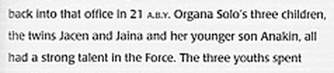
Our notes: `notes/materials/027-new-essential-chronology/11-part-eleven-generations-of-jedi.md:11`

> Since the Chiss had a moral principle against making first strikes, Formbi had hoped the Vagaari would take advantage of the Outbound Flight bait and make an aggressive move, Now that they had, war had been declared between the Chiss Ascendancy and the Vagaari.
>
> Dean Jinzler found closure, realizing that his sister had done everything she could to protect Outbound Right, and had died with honor during Thrawn’s attack. The Outbound Flight colonists teft the Redoubt, the only home they'd knovm for decades. Most of them began new fives in the Empire of the Hand.
>
> THe Stiapow Academy AND THE SECOND Imperium 23 A.B.Y.
>
> ™ 9" he Solo twins-Jacen with his quirky sense of humor | and rapport with animals, and Jaina with her aptitude for mechanics—became two of the most talented of the new Seneration of Jedi Knights. Together with their companions Tenel Ka, warrior daughter of Prince Isolder of Hapes and Tenenlel Djo of Dathomir, and Lowbacca, the Wookiee nephew of Chewbacca, they fought for the New Republic with as much bravery as the legendary Jedi Knights of old, SN 198 ) ey, During a training exerdse in the jungles of Yavin 4, the young Jedi Knights discovered the wreckage of a TIE fighter— an Imperial ship that had crashed there years before, during the Rebel battle against the first Death Star.
>
> ™ 9" he Solo twins-Jacen with his quirky sense of humor | and rapport with animals, and Jaina with her aptitude for mechanics—became two of the most talented of the new Seneration of Jedi Knights. Together with their companions Tenel Ka, warrior daughter of Prince Isolder of Hapes and Tenenlel Djo of Dathomir, and Lowbacca, the Wookiee nephew of Chewbacca, they fought for the New Republic with as much bravery as the legendary Jedi Knights of old, SN 198 ) ey, During a training exerdse in the jungles of Yavin 4, the young Jedi Knights discovered the wreckage of a TIE fighter— an Imperial ship that had crashed there years before, during the Rebel battle against the first Death Star. The Jedi Knights were unaware that the original pilot, a grizzled old man named Qorl, had survived the crash and had been eking out a living In the wilderness. Qorl forced the Jedi students {o complete the final repalrs so that he could flee the jungle moon, and then flew off to rejoin the Empire... wherever he could find it.
— Source: Part Eleven: Generations of Jedi; Jacen Solo; Jaina Solo — young Jedi Knights.
(Excerpt widened 2026-11-17 to the relevant passage, word for word from research primary new essential chronology nec paged (text copy `research_primary_new_essential_chronology_nec_paged_txt_88b808b5bc`).)
(Excerpt widened 2026-11-17 to the relevant passage, word for word from research primary new essential chronology nec paged (text copy `research_primary_new_essential_chronology_nec_paged_txt_88b808b5bc`).)
(Full sentence/passage taken from the source text on file: `research_primary_new_essential_chronology_nec_paged_txt`.)
Note (our notes, around the quote): Jacen Solo; Jaina Solo — young Jedi Knights: "Together with their companions Tenel Ka ... and Lowbacca, the Wookiee nephew of Chewbacca, they fought for the New Republic with as much bravery as the legendary Jedi Knights of old." Source: The New Essential Chronology, p.198
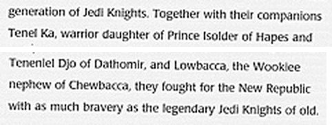
Our notes: `notes/materials/027-new-essential-chronology/11-part-eleven-generations-of-jedi.md:38`

- Note (summary from our notes, not a quotation): Jaina Solo — art caption: "Jaina Solo and Zekk" Source: The New Essential Chronology, p.201, caption
  — Source: Part Eleven: Generations of Jedi.
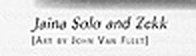
Our notes: `notes/materials/027-new-essential-chronology/11-part-eleven-generations-of-jedi.md:65`

> Other, more proactive Jedi Knights followed the lead of Kyp Durron and found new targets for their aggression. ... Jaina Solo found herself increasingly attracted to Kyp's aggressive faction; Anakin Solo remained loyal to his Uncle Luke. Jacen Solo found himself wondering if he could follow the Force without having to pick sides.
> [fragment — full passage not on file]
— Source: Part Twelve: The New Jedi Order; Kyp Durron; Jaina Solo; Anakin Solo; Jacen Solo — Jedi factions.
Note (our notes, around the quote): Kyp Durron; Jaina Solo; Anakin Solo; Jacen Solo — Jedi factions: "Other, more proactive Jedi Knights followed the lead of Kyp Durron and found new targets for their aggression. ... Jaina Solo found herself increasingly attracted to Kyp's aggressive faction; Anakin Solo remained loyal to his Uncle Luke. Jacen Solo found himself wondering if he could follow the Force without having to pick sides." Source: The New Essential Chronology, p.203
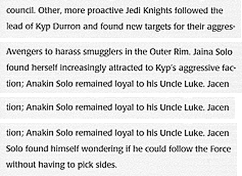
Our notes: `notes/materials/027-new-essential-chronology/12-part-twelve-new-jedi-order.md:11`

> He created a beetle swarm that chewed up the refugee shelters before Mara Jade and Jaina Solo uncovered his identity.
— Source: Part Twelve: The New Jedi Order; Mara Jade Skywalker; Jaina Solo — Nom Anor unmasked.
Note (our notes, around the quote): Mara Jade Skywalker; Jaina Solo — Nom Anor unmasked: "He created a beetle swarm that chewed up the refugee shelters before Mara Jade and Jaina Solo uncovered his identity." Source: The New Essential Chronology, p.211
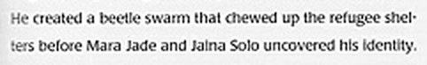
Our notes: `notes/materials/027-new-essential-chronology/12-part-twelve-new-jedi-order.md:85`

> Durron, who knew that the Yuuzhan Vong were building a new worldship from the broken fragments of Sernpidal, deceived Jaina into believing that the construction site housed a new Yuuzhan Vong superweapon. The Jedi squadron attacked and destroyed the worldship, killing thousands of enemy noncombatants.
— Source: Part Twelve: The New Jedi Order; Kyp Durron; Jaina Solo — Kyp deceives Jaina.
Note (our notes, around the quote): Kyp Durron; Jaina Solo — Kyp deceives Jaina: "Durron, who knew that the Yuuzhan Vong were building a new worldship from the broken fragments of Sernpidal, deceived Jaina into believing that the construction site housed a new Yuuzhan Vong superweapon. The Jedi squadron attacked and destroyed the worldship, killing thousands of enemy noncombatants." Source: The New Essential Chronology, p.213
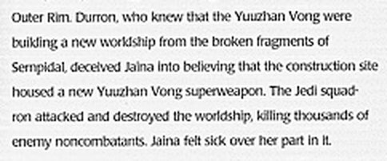
Our notes: `notes/materials/027-new-essential-chronology/12-part-twelve-new-jedi-order.md:101`

> Jacen, Jaina, and Anakin Solo face off against a ring of voxyn while infiltrating the worldship at Myrkr.
— Source: Part Twelve: The New Jedi Order; Jacen Solo; Jaina Solo; Anakin Solo — art caption.
Note (our notes, around the quote): Jacen Solo; Jaina Solo; Anakin Solo — art caption: "Jacen, Jaina, and Anakin Solo face off against a ring of voxyn while infiltrating the worldship at Myrkr." Source: The New Essential Chronology, p.213, caption
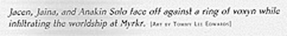
Our notes: `notes/materials/027-new-essential-chronology/12-part-twelve-new-jedi-order.md:105`

> True to their nature, they stole a ship and deserted Anakin’s group at the earliest opportunity, dragging Raynar with them to face an unknown fate.
>
> Anakin Solo had been widely considered the logical choice to succeed Luke Skywalker as head of the Jedi order.
>
> His actions on Baanu Rass only deepened his legend. He fought against hordes of enemies without ego or fear, and in the end sacrificed himself so that the other members of his team could live. Cut down by a rain of Yuuzhan Vong amphistaffs while buying time for the others to destroy the queen voxyn, Anakin passed Into the Force with a shudder felt halfway across the galaxy.
>
> The death of her younger brother sharpened the edge of Jaina Solo’s rage. Now bathing in the violence of the dark side, she burned several Yuuzhan Vong with Force lightning to retrieve Anakin’s body.
>
> The death of her younger brother sharpened the edge of Jaina Solo’s rage. Now bathing in the violence of the dark side, she burned several Yuuzhan Vong with Force lightning to retrieve Anakin’s body. When the fierce fighting sepa- fated her from Jacen, she left her twin behind on Baanu Rass and escaped with the surviving members of the strike team aboard the Yuuzhan Vong frigate Ksstar.
>
> Jacen Solo became a trophy captive.
— Source: Part Twelve: The New Jedi Order; Jaina Solo — Jaina's Force lightning.
(Excerpt widened 2026-11-17 to the relevant passage, word for word from research primary new essential chronology nec paged (text copy `research_primary_new_essential_chronology_nec_paged_txt_88b808b5bc`).)
(Excerpt widened 2026-11-17 to the relevant passage, word for word from research primary new essential chronology nec paged (text copy `research_primary_new_essential_chronology_nec_paged_txt_88b808b5bc`).)
Note (our notes, around the quote): Jaina Solo — Jaina's Force lightning: "Now bathing in the violence of the dark side, she burned several Yuuzhan Vong with Force lightning to retrieve Anakin's body." Source: The New Essential Chronology, p.216
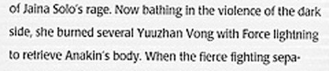
Our notes: `notes/materials/027-new-essential-chronology/12-part-twelve-new-jedi-order.md:128`

> Jaina's uncanny ability to elude and confound her enemies elicited comparisons between her and Yun-Harla, the Yuuzhan Vong goddess of trickery.
— Source: Part Twelve: The New Jedi Order; Jaina Solo — Jaina as Yun-Harla.
Note (our notes, around the quote): Jaina Solo — Jaina as Yun-Harla: "Jaina's uncanny ability to elude and confound her enemies elicited comparisons between her and Yun-Harla, the Yuuzhan Vong goddess of trickery." Source: The New Essential Chronology, p.217
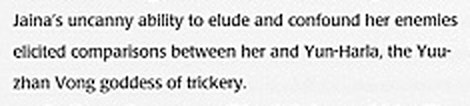
Our notes: `notes/materials/027-new-essential-chronology/12-part-twelve-new-jedi-order.md:137`

> By manipulating the gravitic signatures of vessels within the Yuuzhan Vong fleet, she could trick them into mistaking friend for foe. Her tactic worked brilliantly, with dozens of Yuuzhan Vong warships destroyed by friendly fire.
— Source: Part Twelve: The New Jedi Order; Jaina Solo — Jaina's gravitic trick.
Note (our notes, around the quote): Jaina Solo — Jaina's gravitic trick: "By manipulating the gravitic signatures of vessels within the Yuuzhan Vong fleet, she could trick them into mistaking friend for foe. Her tactic worked brilliantly, with dozens of Yuuzhan Vong warships destroyed by friendly fire." Source: The New Essential Chronology, p.217
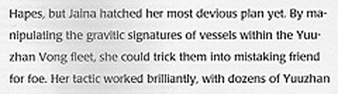
Our notes: `notes/materials/027-new-essential-chronology/12-part-twelve-new-jedi-order.md:139`

> Tsavong Lah survived the explosive decompression, eventually facing off against Jaina Solo in a one-on-one duel—the warmaster against the so-called Sword of the Jedi. Living up to her reputation as the living incarnation of Yun-Harla, Jaina outmaneuvered Lah and speared her lightsaber through his throat.
— Source: Part Twelve: The New Jedi Order; Jaina Solo — Jaina kills Tsavong Lah.
Note (our notes, around the quote): Jaina Solo — Jaina kills Tsavong Lah: "Tsavong Lah survived the explosive decompression, eventually facing off against Jaina Solo in a one-on-one duel—the warmaster against the so-called Sword of the Jedi. Living up to her reputation as the living incarnation of Yun-Harla, Jaina outmaneuvered Lah and speared her lightsaber through his throat." Source: The New Essential Chronology, p.222
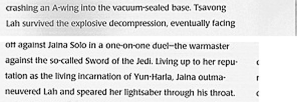
Our notes: `notes/materials/027-new-essential-chronology/12-part-twelve-new-jedi-order.md:186`

> The Supreme Overlord and his capering jester Onimi sent a phalanx of Slayers against the Jedi trio, only to see their finest warriors struck down.
— Source: Part Twelve: The New Jedi Order; Luke Skywalker; Jacen Solo; Jaina Solo — Slayers struck down.
Note (our notes, around the quote): Luke Skywalker; Jacen Solo; Jaina Solo — Slayers struck down: "The Supreme Overlord and his capering jester Onimi sent a phalanx of Slayers against the Jedi trio, only to see their finest warriors struck down." Source: The New Essential Chronology, p.225
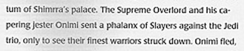
Our notes: `notes/materials/027-new-essential-chronology/12-part-twelve-new-jedi-order.md:211`

> Onimi knocked Jaina unconscious and reached an escape ship. ... As a former master shaper who had grafted telepathic yammosk brain cells into his own cortex, Onimi was a literal puppet master who could force even Shimrra to do his bidding.
> [fragment — full passage not on file]
— Source: Part Twelve: The New Jedi Order; Jaina Solo — Onimi the puppet master.
Note (our notes, around the quote): Jaina Solo — Onimi the puppet master: "Onimi knocked Jaina unconscious and reached an escape ship. ... As a former master shaper who had grafted telepathic yammosk brain cells into his own cortex, Onimi was a literal puppet master who could force even Shimrra to do his bidding." Source: The New Essential Chronology, p.227
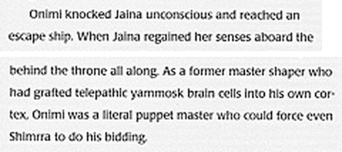
Our notes: `notes/materials/027-new-essential-chronology/12-part-twelve-new-jedi-order.md:225`

## The Jedi Academy Sourcebook (WEG, 1996): power-scaling and lore notes

> They immediately demonstrate a sensitivity for detecting the non-corporeal presences of Exar Kun and Luke in the complex, and play a key role in protecting Luke from the Sith Lord's attacks on Luke and the others.
— Source: Chapter One: The New Republic.
Note (our notes, around the quote): Jacen Solo; Jaina Solo; Exar Kun; Luke Skywalker — Jacen and Jaina Solo — protecting Luke: "They immediately demonstrate a sensitivity for detecting the non-corporeal presences of Exar Kun and Luke in the complex, and play a key role in protecting Luke from the Sith Lord's attacks on Luke and the others." Source: The Jedi Academy Sourcebook, p.12
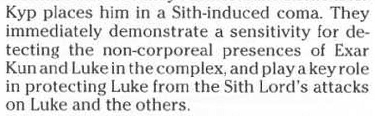
Our notes: `notes/materials/029-jedi-academy-sourcebook/01-ch1-the-new-republic.md:58`

## The Complete Star Wars Encyclopedia, Vol. I (A–G)

> The attack was led by onetime TIE fighter pilot Qorl, who had crashed in the jungles of Yavin 4 but survived until he was discovered by Jaina and Jacen Solo two decades later.
— Source: scan pages 1–40; Jaina Solo; Jacen Solo (Darth Caedus).
Note (our notes, around the quote): Jaina Solo; Jacen Solo (Darth Caedus): "The attack was led by onetime TIE fighter pilot Qorl, who had crashed in the jungles of Yavin 4 but survived until he was discovered by Jaina and Jacen Solo two decades later." Source: The Complete Star Wars Encyclopedia, Vol. I, p.10
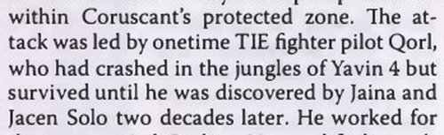
Our notes: `notes/materials/030-complete-star-wars-encyclopedia-vol-1/00-v1-scan-001-040.md:156`

> Czerka Corporation The galaxy's third largest arms manufacturer, this company produced blasters, artillery, melee weap­ ons, starship weapons, and starship defense systems. An ancient business, it existed for thousands of years, dating back to before the Sith War. During the Galactic Civil War, Czerka reluctantly agreed to establish an ex­ clusive distribution agreement with the Em­ pire, though it became a strong supporter of the New Republic when that government came to power. Czethros A former bounty hunter who was outsmarted by Han Solo, this humanoid cyborg ending up imprisoned at the spice mines of Kessel for a stint. He emerged as leader of what remained of Black Sun in the later years of the New Republic. He worked secretly to activate his scattered sleeper cells to rebuild Black Sun to its former glory, but was ultimately defeated thanks to the efforts of Jacen and Jaina Solo and their friends. Czethros was incarcerated, and Black Sun was effectively crushed. Czycz, Stauz A soldier whose world was ravaged by the Empire, Stauz Czycz plotted revenge by altering his body and disguising himselfas human bounty hunter Awarru Tark. Tark answered Darth Vader's call for hunters to pursue the Millennium Falcon after the Battle of Hoth. Tark confronted Vader, but the Dark Lord was able to defeat and decapitate the powerful alien warrior.
— Source: scan pages 161–200; Jacen Solo (Darth Caedus); Jaina Solo.
(Excerpt widened 2026-11-17 to the relevant passage, word for word from research primary cse vol1 (text copy `research_primary_cse_vol1_pdf_45a954be6d`).)
(Excerpt widened 2026-11-17 to the relevant passage, word for word from research primary cse vol1 (text copy `research_primary_cse_vol1_pdf_45a954be6d`).)
Note (our notes, around the quote): Jacen Solo (Darth Caedus); Jaina Solo: "He worked secretly to activate his scattered sleeper cells to rebuild Black Sun to its former glory, but was ultimately defeated thanks to the efforts of Jacen and Jaina Solo and their friends." Source: The Complete Star Wars Encyclopedia, Vol. I, p.157
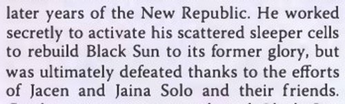
Our notes: `notes/materials/030-complete-star-wars-encyclopedia-vol-1/04-v1-scan-161-200.md:101`

> When Serpa tried to capture and harm the younglings there, Delpho was overpowered by Jaina Solo, who was working with Zekk and Jagged Fel to free the students.
— Source: scan pages 161–200; Jaina Solo. POV: Jaina Solo.
Note (our notes, around the quote): Jaina Solo: "When Serpa tried to capture and harm the younglings there, Delpho was overpowered by Jaina Solo, who was working with Zekk and Jagged Fel to free the students." Source: The Complete Star Wars Encyclopedia, Vol. I, p.181
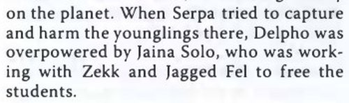
Our notes: `notes/materials/030-complete-star-wars-encyclopedia-vol-1/04-v1-scan-161-200.md:317`

> It wasn't a weapon, in fact, but a growing worldship that Durron and Jaina destroyed, and Jaina was furious at the older Jedi for his deception.
— Source: scan pages 201–240; Jaina Solo. POV: Jaina Solo.
Note (our notes, around the quote): Jaina Solo: "It wasn't a weapon, in fact, but a growing worldship that Durron and Jaina destroyed, and Jaina was furious at the older Jedi for his deception." Source: The Complete Star Wars Encyclopedia, Vol. I, p.219
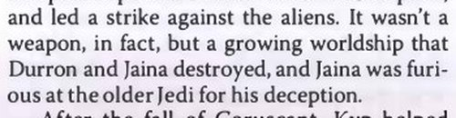
Our notes: `notes/materials/030-complete-star-wars-encyclopedia-vol-1/05-v1-scan-201-240.md:269`

> It was with great trepidation that Fett dis­ covered that Sintas Vel, his former wife and grandmother of Mirta Gev, was still alive. She had been frozen in carbonite decades earlier. Returned to Mandalore and thawed from her prison, Vel was disoriented and blind from the ordeal, but Gev worked to nurse her back to health. When she began recovering her memo­ ries, she held no ill will toward Fett. They spent days talking, hoping to repair the emotional scars of their past. They came to understand each other in time to celebrate the wedding of their granddaughter to Ghes Orade. Jaina Solo arrived on Mandalore asking for Fett's help in training her to defeat her brother Jacen, who by then had become Darth Caedus. Fett agreed and taught her how to fight like a Mandalorian. In the meantime, he was con­ tacted by Admiral Daala, who had come out of hiding to assist Gilad Pellaeon on a mission to capture the planet Fondor. Daala was Pellaeon's secret backup, and she wanted the Mandalori­ ans to provide additional firepower ifnecessary. With the ships of both the Galactic Alliance and Imperial Remnant refusing to follow Jacen Solo's increasingly belligerent commands and the sudden assassination of Pellaeon by Solo's apprentice Tahiri Veila, a group of opportunis­ tic Imperial Moffs tried to take over.
— Source: scan pages 281–320; Jaina Solo; Jacen Solo (Darth Caedus).
(Excerpt widened 2026-11-17 to the relevant passage, word for word from research primary cse vol1 (text copy `research_primary_cse_vol1_pdf_45a954be6d`).)
(Excerpt widened 2026-11-17 to the relevant passage, word for word from research primary cse vol1 (text copy `research_primary_cse_vol1_pdf_45a954be6d`).)
Note (our notes, around the quote): Jaina Solo; Jacen Solo (Darth Caedus): "Jaina Solo arrived on Mandalore asking for Fett's help in training her to defeat her brother Jacen, who by then had become Darth Caedus." Source: The Complete Star Wars Encyclopedia, Vol. I, p.267
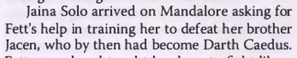
Our notes: `notes/materials/030-complete-star-wars-encyclopedia-vol-1/07-v1-scan-281-320.md:23`

> It was here that Jaina Solo and Sinsor Khal discovered the secrets of the Yuuzhan Vong coral implants that enslaved their victims.
— Source: scan pages 321–360; Jaina Solo. POV: Jaina Solo.
Note (our notes, around the quote): Jaina Solo: "It was here that Jaina Solo and Sinsor Khal discovered the secrets of the Yuuzhan Vong coral implants that enslaved their victims." Source: The Complete Star Wars Encyclopedia, Vol. I, p.316
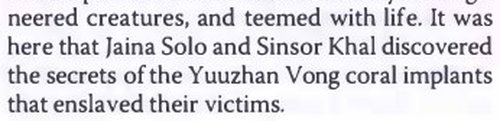
Our notes: `notes/materials/030-complete-star-wars-encyclopedia-vol-1/08-v1-scan-321-360.md:78`

## The Complete Star Wars Encyclopedia, Vol. II (H–O)

> Trooper H449-B7 was killed when Jaina Solo infiltrated the Nickel One facilities during her search for her brother Jacen, who had become Darth Caedus.
— Source: scan pages 1–40; Jaina Solo; Jacen Solo (Darth Caedus).
Note (our notes, around the quote): Jaina Solo; Jacen Solo (Darth Caedus): "Trooper H449-B7 was killed when Jaina Solo infiltrated the Nickel One facilities during her search for her brother Jacen, who had become Darth Caedus." Source: The Complete Star Wars Encyclopedia, Vol. II, p.3
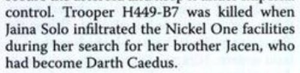
Our notes: `notes/materials/031-complete-star-wars-encyclopedia-vol-2/00-v2-scan-001-040.md:52`

> Horn was there at the end, after Jaina Solo killed Caedus, and he helped lead 50 Jedi aboard the Super Star Destroyer Megador to dictate peace terms to the Moff Council on the ship.
— Source: scan pages 41–80; Jaina Solo; Jacen Solo (Darth Caedus).
Note (our notes, around the quote): Jaina Solo; Jacen Solo (Darth Caedus): "Horn was there at the end, after Jaina Solo killed Caedus, and he helped lead 50 Jedi aboard the Super Star Destroyer Megador to dictate peace terms to the Moff Council on the ship." Source: The Complete Star Wars Encyclopedia, Vol. II, p.59
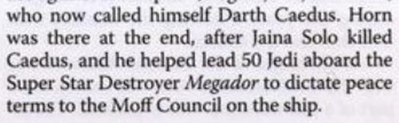
Our notes: `notes/materials/031-complete-star-wars-encyclopedia-vol-2/01-v2-scan-041-080.md:166`

> At Terephon, the crew recovered Jaina Solo and Zekk, who had been on the planet doing their own investigation when the Ducha Galney ordered them killed.
— Source: scan pages 81–120; Jaina Solo. POV: Jaina Solo.
Note (our notes, around the quote): Jaina Solo: "At Terephon, the crew recovered Jaina Solo and Zekk, who had been on the planet doing their own investigation when the Ducha Galney ordered them killed." Source: The Complete Star Wars Encyclopedia, Vol. II, p.111
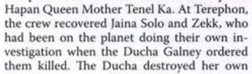
Our notes: `notes/materials/031-complete-star-wars-encyclopedia-vol-2/02-v2-scan-081-120.md:240`

> He nearly destroyed the Solo twins and many other Jedi, but Jaina was able to defeat him in combat.
— Source: scan pages 241–280; Jaina Solo. POV: Jaina Solo.
Note (our notes, around the quote): Jaina Solo: "He nearly destroyed the Solo twins and many other Jedi, but Jaina was able to defeat him in combat." Source: The Complete Star Wars Encyclopedia, Vol. II, p.241
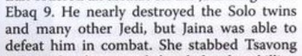
Our notes: `notes/materials/031-complete-star-wars-encyclopedia-vol-2/06-v2-scan-241-280.md:64`

> Merry Miner The vessel used by Jaina and Jacen Solo to maneuver a stylus ship into position over Helska 4 during the New Republic's first attempt to destroy the Yuuzhan Vong invasion force.
— Source: scan pages 281–320; Jaina Solo; Jacen Solo (Darth Caedus).
Note (our notes, around the quote): Jaina Solo; Jacen Solo (Darth Caedus): "Merry Miner The vessel used by Jaina and Jacen Solo to maneuver a stylus ship into position over Helska 4 during the New Republic's first attempt to destroy the Yuuzhan Vong invasion force." Source: The Complete Star Wars Encyclopedia, Vol. II, p.308
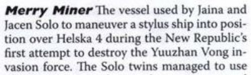
Our notes: `notes/materials/031-complete-star-wars-encyclopedia-vol-2/07-v2-scan-281-320.md:287`

> When Han Solo joined the mission to destroy Grand Admiral Thrawn's cloning facility on Wayland, Cakhmaim protected Leia, Winter, and the children, Jaina and Jacen Solo.
— Source: scan pages 321–360.
Note (our notes, around the quote): Han Solo; Grand Admiral Thrawn; Leia Organa Solo; Winter Celchu; Jaina Solo; Jacen Solo (Darth Caedus): "When Han Solo joined the mission to destroy Grand Admiral Thrawn's cloning facility on Wayland, Cakhmaim protected Leia, Winter, and the children, Jaina and Jacen Solo." Source: The Complete Star Wars Encyclopedia, Vol. II, p.322
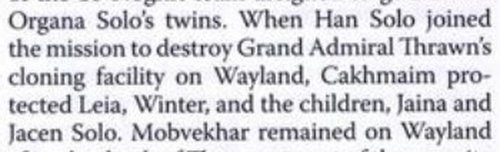
Our notes: `notes/materials/031-complete-star-wars-encyclopedia-vol-2/08-v2-scan-321-360.md:55`

> Rather than have Jaina halt the enterprise, Stanton took his knowledge and fled Onadax, destroying the entire ODT facility as he left.
— Source: scan pages 401–440; Jaina Solo. POV: Jaina Solo.
Note (our notes, around the quote): Jaina Solo: "Rather than have Jaina halt the enterprise, Stanton took his knowledge and fled Onadax, destroying the entire ODT facility as he left." Source: The Complete Star Wars Encyclopedia, Vol. II, p.412
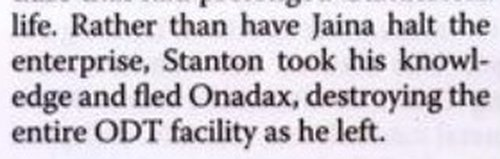
Our notes: `notes/materials/031-complete-star-wars-encyclopedia-vol-2/10-v2-scan-401-440.md:139`

## The Complete Star Wars Encyclopedia, Vol. III (P–Z)

> Ralpe was shot and killed by Jaina Solo.
— Source: scan pages 81–120; Jaina Solo. POV: Jaina Solo.
Note (our notes, around the quote): Jaina Solo: "Ralpe was shot and killed by Jaina Solo." Source: The Complete Star Wars Encyclopedia, Vol. III, p.77
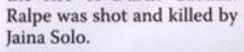
Our notes: `notes/materials/032-complete-star-wars-encyclopedia-vol-3/02-v3-scan-081-120.md:30`

> Kyp Durron convinced Jaina Solo to help attack Sernpidal, destroying the enemy shipwomb and the worldship being constructed there.
— Source: scan pages 121–160; Kyp Durron; Jaina Solo.
Note (our notes, around the quote): Kyp Durron; Jaina Solo: "Kyp Durron convinced Jaina Solo to help attack Sernpidal, destroying the enemy shipwomb and the worldship being constructed there." Source: The Complete Star Wars Encyclopedia, Vol. III, p.140
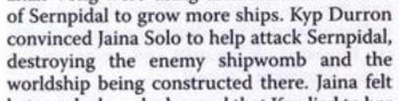
Our notes: `notes/materials/032-complete-star-wars-encyclopedia-vol-3/03-v3-scan-121-160.md:203`

> As Serpa raised a blaster to fire on Jaina, Zekk severed his arm with his lightsaber.
— Source: scan pages 121–160; Jaina Solo. POV: Jaina Solo.
Note (our notes, around the quote): Jaina Solo: "As Serpa raised a blaster to fire on Jaina, Zekk severed his arm with his lightsaber." Source: The Complete Star Wars Encyclopedia, Vol. III, p.140
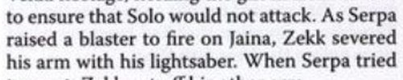
Our notes: `notes/materials/032-complete-star-wars-encyclopedia-vol-3/03-v3-scan-121-160.md:205`

> The Yuuzhan Vong constructed a shipwomb at Sernpidal to grow a new worldship, which was ultimately destroyed by Kyp Durron and Jaina Solo.
— Source: scan pages 121–160; Kyp Durron; Jaina Solo.
Note (our notes, around the quote): Kyp Durron; Jaina Solo: "The Yuuzhan Vong constructed a shipwomb at Sernpidal to grow a new worldship, which was ultimately destroyed by Kyp Durron and Jaina Solo." Source: The Complete Star Wars Encyclopedia, Vol. III, p.147
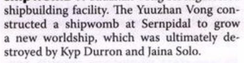
Our notes: `notes/materials/032-complete-star-wars-encyclopedia-vol-3/03-v3-scan-121-160.md:278`

> Ben was elevated to the rank of Jedi Knight and assigned to accompany Jaina Solo on a Jedi-sanctioned mission to destroy Darth Caedus.
— Source: scan pages 161–200; Jaina Solo; Jacen Solo (Darth Caedus).
Note (our notes, around the quote): Jaina Solo; Jacen Solo (Darth Caedus): "Ben was elevated to the rank of Jedi Knight and assigned to accompany Jaina Solo on a Jedi-sanctioned mission to destroy Darth Caedus." Source: The Complete Star Wars Encyclopedia, Vol. III, p.162
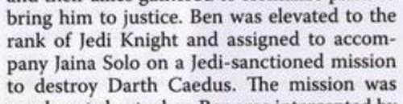
Our notes: `notes/materials/032-complete-star-wars-encyclopedia-vol-3/04-v3-scan-161-200.md:85`

> Jaina defeated her brother, ending his attacks against the Jedi, while Luke and Han stopped the opportunistic Moffs of the Imperial Remnant from their attempts at conquest that accompanied Caedus's rise.
— Source: scan pages 161–200; Jaina Solo; Luke Skywalker; Jacen Solo (Darth Caedus).
Note (our notes, around the quote): Jaina Solo; Luke Skywalker; Jacen Solo (Darth Caedus): "Jaina defeated her brother, ending his attacks against the Jedi, while Luke and Han stopped the opportunistic Moffs of the Imperial Remnant from their attempts at conquest that accompanied Caedus's rise." Source: The Complete Star Wars Encyclopedia, Vol. III, p.165
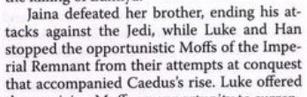
Our notes: `notes/materials/032-complete-star-wars-encyclopedia-vol-3/04-v3-scan-161-200.md:138`

> Jaina defeated her brother while Luke and Han stopped the opportunistic Moffs of the Imperial Remnant.
— Source: scan pages 161–200; Jaina Solo; Luke Skywalker.
Note (our notes, around the quote): Jaina Solo; Luke Skywalker: "Jaina defeated her brother while Luke and Han stopped the opportunistic Moffs of the Imperial Remnant." Source: The Complete Star Wars Encyclopedia, Vol. III, p.166
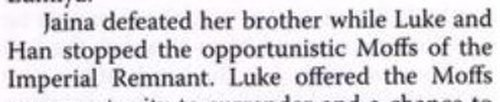
Our notes: `notes/materials/032-complete-star-wars-encyclopedia-vol-3/04-v3-scan-161-200.md:165`

> Sneaker was later destroyed on Terephon when Jaina and Zekk questioned the Ducha Galney about an assassination attempt on the life of the Queen Mother, Tenel Ka.
— Source: scan pages 161–200; Jaina Solo. POV: Jaina Solo.
Note (our notes, around the quote): Jaina Solo: "Sneaker was later destroyed on Terephon when Jaina and Zekk questioned the Ducha Galney about an assassination attempt on the life of the Queen Mother, Tenel Ka." Source: The Complete Star Wars Encyclopedia, Vol. III, p.170
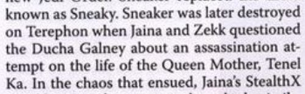
Our notes: `notes/materials/032-complete-star-wars-encyclopedia-vol-3/04-v3-scan-161-200.md:195`

> In the chaos that ensued, Jaina's StealthX was blown up by a remote-launched missile, obliterating the droid.
— Source: scan pages 161–200; Jaina Solo. POV: Jaina Solo.
Note (our notes, around the quote): Jaina Solo: "In the chaos that ensued, Jaina's StealthX was blown up by a remote-launched missile, obliterating the droid." Source: The Complete Star Wars Encyclopedia, Vol. III, p.170
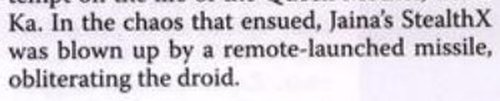
Our notes: `notes/materials/032-complete-star-wars-encyclopedia-vol-3/04-v3-scan-161-200.md:197`

> Sneaky was destroyed several years after the end of the Yuuzhan Vong War, when Jaina was shot down over Tenupe by Jagged Fel.
— Source: scan pages 161–200; Jaina Solo. POV: Jaina Solo.
Note (our notes, around the quote): Jaina Solo: "Sneaky was destroyed several years after the end of the Yuuzhan Vong War, when Jaina was shot down over Tenupe by Jagged Fel." Source: The Complete Star Wars Encyclopedia, Vol. III, p.170
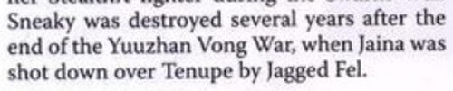
Our notes: `notes/materials/032-complete-star-wars-encyclopedia-vol-3/04-v3-scan-161-200.md:199`

- Note (summary from our notes, not a quotation): Page contents: 1410 words, 27 paragraphs | headings/entries: Solo, Jaina
  — Source: scan pages 161–200.
Our notes: `notes/materials/032-complete-star-wars-encyclopedia-vol-3/04-v3-scan-161-200.md:249`

> Jaina trained under Boba Fett, learning Mandalorian combat techniques to effectively surprise and defeat Jacen.
— Source: scan pages 161–200.
Note (our notes, around the quote): Jacen Solo (Darth Caedus); Jaina Solo; Boba Fett — entry/section: Solo, Jacen: "Jaina trained under Boba Fett, learning Mandalorian combat techniques to effectively surprise and defeat Jacen." Source: The Complete Star Wars Encyclopedia, Vol. III, p.176
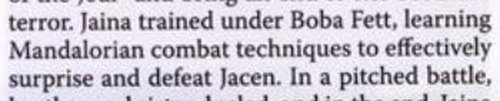
Our notes: `notes/materials/032-complete-star-wars-encyclopedia-vol-3/04-v3-scan-161-200.md:251`

> In a pitched battle, brother and sister dueled, and in the end, Jaina plunged her lightsaber into Jacen's chest, cutting through his ribs until she sliced through his heart.
— Source: scan pages 161–200; Jacen Solo (Darth Caedus); Jaina Solo — entry/section: Solo, Jacen.
Note (our notes, around the quote): Jacen Solo (Darth Caedus); Jaina Solo — entry/section: Solo, Jacen: "In a pitched battle, brother and sister dueled, and in the end, Jaina plunged her lightsaber into Jacen's chest, cutting through his ribs until she sliced through his heart." Source: The Complete Star Wars Encyclopedia, Vol. III, p.176
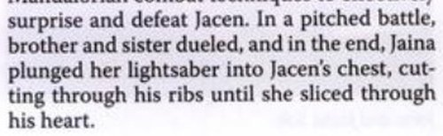
Our notes: `notes/materials/032-complete-star-wars-encyclopedia-vol-3/04-v3-scan-161-200.md:253`

> She was also capable of cobbling together mechanical devices for just about any purpose, and like Han Solo, her impulsiveness, spirit, and self-confidence sometimes got her into trouble.
— Source: scan pages 161–200; Jaina Solo; Han Solo — entry/section: Solo, Jaina.
Note (our notes, around the quote): Jaina Solo; Han Solo — entry/section: Solo, Jaina: "She was also capable of cobbling together mechanical devices for just about any purpose, and like Han Solo, her impulsiveness, spirit, and self-confidence sometimes got her into trouble." Source: The Complete Star Wars Encyclopedia, Vol. III, p.176
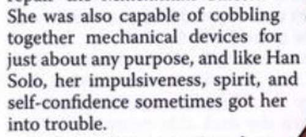
Our notes: `notes/materials/032-complete-star-wars-encyclopedia-vol-3/04-v3-scan-161-200.md:255`

> When Luke was unable to defeat Jacen, Jaina became convinced that her role as the Sword of the Jedi was to defeat her brother and restore peace to the galaxy.
— Source: scan pages 161–200.
Note (our notes, around the quote): Jaina Solo; Luke Skywalker; Jacen Solo (Darth Caedus) — entry/section: Solo, Jaina: "When Luke was unable to defeat Jacen, Jaina became convinced that her role as the Sword of the Jedi was to defeat her brother and restore peace to the galaxy." Source: The Complete Star Wars Encyclopedia, Vol. III, p.176
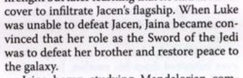
Our notes: `notes/materials/032-complete-star-wars-encyclopedia-vol-3/04-v3-scan-161-200.md:257`

> Jaina gained the upper hand when she severed the tendon in her brother's leg, and then drove her lightsaber into his chest, killing him.
— Source: scan pages 161–200; Jaina Solo — entry/section: Solo, Jaina.
Note (our notes, around the quote): Jaina Solo — entry/section: Solo, Jaina: "Jaina gained the upper hand when she severed the tendon in her brother's leg, and then drove her lightsaber into his chest, killing him." Source: The Complete Star Wars Encyclopedia, Vol. III, p.176
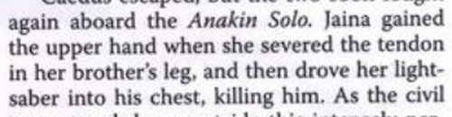
Our notes: `notes/materials/032-complete-star-wars-encyclopedia-vol-3/04-v3-scan-161-200.md:261`

> It was obliterated before Leia's eyes, and Leia was scheduled for execution.
— Source: scan pages 161–200; Jaina Solo; Leia Organa Solo — entry/section: Solo, Jaina.
Note (our notes, around the quote): Jaina Solo; Leia Organa Solo — entry/section: Solo, Jaina: "It was obliterated before Leia's eyes, and Leia was scheduled for execution." Source: The Complete Star Wars Encyclopedia, Vol. III, p.177
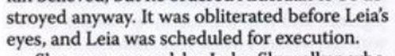
Our notes: `notes/materials/032-complete-star-wars-encyclopedia-vol-3/04-v3-scan-161-200.md:274`

> She eventually killed Jabba by strangling him with the very chain that bound her.
— Source: scan pages 161–200; Jaina Solo — entry/section: Solo, Jaina.
Note (our notes, around the quote): Jaina Solo — entry/section: Solo, Jaina: "She eventually killed Jabba by strangling him with the very chain that bound her." Source: The Complete Star Wars Encyclopedia, Vol. III, p.177
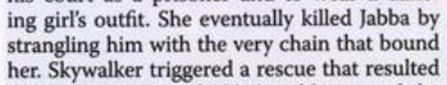
Our notes: `notes/materials/032-complete-star-wars-encyclopedia-vol-3/04-v3-scan-161-200.md:282`

> In the days that followed, Leia and Jaina met with Ben Skywalker, encouraging him to find evidence that would prove that Jacen had killed Mara Jade Skywalker.
— Source: scan pages 161–200.
Note (our notes, around the quote): Jaina Solo; Leia Organa Solo; Ben Skywalker; Jacen Solo (Darth Caedus); Mara Jade Skywalker — entry/section: Solo, Jaina: "In the days that followed, Leia and Jaina met with Ben Skywalker, encouraging him to find evidence that would prove that Jacen had killed Mara Jade Skywalker." Source: The Complete Star Wars Encyclopedia, Vol. III, p.178
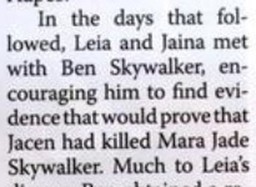
Our notes: `notes/materials/032-complete-star-wars-encyclopedia-vol-3/04-v3-scan-161-200.md:297`

> He was destroyed when Jaina's X-wing was shot down at the Battle of Kalarba.
— Source: scan pages 161–200; Jaina Solo. POV: Jaina Solo.
Note (our notes, around the quote): Jaina Solo: "He was destroyed when Jaina's X-wing was shot down at the Battle of Kalarba." Source: The Complete Star Wars Encyclopedia, Vol. III, p.182
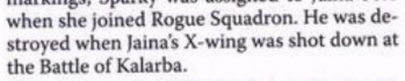
Our notes: `notes/materials/032-complete-star-wars-encyclopedia-vol-3/04-v3-scan-161-200.md:331`

> Jaina, upon realizing that Jacen was working to destroy the Colony, refused to talk to him for the duration of the war.
— Source: scan pages 201–240; Jaina Solo; Jacen Solo (Darth Caedus).
Note (our notes, around the quote): Jaina Solo; Jacen Solo (Darth Caedus): "Jaina, upon realizing that Jacen was working to destroy the Colony, refused to talk to him for the duration of the war." Source: The Complete Star Wars Encyclopedia, Vol. III, p.199
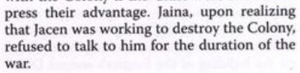
Our notes: `notes/materials/032-complete-star-wars-encyclopedia-vol-3/05-v3-scan-201-240.md:58`

> Jaina, upon realizing that Jacen was going to work to destroy the Colony, refused to talk to him for the duration of the war.
— Source: scan pages 241–280; Jaina Solo; Jacen Solo (Darth Caedus).
Note (our notes, around the quote): Jaina Solo; Jacen Solo (Darth Caedus): "Jaina, upon realizing that Jacen was going to work to destroy the Colony, refused to talk to him for the duration of the war." Source: The Complete Star Wars Encyclopedia, Vol. III, p.239
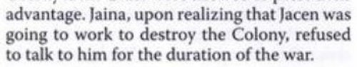
Our notes: `notes/materials/032-complete-star-wars-encyclopedia-vol-3/06-v3-scan-241-280.md:48`

> Shedao Shai carried one, and at Ebaq 9, Tsavong Lah dueled Jaina with his tsaisi.
— Source: scan pages 241–280; Jaina Solo. POV: Jaina Solo.
Note (our notes, around the quote): Jaina Solo: "Shedao Shai carried one, and at Ebaq 9, Tsavong Lah dueled Jaina with his tsaisi." Source: The Complete Star Wars Encyclopedia, Vol. III, p.266
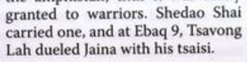
Our notes: `notes/materials/032-complete-star-wars-encyclopedia-vol-3/06-v3-scan-241-280.md:265`

> Tsavong Lah himself was killed in combat by Jaina Solo, and Supreme Overlord Shimrra vowed to destroy anything that got in the way of galactic conquest.
— Source: scan pages 361–385; Jaina Solo. POV: Jaina Solo.
Note (our notes, around the quote): Jaina Solo: "Tsavong Lah himself was killed in combat by Jaina Solo, and Supreme Overlord Shimrra vowed to destroy anything that got in the way of galactic conquest." Source: The Complete Star Wars Encyclopedia, Vol. III, p.362
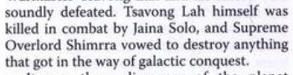
Our notes: `notes/materials/032-complete-star-wars-encyclopedia-vol-3/09-v3-scan-361-385.md:83`

## The New Essential Guide to Characters (2002)

> He teamed with Jaina, Kyp Durron, and the legendary Wedge Antilles to destroy a supposed Yuuzhan Vong superweapon created from the remains of the shattered planet Sernpidal.
— Source: scan pages 31–60.
Note (our notes, around the quote): Luke Skywalker; Jaina Solo; Kyp Durron — entry/section: Biggs fought alongside Luke Sky-: "He teamed with Jaina, Kyp Durron, and the legendary Wedge Antilles to destroy a supposed Yuuzhan Vong superweapon created from the remains of the shattered planet Sernpidal." Source: The New Essential Guide to Characters, p.52

Our notes: `notes/materials/034-new-essential-guide-to-characters/01-negc-scan-031-060.md:106`

- Note (summary from our notes, not a quotation): Lando Calrissian; Jaina Solo: "With his Jedi reflexes, Durron became a hotshot pilot, posting the highest score in Lando Calrissian's "running-the-belt" game at Dubrillion, at least until his time was bested by Jaina Solo." Source: The New Essential Guide to Characters, p.62
  — Source: scan pages 31–60.

Our notes: `notes/materials/034-new-essential-guide-to-characters/01-negc-scan-031-060.md:174`

> There they discovered that the Yuuzhan Vong had created a shipwomb amid Sernpidal's remains, and Durron enlisted Wedge Antilles and Jaina Solo to help in destroying it by telling them the enemy had created a superweapon.
— Source: scan pages 31–60; Jaina Solo. POV: Jaina Solo.
Note (our notes, around the quote): Jaina Solo: "There they discovered that the Yuuzhan Vong had created a shipwomb amid Sernpidal's remains, and Durron enlisted Wedge Antilles and Jaina Solo to help in destroying it by telling them the enemy had created a superweapon." Source: The New Essential Guide to Characters, p.62

Our notes: `notes/materials/034-new-essential-guide-to-characters/01-negc-scan-031-060.md:176`

> Nunb, along with the Jedi Knights Jaina Solo and Lowbacca, defeated Czethros and booted his henchmen off Kessel for good.
— Source: scan pages 91–120; Jaina Solo; Lowbacca.
Note (our notes, around the quote): Jaina Solo; Lowbacca: "Nunb, along with the Jedi Knights Jaina Solo and Lowbacca, defeated Czethros and booted his henchmen off Kessel for good." Source: The New Essential Guide to Characters, p.122

Our notes: `notes/materials/034-new-essential-guide-to-characters/03-negc-scan-091-120.md:186`

> When Warmaster Tsavong Lah nearly killed Leia in a gruesome bloodletting ritual, Jaina helped move her mother to safety.
— Source: scan pages 151–180; Leia Organa Solo; Jaina Solo.
Note (our notes, around the quote): Leia Organa Solo; Jaina Solo: "When Warmaster Tsavong Lah nearly killed Leia in a gruesome bloodletting ritual, Jaina helped move her mother to safety." Source: The New Essential Guide to Characters, p.173

Our notes: `notes/materials/034-new-essential-guide-to-characters/05-negc-scan-151-180.md:123`

> Jaina enlisted help from Gavin Darklighter and Wedge Antilles in destroying the construct, which proved to be nothing more than an elaborate worldship.
— Source: scan pages 151–180; Jaina Solo. POV: Jaina Solo.
Note (our notes, around the quote): Jaina Solo: "Jaina enlisted help from Gavin Darklighter and Wedge Antilles in destroying the construct, which proved to be nothing more than an elaborate worldship." Source: The New Essential Guide to Characters, p.173

Our notes: `notes/materials/034-new-essential-guide-to-characters/05-negc-scan-151-180.md:125`

> During the Jedi mission to destroy the Yuuzhan Vong voxyn laboratories, Jaina watched her younger brother Anakin die before her eyes.
— Source: scan pages 151–180; Jaina Solo. POV: Jaina Solo.
Note (our notes, around the quote): Jaina Solo: "During the Jedi mission to destroy the Yuuzhan Vong voxyn laboratories, Jaina watched her younger brother Anakin die before her eyes." Source: The New Essential Guide to Characters, p.173

Our notes: `notes/materials/034-new-essential-guide-to-characters/05-negc-scan-151-180.md:127`

## Dark Side Sourcebook (d20, 2001)

> At first resistant to what he took for imprisonment, he changed his mind when Brakiss showed him how Zekk could wield the Force just like Jacen and Jaina-and how they thought so little of him that they hadn't bothered testing him. But at the Shadow Academy, Brakiss told him, Zekk could not only receive training in the Force, but through the dark side he could quickly outstrip his friends-who actually refused the training Brakiss offered them. Zekk agreed, and together they found even more recruits from among the various youth gangs from the depths of Coruscant. Eventually, Zekk had to face Jacen and Jaina. He first clashed with them on Kashyyyk, the Wookiee homeworld, where he led a Shadow Academy raid on the Wookiee computer center. Zekk dueled with Jaina, but fled rather than deliberately injure her. They battled again when the Shadow Academy attacked Luke Skywalker's Jedi academy on Yavin 4, and this time Zekk reconsidered his choices and turned away from the dark side. Granted leniency because of the extenuating circumstances of Brakiss's brainwashing techniques, Zekk nonetheless refused training at Skywalker's academy, preferring to have nothing further to do with the Force. He departed, eventually to become a bounty hunter.
— Source: Chapter Five: Dark Side Traditions (Sith Empire, Set Harth, prophets, Brakiss…); Jaina Solo. POV: Jaina Solo.
(Excerpt widened 2026-11-17 to the relevant passage, word for word from research primary dark side sourcebook dss (text copy `research_primary_dark_side_sourcebook_dss_pdf_9cd3453f4a`).)
(Excerpt widened 2026-11-17 to the relevant passage, word for word from research primary dark side sourcebook dss (text copy `research_primary_dark_side_sourcebook_dss_pdf_9cd3453f4a`).)
Note (our notes, around the quote): Jaina Solo: "Zekk dueled with Jaina, but fled rather than deliberately injure her." Source: Dark Side Sourcebook, p.109

Our notes: `notes/materials/035-dark-side-sourcebook/05-ch5-traditions.md:364`

## Sourcebooks/Star Wars Roleplaying Game Core Rulebook.pdf [Star Wars Roleplaying Game (d20, 2000)] (scan pages 241–300)

- Note (summary from our notes, not a quotation): Page contents: 1091 words, 23 paragraphs | headings/entries: MEGLETME; Jaina Solo, Jedi Apprentice; I We Te ee oe
  — Source: Sourcebooks/Star Wars Roleplaying Game Core Rulebook.pdf [Star Wars Rolep.
Our notes: `notes/materials/037-sw-d20-folder/046-star-wars-roleplaying-game-core-rulebook-scan-241-300.md:40`

> Inheriting her father's quick reflexes at the helm, and her grandfather's talent with the Force, Jaina Solo is an extraordinary pilot. Despite being only 16 years old, she has already come to the attention of the galaxy-famous Rogue Squadron, who hope to one day recruit her as an X-wing pilot.
— Source: Sourcebooks/Star Wars Roleplaying Game Core Rulebook.pdf [Star Wars Rolep; Jaina Solo — entry/section: Key Characters: Jaina Solo, Jedi Apprentice.
Note (our notes, around the quote): Jaina Solo — entry/section: Key Characters: Jaina Solo, Jedi Apprentice: "Inheriting her father's quick reflexes at the helm, and her grandfather's talent with the Force, Jaina Solo is an extraordinary pilot. Despite being only 16 years old, she has already come to the attention of the galaxy-famous Rogue Squadron, who hope to one day recruit her as an X-wing pilot." Source: *Star Wars Roleplaying Game Core Rulebook* (SWRPG d20), scan p.243

Our notes: `notes/materials/037-sw-d20-folder/046-star-wars-roleplaying-game-core-rulebook-scan-241-300.md:42`

## Sourcebooks/The New Jedi Order Sourcebook.pdf [Star Wars Roleplaying Game (d20, 2000)] (scan pages 1–60)

- Note (summary from our notes, not a quotation): Page contents: 832 words, 25 paragraphs | headings/entries: Jaina Solo, Jedi Student/Rogue Squadron Pilot; New Starship Tactics; Improved Sensor Database
  — Source: Sourcebooks/The New Jedi Order Sourcebook.pdf [Star Wars Roleplaying Game.
Our notes: `notes/materials/037-sw-d20-folder/049-the-new-jedi-order-sourcebook-scan-001-060.md:317`

## Sourcebooks/The New Jedi Order Sourcebook.pdf [Star Wars Roleplaying Game (d20, 2000)] (scan pages 121–162)

> could add +2 to each skill check, attack roll, and saving throw
> [fragment — full passage not on file]
— Source: Sourcebooks/The New Jedi Order Sourcebook.pdf [Star Wars Roleplaying Game.
Note (our notes, around the quote): Page contents: Battle meld: in a meld with Jacen, Jaina and Lowbacca, Anakin "could add +2 to each skill check, attack roll, and saving throw". p.155 Luke and Mara fight off a horde of Vong ships over Coruscant. p.160 Jaina's rage opens her to the dark side. (hand-read)
Our notes: `notes/materials/037-sw-d20-folder/049-the-new-jedi-order-sourcebook-scan-121-162.md:184`

- Note (summary from our notes, not a quotation): Page contents: 946 words, 16 paragraphs | headings/entries: The Fate of Anakin Solo; Jaina's Team
  — Source: Sourcebooks/The New Jedi Order Sourcebook.pdf [Star Wars Roleplaying Game.
Our notes: `notes/materials/037-sw-d20-folder/049-the-new-jedi-order-sourcebook-scan-121-162.md:228`

> Only Jacen and Jaina remain behind, watching their brother first beat back the Yuuzhan Vong warriors sent against him, then slowly become more and more overwhelmed.
— Source: Sourcebooks/The New Jedi Order Sourcebook.pdf [Star Wars Roleplaying Game; Jacen Solo (Darth Caedus); Jaina Solo.
Note (our notes, around the quote): Jacen Solo (Darth Caedus); Jaina Solo: "Only Jacen and Jaina remain behind, watching their brother first beat back the Yuuzhan Vong warriors sent against him, then slowly become more and more overwhelmed." Source: *The New Jedi Order Sourcebook* (SWRPG d20), scan p.153

Our notes: `notes/materials/037-sw-d20-folder/049-the-new-jedi-order-sourcebook-scan-121-162.md:232`

> Jaina, pushed past her breaking point, explodes at her twin brother, blaming him for dragging her away when Anakin died.
— Source: Sourcebooks/The New Jedi Order Sourcebook.pdf [Star Wars Roleplaying Game; Jaina Solo; Darth Vader (Anakin Skywalker) — entry/section: Jaina's Team.
Note (our notes, around the quote): Jaina Solo; Darth Vader (Anakin Skywalker) — entry/section: Jaina's Team: "Jaina, pushed past her breaking point, explodes at her twin brother, blaming him for dragging her away when Anakin died." Source: *The New Jedi Order Sourcebook* (SWRPG d20), scan p.154

Our notes: `notes/materials/037-sw-d20-folder/049-the-new-jedi-order-sourcebook-scan-121-162.md:239`

> To Jaina, the only important thing now is to locate the vermin who poisoned her aunt, crushed her father's dearest friend, and murdered her brother.
— Source: Sourcebooks/The New Jedi Order Sourcebook.pdf [Star Wars Roleplaying Game; Jaina Solo — entry/section: Jaina's Team.
Note (our notes, around the quote): Jaina Solo — entry/section: Jaina's Team: "To Jaina, the only important thing now is to locate the vermin who poisoned her aunt, crushed her father's dearest friend, and murdered her brother." Source: *The New Jedi Order Sourcebook* (SWRPG d20), scan p.154

Our notes: `notes/materials/037-sw-d20-folder/049-the-new-jedi-order-sourcebook-scan-121-162.md:241`

## Star Wars Gamer/Star Wars Gamer 05.pdf [Star Wars Roleplaying Game (d20, 2000)] (scan pages 1–60)

- Note (summary from our notes, not a quotation): Page contents: The Crystal (Elaine Cunningham): Jaina's Jedi graduation on Yavin 4; Jacen and Anakin apprenticed to Luke; ailing Mara takes Jaina as apprentice; Han gives her a modified Z-95 which she names Crystal; Bahalian Shipyards a Tenloss Syndicate front; stats for The Crystal (Z-95) (hand-read)
  — Source: Star Wars Gamer/Star Wars Gamer 05.pdf [Star Wars Roleplaying Game (d20,.
Our notes: `notes/materials/037-sw-d20-folder/054-star-wars-gamer-05-scan-001-060.md:65`

- Note (summary from our notes, not a quotation): Page contents: 927 words, 28 paragraphs | headings/entries: Or so Jaina assumed,; STAR WARS Gamer 18
  — Source: Star Wars Gamer/Star Wars Gamer 05.pdf [Star Wars Roleplaying Game (d20,.
Our notes: `notes/materials/037-sw-d20-folder/054-star-wars-gamer-05-scan-001-060.md:70`

> Luke stepped forward. Jaina noticed that Aunt Mara was not with him, and she sent her mother a quizzical glance. Leia shook her head, a slight, almost imperceptible gesture. Jaina caught a whiff of her mother’s concern, sad and subtle as the perfume of a crushed flower.
— Source: Star Wars Gamer/Star Wars Gamer 05.pdf [Star Wars Roleplaying Game (d20,; Jaina Solo. POV: Jaina Solo.
(Excerpt widened 2026-11-17 to the relevant passage, word for word from 25ABY: The Crystal (Elaine Cunningham) (text copy `MEGA_All_Short_Stories_25ABY_The_Crystal_Elaine_Cunningham_epub`).)
Note (our notes, around the quote): Jaina Solo: "Jaina caught a whiff of her mother's concern, sad and subtle as the perfume of a crushed flower." Source: *Star Wars Gamer 05* (SWRPG d20), scan p.14

Our notes: `notes/materials/037-sw-d20-folder/054-star-wars-gamer-05-scan-001-060.md:81`

> I grew the crystals for my first lightsaber. It connects you, gives you a different feel altogether. You are, almost literally, part of the weapon.
— Source: Star Wars Gamer/Star Wars Gamer 05.pdf [Star Wars Roleplaying Game (d20,.
Note (our notes, around the quote): Mara Jade Skywalker; Jaina Solo — entry/section: Mara on growing lightsaber crystals: "I grew the crystals for my first lightsaber. It connects you, gives you a different feel altogether. You are, almost literally, part of the weapon." Source: *Star Wars Gamer 05* (SWRPG d20), scan p.15

Our notes: `notes/materials/037-sw-d20-folder/054-star-wars-gamer-05-scan-001-060.md:88`

> “Sure, fifty years ago!” Jaina exploded. “Subpro hasn’t been building the Z-95 Headhunter for years. There’s lots of old Z-95’s around. I don’t have a copy of my ship’s providence handy, but chances are, you’ve got the wrong ship.”
— Source: Star Wars Gamer/Star Wars Gamer 05.pdf [Star Wars Roleplaying Game (d20,; Jaina Solo: "Jaina exploded. POV: Jaina Solo.
(Excerpt widened 2026-11-17 to the relevant passage, word for word from 25ABY: The Crystal (Elaine Cunningham) (text copy `MEGA_All_Short_Stories_25ABY_The_Crystal_Elaine_Cunningham_epub`).)
Note (our notes, around the quote): Jaina Solo: "Jaina exploded, "Subpro hasn't been building the Z-95 Headhunter for years." Source: *Star Wars Gamer 05* (SWRPG d20), scan p.16

Our notes: `notes/materials/037-sw-d20-folder/054-star-wars-gamer-05-scan-001-060.md:95`

> As the Z-95 traced a tight upward circle, the hum of the sublight drive rose in pitch to a scream of protest. Pressure built in the cockpit from the rising G’s until stars began to dance and explode at the periphery of Jaina’s vision. More lights began to blink on the console, warning of possible system failure. The proton torpedo scorched past, a near miss.
— Source: Star Wars Gamer/Star Wars Gamer 05.pdf [Star Wars Roleplaying Game (d20,; Jaina Solo. POV: Jaina Solo.
(Excerpt widened 2026-11-17 to the relevant passage, word for word from 25ABY: The Crystal (Elaine Cunningham) (text copy `MEGA_All_Short_Stories_25ABY_The_Crystal_Elaine_Cunningham_epub`).)
Note (our notes, around the quote): Jaina Solo: "Pressure built in the cockpit from the rising G's until stars began to dance and explode at the periphery of Jaina's vision, More lights began to blink on the console, warning of possible system failure." Source: *Star Wars Gamer 05* (SWRPG d20), scan p.16

Our notes: `notes/materials/037-sw-d20-folder/054-star-wars-gamer-05-scan-001-060.md:97`

> On the other hand, this possibility made her decision easier. Jaina had fewer problems with the idea of vaporizing a droid than reducing a living pilot to stardust.
— Source: Star Wars Gamer/Star Wars Gamer 05.pdf [Star Wars Roleplaying Game (d20,; Jaina Solo. POV: Jaina Solo.
(Excerpt widened 2026-11-17 to the relevant passage, word for word from 25ABY: The Crystal (Elaine Cunningham) (text copy `MEGA_All_Short_Stories_25ABY_The_Crystal_Elaine_Cunningham_epub`).)
Note (our notes, around the quote): Jaina Solo: "Jaina had fewer problems with the idea of vaporizing a droid than reducing a living pilot to stardust." Source: *Star Wars Gamer 05* (SWRPG d20), scan p.17

Our notes: `notes/materials/037-sw-d20-folder/054-star-wars-gamer-05-scan-001-060.md:104`

> “Sometimes you need to focus, and sometimes you need to be the focus,” Jaina murmured as she considered the other side of the lesson she’d taken from her lightsaber’s crystal. She was a part of this ship, the crystal focusing its power, but she was not the ship. Once this journey was over, she would swing out of the cockpit and shift her focus outward.
— Source: Star Wars Gamer/Star Wars Gamer 05.pdf [Star Wars Roleplaying Game (d20,; Jaina Solo — entry/section: Jaina's lesson from her lightsaber crystal.
(Fragment completed 2026-11-17 with the full excerpt, word for word from Star Wars - Gamer Magazine 05 (The Crystal # Elaine Cunningham) (text copy `MEGA_Star_Wars_Gamer_Magazine_05_The_Crystal_Elaine_Cunningham_epub`).)
Note (our notes, around the quote): Jaina Solo — entry/section: Jaina's lesson from her lightsaber crystal: "Sometimes you need to focus, and sometimes you need to be the focus," Source: *Star Wars Gamer 05* (SWRPG d20), scan p.19

Our notes: `notes/materials/037-sw-d20-folder/054-star-wars-gamer-05-scan-001-060.md:120`

## Star Wars Gamer/Star Wars Gamer 08.pdf [Star Wars Roleplaying Game (d20, 2000)] (scan pages 1–60)

- Note (summary from our notes, not a quotation): Page contents: The Apprentice: Tenel Ka's lightsaber has a carved rancor-tooth hilt and Gallinore rainbow gems, living crystals, for a turquoise iridescent blade; Jaina compares this to Anakin's attuned Vong lambent crystal and hopes Gallinore's bioengineers can explain the Trickster, the living ship she and Zekk stole from a worldship (hand-read)
  — Source: Star Wars Gamer/Star Wars Gamer 08.pdf [Star Wars Roleplaying Game (d20,.
Our notes: `notes/materials/037-sw-d20-folder/057-star-wars-gamer-08-scan-001-060.md:128`

- Note (summary from our notes, not a quotation): Page contents: The Apprentice: Tenel Ka distrusts Kyp after Sernpidal, where he used the Force to make Jaina believe the Vong were building superweapons and used her name to bring Rogue Squadron into attacking a civilian target, the new worldship; Lowbacca defends Chewbacca's honor and his life debt (hand-read)
  — Source: Star Wars Gamer/Star Wars Gamer 08.pdf [Star Wars Roleplaying Game (d20,.
Our notes: `notes/materials/037-sw-d20-folder/057-star-wars-gamer-08-scan-001-060.md:135`

> Kyp is an exceptionally powerful Jedi
> [fragment — full passage not on file]
— Source: Star Wars Gamer/Star Wars Gamer 08.pdf [Star Wars Roleplaying Game (d20,; Kyp Durron; Jaina Solo — entry/section: Star Wars Gamer 08.
Note (our notes, around the quote): Kyp Durron; Jaina Solo — entry/section: Star Wars Gamer 08: "Kyp is an exceptionally powerful Jedi" Jaina paused for a brief, humorless smile." Source: *Star Wars Gamer 08* (SWRPG d20), scan p.21

Our notes: `notes/materials/037-sw-d20-folder/057-star-wars-gamer-08-scan-001-060.md:137`

- Note (summary from our notes, not a quotation): Page contents: The Apprentice: Jaina and Kyp secretly hold a Hapan Vong collaborator, who attacked Tenel Ka, in a Force trance in the hold; Jaina wants his coral slave implant removed and modified 'to hit the Yuuzhan Vong with their own weapons'; Kyp's rumored practice at removing memories (hand-read)
  — Source: Star Wars Gamer/Star Wars Gamer 08.pdf [Star Wars Roleplaying Game (d20,.
Our notes: `notes/materials/037-sw-d20-folder/057-star-wars-gamer-08-scan-001-060.md:142`

- Note (summary from our notes, not a quotation): Page contents: The Apprentice: 'You asked me to be your apprentice. This is where it starts.' Kyp agrees ('You know we could never speak of this'); Jaina deceives the prisoner with a false conditional pardon plus Jedi persuasion; Kyp lowers their body temperature with the Force to sneak through the heat-sensitive ventilation tunnels (hand-read)
  — Source: Star Wars Gamer/Star Wars Gamer 08.pdf [Star Wars Roleplaying Game (d20,.
Our notes: `notes/materials/037-sw-d20-folder/057-star-wars-gamer-08-scan-001-060.md:149`

> Do you want me or not?”
— Source: Star Wars Gamer/Star Wars Gamer 08.pdf [Star Wars Roleplaying Game (d20,.
Note (our notes, around the quote): Jaina Solo; Kyp Durron — entry/section: Jaina Solo: ""That's the asking price.” Jaina spread both hands and gave him her best imitation of her father's trademark smirk. "Do you want me or not?”" Source: *Star Wars Gamer 08* (SWRPG d20), scan p.23

Our notes: `notes/materials/037-sw-d20-folder/057-star-wars-gamer-08-scan-001-060.md:151`

- Note (summary from our notes, not a quotation): Page contents: The Apprentice: coolant floods the sealed tunnel; Kyp keeps the prisoner afloat in a rescuer's hold and uses a Force shove and his lightsaber to free Jaina from a drain grate (hand-read)
  — Source: Star Wars Gamer/Star Wars Gamer 08.pdf [Star Wars Roleplaying Game (d20,.
Our notes: `notes/materials/037-sw-d20-folder/057-star-wars-gamer-08-scan-001-060.md:156`

> Jagged, eerily dancing tendrits caught the Hapan, lifted him, and then hurled him across the tunnel, Once before Jaina had unleashed Force lightning.
— Source: Star Wars Gamer/Star Wars Gamer 08.pdf [Star Wars Roleplaying Game (d20,; Jaina Solo — entry/section: Star Wars Gamer 08.
Note (our notes, around the quote): Jaina Solo — entry/section: Star Wars Gamer 08: "Jagged, eerily dancing tendrits caught the Hapan, lifted him, and then hurled him across the tunnel, Once before Jaina had unleashed Force lightning." Source: *Star Wars Gamer 08* (SWRPG d20), scan p.24

Our notes: `notes/materials/037-sw-d20-folder/057-star-wars-gamer-08-scan-001-060.md:158`

> The Hapan's third, powerful kick caught her off balance and sent her flying Jaina hit the rounded wall and rolled down. She came up on one knee, too cold and too angry to feel the pain that would certainly come later. The kickboxer advanced, sweeping one stiffened leg up high for a powerful downward chop. Instinctively, Jaina threw out one hand toward her attacker. Dark lightning flared from her fingertips. Jagged, eerily dancing tendrils caught the Hapan, lifted him and then hurled him across the tunnel. Once before, Jaina had unleashed Force lightning.
— Source: Star Wars Gamer/Star Wars Gamer 08.pdf [Star Wars Roleplaying Game (d20,; Jaina Solo — entry/section: Jaina Solo.
(Excerpt widened 2026-11-17 to the relevant passage, word for word from The Apprentice pdf x.txt (text copy `MEGA_The_Apprentice_pdf_x`).)
Note (our notes, around the quote): Jaina Solo — entry/section: Jaina Solo: "Instinctively Jaina threw out one hand toward her attacker. Dark lightning flared from her fingertips." Source: *Star Wars Gamer 08* (SWRPG d20), scan p.24

Our notes: `notes/materials/037-sw-d20-folder/057-star-wars-gamer-08-scan-001-060.md:160`

- Note (summary from our notes, not a quotation): Page contents: The Apprentice: Jaina says if she wanted to sing ballads she'd travel with Tionne; Sinsor Khal, a small bearded scientist in a blood-hiding red lab coat, calls Jaina Ta'a Chume's young protege and is strangely closed in the Force (hand-read)
  — Source: Star Wars Gamer/Star Wars Gamer 08.pdf [Star Wars Roleplaying Game (d20,.
Our notes: `notes/materials/037-sw-d20-folder/057-star-wars-gamer-08-scan-001-060.md:167`

> Once before Jaina had unleashed Force lightning.
— Source: Star Wars Gamer/Star Wars Gamer 08.pdf [Star Wars Roleplaying Game (d20,; Jaina Solo. POV: Jaina Solo.
Note (our notes, around the quote): Jaina Solo: "Once before Jaina had unleashed Force lightning." Source: *Star Wars Gamer 08* (SWRPG d20), scan p.26

Our notes: `notes/materials/037-sw-d20-folder/057-star-wars-gamer-08-scan-001-060.md:176`

## Star Wars Gamer/Star Wars Gamer 09.pdf [Star Wars Roleplaying Game (d20, 2000)] (scan pages 1–60)

- Note (summary from our notes, not a quotation): Page contents: Squadron campaigns: Plourr Ilo, Rogue Squadron's 'warrior princess'; class roles (scoundrel supply officers, scout recon, soldier aces, Jedi pilots in the tradition of Luke, Corran Horn, Kyp Durron and Jaina Solo); GMs may grant 1–4 free Pilot points; Colonel Alask Vrei, a former Twi'lek baron ruined in a clan power struggle, who calls his crew his 'subjects' and commands 'harsh but fair' (hand-read)
  — Source: Star Wars Gamer/Star Wars Gamer 09.pdf [Star Wars Roleplaying Game (d20,.
Our notes: `notes/materials/037-sw-d20-folder/058-star-wars-gamer-09-scan-001-060.md:241`

> Force adepts and Jedi guardians can uti lize thelr uncanny abilities with The Force to make them formidable fighter pilots unmatched by most normal beings. in the tradition of Jedi pilots like Luke Skywalker Corran Horn, Kyp Durron, and Jaina Solo, adepts and guardians can take on piloting skills, but only as an addendum to their Force abilities.
— Source: Star Wars Gamer/Star Wars Gamer 09.pdf [Star Wars Roleplaying Game (d20,; Luke Skywalker; Corran Horn; Kyp Durron; Jaina Solo.
Note (our notes, around the quote): Luke Skywalker; Corran Horn; Kyp Durron; Jaina Solo: "Force adepts and Jedi guardians can uti lize thelr uncanny abilities with The Force to make them formidable fighter pilots unmatched by most normal beings. in the tradition of Jedi pilots like Luke Skywalker Corran Horn, Kyp Durron, and Jaina Solo, adepts and guardians can take on piloting skills, but only as an addendum to their Force abilities." Source: *Star Wars Gamer 09* (SWRPG d20), scan p.37

Our notes: `notes/materials/037-sw-d20-folder/058-star-wars-gamer-09-scan-001-060.md:243`

- Note (summary from our notes, not a quotation): Page contents: Belt-Runner I splits its projected shields among Jaina's, Jacen's and Anakin's TIEs during the Yuuzhan Vong attack on Dubrillion; Lando's three TIE Advanced x1s trade their shields for proton torpedoes; his two TIE bombers have two-seat cockpits (hand-read)
  — Source: Star Wars Gamer/Star Wars Gamer 09.pdf [Star Wars Roleplaying Game (d20,.
Our notes: `notes/materials/037-sw-d20-folder/058-star-wars-gamer-09-scan-001-060.md:376`

## Characters/Miniatures/Champions of the Force Preview 7.pdf [Star Wars Roleplaying Game Revised Core (d20, 2002)]

- Note (summary from our notes, not a quotation): Page contents: Intro; Jacen and Jaina history (Jedi Academy, Yuuzhan Vong war, Rogue Squadron, Jacen's Force whirlwind); squad tactics with Leia/Han; Jacen card (hand-read)
  — Source: Characters/Miniatures/Champions of the Force Preview 7.pdf [Star Wars Rol.
Our notes: `notes/materials/037-sw-d20-folder/106-champions-of-the-force-preview-7.md:10`

> Jacen and Jaina Solo are the highly talented twins of Han and Leia Organa Solo. The twins' inherited abilities and Force talents enabled them to survive many adventures in their early years. When they were deemed old enough, they attended Luke Skywalker's Jedi Academy.
— Source: Characters/Miniatures/Champions of the Force Preview 7.pdf [Star Wars Rol.
Note (our notes, around the quote): Jacen Solo (Darth Caedus); Jaina Solo; Han Solo; Leia Organa Solo; Luke Skywalker — entry/section: The Solo twins: "Jacen and Jaina Solo are the highly talented twins of Han and Leia Organa Solo. The twins' inherited abilities and Force talents enabled them to survive many adventures in their early years. When they were deemed old enough, they attended Luke Skywalker's Jedi Academy." Source: *Champions of the Force Preview 7* (SWRPG d20 Revised Core), scan p.1

Our notes: `notes/materials/037-sw-d20-folder/106-champions-of-the-force-preview-7.md:12`

> As adventurous as their early life was, their greatest challenges came with the Yuuzhan Vong invasion. During this time, Jaina's piloting skills led her to the front lines as a member of Rogue Squadron. Her brother, on the other hand, withdrew into contemplation, questioning the very nature of the Force and how it should be used.
— Source: Characters/Miniatures/Champions of the Force Preview 7.pdf [Star Wars Rol.
Note (our notes, around the quote): Jacen Solo (Darth Caedus); Jaina Solo — entry/section: The twins in the Yuuzhan Vong war: "As adventurous as their early life was, their greatest challenges came with the Yuuzhan Vong invasion. During this time, Jaina's piloting skills led her to the front lines as a member of Rogue Squadron. Her brother, on the other hand, withdrew into contemplation, questioning the very nature of the Force and how it should be used." Source: *Champions of the Force Preview 7* (SWRPG d20 Revised Core), scan p.1

Our notes: `notes/materials/037-sw-d20-folder/106-champions-of-the-force-preview-7.md:14`

> If Leia or any other squad member with a Force rating is defeated, Jacen takes 10 points of damage from his Force Empathic ability.
— Source: Characters/Miniatures/Champions of the Force Preview 7.pdf [Star Wars Rol.
Note (our notes, around the quote): Jacen Solo (Darth Caedus); Jaina Solo; Leia Organa Solo — entry/section: Jacen and Jaina Solo: "If Leia or any other squad member with a Force rating is defeated, Jacen takes 10 points of damage from his Force Empathic ability." Source: *Champions of the Force Preview 7* (SWRPG d20 Revised Core), scan p.1

Our notes: `notes/materials/037-sw-d20-folder/106-champions-of-the-force-preview-7.md:18`

- Note (summary from our notes, not a quotation): Page contents: Jaina card; Jacen and Jaina RPG stats; Jedi Sentinel archetype and tactics (hand-read)
  — Source: Characters/Miniatures/Champions of the Force Preview 7.pdf [Star Wars Rol.
Our notes: `notes/materials/037-sw-d20-folder/106-champions-of-the-force-preview-7.md:23`

## Jedi Counselling/Jedi Counseling 15 - Dark Side Points.pdf [Star Wars Roleplaying Game Revised Core (d20, 2002)]

- Note (summary from our notes, not a quotation): Page contents: DSPs not spendable, sensing the dark side (Yoda/Dooku, Jaina Solo), followers XP, deflect vs crits (hand-read)
  — Source: Jedi Counselling/Jedi Counseling 15 - Dark Side Points.pdf [Star Wars Rol.
Our notes: `notes/materials/037-sw-d20-folder/178-jedi-counseling-15-dark-side-points.md:10`

> The dark side I sense in you.
— Source: Jedi Counselling/Jedi Counseling 15 - Dark Side Points.pdf [Star Wars Rol.
Note (our notes, around the quote): Yoda; Count Dooku; Jaina Solo — entry/section: Sensing the dark side (question): "Q: In a recent installment of Jedi Counseling, you stated that Jedi cannot determine how many Dark Side Points a character has. However, in Episode Il, Yoda says to Count Dooku, "The dark side I sense in you." Also, in Dark Journey, a novel in The New Jedi Order series, some of the characters can sense that Jaina Solo is slipping to the dark side, even though she gives no indication other than being a bit grumpy. How do you account for this?" Source: *Jedi Counseling 15 - Dark Side Points* (SWRPG d20 Revised Core), scan p.1

Our notes: `notes/materials/037-sw-d20-folder/178-jedi-counseling-15-dark-side-points.md:14`

> eyes filled with hate,
> [fragment — full passage not on file]
— Source: Jedi Counselling/Jedi Counseling 15 - Dark Side Points.pdf [Star Wars Rol.
Note (our notes, around the quote): Jaina Solo — entry/section: Jaina Solo after Star by Star: "A: Being able to sense whether or not someone is evil and being able to determine their game stats are two different things. And I'd disagree that Jaina gives no other indication than being "a bit grumpy." As I recall, she's described at the end of Star by Star as having "eyes filled with hate," and she eagerly attacks enemies, rather than simply defending against them. She becomes cold and ruthless, and even without the Force, I'd have to say that anyone can recognize the change from the Jaina of the Young Jedi Knights series of books to the post-Star by Star Jaina as being a negative change." Source: *Jedi Counseling 15 - Dark Side Points* (SWRPG d20 Revised Core), scan p.1

Our notes: `notes/materials/037-sw-d20-folder/178-jedi-counseling-15-dark-side-points.md:16`

## Sourcebooks/Coruscant and the Core Worlds.pdf [Star Wars Roleplaying Game Revised Core (d20, 2002)] (scan pages 61–120)

> Approximately fourteen years after the Battle of Endor, Chewbacca and the Solo children traveled to Drall, escorted by their Drallish tutor, Ebrihim. While there, they discovered the planetary repulsor system and used it to disable Centerpoint Station, a powerful weapon commandeered by anti-Rebellion extremists.
— Source: Sourcebooks/Coruscant and the Core Worlds.pdf [Star Wars Roleplaying Game.
Note (our notes, around the quote): Chewbacca; Jacen Solo (Darth Caedus); Jaina Solo; Anakin Solo — entry/section: Disabling Centerpoint from Drall: "Approximately fourteen years after the Battle of Endor, Chewbacca and the Solo children traveled to Drall, escorted by their Drallish tutor, Ebrihim. While there, they discovered the planetary repulsor system and used it to disable Centerpoint Station, a powerful weapon commandeered by anti-Rebellion extremists." Source: *Coruscant and the Core Worlds* (SWRPG d20 Revised Core), scan p.81

Our notes: `notes/materials/037-sw-d20-folder/665-coruscant-and-the-core-worlds-scan-061-120.md:154`

## Sourcebooks/Revised Core Rulebook.pdf [Star Wars Roleplaying Game Revised Core (d20, 2002)] (scan pages 121–180)

> In The New Jedi Order era, Luke Skywalker has trained about one hundred Jedi and identified perhaps a dozen others to start training. Prominent Force-users such as Mara Jade Skywalker and Corran Horn help Skywalker train and coordinate the efforts of these Jedi, while promising students such as the Solo children and Ganner Rhysode show great promise for the future,
> [fragment — full passage not on file]
— Source: Sourcebooks/Revised Core Rulebook.pdf [Star Wars Roleplaying Game Revised.
Note (our notes, around the quote): Luke Skywalker; Mara Jade Skywalker; Corran Horn; Ganner Rhysode; Jaina Solo; Jacen Solo (Darth Caedus); Anakin Solo — entry/section: The Jedi — New Jedi Order era (Revised Core Rulebook, Ch9): "In The New Jedi Order era, Luke Skywalker has trained about one hundred Jedi and identified perhaps a dozen others to start training. Prominent Force-users such as Mara Jade Skywalker and Corran Horn help Skywalker train and coordinate the efforts of these Jedi, while promising students such as the Solo children and Ganner Rhysode show great promise for the future," Source: *Revised Core Rulebook* (SWRPG d20 Revised Core), scan p.178

Our notes: `notes/materials/037-sw-d20-folder/671-revised-core-rulebook-scan-121-180.md:301`

## Sourcebooks/Galaxy of Intrigue.pdf [Star Wars Roleplaying Game Saga Edition (2007)] (scan pages 61–120)

- Note (summary from our notes, not a quotation): Page contents: The Galactic Alliance Guard: Cal Omas forms the Galactic Alliance; GAG secret police led by Jacen Solo; Lumiya; Darth Caedus; killed by Jaina Solo in 41 ABY; Goals (Anakin Solo Star Destroyer; Daala); Methods. (hand-read)
  — Source: Sourcebooks/Galaxy of Intrigue.pdf [Star Wars Roleplaying Game Saga Editi.
Our notes: `notes/materials/037-sw-d20-folder/716-galaxy-of-intrigue-scan-061-120.md:298`

> As a result, he brings an overzealous and coldhearted attitude to his duties, giving those under his command leave to use any methods to identify enemies of the Alliance and force them to reveal their comrades. The GAG is soon feared across the galaxy by common citizens from every walk of life, no matter what their political bent. The fanaticism and brutality with which Jacen Solo and the GAG hunt down those considered to be enemies of peace lead him to fall prey to the corrupt guidance of Lumiya, a self-styled Dark Lady of the Sith. Jacen's excesses grow more severe, and eventually he gives himself fully to the dark side and is reborn as Darth Caedus. He then turns the GAG apparatus toward elevating himself to the position of leader of the Galactic Alliance and in doing so triggers the Second Galactic Civil War. Darth Caedus is killed in a lightsaber duel by his twin sister, Jedi Knight Jaina Solo, in 41 ABY. That same year, many of the GAG's top operatives are killed during a failed operation in the Corellian System. GOALS The Galactic Alliance Guard is founded to protect government institutions and citizens from violent terrorist attacks being coordinated primarily from Corellia. Later, the organization expands its mandate to target anyone their leader views as a threat to galactic peace and to his own power.
— Source: Sourcebooks/Galaxy of Intrigue.pdf [Star Wars Roleplaying Game Saga Editi.
(Excerpt widened 2026-11-17 to the relevant passage, word for word from research primary sw d20 folder files Star Wars Roleplaying Game Saga Edition Sourcebooks Galaxy of Intrigue (text copy `research_primary_sw_d20_folder_files_Star_Wars_Roleplaying_Game_Saga_Edition_Sourcebooks_Galaxy_of_Intrigue_pdf_7fa4ad4ee9`).)
(Excerpt widened 2026-11-17 to the relevant passage, word for word from research primary sw d20 folder files Star Wars Roleplaying Game Saga Edition Sourcebooks Galaxy of Intrigue (text copy `research_primary_sw_d20_folder_files_Star_Wars_Roleplaying_Game_Saga_Edition_Sourcebooks_Galaxy_of_Intrigue_pdf_7fa4ad4ee9`).)
Note (our notes, around the quote): Jaina Solo; Jacen Solo (Darth Caedus) — entry/section: Galaxy of Intrigue: "Darth Caedus is killed in a lightsaber duel by his twin sister, Jedi Knight Jaina Solo, in 41 ABY." Source: *Galaxy of Intrigue* (SWRPG Saga Edition), scan p.105

Our notes: `notes/materials/037-sw-d20-folder/716-galaxy-of-intrigue-scan-061-120.md:300`

## Sourcebooks/Legacy Era Campaign Guide.pdf [Star Wars Roleplaying Game Saga Edition (2007)] (scan pages 61–120)

> Han Solo is a skilled mechanic and a cunning warrior, and so too is Jaina Solo.
— Source: Sourcebooks/Legacy Era Campaign Guide.pdf [Star Wars Roleplaying Game Sag.
Note (our notes, around the quote): Jaina Solo; Han Solo — entry/section: Legacy Era Campaign Guide (Saga): "Han Solo is a skilled mechanic and a cunning warrior, and so too is Jaina Solo." Source: *Legacy Era Campaign Guide* (SWRPG Saga Edition), scan p.97

Our notes: `notes/materials/037-sw-d20-folder/719-legacy-era-campaign-guide-scan-061-120.md:290`

## Star Wars Insider #45 (1999)

- Note (summary from our notes, not a quotation): Page contents: "Seeds Planted": R.A. Salvatore Vector Prime excerpt (ch. 4). Intro: ~25 ABY, Leia/Jaina/Mara mission to Rhommamool; Nom Anor (Yuuzhan Vong executor) and coomb spores. (hand-read)
  — Source: Star Wars Insider #45 (1999). POV: Page contents, about Jaina Solo.
Our notes: `notes/materials/038-star-wars-insider/045-ins045.md:327`

- Note (summary from our notes, not a quotation): Page contents: Vector Prime excerpt cont.: Nom Anor's aims (weaken Leia/Jaina), Noghri Bolpuhr, dresses like Vader; avoids letting Jedi into his quarters because of their "sensory powers" (not imaged-checked, noted only). (hand-read)
  — Source: Star Wars Insider #45 (1999).
Our notes: `notes/materials/038-star-wars-insider/045-ins045.md:338`

- Note (summary from our notes, not a quotation): Page contents: Vector Prime excerpt cont.: Mara and Jaina sense nothing of Nom Anor through the Force; Falcon repair scene with Han, Anakin Solo, Chewie (cont. p74 of magazine). (hand-read)
  — Source: Star Wars Insider #45 (1999).
Our notes: `notes/materials/038-star-wars-insider/045-ins045.md:355`

> “He is about as infuriating as any being I’ve ever met,” Leia agreed.
>
> “And once again, my sensitivity to the Force revealed nothing about him,” Mara added. “Nothing. I even tried to silently call to him, just to get a reaction, but he didn’t respond at all—I don’t even know that he heard it—and so completely did he ignore me that there was little I could learn about him.”
>
> It's like he was totally devoid of the Force.
— Source: Star Wars Insider #45 (1999).
(Excerpt widened 2026-11-17 to the relevant passage, word for word from Vector Prime (R.A. Salvatore) (text copy `MEGA_Legend_The_New_Jedi_Order_Series_Star_Wars_New_Jedi_Order_01_Vector_Prime_R_A_Salvatore_epub`).)
(Excerpt widened 2026-11-17 to the relevant passage, word for word from Vector Prime (R.A. Salvatore) (text copy `MEGA_Legend_The_New_Jedi_Order_Series_Star_Wars_New_Jedi_Order_01_Vector_Prime_R_A_Salvatore_epub`).)
(Full sentence/passage taken from the source text on file: `njo_vp_epub`.)
Note (our notes, around the quote): Mara Jade Skywalker; Jaina Solo; Nom Anor — entry/section: Vector Prime excerpt: ""And once again, my sensitivity to the Force revealed nothing about him," Mara added. "Nothing. I even tried to silently call to him, just to get a reaction, but he didn't respond at all—I don't even know that he heard it—and so completely did he ignore me that there was little I could learn about him." "Same with me," Jaina admitted. "It's like he was totally devoid of the Force." Source: *Star Wars Insider #45* (1999), scan p.68

Our notes: `notes/materials/038-star-wars-insider/045-ins045.md:357`

## Star Wars Insider #46 (1999)

> Now, they are Jedi apprentices to be reckoned with, skilled with their Sghtsabers—but also a near-match for their father Han Solo when placed behind the can tral stick, In the furious space battles that fuel Vector Prime, the young Jedi Knights prave they're very ready to take their place alongside their parents and their uncle Luke.
— Source: Star Wars Insider #46 (1999).
Note (our notes, around the quote): Jaina Solo; Jacen Solo (Darth Caedus); Han Solo — entry/section: Star Wars Insider 046 (1999): "Now, they are Jedi apprentices to be reckoned with, skilled with their Sghtsabers—but also a near-match for their father Han Solo when placed behind the can tral stick, In the furious space battles that fuel Vector Prime, the young Jedi Knights prave they're very ready to take their place alongside their parents and their uncle Luke." Source: *Star Wars Insider #46* (1999), scan p.78

Our notes: `notes/materials/038-star-wars-insider/046-ins046.md:405`

> Now, they are Jedi apprentices to be reckoned with, skilled with their lightsabers—but also a near-match for their father Han Solo when placed behind the control stick.
— Source: Star Wars Insider #46 (1999).
Note (our notes, around the quote): jacen-solo; Jaina Solo; Anakin Solo; Han Solo — entry/section: Bookshelf: Vector Prime (Jason Fry): "Now, they are Jedi apprentices to be reckoned with, skilled with their lightsabers—but also a near-match for their father Han Solo when placed behind the control stick." Source: *Star Wars Insider #46* (1999), scan p.78

Our notes: `notes/materials/038-star-wars-insider/046-ins046.md:409`

## Star Wars Insider #55 (2001)

- Note (summary from our notes, not a quotation): Page contents: Rebel Rumblings cont. (magazine p. 94): end of the Leia letter and editor reply defending Leia's novel roles as mother and leader; fan engagement photo caption with editor joke referencing Jason, Jaina and Anakin; letter from a fan in a homemade Darth Vader costume asking for more fan content, with editor reply (letter-writer and fan names omitted). (hand-read)
  — Source: Star Wars Insider #55 (2001).
Our notes: `notes/materials/038-star-wars-insider/055-ins055.md:482`

## Star Wars Insider #57 (2001)

- Note (summary from our notes, not a quotation): Page contents: Who's Who, Jedi Knights cont. (magazine p. 58): Miko Reglia (died), Ganner Rhysode, Saba Sebatyne, Wurth Skidder (died), Anakin Solo (died), Jacen Solo, Jaina Solo, Tekli. Line portraits. (hand-read)
  — Source: Star Wars Insider #57 (2001).
Our notes: `notes/materials/038-star-wars-insider/057-ins057.md:348`

> Jag Fel, son of legendary TIE fighter ace Baron Soontir Fel, has exhibited a budding romantic interest in Jaina Solo.
— Source: Star Wars Insider #57 (2001); Jaina Solo — entry/section: Jaina Solo.
Note (our notes, around the quote): Jaina Solo — entry/section: Jaina Solo: "Jag Fel, son of legendary TIE fighter ace Baron Soontir Fel, has exhibited a budding romantic interest in Jaina Solo." Source: *Star Wars Insider #57* (2001), scan p.47

Our notes: `notes/materials/038-star-wars-insider/057-ins057.md:352`

> the Heart of Darkness of the whole series.
> [fragment — full passage not on file]
>
> There are parts left to be filled in...
> [fragment — full passage not on file]
>
> More Spoilers! What's ahead for the New Jedi Order in 2002? Oh, just the end of the New Republic. *(verified on crop)*
>
> Always in motion is the future. *(hand-read)*
— Source: Star Wars Insider #57 (2001).
Note (our notes, around the quote): Page contents: Shapiro article cont. (magazine p. 75): giving authors freedom; misconceptions about Mara Jade's illness, switching points of view and Leia's trials; Star by Star as "the Heart of Darkness of the whole series." Pull quote: "There are parts left to be filled in..." Right sidebar "More Spoilers! What's ahead for the New Jedi Order in 2002? Oh, just the end of the New Republic." (verified on crop): five 2002 books - Aaron Allston's Enemy Lines Rebel Dream and Rebel Stand (Wedge Antilles starring, return of Booster Terrik), Walter Jon Williams's hardcover, Elaine Cunningham's Dark Journey (starring Jaina Solo), Matthew Woodring Stover's Traitor; closes with a Yoda quote "Always in motion is the future." (hand-read)
Our notes: `notes/materials/038-star-wars-insider/057-ins057.md:429`

## Star Wars Insider #58 (2002)

- Note (summary from our notes, not a quotation): Page contents: Bookshelf: "Flirting with the Dark Side - Jaina Solo's New Master" by Daniel Wallace, special thanks to Jason Fry (magazine p. 78): interview with Elaine Cunningham on the New Jedi Order novel Dark Journey (standalone softcover following Star by Star); story picks up with Jaina fleeing in a stolen Yuuzhan Vong ship; Hapes and Ta'a Chume; Cunningham's father's WWII story as a parallel; Jaina's romantic situation (Zekk, Jag Fel, Kyp Durron). (hand-read)
  — Source: Star Wars Insider #58 (2002).
Our notes: `notes/materials/038-star-wars-insider/058-ins058.md:384`

> I found the key in Jaina's impulsive nature, and in her resemblance to her father, Han Solo. Like Han, Jaina reacted to tragedy by striking out at the people closest to her—this was a reaction, and not an admirable one, but not necessarily a true reflection of her feelings. —Elaine Cunningham, Star Wars Insider 58, p. 78
> [fragment — full passage not on file]
— Source: Star Wars Insider #58 (2002).
Note (our notes, around the quote): Jaina Solo; Han Solo; Leia Organa Solo — entry/section: Elaine Cunningham on writing Jaina in Dark Journey: "I found the key in Jaina's impulsive nature, and in her resemblance to her father, Han Solo. Like Han, Jaina reacted to tragedy by striking out at the people closest to her—this was a reaction, and not an admirable one, but not necessarily a true reflection of her feelings. —Elaine Cunningham, Star Wars Insider 58, p. 78" Source: *Star Wars Insider #58* (2002), scan p.61

Our notes: `notes/materials/038-star-wars-insider/058-ins058.md:386`

- Note (summary from our notes, not a quotation): Page contents: "Flirting with the Dark Side" ends (magazine p. 79): Jaina sees romance as a distraction; Cunningham read all the Young Jedi Knights books (Tenel Ka, Zekk, Lowbacca appear); her three Star Wars Gamer stories ("The Crystal" #5, "Red Sky, Blue Flame" #7, "The Apprentice" #8); on the Episode II title; her next book The Wizardwar. Pull quote repeats the Han/Jaina line. Caption: Gamer story art credits. (hand-read)
  — Source: Star Wars Insider #58 (2002). POV: Page contents, about Jaina Solo.
Our notes: `notes/materials/038-star-wars-insider/058-ins058.md:391`

- Note (summary from our notes, not a quotation): Jaina Solo; Jagged Fel; Han Solo; Leia Organa Solo; Kyp Durron — entry/section: Elaine Cunningham on Jaina, Jag, and Kyp: "Jag Fel intrigues her. I see their interaction as very similar to that between a young Han and Leia—only the roles are flipped. Jag is about honor and duty, and Jaina, at least to a by-the-books guy like Jag, falls closer to the "scruffy scoundrel" mark. —Elaine Cunningham, Star Wars Insider 58, p. 79" Source: *Star Wars Insider #58* (2002), scan p.62
  — Source: Star Wars Insider #58 (2002).

Our notes: `notes/materials/038-star-wars-insider/058-ins058.md:393`

## Star Wars Insider #59 (2002)

- Note (summary from our notes, not a quotation): Page contents: Rebel Rumblings cont. (magazine p. 96; writers' names omitted): Boba Fett/Jaster Mereel continuity reply (hunters are shifty with names; films need not obey the EU); "Love Is a Four-Letter Word" (romance in the novels; reply notes Jag Fel and Jaina in Dark Journey); "Love Laws" (Jedi and love; reply offers three theories); crossword answers; Index of Advertisers. (hand-read)
  — Source: Star Wars Insider #59 (2002).
Our notes: `notes/materials/038-star-wars-insider/059-ins059.md:687`

## Star Wars Insider #62 (2002)

> like writing Chapter 14 of War and Peace
> [fragment — full passage not on file]
— Source: Star Wars Insider #62 (2002). POV: Page contents, about Jaina Solo.
Note (our notes, around the quote): Page contents: "Walter Jon Williams, Galactic Historian" by Jason Fry: Williams on writing The New Jedi Order: Destiny's Way (the 14th NJO book; "like writing Chapter 14 of War and Peace"), the relay of NJO authors, learning the Expanded Universe; Jaina, Jacen and Vergere in the story. (hand-read)
Our notes: `notes/materials/038-star-wars-insider/062-ins062.md:595`

## Star Wars Insider #74 (2004)

> In this e-book set at the same time as Destiny's Way, Thrackan Sal-Solo finds himself the leader of the Peace Brigade, and Jaina's task force of Force-melded Jedi pilots become a formidable fighting force.
— Source: Star Wars Insider #74 (2004); Thrackan Sal-Solo; Jaina Solo — entry/section: Ylesia e-book.
Note (our notes, around the quote): Thrackan Sal-Solo; Jaina Solo — entry/section: Ylesia e-book: "In this e-book set at the same time as Destiny's Way, Thrackan Sal-Solo finds himself the leader of the Peace Brigade, and Jaina's task force of Force-melded Jedi pilots become a formidable fighting force." Source: *Star Wars Insider #74* (2004), scan p.25

Our notes: `notes/materials/038-star-wars-insider/074-ins074.md:152`

> Tsavong Lah nearly succeeds in killing Jaina but is instead slain by ber.
— Source: Star Wars Insider #74 (2004).
Note (our notes, around the quote): Jaina Solo; Tsavong Lah — entry/section: Star Wars Insider 074 (2004): "Tsavong Lah nearly succeeds in killing Jaina but is instead slain by ber." Source: *Star Wars Insider #74* (2004), scan p.29

Our notes: `notes/materials/038-star-wars-insider/074-ins074.md:190`

> At Bakura, our heroes find that the Ssi-Ruuk have returned, promising peace; Jaina and Tahiri – who is still struggling with her half-Jedi, half-Yuuzhan Vong nature – foil a plot to enslave the planet.
— Source: Star Wars Insider #74 (2004).
Note (our notes, around the quote): Jaina Solo; Tahiri Veila — entry/section: Key Event: Battle of Bakura: "At Bakura, our heroes find that the Ssi-Ruuk have returned, promising peace; Jaina and Tahiri – who is still struggling with her half-Jedi, half-Yuuzhan Vong nature – foil a plot to enslave the planet." Source: *Star Wars Insider #74* (2004), scan p.30

Our notes: `notes/materials/038-star-wars-insider/074-ins074.md:204`

> Endgame at Ebaq 9 In the final pages of Destiny's Way, a defeated Tsavong Lah sees a chance for revenge, seizing the chance for a harrowing showdown with Jaina and Jacen in Ebaq 9's twisting tunnels.
— Source: Star Wars Insider #74 (2004).
Note (our notes, around the quote): Tsavong Lah; Jaina Solo; Jacen Solo (Darth Caedus) — entry/section: Endgame at Ebaq 9: "Endgame at Ebaq 9 In the final pages of Destiny's Way, a defeated Tsavong Lah sees a chance for revenge, seizing the chance for a harrowing showdown with Jaina and Jacen in Ebaq 9's twisting tunnels." Source: *Star Wars Insider #74* (2004), scan p.30

Our notes: `notes/materials/038-star-wars-insider/074-ins074.md:206`

## Star Wars Insider #75 (2004)

- Note (summary from our notes, not a quotation): Page contents: Contents (printed p. 4): Prequel Update (late-February "first assembly" of Episode III), Keira Knightley and the women of Star Wars, Who's Who in the Outlander Club, Tantive IV vs. the Millennium Falcon, likenesses cast in resin, General Grievous introduced, fiction "Or Die Trying" by Sean Williams with Shane Dix (Jaina Solo), reader haiku, Star News (Original Trilogy DVD, Indy 4 script), Star Sightings, Best of Hyperspace, HoloNet News, Set Piece, Mara Jade's greatest hits, Princess Leia comics. (hand-read)
  — Source: Star Wars Insider #75 (2004).
Our notes: `notes/materials/038-star-wars-insider/075-ins075.md:25`

- Note (summary from our notes, not a quotation): Page contents: Rebel Rumblings letters (writer names omitted): Japanese NJO cover art (reply: more Jacen and Jaina in post-NJO books, Jaina stars in "Or Die Trying" on p. 66); a reader worried about a "topless" scene mentioned for Episode III (reply: the character in question is male and unlikely to offend); praise for the fiction; masthead and staff credits. (hand-read)
  — Source: Star Wars Insider #75 (2004).
Our notes: `notes/materials/038-star-wars-insider/075-ins075.md:49`

- Note (summary from our notes, not a quotation): Page contents: Full-page illustration for "Or Die Trying": Jaina Solo with lightsaber amid combat droids. (hand-read)
  — Source: Star Wars Insider #75 (2004).
Our notes: `notes/materials/038-star-wars-insider/075-ins075.md:406`

- Note (summary from our notes, not a quotation): Page contents: "Or Die Trying" by Sean Williams with Shane Dix (illustrated by Leanne Buckley): after the events at Bakura, Jaina infiltrates the ODT compound on dusty Onadax, mind-tricking Jenet guards into seeing pests, hunting the makers of Human Replica Droids after Prime Minister Cundertol's betrayal; Captain Rufarr's associate gave her the name. (hand-read)
  — Source: Star Wars Insider #75 (2004). POV: Page contents, about Jaina Solo.
Our notes: `notes/materials/038-star-wars-insider/075-ins075.md:411`

- Note (summary from our notes, not a quotation): Page contents: Or Die Trying: using a Yarkora guard's pass, Jaina enters the droid research center; a Corellian man in his thirties whose mind isn't a person's waits among Loronar Self-Regulating Droidmakers. (hand-read)
  — Source: Star Wars Insider #75 (2004).
Our notes: `notes/materials/038-star-wars-insider/075-ins075.md:416`

- Note (summary from our notes, not a quotation): Page contents: Or Die Trying: Stanton offers Jaina an HRD body retaining the Force via Ssi-ruuk entechment, pitching an HRD army against the Yuuzhan Vong and All-Species Replica Droids; she thinks of Tahiri, her dead brother Anakin and Keeramak, then refuses. (hand-read)
  — Source: Star Wars Insider #75 (2004).
Our notes: `notes/materials/038-star-wars-insider/075-ins075.md:431`

- Note (summary from our notes, not a quotation): Page contents: Or Die Trying concluded: Stanton escapes by shuttle while 20 combat droids attack; Jaina destroys them and escapes the compound before it explodes, then returns to her parents on the Millennium Falcon. (hand-read)
  — Source: Star Wars Insider #75 (2004).
Our notes: `notes/materials/038-star-wars-insider/075-ins075.md:440`

## Star Wars Insider #101 (2008)

> For anyone close to a sibling, it's easy to imagine the tangle of memories that must blur her thoughts,
> [fragment — full passage not on file]
>
> Her parents think of Jacen as 'already dead' and view Darth Caedus as the monster who has taken his place, which is the only way they can handle the horror of setting one child against another. Jaina doesn't have that luxury. When she attacks Caedus, it won't be some monster she sees in front of her. It will be her brother.
— Source: Star Wars Insider #101 (2008).
Note (our notes, around the quote): Jaina Solo; Jacen Solo (Darth Caedus) — entry/section: Denning: siblings and Caedus: ""For anyone close to a sibling, it's easy to imagine the tangle of memories that must blur her thoughts," Denning says, adding, "Her parents think of Jacen as 'already dead' and view Darth Caedus as the monster who has taken his place, which is the only way they can handle the horror of setting one child against another. Jaina doesn't have that luxury. When she attacks Caedus, it won't be some monster she sees in front of her. It will be her brother." —Troy Denning, Star Wars Insider 101, p. 59" Source: *Star Wars Insider #101* (2008), scan p.59

Our notes: `notes/materials/038-star-wars-insider/101-ins101.md:639`

> Only Jaina feels Jacen's anguish,
> [fragment — full passage not on file]
>
> For Jaina, Jacen doesn't deserve to be hunted out of hatred or vengeance. Stopping him should be an act of love, and that is the duty she takes on herself.
— Source: Star Wars Insider #101 (2008).
Note (our notes, around the quote): Jaina Solo; Jacen Solo (Darth Caedus) — entry/section: Denning: act of love: ""Only Jaina feels Jacen's anguish," Denning says, adding: "For Jaina, Jacen doesn't deserve to be hunted out of hatred or vengeance. Stopping him should be an act of love, and that is the duty she takes on herself." —Troy Denning, Star Wars Insider 101, p. 59" Source: *Star Wars Insider #101* (2008), scan p.59

Our notes: `notes/materials/038-star-wars-insider/101-ins101.md:641`

## Star Wars Insider #109 (2009)

- Note (summary from our notes, not a quotation): Page contents: Books (Jason Fry): Aaron Allston on Fate of the Jedi: Outcast — post-Legacy of the Force setting (Caedus died at Jaina's hands, Daala leads the GA), Valin Horn's madness, Luke's exile with Ben, Odyssey echoes, Kel Dor order on Dorin, Han on Kessel with Rogue and Wraith Squadrons. (hand-read)
  — Source: Star Wars Insider #109 (2009).
Our notes: `notes/materials/038-star-wars-insider/109-ins109.md:312`

- Note (summary from our notes, not a quotation): Page contents: Books cont.: Allston on Wraith/Rogue cast, Wedge, Jaina/Kenth Hamner; relay-race handoffs to Christie Golden (Omen) and Troy Denning. Ask Lobot (Leland Chee): hooded Utapauns behind Tion Medon's aides are "ground crew"; clone troopers called stormtroopers right after Palpatine declared himself Emperor; red shock troopers identified as stormtroopers in Episode III production notes (reader names omitted). (hand-read)
  — Source: Star Wars Insider #109 (2009).
Our notes: `notes/materials/038-star-wars-insider/109-ins109.md:317`

## Star Wars Insider #117 (2010)

> bigger, meaner, and scarier than your average Yuuzhan Vong
> [fragment — full passage not on file]
>
> something inside Finn Galfridian, something never before seen
> [fragment — full passage not on file]
— Source: Star Wars Insider #117 (2010).
Note (our notes, around the quote): Page contents: Comics (Daniel Wallace): Invasion returns (Tom Taylor, Colin Wilson); Finn Galfridian, Kaye, Nina, Caled of Artorias; Commander Tsalok "bigger, meaner, and scarier than your average Yuuzhan Vong"; Shaper experiments; Finn with Jacen and Jaina at the Jedi academy; "something inside Finn Galfridian, something never before seen". Ask Lobot (reader name omitted): Ewoks cartoons set shortly before ROTJ. (hand-read)
Our notes: `notes/materials/038-star-wars-insider/117-ins117.md:341`

## Star Wars Insider #132 (2012)

- Note (summary from our notes, not a quotation): Page contents: Fate of the Jedi: favorite scenes (Golden, Denning); scrapped ideas (joke: Vestara's love child, Jaina/Abeloth alliance, Pocket as a Sith Lord); Denning: the Sith were originally going to be the One Sith, but Dark Horse objected, so they created the Lost Tribe. (hand-read)
  — Source: Star Wars Insider #132 (2012).
Our notes: `notes/materials/038-star-wars-insider/132-ins132.md:218`

## Star Wars Insider #134 (2012)

- Note (summary from our notes, not a quotation): Page contents: "Getaway" fiction art (Joe Corroney): Jaina, Pharika, the holocron, Jag. (hand-read)
  — Source: Star Wars Insider #134 (2012). POV: Page contents.
Our notes: `notes/materials/038-star-wars-insider/134-ins134.md:356`

- Note (summary from our notes, not a quotation): Page contents: "Getaway," exclusive fiction by Christie Golden (post-FotJ honeymoon): Jag and Jaina on Sakuub, with Karn Valenti and Lina Zek as doubles on Hapes; the Sky Temple of Karsol; Abeloth mentioned. (hand-read)
  — Source: Star Wars Insider #134 (2012). POV: Page contents, about Jaina Solo.
Our notes: `notes/materials/038-star-wars-insider/134-ins134.md:361`

> This place is absolutely soaked in [the Force]! *(hand-read)*
— Source: Star Wars Insider #134 (2012). POV: Page contents, about Jaina Solo.
Note (our notes, around the quote): Page contents: "Getaway": the four-day hike; at the temple Jaina says "This place is absolutely soaked in [the Force]!" (hand-read)
Our notes: `notes/materials/038-star-wars-insider/134-ins134.md:371`

- Note (summary from our notes, not a quotation): Page contents: "Getaway": Jaina finds a Jedi holocron disguised as a rock; Pharika betrays them and shoots Jag's foot; a mystery ship appears. (hand-read)
  — Source: Star Wars Insider #134 (2012). POV: Page contents.
Our notes: `notes/materials/038-star-wars-insider/134-ins134.md:376`

> You said for better or for worse
> [fragment — full passage not on file]
— Source: Star Wars Insider #134 (2012). POV: Page contents, about Jaina Solo.
Note (our notes, around the quote): Page contents: "Getaway": the Hutt repays the Klatooine/Treaty of Vontor debt; Jaina Force-floats down the cliff ("You said for better or for worse"). (hand-read)
Our notes: `notes/materials/038-star-wars-insider/134-ins134.md:396`

## Star Wars Insider #136 (2012)

- Note (summary from our notes, not a quotation): Page contents: Ad: Kotobukiya (Royal Guards; a Jaina Solo Bishoujo statue whose copy says she joined Rogue Squadron at 18 and became a Jedi Knight; Vader with an alternate Anakin head). (hand-read)
  — Source: Star Wars Insider #136 (2012).
Our notes: `notes/materials/038-star-wars-insider/136-ins136.md:420`

## Star Wars Insider #137 (2012)

- Note (summary from our notes, not a quotation): Page contents: Contents (departments): My Star Wars with Dennis Muren; Rogues Gallery of Jedi who fell at the end of the Clone Wars; Classic Moment (Pre Vizla's darksaber); Red Five by Joe Corroney; Agent of the Empire—Hard Targets; Kotobukiya Jaina Solo. (hand-read)
  — Source: Star Wars Insider #137 (2012).
Our notes: `notes/materials/038-star-wars-insider/137-ins137.md:30`

- Note (summary from our notes, not a quotation): Page contents: Incoming: Kotobukiya Jaina Solo ARTFX Bishoujo statue (Shunya Yamashita design; Koto's first non-screen Star Wars figure; $44.99); Chewbacca messenger bag; Nintendo bobblehead styluses. (hand-read)
  — Source: Star Wars Insider #137 (2012).
Our notes: `notes/materials/038-star-wars-insider/137-ins137.md:373`

## Star Wars Insider #139 (2013)

- Note (summary from our notes, not a quotation): Page contents: Bantha Tracks "Best of the Year" 2012: the Belgian Garrison's Death Star set at Celebration VI; a Stealth-X Jaina Solo costume, and Del Rey revealing Jaina's own book series (Shelly Shapiro mentioned; fan names omitted). (hand-read)
  — Source: Star Wars Insider #139 (2013).
Our notes: `notes/materials/038-star-wars-insider/139-ins139.md:394`

- Note (summary from our notes, not a quotation): Page contents: Ad (back cover): Kotobukiya ARTFX Bishoujo Jaina Solo (in Rogue Squadron at 18, a fully trained Jedi Knight) and ARTFX+ Jango Fett. (hand-read)
  — Source: Star Wars Insider #139 (2013).
Our notes: `notes/materials/038-star-wars-insider/139-ins139.md:444`

## Star Wars Insider #142 (2013)

- Note (summary from our notes, not a quotation): Page contents: "Good Hunting" opening art (viewed): Jaina, Tenel Ka and Allana with the nexu Anji (Joe Corroney & Hi-Fi); no text. (hand-read)
  — Source: Star Wars Insider #142 (2013). POV: Page contents, about Jaina Solo.
Our notes: `notes/materials/038-star-wars-insider/142-ins142.md:280`

- Note (summary from our notes, not a quotation): Page contents: "Good Hunting" (exclusive fiction by Christie Golden, Crucible prequel; title crop-verified): Jaina, Tenel Ka and Allana camp on Luuhar in the Hapes Cluster with Anji. (hand-read)
  — Source: Star Wars Insider #142 (2013). POV: Page contents, about Jaina Solo.
Our notes: `notes/materials/038-star-wars-insider/142-ins142.md:285`

- Note (summary from our notes, not a quotation): Page contents: "Good Hunting", continued: Jaina and Tenel Ka sense danger through the Force; Anji flees, and Jaina's Force reach to halt her is "Too late." (hand-read)
  — Source: Star Wars Insider #142 (2013). POV: Page contents, about Jaina Solo.
Our notes: `notes/materials/038-star-wars-insider/142-ins142.md:290`

## Star Wars Insider #150 (2014)

- Note (summary from our notes, not a quotation): Page contents: 150th-issue feature by Jason Fry: the 10 biggest Star Wars milestones of the magazine's lifetime. #1 Heir to the Empire (May 1991): Roffman and Lucy Wilson restart adult fiction; Lucas's ground rules (set after ROTJ, no major characters killed); Bantam's Lou Aronica; Zahn's outline Nov. 1989; #1 NYT bestseller; Coruscant, Mara Jade, Thrawn, birth of Jacen and Jaina; 70,000 first run gone in two weeks. (hand-read)
  — Source: Star Wars Insider #150 (2014).
Our notes: `notes/materials/038-star-wars-insider/150-ins150.md:75`

- Note (summary from our notes, not a quotation): Page contents: Ad: Kotobukiya ARTFX Bishoujo statues Jaina Solo ($64.99; ad copy: daughter of Han and Leia, joined Rogue Squadron at 18, fully trained Jedi Knight) and Mara Jade ($69.99, with her purple and Luke's original blue lightsaber). (hand-read)
  — Source: Star Wars Insider #150 (2014).
Our notes: `notes/materials/038-star-wars-insider/150-ins150.md:548`

## Star Wars Insider #151 (2014)

- Note (summary from our notes, not a quotation): Page contents: Full-page cosplay photo (viewed): a fan cosplaying Jaina Solo (fan name omitted). (hand-read)
  — Source: Star Wars Insider #151 (2014).
Our notes: `notes/materials/038-star-wars-insider/151-ins151.md:110`

## Legacy of the Force, own full read (Betrayal, Revelation, Invincible)

- Note (summary from our notes, not a quotation): Jaina's Team Purella attacks a Corellian convoy (c09–c10). The GA fleet is ambushed and withdraws (c09, c11, c14).
  — Source: Legacy of the Force 1: Betrayal (Aaron Allston, 2006) — own full read.
Our notes: `notes/materials/040-lotf-own-read/lotf-1-betrayal.md:7`

> Jaina’s eyes cleared of the explosion afterimage in time for her to see Zekk suspended in the air not far from her—and Zekk suddenly plummeting again. She leapt free of her air-speeder, hurtling between oncoming speeders in the next lane, and landed on the sidewalk outside the residence. Drawing on the Force with more speed and confidence than Kolir could have employed, she caught Zekk five meters off the ground, lowering him quickly but safely to the walk beside her. She slapped at the flames dancing across his back, smothering them.
— Source: Legacy of the Force 1: Betrayal (Aaron Allston, 2006) — own full read; | F5 | c09 ¶30 | Jaina | TK-catches a falling Zekk |.
(Excerpt widened 2026-11-17 to the relevant passage, word for word from Betrayal (Aaron Allston), Chapter Nine (text copy `MEGA_Legend_The_Legacy_of_the_Force_Series_Star_Wars_Legacy_of_the_Force_01_Betrayal_Aaron_Allston_epub`).)
(Full sentence/passage taken from the source text on file: `lotf_tmp_b1_epub`.)
Context: | # | Ref | Character | Feat | Quote / note |
Our notes: `notes/materials/040-lotf-own-read/lotf-1-betrayal.md:20`

- Note (summary from our notes, not a quotation): | F7 | c10 ¶65–77 | Jaina | Drops a loaded cargo drone on two YVH droids; steers a duracrete tanker onto YVHs twice | while deflecting fire from 4 YVHs [c10 ¶62] |
  — Source: Legacy of the Force 1: Betrayal (Aaron Allston, 2006) — own full read.
Context: | # | Ref | Character | Feat | Quote / note |
Our notes: `notes/materials/040-lotf-own-read/lotf-1-betrayal.md:22`

What it shows (our notes): D6 Jaina, Zekk, Kolir, Thann vs YVH droids and CorSec [c09–c10]: Jaina deflects 4 YVHs' near-continuous fire, though it tires her [c10 ¶62]; big TK finishes (F7). Thann is kicked "like being hit by a pneumatic ram" [c09 ¶38].
> The droid, undismayed, unconfused, kicked at Thann; the blow connected with his midsection. Thann twisted at the last moment, reducing the impact, but what was left was like being hit by a pneumatic ram. The blow catapulted him back and off his feet. His shoulders hit the groundspeeder avenue; he continued into a backward roll, coming up on his feet, his lightsaber at the ready.
— Source: Legacy of the Force 1: Betrayal (Aaron Allston, 2006) — own full read.
(Excerpt widened 2026-11-17 to the relevant passage, word for word from Betrayal (Aaron Allston), Chapter Nine (text copy `MEGA_Legend_The_Legacy_of_the_Force_Series_Star_Wars_Legacy_of_the_Force_01_Betrayal_Aaron_Allston_epub`).)
(Full sentence/passage taken from the source text on file: `lotf_tmp_b1_epub`.)
Our notes: `notes/materials/040-lotf-own-read/lotf-1-betrayal.md:71`

- Note (summary from our notes, not a quotation): Jaina Solo: strong TK under fire (F5, F7); she dominates as a pilot over Rellidir [c33 ¶79–85] (Han's POV, and he can't tell whether she Force-detonated missiles [c33 ¶82]).
  — Source: Legacy of the Force 1: Betrayal (Aaron Allston, 2006) — own full read.
Our notes: `notes/materials/040-lotf-own-read/lotf-1-betrayal.md:88`

- Note (summary from our notes, not a quotation): Zekk / Kolir / Thann: Kolir can lift "tons" only with time to focus (F6); Jaina is faster and surer than Kolir (F5); Thann can TK-throw a YVH [c09 ¶39].
  — Source: Legacy of the Force 1: Betrayal (Aaron Allston, 2006) — own full read.
Our notes: `notes/materials/040-lotf-own-read/lotf-1-betrayal.md:90`

- Note (summary from our notes, not a quotation): Jaina > Kolir on TK speed (F5). Corran TK < most Jedi (S5).
  — Source: Legacy of the Force 1: Betrayal (Aaron Allston, 2006) — own full read.
Our notes: `notes/materials/040-lotf-own-read/lotf-1-betrayal.md:97`

- Note (summary from our notes, not a quotation): Betrayal is a low-ceiling book. The biggest feats are precise rather than large: bolt catching, simultaneous TK plus blade work, power-pack overloads, Mara's three-way stealth. The largest raw TK is the Y-wing flip and Jaina's cargo-drone drop. Jacen gets the most feats, but every direct comparison still puts Luke above him. The phantom fights are useful but conditional: they are staged by Lumiya and powered by the Vectivus asteroid. Nelani's death shows the gap between Jacen and an ordinary Knight, not a peak. Use Betrayal for baselines (40 ABY Jacen ≈ elite Knight with Master-level versatility per S1; Luke above him) rather than for top-end feats.
  — Source: Legacy of the Force 1: Betrayal (Aaron Allston, 2006) — own full read.
Our notes: `notes/materials/040-lotf-own-read/lotf-1-betrayal.md:100`

> Leia Organa Solo; Jedi Knight; copilot, Millennium Falcon (human female)
>
> Ben Skywalker (human male) *(no rank given)*
— Source: Legacy of the Force 1: Betrayal (Aaron Allston, 2006) — own full read.
(Full sentence/passage taken from the source text on file: `lotf_tmp_b1_epub`.)
Note (our notes, around the quote): Dramatis personae: present (front matter). Power-relevant labels: "Luke Skywalker; Jedi Grand Master", "Mara Jade Skywalker; Jedi Master", "Jacen Solo; Jedi Knight", "Jaina Solo; Jedi Knight", "Leia Organa Solo; Jedi Knight; copilot, Millennium Falcon"; "Ben Skywalker (human male)" (no rank given); "Tahiri Veila; Jedi Knight".
Our notes: `notes/materials/040-lotf-own-read/lotf-1-betrayal.md:109`

> And Nom Anor, silent and dignified, watched it all somberly, accepting this great tribute his followers had paid to him, this public execution of the hated droids.
>
> LEGACY ERA (40+ YEARS AFTER STAR WARS: A NEW HOPE) The Yuuzhan Vong have been defeated, but the galaxy has been slow to recover from their depredations, with powerful worlds chafing at the economic burdens and military restrictions put upon them by the nascent Galactic Alliance, once-powerful species seeking to rise again, newly prosperous worlds testing their influence, and long-buried secrets coming to light. The result of all this instability is civil war. Faced with a Galactic Alliance that has fallen away from its values, Luke and the Jedi Order must decide where their loyalties lie—and so, too, must the heroes of the Rebellion.
>
> While hostilities spread across the Core Worlds, lurking in the shadows is a Sith adept who wastes no time in taking advantage of the galactic chaos to wage a very personal war against the Skywalkers and the Solos. Luke will face terrible loss, Han and Leia will be tested as never before, and their daughter, Jaina, will learn just what it means to fulfill her destiny as “the Sword of the Jedi.”
>
> While hostilities spread across the Core Worlds, lurking in the shadows is a Sith adept who wastes no time in taking advantage of the galactic chaos to wage a very personal war against the Skywalkers and the Solos. Luke will face terrible loss, Han and Leia will be tested as never before, and their daughter, Jaina, will learn just what it means to fulfill her destiny as “the Sword of the Jedi.” And even as the Galactic Alliance pulls the galaxy back from the brink of total disaster, the Skywalker–Solo clan will never be the same again.
— Source: Legacy of the Force 1: Betrayal (Aaron Allston, 2006) — own full read.
(Excerpt widened 2026-11-17 to the relevant passage, word for word from Star Wars: Fate of the Jedi: Outcast (Aaron Allston) (text copy `MEGA_Legend_The_Fate_of_the_Jedi_Series_Star_Wars_Fate_of_the_Jedi_01_Outcast_Aaron_Allston_epub`).)
(Excerpt widened 2026-11-17 to the relevant passage, word for word from Star Wars: Fate of the Jedi: Outcast (Aaron Allston) (text copy `MEGA_Legend_The_Fate_of_the_Jedi_Series_Star_Wars_Fate_of_the_Jedi_01_Outcast_Aaron_Allston_epub`).)
(Full sentence/passage taken from the source text on file: `cw_novels_tmp_cestus_deception_epub`.)
Note (our notes, around the quote): Timeline: only the publisher's generic "STAR WARS Legends Novels Timeline" and era blurbs (Legacy: "a Sith adept who wastes no time in taking advantage of the galactic chaos"; "their daughter, Jaina, will learn just what it means to fulfill her destiny as 'the Sword of the Jedi.'"). There is also an About the Author page, a book list and excerpts from other novels. None of it is book-specific power content.
Our notes: `notes/materials/040-lotf-own-read/lotf-1-betrayal.md:112`

- Note (summary from our notes, not a quotation): prl–c03: Jaina decides to train with Boba Fett so she can stop Jacen. Ben doubts that Alema killed Mara and goes to Coruscant to work the case with GAG captain Lon Shevu. Niathal, shaken by Tebut's killing, starts feeding Luke information. Caedus sends Tahiri to court Pellaeon. Fett recovers his ex-wife Sintas Vel, blind and amnesiac, from carbonite.
  — Source: Legacy of the Force 8: Revelation (Karen Traviss, 2008) — own full read.
Our notes: `notes/materials/040-lotf-own-read/lotf-8-revelation.md:6`

- Note (summary from our notes, not a quotation): c04–c08: Caedus tests Tahiri at Fondor. Jaina reaches Keldabe and meets the Force-sensitive Mandalorians Gotab and Venku; Fett agrees to train her. On Kavan, Mara's Force ghost tugs her own hair for Ben [c05 ¶54–55]. Ben's forensic droid then finds that hair in Jacen's StealthX [c08 ¶125]. Jacen tells Niathal he is a Sith [c06 ¶122]. Pellaeon quietly calls in Daala.
  — Source: Legacy of the Force 8: Revelation (Karen Traviss, 2008) — own full read.
Our notes: `notes/materials/040-lotf-own-read/lotf-8-revelation.md:7`

- Note (summary from our notes, not a quotation): c09–c12: Beviin trains Jaina. Fondor's minelayers are destroyed because of the leak Luke passed on [c10 ¶49]. Luke's phantom fleet humiliates Caedus [c11 ¶188–217]. Luke then cripples Caedus's StealthX, but lets him go rather than endanger civilians [c12 ¶23–84].
  — Source: Legacy of the Force 8: Revelation (Karen Traviss, 2008) — own full read.
Our notes: `notes/materials/040-lotf-own-read/lotf-8-revelation.md:8`

- Note (summary from our notes, not a quotation): c17–c18: Mandalorians storm *Bloodfin*. Mirta and Jaina bring down Tahiri, Jaina breaks Caedus's Force choke on Mirta, and Carid kneecaps Caedus, who still escapes with Tahiri. Back on Coruscant, Caedus tells Shevu how he killed Mara, and Shevu is secretly recording.
  — Source: Legacy of the Force 8: Revelation (Karen Traviss, 2008) — own full read.
Our notes: `notes/materials/040-lotf-own-read/lotf-8-revelation.md:10`

- Note (summary from our notes, not a quotation): c19–c20, epl: Ben plays the evidence for the family. Fett and Gotab (revealed as Bardan Jusik) bring Jaina to the decision that she must kill Jacen. Gotab restores Sintas's sight and memory. Mirta marries Orade. Mara's ghost comes to Luke [epl ¶14].
  — Source: Legacy of the Force 8: Revelation (Karen Traviss, 2008) — own full read.
Our notes: `notes/materials/040-lotf-own-read/lotf-8-revelation.md:11`

> “Lesson over,” Fett said, inspecting his chest plate. Jaina’s eyes were watering, but she could see a scorch mark across Fett from belly to chin, the green paint burned away in a line that spanned the sections of armor like a careless black brushstroke exposing a streak of bare gray metal beneath. “Hurts, doesn’t it?”
— Source: Legacy of the Force 8: Revelation (Karen Traviss, 2008) — own full read.
(Excerpt widened 2026-11-17 to the relevant passage, word for word from Revelation (Karen Traviss), Chapter Seven (text copy `MEGA_Legend_The_Legacy_of_the_Force_Series_Star_Wars_Legacy_of_the_Force_08_Revelation_Karen_Traviss_epub`).)
(Full sentence/passage taken from the source text on file: `lotf_tmp_b8_epub`.)
Note (our notes, around the quote): | F3 | c07 ¶143–144 | Fett vs Jaina (spar) | Fett lands a punch she never sensed; her reflex slash only scorches the beskar | "a scorch mark across Fett from belly to chin" |
Context: | # | Ref | Character | Feat | Quote / note |
Our notes: `notes/materials/040-lotf-own-read/lotf-8-revelation.md:18`

- Note (summary from our notes, not a quotation): | F4 | c08 ¶31–37 | Caedus | Force-listens to the Fleet HQ junior mess from his office and picks out individual chatter | Theran-style Force-listening (also Jaina's list [c07 ¶119]) |
  — Source: Legacy of the Force 8: Revelation (Karen Traviss, 2008) — own full read.
Context: | # | Ref | Character | Feat | Quote / note |
Our notes: `notes/materials/040-lotf-own-read/lotf-8-revelation.md:19`

- Note (summary from our notes, not a quotation): | F5 | c08 ¶89 | Jaina | Her concealment holds: Caedus searches and cannot feel her | Galactic-range hiding |
  — Source: Legacy of the Force 8: Revelation (Karen Traviss, 2008) — own full read.
Context: | # | Ref | Character | Feat | Quote / note |
Our notes: `notes/materials/040-lotf-own-read/lotf-8-revelation.md:20`

- Note (summary from our notes, not a quotation): | F7 | c09 ¶54, ¶93 | Jaina | In beskad and stick drills she scores only by Force-pushing, pinning and throwing Beviin | Unfamiliar weapon, training |
  — Source: Legacy of the Force 8: Revelation (Karen Traviss, 2008) — own full read.
Context: | # | Ref | Character | Feat | Quote / note |
Our notes: `notes/materials/040-lotf-own-read/lotf-8-revelation.md:22`

> “I’m sensing about thirty beings in there, and definitely a Jedi,” she said. “They’ve barricaded themselves in. The only way they’re getting out is via the same hatches we enter.”
— Source: Legacy of the Force 8: Revelation (Karen Traviss, 2008) — own full read; | F18 | c15 ¶131, ¶138 | Jaina | Senses.
(Excerpt widened 2026-11-17 to the relevant passage, word for word from Revelation (Karen Traviss), Chapter Fifteen (text copy `MEGA_Legend_The_Legacy_of_the_Force_Series_Star_Wars_Legacy_of_the_Force_08_Revelation_Karen_Traviss_epub`).)
(Full sentence/passage taken from the source text on file: `lotf_tmp_b8_epub`.)
Label in our notes: deflects bolts while boarding | — |
Context: | # | Ref | Character | Feat | Quote / note |
Our notes: `notes/materials/040-lotf-own-read/lotf-8-revelation.md:33`

- Note (summary from our notes, not a quotation): | F19 | c17 ¶34 | Jaina | Force-jumps straight up a ventilation shaft without a sound | — |
  — Source: Legacy of the Force 8: Revelation (Karen Traviss, 2008) — own full read.
Context: | # | Ref | Character | Feat | Quote / note |
Our notes: `notes/materials/040-lotf-own-read/lotf-8-revelation.md:34`

> The Moffs lay dead. Jaina felt Jacen then; he was throttling Mirta to let Tahiri escape into the docking tube above the hatch. Jaina put every scrap of strength she had into breaking Jacen’s invisible Force choke hold on Mirta. She saw it like a black chain and visualized the links flying apart just as Carid shot past her and scrambled up the ladder followed by Vevut. Fett skidded to a halt and grabbed Mirta by her shoulder, as if he thought the blood on the deck might be hers.
— Source: Legacy of the Force 8: Revelation (Karen Traviss, 2008) — own full read.
(Excerpt widened 2026-11-17 to the relevant passage, word for word from Revelation (Karen Traviss), Chapter Seventeen (text copy `MEGA_Legend_The_Legacy_of_the_Force_Series_Star_Wars_Legacy_of_the_Force_08_Revelation_Karen_Traviss_epub`).)
(Full sentence/passage taken from the source text on file: `lotf_tmp_b8_epub`.)
Note (our notes, around the quote): | F21 | c17 ¶76 | Jaina vs Caedus | Breaks Caedus's Force choke on Mirta: "She saw it like a black chain and visualized the links flying apart" | Caedus "still exhausted" [c17 ¶100] |
Context: | # | Ref | Character | Feat | Quote / note |
Also cited as: L7081 — Legacy of the Force 8: Revelation (novel, read in full): feats, scaling and story notes.
Also noted as: L7027 · Caedus (Force choke) vs Jaina (counter): Caedus chokes Mirta from beyond a hatch to cover Tahiri; Jaina breaks it: «She saw it like a black chain and visualized the links flying apart». Context: Caedus exhausted (L7081), blind, splitting attention.
Our notes: `notes/materials/040-lotf-own-read/lotf-8-revelation.md:36`; `notes/materials/021-legacy-of-the-force/lotf-8-revelation-notes.md:58`

- Note (summary from our notes, not a quotation): | F25 | c20 ¶76 | Jaina | Force-pulls thirty bottle caps in quick sequence | Fine control |
  — Source: Legacy of the Force 8: Revelation (Karen Traviss, 2008) — own full read.
Context: | # | Ref | Character | Feat | Quote / note |
Our notes: `notes/materials/040-lotf-own-read/lotf-8-revelation.md:40`

- Note (summary from our notes, not a quotation): | F26 | c20 ¶247–250 | Venku vs Jaina | Spar, Venku with two blue lightsabers; no result given | — |
  — Source: Legacy of the Force 8: Revelation (Karen Traviss, 2008) — own full read.
Context: | # | Ref | Character | Feat | Quote / note |
Our notes: `notes/materials/040-lotf-own-read/lotf-8-revelation.md:41`

> We’ve been waiting for Fett’s revenge ever since, but so far … nothing. Just the gift of crushgaunts and armor plate, all made from Mandalorian iron.
>
> So I’m packing for a journey I didn’t think I’d ever make. I’ll give Jag this much: he never said I told you so. He’s the one who said I needed to learn from someone who had a track record in bringing down Jedi.
>
> If anyone can stop Jacen, then, it’s me. I’m his equal, and I’m the Sword of the Jedi.
>
> If anyone can stop Jacen, then, it’s me. I’m his equal, and I’m the Sword of the Jedi. But I just don’t have his … training. I’ve no idea what he learned from Lumiya, let alone what he picked up on his travels during those five years. But he’ll make a mistake sooner or later.
— Source: Legacy of the Force 8: Revelation (Karen Traviss, 2008) — own full read; | S1 | prl ¶12 | Jaina |.
(Excerpt widened 2026-11-17 to the relevant passage, word for word from Revelation (Karen Traviss) (text copy `MEGA_Legend_The_Legacy_of_the_Force_Series_Star_Wars_Legacy_of_the_Force_08_Revelation_Karen_Traviss_epub`).)
(Excerpt widened 2026-11-17 to the relevant passage, word for word from Revelation (Karen Traviss) (text copy `MEGA_Legend_The_Legacy_of_the_Force_Series_Star_Wars_Legacy_of_the_Force_08_Revelation_Karen_Traviss_epub`).)
(Full sentence/passage taken from the source text on file: `lotf_tmp_b8_epub`.)
Label in our notes: | High as self-assessment |
Context: | # | Ref | Speaker | Statement | Reliability |
Our notes: `notes/materials/040-lotf-own-read/lotf-8-revelation.md:47`

> She didn’t react. “Jacen and I are matched in terms of Force strengths. But he’s picked up training in Force techniques I don’t even understand, so my best chance of taking him is to use skills he doesn’t have. And I’m pretty sure you never gave him the top ten Mandalorian tips on Jedi busting.”
— Source: Legacy of the Force 8: Revelation (Karen Traviss, 2008) — own full read; | S2 | c06 ¶156 | Jaina |.
(Excerpt widened 2026-11-17 to the relevant passage, word for word from Revelation (Karen Traviss), Chapter Six (text copy `MEGA_Legend_The_Legacy_of_the_Force_Series_Star_Wars_Legacy_of_the_Force_08_Revelation_Karen_Traviss_epub`).)
(Full sentence/passage taken from the source text on file: `lotf_tmp_b8_epub`.)
Label in our notes: | High |
Context: | # | Ref | Speaker | Statement | Reliability |
Our notes: `notes/materials/040-lotf-own-read/lotf-8-revelation.md:48`

> “Telekinesis.” Jaina took a step back to keep Beviin in physical view. He had a blaster and that short, flat saber, both hanging from his belt. “I’ve known him to move star-ships, deflect ion cannon … even turbolasers. He can hear at huge distances with some Theran Force-listening technique. He can create elaborate Force illusions that feel real, he can walk into the past or future, he can control objects like scanners, and he can mind-rub—he even mind-rubbed Ben.”
— Source: Legacy of the Force 8: Revelation (Karen Traviss, 2008) — own full read; | S3 | c07 ¶119 | Jaina |.
(Excerpt widened 2026-11-17 to the relevant passage, word for word from Revelation (Karen Traviss), Chapter Seven (text copy `MEGA_Legend_The_Legacy_of_the_Force_Series_Star_Wars_Legacy_of_the_Force_08_Revelation_Karen_Traviss_epub`).)
(Full sentence/passage taken from the source text on file: `lotf_tmp_b8_epub`.)
Note (our notes, around the quote): | S3 | c07 ¶119 | Jaina | "I’ve known him to move star-ships, deflect ion cannon … even turbolasers." She adds Force-listening, illusions, flow-walking and mind-wipes | Medium-high: her own catalogue from earlier books |
Context: | # | Ref | Speaker | Statement | Reliability |
Our notes: `notes/materials/040-lotf-own-read/lotf-8-revelation.md:49`

- Note (summary from our notes, not a quotation): D1 Fett vs Jaina, barn spar [c07 ¶139–150]: Fett, using his lightsaber hilt as a knuckleduster, lands a gut punch she "hadn’t sensed" [c07 ¶143]. Her reflex counter-slash only scorches his beskar paint [c07 ¶144]. CONDITION: training; Jaina relaxed and holding back; Fett in full beskar. Lesson, not a scale.
  — Source: Legacy of the Force 8: Revelation (Karen Traviss, 2008) — own full read.
Our notes: `notes/materials/040-lotf-own-read/lotf-8-revelation.md:76`

> Beviin was heavy, confident, and used his greater body weight as another weapon, as a battering ram. She couldn’t find a way to get inside his reach that wasn’t blocked by his free arm—armor changed the game, making any limb both a shield and a weapon—and didn’t leave her wrong-footed. Eventually the only way she got in two consecutive blows and still stayed standing was to Force-push him to compensate for her lack of weight and momentum. She knocked him down and pinned him with the Force, panting.
— Source: Legacy of the Force 8: Revelation (Karen Traviss, 2008) — own full read.
(Excerpt widened 2026-11-17 to the relevant passage, word for word from Revelation (Karen Traviss), Chapter Nine (text copy `MEGA_Legend_The_Legacy_of_the_Force_Series_Star_Wars_Legacy_of_the_Force_08_Revelation_Karen_Traviss_epub`).)
(Full sentence/passage taken from the source text on file: `lotf_tmp_b8_epub`.)
Note (our notes, around the quote): D2 Beviin vs Jaina, beskads and sticks [c09 ¶49–93]: she is floored within two seconds in round 1 [c09 ¶49] and "couldn’t find a way to get inside his reach" [c09 ¶54]. She scores only with a Force-push and pin [c09 ¶54]. In the stick drill Beviin's berserk focus hammers her until she Force-throws him [c09 ¶93]. CONDITION: deliberately restricted to an unfamiliar weapon. Beviin rates her as lethal within a week (S23).
Our notes: `notes/materials/040-lotf-own-read/lotf-8-revelation.md:77`

- Note (summary from our notes, not a quotation): D5 Mirta + Jaina vs Tahiri, Bloodfin ducts [c17 ¶67–74]: Tahiri deflects Jaina-side fire into Mirta's plates [c17 ¶67–68]. Mirta charges and beats her reaction time [c17 ¶69], and Tahiri's lightsaber fails on the beskar [c17 ¶70]. Jaina attacks in Beviin's "blind violence" mode [c17 ¶71–72]. Mirta's vibroblade opens Tahiri's femoral artery and Tahiri flees up the hatch [c17 ¶72–74]. CONDITION: 2v1, confined space, Tahiri trying to escape. Win for Jaina and Mirta.
  — Source: Legacy of the Force 8: Revelation (Karen Traviss, 2008) — own full read.
Our notes: `notes/materials/040-lotf-own-read/lotf-8-revelation.md:80`

- Note (summary from our notes, not a quotation): D6 Caedus (choke) vs Jaina (break) [c17 ¶76]: Caedus chokes Mirta from the docking tube to cover Tahiri, and Jaina tears the choke apart. CONDITION: Caedus is exhausted from F16 [c17 ¶100], cannot see the scene, and is juggling Tahiri, the cutters and the venting tube [c17 ¶97–100]. Low-medium weight for Jaina vs Caedus.
  — Source: Legacy of the Force 8: Revelation (Karen Traviss, 2008) — own full read.
Our notes: `notes/materials/040-lotf-own-read/lotf-8-revelation.md:81`

> Doesn’t suit you, dar’jetii
> [fragment — full passage not on file]
— Source: Legacy of the Force 8: Revelation (Karen Traviss, 2008) — own full read.
Note (our notes, around the quote): D7 Caedus vs Carid, docking tube [c17 ¶111 → c18 ¶15]: Carid crushes Caedus's ankle and jams a blaster into his belly. Caedus's face-projection trick of Ailyn Vel makes Carid pause, but he isn't fooled ("Doesn’t suit you, dar’jetii" [c18 ¶13]). He shoots Caedus through the knee and lets go [c18 ¶14]. Caedus Force-punches the hatch open and escapes [c18 ¶15]. CONDITION: Caedus drained and holding a dying Tahiri; Fett had ordered the Mandalorians to leave Jacen to Jaina [c18 ¶24]. A non-Force professional who expects the trick beats it.
Our notes: `notes/materials/040-lotf-own-read/lotf-8-revelation.md:82`

- Note (summary from our notes, not a quotation): D8 Jaina vs Venku, evening spar [c20 ¶243–250]: no result. Shows that Venku, trained by Gotab, wields two lightsabers.
  — Source: Legacy of the Force 8: Revelation (Karen Traviss, 2008) — own full read.
Our notes: `notes/materials/040-lotf-own-read/lotf-8-revelation.md:83`

What it shows (our notes): Jaina Solo: says she matches Jacen in Force strength but not in training (S1, S2). Her concealment beats his senses (F5), she breaks a drained Caedus's choke (F21), and she now has the Mandalorian commitment and the intel on his face trick (S21, S22). Her arc ends in resolve: "this is as far as it goes. I have to stop him now." [c20 ¶211].
> “It’s not justice, and it’s not punishment,” she said at last. “It’s about saying: this is as far as it goes. I have to stop him now.”
— Source: Legacy of the Force 8: Revelation (Karen Traviss, 2008) — own full read.
(Excerpt widened 2026-11-17 to the relevant passage, word for word from Revelation (Karen Traviss), Chapter Twenty (text copy `MEGA_Legend_The_Legacy_of_the_Force_Series_Star_Wars_Legacy_of_the_Force_08_Revelation_Karen_Traviss_epub`).)
(Full sentence/passage taken from the source text on file: `lotf_tmp_b8_epub`.)
Our notes: `notes/materials/040-lotf-own-read/lotf-8-revelation.md:88`

- Note (summary from our notes, not a quotation): Boba Fett: trains Jaina in thinking, not power (S22). His beskar stops both a lightsaber (D1) and a point-blank blaster [c17 ¶18]. He deliberately leaves Jacen to Jaina [c18 ¶24; c19 ¶84].
  — Source: Legacy of the Force 8: Revelation (Karen Traviss, 2008) — own full read.
Our notes: `notes/materials/040-lotf-own-read/lotf-8-revelation.md:92`

- Note (summary from our notes, not a quotation): Jaina ≈ Caedus in raw strength by her own word (S1, S2); Jaina > drained Caedus at a choke contest (D6); Jaina > Tahiri (D5).
  — Source: Legacy of the Force 8: Revelation (Karen Traviss, 2008) — own full read.
Our notes: `notes/materials/040-lotf-own-read/lotf-8-revelation.md:101`

- Note (summary from our notes, not a quotation): *Revelation* is a framing book, not a dueling book. Its one big comparison, Luke vs Caedus in StealthXs (D3), is a clean Luke win: he out-hides, out-illusions and out-muscles Caedus in TK. Caedus's biggest feat, the planetary shield drop, is enormous in reach but conditional (battle-link boost, mundane minds) and leaves him drained. That drain is why Jaina can break his choke and Carid can kneecap him later the same day. The recorded confession is the most useful thing in the book for Mara scaling. Traviss consistently tilts the outcome toward preparation and will over raw power, so use this book for Luke > Caedus, Mara-nearly-won, and Caedus's weaknesses, not for peak power claims.
  — Source: Legacy of the Force 8: Revelation (Karen Traviss, 2008) — own full read.
Our notes: `notes/materials/040-lotf-own-read/lotf-8-revelation.md:105`

> Jacen Solo; joint Chief of State, Galactic Alliance, and Sith Lord (male human)
>
> Ben Skywalker; Jedi apprentice
> [fragment — full passage not on file]
>
> Leia Organa Solo; Jedi Knight and copilot, Millennium Falcon (female human)
>
> Tahiri Veila; Galactic Alliance lieutenant, Jedi Knight (female human)
>
> Boba Fett; Mandalorian bounty hunter, Mand’alor (male human)
— Source: Legacy of the Force 8: Revelation (Karen Traviss, 2008) — own full read; Dramatis personae: present. Power-relevant labels.
(Full sentence/passage taken from the source text on file: `lotf_tmp_b8_epub`.)
Note (our notes, around the quote): Dramatis personae: present. Power-relevant labels: "Jacen Solo; joint Chief of State, Galactic Alliance, and Sith Lord"; "Ben Skywalker; Jedi apprentice"; "Jaina Solo; Jedi Knight"; "Luke Skywalker; Jedi Grand Master"; "Leia Organa Solo; Jedi Knight and copilot, Millennium Falcon"; "Tahiri Veila; Galactic Alliance lieutenant, Jedi Knight"; "Boba Fett; Mandalorian bounty hunter, Mand'alor".
Our notes: `notes/materials/040-lotf-own-read/lotf-8-revelation.md:115`

- Note (summary from our notes, not a quotation): prl–c02: Twin-bond flashback [prl ¶5]. On Nickel One (Roche), Jaina finishes Fett's training and fights alongside him against Remnant troops and a nanokiller cloud. At Shedu Maad the Jedi council sanctions killing Caedus. Luke refuses to do it himself because every future in which he goes after Caedus "ends in darkness" [c02 ¶105], so Jaina takes the job.
  — Source: Legacy of the Force 9: Invincible (Troy Denning, 2008) — own full read.
Our notes: `notes/materials/040-lotf-own-read/lotf-9-invincible.md:6`

- Note (summary from our notes, not a quotation): c03–c05: Caedus bullies the Moffs into an alliance (c03). Tahiri ambushes Ben on Coruscant and captures him [c03 ¶109–122]. Jaina and Leia fail to free him and get gassed (c04). Luke reveals he foresaw the capture, and that he is jamming Caedus's foresight and hiding Jaina from it [c05 ¶32; c05 ¶54].
  — Source: Legacy of the Force 9: Invincible (Troy Denning, 2008) — own full read.
Our notes: `notes/materials/040-lotf-own-read/lotf-9-invincible.md:7`

- Note (summary from our notes, not a quotation): c06–c09 (Nickel One): Jaina drops in by dropsuit. Mirta's Mandalorian team hits the Moffs' planning forum, and Caedus kills Roegr and Vatok, using shatterpoint on beskar [c08 ¶137–139]. Jaina, sniping, wounds his shoulder [c08 ¶143]. In the projection booth Caedus fights someone he sees as Luke. It is actually Jaina, flooded with the Force while Luke's body sits empty in the blastboat [c09 ¶57–59]. She cuts off his arm with Vatok's beskad [c09 ¶102–103], and his lightning breaks her ribs [c09 ¶106–107].
  — Source: Legacy of the Force 9: Invincible (Troy Denning, 2008) — own full read.
Our notes: `notes/materials/040-lotf-own-read/lotf-9-invincible.md:8`

- Note (summary from our notes, not a quotation): c10–c13: Tahiri's lightning kills Shevu; Ben escapes [c10 ¶132–157]. Caedus's blood stains on Jaina won't wash off [c11 ¶4; c11 ¶16–19]. Ben shoves SD-XX into space; the *Anakin Solo* captures Isolder [c12 ¶138–149]. Caedus interrogates the paralysed Mirta, finds the Jedi base by a Nightsister blood trail [c13 ¶53–56] and decides to kill Luke [c13 ¶128].
  — Source: Legacy of the Force 9: Invincible (Troy Denning, 2008) — own full read.
Our notes: `notes/materials/040-lotf-own-read/lotf-9-invincible.md:9`

- Note (summary from our notes, not a quotation): c14–c16: Jaina learns shatterpoint from Luke and crumbles raw beskar [c14 ¶30–35]. Tenel Ka arrives; the blood trail is identified [c14 ¶92]. The ambush in the Throat follows: Zekk goes missing [c15 ¶116], Luke's StealthX wing bombs the *Anakin Solo* [c15 ¶121–125], and Jaina crash-boards [c15 ¶130]. Caedus misreads a vision of Allana on a white throne as victory [c16 ¶9–19], tells Tahiri that flow-walking cannot change the past [c16 ¶44–55], and vetoes the Moffs' nanokiller plan.
  — Source: Legacy of the Force 9: Invincible (Troy Denning, 2008) — own full read.
Our notes: `notes/materials/040-lotf-own-read/lotf-9-invincible.md:10`

- Note (summary from our notes, not a quotation): c17–c18: Jaina finds Mirta in the prison hold [c17 ¶69–100]. Caedus snaps Isolder's neck with the Force [c17 ¶136] and finds that the Moffs took Isolder's blood anyway [c18 ¶65–66]. Final duel in the Biodisposal Pit: Jaina kills Caedus while he reaches out to warn Tenel Ka [c18 ¶74–120].
  — Source: Legacy of the Force 9: Invincible (Troy Denning, 2008) — own full read.
Our notes: `notes/materials/040-lotf-own-read/lotf-9-invincible.md:11`

- Note (summary from our notes, not a quotation): | F1 | c01 ¶116–119 | Jaina | Pushes a nanokiller aerosol cloud back up a tunnel with the Force | Area TK on a gas |
  — Source: Legacy of the Force 9: Invincible (Troy Denning, 2008) — own full read.
Context: | # | Ref | Character | Feat | Quote / note |
Our notes: `notes/materials/040-lotf-own-read/lotf-9-invincible.md:17`

- Note (summary from our notes, not a quotation): | F2 | c01 ¶178–186 | Jaina | Force-springs across a platform, deflects a trio of bolts back, Force-pulls a sniper team off a balcony and a trooper onto her blade | Combat utility |
  — Source: Legacy of the Force 9: Invincible (Troy Denning, 2008) — own full read.
Context: | # | Ref | Character | Feat | Quote / note |
Our notes: `notes/materials/040-lotf-own-read/lotf-9-invincible.md:18`

- Note (summary from our notes, not a quotation): | F3 | c01 ¶188 | Jaina vs Fett | Her reflex strike is stopped by Fett's beskar neck guard | Beskar holds |
  — Source: Legacy of the Force 9: Invincible (Troy Denning, 2008) — own full read.
Context: | # | Ref | Character | Feat | Quote / note |
Our notes: `notes/materials/040-lotf-own-read/lotf-9-invincible.md:19`

> “It’s … more like jamming,” Luke said. “When I meditate on the future, I’m focusing so hard on Caedus that when he looks into the future, I keep showing up.”
— Source: Legacy of the Force 9: Invincible (Troy Denning, 2008) — own full read; | F7 | c05 ¶32 | Luke | Foresight jamming.
(Excerpt widened 2026-11-17 to the relevant passage, word for word from Invincible (Troy Denning) (text copy `MEGA_Legend_The_Legacy_of_the_Force_Series_Star_Wars_Legacy_of_the_Force_09_Invincible_Troy_Denning_epub`).)
Note (our notes, around the quote): | F7 | c05 ¶32 | Luke | Foresight jamming: "When I meditate on the future, I’m focusing so hard on Caedus that when he looks into the future, I keep showing up." | Precog-level control; also hides Jaina [c05 ¶54] |
Context: | # | Ref | Character | Feat | Quote / note |
Our notes: `notes/materials/040-lotf-own-read/lotf-9-invincible.md:23`

> Jaina lifted her brow at this news, but did not dare expand her Force awareness to see if she was right. She was concentrating on keeping her presence hidden, and the technique—the same one Caedus had taught Ben, and which Ben had then taught to her and his father—was too new to her to risk splitting her concentration.
— Source: Legacy of the Force 9: Invincible (Troy Denning, 2008) — own full read; | F8 | c06 ¶18 | Jaina | Conceals herself with.
(Excerpt widened 2026-11-17 to the relevant passage, word for word from Invincible (Troy Denning) (text copy `MEGA_Legend_The_Legacy_of_the_Force_Series_Star_Wars_Legacy_of_the_Force_09_Invincible_Troy_Denning_epub`).)
(Full sentence/passage taken from the source text on file: `lotf_tmp_b9_epub`.)
Label in our notes: | Concealment |
Context: | # | Ref | Character | Feat | Quote / note |
Our notes: `notes/materials/040-lotf-own-read/lotf-9-invincible.md:24`

- Note (summary from our notes, not a quotation): | F9 | c06 ¶108 | Jaina | Force-rips the shield power cable out of a Starhunter in flight | — |
  — Source: Legacy of the Force 9: Invincible (Troy Denning, 2008) — own full read.
Context: | # | Ref | Character | Feat | Quote / note |
Our notes: `notes/materials/040-lotf-own-read/lotf-9-invincible.md:25`

> Confident that Caedus would be too busy worrying about Luke and her parents to sense what she was doing, Jaina used the Force to grab three dust caps—all she could control at once—and slip them over their emitter nozzles.
— Source: Legacy of the Force 9: Invincible (Troy Denning, 2008) — own full read.
(Full sentence/passage taken from the source text on file: `lotf_tmp_b9_epub`.)
Note (our notes, around the quote): | F10 | c07 ¶15–17 | Jaina | Slips three dust caps over FlakBlaster nozzles at once, and the gun destroys itself | "all she could control at once" [c07 ¶15] |
Context: | # | Ref | Character | Feat | Quote / note |
Our notes: `notes/materials/040-lotf-own-read/lotf-9-invincible.md:26`

> every adjustment she made
> [fragment — full passage not on file]
— Source: Legacy of the Force 9: Invincible (Troy Denning, 2008) — own full read.
Note (our notes, around the quote): | F13 | c08 ¶146–158 | Caedus | Shot in the shoulder, he answers with Force lightning through the sniper aperture, fights one-handed while deflecting, Force-chokes at range, and keeps Vatok between himself and Jaina's line of fire | "every adjustment she made" [c08 ¶156] |
Context: | # | Ref | Character | Feat | Quote / note |
Our notes: `notes/materials/040-lotf-own-read/lotf-9-invincible.md:29`

> Despite the ringing in her ears and the gauze in her head—despite her hugely aching skull and the big knot of hurt swelling on her brow—Jaina had never been so filled with the Force. She could feel it in every cell of her body, swirling through her like fire, burning more ferociously every moment. She had never felt so strong or so quick or so alert. She could drive her fist through a durasteel wall, or catch a blaster bolt between her fingers. Despite the red curtain of blood cascading from the gash where Vatok’s helmet had split her forehead, she was aware of everything.
— Source: Legacy of the Force 9: Invincible (Troy Denning, 2008) — own full read; | F16 | c09 ¶96 | Jaina (boosted) |.
(Excerpt widened 2026-11-17 to the relevant passage, word for word from Invincible (Troy Denning) (text copy `MEGA_Legend_The_Legacy_of_the_Force_Series_Star_Wars_Legacy_of_the_Force_09_Invincible_Troy_Denning_epub`).)
(Full sentence/passage taken from the source text on file: `lotf_tmp_b9_epub`.)
Label in our notes: | Feels she [c09 ¶96] |
Context: | # | Ref | Character | Feat | Quote / note |
Our notes: `notes/materials/040-lotf-own-read/lotf-9-invincible.md:32`

- Note (summary from our notes, not a quotation): | F17 | c09 ¶102–103 | Jaina (boosted) | Severs Caedus's arm with Vatok's beskad | — |
  — Source: Legacy of the Force 9: Invincible (Troy Denning, 2008) — own full read.
Context: | # | Ref | Character | Feat | Quote / note |
Our notes: `notes/materials/040-lotf-own-read/lotf-9-invincible.md:33`

- Note (summary from our notes, not a quotation): | F18 | c09 ¶106–107 | Caedus | Point-blank Force lightning throws Jaina into a wall and breaks her ribs | After losing the arm |
  — Source: Legacy of the Force 9: Invincible (Troy Denning, 2008) — own full read.
Context: | # | Ref | Character | Feat | Quote / note |
Our notes: `notes/materials/040-lotf-own-read/lotf-9-invincible.md:34`

> Caedus smiled. “It’s in my blood, Tahiri.”
>
> He left it at that—this was neither the time nor the place to explain how a Nightsister blood trail worked. The fighting around the Roche system was growing fiercer by the hour, but he could not leave—did not dare leave—until he understood what had happened to him in the Tactical Planning Forum. He had been fighting Luke one moment, Jaina the next, and then they had both been there—not just illusions of them, but presences real enough to bat blaster bolts back at the stormtroopers attacking them.
— Source: Legacy of the Force 9: Invincible (Troy Denning, 2008) — own full read.
(Excerpt widened 2026-11-17 to the relevant passage, word for word from Invincible (Troy Denning) (text copy `MEGA_Legend_The_Legacy_of_the_Force_Series_Star_Wars_Legacy_of_the_Force_09_Invincible_Troy_Denning_epub`).)
(Excerpt widened 2026-11-17 to the relevant passage, word for word from Invincible (Troy Denning) (text copy `MEGA_Legend_The_Legacy_of_the_Force_Series_Star_Wars_Legacy_of_the_Force_09_Invincible_Troy_Denning_epub`).)
(Full sentence/passage taken from the source text on file: `lotf_tmp_b9_epub`.)
Note (our notes, around the quote): | F23 | c13 ¶53–56 | Caedus | Nightsister blood trail: locates the hidden Jedi base through his blood on Jaina | "It’s in my blood, Tahiri." [c13 ¶55] |
Context: | # | Ref | Character | Feat | Quote / note |
Our notes: `notes/materials/040-lotf-own-read/lotf-9-invincible.md:39`

- Note (summary from our notes, not a quotation): | F25 | c14 ¶5–8 | Jaina | Training: drops Zekk, Lowbacca, Tesar and Jag with electrostaffs | Spar |
  — Source: Legacy of the Force 9: Invincible (Troy Denning, 2008) — own full read.
Context: | # | Ref | Character | Feat | Quote / note |
Our notes: `notes/materials/040-lotf-own-read/lotf-9-invincible.md:41`

> And the disk crumbled, just as Roegr’s breastplate had when Caedus had tapped it with the pommel of his lightsaber.
>
> Behind her, Jaina’s father let out a loud, embarrassing whoop. “Who needs a lightsaber?” Han exclaimed. “I haven’t seen anything that impressive since your mother wrapped a chain around Jabba’s throat.”
— Source: Legacy of the Force 9: Invincible (Troy Denning, 2008) — own full read.
(Excerpt widened 2026-11-17 to the relevant passage, word for word from Invincible (Troy Denning) (text copy `MEGA_Legend_The_Legacy_of_the_Force_Series_Star_Wars_Legacy_of_the_Force_09_Invincible_Troy_Denning_epub`).)
(Excerpt widened 2026-11-17 to the relevant passage, word for word from Invincible (Troy Denning) (text copy `MEGA_Legend_The_Legacy_of_the_Force_Series_Star_Wars_Legacy_of_the_Force_09_Invincible_Troy_Denning_epub`).)
(Full sentence/passage taken from the source text on file: `lotf_tmp_b9_epub`.)
Note (our notes, around the quote): | F26 | c14 ¶30–35 | Jaina | Shatterpoint: homogoni slab, stormtrooper plastoid, hfredium hull plate, then raw beskar | "And the disk crumbled, just as Roegr’s breastplate had" [c14 ¶35] |
Context: | # | Ref | Character | Feat | Quote / note |
Our notes: `notes/materials/040-lotf-own-read/lotf-9-invincible.md:42`

- Note (summary from our notes, not a quotation): | F27 | c15 ¶110 | Jaina | Blind, Force-hurls her shadow bombs onto the *Anakin Solo*'s generator dome | — |
  — Source: Legacy of the Force 9: Invincible (Troy Denning, 2008) — own full read.
Context: | # | Ref | Character | Feat | Quote / note |
Our notes: `notes/materials/040-lotf-own-read/lotf-9-invincible.md:43`

> stabs in the dark
> [fragment — full passage not on file]
— Source: Legacy of the Force 9: Invincible (Troy Denning, 2008) — own full read.
Note (our notes, around the quote): | F28 | c15 ¶106; c15 ¶118–120 | Caedus | Senses the two StealthXs and directs the gunners; once Jaina conceals herself the fire becomes "stabs in the dark" [c15 ¶120] | Blood trail is imprecise |
Context: | # | Ref | Character | Feat | Quote / note |
Our notes: `notes/materials/040-lotf-own-read/lotf-9-invincible.md:44`

- Note (summary from our notes, not a quotation): | F32 | c17 ¶13; c17 ¶58–62 | Jaina | Reinforces a "familiar face" impression on guards; TK-jerks a bed she cannot see; Force-hurls a guard and flicks a rifle into another's temple | — |
  — Source: Legacy of the Force 9: Invincible (Troy Denning, 2008) — own full read.
Context: | # | Ref | Character | Feat | Quote / note |
Our notes: `notes/materials/040-lotf-own-read/lotf-9-invincible.md:48`

- Note (summary from our notes, not a quotation): | F34 | c18 ¶40 | Jaina | Cuts four guards in half with one stroke after a ruse | — |
  — Source: Legacy of the Force 9: Invincible (Troy Denning, 2008) — own full read.
Context: | # | Ref | Character | Feat | Quote / note |
Our notes: `notes/materials/040-lotf-own-read/lotf-9-invincible.md:50`

- Note (summary from our notes, not a quotation): | F35 | c18 ¶74–120 | Jaina vs Caedus | Final duel (D7) | — |
  — Source: Legacy of the Force 9: Invincible (Troy Denning, 2008) — own full read.
Context: | # | Ref | Character | Feat | Quote / note |
Our notes: `notes/materials/040-lotf-own-read/lotf-9-invincible.md:51`

> This time Vatok didn’t look back, leaving Jaina alone with her fears, wondering not only whether he and Mirta and the rest of the Mandalorians were headed to their deaths, but whether she might be, as well. Even Luke did not know the full of extent of Caedus’s powers, and Jaina had no illusions about being her brother’s equal in terms of Force strength. If it came down to a straight Force battle, she would die. It was that simple.
— Source: Legacy of the Force 9: Invincible (Troy Denning, 2008) — own full read; | S7 | c08 ¶67 | Jaina (POV) |.
(Excerpt widened 2026-11-17 to the relevant passage, word for word from Invincible (Troy Denning) (text copy `MEGA_Legend_The_Legacy_of_the_Force_Series_Star_Wars_Legacy_of_the_Force_09_Invincible_Troy_Denning_epub`).)
Label in our notes: | High |
Context: | # | Ref | Speaker | Statement | Reliability |
Our notes: `notes/materials/040-lotf-own-read/lotf-9-invincible.md:66`

> “You?” This came from the other end of the table, where Corran sat looking surprised and worried. “You’re only a Jedi Knight.”
>
> “So is Jacen,” Jaina replied, relying on a technicality—but knowing that it would work in her favor if anybody tried to argue that a Jedi Knight wasn’t powerful enough to confront Caedus. “I know that you Masters—and several Jedi Knights—are more skilled in both Force and lightsaber than I am. But I’m his twin sister. I’ll have advantages no one else will.”
— Source: Legacy of the Force 9: Invincible (Troy Denning, 2008) — own full read; | S9 | c02 ¶117 | Jaina |.
(Excerpt widened 2026-11-17 to the relevant passage, word for word from Invincible (Troy Denning) (text copy `MEGA_Legend_The_Legacy_of_the_Force_Series_Star_Wars_Legacy_of_the_Force_09_Invincible_Troy_Denning_epub`).)
Label in our notes: | Medium (modesty) |
Context: | # | Ref | Speaker | Statement | Reliability |
Our notes: `notes/materials/040-lotf-own-read/lotf-9-invincible.md:68`

> Recalling the surge of Force power she had experienced when she fought Caedus the first time, Jaina wondered if she should reach out to her uncle Luke when the fight began. Perhaps he would be able to bolster her strength as he had on Nickel One. But then she recalled Mirta’s comment about her brother underestimating her, and she realized that calling on Luke would be a mistake. From what Mirta had said—and what she had observed herself on Nickel One—Caedus was obsessed with their uncle. He would be ready for Luke’s strength, prepared to see through Luke’s illusions as he had not been the first time.
— Source: Legacy of the Force 9: Invincible (Troy Denning, 2008) — own full read; | S11 | c18 ¶34 | Jaina (POV) | Luke might.
(Excerpt widened 2026-11-17 to the relevant passage, word for word from Invincible (Troy Denning) (text copy `MEGA_Legend_The_Legacy_of_the_Force_Series_Star_Wars_Legacy_of_the_Force_09_Invincible_Troy_Denning_epub`).)
(Full sentence/passage taken from the source text on file: `lotf_tmp_b9_epub`.)
Note (our notes, around the quote): | S11 | c18 ¶34 | Jaina (POV) | Luke might "bolster her strength as he had on Nickel One", but Caedus would be "prepared to see through Luke’s illusions as he had not been the first time." | High: confirms the boost and that D7 was solo |
Context: | # | Ref | Speaker | Statement | Reliability |
Our notes: `notes/materials/040-lotf-own-read/lotf-9-invincible.md:70`

- Note (summary from our notes, not a quotation): | S18 | c08 ¶139 | Jaina (POV) | Mace Windu was the last known shatterpoint user | Medium (academy lore) |
  — Source: Legacy of the Force 9: Invincible (Troy Denning, 2008) — own full read.
Context: | # | Ref | Speaker | Statement | Reliability |
Our notes: `notes/materials/040-lotf-own-read/lotf-9-invincible.md:77`

- Note (summary from our notes, not a quotation): D2 Caedus vs Mirta's Mandalorian team + Jaina sniping without the Force [c08 ¶105–158]: He Force-hurls Mirta [c08 ¶129], kicks Roegr over the seats, staggers him with a "Force-driven elbow" [c08 ¶133], finds his blade only furrows beskar [c08 ¶134], then shatters the breastplate with a pommel tap and kills Roegr [c08 ¶137–142]. A mag-pellet hits his shoulder [c08 ¶143]. He fires lightning through the aperture [c08 ¶146], fights one-handed [c08 ¶148], chokes the fourth commando [c08 ¶150], and shields himself with Vatok before killing him [c08 ¶155–158]. Caedus wins against four beskar-armoured pros plus a sniper, after taking a wound. CONDITION: he let the strike happen because it killed his Moff rivals [c09 ¶64].
  — Source: Legacy of the Force 9: Invincible (Troy Denning, 2008) — own full read.
Our notes: `notes/materials/040-lotf-own-read/lotf-9-invincible.md:88`

- Note (summary from our notes, not a quotation): D3 Caedus (one arm usable, pellet-wounded) vs "Luke" = Jaina boosted by Luke, projection booth [c09 ¶72–120]:
  — Source: Legacy of the Force 9: Invincible (Troy Denning, 2008) — own full read.
Our notes: `notes/materials/040-lotf-own-read/lotf-9-invincible.md:89`

What it shows (our notes): A boot lands "an instant before he saw it coming with his Aing-Tii fighting-sight" [c09 ¶74]. His Force-enhanced counter-kick does not stagger the attacker. A violet blade is barely blocked [c09 ¶75].
> Caedus felt a boot slam into his ribs—an instant before he saw it coming with his Aing-Tii fighting-sight—and the breath left his lungs. He countered with a head-high backslash and brought his own foot up, landing a Force-enhanced snap-kick between the legs of the brown-robed blur attacking him. The blow drew a pained grunt but failed to even stagger his foe.
— Source: Legacy of the Force 9: Invincible (Troy Denning, 2008) — own full read; A boot lands.
(Excerpt widened 2026-11-17 to the relevant passage, word for word from Invincible (Troy Denning) (text copy `MEGA_Legend_The_Legacy_of_the_Force_Series_Star_Wars_Legacy_of_the_Force_09_Invincible_Troy_Denning_epub`).)
(Full sentence/passage taken from the source text on file: `lotf_tmp_b9_epub`.)
Context: D3 Caedus (one arm usable, pellet-wounded) vs "Luke" = Jaina boosted by Luke, projection booth [c09 ¶72–120]:
Our notes: `notes/materials/040-lotf-own-read/lotf-9-invincible.md:90`

What it shows (our notes): He sees Luke and Force-flips away: "pure relentless ferocity" [c09 ¶81]. A Force blast drives him "not over, but through the seats" [c09 ¶85]. His dart thrower misses [c09 ¶84–89].
What it shows (our notes): D3 Caedus (one arm usable, pellet-wounded) vs "Luke" = Jaina boosted by Luke, projection booth [c09 ¶72–120]:
> Caedus deactivated his lightsaber and flicked his hand downward, arming the dart thrower he had begun wearing beneath his sleeve after their last fight.
>
> But Luke did something even more unexpected, removing one hand from his lightsaber and pushing the palm forward. An instant later, the unseen hammer of a Force blast caught Caedus in the sternum and drove him not over, but through the seats behind him.
— Source: Legacy of the Force 9: Invincible (Troy Denning, 2008) — own full read.
(Excerpt widened 2026-11-17 to the relevant passage, word for word from Invincible (Troy Denning) (text copy `MEGA_Legend_The_Legacy_of_the_Force_Series_Star_Wars_Legacy_of_the_Force_09_Invincible_Troy_Denning_epub`).)
(Excerpt widened 2026-11-17 to the relevant passage, word for word from Invincible (Troy Denning) (text copy `MEGA_Legend_The_Legacy_of_the_Force_Series_Star_Wars_Legacy_of_the_Force_09_Invincible_Troy_Denning_epub`).)
(Full sentence/passage taken from the source text on file: `lotf_tmp_b9_epub`.)
Our notes: `notes/materials/040-lotf-own-read/lotf-9-invincible.md:91`

- Note (summary from our notes, not a quotation): He hurls Vatok's corpse onto the attacker [c09 ¶90] and throws a grenade [c09 ¶95]. Jaina Force-returns it [c09 ¶98–99].
  — Source: Legacy of the Force 9: Invincible (Troy Denning, 2008) — own full read.
Context: D3 Caedus (one arm usable, pellet-wounded) vs "Luke" = Jaina boosted by Luke, projection booth [c09 ¶72–120]:
Our notes: `notes/materials/040-lotf-own-read/lotf-9-invincible.md:92`

- Note (summary from our notes, not a quotation): Caedus takes the beskad on his wounded shoulder rather than his throat, and the arm is severed [c09 ¶102–103]. The beskad bites his thigh. His point-blank lightning throws her into a wall and breaks her ribs [c09 ¶105–107].
  — Source: Legacy of the Force 9: Invincible (Troy Denning, 2008) — own full read.
Context: D3 Caedus (one arm usable, pellet-wounded) vs "Luke" = Jaina boosted by Luke, projection booth [c09 ¶72–120]:
Our notes: `notes/materials/040-lotf-own-read/lotf-9-invincible.md:93`

What it shows (our notes): "You?” he gasped. “Jaina?" [c09 ¶109]. Her surge ends in an "abrupt draining" [c09 ¶119]. He still sees Luke: "Not her! Skywalker is the dangerous one." [c09 ¶120].
What it shows (our notes): D3 Caedus (one arm usable, pellet-wounded) vs "Luke" = Jaina boosted by Luke, projection booth [c09 ¶72–120]:
> “You?” he gasped. “Jaina?”
>
> Jaina managed to raise her throbbing head. It hurt—a lot—and her vision was starting to blur.
>
> Caedus’s voice sounded out in the forum, still deep and booming and strong. “Not her! Skywalker is the dangerous one.”
— Source: Legacy of the Force 9: Invincible (Troy Denning, 2008) — own full read.
(Excerpt widened 2026-11-17 to the relevant passage, word for word from Invincible (Troy Denning) (text copy `MEGA_Legend_The_Legacy_of_the_Force_Series_Star_Wars_Legacy_of_the_Force_09_Invincible_Troy_Denning_epub`).)
(Excerpt widened 2026-11-17 to the relevant passage, word for word from Invincible (Troy Denning) (text copy `MEGA_Legend_The_Legacy_of_the_Force_Series_Star_Wars_Legacy_of_the_Force_09_Invincible_Troy_Denning_epub`).)
Our notes: `notes/materials/040-lotf-own-read/lotf-9-invincible.md:94`

- Note (summary from our notes, not a quotation): D6 The Throat, fleet action [c15]: Jaina and Zekk take out the *Anakin Solo*'s shields. Luke's Bes'uliik breaches the bridge blast shielding [c15 ¶123]. The Megador shreds the StealthX wing [c15 ¶124–125]. Caedus survives by sealing a hatch [c16 ¶8].
  — Source: Legacy of the Force 9: Invincible (Troy Denning, 2008) — own full read.
Our notes: `notes/materials/040-lotf-own-read/lotf-9-invincible.md:98`

- Note (summary from our notes, not a quotation): D7 FINAL DUEL: Jaina (alone) vs Caedus, Biodisposal Pit [c18 ¶74–120]:
  — Source: Legacy of the Force 9: Invincible (Troy Denning, 2008) — own full read.
Our notes: `notes/materials/040-lotf-own-read/lotf-9-invincible.md:99`

What it shows (our notes): Pre-conditions: Caedus has had a stump for about a week, has just found Isolder's needle marks and is racing to stop the missile boat [c18 ¶65–73]. Jaina's ribs are half-healed. Both are concealed: "impossible to sense Caedus in the Force" [c18 ¶83].
> A black boot heel came shooting under Jaina’s guard, driving hard into her sore ribs. She stifled a cry and circled into the shadows, trying to acclimate her eyes to the darkness because it was impossible to sense Caedus in the Force. He fought to keep his advantage, dancing back and forth behind his crimson blade, anticipating her every move—and making her pay for each step with a painful kick or elbow strike.
— Source: Legacy of the Force 9: Invincible (Troy Denning, 2008) — own full read.
(Excerpt widened 2026-11-17 to the relevant passage, word for word from Invincible (Troy Denning) (text copy `MEGA_Legend_The_Legacy_of_the_Force_Series_Star_Wars_Legacy_of_the_Force_09_Invincible_Troy_Denning_epub`).)
(Full sentence/passage taken from the source text on file: `lotf_tmp_b9_epub`.)
Context: D7 FINAL DUEL: Jaina (alone) vs Caedus, Biodisposal Pit [c18 ¶74–120]:
Our notes: `notes/materials/040-lotf-own-read/lotf-9-invincible.md:100`

What it shows (our notes): Opening: the door opens and her lightsaber goes into his stomach, leaving "a thumb-sized scorch hole just below his ribs. But he was still standing." [c18 ¶78]. His Force blast slams her into the far wall and tears the synthmesh in her ribs [c18 ¶77–78].
> Jaina almost wished that she had been knocked unconscious. Stinging needle-thrusts of pain zippered down her spine as her vertebrae rocked beneath the impact, and the synthmesh supporting her half-healed ribs came apart in a single agonizing pop. She dropped to the floor, fighting to keep her pain from carrying her down into numb oblivion, gazing back to where she had surprised Caedus … where Caedus still stood in the doorway, his mouth gaping in surprise, with a thumb-sized scorch hole just below his ribs. But he was still standing.
— Source: Legacy of the Force 9: Invincible (Troy Denning, 2008) — own full read.
(Excerpt widened 2026-11-17 to the relevant passage, word for word from Invincible (Troy Denning) (text copy `MEGA_Legend_The_Legacy_of_the_Force_Series_Star_Wars_Legacy_of_the_Force_09_Invincible_Troy_Denning_epub`).)
(Full sentence/passage taken from the source text on file: `lotf_tmp_b9_epub`.)
Context: D7 FINAL DUEL: Jaina (alone) vs Caedus, Biodisposal Pit [c18 ¶74–120]:
Our notes: `notes/materials/040-lotf-own-read/lotf-9-invincible.md:101`

- Note (summary from our notes, not a quotation): She takes his lightning on her blade [c18 ¶80] and Force-hurls him back through the door [c18 ¶81].
  — Source: Legacy of the Force 9: Invincible (Troy Denning, 2008) — own full read.
Context: D7 FINAL DUEL: Jaina (alone) vs Caedus, Biodisposal Pit [c18 ¶74–120]:
Our notes: `notes/materials/040-lotf-own-read/lotf-9-invincible.md:102`

What it shows (our notes): In the dark: he is "anticipating her every move—and making her pay for each step with a painful kick or elbow strike" [c18 ¶83]. A pommel splits her cheek and smashes the bone [c18 ¶85]. Her knee lands on his thigh [c18 ¶85].
> A black boot heel came shooting under Jaina’s guard, driving hard into her sore ribs. She stifled a cry and circled into the shadows, trying to acclimate her eyes to the darkness because it was impossible to sense Caedus in the Force. He fought to keep his advantage, dancing back and forth behind his crimson blade, anticipating her every move—and making her pay for each step with a painful kick or elbow strike.
— Source: Legacy of the Force 9: Invincible (Troy Denning, 2008) — own full read; In the dark: he is.
(Excerpt widened 2026-11-17 to the relevant passage, word for word from Invincible (Troy Denning) (text copy `MEGA_Legend_The_Legacy_of_the_Force_Series_Star_Wars_Legacy_of_the_Force_09_Invincible_Troy_Denning_epub`).)
(Full sentence/passage taken from the source text on file: `lotf_tmp_b9_epub`.)
Context: D7 FINAL DUEL: Jaina (alone) vs Caedus, Biodisposal Pit [c18 ¶74–120]:
Our notes: `notes/materials/040-lotf-own-read/lotf-9-invincible.md:103`

What it shows (our notes): She Force-pulls the pit droid into his flank [c18 ¶88–89]. His counter-kick lands first, but her stomp drops him onto the conveyor [c18 ¶90]. He rises with syringes in his face and tries a Force neck-twist, and she "went with it, using the Force to accelerate her whole body into a spin" [c18 ¶92]. Her kick to his chin [c18 ¶92–93]; she nearly loses her arm to his thrown blade [c18 ¶93].
> Jaina felt her chin twisting around and went with it, using the Force to accelerate her whole body into a spin, still leaping toward Caedus, bringing her lightsaber around in a clearing arc. She felt the blade meet metal, and the droid’s ebony head popped into the air. Then she was on Caedus, slashing at his head with her lightsaber, bringing her boot toe up under his chin when he grew predictable and ducked.
— Source: Legacy of the Force 9: Invincible (Troy Denning, 2008) — own full read.
(Excerpt widened 2026-11-17 to the relevant passage, word for word from Invincible (Troy Denning) (text copy `MEGA_Legend_The_Legacy_of_the_Force_Series_Star_Wars_Legacy_of_the_Force_09_Invincible_Troy_Denning_epub`).)
(Full sentence/passage taken from the source text on file: `lotf_tmp_b9_epub`.)
Context: D7 FINAL DUEL: Jaina (alone) vs Caedus, Biodisposal Pit [c18 ¶74–120]:
Our notes: `notes/materials/040-lotf-own-read/lotf-9-invincible.md:104`

- Note (summary from our notes, not a quotation): He switches off his blade and pleads (S14). She attacks with "So die already." [c18 ¶100].
  — Source: Legacy of the Force 9: Invincible (Troy Denning, 2008) — own full read.
Context: D7 FINAL DUEL: Jaina (alone) vs Caedus, Biodisposal Pit [c18 ¶74–120]:
Our notes: `notes/materials/040-lotf-own-read/lotf-9-invincible.md:105`

What it shows (our notes): Light-side surge: "through her love of what her brother had been" [c18 ¶104], giving "a roaring maelstrom of power" [c18 ¶105]. She Force-shuts the door in his face [c18 ¶106] and catches his lightning [c18 ¶107].
> Then Jaina opened herself fully to the Force, drawing it in through the power of her emotions—not through her anger or pain, as a Sith might, but through her love of what her brother had been … the teenage jokester who could always find hope in a desperate situation, the questioning warrior who had bested the Yuuzhan Vong warmaster in personal combat, the reluctant champion who had shown a galaxy the way to compassionate victory.
>
> The Force came pouring in from all sides, saturating Jaina and devouring her, filling her with a roaring maelstrom of power, carrying away her pain and leaving in its place the strength not only to survive, but to rise and fight.
— Source: Legacy of the Force 9: Invincible (Troy Denning, 2008) — own full read; Light-side surge.
(Excerpt widened 2026-11-17 to the relevant passage, word for word from Invincible (Troy Denning) (text copy `MEGA_Legend_The_Legacy_of_the_Force_Series_Star_Wars_Legacy_of_the_Force_09_Invincible_Troy_Denning_epub`).)
(Full sentence/passage taken from the source text on file: `lotf_tmp_b9_epub`.)
Context: D7 FINAL DUEL: Jaina (alone) vs Caedus, Biodisposal Pit [c18 ¶74–120]:
Our notes: `notes/materials/040-lotf-own-read/lotf-9-invincible.md:107`

> Force-driven snap-kick
> [fragment — full passage not on file]
— Source: Legacy of the Force 9: Invincible (Troy Denning, 2008) — own full read; His.
Note (our notes, around the quote): His "Force-driven snap-kick" breaks her forearm [c18 ¶108–109]. In the low exchange he opens her abdomen and she cuts his Achilles tendon [c18 ¶111–113].
Context: D7 FINAL DUEL: Jaina (alone) vs Caedus, Biodisposal Pit [c18 ¶74–120]:
Our notes: `notes/materials/040-lotf-own-read/lotf-9-invincible.md:108`

> it was not vengeance
> [fragment — full passage not on file]
— Source: Legacy of the Force 9: Invincible (Troy Denning, 2008) — own full read.
Note (our notes, around the quote): Kill: a flat high slash to his armless side. He does not counter: "it was not vengeance" [c18 ¶118]. He reaches out to warn Tenel Ka [c18 ¶119], and the blade reaches his heart [c18 ¶120].
Context: D7 FINAL DUEL: Jaina (alone) vs Caedus, Biodisposal Pit [c18 ¶74–120]:
Our notes: `notes/materials/040-lotf-own-read/lotf-9-invincible.md:109`

> “Okay,” Tahiri said. “But letting me believe we could bring Anakin back was a terrible way to use me. I still haven’t forgiven you.”
>
> “And I doubt you ever will,” Caedus said. “That was kind of the point.”
— Source: Legacy of the Force 9: Invincible (Troy Denning, 2008) — own full read.
(Excerpt widened 2026-11-17 to the relevant passage, word for word from Invincible (Troy Denning) (text copy `MEGA_Legend_The_Legacy_of_the_Force_Series_Star_Wars_Legacy_of_the_Force_09_Invincible_Troy_Denning_epub`).)
Note (our notes, around the quote): Darth Caedus (Jacen Solo): widest toolset in the series. Shatterpoint (F12), Aing-Tii fighting-sight (D3), the Nightsister blood trail (F23), fleet battle meditation (F30), ship-wide sensing (F31), Force-backed suggestion (F24), lightning and a lethal Force-grip (F18, F33). He remains frightening while crippled (D2, D7, S15). His limits: Jaina's concealment beats his senses (S22, F28), he cannot read Lecersen's thoughts clearly [c16 ¶88], and his foresight is jammed by Luke (F7). He misreads his own vision (S13). Characterization: his love for Allana survives to the end (c17 ¶109–112, S14). He breaks Tahiri deliberately: "That was kind of the point." [c16 ¶134].
Our notes: `notes/materials/040-lotf-own-read/lotf-9-invincible.md:114`

- Note (summary from our notes, not a quotation): Jaina Solo: «magnitudes» below Caedus in raw Force strength by her own account (S6–S8). She wins through training (Mandalorian commitment, shatterpoint F26), concealment, Luke's help at Nickel One (D3), and a light-side surge plus a cripple-and-kill sequence in D7. She is the Sword of the Jedi [c20 ¶50–52].
  — Source: Legacy of the Force 9: Invincible (Troy Denning, 2008) — own full read.
Our notes: `notes/materials/040-lotf-own-read/lotf-9-invincible.md:116`

What it shows (our notes): Boba Fett: non-Force. "Your brother kills you." [c01 ¶217]. Beskar stops Jaina's reflex strike (F3). Exiled from Mandalore by the nanokiller [epl ¶22–27].
> “Your brother kills you.” Fett hopped to his feet as lightly as any unarmored Jedi apprentice, then added, “Some things are worse than death. I know that better than anyone, except for maybe Sintas—and Han Solo. Send your father my sympathies.”
— Source: Legacy of the Force 9: Invincible (Troy Denning, 2008) — own full read.
(Excerpt widened 2026-11-17 to the relevant passage, word for word from Invincible (Troy Denning) (text copy `MEGA_Legend_The_Legacy_of_the_Force_Series_Star_Wars_Legacy_of_the_Force_09_Invincible_Troy_Denning_epub`).)
Our notes: `notes/materials/040-lotf-own-read/lotf-9-invincible.md:119`

- Note (summary from our notes, not a quotation): Jaina + Luke > wounded Caedus (D3), Jaina solo > crippled and distracted Caedus (D7). Neither is Jaina > healthy Caedus (S6, S7).
  — Source: Legacy of the Force 9: Invincible (Troy Denning, 2008) — own full read.
Our notes: `notes/materials/040-lotf-own-read/lotf-9-invincible.md:127`

- Note (summary from our notes, not a quotation): Jaina ≈ Caedus in shatterpoint access (F12 vs F26); Luke has mastered it (S17).
  — Source: Legacy of the Force 9: Invincible (Troy Denning, 2008) — own full read.
Our notes: `notes/materials/040-lotf-own-read/lotf-9-invincible.md:129`

> Jaina wins the fight she prepared for
> [fragment — full passage not on file]
— Source: Legacy of the Force 9: Invincible (Troy Denning, 2008) — own full read.
Note (our notes, around the quote): *Invincible* is built so Jaina can win without out-powering anyone. Every statement in the book, including her own, puts Caedus far above her in raw Force strength. The arm comes off while Luke is pouring the Force into her (S10, S11). The kill comes after a first-second gut stab, against a one-armed Caedus whose attention is on saving Allana and who stops defending at the end. Inside those conditions the duel is still hard-fought: he out-anticipates her in the dark and nearly incinerates her with TK. Use the book for Luke > Caedus, for Caedus's full toolset (shatterpoint, blood trail, fighting-sight), and for «Jaina wins the fight she prepared for». Do not use it for Jaina > peak Caedus.
Our notes: `notes/materials/040-lotf-own-read/lotf-9-invincible.md:133`

> Then the place in Jaina’s heart that belongs to her brother Jacen begins to warm, and she knows he is standing outside her cabin. She doesn’t wait for him to knock. She simply opens the door and crawls back into her bunk and says nothing.
>
> But Jaina knows that can’t be true, because Uncle Luke has promised to call when Tenel Ka is ready to see her friends, and they have been walking for hours. Still, there has been no summons. They can only keep wandering, alone together, trying not to be overwhelmed by their shock and despair. And Jaina senses through their twin bond that Jacen has other, more painful emotions. He is filled with shame and self-loathing because it was his lightsaber that removed Tenel Ka’s arm—because he was so intent on proving himself to her that he failed to notice when her blade blurred with static, and half a second later her arm was lying on the ground.
>
> And Jaina hears him whispering to her in her dreams, telling her that no one you love really ever has to die—not if you don’t want them to … All you have to do is hold a place for them in your heart.
— Source: Legacy of the Force 9: Invincible (Troy Denning, 2008) — own full read.
(Excerpt widened 2026-11-17 to the relevant passage, word for word from Invincible (Troy Denning) (text copy `MEGA_Legend_The_Legacy_of_the_Force_Series_Star_Wars_Legacy_of_the_Force_09_Invincible_Troy_Denning_epub`).)
(Full sentence/passage taken from the source text on file: `lotf_tmp_b9_epub`.)
Note (our notes, around the quote): Front vignettes: two "A LONG TIME AGO …" twin-bond memory pieces (Jacen comforting Jaina after Anni Capstan's death at Ithor; the twins after Jacen's saber took Tenel Ka's arm). Power-relevant: they use the twin bond as empathic sensing ("she knows he is standing outside her cabin"; "Jaina senses through their twin bond that Jacen has other, more painful emotions"). Jacen's line "no one you love really ever has to die—not if you don't want them to" is thematic, not a feat.
Our notes: `notes/materials/040-lotf-own-read/lotf-9-invincible.md:152`

## Star Wars: Dark Empire (1991–92), Dark Empire II (1994–95), Empire's End (1995), single issues, hand-read

- Note (summary from our notes, not a quotation): New Alderaan: Leia and Han reunite with Jacen and Jaina, who were in Winter's care. "THE BIRTH OF A THIRD CHILD APPROACHES" (p24).
  — Source: Star Wars: Dark Empire II #5 (Apr 1995).
Our notes: `notes/materials/041-dark-empire/de2-05.md:104`

> BECAUSE OF THE JEDI CHILDREN, WE NEVER TRANSMIT FROM NEW ALDERAAN *(p4)*
> [fragment — full passage not on file]
— Source: Star Wars: Dark Empire II #6 (May 1995).
Note (our notes, around the quote): Statement: Leia "AWAITS THE BIRTH OF HER THIRD CHILD" (p4). Winter has hidden Jacen and Jaina on New Alderaan; "BECAUSE OF THE JEDI CHILDREN, WE NEVER TRANSMIT FROM NEW ALDERAAN" (p4).
Our notes: `notes/materials/041-dark-empire/de2-06.md:31`

## The Thrawn Trilogy (Timothy Zahn): Heir to the Empire, Dark Force Rising, The Last Command, plus the Heir 20th Anniversary extras

What it shows (our notes): Leia uses Luke's technique to block labor pain with the Force over 10+ hours. Twins bond in the Force: "The twins, growing together in the Force even as they'd grown together within her, had somehow become attuned to each other". One twin's calming spread to the other. Jaina is born first.
> Later, in retrospect, the whole thing would seem obvious, if not completely inevitable. But at that moment, the revelation was startling enough to send a shiver through the core of Leia’s soul. The twins, growing together in the Force even as they’d grown together within her, had somehow become attuned to each other—attuned in a way and to a depth that Leia knew she herself would never entirely share.
— Source: The Last Command: notes part 2, ch. 2–4 (and ch. 5 opening).
(Excerpt widened 2026-11-17 to the relevant passage, word for word from The Last Command (Timothy Zahn), Chapter 5 (text copy `MEGA_Legend_The_Thrawn_Trilogy_Star_Wars_Thrawn_Trilogy_03_The_Last_Command_Timothy_Zahn_epub`).)
(Fragment completed 2026-11-17: full sentence/passage matched word for word in the source text on file: `MEGA_Legend_The_Thrawn_Trilogy_Star_Wars_Thrawn_Trilogy_03_The_Last_Command_Timothy_Zahn_epub`.)
Our notes: `notes/materials/044-thrawn-trilogy/tlc-02.md:42`

## Star Wars Handbook 3: Dark Empire (Dark Horse, 1998) + Star Wars Insider #157–159 "The Making of Dark Empire" (Titan, 2015)

> a traumatic, high-speed induction
> [fragment — full passage not on file]
>
> faced a full assembly of Luke Skywalker's new Jedi, and they were both cut down
> [fragment — full passage not on file]
— Source: Star Wars Handbook 3: Dark Empire (Dark Horse, 1998), notes part 1: pp. 000–026 (complete handbook); Krdys Mordi and Xecr Nist.
Note (our notes, around the quote): Krdys Mordi and Xecr Nist: "a traumatic, high-speed induction" to the dark side warriors. They tried to kidnap Jacen and Jaina on New Alderaan, "faced a full assembly of Luke Skywalker's new Jedi, and they were both cut down".
Context: p. 003: Dark Side Adepts (illustration by Dusty Abell and Jim Royal; color by Dave Nestelle):
Our notes: `notes/materials/046-dark-empire-handbook-3/hb3-01.md:23`

## The Dark Nest Trilogy (Troy Denning, Del Rey 2005): FULL consecutive re-read (2026-11-16 CST)

> Jaina found herself squeezing the witness rail as though she meant to crimp the cold metal. “In the last five standard years, I’ve captured thirty-seven warlords and broken more than a hundred smuggling—”
— Source: Dark Nest I: The Joiner King (Troy Denning, Del Rey 2005): notes part 1.
(Full sentence/passage taken from the source text on file: `dn_tmp_jk_epub`.)
Note (our notes, around the quote): Jaina testifies at a Reconstruction Authority tribunal (Detention Center Maxsec Eight) against the Yaka pirate Redstar: "In the last five standard years, I’ve captured thirty-seven warlords and broken more than a hundred smuggling—"
Our notes: `notes/materials/051-dark-nest-trilogy/jk-01.md:11`

What it shows (our notes): The seven Jedi are Myrkr survivors: Jaina, Alema, Zekk, Lowbacca, Tesar, Tekli and Tahiri. "six young Jedi Knights had died in the process—including Anakin himself—and another was missing and presumed lost". This is Raynar.
> “I wish we knew,” Luke said. Undertaken in the middle of the war with the Yuuzhan Vong, the Myrkr mission had been as costly as it had been successful. Anakin Solo and his strike team had destroyed the enemy’s Jedi-killing voxyn. But six young Jedi Knights had died in the process—including Anakin himself—and another was missing and presumed lost. “All I can tell you is that for several weeks, Jaina and the other survivors of that mission reported feeling a ‘call’ from the Unknown Regions. On the day they left, that call became a cry for help.”
— Source: Dark Nest I: The Joiner King (Troy Denning, Del Rey 2005): notes part 1.
(Excerpt widened 2026-11-17 to the relevant passage, word for word from The Joiner King (Troy Denning) (text copy `MEGA_Legend_The_Dark_Nest_Trilogy_Star_Wars_Dark_Nest_01_The_Joiner_King_Troy_Denning_epub`).)
(Full sentence/passage taken from the source text on file: `dn_tmp_jk_epub`.)
Our notes: `notes/materials/051-dark-nest-trilogy/jk-01.md:24`

What it shows (our notes): Kyp asks them to take over hunting the pirate Three-Eye in the Maltorian belt. They refuse in order to follow Jaina; Leia also senses Jacen on the move. "Han wished he had gone after Anakin to Myrkr."
> “You know what I’m thinking,” Han said. Though he would never have said so, Han wished he had gone after Anakin to Myrkr. He knew it would have made no difference and maybe even gotten them both killed, but he still wished he had tried. “You’re thinking the same thing.”
— Source: Dark Nest I: The Joiner King (Troy Denning, Del Rey 2005): notes part 1.
(Excerpt widened 2026-11-17 to the relevant passage, word for word from The Joiner King (Troy Denning) (text copy `MEGA_Legend_The_Dark_Nest_Trilogy_Star_Wars_Dark_Nest_01_The_Joiner_King_Troy_Denning_epub`).)
Our notes: `notes/materials/051-dark-nest-trilogy/jk-01.md:31`

What it shows (our notes): Battle-meld aftereffect: "Their prolonged use of it on the Myrkr mission had weakened the boundaries among their minds" (Cilghal's diagnosis). This is why Jaina "had failed to reconnect with Jagged Fel". Anakin died "seven years later" (on Jaina's count).
> It had taken Cilghal only a few days to diagnose the problem as a delayed reaction to the Jedi battle-meld. Their prolonged use of it on the Myrkr mission had weakened the boundaries among their minds, with the result that now their emotions tended to fill the Force and blur together whenever they were close to each other. *(Cilghal's diagnosis)*
>
> Sometimes Jaina believed the side effect was also the reason so many strike team survivors found it difficult to move on with their lives. Tenel Ka was doing well as the Hapan queen, and Tekli and Tahiri seemed to regard Zonama Sekot as both a friend and a home, but the rest of them—Jaina, Alema, Zekk, Tesar, Lowbacca, even Jacen—still seemed lost, unable to maintain a connection with anyone who had not been there. Jaina knew that was why she had failed to reconnect with Jagged Fel during their desperate rendezvous when he had still been serving as Chiss liaison to the Galactic Alliance. She loved him, but she’d just grown increasingly distant from him. From everyone, really.
— Source: Dark Nest I: The Joiner King (Troy Denning, Del Rey 2005): notes part 1; Battle-meld aftereffect. POV: Battle-meld aftereffect, about Jaina Solo.
(Excerpt widened 2026-11-17 to the relevant passage, word for word from The Joiner King (Troy Denning) (text copy `MEGA_Legend_The_Dark_Nest_Trilogy_Star_Wars_Dark_Nest_01_The_Joiner_King_Troy_Denning_epub`).)
(Full sentence/passage taken from the source text on file: `dn_tmp_jk_epub`.)
Our notes: `notes/materials/051-dark-nest-trilogy/jk-01.md:57`

> He removed a small canister from his equipment belt and sprayed a coating of synthflesh over his palm. Raynar had been the misfit of their childhood group, trying a little too hard to fit in and often the butt of jokes for his arrogance and showy clothes. He had never impressed anyone as exceptional Jedi material, and there had been a few conversations in which fellow candidates had expressed reservations about his judgment and initiative. Yet what Raynar had done on the Flier, risking his own life to save those who had betrayed his friends and abducted him, was the essence of being a Jedi Knight. Jacen doubted he would have done the same thing—and Jaina would have stayed to watch them burn. Given what the theft of the Flier had meant—that Anakin would certainly die of his wounds—Jacen might even have joined her.
— Source: Dark Nest I: The Joiner King (Troy Denning, Del Rey 2005): notes part 1; On Raynar's rescue of Lomi and Welk.
(Excerpt widened 2026-11-17 to the relevant passage, word for word from The Joiner King (Troy Denning) (text copy `MEGA_Legend_The_Dark_Nest_Trilogy_Star_Wars_Dark_Nest_01_The_Joiner_King_Troy_Denning_epub`).)
Our notes: `notes/materials/051-dark-nest-trilogy/jk-01.md:64`

> When Reya did not fall for the ploy, Jaina checked her tactical display and found a blue storm of Mueum dartships cascading down from the direction of Eyyl and Jwlio—just as promised.
— Source: Dark Nest I: The Joiner King: notes part 2 (ch. 9 onward).
(Full sentence/passage taken from the source text on file: `dn_tmp_jk_epub`.)
Note (our notes, around the quote): Gyuel system: the turquoise star Gyuel, the gas giant Qoribu, and the moons Jwlio (Taat), Ruu (Saras), Zvbo (Alaala) and others (Mueum come "from the direction of Eyyl and Jwlio"). The Chiss use defoliators. Jedi StealthXs; Jaina's droid is "Sneaky".
Our notes: `notes/materials/051-dark-nest-trilogy/jk-02.md:41`

> “That’s what I mean,” Han said. “Everything was a compromise for those kids. They never had anything simple to fight for.”
>
> “They had the Dark Jedi and the Diversity Alliance,” Leia countered. “They had the Yuuzhan Vong. That was all pretty clear.”
>
> “And all of it was stuff to fight against,” Han said. “I’m talking about something to fight for, something pure to build.
>
> Leia was beginning to see what Han was driving at. “You mean they didn’t have the Rebellion.”
>
> “Right,” Han said. “The Killiks are peaceful underdogs, minding their own business in neutral territory, and the Chiss are trying to starve them out. I can see how Jaina might think that’s a pretty clear-cut case of the weak needing protection from the strong. Heck, it almost makes me want to fight for them.”
>
> “What a relief,” Leia said. “I thought for a minute you were going to say we had to let her and the others stay with the Colony.”
>
> “When black holes shine,” Han scoffed. “What I’m saying is we have to make them think it’s their choice. I don’t want to take that spark away. Jaina finally has the same look in her eye that you did when I rescued you from the Death Star.”
— Source: Dark Nest I: The Joiner King: notes part 2 (ch. 9 onward); Han's theory of Jaina. POV: Han's theory of Jaina.
(Excerpt widened 2026-11-17 to the relevant passage, word for word from The Joiner King (Troy Denning) (text copy `MEGA_Legend_The_Dark_Nest_Trilogy_Star_Wars_Dark_Nest_01_The_Joiner_King_Troy_Denning_epub`).)
(Excerpt widened 2026-11-17 to the relevant passage, word for word from The Joiner King (Troy Denning) (text copy `MEGA_Legend_The_Dark_Nest_Trilogy_Star_Wars_Dark_Nest_01_The_Joiner_King_Troy_Denning_epub`).)
(Full sentence/passage taken from the source text on file: `dn_tmp_jk_epub`.)
Our notes: `notes/materials/051-dark-nest-trilogy/jk-02.md:69`

What it shows (our notes): Lowbacca dreams of Chewbacca in the Shadow Forest. Jaina EV at Kalarba "spent several hours talking to Yoda ... because he spent the whole time speaking in Gamorrean."
> It was probably just an empty wreck. Or maybe Lowbacca was seeing things. His EV suit was automatically holding his oxygen consumption at a minimum, feeding him just enough air to keep him functional, and hallucinations were common under such circumstances. Jaina had told him she spent several hours talking to Yoda when she went EV Unfortunately, she had not been able to understand anything he said because he spent the whole time speaking in Gamorrean.
— Source: Dark Nest I: The Joiner King: notes part 2 (ch. 9 onward).
(Excerpt widened 2026-11-17 to the relevant passage, word for word from The Joiner King (Troy Denning) (text copy `MEGA_Legend_The_Dark_Nest_Trilogy_Star_Wars_Dark_Nest_01_The_Joiner_King_Troy_Denning_epub`).)
(Full sentence/passage taken from the source text on file: `dn_tmp_jk_epub`.)
Our notes: `notes/materials/051-dark-nest-trilogy/jk-02.md:71`

What it shows (our notes): The Chiss lay a clawcraft ambush in the rings. Lowbacca triggers his own beacon so the Jedi won't fly into it. "Jaina had lost too much during the war—Anakin, Chewbacca, Ganner, Ulaha, and on and on."
> Jaina had lost too much during the war—Anakin, Chewbacca, Ganner, Ulaha, and on and on. She was determined to lose no more.
— Source: Dark Nest I: The Joiner King: notes part 2 (ch. 9 onward).
(Excerpt widened 2026-11-17 to the relevant passage, word for word from The Joiner King (Troy Denning) (text copy `MEGA_Legend_The_Dark_Nest_Trilogy_Star_Wars_Dark_Nest_01_The_Joiner_King_Troy_Denning_epub`).)
Our notes: `notes/materials/051-dark-nest-trilogy/jk-02.md:72`

What it shows (our notes): Killiks (Bocce, Snutib click code
> “Not at all,” C-3PO assured them. “It’s a bonding dance, welcoming the birth of the new day. They perform it once a week, before they go to the Harem Cave to mate.”
>
> “Why, yes, Princess Leia. I’ve yet to discover a language the Killiks don’t understand. It seems they learn every language their Joiners know.” A second Killik turned and answered C-3PO’s question with a series of mandible clacks. “For instance, that was just Snutib click code.”
— Source: Dark Nest I: The Joiner King: notes part 3 (ch. 18 onward); The Little Dawn Rumble is a bonding dance.
(Excerpt widened 2026-11-17 to the relevant passage, word for word from The Joiner King (Troy Denning) (text copy `MEGA_Legend_The_Dark_Nest_Trilogy_Star_Wars_Dark_Nest_01_The_Joiner_King_Troy_Denning_epub`).)
(Full sentence/passage taken from the source text on file: `dn_tmp_jk_epub`.)
(Fragment completed 2026-11-17: full sentence/passage matched word for word in the source text on file: `MEGA_Legend_The_Dark_Nest_Trilogy_Star_Wars_Dark_Nest_01_The_Joiner_King_Troy_Denning_epub`.)
Note text that was attached to the quote line: *(Bocce, Snutib click code)*
Our notes: `notes/materials/051-dark-nest-trilogy/jk-03.md:13`

What it shows (our notes): Saba is brought in with "an elliptical slice of scalp and skull missing", plus Welk's severed "human bicep fused at the elbow to a chitinous Killik forearm". "Azzazzinz!" The Taat explain it away as hallucination: "Patients with head wounds often suffer from hallucinations". The venom is "a powerful neurotoxic venom ... It causes permanent paralysis—and they have no antidote."
> She arrived to find Saba strapped to a primitive stretcher, an elliptical slice of scalp and skull missing from one side of her head. Han was already standing at the Barabel’s side, trying to quiet her.
>
> Her lisp was more pronounced than usual—a bad sign, given the head wound. Leia also saw a number of other injuries—a circle of broken scales around her temple, some lost fingertips, a third of a tail missing, and some suspicious swelling on her neck and calf. Lying on the stretcher, strapped next to the injured tail, was something that hadn’t come off Saba—a human bicep fused at the elbow to a chitinous Killik forearm.
>
> One of the healers squatting over her opened skull purred an opinion, which C-3PO translated as, “Patients with head wounds often suffer from hallucinations.”
>
> “It’s a powerful neurotoxic venom,” C-3PO said. “It causes permanent paralysis—and they have no antidote.”
>
> Saba cocked her brow up at Leia. “Told … you.”
— Source: Dark Nest I: The Joiner King: notes part 3 (ch. 18 onward); Saba is brought in with.
(Excerpt widened 2026-11-17 to the relevant passage, word for word from The Joiner King (Troy Denning) (text copy `MEGA_Legend_The_Dark_Nest_Trilogy_Star_Wars_Dark_Nest_01_The_Joiner_King_Troy_Denning_epub`).)
(Excerpt widened 2026-11-17 to the relevant passage, word for word from The Joiner King (Troy Denning) (text copy `MEGA_Legend_The_Dark_Nest_Trilogy_Star_Wars_Dark_Nest_01_The_Joiner_King_Troy_Denning_epub`).)
(Full sentence/passage taken from the source text on file: `dn_tmp_jk_epub`.)
Our notes: `notes/materials/051-dark-nest-trilogy/jk-03.md:14`

What it shows (our notes): Jaina refuses to leave without Lowbacca ("Don’t try the Desilijic shift on me"). The trio finish each other's sentences: "No daughter of mine— ... —is going to become a bughugger". Leia: "Raynar isn’t the earnest young man who went to Myrkr with you. He’s desperate and lonely." Jaina: "Mom, sometimes you think too much." Alema goes along as "guide".
> “Don’t try the Desilijic shift on me,” Jaina said. “The terms were that we had to bring him back.”
>
> “We all can,” Zekk added. “No daughter of mine—”
>
> “—is going to become a bughugger” Alema finished.
>
> “Hey, no fair!” Han objected. “Just because I don’t like bugs doesn’t mean I’m wrong. There’s something sneaky going on here—and Raynar’s in it up to his neck.”
>
> “I wish you’d listen to your father.” Leia’s chest grew heavy, for she could see Han’s frustration with Jaina turning to anger. “You do know you might be the real prize in this conflict? Raynar isn’t the earnest young man who went to Myrkr with you. He’s desperate and lonely. I wouldn’t be surprised if he had instigated the whole border conflict just to draw you—”
>
> “Mom, sometimes you think too much.” Jaina lowered her arms, then turned and started away. “You’d better get the Falcon off this moon. I’ll try to warn Aunt Mara through the Force.”
— Source: Dark Nest I: The Joiner King: notes part 3 (ch. 18 onward); Jaina refuses to leave without Lowbacca (.
(Excerpt widened 2026-11-17 to the relevant passage, word for word from The Joiner King (Troy Denning) (text copy `MEGA_Legend_The_Dark_Nest_Trilogy_Star_Wars_Dark_Nest_01_The_Joiner_King_Troy_Denning_epub`).)
(Excerpt widened 2026-11-17 to the relevant passage, word for word from The Joiner King (Troy Denning) (text copy `MEGA_Legend_The_Dark_Nest_Trilogy_Star_Wars_Dark_Nest_01_The_Joiner_King_Troy_Denning_epub`).)
(Full sentence/passage taken from the source text on file: `dn_tmp_jk_epub`.)
(Fragment completed 2026-11-17: full sentence/passage matched word for word in the source text on file: `MEGA_Legend_The_Dark_Nest_Trilogy_Star_Wars_Dark_Nest_01_The_Joiner_King_Troy_Denning_epub`.)
Our notes: `notes/materials/051-dark-nest-trilogy/jk-03.md:15`

> “Perhaps, but even we are not strong enough to control Jacen,” Raynar said. “He has moved beyond our control—or anyone else’s. *(Raynar, JK ch. 31)*
— Source: Dark Nest I: The Joiner King: notes part 4 (end of ch. 29 onward).
(Full sentence/passage taken from the source text on file: `dn_tmp_jk_epub`.)
Context: After membrosia excess, Jaina wakes cuddled with Zekk ("we didn’t do anything"). Raynar orders them out because the Colony plans an ambush of the Chiss assault "until the Hapans arrive".
Our notes: `notes/materials/051-dark-nest-trilogy/jk-04.md:22`

> To tell the truth, it had given her the creeps. She had started to feel like she was sharing a twin bond with a different brother every few weeks—or like he was practicing to be dead or something.
— Source: Dark Nest I: The Joiner King: notes part 4 (end of ch. 29 onward); Jaina on the twin bond. POV: Jaina.
(Excerpt widened 2026-11-17 to the relevant passage, word for word from The Joiner King (Troy Denning) (text copy `MEGA_Legend_The_Dark_Nest_Trilogy_Star_Wars_Dark_Nest_01_The_Joiner_King_Troy_Denning_epub`).)
(Full sentence/passage taken from the source text on file: `dn_tmp_jk_epub`.)
Our notes: `notes/materials/051-dark-nest-trilogy/jk-04.md:24`

> murky presence ... so caustic
> [fragment — full passage not on file]
>
> “They want this war,” she said. “They’re the ones who convinced you to establish your nests so close to Chiss territory.”
>
> Raynar Thul is gone ... We are all that remains.
> [fragment — full passage not on file]
— Source: Dark Nest I: The Joiner King: notes part 4 (end of ch. 29 onward); Jaina touches Raynar's.
(Full sentence/passage taken from the source text on file: `dn_tmp_jk_epub`.)
Note (our notes, around the quote): Jaina touches Raynar's "murky presence ... so caustic": "They want this war ... They’re the ones who convinced you to establish your nests so close to Chiss territory." Raynar's compulsion overpowers her and Zekk: "Raynar Thul is gone ... We are all that remains."
Our notes: `notes/materials/051-dark-nest-trilogy/jk-04.md:25`

> It makes us proud ... Good.
> [fragment — full passage not on file]
— Source: Dark Nest I: The Joiner King: notes part 4 (end of ch. 29 onward).
Note (our notes, around the quote): More than 100,000 dartships are massed. The Bornaryn freighter *Roaming Ronto* (a Gallofree medium freighter) brings turbolaser batteries; this is Tesar's trade deal coming home. Jaina and Zekk feel "It makes us proud ... Good."
Our notes: `notes/materials/051-dark-nest-trilogy/jk-04.md:36`

What it shows (our notes): Jacen's presence stirs "in the place that had always belonged to her brother". Jaina's black fury over Anakin lets her act, but the Will pins her and Zekk in the tunnel: "Her anger was no match for the Will of the Colony." Jaina wonders: "Would it truly be so bad if there was a war, and the Colony won? For once, there would be true galactic peace".
> Jaina felt a stirring deep down inside, in the place that had always belonged to her brother Jacen, and she knew he was with her, urging her to fight back, to throw off her lethargy, to break the Colony’s hold on her and reach for that part of her that was just Jaina.
>
> Jaina began to despair. Her anger was no match for the Will of the Colony. She had to find another way.
>
> Would it truly be so bad if there was a war, and the Colony won? For once, there would be true galactic peace—no vying for resources, no clashes of interest, no territorial conquests, just all the peoples of the galaxy working together for the common good. Was that so wrong?
— Source: Dark Nest I: The Joiner King: notes part 4 (end of ch. 29 onward); Jacen's presence stirs.
(Excerpt widened 2026-11-17 to the relevant passage, word for word from The Joiner King (Troy Denning) (text copy `MEGA_Legend_The_Dark_Nest_Trilogy_Star_Wars_Dark_Nest_01_The_Joiner_King_Troy_Denning_epub`).)
(Full sentence/passage taken from the source text on file: `dn_tmp_jk_epub`.)
Our notes: `notes/materials/051-dark-nest-trilogy/jk-04.md:37`

> Come get me, lover boy ... If you can.
> [fragment — full passage not on file]
— Source: Dark Nest I: The Joiner King: notes part 4 (end of ch. 29 onward).
Note (our notes, around the quote): A plan built on love, not anger. She feigns surrender, then reaches Jag through the Force: "Come get me, lover boy ... If you can." Jag realizes it is a warning of an ambush.
Our notes: `notes/materials/051-dark-nest-trilogy/jk-04.md:38`

> Our boyfriend means business ... old boyfriend ... We're so over him.
>
> We?
> [fragment — full passage not on file]
— Source: Dark Nest I: The Joiner King: notes part 4 (end of ch. 29 onward); Jaina and Zekk now think as a single "we" (.
Note (our notes, around the quote): Jaina and Zekk now think as a single "we" ("Our boyfriend means business ... old boyfriend ... We're so over him. / We?"). The Chiss retreat is "A Bothan fade" meant to draw the Swarm out of the gravity well.
Our notes: `notes/materials/051-dark-nest-trilogy/jk-04.md:62`

What it shows (our notes): They weigh letting the Swarm die ("maybe not a bad thing") but fear that "If UnuThul died, Welk—or Lomi Plo ... might become the new Prime Unu ... perhaps even to draw the entire galaxy into a single collective mind." UnuThul: "It must be a coincidence. There were no Chiss in our tactics classes." Still, Unu halts the Swarm.
> Impossible, Jaina agreed. But maybe not a bad thing.
>
> Jaina and Zekk waited, expecting to feel Unu’s Will pressing down on them, driving them to act in the Colony’s best interest.
>
> The possibility was almost too terrible to consider. If UnuThul died, Welk—or Lomi Plo, if she had survived—might become the new Prime Unu. They did not know what that would mean for the Colony, but it would certainly be bad for the rest of the galaxy. The Dark Jedi would use the Killiks for their own ends, perhaps even to draw the entire galaxy into a single collective mind.
>
> Then UnuThul said, “It must be a coincidence. There were no Chiss in our tactics classes.”
>
> Jaina and Zekk knew better than to waste time pointing out the flaws in Unu’s argument. Killik logic did not follow the same rules as that of most species—in fact, it did not follow rules at all.
— Source: Dark Nest I: The Joiner King: notes part 4 (end of ch. 29 onward); They weigh letting the Swarm die (.
(Excerpt widened 2026-11-17 to the relevant passage, word for word from The Joiner King (Troy Denning) (text copy `MEGA_Legend_The_Dark_Nest_Trilogy_Star_Wars_Dark_Nest_01_The_Joiner_King_Troy_Denning_epub`).)
(Excerpt widened 2026-11-17 to the relevant passage, word for word from The Joiner King (Troy Denning) (text copy `MEGA_Legend_The_Dark_Nest_Trilogy_Star_Wars_Dark_Nest_01_The_Joiner_King_Troy_Denning_epub`).)
(Full sentence/passage taken from the source text on file: `dn_tmp_jk_epub`.)
(Fragment completed 2026-11-17: full sentence/passage matched word for word in the source text on file: `MEGA_Legend_The_Dark_Nest_Trilogy_Star_Wars_Dark_Nest_01_The_Joiner_King_Troy_Denning_epub`.)
Our notes: `notes/materials/051-dark-nest-trilogy/jk-04.md:63`

What it shows (our notes): They lose the slaved third StealthX and use a shadow bomb. The Dreadnaught carrying Lowbacca jumps away: "Could have timed this a lot better."
> Could have timed this a lot better. Jaina’s vision blurred with welling tears, and she and Zekk reached out to Lowbacca, trying to reach him through the stupor in which his captors were keeping him, trying to assure him that they would find him, urging him not to lose faith.
— Source: Dark Nest I: The Joiner King: notes part 4 (end of ch. 29 onward).
(Excerpt widened 2026-11-17 to the relevant passage, word for word from The Joiner King (Troy Denning) (text copy `MEGA_Legend_The_Dark_Nest_Trilogy_Star_Wars_Dark_Nest_01_The_Joiner_King_Troy_Denning_epub`).)
Our notes: `notes/materials/051-dark-nest-trilogy/jk-04.md:64`

> C-3PO’s voice came over the emergency channel. “This Ewok is a criminal! He has the death mark on ten planets, and now he’s attemptttiiiing …
— Source: Dark Nest I: The Joiner King: notes part 4 (end of ch. 29 onward); C-3PO. POV: C-3PO, about Jaina Solo.
(Full sentence/passage taken from the source text on file: `dn_tmp_jk_epub`.)
Note (our notes, around the quote): C-3PO: "This Ewok is a criminal! He has the death mark on ten planets". Jaina and Zekk target-lock the Falcon. Juun claims to be "second mate". UnuThul's Lancer frigate arrives.
Our notes: `notes/materials/051-dark-nest-trilogy/jk-04.md:72`

What it shows (our notes): "Your droid murdered Unu." Jaina and Zekk have tiny Killik healers living in their suits: "It makes us feel whole." Han's "nightmares about ... the Kamarians".
> Leia waited as they approached, then bowed to Raynar. “Unu-Thul, I’m sorry we must meet—”
>
> “So are we,” Raynar said. The battle-pitted form of Bug Four drifted out from among the mass of Unu following him. The droid’s photoreceptors were dark, the seams of his body shell were smeared with soot, and he was surrounded by the acrid stink of scorched circuits. “Your droid murdered Unu.”
>
> “It makes us feel whole,” Zekk added.
>
> The trio spent an awkward moment looking at each other, Jaina and Zekk softly humming and clicking to themselves, Leia hiding her feelings behind a polite smile. Though she had already sensed in the Force what had become of her daughter and Zekk, actually seeing them behave like Joiners was almost more than she could bear. Her heart was dropping with every beat.
>
> nightmares about ... the Kamarians
> [fragment — full passage not on file]
— Source: Dark Nest I: The Joiner King: notes part 4 (end of ch. 29 onward).
(Excerpt widened 2026-11-17 to the relevant passage, word for word from The Joiner King (Troy Denning) (text copy `MEGA_Legend_The_Dark_Nest_Trilogy_Star_Wars_Dark_Nest_01_The_Joiner_King_Troy_Denning_epub`).)
(Fragment completed 2026-11-17 with the full excerpt, word for word from The Joiner King (Troy Denning) (text copy `MEGA_Legend_The_Dark_Nest_Trilogy_Star_Wars_Dark_Nest_01_The_Joiner_King_Troy_Denning_epub`).)
(Excerpt widened 2026-11-17 to the relevant passage, word for word from The Joiner King (Troy Denning) (text copy `MEGA_Legend_The_Dark_Nest_Trilogy_Star_Wars_Dark_Nest_01_The_Joiner_King_Troy_Denning_epub`).)
(Fragment completed 2026-11-17: full sentence/passage matched word for word in the source text on file: `MEGA_Legend_The_Dark_Nest_Trilogy_Star_Wars_Dark_Nest_01_The_Joiner_King_Troy_Denning_epub`.)
Our notes: `notes/materials/051-dark-nest-trilogy/jk-04.md:82`

What it shows (our notes): Leia, Han and Saba steer him with a false "balance point" theory (too many Chiss Joiners make a Dark Nest) so that he accepts relocation. "We do not wish the Kind to be great fighters ... Anakin was a great fighter." The Hapan Battle Dragons will carry the nests. Raynar: "Wasn’t it our idea?" Jaina is "no longer welcome in her nest".
> “We do not wish the Kind to be great fighters,” Raynar said. “We have seen what happens to great fighters. Anakin was a great fighter.”
>
> “Of course,” Raynar said. He rubbed his arm down the antennae of a small, red-eyed Killik about half the size of an Ewok, then turned and started after his nest. “Wasn’t it our idea?”
>
> “Of course she is,” Raynar said indignantly. “We meant that Jaina is no longer welcome in her nest.”
— Source: Dark Nest I: The Joiner King: notes part 4 (end of ch. 29 onward).
(Excerpt widened 2026-11-17 to the relevant passage, word for word from The Joiner King (Troy Denning) (text copy `MEGA_Legend_The_Dark_Nest_Trilogy_Star_Wars_Dark_Nest_01_The_Joiner_King_Troy_Denning_epub`).)
(Full sentence/passage taken from the source text on file: `dn_tmp_jk_epub`.)
(Fragment completed 2026-11-17: full sentence/passage matched word for word in the source text on file: `MEGA_Legend_The_Dark_Nest_Trilogy_Star_Wars_Dark_Nest_01_The_Joiner_King_Troy_Denning_epub`.)
Our notes: `notes/materials/051-dark-nest-trilogy/jk-04.md:86`

What it shows (our notes): The Taat sing aboard the Battle Dragon *Kendall*. C-3PO: "It’s an ancient Killik tune that goes back to the creation of the Maw ... According to their histories, they were the ones who built it." Leia: "Killik memories can be rather, uh, flexible." Song translated by Jaina and Zekk:
> The cold wind carries us far from our nest, The cold wind sweeps us where it may.
>
> Cold wind, bear us out of danger,
>
> Cold wind, carry us home again.
>
> An uneasy silence fell over the group; then the underway alarms fell silent. Kendall gave a small jolt, and the bands of Qoribu began to grow smaller as the Fleet of the Defender Queen moved off. Han resisted the temptation to check on the Falcon’s status; she was isolated in a capture hangar, safely secured alongside the Jedi StealthXs and being guarded by two Noghri and the surviving pair of YVH droids. She would ride safely until the fleet reached the Killiks’ new home.
— Source: Dark Nest I: The Joiner King: notes part 4 (end of ch. 29 onward).
(Excerpt widened 2026-11-17 to the relevant passage, word for word from The Joiner King (Troy Denning) (text copy `MEGA_Legend_The_Dark_Nest_Trilogy_Star_Wars_Dark_Nest_01_The_Joiner_King_Troy_Denning_epub`).)
(Excerpt widened 2026-11-17 to the relevant passage, word for word from The Joiner King (Troy Denning) (text copy `MEGA_Legend_The_Dark_Nest_Trilogy_Star_Wars_Dark_Nest_01_The_Joiner_King_Troy_Denning_epub`).)
(Fragment completed 2026-11-17: full sentence/passage matched word for word in the source text on file: `MEGA_Legend_The_Dark_Nest_Trilogy_Star_Wars_Dark_Nest_01_The_Joiner_King_Troy_Denning_epub`.)
Note text that was attached to the quote line: (JK epilogue)
Our notes: `notes/materials/051-dark-nest-trilogy/jk-04.md:89`

> And with you ... Both of you.
> [fragment — full passage not on file]
>
> “Like we’re going to choke on it,” Jaina answered.
>
> “But we’ll survive.” Zekk rubbed his forearm along Jaina’s, and she began to make low clicking sounds in her throat. “We have each other.”
>
> “That’s about all.” Leia looked back out the window.
>
> “That’s about all.” Leia looked back out the window.
>
> “And we have hope,” Han insisted. “As long as we have each other, there’s still hope for us, for Jacen and Jaina—wherever they are—even for the New Republic.”
— Source: Dark Nest I: The Joiner King: notes part 4 (end of ch. 29 onward); Jag to Jaina and Zekk. POV: Jag, about Jaina Solo.
(Excerpt widened 2026-11-17 to the relevant passage, word for word from The Joiner King (Troy Denning) (text copy `MEGA_Legend_The_Dark_Nest_Trilogy_Star_Wars_Dark_Nest_01_The_Joiner_King_Troy_Denning_epub`).)
(Excerpt widened 2026-11-17 to the relevant passage, word for word from Star by Star (Troy Denning) (text copy `MEGA_Legend_The_New_Jedi_Order_Series_Star_Wars_New_Jedi_Order_10_Star_by_Star_Troy_Denning_epub`).)
(Excerpt widened 2026-11-17 to the relevant passage, word for word from The Joiner King (Troy Denning) (text copy `MEGA_Legend_The_Dark_Nest_Trilogy_Star_Wars_Dark_Nest_01_The_Joiner_King_Troy_Denning_epub`).)
(Excerpt widened 2026-11-17 to the relevant passage, word for word from Star by Star (Troy Denning) (text copy `MEGA_Legend_The_New_Jedi_Order_Series_Star_Wars_New_Jedi_Order_10_Star_by_Star_Troy_Denning_epub`).)
(Full sentence/passage taken from the source text on file: `dn_tmp_jk_epub`.)
Our notes: `notes/materials/051-dark-nest-trilogy/jk-04.md:92`

What it shows (our notes): Jaina is the "Sword of the Jedi" and expects to die in the war. Jacen chose this posting to guard her. Tahiri is commander of "Barefoot Squadron". Saba: "A pity you humanz lack the advantage of hatchmatez." / "I can testify that it workz."
> Saba’s eyes gave a reptilian glimmer, and her tail twitched. “A pity you humanz lack the advantage of hatchmatez.”
>
> Saba hissed amusement. “I can testify that it workz.”
>
> “I hope you enjoyed your ride, Masters.” The head of the droid pilot spun on its neck. “Please watch your step as you exit.”
— Source: Bundled e-book: *Star Wars: The New Jedi Order: Ylesia* (Walter Jon Williams, 2002), as included in the Joiner King epub.
(Excerpt widened 2026-11-17 to the relevant passage, word for word from The Joiner King (Troy Denning) (text copy `MEGA_Legend_The_Dark_Nest_Trilogy_Star_Wars_Dark_Nest_01_The_Joiner_King_Troy_Denning_epub`).)
(Excerpt widened 2026-11-17 to the relevant passage, word for word from The Joiner King (Troy Denning) (text copy `MEGA_Legend_The_Dark_Nest_Trilogy_Star_Wars_Dark_Nest_01_The_Joiner_King_Troy_Denning_epub`).)
Our notes: `notes/materials/051-dark-nest-trilogy/jk-05-ylesia.md:15`

What it shows (our notes): Kyp and Jaina: "Kyp’s been feeling a little … sentimental … toward me lately." Jag ambushes her with a kiss in her cabin ("Conducting an experiment"). She skins him at sabacc: "you’ve also paid in advance for others."
> Jaina felt herself flush. “Kyp’s been feeling a little … sentimental … toward me lately.”
>
> Jacen looked at her in solemn surprise. It was that solemnity, Jaina decided, that she disliked most about him.
>
> “Yes. But you’ve also paid in advance for others.”
>
> Jag raised his scarred eyebrow. “That’s a good thing to know. When might I collect?”
— Source: Bundled e-book: *Star Wars: The New Jedi Order: Ylesia* (Walter Jon Williams, 2002), as included in the Joiner King epub; Kyp and Jaina. POV: Kyp and Jaina.
(Excerpt widened 2026-11-17 to the relevant passage, word for word from The Joiner King (Troy Denning) (text copy `MEGA_Legend_The_Dark_Nest_Trilogy_Star_Wars_Dark_Nest_01_The_Joiner_King_Troy_Denning_epub`).)
(Excerpt widened 2026-11-17 to the relevant passage, word for word from The Joiner King (Troy Denning) (text copy `MEGA_Legend_The_Dark_Nest_Trilogy_Star_Wars_Dark_Nest_01_The_Joiner_King_Troy_Denning_epub`).)
(Full sentence/passage taken from the source text on file: `novels_tmp_ylesia_ylesia_epub`.)
Our notes: `notes/materials/051-dark-nest-trilogy/jk-05-ylesia.md:17`

What it shows (our notes): Thrackan's escape: "Ludus Fazum" and "Farglblag". Jaina: "Hi, Cousin Thrackan ... However did you know we’ve been looking for you?" General Tigran Jamira. Lowbacca: "They got revenge by making you President! If you killed more of them, they’d make you emperor?" The Centerpoint Party has expelled Thrackan.
> “Hi, Cousin Thrackan,” Jaina Solo called. “However did you know we’ve been looking for you?”
>
> “I wonder if you can remember when you held me prisoner,” Jaina said cheerfully.
>
> Lowbacca, who had been listening, gave a complex series of moans and howls, and Jaina translated. “He says, ‘They got revenge by making you President! If you killed more of them, they’d make you emperor?’”
— Source: Bundled e-book: *Star Wars: The New Jedi Order: Ylesia* (Walter Jon Williams, 2002), as included in the Joiner King epub; Thrackan's escape: "Ludus Fazum" and "Farglblag". Jaina. POV: Thrackan's escape, about Jaina Solo.
(Excerpt widened 2026-11-17 to the relevant passage, word for word from The Joiner King (Troy Denning) (text copy `MEGA_Legend_The_Dark_Nest_Trilogy_Star_Wars_Dark_Nest_01_The_Joiner_King_Troy_Denning_epub`).)
(Excerpt widened 2026-11-17 to the relevant passage, word for word from The Joiner King (Troy Denning) (text copy `MEGA_Legend_The_Dark_Nest_Trilogy_Star_Wars_Dark_Nest_01_The_Joiner_King_Troy_Denning_epub`).)
(Full sentence/passage taken from the source text on file: `novels_tmp_ylesia_ylesia_epub`.)
Our notes: `notes/materials/051-dark-nest-trilogy/jk-05-ylesia.md:25`

> “Ylesia was like hitting your head again and again on a brick wall,” she went on. “One tactical problem after another, and the solution to each one was a straightforward assault right at the enemy, or straightforward flight with the enemy in pursuit.” She sighed as Jag’s fingers massaged a particularly sensitive area of her right foot. “I’m better when I can be Yun-Harla the Trickster,” she said. “Not when I’m playing the enemy’s game, but when I can make the enemy play mine.”
— Source: Bundled e-book: *Star Wars: The New Jedi Order: Ylesia* (Walter Jon Williams, 2002), as included in the Joiner King epub; Jaina. POV: Jaina.
(Excerpt widened 2026-11-17 to the relevant passage, word for word from The Joiner King (Troy Denning) (text copy `MEGA_Legend_The_Dark_Nest_Trilogy_Star_Wars_Dark_Nest_01_The_Joiner_King_Troy_Denning_epub`).)
(Full sentence/passage taken from the source text on file: `novels_tmp_ylesia_ylesia_epub`.)
Our notes: `notes/materials/051-dark-nest-trilogy/jk-05-ylesia.md:31`

- Note (summary from our notes, not a quotation): bm03, the *Unseen Queen* prologue excerpt: 64 of 66 paragraphs match uq.txt. It is noted under UQ (the BesGas Three Tibanna-tapper chase by Jaina and Zekk).
  — Source: Joiner King: end matter (dedication, About the Author, Other Books, Acknowledgments) and the Del Rey 2014 Legends back matter.
Our notes: `notes/materials/051-dark-nest-trilogy/jk-06-backmatter.md:11`

What it shows (our notes): Era intros for Old Republic, Rise of the Empire, Rebellion, New Republic, NJO and Legacy. The Legacy intro's "four great starting points" are *Betrayal*, *Millennium Falcon*, *Crosscurrent* and *Outcast*. Its Legacy era blurb reads: "their daughter, Jaina, will learn just what it means to fulfill her destiny as “the Sword of the Jedi.”"
> four great starting points
> [fragment — full passage not on file]
>
> While hostilities spread across the Core Worlds, lurking in the shadows is a Sith adept who wastes no time in taking advantage of the galactic chaos to wage a very personal war against the Skywalkers and the Solos. Luke will face terrible loss, Han and Leia will be tested as never before, and their daughter, Jaina, will learn just what it means to fulfill her destiny as “the Sword of the Jedi.” And even as the Galactic Alliance pulls the galaxy back from the brink of total disaster, the Skywalker-Solo clan will never be the same again.
— Source: Joiner King: end matter (dedication, About the Author, Other Books, Acknowledgments) and the Del Rey 2014 Legends back matter.
(Excerpt widened 2026-11-17 to the relevant passage, word for word from The Joiner King (Troy Denning) (text copy `MEGA_Legend_The_Dark_Nest_Trilogy_Star_Wars_Dark_Nest_01_The_Joiner_King_Troy_Denning_epub`).)
(Full sentence/passage taken from the source text on file: `cw_novels_tmp_clone_wars_traviss_epub`.)
Our notes: `notes/materials/051-dark-nest-trilogy/jk-06-backmatter.md:12`

- Note (summary from our notes, not a quotation): Jaina/Jag. Leia shoots Jag down; his beacon is later found in a rift valley (SW ch. 22, epilogue).
  — Source: The Dark Nest Trilogy: summary of strongest findings.
Our notes: `notes/materials/051-dark-nest-trilogy/summary.md:26`

What it shows (our notes): A Chiss "megaweapon" bomb is lodged in the sand outside the Iesei nest. Luke's Force-call pulls the Jedi home. Jacen refuses to examine the bomb ("It could be a trap"). Jaina: "We wish your thinking had been this clear at Supply Depot Thrago." Jacen: "The future is always in motion."
> “Think about it—they’re Chiss,” Jacen said. “It could be a trap. Maybe that bomb isn’t meant to detonate until we’re out there trying to examine it.”
>
> Zekk let out a grudging chest rumble, then Jaina said, “We wish your thinking had been this clear at Supply Depot Thrago.”
>
> “We don’t know that my thinking was unclear,” Jacen said. “Not yet, anyway.”
>
> Jacen shrugged. “The future is always in motion.” He looked away, then added, “It’s too late to undo what happened after the raid. We should respect Uncle Luke’s summons and return to Ossus at once.”
— Source: Dark Nest III: *The Swarm War* (Troy Denning, 2006), notes part 1: front matter, prologue, ch. 1–.
(Excerpt widened 2026-11-17 to the relevant passage, word for word from The Unseen Queen (Troy Denning) (text copy `MEGA_Legend_The_Dark_Nest_Trilogy_Star_Wars_Dark_Nest_02_The_Unseen_Queen_Troy_Denning_epub`).)
(Excerpt widened 2026-11-17 to the relevant passage, word for word from The Unseen Queen (Troy Denning) (text copy `MEGA_Legend_The_Dark_Nest_Trilogy_Star_Wars_Dark_Nest_02_The_Unseen_Queen_Troy_Denning_epub`).)
(Fragment completed 2026-11-17: full sentence/passage matched word for word in the source text on file: `MEGA_Legend_The_Dark_Nest_Trilogy_Star_Wars_Dark_Nest_02_The_Unseen_Queen_Troy_Denning_epub`.)
Our notes: `notes/materials/051-dark-nest-trilogy/sw-01.md:10`

What it shows (our notes): The *Admiral Ackbar* arrives, crewed by Unu. Jagged Fel commands the drop ship. Jaina's feelings cause a break in the joint mind; Zekk: "We have to stop lying to ourselves." Jaina explodes a laser cannon with Force-thrown sand. Jacen rolls the wreck so Fel can trigger the vape charges, and the bomb is erased. Jaina: "You helped Jag! ... You don’t want us to recover this weapon!"
> Zekk glared at her out of one eye. “We have to stop lying to ourselves. It’ll get us killed.”
>
> “You helped Jag!” Jaina added. As Jaina made her accusation, she and Zekk were turning back toward the bomb—now about three hundred meters above, still at the top of the dune. “You don’t want us to recover this weapon!”
— Source: Dark Nest III: *The Swarm War* (Troy Denning, 2006), notes part 1: front matter, prologue, ch. 1–.
(Excerpt widened 2026-11-17 to the relevant passage, word for word from The Unseen Queen (Troy Denning) (text copy `MEGA_Legend_The_Dark_Nest_Trilogy_Star_Wars_Dark_Nest_02_The_Unseen_Queen_Troy_Denning_epub`).)
(Full sentence/passage taken from the source text on file: `dn_tmp_sw_epub`.)
Our notes: `notes/materials/051-dark-nest-trilogy/sw-01.md:12`

What it shows (our notes): Jaina's Force-thrown sand blows the drop ship's laser cannon
> Fel’s gaze locked on Jaina, and a hint of sorrow—or maybe disappointment—flashed across his face. He spoke into his throat mike; then Zekk’s large frame slammed into Jaina from the side and hurled them both into the glassy bottom of a turbolaser crater.
>
> Before Jaina could complain, Zekk’s fear and anger were boiling into her. Suddenly she was rebuking herself for trusting Fel, then she and Zekk were wondering how she could have been so foolish … and how their minds could have come unjoined at such a critical moment.
>
> Sand began to rain down from above. They felt the crater reverberating beneath them and realized the drop-ship’s laser cannons had opened fire.
>
> “You’re—we’re—supposed to be over him!” Zekk said aloud.
>
> “We are over him,” Jaina said. She could feel how hurt Zekk was by the tumultuous emotions that seeing Fel had raised in her, and that made her angry—at Fel, at herself, at Zekk. Did Zekk think she could make herself love him? “We were just shocked.”
>
> Zekk glared at her out of one eye. “We have to stop lying to ourselves. It’ll get us killed.”
>
> “I’m not lying,” Jaina retorted.
>
> She rolled away from Zekk, then scrambled up the crater’s glassy wall and peered over its lip toward the drop ship. As she had expected, a squad of Chiss commandos had dropped out of the vessel’s belly. Dressed in formfitted plates of color-shifting camouflage armor, they were racing along the crest of the dune toward the unexploded bomb. Instead of the recovery cables or magnetic pads that Jaina had expected, they were carrying several demolition satchels.
>
> Zekk arrived at Jaina’s side and peered up the slope. They wondered for a moment why the Chiss would go to the trouble of landing a party to blow up the bomb. A few hits from the drop ship’s laser cannons would have done the job more than adequately.
>
> Then they understood. “Vape charges!” Zekk shouted.
>
> The Chiss equivalent of thermal detonators, vape charges left nothing behind to analyze. They disintegrated. But they could not be delivered by missile. Like thermal detonators, they were infantry weapons. They had to be thrown or placed.
>
> Jaina snaked a finger over the edge of the crater and pointed at one of the drop ship’s laser cannons, then used the Force to scoop up a pile of sand and hurl it up the barrel. The weapon exploded, vaporizing one wing and ripping a jagged gash in the fuselage.
>
> Fel’s eyes widened in shock, and Jaina and Zekk lost sight of him as the drop ship rocked up on its side and flipped. It landed hard in the sand, and a chain of blasts shook the dune as the remaining laser cannons exploded. The vessel rolled back onto its belly and began to belch smoke.
>
> A pang of sorrow shot through Jaina’s breast, and Zekk said, “We can’t worry about him, Jaina—”
>
> “He wasn’t worried about us,” Jaina agreed. Her sorrow was quickly turning to rage—at Zekk and at herself, but most of all at Fel—and her hands began to tremble so hard she found it difficult to hold on to her lightsaber. “We know.”
>
> “He wasn’t worried about us,” Jaina agreed. Her sorrow was quickly turning to rage—at Zekk and at herself, but most of all at Fel—and her hands began to tremble so hard she found it difficult to hold on to her lightsaber. “We know.” (SW Prologue) — **Jaina's Force-thrown sand blows the drop ship's laser cannon**
> [fragment — full passage not on file]
— Source: The Swarm War (Troy Denning, Del Rey 2005), SW Prologue — 051 Dark Nest trilogy notes (re-read 2026-11-16).
(Excerpt widened 2026-11-17 to the relevant passage, word for word from The Unseen Queen (Troy Denning) (text copy `MEGA_Legend_The_Dark_Nest_Trilogy_Star_Wars_Dark_Nest_02_The_Unseen_Queen_Troy_Denning_epub`).)
(Fragment completed 2026-11-17 with the full excerpt, word for word from The Unseen Queen (Troy Denning) (text copy `MEGA_Legend_The_Dark_Nest_Trilogy_Star_Wars_Dark_Nest_02_The_Unseen_Queen_Troy_Denning_epub`).)
(Excerpt widened 2026-11-17 to the relevant passage, word for word from The Unseen Queen (Troy Denning) (text copy `MEGA_Legend_The_Dark_Nest_Trilogy_Star_Wars_Dark_Nest_02_The_Unseen_Queen_Troy_Denning_epub`).)
(Fragment completed 2026-11-17: full sentence/passage matched word for word in the source text on file: `MEGA_Legend_The_Dark_Nest_Trilogy_Star_Wars_Dark_Nest_02_The_Unseen_Queen_Troy_Denning_epub`.)
Our notes: `notes/materials/051-dark-nest-trilogy/sw-01.md:13`

> There were a few Jedi stranded on off-lane worlds without transport and a couple unable to suspend their activities without fatal consequences, but for the most part, his summons had been honored. Only two Jedi Knights had willfully ignored his call, and their decision had surprised Luke less than it had hurt him. *(Jaina and Zekk)*
— Source: Dark Nest III: *The Swarm War* (Troy Denning, 2006), notes part 1: front matter, prologue, ch. 1–.
(Full sentence/passage taken from the source text on file: `dn_tmp_sw_epub`.)
Note (our notes, around the quote): A week-long Force-call. "Only two Jedi Knights had willfully ignored his call" (Jaina and Zekk).
Our notes: `notes/materials/051-dark-nest-trilogy/sw-01.md:15`

> “Actually, that’s what I do want,” Luke said. “Our problem now is that everybody puts the order last. Corran thinks we exist to serve the Alliance, and Kyp is convinced we should follow nothing but our own consciences. Meanwhile, Jaina and her team believe our first duty is to protect the weak from aggression.”
— Source: Dark Nest III: *The Swarm War* (Troy Denning, 2006), notes part 1: front matter, prologue, ch. 1–; Luke's diagnosis. POV: Luke's diagnosis, about Jaina Solo.
(Excerpt widened 2026-11-17 to the relevant passage, word for word from The Swarm War (Troy Denning) (text copy `MEGA_Legend_The_Dark_Nest_Trilogy_Star_Wars_Dark_Nest_03_The_Swarm_War_Troy_Denning_epub`).)
(Full sentence/passage taken from the source text on file: `dn_tmp_sw_epub`.)
Our notes: `notes/materials/051-dark-nest-trilogy/sw-01.md:22`

> A thousand fingers of silver fire stabbed down from orbit, slicing through the emerald rain clouds. The downpour turned as bright as the Core, and the ground shook so hard that the view in the periscope jumped like a bad holo signal. Still, the image remained clear enough to tell that the last wave of drop ships—at least those few Jaina could actually see through the deluge—had landed almost unchallenged. Their passengers were already debarking in armored hover vehicles, streaming forward to join the hundreds of thousands of troops already massing behind the defensive shield at the drop-sector perimeter.
>
> But the Chiss success was not the cause of the icy knot between Jaina’s shoulder blades, nor the reason her stomach refused to settle. UnuThul had always known the Colony would not be able to stop the enemy landing. After all, Tenupe was the linchpin of the Killik front, the gateway to the Sparkle Run and the Colony’s heart, and the Chiss had committed two-thirds of their offensive forces to its capture. So there was nothing unexpected about the success of the landing, nor even all that alarming. Jaina was reacting to something else, something the Great Swarm had not yet discovered.
>
> Jaina pulled away from the periscope and blinked for a moment as her eyes readjusted to the dim shine ball light inside the rustling tunnel. The air was hot and humid and filled with the bitter smell of battle pheromones, and the Force was charged with the same pre-combat anxiety common to soldiers of every species. The passage was literally packed with Killiks: millions of thumb-sized Jooj, an endless line of massive Rekkers, a scattering of knee-high Wuluws. There were also a few dozen volunteers from other insect species—mostly mantis-like Snutib hunters, shriveled-looking Geonosian warriors, and a handful of Kamarians who kept asking about her father.
>
> Jaina even saw a pair of greasy black-furred Squibs, armed with repeating blasters and thermal detonators, who seemed unable to take their big eyes off her. She smiled and reached out to them in the Force, trying to offer reassurance and calm their fears. She was not very successful; they merely curled their lips and continued to watch her.
>
> Jaina eyed them suspiciously. It was hard to imagine why a couple of young mercenary Squibs would join this fight—unless they were desperate and stupid. On the other hand, it was hard to imagine them posing much of a threat, either. More likely, it was something else prickling her danger sense—something to do with the Chiss.
>
> Jaina would have liked to know whether Zekk sensed anything unusual, but he was posted on a mountain more than a hundred kilometers away, too far away for her to share what was in his mind. With their own nest—the Taat-still trapped inside the Utegetu Nebula, their mind-link only functioned when they were within a few dozen meters of each other.
>
> Jaina reached out to Zekk in the Force, communicating in the clumsy way Jedi usually did. When she felt nothing unusual, she withdrew from his presence and turned to a knee-high Killik standing beside her.
>
> “Wuluw, inform UnuThul that we, er, I am having danger ripples.” As she spoke, Jaina was absentmindedly running her wrists along its antennae. “Ask him if Unu is sure the scouts have found all of the Chiss reserves.”
>
> Wuluw acknowledged the order with a curt “Urbu.” With yellow, oversized eyes and chitin so thin that it could be cracked by a stiff wind, the Killiks of the Wuluw nest hardly made ideal soldiers. But Wuluws mind-shared over a much greater distance than most Killiks—nearly half a kilometer, compared with a typical range of a few dozen meters—and so they were posted throughout the Great Swarm to serve as a communications net.
>
> A moment later, Wuluw reported that UnuThul did not sense any danger in the Force. He wanted to know if she and Zekk were trying another trick like she had at Qoribu—
>
> “No,” Jaina interrupted. “We want to destroy the landing force, too. Maybe a big defeat will make the Chiss rethink the wisdom of pressing this war.”
>
> Wuluw relayed an assurance from UnuThul that they would soon teach the Chiss to respect the Colony. Then a murky Force pressure rose inside Jaina’s chest, urging her and the rest of the Great Swarm to action. The tunnel filled with a loud clatter, and Wuluw rumbled a more specific order from UnuThul, telling Jaina to prepare her horde for the assault.
>
> Jaina looked down a side tunnel to a large underground chamber, one of hundreds that the Killiks had been excavating since the drop ships landed. A steady shower of moist jungle soil was pouring down from the ceiling, partially obscuring the pale white chitin of the four Mollom burrowers already digging their way toward the surface.
>
> “Tell UnuThul we’ll be attacking the command craft any moment,” Jaina said. She opened herself to the battle-meld—primarily with Zekk, but she knew UnuThul would also be monitoring it—then motioned to her insect troops and started down the side corridor. “We’ll hit—”
— Source: The Swarm War (Troy Denning, Del Rey 2005), SW ch. 12 — 051 Dark Nest trilogy notes (re-read 2026-11-16).
(Fragment completed 2026-11-17: full sentence/passage matched word for word in the source text on file: `MEGA_Legend_The_Dark_Nest_Trilogy_Star_Wars_Dark_Nest_03_The_Swarm_War_Troy_Denning_epub`.)
Note text that was attached to the quote line: (SW ch. 12) — the Great Swarm; Jaina's danger sense; **"a murky Force pressure rose inside Jaina's chest, urging her and the rest of the Great Swarm to action"**
Context: the Great Swarm; Jaina's danger sense; "a murky Force pressure rose inside Jaina's chest, urging her and the rest of the Great Swarm to action"
Our notes: `notes/materials/051-dark-nest-trilogy/sw-01.md:103`

What it shows (our notes): FIGHT: Jaina packs the drop ship's cannons with mud using the Force; Force-leaps out with Wuluw
> She stopped just inside the entrance and waited in silence for the Mollom to break through to the surface. Thankfully, the jungle soil was too moist to raise dust as it fell, but as the burrowers neared the surface, the dirt changed to mud, and the chamber floor quickly grew slick. Finally, the Mollom boomed a warning down the shaft, and a loud sucking noise sounded from the surface.
>
> An instant later the heat-blackened nose of a drop ship crashed down into the chamber, its shield generators overloading and exploding as they struggled to push back the cramped shaft the Mollom had dug beneath it. Rain began to pour down the hole, and the craft’s forward beam cannons continued to fire, filling the room with heat and steam and color, and blasting bantha-sized craters into the walls and floor.
>
> Jaina made a scooping motion with her hand, using the Force to hurl a huge mass of soil at the cannons, driving the mud down the emitter nozzle and packing it tight around the galven coils. The weapons exploded an instant later, blowing off the turret and leaving a five-meter breach in the top hull.
>
> The Killiks rattled forward in a boiling wave, the tiny Jooj swarming along the walls and ceiling, the mighty Rekkers springing directly onto the drop ship. The Rekkers boomed their thoraxes in glee and dived through the breach left by the destroyed turret. A few seconds after the first insects had entered, the drop ship’s hull began to reverberate with muffled sizzles and dull pings.
>
> Jaina clicked her throat in approval, then reached out in the Force to see if she could sense Jagged Fel’s presence aboard the vessel. They were enemies now, but she did not want him to die. As a skilled tactician and a high-ranking Chiss officer, he would be a great asset to the Colony—assuming he could be captured and brought into a nest.
>
> And if Jag became a Joiner, she mused, the Dawn Rumble would be so much more—
>
> “R u u buruub!” Wuluw burst out. The little Killik started to turn and flee back down the tunnel. “Bur!”
>
> “No!” Jaina caught the insect by an arm. “This way.”
>
> If the Chiss were arming the drop ship’s self-destruct mechanism, the last place they wanted to be when the shock waves hit was underground. Dragging Wuluw along, Jaina Force-leapt onto the drop ship’s hull, then sprang again, leaping half a dozen meters to the surface.
>
> She found herself standing in the heart of the Chiss landing zone, a clearing of mud and ash surrounded by a circle of blast-toppled mogo trees. A hundred meters away, the landing zone abruptly gave way to a skeleton jungle, a leafless tangle of trunks and limbs stripped bare by Chiss defoliating sprays. In the distance, barely visible through the pouring rain and the naked timber, she could see the upended tail of another drop ship, rising out of a hole similar to the one from which she had emerged.
>
> A flurry of shrill sizzles erupted as a Chiss squad opened up with their charric rifles. Wuluw tried to dive back underground, but Jaina jerked her in the opposite direction.
>
> “I told you, this way!” Jaina started across the clearing, dodging and weaving and dragging Wuluw along. “It’s safer!”
>
> “Bur ub bbu!”
>
> “Of course they’re shooting at us.” Jaina reached the edge of the clearing and dived for cover. “They’re the enemy!”
>
> They landed between a pair of fallen mogo trees, and the sizzles became crackles as the charrics began to chew through the speeder-sized trunk.
>
> “R-ruu u-u b-b-burr,” Wuluw stammered.
>
> “Don’t worry.” Jaina unslung her repeating blaster. “We’re Jedi, aren’t we?”
>
> Wuluw thrummed her thorax doubtfully.
>
> Jaina popped up and began to pour bolts back across the clearing. The nearest drop ship—the one she had bounded up—had not yet self-destructed, and the Jooj were swarming up the hull and pouring out across the landing zone. The Rekkers were coming, too, springing out of the pit by the dozens, booming their thoraxes in glee and spraying shatter gun pellets in every direction.
— Source: The Swarm War (Troy Denning, Del Rey 2005), SW ch. 12 — 051 Dark Nest trilogy notes (re-read 2026-11-16).
(Excerpt widened 2026-11-17 to the relevant passage, word for word from The Swarm War (Troy Denning) (text copy `MEGA_Legend_The_Dark_Nest_Trilogy_Star_Wars_Dark_Nest_03_The_Swarm_War_Troy_Denning_epub`).)
(Excerpt widened 2026-11-17 to the relevant passage, word for word from The Swarm War (Troy Denning) (text copy `MEGA_Legend_The_Dark_Nest_Trilogy_Star_Wars_Dark_Nest_03_The_Swarm_War_Troy_Denning_epub`).)
(Fragment completed 2026-11-17: full sentence/passage matched word for word in the source text on file: `MEGA_Legend_The_Dark_Nest_Trilogy_Star_Wars_Dark_Nest_03_The_Swarm_War_Troy_Denning_epub`.)
Note text that was attached to the quote line: (SW ch. 12) — **FIGHT: Jaina packs the drop ship's cannons with mud using the Force; Force-leaps out with Wuluw**
Our notes: `notes/materials/051-dark-nest-trilogy/sw-01.md:104`

What it shows (our notes): FIGHT: Jaina vs three Chiss soldiers (Force-redirected aim, Force throw; Zekk pours strength into her through the meld; she nearly kills in cold blood); the vape-charge suicide
> After a moment, the Jooj started to find their way into the fallen trees the enemy was using for cover. Chiss soldiers began to leap out of hiding, screaming and ripping their armor off, slapping and even shooting at the thumbnail-sized insects that had slipped past their defenses. Jaina understood their panic. The Jooj were not attacking so much as feeding, injecting their prey with a flesh-dissolving enzyme and sucking the liquefied flesh back into their mouths. Supposedly, victims felt as if they were being burned alive.
>
> The surviving Rekkers began to take advantage of the enemy’s panic, pounding them with shatter gun pellets the moment they showed themselves. Other Chiss returned fire, and soon the battle was in full swing again. Jaina stretched into the Force and poured blasterfire at soldiers she could sense but did not see. The sharp phoots of insecticide grenades began to detonate all around her, and she felt Killiks dying slow, anguished deaths as their respiratory spiracles swelled shut.
>
> Finally, Killik reinforcements began to pour out of the smoking pit again, the Rekkers springing into view with their weapons blazing, the Jooj scuttling over edges and spreading outward in all directions. The Chiss, disciplined even when it was clear they had no chance of survival, responded with a desperate assault, hurling vape charges and insecticide grenades into the hole in a futile effort to turn back the Killik tide.
>
> Jaina felt an enemy presence behind her and turned to find a trio of Chiss soldiers leaping over a mogo trunk. Their charric rifles were already swinging in her direction. She swept her hand across her body, using the Force to redirect their aim. Maser beams sprayed harmlessly past, filling the air with smoke, splinters, and heat.
>
> The leader was on Jaina instantly, his red eyes shining with hatred behind his helmet as he clubbed at her head with his rifle butt. She ducked, using the Force to pull him over her back and send him crashing into the trunk behind her.
>
> The other two Chiss arrived a step later, one bringing an armored knee up at her face. Jaina blocked with her blaster, at the same time squeezing the trigger and pumping fire into the stomach armor of her other attacker. The bolts ricocheted away and sent the soldier stumbling back, but not before he slammed the barrel of his own weapon down on the back of her head.
>
> Jaina found herself kneeling on the ground, her vision narrowing, her hands empty, and the deafening crack of the blow still echoing inside her skull. She tried to stand and felt the strength drain from her body.
>
> No!
>
> Zekk touched her through their battle-meld, pouring strength into her through the Force, urging her to stay conscious.
>
> Jaina fell flat to the ground—then unhooked her light-saber and activated the blade as she rolled away, slicing both soldiers at the knees. They screamed and crashed down behind her. She felt her blade move and recoil as a maser beam crackled into it. Her vision cleared, and she found herself facing the first Chiss who had attacked her.
>
> She deflected the next shot back into his helmet visor, sending him tumbling backward over a mogo trunk. His body lay still and silent, the small plume of smoke that rose from it stinking of charred flesh.
>
> Jaina spun on a knee and found the other two Chiss lying on their bellies in front of her, groaning in pain as they struggled to prop themselves on their elbows and open fire. She used the Force to rip their weapons from their hands, then stood and raised her lightsaber to finish them off.
>
> Only the revulsion that Zekk poured into the meld stayed Jaina’s blade. She was still so filled with battle lust that she had not even realized she was about to kill the two Chiss in cold blood. It was happening again. She was surrendering to the rage that had consumed her after Anakin died—giving herself to war, with no thought to anything but vengeance and victory.
>
> Shuddering in disgust, Jaina deactivated her lightsaber and knelt next to the two soldiers. Her blade had cauterized their wounds, so they were not losing much blood. But they were both shivering and much too quiet. She rolled them onto their backs, then removed the first soldier’s helmet. His blue skin was covered with perspiration, and his red eyes were distant and unfocused.
>
> Jaina shook him by the chin, trying to bring him back to alertness. “Where’s your medkit?”
>
> The Chiss clamped a hand weakly over her arm. “Why?”
>
> “You’re going into shock,” she explained. “You need a stim-shot, or you’ll die.”
>
> “You?” the second soldier gasped inside his helmet. “Trying … to save us?”
>
> “Isn’t that what we just said?” Jaina demanded.
>
> “Isn’t that what we just said?” Jaina demanded.
>
> “No!”
>
> The first soldier pushed her away, surprising her with his strength.
>
> “Don’t be afraid.” Jaina poured soothing emotions into the Force, trying to calm and comfort the pair. “The Colony will take care of you. We’ll even give—”
>
> The second soldier snapped a vape charge off his utility belt and pulled the activation pin. “We know what you’ll … do.”
>
> “Hey!” Jaina did not dare use the Force to yank the canister from his hand—the charge would detonate the instant he released the trigger. “You’re not getting this. The Colony is good to prisoners. You’ll hardly know—”
>
> “That your bugs are eating our insides?” The Chiss nodded to his companion, then said, “We’ll be waiting on the other side, Jedi—”
>
> Jaina sprang into a backward Force flip and tumbled away in a high arc, thumbing her lightsaber active again and batting aside a flurry of maser beams as she came down in the murky ribbon of a jungle stream.
> [fragment — full passage not on file]
— Source: The Swarm War (Troy Denning, Del Rey 2005), SW ch. 12 — 051 Dark Nest trilogy notes (re-read 2026-11-16).
(Fragment completed 2026-11-17 with the full excerpt, word for word from The Swarm War (Troy Denning) (text copy `MEGA_Legend_The_Dark_Nest_Trilogy_Star_Wars_Dark_Nest_03_The_Swarm_War_Troy_Denning_epub`).)
(Excerpt widened 2026-11-17 to the relevant passage, word for word from The Swarm War (Troy Denning) (text copy `MEGA_Legend_The_Dark_Nest_Trilogy_Star_Wars_Dark_Nest_03_The_Swarm_War_Troy_Denning_epub`).)
(Fragment completed 2026-11-17 with the full excerpt, word for word from The Swarm War (Troy Denning) (text copy `MEGA_Legend_The_Dark_Nest_Trilogy_Star_Wars_Dark_Nest_03_The_Swarm_War_Troy_Denning_epub`).)
(Fragment completed 2026-11-17 with the full excerpt, word for word from The Swarm War (Troy Denning) (text copy `MEGA_Legend_The_Dark_Nest_Trilogy_Star_Wars_Dark_Nest_03_The_Swarm_War_Troy_Denning_epub`).)
(Excerpt widened 2026-11-17 to the relevant passage, word for word from The Swarm War (Troy Denning) (text copy `MEGA_Legend_The_Dark_Nest_Trilogy_Star_Wars_Dark_Nest_03_The_Swarm_War_Troy_Denning_epub`).)
(Fragment completed 2026-11-17: full sentence/passage matched word for word in the source text on file: `MEGA_Legend_The_Dark_Nest_Trilogy_Star_Wars_Dark_Nest_03_The_Swarm_War_Troy_Denning_epub`.)
Note text that was attached to the quote line: (SW ch. 12) — **FIGHT: Jaina vs three Chiss soldiers (Force-redirected aim, Force throw; Zekk pours strength into her through the meld; she nearly kills in cold blood); the vape-charge suicide**
Our notes: `notes/materials/051-dark-nest-trilogy/sw-01.md:106`

What it shows (our notes): Jaina Force-hurls three missiles back at their launchers; "UnuThul was urging the Great Swarm onward, filling every thorax with the same irresistible compulsion to attack"
> A terrible ripping noise growled down out of the clouds, and Jaina looked up to see another flight of Chiss missiles arcing through the downpour. It had been days—more than a week—since the Great Swarm had boiled out of the ground beneath the enemy’s drop ships, and the missiles had not stopped. They came day and night, painting streaks of white fire across the sky and trailing green plumes of insecticide, grating nerves raw with their endless growling.
>
> Jaina made a sweeping motion with her hand, using the Force to hurl three missiles back toward their launchers. The other two dropped into the defoliated jungle behind her and detonated in a blinding pulse, hurling trunks in every direction and flashing killer radiation through the naked trees for a hundred meters.
>
> Killiks died by the hundreds in an instant, and they would die by the thousands as the plumes of poisonous vapor settled to the jungle floor and began to take their toll. It did not matter. UnuThul was urging the Great Swarm onward, filling every thorax with the same irresistible compulsion to attack, attack, attack that Jaina felt hammering inside her own chest. The Killiks had to overrun the Chiss lines; they had to do it now.
>
> There was just one problem.
>
> Already, the jungle floor lay buried so deeply beneath dead Killiks and pieces of dead Killiks that Jaina could barely walk. In places, she was literally wading through pools of insect gore or scrambling over mounds of broken chitin, and the enemy lines remained as unattainable as ever. For every hundred meters the Great Swarm advanced, the Chiss pulled back a hundred and one. Eventually, of course, they would run out of room to retreat—but Jaina was beginning to worry that the Colony would run out of Killiks first.
>
> Jaina slipped behind the trunk of a giant mogo and dropped to her knees, keeping one eye on the flickering battle ahead as she uncapped her canteen. The problem was not that the Killiks were failing to kill the enemy. Jaina could see half a dozen panicked Chiss ripping at their armor to get at the Jooj underneath, and every few moments, a Rekker would spring over a breastwork and send a Chiss soldier bouncing off the trees—often in pieces.
>
> The problem was that—with UnuThul’s Will compelling them to attack almost mindlessly—the Killiks were a lot less efficient than the Chiss. They were running headlong into walls of charric fire, while the enemy remained concealed and protected behind their temporary fortifications, exposing themselves to attack only when there were so many Killik bodies piled in front of them that they had to withdraw to a clear position.
— Source: The Swarm War (Troy Denning, Del Rey 2005), SW ch. 14 — 051 Dark Nest trilogy notes (re-read 2026-11-16).
(Excerpt widened 2026-11-17 to the relevant passage, word for word from The Swarm War (Troy Denning) (text copy `MEGA_Legend_The_Dark_Nest_Trilogy_Star_Wars_Dark_Nest_03_The_Swarm_War_Troy_Denning_epub`).)
(Excerpt widened 2026-11-17 to the relevant passage, word for word from The Swarm War (Troy Denning) (text copy `MEGA_Legend_The_Dark_Nest_Trilogy_Star_Wars_Dark_Nest_03_The_Swarm_War_Troy_Denning_epub`).)
(Fragment completed 2026-11-17: full sentence/passage matched word for word in the source text on file: `MEGA_Legend_The_Dark_Nest_Trilogy_Star_Wars_Dark_Nest_03_The_Swarm_War_Troy_Denning_epub`.)
Note text that was attached to the quote line: (SW ch. 14) — **Jaina Force-hurls three missiles back at their launchers; "UnuThul was urging the Great Swarm onward, filling every thorax with the same irresistible compulsion to attack"**
Our notes: `notes/materials/051-dark-nest-trilogy/sw-01.md:115`

What it shows (our notes): UnuThul's Will rewrites Jaina's memory of Kr: "she knew that UnuThul was forcing the conclusion on her … without him, she simply lacked the strength to resist UnuThul's Will"; "The entire swarm simply felt the same pressure in their thoraxes"
> “Even the Colony’s army isn’t that big!” Jaina protested. “The Chiss are slaughtering us by the millions.”
>
> “Ur bu!” Wuluw repeated. “Urub bub ruuur uur.”
>
> “What do you mean you’re going to be out of touch?” Jaina demanded. “You’re the commander, UnuThul! You can’t just leave the battle!”
>
> “Ru’ub bur,” Wuluw relayed. “Ur bu!”
>
> The “trust me” command was accompanied by the dark pressure of UnuThul’s Will, urging Jaina to continue the attack, to overrun the Chiss lines. Everything depended on that.
>
> “What choice do we have?” Jaina grumbled. “But before UnuThul goes, there’s something he should know about the Chiss.”
>
> “Ub?”
>
> “They’re not surrendering,” Jaina reported. “Even when they have no way to keep fighting, they make us kill them.”
>
> “Uuuu,” Wuluw rumbled. “Bu?”
>
> “They seem to think we’re laying eggs in them,” Jaina reported, “and letting our larvae eat them, like what the …”
>
> Jaina could not remember the name of the nest that had been doing those terrible things at Kr.
>
> “Like what happened at Qoribu,” she finished.
>
> Wuluw relayed UnuThul’s response quickly—too quickly. “Buub urr bubb.”
>
> “It’s more than a rumor,” Jaina objected. “We saw what happened at Kr. So did you, UnuThul.”
>
> “Ubbb ruur?” Wuluw asked for UnuThul. “Burrubuur rububu ru.”
>
> “Maybe,” Jaina said. The pressure to attack had turned to a dark weight now, pressing down inside her chest, urging her to reexamine her memories. “It was dark in the grub cave. We could have misunderstood what we were seeing.”
>
> “Buuu ururub,” Wuluw relayed. “Rbuurb u rubur ruu.”
>
> “That’s probably it,” Jaina agreed.
>
> She knew that UnuThul was forcing the conclusion on her, that somewhere down inside she remembered events another way. But Zekk was still hiding in the mountains with the airborne swarm, too far away to share her thoughts and bolster her resolve, and without him, she simply lacked the strength to resist UnuThul’s Will.
>
> “It would be just like the Chiss to make that up,” Jaina said. “That must be what happened. They must be afraid their soldiers will surrender and join the Colony.”
>
> “Bur.”
>
> Wuluw went on to reiterate UnuThul’s orders, instructing Jaina to continue pressing the attack on all fronts. Of course, it was not actually necessary for her to issue the order herself. The entire swarm simply felt the same pressure in their thoraxes that Jaina did in her chest, and they began to redouble their efforts, the Rekkers springing over the Chiss breastworks in waves, the Jooj swarming through the jungle in a droning brown-green cloud.
>
> Taking care to make certain Wuluw stayed with her—and that she always knew where those Squibs were—Jaina started toward the mountains in the distance, hidden though they were by rain and mist. She could have turned toward any quadrant, since the swarm was attacking the Chiss from all directions inside the perimeters. But the mountains were where Zekk was waiting, and Jaina longed to be as near to him as possible. With Taat still trapped in the Utegetu Nebula, he was her entire nest now—the words that completed her thought, the beat that drove her heart—and if she was going to die today, she wanted to do it near him.
> [fragment — full passage not on file]
— Source: The Swarm War (Troy Denning, Del Rey 2005), SW ch. 14 — 051 Dark Nest trilogy notes (re-read 2026-11-16).
(Fragment completed 2026-11-17 with the full excerpt, word for word from The Swarm War (Troy Denning) (text copy `MEGA_Legend_The_Dark_Nest_Trilogy_Star_Wars_Dark_Nest_03_The_Swarm_War_Troy_Denning_epub`).)
(Excerpt widened 2026-11-17 to the relevant passage, word for word from The Swarm War (Troy Denning) (text copy `MEGA_Legend_The_Dark_Nest_Trilogy_Star_Wars_Dark_Nest_03_The_Swarm_War_Troy_Denning_epub`).)
(Fragment completed 2026-11-17 with the full excerpt, word for word from The Swarm War (Troy Denning) (text copy `MEGA_Legend_The_Dark_Nest_Trilogy_Star_Wars_Dark_Nest_03_The_Swarm_War_Troy_Denning_epub`).)
(Fragment completed 2026-11-17 with the full excerpt, word for word from The Swarm War (Troy Denning) (text copy `MEGA_Legend_The_Dark_Nest_Trilogy_Star_Wars_Dark_Nest_03_The_Swarm_War_Troy_Denning_epub`).)
(Excerpt widened 2026-11-17 to the relevant passage, word for word from The Swarm War (Troy Denning) (text copy `MEGA_Legend_The_Dark_Nest_Trilogy_Star_Wars_Dark_Nest_03_The_Swarm_War_Troy_Denning_epub`).)
(Fragment completed 2026-11-17: full sentence/passage matched word for word in the source text on file: `MEGA_Legend_The_Dark_Nest_Trilogy_Star_Wars_Dark_Nest_03_The_Swarm_War_Troy_Denning_epub`.)
Note text that was attached to the quote line: (SW ch. 14) — **UnuThul's Will rewrites Jaina's memory of Kr: "she knew that UnuThul was forcing the conclusion on her … without him, she simply lacked the strength to resist UnuThul's Will"; "The entire swarm simply felt the same pressure in their thoraxes"**
Our notes: `notes/materials/051-dark-nest-trilogy/sw-01.md:117`

What it shows (our notes): FEAT: Jaina Force-shoves an AirStraeker into its wingmate; Force-shoves the whole squadron into the clouds; makes herself light in the Force
> They were perhaps halfway to the MetaCannons when a descending whine broke over the jungle. Jaina looked toward the sound and saw the dark flecks of an AirStraeker squadron approaching through the rain.
>
> “Son-of-a-Sith-harlot!” Jaina cursed.
>
> Zekk and his swarm had visited a battering on the AirStraekers during the initial landing, so she had not expected the Chiss to risk what remained of the wing in the middle of a downpour.
>
> Jaina pointed at the center of the formation, then reached out in the Force and began to shove one of the AirStraekers toward a wingmate. The second evaded, and the first aircraft began to struggle against her grasp. The rest of the squadron opened fire a second later. A wall of smoke erupted in the jungle canopy and began to roll toward her.
>
> “Tell Zekk to get the Wing Swarm down here, now!” Jaina said over her shoulder.
>
> “Bb.”
>
> “No?” Jaina screeched. “We’ve got fireflies!”
>
> Wuluw explained that UnuThul’s orders had been clear. The airborne swarm was not to attack until the Chiss began to evacuate.
>
> “The Chiss aren’t going to evacuate if we don’t stop those AirStraekers!” Jaina protested. “They won’t have any reason to, because all that’s going to be left of the Great Swarm is a jungle full of maser-popped bugs!”
>
> “Rruub uru bubub,” Wuluw reported. “Ubbuburu buub.”
>
> “I don’t care if the Kolosoloks are attacking,” Jaina said. “That’s not going to do us much good up here, is it?”
>
> “Urbuubur, buubu ururbu.”
>
> “Oh.” Jaina was quiet for a moment, still struggling to Force-shove the AirStraeker into a wingmate. “When you look at it that way, maybe we are expendable.”
>
> A fireball erupted over the jungle canopy as Jaina finally succeeded. With any luck, one of the AirStraekers she had downed had been the commander, but she knew better than to think that this would throw the squadron into disarray. The Chiss were far too organized to let a little thing like casualties disrupt their plans.
>
> Wuluw began to tremble on Jaina’s back. “Uuuu buuuu …”
>
> “Ah, don’t be that way,” Jaina said. The squadron was so close now that she could see the droop-winged silhouettes of individual AirStraekers. “Maybe it’s not that bad.”
>
> “Bu ubu ru—”
>
> “Look, you shouldn’t believe everything we say,” Jaina said.
>
> “Look, you shouldn’t believe everything we say,” Jaina said.
>
> “Urbur?”
>
> “Really,” Jaina replied. She fixed her gaze on the AirStraeker squadron, then reached out to Zekk, concentrating hard and trying to make him feel her alarm through the battle-meld. “Humans do exaggerate.”
>
> Wuluw stopped shaking and remained curiously quiet for a moment, then reported, “Burubu rurburu.”
>
> “He is?” Jaina gasped, feigning surprise. “Well, Zekk’s StealthX isn’t going to give anything away, is it? The Chiss can’t even see that.”
>
> “Ur!” Wuluw clacked her mandibles in delight, then began to rub her antennae over Jaina’s face. “Burrb u!”
>
> “All right! That’s enough!” Jaina laughed. “If we’re going to get out of this, I still need to see.”
>
> Wuluw folded her antennae back immediately.
>
> As soon as her view was clear again, Jaina realized that she had lost sight of the Squibs. Probably, they had dropped back into the jungle as soon as the AirStraekers appeared, preferring to take their chances with the MetaCannons. There was no time to worry about it. She could see the AirStraekers sweeping back and forth now, spraying a wall of maser beams ahead of them and setting aflame a kilometer-wide swath of jungle canopy.
>
> Jaina reached out and tried her Force shove again, but the Chiss learned quickly. Her target simply peeled away from the squadron and climbed, fighting against her Force grasp until he entered the clouds and she lost sight of him. Thinking that disruption was as good as destruction, she began to Force-shove the rest of the squadron. They all vanished into the clouds—then dropped back into view a few moments later, in perfect formation and closer than before.
>
> “Hurry, Zekk!” Jaina said under her breath.
>
> “Ubr?”
>
> “I said we need to keep pressing the attack,” Jaina replied, not wanting to alarm her Wuluw again. “Let’s see if we can find a good observation post.”
>
> Jaina Force-leapt into an especially tall mogo, then used the Force to make herself light and ascended high into the smallest twigs until she had clear view all the way to the mountains. Through the tangle of barren tree limbs, several MetaCannons were visible on the jungle floor, about half a kilometer ahead. Jaina retrieved her electrobinoculars and saw that the crews were busy changing the configuration of their weapons, replacing the ballistic barrels with fan-tipped beam emitters more suited to close-in fighting.
>
> “Have the Rekkers jump those MetaCannons now!” Jaina instructed Wuluw. “If they don’t get there in the next thirty seconds, those maser fans will tear them apart.”
>
> “Ru.”
>
> Jaina checked on the progress of the AirStraekers and found them so close now that she could see the underwing emitter fans flashing individual maser beams—and she could hear the wood cracking as mogo trees burst into flame. She tried her Force-shove attack again, and again she succeeded only in sending the entire squadron into the clouds for no more than three seconds.
>
> Jaina reached out to Zekk again, urging him to hurry. In response, the meld filled with reassurance.
>
> Jaina returned the electrobinoculars to her eyes and began to scan the rest of the battlefield. Five kilometers beyond the MetaCannons, the Chiss perimeter shield was glowing through the battle smoke, a golden wall that flickered and flashed as the Colony’s hordes attacked with catapults, magcannons, and other primitive field pieces. The Chiss were responding with maser cannons mounted on armored personnel carriers, directing most of their fire at a line of about fifty moss-covered hillocks that seemed to be ambling slowly forward.
>
— Source: The Swarm War (Troy Denning, Del Rey 2005), SW ch. 14 — 051 Dark Nest trilogy notes (re-read 2026-11-16).
(A fragment line was removed 2026-11-17: its words appear word for word inside the full excerpt in this entry.)
(Excerpt widened 2026-11-17 to the relevant passage, word for word from The Swarm War (Troy Denning) (text copy `MEGA_Legend_The_Dark_Nest_Trilogy_Star_Wars_Dark_Nest_03_The_Swarm_War_Troy_Denning_epub`).)
(Fragment completed 2026-11-17 with the full excerpt, word for word from The Swarm War (Troy Denning) (text copy `MEGA_Legend_The_Dark_Nest_Trilogy_Star_Wars_Dark_Nest_03_The_Swarm_War_Troy_Denning_epub`).)
(Fragment completed 2026-11-17 with the full excerpt, word for word from The Swarm War (Troy Denning) (text copy `MEGA_Legend_The_Dark_Nest_Trilogy_Star_Wars_Dark_Nest_03_The_Swarm_War_Troy_Denning_epub`).)
(Excerpt widened 2026-11-17 to the relevant passage, word for word from The Swarm War (Troy Denning) (text copy `MEGA_Legend_The_Dark_Nest_Trilogy_Star_Wars_Dark_Nest_03_The_Swarm_War_Troy_Denning_epub`).)
(Fragment completed 2026-11-17: full sentence/passage matched word for word in the source text on file: `MEGA_Legend_The_Dark_Nest_Trilogy_Star_Wars_Dark_Nest_03_The_Swarm_War_Troy_Denning_epub`.)
Note text that was attached to the quote line: (SW ch. 14) — **FEAT: Jaina Force-shoves an AirStraeker into its wingmate; Force-shoves the whole squadron into the clouds; makes herself light in the Force**
Our notes: `notes/materials/051-dark-nest-trilogy/sw-01.md:120`

What it shows (our notes): FEATS: Jaina Force-bats the AirStraeker's control stick from the pilot's hand; Wuluw killed by the hit-Squibs; Jaina's Force-carried voice; at long range she nudges a vape charge into the relay pylon and breaches the Chiss perimeter shield
> “Can’t leave yet.” Jaina did not lower her electrobinoculars. “Those MetaCannons should be opening up with their maser fans about—”
>
> A tremendous roar erupted down in the jungle, shaking Jaina’s tree so hard that she had to Force-stick herself to the limb on which she was sitting.
>
> “—now!” she shouted. “Hold on!”
>
> A flurry of loud, long crashes began to sound from the area near the MetaCannons, and ancient, hundred-meter mogo trees began to drop to the jungle floor, their bases heat-blasted from beneath them.
>
> Jaina continued to study the perimeter shield. That was the key, the place where the battle would be won or lost. The Chiss defenders changed tactics, standing atop their personnel carriers to launch gas grenades and vape charges. The gas grenades seemed to sicken the Kolosoloks, causing them to shudder and stumble when one actually struck them. The vape charges opened gaping holes in their chitin, sometimes resulting in a flood of blood and organs large enough to drop them to their bellies. Even then, the huge warriors continued to crawl forward.
>
> The Chiss weapons were simply too light to stop Kolosolok. More than half of the nest reached the perimeter alive and began to butt into the curtain of energy, snapping at the relay pylons with their mandibles, clawing huge pits into the ground, serving as siege towers for the rivers of Killik soldiers who streamed up their backs.
>
> A cold prickle rose in the middle of Jaina’s spine. She lowered the electrobinoculars and spun on her heel, staring down into the jungle toward the spot that seemed to be the source of the feeling. She saw nothing but shadow. She started to stretch out in the Force, but then the whine of an approaching AirStraeker became a scream and the heat of the burning canopy began to warm her face, and she knew Zekk had not made it in time.
>
> Jaina spun back toward the sound and found herself looking through the canopy bubble directly into the red eyes of a Chiss pilot. There was no emotion in the woman’s face as she twisted her control stick, swinging the maser fans in Jaina’s direction.
>
> Wuluw screeched, and Jaina felt her own hand rising as though to ward off a blow. But instead of turning her palm toward the emitter fans, she flicked her fingers sideways, reaching out with the Force to bat the AirStraeker’s control stick out of the pilot’s hand.
>
> The Chiss’s eyes widened in surprise. She lunged after the rebellious stick, and Jaina did not see what the woman did after that. The AirStraeker simply dipped into the jungle canopy and vanished, and an instant later an orange plume of fire boiled up through the trees. Jaina felt a gush of heat in the soles of her feet, and Wuluw shrieked again and clung to her even more tightly.
>
> The rest of the squadron roared past, spraying crimson curtains of death fifty meters to either side, filling the Force with the anguish of thousands of dying Killiks, instantly turning the air so hot that Jaina’s throat stuck closed.
>
> The rest of the squadron roared past, spraying crimson curtains of death fifty meters to either side, filling the Force with the anguish of thousands of dying Killiks, instantly turning the air so hot that Jaina’s throat stuck closed.
>
> The rest of the squadron roared past, spraying crimson curtains of death fifty meters to either side, filling the Force with the anguish of thousands of dying Killiks, instantly turning the air so hot that Jaina’s throat stuck closed.
>
> Then the prickle between Jaina’s shoulder blades became a cold shiver. She leapt without taking the time to look and found herself dropping through the smoke-filled jungle with no idea what lay below—no idea beyond the danger that she sensed. She was in someone’s sights, and she knew it.
>
> A flurry of blaster beams began to stitch the air around her, forcing Jaina into an ungainly Force tumble that sent Wuluw flying. She twisted around, reaching out to draw the Killik back to her … and saw Wuluw’s thorax shatter as a blaster bolt tore through it.
>
> Jaina felt the Killik’s death as though it were her own. A terrible fire blossomed inside her and began to crackle on her fingertips, longing for release, for vengeance. A mogo limb appeared out of the smoke below, and she reached for it in the Force, pulling herself over to it and lighting on it as gently as a feather.
>
> A handful of blaster bolts tore into the tree’s trunk, then abruptly stopped when her attackers realized she was protected. Jaina snapped her lightsaber off her belt and Force-leapt to the branch above, then crept close to the trunk and peered around it, toward the source of the blaster bolts. As she had suspected, Longnose and Scarcheek were crouching in a trunk notch in the next tree, their large dark eyes scanning the area where she had disappeared.
>
> Jaina scowled. Hit-Squibs.
>
> She began to scan the surrounding branches, planning a route that would take her behind the two assassins, unsure in her anger whether she meant to capture them or simply take her vengeance.
>
> That was when Zekk touched Jaina through the meld, wondering if she was hurt, urging her to focus. Vengeance was not important—it was never important. The battle was all that mattered now. She had a responsibility to the Colony.
>
> Jaina glanced skyward. The smoke was so thick that she could barely see the green rain clouds above, but they were still there, still pouring water down onto the burning jungle.
>
> Jaina wondered what had taken Zekk so long to reach her, and the image of attacking clawcraft filled her mind. Of course—the Chiss would never attack without top cover. She returned her lightsaber to her utility belt, then used the Force to snap a small branch about thirty meters behind Longnose and Scarcheek.
>
> The two Squibs leapt out of their hiding place and started down the tree headfirst, moving so fast that Jaina wondered if they were falling. Once the pair had vanished from sight, she whispered after them, using the Force to carry her hard-edged voice.
>
> “We’ll finish this later,” she said. “If you stay alive that long.”
>
> A pair of startled screams echoed up through the smoke.
>
> A moment later, the hum of a StealthX’s repulsor drives passed by overhead. She looked up to see a black streak flashing after the AirStraekers, its laser cannons ripping the sky open.
>
> The MetaCannons were continuing to chew through the jungle, but now Jaina could hear other sounds, too—the wail of enemy voices, the pinging of shatter gun pellets on metal armor, the chain-thunder of exploding ammunition. The Rekkers had reached the Chiss lines.
>
> Seeing that the lower levels of the jungle—at least in the direction of the fighting—had erupted into a solid wall of flame and smoke, Jaina returned to the canopy. She could see Zekk’s StealthX in the distance as it hunted down the AirStraekers, but not much more.
>
> Jaina retrieved her electrobinoculars, then used the Force to clear a hole through the smoke. The MetaCannons had cut a trench three hundred meters into the jungle. A solid wall of smoke and steam was pouring out of this trench, while thousands of Rekkers and millions of Jooj were swarming into it. Clearly, the situation at the MetaCannons was under control.
>
> The battle at the perimeter was going more poorly. The Chiss had massed opposite the Kolosoloks, flinging vape charges and gas grenades at the great insects and firing their charric rifles from the roofs of their personnel carriers. The Killik tide pressed the attack, pouring shatter gun pellets over the shield or simply leaping into the horde of defenders.
>
> The Chiss were too disciplined to panic and too well trained to break. Support units poured in by the squad, by the platoon, by the company. Bodies, both insect and Chiss, began to lie three and four and then ten deep. Personnel carriers exploded or became so riddled with shatter gun fire that the crews could be seen lying in pieces inside. The Kolosoloks were butting the shield, filling the air with golden sprays of discharge sparks, recoiling stunned and unsteady, then hitting it again and again … and still the perimeter held.
>
> Then Jaina saw a Chiss vape charge fly astray when the soldier who had thrown it was hit by a line of shatter gun pellets. Responding more by instinct than by plan, she reached out for the vape charge in the Force. Her control at such a distance was almost nonexistent, so she simply nudged it toward the nearest relay pylon and watched in surprise as the distant speck struck the post—then dropped to the ground and simply lay there.
>
> Jaina cursed under her breath, then lowered her electrobinoculars. “The rodder didn’t thumb the—”
>
> A brilliant detonation dot appeared through the smoke, and a sudden jolt of surprise shot through the Force. Jaina raised the electrobinoculars again, then cleared a viewing hole through the smoke and was astonished to see that the relay pylon had disappeared after all. Killiks were pouring through the gap in the perimeter shield, enveloping a company of Chiss defenders and fanning outward in an unstoppable tide.
>
> The Colony had broken the enemy line. Now the Chiss would have to evacuate.
— Source: The Swarm War (Troy Denning, Del Rey 2005), SW ch. 14 — 051 Dark Nest trilogy notes (re-read 2026-11-16).
(Excerpt widened 2026-11-17 to the relevant passage, word for word from The Swarm War (Troy Denning) (text copy `MEGA_Legend_The_Dark_Nest_Trilogy_Star_Wars_Dark_Nest_03_The_Swarm_War_Troy_Denning_epub`).)
(Excerpt widened 2026-11-17 to the relevant passage, word for word from The Swarm War (Troy Denning) (text copy `MEGA_Legend_The_Dark_Nest_Trilogy_Star_Wars_Dark_Nest_03_The_Swarm_War_Troy_Denning_epub`).)
(Fragment completed 2026-11-17: full sentence/passage matched word for word in the source text on file: `MEGA_Legend_The_Dark_Nest_Trilogy_Star_Wars_Dark_Nest_03_The_Swarm_War_Troy_Denning_epub`.)
Note text that was attached to the quote line: (SW ch. 14) — **FEATS: Jaina Force-bats the AirStraeker's control stick from the pilot's hand; Wuluw killed by the hit-Squibs; Jaina's Force-carried voice; at long range she nudges a vape charge into the relay pylon and breaches the Chiss perimeter shield**
Our notes: `notes/materials/051-dark-nest-trilogy/sw-01.md:122`

> The Chiss survivors had withdrawn to a chain of islands in the great river, a defensible position but not an impregnable one. For days, the defoliated jungle had been reverberating with the crashing of the Colony’s field artillery. The trebuchets were flinging rough-edged boulders, the catapults hurling waxes filled with hanpat incendiary. Every now and then, the Killiks even sealed a few thousand of their smaller fellows into a flight of wax balls and cast them onto one of the islands.
>
> Nothing shook the Chiss. They remained hunkered down behind their breastworks, smothering the flames, tending to the wounded, picking off any Killik foolish enough to show itself outside the soilworks that shielded the field artillery. The Chiss still numbered nearly a hundred thousand, more than enough to prevent an assault across the river’s swift current. After so many weeks of constant, raging battle, even the Colony was beginning to run low on soldiers, and Jaina knew that any attempt to seize the islands would end in the destruction of her army.
>
> But a Chiss relief force might be arriving at any time, and UnuThul was growing impatient. He remained out of mind-touch with the ground forces and did not understand what was preventing the final push. His Will had become a constant dark pressure inside Jaina’s breast, urging her to press the attack and force the enemy’s hand. Soon, she feared, he would grow weary of waiting for her plan to work and simply exert his Will over the Killiks. She needed to find a way to dislodge the Chiss now.
— Source: The Swarm War (Troy Denning, Del Rey 2005), SW ch. 16 — 051 Dark Nest trilogy notes (re-read 2026-11-16).
(Fragment completed 2026-11-17: full sentence/passage matched word for word in the source text on file: `MEGA_Legend_The_Dark_Nest_Trilogy_Star_Wars_Dark_Nest_03_The_Swarm_War_Troy_Denning_epub`.)
Note text that was attached to the quote line: (SW ch. 16) — **"His Will had become a constant dark pressure inside Jaina's breast"**
Context: "His Will had become a constant dark pressure inside Jaina's breast"
Our notes: `notes/materials/051-dark-nest-trilogy/sw-01.md:135`

What it shows (our notes): FIGHT: the hit-Squibs ambush Jaina
> As Jaina waded through the water, she was careful to keep her eyes level with the terrain next to the stream, her gaze always turned in the direction of the islands. The jungle floor was piled high with shriveled foliage and splintered mogo wood. Thousands of dead Killiks—perhaps tens of thousands—lay in the detritus, sometimes in twisted pieces and sometimes with their thin limbs reaching toward the sky, always stinking in the jungle heat, always with their insides spilling out through a huge burn hole in their body chitin.
>
> Finally, only a narrow spit of jungle floor separated Jaina from the great river. The Chiss islands lay on the other side of a fast-moving channel, beneath the still-constant hail of boulders and burnballs from the clacking catapults and booming trebuchets of the Killiks. At this distance, Jaina could barely make out the barricade of felled trees that the enemy had erected at the edge of the river. The island was too flat and smoke-swaddled to see the terrain beyond the breastworks, but Jaina knew the Chiss well enough to be certain that there would be a second and a third line of defense beyond the first—probably even a fourth.
>
> Still being careful not to show her head above the streambank, Jaina brought the electrobinoculars to her eyes and found a mass of red eyes and blue faces peering out from between the mogo logs, scanning her side of the river for any hint of Killik activity. Here and there protruded the long barrel of a sniper rifle, surmounted by the dark rod of a sighting sensor. She continued to study the breastworks, wondering if Jag was out there somewhere, reaching out to see if she could sense his presence. She was not sure why she cared.
>
> Wherever he was, Jagged Fel certainly hated Jaina for taking the Colony’s side in this war—and for starting it in the first place. And truthfully, she could hardly blame him. Had he led a team of Chiss commandos against the Galactic Alliance, she would undoubtedly have hated him. That’s how humans—and Chiss—were. Only Killiks fought without hate.
>
> Jaina continued to study the Chiss defenses. She was not sure what she hoped to find—maybe someplace where the defensive lines did not have a clear view of the river channel, perhaps a cluster of mogo trunks that could be brought down atop the heads of the defenders. Twice, she thought she spotted weaknesses where the Chiss did not have clear fields of fire. They turned out to be traps, one designed to channel the attackers into a large expanse of quicksand, the other protected by the few pieces of field artillery that the Chiss had managed to salvage during their retreat.
>
> Jaina’s gaze reached the end of the first island. She turned her attention to the near riverbank, this time looking for a natural place to launch a crossing—then felt somebody looking back at her.
>
> “Cover!” Jaina warned.
>
> She pulled the electrobinoculars away from her face and dropped down behind the streambank—then saw a pair of bright flashes explode into the slope in front of her. The attack was coming from behind her.
>
> Jaina dropped underwater. Her ears filled with a fiery gurgling as blaster flashes lit the muddy stream around her, instantly superheating liters of water and sending it skyward in a thin cloud of steam. She pulled herself along the silty creek bed, moving upstream and reaching out in the Force in the direction of the attack.
>
> She felt two presences, both very familiar. Squibs.
>
> Blast it! Couldn’t those two wait until after the war to try killing her?
>
> When Jaina judged she had traveled far enough upstream to be out of the Chiss line of fire, she yanked the lightsaber off her utility belt and rose out of the water. The air around her immediately erupted into a storm of flashing and zinging, but she had already activated her lightsaber and brought it up to block. She batted half a dozen bolts aside, several times narrowly escaping injury when her blade had to be in two places at the same time.
— Source: The Swarm War (Troy Denning, Del Rey 2005), SW ch. 16 — 051 Dark Nest trilogy notes (re-read 2026-11-16).
(Excerpt widened 2026-11-17 to the relevant passage, word for word from The Swarm War (Troy Denning) (text copy `MEGA_Legend_The_Dark_Nest_Trilogy_Star_Wars_Dark_Nest_03_The_Swarm_War_Troy_Denning_epub`).)
(Excerpt widened 2026-11-17 to the relevant passage, word for word from The Swarm War (Troy Denning) (text copy `MEGA_Legend_The_Dark_Nest_Trilogy_Star_Wars_Dark_Nest_03_The_Swarm_War_Troy_Denning_epub`).)
(Fragment completed 2026-11-17: full sentence/passage matched word for word in the source text on file: `MEGA_Legend_The_Dark_Nest_Trilogy_Star_Wars_Dark_Nest_03_The_Swarm_War_Troy_Denning_epub`.)
Note text that was attached to the quote line: (SW ch. 16) — **FIGHT: the hit-Squibs ambush Jaina**
Our notes: `notes/materials/051-dark-nest-trilogy/sw-01.md:136`

> After a couple of moments of frantic parrying, Jaina finally sorted out the source of the attacks and realized the Squibs had her in a crossfire. She began to redirect their bolts toward each other, forcing them to worry about their own cover as well as attacking her, and it was not long before she found the chance to extend a hand and Force-jerk one of her attackers out of his tree.
>
> The Squib’s alarmed squeal was followed by a soft thud—then by a shrieking storm of maser beams as the Chiss sharpshooters reacted to the disturbance in the manner of most soldiers under stress: by shooting at it. Fortunately for the Squib, their angle was poor and he was far enough from the river to be well protected by the trees, but the attacks did at least force him to keep his head down.
>
> Jaina used the Force to wrench his blaster away, then flung it into the jungle and turned her attention to the second Squib. She batted five or six blaster bolts straight back into the tree root behind which he was hiding, and when a big chunk of wood flew skyward, he finally stopped firing. Then she Force-jerked him out of his cover and pulled him straight to her—not minding that the Chiss sharpshooters did their best to pick him off as he passed between trees.
>
> As the Squib approached—it was Longnose—he tossed his repeating blaster aside and reached for a thermal detonator hanging from his utility harness. Jaina flicked her fingers, and the silver orb sailed away before he had a chance to arm it.
— Source: The Swarm War (Troy Denning, Del Rey 2005), SW ch. 16 — 051 Dark Nest trilogy notes (re-read 2026-11-16).
(Fragment completed 2026-11-17: full sentence/passage matched word for word in the source text on file: `MEGA_Legend_The_Dark_Nest_Trilogy_Star_Wars_Dark_Nest_03_The_Swarm_War_Troy_Denning_epub`.)
Note text that was attached to the quote line: (SW ch. 16) — **FEATS: Jaina redirects the crossfire bolts, Force-jerks both Squibs out of cover, flicks the thermal detonator away**
Context: FEATS: Jaina redirects the crossfire bolts, Force-jerks both Squibs out of cover, flicks the thermal detonator away
Our notes: `notes/materials/051-dark-nest-trilogy/sw-01.md:137`

What it shows (our notes): Jaina Force-presses Longnose into the mud and silences his vocal cords ("a pinching motion with her fingers")
> She studied Longnose for a minute, touching him through the Force to make him uneasy, then deactivated her lightsaber and leaned in close.
>
> “Why are you trying to kill me?” she demanded.
>
> “I’m not talking,” Longnose retorted.
>
> “Are you sure about that?” Jaina asked. She used the Force to press him into the muddy bank. “Because you and your friend get to live if you answer my questions.”
>
> “You’re bluffing,” Longnose said. “You can’t kill us in cold blood. You’re a Jedi!”
>
> “You’re right—but there’s no time to watch you, either.” Jaina cast a meaningful glance toward the approaching Killiks. “So your fate will rest in Mollom’s hands. What do you want me to tell them?”
>
> Longnose’s lip curled into a sneer. “You wouldn’t dare. I know about the dark side. If you …”
>
> Jaina made a pinching motion with her fingers. Longnose’s mouth continued to work, but his voice fell silent.
>
> “If you’re not going to say anything useful, there’s no use in your talking.”
>
> Jaina turned her attention to Scarcheek, whom the Mollom were bringing down into the stream. The Killiks had been none too gentle with their prisoner, tearing off an ear and leaving him half bald. They deposited him in the mud next to Longnose, then took up encircling positions and stood there clacking their huge mandibles.
— Source: The Swarm War (Troy Denning, Del Rey 2005), SW ch. 16 — 051 Dark Nest trilogy notes (re-read 2026-11-16).
(Excerpt widened 2026-11-17 to the relevant passage, word for word from The Swarm War (Troy Denning) (text copy `MEGA_Legend_The_Dark_Nest_Trilogy_Star_Wars_Dark_Nest_03_The_Swarm_War_Troy_Denning_epub`).)
(Excerpt widened 2026-11-17 to the relevant passage, word for word from The Swarm War (Troy Denning) (text copy `MEGA_Legend_The_Dark_Nest_Trilogy_Star_Wars_Dark_Nest_03_The_Swarm_War_Troy_Denning_epub`).)
(Fragment completed 2026-11-17: full sentence/passage matched word for word in the source text on file: `MEGA_Legend_The_Dark_Nest_Trilogy_Star_Wars_Dark_Nest_03_The_Swarm_War_Troy_Denning_epub`.)
Note text that was attached to the quote line: (SW ch. 16) — **Jaina Force-presses Longnose into the mud and silences his vocal cords ("a pinching motion with her fingers")**
Our notes: `notes/materials/051-dark-nest-trilogy/sw-01.md:138`

What it shows (our notes): KEY: "Trillions of Killiks and millions of Chiss would die, and the war would continue more ferociously than before."; Jaina reaches her mother in the Force
> This time, she was doing more thinking than observing. After hearing about the trouble her parents had been causing the Squibs, she found herself wondering whether she really did need to develop a plan. If her parents were close to ending this war, perhaps the best thing to do would be to stall. The lives she saved would number in the millions—and that was Killiks alone.
>
> But if Jaina was wrong about the reason the Squibs had put a hit on her—or if her parents failed to move quickly enough—a relief force would arrive to spoil UnuThul’s trap. The Chiss would grow even bolder and attack deeper into Colony territory. Trillions of Killiks and millions of Chiss would die, and the war would continue more ferociously than before.
>
> Fortunately, Jaina had a way to find out. She reached out to her mother in the Force and felt a jolt of happy connection—not as clear as a battle-meld, but stronger and more permanent. She filled her mind with thoughts of peace, then added curiosity. Her mother seemed at first relieved, then puzzled, then worried.
>
> Clearly, Leia did not understand at all. Jaina tried again, this time filling her mind with hopefulness. Her mother seemed more confused than ever, and Jaina gave up in exasperation. Some things never changed.
>
> She felt Leia touching her through the Force, urging patience, and suddenly Jaina had the feeling that she would be seeing her parents again soon.
>
> That was all she needed to know.
— Source: The Swarm War (Troy Denning, Del Rey 2005), SW ch. 16 — 051 Dark Nest trilogy notes (re-read 2026-11-16).
(Excerpt widened 2026-11-17 to the relevant passage, word for word from The Swarm War (Troy Denning) (text copy `MEGA_Legend_The_Dark_Nest_Trilogy_Star_Wars_Dark_Nest_03_The_Swarm_War_Troy_Denning_epub`).)
(Excerpt widened 2026-11-17 to the relevant passage, word for word from The Swarm War (Troy Denning) (text copy `MEGA_Legend_The_Dark_Nest_Trilogy_Star_Wars_Dark_Nest_03_The_Swarm_War_Troy_Denning_epub`).)
(Fragment completed 2026-11-17: full sentence/passage matched word for word in the source text on file: `MEGA_Legend_The_Dark_Nest_Trilogy_Star_Wars_Dark_Nest_03_The_Swarm_War_Troy_Denning_epub`.)
Note text that was attached to the quote line: (SW ch. 16) — **KEY: "Trillions of Killiks and millions of Chiss would die, and the war would continue more ferociously than before."; Jaina reaches her mother in the Force**
Our notes: `notes/materials/051-dark-nest-trilogy/sw-01.md:140`

What it shows (our notes): "UnuThul was warning her to get the assault going—or he would"; Jaina gathers herself to oppose UnuThul's Will
> Jaina lowered her electrobinoculars and turned to Wuluw. “Have the trebuchets start dropping short, into the water,” she ordered. “We’re going to fill that channel with boulders—and we mean that literally.”
>
> “Burubr?” Wuluw demanded. “Ubru urb uburb!”
>
> “Then we’d better get started, hadn’t we?” Jaina said.
>
> Actually, Jaina thought it would take even longer than a week to fill the channel with stones. But if she could make it appear to Wuluw and the rest of Great Swarm that she was preparing a foolproof attack across a broad front, she hoped UnuThul would sense the swarm’s confidence and be patient.
>
> But the banging of the trebuchets continued to echo through the jungle. Boulders continued to sail over the channel onto the Chiss islands, and the pressure inside Jaina began to grow more powerful. She found herself on the verge of ordering an all-out assault. Her plan had created more impatience in the Great Swarm than confidence, and now UnuThul was warning her to get the assault going—or he would.
>
> Jaina took a moment to perform a deep-breathing exercise, gathering herself to oppose UnuThul’s Will.
>
> Her meditations came to an abrupt end as a series of high-pitched squeals echoed down from the treetops. At first, she thought it might be a missile or a bomb dropping from orbit, but then she realized that the squeals were moving across the sky, flying from the direction of the Killik trebuchets toward the Chiss islands.
— Source: The Swarm War (Troy Denning, Del Rey 2005), SW ch. 16 — 051 Dark Nest trilogy notes (re-read 2026-11-16).
(Excerpt widened 2026-11-17 to the relevant passage, word for word from The Swarm War (Troy Denning) (text copy `MEGA_Legend_The_Dark_Nest_Trilogy_Star_Wars_Dark_Nest_03_The_Swarm_War_Troy_Denning_epub`).)
(Excerpt widened 2026-11-17 to the relevant passage, word for word from The Swarm War (Troy Denning) (text copy `MEGA_Legend_The_Dark_Nest_Trilogy_Star_Wars_Dark_Nest_03_The_Swarm_War_Troy_Denning_epub`).)
(Fragment completed 2026-11-17: full sentence/passage matched word for word in the source text on file: `MEGA_Legend_The_Dark_Nest_Trilogy_Star_Wars_Dark_Nest_03_The_Swarm_War_Troy_Denning_epub`.)
Note text that was attached to the quote line: (SW ch. 16) — **"UnuThul was warning her to get the assault going—or he would"; Jaina gathers herself to oppose UnuThul's Will**
Our notes: `notes/materials/051-dark-nest-trilogy/sw-01.md:141`

What it shows (our notes): the Squibs flung by trebuchet; the flooded island; Jaina redirects three maser beams in under a second; she pours Force energy into the dying Wuluw
> Her meditations came to an abrupt end as a series of high-pitched squeals echoed down from the treetops. At first, she thought it might be a missile or a bomb dropping from orbit, but then she realized that the squeals were moving across the sky, flying from the direction of the Killik trebuchets toward the Chiss islands.
>
> Jaina spun around in time to see a pair of spread-eagled forms spinning through the air toward the Chiss islands.
>
> “What are those?” Jaina demanded.
>
> “Burru.”
>
> “I know they’re Squibs.” Jaina watched as the two figures arced down toward the island and landed about thirty meters inside the Chiss breastworks. “Why did they fly across the sky like that?”
>
> “Ruru bu rur,” Wuluw reminded her.
>
> “Trebuchets!” Jaina gasped. “I didn’t mean get them out of here like that. Wait here.”
>
> Jaina climbed out of the stream and started up a mogo tree, staying on the back side where she would be protected from Chiss snipers. When she judged she was high enough to see over the breastworks, she used the Force to stick herself in place, then raised her electrobinoculars and cautiously leaned out to peer around the trunk.
>
> To her surprise, Jaina found both Squibs back on their feet, staggering around, wiping their eyes and spitting something dark from their mouths and nostrils. She thought for a moment that both rodents had suffered grievous internal injuries when they landed—until a squad of Chiss came staggering up to take them prisoner. The soldiers were smeared head-to-foot with mud, and every time they took a step, they sank knee-deep into the wet ground.
>
> The island was practically underwater.
>
> A circle of coldness suddenly formed between Jaina’s eyes, and she pushed off the mogo, launching herself into a backflip just as a maser beam scorched past the trunk. She sensed more beams flying in her direction and dropped the electrobinoculars, snatching her lightsaber off her belt and activating it in the same swift motion.
>
> Jaina’s wrists flicked three times, intercepting and redirecting three maser beams in less than a second before she splashed feet-first into the stream. The sniper attack stopped as abruptly as it had started, and suddenly it sounded as though a tremendous wind were blowing through the jungle, rustling leaves that no longer hung on the trees. Jaina had to listen a moment before she realized that she was hearing the clicking of millions of stick-thin legs.
>
> The Great Swarm was on the march.
>
> “Wait!” Jaina turned to find Wuluw.
>
> The insect was floating down the stream, pressed flat to the water with a huge dent in the chitin where the electrobinoculars had bounced off her delicate thorax.
>
> “No!” Jaina used the Force to draw the wounded insect back to her, then rubbed a forearm along her antennae. “We’re sorry!”
>
> Wuluw tried to thrum something and succeeded only in pumping a long gush of insect gore into the water.
>
> “Don’t try to talk.” Jaina started back upstream. The rustling had become a murmur now, and she could see the first Rekkers springing through the trees toward her. “We’ll get you some help, but first you have to stop the Swarm. Attacking now is a terrible mistake!”
>
> Wuluw managed a barely audible mandible tap, and the murmur of the Swarm’s advance rose to a drone.
>
> “I have a plan!” Jaina cried. “A good one.”
>
> All six of Wuluw’s limbs stiffened and began to tremble, and a milky tint appeared deep inside her eyes.
>
> “Hold on, Wuluw—tell the others we’re going to dam the river.” Jaina began to pour Force energy into the insect, trying to keep her alive long enough to complete the message. “Tell them we’re going to flood the Chiss off those islands!”
— Source: The Swarm War (Troy Denning, Del Rey 2005), SW ch. 16 — 051 Dark Nest trilogy notes (re-read 2026-11-16).
(Excerpt widened 2026-11-17 to the relevant passage, word for word from The Swarm War (Troy Denning) (text copy `MEGA_Legend_The_Dark_Nest_Trilogy_Star_Wars_Dark_Nest_03_The_Swarm_War_Troy_Denning_epub`).)
(A fragment line was removed 2026-11-17: its words appear word for word inside the full excerpt in this entry.)
(Fragment completed 2026-11-17 with the full excerpt, word for word from The Swarm War (Troy Denning) (text copy `MEGA_Legend_The_Dark_Nest_Trilogy_Star_Wars_Dark_Nest_03_The_Swarm_War_Troy_Denning_epub`).)
(Excerpt widened 2026-11-17 to the relevant passage, word for word from The Swarm War (Troy Denning) (text copy `MEGA_Legend_The_Dark_Nest_Trilogy_Star_Wars_Dark_Nest_03_The_Swarm_War_Troy_Denning_epub`).)
(Fragment completed 2026-11-17: full sentence/passage matched word for word in the source text on file: `MEGA_Legend_The_Dark_Nest_Trilogy_Star_Wars_Dark_Nest_03_The_Swarm_War_Troy_Denning_epub`.)
Note text that was attached to the quote line: (SW ch. 16) — the Squibs flung by trebuchet; the flooded island; **Jaina redirects three maser beams in under a second; she pours Force energy into the dying Wuluw**
Our notes: `notes/materials/051-dark-nest-trilogy/sw-01.md:142`

What it shows (our notes): FEAT: Jaina Force-tips Jag's clawcraft into a dive; Jag vs Jaina and Zekk; the Clawcraft Spin in atmosphere ("No one can fly like that without the Force!")
> Zekk’s shields overloaded and flashed out in a second. Before Jaina could move into lead position, his StealthX took a hit in the nose and another in an upper wing, and still the clawcraft kept coming.
>
> Then Jaina realized the pilot had no intention of veering away. With her and Zekk flying in overlap formation, the explosion from a midair collision would be enough to take them both out.
>
> The thought had barely entered Jaina’s mind before Zekk was breaking left. Jaina broke in the opposite direction, trying to force a hesitation by making the enemy choose between targets.
>
> The Chiss was too good to hesitate. He smoothly switched targets and took aim at the side of Jaina’s StealthX, pounding through her shields and blowing head-sized holes into her fuselage. Unable to shoot back, she used the Force to tip his clawcraft downward, redirecting his fire and forcing him into a dive that carried him beneath her starfighter instead of crashing into it.
>
> As the starfighter streaked past, the Force fairly crackled with the pilot’s frustration—with his very human-feeling frustration. Jaina reached out to him and felt an all-too-familiar presence. “Blast,” she muttered. Jagged Fel.
>
> Knowing better than to let a clawcraft pilot—particularly this clawcraft pilot—get behind her, Jaina pivoted the StealthX over its wing and started after him.
>
> “Sneaky, open a hailing channel to our target.”
>
> The droid squeaked a long objection, which Jaina could barely hear over all the damage alarms—and which she could not read because her display was out.
>
> “Comm protocols don’t apply right now,” Jaina said, taking a guess at what her astromech was upset about. “The enemy already knows where we are. They can see us.”
>
> Sneaky whistled in refusal.
>
> “If I have to do it myself, I’m ejecting you,” Jaina said.
>
> The channel was open by the time she fell in behind the clawcraft.
>
> “Jag, what are you doing here?” she demanded.
>
> “Trying to shoot you down,” Jag said. “But I forget—that’s supposed to be a military secret. Now I guess I have to kill you.”
>
> Jaina probably should not have been surprised by the bitterness in Jag’s voice, but she was, and he nearly broke free by rolling to the left. Fortunately, Zekk was there pouring laser bolts into the clawcraft’s exhaust tail, and Jag had to slip back into Jaina’s sights when overload static began to snake across his shields. He tried to escape again by breaking hard to the right, but this time Jaina was ready and forced him back by sending a stream of cannon bolts past his flank.
>
> “Jag, you shouldn’t take this so personally,” Jaina said. She noticed that he was gradually turning, trying to draw them away from the defoliators. “You and I were over a long time before Zekk and I met Taat.”
>
> “You think I care whose antennae you rub?” Jagged retorted. “You betrayed your honor.”
>
> “Our honor?” Jaina was confused. “We haven’t made you any—”
>
> “I guaranteed Lowbacca’s parole at Qoribu,” Jagged reminded her. “And you returned my courtesy with betrayal. at Supply Depot Thrago and the Battle of Snevu. My family’s reputation has suffered.”
>
> As had its finances, if Jaina recalled the terms of the guarantee correctly. Aristocra Formbi had said the Fels would have to repay any damages Lowbacca caused if he violated the parole—and before returning to the Alliance, he had taken part in the destruction of not only several million liters of space fuel, but also dozens of clawcraft and a couple of capital ships.
>
> “Jag, I’m sorry,” Jaina said. The second wave of clawcraft reached visual range and—ignoring the possibility of hitting Jagged by accident—opened fire on the StealthXs. “In the urgency of the situation, the parole just didn’t occur to us.”
>
> “Don’t apologize. The fault is all mine.” Jagged continued his turn and started to climb, trying to set up Jaina and Zekk for his wingmates. “I should never have made the mistake of thinking Jedi had honor.”
>
> The rebuke hurt more than it should have, perhaps because Jaina and Zekk knew it was justified—and because Jaina knew that it reflected Jagged’s current disdain for her. But this was war, and they could not allow personal feelings to interfere with stopping those defoliators—not when whatever the vessels were carrying felt so malevolent and deadly.
>
> “Jagged, we—I—want you to know that I still love you. And I always will.” Jaina activated her attack sensors and locked Jagged’s clawcraft as the primary target. “But if you can eject, you should do it now.”
>
> Jaina and Zekk opened fire.
>
> But Jagged had already gone into the Clawcraft Spin, whirling his starfighter around its ball-shaped cockpit and spraying laser bolts in every direction as he fell away in an erratic spiral impossible to target. It was a popular tactic in space combat, but in an atmosphere it was so dangerous and difficult that most pilots would have preferred to take their chances with no shields and one engine. Yet Jagged Fel somehow managed to keep the air resistance from tearing his craft apart, and by the time he vanished into the clouds, he was already emerging from the spin and starting to pull up.
>
> Maybe we shouldn’t warn him next time, Zekk suggested.
>
> You’re just saying that because you’re jealous, Jaina joked.
>
> Yeah, but not over you, Zekk replied. No one can fly like that without the Force!
>
> A cannon bolt flashed past Jaina’s cockpit—so close that it raised a heat blister in the canopy—and she and Zekk turned and dived. With their forward shields down and the Chiss behaving more like Killik suicide fliers than clawcraft pilots, their only chance of stopping the defoliators lay in catching the two vessels in the clouds, where their StealthXs could remain hidden until they attacked. The clawcraft pursued, but both Jaina and Zekk still had their rear shields and were able to endure the short pounding they received before reaching cover.
— Source: The Swarm War (Troy Denning, Del Rey 2005), SW ch. 21 — 051 Dark Nest trilogy notes (re-read 2026-11-16).
(Excerpt widened 2026-11-17 to the relevant passage, word for word from The Swarm War (Troy Denning) (text copy `MEGA_Legend_The_Dark_Nest_Trilogy_Star_Wars_Dark_Nest_03_The_Swarm_War_Troy_Denning_epub`).)
(Excerpt widened 2026-11-17 to the relevant passage, word for word from The Swarm War (Troy Denning) (text copy `MEGA_Legend_The_Dark_Nest_Trilogy_Star_Wars_Dark_Nest_03_The_Swarm_War_Troy_Denning_epub`).)
(Fragment completed 2026-11-17: full sentence/passage matched word for word in the source text on file: `MEGA_Legend_The_Dark_Nest_Trilogy_Star_Wars_Dark_Nest_03_The_Swarm_War_Troy_Denning_epub`.)
Note text that was attached to the quote line: (SW ch. 21) — **FEAT: Jaina Force-tips Jag's clawcraft into a dive; Jag vs Jaina and Zekk; the Clawcraft Spin in atmosphere ("No one can fly like that without the Force!")**
Our notes: `notes/materials/051-dark-nest-trilogy/sw-01.md:182`

What it shows (our notes): Alema, "Night Herald of the Dark Nest", uses Jaina and Zekk as decoys; Zekk Force-pulls his one-winged StealthX back into a climb ("Who's using the Force? This is fear!"); Alema destroys both defoliators; one wing with two bombs survives
> A wave of revulsion rose inside Jaina and Zekk—and inside Leia and Saba, as well. Alema was the holochild for all that worried Master Skywalker about the Jedi’s new view of the Force. She was living proof that there was a dark side, for she had ventured into that darkness and lost her way so completely that even Luke had given up hoping of redeeming her. She had become a twisted and angry thing that cast off vows like boyfriends, that turned her back on faithful comrades and betrayed sacred trusts and viciously attacked those who had shown her nothing but kindness.
>
> And none of that mattered, because there she was in a StealthX, hiding in the clouds a few kilometers behind Jaina and Zekk. The Chiss had no idea she was there, and Jaina and Zekk understood now why the dark pressure inside them had grown so strong, why UnuThul was so eager for them to sacrifice themselves in a futile gesture.
>
> They were nothing more than a diversion. Alema—Night Herald of the Dark Nest—was the true firepower. To UnuThul, this was the surest way to stop the evil hanging beneath the defoliators’ wings.
>
> Leia and Saba reached out in the Force, urging Jaina and Zekk to resist UnuThul’s Will, to stick to their own plan and attack in the clouds.
>
> Jaina and Zekk pushed their throttles forward, then pulled their sticks back and began to climb in a wild corkscrew that made their astromechs shriek structure-stress warnings. With no forward shields left to share, it made no sense to fly in close formation. Instead, they climbed in parallel spirals, angling across the bows of the defoliators to cut off their descent.
>
> The Chiss moved quickly to stop them, the defensive rings shifting to remain between the two StealthXs and their targets, the interceptors diving to confront them with laser cannons flashing. Jaina and Zekk returned fire effectively but without enthusiasm, destroying a clawcraft apiece and knowing that those pilots were being sacrificed to a diversion—just as they were themselves.
>
> “Sneaky, can you get a torpedo lock on either of the defoliators?” The bombs—four on each vessel—were identical to the prototype that Jag had destroyed in the dunes above the Iesei nest.
>
> The droid replied with an affirmative tweet, but added a long descending whistle that suggested he questioned the wisdom of this attack.
>
> “Don’t argue!” Jaina armed all of her proton torpedoes, and sensed Zekk doing the same. “Just let me know when you’re ready.”
>
> The droid emitted a brief whistle.
>
> Jaina fired her next two proton torpedoes and watched in horrified fascination as a pair of clawcraft dropped down in front of the shrinking efflux dots. A moment later, she was momentarily blinded when a pair of dazzling flashes lit the sky between her and the defoliators.
>
> Guessing that she must be in range by now, Jaina began to pour laser cannon fire into the defoliator Sneaky had targeted. The defensive ring tightened even more, bunching up to absorb the attacks on their own shields and leaving the stern of the vessel badly exposed to a proton torpedo.
>
> Still, Alema did not attack. Was she waiting for the Chiss ambushers to show themselves … or for Jaina and Zekk to be blasted out of the sky? The spite Leia and Saba were pouring into the meld made clear what they thought.
>
> Two proton torpedoes streaked from Zekk’s StealthX toward the second defoliator. A Chiss clawcraft dropped down and obliterated the first torpedo with a volley of cannon bolts. The pilots trying to intercept the second torpedo were blinded by the explosion, and it slipped past the defensive screen to detonate against the defoliator’s belly shields. Almost immediately, Jagged Fel and a dozen other ambushers emerged from the clouds to begin hammering Jaina and Zekk’s rear shields.
>
> Trapped in a devastating crossfire and badly outnumbered, the only sensible thing for Jaina and Zekk to do was to roll out. Sneaky began to whistle and toot, no doubt extolling the wisdom of presenting their shielded tails to the enemy and fleeing while they still could.
>
> Instead, Jaina launched her last set of proton torpedoes and accelerated toward her target, pouring a constant stream of cannon bolts ahead of her and doing her best to make it appear that she intended to ram the defoliator. Zekk mirrored her every move, heading toward the second defoliator. Four clawcraft defenders quickly moved to block their torpedoes. The interceptors raced forward on a collision course with Jaina and Zekk, while Jag and his ambushers poured fire into the StealthX tails with no concern for hitting their own starfighters.
>
> Then Jaina and Zekk sensed Alema streaking up out of the clouds, coming up behind the defoliators where there were no longer any clawcraft to challenge her. Jaina’s rear shields went down, then one of her fusial engines flamed out, and Sneaky began to trill warnings that she could not understand. She continued to pour fire at the belly of her defoliator, ignoring the pending collision with the clawcraft interceptors and using the Force to dodge what she could of the mad storm of bolts.
>
> One of Zekk’s wings came off. His StealthX entered a spin and tried to nose over into a dive, but Jaina felt him using the Force to pull it back into a climb. He continued toward his target, his spiral more erratic than ever and firing with only two laser cannons, but holding the Chiss rapt.
>
> You have nothing to be jealous of, Jaina said through their mind-link. Even if Jag had the Force, he couldn’t do that!
>
> Who’s using the Force? Zekk replied. This is fear!
>
> Alema finally launched her first set of proton torpedoes, targeting the nearest defoliator. She was so close that the vessel had no chance to deploy countermeasures. The first torpedo overloaded the vessel’s shields and blasted its tail into shards. The second vaporized the entire ship, bombs included, leaving nothing behind but a white flash.
>
> The Force roiled with shock and confusion, but the Chiss reacted with remarkable swiftness, instantly abandoning Jaina’s StealthX to rush back toward Alema.
>
> They were too late; Alema had already sent another set of torpedoes toward the remaining defoliator. One exploded just as the defensive ring arrived at the vessel’s stern, and Jaina and Zekk felt a dozen lives wink out in an instant. The other torpedo smashed into a sacrificial clawcraft, but it was so close to the defoliator that both vessels took the hit. The defoliator’s fuselage and one wing vanished in another white flash.
>
> But one of the wings survived.
>
> It went fluttering planetward, its silver skin flashing brightly in the blue sun, the two bombs still intact and the clouds below coming up fast.
— Source: The Swarm War (Troy Denning, Del Rey 2005), SW ch. 21 — 051 Dark Nest trilogy notes (re-read 2026-11-16).
(Excerpt widened 2026-11-17 to the relevant passage, word for word from The Swarm War (Troy Denning) (text copy `MEGA_Legend_The_Dark_Nest_Trilogy_Star_Wars_Dark_Nest_03_The_Swarm_War_Troy_Denning_epub`).)
(Excerpt widened 2026-11-17 to the relevant passage, word for word from The Swarm War (Troy Denning) (text copy `MEGA_Legend_The_Dark_Nest_Trilogy_Star_Wars_Dark_Nest_03_The_Swarm_War_Troy_Denning_epub`).)
(Fragment completed 2026-11-17: full sentence/passage matched word for word in the source text on file: `MEGA_Legend_The_Dark_Nest_Trilogy_Star_Wars_Dark_Nest_03_The_Swarm_War_Troy_Denning_epub`.)
Note text that was attached to the quote line: (SW ch. 21) — **Alema, "Night Herald of the Dark Nest", uses Jaina and Zekk as decoys; Zekk Force-pulls his one-winged StealthX back into a climb ("Who's using the Force? This is fear!"); Alema destroys both defoliators; one wing with two bombs survives**
Our notes: `notes/materials/051-dark-nest-trilogy/sw-01.md:184`

What it shows (our notes): Grees: "Jaina is still in Colony space. We can help you get to her—or we can get to her ourselves." Leia chooses to warn the Alliance anyway. Sligh: "Don’t you love your daughter?" Han: "Duty always comes first with you." / "And Luke won’t even give me a lightsaber."
> “You’re really not getting this, are you?” Grees interrupted. “Jaina is still in Colony space. We can help you get to her—or we can get to her ourselves.”
>
> “I can’t believe you’re making us do this, Solo. Don’t you love your daughter?”
>
> Han tried to ignore the Squib, but the question was too painful. Of course he loved his daughter. He would move stars to protect both of his children, to keep from losing them as he and Leia had lost Anakin. But that was growing more difficult every day. First Jaina had become a Jedi, then a Rogue Squadron pilot, and now she and Zekk were Joiners, fighting on the wrong side of a war that might never end. When you had a daughter as headstrong as Jaina, there was only so much a father could do—even when that father was Han Solo.
>
> “Being a Jedi,” Han answered. The attack alarms began to screech as the Deal opened fire. “Whatever Luke does with the order, it’s pretty clear you’ll be staying in it. Duty always comes first with you.”
>
> “I know, Princess.” The Swiff shuddered as the Deal’s first salvo hit the rear shields. Han activated the hyperdrives, and the stars stretched into an opalescent blur. “And Luke won’t even give me a lightsaber.”
— Source: *The Swarm War* notes part 2: ch. 10–; Grees. POV: Grees, about Jaina Solo.
(Excerpt widened 2026-11-17 to the relevant passage, word for word from The Swarm War (Troy Denning) (text copy `MEGA_Legend_The_Dark_Nest_Trilogy_Star_Wars_Dark_Nest_03_The_Swarm_War_Troy_Denning_epub`).)
(Excerpt widened 2026-11-17 to the relevant passage, word for word from The Swarm War (Troy Denning) (text copy `MEGA_Legend_The_Dark_Nest_Trilogy_Star_Wars_Dark_Nest_03_The_Swarm_War_Troy_Denning_epub`).)
(Fragment completed 2026-11-17: full sentence/passage matched word for word in the source text on file: `MEGA_Legend_The_Dark_Nest_Trilogy_Star_Wars_Dark_Nest_03_The_Swarm_War_Troy_Denning_epub`.)
Our notes: `notes/materials/051-dark-nest-trilogy/sw-02.md:5`

What it shows (our notes): Jaina muses about Jag joining: "the Dawn Rumble would be so much more—". Her first Wuluw is killed and the old rage comes back ("since the deaths of Anakin and Chewbacca"). Attrition math: "Kill one Killik, and ten thousand would take its place."
> And if Jag became a Joiner, she mused, the Dawn Rumble would be so much more—
>
> “R u u buruub!” Wuluw burst out. The little Killik started to turn and flee back down the tunnel. “Bur!”
>
> Jaina had seen—had caused—so much carnage in combat that she had believed herself numb to the storm of emotions it spawned. But the loss of the frightened little Wuluw brought it all back—all the fear and the anger and the guilt, the despair and the loneliness and the soul-scorching rage that had been lurking just beneath the surface since the deaths of Anakin and Chewbacca and so many others.
>
> A Killik could lay a thousand eggs a month, and within a year, those eggs would be battle-ready nymphs. In two years, the survivors would lay eggs of their own. Kill one Killik, and ten thousand would take its place. Kill ten thousand, and a million would take theirs. If the Chiss wanted to survive this war, they had only one choice: withdraw to their own borders and sue for peace. It was that simple.
— Source: *The Swarm War* notes part 2: ch. 10–; Jaina muses about Jag joining. POV: Jaina muses.
(Excerpt widened 2026-11-17 to the relevant passage, word for word from The Swarm War (Troy Denning) (text copy `MEGA_Legend_The_Dark_Nest_Trilogy_Star_Wars_Dark_Nest_03_The_Swarm_War_Troy_Denning_epub`).)
(Excerpt widened 2026-11-17 to the relevant passage, word for word from The Swarm War (Troy Denning) (text copy `MEGA_Legend_The_Dark_Nest_Trilogy_Star_Wars_Dark_Nest_03_The_Swarm_War_Troy_Denning_epub`).)
(Full sentence/passage taken from the source text on file: `dn_tmp_sw_epub`.)
Our notes: `notes/materials/051-dark-nest-trilogy/sw-02.md:14`

> The pressure to attack had turned to a dark weight now, pressing down inside her chest, urging her to reexamine her memories. “It was dark in the grub cave. We could have misunderstood what we were seeing.”
>
> “Buuu ururub,” Wuluw relayed. “Rbuurb u rubur ruu.”
>
> “That’s probably it,” Jaina agreed.
>
> She knew that UnuThul was forcing the conclusion on her, that somewhere down inside she remembered events another way. But Zekk was still hiding in the mountains with the airborne swarm, too far away to share her thoughts and bolster her resolve, and without him, she simply lacked the strength to resist UnuThul’s Will.
— Source: *The Swarm War* notes part 2: ch. 10–; UnuThul rewrites Jaina's memory of Kr.
(Excerpt widened 2026-11-17 to the relevant passage, word for word from The Swarm War (Troy Denning) (text copy `MEGA_Legend_The_Dark_Nest_Trilogy_Star_Wars_Dark_Nest_03_The_Swarm_War_Troy_Denning_epub`).)
(Excerpt widened 2026-11-17 to the relevant passage, word for word from The Swarm War (Troy Denning) (text copy `MEGA_Legend_The_Dark_Nest_Trilogy_Star_Wars_Dark_Nest_03_The_Swarm_War_Troy_Denning_epub`).)
(Full sentence/passage taken from the source text on file: `dn_tmp_sw_epub`.)
Our notes: `notes/materials/051-dark-nest-trilogy/sw-02.md:24`

What it shows (our notes): The Squibs were sent by "The Thing". Chiss weapons: MetaCannons and AirStraekers. Jaina takes control of an AirStraeker's stick with the Force. The Squibs shoot her Wuluw; they are "Hit-Squibs". Jaina: "We’ll finish this later ... If you stay alive that long."
> “We’ll finish this later,” she said. “If you stay alive that long.”
>
> A pair of startled screams echoed up through the smoke.
— Source: *The Swarm War* notes part 2: ch. 10–.
(Excerpt widened 2026-11-17 to the relevant passage, word for word from The Swarm War (Troy Denning) (text copy `MEGA_Legend_The_Dark_Nest_Trilogy_Star_Wars_Dark_Nest_03_The_Swarm_War_Troy_Denning_epub`).)
(Excerpt widened 2026-11-17 to the relevant passage, word for word from The Swarm War (Troy Denning) (text copy `MEGA_Legend_The_Dark_Nest_Trilogy_Star_Wars_Dark_Nest_03_The_Swarm_War_Troy_Denning_epub`).)
(Full sentence/passage taken from the source text on file: `dn_tmp_sw_epub`.)
Our notes: `notes/materials/051-dark-nest-trilogy/sw-02.md:25`

What it shows (our notes): Kolosolok ("More than fifty meters long ... freighter-sized spider-roaches") breaches the perimeter. Jaina nudges a dud vape charge into a relay pylon: "The Colony had broken the enemy line."
> More than fifty meters long ... freighter-sized spider-roaches
> [fragment — full passage not on file]
>
> A brilliant detonation dot appeared through the smoke, and a sudden jolt of surprise shot through the Force. Jaina raised the electrobinoculars again, then cleared a viewing hole through the smoke and was astonished to see that the relay pylon had disappeared after all. Killiks were pouring through the gap in the perimeter shield, enveloping a company of Chiss defenders and fanning outward in an unstoppable tide.
>
> The Colony had broken the enemy line. Now the Chiss would have to evacuate.
— Source: *The Swarm War* notes part 2: ch. 10–; Kolosolok (.
(Excerpt widened 2026-11-17 to the relevant passage, word for word from The Swarm War (Troy Denning) (text copy `MEGA_Legend_The_Dark_Nest_Trilogy_Star_Wars_Dark_Nest_03_The_Swarm_War_Troy_Denning_epub`).)
(Excerpt widened 2026-11-17 to the relevant passage, word for word from The Swarm War (Troy Denning) (text copy `MEGA_Legend_The_Dark_Nest_Trilogy_Star_Wars_Dark_Nest_03_The_Swarm_War_Troy_Denning_epub`).)
Our notes: `notes/materials/051-dark-nest-trilogy/sw-02.md:26`

What it shows (our notes): 100,000 Chiss dug in on river islands. Units: Sotatos crews on trebuchets, Mollom quarrying stone. Jaina: "Only Killiks fought without hate."
> Wherever he was, Jagged Fel certainly hated Jaina for taking the Colony’s side in this war—and for starting it in the first place. And truthfully, she could hardly blame him. Had he led a team of Chiss commandos against the Galactic Alliance, she would undoubtedly have hated him. That’s how humans—and Chiss—were. Only Killiks fought without hate.
— Source: *The Swarm War* notes part 2: ch. 10–.
(Excerpt widened 2026-11-17 to the relevant passage, word for word from The Swarm War (Troy Denning) (text copy `MEGA_Legend_The_Dark_Nest_Trilogy_Star_Wars_Dark_Nest_03_The_Swarm_War_Troy_Denning_epub`).)
(Fragment completed 2026-11-17: full sentence/passage matched word for word in the source text on file: `MEGA_Legend_The_Dark_Nest_Trilogy_Star_Wars_Dark_Nest_03_The_Swarm_War_Troy_Denning_epub`.)
Our notes: `notes/materials/051-dark-nest-trilogy/sw-02.md:37`

What it shows (our notes): Longnose and Scarcheek are "our great-great-great-grandparents"' descendants, working for "The Directors": "War is always good for a few billion credits in off-the-book profit." "That’s usually what it is when they send us after the kids." Jaina releases them; the Killiks then fling them by trebuchet onto the islands.
> “I guess there’s no harm—it’s not like you’re going to live long enough to go after them,” Longnose said. “The Directors are the head of the family—our great-great-great-grandparents.”
>
> “You know: the usual stuff,” Longnose continued. “War is always good for a few billion credits in off-the-book profit.”
>
> Longnose nodded enthusiastically. “That’s usually what it is when they send us after the kids.”
>
> “Dad never heard a warning he took seriously, so that part makes sense.” Jaina was more mystified than ever. “But I still don’t know how my parents could be mixed up with your, uh, the Directors. What business are they in?”
— Source: *The Swarm War* notes part 2: ch. 10–; Longnose and Scarcheek are.
(Excerpt widened 2026-11-17 to the relevant passage, word for word from The Swarm War (Troy Denning) (text copy `MEGA_Legend_The_Dark_Nest_Trilogy_Star_Wars_Dark_Nest_03_The_Swarm_War_Troy_Denning_epub`).)
(Excerpt widened 2026-11-17 to the relevant passage, word for word from The Swarm War (Troy Denning) (text copy `MEGA_Legend_The_Dark_Nest_Trilogy_Star_Wars_Dark_Nest_03_The_Swarm_War_Troy_Denning_epub`).)
(Fragment completed 2026-11-17: full sentence/passage matched word for word in the source text on file: `MEGA_Legend_The_Dark_Nest_Trilogy_Star_Wars_Dark_Nest_03_The_Swarm_War_Troy_Denning_epub`.)
Our notes: `notes/materials/051-dark-nest-trilogy/sw-02.md:38`

- Note (summary from our notes, not a quotation): Jaina feels Leia approaching. Her stall plan is to dam the river and flood the Chiss off. The Swarm starts the assault anyway, and her third Wuluw is mortally injured.
  — Source: *The Swarm War* notes part 2: ch. 10–.
Our notes: `notes/materials/051-dark-nest-trilogy/sw-02.md:39`

- Note (summary from our notes, not a quotation): The Killik nests are Qeeq and Aebea. Jaina's astromech is "Sneaky". The Battle of Bogo Rai is in ReyaTaat's memories (ReyaTaat was the Chiss spy Daer'ey'ath). The Chiss have 30 Star Destroyers in close ground support. UnuThul springs the "Moon Swarm".
  — Source: *The Swarm War* notes part 3: ch. 20 (cont.)–25, epilogue, end matter.
Our notes: `notes/materials/051-dark-nest-trilogy/sw-03.md:9`

> “You think I care whose antennae you rub?” Jagged retorted. “You betrayed your honor.”
>
> “Our honor?” Jaina was confused. “We haven’t made you any—”
>
> “I guaranteed Lowbacca’s parole at Qoribu,” Jagged reminded her. “And you returned my courtesy with betrayal. at Supply Depot Thrago and the Battle of Snevu. My family’s reputation has suffered.”
>
> “Don’t apologize. The fault is all mine.” Jagged continued his turn and started to climb, trying to set up Jaina and Zekk for his wingmates. “I should never have made the mistake of thinking Jedi had honor.”
>
> “Jagged, we—I—want you to know that I still love you. And I always will.” Jaina activated her attack sensors and locked Jagged’s clawcraft as the primary target. “But if you can eject, you should do it now.”
>
> Yeah, but not over you, Zekk replied. No one can fly like that without the Force!
>
> A cannon bolt flashed past Jaina’s cockpit—so close that it raised a heat blister in the canopy—and she and Zekk turned and dived. With their forward shields down and the Chiss behaving more like Killik suicide fliers than clawcraft pilots, their only chance of stopping the defoliators lay in catching the two vessels in the clouds, where their StealthXs could remain hidden until they attacked. The clawcraft pursued, but both Jaina and Zekk still had their rear shields and were able to endure the short pounding they received before reaching cover.
— Source: *The Swarm War* notes part 3: ch. 20 (cont.)–25, epilogue, end matter.
(Excerpt widened 2026-11-17 to the relevant passage, word for word from The Swarm War (Troy Denning) (text copy `MEGA_Legend_The_Dark_Nest_Trilogy_Star_Wars_Dark_Nest_03_The_Swarm_War_Troy_Denning_epub`).)
(Excerpt widened 2026-11-17 to the relevant passage, word for word from The Swarm War (Troy Denning) (text copy `MEGA_Legend_The_Dark_Nest_Trilogy_Star_Wars_Dark_Nest_03_The_Swarm_War_Troy_Denning_epub`).)
(Full sentence/passage taken from the source text on file: `dn_tmp_sw_epub`.)
Note (our notes, around the quote): Clawcraft ram proton torpedoes to protect the defoliators. Jag to Jaina: "You betrayed your honor ... I guaranteed Lowbacca’s parole at Qoribu ... My family’s reputation has suffered." / "I should never have made the mistake of thinking Jedi had honor." Jaina: "I still love you. And I always will ... if you can eject, you should do it now." Jag does a "Clawcraft Spin" in atmosphere; Zekk: "No one can fly like that without the Force!"
Our notes: `notes/materials/051-dark-nest-trilogy/sw-03.md:10`

What it shows (our notes): Alema is "Night Herald of the Dark Nest"; Jaina and Zekk are her decoys. Narration: "Alema was the holochild for all that worried Master Skywalker ... living proof that there was a dark side". Zekk keeps flying after losing a wing: "Who’s using the Force? ... This is fear!" Alema destroys both defoliators, but one wing with two bombs survives.
> A wave of revulsion rose inside Jaina and Zekk—and inside Leia and Saba, as well. Alema was the holochild for all that worried Master Skywalker about the Jedi’s new view of the Force. She was living proof that there was a dark side, for she had ventured into that darkness and lost her way so completely that even Luke had given up hoping of redeeming her. She had become a twisted and angry thing that cast off vows like boyfriends, that turned her back on faithful comrades and betrayed sacred trusts and viciously attacked those who had shown her nothing but kindness.
>
> Who’s using the Force? ... This is fear!
> [fragment — full passage not on file]
— Source: *The Swarm War* notes part 3: ch. 20 (cont.)–25, epilogue, end matter.
(Excerpt widened 2026-11-17 to the relevant passage, word for word from The Swarm War (Troy Denning) (text copy `MEGA_Legend_The_Dark_Nest_Trilogy_Star_Wars_Dark_Nest_03_The_Swarm_War_Troy_Denning_epub`).)
(Full sentence/passage taken from the source text on file: `dn_tmp_sw_epub`.)
Our notes: `notes/materials/051-dark-nest-trilogy/sw-03.md:11`

What it shows (our notes): Pellaeon: Jag is . Saba
> “Of course,” Formbi retorted. “The Chiss will agree to your terms, provided the Alliance will promise to come to our aid in the event of another unprovoked Killik attack.”
>
> “Why shouldn’t we?” Pellaeon asked. “We’re the ones who are promising there will be no Killik attacks.”
>
> Formbi frowned. “So you are,” he agreed. “But this is a formal treaty. Don’t you need authorization from Chief Omas?”
>
> “I don’t see why. It was my impression that their relationship was over long before her parents shot him down.” Formbi grew thoughtful for a moment, then finally said, “Unfortunately, Commander Fel has not been recovered yet. His rescue beacon is transmitting from a rift valley inaccessible to recovery craft. We’ve sent in a team to search for him on foot.”
>
> “You are not telling?” Saba burst out, speaking for the first time. “Jaina Solo will be a shenbit for a month!”
— Source: *The Swarm War* notes part 3: ch. 20 (cont.)–25, epilogue, end matter; Treaty: the Alliance will aid the Chiss.
(Excerpt widened 2026-11-17 to the relevant passage, word for word from The Swarm War (Troy Denning) (text copy `MEGA_Legend_The_Dark_Nest_Trilogy_Star_Wars_Dark_Nest_03_The_Swarm_War_Troy_Denning_epub`).)
(Excerpt widened 2026-11-17 to the relevant passage, word for word from The Swarm War (Troy Denning) (text copy `MEGA_Legend_The_Dark_Nest_Trilogy_Star_Wars_Dark_Nest_03_The_Swarm_War_Troy_Denning_epub`).)
(Full sentence/passage taken from the source text on file: `dn_tmp_sw_epub`.)
Our notes: `notes/materials/051-dark-nest-trilogy/sw-03.md:36`

What it shows (our notes): Jaina and Zekk hunt Tibanna tappers in Bespin's Life Zone. Their shared mind: "they scarcely knew where one began and the other ended". The pair guide an incoming missile into an ion beam through the Force, then Force-shove the dead missile clear of the platform.
> As Jaina and Zekk continued to approach, the shadow began to acquire a tablet-like shape. Zekk readied the mini tractor beam, and Jaina armed the twin ion guns. There was no need to remark that the shadow was starting to look like a siphoning balloon, or to complain that the strobe lights were blinding them, or even to discuss what tactics they should use. Thanks to their stay with the Killiks, their minds were so closely connected that they scarcely knew where one began and the other ended. Even after a year away from the Colony, ideas and perceptions and emotions flowed between them without effort. Often, they could not even tell in whose mind a thought had formed—and it did not matter. They simply shared it.
— Source: Dark Nest II: *The Unseen Queen* (Troy Denning, 2005), notes part 1: front matter, prologue, ch. 1–5.
(Excerpt widened 2026-11-17 to the relevant passage, word for word from The Joiner King (Troy Denning) (text copy `MEGA_Legend_The_Dark_Nest_Trilogy_Star_Wars_Dark_Nest_01_The_Joiner_King_Troy_Denning_epub`).)
(Full sentence/passage taken from the source text on file: `dn_tmp_jk_epub`.)
Our notes: `notes/materials/051-dark-nest-trilogy/uq-01.md:11`

What it shows (our notes): The tappers are three Verpine in a black-membrosia stupor. Jaina tastes it: "Whoa. Definitely membrosia." Zekk: "Bad idea." / "The Dark Nest had survived." The refinery in the Dead Eye is cut loose and tips over.
> The Dark Nest had survived.
>
> “And we need to know—”
>
> “Right.” Jaina led the way up the ladder to the flight deck. “What Dark Nest membrosia is doing here.”
— Source: Dark Nest II: *The Unseen Queen* (Troy Denning, 2005), notes part 1: front matter, prologue, ch. 1–5.
(Excerpt widened 2026-11-17 to the relevant passage, word for word from The Joiner King (Troy Denning) (text copy `MEGA_Legend_The_Dark_Nest_Trilogy_Star_Wars_Dark_Nest_01_The_Joiner_King_Troy_Denning_epub`).)
(Excerpt widened 2026-11-17 to the relevant passage, word for word from The Joiner King (Troy Denning) (text copy `MEGA_Legend_The_Dark_Nest_Trilogy_Star_Wars_Dark_Nest_01_The_Joiner_King_Troy_Denning_epub`).)
(Fragment completed 2026-11-17: full sentence/passage matched word for word in the source text on file: `MEGA_Legend_The_Dark_Nest_Trilogy_Star_Wars_Dark_Nest_01_The_Joiner_King_Troy_Denning_epub`.)
Our notes: `notes/materials/051-dark-nest-trilogy/uq-01.md:12`

> Jaina and Zekk reached out to Jacen, trying to get some sense of what he was thinking. But he had drawn in on himself again, maintaining just enough presence in the twin bond to be sure the squadron was still waiting. That was typical Jacen. Since his return from his five-year journey to learn more about the Force, he seemed more determined to control his bond with Jaina and Zekk, more reluctant to share himself with them. It almost seemed as though he was trying to protect something from them.
>
> Or protect them from something inside him.
>
> That was probably the case, Jaina and Zekk decided. No one could suffer what Jacen had at the hands of the Yuuzhan Vong and remain completely whole. The torments Tahiri had suffered during her captivity had ultimately caused a personality split, and Jacen had been held prisoner far longer than she had—under even more brutal circumstances. What had shattered inside him was anyone’s guess.
— Source: The Unseen Queen: notes part 2, ch. 10–; Jaina and Zekk on Jacen. POV: Jaina and Zekk.
(Excerpt widened 2026-11-17 to the relevant passage, word for word from The Unseen Queen (Troy Denning) (text copy `MEGA_Legend_The_Dark_Nest_Trilogy_Star_Wars_Dark_Nest_02_The_Unseen_Queen_Troy_Denning_epub`).)
(Excerpt widened 2026-11-17 to the relevant passage, word for word from The Unseen Queen (Troy Denning) (text copy `MEGA_Legend_The_Dark_Nest_Trilogy_Star_Wars_Dark_Nest_02_The_Unseen_Queen_Troy_Denning_epub`).)
Our notes: `notes/materials/051-dark-nest-trilogy/uq-02.md:25`

> The Force wanted him to protect its child.
>
> The Force wanted him to do to the Killiks what he had done to Ta’a Chume.
>
> “Stop the war.” Jacen slowly drew a veneer of calm over his presence, projecting an aura of tranquillity into the Force that would prevent the others from sensing the lies he was about to tell. “In my vision, the war starts in earnest when the Chiss launch a surprise attack against the new Killik colonies.”
>
> “Exactly,” Jacen said. “Chiss lie—visions don’t.”
>
> Seeing the alarm in their faces—and sensing it in the Force even more clearly—Jacen fell quiet and allowed the others a few moments to contemplate what he was asking. With the Jedi essentially leaderless and in disarray, he had no doubts about their eventual decision. In times of turmoil, most people were eager to follow a being with a vision. Vergere had taught him that.
— Source: The Unseen Queen: notes part 2, ch. 10–; Jacen's reasoning and lies.
(Excerpt widened 2026-11-17 to the relevant passage, word for word from The Unseen Queen (Troy Denning) (text copy `MEGA_Legend_The_Dark_Nest_Trilogy_Star_Wars_Dark_Nest_02_The_Unseen_Queen_Troy_Denning_epub`).)
(Excerpt widened 2026-11-17 to the relevant passage, word for word from The Unseen Queen (Troy Denning) (text copy `MEGA_Legend_The_Dark_Nest_Trilogy_Star_Wars_Dark_Nest_02_The_Unseen_Queen_Troy_Denning_epub`).)
(Full sentence/passage taken from the source text on file: `dn_tmp_uq_epub`.)
(Fragment completed 2026-11-17: full sentence/passage matched word for word in the source text on file: `MEGA_Legend_The_Dark_Nest_Trilogy_Star_Wars_Dark_Nest_02_The_Unseen_Queen_Troy_Denning_epub`.)
Note (our notes, around the quote): Jacen's reasoning and lies: "The Force wanted him to protect its child. / The Force wanted him to do to the Killiks what he had done to Ta’a Chume." He "drew a veneer of calm over his presence ... that would prevent the others from sensing the lies he was about to tell." "Chiss lie—visions don’t." "In times of turmoil, most people were eager to follow a being with a vision. Vergere had taught him that." He takes Jaina, Zekk, Tesar, Lowbacca and Tahiri in six StealthXs.
Our notes: `notes/materials/051-dark-nest-trilogy/uq-02.md:27`

What it shows (our notes): He misleads Jaina through the twin bond ("He felt bad about using the twin bond to mislead his sister"). He makes a Chiss sentry spot them so the team cannot abort: "he reached out in the Force and touched the nearest sentry, urging the fellow to look up and pay attention."
> Jacen concentrated on the place within him that had always belonged to his sister, filling it with his own sense of certainty, hoping Jaina would interpret his confidence to mean he was sure about the surprise attack. He felt bad about using the twin bond to mislead his sister—but not as bad as he would feel if his vision became reality.
>
> Jacen could sense where their line of thought was going—and he did not like it. Being careful not to let anyone else sense what he was doing, he reached out in the Force and touched the nearest sentry, urging the fellow to look up and pay attention.
— Source: The Unseen Queen: notes part 2, ch. 10–; He misleads Jaina through the twin bond (.
(Excerpt widened 2026-11-17 to the relevant passage, word for word from The Unseen Queen (Troy Denning) (text copy `MEGA_Legend_The_Dark_Nest_Trilogy_Star_Wars_Dark_Nest_02_The_Unseen_Queen_Troy_Denning_epub`).)
(Full sentence/passage taken from the source text on file: `dn_tmp_uq_epub`.)
Our notes: `notes/materials/051-dark-nest-trilogy/uq-02.md:34`

What it shows (our notes): Raid: glop bombs on the hangar, more than 500 fuel tanks destroyed, bunker busters with 5-minute delayed proton bombs. Jacen fires on the ammo dump over a repair hangar holding 100 Chiss, forcing Jaina and Zekk to warn them: "It did not matter to Jacen which option they chose". Jaina: "never again would she fly with him."
> Jacen adjusted his course back toward the ammunition dump, leaving Jaina and Zekk with two choices: chase the personnel out of the repair hangar—or leave them there to perish. It did not matter to Jacen which option they chose; the Chiss would get the message either way.
>
> Abruptly Jacen felt Jaina pouring her anger into their twin bond, punching at that empty place inside him that used to be hers. Never again, she was telling him, never again would she fly with him.
— Source: The Unseen Queen: notes part 2, ch. 10–.
(Excerpt widened 2026-11-17 to the relevant passage, word for word from The Unseen Queen (Troy Denning) (text copy `MEGA_Legend_The_Dark_Nest_Trilogy_Star_Wars_Dark_Nest_02_The_Unseen_Queen_Troy_Denning_epub`).)
(Full sentence/passage taken from the source text on file: `dn_tmp_uq_epub`.)
Our notes: `notes/materials/051-dark-nest-trilogy/uq-02.md:35`

- Note (summary from our notes, not a quotation): Leia's meditation on daybreak over Alderaan ("daybreak was forever"). She senses Jacen and Jaina's rift.
  — Source: The Unseen Queen: notes part 2, ch. 10–.
Our notes: `notes/materials/051-dark-nest-trilogy/uq-02.md:43`

> As they opened the combat-meld, Jacen felt a sense of uncertainty from his sister and Zekk, and to a lesser extent from Tesar and Lowbacca. During the mission briefing that morning, they had all expressed reservations about launching a preemptive strike on the Chiss. The Ascendancy had laws against attacking first, so Jaina and Zekk had found it difficult to believe that the Chiss really intended to launch the surprise attack Jacen claimed he had foreseen.
>
> It had been Tahiri who had pointed out that the Colony was technically in violation of the Qoribu Truce. The Killiks had moved colonists into the buffer zone, so the Ascendancy was free to attack anytime it wanted. And everything the strike team had seen over the last few days of reconnoitering suggested the Chiss were mobilizing for a major attack. They were moving assets forward, stockpiling fuel, ammunition, food, and spare parts, and running fleet maneuvers with live gunnery.
>
> Of course, those were the same preparations the Chiss would make as a contingency plan. The strike team had seen nothing that pointed exclusively to a surprise attack, and even now, as they waited to move their StealthXs into position, Jacen could sense that Jaina and Zekk remained somewhat skeptical.
>
> Jacen concentrated on the place within him that had always belonged to his sister, filling it with his own sense of certainty, hoping Jaina would interpret his confidence to mean he was sure about the surprise attack. He felt bad about using the twin bond to mislead his sister—but not as bad as he would feel if his vision became reality.
>
> Jaina and Zekk’s hesitancy began to subside, and Tesar and Lowbacca grew almost enthusiastic. Giving his companions no further chance to hesitate, Jacen activated his sublight drive and led the way down to the freighter. Though their StealthXs were almost as invisible to the naked eye as they were to sensors, the pilots took the precaution of approaching from directly behind, where there would be no viewing ports.
— Source: The Unseen Queen (Troy Denning, Del Rey 2005), UQ ch. 16 — 051 Dark Nest trilogy notes (re-read 2026-11-16).
(Fragment completed 2026-11-17: full sentence/passage matched word for word in the source text on file: `MEGA_Legend_The_Dark_Nest_Trilogy_Star_Wars_Dark_Nest_02_The_Unseen_Queen_Troy_Denning_epub`.)
Note text that was attached to the quote line: (UQ ch. 16) — **Jacen uses the twin bond to mislead Jaina**
Context: Jacen uses the twin bond to mislead Jaina
Our notes: `notes/materials/051-dark-nest-trilogy/uq-02.md:48`

What it shows (our notes): The Chiss blame Jedi for the Thrago strike. "Jagged Fel seems convinced that one of the pilots was Jaina. He claims he recognizes her flying style." "Nobody was killed—and that convinces me that it was Jedi". The Qoribu Truce is declared violated.
> “That’s impossible,” Luke said quickly. “Jedi don’t launch preemptive strikes!”
>
> “Then a handful of Jedi loaned their StealthXs to some Killiks,” Darklighter said. “The Chiss sent along a security holo from one of the ammunition dumps that was taken out. It shows a pair of StealthXs pretty clearly. And Jagged Fel seems convinced that one of the pilots was Jaina. He claims he recognizes her flying style.”
>
> “That’s what the Chiss would like to know,” Darklighter replied. “Nobody was killed—and that convinces me that it was Jedi—so the Chiss aren’t treating the attack as an act of war. But they are taking it as proof that they need to handle the Killiks themselves. They’ve declared the Qoribu Truce violated and are preparing to launch an assault to push the Colony back.”
— Source: The Unseen Queen: notes part 2, ch. 10–.
(Excerpt widened 2026-11-17 to the relevant passage, word for word from The Unseen Queen (Troy Denning) (text copy `MEGA_Legend_The_Dark_Nest_Trilogy_Star_Wars_Dark_Nest_02_The_Unseen_Queen_Troy_Denning_epub`).)
(Excerpt widened 2026-11-17 to the relevant passage, word for word from The Unseen Queen (Troy Denning) (text copy `MEGA_Legend_The_Dark_Nest_Trilogy_Star_Wars_Dark_Nest_02_The_Unseen_Queen_Troy_Denning_epub`).)
(Full sentence/passage taken from the source text on file: `dn_tmp_uq_epub`.)
Our notes: `notes/materials/051-dark-nest-trilogy/uq-02.md:73`

What it shows (our notes): Leia: "Jaina and Jacen are in the middle of something bad. I can feel it."; "have all batteries open fire"
> Bwua’tu shot Luke a impatient frown. “Not at all, Master Skywalker. I expect them to retreat.”
>
> “And if they don’t?” Luke asked.
>
> “Then I will have miscalculated … again.” Bwua’tu turned to Han. “I’ve been thinking about your daughter’s preemptive strike. By all accounts, she’s a sound tactician. What do you think she would do if she knew the Chiss were preparing a major attack?”
>
> Han’s stomach sank. “How could she know something like that?”
>
> Bwua’tu shrugged. “I have no idea. But if she did, a preemptive strike would be a stroke of genius. It would force the Chiss to attack before they were ready—or risk having their preparations disrupted completely. It might well be the Colony’s only hope of survival.”
>
> “Survival?” Leia asked. “Didn’t the Chiss message say they were only going to push the Killiks away from the frontier?”
>
> “Yes, and their previous message said that they were going to let the Jedi handle the problem,” Bwua’tu replied. “That’s the trouble with Chiss messages, isn’t it? You never know when they are telling the truth.”
>
> “Wait a minute,” Han said. He couldn’t believe what he was hearing—didn’t want to, anyway. How many times would he face his children flying off to war? How many times could he? “You think this war is already starting?”
>
> “Wait a minute,” Han said. He couldn’t believe what he was hearing—didn’t want to, anyway. How many times would he face his children flying off to war? How many times could he? “You think this war is already starting?”
>
> Bwua’tu nodded. “Of course.
>
> Bwua’tu nodded. “Of course. It started before their messenger left Ascendancy space.” His gaze remained fixed on the viewport, where the task force cruisers were moving out in front of the formation. “The irony of it is, I believe the Chiss are worried that we’ll side with the Killiks. Their message may be just a ruse to reassure us, to keep the Alliance from taking action until it’s too late to save the Colony.”
>
> “The irony of it is, I believe the Chiss are worried that we’ll side with the Killiks. Their message may be just a ruse to reassure us, to keep the Alliance from taking action until it’s too late to save the Colony.”
>
> “This is just nuts!” Han said.
>
> “Not nuts—scary,” Mara said, her face falling. “What are the Chiss going to think when the Admiral Ackbar shows up on the Colony’s side?
>
> “Not nuts—scary,” Mara said, her face falling. “What are the Chiss going to think when the Admiral Ackbar shows up on the Colony’s side? It’ll only confirm their suspicions. They’ll think the Alliance gave it to the Killiks.”
>
> It’ll only confirm their suspicions. They’ll think the Alliance gave it to the Killiks.”
>
> It’ll only confirm their suspicions. They’ll think the Alliance gave it to the Killiks.”
>
> “Exactly,” Bwua’tu said. “If I am right, this is going to be a very interesting war.”
>
> Leia closed her eyes for a moment, then reached out and squeezed Han’s hand. “I’m afraid you are right, Admiral,” she said.
>
> Leia closed her eyes for a moment, then reached out and squeezed Han’s hand. “I’m afraid you are right, Admiral,” she said. “Jaina and Jacen are in the middle of something bad. I can feel it.”
>
> “Jaina and Jacen are in the middle of something bad. I can feel it.”
>
> “Jaina and Jacen are in the middle of something bad. I can feel it.”
>
> Han’s heart sank. Not again, not so soon.
>
> Bwua’tu sighed. “I’m sorry to hear that, Princess.”
>
> Bwua’tu sighed. “I’m sorry to hear that, Princess.” He turned to Darklighter again, then said, “Commodore … have all batteries open fire.” (UQ Epilogue) — **Leia: "Jaina and Jacen are in the middle of something bad. I can feel it."**; "have all batteries open fire"
> [fragment — full passage not on file]
— Source: The Unseen Queen (Troy Denning, Del Rey 2005), UQ Epilogue — 051 Dark Nest trilogy notes (re-read 2026-11-16).
(Excerpt widened 2026-11-17 to the relevant passage, word for word from The Unseen Queen (Troy Denning) (text copy `MEGA_Legend_The_Dark_Nest_Trilogy_Star_Wars_Dark_Nest_02_The_Unseen_Queen_Troy_Denning_epub`).)
(Fragment completed 2026-11-17 with the full excerpt, word for word from The Unseen Queen (Troy Denning) (text copy `MEGA_Legend_The_Dark_Nest_Trilogy_Star_Wars_Dark_Nest_02_The_Unseen_Queen_Troy_Denning_epub`).)
(Excerpt widened 2026-11-17 to the relevant passage, word for word from The Unseen Queen (Troy Denning) (text copy `MEGA_Legend_The_Dark_Nest_Trilogy_Star_Wars_Dark_Nest_02_The_Unseen_Queen_Troy_Denning_epub`).)
(Fragment completed 2026-11-17: full sentence/passage matched word for word in the source text on file: `MEGA_Legend_The_Dark_Nest_Trilogy_Star_Wars_Dark_Nest_02_The_Unseen_Queen_Troy_Denning_epub`.)
Our notes: `notes/materials/051-dark-nest-trilogy/uq-02.md:123`

## NJO 1, *Vector Prime* (R. A. Salvatore, Del Rey 1999): FULL consecutive re-read (2026-11-16 CST)

What it shows (our notes): Jaina's belt run, 27:27
> The Force mounted within Jaina, a tangible pressure growing from second to second. It was all an incomprehensible blur, seemingly unguided movements that brought her within a hairbreadth of some asteroids, into wild turns and stoops, straight climbs and clever angles cutting the one open line between rocks.
>
> On and on it went, though time seemed irrelevant, a concept lost in the deepest trance.
>
> But the pressure built, surely, tangibly, and as Jaina became aware of it, that only stemmed her concentration further.
>
> Her eyes popped open wide as she came around one spinning boulder to nick a tiny one, hardly a hit, but enough to push her out so that she clipped another, larger asteroid.
>
> Around and around she careened, and she tensed coming out of one spin, to see a wall of stone looming before her.
>
> Then she was spinning too fast to even register the movement, too fast to make any sense of the myriad images flashing before her. She collided with another asteroid—she felt that impact clearly—and then …
>
> She was clear of the belt, and as her rattled senses settled, she worked the controls feverishly to stop the spin. She didn’t know how much time had elapsed, hardly remembered her run at all.
>
> In the control room, there was … silence.
>
> Stunned silence. The timer clock had stopped the moment Jaina’s TIE had exited the belt.
>
> Twenty-seven minutes, twenty-seven seconds.
>
> “The kid can fly,” Han said again.
>
> Only six enemies remained, four men and two women, to oppose Yomin Carr. One of them was up on the tower now, wearing a full enviro-suit and trying to reattach the disconnected junction box.
— Source: Vector Prime (R. A. Salvatore, Del Rey 1999), VP ch. 10 — 113 NJO 1 Vector Prime notes (re-read 2026-11-16).
(Excerpt widened 2026-11-17 to the relevant passage, word for word from Vector Prime (R.A. Salvatore) (text copy `MEGA_Legend_The_New_Jedi_Order_Series_Star_Wars_New_Jedi_Order_01_Vector_Prime_R_A_Salvatore_epub`).)
(Excerpt widened 2026-11-17 to the relevant passage, word for word from Vector Prime (R.A. Salvatore) (text copy `MEGA_Legend_The_New_Jedi_Order_Series_Star_Wars_New_Jedi_Order_01_Vector_Prime_R_A_Salvatore_epub`).)
(Fragment completed 2026-11-17: full sentence/passage matched word for word in the source text on file: `MEGA_Legend_The_New_Jedi_Order_Series_Star_Wars_New_Jedi_Order_01_Vector_Prime_R_A_Salvatore_epub`.)
Note text that was attached to the quote line: (VP ch. 10) — **Jaina's belt run, 27:27**
Our notes: `notes/materials/113-njo-01-vector-prime/summary.md:29`

What it shows (our notes): Jaina flies the Jade Sabre against the Headhunters; "feeling the Force coursing through her, was registering every movement of her enemies and reacting instinctively, playing the game three moves ahead"
> “Lose them,” she said determinedly, a request that neither of the pilots needed to hear twice. Indeed, Mara had been eager to put the shuttle, with its powerful twin engines and state-of-the-art maneuvering systems, through a real test.
>
> Green eyes sparkling, smile wide, Mara reached for the controls, but then retracted her hands and put them on her lap. “You heard her, Jaina,” she said.
>
> Jaina’s mouth dropped open; so did Leia’s.
>
> “You mean it?” Jaina asked.
>
> Mara’s only reply was an almost bored expression, along with a slight yawn, as if this whole thing was no big deal, and certainly nothing that Jaina couldn’t easily handle.
>
> “Yes!” Jaina whispered, clenching her fists, wearing a smile nearly wide enough to take in her ears. She rubbed her hands together, then reached out to the right, rolling her fingers over the floating-ball control of the inertial compensator. “Strap in,” she ordered, and she dialed it down to 95 percent, as fighter pilots often did so that they could gain a tactile feel to the movements of their ships. Reading the g’s, Jaina had heard it called, and she always preferred flying that way, where fast turns and mighty acceleration could push her back in her seat.
>
> “Not too much,” Leia said with concern.
>
> But her daughter was in her element now, Leia knew, and she’d push the shuttle to its limits. Leia felt the lean as Jaina veered right, angling away from the approaching ships.
>
> “If you run, we shoot you down!” came the uneven voice of Grappa.
>
> “Z-95 Headhunters,” Mara said derisively of the closing craft, an antiquated starfighter, and she flipped off the comm switch and looked back at Leia. “Can’t shoot what you can’t catch,” she explained. “Kick them in,” she added to Jaina, motioning to the primary thrusters, thinking that a burst of the powerful engines would shoot the Jade Sabre right past the befuddled Rodians and their outdated starfighters.
>
> Even as she spoke, though, two more blips appeared on the sensors, streaking out from the shadows around Rhommamool, angling right in line with the Jade Sabre.
>
> “Mara,” Leia said with concern. At that, Mara did reach for the controls. But only for a moment, and then she looked Jaina right in the eye and nodded for the young woman to proceed.
>
> Leia lurched forward in her seat, held back only by the belt, as Jaina reversed throttle and kicked the etheric rudder right. There came a metallic thump behind them—C-3PO hitting the wall, Leia guessed.
>
> Even as the Jade Sabre came to a sudden halt, nose turned starboard, Jaina pumped it out to full throttle and kicked the rudder back to the left, then hard right, fishtailing the ship about in a brutal one-eighty, then working the rudder hard and somewhat choppy in straightening out her direct retreat. As they turned, a laser cannon blast cut across their bow.
>
> “All right, the first four are on our tail,” Mara instructed calmly. The Jade Sabre jolted, hit aft, a blow the shields easily held back.
>
> “Try a—” Mara started to say, but she lost the words, and nearly her lunch, as Jaina pulled a snap roll right, and then another right behind it.
>
> “Oh, we’ll be killed!” came C-3PO’s cry from the doorway, and Leia managed to turn her head to see the droid leaning in against the metal jamb, and then to see him fly away, with a pitiful cry, as Jaina kicked the etheric rudder again, putting the ship into another sudden fishtail.
>
> A pair of Headhunters streaked past the viewscreen, but just for a split second, for Jaina vectored away at a different angle, and at single-engine full throttle, pressing Leia back in her seat. Leia wanted to say something to Jaina then, some words of encouragement or advice, but found her words stuck in her throat. And not for any g forces.
>
> It was the sight of Jaina, the fire in her brown eyes, the determined set of her jaw, the sheer concentration. At that moment, Leia knew.
>
> Her daughter was a woman now, and with all the grit of her father and mother combined.
>
> Mara glanced over her right shoulder, between Jaina and Leia, and both followed her lead long enough to see that two of the initial four had altered course accordingly and were fast closing, laser cannons blasting away.
>
> “Hold on,” a confident Jaina warned, and she pulled back the stick, lifting the Jade Sabre’s nose, then shoved it forward, dropping the shuttle into a sudden, inverted loop.
>
> “We’re doomed!” C-3PO cried from the hallway—the hallway ceiling, Leia knew.
>
> Halfway around, Jaina broke the loop with a snap roll, then kicked her into a fishtail and a barrel roll, bringing her about to nearly their original course, but with the initial four behind them. Now she did kick in both ion drives, as if to use sheer speed to split the gap between the two incoming fighters.
>
> Both angled out suddenly, then turned back in, widening that escape route but giving them a longer shooting angle at the shuttle, and an easier turn to pursue.
>
> “They’re good,” Mara warned, but, like Leia, she found her words lost in her throat, as Jaina, teeth gritted to fight back the g’s, reversed throttle.
>
> “Princess—” The plaintive cry from the corridor ended abruptly in a loud crash.
>
> “Coming in hot!” Mara cried, noting the fighter fast approaching to port.
>
> Jaina didn’t, couldn’t even hear her; she had turned inward now, was feeling the Force coursing through her, was registering every movement of her enemies and reacting instinctively, playing the game three moves ahead. Before Mara had even begun to speak, Jaina had hit the forward attitude adjustment jets, lifting the nose, then she pumped the throttle and kicked the rudder, lifting the Jade Sabre and bringing her nose about to starboard, to directly face the other incoming Headhunter.
— Source: Vector Prime (R. A. Salvatore, Del Rey 1999), VP ch. 1 — 113 NJO 1 Vector Prime notes (re-read 2026-11-16).
(Excerpt widened 2026-11-17 to the relevant passage, word for word from Vector Prime (R.A. Salvatore) (text copy `MEGA_Legend_The_New_Jedi_Order_Series_Star_Wars_New_Jedi_Order_01_Vector_Prime_R_A_Salvatore_epub`).)
(Excerpt widened 2026-11-17 to the relevant passage, word for word from Vector Prime (R.A. Salvatore) (text copy `MEGA_Legend_The_New_Jedi_Order_Series_Star_Wars_New_Jedi_Order_01_Vector_Prime_R_A_Salvatore_epub`).)
(Fragment completed 2026-11-17: full sentence/passage matched word for word in the source text on file: `MEGA_Legend_The_New_Jedi_Order_Series_Star_Wars_New_Jedi_Order_01_Vector_Prime_R_A_Salvatore_epub`.)
Note text that was attached to the quote line: (VP ch. 1) — **Jaina flies the Jade Sabre against the Headhunters; "feeling the Force coursing through her, was registering every movement of her enemies and reacting instinctively, playing the game three moves ahead"**
Our notes: `notes/materials/113-njo-01-vector-prime/vp-01.md:12`

What it shows (our notes): Mara: "my sensitivity to the Force revealed nothing about him … I even tried to silently call to him … he didn't respond at all"; Jaina: "It's like he was totally devoid of the Force"
> “He is about as infuriating as any being I’ve ever met,” Leia agreed.
>
> “And once again, my sensitivity to the Force revealed nothing about him,” Mara added. “Nothing. I even tried to silently call to him, just to get a reaction, but he didn’t respond at all—I don’t even know that he heard it—and so completely did he ignore me that there was little I could learn about him.”
>
> “Same with me,” Jaina admitted. “It’s like he was totally devoid of the Force. I didn’t like the feel of that other one, Shok Tinoktin, either.”
— Source: Vector Prime (R. A. Salvatore, Del Rey 1999), VP ch. 4 — 113 NJO 1 Vector Prime notes (re-read 2026-11-16).
(Excerpt widened 2026-11-17 to the relevant passage, word for word from Vector Prime (R.A. Salvatore) (text copy `MEGA_Legend_The_New_Jedi_Order_Series_Star_Wars_New_Jedi_Order_01_Vector_Prime_R_A_Salvatore_epub`).)
(Excerpt widened 2026-11-17 to the relevant passage, word for word from Vector Prime (R.A. Salvatore) (text copy `MEGA_Legend_The_New_Jedi_Order_Series_Star_Wars_New_Jedi_Order_01_Vector_Prime_R_A_Salvatore_epub`).)
(Fragment completed 2026-11-17: full sentence/passage matched word for word in the source text on file: `MEGA_Legend_The_New_Jedi_Order_Series_Star_Wars_New_Jedi_Order_01_Vector_Prime_R_A_Salvatore_epub`.)
Note text that was attached to the quote line: (VP ch. 4) — **Mara: "my sensitivity to the Force revealed nothing about him … I even tried to silently call to him … he didn't respond at all"; Jaina: "It's like he was totally devoid of the Force"**
Our notes: `notes/materials/113-njo-01-vector-prime/vp-01.md:41`

What it shows (our notes): FEAT: Jaina's belt run. She stops reacting and anticipates ("feeling their pattern as much as seeing it"); "Unbreachable pattern!"; the repulsor bounces; "Her eyes were half-closed as she felt the patterns"; she breaks the computer-calculated barrier
> “Jaina!” Leia’s voice came in, her mom-sense easily finding her daughter’s new channel.
>
> But Jaina throttled up quickly, speeding for the entry point of the belt. Most pilots went in at a virtual standstill, coming against the flow of the asteroids and using their drives only for dodging maneuvers. It wasn’t a distance test, after all, but merely a duration challenge.
>
> Jaina, though, fearing her mother would find a way to call it all off, hit the belt running … and fast.
>
> She knew as soon as she entered that she had made a mistake. Before she could even really register any pattern to the incoming asteroids, she had to push hard on the stick, dropping the TIE into a straight stoop, then rolling out to the left desperately to avoid a long jag in the rock. Three-quarters of the way into that roll, Jaina pulled it to a halt and shot out diagonally, barely avoiding another asteroid and nearly clipping the back side of the first she had dodged. No time to take a deep steadying breath, for another pair came on, and Jaina put the TIE up on its side and somehow managed to slip between them, then rolled it over, top down, and pulled hard, dropping into another stoop. Before the warning alarm could begin to sound, indicating that she was nearing the boundary of the belt, Jaina brought the TIE about, shooting off to the side, making no headway into the asteroid course, but not losing any ground—which would have disqualified her—and buying herself a precious split second.
>
> And in that second, she composed herself and recognized that she could not keep reacting. This was a game of anticipation, of preparing the move before you had to make it. That was why the four Jedi who had run, including two relatively green pilots, her brothers, had all climbed onto the board. Jaina ignored her blinking and beeping instruments and looked ahead at the incoming swarm, feeling their pattern as much as seeing it.
>
> She turned “her nose into the wind,” as the old water-sailing adage went, and plunged in headlong.
>
> Han heard a low growl escape Leia’s lips as Jaina soared into the asteroid belt. He draped his arm about his wife’s shoulders.
>
> “She heard me,” Leia remarked quietly and coldly.
>
> Han tightened his grip, pulling Leia closer. Of course Jaina had heard her, and of course Jaina had pretended differently, had gone after the run that had consumed her thoughts these last days. Leia would get over it, Han knew, but if Jaina had acceded to her mother’s demand, had lost the challenge she had so desperately wanted, the chill between mother and daughter would have been lasting.
>
> “She’ll be all right,” he remarked, but even he winced as Jaina’s TIE, clearly visible on the great screens in the central control room, broke into its three-quarter roll and burst out at the very last instant. “She’s the best flyer of the three.”
>
> Beside the pair, Mara’s green eyes glowed with excitement. “Fall into it, Jaina,” she whispered. “Let the Force be your guide.”
>
> Behind her, Luke kneaded her neck and shoulders and smiled warmly, remembering similar advice from the spirit of Obi-Wan Kenobi, when old Ben had gone with him on his race down the channel of the Death Star. Don’t try to register all the input from your eyes and other senses. Don’t listen to your instruments at all—turn them off, if possible. Let the Force show you the patterns before you, the twists, the turns, the target.
>
> Jaina was more into that flow now, they could all see, her turns coming hard, but less drastic, as if she was anticipating the next twist she would face.
>
> Luke glanced at the timer clock hanging above them. Four minutes.
>
> On she went, spinning and rolling, plunging suddenly, then swooping back up to a clearer region. But looking ahead of her, Luke recognized a seemingly insurmountable problem. Two thick clusters of asteroids were converging, the trailing group catching up to the other, and they seemed as if they would form a wall of stone the TIE simply couldn’t slip through.
>
> “Unbreachable pattern!” one of Lando’s observing judges cried out, and those very words blinked off and on across his monitor, for the computer calculating Jaina’s flight saw no way around the forming barrier without clearing the borderlines of the asteroid belt.
>
> “Tough luck,” Lando remarked. “Happens every once in a while.”
>
> “She’ll get it,” Mara insisted.
>
> “Come on, Jaina,” Leia whispered beside her.
>
> Jaina recognized the convergence, like fingers interlocking to form a solid barrier, and immediately throttled down. Desperate, she glanced all about, looking for a seam.
>
> There was none.
>
> She looked to her instruments, all of them screaming and blinking, warning of impending collision. She punched her fist against her thigh in frustration, losing her composure, losing any chance.
>
> But then she heard Mara’s plea for her to fall into the Force, and then she heard her mother’s voice, nothing distinct, but a general feeling of support and love from both of them.
>
> Jaina steeled her gaze straight ahead and throttled up, attacking the mass. She had to buy time, nothing more, and the trailing group would surpass the first, and openings would reveal themselves.
>
> She went in hard at the closest asteroid, spun over and down as she approached, and popped her repulsor coils, bouncing off harmlessly. Into another spin, she fired the repulsors again, ricocheting off the bottom of another asteroid. And then again, bouncing her backward—but not technically flying backward, which would have disqualified her.
>
> And so it went, with Jaina playing like a bouncing ball, never impacting, but firing her repulsor coils at precisely the right moment to launch her sidelong, or up or down, or even backward, buying time and not distance as asteroids passed others, as some collided and went spinning at slightly new angles.
>
> Jaina felt an opening, like a breeze finding an alley between tall buildings. She bounced away from yet another rock, barrel-rolled and dived, then reversed momentum, swooping up right before yet another asteroid, but coming around it, leveling off and shooting through the gap, waggling her wings to accommodate the angled exit.
>
> Her eyes were half-closed as she felt the patterns; her TIE fighter swooped and turned, accelerating and throttling back before she was even conscious of the movements.
>
> Nor was she conscious of the passing seconds, or of anything at all other than the clearest course before her.
>
> Chewie’s howl as Jaina broke through the seemingly impenetrable barrier, against the odds and against the computer calculations, very much reflected the mood of the onlookers, even Lando’s crew. The Wookiee jumped up and down, grabbed the nearest technician and gave him a shake that set his teeth to rattling, and punched his huge hairy fist into the air.
— Source: Vector Prime (R. A. Salvatore, Del Rey 1999), VP ch. 10 — 113 NJO 1 Vector Prime notes (re-read 2026-11-16).
(Excerpt widened 2026-11-17 to the relevant passage, word for word from Vector Prime (R.A. Salvatore) (text copy `MEGA_Legend_The_New_Jedi_Order_Series_Star_Wars_New_Jedi_Order_01_Vector_Prime_R_A_Salvatore_epub`).)
(Excerpt widened 2026-11-17 to the relevant passage, word for word from Vector Prime (R.A. Salvatore) (text copy `MEGA_Legend_The_New_Jedi_Order_Series_Star_Wars_New_Jedi_Order_01_Vector_Prime_R_A_Salvatore_epub`).)
(Fragment completed 2026-11-17: full sentence/passage matched word for word in the source text on file: `MEGA_Legend_The_New_Jedi_Order_Series_Star_Wars_New_Jedi_Order_01_Vector_Prime_R_A_Salvatore_epub`.)
(Fragment completed 2026-11-17: full sentence/passage matched word for word in the source text on file: `novels_tmp_vector_prime_FULL_txt_cc85478760`.)
Note text that was attached to the quote line: (VP ch. 10) — **FEAT: Jaina's belt run. She stops reacting and anticipates ("feeling their pattern as much as seeing it"); "Unbreachable pattern!"; the repulsor bounces; "Her eyes were half-closed as she felt the patterns"; she breaks the computer-calculated barrier**
Our notes: `notes/materials/113-njo-01-vector-prime/vp-03.md:18`

What it shows (our notes): KEY FEAT: Jaina's run, 27:27 ("The Force mounted within Jaina, a tangible pressure … time seemed irrelevant, a concept lost in the deepest trance"); Luke: "Kyp's going to lose"
> The name reminded Luke that they had other business to attend to out here. But not now, he told himself. He studied Jaina’s flight pattern, then glanced back up at the timer clock. “Kyp’s going to lose,” he stated evenly.
>
> The Force mounted within Jaina, a tangible pressure growing from second to second. It was all an incomprehensible blur, seemingly unguided movements that brought her within a hairbreadth of some asteroids, into wild turns and stoops, straight climbs and clever angles cutting the one open line between rocks.
>
> On and on it went, though time seemed irrelevant, a concept lost in the deepest trance.
>
> But the pressure built, surely, tangibly, and as Jaina became aware of it, that only stemmed her concentration further.
>
> Her eyes popped open wide as she came around one spinning boulder to nick a tiny one, hardly a hit, but enough to push her out so that she clipped another, larger asteroid.
>
> Around and around she careened, and she tensed coming out of one spin, to see a wall of stone looming before her.
>
> Then she was spinning too fast to even register the movement, too fast to make any sense of the myriad images flashing before her. She collided with another asteroid—she felt that impact clearly—and then …
>
> She was clear of the belt, and as her rattled senses settled, she worked the controls feverishly to stop the spin. She didn’t know how much time had elapsed, hardly remembered her run at all.
>
> In the control room, there was … silence.
>
> Stunned silence. The timer clock had stopped the moment Jaina’s TIE had exited the belt.
>
> Twenty-seven minutes, twenty-seven seconds.
>
> “The kid can fly,” Han said again.
>
> Only six enemies remained, four men and two women, to oppose Yomin Carr. One of them was up on the tower now, wearing a full enviro-suit and trying to reattach the disconnected junction box.
— Source: Vector Prime (R. A. Salvatore, Del Rey 1999), VP ch. 10 — 113 NJO 1 Vector Prime notes (re-read 2026-11-16).
(Excerpt widened 2026-11-17 to the relevant passage, word for word from Vector Prime (R.A. Salvatore) (text copy `MEGA_Legend_The_New_Jedi_Order_Series_Star_Wars_New_Jedi_Order_01_Vector_Prime_R_A_Salvatore_epub`).)
(Excerpt widened 2026-11-17 to the relevant passage, word for word from Vector Prime (R.A. Salvatore) (text copy `MEGA_Legend_The_New_Jedi_Order_Series_Star_Wars_New_Jedi_Order_01_Vector_Prime_R_A_Salvatore_epub`).)
(Fragment completed 2026-11-17: full sentence/passage matched word for word in the source text on file: `MEGA_Legend_The_New_Jedi_Order_Series_Star_Wars_New_Jedi_Order_01_Vector_Prime_R_A_Salvatore_epub`.)
Note text that was attached to the quote line: (VP ch. 10) — **KEY FEAT: Jaina's run, 27:27 ("The Force mounted within Jaina, a tangible pressure … time seemed irrelevant, a concept lost in the deepest trance"); Luke: "Kyp's going to lose"**
Our notes: `notes/materials/113-njo-01-vector-prime/vp-03.md:20`

What it shows (our notes): FIGHT: the Solo kids in shield-enhanced TIEs over Dubrillion ("They worked in unison, seeming more like one starfighter than three"); Belt-Runner I hit and the shields stripped; Jacen's first kill; Jaina's torpedo save
> They heard the reports, as well, and the first cries of battle joined and the first losses to their comrades cut deep into the hearts of the three younger Solos as they swept past Lando’s tallest towers in their shield-enhanced TIE fighters. Belt-Runner I was working perfectly on them, they knew, but their first runs since coming up from Dubrillion had shown them that the shield effect grew minimal as soon as any of the TIE fighters broke out of the planet’s atmosphere.
>
> Their father’s subsequent orders had been unyielding and thoroughly predictable: they were to run out the duration of the battle as surface patrol for Dubrillion. The three weren’t pleased, but in truth, their only advantage over ordinary starfighters was the shield enhancement, and without it, they weren’t even fractionally as good as normally equipped TIEs.
>
> “Watch your wing!” came one cry over the comm.
>
> “On my tail! On my tail!” came another.
>
> “Kruuny, get out of there!” came a third.
>
> “Keep your calm, kid,” came a familiar voice, Han’s voice. “And hold your course. I got you.”
>
> “I can’t shake him!” the troubled pilot, Kruuny, cried.
>
> The kids heard the whump! of the Millennium Falcon’s quad laser cannons.
>
> “Thanks,” an obviously relieved Kruuny said.
>
> “On your tail now, Falcon!” came another frantic voice.
>
> “We got him,” the unshakable Han replied.
>
> Jaina grasped her stick so hard with frustration that her knuckles whitened; she gritted her teeth so tightly that her jaw hurt. “Going up to black space,” she called to her brothers.
>
> “You know Dad’s orders,” Jacen protested, but Jaina had already put her nose up, with Anakin right behind her.
>
> “We’ll stay atmospheric, but just within,” Jaina explained. “I want to see what’s going on.”
>
> The three TIE fighters came into black space a moment later, that thin area between atmospheric and space flight. Outside the reflective light of the planet’s atmosphere, they could see the streaks of the raging battle now, lending a visual to the constant stream of cries and tactical calls on the comm. Focusing on Han’s call, and on the rushing lights above, Jaina thought she had spotted the Falcon.
>
> “A dozen breaking for Dubrillion!” came Jacen’s sudden call, and Jaina turned to regard her brother in the fighter beside her, then followed his look to the horizon, where a squadron of enemy ships were firing through the atmosphere.
>
> “They’ll come above the city from the southeast,” Jaina explained. “Let’s go!”
>
> And down the three went, bursting back into the daytime blue sky of Lando’s planet.
>
> “Shields strengthening,” Anakin reported.
>
> The TIE fighters roared over the city, swerving in and out of the tall towers. Jacen called out first, spotting the flight of enemy fighters coming in hot, their volcanolike cannons firing repeatedly.
>
> The three TIEs soared out of the southeastern corner of the city, charging to meet the challenge.
>
> But then the surface cannons roared to life, a blazing, thunderous volley of blue-streaking energy bolts filling the sky.
>
> “Back!” Jaina called, pulling into a loop that turned her back for the city, and her brothers followed suit. As they came back around for a visual, Jaina’s eyes confirmed what her sensors were already telling her: the strafing enemy fighters had all been destroyed.
>
> Far from satisfied, though, the battle-hungry trio went right back up to black space.
>
> “Widen the formation,” Jaina ordered. “And keep your eyes open. Let’s get the next group before they get in range of Lando’s cannons.”
>
> Even as she finished, a smaller group of enemy fighters soared down at Dubrillion. The three TIE fighters rushed off to meet them, Jaina in the middle, with her brothers moving out wide at her flanks. As they approached the incoming five enemies, the boys rolled back in, wingtip to wingtip with Jaina. They worked in unison, seeming more like one starfighter than three, each with its single laser cannon roaring to life.
>
> A pair of enemy fighters disappeared under the sudden barrage, but the remaining three reacted fast, leveling to meet this new threat. Their cannons blared, and the three Solos didn’t try to evade, but took hit after hit.
>
> The shields held; the ships came together.
>
> A trio of torpedoes, a burst of laser fire, and the threat was gone.
>
> That particular threat at least, for now calls from Dubrillion’s surface mingled with the cries from the swerving and dodging fighters above. More enemies had come in at the city, from every angle, and the three Solo kids knew that Lando’s gunners were hard-pressed.
>
> “This is Gauch in TB-1,” came a call from one of the TIE bombers. “We’ve got them.”
>
> Jaina led her brothers back into blue space and saw the TIE bomber rolling out from the city, trading hits with several enemy fighters, but taking all they could hand out with its enhanced shields.
>
> The city, though, was starting to take a beating, with fires burning in several buildings. The surface turbolasers continued to thunder away, scoring hit after hit, but for every enemy fighter that went down, a dozen more seemed to take its place.
>
> “Let’s go!” Jaina cried.
>
> “Belt-Runner I here!” came a cry. “We’re hit! We’re hit! Taking shield energy back!”
>
> “We’re stripped!” Anakin confirmed, and Jacen and Jaina, too, glanced at their instruments to confirm that Belt-Runner I had taken back the shielding power. “What do we do?”
>
> “Don’t get hit,” a grim Jaina returned, and she led the way down, soaring in between the buildings, dodging the volcanic missiles and tremendous surface-cannon blasts, her lasers blaring away.
>
> “I’m hit!” came pilot Gauch’s voice. “Can’t hold it! Can’t—”
>
> A huge fireball rolled up from the eastern side of the city, a poignant reminder to the three young Jedi that this time was for real.
>
> Jacen got the first kill, firing off a shot as he rounded a tower, scoring a hit blindly on an enemy fighter and luckily avoiding the return shot.
>
> Another enemy had him in line, though, and he started to cry out.
>
> Jaina blew past him, firing her second torpedo, and that enemy, too, went away.
>
> “Thanks, Sis,” Jacen remarked, and he followed Jaina’s bank down to the left. They found Anakin pursuing one enemy, but with a trio pursuing him. He shot through a gap between towers, then pulled up fast as the fighter he was chasing crossed through the crosshairs of one of those mighty surface cannons and seemed to simply disintegrate. And as Anakin rose, he found his siblings diving down on either side of him, lasers blasting away.
— Source: Vector Prime (R. A. Salvatore, Del Rey 1999), VP ch. 19 — 113 NJO 1 Vector Prime notes (re-read 2026-11-16).
(Excerpt widened 2026-11-17 to the relevant passage, word for word from Vector Prime (R.A. Salvatore) (text copy `MEGA_Legend_The_New_Jedi_Order_Series_Star_Wars_New_Jedi_Order_01_Vector_Prime_R_A_Salvatore_epub`).)
(Excerpt widened 2026-11-17 to the relevant passage, word for word from Vector Prime (R.A. Salvatore) (text copy `MEGA_Legend_The_New_Jedi_Order_Series_Star_Wars_New_Jedi_Order_01_Vector_Prime_R_A_Salvatore_epub`).)
(Fragment completed 2026-11-17: full sentence/passage matched word for word in the source text on file: `MEGA_Legend_The_New_Jedi_Order_Series_Star_Wars_New_Jedi_Order_01_Vector_Prime_R_A_Salvatore_epub`.)
Note text that was attached to the quote line: (VP ch. 19) — **FIGHT: the Solo kids in shield-enhanced TIEs over Dubrillion ("They worked in unison, seeming more like one starfighter than three"); Belt-Runner I hit and the shields stripped; Jacen's first kill; Jaina's torpedo save**
Our notes: `notes/materials/113-njo-01-vector-prime/vp-05.md:33`

What it shows (our notes): Jaina whips the Merry Miner around the Helskan sun; the coralskippers still pursue
> “Uh-oh,” Jaina whispered. Her instruments had picked up Jacen’s unexpected rocket firing and the subsequent approach by enemy coralskippers. She had seen the explosion on the surface of the fourth planet and could only hope it was the proper and planned explosion, that Jacen had blasted through the ice crust. She had to put those hopes aside, though, for now she had her own problems. Those coralskippers had turned her way, speeding off planet. They couldn’t see her, she knew, visually or with instruments, not with the Helskan sun right behind her.
>
> They were backtracking Jacen’s path, a trail that would lead to her, and the protection of that shielding sun wouldn’t hold for long.
>
> The Merry Miner carried no weapons and, even with the improvements Lando’s crew had made to her, wasn’t particularly fast.
>
> Jaina turned back, closing her forward viewscreen as the glare of the Helskan sun exploded into view. She had to be perfect now, had to run so close to the sun that the coralskippers wouldn’t see her, and couldn’t follow her if they did. This was her one advantage: the Merry Miner was solid, built to explode whatever worlds might provide valuable ore. She could get in close, very close, to a sun—certainly much closer than a typical starfighter.
>
> Jaina kept her attention glued to her navigational readings, bringing the ship in, in. She tried to ignore the other instruments screaming at her about the rising hull temperature, tried to ignore her own sensibilities that it was indeed becoming rather warm, even inside the ship.
>
> Her ion drives groaned in their fight against the sudden increase of gravity; even with the bulkhead closed over her viewscreen, Jaina could see the brilliant glow shining through the supposedly tight seams.
>
> She turned aside, leveling off into a tight orbit and using the gravity as a whip, as Luke and Mara had done, fast moving around the back side of the sun. She fought through every second, manipulating instruments to compensate against the pull, tugging hard to keep the Merry Miner from plunging into the Helskan sun.
>
> Ion drives groaned, instruments screamed in protest, and Jaina, feeling the g’s and the violent vibrations, groaned, too, and gave a yell, executing a vicious turn as she whipped around the back side. Then she had to hold on for all her life as the ship struggled through the tremendous gravity pull and tore free with a jolt that sent the young woman sprawling. She scrambled back to the console and retracted the bulkhead, beginning a quick assessment of the damage.
>
> “Uh-oh,” she said again, for though the Merry Miner had performed admirably and had come through the ordeal fairly unscathed, the swift coralskippers had not broken pursuit, had flown at a faster and higher orbit about the sun.
>
> They saw her now, she knew, and she was out of tricks.
>
> Jacen truly appreciated the simple, yet brilliant, design of the iceborer. He brought the little ship up against the planetary crust and extended small grabber arms to secure her in place. Then he took a deep breath, hoping it wouldn’t be his last, hoping his uncle Luke’s information concerning this gnullith and the insulation of the ooglith cloaker he was wearing was accurate. He punched the three-key sequence for underwater ejection, then brought his hand back as a locking panel slid over the instrument board. Other panels fell into place, encasing the man in a watertight compartment, its forward wall the outer hatch, and then, through a series of locks protecting him from any pounding pressures, water was brought in to him, filling the compartment.
— Source: Vector Prime (R. A. Salvatore, Del Rey 1999), VP ch. 22 — 113 NJO 1 Vector Prime notes (re-read 2026-11-16).
(Excerpt widened 2026-11-17 to the relevant passage, word for word from Vector Prime (R.A. Salvatore) (text copy `MEGA_Legend_The_New_Jedi_Order_Series_Star_Wars_New_Jedi_Order_01_Vector_Prime_R_A_Salvatore_epub`).)
(Excerpt widened 2026-11-17 to the relevant passage, word for word from Vector Prime (R.A. Salvatore) (text copy `MEGA_Legend_The_New_Jedi_Order_Series_Star_Wars_New_Jedi_Order_01_Vector_Prime_R_A_Salvatore_epub`).)
(Fragment completed 2026-11-17: full sentence/passage matched word for word in the source text on file: `MEGA_Legend_The_New_Jedi_Order_Series_Star_Wars_New_Jedi_Order_01_Vector_Prime_R_A_Salvatore_epub`.)
Note text that was attached to the quote line: (VP ch. 22) — **Jaina whips the Merry Miner around the Helskan sun; the coralskippers still pursue**
Our notes: `notes/materials/113-njo-01-vector-prime/vp-06.md:21`

What it shows (our notes): Anakin: "They've joined … Just like me and Jaina and Jacen"; "joined by something that was like the Force, but that was not the Force"
> Anakin wasn’t hurt, but neither did he begin to respond. He sat in his pod, watching the coralskippers, their coordinated, too-synchronous movements. They couldn’t be improvising in such a pattern, with all of their movements so amazingly complementary. There was no way they could possibly communicate and react so fast.
>
> It seemed eerily familiar to Anakin.
>
> “They’ve joined,” he called down to his mother and father. “Just like me and Jaina and Jacen in the asteroid belt.”
>
> “It’s just good flying,” Leia returned.
>
> “I’ve seen better,” Han added.
>
> Anakin shook his head throughout the responses, not buying them for a moment. He watched the dance about the Falcon, and about the Jade Sabre, watched the larger dance of coralskippers going on all about him, and he knew, and he was afraid.
>
> For not only had those small groups attacking the Falcon and the Jade Sabre apparently found a level of symbiosis above the norm, but the entire enemy fleet had! Anakin sucked in his breath. He remembered how effective he and his siblings had been in such a state, and there were only three of them.
>
> The coralskippers numbered in the hundreds, if not the thousands.
>
> And they were acting as one, he sensed, he knew, joined by something that was like the Force, but that was not the Force.
— Source: Vector Prime (R. A. Salvatore, Del Rey 1999), VP ch. 23 — 113 NJO 1 Vector Prime notes (re-read 2026-11-16).
(Excerpt widened 2026-11-17 to the relevant passage, word for word from Vector Prime (R.A. Salvatore) (text copy `MEGA_Legend_The_New_Jedi_Order_Series_Star_Wars_New_Jedi_Order_01_Vector_Prime_R_A_Salvatore_epub`).)
(Excerpt widened 2026-11-17 to the relevant passage, word for word from Vector Prime (R.A. Salvatore) (text copy `MEGA_Legend_The_New_Jedi_Order_Series_Star_Wars_New_Jedi_Order_01_Vector_Prime_R_A_Salvatore_epub`).)
(Fragment completed 2026-11-17: full sentence/passage matched word for word in the source text on file: `MEGA_Legend_The_New_Jedi_Order_Series_Star_Wars_New_Jedi_Order_01_Vector_Prime_R_A_Salvatore_epub`.)
Note text that was attached to the quote line: (VP ch. 23) — **Anakin: "They've joined … Just like me and Jaina and Jacen"; "joined by something that was like the Force, but that was not the Force"**
Our notes: `notes/materials/113-njo-01-vector-prime/vp-06.md:30`

What it shows (our notes): FEAT: Jaina catches the stylus ship and jumps to lightspeed ("The kid can fly")
> An explosion tore through the ice pack up ahead, and a narrow shape lifted into the air. Before either Han or Luke, Leia or Mara, could call out instructions, the Merry Miner swooped between the lead ships, rushing straight out to literally catch the leaping stylus ship with perfect timing, and before any of the four adults could offer any cry of congratulations, the Merry Miner disappeared, leaping to lightspeed with perfect precision.
>
> On the bridge of the Jade Sabre, Mara glowed with pride and with awe.
>
> Both pilots on the bridge of the Millennium Falcon were struck all but dumb, until Han finally managed to whisper, “The kid can fly.”
>
> An explosion shook the Falcon, and then the ship dipped suddenly as a tractor beam from the surface nearly caught it, poignant reminders that it was past time to leave.
>
> Coralskippers came at the two ships from every conceivable angle, missiles firing, and the surface batteries opened up, and the dovin basal gravity wells grabbed at them. But this was old news to the four pilots, particularly to Han Solo, and the ships went out past the reach of the Yuuzhan Vong and to hyperspace, Falcon first and Jade Sabre right behind.
>
> They had escaped, barely, and so, apparently, had Jacen. Still, none of them were ready to call this day anything close to a victory.
— Source: Vector Prime (R. A. Salvatore, Del Rey 1999), VP ch. 23 — 113 NJO 1 Vector Prime notes (re-read 2026-11-16).
(Excerpt widened 2026-11-17 to the relevant passage, word for word from Vector Prime (R.A. Salvatore) (text copy `MEGA_Legend_The_New_Jedi_Order_Series_Star_Wars_New_Jedi_Order_01_Vector_Prime_R_A_Salvatore_epub`).)
(Excerpt widened 2026-11-17 to the relevant passage, word for word from Vector Prime (R.A. Salvatore) (text copy `MEGA_Legend_The_New_Jedi_Order_Series_Star_Wars_New_Jedi_Order_01_Vector_Prime_R_A_Salvatore_epub`).)
(Fragment completed 2026-11-17: full sentence/passage matched word for word in the source text on file: `MEGA_Legend_The_New_Jedi_Order_Series_Star_Wars_New_Jedi_Order_01_Vector_Prime_R_A_Salvatore_epub`.)
Note text that was attached to the quote line: (VP ch. 23) — **FEAT: Jaina catches the stylus ship and jumps to lightspeed ("The kid can fly")**
Our notes: `notes/materials/113-njo-01-vector-prime/vp-06.md:37`

What it shows (our notes): the yammosk identified as the binding force; Jaina: "down near the surface, it was incredible, overwhelming"; Danni: "that energy you felt about the planet pales in comparison to what it can do up close … So was Miko Reglia … the yammosk overwhelmed him"; "The Praetorite Vong will walk across the galaxy, one system at a time"
> “We were talking about the creature Danni spoke of,” Luke replied. “The yammosk.” Then, his voice lowered and thick with meaning, he added, “The war coordinator.”
>
> “Yeah, that’s what she called it,” Han said dismissively, missing any understanding of the gravity of Luke’s tone.
>
> “That’s why they fought so well,” Anakin blurted.
>
> “You think that yammosk creature was somehow binding our enemies together?” Leia asked.
>
> “I know that they fought too synchronously,” Luke replied. “Too coordinated, and without any communication that we could hear, or even sense.”
>
> “The Yuuzhan Vong were always talking about being joined together by the war coordinator,” Danni put in.
>
> “You felt the power when we went down into the atmosphere,” Luke added, and Mara, beside him, agreed.
>
> “Absolutely,” Leia replied.
>
> “I didn’t,” Han said. “I just know that my instruments were a bit whacky.”
>
> “I felt it,” Jaina put in. “I felt it a long way out from the planet. But down near the surface, it was incredible, overwhelming.”
>
> “So that creature is what turned our enemies into such a tremendous force,” Leia followed the reasoning. “That creature brought them together into a singular fighting unit.”
>
> “Like me, Jacen, and Jaina in the belt,” Anakin put in.
>
> “Then we have to destroy that creature,” Luke reasoned.
>
> “You won’t get near it without an army of soldiers,” Danni said without hesitation. “Even if you can get back down under the ice crust, you’d be battling hundreds of Yuuzhan Vong warriors.”
>
> In fact, Luke was entertaining that very thought. If he could take the iceborer stylus ship back down and somehow work his way to the great yammosk …
>
> “And the yammosk itself would stop you,” Danni added. “It’s huge, and that energy you felt about the planet pales in comparison to what it can do up close.”
>
> “Uncle Luke is Jedi,” Anakin came back, somewhat indignantly.
>
> “So was Miko Reglia,” Danni replied. “And the yammosk overwhelmed him, repeatedly.”
>
> “Jedi Master,” Anakin retorted defiantly, but then Luke cut in, diffusing the tension and changing the subject.
>
> “Can we rally enough firepower in here to take out the whole planet?” he asked, and the hesitation in his voice was an accurate reflection of the trepidation in his thoughts. How many ships would they need? And how many would be destroyed before they ever came close to accomplishing the task?
>
> “That’d take half the fleet,” Han reminded.
>
> “Or more,” Leia added grimly. “We hardly hurt them today, and what will we be left with for defense at the Core if we bring the fleet out here and lose?”
>
> “The Praetorite Vong will walk across the galaxy, one system at a time,” Danni added, and as she was the expert among them on their enemies, those words rang ominously indeed.
— Source: Vector Prime (R. A. Salvatore, Del Rey 1999), VP ch. 24 — 113 NJO 1 Vector Prime notes (re-read 2026-11-16).
(Excerpt widened 2026-11-17 to the relevant passage, word for word from Vector Prime (R.A. Salvatore) (text copy `MEGA_Legend_The_New_Jedi_Order_Series_Star_Wars_New_Jedi_Order_01_Vector_Prime_R_A_Salvatore_epub`).)
(Excerpt widened 2026-11-17 to the relevant passage, word for word from Vector Prime (R.A. Salvatore) (text copy `MEGA_Legend_The_New_Jedi_Order_Series_Star_Wars_New_Jedi_Order_01_Vector_Prime_R_A_Salvatore_epub`).)
(Fragment completed 2026-11-17: full sentence/passage matched word for word in the source text on file: `novels_tmp_vector_prime_FULL_txt_cc85478760`.)
(Fragment completed 2026-11-17: full sentence/passage matched word for word in the source text on file: `MEGA_Legend_The_New_Jedi_Order_Series_Star_Wars_New_Jedi_Order_01_Vector_Prime_R_A_Salvatore_epub`.)
Note text that was attached to the quote line: (VP ch. 24) — **the yammosk identified as the binding force; Jaina: "down near the surface, it was incredible, overwhelming"; Danni: "that energy you felt about the planet pales in comparison to what it can do up close … So was Miko Reglia … the yammosk overwhelmed him"; "The Praetorite Vong will walk across the galaxy, one system at a time"**
Our notes: `notes/materials/113-njo-01-vector-prime/vp-07.md:5`

## NJO 2, *Dark Tide I: Onslaught* (Michael A. Stackpole, Del Rey 2000): FULL consecutive re-read (2026-11-16 CST)

What it shows (our notes): Jaina: "you don't even wear your lightsaber … it's just, well, weird when you play around with the Force"; Leia: "I don't play with the Force … I use it to get done the things I need to do"
> Jaina sighed, clearly irritated. “I’m not a diplomat. I’m a pilot and a Jedi Knight. I don’t mind teaching Danni some things while we fly, but my talents are being wasted here.”
>
> “I see.” Leia smiled at her daughter, and then looked sharply at Jaina. “Jaina, tell me what’s really going on.”
>
> Jaina’s voice sank into a whisper. “Mother, you are good at this sort of thing, but if you’d completed your Jedi training, you’d be more effective.”
>
> “I worked hard at developing my skills.”
>
> “Mother …” Jaina faltered for a second. “Mother, you don’t even wear your lightsaber.”
>
> The disappointment in Jaina’s voice drilled through Leia. For years she had wanted to work more at becoming a Jedi. She saw it as a way to get to know her brother, Luke, and to help him with his dream of reversing the evil their father had done by destroying the Jedi. She’d practiced as much as she could, but other demands on her, demands born of her training as a politician and diplomat, always pulled her away.
>
> I told myself I was doing my best by helping to create the government, then to run it. I let Luke train my children so they could reach their full potential, or so I thought. Did I also let them become Jedi to ease my guilt over having failed to realize my potential with the Force?
>
> Jaina reached out with her left hand and settled it on her mother’s shoulder. “I didn’t mean it to sound the way it did. I … I know you didn’t get to make some choices …”
>
> “The choices I made, Jaina, were choices made to help others. They came first. Your father. You. Your brothers. The New Republic.”
>
> “I know that, and I’m proud of you, Mom, for being who you are.” Jaina shrugged. “It’s just that you’re not a Jedi, not really, and, you know, it’s just, well, weird when you play around with the Force.”
>
> “I see.” Leia caught a flash of horror in her daughter’s eyes, and that gratified her. At least she knows there are boundaries she shouldn’t overstep yet. Then Leia sighed and raised her hand to hug Jaina’s hand to her shoulder.
>
> “You may be right Jaina, that I never completed Jedi training, but I don’t play with the Force. I use it perhaps not as well or fully as you do, but I use it to get done the things I need to do.”
>
> “I know. I’m sorry.”
>
> “We’ll discuss this more later, Jaina. Right now I need you with me in this chamber, being silent but strong, projecting confidence and benign power.”
>
> “Being everything that Kyp and the others aren’t.”
>
> “Pretty much.” She gave her daughter a wink, then stepped through the doorway into the Agamarian council chamber.
— Source: The New Jedi Order: Dark Tide I: Onslaught (Michael A. Stackpole, Del Rey 2000), DTO ch. 9 — 115 Dark Tide I notes (re-read 2026-11-16).
(Excerpt widened 2026-11-17 to the relevant passage, word for word from Onslaught: Dark Tide I (Michael A. Stackpole) (text copy `MEGA_Legend_The_New_Jedi_Order_Series_Star_Wars_New_Jedi_Order_02_Dark_Tide_01_Onslaught_Michael_A_Stackpole_epub`).)
(Excerpt widened 2026-11-17 to the relevant passage, word for word from Onslaught: Dark Tide I (Michael A. Stackpole) (text copy `MEGA_Legend_The_New_Jedi_Order_Series_Star_Wars_New_Jedi_Order_02_Dark_Tide_01_Onslaught_Michael_A_Stackpole_epub`).)
(Fragment completed 2026-11-17: full sentence/passage matched word for word in the source text on file: `MEGA_Legend_The_New_Jedi_Order_Series_Star_Wars_New_Jedi_Order_02_Dark_Tide_01_Onslaught_Michael_A_Stackpole_epub`.)
Note text that was attached to the quote line: (DTO ch. 9) — **Jaina: "you don't even wear your lightsaber … it's just, well, weird when you play around with the Force"; Leia: "I don't play with the Force … I use it to get done the things I need to do"**
Our notes: `notes/materials/115-njo-02-dark-tide-onslaught/dto-01.md:83`

What it shows (our notes): Jaina and Danni; Jaina: "My brothers and I are very strong in the Force"; "I know I'm a really good pilot, and I'm not bad as a Jedi"
> Jaina pulled a comlink from the bulkhead recharger station on the Fond Memory. She handed another to Danni. “My mother has headed off with Lando. We can explore a bit, if you want, stretch our legs.”
>
> The blond woman accepted the device and clipped it to the lapel of the blue jacket she wore. “Sorry to take so long to find my jacket. You should have gone with her.”
>
> “That’s okay. Being cooped up with her for the trip out here was enough for now. I don’t need to be there while she’s being ‘Princess Leia.’ ”
>
> Danni blinked with surprise. “But, your mother, she …”
>
> Jaina nodded and led the way down the landing ramp. “I know, she defeated the Empire and kept the New Republic safe. Oh, don’t look at me that way. I know what she did, and I love her dearly.”
>
> “Sounds as if there is a but coming in there somewhere.”
>
> Jaina sighed as they stepped past the guards on the causeway and cut toward a set of stairs that would take them lower in the city. “Didn’t you want to move out of your mother’s shadow?”
>
> “My mother cast a very small shadow, I guess.” The woman’s green eyes sparkled. “She is an astrophysicist who got me to be looking out toward the stars. She kept a low profile, trying to pass beneath the sensors of the local government or the Empire or whichever warlord claimed our world in any given week. From her I learned to marvel at distant worlds and systems. That’s a big chunk of the reason I joined the ExGal Society.”
>
> “Your mother must be proud.”
>
> “She is. I think she’s pleased I chose to follow in her footsteps.”
>
> “Taking after your father didn’t interest you?”
>
> “They split up when I was young. He was a bureaucrat, very much into rules and regulations that seemed pointless.” Danni shrugged. “At least, with science, the rules you have to follow have reason behind them and produce results. I don’t much care for bureaucracy, which was part of the fun of being with ExGal: the edge of the galaxy was about twenty times closer than the nearest bureaucrat.”
>
> Jaina exited the stairs and stepped over a small pile of debris that had spilled into the street from a nearby building. She could have shifted it out of the way with the Force, but she didn’t. In fact, she found herself pulling the Force back in because the pure misery of the people of Dubrillion clawed at her spirit. She understood their fear and pain, but the sharpness of it threatened to rend her.
>
> “At least you had some sort of choice, Danni. With my parents I could be a smuggler who saved the galaxy or a diplomat who saved the galaxy.”
>
> “And you chose to become a Jedi.”
>
> Jaina shifted her shoulders uneasily. “That choice was pretty much made for me. My brothers and I are very strong in the Force.”
>
> Danni arched an eyebrow as she pulled abreast of Jaina. “You regret being a Jedi?”
>
> “No, not at all.” Jaina hesitated, then sighed. “It’s something neither of my parents became, so it let me have something to myself. That’s part of being a twin too, I guess; everyone expects we’ll be alike even though we’re fraternal, not identical.”
>
> “I think I begin to see what you’re saying.” Danni offered her hand. “Pleased to meet you, Jaina Solo. So, tell me, just who are you?”
>
> Laughter erupted from Jaina. “I don’t know who I am. I’m only sixteen. I know parts of it. I know I’m a really good pilot, and I’m not bad as a Jedi. I know I’m getting tired of being my mother’s daughter and my father’s daughter; and part of me even knows that it will take time for me to emerge from their shadows. I also know that there are folks out there who think I’m going to be the salvation of the galaxy because I’m a Jedi, and others who think I’m doom on two feet for the same reason.”
— Source: The New Jedi Order: Dark Tide I: Onslaught (Michael A. Stackpole, Del Rey 2000), DTO ch. 16 — 115 Dark Tide I notes (re-read 2026-11-16).
(Excerpt widened 2026-11-17 to the relevant passage, word for word from Onslaught: Dark Tide I (Michael A. Stackpole) (text copy `MEGA_Legend_The_New_Jedi_Order_Series_Star_Wars_New_Jedi_Order_02_Dark_Tide_01_Onslaught_Michael_A_Stackpole_epub`).)
(Excerpt widened 2026-11-17 to the relevant passage, word for word from Onslaught: Dark Tide I (Michael A. Stackpole) (text copy `MEGA_Legend_The_New_Jedi_Order_Series_Star_Wars_New_Jedi_Order_02_Dark_Tide_01_Onslaught_Michael_A_Stackpole_epub`).)
(Fragment completed 2026-11-17: full sentence/passage matched word for word in the source text on file: `MEGA_Legend_The_New_Jedi_Order_Series_Star_Wars_New_Jedi_Order_02_Dark_Tide_01_Onslaught_Michael_A_Stackpole_epub`.)
Note text that was attached to the quote line: (DTO ch. 16) — **Jaina and Danni; Jaina: "My brothers and I are very strong in the Force"; "I know I'm a really good pilot, and I'm not bad as a Jedi"**
Our notes: `notes/materials/115-njo-02-dark-tide-onslaught/dto-02.md:66`

What it shows (our notes): Jaina shuts out the crowd's misery ("negative emotions are the bane of the Jedi Knight"); she locates her mother through the Force
> The two of them stopped as they rounded a corner and came upon a crowd of people gathered before a government food storehouse. Armed security troops stood at the doorway. A couple of frantic clerks beseeched the people to disperse. They announced they were waiting for a shipment of supplies and would be setting up local relief centers in neighborhoods. They said no one would be getting food directly from the storehouse, but the sentiment voiced by some in the crowd supported the idea that the troops and bureaucrats wanted to keep the food only for themselves.
>
> Danni shivered. “These people—there’s such need.”
>
> Jaina slowly opened herself to the Force and felt the desire and urgency pouring off the crowd. She abruptly turned Danni around and headed back toward the spaceport. “I know you’re Force-sensitive. I should have steered you clear of here.”
>
> “Did you feel it, Jaina?”
>
> “I did, when I opened myself to it. I’d shut some of it out just because it hurt so much, which is why I didn’t skirt this place.”
>
> “You can do that? You can shut things out?” Danni frowned. “I mean, I thought the Force was vital for the Jedi.”
>
> “The Force is vital for everyone, but negative emotions are the bane of the Jedi Knight. Too much of that can frustrate you, lead you to despair and rash acts that are of the dark side.” Jaina stretched her senses out and located the distant spark that was her mother. “I can show you how to screen a lot of the negative stuff and teach you a few more of the simple telekinesis exercises, but first I want to find my mother. She ought to have a clue as to how desperate things are getting here.”
>
> “You’re right. Thanks for getting me out of there.”
>
> “No problem.” Jaina gave her a quick nod. “That’s for calibrating my compass. Now that I’ve got a better idea where I’m going, perhaps I can actually get there.”
— Source: The New Jedi Order: Dark Tide I: Onslaught (Michael A. Stackpole, Del Rey 2000), DTO ch. 16 — 115 Dark Tide I notes (re-read 2026-11-16).
(Excerpt widened 2026-11-17 to the relevant passage, word for word from Onslaught: Dark Tide I (Michael A. Stackpole) (text copy `MEGA_Legend_The_New_Jedi_Order_Series_Star_Wars_New_Jedi_Order_02_Dark_Tide_01_Onslaught_Michael_A_Stackpole_epub`).)
(Excerpt widened 2026-11-17 to the relevant passage, word for word from Onslaught: Dark Tide I (Michael A. Stackpole) (text copy `MEGA_Legend_The_New_Jedi_Order_Series_Star_Wars_New_Jedi_Order_02_Dark_Tide_01_Onslaught_Michael_A_Stackpole_epub`).)
(Fragment completed 2026-11-17: full sentence/passage matched word for word in the source text on file: `MEGA_Legend_The_New_Jedi_Order_Series_Star_Wars_New_Jedi_Order_02_Dark_Tide_01_Onslaught_Michael_A_Stackpole_epub`.)
Note text that was attached to the quote line: (DTO ch. 16) — **Jaina shuts out the crowd's misery ("negative emotions are the bane of the Jedi Knight"); she locates her mother through the Force**
Our notes: `notes/materials/115-njo-02-dark-tide-onslaught/dto-02.md:68`

What it shows (our notes): Leia makes Gavin take Jaina into Rogue Squadron: "she can fly an X-wing like no one else, and she's a Jedi"; "my daughter is the same age you were when you joined Rogue Squadron"
> Gavin extended the datapad toward him. “I’ve found the pilots I need to fill out Rogue Squadron. I took the liberty of looking over the records of the fliers who’ve made asteroid runs here. I’m taking the best of them—of those who are still available.”
>
> Leia held her hand out. “May I see the list?”
>
> The admiral nodded, so Gavin handed her the datapad. Leia studied it for a moment, then glanced up. “My daughter isn’t on the list.”
>
> “No, Princess, she isn’t.”
>
> “Why not? She was the best pilot to run the asteroids.” Leia knew that Jaina was restless, annoyed with her recent assignments, and eager to contribute. Jaina would be outraged if she were not chosen as a Rogue Squadron pilot because she was Leia’s daughter. And they were all in danger now, whatever their assignments.
>
> “I know that, but she’s too young.”
>
> The princess’s chin came up and her eyes narrowed. “Correct me if I am wrong,” she said in a tone that made it obvious that she knew she wasn’t, “but my daughter is the same age you were when you joined Rogue Squadron, Colonel Darklighter.”
>
> A wave of heat passed over Gavin as his face flushed red. “That’s true, yes, but those were desperate times—”
>
> “And these aren’t?”
>
> “They are, but—”
>
> Leia let some of the edge drain from her voice. “Let me ask you, Gavin, if one of your sons was one of the best pilots, would you deny him a spot in the squadron?”
>
> “Don’t ask me that.” Gavin’s stomach began to twist itself into knots. “I’ve flown against the Vong. I know how nasty they can be. I’m not sure if I’ll survive getting out of here. I don’t want to have to subject anyone’s child to getting killed out there. And especially your child, Princess. You’ve already done more than your share of sacrificing for the New Republic.”
>
> Leia took a step toward him and laid a hand on his shoulder. She looked up into his eyes and gave him a brave smile. “Gavin, you and I both know that the people who are capable of dealing with trouble never really get a chance to pass, to rest, to live a normal life. People like us assume responsibilities so other people don’t have their lives ruined. We can wish it was otherwise, but it won’t happen.”
>
> She handed him the datapad. “I cannot tell you how grateful I am that you wanted to safeguard Jaina; but by letting her fly, we can safeguard someone else. She’s a wonderful pilot, she can fly an X-wing like no one else, and she’s a Jedi. The Force might be less effective against the Yuuzhan Vong, but if she picks up that one of your other people is in trouble, she can be there to help.”
>
> Gavin swallowed past the lump choking him. “Two of the top pilots in the squadron’s past were from Corellia and Alderaan, so having someone whose blood comes from both will probably be good. Do you want to tell her, or shall I?”
>
> “You should tell her, Colonel.” Leia smiled proudly. “I think being told of this assignment by her mother would tarnish it somewhat.”
>
> “You have my word, Princess, that she will be well taken care of.”
>
> “I know, Gavin. May the Force be with you.”
>
> “Rogue Eleven, check in, please.”
>
> Jaina blinked and kind of jumped in her cockpit seat when she realized the comm call was for her. I’m in Rogue Squadron! The realization had a surreal aspect to it because, as she grew up, the part of her uncle’s life that had gone before his becoming a Jedi Knight had receded into the dim past. While Luke was acknowledged as the founder of Rogue Squadron, Wedge Antilles and the other pilots in it had really defined the squadron and made it a legend.
>
— Source: The New Jedi Order: Dark Tide I: Onslaught (Michael A. Stackpole, Del Rey 2000), DTO ch. 20 — 115 Dark Tide I notes (re-read 2026-11-16).
(A fragment line was removed 2026-11-17: its words appear word for word inside the full excerpt in this entry.)
(Excerpt widened 2026-11-17 to the relevant passage, word for word from Onslaught: Dark Tide I (Michael A. Stackpole) (text copy `MEGA_Legend_The_New_Jedi_Order_Series_Star_Wars_New_Jedi_Order_02_Dark_Tide_01_Onslaught_Michael_A_Stackpole_epub`).)
(Fragment completed 2026-11-17 with the full excerpt, word for word from Onslaught: Dark Tide I (Michael A. Stackpole) (text copy `MEGA_Legend_The_New_Jedi_Order_Series_Star_Wars_New_Jedi_Order_02_Dark_Tide_01_Onslaught_Michael_A_Stackpole_epub`).)
(Fragment completed 2026-11-17 with the full excerpt, word for word from Onslaught: Dark Tide I (Michael A. Stackpole) (text copy `MEGA_Legend_The_New_Jedi_Order_Series_Star_Wars_New_Jedi_Order_02_Dark_Tide_01_Onslaught_Michael_A_Stackpole_epub`).)
(Fragment completed 2026-11-17 with the full excerpt, word for word from novels tmp dark tide onslaught FULL, Chapter Twenty (text copy `novels_tmp_dark_tide_onslaught_FULL_txt_feaa5c2a1b`).)
(Excerpt widened 2026-11-17 to the relevant passage, word for word from Onslaught: Dark Tide I (Michael A. Stackpole) (text copy `MEGA_Legend_The_New_Jedi_Order_Series_Star_Wars_New_Jedi_Order_02_Dark_Tide_01_Onslaught_Michael_A_Stackpole_epub`).)
(Fragment completed 2026-11-17: full sentence/passage matched word for word in the source text on file: `MEGA_Legend_The_New_Jedi_Order_Series_Star_Wars_New_Jedi_Order_02_Dark_Tide_01_Onslaught_Michael_A_Stackpole_epub`.)
(Fragment completed 2026-11-17: full sentence/passage matched word for word in the source text on file: `novels_tmp_dark_tide_onslaught_FULL_txt_feaa5c2a1b`.)
Note text that was attached to the quote line: (DTO ch. 20) — **Leia makes Gavin take Jaina into Rogue Squadron: "she can fly an X-wing like no one else, and she's a Jedi"; "my daughter is the same age you were when you joined Rogue Squadron"**
Our notes: `notes/materials/115-njo-02-dark-tide-onslaught/dto-03.md:12`

What it shows (our notes): Jaina joins Rogue Squadron as Eleven, call sign "Sticks"; she feels her mother and Danni through the Force
> Jaina blinked and kind of jumped in her cockpit seat when she realized the comm call was for her. I’m in Rogue Squadron! The realization had a surreal aspect to it because, as she grew up, the part of her uncle’s life that had gone before his becoming a Jedi Knight had receded into the dim past. While Luke was acknowledged as the founder of Rogue Squadron, Wedge Antilles and the other pilots in it had really defined the squadron and made it a legend.
>
> Even though she knew she was a good pilot, she didn’t think she was good enough to join the squadron, especially not at her age. Still, desperate times require desperate measures.
>
> “Rogue Eleven, check in. If your comm unit is giving you trouble, raise a hand.”
>
> Jaina keyed her microphone. “Sorry, Nine, I’m all green here. Good to go.”
>
> “Have to be alert out there, Sticks. No spacing.”
>
> “As ordered, Nine.” Jaina grinned, enjoying the fact that she’d already been given a call sign. She knew it came from the fact that her X-wing had a control stick, and she carried a lightsaber, which the pilots derided as another stick.
>
> Gavin’s voice crackled through the comm channel. “All Rogues, head out. We rendezvous at point Angel-One. Orient 342 mark 55 and go to station keeping.”
>
> Jaina double-clicked her comm unit to acknowledge the command, then fed power to the repulsorlift coils. The X-wing came up smoothly and hovered very still while she retracted the landing gear. She glanced over at the observation deck windows and thought she saw her mother flanked either side by Elegos and Lando. She gave them a big thumbs-up, then as Rogue Ten moved out of the hangar, she nudged the throttle forward and trailed after her squadron mate. Once out of the hangar, she pulled back on the stick and boosted her throttle full forward, rocketing the X-wing toward the asteroid belt waiting above.
>
> Jaina still felt the way her flesh had puckered when Colonel Darklighter came to her and offered her a position in Rogue Squadron. Rogue Squadron had been the people who liberated Coruscant from the Empire. They’d helped break up the Bacta Cartel. They’d been part of Grand Admiral Thrawn’s defeat and played a key role in ending the long struggle with the Empire. As much as her uncle, mother, and father might have been heroes of the Rebellion, the Rogues became a symbol, a collection of heroes that most people could identify with. While she loved her family and cherished being a Jedi Knight, being asked to join the squadron was something that she’d earned, not something granted to her by her ability with the Force or the reputations of her parents.
>
> As she reached the rendezvous point, Jaina glanced at her primary sensor screen. The Rogues were set up midway between the asteroid belt and the Agamarian convoy. Other squadrons of fighters, made up of old TIE designs and a plethora of uglies, formed up behind Rogue Squadron. At the very end of the convoy sat the Ralroost. A couple of last shuttles were coming up from the planet to board the Bothan Assault Cruiser. By stretching out with the Force, Jaina could feel her mother and Danni on board one of them.
>
> They left the planet safely. Now we have to get them out of the system safely.
>
> “Rogue Lead, I have movement on my scanners.” Rogue Four’s voice dominated the channel for a moment. “At 271 mark 30.”
— Source: The New Jedi Order: Dark Tide I: Onslaught (Michael A. Stackpole, Del Rey 2000), DTO ch. 20 — 115 Dark Tide I notes (re-read 2026-11-16).
(Excerpt widened 2026-11-17 to the relevant passage, word for word from Onslaught: Dark Tide I (Michael A. Stackpole) (text copy `MEGA_Legend_The_New_Jedi_Order_Series_Star_Wars_New_Jedi_Order_02_Dark_Tide_01_Onslaught_Michael_A_Stackpole_epub`).)
(Excerpt widened 2026-11-17 to the relevant passage, word for word from Onslaught: Dark Tide I (Michael A. Stackpole) (text copy `MEGA_Legend_The_New_Jedi_Order_Series_Star_Wars_New_Jedi_Order_02_Dark_Tide_01_Onslaught_Michael_A_Stackpole_epub`).)
(Fragment completed 2026-11-17: full sentence/passage matched word for word in the source text on file: `MEGA_Legend_The_New_Jedi_Order_Series_Star_Wars_New_Jedi_Order_02_Dark_Tide_01_Onslaught_Michael_A_Stackpole_epub`.)
Note text that was attached to the quote line: (DTO ch. 20) — **Jaina joins Rogue Squadron as Eleven, call sign "Sticks"; she feels her mother and Danni through the Force**
Our notes: `notes/materials/115-njo-02-dark-tide-onslaught/dto-03.md:13`

> Jaina watched it die, and she suddenly felt cold—not physically, but emotionally. People who were fleeing, people who had not asked for their world to be attacked, had just been murdered, and more would be murdered along with them if she did nothing. Without conscious thought, just feeling her way through the maneuvers, she inverted her X-wing and dived in toward the Yuuzhan Vong ship. She rolled the fighter up on its port stabilizers, then leveled out and cruised along the ship’s hull.
>
> She kept a light hand on the stick, juking left and right, bouncing up and down as she went. The coralskippers mounted in the spines shot small plasma bolts at her in golden streams, but her maneuvering kept her free of their fire. More importantly, she noted, the rough patches on the ship had dovin basals that were projecting black holes to absorb stutter shots from her lasers, and those voids also warped the plasma trajectories.
>
> As her ship streaked over the warship’s surface she started firing through plasma streams, letting her bolts cross the plasma paths the way the plasma was cutting the flight path for the convoy. The dovin basals were forced to project voids into those streams to pick off her shots. They absorbed laser bolts as well as plasma shots. This not only tired the dovin basals, but put them in the odd position of providing cover for Jaina’s fighter.
— Source: The New Jedi Order: Dark Tide I: Onslaught (Michael A. Stackpole, Del Rey 2000), DTO ch. 20 — 115 Dark Tide I notes (re-read 2026-11-16).
(Fragment completed 2026-11-17: full sentence/passage matched word for word in the source text on file: `MEGA_Legend_The_New_Jedi_Order_Series_Star_Wars_New_Jedi_Order_02_Dark_Tide_01_Onslaught_Michael_A_Stackpole_epub`.)
Note text that was attached to the quote line: (DTO ch. 20) — **FEAT: Jaina flies the warship's hull "just feeling her way through the maneuvers"; her laser fire forces the dovin basals to make voids that cover her fighter**
Context: FEAT: Jaina flies the warship's hull "just feeling her way through the maneuvers"; her laser fire forces the dovin basals to make voids that cover her fighter
Our notes: `notes/materials/115-njo-02-dark-tide-onslaught/dto-03.md:16`

What it shows (our notes): KEY FEAT: Jaina destroys a plasma spine: she hovers her X-wing 500 m from the tip, rains flickers on the triskele valve, and times two proton torpedoes for the moment the valve opens; "The center of it vaporized into an incandescent cloud of molten yorik coral"; the spine shatters another
> Hauling back on the stick, she came up and made a run at one of the spines. Assuming that whatever mechanism the ship used to direct the plasma bolts was located in the tip, she clipped off a few shots at one. Dovin basals around the tip absorbed all the shots save one. That single shot burned past the tip a second before a plasma bolt raced out at the convoy.
>
> Makes sense. The dovin basals shield the tip until just before a shot comes out. Jaina keyed her comm unit. “Lead, the tips are vulnerable. We have a window before they shoot. I’m taking one out.”
>
> “Careful, Sticks.”
>
> “As anyone, Lead.”
>
> Jaina felt a curious peace settle over her as she brought her X-wing up and around in a spiral that rose along one of the spines. Golden plasma bolts flashed up past her. A couple nicked her shields, but she reinforced the power there very quickly. At the tip of the shaft the bolts curved in toward the gravity wells the dovin basals were creating. She shot past that area, then hit hard port rudder and reversed her ship’s thrust. The X-wing swapped itself end for end, then, when she cut her throttle to zero, the fighter hovered there in space, five hundred meters from the end of the shaft.
>
> Jaina looked right down into it. The spine’s tip had a triskele valve at the tip. It reminded her of heart valves. It would open up for a second or two, just long enough to eject the plasma, then close again, sealing up the firing tube. It had an elegance about it, yet seemed so primitive when compared to the fighter in which she sat.
>
> She triggered the flicker shots and poured a steady rain of energy darts down at the valve. The plasma shots coming up at her curved in and missed because of the void shielding the tip. “Sparky, let me know when the gravitic anomaly starts to collapse.”
>
> The droid tooted an acknowledgement, then quickly keened a sharp whistle.
>
> Jaina thumbed her weapons control over to proton torpedoes and triggered a pair. The pink missiles jetted blue flame and shot straight at their target. A heartbeat before they reached it, the valve snapped open, revealing a golden glow coming from deep down in the shaft. The torpedoes flew on, and Jaina pumped the throttle full forward and inverted as her X-wing dove back toward the Yuuzhan Vong ship.
>
> Somewhere in the middle of the spine, the torpedoes hit the plasma bolt. Cracks immediately appeared in the midnight blue shaft. They leaked silver-gold fire, then the shaft started to come apart. The center of it vaporized into an incandescent cloud of molten yorik coral. A great gout of fire clipped the end of the shaft’s upper half at an odd angle, starting it to spin and wobble. It slammed into another spine, shattering both of them.
>
> Another pair of proton torpedoes streaked in at the shaft she’d hit. They came in at a sharp angle, and one skipped off the glowing, molten edge, then impacted the hull. Its explosion gouged a deep scar in the ship and scattered yorik coral into space. The second one made it inside the shaft, and when it exploded, the base of the shaft crumbled from the inside out.
>
> “Nice shot, Twelve.”
>
> “Following your lead, Sticks.”
>
> Jaina laughed as she leveled out for a moment, then pulled up and shot away from the ship. “We showed them!”
>
> “We did.” (DTO ch. 20) — **KEY FEAT: Jaina destroys a plasma spine: she hovers her X-wing 500 m from the tip, rains flickers on the triskele valve, and times two proton torpedoes for the moment the valve opens; "The center of it vaporized into an incandescent cloud of molten yorik coral"; the spine shatters another**
> [fragment — full passage not on file]
— Source: The New Jedi Order: Dark Tide I: Onslaught (Michael A. Stackpole, Del Rey 2000), DTO ch. 20 — 115 Dark Tide I notes (re-read 2026-11-16).
(Excerpt widened 2026-11-17 to the relevant passage, word for word from Onslaught: Dark Tide I (Michael A. Stackpole) (text copy `MEGA_Legend_The_New_Jedi_Order_Series_Star_Wars_New_Jedi_Order_02_Dark_Tide_01_Onslaught_Michael_A_Stackpole_epub`).)
(Fragment completed 2026-11-17 with the full excerpt, word for word from novels tmp dark tide onslaught FULL, Chapter Twenty (text copy `novels_tmp_dark_tide_onslaught_FULL_txt_feaa5c2a1b`).)
(Fragment completed 2026-11-17 with the full excerpt, word for word from Onslaught: Dark Tide I (Michael A. Stackpole) (text copy `MEGA_Legend_The_New_Jedi_Order_Series_Star_Wars_New_Jedi_Order_02_Dark_Tide_01_Onslaught_Michael_A_Stackpole_epub`).)
(Excerpt widened 2026-11-17 to the relevant passage, word for word from Onslaught: Dark Tide I (Michael A. Stackpole) (text copy `MEGA_Legend_The_New_Jedi_Order_Series_Star_Wars_New_Jedi_Order_02_Dark_Tide_01_Onslaught_Michael_A_Stackpole_epub`).)
(Fragment completed 2026-11-17: full sentence/passage matched word for word in the source text on file: `novels_tmp_dark_tide_onslaught_FULL_txt_feaa5c2a1b`.)
(Fragment completed 2026-11-17: full sentence/passage matched word for word in the source text on file: `MEGA_Legend_The_New_Jedi_Order_Series_Star_Wars_New_Jedi_Order_02_Dark_Tide_01_Onslaught_Michael_A_Stackpole_epub`.)
Our notes: `notes/materials/115-njo-02-dark-tide-onslaught/dto-03.md:17`

What it shows (our notes): Leia: "I can't feel them with the Force … If they were dead, I'm sure I'd have felt that"; Jaina feels Anakin "in fits and starts … When I get him, he's strong"
> “Mara and Anakin are supposed to be here on Dantooine. A sweep of comm frequencies is negative for any activity.”
>
> The pilot shrugged. “If she is here for rest, they might not have their comlinks on.”
>
> “That occurred to me.” Leia shivered. “I can’t feel them with the Force, either. If they were dead, I’m sure I’d have felt that. Their being cut off like this, I don’t know. It’s not good, not good at all.”
>
> Jaina covered Leia’s hand with her own. “Don’t worry, Mom. Mara’s pretty smart, and Anakin isn’t stupid. I’m sure they’re just fine.”
>
> Leia looked at her closely. “Can you feel them with the Force?”
>
> A pained expression passed over her face. “A little, yes, in fits and starts. Not enough to give me a direction, or I’d be out looking. It feels like Anakin, when he was a kid, playing hide-and-seek. When I get him, he’s strong.”
>
> Leia sighed. “Let’s hope he remains strong, then.” And well hidden, especially if it’s the Yuuzhan Vong seeking him.
— Source: The New Jedi Order: Dark Tide I: Onslaught (Michael A. Stackpole, Del Rey 2000), DTO ch. 24 — 115 Dark Tide I notes (re-read 2026-11-16).
(Excerpt widened 2026-11-17 to the relevant passage, word for word from Onslaught: Dark Tide I (Michael A. Stackpole) (text copy `MEGA_Legend_The_New_Jedi_Order_Series_Star_Wars_New_Jedi_Order_02_Dark_Tide_01_Onslaught_Michael_A_Stackpole_epub`).)
(Excerpt widened 2026-11-17 to the relevant passage, word for word from Onslaught: Dark Tide I (Michael A. Stackpole) (text copy `MEGA_Legend_The_New_Jedi_Order_Series_Star_Wars_New_Jedi_Order_02_Dark_Tide_01_Onslaught_Michael_A_Stackpole_epub`).)
(Fragment completed 2026-11-17: full sentence/passage matched word for word in the source text on file: `MEGA_Legend_The_New_Jedi_Order_Series_Star_Wars_New_Jedi_Order_02_Dark_Tide_01_Onslaught_Michael_A_Stackpole_epub`.)
Note text that was attached to the quote line: (DTO ch. 24) — **Leia: "I can't feel them with the Force … If they were dead, I'm sure I'd have felt that"; Jaina feels Anakin "in fits and starts … When I get him, he's strong"**
Our notes: `notes/materials/115-njo-02-dark-tide-onslaught/dto-03.md:45`

What it shows (our notes): Jaina's idea: torpedoes detonated prematurely by remote telemetry so a void can't contain all the energy
> Something clicked in the back of Jaina’s brain. She raised a hand.
>
> “Flight Officer Solo?”
>
> “Forgive me, Colonel, but something you just said combined with what the senator said. The gravitic anomaly the dovin basal creates just sucks in the proton torpedo and crushes it down, preventing detonation or containing it.”
>
> “That is what we think happens. We think containing the energy may exhaust the dovin basal, which is the rough equivalent of overwhelming a shield.”
>
> “Right, that’s what I thought.” She smiled a bit. “What if we don’t make it easy for the dovin basals to contain that energy?”
>
> Gavin frowned. “I don’t understand what you’re saying.”
>
> “Okay, what I’m thinking is this: If we reprogram the proton torpedoes and concussion missiles so that they’re getting targeting data from our ships on a constant basis, we could have them detonate prematurely when a gravitic anomaly is positioned to intercept them. The missiles go off, releasing all that energy. The black hole might suck a bunch of it in, but the rest could damage ground troops, or other vehicles that don’t have black holes up on that side. The shock wave from the explosion would certainly knock troopers down, and the heat might ignite things.”
>
> Gavin ran a hand over his bearded jaw. “It does allow us to do some damage regardless. Pilots would have to hold their ships on target for a bit, though, which could make them targets themselves.”
>
> Major Inyri Forge raised a hand. “In ground-attack mode a torp isn’t going to take that long to reach the target. A couple of seconds—no more.”
>
> One of the Tough pilots nodded. “We could also slave our missiles to targeting data coming from some of the freighters. We pop up, deliver the missiles, then scoot away or line up another shot. If we vector shots in over densely packed troops, we could do serious damage.”
>
> The leader of Rogue Squadron nodded. “As a plan modification, it’s simple and works. Good. I’ll get slicer droids coding up a sim for this strategy and see how it runs. You freight pilots are going to need to see if you can modify your sensor packages to provide the telemetry our missiles need, but that shouldn’t be hard. You’ll be shooting your guns by hand, though, since your sensors will be occupied—at least, at range. When the Vong get close enough that we won’t be torping them, you really won’t need sensor data, but you can have it.”
— Source: The New Jedi Order: Dark Tide I: Onslaught (Michael A. Stackpole, Del Rey 2000), DTO ch. 27 — 115 Dark Tide I notes (re-read 2026-11-16).
(Excerpt widened 2026-11-17 to the relevant passage, word for word from Onslaught: Dark Tide I (Michael A. Stackpole) (text copy `MEGA_Legend_The_New_Jedi_Order_Series_Star_Wars_New_Jedi_Order_02_Dark_Tide_01_Onslaught_Michael_A_Stackpole_epub`).)
(Excerpt widened 2026-11-17 to the relevant passage, word for word from Onslaught: Dark Tide I (Michael A. Stackpole) (text copy `MEGA_Legend_The_New_Jedi_Order_Series_Star_Wars_New_Jedi_Order_02_Dark_Tide_01_Onslaught_Michael_A_Stackpole_epub`).)
(Fragment completed 2026-11-17: full sentence/passage matched word for word in the source text on file: `novels_tmp_dark_tide_onslaught_FULL_txt_feaa5c2a1b`.)
(Fragment completed 2026-11-17: full sentence/passage matched word for word in the source text on file: `MEGA_Legend_The_New_Jedi_Order_Series_Star_Wars_New_Jedi_Order_02_Dark_Tide_01_Onslaught_Michael_A_Stackpole_epub`.)
Note text that was attached to the quote line: (DTO ch. 27) — **Jaina's idea: torpedoes detonated prematurely by remote telemetry so a void can't contain all the energy**
Our notes: `notes/materials/115-njo-02-dark-tide-onslaught/dto-03.md:69`

What it shows (our notes): Jaina vs a range; the expanded compensator holds; the Vong column is "at least five kilometers long"
> Jaina rolled hard to starboard, then sideslipped back to port before triggering a burst at the thing, which she arbitrarily decided to call a range—short for mountain range. A void snapped her shots up, and the range launched plasma in her direction. She juked her way clear of most shots and heard the static of her shields absorbing damage from the others. Her sensors reported other gravitic anomalies, which she assumed were dovin basals trying to take her shields down, but her compensator sphere had been expanded to fend off that sort of assault.
>
> She pulled up and throttled forward into the battle above the convoy. As she inverted her fighter to climb, she saw other ground detonations of proton torpedoes. It looked to her as if they had also gone off prematurely, which killed a lot of troopers and toppled the little creatures. She was glad to know her strategy would have some effect, but she feared it would not be enough.
>
> “Sparky, what’s the distance between the most forward and most distant ground explosions?”
>
> The droid scrolled the answer up on her secondary monitor.
>
> Jaina shivered. The distance made the Yuuzhan Vong column at least five kilometers long. It doesn’t matter how well we shoot. If we can’t knock out the ranges, there is no way we will stop the Yuuzhan Vong from reaching the camp. And, when they do …
— Source: The New Jedi Order: Dark Tide I: Onslaught (Michael A. Stackpole, Del Rey 2000), DTO ch. 28 — 115 Dark Tide I notes (re-read 2026-11-16).
(Excerpt widened 2026-11-17 to the relevant passage, word for word from Onslaught: Dark Tide I (Michael A. Stackpole) (text copy `MEGA_Legend_The_New_Jedi_Order_Series_Star_Wars_New_Jedi_Order_02_Dark_Tide_01_Onslaught_Michael_A_Stackpole_epub`).)
(Excerpt widened 2026-11-17 to the relevant passage, word for word from Onslaught: Dark Tide I (Michael A. Stackpole) (text copy `MEGA_Legend_The_New_Jedi_Order_Series_Star_Wars_New_Jedi_Order_02_Dark_Tide_01_Onslaught_Michael_A_Stackpole_epub`).)
(Fragment completed 2026-11-17: full sentence/passage matched word for word in the source text on file: `MEGA_Legend_The_New_Jedi_Order_Series_Star_Wars_New_Jedi_Order_02_Dark_Tide_01_Onslaught_Michael_A_Stackpole_epub`.)
Note text that was attached to the quote line: (DTO ch. 28) — **Jaina vs a range; the expanded compensator holds; the Vong column is "at least five kilometers long"**
Our notes: `notes/materials/115-njo-02-dark-tide-onslaught/dto-04.md:9`

> Jaina Solo rolled her X-wing to port and leveled out for a ground-attack strafing run. Sparky switched her targeting controls over to ground-attack mode, which superimposed a targeting grid over her view of the ground. On the secondary monitor the sensors calculated the number of life signs found in each square of the grid and then colored those squares. The brightest colors meant they had the highest concentrations of life. The heads-up display likewise added these colors to the grid it displayed, but in muted tones so the pilot could still see the ground.
>
> Jaina ruddered her X-wing around and hit the flicker trigger for the lasers. Hundreds of laser splinters shot through the night, lancing down toward the Yuuzhan Vong soldiers climbing up out of the pit the proton torpedoes had created. Some of the splinters hit nothing, others ricocheted into the air after touching armor, but most stabbed through reptoids, killing them instantly.
>
> She pulled up, trying to climb her X-wing above the sensation of life-forms dying, but their pain and despair clung to her like mud to a boot. She detested having to slaughter so many individuals, but she also knew she had no choice. These reptoids were coming on in good order, and from the chaos that marked the refugee camp, either she killed the reptoids on the ground or they’d kill the refugees. And my mother and brothers and Danni …
— Source: The New Jedi Order: Dark Tide I: Onslaught (Michael A. Stackpole, Del Rey 2000), DTO ch. 33 — 115 Dark Tide I notes (re-read 2026-11-16).
(Fragment completed 2026-11-17: full sentence/passage matched word for word in the source text on file: `MEGA_Legend_The_New_Jedi_Order_Series_Star_Wars_New_Jedi_Order_02_Dark_Tide_01_Onslaught_Michael_A_Stackpole_epub`.)
Note text that was attached to the quote line: (DTO ch. 33) — **Jaina's flicker strafing: "others ricocheted into the air after touching armor, but most stabbed through reptoids, killing them instantly"; she feels their deaths**
Context: Jaina's flicker strafing: "others ricocheted into the air after touching armor, but most stabbed through reptoids, killing them instantly"; she feels their deaths
Our notes: `notes/materials/115-njo-02-dark-tide-onslaught/dto-04.md:49`

> Jaina felt a curious peace settle over her as she brought her X-wing up and around in a spiral that rose along one of the spines. Golden plasma bolts flashed up past her. A couple nicked her shields, but she reinforced the power there very quickly. At the tip of the shaft the bolts curved in toward the gravity wells the dovin basals were creating. She shot past that area, then hit hard port rudder and reversed her ship’s thrust. The X-wing swapped itself end for end, then, when she cut her throttle to zero, the fighter hovered there in space, five hundred meters from the end of the shaft.
— Source: The New Jedi Order: Dark Tide I: Onslaught (Michael A. Stackpole, Del Rey 2000), DTO ch. 20 — 115 Dark Tide I notes (re-read 2026-11-16).
(Fragment completed 2026-11-17: full sentence/passage matched word for word in the source text on file: `MEGA_Legend_The_New_Jedi_Order_Series_Star_Wars_New_Jedi_Order_02_Dark_Tide_01_Onslaught_Michael_A_Stackpole_epub`.)
Note text that was attached to the quote line: (DTO ch. 20) — **Jaina hovers to target the spine**
Context: Jaina hovers to target the spine
Our notes: `notes/materials/115-njo-02-dark-tide-onslaught/summary.md:49`

> Somewhere in the middle of the spine, the torpedoes hit the plasma bolt. Cracks immediately appeared in the midnight blue shaft. They leaked silver-gold fire, then the shaft started to come apart. The center of it vaporized into an incandescent cloud of molten yorik coral. A great gout of fire clipped the end of the shaft’s upper half at an odd angle, starting it to spin and wobble. It slammed into another spine, shattering both of them.
— Source: The New Jedi Order: Dark Tide I: Onslaught (Michael A. Stackpole, Del Rey 2000), DTO ch. 20 — 115 Dark Tide I notes (re-read 2026-11-16).
(Fragment completed 2026-11-17: full sentence/passage matched word for word in the source text on file: `MEGA_Legend_The_New_Jedi_Order_Series_Star_Wars_New_Jedi_Order_02_Dark_Tide_01_Onslaught_Michael_A_Stackpole_epub`.)
Note text that was attached to the quote line: (DTO ch. 20) — **Jaina's torpedoes destroy the plasma spine**
Context: Jaina's torpedoes destroy the plasma spine
Our notes: `notes/materials/115-njo-02-dark-tide-onslaught/summary.md:50`

## NJO 3, *Dark Tide II: Ruin* (Michael A. Stackpole, Del Rey 2000): FULL consecutive re-read (2026-11-16 CST)

What it shows (our notes): Jaina screening Rogue Squadron recruits; Wedge and Tycho flag the same pilots without the Force; Anakin: "I don't think years of experience will lift big rocks."
> Something about returning to the suite of rooms where he’d spent much of his time on Coruscant felt very odd to Jacen Solo. He would have said he’d grown up there, but he knew that wasn’t close to the truth. He’d traveled all over the New Republic with his parents, then spent a lot of time at the Jedi academy.
>
> The place didn’t look that much different than he remembered it. His room was down the hallway; his parents’ suite was upstairs. C-3PO still puttered about, dashing from one seeming crisis to another, stopping only to say how good it was to see Jacen again. The golden protocol droid’s antics, while annoying, made up one of the elements Jacen still found familiar about the place, and for some reason even that made him uneasy.
>
> The unsettling nature of the suite bothered him. Anakin, his younger brother, stood over by the transparisteel viewport, studying the lines of speeders tracing their paths through the sky. Jacen got almost no sense of Anakin through the Force, as if his brother were a continent away. What little he did get was somber and tinged a bit with apprehension.
>
> Jaina, his twin, on the other hand, brimmed over with bright emotion. Seeing her, dark hair gathered into a thick braid, dark eyes bright, brought a smile to his own face. Her joy at having joined Rogue Squadron infected him, broadening that smile. As twins, they had always been close and shared much: still, the way Jaina had blossomed in this new role had taken him by surprise.
>
> But a pleasant surprise.
>
> Jacen enfolded her in a hug after he stepped down into the large living room area. “I’ve missed you. The squadron has been keeping you busy, has it?”
>
> Jaina returned the hug fiercely, then gave her brother a kiss on the cheek. “Yes. We’re recruiting new pilots and I’m helping to screen them. I monitor their reactions when we show them what the Yuuzhan Vong do in combat. We work on weeding them out based on performance and such things.”
>
> Jacen smiled. “Jedi senses are good for that sort of thing.”
>
> “I know, but what’s amazing is this: We compile our reports after simulations and interviews, and everyone on the board does it independently. Wedge Antilles and Tycho Celchu are helping, and it’s weird, but without using the Force, they seem to flag the same people I do as being unsuitable. Years of experience is serving them the way the Force does me.”
>
> Anakin laughed lightly. “I don’t think years of experience will lift big rocks.”
>
> Jaina gave him a big-sister frown. “You know what I mean.”
— Source: The New Jedi Order: Dark Tide II: Ruin (Michael A. Stackpole, Del Rey 2000), RU ch. 3 — 116 Dark Tide II notes (re-read 2026-11-16).
(Excerpt widened 2026-11-17 to the relevant passage, word for word from Ruin: Dark Tide II (Michael A. Stackpole) (text copy `MEGA_Legend_The_New_Jedi_Order_Series_Star_Wars_New_Jedi_Order_03_Dark_Tide_02_Ruin_Michael_A_Stackpole_epub`).)
(Excerpt widened 2026-11-17 to the relevant passage, word for word from Ruin: Dark Tide II (Michael A. Stackpole) (text copy `MEGA_Legend_The_New_Jedi_Order_Series_Star_Wars_New_Jedi_Order_03_Dark_Tide_02_Ruin_Michael_A_Stackpole_epub`).)
(Fragment completed 2026-11-17: full sentence/passage matched word for word in the source text on file: `MEGA_Legend_The_New_Jedi_Order_Series_Star_Wars_New_Jedi_Order_03_Dark_Tide_02_Ruin_Michael_A_Stackpole_epub`.)
Note text that was attached to the quote line: (RU ch. 3) — **Jaina screening Rogue Squadron recruits; Wedge and Tycho flag the same pilots without the Force; Anakin: "I don't think years of experience will lift big rocks."**
Our notes: `notes/materials/116-njo-03-dark-tide-ruin/ru-01.md:22`

What it shows (our notes): Jacen: "the Yuuzhan Vong are our Empire … more powerful than what Mom and Dad faced"; Jaina: "Before, the Force has always tipped the scales in our favor"
> Jacen Solo sat alone in the Ralroost’s meditation cabin. Located in the aft of the Bothan Attack Cruiser, the room featured a transparisteel arch that provided a clear view of the light tunnel of hyperspace. Jacen had seen such lights all his life, so they were no longer remarkable to him; yet, even so, he found it hard to concentrate and focus his thoughts.
>
> The week just past had been a very full one, but it was not the packing and farewells, the briefing and training that weighed on him. All of those things he had done long before—though he did admit to himself that to be heading off into such grave danger made a big difference in what he said to his mother and father and even his little brother.
>
> “Thought I’d find you here.”
>
> Jacen turned and gave Jaina a smile. “Join me?”
>
> “Sure.” She appeared only as a silhouette in the cabin doorway. When it closed, returning the room to contemplative darkness, she floated forward like a ghost and seated herself next to him. “Emperor’s black bones, Jacen, you really can use some time meditating, can’t you? I don’t think I’ve ever felt you this agitated.”
>
> “Nor, apparently, ever found me this much out of control of my emotional broadcasting.”
>
> Jaina laughed, and Jacen luxuriated in the familiar sound. “We’re twins, Jacen. We had a head start on reading each other before we got to know anyone else. Still, you do seem to be leaking here a bit. What’s wrong?”
>
> “I’m not sure. I mean, I guess the enormity of what we’re doing has finally hit me.” He looked at his sister. “Mom and Dad had the Empire to fight, and that was very big and powerful. Well, the Yuuzhan Vong are our Empire, and at first scan, they’re more powerful than what Mom and Dad faced.”
>
> Jaina nodded. “Before, the Force has always tipped the scales in our favor. Here, we just have to be ourselves and do the best we can. Of course, I’ve got great examples to follow in doing that.”
>
> “Colonel Darklighter?”
>
> “Yes, him, the rest of the Rogues, General Antilles, Colonel Celchu. None of them have the Force, but they’re ace pilots. I mean, I have a hard time imagining life without the Force, and these guys are doing great things without relying on it.”
>
> Jacen laughed lightly. “Not having the Force has to be like being color-blind, but it doesn’t affect them.” He held his hands out and curled them down into fists. “And that’s what’s getting to me, Jaina. We have all these people here willing to put their lives on the line, trusting in their leaders, the traditions that govern them, their own sense of right and wrong, their guts. It’s a whole army doing that going off to defend people on worlds that orbit stars that they can’t see from their own homeworlds. As Jedi, that’s what we do, but …”
>
> His sister glanced down and picked at her fingernails. “It can be overwhelming if you look at it on that grand a scale, I guess.”
>
> Even from this distance, Jax could tell that I-Five was bristling with very undroidlike umbrage while Den Dhur—hands gesturing for calm—tried to communicate with the third figure in the tableau: the proprietor, Yarg.
>
> Jax approached the group, making sure his vocal filters had been switched back on.
>
> He picked up the gist of the animated conversation immediately.
>
> “He does not wish to sell me,” I-Five was telling Yarg emphatically. “He has said this repeatedly.
>
> “He does not wish to sell me,” I-Five was telling Yarg emphatically. “He has said this repeatedly. With as many sensory organs as you possess, how can you not have understood this point? Least of all,” the droid continued, ignoring Den’s attempts to butt in, “does he wish to sell me for scrap. The point of this visit is to purchase a complete—or even partial—protocol unit.
>
> She glanced over at him. “You look at the situation, you take responsibility for the things you can handle, and you trust others to shoulder their burden. I’m just one pilot in the squadron. I’m responsible for my wingmate. I’m responsible to Colonel Darklighter. I carry out my orders as best I can. If I try to think beyond that, I’ll be distracted and then I won’t be of use to anyone.”
>
> “But, Jaina, you’re a member of Rogue Squadron. All the tradition—how can you not carry that with you?”
>
> “I don’t have time for it, Jacen. I concentrate on what I have to do now, not worrying about the past or what might happen in the future.” She turned to face him, allowing the light from the viewport to scroll in warped stripes over her right profile. “I’m kind of surprised that all this has hit you so suddenly. Or, rather, that it hasn’t hit you before.”
> [fragment — full passage not on file]
— Source: The New Jedi Order: Dark Tide II: Ruin (Michael A. Stackpole, Del Rey 2000), RU ch. 6 — 116 Dark Tide II notes (re-read 2026-11-16).
(Fragment completed 2026-11-17 with the full excerpt, word for word from Ruin: Dark Tide II (Michael A. Stackpole) (text copy `MEGA_Legend_The_New_Jedi_Order_Series_Star_Wars_New_Jedi_Order_03_Dark_Tide_02_Ruin_Michael_A_Stackpole_epub`).)
(Excerpt widened 2026-11-17 to the relevant passage, word for word from Ruin: Dark Tide II (Michael A. Stackpole) (text copy `MEGA_Legend_The_New_Jedi_Order_Series_Star_Wars_New_Jedi_Order_03_Dark_Tide_02_Ruin_Michael_A_Stackpole_epub`).)
(Excerpt widened 2026-11-17 to the relevant passage, word for word from The Last Jedi: Star Wars (Michael Reaves) (text copy `MEGA_Legend_Standalones_Star_Wars_The_Last_Jedi_Michael_Reaves_Maya_Kaathryn_Bohnhoff_epub`).)
(Fragment completed 2026-11-17 with the full excerpt, word for word from Ruin: Dark Tide II (Michael A. Stackpole) (text copy `MEGA_Legend_The_New_Jedi_Order_Series_Star_Wars_New_Jedi_Order_03_Dark_Tide_02_Ruin_Michael_A_Stackpole_epub`).)
(Fragment completed 2026-11-17 with the full excerpt, word for word from Ruin: Dark Tide II (Michael A. Stackpole) (text copy `MEGA_Legend_The_New_Jedi_Order_Series_Star_Wars_New_Jedi_Order_03_Dark_Tide_02_Ruin_Michael_A_Stackpole_epub`).)
(Excerpt widened 2026-11-17 to the relevant passage, word for word from Ruin: Dark Tide II (Michael A. Stackpole) (text copy `MEGA_Legend_The_New_Jedi_Order_Series_Star_Wars_New_Jedi_Order_03_Dark_Tide_02_Ruin_Michael_A_Stackpole_epub`).)
(Excerpt widened 2026-11-17 to the relevant passage, word for word from The Last Jedi: Star Wars (Michael Reaves) (text copy `MEGA_Legend_Standalones_Star_Wars_The_Last_Jedi_Michael_Reaves_Maya_Kaathryn_Bohnhoff_epub`).)
(Fragment completed 2026-11-17: full sentence/passage matched word for word in the source text on file: `MEGA_Legend_The_New_Jedi_Order_Series_Star_Wars_New_Jedi_Order_03_Dark_Tide_02_Ruin_Michael_A_Stackpole_epub`.)
(Fragment completed 2026-11-17: full sentence/passage matched word for word in the source text on file: `MEGA_Legend_Standalones_Star_Wars_The_Last_Jedi_Michael_Reaves_Maya_Kaathryn_Bohnhoff_epub`.)
Note text that was attached to the quote line: (RU ch. 6) — **Jacen: "the Yuuzhan Vong are our Empire … more powerful than what Mom and Dad faced"; Jaina: "Before, the Force has always tipped the scales in our favor"**
Our notes: `notes/materials/116-njo-03-dark-tide-ruin/ru-01.md:44`

What it shows (our notes): Jaina: "You want to find a way to become the ultimate Jedi"; "The Yuuzhan Vong … are totally serious, and if you look past them, you won't get past them."
> “Jacen, this is your sister. I know you.” She sat back, holding herself up with her arms. “Even being a Jedi is something where you look for more. At first you acted as if Jedi was synonymous with hero. It isn’t. Being a hero isn’t what all these folks are here to do. They’re here to do their jobs.”
>
> Jacen stood and paced over to the viewport. “I know that and I respect it.”
>
> “But you’re still looking for more. You aren’t sure if what you’ve learned about being a Jedi is what you were supposed to have learned about being a Jedi. You want to find a way to become the ultimate Jedi.”
>
> “Oh, and you don’t question what we’ve been taught? You don’t want to push yourself beyond?”
>
> “Beyond what, Jacen?”
>
> Her question startled him. “Um, ah, I guess I don’t know.”
>
> “So you’re searching for something that may not exist.” Jaina gathered her legs beneath her and stood. “Look, I take each job as it comes along. Now I’m a pilot with Jedi skills. I want to be the best pilot I can be. Once I’m there—if I get there—then I can look for the next thing.”
>
> “There’s the problem, Jaina. I have no current job, which is why I’m looking beyond.”
>
> “No, Jacen.” She reached out and playfully cuffed him on the back of the head. “You have a job. You’re a Jedi and you have a mission coming up.”
>
> “I know. I’m all ready for that. I did the training. I’ve studied all about Garqi. I’m set there.”
>
> “It’s just like when you were younger, Jacen. You’re prepared for the job, but you’ve not done it yet. You’re off thinking about the next big thing, and the little thing in front of you might eat you up. The Yuuzhan Vong aren’t one of the little adventures we’ve had in our lives. They are totally serious, and if you look past them, you won’t get past them.”
>
> Jacen turned and looked at her for a moment. The determination on her face and in her voice convinced him that her read was dead-on. Which means I’ve got a whole lot more thinking to do. “And you believe that my experience on Garqi is going to help me perfect being a Jedi?”
>
> “It can help you perfect being yourself. You’ve got two very different Jedi on the mission with you: Corran and Ganner. You can learn a lot from them—both what to do and what not to do. Slow down a step. Learn. Give yourself a chance to learn.”
>
> “It certainly gives me a place to focus.” He sighed. “Now you’re going to tell me that you knew all this stuff because girls mature faster than boys.”
>
> “Women, Jacen, women mature faster than boys.” She tried to maintain a stern expression on her face, but it cracked quickly. She drew her brother into a hug. “Look, neither of us is playing kids’ games anymore. We either have to be as sharp as we can, or we end up being very dead. And a lot of other people with us.”
>
> “I know. You’re right.” He clung to her as if it would be the last time they would see each other. “You’d better fly fast and shoot straight, Jaina. Don’t let them get you.”
>
> “And you’d better remember that there are nasty creatures lurking in the purple botanical paradise that’s supposed to be Garqi.” She pulled back, smiling. “Take care of yourself, Jacen. May the Force be with you.”
>
> “Thanks, Jaina. It will.” He looped an arm over her shoulder. “C’mon, we’ve got time for a cup of caf before our missions run. I’m going to have to be a great Jedi, and you a great pilot, but, for now, maybe we can just be brother and sister for a little bit longer.”
— Source: The New Jedi Order: Dark Tide II: Ruin (Michael A. Stackpole, Del Rey 2000), RU ch. 6 — 116 Dark Tide II notes (re-read 2026-11-16).
(Excerpt widened 2026-11-17 to the relevant passage, word for word from Ruin: Dark Tide II (Michael A. Stackpole) (text copy `MEGA_Legend_The_New_Jedi_Order_Series_Star_Wars_New_Jedi_Order_03_Dark_Tide_02_Ruin_Michael_A_Stackpole_epub`).)
(Excerpt widened 2026-11-17 to the relevant passage, word for word from Ruin: Dark Tide II (Michael A. Stackpole) (text copy `MEGA_Legend_The_New_Jedi_Order_Series_Star_Wars_New_Jedi_Order_03_Dark_Tide_02_Ruin_Michael_A_Stackpole_epub`).)
(Fragment completed 2026-11-17: full sentence/passage matched word for word in the source text on file: `novels_tmp_dark_tide_ruin_FULL_txt_6130dfbbe2`.)
(Fragment completed 2026-11-17: full sentence/passage matched word for word in the source text on file: `MEGA_Legend_The_New_Jedi_Order_Series_Star_Wars_New_Jedi_Order_03_Dark_Tide_02_Ruin_Michael_A_Stackpole_epub`.)
Note text that was attached to the quote line: (RU ch. 6) — **Jaina: "You want to find a way to become the ultimate Jedi"; "The Yuuzhan Vong … are totally serious, and if you look past them, you won't get past them."**
Our notes: `notes/materials/116-njo-03-dark-tide-ruin/ru-01.md:46`

What it shows (our notes): Rogue Squadron launches; Jaina's call sign "Sticks"; the coralskipper cognition hood
> Jaina’s X-wing shot free of the magnetic containment bubble over the Ralroost’s belly launch bay. She brought the fighter around on a heading that tucked it into the Rogue Squadron formation above Garqi. Anni Capstan, Jaina’s wingmate, designated Rogue Twelve, came up behind her, then Rogue Alpha, a recon X-wing piloted by General Antilles, completed the formation.
>
> Colonel Gavin Darklighter’s voice came strong and steady through the comm channel. “Two flight, you’re on the snoop; One on my polar, Three below. Lock S-foils in attack position.”
>
> Major Alinn Varth followed Gavin’s orders with a quick comment. “On me, Three. Tighten it up, Sticks.”
>
> Jaina suppressed a smile. Because she was a Jedi and carried a lightsaber, and because she used a flight stick to control the X-wing, her compatriots had given her the call sign Sticks. She took it as a sign of acceptance, which was good, since she was a lot younger than the others in the squadron and didn’t have a fraction of their experience. They didn’t look down on her for those lacks, however, and had even bragged about her to some of the new recruits.
>
> “As ordered, Nine.” She nudged the stick to port, bringing her into proper position in the formation. Jaina glanced back at the R2 unit riding behind her. “Sparky, pipe up if I slip out of formation again.”
>
> The droid beeped an acknowledgment.
>
> Colonel Celchu’s voice came through the comm channel. “Rogues, Flight Control here. We have ten skips coming up from Garqi. Intercept is plotted, being sent now.”
>
> Data scrolled up on Jaina’s primary monitor, and Sparky tootled as he assimilated it. The skips—more properly, coralskippers—were single-pilot fighter craft, similar in purpose to X-wings. But utterly dissimilar in design. Unlike X-wings, which were manufactured, skips were grown, forming a symbiotic union of various creatures that provided a hull, propulsion, navigation, and weapons for the stony ships. The pilot interfaced with the fighter through a hooded device that fed impressions to him and received his orders by reading his brain waves.
>
> Jaina shivered. Her uncle had tried on one of the cognition hoods and experienced the contact with the alien fighter. She’d not been offered the opportunity to do the same, nor would she have taken it. Her experience as a Jedi built in her a dislike for anything trying to pick up stray thoughts, and having her head enclosed in a gelatinous membrane while that was going on was just not something she wanted to think about.
— Source: The New Jedi Order: Dark Tide II: Ruin (Michael A. Stackpole, Del Rey 2000), RU ch. 10 — 116 Dark Tide II notes (re-read 2026-11-16).
(Excerpt widened 2026-11-17 to the relevant passage, word for word from Ruin: Dark Tide II (Michael A. Stackpole) (text copy `MEGA_Legend_The_New_Jedi_Order_Series_Star_Wars_New_Jedi_Order_03_Dark_Tide_02_Ruin_Michael_A_Stackpole_epub`).)
(Excerpt widened 2026-11-17 to the relevant passage, word for word from Ruin: Dark Tide II (Michael A. Stackpole) (text copy `MEGA_Legend_The_New_Jedi_Order_Series_Star_Wars_New_Jedi_Order_03_Dark_Tide_02_Ruin_Michael_A_Stackpole_epub`).)
(Fragment completed 2026-11-17: full sentence/passage matched word for word in the source text on file: `MEGA_Legend_The_New_Jedi_Order_Series_Star_Wars_New_Jedi_Order_03_Dark_Tide_02_Ruin_Michael_A_Stackpole_epub`.)
Note text that was attached to the quote line: (RU ch. 10) — **Rogue Squadron launches; Jaina's call sign "Sticks"; the coralskipper cognition hood**
Our notes: `notes/materials/116-njo-03-dark-tide-ruin/ru-02.md:6`

What it shows (our notes): Jaina's quad-fire kill: "The scarlet bolts flew on target until ten meters from the skip, then they bent inward … the dovin basil had to move the void, taxing its energy"
> She looked at her monitors as the Lost Hope deployed from the Bothan Assault Cruiser’s belly bay. “Nine, I have two skips breaking off to go after Hope.”
>
> “I copy, Sticks. You and Twelve are on them.”
>
> Anni hit her comm unit’s talk switch twice, sending a double click through the channel in acknowledgment of the order. Jaina broke to port and pulled back on her stick, coming around in a tight turn. She inverted, then dived and cut to starboard to make her first run at the skips.
>
> “I have lead, Twelve.” Jaina flicked a thumb over her weapon-selection switch and linked her lasers for quad fire. She nudged the stick around and dropped the aiming reticle over the lead skip’s ovoid outline. She hit the fire-control button beneath her middle finger, starting the lasers through a fast cycle that spat out dozens of little red energy darts.
>
> The scarlet bolts flew on target until ten meters from the skip, then they bent inward. The dovin basals that manipulated gravity fields to provide the skip with propulsion likewise shielded it by creating gravitic anomalies. These little voids sucked the light in like a black hole.
>
> Jaina kept her fire steady, but let the targeting point shift up and back. To properly shield the skip, the dovin basil had to move the void, taxing its energy much as absorbing the bolts did. Finally a few stray bolts got past, scoring the black rock hull. Jaina then hit the primary trigger and sent a quartet of full-powered laser bolts into the skip.
>
> A void picked one off, but the other three hit the skip’s aft hard. Yorik coral bubbled and evaporated in some spots, became fluidly molten in others. In the frigid vacuum of space, the mineral shell hardened almost immediately into an icicle trailing behind the Yuuzhan Vong fighter. The hot stone burned dovin basals and scorched neural tissue that allowed for control of the ship, sending the lead slap into a tight spiral that curled it back down toward Garqi.
— Source: The New Jedi Order: Dark Tide II: Ruin (Michael A. Stackpole, Del Rey 2000), RU ch. 10 — 116 Dark Tide II notes (re-read 2026-11-16).
(Excerpt widened 2026-11-17 to the relevant passage, word for word from Ruin: Dark Tide II (Michael A. Stackpole) (text copy `MEGA_Legend_The_New_Jedi_Order_Series_Star_Wars_New_Jedi_Order_03_Dark_Tide_02_Ruin_Michael_A_Stackpole_epub`).)
(Excerpt widened 2026-11-17 to the relevant passage, word for word from Ruin: Dark Tide II (Michael A. Stackpole) (text copy `MEGA_Legend_The_New_Jedi_Order_Series_Star_Wars_New_Jedi_Order_03_Dark_Tide_02_Ruin_Michael_A_Stackpole_epub`).)
(Fragment completed 2026-11-17: full sentence/passage matched word for word in the source text on file: `MEGA_Legend_The_New_Jedi_Order_Series_Star_Wars_New_Jedi_Order_03_Dark_Tide_02_Ruin_Michael_A_Stackpole_epub`.)
Note text that was attached to the quote line: (RU ch. 10) — **Jaina's quad-fire kill: "The scarlet bolts flew on target until ten meters from the skip, then they bent inward … the dovin basil had to move the void, taxing its energy"**
Our notes: `notes/materials/116-njo-03-dark-tide-ruin/ru-02.md:7`

> Jaina couldn’t be sure if the Yuuzhan Vong pilot realized that Anni had waited for him to pick up speed before she fired, or if he died assuming she had just gotten lucky. He did try to deploy another void, but it was late in materializing and only slightly altered the course of the second torpedo. The first one flew straight and true, slamming into the skip’s belly. It detonated in a burst of argent fire that fed up through the fighter like lightning. The fragmenting coralskipper disintegrated before her eyes, with the second torpedo flying through the heart of the blast and detonating a hundred meters beyond it.
>
> “Great shot, Twelve.” Jaina smiled as she looked up at the Lost Hope. She could feel her brother on board. You’re safe now, Jacen.
>
> Then a terrible explosion ripped apart the freighter’s port side, and the stricken ship started falling toward Garqi.
>
> Hitting Jacen harder than the jolt from the explosion was Jaina’s shocked anguish. He’d tried to steel himself for it, having anticipated it, but the grief and sense of loss rolled through the Force all raw and jagged. He wanted to reach out to her, through the Force, and tell her all was well, but he could not.
>
> Instead he pulled himself in, shutting down his presence in the Force. He’d not liked having to deceive his sister about how the Lost Hope would be used to get them onto Garqi, but fooling her had been necessary. No one knew how much the Yuuzhan Vong could read in terms of communications or emotions. Just because we are blind to them through the Force, we’ve no call to assume they are blind to us, too. Only by having the people on the ship and in the fighters think their freighter was going down could they be sure the emotions and communications would be genuine.
— Source: The New Jedi Order: Dark Tide II: Ruin (Michael A. Stackpole, Del Rey 2000), RU ch. 10 — 116 Dark Tide II notes (re-read 2026-11-16).
(Fragment completed 2026-11-17: full sentence/passage matched word for word in the source text on file: `MEGA_Legend_The_New_Jedi_Order_Series_Star_Wars_New_Jedi_Order_03_Dark_Tide_02_Ruin_Michael_A_Stackpole_epub`.)
Note text that was attached to the quote line: (RU ch. 10) — **Anni's torpedo kill; the Lost Hope explodes; Jacen shuts down his Force presence to deceive Jaina**
Context: Anni's torpedo kill; the Lost Hope explodes; Jacen shuts down his Force presence to deceive Jaina
Our notes: `notes/materials/116-njo-03-dark-tide-ruin/ru-02.md:9`

What it shows (our notes): Corran's 507-meter repulsor pull-out; Jacen hides from Jaina; Corran: "a little cruelty now saves more a lot later"
> The altimeter built into Jacen’s console scrolled off the meters to the planet’s surface dizzyingly fast. Six kilometers shrank swiftly to four, then three and two. Jacen recalled a single klick being their margin of safety and sought any sense of anxiety from Corran as the small ship plunged past that barrier.
>
> He got none, which brought a smile to his face. He could easily imagine his father sitting in the pilot’s chair, waiting and waiting to bring the ship to full power, pushing safety margins that he considered overly generous. Jacen didn’t necessarily think this willingness to undertake risks was part and parcel of being a Corellian as much as it was an artifact of the Rebellion. Pilots then had had to do outrageous things to win the freedom of everyone in the galaxy. For them, prudence gave way to efficacy.
>
> Five hundred and seven meters above Garqi’s rain forest—covered surface, Corran boosted full power to the repulsorlift coils. This marginally slowed their descent but didn’t prevent the ship from plunging into the trees, shearing off limbs, splintering wood, and scattering a colorful cloud of birds. The Best Chance crashed down through the upper canopy and through the midlevel before the repulsorlift coils met enough resistance in the planet’s mass to bounce the Chance backup.
>
> Corran let the small ship hang there in the air as the purple leaves and gnarled branches strewn over the forward viewport began to shrivel and smolder against the hot hull. “Everyone okay?”
>
> “I’m good.” Jacen glanced back at the others as they all reported in unharmed.
>
> The small ship’s comm speakers crackled. “This is Flight Command Ralroost recalling all fighters. Evac countdown has commenced.”
>
> “Rogue Eleven here. We have a freighter down.”
>
> “We’re aware of that, Eleven. The ship broke up. No life signs.”
>
> Jacen felt a shiver run down his spine. Jaina’s X-wing’s sensors would be too weak to pick up life signs at this great a range, so she had to believe he was dead. Just for a heartbeat he wanted to open himself up in the Force so she’d know he lived, but he stopped himself.
>
> Corran turned and nodded to him. “I know it’s tough, Jacen, but she’ll be told the truth once the ’Roost pulls out.”
>
> Jacen shook his head. “I don’t think I’ve ever done anything like that to her before—to anyone before.”
>
> “It would be great if you never had to do it again, either, but there are times when a little cruelty now saves more a lot later. It’s an unfortunate part of growing up.” Corran gave him a smile.
>
> “I copy.” Jacen hit a button on his console and punched up a specific frequency. “I have a locator beacon on our contact frequency. Heading two-one-nine.”
>
> Corran ruddered the ship around on that heading and fed power to the engines. The small ship began to move forward sliding through the forest. The branches scraped along the hull, and furry anthropoids scurried away in terror. The ship moved on, letting the purple world of Garqi swallow it and, hopefully, hide them and their mission from the Yuuzhan Vong.
— Source: The New Jedi Order: Dark Tide II: Ruin (Michael A. Stackpole, Del Rey 2000), RU ch. 10 — 116 Dark Tide II notes (re-read 2026-11-16).
(Excerpt widened 2026-11-17 to the relevant passage, word for word from Ruin: Dark Tide II (Michael A. Stackpole) (text copy `MEGA_Legend_The_New_Jedi_Order_Series_Star_Wars_New_Jedi_Order_03_Dark_Tide_02_Ruin_Michael_A_Stackpole_epub`).)
(Excerpt widened 2026-11-17 to the relevant passage, word for word from Ruin: Dark Tide II (Michael A. Stackpole) (text copy `MEGA_Legend_The_New_Jedi_Order_Series_Star_Wars_New_Jedi_Order_03_Dark_Tide_02_Ruin_Michael_A_Stackpole_epub`).)
(Fragment completed 2026-11-17: full sentence/passage matched word for word in the source text on file: `MEGA_Legend_The_New_Jedi_Order_Series_Star_Wars_New_Jedi_Order_03_Dark_Tide_02_Ruin_Michael_A_Stackpole_epub`.)
Note text that was attached to the quote line: (RU ch. 10) — **Corran's 507-meter repulsor pull-out; Jacen hides from Jaina; Corran: "a little cruelty now saves more a lot later"**
Our notes: `notes/materials/116-njo-03-dark-tide-ruin/ru-02.md:11`

> “Come in, Jaina, please, be seated.” Gavin Darklighter nodded her toward the bunk against the wall. He sat at a small table bolted to the cabin’s opposite wall. On it he had a datapad, several data cards, and a small holocube displaying alternating images of his family. With just that holocube he’d managed to drain the small cabin of its sterility, despite the white walls and gray decking.
>
> As she sat, he turned in his chair to face her. Though he was still a young man, gray had crept into his hair at the temples, and little lines traced back from the corners of his eyes. He’d assumed command of Rogue Squadron right after the peace with the Remnant, but the dozen and a half years he’d put in with it before then had been what marked him. To Jaina he was one of a handful of legends who had survived and even thrived within Rogue Squadron.
>
> “Jaina, I should have spoken to you about this before now. What happened at Garqi was unfortunate. It was also necessary. Operational security demanded we let no one in-system at the time know that the Lost Hope was meant to go down in flames.”
>
> Jaina nodded. “I’ve been told that only Admiral Kre’fey and the techs who had prepared the ship—as well as the task force—knew what was going to happen. I know you didn’t know, so you couldn’t warn me.”
>
> “Yes, I have been informed of how kind you’ve been in supposing what I would have done had I known what was going to happen. The fact is, however, I would not have told you.” His looked straight at her, and she shivered. “The decision to keep that information secret came from above me, and I would have respected the security demands that would have kept me silent. And while I know you would have not let out any hint of what was happening, the judgment about whether or not to take that chance, again, was not one I would have made.”
>
> Jaina gripped the edge of the bunk to keep herself upright. She felt betrayed by his words, in great part because she had credited him with far more kindness than he was saying he possessed. She had trusted in him, and here he was saying he was not worthy of that trust. And while his voice rang with sincerity, he was plainly suggesting he would have remained silent no matter who or what was involved.
>
> Her anger over that latter point surprised her. Jaina would not have thought she was deserving of special treatment, but her anger clearly indicated that some part of her did. After all, she was a Jedi, as was her brother, and that should have counted for something. The affairs of Jedi were being meddled with, and that wasn’t right. Moreover, after all her family had done for the New Republic, shouldn’t it have at least taken steps to stop her from being hurt? Didn’t the New Republic owe her at least that much?
>
> She quickly caught her outrage and broke it down. The umbrage at having Jedi affairs compromised, she realized, bordered very closely on the arrogant attitude that Kyp and his followers embraced. Jedi have abilities others do not, but this does not make us any better than anyone else; and for the purposes of my time with Rogue Squadron, I am a pilot first, not a Jedi.
>
> That thought led her to explore the idea that the New Republic owed her anything. My parents might have a debt that needs to be paid off, but it’s not mine. The only way the New Republic will owe me anything is if I earn something from it. So far, in comparison to what my parents have done, I have done nothing.
>
> Colonel Darklighter leaned forward, his elbows on his knees, his hands clasped together. “I didn’t speak to you earlier by design, and while I might have saved you some pain, I thought a little now would be better than a lot later. When I came into the squadron I was your age, and I had a burden: Biggs Darklighter was my cousin, so the Darklighter reputation landed firmly on me. Like you, I was young enough to believe I could do anything. I was lucky enough that those in the squadron accepted me, helped me along, and enabled me to uphold my family’s honor.
>
> “You have a much greater burden, and one that has shifted slightly. You’ve been born to privilege, whereas I was a moisture farmer’s brat. My parents were no one; yours saved a galaxy, and continue to serve it. In that service they made enemies, and you’re smart enough to know that once your mother left power, her enemies set about weakening her image, and that of the Jedi.”
>
> Jaina nodded. “I’ve met people who figure me for a spoiled Jedi brat. I work hard to prove them wrong.”
>
> “That’s very apparent, and those of us in the squadron are very happy you’re with us. There are others on this ship, however, and in the service, who don’t have the view of you that I do.” He sighed. “Part of what happened here was to show them that we play no favorites. There isn’t a single person here who didn’t feel for the death of your brother, and none of them would have liked to have been in your boots when the Lost Hope exploded. All of them know how much you must have been hurting. And when they learned that your superiors had purposely not let you know—not let any of us in Rogue Squadron know—what was happening, they realized they’ve got more in common with us than they imagined. They realized that the problem of the Yuuzhan Vong is serious enough that the New Republic isn’t playing favorites: not for Rogue Squadron, not for the Jedi, not for any Solos.”
>
> The young pilot closed her eyes and rubbed one hand over her forehead. As he explained it, everything made sense. Jaina discovered she’d inherited from her parents the narrow belief that it was her role, her family’s role, to be saving the galaxy. The fact was that their actions were crucial, but it was the hundreds of thousands of sapient beings that made up the Rebellion that had been able to capitalize on and maintain the victories others won. Blowing up the Death Star certainly eliminated threats to the galaxy, but it hadn’t liberated a single Imperial planet. That had taken lots of others working hard.
>
> And they needed to be shown that hard work is going to be vital here. She opened her eyes and looked up at her commander. “Colonel, I—Boy, this is humbling, and I guess I didn’t realize I needed to be humbled.”
>
> Gavin laughed heartily, then nodded. “You didn’t need it as much as others might have thought you needed it. You’re not the first pilot in this unit to be taken down a notch or two, and remember, all of us were treated similarly. Rogue Squadron is the best unit in the New Republic, but now our comrades know we’re all on equal footing when it comes to how we are treated.”
>
> He held up a finger. “One more thing that I hope you’ll take away from this. In my time with Rogue Squadron I’ve seen a lot of people die. I’ve lost a lot of friends, people I was close with, and some I was very close to. What Admiral Kre’fey managed to do is remind all of us, through the persons of your brother and Corran, that none of us are immune to death out here. He reminded us that we may be called upon to make sacrifices we don’t want to make, and that’s good. If we go out there thinking we’re invulnerable, we’ll get stupid. Stupid people die, and all too often, they take friends with them.”
>
> “Yes, sir, thank you, sir.” Jaina had already seen, in the simulations she’d flown after Garqi, that she was flying sharper than before. She had more of an edge, and she knew she’d need it against the Yuuzhan Vong.
>
> “Very good, Lieutenant.” He straightened up in his chair. “Go find your squadron mates and tell them they have two hours before we report to the belly launch bay. Admiral Kre’fey thinks he has a way to neutralize some of the Yuuzhan Vong threat facing us, but we’ll still be out there patrolling in case there’s a miscalculation. I want everyone ready to go because, at the end of this little foray, I want to recover as many fighters as we put out there.”
— Source: The New Jedi Order: Dark Tide II: Ruin (Michael A. Stackpole, Del Rey 2000), RU ch. 13 — 116 Dark Tide II notes (re-read 2026-11-16).
(Fragment completed 2026-11-17: full sentence/passage matched word for word in the source text on file: `MEGA_Legend_The_New_Jedi_Order_Series_Star_Wars_New_Jedi_Order_03_Dark_Tide_02_Ruin_Michael_A_Stackpole_epub`.)
Note text that was attached to the quote line: (RU ch. 13) — **Gavin to Jaina: "the New Republic isn't playing favorites: not for Rogue Squadron, not for the Jedi, not for any Solos"; Jaina: "for the purposes of my time with Rogue Squadron, I am a pilot first, not a Jedi"; "Blowing up the Death Star certainly eliminated threats … but it hadn't liberated a single Imperial planet"**
Context: Gavin to Jaina: "the New Republic isn't playing favorites: not for Rogue Squadron, not for the Jedi, not for any Solos"; Jaina: "for the purposes of my time with Rogue Squadron, I am a pilot first, not a Jedi"; "Blowing up the Death Star certainly eliminated threats … but it hadn't liberated a single Imperial planet"
Our notes: `notes/materials/116-njo-03-dark-tide-ruin/ru-02.md:28`

What it shows (our notes): Jaina's splinter-shot then full quad kill; the capital-ship duel ("Were this a sim it would be obvious that we're overmatched")
> Jaina dropped her aiming reticle on the closest Yuuzhan Vong fighter and hit the splinter-shot trigger. Her quadded lasers spat out hundreds of underpowered laser darts at her target. A small void absorbed some of them, but quickly collapsed, allowing other shots to pepper the fighter’s rocky exterior. The second she saw splinters getting through, she hit the main trigger, loosing a full quad burst on the fighter.
>
> The sizzling crimson bolts converged on the skip, filling the nose with enough energy to make it glow white-hot. Molten stone peeled back, sloughing off like dead flesh. The skip began a slow roll, then shook and jerked, thrashing as the dovin basals died.
>
> Anni clipped off a quick shot that damaged the other skip but didn’t kill it, and then she and Jaina were through to the other side of the Yuuzhan Vong formation. Watching the sensors intently, Jaina brought her X-wing around for another run. Above her the battle had deteriorated, with skips and X-wings spinning and looping, streaking and rolling in a chaotic tangle. The proton torpedo tactic that proved so useful in the first pass would now have as much chance of taking out an ally as an enemy.
>
> We’re back to conventional tactics.
>
> Beyond the fighters the capital ships had begun to slug it out. The Ralroost’s two companion ships, a pair of Victory-class Star Destroyers, appeared above and beyond the Yuuzhan Vong cruiser. They launched barrages of concussion missiles and laced the enemy formation with turbolaser fire. The corvette-size Yuuzhan Vong ships intercepted many of the missiles and shots before they could reach the cruiser, providing an outer sphere of defense. Their shots back at the New Republic forces were picked up by shields, but those shields could not hold forever.
>
> Jaina felt a shiver run down her spine. Were this a sim it would be obvious that we’re overmatched. It would be time to cut and run. She sighed. It’s not a sim. We can’t run. We can’t win, so we just have to hope we hurt them enough that they don’t really win either.
— Source: The New Jedi Order: Dark Tide II: Ruin (Michael A. Stackpole, Del Rey 2000), RU ch. 21 — 116 Dark Tide II notes (re-read 2026-11-16).
(Excerpt widened 2026-11-17 to the relevant passage, word for word from Ruin: Dark Tide II (Michael A. Stackpole) (text copy `MEGA_Legend_The_New_Jedi_Order_Series_Star_Wars_New_Jedi_Order_03_Dark_Tide_02_Ruin_Michael_A_Stackpole_epub`).)
(Excerpt widened 2026-11-17 to the relevant passage, word for word from Ruin: Dark Tide II (Michael A. Stackpole) (text copy `MEGA_Legend_The_New_Jedi_Order_Series_Star_Wars_New_Jedi_Order_03_Dark_Tide_02_Ruin_Michael_A_Stackpole_epub`).)
(Fragment completed 2026-11-17: full sentence/passage matched word for word in the source text on file: `MEGA_Legend_The_New_Jedi_Order_Series_Star_Wars_New_Jedi_Order_03_Dark_Tide_02_Ruin_Michael_A_Stackpole_epub`.)
Note text that was attached to the quote line: (RU ch. 21) — **Jaina's splinter-shot then full quad kill; the capital-ship duel ("Were this a sim it would be obvious that we're overmatched")**
Our notes: `notes/materials/116-njo-03-dark-tide-ruin/ru-03.md:30`

What it shows (our notes): Jaina's Force reading of the dignitaries; Jagged Fel's Force presence ("shone like a magnesium flare in darkest night")
> She and Ganner slipped toward the front of the crowd as Luke and Mara Skywalker were welcomed. Polite but muted applause arose from the assembled dignitaries, with most of it coming from the Ithorians. They clearly welcomed a Jedi presence on their world, though Jaina sensed that Borsk Fey’lya would be perfectly happy if those Jedi died in the defense of Ithor.
>
> Next came the Imperial Remnant’s contingent. Admiral Pellaeon came first and moved down the long line of dignitaries with an economy of motion that suggested he wanted nothing but to be back planning Ithor’s defense. A wave of emotional warmth rolled off him as he greeted Admiral Kre’fey, Colonel Darklighter, Luke Skywalker, and Wedge Antilles. It lessened slightly as he shook hands with Jaina’s mother, then took his place beside her as the other Imperials were introduced.
>
> Several moffs had made the trip to Ithor, and all of them looked like tired functionaries save for Ephin Sarreti, the moff from Bastion. What impressed Jaina about him was the genuine sense of enthusiasm pouring off him as he greeted Borsk Fey’lya and the New Republic’s other ministers. He exchanged comments with each of them, apparently impressing them with his knowledge of their lives or homes. Shock exploded from most of them, with tendrils of suspicion snaking out in its wake.
>
> Ganner half smiled. “Well, now, there’s a plaything to keep Chief of State Fey’lya occupied.”
>
> “Good, give him less time to advise the military about the defense of Ithor.”
>
> Any comment Ganner might have been about to offer died as a new and strong presence sent ripples out through the Force. Jaina knew from having been around people like her father and Wedge Antilles that these ripples didn’t come from any conscious use of the Force; some people just so brimmed with life and confidence that they shone like a magnesium flare in darkest night. She rose up on tiptoes to see who it was, then felt a shock run through her.
>
> At the head of a dozen blue-skinned Chiss came a human walking along with a crisp formality to his step. Taller than she was, but not as tall as Ganner, he had a wiry muscularity about him that his black uniform could not hide. His black hair had been cut short, which showed off a white lock that traced the line of a scar that started at his right eyebrow and ran back into his hair. His pale green eyes seemed tinged with a chill that matched his manner. Only the red stripes along his pants legs and cuffing his sleeves seemed at odds with his solemnity.
>
> He mounted the dais at a step, leaving the Chiss in their white uniforms to file along the front of the platform and stand at attention. He bowed sharply to Relal Tawron and shook his hand. The Ithorian high priest turned to introduce him to Borsk Fey’lya, but the Chiss leader bypassed the chief of state and the rest of his cabinet. He marched along until he met Admiral Kre’fey, again executed a stiffly formal bow, and shook hands. He repeated this process with Colonel Darklighter and Luke Skywalker.
>
> As he moved down the line, gasps and hubbub began to rise in the crowd. It increased as he bowed before Wedge, then smiled and allowed the older man to enfold him in a hug. Before Jaina could figure out what was happening there, the Chiss leader greeted Admiral Pellaeon. Ignoring the Remnant moffs, the young man then stepped off the front of the dais.
— Source: The New Jedi Order: Dark Tide II: Ruin (Michael A. Stackpole, Del Rey 2000), RU ch. 24 — 116 Dark Tide II notes (re-read 2026-11-16).
(Excerpt widened 2026-11-17 to the relevant passage, word for word from Ruin: Dark Tide II (Michael A. Stackpole) (text copy `MEGA_Legend_The_New_Jedi_Order_Series_Star_Wars_New_Jedi_Order_03_Dark_Tide_02_Ruin_Michael_A_Stackpole_epub`).)
(Excerpt widened 2026-11-17 to the relevant passage, word for word from Ruin: Dark Tide II (Michael A. Stackpole) (text copy `MEGA_Legend_The_New_Jedi_Order_Series_Star_Wars_New_Jedi_Order_03_Dark_Tide_02_Ruin_Michael_A_Stackpole_epub`).)
(Fragment completed 2026-11-17: full sentence/passage matched word for word in the source text on file: `MEGA_Legend_The_New_Jedi_Order_Series_Star_Wars_New_Jedi_Order_03_Dark_Tide_02_Ruin_Michael_A_Stackpole_epub`.)
Note text that was attached to the quote line: (RU ch. 24) — **Jaina's Force reading of the dignitaries; Jagged Fel's Force presence ("shone like a magnesium flare in darkest night")**
Our notes: `notes/materials/116-njo-03-dark-tide-ruin/ru-03.md:54`

What it shows (our notes): Jag Fel to Jaina: "A Jedi, too … You are a difficult kill"; Jag snubs the politicians; "Yes, Uncle?" to Wedge
> He’s coming straight at me!
>
> He drew himself up before her, straight of limb and muscularly taut, then snapped his head and upper body forward in a bow that was not as deep as that given the others, but was nonetheless respectful. “I am Jagged Fel.” He straightened, and she started to blush as his green-eyed gaze raked her over. “A Jedi, too. Fascinating.”
>
> Jaina blinked. “Too?”
>
> “In addition to being a superior pilot. You are a difficult kill.”
>
> She wasn’t sure why, but she smiled at him. “You meant that as a compliment.”
>
> Jag Fel nodded. “Among the Chiss it is high praise indeed. I was only a bit better than you at your age.”
>
> “Which was what, about two years ago?” Ganner asked mockingly.
>
> Neither Fel’s expression nor his sense in the Force betrayed any embarrassment at Ganner’s question. “Yes, just before I took command of my squadron.”
>
> Wedge Antilles stepped down from the dais and approached them. “Colonel Fel.”
>
> “Yes, Uncle?”
>
> “You should return to the dais and greet those people you bypassed.” Wedge nodded toward Borsk Fey’lya and his confederates. “They’re fairly important.”
>
> Fel shook his head. “They’re politicians.”
>
> Wedge lowered his voice. “The impression is that you skipped them because they are not human.”
>
> Fel turned to face the dais and raised his voice. “If they believe I did not greet them because they are not human, they are stupid. I did not greet them because they are politicians.”
>
> A Sullustan senator stepped forward. “A convenient label behind which you hide your xenophobia.”
>
> Surprise stiffened Fel’s spine, and disbelief flooded his words. “You are accusing me of having an antialien bias?”
— Source: The New Jedi Order: Dark Tide II: Ruin (Michael A. Stackpole, Del Rey 2000), RU ch. 24 — 116 Dark Tide II notes (re-read 2026-11-16).
(Excerpt widened 2026-11-17 to the relevant passage, word for word from Ruin: Dark Tide II (Michael A. Stackpole) (text copy `MEGA_Legend_The_New_Jedi_Order_Series_Star_Wars_New_Jedi_Order_03_Dark_Tide_02_Ruin_Michael_A_Stackpole_epub`).)
(A fragment line was removed 2026-11-17: its words appear word for word inside the full excerpt in this entry.)
(Fragment completed 2026-11-17 with the full excerpt, word for word from Ruin: Dark Tide II (Michael A. Stackpole) (text copy `MEGA_Legend_The_New_Jedi_Order_Series_Star_Wars_New_Jedi_Order_03_Dark_Tide_02_Ruin_Michael_A_Stackpole_epub`).)
(Fragment completed 2026-11-17 with the full excerpt, word for word from novels tmp dark tide ruin FULL, Chapter Twenty-Four (text copy `novels_tmp_dark_tide_ruin_FULL_txt_6130dfbbe2`).)
(Excerpt widened 2026-11-17 to the relevant passage, word for word from Ruin: Dark Tide II (Michael A. Stackpole) (text copy `MEGA_Legend_The_New_Jedi_Order_Series_Star_Wars_New_Jedi_Order_03_Dark_Tide_02_Ruin_Michael_A_Stackpole_epub`).)
(Fragment completed 2026-11-17: full sentence/passage matched word for word in the source text on file: `MEGA_Legend_The_New_Jedi_Order_Series_Star_Wars_New_Jedi_Order_03_Dark_Tide_02_Ruin_Michael_A_Stackpole_epub`.)
(Fragment completed 2026-11-17: full sentence/passage matched word for word in the source text on file: `novels_tmp_dark_tide_ruin_FULL_txt_6130dfbbe2`.)
Note text that was attached to the quote line: (RU ch. 24) — **Jag Fel to Jaina: "A Jedi, too … You are a difficult kill"; Jag snubs the politicians; "Yes, Uncle?" to Wedge**
Our notes: `notes/materials/116-njo-03-dark-tide-ruin/ru-03.md:55`

What it shows (our notes): Jag Fel and Jaina: "There is no absence of risk"; "In Chiss society, there is no adolescence"; "You're not grim"; Wedge and his sister's son
> “What they have done there is unusual.”
>
> She turned as Jag Fel entered the pilot room. He wore a black flight suit with red stripes on the sleeves and legs. He wasn’t as formal as he had been at the reception, but neither did he seem casual. Looking at him, she would have refused to believe he was Wedge’s nephew if not for the resemblance around the eyes and nose.
>
> “Pretty much everything the Yuuzhan Vong do is unusual, as far as I’m concerned.” Jaina folded her arms across her chest and looked back at the deck. “They’ve spent an hour scanning the thing. I can’t imagine there is much more they can learn without cracking it open.”
>
> “There isn’t. That’s not what they are doing.” Fel came and stood beside her, his reflection easily visible in the transparisteel over the viewport. “They don’t know what is in there, and they’re just making sure that if it’s harmful, they don’t get blamed for releasing it.”
>
> “You say that as if it’s a bad thing to be cautious.”
>
> He shook his head. “They know they cannot be certain of what is in there. All they can do is reduce uncertainty to statistically insignificant levels. What they are wasting is time. We are at war. There is no absence of risk. There are times when one just has to do what needs to be done to win.”
>
> He shook his head. “They know they cannot be certain of what is in there. All they can do is reduce uncertainty to statistically insignificant levels. What they are wasting is time. We are at war. There is no absence of risk. There are times when one just has to do what needs to be done to win.”
>
> He shook his head. “They know they cannot be certain of what is in there. All they can do is reduce uncertainty to statistically insignificant levels. What they are wasting is time. We are at war. There is no absence of risk. There are times when one just has to do what needs to be done to win.”
>
> Jaina turned and looked at him. “In theory you’re only two years older than me, but you’re talking like you’re old enough to be my dad.”
>
> He nodded once. “Forgive me. I was judging you based on your accomplishments, not your age.”
>
> She blinked and felt anger spike. “What is that supposed to mean?”
>
> The flesh around Fel’s eyes hardened. “You are a Jedi. You are a superior pilot in an elite squadron. The dedication and skill required for these things are well known. I made the mistake of assuming too much about you.”
>
> Jaina frowned. “I’m reading your tracking data, but still don’t have a lock on your target.”
>
> Jag Fel sighed. “In Chiss society, there is no adolescence. Chiss children mature early and are given adult responsibilities very quickly. Those of us humans living with them were raised as they were raised. Intellectually I knew things were not the same here in the New Republic, but—”
>
> “You think I’m a child?” Jaina gave him an icy glare. “You think I’m soft or something?”
>
> Fel broke eye contact, and she noticed a blush rising on his cheeks. He raised a hand to ward off her comments, then shook his head. In doing that he peeled off a decade or two and seemed, to her, for the first time to be someone his own age.
>
> “Not soft, no, not at all. You have determination and courage, but you lack—”
>
> “Lack what?”
>
> He frowned and glanced out at the shuttle. “You’re not grim.”
>
> Jaina caught herself before she could proclaim that she was, in fact, grim—grim enough to outgrim him even. “Um, no, I mean, there are times, yes, but being grim takes such a toll.”
>
> “It does at that.” He pointed a finger toward two men walking across the deck. They were wearing environment suits, but the clear headgear made them easily recognizable. “My, ah, uncle … when he hugged me at that reception … We’d met barely an hour before, privately, and he was surprised to learn who I was, but in no time after that … Where I come from, there are men that I have never seen smile before, and here he was, in the midst of a difficult situation, and he was happy to meet me. Not because I was an ally, but because I was his sister’s son. And he accepted me despite the fact that my mother’s departure from the New Republic hurt him deeply.”
>
> Jaina reached out and rested a hand on Fel’s shoulder. “Wedge is like that. Most people are. Life is too harsh not to take what pleasure you can find in it, and certainly learning of his sister and how her life has gone would be wonderful to him. No matter how bad things might be, a joke, a smile, a pat on the back help break the tension.”
>
> Fel raised his chin, and Jaina could feel his defenses repairing themselves. “Among the Chiss, celebration is saved until the job is done.”
>
> “Even if it is never-ending?”
>
> “If it isn’t ended, the celebration is false.”
>
> “No, its necessary.” She looked at him, at his strong profile, at the determination on his face, and felt a shiver run down her spine. That he was handsome there was no disputing, and the cockiness, which was backed by fantastic skill as a pilot, had its charm. She admired the way he’d stood up to the New Republic’s politicians—most of whom disgusted her because of the way they treated her mother. Even the Imperial formality was attractive in a quaint sort of way.
>
> I wonder if my mother saw my father that same way?
>
> The second that thought occurred to her she pulled her hand back from Fel’s shoulder abruptly. Oh, no, I am not going to let myself fall for some guy who thinks grim is the normal state of being. Not the time or place to even be thinking about it.
>
> Fel glanced over when she pulled her hand away, then half smiled. “The Chiss, despite the impression I might have given you, are a thoughtful people. Deliberate, calculating, but not above a flight of fantasy or two. They are not averse to wondering where they would be, had life been different. Whom they would have met, how they would have met, what would have become of them.”
>
> “And you mention this because?”
>
> “Because …” He hesitated, then looked out at the deck. “I was wondering what Uncle Wedge would have thought of my older brother.”
>
> Jaina smiled and looked out at the deck. “The only problem with those flights of fancy are that life never works as cleanly as we’d like. Sometimes a meeting is just a meeting. Other times it’s a prelude.”
>
> Fel laughed lightly. “Had I said that, you would have accused me of talking as if I were your father’s age again.”
>
> “I might well have, but probably not.” She didn’t glance at him, but did look at his reflection. “The nice thing about being an adolescent is being able to make mature decisions when you need them and being able to just flow along with life when you don’t.”
> [fragment — full passage not on file]
— Source: The New Jedi Order: Dark Tide II: Ruin (Michael A. Stackpole, Del Rey 2000), RU ch. 28 — 116 Dark Tide II notes (re-read 2026-11-16).
(Fragment completed 2026-11-17 with the full excerpt, word for word from Ruin: Dark Tide II (Michael A. Stackpole) (text copy `MEGA_Legend_The_New_Jedi_Order_Series_Star_Wars_New_Jedi_Order_03_Dark_Tide_02_Ruin_Michael_A_Stackpole_epub`).)
(Excerpt widened 2026-11-17 to the relevant passage, word for word from Ruin: Dark Tide II (Michael A. Stackpole) (text copy `MEGA_Legend_The_New_Jedi_Order_Series_Star_Wars_New_Jedi_Order_03_Dark_Tide_02_Ruin_Michael_A_Stackpole_epub`).)
(Fragment completed 2026-11-17 with the full excerpt, word for word from Ruin: Dark Tide II (Michael A. Stackpole) (text copy `MEGA_Legend_The_New_Jedi_Order_Series_Star_Wars_New_Jedi_Order_03_Dark_Tide_02_Ruin_Michael_A_Stackpole_epub`).)
(Fragment completed 2026-11-17 with the full excerpt, word for word from Ruin: Dark Tide II (Michael A. Stackpole) (text copy `MEGA_Legend_The_New_Jedi_Order_Series_Star_Wars_New_Jedi_Order_03_Dark_Tide_02_Ruin_Michael_A_Stackpole_epub`).)
(Excerpt widened 2026-11-17 to the relevant passage, word for word from Ruin: Dark Tide II (Michael A. Stackpole) (text copy `MEGA_Legend_The_New_Jedi_Order_Series_Star_Wars_New_Jedi_Order_03_Dark_Tide_02_Ruin_Michael_A_Stackpole_epub`).)
(Fragment completed 2026-11-17: full sentence/passage matched word for word in the source text on file: `MEGA_Legend_The_New_Jedi_Order_Series_Star_Wars_New_Jedi_Order_03_Dark_Tide_02_Ruin_Michael_A_Stackpole_epub`.)
Note text that was attached to the quote line: (RU ch. 28) — **Jag Fel and Jaina: "There is no absence of risk"; "In Chiss society, there is no adolescence"; "You're not grim"; Wedge and his sister's son**
Our notes: `notes/materials/116-njo-03-dark-tide-ruin/ru-04.md:5`

What it shows (our notes): Jaina's crate run ("Coral went from coal black to white-hot in an instant, then evaporated"); Anni Capstan killed
> They exchanged fire with a pair of skips, then blew through the Yuuzhan Vong screen to get in among the crates. In comparison to the fast-moving skips, the crates were bloated floaters, just inviting a quick run and a pair of proton torpedoes. Each of the troop carriers sprouted hornlike projections that spat plasma bolts at incoming fighters, but they were clearly meant more for antipersonnel use than antifighter tactics. Dodging the streams was easy, and a burst of splinter shots actually scored some hits on the hull.
>
> “Sparky, watch our tail, we’re making a run.” Jaina slipped her X-wing back into the lead, then leveled out and started in on one crate. As it fired plasma toward her, she abruptly kicked her X-wing up on its port S-foil and dived down at another. She snapped off two bursts of splinters fore and aft, then drilled a quad burst into the boxy craft’s spine. Coral went from coal black to white-hot in an instant, then evaporated.
>
> Got it! Jaina keyed her comlink. “Finish it, Twelve.”
>
> “As ordered, Sticks.”
>
> Suddenly Sparky started shrieking. Jaina’s secondary monitor showed a pair of skips lurking dead center in her aft scope, slipping in behind Anni. “Twelve, break off the run.”
>
> “Sithspawn!” Anni’s voice rose with panic. “I’m hit!”
>
> Jaina jerked her stick to starboard and pulled back to climb, but it was too late. Anni’s X-wing trailed flames from two engines. The fighter had tucked itself into a tight spiral and slammed full force into the crate Jaina had shot up. Jaina caught a pulse of pain from her wing mate and then nothing.
>
> Anni!
>
> Jaina! (RU ch. 31) — **Jaina's crate run ("Coral went from coal black to white-hot in an instant, then evaporated"); Anni Capstan killed**
> [fragment — full passage not on file]
— Source: The New Jedi Order: Dark Tide II: Ruin (Michael A. Stackpole, Del Rey 2000), RU ch. 31 — 116 Dark Tide II notes (re-read 2026-11-16).
(Excerpt widened 2026-11-17 to the relevant passage, word for word from novels tmp dark tide ruin FULL (text copy `novels_tmp_dark_tide_ruin_FULL_txt_6130dfbbe2`).)
(Fragment completed 2026-11-17 with the full excerpt, word for word from novels tmp dark tide ruin FULL (text copy `novels_tmp_dark_tide_ruin_FULL_txt_6130dfbbe2`).)
(Excerpt widened 2026-11-17 to the relevant passage, word for word from novels tmp dark tide ruin FULL (text copy `novels_tmp_dark_tide_ruin_FULL_txt_6130dfbbe2`).)
(Fragment completed 2026-11-17: full sentence/passage matched word for word in the source text on file: `novels_tmp_dark_tide_ruin_FULL_txt_6130dfbbe2`.)
Our notes: `notes/materials/116-njo-03-dark-tide-ruin/ru-04.md:26`

What it shows (our notes): Jaina grieves for Anni; Anakin: "A bunch of them, like Wurth, wonder how it is I manage to kill Yuuzhan Vong warriors without much more than a scratch"
> Jaina still felt numb, sitting there in the Ralroost’s meditation cabin. Anni’s death left a hole in her life, which both surprised and horrified Jaina. The surprise came from her having known the woman for only such a short time. Yes, we flew together and bunked together, but … Anni had liked to gamble, and no one in their right mind would gamble with a Jedi so Jaina had found other things to do in her off time. When they were together, they did get along wonderfully, and she knew Anni liked her, and she’d liked Anni.
>
> That they had become closer than Jaina had thought during her stint with Rogue Squadron shocked her. That she had not known more about Anni came as an even bigger surprise. Colonel Darklighter had said he was recording a message to go to Anni’s family and asked if Jaina would like to send one at the same time. It was then that she realized she didn’t know Anni had a family. Anni had never talked about her life outside the squadron, and Jaina had been a bit closemouthed about her own family life, assuming that Anni already knew as much about it as she would care to.
>
> She glanced at the data card in her hand. She’d sent off a message to Anni’s family and had quickly gotten a reply. The holovid transmission captured on the data card had shown an older woman, clearly Anni’s mother, eyes red from crying, doing her best not to break down. She told Jaina that Anni had enjoyed having her as a friend and wing mate, that Anni always talked about her in every message she’d sent home. Anni’s mother added that she had some things of her daughter’s that she wanted Jaina to have, and that she would like to meet her if Jaina ever made it to Corellia.
>
> I didn’t know. I should have known. I … Jaina covered her eyes with her left hand. Tears leaked out between her fingers. A sense of guilt compounded the loss. Intellectually she knew that there was nothing she could have done to save Anni, but that didn’t stop her from feeling that she should have found a way to keep her friend alive. Now I know how Anakin feels about Chewie.
>
> She sniffed and straightened up, swiping at tears as the cabin door opened. She glanced at the silhouette and managed a weak smile. “Did Mom send you?”
>
> Anakin shrugged and sat down on the floor. “I kind of nudged her into it. She knew you wanted to be alone. She didn’t want you to be alone, but she didn’t want you to think she thought you were too much of a kid to get through it. I hinted and she suggested.”
>
> “You must have somewhere else you’d rather be.”
>
> He shook his head. “No, I wanted to talk to you. Figured this would be the best place. It’s the only place I’m not underfoot.”
>
> He shook his head. “No, I wanted to talk to you. Figured this would be the best place. It’s the only place I’m not underfoot.”
>
> He shook his head. “No, I wanted to talk to you. Figured this would be the best place. It’s the only place I’m not underfoot.”
>
> Jaina frowned. “Plenty of Jedi here.”
>
> “Sure, but they’re all wounded or caught up in what’s going on with Corran. A bunch of them, like Wurth, wonder how it is I manage to kill Yuuzhan Vong warriors without much more than a scratch and they get hurt.” He sighed. “I make them doubt themselves, and they’re not very good at controlling that idea.”
>
> “I can understand that, I guess. Not that they should take it out on you.” She smiled at her little brother. “Why did you want to be here?”
>
> “You lost a friend. I did, too.”
>
> “And misery wanted company?”
>
> He shook his head resolutely. “Nope. I thought, well, look, when Daeshara’cor died, she said some stuff that made me think. I thought, maybe, well …”
>
> He shook his head resolutely. “Nope. I thought, well, look, when Daeshara’cor died, she said some stuff that made me think. I thought, maybe, well …”
>
> He shook his head resolutely. “Nope. I thought, well, look, when Daeshara’cor died, she said some stuff that made me think. I thought, maybe, well …”
>
> He shook his head resolutely. “Nope. I thought, well, look, when Daeshara’cor died, she said some stuff that made me think. I thought, maybe, well …”
>
> Jaina softened her voice. “What is it, Anakin?”
>
> “Well, she let me know, let me see that for her, it wasn’t so … I mean, it was bad that she died, but … she wasn’t mad at me …” His voice broke, and he smeared tears across his face with a hand. “Your friend Anni had to know you were safe. She didn’t die hating you.”
>
> “Anakin, thank you.” Jaina sniffed. “I want to hope you’re right. I just … I need to have my heart and my head and everything sort things out.”
>
> “Yeah, that seems like the hard part.” He nodded slowly. “I’m flying that same course myself. If you want a wing … sorry.”
>
> “No, Anakin, that’s okay.” She reached out and tousled his hair. “I’m glad you’re willing to fly on my wing. We can do this together, little brother. I think that would work out just fine.”
> [fragment — full passage not on file]
— Source: The New Jedi Order: Dark Tide II: Ruin (Michael A. Stackpole, Del Rey 2000), RU ch. 37 — 116 Dark Tide II notes (re-read 2026-11-16).
(Fragment completed 2026-11-17 with the full excerpt, word for word from Ruin: Dark Tide II (Michael A. Stackpole) (text copy `MEGA_Legend_The_New_Jedi_Order_Series_Star_Wars_New_Jedi_Order_03_Dark_Tide_02_Ruin_Michael_A_Stackpole_epub`).)
(Excerpt widened 2026-11-17 to the relevant passage, word for word from Ruin: Dark Tide II (Michael A. Stackpole) (text copy `MEGA_Legend_The_New_Jedi_Order_Series_Star_Wars_New_Jedi_Order_03_Dark_Tide_02_Ruin_Michael_A_Stackpole_epub`).)
(Fragment completed 2026-11-17 with the full excerpt, word for word from Ruin: Dark Tide II (Michael A. Stackpole) (text copy `MEGA_Legend_The_New_Jedi_Order_Series_Star_Wars_New_Jedi_Order_03_Dark_Tide_02_Ruin_Michael_A_Stackpole_epub`).)
(Fragment completed 2026-11-17 with the full excerpt, word for word from Ruin: Dark Tide II (Michael A. Stackpole) (text copy `MEGA_Legend_The_New_Jedi_Order_Series_Star_Wars_New_Jedi_Order_03_Dark_Tide_02_Ruin_Michael_A_Stackpole_epub`).)
(Excerpt widened 2026-11-17 to the relevant passage, word for word from Ruin: Dark Tide II (Michael A. Stackpole) (text copy `MEGA_Legend_The_New_Jedi_Order_Series_Star_Wars_New_Jedi_Order_03_Dark_Tide_02_Ruin_Michael_A_Stackpole_epub`).)
(Fragment completed 2026-11-17: full sentence/passage matched word for word in the source text on file: `MEGA_Legend_The_New_Jedi_Order_Series_Star_Wars_New_Jedi_Order_03_Dark_Tide_02_Ruin_Michael_A_Stackpole_epub`.)
Note text that was attached to the quote line: (RU ch. 37) — **Jaina grieves for Anni; Anakin: "A bunch of them, like Wurth, wonder how it is I manage to kill Yuuzhan Vong warriors without much more than a scratch"**
Our notes: `notes/materials/116-njo-03-dark-tide-ruin/ru-04.md:71`

## NJO 5, *Agents of Chaos II: Jedi Eclipse* (James Luceno, Del Rey 2000): FULL consecutive re-read (2026-11-16 CST)

What it shows (our notes): Luke: "if we can help provide information that will prevent the fall of another world, the choice is clear"; Jaina, Kyp and Ganner volunteer; "Cheer up, kid. Things are bad all over."
> Everyone looked to Luke.
>
> Images came to him of insects disguising themselves as leaves, twigs, and flower blossoms, and of small animals mimicking the variegated litter of the forest floor. The Force whispered to him once more: Deception, stealth, misdirection …
>
> He realized that he needed to tread carefully, for fear of dividing the Jedi further. Where many lauded Corran Horn’s individual actions at Ithor, others favored Kyp Durron’s stance that aggression should be answered by aggression. What’s more, at Ithor Luke had renounced responsibility for spearheading the Jedi Knights.
>
> “I’m not interested in repairing our tarnished image,” he said at last. “The New Republic isn’t eager to sanction our actions, in any case. But if we can help provide information that will prevent the fall of another world, the choice is clear.”
>
> “I’m willing to go with Talon,” Jaina said.
>
> Kyp made a face. “A seventeen-year-old spice buyer? I doubt the Hutts’ people will buy it.” He looked back at Karrde. “I’ll go. You’ll need someone to sort the truth from the lies.”
>
> “Unlikely,” Karrde said, “but I appreciate the offer.”
>
> “Then count me in, as well,” Ganner said. He glanced at Kyp. “Just to be certain we’re getting the full truth.”
>
> Karrde glanced around him. “It’s settled then?”
>
> Only Jacen remained unconvinced. “Centerpoint, enlistment, espionage … I never thought we’d come to this.”
>
> Kyp Durron grinned and clapped him hard on the shoulder. “Cheer up, kid. Things are bad all over.”
— Source: The New Jedi Order: Agents of Chaos II: Jedi Eclipse (James Luceno, Del Rey 2000), JE ch. 6 — 118 Jedi Eclipse notes (re-read 2026-11-16).
(Excerpt widened 2026-11-17 to the relevant passage, word for word from Jedi Eclipse (James Luceno) (text copy `MEGA_Legend_The_New_Jedi_Order_Series_Star_Wars_New_Jedi_Order_05_Agents_of_Chaos_02_Jedi_Eclipse_James_Luceno_epub`).)
(Excerpt widened 2026-11-17 to the relevant passage, word for word from Jedi Eclipse (James Luceno) (text copy `MEGA_Legend_The_New_Jedi_Order_Series_Star_Wars_New_Jedi_Order_05_Agents_of_Chaos_02_Jedi_Eclipse_James_Luceno_epub`).)
(Fragment completed 2026-11-17: full sentence/passage matched word for word in the source text on file: `MEGA_Legend_The_New_Jedi_Order_Series_Star_Wars_New_Jedi_Order_05_Agents_of_Chaos_02_Jedi_Eclipse_James_Luceno_epub`.)
Note text that was attached to the quote line: (JE ch. 6) — **Luke: "if we can help provide information that will prevent the fall of another world, the choice is clear"; Jaina, Kyp and Ganner volunteer; "Cheer up, kid. Things are bad all over."**
Our notes: `notes/materials/118-njo-05-jedi-eclipse/je-01.md:65`

## NJO 6, *Balance Point* (Kathy Tyers, Del Rey 2000): FULL consecutive re-read (2026-11-16 CST)

What it shows (our notes): Jaina in Rogue Squadron ("not because of who my parents are … But based on her own piloting skills"); "Tickle its teeth, then ram a fist down its throat."
> PROLOGUE
>
> The enormous body of work that grew around the films and The Clone Wars came to be known as The Expanded Universe.
>
> Now, as new movies, television shows, and books move into the realm of the official canon, The Expanded Universe must take its place firmly in the realm of legends. But, like all great legends, the fact that we can’t prove the veracity of every detail doesn’t make the stories any less entertaining or worthy of being read. These legends remain true to the spirit of Star Wars and in that way are another avenue through which we can get to know and understand our beloved heroes in that galaxy far, far away.
>
> —Del Rey Books, May 2014 Turn the page or jump to the timeline of Star Wars Legends novels to learn more.
>
> CHAPTER 1 THE CORELLIAN QUEEN WAS A LEGEND: THE GREATEST luxury liner ever to ply the spaceways, an interstellar pleasure palace forever beyond the grasp of all but the galaxy’s super-elite—beings whose wealth transcended description. Rumor had it that for the price of a single cocktail in one of the Queen’s least-exclusive dining clubs, one might buy a starship; for the price of a meal, one could buy not only the starship, but the port in which it docked, and the factory that had built it.
>
> But, like all great legends, the fact that we can’t prove the veracity of every detail doesn’t make the stories any less entertaining or worthy of being read. These legends remain true to the spirit of Star Wars and in that way are another avenue through which we can get to know and understand our beloved heroes in that galaxy far, far away.
>
> —Del Rey Books, May 2014 Turn the page or jump to the timeline of Star Wars Legends novels to learn more.
>
> PROLOGUE Lieutenant Jaina Solo rolled her X-wing fighter up on its port S-foil and shoved her throttle forward. A seed-shaped Yuuzhan Vong coralskipper had been harrying her wingmate. As it went evasive, a minuscule black hole appeared just off its tail and gulped down every splinter of laser energy Jaina poured into it.
>
> She matched her X-wing’s speed to the skip’s and pursued. There’d been dozens of battles since Colonel Gavin Darklighter invited her to join Rogue Squadron.
>
> She matched her X-wing’s speed to the skip’s and pursued. There’d been dozens of battles since Colonel Gavin Darklighter invited her to join Rogue Squadron. Her pride hadn’t faded, but the thrill sure had. Too many midnight scrambles. Too much death, too little sleep.
>
> Too many midnight scrambles. Too much death, too little sleep.
>
> Too many midnight scrambles. Too much death, too little sleep.
>
> But I’m in Rogue Squadron, she reflected, feathering her throttle, not because of who my parents are, and not because the Force is strong in my family.
>
> But based on her own piloting skills. Besides, Rogue Squadron ought to include at least one Jedi Knight.
>
> The skip she was chasing swooped toward the Bothan Assault Cruiser Champion. Champ was flying cover for another refugee convoy. Kalarba’s industrialized moon, Hosk, already wobbled in its orbit. The situation was hauntingly similar to Sernpidal’s last hours, almost ten months ago. There would be even greater losses, here—to the Kalarbans. But to Jaina, like her dad, Sernpidal had been a tragedy that might never be matched.
>
> Vaping these skips wouldn’t bring back Chewbacca, but it helped deaden Jaina’s bitter memories. Keeping one finger on her stutter trigger, she showered the coralskipper with crimson laser splinters. Multiple bursts of low-power energy tired and distracted the skip’s energy-sucking dovin basals. As the colonel once put it, “Tickle its teeth, then ram a fist down its throat.”
>
> Her sensor showed the vortex draw back slightly, a little closer to the enemy ship that projected it. On her primary screen, a Chiss clawcraft swooped in from behind. “Covering you, Rogue Eleven.”
>
> Now! Jaina tightened her index finger on the main firing control, loosing a solid burst from all four of her lasers. The skip’s tiny, projected gravity well bent her laser blast, but she’d shot high to compensate. The anomaly sent two of her shots wild. It focused the other two exactly where she wanted them, painting the crystal-paneled cockpit with flaming sheets of light.
>
> We’ve got the tactics to beat them in an even fight, now. But it’s never even. They keep killing us and keep coming. Their ships even heal themselves! The Yuuzhan Vong had converted whole worlds into coralskipper nurseries and blasted one of the New Republic’s biggest military shipyards, at Fondor. Surviving major yards—Kuat, Mon Calamari, Bilbringi—had gone to full alert, with carrier groups deployed to defend them.
>
> Crystal shards and hot gravel blasted off the coralskipper, propelling it into a slow spiral out of the fire zone. The Yuuzhan Vong pilot didn’t eject. They all died with their ships—by choice, it seemed.
>
> And still they kept coming, while New Republic pilots were pulled home to defend their own systems. (BP prol.) — **Jaina in Rogue Squadron ("not because of who my parents are … But based on her own piloting skills"); "Tickle its teeth, then ram a fist down its throat."**
> [fragment — full passage not on file]
— Source: The New Jedi Order: Balance Point (Kathy Tyers, Del Rey 2000), BP prol. — 119 Balance Point notes (re-read 2026-11-16).
(Excerpt widened 2026-11-17 to the relevant passage, word for word from The Truce at Bakura (Kathy Tyers) (text copy `MEGA_Legend_Standalones_Star_Wars_Truce_at_Bakura_Kathy_Tyers_epub`).)
(Excerpt widened 2026-11-17 to the relevant passage, word for word from Jedi Eclipse (James Luceno) (text copy `MEGA_Legend_The_New_Jedi_Order_Series_Star_Wars_New_Jedi_Order_05_Agents_of_Chaos_02_Jedi_Eclipse_James_Luceno_epub`).)
(Excerpt widened 2026-11-17 to the relevant passage, word for word from Jedi Eclipse (James Luceno) (text copy `MEGA_Legend_The_New_Jedi_Order_Series_Star_Wars_New_Jedi_Order_05_Agents_of_Chaos_02_Jedi_Eclipse_James_Luceno_epub`).)
(Fragment completed 2026-11-17 with the full excerpt, word for word from The Truce at Bakura (Kathy Tyers) (text copy `MEGA_Legend_Standalones_Star_Wars_Truce_at_Bakura_Kathy_Tyers_epub`).)
(Excerpt widened 2026-11-17 to the relevant passage, word for word from Jedi Eclipse (James Luceno) (text copy `MEGA_Legend_The_New_Jedi_Order_Series_Star_Wars_New_Jedi_Order_05_Agents_of_Chaos_02_Jedi_Eclipse_James_Luceno_epub`).)
(Excerpt widened 2026-11-17 to the relevant passage, word for word from Jedi Eclipse (James Luceno) (text copy `MEGA_Legend_The_New_Jedi_Order_Series_Star_Wars_New_Jedi_Order_05_Agents_of_Chaos_02_Jedi_Eclipse_James_Luceno_epub`).)
Our notes: `notes/materials/119-njo-06-balance-point/bp-01.md:8`

What it shows (our notes): Jacen as negotiator; the Ryn brawl; Jacen collapses with Jaina's pain
> Han Solo stood with his left hand on his hip, arguing with Mezza, who led the larger of two Ryn clan remnants, but keeping one eye on the transgressors, a group of youths about Jacen’s age, with fading juvenile stripes on their cheeks. The Ryn clans occupied one of Settlement Thirty-two’s three wedge-shaped arrays of blue-roofed huts. The synthplas dome arched overhead, as gray as the polluted mists that swirled outside.
>
> Jacen had been blessed—or cursed—with a sensitivity that he once hid behind labored jokes, and he did find it easy to see both sides of almost any argument. Part of his job here was to help his dad negotiate. Han tended to cut to solutions, instead of listening to both parties’ points of view. Han had chased the Ryn over half the New Republic, trying to gather his new friend Droma’s invasion-scattered clanmates. As world after world closed its doors to refugees, the Ryn had been beggared, duped, and betrayed. They’d taken terrible losses. They needed a sponsor.
>
> So a reluctant Han Solo registered with the burgeoning Select Committee for Refugees. “Just long enough to settle them someplace.” That was how he explained it to Jacen, anyway.
>
> Jacen had fled here from Coruscant. Two months ago, the New Republic had called him and his brother Anakin to Centerpoint Station, the massive hyperspace repulsor and gravity lens in the Corellian system. There’d been hope that Anakin, who had activated Centerpoint once before, could enable it again. Military advisers had hoped to lure the Yuuzhan Vong into attacking Corellia, and they meant to use Centerpoint as an interdiction field, to trap the enemy inside Corellian space—and then wipe them out. Even Uncle Luke hoped the station might be used only in its shielding capacity, not as a weapon.
>
> The New Republic might never recover from the catastrophe that followed.
>
> Jacen could see stress in his dad’s lined face and his labored stride, and in the gray growing into his hair. Even after all these years of hobnobbing with bureaucrats and tolerating his wife’s protocol droid, patience clearly wasn’t his strong suit.
>
> Standing on the dust-beaten lane outside the Solos’ hut, Mezza’s opposing clan leader twisted his own tail between strong hands. The fur on Romany’s forearms, and the tip of his tail, stood out like bleached bristles.
>
> “So your clan,” Han said, pointing at Romany, “thinks your clan”—pointing now at Mezza—“is likely to hijack our transport ships and strand everybody else here on Duro? Is that it?”
>
> Someone at the back of Romany’s group shouted, “I wouldn’t put it past them, Solo.”
>
> Another Ryn stepped forward. “We were better off in the Corporate Sector, dancing for credits and telling fortunes. At least there we had our own ships. We could hide our children from poisoned air. And even more poisonous … words.”
>
> Han stuck his hands into his dusty coverall pockets and caught Jacen’s glance. Jacen could almost look him in the eye nowadays.
>
> “Any suggestions?” Han muttered.
>
> “They’re just venting their frustrations now,” Jacen observed.
>
> He glanced up. The gray synthplas dome over their heads had been imported in accordion folds and unfurled over three arched metal struts. The refugees were reinforcing it with webs of native rock fiber, roughly half the colony working double shifts to strengthen the dome and their prefab huts. The other half labored outside, at a pit-mine “reservoir” and water purification site assigned by SELCORE.
>
> Abruptly Han flung up an arm and shouted, “Hey!”
>
> Jacen spun around in time to see one young male Ryn somersault out of Romany’s group and crouch for fisticuffs. Two from Mezza’s group body-blocked him with surprising grace. Within seconds, Han was wading into an out-and-out melee that looked too graceful to actually endanger anyone. Ryn were natural gymnasts. They swung their opponents by their bristled tails, hooting through their beaks like a flock of astromech droids. They almost seemed to be dancing, playing, releasing their tensions. Jacen opened his mouth to say, Don’t stop them. They need to cut loose.
>
> At that moment, he collapsed, his chest flashing with fire as if he’d been torn open. His legs burned so fiercely he could almost feel hot shrapnel. The pain blasted down his legs, then into his ears.
>
> Jaina? (BP ch. 1) — **Jacen as negotiator; the Ryn brawl; Jacen collapses with Jaina's pain**
> [fragment — full passage not on file]
— Source: The New Jedi Order: Balance Point (Kathy Tyers, Del Rey 2000), BP ch. 1 — 119 Balance Point notes (re-read 2026-11-16).
(Excerpt widened 2026-11-17 to the relevant passage, word for word from Jedi Eclipse (James Luceno) (text copy `MEGA_Legend_The_New_Jedi_Order_Series_Star_Wars_New_Jedi_Order_05_Agents_of_Chaos_02_Jedi_Eclipse_James_Luceno_epub`).)
(Fragment completed 2026-11-17 with the full excerpt, word for word from Jedi Eclipse (James Luceno) (text copy `MEGA_Legend_The_New_Jedi_Order_Series_Star_Wars_New_Jedi_Order_05_Agents_of_Chaos_02_Jedi_Eclipse_James_Luceno_epub`).)
(Excerpt widened 2026-11-17 to the relevant passage, word for word from Jedi Eclipse (James Luceno) (text copy `MEGA_Legend_The_New_Jedi_Order_Series_Star_Wars_New_Jedi_Order_05_Agents_of_Chaos_02_Jedi_Eclipse_James_Luceno_epub`).)
(Fragment completed 2026-11-17: full sentence/passage matched word for word in the source text on file: `MEGA_Legend_The_New_Jedi_Order_Series_Star_Wars_New_Jedi_Order_05_Agents_of_Chaos_02_Jedi_Eclipse_James_Luceno_epub`.)
Our notes: `notes/materials/119-njo-06-balance-point/bp-01.md:14`

What it shows (our notes): Jaina's X-wing destroyed; "massive mag-field exposure"; "SELCORE administration seems to have lost her."
> The console beeped, rescuing him. “Rogue Squadron,” a tenor voice rang in the cockpit, “Colonel Darklighter’s office. Captain Solo, is that you? We were just trying to raise you.”
>
> Jacen’s heart plunged through his stomach.
>
> “Yeah, it’s me,” his father growled. “We’re checking on Jaina.”
>
> “Good timing,” the voice answered. “This is Major Harthis, by the way. Jaina’s X-wing has been destroyed in a firefight. She had to go EV. A fellow pilot brought her in.”
>
> “Injured?”
>
> “Legs, chest. Bacta ought to take care of it.”
>
> Han grunted as Jacen exhaled in relief.
>
> “Her pressure suit held, but she was close to an attack cruiser, one of ours, when the drive blew. She got a massive mag-field exposure.”
>
> Jacen’s blood turned icy. “Will she recover?”
>
> Han echoed his question into the pickup.
>
> The voice hesitated. “Tentatively, yes. We’ll update you as soon as we know. We’re also trying to raise her mother. Is Leia with you?”
>
> “Isn’t she back on Coruscant?”
>
> “No, Captain. SELCORE administration seems to have lost her.”
>
> “Lost her?” Han echoed sarcastically. “Sorry. I can’t help with that.”
>
> Jacen flicked the console’s edge. “I could stay out here,” he offered. “I’ll try to find her.”
>
> Han’s eyes focused on something in the distance. “Sure,” he said. The pain in his voice reminded Jacen that things were not well between his parents. “You do that.”
— Source: The New Jedi Order: Balance Point (Kathy Tyers, Del Rey 2000), BP ch. 2 — 119 Balance Point notes (re-read 2026-11-16).
(Excerpt widened 2026-11-17 to the relevant passage, word for word from Balance Point (Kathy Tyers) (text copy `MEGA_Legend_The_New_Jedi_Order_Series_Star_Wars_New_Jedi_Order_06_Balance_Point_Kathy_Tyers_epub`).)
(A fragment line was removed 2026-11-17: its words appear word for word inside the full excerpt in this entry.)
(Fragment completed 2026-11-17 with the full excerpt, word for word from Balance Point (Kathy Tyers) (text copy `MEGA_Legend_The_New_Jedi_Order_Series_Star_Wars_New_Jedi_Order_06_Balance_Point_Kathy_Tyers_epub`).)
(Excerpt widened 2026-11-17 to the relevant passage, word for word from Balance Point (Kathy Tyers) (text copy `MEGA_Legend_The_New_Jedi_Order_Series_Star_Wars_New_Jedi_Order_06_Balance_Point_Kathy_Tyers_epub`).)
(Fragment completed 2026-11-17: full sentence/passage matched word for word in the source text on file: `MEGA_Legend_The_New_Jedi_Order_Series_Star_Wars_New_Jedi_Order_06_Balance_Point_Kathy_Tyers_epub`.)
Note text that was attached to the quote line: (BP ch. 2) — **Jaina's X-wing destroyed; "massive mag-field exposure"; "SELCORE administration seems to have lost her."**
Our notes: `notes/materials/119-njo-06-balance-point/bp-01.md:23`

What it shows (our notes): the Rogue Squadron call: Jaina's corneas clouded ("It's reversible"); she is furloughed to Han on Duro
> “Oh?” Randa paused. “Tell me, young Solo. What can I do besides stir hydroponics vats? Besides tend the water pumps, and—”
>
> Jacen’s comlink beeped. “Hold on,” he said, raising one hand in entreaty. “Randa, don’t go.” He yanked the comlink off his utility belt. “Jacen Solo,” he said.
>
> “This is Piani at Communications,” a tinny voice announced. “We’ve finally got that message. You’d better get down here.”
>
> Stunned, Jacen flicked his comlink to another channel. “Dad, did you get that?”
>
> The elder Solo’s voice sounded fuzzy. Even from short distances, low-power communications were iffy in Duro’s weird atmosphere. “On my way,” Han said.
>
> The same contact person as before greeted Jacen over the voice-only link. “Her vision will clear up without medical intervention, over time. She’s out of action for several weeks at the inside, though.”
>
> Han burst through the control shed’s door. “Vision? What was that?”
>
> “The exposure clouded her corneas, Captain,” Major Harthis repeated. “It’s reversible, but it’ll metabolize very slowly.” The voice hesitated. “In someone older, we might have implanted artificial eyes, or a Traxes ultrasound enhancer. But she’s young, and a Jedi can heal herself pretty well.” Longer pause, this time. “We’re, uh, also up against some wartime shortages.”
>
> Han shook his head. “That’s all right. If those eyes will heal, you leave them right where they are.”
>
> “That was our feeling. We can’t tie up military personnel to nursemaid her, so we’re furloughing her to family.” The officious voice finally softened. “We’d, ah, like to send her to you on Duro, Captain. That’ll save us the trouble of hunting down her mother.”
— Source: The New Jedi Order: Balance Point (Kathy Tyers, Del Rey 2000), BP ch. 5 — 119 Balance Point notes (re-read 2026-11-16).
(Excerpt widened 2026-11-17 to the relevant passage, word for word from Balance Point (Kathy Tyers) (text copy `MEGA_Legend_The_New_Jedi_Order_Series_Star_Wars_New_Jedi_Order_06_Balance_Point_Kathy_Tyers_epub`).)
(Excerpt widened 2026-11-17 to the relevant passage, word for word from Balance Point (Kathy Tyers) (text copy `MEGA_Legend_The_New_Jedi_Order_Series_Star_Wars_New_Jedi_Order_06_Balance_Point_Kathy_Tyers_epub`).)
(Fragment completed 2026-11-17: full sentence/passage matched word for word in the source text on file: `MEGA_Legend_The_New_Jedi_Order_Series_Star_Wars_New_Jedi_Order_06_Balance_Point_Kathy_Tyers_epub`.)
Note text that was attached to the quote line: (BP ch. 5) — **the Rogue Squadron call: Jaina's corneas clouded ("It's reversible"); she is furloughed to Han on Duro**
Our notes: `notes/materials/119-njo-06-balance-point/bp-01.md:44`

What it shows (our notes): Jaina arrives masked, "Mad"; "What I see is shadows and darker shadows"; "Am I terminal or something"
> CHAPTER SEVEN
>
> Crowded around a tracking screen in the hardened control shed, Jacen, Han, and the Ryn Piani watched a small blip grow on the tracking screen, while Randa sulked in a corner and Droma stared out the viewbubble. A tickling sensation finally thrust itself into the back of Jacen’s mind.
>
> “It’s Jaina,” he confirmed.
>
> Han crossed his arms, frowning. “How is she?”
>
> Jacen examined the feeling. “Mad,” he concluded.
>
> One of Thirty-two’s snakelike cofferdams was extended to the med runner. Jacen and Han stood at the foot of its landing ramp as the hatch opened. First off was a Mon Cal pilot, wearing the tri-circle insignia of the New Republic medical service. She had long, feminine webbed hands. “Captain Solo?”
>
> Han stepped forward. “You’ve got my girl, I hope.” His voice echoed oddly inside the cofferdam.
>
> “Her attendant’s helping her forward. Sign here, please.” The pilot thrust out a datapad.
>
> “Nope,” Han said. “Not till I see her.”
>
> Watching over his father’s shoulder, Jacen spotted a dark gray coverall, dark hair chopped surprisingly short, and his sister’s face, half covered by some kind of mask.
>
> Jaina batted away her droid-attendant’s extended limb. “I can walk down a ramp. Hi, Dad. Hello, Jacen. Thanks for coming to pick up the pieces.”
>
> She walked down, limping slightly. Han embraced her, rocking from foot to foot. Then Jacen slipped his arms around her shoulders. Until he knew more about her injuries, he didn’t want to squeeze.
>
> “I’m not a skeleton leaf,” she growled, tightening her grip. Her fingers dug into his triceps.
>
> “Here are your instructions.” The medical droid presented Han with a second datapad.
>
> Jaina turned away. Two curved, darkened lenses hung from a soft headband, with several connectors alongside. Jacen hoped the meds hadn’t had to implant anything under her scalp to make the thing work.
>
> “You can see well enough to recognize us,” he said. “That’s not bad.”
>
> “I can tell you apart through the Force. What I see is shadows and darker shadows. It’s getting better.” She shut her mouth firmly, but only for a moment. “I can already make out shapes on a threat board. Sending me here was a waste of fuel—unless you’ve heard something I haven’t.” She folded her arms and glared at Jacen. “Am I terminal or something, and they just haven’t told me?”
>
> “No,” Jacen exclaimed. He couldn’t resist stretching out through the Force. His sister’s presence pulsed red-hot—an ember, not a flame. “No, you’re healing well. They just didn’t want to risk you in combat. Or risk that you’d endanger someone else,” he added, trying to push her anger away. Standing beside her made him edgy, almost as if the ground were vibrating.
>
> “Not you, too.” Jaina pulled off her mask and pushed her face closer to his. Her eyes did look cloudy, the pupils faintly gray.
>
> Finished with the medical team, their dad clapped an arm around her shoulder. “Come inside, sweetie. I’ll get you settled before I head back to the pumping station.”
> [fragment — full passage not on file]
— Source: The New Jedi Order: Balance Point (Kathy Tyers, Del Rey 2000), BP ch. 7 — 119 Balance Point notes (re-read 2026-11-16).
(Fragment completed 2026-11-17 with the full excerpt, word for word from Balance Point (Kathy Tyers) (text copy `MEGA_Legend_The_New_Jedi_Order_Series_Star_Wars_New_Jedi_Order_06_Balance_Point_Kathy_Tyers_epub`).)
(Excerpt widened 2026-11-17 to the relevant passage, word for word from Balance Point (Kathy Tyers) (text copy `MEGA_Legend_The_New_Jedi_Order_Series_Star_Wars_New_Jedi_Order_06_Balance_Point_Kathy_Tyers_epub`).)
(Fragment completed 2026-11-17 with the full excerpt, word for word from Balance Point (Kathy Tyers) (text copy `MEGA_Legend_The_New_Jedi_Order_Series_Star_Wars_New_Jedi_Order_06_Balance_Point_Kathy_Tyers_epub`).)
(Fragment completed 2026-11-17 with the full excerpt, word for word from Balance Point (Kathy Tyers) (text copy `MEGA_Legend_The_New_Jedi_Order_Series_Star_Wars_New_Jedi_Order_06_Balance_Point_Kathy_Tyers_epub`).)
(Excerpt widened 2026-11-17 to the relevant passage, word for word from Balance Point (Kathy Tyers) (text copy `MEGA_Legend_The_New_Jedi_Order_Series_Star_Wars_New_Jedi_Order_06_Balance_Point_Kathy_Tyers_epub`).)
(Fragment completed 2026-11-17: full sentence/passage matched word for word in the source text on file: `MEGA_Legend_The_New_Jedi_Order_Series_Star_Wars_New_Jedi_Order_06_Balance_Point_Kathy_Tyers_epub`.)
Note text that was attached to the quote line: (BP ch. 7) — **Jaina arrives masked, "Mad"; "What I see is shadows and darker shadows"; "Am I terminal or something"**
Our notes: `notes/materials/119-njo-06-balance-point/bp-01.md:57`

What it shows (our notes): Jaina asks Jacen to push her into a healing trance; he tells her of the vision; "I'd be a good healer"
> “Do me a favor,” she added, looking straight at him. Jacen felt her emotions shift subtly. “I want to spend the night in a healing trance. Give me a push. I can’t get as deep as I want, without you.”
>
> He hesitated.
>
> “I know,” she said. He had the sense that her stare, such as it was, didn’t waver. “The whole galaxy knows you’ve been trying not to use the Force. This is me, your sister. I need to get well.”
>
> “You’re right.” Embarrassed, he shoved his reluctance aside. “I’ll help. But you need to know that it’s gotten worse.”
>
> “Why?” she demanded. When she tilted her head up and frowned, she looked almost exactly like their mom.
>
> “I saw … this vision.” He described it for her.
>
> She listened, nodding—but she asked again for his help. He couldn’t refuse. Soon she lay in a deep healing subsleep, her chest rising and falling so slowly that a stranger might have worried that she wasn’t breathing.
>
> But when he looked with his spirit, he saw that her legs, right side, and left hand were all targets of an intense effort. Around and through her eyes, energy flowed with particular intensity. Bacta, that miraculous microscopic healer, had done such a good job on her tissue injuries that she wouldn’t have any visible scars. She wouldn’t limp much longer, either.
>
> I’d be a good healer, he complained to himself, but he knew the answer to that. Just because he was skilled in an area, that didn’t make it the call on his life. People who told him he was lucky to be so broadly “gifted” didn’t have to make his decisions.
> [fragment — full passage not on file]
— Source: The New Jedi Order: Balance Point (Kathy Tyers, Del Rey 2000), BP ch. 7 — 119 Balance Point notes (re-read 2026-11-16).
(Fragment completed 2026-11-17 with the full excerpt, word for word from Balance Point (Kathy Tyers) (text copy `MEGA_Legend_The_New_Jedi_Order_Series_Star_Wars_New_Jedi_Order_06_Balance_Point_Kathy_Tyers_epub`).)
(Excerpt widened 2026-11-17 to the relevant passage, word for word from Balance Point (Kathy Tyers) (text copy `MEGA_Legend_The_New_Jedi_Order_Series_Star_Wars_New_Jedi_Order_06_Balance_Point_Kathy_Tyers_epub`).)
(Fragment completed 2026-11-17 with the full excerpt, word for word from Balance Point (Kathy Tyers) (text copy `MEGA_Legend_The_New_Jedi_Order_Series_Star_Wars_New_Jedi_Order_06_Balance_Point_Kathy_Tyers_epub`).)
(Fragment completed 2026-11-17 with the full excerpt, word for word from Balance Point (Kathy Tyers) (text copy `MEGA_Legend_The_New_Jedi_Order_Series_Star_Wars_New_Jedi_Order_06_Balance_Point_Kathy_Tyers_epub`).)
(Excerpt widened 2026-11-17 to the relevant passage, word for word from Balance Point (Kathy Tyers) (text copy `MEGA_Legend_The_New_Jedi_Order_Series_Star_Wars_New_Jedi_Order_06_Balance_Point_Kathy_Tyers_epub`).)
(Fragment completed 2026-11-17: full sentence/passage matched word for word in the source text on file: `MEGA_Legend_The_New_Jedi_Order_Series_Star_Wars_New_Jedi_Order_06_Balance_Point_Kathy_Tyers_epub`.)
Note text that was attached to the quote line: (BP ch. 7) — **Jaina asks Jacen to push her into a healing trance; he tells her of the vision; "I'd be a good healer"**
Our notes: `notes/materials/119-njo-06-balance-point/bp-01.md:59`

What it shows (our notes): Jaina wins relay access; Senator Shesh answers ("two Jedi Solos"); Randa barges in; the line is cut
> *   *   *
>
> Lenya, this morning’s comm operator, stared at the transceiver with her oblique eyes wide. Even Randa seemed flabbergasted. Jaina had found Admiral Dizzlewit’s soft spot: He had some sympathy for injured military personnel. Jaina had been given immediate access to the outsystem relay.
>
> “SELCORE.” A human male wearing a high blue collar and short cape appeared on the relay screen, amid the usual cloud of blurred snowflakes. Deep-space relays went down or out of repair every day, blasted by the Yuuzhan Vong or sideswiped by space debris, but nobody dared to go out and fix them. They’d lost commercial HoloNet broadcasts completely. “How shall I direct your call?”
>
> Jaina sat up a little straighter, and Jacen pulled his hand off her shoulder.
>
> “We’re looking for Ambassador Organa Solo,” Jaina said.
>
> “Do you have official business?”
>
> Not again, Jacen groaned to himself. One more runaround.
>
> “Yes,” Jaina said. “We’re calling in from a SELCORE locale.”
>
> “Not bad, on the spur of the moment,” Jacen muttered while the screen blanked.
>
> “You’re not the only one who can make the truth sound impressive.”
>
> “Get the news from Nal Hutta,” Randa urged.
>
> Gamely, they stayed on-line while bureaucratic underlings shuffled them back and forth. Then a long-faced, elegant woman appeared, her black hair pulled back severely to show exquisite ears.
>
> “Jedi Solo,” she said smoothly. “And—what a pleasant surprise, two Jedi Solos. How may I assist you?”
>
> Jacen bent toward Jaina’s ear, but she’d already identified the voice. “Senator Shesh,” Jaina said, “we need to contact Mother. I’ve been furloughed out, injured. The last we heard anything specific, she was on Coruscant. Can your office trace her?”
>
> “I’m sure we can,” the senator said. “It is splendid to see you together, and looking so well.” There was something false in her tone, though. Jacen leaned toward the image—
>
> Randa pushed forward, into his way. “Senator,” he gushed, “please! You must send additional troops to—”
>
> “I’m sorry.” Senator Shesh tilted her head. “We mustn’t hold this line open for nonessential communications. I’ll have my staff return your call.”
>
> “Wait!” Jacen stretched forward, over Jaina’s shoulder. “This connection took us an hour to—”
>
> The senator’s image dissolved into a network of fine diagonal lines.
>
> Jaina gargled a cry of frustration. “Randa! I’m the one who got the call through. I’m the one who deserved to talk to her. You ruined it!”
>
> Randa undulated backwards, away from the console. Tempted to insist that SELCORE would surely call back, Jacen pressed his lips shut. The callback might take days, or weeks, or it might not come.
> [fragment — full passage not on file]
— Source: The New Jedi Order: Balance Point (Kathy Tyers, Del Rey 2000), BP ch. 10 — 119 Balance Point notes (re-read 2026-11-16).
(Fragment completed 2026-11-17 with the full excerpt, word for word from Balance Point (Kathy Tyers) (text copy `MEGA_Legend_The_New_Jedi_Order_Series_Star_Wars_New_Jedi_Order_06_Balance_Point_Kathy_Tyers_epub`).)
(Excerpt widened 2026-11-17 to the relevant passage, word for word from Balance Point (Kathy Tyers) (text copy `MEGA_Legend_The_New_Jedi_Order_Series_Star_Wars_New_Jedi_Order_06_Balance_Point_Kathy_Tyers_epub`).)
(Fragment completed 2026-11-17 with the full excerpt, word for word from Balance Point (Kathy Tyers) (text copy `MEGA_Legend_The_New_Jedi_Order_Series_Star_Wars_New_Jedi_Order_06_Balance_Point_Kathy_Tyers_epub`).)
(Fragment completed 2026-11-17 with the full excerpt, word for word from Balance Point (Kathy Tyers) (text copy `MEGA_Legend_The_New_Jedi_Order_Series_Star_Wars_New_Jedi_Order_06_Balance_Point_Kathy_Tyers_epub`).)
(Excerpt widened 2026-11-17 to the relevant passage, word for word from Balance Point (Kathy Tyers) (text copy `MEGA_Legend_The_New_Jedi_Order_Series_Star_Wars_New_Jedi_Order_06_Balance_Point_Kathy_Tyers_epub`).)
(Fragment completed 2026-11-17: full sentence/passage matched word for word in the source text on file: `MEGA_Legend_The_New_Jedi_Order_Series_Star_Wars_New_Jedi_Order_06_Balance_Point_Kathy_Tyers_epub`.)
Note text that was attached to the quote line: (BP ch. 10) — **Jaina wins relay access; Senator Shesh answers ("two Jedi Solos"); Randa barges in; the line is cut**
Our notes: `notes/materials/119-njo-06-balance-point/bp-02.md:26`

What it shows (our notes): Jacen's danger sense ("I'm just listening. There's nothing aggressive about it."); Jaina feels it too; "What kind of hypocrite are you?"
> CHAPTER TWELVE
>
> Jacen woke up clenching his hands so tightly they hurt.
>
> He rolled away from the sleeping hut’s wall and peered toward his dad’s comm unit, on a stack of mud blocks at the foot of his cot. Something had been flung over the chrono, and he could see only a pale-red glow.
>
> The night felt old, though. Old and deadly.
>
> He sat upright, shut his eyes, and tried measuring the feeling. Under his uncle’s tutelage, he’d worked on developing his danger sense. It had saved him in several tight situations. If those had been flickers, this was a full-fledged conflagration. It occurred to him that he didn’t hesitate to use the Force this way, not in the least.
>
> I’m just listening. There’s nothing aggressive about it. He threw on the nearest clothes and slipped outside. Along the dusty lane, he eyed the next hut for those mysterious worms. Several days earlier, the youngsters had stopped bringing them in. They couldn’t find any more. At least that was one less thing to worry about.
>
> He found Jaina several huts down. Nothing was obviously threatening her, so he scratched that danger off his mental list. Silently, he opened her door and peered in.
>
> The grizzled Ryn woman’s snore had a high whine, like the Falcon halfway through its warm-up. Jaina slept on her back—normal sleep, not a healing trance. He could barely see her by the dim light of outdoor security lamps. Her hair had just enough curl to stick straight up in the front, like his often did when he woke up.
>
> He tiptoed over to her cot and dropped his hand onto her shoulder. “Jaina,” he whispered.
>
> Her eyes fluttered open, and she turned her head. “Jace? What is it?”
>
> “Sorry to wake you,” he whispered. “Come outside so we can talk.”
>
> He led the way into the lane between huts. The big overhead lights gleamed faintly, giving the illusion of a necklace of moons under the gray dome. He caught the faint odor of Ryn and a whiff of phraig-bedjie stew.
>
> Jaina stood beside him. In the dimness, her vision mask looked like a military night-sight.
>
> “You don’t have to tell me,” she said brusquely. “Something’s wrong.”
>
> “You feel it, too?” He glanced around. Blue-roofed huts, hydroponics tanks … the control shed’s inner corner, jutting into the dome. Nothing looked amiss.
>
> She nodded. “Danger. To the whole colony.” Jaina shut her eyes and leaned against the hut’s exterior, frowning hard.
>
> Look at her, Jacen’s inner voice taunted. You’ll rely on somebody else’s casual Force use. What kind of hypocrite are you?
>
> I just don’t dare to stumble, he answered the voice. I’m the one who was warned, not Jaina.
>
> She shook her head and tucked a strand of hair back up under her mask. “I can’t find anything wrong,” she said. “Sithspawn, I hope we don’t have Vong on the way.”
>
> “One way to find out.” He led toward the control shed.
>
> Randa lay wedged along the back wall, snoring softly. Jaina told the night tech about their sensation. “We don’t know what it is,” she said, “but we’re both getting it. Keep a tight watch.”
>
— Source: The New Jedi Order: Balance Point (Kathy Tyers, Del Rey 2000), BP ch. 12 — 119 Balance Point notes (re-read 2026-11-16).
(A fragment line was removed 2026-11-17: its words appear word for word inside the full excerpt in this entry.)
(Excerpt widened 2026-11-17 to the relevant passage, word for word from Balance Point (Kathy Tyers) (text copy `MEGA_Legend_The_New_Jedi_Order_Series_Star_Wars_New_Jedi_Order_06_Balance_Point_Kathy_Tyers_epub`).)
(Fragment completed 2026-11-17 with the full excerpt, word for word from Balance Point (Kathy Tyers) (text copy `MEGA_Legend_The_New_Jedi_Order_Series_Star_Wars_New_Jedi_Order_06_Balance_Point_Kathy_Tyers_epub`).)
(Fragment completed 2026-11-17 with the full excerpt, word for word from Balance Point (Kathy Tyers) (text copy `MEGA_Legend_The_New_Jedi_Order_Series_Star_Wars_New_Jedi_Order_06_Balance_Point_Kathy_Tyers_epub`).)
(Excerpt widened 2026-11-17 to the relevant passage, word for word from Balance Point (Kathy Tyers) (text copy `MEGA_Legend_The_New_Jedi_Order_Series_Star_Wars_New_Jedi_Order_06_Balance_Point_Kathy_Tyers_epub`).)
(Fragment completed 2026-11-17: full sentence/passage matched word for word in the source text on file: `MEGA_Legend_The_New_Jedi_Order_Series_Star_Wars_New_Jedi_Order_06_Balance_Point_Kathy_Tyers_epub`.)
Note text that was attached to the quote line: (BP ch. 12) — **Jacen's danger sense ("I'm just listening. There's nothing aggressive about it."); Jaina feels it too; "What kind of hypocrite are you?"**
Our notes: `notes/materials/119-njo-06-balance-point/bp-02.md:34`

What it shows (our notes): Randa blocks the hatch; Jacen stuns him with a confiscated blaster; Jaina: "What was that about not being aggressive?"; "I wasn't using the Force."
> Jacen backed away. The Duro-stink grew stronger with every breath. The last mixed mob of Ryn and Vuvrians pressed forward, dropping bundles in their haste to reach the cofferdams. The final refugees trampled the bundles.
>
> Droma flicked Han a salute. “That’s everybody, Solo.”
>
> Han lowered his blaster. “Go on, Randa. Jacen? Stun him if he gives you trouble, but don’t leave him here.”
>
> Jacen followed the fuming Hutt up the near crawler’s boarding ramp as Han sprinted past. Randa halted just inside the hatch, blocking Jacen’s way.
>
> Three SELCORE crewers loped up behind Jacen. “Come on,” one urged. “We’re moving out.”
>
> “Randa,” Jacen shouted. “Farther in!”
>
> The Hutt turned his head, rumbling angrily. “Your father said I would be the last one on board. So this crawler is full.”
>
> Something pushed Jacen from behind. He fell over Randa’s surprisingly solid body. The Hutt’s muscular tail whipped around, flinging several Ryn against other refugees. One fell senseless.
>
> Jacen thumb-checked the stun setting on his confiscated blaster, leveled it at the Hutt, and fired. Randa drooped. Hoots, whistles, and muffled applause broke out on board.
>
> Something dug into Jacen’s ribs. “Nice going,” Jaina growled.
>
> He exhaled. “Glad you’re aboard.”
>
> “What was that about not being aggressive?”
>
> “He was hurting people.” Jacen returned the blaster to his belt. “And I wasn’t using the Force.”
>
> “And the Yuuzhan Vong aren’t hurting people? So they shouldn’t be stopped with everything we’ve got?”
>
> Ignoring her sarcasm, Jacen braced himself against the hatch. The crawler started to vibrate.
>
> “Everybody get steady,” he shouted. “This road’s a little rough.”
— Source: The New Jedi Order: Balance Point (Kathy Tyers, Del Rey 2000), BP ch. 12 — 119 Balance Point notes (re-read 2026-11-16).
(Excerpt widened 2026-11-17 to the relevant passage, word for word from Balance Point (Kathy Tyers) (text copy `MEGA_Legend_The_New_Jedi_Order_Series_Star_Wars_New_Jedi_Order_06_Balance_Point_Kathy_Tyers_epub`).)
(Excerpt widened 2026-11-17 to the relevant passage, word for word from Balance Point (Kathy Tyers) (text copy `MEGA_Legend_The_New_Jedi_Order_Series_Star_Wars_New_Jedi_Order_06_Balance_Point_Kathy_Tyers_epub`).)
(Fragment completed 2026-11-17: full sentence/passage matched word for word in the source text on file: `MEGA_Legend_The_New_Jedi_Order_Series_Star_Wars_New_Jedi_Order_06_Balance_Point_Kathy_Tyers_epub`.)
Note text that was attached to the quote line: (BP ch. 12) — **Randa blocks the hatch; Jacen stuns him with a confiscated blaster; Jaina: "What was that about not being aggressive?"; "I wasn't using the Force."**
Our notes: `notes/materials/119-njo-06-balance-point/bp-02.md:41`

What it shows (our notes): "By the Force, you're as big as your father."; Jaina: "Get it straight with Dad, Mom. That's first."
> She backed away from him.
>
> “Hello, Mom.” Jacen opened his arms, then hesitated.
>
> Leia set down her droopy fabric helmet. Since she was committed to quarantine now, she yanked off her chem suit and then flung her arms around Jacen. “By the Force, you’re as big as your father.”
>
> Then she spotted Jaina, hanging back. “What are you doing here?”
>
> Jaina dangled a pair of fancy goggles from one hand. “Sick leave. We tried to find you.”
>
> Leia’s stomach took a dive. “Were you injured?”
>
> “Temporary partial blindness. Nothing serious.” Jaina lowered her voice. “Get it straight with Dad, Mom. That’s first.” She turned and strolled back toward the Ryn mob.
>
> Smiling ruefully, Jacen placed both hands on Leia’s shoulders. He gently turned her toward Han, who had thrust his hands back into his pockets. “First,” Jacen murmured.
>
> Hesitantly, Leia caressed both twins through the Force. Jacen glowed with the pleasure of being reunited; in Jaina, there was a repressed bitterness that she’d obviously have to face—later.
>
> “Guess it’s time I found something to do.” Droma replaced the soft cap he’d doffed. “Good to see you again, Princess Leia.” He followed Jaina.
— Source: The New Jedi Order: Balance Point (Kathy Tyers, Del Rey 2000), BP ch. 13 — 119 Balance Point notes (re-read 2026-11-16).
(Excerpt widened 2026-11-17 to the relevant passage, word for word from Balance Point (Kathy Tyers) (text copy `MEGA_Legend_The_New_Jedi_Order_Series_Star_Wars_New_Jedi_Order_06_Balance_Point_Kathy_Tyers_epub`).)
(Excerpt widened 2026-11-17 to the relevant passage, word for word from Balance Point (Kathy Tyers) (text copy `MEGA_Legend_The_New_Jedi_Order_Series_Star_Wars_New_Jedi_Order_06_Balance_Point_Kathy_Tyers_epub`).)
(Fragment completed 2026-11-17: full sentence/passage matched word for word in the source text on file: `MEGA_Legend_The_New_Jedi_Order_Series_Star_Wars_New_Jedi_Order_06_Balance_Point_Kathy_Tyers_epub`.)
Note text that was attached to the quote line: (BP ch. 13) — **"By the Force, you're as big as your father."; Jaina: "Get it straight with Dad, Mom. That's first."**
Our notes: `notes/materials/119-njo-06-balance-point/bp-02.md:47`

What it shows (our notes): Jaina vents ("you weren't there for mine … we got Viqi Shesh"); "You showed me I had to learn to do without you"; "We're too much alike."; Jacen's negative read of Shesh
> She led back down into the controllers’ cubicle. At the loudspeaking station, she punched in a sharp tone that silenced the roar of outside conversations.
>
> “Attention, please,” she said. “This is Gateway administration. Welcome. We will try to settle you and meet your needs as quickly as possible. Stand by for a message from your own administrator.”
>
> She pushed the comlink at him.
>
> “What?” he demanded.
>
> “Sick and wounded, back to the debarking area,” she muttered. Nerf herder!
>
> He nodded and echoed the announcement.
>
> Fifteen minutes later, Leia’s health administrator—fully suited—was explaining priority decontamination to a cluster of Ryn and Vors and five elderly humans.
>
> Leia stepped back. She didn’t see Jaina. Han had gone out among the Ryn. Frowning, she climbed back up to the lookout perch. It took longer than she anticipated to spot Jaina along the south wall.
>
> She clambered back down and made her way over. The odd odor of Ryn came from everywhere. She made another mental note: Plain-water baths. And something warm for all those poor Ryn to slip on, after the decontamination crew took their fur.
>
> Fortunately, the supply ship carrying her mining laser had gotten through. She’d put the new laser to work, deepening the well under her admin building. Fresh, reliable water would be essential, with Pit Thirty-two potentially lost.
>
> Jaina stood leaning against the south wall.
>
> “Didn’t you hear the announcement?” Leia asked. “We’re processing anyone sick or wounded first, so we can get them into our medical facility. I’ll walk you through.”
>
> “Thanks,” Jaina said, “but if Coruscant’s med center couldn’t do anything for me, I doubt yours can.”
>
> “I can use you,” Leia said, “personally. I’m swamped out there. I have an aide, but by the time everyone here gets out of quarantine, I’ll be so far behind that—”
>
> Something hard tapped her shoulder. She turned her head and looked up into the blank mask of a chem suit. “What is it, Threepio?”
>
> “Excuse me, but there is a priority transmission from Bburru waiting on line six,” he told her. “And the report you requested from Dr. Cree’Ar—”
>
> “That’ll keep,” she told him. “Say hello to Jaina.”
>
> “Hello, Mistress Jai—”
>
> “Good to see you, Threepio.” Jaina turned aside and said bluntly, “You’ll never catch up. Not with my help, not with a dozen assistants. That’s because you take on everyone else’s problems. Well, you weren’t there for mine. Not even the military could find you, Mother. I thought you’d finally been caught by some unreconstructed Imperial terrorist, or that the Yuuzhan Vong dropped a moon on you. Jacen and I tried to find you from Thirty-two. What a joke. First we couldn’t get an outsystem connection. When we finally reached SELCORE, we got Viqi Shesh. That was another joke.”
>
> “I haven’t signed my reports, but if she wanted to find me, she could.” Jaina’s words stung, but Leia thought it would be best to let her vent. Senator Shesh had done very little toward easing supply problems.
>
> “I don’t care,” Jaina said. “I don’t want special treatment. I want to help these people. What about the old ones? There’s no treatment that will cure their aches and pains. Before, at least they had their ways, their traditional meds. Now they’ve got nothing. Are you going to process all of them through first, too?”
>
> “Yes,” Leia told her. “Immediately after the—”
>
> “Shaved, Mother? The old people?”
>
> “Mistress Jaina,” C-3PO butted in, “you will be pleased by our relatively fine medical facil—”
>
> Leia felt warmth spread up her neck, toward her face. “Jaina, I’m trying to help them—and you.”
>
> “Maybe,” Jaina said through her teeth, “I just don’t want help anymore. You showed me I had to learn to do without you. So I did.” She stalked away.
>
> Leia gave chase. “You seem to have missed something,” she said. “I’ll be decontaminating out of here, the same as you, the same as anyone. Think about it.”
>
> Jaina stared at the long coil of hair. “You’re kidding,” she said quietly. “Mother, if you … how long did it take to grow it that long?”
>
> “That’s not even slightly important. You are. I suppose we won’t ever find it easy to live in the same place, again. We’re too much alike.”
>
> Jaina’s grin showed teeth. “Bullheaded, obstinate, perfectionist … me? How could you accuse me of—”
>
> “Heredity,” Leia answered. “And environment. You were doomed. At least you’ve got your father’s luck.”
>
> Jaina’s smile faded. “Before I forget, Mom, you need to talk to Jacen. You know how well he reads people.”
>
> “And?” Leia prompted, confused again.
>
> “While we were looking for you, he got a look at your Senator Shesh. He had a real strong reaction. Negative.”
>
> Leia thought back to her own dealings with Shesh, on Coruscant. Publicly, the senator had staunchly supported SELCORE—and the Jedi, despite their PR problems—and yet there’d been unexplained shortages, communication problems, defense shortfalls. If Leia wanted to suspect Senator Viqi Shesh of duplicity, it wouldn’t be hard.
>
> Leia thought back to her own dealings with Shesh, on Coruscant. Publicly, the senator had staunchly supported SELCORE—and the Jedi, despite their PR problems—and yet there’d been unexplained shortages, communication problems, defense shortfalls. If Leia wanted to suspect Senator Viqi Shesh of duplicity, it wouldn’t be hard.
>
> “I’d better talk to him,” she said.
> [fragment — full passage not on file]
— Source: The New Jedi Order: Balance Point (Kathy Tyers, Del Rey 2000), BP ch. 13 — 119 Balance Point notes (re-read 2026-11-16).
(Fragment completed 2026-11-17 with the full excerpt, word for word from Balance Point (Kathy Tyers) (text copy `MEGA_Legend_The_New_Jedi_Order_Series_Star_Wars_New_Jedi_Order_06_Balance_Point_Kathy_Tyers_epub`).)
(Excerpt widened 2026-11-17 to the relevant passage, word for word from Balance Point (Kathy Tyers) (text copy `MEGA_Legend_The_New_Jedi_Order_Series_Star_Wars_New_Jedi_Order_06_Balance_Point_Kathy_Tyers_epub`).)
(Fragment completed 2026-11-17 with the full excerpt, word for word from Balance Point (Kathy Tyers) (text copy `MEGA_Legend_The_New_Jedi_Order_Series_Star_Wars_New_Jedi_Order_06_Balance_Point_Kathy_Tyers_epub`).)
(Fragment completed 2026-11-17 with the full excerpt, word for word from Balance Point (Kathy Tyers) (text copy `MEGA_Legend_The_New_Jedi_Order_Series_Star_Wars_New_Jedi_Order_06_Balance_Point_Kathy_Tyers_epub`).)
(Excerpt widened 2026-11-17 to the relevant passage, word for word from Balance Point (Kathy Tyers) (text copy `MEGA_Legend_The_New_Jedi_Order_Series_Star_Wars_New_Jedi_Order_06_Balance_Point_Kathy_Tyers_epub`).)
(Fragment completed 2026-11-17: full sentence/passage matched word for word in the source text on file: `MEGA_Legend_The_New_Jedi_Order_Series_Star_Wars_New_Jedi_Order_06_Balance_Point_Kathy_Tyers_epub`.)
Note text that was attached to the quote line: (BP ch. 13) — **Jaina vents ("you weren't there for mine … we got Viqi Shesh"); "You showed me I had to learn to do without you"; "We're too much alike."; Jacen's negative read of Shesh**
Our notes: `notes/materials/119-njo-06-balance-point/bp-02.md:50`

What it shows (our notes): Jaina finds Randa with the villip: "I asked to speak with them … They rebuffed me"; she confiscates it
> She found Randa’s tent quickly. Blubbering noises filtered through its blue walls.
>
> She pulled open the flap. Randa sat on his sleeping mat, holding a leathery ball in one little hand. He twitched that hand, as if to hide it—then thrust it forward, more forcefully. His blubbering and moaning shut off.
>
> “Take it,” he ordered. “I expected Ambassador Organa Solo, or her security people.”
>
> Jaina recognized the villip. Her stomach wrenched. Randa, a spy? No wonder he’d been hanging out in the communication centers!
>
> “How long have you been working for them?” she demanded, holding herself ready to fend off an attack.
>
> “I am not,” the Hutt growled. “I asked to speak with them, hoping to negotiate on behalf of my people. They rebuffed me—”
>
> “When?” Jaina took another step forward. “When did you contact them?”
>
> “Yesterday.”
>
> “Only once?”
>
> “I swear it by my—”
>
> “Oh. Right, I believe you,” she said, loading her voice with sarcasm. “So that’s why you tried to warn Senator Shesh there were Yuuzhan Vong on the way. Because you somehow found a villip, somewhere inside Gateway dome.”
>
> “The senator assured me that reinforcements will arrive shortly.”
>
> Jaina worked the tip of her thumb with one fingernail. If Jacen was right, if Shesh wasn’t to be trusted, then the woman would not lobby to send reinforcements. She might even report Randa to the Yuuzhan Vong.
>
> “I made an error,” the Hutt assured her. “Truly I did. But I have repaired it, now—”
>
> “Do you think anyone will believe that? Give me that.”
>
> Jaina snatched the leathery villip. That brought her momentarily chest-to-belly with the Hutt, close enough to catch a whiff of his fetid body odor. Clutching the stiff villip under one arm, she stalked out of the shelter and hustled toward the gray admin building.
> [fragment — full passage not on file]
— Source: The New Jedi Order: Balance Point (Kathy Tyers, Del Rey 2000), BP ch. 16 — 119 Balance Point notes (re-read 2026-11-16).
(Fragment completed 2026-11-17 with the full excerpt, word for word from Balance Point (Kathy Tyers) (text copy `MEGA_Legend_The_New_Jedi_Order_Series_Star_Wars_New_Jedi_Order_06_Balance_Point_Kathy_Tyers_epub`).)
(Excerpt widened 2026-11-17 to the relevant passage, word for word from Balance Point (Kathy Tyers) (text copy `MEGA_Legend_The_New_Jedi_Order_Series_Star_Wars_New_Jedi_Order_06_Balance_Point_Kathy_Tyers_epub`).)
(Fragment completed 2026-11-17 with the full excerpt, word for word from Balance Point (Kathy Tyers) (text copy `MEGA_Legend_The_New_Jedi_Order_Series_Star_Wars_New_Jedi_Order_06_Balance_Point_Kathy_Tyers_epub`).)
(Fragment completed 2026-11-17 with the full excerpt, word for word from Balance Point (Kathy Tyers) (text copy `MEGA_Legend_The_New_Jedi_Order_Series_Star_Wars_New_Jedi_Order_06_Balance_Point_Kathy_Tyers_epub`).)
(Excerpt widened 2026-11-17 to the relevant passage, word for word from Balance Point (Kathy Tyers) (text copy `MEGA_Legend_The_New_Jedi_Order_Series_Star_Wars_New_Jedi_Order_06_Balance_Point_Kathy_Tyers_epub`).)
(Fragment completed 2026-11-17: full sentence/passage matched word for word in the source text on file: `MEGA_Legend_The_New_Jedi_Order_Series_Star_Wars_New_Jedi_Order_06_Balance_Point_Kathy_Tyers_epub`.)
Note text that was attached to the quote line: (BP ch. 16) — **Jaina finds Randa with the villip: "I asked to speak with them … They rebuffed me"; she confiscates it**
Our notes: `notes/materials/119-njo-06-balance-point/bp-03.md:19`

What it shows (our notes): Leia and Mara; the Rhommamoolian code; "I wasn't there for Jaina."; "daughters are tricky … your closest friend and your worst competitor"; "Mara almost told her."
> The door opened again forty seconds later, and Leia hustled in. She’d swathed her head in a white scarf, and her cheeks looked a little hollower, her eyes darker, than Mara had seen before. She looked long and hard at Mara.
>
> “It is you,” she finally pronounced.
>
> She leaned forward and embraced Mara—cautiously, as one overdressed diplomat would greet another. C-3PO backed away, shaking his head.
>
> Mara bent down to squeeze Leia’s shoulders. “I’ve got to talk with you.”
>
> “I didn’t know you were insystem.”
>
> “Just arrived.”
>
> “Is Luke with you?”
>
> “And Anakin.”
>
> “Sit down. I could stand to sit a few minutes.”
>
> Mara took the metal-frame chair, facing the large window. Steam from the outbuilding created a sort of exterior curtain.
>
> Leia sank into a similar chair behind the massive desk. SELCORE had probably shipped it. Opposite the cot and cooking area, Mara spotted a pair of incongruously ornate wall sconces, crafted of dark iron in fantastic shapes.
>
> “Can I get you something?” Leia asked. “We have the basics.”
>
> “Just a glass of water.”
>
> Leia sent C-3PO to the cooking area. While he clattered and poured, Mara caught Leia up to date on the military situation at Coruscant. She said nothing about the Force-warm spot under her belt line. Instead, she related what she’d heard at Bburru—and what else she’d found.
>
> “A Rhommamoolian code?” Leia’s eyebrows rose toward her white turban. “I hope we don’t end up with Red Knights of Life here.” She tapped the edge of her desk with a writing stylus, and her voice turned bitter. “From ten to thirty percent of our supplies aren’t getting through. I just sent Jacen to check on that.”
>
> Mara raised an eyebrow. “I haven’t heard this one.”
>
> “In ancient times,” Luke said, “on Corellia, Lord Nyax was what parents threatened their children with if they didn’t eat their stewfruit or go to bed on time. ‘If you keep on being a bad boy, Lord Nyax will come for you.’ He was a monstrous pale ghost who took children away, and no one ever saw them again.”
>
> Mara raised an eyebrow.
>
> Leia chuckled. “Always in character, aren’t you?”
>
> “It’s a survival instinct.”
>
> “Don’t change it for me.”
>
> C-3PO brought over a pitcher and two glasses. Mara drank deeply as Leia finished cataloging her recent troubles. The water tasted musty, and one admission obviously came hard: Leia had been twenty klicks from Han, and neither one knew it.
>
> “We’ve put it behind us,” she insisted, “but it’ll take me a long time to live it down. For all they knew, I was back on Coruscant. I wasn’t there for Jaina.”
>
> “Jaina’s grown up, Leia.”
>
> “So she reminds me. You know, daughters are tricky. They’re your closest friend and your worst competitor, all rolled up in a package that reminds you how you used to look.”
>
> Mara almost told her.
>
> Instead, she asked, “Who made last week’s SELCORE report about seeding the toxic swamps?”
>
— Source: The New Jedi Order: Balance Point (Kathy Tyers, Del Rey 2000), BP ch. 17 — 119 Balance Point notes (re-read 2026-11-16).
(A fragment line was removed 2026-11-17: its words appear word for word inside the full excerpt in this entry.)
(Excerpt widened 2026-11-17 to the relevant passage, word for word from Balance Point (Kathy Tyers) (text copy `MEGA_Legend_The_New_Jedi_Order_Series_Star_Wars_New_Jedi_Order_06_Balance_Point_Kathy_Tyers_epub`).)
(Excerpt widened 2026-11-17 to the relevant passage, word for word from Rebel Stand: Enemy Lines II (Aaron Allston) (text copy `MEGA_Legend_The_New_Jedi_Order_Series_Star_Wars_New_Jedi_Order_13_Enemy_Lines_02_Rebel_Stand_Aaron_Allston_epub`).)
(Fragment completed 2026-11-17 with the full excerpt, word for word from Balance Point (Kathy Tyers) (text copy `MEGA_Legend_The_New_Jedi_Order_Series_Star_Wars_New_Jedi_Order_06_Balance_Point_Kathy_Tyers_epub`).)
(Fragment completed 2026-11-17 with the full excerpt, word for word from Balance Point (Kathy Tyers) (text copy `MEGA_Legend_The_New_Jedi_Order_Series_Star_Wars_New_Jedi_Order_06_Balance_Point_Kathy_Tyers_epub`).)
(Fragment completed 2026-11-17 with the full excerpt, word for word from Rebel Stand: Enemy Lines II (Aaron Allston) (text copy `MEGA_Legend_The_New_Jedi_Order_Series_Star_Wars_New_Jedi_Order_13_Enemy_Lines_02_Rebel_Stand_Aaron_Allston_epub`).)
(Excerpt widened 2026-11-17 to the relevant passage, word for word from Balance Point (Kathy Tyers) (text copy `MEGA_Legend_The_New_Jedi_Order_Series_Star_Wars_New_Jedi_Order_06_Balance_Point_Kathy_Tyers_epub`).)
(Fragment completed 2026-11-17: full sentence/passage matched word for word in the source text on file: `MEGA_Legend_The_New_Jedi_Order_Series_Star_Wars_New_Jedi_Order_06_Balance_Point_Kathy_Tyers_epub`.)
(Fragment completed 2026-11-17: full sentence/passage matched word for word in the source text on file: `MEGA_Legend_The_New_Jedi_Order_Series_Star_Wars_New_Jedi_Order_13_Enemy_Lines_02_Rebel_Stand_Aaron_Allston_epub`.)
Note text that was attached to the quote line: (BP ch. 17) — **Leia and Mara; the Rhommamoolian code; "I wasn't there for Jaina."; "daughters are tricky … your closest friend and your worst competitor"; "Mara almost told her."**
Our notes: `notes/materials/119-njo-06-balance-point/bp-03.md:23`

What it shows (our notes): Leia has never met Dr. Cree'Ar; Jaina's decontamination stubble; Leia's scarf "reminds them I'm a refugee, too"; the shunned Ryn; Jaina joins as a servant
> Mara almost told her.
>
> Instead, she asked, “Who made last week’s SELCORE report about seeding the toxic swamps?”
>
> “Dr. Cree’Ar.” Leia turned to the master board on her desktop, touched a few panels, and nodded. “My head researcher. He’s a miracle worker. Why?”
>
> That wasn’t what Mara expected. “What do you think of him—personally?”
>
> Leia shrugged. “I’m sure Threepio tried to chase you off by telling you how busy I am? Well, it’s true. And I haven’t met Dr. Cree’Ar. He’s—”
>
> The door slid open. Jaina strode in, wearing a gray flight suit, a narrow-rimmed cap pulled low, and a peculiar face mask. Mara felt a whisper of energy brush against her.
>
> “Aunt Mara,” Jaina exclaimed.
>
> “Very good. I needed an introduction to get through to your mother.”
>
> Jaina’s smile faded. “Before you ask what’s wrong, I was too close to a ship that blew. I should have perfect vision again in a couple of weeks. So whatever that fancy blur is you’re wearing, it didn’t even register.”
>
> Mara laughed.
>
> Jaina swept off her cap to display a faint brown stubble. “Decontamination. Quite a mark of status, in here.”
>
> Mara eyed Leia’s white scarf. “Was this necessary?”
>
> “Maybe not,” Leia said, “but the gesture was appreciated. A lot of refugees forget that my world was destroyed twenty-five years ago. They like seeing this. It reminds them I’m a refugee, too. We’re already having minor problems with the Ryn.”
>
> “What are they doing here?”
>
> “The Yuuzhan Vong want it all,” Danni explained.
>
> Miko looked at her skeptically. “Conquest?”
>
> “Nothing. The problem is other people. They’ve grown up thinking Ryn are baby-snatchers and compulsive thieves. They’re shunned. It’s amazing how stoically they take that.”
>
> “Mm,” Mara said. Her mind had shifted back to another subject. “I need to speak with your Dr. Cree’Ar, but I won’t ask for an introduction, since you haven’t met.”
>
> “I’ll go with you,” Jaina said. “I’m not doing anything important at the moment.”
>
> “Can you see well enough?” Mara demanded. “If this Duros is somehow connected to Rhommamool, he might not be much of a host. Remember our reception there?”
>
> Jaina laughed shortly. “Don’t worry, I can use the Force to amplify what I can’t see—and don’t tell me that isn’t a justified use.”
>
> “It is,” Mara murmured. “And I can use you. A real Kuati wouldn’t travel without at least one servant. I’ve got some things back at the Shadow to dress you up.” She shot a glance at Leia. “If you don’t mind my borrowing your assistant for a few hours.”
>
> Leia flicked her hand. “She isn’t at my beck and call, Mara. Even if your children ever come home, they really aren’t yours anymore.”
> [fragment — full passage not on file]
— Source: The New Jedi Order: Balance Point (Kathy Tyers, Del Rey 2000), BP ch. 17 — 119 Balance Point notes (re-read 2026-11-16).
(Fragment completed 2026-11-17 with the full excerpt, word for word from Balance Point (Kathy Tyers) (text copy `MEGA_Legend_The_New_Jedi_Order_Series_Star_Wars_New_Jedi_Order_06_Balance_Point_Kathy_Tyers_epub`).)
(Excerpt widened 2026-11-17 to the relevant passage, word for word from Balance Point (Kathy Tyers) (text copy `MEGA_Legend_The_New_Jedi_Order_Series_Star_Wars_New_Jedi_Order_06_Balance_Point_Kathy_Tyers_epub`).)
(Excerpt widened 2026-11-17 to the relevant passage, word for word from Vector Prime (R.A. Salvatore) (text copy `MEGA_Legend_The_New_Jedi_Order_Series_Star_Wars_New_Jedi_Order_01_Vector_Prime_R_A_Salvatore_epub`).)
(Fragment completed 2026-11-17 with the full excerpt, word for word from Balance Point (Kathy Tyers) (text copy `MEGA_Legend_The_New_Jedi_Order_Series_Star_Wars_New_Jedi_Order_06_Balance_Point_Kathy_Tyers_epub`).)
(Fragment completed 2026-11-17 with the full excerpt, word for word from Balance Point (Kathy Tyers) (text copy `MEGA_Legend_The_New_Jedi_Order_Series_Star_Wars_New_Jedi_Order_06_Balance_Point_Kathy_Tyers_epub`).)
(Fragment completed 2026-11-17 with the full excerpt, word for word from Vector Prime (R.A. Salvatore) (text copy `MEGA_Legend_The_New_Jedi_Order_Series_Star_Wars_New_Jedi_Order_01_Vector_Prime_R_A_Salvatore_epub`).)
(Excerpt widened 2026-11-17 to the relevant passage, word for word from Balance Point (Kathy Tyers) (text copy `MEGA_Legend_The_New_Jedi_Order_Series_Star_Wars_New_Jedi_Order_06_Balance_Point_Kathy_Tyers_epub`).)
(Excerpt widened 2026-11-17 to the relevant passage, word for word from Vector Prime (R.A. Salvatore) (text copy `MEGA_Legend_The_New_Jedi_Order_Series_Star_Wars_New_Jedi_Order_01_Vector_Prime_R_A_Salvatore_epub`).)
(Fragment completed 2026-11-17: full sentence/passage matched word for word in the source text on file: `MEGA_Legend_The_New_Jedi_Order_Series_Star_Wars_New_Jedi_Order_06_Balance_Point_Kathy_Tyers_epub`.)
(Fragment completed 2026-11-17: full sentence/passage matched word for word in the source text on file: `MEGA_Legend_The_New_Jedi_Order_Series_Star_Wars_New_Jedi_Order_01_Vector_Prime_R_A_Salvatore_epub`.)
Note text that was attached to the quote line: (BP ch. 17) — **Leia has never met Dr. Cree'Ar; Jaina's decontamination stubble; Leia's scarf "reminds them I'm a refugee, too"; the shunned Ryn; Jaina joins as a servant**
Our notes: `notes/materials/119-njo-06-balance-point/bp-03.md:24`

What it shows (our notes): Cree'Ar's private lab; Jaina feels "nothing … She couldn't even find him"; she strokes for the masquer spot through the Force
> “Dr. Cree’Ar.” Mara raised her chin. “You are difficult to find. I hope you will make this journey worthwhile.”
>
> The Duros scientist set down his flasks. “Madame,” he said sternly, “this is my prrrivate research area. State your business.”
>
> The chamber’s walls, floors, and ceiling were bare stone. Mara spotted a sleeping pad against an inner wall and several elevated … were those reagent tanks? The petcock assemblies looked organic. In a compartment along one wall, she recognized an open water-bath incubator, warmed by a flame from below. It looked like a storage facility.
>
> Jaina shuffled forward, keeping her hands inside the drape of her sleeves. “Doctor,” she said, “this is Baroness Muehling of Kuat. She has come to you with a grave concern.”
>
> Mara spotted a backless chair that had the look of a cutout shipping crate. She strode toward it and seated herself.
>
> Finally, Cree’Ar stepped toward her. His large red eyes seemed to glow. “Why have you honored me with a visit, Baroness?”
>
> “Even on other worlds,” she said, “word has reached us of your fine work, your dedication. Indeed, Administrator Organa Solo calls you a miracle worker.”
>
> He spread his hands modestly.
>
> “Duro,” she said, “has obviously been made a dumping ground for other species. My people may face a similar fate. Contacts whom I met up in Bburru City say that you are a close disciple of someone who is trying to turn that tide, on behalf of your own people.” In the baroness role, she usually got further by piling flattery on a subject than by bullying.
>
> She piled it deeper.
>
> From the moment they entered the chamber, Jaina had sensed something odd. She hadn’t encountered any Duros here—her med runner had been cleared directly to ground, without stopping in orbit—but she didn’t like this guy.
>
> Hesitantly, she reached out with a flicker of the Force. How hostile was he, really?
>
> She felt nothing. She couldn’t even find him.
>
> She kept her eyes lowered with an effort. She hadn’t heard of Yuuzhan Vong masquerading as Duros, but if they could breed creatures that made them look convincingly human, this would be only a small step further. The only way she’d know for sure would be to unmask him.
>
> One problem. The masquers’ activating spot was alongside the nose, and Duros had no noses.
>
> Cree’Ar’s face was only a blur, anyway. Jaina hesitantly directed a flicker of the Force toward it. She stroked the spot on his face where she thought his nose would be, if he were human.
>
> Nothing happened.
>
> She tried stroking another spot, slightly left, away from the blur’s center.
>
> Still nothing. Meanwhile, her mind raced. What if she needed to draw her lightsaber? She could hardly see the guy!
>
> He batted his face distractedly, the way a nerf herder might flick away summergnats.
>
> But she’d practiced endlessly against remotes, sometimes blindfolded. Remotes had no more Force presence than a Yuuzhan Vong.
>
> She pressed outward again.
>
> Mara sat stiff-backed on Cree’Ar’s shipping crate, as if it were a baronial throne. Dr. Cree’Ar had finally consented to explain some of his philosophy.
>
— Source: The New Jedi Order: Balance Point (Kathy Tyers, Del Rey 2000), BP ch. 17 — 119 Balance Point notes (re-read 2026-11-16).
(A fragment line was removed 2026-11-17: its words appear word for word inside the full excerpt in this entry.)
(Excerpt widened 2026-11-17 to the relevant passage, word for word from Balance Point (Kathy Tyers) (text copy `MEGA_Legend_The_New_Jedi_Order_Series_Star_Wars_New_Jedi_Order_06_Balance_Point_Kathy_Tyers_epub`).)
(Fragment completed 2026-11-17 with the full excerpt, word for word from Balance Point (Kathy Tyers) (text copy `MEGA_Legend_The_New_Jedi_Order_Series_Star_Wars_New_Jedi_Order_06_Balance_Point_Kathy_Tyers_epub`).)
(Fragment completed 2026-11-17 with the full excerpt, word for word from Balance Point (Kathy Tyers) (text copy `MEGA_Legend_The_New_Jedi_Order_Series_Star_Wars_New_Jedi_Order_06_Balance_Point_Kathy_Tyers_epub`).)
(Excerpt widened 2026-11-17 to the relevant passage, word for word from Balance Point (Kathy Tyers) (text copy `MEGA_Legend_The_New_Jedi_Order_Series_Star_Wars_New_Jedi_Order_06_Balance_Point_Kathy_Tyers_epub`).)
(Fragment completed 2026-11-17: full sentence/passage matched word for word in the source text on file: `MEGA_Legend_The_New_Jedi_Order_Series_Star_Wars_New_Jedi_Order_06_Balance_Point_Kathy_Tyers_epub`.)
Note text that was attached to the quote line: (BP ch. 17) — **Cree'Ar's private lab; Jaina feels "nothing … She couldn't even find him"; she strokes for the masquer spot through the Force**
Our notes: `notes/materials/119-njo-06-balance-point/bp-03.md:26`

What it shows (our notes): the gablith peels; "Mara Jade Skywalker, is it? Why aren't you dead?"; "I've nearly killed you."; Jaina: "You're Nom Anor!"; "Shok Tinoktin was well rewarded"
> Mara sat stiff-backed on Cree’Ar’s shipping crate, as if it were a baronial throne. Dr. Cree’Ar had finally consented to explain some of his philosophy.
>
> “… undermine local jurisdictions, and … ai!”
>
> He flung up both knobby hands, but not before Mara saw something horribly familiar. Just below one of the dark folds that crossed his face, his gray hide rippled. A corner peeled back, exposing pale skin and the edge of a black tattoo.
>
> She sprang to her feet, seized her lightsaber out of her amethyst-colored tunic’s folds, and activated it. Instantly, Jaina jumped back, whipping her own lightsaber from her dark, heavy sleeve.
>
> Blue-gray skin kept shrinking, revealing a skeletal face with bluish eye sacs. As if his hide had turned to liquid, the loose flap melted down inside his laboratory coat.
>
> Cree’Ar stood his ground, laughing. For all Mara could see, he was unarmed.
>
> “Don’t move,” she warned him. “You’re not wearing armor, and you’re vulnerable.”
>
> Cree’Ar’s laughter died, and his pale lip curled. “Mara Jade Skywalker, is it? Why aren’t you dead?”
>
> Caught off guard, Mara demanded, “Have we met?”
>
> The Yuuzhan Vong tossed back his hideous head. “No wonder the New Republic can’t hold on to a galaxy. Even its so-called heroes are stupid. Yes, we have met. I’ve nearly killed you.”
>
> Jaina took one step closer. “I know that voice,” she muttered.
>
> “You should,” the alien growled. “Let me give you a hint—”
>
> “Rhommamool.” Jaina held her lightsaber low. “You’re Nom Anor! You tricked people into believing you were human, then you tricked them into thinking you were killed.”
>
> He inclined his head. “You, at least, approach worthiness. But you are not worthy yet.”
>
> Mara gripped her lightsaber, thinking back to another meeting with Nom Anor, at Monor II. The native Sunesi had invited several hundred diplomats to the accession of their tenth priest-prince, Agapos the Tenth. Some trigger-poppy splinter group had threatened a minor diplomat from Coruscant, so Mara went along as a bodyguard. She’d also wanted to see Monor II’s glittering, cirrifog-laden atmosphere.
>
> “You wore a black mask and black robes,” Jaina said. “What happened to your slave, that mousy little man?”
>
> The creature’s lips peeled back in a sneer. “Shok Tinoktin was well rewarded for faithful service.”
>
> Mara glanced around the laboratory. Even if Anor had biological weapons in plain sight, she might not recognize them—but she would love to catch him alive. She’d made a science of stomping on massive egos, of throwing people off guard and probing for their weaknesses.
— Source: The New Jedi Order: Balance Point (Kathy Tyers, Del Rey 2000), BP ch. 17 — 119 Balance Point notes (re-read 2026-11-16).
(Excerpt widened 2026-11-17 to the relevant passage, word for word from Balance Point (Kathy Tyers) (text copy `MEGA_Legend_The_New_Jedi_Order_Series_Star_Wars_New_Jedi_Order_06_Balance_Point_Kathy_Tyers_epub`).)
(Excerpt widened 2026-11-17 to the relevant passage, word for word from Balance Point (Kathy Tyers) (text copy `MEGA_Legend_The_New_Jedi_Order_Series_Star_Wars_New_Jedi_Order_06_Balance_Point_Kathy_Tyers_epub`).)
(Fragment completed 2026-11-17: full sentence/passage matched word for word in the source text on file: `MEGA_Legend_The_New_Jedi_Order_Series_Star_Wars_New_Jedi_Order_06_Balance_Point_Kathy_Tyers_epub`.)
Note text that was attached to the quote line: (BP ch. 17) — **the gablith peels; "Mara Jade Skywalker, is it? Why aren't you dead?"; "I've nearly killed you."; Jaina: "You're Nom Anor!"; "Shok Tinoktin was well rewarded"**
Our notes: `notes/materials/119-njo-06-balance-point/bp-03.md:27`

What it shows (our notes): Mara feints; Anor flees; "Trap!"; the ceiling collapses; Mara holds a Force bubble over Jaina
> “You’re the last one I’d tell.” Vergere was still out there—somewhere. “Get back, Jaina.”
>
> Then Mara lunged, slicing low with her lightsaber. Only a feint, but instead of returning her attack, he turned and fled—not up the passage where they’d come, but beyond the lab counter, toward a smaller door.
>
> He left the flask on the countertop.
>
> Her impulse was to chase him down. Trap! her instincts shrieked. Don’t follow!
>
> Then her danger sense went off like a siren. She hesitated as Jaina sprinted around the laboratory bench. She had to make the right call. Three lives were at stake, and only one was in fighting trim.
>
> “Blast,” she muttered, kicking the elevated heels off her fancy shoes. “Jaina, this way!” She spun toward the passage where they’d come in.
>
> Three retorts like ricocheting projectile shots sounded overhead. Startled, she glanced up. A crack opened in the stony ceiling. It branched, branched again, and again.
>
> She waved Jaina toward the tunnel, crying, “Run!” A chunk of stone hit the floor beside her.
>
> Jaina reached the doorway. All around them—ceiling, walls—soft rock crumbled. Mara pushed Jaina ahead of her, reaching deep inside herself, trying to divert each stone as it fell. She split a dozen with her lightsaber.
>
> But they fell too thickly. As rock dust choked off the light ahead and behind her, she pushed Jaina down, fell on her, and pushed out with the Force. She kept the presence of mind to extinguish her lightsaber.
>
> The noise went on, like a powerful waterfall, for several age-long seconds.
>
> Jaina rolled out from under her. She’d killed her lightsaber, too. In utter darkness, Mara couldn’t see what Jaina was doing, but she did hear a plaintive “Ow!”
— Source: The New Jedi Order: Balance Point (Kathy Tyers, Del Rey 2000), BP ch. 17 — 119 Balance Point notes (re-read 2026-11-16).
(Excerpt widened 2026-11-17 to the relevant passage, word for word from Balance Point (Kathy Tyers) (text copy `MEGA_Legend_The_New_Jedi_Order_Series_Star_Wars_New_Jedi_Order_06_Balance_Point_Kathy_Tyers_epub`).)
(Excerpt widened 2026-11-17 to the relevant passage, word for word from Balance Point (Kathy Tyers) (text copy `MEGA_Legend_The_New_Jedi_Order_Series_Star_Wars_New_Jedi_Order_06_Balance_Point_Kathy_Tyers_epub`).)
(Fragment completed 2026-11-17: full sentence/passage matched word for word in the source text on file: `MEGA_Legend_The_New_Jedi_Order_Series_Star_Wars_New_Jedi_Order_06_Balance_Point_Kathy_Tyers_epub`.)
Note text that was attached to the quote line: (BP ch. 17) — **Mara feints; Anor flees; "Trap!"; the ceiling collapses; Mara holds a Force bubble over Jaina**
Our notes: `notes/materials/119-njo-06-balance-point/bp-03.md:29`

What it shows (our notes): no comlink signal; Mara's plan to move the rocks with Jaina joined to her
> The same instincts were finally blaring, loud and clear, that it was no Yuuzhan Vong bioweapon deep inside her body. It was a normal, defenseless child. A Skycrawler, as Leia had teased optimistically, shortly after her wedding.
>
> She thumbed her comlink, though she didn’t have much hope. “Leia? Do you copy?”
>
> Silence.
>
> “Hello, Gateway. This is an emergency. Does anyone read me?”
>
> Nothing. The stone was too thick.
>
> “I think the air smells strange, Aunt Mara.”
>
> “Put your rebreather on.” Had that flask on the countertop shattered? “We’re not getting any dust through this Force bubble. I don’t honestly know what else might get through, but probably not microbes.” Then she said, “I need you to join with me, so I can nudge the bubble higher in the direction we want to go. I’ll try to slide rocks off the back of the bubble while I lift other rocks ahead of us, and I’ll fill in those gaps before the ceiling collapses any lower. Do you see what I’ve got in mind?”
>
> “Do you think it’ll work?” Jaina sounded dubious.
>
> Mara frowned. “I’d love to hear your better plan.”
>
> After several seconds, Jaina answered glumly. “Can you picture what it is you want to do?”
>
> “I’m working on it.” Visualizing this wrong would flatten their bubble of safety. She needed to move about a hundred rocks simultaneously, up, over, and behind them. Then another hundred, and another. It could take hours. “Open to me, Jaina. The way you used to do in training.”
>
> “I’m working on it.” Visualizing this wrong would flatten their bubble of safety. She needed to move about a hundred rocks simultaneously, up, over, and behind them. Then another hundred, and another. It could take hours. “Open to me, Jaina. The way you used to do in training.”
>
> She was glad they’d grabbed the masks.
> [fragment — full passage not on file]
— Source: The New Jedi Order: Balance Point (Kathy Tyers, Del Rey 2000), BP ch. 17 — 119 Balance Point notes (re-read 2026-11-16).
(Fragment completed 2026-11-17 with the full excerpt, word for word from Balance Point (Kathy Tyers) (text copy `MEGA_Legend_The_New_Jedi_Order_Series_Star_Wars_New_Jedi_Order_06_Balance_Point_Kathy_Tyers_epub`).)
(Excerpt widened 2026-11-17 to the relevant passage, word for word from Balance Point (Kathy Tyers) (text copy `MEGA_Legend_The_New_Jedi_Order_Series_Star_Wars_New_Jedi_Order_06_Balance_Point_Kathy_Tyers_epub`).)
(Fragment completed 2026-11-17 with the full excerpt, word for word from Balance Point (Kathy Tyers) (text copy `MEGA_Legend_The_New_Jedi_Order_Series_Star_Wars_New_Jedi_Order_06_Balance_Point_Kathy_Tyers_epub`).)
(Fragment completed 2026-11-17 with the full excerpt, word for word from Balance Point (Kathy Tyers) (text copy `MEGA_Legend_The_New_Jedi_Order_Series_Star_Wars_New_Jedi_Order_06_Balance_Point_Kathy_Tyers_epub`).)
(Excerpt widened 2026-11-17 to the relevant passage, word for word from Balance Point (Kathy Tyers) (text copy `MEGA_Legend_The_New_Jedi_Order_Series_Star_Wars_New_Jedi_Order_06_Balance_Point_Kathy_Tyers_epub`).)
(Fragment completed 2026-11-17: full sentence/passage matched word for word in the source text on file: `MEGA_Legend_The_New_Jedi_Order_Series_Star_Wars_New_Jedi_Order_06_Balance_Point_Kathy_Tyers_epub`.)
Note text that was attached to the quote line: (BP ch. 17) — **no comlink signal; Mara's plan to move the rocks with Jaina joined to her**
Our notes: `notes/materials/119-njo-06-balance-point/bp-03.md:31`

What it shows (our notes): Nom Anor's report: naotebe winglings; Jacen held; Mara and Jaina "sent … to the gods"; the priests: sacrificing Jeedai personally improves the portents; riots; the planetary shields; Randa "for the nutrient staff"
> As Sunulok’s crew prepared her to depart Rodia, Tsavong Lah’s aides called him out of a briefing. In his communication chamber, his Nom Anor villip sat on a stand, waiting. The moment he slipped into the chamber, the villip spoke.
>
> “Warmaster, I have excellent news. My naotebe wingling organisms successfully brought down Settlement Thirty-two, and now, the young Jedi coward has been detained by one of my contacts, on board the abomination they call Bburru City.”
>
> Tsavong Lah did not speak. That news was not worth interrupting his briefing. He knew full well that the master shapers who provided Nom Anor with detoxification organisms had also created the winglings.
>
> “Even better,” Anor continued, “I have just sent two other Jedi, members of his family, to the gods. His sister, and their aunt—the notorious Mara Jade Skywalker.”
>
> Tsavong Lah crossed his arms, irked. His shipboard coven of priests had finally decreed that the portents for his ultimate success would improve with every Jeedai that he, personally, sacrificed.
>
> “You saw them die?”
>
> The executor hesitated. “They tripped a stone-fall trap they cannot escape. Without vonduun crab armor, even our bodies would not survive that.”
>
> Tsavong Lah’s fighting nails twitched. “We have seen Jeedai call on supernatural abilities.”
>
> “I set this trap with Jedi in mind—set it, actually, for Ambassador Organa Solo, in case she intruded in my private place. Even if they survived the initial crushing, they will die slowly now. I am confident that such mass cannot be cleared aside. Organa Solo and her investigators still have no clue that the stone-fall is anything but a natural collapse.”
>
> And Nom Anor, the Trickster’s disciple, remained under orders not to tip his hand. If the women were dead, the gods would not be displeased. Tsavong Lah nodded.
>
> “Can your Bburru agent’s Jeedai prisoner be sedated for breaking and study? We still must develop ways to kill them easily.” He would not insult Yun-Yammka by offering a known coward in sacrifice.
>
> “I have suggested that my contact hold him, pending your arrival. Meanwhile …” Nom Anor’s cheek pouches crinkled with pleasure. “I have arranged for riots.”
>
> Nom Anor’s field of expertise. “Those will focus the Duro system’s attention on Bburru until we bypass them.”
>
> “You repeat my thoughts. I will time the outbreak to honor your approach.”
>
> Tsavong clicked his finger claws against each other. Riots would create new martyrs for Nom Anor’s latest imitation religion, sending the gods another round of sacrifices. No wonder Yun-Harla, the Trickster goddess, favored Nom Anor. Even mighty Yun-Yammka sometimes bowed to her pranks.
>
> “Are your agents prepared to deal with the planetary shields?”
>
> “Whenever you order it.”
>
> Yes, maybe this interruption was worthwhile after all. “And the young Hutt?” the warmaster demanded. “Have you disciplined him?”
>
> “Again, I await your order.”
>
> “Again, I await your order.”
>
> “Again, I await your order.”
>
> “Again, do not insult the Great Ones by offering him. Hutts are beasts and gluttons. Save him for the nutrient staff. Our new slaves will commemorate our arrival with a rich feast.”
>
> Anor’s villip head inclined.
>
> “You promised the Duros we will leave them their abominable habitats, if they lay down their weapons?”
>
> “As ordered.”
>
> Tsavong Lah smiled slowly. Nom Anor’s promises weren’t worth the breath that delivered them.
>
> Yun-Harla surely loved that.
>
> Creeping forward over gouged stone, Mara breathed shallowly through her borrowed mask. The Force bubble overhead lost precious millimeters with each group of stones she conveyed over the top. She felt Luke’s distant touch again, and a pulse of strength with it. Thanks, Skywalker, she shot back at him, feeling a little limp. There was a time for gratitude.
— Source: The New Jedi Order: Balance Point (Kathy Tyers, Del Rey 2000), BP ch. 18 — 119 Balance Point notes (re-read 2026-11-16).
(Excerpt widened 2026-11-17 to the relevant passage, word for word from Balance Point (Kathy Tyers) (text copy `MEGA_Legend_The_New_Jedi_Order_Series_Star_Wars_New_Jedi_Order_06_Balance_Point_Kathy_Tyers_epub`).)
(A fragment line was removed 2026-11-17: its words appear word for word inside the full excerpt in this entry.)
(Fragment completed 2026-11-17 with the full excerpt, word for word from Balance Point (Kathy Tyers) (text copy `MEGA_Legend_The_New_Jedi_Order_Series_Star_Wars_New_Jedi_Order_06_Balance_Point_Kathy_Tyers_epub`).)
(Excerpt widened 2026-11-17 to the relevant passage, word for word from Balance Point (Kathy Tyers) (text copy `MEGA_Legend_The_New_Jedi_Order_Series_Star_Wars_New_Jedi_Order_06_Balance_Point_Kathy_Tyers_epub`).)
(Fragment completed 2026-11-17: full sentence/passage matched word for word in the source text on file: `MEGA_Legend_The_New_Jedi_Order_Series_Star_Wars_New_Jedi_Order_06_Balance_Point_Kathy_Tyers_epub`.)
Note text that was attached to the quote line: (BP ch. 18) — **Nom Anor's report: naotebe winglings; Jacen held; Mara and Jaina "sent … to the gods"; the priests: sacrificing Jeedai personally improves the portents; riots; the planetary shields; Randa "for the nutrient staff"**
Our notes: `notes/materials/119-njo-06-balance-point/bp-03.md:40`

What it shows (our notes): Jaina: "Some women shouldn't have children."; "'Here, Chewbacca, watch the twins.'"; Ithor; "never commit someone else to hand-to-hand combat if they've had their fighting edge blunted"
> “Didn’t ask about me, did she?” Jaina raised her head to stare at Bburru, growing on the fore screen.
>
> “I would’ve told her if you’d been hurt.”
>
> “Some women shouldn’t have children.”
>
> Mara drew up straight, and a back muscle twanged. She must’ve overstretched it, scrabbling along on the stony ground. “I can’t believe you said that.”
>
> When Jaina pursed her lips, she looked a very young seventeen. “To her, I’m an inconvenience. ‘Winter, take Jaina for a walk.’ ‘Threepio, tell Anakin a story.’ ‘Here, Chewbacca, watch the twins.’ ”
>
> When Jaina pursed her lips, she looked a very young seventeen. “To her, I’m an inconvenience. ‘Winter, take Jaina for a walk.’ ‘Threepio, tell Anakin a story.’ ‘Here, Chewbacca, watch the twins.’ ”
>
> When Jaina pursed her lips, she looked a very young seventeen. “To her, I’m an inconvenience. ‘Winter, take Jaina for a walk.’ ‘Threepio, tell Anakin a story.’ ‘Here, Chewbacca, watch the twins.’ ”
>
> “And how many mothers gave up a seat on a shuttle headed for safety this year? Put their kids on board and stayed behind, to die or be enslaved? Sometimes staying with your child isn’t possible.”
>
> “Then mothers who are too important to raise their kids should just sign them over and go off to work.”
>
> Mara, who had only vague mental images of her parents, dropped her voice to an icy alto. “For such a mature young woman, you are being surprisingly childish.”
>
> Jaina ran a hand over her bare head. It was starting to show a faint brown shadow of regrowth. “I’m also being honest. Mara, I nearly died at Kalarba. I lost an awfully good friend at Ithor. She gave up everything, to give families a chance to survive somewhere else.”
>
> “And your mother is giving those survivors somewhere to live. This planet is hope, literally and symbolically.”
>
> Jaina sighed heavily. “Poor Mom. She’s got a halfblind, stubborn daughter who can’t fight anymore and a son who’s afraid to be a Jedi. Good thing Anakin came along.”
>
> “You’ve got a temporary weakness. File this away for your future, Jaina Solo. It’s all right to take risks for yourself. But never, never commit someone else to hand-to-hand combat if they’ve had their fighting edge blunted. Do we understand each other?”
— Source: The New Jedi Order: Balance Point (Kathy Tyers, Del Rey 2000), BP ch. 19 — 119 Balance Point notes (re-read 2026-11-16).
(Excerpt widened 2026-11-17 to the relevant passage, word for word from Balance Point (Kathy Tyers) (text copy `MEGA_Legend_The_New_Jedi_Order_Series_Star_Wars_New_Jedi_Order_06_Balance_Point_Kathy_Tyers_epub`).)
(Excerpt widened 2026-11-17 to the relevant passage, word for word from Balance Point (Kathy Tyers) (text copy `MEGA_Legend_The_New_Jedi_Order_Series_Star_Wars_New_Jedi_Order_06_Balance_Point_Kathy_Tyers_epub`).)
(Fragment completed 2026-11-17: full sentence/passage matched word for word in the source text on file: `MEGA_Legend_The_New_Jedi_Order_Series_Star_Wars_New_Jedi_Order_06_Balance_Point_Kathy_Tyers_epub`.)
Note text that was attached to the quote line: (BP ch. 19) — **Jaina: "Some women shouldn't have children."; "'Here, Chewbacca, watch the twins.'"; Ithor; "never commit someone else to hand-to-hand combat if they've had their fighting edge blunted"**
Our notes: `notes/materials/119-njo-06-balance-point/bp-03.md:45`

What it shows (our notes): Jaina springs Jacen ("Great hair."); "I … decided to stop using it. Completely."; "Yes, idiot brother. I would make you come."; Gnosos's card; "Maybe we aren't going anywhere."
> Jacen was watching the crowd watch the practice duel when a faint tapping caught his attention.
>
> He pushed away from the transparisteel window. He’d never deactivated the listening devices in here, but now he had a hunch—not the Force, just a hunch—that with Luke, Anakin, and Mara in plain sight, twelve floors down, this could be Jaina.
>
> He made a fast circuit, gathering the snoops before he touched the door’s interior opening panel.
>
> It slid open, and his sister slipped through. “Hey,” she said.
>
> He poked his head out the door, glanced left and right, and spotted his guards, slumped comfortably against the wall. Shaking his head, he tossed the snoops onto one guard’s lap, then stepped back into his room and sent the door shut.
>
> “Hey,” he answered. “Nice of you to visit.” She’d thrown on a vest over her brown flight suit and black utility belt. He also noticed the close-fitting cap. “Great hair.”
>
> She glared at him. He’d left his own cap on the bedside. “Speak for yourself. What are you doing here, waiting for Hoth to melt?”
>
> “Vice-Director Brarun did send down a message that Uncle Luke had been spotted, out at the docks. He wants to talk with us all. Want some cold kroyie?”
>
> “You’ve got to be kidding.” Jaina strode across to his window. Instead of looking out, she stood alongside it and cautiously peered up, down, and to both sides.
>
> “The only guards are in the hall. Were in the hall,” he corrected himself. “Doesn’t look like they gave you any trouble.”
>
> “As guards go, they weren’t real impressive.”
>
> “I think,” he confessed, “that their only real job is to let Brarun know if I decide to leave.”
>
> Jaina pointed down at the platform. He could plainly see the green and amethyst spark and flash of lightsabers engaging. “See that?” she demanded. “That’s going on in your honor—a distraction, so I can get you out. We’re headed back down to Gateway.”
>
> “Is it necessary? I’m waiting to talk to the Vice-Director—”
>
> She whirled around. “Are you even marginally aware of what’s going on around you?”
>
> “How about you?” he asked softly. “How’s the vision coming back?”
>
> “Well, for one thing, I’d forgotten how big your nose and chin are getting.”
>
> He snorted softly. His features had matured, this year. Hers had looked womanlike for three or four years—one of the temporary injustices of having a female twin.
>
> “Listen,” she said. “Aunt Mara and I just exposed a Yuuzhan Vong agent down at Gateway, and he nearly killed us both.” She snatched off her cap to reveal a synthflesh strip above her right ear. “And Uncle Luke just found connections between your precious vicedirector and the Peace Brigade.”
>
> Jacen felt his insides shrink. “That’s why Brarun’s anxious to get a Jedi in custody? Because the Peace Brigade has figured out that the Yuuzhan Vong want to neutralize us?”
>
> “Give the boy a medal. And meanwhile, you’re just sitting here, blind to it all. Aren’t you listening to the Force at all? Can’t you tell? Something’s about to happen. Again.”
>
> He thrust both hands into his pockets, feeling guilty. “Actually, I … decided to stop using it. Completely. Uncle Luke challenged me, and I … I’m tired, Jaina. If I can’t fight darkness with darkness, then maybe I can’t fight violence with violence. I just feel like I’m … waiting for something to happen.”
>
> Her eyebrows rose. “What’s going to happen is another invasion, Jacen. And you’re coming with me, whether you want to or not.” She flipped back her vest and laid one hand on a holstered blaster.
>
> Startled, he sat down on the bed. “You’d make me come with you?”
>
> Jaina drew the blaster, and he saw that she’d set it for stun. “You may want to set yourself up as a tragic hero,” she said, “but it isn’t going to happen. Yes, idiot brother. I would make you come.”
>
> He half smiled, almost relieved. The universe had been knocked out from under him, and his vision beckoned him to a destiny he didn’t understand, but Jaina hadn’t changed. She’d just matured.
>
> “I’ll come,” he said, reaching out one hand.
>
> “Going to shoot back, if somebody shoots at us?”
>
> “I guess I’ll have to. But maybe nobody will.” He pulled out Gnosos’s data card. “We’ve been offered the use of a hoverpod.”
>
> “Whose?” Jaina’s eyes narrowed.
>
> “A Sunesi.”
>
> “One of those strange preachers?”
>
> Jacen shrugged. “I’ve never heard of one of them going to the dark side.”
>
> Frowning, Jaina flipped her hand on the blaster’s handgrip and gave it to him—then reached across and pulled a second blaster from her utility belt’s cross-draw holster.
>
> Then she peered out the window again. Her frown slackened. “Uh-oh,” she said. “Maybe we aren’t going anywhere.”
— Source: The New Jedi Order: Balance Point (Kathy Tyers, Del Rey 2000), BP ch. 20 — 119 Balance Point notes (re-read 2026-11-16).
(Excerpt widened 2026-11-17 to the relevant passage, word for word from Balance Point (Kathy Tyers) (text copy `MEGA_Legend_The_New_Jedi_Order_Series_Star_Wars_New_Jedi_Order_06_Balance_Point_Kathy_Tyers_epub`).)
(A fragment line was removed 2026-11-17: its words appear word for word inside the full excerpt in this entry.)
(Fragment completed 2026-11-17 with the full excerpt, word for word from Balance Point (Kathy Tyers) (text copy `MEGA_Legend_The_New_Jedi_Order_Series_Star_Wars_New_Jedi_Order_06_Balance_Point_Kathy_Tyers_epub`).)
(Excerpt widened 2026-11-17 to the relevant passage, word for word from Balance Point (Kathy Tyers) (text copy `MEGA_Legend_The_New_Jedi_Order_Series_Star_Wars_New_Jedi_Order_06_Balance_Point_Kathy_Tyers_epub`).)
(Fragment completed 2026-11-17: full sentence/passage matched word for word in the source text on file: `MEGA_Legend_The_New_Jedi_Order_Series_Star_Wars_New_Jedi_Order_06_Balance_Point_Kathy_Tyers_epub`.)
Note text that was attached to the quote line: (BP ch. 20) — **Jaina springs Jacen ("Great hair."); "I … decided to stop using it. Completely."; "Yes, idiot brother. I would make you come."; Gnosos's card; "Maybe we aren't going anywhere."**
Our notes: `notes/materials/119-njo-06-balance-point/bp-03.md:61`

What it shows (our notes): the twins bail from the pod; "I'm not the idiot who's refusing to use the Force."; Jaina blurs their faces; a stolen shuttle
> Jacen braced himself as Jaina jinked past commercial buildings. This part of the city’s layout just wasn’t complex enough for shaking off pursuers, and the hoverpod’s engine had no guts at all.
>
> What did he expect a preacher to own? “Try to get out of their line of sight,” Jacen suggested. “Then put it on autopilot landing cycle, and we’ll bail.”
>
> “Oh, great idea. Stellar.”
>
> “Got a better one?”
>
> She rounded a corner into a straightaway, poured on speed for several seconds, then ducked up a side alley.
>
> “Nope,” she said, flicking levers. “Out.”
>
> She popped the hatch on the pod, which was still streaking up the alley at an impressive speed, pushed one raised button, and jumped.
>
> He followed, falling hard without his Jedi skills. At least he’d been trained to roll gracefully, absorbing most of the impact.
>
> “This way,” he called.
>
> Jaina pressed to her feet and followed him into a gap between buildings.
>
> “Are you okay?” he demanded.
>
> “I’m not the idiot who’s refusing to use the Force.”
>
> They waited several minutes, but pursuit didn’t come.
>
> He tried phrasing it differently. “How well can you really see?”
>
> She straightened her mask. “I flew, didn’t I?”
>
> “Yeah, you did. Pretty well.”
>
> “All right,” Jaina said. “We’re going to be Duros for a while.”
>
> She must’ve blurred their faces, because they had no trouble getting to a private dock, where she slid a hand across an ID reader, and they left on a small private shuttle.
>
> Jacen buckled in. His conscience jabbed him. Besides piggybacking on Jaina’s Force use, this was stealing.
>
> But he didn’t want to go the long way around, to get to the rattletrap shuttle he’d brought up from Gateway dome.
>
> Jaina set a course that was little more than a braked fall from geosynchronous orbit.
>
> “Look out below,” he murmured.
— Source: The New Jedi Order: Balance Point (Kathy Tyers, Del Rey 2000), BP ch. 21 — 119 Balance Point notes (re-read 2026-11-16).
(Excerpt widened 2026-11-17 to the relevant passage, word for word from Balance Point (Kathy Tyers) (text copy `MEGA_Legend_The_New_Jedi_Order_Series_Star_Wars_New_Jedi_Order_06_Balance_Point_Kathy_Tyers_epub`).)
(Excerpt widened 2026-11-17 to the relevant passage, word for word from Balance Point (Kathy Tyers) (text copy `MEGA_Legend_The_New_Jedi_Order_Series_Star_Wars_New_Jedi_Order_06_Balance_Point_Kathy_Tyers_epub`).)
(Fragment completed 2026-11-17: full sentence/passage matched word for word in the source text on file: `MEGA_Legend_The_New_Jedi_Order_Series_Star_Wars_New_Jedi_Order_06_Balance_Point_Kathy_Tyers_epub`.)
Note text that was attached to the quote line: (BP ch. 21) — **the twins bail from the pod; "I'm not the idiot who's refusing to use the Force."; Jaina blurs their faces; a stolen shuttle**
Our notes: `notes/materials/119-njo-06-balance-point/bp-03.md:70`

What it shows (our notes): Jaina at the comm center widens the screen (Anakin's trick); Orr-Om drifts, rammed by a huge bogey; the Vong broadcast on Republic channels: "We offer you peace"; "She'd rather die in space"
> From her post in the comm center, Jaina called takeoff orders. Two freighters lifted simultaneously, loaded past capacity with frightened refugees. At the same time, three crawlers lumbered off toward Thirty-two and the Ryn caravan ships. She half heard Jacen’s voice over Leia’s comm station, announcing he’d found their dad. Between transmissions, she fiddled with the small local-space screen.
>
> She raised her mask, experimenting. When she squinted just right, she could focus the glowing pips. As expected, the incoming swarm suddenly painted itself red. It swept in, an offset-wing formation. A swarm of blue dots—Duro Defense Force—deployed into combat flights just off Bburru habitat. And Anakin had shown her a trick, once.
>
> The screen blanked. “What are you doing?” Randa demanded.
>
> Then the screen blinked on again, displaying twice the field of space it’d shown before. Randa’s howl became a cry of admiration.
>
> Jaina straightened her cap, watching one arm of the red arc split off and double back. One of the unshielded Duros cities, Orr-Om, had drifted off its geosync point. She wondered if its stabilizers had been sabotaged, besides its shields. Green speckles flew off its docking bays, civilians trying to evacuate. Around them swarmed red bogeys that had to be skips. The speckles vanished almost as quickly as they appeared.
>
> She felt less guilty about swiping that shuttle. It would’ve been vaped if any Duros launched it now.
>
> She clenched both fists anyway. In her mind, she was grabbing stick and throttle, coaxing everything she could wring out of her X-wing’s sublight engine. She couldn’t stand this!
>
> But she couldn’t look away, either. One of the larger bogeys doubled back toward the drifting habitat. Disbelieving, Jaina watched the bogey ram directly through its outer docks.
>
> She gaped. What kind of beasts had the Yuuzhan Vong brought this time?
>
> Half a dozen blue dots went after the big red bogey. The others hung back, defending Bburru and its shipyards. From the planet’s other side, the Mon Cal light cruiser Poesy accelerated toward this quadrant. Jaina had looked up its tech specs. With fourteen turbolasers, eighteen ion cannons, half a dozen heavy tractor beam projectors, and fabulous shields, it ought to make a difference.
>
> Then a bizarre, heavily accented voice thundered over several comm channels. “Return to your cities and settlements,” it said. “We offer you peace. Return, and we will speak with you. Attack or try to flee, and you will be destroyed.”
>
> Leia pushed back from her transceiver. “They’ve learned to transmit on our channels,” she exclaimed. “If that means they can listen in, too, we haven’t got a chance.”
>
> Jaina stared at the screen. Several freighters had popped up toward orbit, some from Gateway and some from the other unshielded refugee settlements. Those closest to the approaching Poesy went unchallenged. Two that had barely made orbit, departing Gateway, were surrounded by red coralskippers. One turned back.
>
> “Coming back in,” a voice said out of Jaina’s link box. “If we keep running, they’ll blast us, too.”
>
> “Copy,” Jaina answered. “Landing crater two is clear for you.”
>
> If she’d been in command of that ship, though, she would’ve kept running. She’d rather die in space, trying to get somewhere, than wait here for the Yuuzhan Vong to make her a slave.
>
> Most of the red swarm came on, virtually unchallenged. It wasn’t a big group, but Duro wasn’t mounting any defense of the refugee settlements, only the orbital cities. Kenth Hamner’s reinforcements, if they came, would arrive too late to help Gateway. The enemy force had a target lock on this dome.
>
> She’d bet anything this was Nom Anor’s doing.
>
> A wheezing Mon Cal voice made her receiver buzz. “Administrator Organa Solo, this is Commodore Mabettye. Poesy has been ordered by Admiral Wuht to stand down and withdraw to our previous station. I am sorry. We will support you as we can.”
— Source: The New Jedi Order: Balance Point (Kathy Tyers, Del Rey 2000), BP ch. 21 — 119 Balance Point notes (re-read 2026-11-16).
(Excerpt widened 2026-11-17 to the relevant passage, word for word from Balance Point (Kathy Tyers) (text copy `MEGA_Legend_The_New_Jedi_Order_Series_Star_Wars_New_Jedi_Order_06_Balance_Point_Kathy_Tyers_epub`).)
(Excerpt widened 2026-11-17 to the relevant passage, word for word from Balance Point (Kathy Tyers) (text copy `MEGA_Legend_The_New_Jedi_Order_Series_Star_Wars_New_Jedi_Order_06_Balance_Point_Kathy_Tyers_epub`).)
(Fragment completed 2026-11-17: full sentence/passage matched word for word in the source text on file: `MEGA_Legend_The_New_Jedi_Order_Series_Star_Wars_New_Jedi_Order_06_Balance_Point_Kathy_Tyers_epub`.)
Note text that was attached to the quote line: (BP ch. 21) — **Jaina at the comm center widens the screen (Anakin's trick); Orr-Om drifts, rammed by a huge bogey; the Vong broadcast on Republic channels: "We offer you peace"; "She'd rather die in space"**
Our notes: `notes/materials/119-njo-06-balance-point/bp-03.md:75`

What it shows (our notes): Han and Leia part; "You don't think you three get all your grit from your father, do you?"; Leia and Jaina like "Sisters"; Jacen: "So am I."
> CHAPTER TWENTY-THREE
>
> Han wrapped an arm around Leia’s shoulders and pulled her close, momentarily resting his chin on her white turban. “Take care of yourself, then.”
>
> “You, too.”
>
> Jacen’s parents kissed each other—barely a peck at first, and then Han leaned into it. Leia went up on her tiptoes. Jacen lowered his eyes, caught Jaina’s glance, and half smiled.
>
> She nodded.
>
> But Han’s expression was grim as he and Droma headed back up the entry. Jacen watched until they disappeared. His memory fled back to Belkadan and a marsh full of villips, and he wondered what the Yuuzhan Vong would do with the Thirty-two reclamation project. Maybe they had creatures who could live in poisoned water.
>
> Leia stared at her feet, grimacing.
>
> “Mom,” Jacen said gently. “You don’t look real diplomatic.”
>
> She raised her head. “You don’t think you three get all your grit from your father, do you?”
>
> “Whatever you’re going to try,” Jaina said, “I’m with you.”
>
> Leia’s smile reflected Jaina’s. For three seconds, all the gaps and irritations between them fell away. They looked like conspirators. Sisters.
>
> Leia’s smile reflected Jaina’s. For three seconds, all the gaps and irritations between them fell away. They looked like conspirators. Sisters.
>
> And since they thought Jacen had gone soft, he said, “So am I.”
> [fragment — full passage not on file]
— Source: The New Jedi Order: Balance Point (Kathy Tyers, Del Rey 2000), BP ch. 23 — 119 Balance Point notes (re-read 2026-11-16).
(Fragment completed 2026-11-17 with the full excerpt, word for word from Balance Point (Kathy Tyers) (text copy `MEGA_Legend_The_New_Jedi_Order_Series_Star_Wars_New_Jedi_Order_06_Balance_Point_Kathy_Tyers_epub`).)
(Excerpt widened 2026-11-17 to the relevant passage, word for word from Balance Point (Kathy Tyers) (text copy `MEGA_Legend_The_New_Jedi_Order_Series_Star_Wars_New_Jedi_Order_06_Balance_Point_Kathy_Tyers_epub`).)
(Fragment completed 2026-11-17 with the full excerpt, word for word from Balance Point (Kathy Tyers) (text copy `MEGA_Legend_The_New_Jedi_Order_Series_Star_Wars_New_Jedi_Order_06_Balance_Point_Kathy_Tyers_epub`).)
(Fragment completed 2026-11-17 with the full excerpt, word for word from Balance Point (Kathy Tyers) (text copy `MEGA_Legend_The_New_Jedi_Order_Series_Star_Wars_New_Jedi_Order_06_Balance_Point_Kathy_Tyers_epub`).)
(Excerpt widened 2026-11-17 to the relevant passage, word for word from Balance Point (Kathy Tyers) (text copy `MEGA_Legend_The_New_Jedi_Order_Series_Star_Wars_New_Jedi_Order_06_Balance_Point_Kathy_Tyers_epub`).)
(Fragment completed 2026-11-17: full sentence/passage matched word for word in the source text on file: `MEGA_Legend_The_New_Jedi_Order_Series_Star_Wars_New_Jedi_Order_06_Balance_Point_Kathy_Tyers_epub`.)
Note text that was attached to the quote line: (BP ch. 23) — **Han and Leia part; "You don't think you three get all your grit from your father, do you?"; Leia and Jaina like "Sisters"; Jacen: "So am I."**
Our notes: `notes/materials/119-njo-06-balance-point/bp-04.md:15`

What it shows (our notes): volunteers take the maps; Jaina's idea: the mining laser; Jacen: "It's rescue … It's defense. As long as I'm not manipulating the Force"
> Leia wrapped a hand around his forearm and one around Jaina’s, and squeezed. “First …” She raised her voice. “Mezza, Romany, we did drill out some other bolt-holes, and I have three maps. I need someone to get to that transmitter and someone else to pull people out of those holes. Either to here or to the admin building, and from there to the haulers. We’ll have to ask for volunteers—”
>
> A Sullustan girl rocked forward and stood up. Her mother—or grandmother?—opened her mouth, then plainly decided against objecting. Then several others volunteered.
>
> Leia distributed her datapads, keeping one back for Mezza and Romany. Close by, the rhythmic tick-clink of picks went on as the volunteers headed out.
>
> Then Leia crouched beside Jaina and Jacen again.
>
> “I’ve got an idea,” Jaina said softly. “We could do a lot of damage with that mining laser, if the Yuuzhan Vong haven’t found it.”
>
> Leia nodded, then glanced up at Jacen.
>
> “Is that too violent for you?” Jaina demanded.
>
> “It’s rescue,” he said. “It’s defense. As long as I’m not manipulating the Force—”
— Source: The New Jedi Order: Balance Point (Kathy Tyers, Del Rey 2000), BP ch. 23 — 119 Balance Point notes (re-read 2026-11-16).
(Excerpt widened 2026-11-17 to the relevant passage, word for word from Balance Point (Kathy Tyers) (text copy `MEGA_Legend_The_New_Jedi_Order_Series_Star_Wars_New_Jedi_Order_06_Balance_Point_Kathy_Tyers_epub`).)
(Excerpt widened 2026-11-17 to the relevant passage, word for word from Balance Point (Kathy Tyers) (text copy `MEGA_Legend_The_New_Jedi_Order_Series_Star_Wars_New_Jedi_Order_06_Balance_Point_Kathy_Tyers_epub`).)
(Fragment completed 2026-11-17: full sentence/passage matched word for word in the source text on file: `MEGA_Legend_The_New_Jedi_Order_Series_Star_Wars_New_Jedi_Order_06_Balance_Point_Kathy_Tyers_epub`.)
Note text that was attached to the quote line: (BP ch. 23) — **volunteers take the maps; Jaina's idea: the mining laser; Jacen: "It's rescue … It's defense. As long as I'm not manipulating the Force"**
Our notes: `notes/materials/119-njo-06-balance-point/bp-04.md:16`

What it shows (our notes): Jacen refuses: "This is it. The vortex, the critical moment … I don't … dare … misstep."; Jaina: "Deserter."; Leia and Jaina drop an ore-smasher on the Vong through the Force; the prisoners scatter; "Thanks so much, Jacen."
> “What about lifting something out of that pit,” Jaina suggested, “using the Force? And just dropping it on them? They wouldn’t have a clue where we are.”
>
> “We could smash them,” Leia said, “or we could try to get some prisoners released.”
>
> “How’s that?”
>
> As Leia explained her sketchy plan, Jacen scrambled up alongside his sister.
>
> “We need you,” Leia said bluntly, hoping he had finally settled his mind. She explained what they wanted to do.
>
> Jacen stared out over the scene. His eyebrows lifted, and he looked bitterly unhappy. “Mom, I … I can’t,” he murmured. “Jaina, you know size doesn’t matter. You can do it. Draw on my strength, if you want to. But this is it. The vortex, the critical moment. I can feel it. I don’t … dare … misstep.”
>
> “Either help us or get out of the way.” Jaina’s brown eyes blazed. “Deserter.”
>
> “Olmahk can’t use the Force, and he’s no deserter.”
>
> Leia frowned, hearing the frustration in Jacen’s voice. She’d never refused to use the Force this way. Still, she hadn’t kept up her training. She’d obviously set Jacen a lousy example, and he was taking it one step further.
>
> Jaina crept forward another half meter, almost to the roof’s edge. One earlobe poked out from underneath her sky-blue cap.
>
> “Okay, Mom. Just lean into the Force, then lean into me. You can do that.”
>
> Leia’s frustration eased a bit. Jaina had figured out how to take charge, even how to give her mother orders without rubbing Leia’s nose in her relative ineptitude.
>
> Leia pushed down inside herself, toward the sensation of pure life that always was there—not a nothingness at all, but a spot that teemed with power and life. Even with hope, she sensed, as she reached out from that spot toward her daughter. For once, their similarity worked for them instead of dividing them. Jaina seemed to wield Leia’s Force energy easily. Slitting one eye open, determined to watch—though she didn’t dare to stop concentrating—Leia saw an ore-smashing droid rise out of the construction shop.
>
> Yuuzhan Vong on that side of the pit scattered. The monsters snapped at it but missed. On the other side of the pit, refugees jumped to their feet. Their guards stomped toward them, turning their backs on the disaster that sailed through the air.
>
> Leia went cold as the Force stopped flowing. The machine smashed to ground, catching at least five Yuuzhan Vong warriors underneath it. Other aliens dashed into nearby garden huts, pitiful shelter.
>
> A Vuvrian leapt to his feet and shouted, “Run! Scatter!”
>
> The throng seemed to explode. People dashed in all directions. Aliens riding their saddled creatures brought some down, but others sprinted, singly and in groups, out of the herders’ range.
>
> Leia hoped some would find the bolt-holes. Deeply satisfied, she exhaled and eyed her daughter. Jaina had rolled onto her back, panting.
>
> “Well done,” Leia murmured.
>
> Jaina smiled crookedly at her, then eyed her brother. “Thanks so much, Jacen.”
>
> He lay prone, staring down his blaster sights, biting his lip.
>
> “All right,” Leia said. “The admin building’s main shaft goes straight down three levels, below ground. The laser should be under guard on the second level.”
> [fragment — full passage not on file]
— Source: The New Jedi Order: Balance Point (Kathy Tyers, Del Rey 2000), BP ch. 24 — 119 Balance Point notes (re-read 2026-11-16).
(Fragment completed 2026-11-17 with the full excerpt, word for word from Balance Point (Kathy Tyers) (text copy `MEGA_Legend_The_New_Jedi_Order_Series_Star_Wars_New_Jedi_Order_06_Balance_Point_Kathy_Tyers_epub`).)
(Excerpt widened 2026-11-17 to the relevant passage, word for word from Balance Point (Kathy Tyers) (text copy `MEGA_Legend_The_New_Jedi_Order_Series_Star_Wars_New_Jedi_Order_06_Balance_Point_Kathy_Tyers_epub`).)
(Fragment completed 2026-11-17 with the full excerpt, word for word from Balance Point (Kathy Tyers) (text copy `MEGA_Legend_The_New_Jedi_Order_Series_Star_Wars_New_Jedi_Order_06_Balance_Point_Kathy_Tyers_epub`).)
(Fragment completed 2026-11-17 with the full excerpt, word for word from Balance Point (Kathy Tyers) (text copy `MEGA_Legend_The_New_Jedi_Order_Series_Star_Wars_New_Jedi_Order_06_Balance_Point_Kathy_Tyers_epub`).)
(Excerpt widened 2026-11-17 to the relevant passage, word for word from Balance Point (Kathy Tyers) (text copy `MEGA_Legend_The_New_Jedi_Order_Series_Star_Wars_New_Jedi_Order_06_Balance_Point_Kathy_Tyers_epub`).)
(Fragment completed 2026-11-17: full sentence/passage matched word for word in the source text on file: `MEGA_Legend_The_New_Jedi_Order_Series_Star_Wars_New_Jedi_Order_06_Balance_Point_Kathy_Tyers_epub`.)
Note text that was attached to the quote line: (BP ch. 24) — **Jacen refuses: "This is it. The vortex, the critical moment … I don't … dare … misstep."; Jaina: "Deserter."; Leia and Jaina drop an ore-smasher on the Vong through the Force; the prisoners scatter; "Thanks so much, Jacen."**
Our notes: `notes/materials/119-njo-06-balance-point/bp-04.md:26`

What it shows (our notes): Luke feels Leia's peril; "Save his sister? Or stay on station, for the sake of his wife and child?"; "within the next hour, Jacen must stand firm … or fall utterly"; Jaina's love for Leia, "Her first friend, her role model"; he relays the conduit image to Jaina
> Curled up on Jade Shadow’s pilot’s chair, Luke felt a tendril of energy brush against him. Alert for scanners from off-ship, he ducked down into the Force and let the probe pass over. As it faded, he touched it cautiously to confirm its electronic, impersonal nature.
>
> Instead, he caught the faint sense of Leia, and danger, and warning.
>
> Chagrined, he reached toward her. He instantly recognized the sensation of being trapped—and this time, she was in urgent peril. She wanted to make him understand even more, but the rest of it came through garbled. Battles—a warmaster—a threat to Coruscant.
>
> He jumped off the chair and strode aft, toward his X-wing.
>
> Halfway to the hold, he halted. Save his sister? Or stay on station, for the sake of his wife and child? Mara had told him to take off, if he had to.
>
> He tried to get some guidance from the Force. Surprisingly, his clearest impression was that this wasn’t Leia’s moment at all. Her destiny was established, but within the next hour, Jacen must stand firm … or fall utterly.
>
> Drawing down deep into the Force, Luke stretched out toward Jacen, and then to Leia. Was she doomed? He couldn’t tell. Jacen remained closed off to him, walled inside his own barricades. Luke’s shoulders slumped.
>
> Jaina responded instantly, though. He even felt the assurance that Jaina was already returning to try to help her mother. Linked with her, now, circumventing the irritation Jaina usually showed toward Leia, Luke sensed her love for the woman who was so much like herself. Her first friend, her role model.
>
> Maybe Jaina could get through to Jacen, too.
>
> He reached for Leia again. If she were deliberately opening herself to him, he might be able to catch some memory, some image, that he might relay to Jaina. He had to save her, and Jacen.
>
> The only clear image in her mind showed her tapping against a conduit with a pebble, and a location. He sent that to Jaina—
— Source: The New Jedi Order: Balance Point (Kathy Tyers, Del Rey 2000), BP ch. 25 — 119 Balance Point notes (re-read 2026-11-16).
(Excerpt widened 2026-11-17 to the relevant passage, word for word from Balance Point (Kathy Tyers) (text copy `MEGA_Legend_The_New_Jedi_Order_Series_Star_Wars_New_Jedi_Order_06_Balance_Point_Kathy_Tyers_epub`).)
(Excerpt widened 2026-11-17 to the relevant passage, word for word from Balance Point (Kathy Tyers) (text copy `MEGA_Legend_The_New_Jedi_Order_Series_Star_Wars_New_Jedi_Order_06_Balance_Point_Kathy_Tyers_epub`).)
(Fragment completed 2026-11-17: full sentence/passage matched word for word in the source text on file: `MEGA_Legend_The_New_Jedi_Order_Series_Star_Wars_New_Jedi_Order_06_Balance_Point_Kathy_Tyers_epub`.)
Note text that was attached to the quote line: (BP ch. 25) — **Luke feels Leia's peril; "Save his sister? Or stay on station, for the sake of his wife and child?"; "within the next hour, Jacen must stand firm … or fall utterly"; Jaina's love for Leia, "Her first friend, her role model"; he relays the conduit image to Jaina**
Our notes: `notes/materials/119-njo-06-balance-point/bp-04.md:38`

What it shows (our notes): Randa eats the squirming bowl; Jaina's blink code on the conduit; Leia spells out the warmaster's threefold threat; "Warn Mara first."; "OK," Jaina pinged back.
> Leia’s prison door opened wide enough for a clawed hand to reach down, leaving a pitcher of water and a bowl full of something that squirmed. Randa snored softly in his corner. She sniffed the water. It seemed all right. She took a cautious taste, rolling the sip over her tongue, listening hard for the infant danger sense that protected Luke and Mara so effectively. She sensed no warning, so she drank thirstily. Then she considered the bowl. No matter how hungry she got, she couldn’t face that.
>
> She nudged Randa’s midsection with her foot. “Hey,” she said. “Dinner.”
>
> He came awake quickly, blinking his huge black eyes.
>
> “It’s something you’d like.” She shoved the bowl into his small hands.
>
> “Oh,” he exclaimed. “It’s been so long.”
>
> She turned away, repulsed by his appetites.
>
> A faint pinging that had gone on for several seconds finally caught her attention. It seemed to be coming from the conduit.
>
> She pressed closer. In blink code, she heard letters formed by long and short groups of pings. R-M-E. Pause. C-A-N-Y-O-U-H-E-A-R-M-E. Pause.
>
> By this time, she’d found her pebble again. She pinged back, “W-H-O-I-S-T-H-I-S.”
>
> “Jaina,” the answer came. “What floor you on?”
>
> Exultant, Leia stretched out through the Force. There, indeed, was her daughter. From Jaina’s mind came images of Luke hiding shipboard, docked at Bburru, and of Mara speaking with the Duros military command—but nothing from Han. For secrecy’s sake, Jaina had switched off her comlink.
>
> Laboriously, Leia spelled out the warmaster’s threefold threat as she formed explanatory images in her mind. The others must know about the incredible danger to the Duros cities, word for word, exactly as the warmaster threatened. Also the impending enslavement of refugees, and the promised strike on the Core.
>
> “Warn Mara,” she concluded, sliding back into signaling mode. “Use GOCU transmitter. Hurry, then come back. Randa prisoner also.”
>
> Jaina pinged back, “Get you first.”
>
> “No. No. Warn Mara first. Get Han, come back,” Leia answered.
>
> Silence. The warm echo at the back of her mind faded, cooled, vanished. She counted off almost a minute. Then, “OK,” Jaina pinged back.
>
> Leia sank back down, dropped the pebble, and rested her elbows on her knees.
>
> Four armed Duros waited for Mara at the top of the lift.
— Source: The New Jedi Order: Balance Point (Kathy Tyers, Del Rey 2000), BP ch. 25 — 119 Balance Point notes (re-read 2026-11-16).
(Excerpt widened 2026-11-17 to the relevant passage, word for word from Balance Point (Kathy Tyers) (text copy `MEGA_Legend_The_New_Jedi_Order_Series_Star_Wars_New_Jedi_Order_06_Balance_Point_Kathy_Tyers_epub`).)
(Excerpt widened 2026-11-17 to the relevant passage, word for word from Balance Point (Kathy Tyers) (text copy `MEGA_Legend_The_New_Jedi_Order_Series_Star_Wars_New_Jedi_Order_06_Balance_Point_Kathy_Tyers_epub`).)
(Fragment completed 2026-11-17: full sentence/passage matched word for word in the source text on file: `MEGA_Legend_The_New_Jedi_Order_Series_Star_Wars_New_Jedi_Order_06_Balance_Point_Kathy_Tyers_epub`.)
Note text that was attached to the quote line: (BP ch. 25) — **Randa eats the squirming bowl; Jaina's blink code on the conduit; Leia spells out the warmaster's threefold threat; "Warn Mara first."; "OK," Jaina pinged back.**
Our notes: `notes/materials/119-njo-06-balance-point/bp-04.md:43`

What it shows (our notes): Jaina over the comlink: the warmaster's words verbatim, "'We will purify this world of the abominable machines in their orbits'"; evacuate to Urrdorf; "You've got to take him, kill him."; "She ran me off, Mara."
> The comlink on her belt toned, and from a distance she felt Jaina’s urgent concern. The girl’s timing was execrable.
>
> “My apprentice is trying to rescue Ambassador Organa Solo, who has been taken prisoner down there,” she explained, raising the comlink left-handed. “Mara here,” she said. “I’m with Admiral Wuht.”
>
> The instant she confirmed Jaina’s voice, she flicked the comlink, turning up the gain.
>
> “Admiral, this is Jaina Solo. Gateway dome still has a GOCU link in the tunnels, and Mom’s people hooked it to an external rectenna array. Mom’s being held in the admin building, by a Yuuzhan Vong they’re calling warmaster. He has told her they’re going to destroy the Duros’ cities. All of them. She said it was urgent to warn you.”
>
> Mara glared at Bad-eye, whose good eye had widened considerably.
>
> “He said that verbatim, Jaina?” Mara asked. “Or was that just an inference? This is extremely important.” Mara held the comlink at arm’s length, making sure everyone in the room could hear Jaina’s reply.
>
> “She took the time to quote him. He told her, ‘We will purify this world of the abominable machines in their orbits,’ ” Jaina confirmed. “And from here, they mean to take the Core. If Admiral Wuht can’t hear me, tell him one more thing. We found evidence that CorDuro Shipping has been working with the Peace Brigade for a long time, probably in exchange for a warning to get one city prepped to leave orbit. Sir, if you want to protect the Duros people, evacuate them to that habitat. Start building its momentum now, because you won’t get much time. There aren’t many of us who can help you insystem, but we’ll help the DDF fly cover for its getaway—” Static interrupted the transmission for several seconds.
>
> “Go again, Jaina. We missed that last part.”
>
> “Mom says to hit Gateway dome as soon as her people are out. This guy is high in their ranks. You’ve got to take him, kill him.”
>
> “Can you get back to Leia?” Mara asked.
>
> “Excuse me, Admiral. I’ve got to get personal.” Jaina’s voice sounded strained. “She ran me off, Mara. I went back for her, but—”
>
> “She had to get us that message.” Mara stared at Bad-eye. His left shoulder was drawing back, just slightly.
>
> “Jacen’s …” (BP ch. 25) — **Jaina over the comlink: the warmaster's words verbatim, "'We will purify this world of the abominable machines in their orbits'"; evacuate to Urrdorf; "You've got to take him, kill him."; "She ran me off, Mara."**
> [fragment — full passage not on file]
— Source: The New Jedi Order: Balance Point (Kathy Tyers, Del Rey 2000), BP ch. 25 — 119 Balance Point notes (re-read 2026-11-16).
(Excerpt widened 2026-11-17 to the relevant passage, word for word from Balance Point (Kathy Tyers) (text copy `MEGA_Legend_The_New_Jedi_Order_Series_Star_Wars_New_Jedi_Order_06_Balance_Point_Kathy_Tyers_epub`).)
(Fragment completed 2026-11-17 with the full excerpt, word for word from Balance Point (Kathy Tyers) (text copy `MEGA_Legend_The_New_Jedi_Order_Series_Star_Wars_New_Jedi_Order_06_Balance_Point_Kathy_Tyers_epub`).)
(Excerpt widened 2026-11-17 to the relevant passage, word for word from Balance Point (Kathy Tyers) (text copy `MEGA_Legend_The_New_Jedi_Order_Series_Star_Wars_New_Jedi_Order_06_Balance_Point_Kathy_Tyers_epub`).)
(Fragment completed 2026-11-17: full sentence/passage matched word for word in the source text on file: `MEGA_Legend_The_New_Jedi_Order_Series_Star_Wars_New_Jedi_Order_06_Balance_Point_Kathy_Tyers_epub`.)
Our notes: `notes/materials/119-njo-06-balance-point/bp-04.md:46`

What it shows (our notes): "Now, Leia Organa Solo … you, too, will speak to the gods."; the crustacean harps; "Your screams should lure the other one to me."; "It's a trap, Jaina!"
> The warmaster raised both clawed hands, made fists, and exclaimed something she couldn’t understand. Then he dropped his arms and turned toward her.
>
> “Now, Leia Organa Solo,” he said, “you, too, will speak to the gods.”
>
> The black-robed priestess raised both arms. Her attendants swept out their red-limbed crustaceans. The creatures’ long legs locked in an extended position, joined to the bodies by tendons that now stretched taut, like translucent harp strings.
>
> The third attendant flicked her huge drum in a slow, inexorable beat. The other two raised clawless hands and plucked their creatures’ taut tendons. An eerie, atonal music filled the room.
>
> The priestess lowered her arms. Out of one sleeve slithered a black amphistaff. From the other sleeve, one of the furry, red coil creatures rolled down her other arm. It tightened around her wrist.
>
> Leia had seen something exactly like it, looped like a garrote around Abbela Oldsong’s throat. She pulled a deep breath, using the Force to stay calm.
>
> “I would be glad to serve you as an interpreter,” she insisted. “You need a translator for more than just language and words. Someone who understands idiom. Your earworms obviously can’t—”
>
> “Silence,” he ordered. “You mistake my intention.”
>
> The priestess glanced at him sharply.
>
> The warmaster stepped toward Leia. “My watchers tell us that someone is trying to enter this built-thing. One of your kind, a Jeedai.”
>
> Jaina? Leia thought frantically. Jacen? Get out of here, get to the Falcon!
>
> Or could it possibly be Luke?
>
> He nodded curtly toward the priestess. “We have seen how your people flock to the injured like carrion flies, hoping to feed your dreams of immortality by rescuing each other. You will be honored to serve the gods by suffering. Your screams should lure the other one to me.”
>
> “Stop,” she said, backing away, refusing to understand. “Think about this. If you kill me, I can’t help you any longer.”
>
> He stood between her and the window, but there was just a chance she could get past him. And jump. And use the Force to land softly. And lead them away from whoever else had gotten into the building. It’s a trap, Jaina! She flung that thought out into the Force. Get away!
>
> The warmaster stepped away from the window.
>
> A massive tan object lashed at him. Randa’s powerful tail, unrestrained by the guards or their creatures, whipped the amphistaffs out of two guards’ hands, then lashed again toward the warmaster.
— Source: The New Jedi Order: Balance Point (Kathy Tyers, Del Rey 2000), BP ch. 26 — 119 Balance Point notes (re-read 2026-11-16).
(Excerpt widened 2026-11-17 to the relevant passage, word for word from Balance Point (Kathy Tyers) (text copy `MEGA_Legend_The_New_Jedi_Order_Series_Star_Wars_New_Jedi_Order_06_Balance_Point_Kathy_Tyers_epub`).)
(Excerpt widened 2026-11-17 to the relevant passage, word for word from Balance Point (Kathy Tyers) (text copy `MEGA_Legend_The_New_Jedi_Order_Series_Star_Wars_New_Jedi_Order_06_Balance_Point_Kathy_Tyers_epub`).)
(Fragment completed 2026-11-17: full sentence/passage matched word for word in the source text on file: `MEGA_Legend_The_New_Jedi_Order_Series_Star_Wars_New_Jedi_Order_06_Balance_Point_Kathy_Tyers_epub`.)
Note text that was attached to the quote line: (BP ch. 26) — **"Now, Leia Organa Solo … you, too, will speak to the gods."; the crustacean harps; "Your screams should lure the other one to me."; "It's a trap, Jaina!"**
Our notes: `notes/materials/119-njo-06-balance-point/bp-04.md:55`

What it shows (our notes): the Force vortex: the iron sconce pierces a crab-harp; the lockers, the focus cooker and Leia's desk fly; the desk knocks the warmaster out the window; the garrote creature as tourniquet; Jaina: "I take it you're back to using the Force."
> Staring the warmaster fully in the face, Jacen dived into the magnificent depth. The galaxy spun and tipped around him.
>
> Seemingly at the galaxy’s very edge, the black-robed priestess raised her hands.
>
> Jacen stepped over Leia and raised his own. Power flowed through him, around him, inside him.
>
> A decorative iron sconce flew off the wall, piercing one crab-harp with a spang. A chair slid past the warmaster. The alien gave it only a glance, but it struck his door guard broadside, toppling him.
>
> From another corner, several massive equipment lockers rose into the air. Leia’s focus cooker floated, hovered a moment, and then joined the spinning vortex with Jacen and Leia at center.
>
> Finally, Leia’s massive desk started to slide. It struck the befuddled warmaster, knocking him toward the north window. Jacen half saw one musician fall, struck by the same sailing wall sconce that had pierced his compatriot’s crab-harp.
>
> Near the door, someone shouted, “Jacen!”
>
> The warmaster sprang toward him.
>
> He felt the Force bring the desk back around. He heard a satisfying crunch of armored scales. The warmaster tumbled out the window. The priestess and her remaining harper lay twitching on the stone floor, plainly stunned.
>
> Jacen scooped up the furry red garrote creature. Jaina sprang through the doorway, lightsaber drawn and ready. She blinked as objects fell helter-skelter. Jacen arranged the red creature around Leia’s legs, just above her knees. It hung limp. Struck by inspiration, he whacked the priestess’s abandoned drum. The red creature tightened like a tourniquet.
>
> “Wow,” Jaina muttered. “I take it you’re back to using the Force.”
>
> Jacen slid one arm around his mother’s shoulders and slipped his other arm under her bloodied legs, already wondering if using the tourniquet was wise. If he cut off her circulation completely, for long enough, she could lose both lacerated legs.
— Source: The New Jedi Order: Balance Point (Kathy Tyers, Del Rey 2000), BP ch. 27 — 119 Balance Point notes (re-read 2026-11-16).
(Excerpt widened 2026-11-17 to the relevant passage, word for word from Balance Point (Kathy Tyers) (text copy `MEGA_Legend_The_New_Jedi_Order_Series_Star_Wars_New_Jedi_Order_06_Balance_Point_Kathy_Tyers_epub`).)
(Excerpt widened 2026-11-17 to the relevant passage, word for word from Balance Point (Kathy Tyers) (text copy `MEGA_Legend_The_New_Jedi_Order_Series_Star_Wars_New_Jedi_Order_06_Balance_Point_Kathy_Tyers_epub`).)
(Fragment completed 2026-11-17: full sentence/passage matched word for word in the source text on file: `MEGA_Legend_The_New_Jedi_Order_Series_Star_Wars_New_Jedi_Order_06_Balance_Point_Kathy_Tyers_epub`.)
Note text that was attached to the quote line: (BP ch. 27) — **the Force vortex: the iron sconce pierces a crab-harp; the lockers, the focus cooker and Leia's desk fly; the desk knocks the warmaster out the window; the garrote creature as tourniquet; Jaina: "I take it you're back to using the Force."**
Our notes: `notes/materials/119-njo-06-balance-point/bp-04.md:64`

What it shows (our notes): Jacen controls Leia's arterial blood flow through the Force while Jaina runs interference
> Jacen slid one arm around his mother’s shoulders and slipped his other arm under her bloodied legs, already wondering if using the tourniquet was wise. If he cut off her circulation completely, for long enough, she could lose both lacerated legs.
>
> It might come to a choice between saving her legs and saving her life. “You’ve got to run interference,” he told Jaina. “If I use the Force to control her arterial blood flow, I can’t concentrate much on where I’m going.”
>
> “And you’re bleeding, too.”
>
> “Not serious,” he insisted. “Not like—this.”
>
> Jaina raised her lightsaber again. “Follow me.”
>
> She led to the stairway, paused only a moment, and then vaulted over the railing. Jacen jumped next, slowing his landing as well as he could so not to jostle Leia. Hurry, he told himself. Hurry. In his mind, he saw Anakin’s haunted eyes, his dad’s horrible grief for Chewbacca. Again he plunged deep into the Force.
— Source: The New Jedi Order: Balance Point (Kathy Tyers, Del Rey 2000), BP ch. 27 — 119 Balance Point notes (re-read 2026-11-16).
(Excerpt widened 2026-11-17 to the relevant passage, word for word from Balance Point (Kathy Tyers) (text copy `MEGA_Legend_The_New_Jedi_Order_Series_Star_Wars_New_Jedi_Order_06_Balance_Point_Kathy_Tyers_epub`).)
(Excerpt widened 2026-11-17 to the relevant passage, word for word from Balance Point (Kathy Tyers) (text copy `MEGA_Legend_The_New_Jedi_Order_Series_Star_Wars_New_Jedi_Order_06_Balance_Point_Kathy_Tyers_epub`).)
(Fragment completed 2026-11-17: full sentence/passage matched word for word in the source text on file: `MEGA_Legend_The_New_Jedi_Order_Series_Star_Wars_New_Jedi_Order_06_Balance_Point_Kathy_Tyers_epub`.)
Note text that was attached to the quote line: (BP ch. 27) — **Jacen controls Leia's arterial blood flow through the Force while Jaina runs interference**
Our notes: `notes/materials/119-njo-06-balance-point/bp-04.md:65`

What it shows (our notes): the flooded tunnel; Jacen stops Leia's arterial flow; Jaina swims ahead blind to the drain shaft and anchors herself
> Jacen tried not to jolt Leia as he leapt one more fallen warrior. The physical world seemed foggy, less real to him than his invisible struggle to save his mother.
>
> “This way.” Jaina gripped her lightsaber in one hand. She led off the bottom flight of stairs into the storeroom and flung open the tunnel door.
>
> A rush of foul-smelling water cascaded out. Jacen turned sideways and let the first flood wash past him, then waded forward. Leia’s head slumped against his shoulder. She seemed unbelievably light.
>
> Water would wash away any chance for blood clotting. He couldn’t worry about saving her legs anymore. Only her life. With the Force still flowing through him, he virtually stopped the blood flow into her major arteries. The garrote creature, its masters’ unintelligent servant, clung tightly, blocking surface bleeding.
>
> He struggled past the gushing water source. At least the flood would push them and their scent downstream, so the Yuuzhan Vong couldn’t send tracking creatures after them.
>
> Ahead, Jaina’s lightsaber gave off a soft violet glimmer.
>
> Jaina eyed her datapad map. Where this tunnel joined the old mines, the map showed a major drain hole, a vertical shaft. They were traveling toward it with this flow. It would suck them down unless she established an anchor point.
>
> “I’m going ahead,” she told Jacen. “Watch for me.”
>
> Then she extinguished her lightsaber, hooked it to her belt, and plunged into foul, icy water. It tugged at her mask and made a sickening taste on her lips. She took strong strokes, barely sensing the walls that rushed by. Reaching ahead with the Force, she sensed the deadly tug from ahead as waters poured down the shaft.
>
> She turned about and thrust her feet forward. Then she thrust them down, bouncing herself sideways, out of the strongest current. Each bounce took her just a little farther left. She couldn’t see at all, but she’d learned to navigate half-blind. Her Force sense told her when she’d nearly reached the tunnel wall.
>
> Giving one more powerful bounce, she flung herself up and almost out of the water. She scrabbled for a finger-hold on the rock, fell back into the water—and went under. Fear coiled around her, colder and deadlier than the flood.
>
> She fought it aside, got her head up, gasped for air, then bounced herself clear again.
>
> This time, she caught hold of a scratchy outcropping. She unhooked and lit her lightsaber, and saw that she’d missed the deadly shaft by only two meters. She jammed her lightsaber’s pommel into a crack in the wall, like a lantern in a sconce, then yanked off the utility belt she’d scammed from the Jade Shadow.
— Source: The New Jedi Order: Balance Point (Kathy Tyers, Del Rey 2000), BP ch. 27 — 119 Balance Point notes (re-read 2026-11-16).
(Excerpt widened 2026-11-17 to the relevant passage, word for word from Balance Point (Kathy Tyers) (text copy `MEGA_Legend_The_New_Jedi_Order_Series_Star_Wars_New_Jedi_Order_06_Balance_Point_Kathy_Tyers_epub`).)
(Excerpt widened 2026-11-17 to the relevant passage, word for word from Balance Point (Kathy Tyers) (text copy `MEGA_Legend_The_New_Jedi_Order_Series_Star_Wars_New_Jedi_Order_06_Balance_Point_Kathy_Tyers_epub`).)
(Fragment completed 2026-11-17: full sentence/passage matched word for word in the source text on file: `MEGA_Legend_The_New_Jedi_Order_Series_Star_Wars_New_Jedi_Order_06_Balance_Point_Kathy_Tyers_epub`.)
Note text that was attached to the quote line: (BP ch. 27) — **the flooded tunnel; Jacen stops Leia's arterial flow; Jaina swims ahead blind to the drain shaft and anchors herself**
Our notes: `notes/materials/119-njo-06-balance-point/bp-04.md:68`

What it shows (our notes): Jaina reels Jacen in with a utility-belt cable; "Dad! … Jacen's coming with Mom."; Droma's hauler launches; the Falcon picks them up; "he saw Leia in Jacen's arms, and the blood staining their legs"
> Jacen heard Jaina calling as he fought the current, trying not to get sucked toward that thundering drain hole. Her presence drew him to the left. Then he saw her by pale violet light, crouching beside a stack of stones, dangling a utility belt’s cable. She flung it. He grabbed it, hooked it to his waist, and braced himself against the current, helping her reel him in.
>
> Then he sank onto the stones, chilled and exhausted, getting his strength back.
>
> Jaina leaned toward Leia, touched her face. “She’s alive,” she murmured, “but barely. Can you go on?”
>
> Jacen’s legs ached as he pressed upright. “Go,” he answered. “I’ll be right behind you.”
>
> She paused to snatch her lightsaber off the wall and thumb her comlink. “Dad, can you read?” No answer. “This way, Jace. I’ll get out where I can transmit.”
>
> Han held his position, waiting. He couldn’t grab for orbit until he heard from—
>
> “Dad!” Jaina’s voice called out of the console. “I’m out, and Jacen’s coming with Mom.”
>
> Han hit the main engines. The freighter soared out of concealment and swooped away from Gateway dome. Glancing down, he counted nine bristly landing ships, an infestation of gigantic seashells near the dome’s north side.
>
> “Go, Droma,” he ordered over the comm. “All shuttles, vector south. We’ll be right behind you.”
>
> Seconds later, the overloaded cargo ship blasted out of its haystack. Beyond the dome, one blocky hauler and a pair of YT-1300s clawed for space.
>
> “There, Captain Solo!” C-3PO pointed at the sensors. Far below, a lone figure waved something like a glimmering violet candle.
>
> “I see her.” He feathered the main engines and swooped down.
>
> “Oh, no,” C-3PO moaned. “Those must be coralskippers, coming in at four—”
>
> “I see ’em, I see ’em.”
>
> Han set the Falcon to hover and dropped the boarding ramp. To his satisfaction, a second figure followed Jaina, staggering out of the hillside tunnel entry.
>
> Then he saw Leia in Jacen’s arms, and the blood staining their legs.
— Source: The New Jedi Order: Balance Point (Kathy Tyers, Del Rey 2000), BP ch. 27 — 119 Balance Point notes (re-read 2026-11-16).
(Excerpt widened 2026-11-17 to the relevant passage, word for word from Balance Point (Kathy Tyers) (text copy `MEGA_Legend_The_New_Jedi_Order_Series_Star_Wars_New_Jedi_Order_06_Balance_Point_Kathy_Tyers_epub`).)
(Excerpt widened 2026-11-17 to the relevant passage, word for word from Balance Point (Kathy Tyers) (text copy `MEGA_Legend_The_New_Jedi_Order_Series_Star_Wars_New_Jedi_Order_06_Balance_Point_Kathy_Tyers_epub`).)
(Fragment completed 2026-11-17: full sentence/passage matched word for word in the source text on file: `MEGA_Legend_The_New_Jedi_Order_Series_Star_Wars_New_Jedi_Order_06_Balance_Point_Kathy_Tyers_epub`.)
Note text that was attached to the quote line: (BP ch. 27) — **Jaina reels Jacen in with a utility-belt cable; "Dad! … Jacen's coming with Mom."; Droma's hauler launches; the Falcon picks them up; "he saw Leia in Jacen's arms, and the blood staining their legs"**
Our notes: `notes/materials/119-njo-06-balance-point/bp-04.md:70`

What it shows (our notes): Jaina's grav-press cuffs on Leia; "Harder. Furious with me, but … came back."; "Coralskipper derby, three-way!"
> *   *   *
>
> Jacen bent over the Falcon’s narrow first-aid bunk. Though the deck bucked and tilted, Jaina applied a pair of Sluissi grav-press bandage cuffs to Leia’s legs, just above the knees, then connected them with the Falcon’s medical data bank.
>
> “That should hold her until we can find a bacta tank. I don’t know about her legs, though—”
>
> Leia’s eyes fluttered open. “Jaina,” she murmured. “Heard your voice. Thanks.”
>
> Jaina tucked a thermal blanket around Leia’s shivering shoulders, then uncoiled a fluid drip and applied it to her bared arm. “Jacen did the hard part,” she said gruffly.
>
> Jacen adjusted the bandage cuffs. Finely tuned micro-repulsor fields were already compressing the damaged arteries, even while they enhanced peripheral circulation to his mother’s lower legs. Something just as invisible as the field, but warmer, flowed between his sister and mother. A deep understanding, a living connection.
>
> “No. What you did,” Leia managed. “Harder. Furious with me, but … came back.”
>
> Jaina made a wry face, then bent to kiss her mother’s cheek. “Lie still. We’ll get you out of here.”
>
> “But … Duro … Basbakhan …”
>
> “We’re evacuating,” Jacen said. What had happened to her other Noghri? “Basbakhan?” he asked.
>
> Leia’s eyelids fell shut. Jacen looked up at Jaina, worried.
>
> “There’s a sedative in that drip,” Jaina explained. “Otherwise she’d roll down, crawl to the quad guns, and bleed to death.” In her voice, Jacen heard heartfelt respect.
>
> “Right,” he said. If Basbakhan was alive on Duro, he pitied the Yuuzhan Vong. “Then it’s you and me for the guns.”
>
> “Take a quad,” Jaina exclaimed, flinging herself away from the bunk. “I’ll join Dad. Coralskipper derby, three-way!”
> [fragment — full passage not on file]
— Source: The New Jedi Order: Balance Point (Kathy Tyers, Del Rey 2000), BP ch. 28 — 119 Balance Point notes (re-read 2026-11-16).
(Fragment completed 2026-11-17 with the full excerpt, word for word from Balance Point (Kathy Tyers) (text copy `MEGA_Legend_The_New_Jedi_Order_Series_Star_Wars_New_Jedi_Order_06_Balance_Point_Kathy_Tyers_epub`).)
(Excerpt widened 2026-11-17 to the relevant passage, word for word from Balance Point (Kathy Tyers) (text copy `MEGA_Legend_The_New_Jedi_Order_Series_Star_Wars_New_Jedi_Order_06_Balance_Point_Kathy_Tyers_epub`).)
(Fragment completed 2026-11-17 with the full excerpt, word for word from Balance Point (Kathy Tyers) (text copy `MEGA_Legend_The_New_Jedi_Order_Series_Star_Wars_New_Jedi_Order_06_Balance_Point_Kathy_Tyers_epub`).)
(Fragment completed 2026-11-17 with the full excerpt, word for word from Balance Point (Kathy Tyers) (text copy `MEGA_Legend_The_New_Jedi_Order_Series_Star_Wars_New_Jedi_Order_06_Balance_Point_Kathy_Tyers_epub`).)
(Excerpt widened 2026-11-17 to the relevant passage, word for word from Balance Point (Kathy Tyers) (text copy `MEGA_Legend_The_New_Jedi_Order_Series_Star_Wars_New_Jedi_Order_06_Balance_Point_Kathy_Tyers_epub`).)
(Fragment completed 2026-11-17: full sentence/passage matched word for word in the source text on file: `MEGA_Legend_The_New_Jedi_Order_Series_Star_Wars_New_Jedi_Order_06_Balance_Point_Kathy_Tyers_epub`.)
Note text that was attached to the quote line: (BP ch. 28) — **Jaina's grav-press cuffs on Leia; "Harder. Furious with me, but … came back."; "Coralskipper derby, three-way!"**
Our notes: `notes/materials/119-njo-06-balance-point/bp-04.md:74`

What it shows (our notes): Mara holds the Force bubble over Jaina in the cave-in
> Jaina reached the doorway. All around them—ceiling, walls—soft rock crumbled. Mara pushed Jaina ahead of her, reaching deep inside herself, trying to divert each stone as it fell. She split a dozen with her lightsaber.
>
> But they fell too thickly. As rock dust choked off the light ahead and behind her, she pushed Jaina down, fell on her, and pushed out with the Force. She kept the presence of mind to extinguish her lightsaber.
— Source: The New Jedi Order: Balance Point (Kathy Tyers, Del Rey 2000), BP ch. 17 — 119 Balance Point notes (re-read 2026-11-16).
(Excerpt widened 2026-11-17 to the relevant passage, word for word from Balance Point (Kathy Tyers), Chapter Seventeen (text copy `MEGA_Legend_The_New_Jedi_Order_Series_Star_Wars_New_Jedi_Order_06_Balance_Point_Kathy_Tyers_epub`).)
(Fragment completed 2026-11-17: full sentence/passage matched word for word in the source text on file: `MEGA_Legend_The_New_Jedi_Order_Series_Star_Wars_New_Jedi_Order_06_Balance_Point_Kathy_Tyers_epub`.)
Note text that was attached to the quote line: (BP ch. 17) — **Mara holds the Force bubble over Jaina in the cave-in**
Our notes: `notes/materials/119-njo-06-balance-point/summary.md:27`

> Leia pushed down inside herself, toward the sensation of pure life that always was there—not a nothingness at all, but a spot that teemed with power and life. Even with hope, she sensed, as she reached out from that spot toward her daughter. For once, their similarity worked for them instead of dividing them. Jaina seemed to wield Leia’s Force energy easily. Slitting one eye open, determined to watch—though she didn’t dare to stop concentrating—Leia saw an ore-smashing droid rise out of the construction shop.
>
> Yuuzhan Vong on that side of the pit scattered. The monsters snapped at it but missed. On the other side of the pit, refugees jumped to their feet. Their guards stomped toward them, turning their backs on the disaster that sailed through the air.
>
> Leia went cold as the Force stopped flowing. The machine smashed to ground, catching at least five Yuuzhan Vong warriors underneath it. Other aliens dashed into nearby garden huts, pitiful shelter.
— Source: The New Jedi Order: Balance Point (Kathy Tyers, Del Rey 2000), BP ch. 24 — 119 Balance Point notes (re-read 2026-11-16).
(Fragment completed 2026-11-17: full sentence/passage matched word for word in the source text on file: `MEGA_Legend_The_New_Jedi_Order_Series_Star_Wars_New_Jedi_Order_06_Balance_Point_Kathy_Tyers_epub`.)
Note text that was attached to the quote line: (BP ch. 24) — **Leia and Jaina drop an ore-smasher on the warriors through the Force**
Context: Leia and Jaina drop an ore-smasher on the warriors through the Force
Our notes: `notes/materials/119-njo-06-balance-point/summary.md:32`

> “If she doesn’t want it to, it won’t.” Han shifted his weight, frowning. “She’s too much like her mother.”
— Source: The New Jedi Order: Balance Point (Kathy Tyers, Del Rey 2000), BP ch. 10 — 119 Balance Point notes (re-read 2026-11-16).
(Fragment completed 2026-11-17: full sentence/passage matched word for word in the source text on file: `MEGA_Legend_The_New_Jedi_Order_Series_Star_Wars_New_Jedi_Order_06_Balance_Point_Kathy_Tyers_epub`.)
Note text that was attached to the quote line: (BP ch. 10) — **Han on Jaina: "She's too much like her mother."**
Context: Han on Jaina: "She's too much like her mother."
Our notes: `notes/materials/119-njo-06-balance-point/summary.md:64`

> “Maybe,” Jaina said through her teeth, “I just don’t want help anymore. You showed me I had to learn to do without you. So I did.” She stalked away.
— Source: The New Jedi Order: Balance Point (Kathy Tyers, Del Rey 2000), BP ch. 13 — 119 Balance Point notes (re-read 2026-11-16).
(Fragment completed 2026-11-17: full sentence/passage matched word for word in the source text on file: `MEGA_Legend_The_New_Jedi_Order_Series_Star_Wars_New_Jedi_Order_06_Balance_Point_Kathy_Tyers_epub`.)
Note text that was attached to the quote line: (BP ch. 13) — **Jaina: "You showed me I had to learn to do without you."**
Context: Jaina: "You showed me I had to learn to do without you."
Our notes: `notes/materials/119-njo-06-balance-point/summary.md:66`

What it shows (our notes): Jaina: "Some women shouldn't have children."
> “Some women shouldn’t have children.”
>
> Mara drew up straight, and a back muscle twanged. She must’ve overstretched it, scrabbling along on the stony ground. “I can’t believe you said that.”
— Source: The New Jedi Order: Balance Point (Kathy Tyers, Del Rey 2000), BP ch. 19 — 119 Balance Point notes (re-read 2026-11-16).
(Excerpt widened 2026-11-17 to the relevant passage, word for word from Balance Point (Kathy Tyers) (text copy `MEGA_Legend_The_New_Jedi_Order_Series_Star_Wars_New_Jedi_Order_06_Balance_Point_Kathy_Tyers_epub`).)
(Excerpt widened 2026-11-17 to the relevant passage, word for word from Balance Point (Kathy Tyers) (text copy `MEGA_Legend_The_New_Jedi_Order_Series_Star_Wars_New_Jedi_Order_06_Balance_Point_Kathy_Tyers_epub`).)
Our notes: `notes/materials/119-njo-06-balance-point/summary.md:67`

