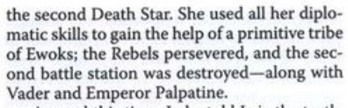

# Jaina Solo — part 2 of 3

[All parts](README.md) · [Previous](01-jaina-solo.md) · [Next](03-debate-darth-caedus-respect-thread-respect-thread-.md)

# LEGENDS (Legends / EU — main focus)

## NJO 6.5, *Recovery* (Troy Denning, Del Rey e-book novella 2001): FULL consecutive re-read (2026-11-16 CST)

What it shows (our notes): Han claims the tank-three woman is Jaina (the first roguish glint "since before Chewbacca's death"); Thrackan wants Anakin to reactivate Centerpoint
> “Han,” Dr. Nimbi said helpfully, “she can handle the journey if you stop at bacta parlors along the way.” He hesitated a moment, then added, “Leia will be fine. It’s your, uh, friend I’m worried about.”
>
> Han seemed confused. “Friend?”
>
> “In tank three,” Dr. Nimbi said. “I don’t think you should leave her behind, not with all those bounty hunters and Peace Brigaders on the way.”
>
> “Oh—right. Our friend.” Han glanced at Leia, and something roguish came to his eye, something sly and fun and conspiratorial that had not been there since before Chewbacca’s death. He looked back to Sal-Solo and sighed. “Look, I don’t mean to be difficult, but we can’t go without Jaina.”
>
> “Jaina? Jaina’s here?”
>
> Leia thought she had been the one to blurt the question, but realized that was not so when all eyes turned to Sal-Solo. At least she understood why Han had been acting so strangely. She had a vague memory of a deep-space rendezvous with the Jade Shadow, of kissing her brother and each of her children good-bye and telling them she would see them again on Coruscant. Something must have happened. Perhaps Han had needed Jaina to help him fly the Falcon, or perhaps Mara and Luke had run into trouble and been forced to divert. Maybe all of her children were on Corellia. She hoped not. She hoped Jacen and Anakin were safe on Coruscant . . . but it would be good to see them, too. So good.
>
> “. . . Anakin?” Sal-Solo was asking. “Is he here, too?”
>
> “Just Jaina,” Han said firmly. “Anakin and Jacen are on Coruscant.”
>
> “Of course, you would say that.” Sal-Solo was thinking aloud. If he could force Anakin to reactivate Centerpoint, he would have no worries from the Yuuzhan Vong or the New Republic. He could use it to isolate the whole Corellian system and run the place as his personal empire. “But I can find out. I have my ways.”
>
> “Yeah—you could comm them on Coruscant,” Han said. “Feel free to reverse the HoloNet charges—I know how strapped things are here in Corellia.”
>
> “Wait—what was that about tank three?” Leia demanded, not paying much attention to the exchange between Han and Sal-Solo. “Jaina’s in a bacta tank? What happened?”
>
> “You remember.” Again, Han gave her a strange glare. “That hit on Duro turned out to be worse than we thought.”
>
> The stress alarm behind the bed started to beep again.
>
> “Will you please disconnect that thing?” Leia demanded. Whatever had happened—whatever Han was trying to tell her—she did not want a machine giving them away. “And get me a repulsor chair. I want to see my daughter.”
— Source: The New Jedi Order: Recovery (Troy Denning, Del Rey e-book 2001), REC ch. 2 — 120 Recovery notes (re-read 2026-11-16).
(Excerpt widened 2026-11-17 to the relevant passage, word for word from Recovery (Troy Denning) (text copy `MEGA_Legend_The_New_Jedi_Order_Series_Star_Wars_New_Jedi_Order_07_Recovery_Troy_Denning_epub`).)
(A fragment line was removed 2026-11-17: its words appear word for word inside the full excerpt in this entry.)
(Fragment completed 2026-11-17 with the full excerpt, word for word from Recovery (Troy Denning) (text copy `MEGA_Legend_The_New_Jedi_Order_Series_Star_Wars_New_Jedi_Order_07_Recovery_Troy_Denning_epub`).)
(Excerpt widened 2026-11-17 to the relevant passage, word for word from Recovery (Troy Denning) (text copy `MEGA_Legend_The_New_Jedi_Order_Series_Star_Wars_New_Jedi_Order_07_Recovery_Troy_Denning_epub`).)
(Fragment completed 2026-11-17: full sentence/passage matched word for word in the source text on file: `MEGA_Legend_The_New_Jedi_Order_Series_Star_Wars_New_Jedi_Order_07_Recovery_Troy_Denning_epub`.)
Note text that was attached to the quote line: (REC ch. 2) — **Han claims the tank-three woman is Jaina (the first roguish glint "since before Chewbacca's death"); Thrackan wants Anakin to reactivate Centerpoint**
Our notes: `notes/materials/120-njo-07-recovery/rec-01.md:17`

What it shows (our notes): Leia's legs "a pain a hundred times worse than childbirth"; "If you're going to gape … I wish you wouldn't smile."; the Arcona in the waiting room; the woman is not Jaina; "You'd be surprised how space combat ages a girl."; Leia feels "desperately alone"
> “Yes.” Sal-Solo was scowling and studying Han, obviously wondering why Leia seemed so surprised. “Why don’t we all go?”
>
> Dr. Nimbi arranged for a repulsor chair, then unstrapped Leia’s arm from the safety rail, hung the necessary IV lines on the bag hook attached to the chair, and helped her out of bed.
>
> Leia’s legs were no sooner lowered than they began to ache with a pain a hundred times worse than childbirth. It was unlike anything she had ever experienced, a bursting, throbbing, burning kind of anguish that made her wish the Yuuzhan Vong had finished the job and cut them all the way off. She caught Sal-Solo staring and looked down to see two huge Hutt-like things sticking out where her legs should have been.
>
> “If you’re going to gape,” Leia said, “I wish you wouldn’t smile.”
>
> Sal-Solo covered his mouth, which was not actually smiling, and turned away. Accompanied by the CorSec agents, Sal-Solo, and even the nurse, Dr. Nimbi led them past the droid’s monitoring post down the opposite corridor. Leia’s heart began to pound immediately. The door of the bacta parlor was ringed by black blossoms of soot. Opposite, the ruins of the waiting room were set off by the jagged remains of a small half wall. They had been determined, these bounty hunters, and it made Leia shudder to think how close they must have come to capturing her only daughter.
>
> As they reached the bacta parlor, Leia noticed an anvil-headed Arcona sitting in one of the few undamaged chairs. He met her gaze long enough to nod, then went back to staring at his feet. She steered her chair into the bacta parlor behind Han, the nurse, and the others.
>
> They stopped in front of tank three, where a badly wounded woman of at least thirty years of age was floating inside. She was several centimeters taller than Leia and well muscled, and though there was something vaguely familiar about her face, she bore no resemblance at all to either Han or Leia. Most telling of all, her head was surrounded by a cloud of silky hair; like Leia, Jaina had left hers in a decontamination lock on Duro.
>
> Leia craned her neck, checking the other tanks for an occupant that could be her daughter. There was none; only a Selonian with an amputated tail.
>
> “This is Jaina?” Sal-Solo asked, clearly as doubtful as Leia herself. “She’s a little old to be your daughter, Han.”
>
> “She’s been flying for Rogue Squadron,” Han said. “You’d be surprised how space combat ages a girl.”
>
> And Leia finally understood. For some reason she did not yet know, Han and Dr. Nimbi were trying to get this woman off Corellia. Jaina was not there at all; none of her children were. Leia should have been relieved, but instead she felt let down and desperately alone.
— Source: The New Jedi Order: Recovery (Troy Denning, Del Rey e-book 2001), REC ch. 2 — 120 Recovery notes (re-read 2026-11-16).
(Excerpt widened 2026-11-17 to the relevant passage, word for word from Recovery (Troy Denning) (text copy `MEGA_Legend_The_New_Jedi_Order_Series_Star_Wars_New_Jedi_Order_07_Recovery_Troy_Denning_epub`).)
(Excerpt widened 2026-11-17 to the relevant passage, word for word from Recovery (Troy Denning) (text copy `MEGA_Legend_The_New_Jedi_Order_Series_Star_Wars_New_Jedi_Order_07_Recovery_Troy_Denning_epub`).)
(Fragment completed 2026-11-17: full sentence/passage matched word for word in the source text on file: `MEGA_Legend_The_New_Jedi_Order_Series_Star_Wars_New_Jedi_Order_07_Recovery_Troy_Denning_epub`.)
Note text that was attached to the quote line: (REC ch. 2) — **Leia's legs "a pain a hundred times worse than childbirth"; "If you're going to gape … I wish you wouldn't smile."; the Arcona in the waiting room; the woman is not Jaina; "You'd be surprised how space combat ages a girl."; Leia feels "desperately alone"**
Our notes: `notes/materials/120-njo-07-recovery/rec-01.md:18`

What it shows (our notes): "Now isn't the time for the Jedi to seem arrogant … I'll walk." / "With a little help from my family."; Jaina, once so angry with her on Duro, walks Leia forward through the Force: "Trust me?"
> “What I want to know is how you’re going to get to the accuser’s table,” Jaina whispered. All Leia’s children were there, along with Luke, several more Jedi, and Leia’s new Noghri bodyguards. “We’ll have to float you!”
>
> “We’ll clear the aisle, Mom,” Anakin said, nodding to Jacen.
>
> Leia caught him by the arm.
>
> “Now isn’t the time for the Jedi to seem arrogant,” she said. “I’ll walk.”
>
> “Walk?” Han asked. “How?”
>
> “With a little help from my family.” Leia looked to Jaina—Jaina who had been so angry with her and felt so abandoned by her on Duro—and asked, “Would you mind?”
>
> The smile that came to Jaina’s face was almost as lopsided as Han’s. “Trust me?”
>
> Leia felt her daughter reach out in the Force, then felt herself rise into a standing position. Her legs started to move, by Jaina’s will instead of her own, but in a reasonable imitation of walking. The room erupted into a fresh round of murmurs as the vidcasters commented on what they were broadcasting. Luke and the others took protective positions around Leia, and they started forward.
>
> If Shesh had assassins lurking in the crowd, they had the good sense to realize an attempt now would be hopeless. Leia reached the front of the room and took her seat at the accuser’s table, with Han at her side and her children and the others behind her. As was proper for a formal proceeding of this nature, she did not acknowledge Kvarm Jia or any of her other friends behind the high consoles.
>
> “With a little help from my family.” Leia looked to Jaina—Jaina who had been so angry with her and felt so abandoned by her on Duro—and asked, “Would you mind?”
> [fragment — full passage not on file]
— Source: The New Jedi Order: Recovery (Troy Denning, Del Rey e-book 2001), REC ch. 8 — 120 Recovery notes (re-read 2026-11-16).
(Fragment completed 2026-11-17 with the full excerpt, word for word from Recovery (Troy Denning) (text copy `MEGA_Legend_The_New_Jedi_Order_Series_Star_Wars_New_Jedi_Order_07_Recovery_Troy_Denning_epub`).)
Note text that was attached to the quote line: Jaina, once so angry with her on Duro, walks Leia forward through the Force: "Trust me?"**
(Excerpt widened 2026-11-17 to the relevant passage, word for word from Recovery (Troy Denning) (text copy `MEGA_Legend_The_New_Jedi_Order_Series_Star_Wars_New_Jedi_Order_07_Recovery_Troy_Denning_epub`).)
(Fragment completed 2026-11-17 with the full excerpt, word for word from Recovery (Troy Denning) (text copy `MEGA_Legend_The_New_Jedi_Order_Series_Star_Wars_New_Jedi_Order_07_Recovery_Troy_Denning_epub`).)
(Excerpt widened 2026-11-17 to the relevant passage, word for word from Recovery (Troy Denning) (text copy `MEGA_Legend_The_New_Jedi_Order_Series_Star_Wars_New_Jedi_Order_07_Recovery_Troy_Denning_epub`).)
(Fragment completed 2026-11-17: full sentence/passage matched word for word in the source text on file: `MEGA_Legend_The_New_Jedi_Order_Series_Star_Wars_New_Jedi_Order_07_Recovery_Troy_Denning_epub`.)
Note text that was attached to the quote line: (REC ch. 8) — **"Now isn't the time for the Jedi to seem arrogant … I'll walk."
Our notes: `notes/materials/120-njo-07-recovery/rec-02.md:43`

What it shows (our notes): Borsk Fey'lya announces "the Peace Vote … has failed by a two-to-one ratio"; Jaina slides the doctor aside with the Force; "The repair was fully successful … Your legs are going to be fine."
> For the first time in weeks, her legs did not ache or throb or burn, but she was barely aware of that fact. She was too interested in watching Borsk Fey’lya’s face on the vidscreen, looking for a beard tug or brow twitch that would tell her which way the Appeasement Vote was going.
>
> Leia’s doctor, a distracted-looking human with a permanent squint and perpetually mussed hair, came into the room. If he noticed the Noghri bodyguards flanking him, or was impressed by the sight of so many famous Jedi in one place, he hid it well. He simply began to prod, poke, and tickle Leia’s legs, issuing quiet instructions to move this or wiggle that.
>
> The nervesplicer said something about normal sensation and improving motor control. But Fey’lya raised his brow just then, and Leia missed whatever it was the doctor said next.
>
> “Did you see that?” Han asked. “He’s surprised.”
>
> “That can’t be good,” Jaina said.
>
> “It’s hard to know.” Leia reached out and found Han’s hand. “Nobody has been able to tell what Borsk thinks will happen.”
>
> The doctor stepped into Leia’s line of sight. “Princess Leia, I have some news.”
>
> “In a minute.”
>
> Leia cast an appealing glance at her daughter, who quietly used the Force to slide the doctor out of the way.
>
> Han pulled away. “In a minute.” He continued to glare at the Arcona. “I don’t care if you fly Star Destroyers, you’re not getting on my ship.”
>
> Fey’lya was looking directly into the cam now, his fangs bared in a politician’s meaningless smile.
>
> “It is my duty to announce that the Peace Vote—or the Appeasement Vote, as it has become known in some circles—has failed by a two-to-one ratio.”
>
> “Not even close!” Anakin cried. “How about that?”
>
> The room—and much of the corridor outside—erupted into a chorus of cheering.
>
> The nervesplicer stepped to Leia’s side, his face twisted into a frown. “Princess, are you listening? The repair was fully successful. You can start walking later today. Your legs are going to be fine.”
>
> “I know, Doctor.” Leia pulled the nervesplicer’s face down to hers and kissed his cheek—she had no idea why, other than because she was so happy—then said, “Thank you.”
>
> “Uh, my pleasure.”
> [fragment — full passage not on file]
— Source: The New Jedi Order: Recovery (Troy Denning, Del Rey e-book 2001), REC ch. 8 — 120 Recovery notes (re-read 2026-11-16).
(Excerpt widened 2026-11-17 to the relevant passage, word for word from Recovery (Troy Denning) (text copy `MEGA_Legend_The_New_Jedi_Order_Series_Star_Wars_New_Jedi_Order_07_Recovery_Troy_Denning_epub`).)
(Excerpt widened 2026-11-17 to the relevant passage, word for word from Recovery (Troy Denning) (text copy `MEGA_Legend_The_New_Jedi_Order_Series_Star_Wars_New_Jedi_Order_07_Recovery_Troy_Denning_epub`).)
(Excerpt widened 2026-11-17 to the relevant passage, word for word from Recovery (Troy Denning) (text copy `MEGA_Legend_The_New_Jedi_Order_Series_Star_Wars_New_Jedi_Order_07_Recovery_Troy_Denning_epub`).)
(Excerpt widened 2026-11-17 to the relevant passage, word for word from Recovery (Troy Denning) (text copy `MEGA_Legend_The_New_Jedi_Order_Series_Star_Wars_New_Jedi_Order_07_Recovery_Troy_Denning_epub`).)
(Fragment completed 2026-11-17: full sentence/passage matched word for word in the source text on file: `MEGA_Legend_The_New_Jedi_Order_Series_Star_Wars_New_Jedi_Order_07_Recovery_Troy_Denning_epub`.)
Note text that was attached to the quote line: (REC ch. 8) — **Borsk Fey'lya announces "the Peace Vote … has failed by a two-to-one ratio"; Jaina slides the doctor aside with the Force; "The repair was fully successful … Your legs are going to be fine."**
Our notes: `notes/materials/120-njo-07-recovery/rec-02.md:49`

> Leia felt her daughter reach out in the Force, then felt herself rise into a standing position. Her legs started to move, by Jaina’s will instead of her own, but in a reasonable imitation of walking. The room erupted into a fresh round of murmurs as the vidcasters commented on what they were broadcasting. Luke and the others took protective positions around Leia, and they started forward.
— Source: The New Jedi Order: Recovery (Troy Denning, Del Rey e-book 2001), REC ch. 8 — 120 Recovery notes (re-read 2026-11-16).
(Fragment completed 2026-11-17: full sentence/passage matched word for word in the source text on file: `MEGA_Legend_The_New_Jedi_Order_Series_Star_Wars_New_Jedi_Order_07_Recovery_Troy_Denning_epub`.)
Note text that was attached to the quote line: (REC ch. 8) — **Jaina walks Leia through the Force into the Inquiry Room**
Context: Jaina walks Leia through the Force into the Inquiry Room
Our notes: `notes/materials/120-njo-07-recovery/summary.md:31`

## NJO 7, *Edge of Victory I: Conquest* (Greg Keyes, Del Rey 2001): FULL consecutive re-read (2026-11-16 CST)

What it shows (our notes): Jaina defends Luke; Kyp on Duro and Jacen's refusal to use the Force; Octa Ramis: "Jedi for Jedi!"; Luke: "If we win the fight against the Yuuzhan Vong at the price of using dark-side powers, it will be no victory."
> “This is ridiculous!” a female voice exploded half a meter from Anakin’s ear. It was his sister, Jaina, her face gone red with internal heat. “Maybe you don’t hear all the news, running around playing hero with your squadron, Kyp. Maybe you’ve started feeling so self-important that you think your way is the only way. While you’ve been out there blazing your guns, Master Skywalker has been working quietly and hard to make sure things don’t fall apart.”
>
> “Yes, and see how well that’s gone,” Kyp said. “Duro, for instance. How many Jedi were involved there? Five? Six? And yet not one of you—Master Skywalker included—smelled the rank treachery of the situation until it was too late. Why didn’t the Force guide you?” He paused and then smacked a fist into his palm for emphasis. “Because you were acting like nursemaids, not Jedi warriors! I’ve heard one of you even refused to use the Force.” He looked significantly at Jaina’s twin, who sat stone-faced halfway around the hall.
>
> “You leave Jacen out of this,” Jaina snarled.
>
> “At least your brother was honest in his refusal to use his power,” Kyp said. “Wrong, but honest, and in the end when he had to use it, he did. The rest of this group has no excuse for its ambivalence. If saving our galaxy from the Yuuzhan Vong is not a good enough cause to flex our true might, let self-preservation be!”
>
> “Jedi for Jedi!” Octa Ramis shouted, still in the clutches of renewed grief over losing Daeshara’cor.
>
> “It’s both ourselves and the galaxy I’m trying to preserve,” Luke said. “If we win the fight against the Yuuzhan Vong at the price of using dark-side powers, it will be no victory.”
— Source: The New Jedi Order: Edge of Victory I: Conquest (Greg Keyes, Del Rey 2001), CQ ch. 1 — 121 Conquest notes (re-read 2026-11-16).
(Excerpt widened 2026-11-17 to the relevant passage, word for word from Conquest: Edge of Victory I (Greg Keyes) (text copy `MEGA_Legend_The_New_Jedi_Order_Series_Star_Wars_New_Jedi_Order_08_Edge_of_Victory_01_Conquest_Greg_Keyes_epub`).)
(Excerpt widened 2026-11-17 to the relevant passage, word for word from Conquest: Edge of Victory I (Greg Keyes) (text copy `MEGA_Legend_The_New_Jedi_Order_Series_Star_Wars_New_Jedi_Order_08_Edge_of_Victory_01_Conquest_Greg_Keyes_epub`).)
(Fragment completed 2026-11-17: full sentence/passage matched word for word in the source text on file: `MEGA_Legend_The_New_Jedi_Order_Series_Star_Wars_New_Jedi_Order_08_Edge_of_Victory_01_Conquest_Greg_Keyes_epub`.)
Note text that was attached to the quote line: (CQ ch. 1) — **Jaina defends Luke; Kyp on Duro and Jacen's refusal to use the Force; Octa Ramis: "Jedi for Jedi!"; Luke: "If we win the fight against the Yuuzhan Vong at the price of using dark-side powers, it will be no victory."**
Our notes: `notes/materials/121-njo-08-conquest/cq-01.md:25`

What it shows (our notes): Jaina and Anakin follow Kyp; "Your uncle has changed … now he's become Kenobi."; Jacen "going gray early"; would Jacen have saved strangers?
> “No!” Jaina whispered to Anakin. “If Kyp leaves, he’ll take too many with him.”
>
> “So?” Anakin said. “Are you so sure he’s wrong?”
>
> “Of course I—” She stopped, paused, started again. “It won’t help any of us if the Jedi split. We have to try to help Uncle Luke. Come on.”
>
> Jaina followed Kyp from the chamber. After a second or two, Anakin followed. The debate began again behind them, in much more muted terms.
>
> Kyp turned as they approached. “Anakin, Jaina. What do you want?”
>
> “To talk some sense into you,” Jaina said.
>
> “I have plenty of sense,” Kyp said. “You two ought to know better. When did either of you flinch from battle? It’s not like you two to sit while others fight.”
>
> “I haven’t been,” Jaina flared. “Neither has Anakin, or Uncle Luke, or—”
>
> “Spare me. Jaina, I have the greatest respect for Master Skywalker. But he is wrong. I can’t see the Yuuzhan Vong in the Force any more than he can, but I don’t need that to know they’re evil. To know they have to be stopped.”
>
> “Couldn’t you just hear Uncle Luke out?”
>
> “I did. He didn’t say anything I was interested in, and he wasn’t going to.” Kyp shook his head. “Your uncle has changed. Something happens to Jedi Masters as they grow older in the Force. Something that isn’t going to happen to me. They become so concerned with light and dark they can’t act, but can only be acted upon. Like Obi-Wan Kenobi—rather than act himself, he allowed himself to be struck down, become one with the Force, so Luke could then take all of the moral risks.”
>
> “That’s not how Uncle Luke tells it.”
>
> “Your uncle is too close to it. And now he’s become Kenobi.”
>
> “What are you saying, exactly?” Jaina said. “That Uncle Luke is a coward?”
>
> Kyp shrugged and flashed a little smile. “When it comes to his life, no. But when it comes to the Force …” He gestured with the back of his hand. “Ask your brother Jacen—seems to me he’s going gray early, in that respect. The whole galaxy is falling apart around him, and he’s dithering over theoretical philosophy.”
>
> “He did use the Force, though, as you pointed out,” Jaina retorted.
>
> “To save his mother’s life, from what I heard, and almost not then. How long was she in a bacta tank?”
>
> “But he did save her, and me, too.”
>
> “Of course. But would he have called on the Force to save some Duros he didn’t know? Given the fact that he had ample opportunity to do so before that, the answer is self-evidently no. So it wasn’t some universal respect for preserving life or anything of that sort that led him to break his self-imposed ban, was it?”
— Source: The New Jedi Order: Edge of Victory I: Conquest (Greg Keyes, Del Rey 2001), CQ ch. 1 — 121 Conquest notes (re-read 2026-11-16).
(Excerpt widened 2026-11-17 to the relevant passage, word for word from Conquest: Edge of Victory I (Greg Keyes) (text copy `MEGA_Legend_The_New_Jedi_Order_Series_Star_Wars_New_Jedi_Order_08_Edge_of_Victory_01_Conquest_Greg_Keyes_epub`).)
(Excerpt widened 2026-11-17 to the relevant passage, word for word from Conquest: Edge of Victory I (Greg Keyes) (text copy `MEGA_Legend_The_New_Jedi_Order_Series_Star_Wars_New_Jedi_Order_08_Edge_of_Victory_01_Conquest_Greg_Keyes_epub`).)
(Fragment completed 2026-11-17: full sentence/passage matched word for word in the source text on file: `MEGA_Legend_The_New_Jedi_Order_Series_Star_Wars_New_Jedi_Order_08_Edge_of_Victory_01_Conquest_Greg_Keyes_epub`.)
Note text that was attached to the quote line: (CQ ch. 1) — **Jaina and Anakin follow Kyp; "Your uncle has changed … now he's become Kenobi."; Jacen "going gray early"; would Jacen have saved strangers?**
Our notes: `notes/materials/121-njo-08-conquest/cq-01.md:27`

What it shows (our notes): Anakin: "No"; "Any time either of you wants to fly with me, find me."; Jaina: "I wish I didn't more than half think he was right"; Anakin: "we're going to have to look out for our own"
> “No,” Anakin murmured.
>
> “Anakin!” Jaina snapped.
>
> “It’s true,” Anakin replied. “I’m glad he did it, and I’m glad he hurt the warmaster, even if he did call for the heads of all the Jedi, but Kyp’s right. If you and Mom hadn’t been there …”
>
> “Jacen was going through a hard time,” Jaina said.
>
> “Like the rest of us aren’t,” Anakin returned.
>
> “I’ve got to go,” Kyp told them. “Any time either of you wants to fly with me, find me. Other than that, I sincerely hope Master Skywalker comes around. I just can’t wait for it. May the Force be with you.”
>
> They watched him go.
>
> “I wish I didn’t more than half think he was right,” Jaina whispered. “I feel like I’m somehow betraying Uncle Luke.”
>
> Anakin nodded. “I know what you mean. But Kyp is right, about one thing anyway. Whatever else we do, we’re going to have to look out for our own.”
— Source: The New Jedi Order: Edge of Victory I: Conquest (Greg Keyes, Del Rey 2001), CQ ch. 1 — 121 Conquest notes (re-read 2026-11-16).
(Excerpt widened 2026-11-17 to the relevant passage, word for word from Conquest: Edge of Victory I (Greg Keyes) (text copy `MEGA_Legend_The_New_Jedi_Order_Series_Star_Wars_New_Jedi_Order_08_Edge_of_Victory_01_Conquest_Greg_Keyes_epub`).)
(Excerpt widened 2026-11-17 to the relevant passage, word for word from Conquest: Edge of Victory I (Greg Keyes) (text copy `MEGA_Legend_The_New_Jedi_Order_Series_Star_Wars_New_Jedi_Order_08_Edge_of_Victory_01_Conquest_Greg_Keyes_epub`).)
(Fragment completed 2026-11-17: full sentence/passage matched word for word in the source text on file: `MEGA_Legend_The_New_Jedi_Order_Series_Star_Wars_New_Jedi_Order_08_Edge_of_Victory_01_Conquest_Greg_Keyes_epub`.)
Note text that was attached to the quote line: (CQ ch. 1) — **Anakin: "No"; "Any time either of you wants to fly with me, find me."; Jaina: "I wish I didn't more than half think he was right"; Anakin: "we're going to have to look out for our own"**
Our notes: `notes/materials/121-njo-08-conquest/cq-01.md:28`

What it shows (our notes): Jacen: Luke called a recess; "Answering naked aggression with naked aggression can't be the solution." / "If you hadn't used that particular solution, you, Mom, and Jaina would be dead"; Jaina stops the bickering; Jacen flinches first
> “The point is, what are you two doing out here rather than in the meeting?” Jacen Solo asked from the end of the corridor.
>
> “We were trying to talk Kyp into staying,” Anakin told his older brother.
>
> “It’d be easier talking a siringana into a box.”
>
> “True,” Jaina said, “but we had to try. I guess we ought to go back in now.”
>
> “Don’t bother. A few minutes after Kyp walked out, Uncle Luke called a recess. Too much angst and confusion.”
>
> “It’s not going well,” Jaina said.
>
> “No. Too many people think Kyp is right.”
>
> “What do you think?” Anakin asked.
>
> “He’s wrong,” Jacen said without hesitation. “Answering naked aggression with naked aggression can’t be the solution.”
>
> “No? If you hadn’t used that particular solution, you, Mom, and Jaina would be dead right now. Would the universe be better off?”
>
> “Anakin, I’m not proud of—” Jacen began.
>
> Jaina cut him off. “Don’t you two start again. Anakin and I were talking about something constructive when you joined us. Let’s not degenerate into bickering, like the others. We’re siblings, after all. If we can’t talk through this without losing it, how can we expect anyone else to?”
>
> Jacen held his gaze on Anakin for another few heartbeats, waiting to see who would flinch first.
>
> It was Jacen.
>
> “What were you discussing?” he asked softly. (CQ ch. 1) — **Jacen: Luke called a recess; "Answering naked aggression with naked aggression can't be the solution."
>
> “No? If you hadn’t used that particular solution, you, Mom, and Jaina would be dead right now. Would the universe be better off?”
> [fragment — full passage not on file]
— Source: The New Jedi Order: Edge of Victory I: Conquest (Greg Keyes, Del Rey 2001), CQ ch. 1 — 121 Conquest notes (re-read 2026-11-16).
(Fragment completed 2026-11-17 with the full excerpt, word for word from Conquest: Edge of Victory I (Greg Keyes) (text copy `MEGA_Legend_The_New_Jedi_Order_Series_Star_Wars_New_Jedi_Order_08_Edge_of_Victory_01_Conquest_Greg_Keyes_epub`).)
Note text that was attached to the quote line: Jaina stops the bickering; Jacen flinches first**
(Excerpt widened 2026-11-17 to the relevant passage, word for word from Conquest: Edge of Victory I (Greg Keyes) (text copy `MEGA_Legend_The_New_Jedi_Order_Series_Star_Wars_New_Jedi_Order_08_Edge_of_Victory_01_Conquest_Greg_Keyes_epub`).)
(Excerpt widened 2026-11-17 to the relevant passage, word for word from Conquest: Edge of Victory I (Greg Keyes) (text copy `MEGA_Legend_The_New_Jedi_Order_Series_Star_Wars_New_Jedi_Order_08_Edge_of_Victory_01_Conquest_Greg_Keyes_epub`).)
Our notes: `notes/materials/121-njo-08-conquest/cq-01.md:30`

What it shows (our notes): the Peace Brigade "flesh merchants"; Jaina suspects Viqi Shesh; "The praxeum!"; Anakin "has killed more Yuuzhan Vong in hand-to-hand combat than any of us"; only Kam, Tionne, Streen and Ikrit left at Yavin 4; Anakin's dream of Tahiri
> Jaina looked relieved. “How to figure out where the worst hot spots are, which Jedi are in the most immediate danger,” she said.
>
> Jacen quirked his mouth as if tasting a Hutt appetizer. “With the Peace Brigade out there, that’s an open question. They aren’t tied to the interests of a single system. They’ll hunt us from the Rim to the Core if they think it’ll appease the Yuuzhan Vong.”
>
> “The Peace Brigade can’t be everywhere at once. They can’t follow every rumor they’ve heard about Jedi.”
>
> “The Peace Brigade has plenty of allies, and good intelligence,” Jacen countered. “Given what they’ve managed already, they must have more than a few insiders, maybe even in the senate. They don’t have to chase rumors. More often than not, from what I can tell, they don’t even make half the captures they boast about. They’re just the flesh merchants who turn Jedi over to the Yuuzhan Vong.”
>
> “I still have a bad feeling about the senator from Kuat, Viqi Shesh,” Jaina muttered.
>
> “My point is this,” Anakin said. “It’s hard to predict which single Jedi might be next on their list. But if they could get a package deal, wouldn’t they jump at it?”
>
> Jaina’s eyes widened. “You think they’ll move against us while we’re gathered here?”
>
> Anakin drew a negative arc with his chin. “Things aren’t that bad yet, and who would want to face all of the most powerful Jedi in the galaxy at once? That would be crazy—us they’ll pick off one at a time. But—”
>
> “The praxeum!” Jacen interrupted.
>
> “Yes,” Anakin agreed. “The Jedi academy!”
>
> “But they’re just kids!” Jaina said.
>
> “Have you noticed that makes any difference to the Yuuzhan Vong, or to the Peace Brigade, for that matter?” Jacen asked. “Besides, Anakin’s only sixteen, and he’s killed more Yuuzhan Vong in hand-to-hand combat than any of us. The Yuuzhan Vong know that.”
>
> “What about the illusion the Jedi have been maintaining around Yavin Four? That’s been keeping strangers away.”
>
> “Not since almost all of the Jedi Knights have left,” Anakin said. “They’ve either come to Coruscant to this meeting, or gone off to try to help comrades who’ve disappeared. Last I heard, only the students Kam and Tionne are left, with maybe Streen, and Master Ikrit. They might not be strong enough. Where did Uncle Luke go? We should talk to him about this, right away. It may already be too late.”
>
> “That’s a good call, Anakin,” Jacen admitted.
>
> “Thanks.”
>
> What Anakin didn’t mention to his siblings was how he had awakened in the night, heart thrumming, gripped by a nameless dread. And though he couldn’t remember the dream that had torn him from sleep, one image had remained with him: the blond hair and green eyes of Tahiri, his best friend.
>
> What Anakin didn’t mention to his siblings was how he had awakened in the night, heart thrumming, gripped by a nameless dread. And though he couldn’t remember the dream that had torn him from sleep, one image had remained with him: the blond hair and green eyes of Tahiri, his best friend.
>
> And Tahiri was at the academy.
> [fragment — full passage not on file]
— Source: The New Jedi Order: Edge of Victory I: Conquest (Greg Keyes, Del Rey 2001), CQ ch. 1 — 121 Conquest notes (re-read 2026-11-16).
(Fragment completed 2026-11-17 with the full excerpt, word for word from Conquest: Edge of Victory I (Greg Keyes) (text copy `MEGA_Legend_The_New_Jedi_Order_Series_Star_Wars_New_Jedi_Order_08_Edge_of_Victory_01_Conquest_Greg_Keyes_epub`).)
(Excerpt widened 2026-11-17 to the relevant passage, word for word from Conquest: Edge of Victory I (Greg Keyes) (text copy `MEGA_Legend_The_New_Jedi_Order_Series_Star_Wars_New_Jedi_Order_08_Edge_of_Victory_01_Conquest_Greg_Keyes_epub`).)
(Fragment completed 2026-11-17 with the full excerpt, word for word from Conquest: Edge of Victory I (Greg Keyes) (text copy `MEGA_Legend_The_New_Jedi_Order_Series_Star_Wars_New_Jedi_Order_08_Edge_of_Victory_01_Conquest_Greg_Keyes_epub`).)
(Fragment completed 2026-11-17 with the full excerpt, word for word from Conquest: Edge of Victory I (Greg Keyes) (text copy `MEGA_Legend_The_New_Jedi_Order_Series_Star_Wars_New_Jedi_Order_08_Edge_of_Victory_01_Conquest_Greg_Keyes_epub`).)
(Excerpt widened 2026-11-17 to the relevant passage, word for word from Conquest: Edge of Victory I (Greg Keyes) (text copy `MEGA_Legend_The_New_Jedi_Order_Series_Star_Wars_New_Jedi_Order_08_Edge_of_Victory_01_Conquest_Greg_Keyes_epub`).)
(Fragment completed 2026-11-17: full sentence/passage matched word for word in the source text on file: `MEGA_Legend_The_New_Jedi_Order_Series_Star_Wars_New_Jedi_Order_08_Edge_of_Victory_01_Conquest_Greg_Keyes_epub`.)
Note text that was attached to the quote line: (CQ ch. 1) — **the Peace Brigade "flesh merchants"; Jaina suspects Viqi Shesh; "The praxeum!"; Anakin "has killed more Yuuzhan Vong in hand-to-hand combat than any of us"; only Kam, Tionne, Streen and Ikrit left at Yavin 4; Anakin's dream of Tahiri**
Our notes: `notes/materials/121-njo-08-conquest/cq-01.md:31`

What it shows (our notes): Luke refuses to send them ("especially your head, Jacen"); Jaina's eyes not yet healed; Anakin: "There isn't much to say, is there?"
> “What do you think?” Mara said, smirking.
>
> “But what if the Peace Brigade is already at Yavin Four, or on the way?” Anakin asked.
>
> “It’s the best we can do, for the moment,” Luke told him. “Besides, the danger is still hypothetical. The Peace Brigade might not even know about Yavin Four. And even if they did, Kam and Tionne and Master Ikrit are there. They aren’t exactly defenseless.”
>
> “It’s not the best-kept secret in the galaxy,” Jacen said. “And with the illusion gone, what could Kam do against a warship? Let us go.”
>
> “Out of the question,” Luke replied. “I need you all here, and with the bounty on our heads—especially your head, Jacen—it’s too dangerous for you to go off alone. Your parents would never forgive me if I sent you into that with them away.”
>
> “Ask them, then,” Jaina said.
>
> “I can’t. They’re out of contact now, and could be for some time.”
>
> “Shouldn’t we at least go check on the praxeum?” Jaina persisted. “We could just hide at the edge of the system until Karrde shows up, keep an eye on things, run back here to report if things go wrong.”
>
> Luke shook his head. “I know you’re all restless, especially you, Jaina. But your eyes still haven’t fully healed—”
>
> “Not to Rogue Squadron specs, maybe,” Jaina protested, “but I can see well enough to fly.”
>
> “Even if your vision were fully restored,” Luke went on, “I still don’t think sending any or all of you to Yavin Four is the most productive course. There’s important work to do here. Weren’t you just telling Kyp that, Jaina, Jacen?”
>
> “Yes, Uncle Luke,” Jacen said. “We were.”
>
> “Anakin? You haven’t said much.”
>
> Anakin shrugged. “There isn’t much to say, is there?”
>
> Luke detected something a bit dangerous in that, but it quickly passed.
>
> “I’m glad the three of you are thinking about the situation. We agree that the academy is one of our most vulnerable spots. Help me find the rest. Don’t think for a second I’ve thought of everything, because obviously I haven’t. And don’t forget, we’ll reconvene the meeting tomorrow morning.”
>
> The three of them nodded and left.
>
> When they were gone, Mara clucked. “They might be right.”
>
> Luke sighed again. “They might be. But I have a feeling that whoever goes to Yavin Four must go in force, or they won’t be leaving it again. I’ve learned to trust feelings like this.”
>
— Source: The New Jedi Order: Edge of Victory I: Conquest (Greg Keyes, Del Rey 2001), CQ ch. 2 — 121 Conquest notes (re-read 2026-11-16).
(A fragment line was removed 2026-11-17: its words appear word for word inside the full excerpt in this entry.)
(Excerpt widened 2026-11-17 to the relevant passage, word for word from Conquest: Edge of Victory I (Greg Keyes) (text copy `MEGA_Legend_The_New_Jedi_Order_Series_Star_Wars_New_Jedi_Order_08_Edge_of_Victory_01_Conquest_Greg_Keyes_epub`).)
(Fragment completed 2026-11-17 with the full excerpt, word for word from Conquest: Edge of Victory I (Greg Keyes) (text copy `MEGA_Legend_The_New_Jedi_Order_Series_Star_Wars_New_Jedi_Order_08_Edge_of_Victory_01_Conquest_Greg_Keyes_epub`).)
(Fragment completed 2026-11-17 with the full excerpt, word for word from Conquest: Edge of Victory I (Greg Keyes) (text copy `MEGA_Legend_The_New_Jedi_Order_Series_Star_Wars_New_Jedi_Order_08_Edge_of_Victory_01_Conquest_Greg_Keyes_epub`).)
(Excerpt widened 2026-11-17 to the relevant passage, word for word from Conquest: Edge of Victory I (Greg Keyes) (text copy `MEGA_Legend_The_New_Jedi_Order_Series_Star_Wars_New_Jedi_Order_08_Edge_of_Victory_01_Conquest_Greg_Keyes_epub`).)
(Fragment completed 2026-11-17: full sentence/passage matched word for word in the source text on file: `MEGA_Legend_The_New_Jedi_Order_Series_Star_Wars_New_Jedi_Order_08_Edge_of_Victory_01_Conquest_Greg_Keyes_epub`.)
Note text that was attached to the quote line: (CQ ch. 2) — **Luke refuses to send them ("especially your head, Jacen"); Jaina's eyes not yet healed; Anakin: "There isn't much to say, is there?"**
Our notes: `notes/materials/121-njo-08-conquest/cq-01.md:41`

What it shows (our notes): Qorl, the old TIE pilot who once held Jacen and Jaina at blasterpoint and later saved them from the Shadow Academy; "Can't see so well anymore."; he has seen ugly growth-like ships: the Yuuzhan Vong are here
> “Wait! Jedi! I’m—I’m a friend.”
>
> “Yeah? Why did you attack me?”
>
> “Didn’t know—didn’t—” He wheezed off, his voice sounding strange, weak, as if he rarely used it. “Name’s Qorl. I have been a friend to Jedi. I didn’t know who you were.”
>
> “Qorl? My brother and sister knew a Qorl. He made them fix his ship at blasterpoint.”
>
> “Jacen. Jaina,” the old man said. “Qorl also saved them from the Shadow Academy.”
>
> “You were a TIE fighter pilot, stranded here when the Death Star was destroyed. You went off—”
>
> “And came back. I left as an enemy to your brother and sister. I came back their friend. You’re really their brother?” He squinted. “Can’t see so well anymore.”
>
> “What are you doing here?”
>
> “Saw some ships fly over, fighting. Thought I saw one go down, so I followed to see.” He shrugged. “Seven days later, here I am.”
>
> “So you are.” Anakin struggled to remember what he knew about this grizzled old man. Jacen and Jaina had found his wrecked TIE fighter and set about fixing it, not realizing its pilot was still around, hiding in the jungle, unaware that the war was over. Qorl had forced them to finish the repairs and left them to die, but had later helped them escape the Shadow Academy. Anakin remembered that Qorl had ended up back on Yavin 4, but none of the details. He did know that Jacen and Jaina counted him a friend, and Uncle Luke had been content to leave the old man alone.
>
> “So you are.” Anakin struggled to remember what he knew about this grizzled old man. Jacen and Jaina had found his wrecked TIE fighter and set about fixing it, not realizing its pilot was still around, hiding in the jungle, unaware that the war was over. Qorl had forced them to finish the repairs and left them to die, but had later helped them escape the Shadow Academy. Anakin remembered that Qorl had ended up back on Yavin 4, but none of the details. He did know that Jacen and Jaina counted him a friend, and Uncle Luke had been content to leave the old man alone.
>
> Qorl gestured at the lightsaber. “Could you put that away, please?”
>
> “Oh. Sure.”
>
> She sounded disturbingly like Randa—anxious, angry. Again he thought of his vision, and the potential repercussions of one step in the wrong direction.
>
> “Instead of stuck here, taking care of helpless folks?” Clarani put in. “Think again, young woman. Who were you fighting to save? You’re not out there playing death-tag for fun and excitement.”
>
> “Peace Brigade.”
>
> “Who?”
>
> “Er—how long since you’ve had news from the outside, Qorl?”
>
> “I don’t know. Old Peckhum dropped off some supplies for me, maybe two or three years ago. I told him not to come back.”
>
> “Oh. Well, this will take some explaining, then. A lot of explaining.”
>
> “Will it explain the new ships I’ve seen? The strange ones?”
>
> Anakin felt his chest constrict. “What ships?”
>
> “They look like—growths of some kind. Ugly.”
>
> “Oh, no,” Anakin whispered. “Okay, I’ll have to tell this as fast as I can, and then—” He remembered his vision, that future Tahiri, a dark Jedi with Yuuzhan Vong scarring and implants. “And then there’s something I have to do, no matter what.”
— Source: The New Jedi Order: Edge of Victory I: Conquest (Greg Keyes, Del Rey 2001), CQ ch. 12 — 121 Conquest notes (re-read 2026-11-16).
(Excerpt widened 2026-11-17 to the relevant passage, word for word from Conquest: Edge of Victory I (Greg Keyes) (text copy `MEGA_Legend_The_New_Jedi_Order_Series_Star_Wars_New_Jedi_Order_08_Edge_of_Victory_01_Conquest_Greg_Keyes_epub`).)
(A fragment line was removed 2026-11-17: its words appear word for word inside the full excerpt in this entry.)
(Fragment completed 2026-11-17 with the full excerpt, word for word from Conquest: Edge of Victory I (Greg Keyes) (text copy `MEGA_Legend_The_New_Jedi_Order_Series_Star_Wars_New_Jedi_Order_08_Edge_of_Victory_01_Conquest_Greg_Keyes_epub`).)
(Excerpt widened 2026-11-17 to the relevant passage, word for word from Conquest: Edge of Victory I (Greg Keyes) (text copy `MEGA_Legend_The_New_Jedi_Order_Series_Star_Wars_New_Jedi_Order_08_Edge_of_Victory_01_Conquest_Greg_Keyes_epub`).)
(Excerpt widened 2026-11-17 to the relevant passage, word for word from Balance Point (Kathy Tyers) (text copy `MEGA_Legend_The_New_Jedi_Order_Series_Star_Wars_New_Jedi_Order_06_Balance_Point_Kathy_Tyers_epub`).)
(Fragment completed 2026-11-17: full sentence/passage matched word for word in the source text on file: `MEGA_Legend_The_New_Jedi_Order_Series_Star_Wars_New_Jedi_Order_08_Edge_of_Victory_01_Conquest_Greg_Keyes_epub`.)
(Fragment completed 2026-11-17: full sentence/passage matched word for word in the source text on file: `MEGA_Legend_The_New_Jedi_Order_Series_Star_Wars_New_Jedi_Order_06_Balance_Point_Kathy_Tyers_epub`.)
Note text that was attached to the quote line: (CQ ch. 12) — **Qorl, the old TIE pilot who once held Jacen and Jaina at blasterpoint and later saved them from the Shadow Academy; "Can't see so well anymore."; he has seen ugly growth-like ships: the Yuuzhan Vong are here**
Our notes: `notes/materials/121-njo-08-conquest/cq-02.md:30`

What it shows (our notes): Fey'lya to Jaina: "you have all of your mother's fire and none of her common sense"; Anakin's forged departure "the essence of what the Jedi have become"; Luke already went to General Antilles; Leia and Han's covert work; "We protect. We serve."; "The sheer arrogance. And you wonder why you are disliked."
> “That’s the most—” Jaina Solo exploded. Luke was surprised she had kept silent for so long.
>
> “Quiet, Jaina,” he said.
>
> “But he’s twisting—”
>
> “Child, you have all of your mother’s fire and none of her common sense,” Fey’lya said. “Listen to your Master.”
>
> “There’s no need to insult my niece,” Luke said. “Her brother is one of those missing.”
>
> “Would this be Anakin Solo, who forged a fake departure authority in order to leave Coruscant surreptitiously?”
>
> “Anakin is a little … overeager.”
>
> “He did not proceed under your authority?”
>
> “No, Chief Fey’lya, he did not, but he thought the students at the praxeum were in imminent danger. As it turns out, he was correct.”
>
> “Another example, however, of what I’m talking about. Young Solo ran off against orders, breaking several laws in doing so, with no say-so from anyone. This, so far as I can tell, is the essence of what the Jedi have become.”
>
> “I’m coming to you now, Chief Fey’lya.”
>
> “Yes. Now that the matter is too large for you to handle on your own. And I note that you did not come here first. At the very least, you went to General Antilles—and, I suspect, to others. And they all sent you here.”
>
> “I was inquiring into what was possible,” Luke said. “Not making requests.”
>
> “How diplomatic. And where is your sister in all of this? She and her husband also seem to have disappeared.”
>
> “That’s not relevant to this,” Luke said.
>
> “Oh, isn’t it? Are they engaged in yet more unsanctioned covert activity? Are they a part of the little government you’re trying to run on the side, as if the elected officials of the New Republic are incompetent to do their jobs?”
>
> “We’re following our Jedi mandate, Chief Fey’lya. We protect. We serve. I’m sorry if these goals are incompatible with yours.”
>
> “The arrogance,” Fey’lya said. “The sheer arrogance. And you wonder why you are disliked.”
>
> Luke felt matters rushing to a heated conclusion and knew part of it was his own fault. Perhaps the rage he felt pulsing from Jaina was partially responsible, but he was dangerously near losing his own head in the matter. He placed his palms together. “Chief Fey’lya, if you won’t consider military action, at least consider a diplomatic solution.”
— Source: The New Jedi Order: Edge of Victory I: Conquest (Greg Keyes, Del Rey 2001), CQ ch. 14 — 121 Conquest notes (re-read 2026-11-16).
(Excerpt widened 2026-11-17 to the relevant passage, word for word from Conquest: Edge of Victory I (Greg Keyes) (text copy `MEGA_Legend_The_New_Jedi_Order_Series_Star_Wars_New_Jedi_Order_08_Edge_of_Victory_01_Conquest_Greg_Keyes_epub`).)
(Excerpt widened 2026-11-17 to the relevant passage, word for word from Conquest: Edge of Victory I (Greg Keyes) (text copy `MEGA_Legend_The_New_Jedi_Order_Series_Star_Wars_New_Jedi_Order_08_Edge_of_Victory_01_Conquest_Greg_Keyes_epub`).)
(Fragment completed 2026-11-17: full sentence/passage matched word for word in the source text on file: `MEGA_Legend_The_New_Jedi_Order_Series_Star_Wars_New_Jedi_Order_08_Edge_of_Victory_01_Conquest_Greg_Keyes_epub`.)
Note text that was attached to the quote line: (CQ ch. 14) — **Fey'lya to Jaina: "you have all of your mother's fire and none of her common sense"; Anakin's forged departure "the essence of what the Jedi have become"; Luke already went to General Antilles; Leia and Han's covert work; "We protect. We serve."; "The sheer arrogance. And you wonder why you are disliked."**
Our notes: `notes/materials/121-njo-08-conquest/cq-02.md:43`

> “Oh, it’s clear all right,” Luke replied. “Suddenly, a lot of things are very clear indeed.” He felt Fey’lya’s mind snap down and vacuum seal. The interview was over. He turned to go—and stopped when he noticed that Jaina wasn’t moving, was standing stock-still, tears of anger streaming down her face.
>
> “Chief Fey’lya,” she said in a quiet voice. “You are a poor excuse for a sentient being. I hope one day you really smell the stink in your heart and choke on the fumes.”
>
> Fey’lya returned her gaze. “You’re very young,” he said. “When you’ve accomplished a fraction of what I have for the people of this galaxy, come back and we’ll talk again.” (CQ ch. 14) — **Jaina: "You are a poor excuse for a sentient being. I hope one day you really smell the stink in your heart and choke on the fumes."
>
> "When you've accomplished a fraction of what I have … come back"**
> [fragment — full passage not on file]
— Source: The New Jedi Order: Edge of Victory I: Conquest (Greg Keyes, Del Rey 2001), CQ ch. 14 — 121 Conquest notes (re-read 2026-11-16).
Context: Jaina: "You are a poor excuse for a sentient being. I hope one day you really smell the stink in your heart and choke on the fumes." / "When you've accomplished a fraction of what I have … come back"
Our notes: `notes/materials/121-njo-08-conquest/cq-02.md:45`

What it shows (our notes): Jaina: "What Anakin did"; Luke: "We can't allow ourselves to be cast as enemies of the state."; Jacen: "a civil war within the New Republic"
> “What Anakin did,” Jaina said. “Talon Karrde is out there right now, fighting a holding action for help that will never come. He’ll stay there until they pick all of his ships off, one by one. Won’t he, Shada?”
>
> “Yes.”
>
> Luke fixed her with his gaze. “I understand your concern, Jaina, but what good will one more X-wing do Karrde or Anakin?”
>
> “More good than sitting here. And we can contact Mom and Dad, have them bring the Millennium Falcon.”
>
> “First of all, Han and Leia are still out of contact. More important, you heard what Fey’lya said.”
>
> “Oh, please let them try arresting us,” Mara grunted.
>
> “You think I care even faintly what that scruffy Bothan said?” Jaina chimed in. “Uncle Luke, we can’t do nothing.”
>
> Luke placed his hand on Mara’s arm. “Listen to me, all of you. I’m not worried about arrest as such, and I think you all know that. But things aren’t good for the Jedi now. If we have any friends left in high places, we can’t afford to alienate them. We’re already considered rogues. We can’t allow ourselves to be cast as enemies of the state.”
>
> “If they’re stupid enough to think that, let ’em,” Jaina snarled. “They’re hopeless.”
>
> “Right,” Jacen said sardonically. “That’s really what we need right now, Jaina—a civil war within the New Republic, as if the war with the Yuuzhan Vong isn’t already enough. Besides, Uncle Luke is right. I don’t think the weight we could add to the battle would help, not considering the situation as Shada outlined it.”
>
> “What, then?” Shada asked. “Karrde can’t do it alone.”
>
> “What if we added a Star Destroyer to the equation?” Luke said.
>
> Shada looked thoughtful for a moment, then nodded slightly. “If the Yuuzhan Vong don’t get more reinforcements—maybe.”
> [fragment — full passage not on file]
— Source: The New Jedi Order: Edge of Victory I: Conquest (Greg Keyes, Del Rey 2001), CQ ch. 14 — 121 Conquest notes (re-read 2026-11-16).
(Fragment completed 2026-11-17 with the full excerpt, word for word from Conquest: Edge of Victory I (Greg Keyes) (text copy `MEGA_Legend_The_New_Jedi_Order_Series_Star_Wars_New_Jedi_Order_08_Edge_of_Victory_01_Conquest_Greg_Keyes_epub`).)
(Excerpt widened 2026-11-17 to the relevant passage, word for word from Conquest: Edge of Victory I (Greg Keyes) (text copy `MEGA_Legend_The_New_Jedi_Order_Series_Star_Wars_New_Jedi_Order_08_Edge_of_Victory_01_Conquest_Greg_Keyes_epub`).)
(Fragment completed 2026-11-17 with the full excerpt, word for word from Conquest: Edge of Victory I (Greg Keyes) (text copy `MEGA_Legend_The_New_Jedi_Order_Series_Star_Wars_New_Jedi_Order_08_Edge_of_Victory_01_Conquest_Greg_Keyes_epub`).)
(Fragment completed 2026-11-17 with the full excerpt, word for word from Conquest: Edge of Victory I (Greg Keyes) (text copy `MEGA_Legend_The_New_Jedi_Order_Series_Star_Wars_New_Jedi_Order_08_Edge_of_Victory_01_Conquest_Greg_Keyes_epub`).)
(Excerpt widened 2026-11-17 to the relevant passage, word for word from Conquest: Edge of Victory I (Greg Keyes) (text copy `MEGA_Legend_The_New_Jedi_Order_Series_Star_Wars_New_Jedi_Order_08_Edge_of_Victory_01_Conquest_Greg_Keyes_epub`).)
(Fragment completed 2026-11-17: full sentence/passage matched word for word in the source text on file: `MEGA_Legend_The_New_Jedi_Order_Series_Star_Wars_New_Jedi_Order_08_Edge_of_Victory_01_Conquest_Greg_Keyes_epub`.)
Note text that was attached to the quote line: (CQ ch. 14) — **Jaina: "What Anakin did"; Luke: "We can't allow ourselves to be cast as enemies of the state."; Jacen: "a civil war within the New Republic"**
Our notes: `notes/materials/121-njo-08-conquest/cq-02.md:47`

What it shows (our notes): Mara's pregnancy revealed; "You peeked" (Jacen, since Duro); "the universe surprises you sometimes"; "'Cousin Jaina'"; Mara loans Jaina the Jade Shadow; "you won't keep me away from Yavin Four. Not if I have to fly there on a repulsorsled."
> It was typically Jaina who broke the silence. “Mara? You’re? …”
>
> “Bright kid,” Mara said. Her eyes narrowed a little. “Jacen?”
>
> Jacen seemed to be trying to see the individual atoms in the floor. His face was redshifting.
>
> “You peeked,” Mara accused.
>
> “I, uh, didn’t mean to,” he mumbled. “But when I started using the Force again at Duro …” He looked around helplessly for support.
>
> “We were going to tell you soon, anyway,” Luke said.
>
> “That’s wonderful!” Jaina exploded. “Mara, congratulations.” Her brows scrunched a bit. “I guess? I mean, I didn’t think—”
>
> “What?” Mara said, nailing the younger woman with a pointed gaze. “Didn’t think what?”
>
> “Oh, I—nothing,” Jaina replied, her face suddenly twinning her brother’s in hue.
>
> “It’s just suprising,” Jacen said, for her. “You were sick for so long.”
>
> Mara nodded. “Yeah. Well, the universe surprises you sometimes. And sometimes—on rare occasions—in a good way.”
>
> “In the best way,” Jaina burbled. “Congratulations. To both of you.”
>
> “Thank you,” Luke said.
>
> “ ‘Cousin Jaina.’ I like the sound of it.”
>
> “So do I,” Mara replied, lips twitching in a smile. “But that doesn’t solve the immediate problem. So, ‘Cousin Jaina’—why don’t you take the Jade Shadow and go find Booster, already?”
>
> Jaina’s eyes widened. “You’re offering me your ship?”
>
> “Loaning it for a good cause. Just don’t get her dinged up, understood?”
>
> “Understood,” Jaina replied. “But if we don’t find Booster within a standard week—”
>
> “We will find him,” Jacen interjected.
>
> “Either way,” Jaina warned, “you won’t keep me away from Yavin Four. Not if I have to fly there on a repulsorsled.”
— Source: The New Jedi Order: Edge of Victory I: Conquest (Greg Keyes, Del Rey 2001), CQ ch. 14 — 121 Conquest notes (re-read 2026-11-16).
(Excerpt widened 2026-11-17 to the relevant passage, word for word from Conquest: Edge of Victory I (Greg Keyes) (text copy `MEGA_Legend_The_New_Jedi_Order_Series_Star_Wars_New_Jedi_Order_08_Edge_of_Victory_01_Conquest_Greg_Keyes_epub`).)
(Excerpt widened 2026-11-17 to the relevant passage, word for word from Conquest: Edge of Victory I (Greg Keyes) (text copy `MEGA_Legend_The_New_Jedi_Order_Series_Star_Wars_New_Jedi_Order_08_Edge_of_Victory_01_Conquest_Greg_Keyes_epub`).)
(Fragment completed 2026-11-17: full sentence/passage matched word for word in the source text on file: `MEGA_Legend_The_New_Jedi_Order_Series_Star_Wars_New_Jedi_Order_08_Edge_of_Victory_01_Conquest_Greg_Keyes_epub`.)
Note text that was attached to the quote line: (CQ ch. 14) — **Mara's pregnancy revealed; "You peeked" (Jacen, since Duro); "the universe surprises you sometimes"; "'Cousin Jaina'"; Mara loans Jaina the Jade Shadow; "you won't keep me away from Yavin Four. Not if I have to fly there on a repulsorsled."**
Our notes: `notes/materials/121-njo-08-conquest/cq-02.md:50`

What it shows (our notes): Tahiri calls "Anakin." clearly; "I'm coming, Tahiri"; "No!" and a blade of pain tears her away; he faintly feels Jaina
> He stretched out farther in the Force, touching Tahiri again. She was in a dark place and he felt pain, or the fading of pain. He couldn’t tell where.
>
> Anakin.
>
> That startled him. His name rang like an H’kig chime, nothing fuzzy about it.
>
> “I’m coming, Tahiri,” he whispered.
>
> Anakin … But the sense of words dissolved into emotion. Fear, grief, hope. Wordlessly, he reached for her, to give her the equivalent of a squeeze on the hand, and found himself instead in a tight, desperate embrace.
>
> I’ll find you, he projected to her. Just hang on.
>
> No! He couldn’t tell if she was warning him away or responding to the blade of pain that suddenly cut between them, tore her away from him, leaving him once more alone with the treetops.
>
> He searched for her again, but found nothing, not even a faint presence.
>
> “You’re okay, Tahiri,” he mumbled. “I know you are.”
>
> He did sense someone else, however. It was like seeing a faint star, the faintest star in the sky.
>
> “Jaina,” Anakin said. “Hello, Jaina.”
>
> But he couldn’t tell if she felt him back.
>
> Days passed, blurred and monotonous. The forest broke into narrow savannas and sparkling stretches of marsh and then ocean that shimmered like planished copper beneath Yavin and liquid gold by sunlight. He watched the crawling, V-shaped wakes of behemoths he had no names for and could make out only as shadows in the deep. He flew day and night, sleeping only in tiny naps, drawing on the Force to replenish himself. He ate the last of his rations after ten days, but even two days later did not feel hungry. He felt light and humming, like a flash of lightning given human form.
— Source: The New Jedi Order: Edge of Victory I: Conquest (Greg Keyes, Del Rey 2001), CQ ch. 15 — 121 Conquest notes (re-read 2026-11-16).
(Excerpt widened 2026-11-17 to the relevant passage, word for word from Conquest: Edge of Victory I (Greg Keyes) (text copy `MEGA_Legend_The_New_Jedi_Order_Series_Star_Wars_New_Jedi_Order_08_Edge_of_Victory_01_Conquest_Greg_Keyes_epub`).)
(A fragment line was removed 2026-11-17: its words appear word for word inside the full excerpt in this entry.)
(Fragment completed 2026-11-17 with the full excerpt, word for word from Conquest: Edge of Victory I (Greg Keyes) (text copy `MEGA_Legend_The_New_Jedi_Order_Series_Star_Wars_New_Jedi_Order_08_Edge_of_Victory_01_Conquest_Greg_Keyes_epub`).)
(Excerpt widened 2026-11-17 to the relevant passage, word for word from Conquest: Edge of Victory I (Greg Keyes) (text copy `MEGA_Legend_The_New_Jedi_Order_Series_Star_Wars_New_Jedi_Order_08_Edge_of_Victory_01_Conquest_Greg_Keyes_epub`).)
(Fragment completed 2026-11-17: full sentence/passage matched word for word in the source text on file: `MEGA_Legend_The_New_Jedi_Order_Series_Star_Wars_New_Jedi_Order_08_Edge_of_Victory_01_Conquest_Greg_Keyes_epub`.)
Note text that was attached to the quote line: (CQ ch. 15) — **Tahiri calls "Anakin." clearly; "I'm coming, Tahiri"; "No!" and a blade of pain tears her away; he faintly feels Jaina**
Our notes: `notes/materials/121-njo-08-conquest/cq-02.md:54`

What it shows (our notes): "Need a hand, little brother?" / "Jaina!"; Jacen; "Corran Horn's out here, too. I almost pity the Vong."; the Errant Venture; the Vong ship "blazing like a newborn star"; "grinned wide enough to swallow a crescent moon"
> He felt them in the Force at the same time the coralskippers vanished in a searing white haze, and two X-wings whipped around the expanding cloud of gas and molten coral. His comm crackled.
>
> “Need a hand, little brother?”
>
> “Jaina!”
>
> “This is some mess you’ve gotten us into, Anakin,” a masculine voice replied.
>
> “Jacen! Where … how …”
>
> “Explanations later,” Jaina said. “Who’s flying that crate?”
>
> “That’s me,” Vehn cut in.
>
> “Get out of there, fast,” Jaina said. “We’ll keep these pups off you. Corran Horn’s out here, too. I almost pity the Vong.”
>
> “But if I clear …”
>
> “Believe me,” Jaina said, “you’ll want to be clear.”
>
> Anakin breathed a sigh of relief as the turbolaser came back on-line. “I’ve got the back door,” he told his siblings. “You just clear a path. Vehn, better do what they want.”
>
> “Whatever you say,” Vehn said sarcastically. And then he just gasped. Anakin didn’t see why until they were on the other side of the Errant Venture. By that time, the Yuuzhan Vong ship was blazing like a newborn star.
>
> Anakin stared through the transparisteel and grinned wide enough to swallow a crescent moon. (CQ ch. 32) — **"Need a hand, little brother?"
>
> "Jaina!"; Jacen; "Corran Horn's out here, too. I almost pity the Vong."; the Errant Venture; the Vong ship "blazing like a newborn star"; "grinned wide enough to swallow a crescent moon"**
> [fragment — full passage not on file]
— Source: The New Jedi Order: Edge of Victory I: Conquest (Greg Keyes, Del Rey 2001), CQ ch. 32 — 121 Conquest notes (re-read 2026-11-16).
(Excerpt widened 2026-11-17 to the relevant passage, word for word from Conquest: Edge of Victory I (Greg Keyes) (text copy `MEGA_Legend_The_New_Jedi_Order_Series_Star_Wars_New_Jedi_Order_08_Edge_of_Victory_01_Conquest_Greg_Keyes_epub`).)
(Fragment completed 2026-11-17 with the full excerpt, word for word from Conquest: Edge of Victory I (Greg Keyes) (text copy `MEGA_Legend_The_New_Jedi_Order_Series_Star_Wars_New_Jedi_Order_08_Edge_of_Victory_01_Conquest_Greg_Keyes_epub`).)
(Excerpt widened 2026-11-17 to the relevant passage, word for word from Conquest: Edge of Victory I (Greg Keyes) (text copy `MEGA_Legend_The_New_Jedi_Order_Series_Star_Wars_New_Jedi_Order_08_Edge_of_Victory_01_Conquest_Greg_Keyes_epub`).)
(Fragment completed 2026-11-17: full sentence/passage matched word for word in the source text on file: `MEGA_Legend_The_New_Jedi_Order_Series_Star_Wars_New_Jedi_Order_08_Edge_of_Victory_01_Conquest_Greg_Keyes_epub`.)
Our notes: `notes/materials/121-njo-08-conquest/cq-04.md:80`

What it shows (our notes): finding Booster "Running weapons to the Hutt underground"; Jacen "spent a lot of time in deep meditation, trying to find Corran"; "Up until now … I had no way to think of the Yuuzhan Vong except as enemies." / "They are enemies," Jaina said.
> “We never thought we’d find Booster,” Jaina confessed, around a mouthful of food. “I was ready to hijack the Jade Shadow and fly straight to Yavin. When Booster doesn’t want to be found, he can really disappear.”
>
> “What was he doing?” Anakin asked.
>
> “Running weapons to the Hutt underground, actually,” Jaina replied. “I just asked myself where Booster would go if he wanted to help the war effort and still turn a profit without feeling bad about it.”
>
> “You’re kidding.”
>
> “It didn’t hurt that Corran was with him,” Jacen said. “We got hints of him in the Force.”
>
> “Still.”
>
> “Jacen’s being modest,” Jaina said. “He spent a lot of time in deep meditation, trying to find Corran. It was no accident.”
>
> “That’s pretty impressive,” Anakin allowed.
>
> “Thank you, Anakin,” Jacen said, as if surprised. His brow wrinkled in such a way that made him look briefly very much like their father. “Are you okay, Anakin?”
>
> Anakin nodded. “Yes, actually. I mean, my leg still hurts, even with the bacta patch, but otherwise, I think I’m fine. In fact, better than fine.”
>
> “What do you mean?” Jacen asked, perhaps a little suspiciously.
>
> Anakin chewed thoughtfully for a moment. “Up until now,” he said, “I had no way to think of the Yuuzhan Vong except as enemies.”
>
> “They are enemies,” Jaina said. (CQ epil.) — **finding Booster "Running weapons to the Hutt underground"; Jacen "spent a lot of time in deep meditation, trying to find Corran"; "Up until now … I had no way to think of the Yuuzhan Vong except as enemies."
>
> “They are enemies,” Jaina said.
>
> “Yes,” Anakin replied. “So was the Empire. But Palpatine aside, it must have been possible for Mom and Dad and Uncle Luke to at least conceive of the people they were fighting as possible friends. In fact, that’s how Uncle Luke destroyed the Emperor, right? He was able to imagine Darth Vader as his father, as a friend. The Yuuzhan Vong—well, to be frank, I didn’t even want to conceive of them that way.”
>
— Source: The New Jedi Order: Edge of Victory I: Conquest (Greg Keyes, Del Rey 2001), CQ epil. — 121 Conquest notes (re-read 2026-11-16).
(A fragment line was removed 2026-11-17: its words appear word for word inside the full excerpt in this entry.)
(Excerpt widened 2026-11-17 to the relevant passage, word for word from Conquest: Edge of Victory I (Greg Keyes) (text copy `MEGA_Legend_The_New_Jedi_Order_Series_Star_Wars_New_Jedi_Order_08_Edge_of_Victory_01_Conquest_Greg_Keyes_epub`).)
(Fragment completed 2026-11-17 with the full excerpt, word for word from Conquest: Edge of Victory I (Greg Keyes) (text copy `MEGA_Legend_The_New_Jedi_Order_Series_Star_Wars_New_Jedi_Order_08_Edge_of_Victory_01_Conquest_Greg_Keyes_epub`).)
(Fragment completed 2026-11-17 with the full excerpt, word for word from Conquest: Edge of Victory I (Greg Keyes) (text copy `MEGA_Legend_The_New_Jedi_Order_Series_Star_Wars_New_Jedi_Order_08_Edge_of_Victory_01_Conquest_Greg_Keyes_epub`).)
(Excerpt widened 2026-11-17 to the relevant passage, word for word from Conquest: Edge of Victory I (Greg Keyes) (text copy `MEGA_Legend_The_New_Jedi_Order_Series_Star_Wars_New_Jedi_Order_08_Edge_of_Victory_01_Conquest_Greg_Keyes_epub`).)
(Fragment completed 2026-11-17: full sentence/passage matched word for word in the source text on file: `MEGA_Legend_The_New_Jedi_Order_Series_Star_Wars_New_Jedi_Order_08_Edge_of_Victory_01_Conquest_Greg_Keyes_epub`.)
Our notes: `notes/materials/121-njo-08-conquest/cq-04.md:84`

## *Edge of Victory II: Rebirth* (Greg Keyes, Del Rey 2001): FULL consecutive re-read (2026-11-16 CST)

What it shows (our notes): Han and Leia gone, Jacen on the move; Mara: Jaina's "Jedi training makes her too much of a political liability right now"
> “I wonder how Han and Leia are doing?” Mara wondered aloud, interrupting his reverie.
>
> “I’m sure they’re fine. They’ve only been gone a few days.”
>
> “I wonder if Jacen should have gone with them?”
>
> “Why not? He’s proven himself capable often enough. And they’re his parents. Besides, with half the galaxy after him, it’s better he stay on the move.”
>
> “Right. I only meant it makes things worse for Jaina. It’s hard on her, doing nothing, knowing her brother is out fighting the fight.”
>
> “I know. But Rogue Squadron will probably call her up pretty soon.”
>
> “Sure,” Mara replied. “Sure they will.” She sounded far from convinced.
>
> “You don’t think so?” Luke asked.
>
> “No. I think they would like to, but her Jedi training makes her too much of a political liability right now.”
>
> “When did the Rogues ever care about politics? Has someone said this to you?”
>
> “Not in so many words, but I hear things, and I’m trained to listen to the words behind the words. I hope I’m wrong, for Jaina’s sake.”
>
> Her feelings brushed Luke in the Force, running a troubled harmony to her assertion.
>
> “Mara,” Luke said, “my love, while I’ll believe you when you say picking up parasites on a strange beach is relaxing—”
— Source: The New Jedi Order: Edge of Victory II: Rebirth (Greg Keyes, Del Rey 2001), RB ch. 1 — 123 notes (re-read 2026-11-16).
(Excerpt widened 2026-11-17 to the relevant passage, word for word from Conquest: Edge of Victory I (Greg Keyes) (text copy `MEGA_Legend_The_New_Jedi_Order_Series_Star_Wars_New_Jedi_Order_08_Edge_of_Victory_01_Conquest_Greg_Keyes_epub`).)
(Excerpt widened 2026-11-17 to the relevant passage, word for word from Conquest: Edge of Victory I (Greg Keyes) (text copy `MEGA_Legend_The_New_Jedi_Order_Series_Star_Wars_New_Jedi_Order_08_Edge_of_Victory_01_Conquest_Greg_Keyes_epub`).)
(Fragment completed 2026-11-17: full sentence/passage matched word for word in the source text on file: `MEGA_Legend_The_New_Jedi_Order_Series_Star_Wars_New_Jedi_Order_08_Edge_of_Victory_01_Conquest_Greg_Keyes_epub`.)
Note text that was attached to the quote line: (RB ch. 1) — **Han and Leia gone, Jacen on the move; Mara: Jaina's "Jedi training makes her too much of a political liability right now"**
Our notes: `notes/materials/123-njo-09-rebirth/rb-01.md:15`

> Jaina rolled her X-wing into the night-shadow of Coruscant, reveling in the feel of the stick in her hand, the shifting crush of acceleration. She felt like shouting out loud, and did. It was good to fly again! This was the best she had felt in a long time.
>
> For months she had been forced out of the cockpit by damaged eyes, and even after they were healed, Rogue Squadron had shown a marked reluctance to recall her. It had unfolded to her gradually, sickeningly, that given her Jedi status and her involvement in the rescue at Yavin 4, they really didn’t want her back. She had gone from being their golden child to their ugly little liability. Only today Colonel Darklighter—the very man who had asked her to join the squadron—had suggested she extend her leave of absence indefinitely.
>
> She didn’t care right now. Coruscant was rushing below, a universe of stars turned inside out. She was one with the X-wing. Tomorrow she would hurt. Not today.
>
> She aimed her ship’s nose away from the planet and its multitude of satellites, out toward the stars, and wondered where her family was. Anakin was skipping around the galaxy with Booster Terrik, watching over his friend Tahiri. Her twin Jacen was with her mother and father, trying to set up Uncle Luke’s “great river”—a series of routes and safe houses designed to help Jedi escape the Yuuzhan Vong and their collaborationist shills. She had stayed behind, assuming Rogue Squadron would recall her any day.
>
> Well, another day, another mistake. She briefly considered chucking it all and heading out, perhaps to find the Millennium Falcon and the greater part of her family.
>
> But she had to stick it out. Rogue Squadron was worth fighting for, and eventually they would recall her. How could they afford anyone sitting out now?
— Source: The New Jedi Order: Edge of Victory II: Rebirth (Greg Keyes, Del Rey 2001), RB ch. 8 — 123 notes (re-read 2026-11-16).
(Fragment completed 2026-11-17: full sentence/passage matched word for word in the source text on file: `MEGA_Legend_The_New_Jedi_Order_Series_Star_Wars_New_Jedi_Order_09_Edge_of_Victory_02_Rebirth_Greg_Keyes_epub`.)
Note text that was attached to the quote line: (RB ch. 8) — **Jaina flying her X-wing over Coruscant; "She had gone from being their golden child to their ugly little liability."; Darklighter suggests indefinite leave; Uncle Luke's "great river"**
Context: Jaina flying her X-wing over Coruscant; "She had gone from being their golden child to their ugly little liability."; Darklighter suggests indefinite leave; Uncle Luke's "great river"
Our notes: `notes/materials/123-njo-09-rebirth/rb-01.md:68`

What it shows (our notes): "wishful thinking of a nearly criminal sort"; Mara calls Jaina: "We're taking the Jade Shadow up … keep your eyes open. Trust no one."
> Of course, the Yuuzhan Vong had been relatively quiet since Yavin 4—since Duro, as far as the idiot government was concerned. But that couldn’t last. Any thought that it could—that the enemy could be appeased by any number of sacrifices and concessions—was wishful thinking of a nearly criminal sort.
>
> Her joy of flying was leaking out of her, swallowed by the sort of mental entropy that seemed to come with growing older. She considered going back, but if she had to sulk out here or down there, she might as well do it out here.
>
> She was still fighting the downward emotional spiral when the comm demanded attention.
>
> It was Aunt Mara, and she sounded more troubled than Jaina felt.
>
> “Jaina, where are you?” Mara asked.
>
> “Just out. What’s the matter?”
>
> “We’re taking the Jade Shadow up. Meet me, will you? It’s important.” She ticked off a list of coordinates.
>
> “Sure,” Jaina replied. “Laying that course now.”
>
> “And Jaina—keep your eyes open. Trust no one.”
>
> “Mara, what—?”
>
> “We’ll discuss it when we rendezvous.”
>
> Great, Jaina thought. What else could be going wrong? But it could be almost anything, including some possibilities too terrible even to contemplate.
— Source: The New Jedi Order: Edge of Victory II: Rebirth (Greg Keyes, Del Rey 2001), RB ch. 8 — 123 notes (re-read 2026-11-16).
(Excerpt widened 2026-11-17 to the relevant passage, word for word from Star Wars: The New Jedi Order: Edge of Victory II: Rebirth (Greg Keyes) (text copy `MEGA_Legend_The_New_Jedi_Order_Series_Star_Wars_New_Jedi_Order_09_Edge_of_Victory_02_Rebirth_Greg_Keyes_epub`).)
(A fragment line was removed 2026-11-17: its words appear word for word inside the full excerpt in this entry.)
(Fragment completed 2026-11-17 with the full excerpt, word for word from Star Wars: The New Jedi Order: Edge of Victory II: Rebirth (Greg Keyes) (text copy `MEGA_Legend_The_New_Jedi_Order_Series_Star_Wars_New_Jedi_Order_09_Edge_of_Victory_02_Rebirth_Greg_Keyes_epub`).)
(Excerpt widened 2026-11-17 to the relevant passage, word for word from Star Wars: The New Jedi Order: Edge of Victory II: Rebirth (Greg Keyes) (text copy `MEGA_Legend_The_New_Jedi_Order_Series_Star_Wars_New_Jedi_Order_09_Edge_of_Victory_02_Rebirth_Greg_Keyes_epub`).)
(Fragment completed 2026-11-17: full sentence/passage matched word for word in the source text on file: `MEGA_Legend_The_New_Jedi_Order_Series_Star_Wars_New_Jedi_Order_09_Edge_of_Victory_02_Rebirth_Greg_Keyes_epub`.)
Note text that was attached to the quote line: (RB ch. 8) — **"wishful thinking of a nearly criminal sort"; Mara calls Jaina: "We're taking the Jade Shadow up … keep your eyes open. Trust no one."**
Our notes: `notes/materials/123-njo-09-rebirth/rb-01.md:69`

What it shows (our notes): Jaina dives in: "What did you do to irk the sky cops?" / "Stay out of this, Jaina"; she cripples an interceptor rather than kill ("it might even be a friend of hers"); twelve starfighters ahead
> Jaina couldn’t believe what she was seeing. The Jade Shadow was under fire from four security interceptors. What was going on?
>
> Not that it mattered. She powered up her weapons and dived in, ignoring the hails from the security ships but sending her own signal to the Shadow. It was Uncle Luke who answered.
>
> “You two look like you could use a hand,” she said. “What did you do to irk the sky cops?”
>
> “Stay out of this, Jaina,” Luke told her.
>
> “Yeah, right. That’ll happen.” She was close enough to fire now, and fire she did, rolling between the trailing interceptor and spearing it with her lasers as she went past. The heavy shield took the shots easily, but she achieved the desired effect; the interceptor had noticed her now. It tried to lock on to her tail, but she was having none of that. Leaning on the stick, she circled tight and planetward. A few lucky shots grazed her shields, but they had a long way to go before they could bring her down. She nosed back up and had her pursuer in her sights again. She held the beak-to-beak collision course long enough to put a few more into its shields, then yawed starboard, missing the oncoming craft by a few meters. She eyed her proton torpedoes speculatively. She could take them out with those, but she still wasn’t sure what was going on here, and it was probably a bad idea to kill someone in Coruscant’s security force. For all she knew, it might even be a friend of hers. That meant she needed to cripple, not kill.
>
> Both ships turned tight, trying once again to pick up the other’s tail. Jaina had the more maneuverable ship and soon found herself flying up the interceptor’s exhaust. She stuttered laser fire, following her opponents’ attempts to shake her, until finally their shields failed. She cut the drive off as neatly as a gardener pruning a tree, then came around to disable their weapons.
>
> By this time, the Jade Shadow only had two pursuers left, and one of them was in bad shape. She wished she could have seen what tricks Mara had pulled out of her sleeve to achieve that. The Shadow’s shields were starting to get a little shaky, but between the two of them, Jaina was certain the remaining interceptors didn’t have a chance.
>
> A moment later, a cloud of blips appeared on her longrange sensors. Twelve starfighters, maybe more. And the Jade Shadow was flying right into them. (RB ch. 8) — **Jaina dives in: "What did you do to irk the sky cops?"
>
> “Stay out of this, Jaina,” Luke told her.
>
> “Yeah, right. That’ll happen.” She was close enough to fire now, and fire she did, rolling between the trailing interceptor and spearing it with her lasers as she went past. The heavy shield took the shots easily, but she achieved the desired effect; the interceptor had noticed her now. It tried to lock on to her tail, but she was having none of that. Leaning on the stick, she circled tight and planetward. A few lucky shots grazed her shields, but they had a long way to go before they could bring her down. She nosed back up and had her pursuer in her sights again. She held the beak-to-beak collision course long enough to put a few more into its shields, then yawed starboard, missing the oncoming craft by a few meters. She eyed her proton torpedoes speculatively. She could take them out with those, but she still wasn’t sure what was going on here, and it was probably a bad idea to kill someone in Coruscant’s security force. For all she knew, it might even be a friend of hers. That meant she needed to cripple, not kill.
— Source: The New Jedi Order: Edge of Victory II: Rebirth (Greg Keyes, Del Rey 2001), RB ch. 8 — 123 notes (re-read 2026-11-16).
(Fragment completed 2026-11-17 with the full excerpt, word for word from Star Wars: The New Jedi Order: Edge of Victory II: Rebirth (Greg Keyes) (text copy `MEGA_Legend_The_New_Jedi_Order_Series_Star_Wars_New_Jedi_Order_09_Edge_of_Victory_02_Rebirth_Greg_Keyes_epub`).)
Note text that was attached to the quote line: she cripples an interceptor rather than kill ("it might even be a friend of hers"); twelve starfighters ahead**
(Excerpt widened 2026-11-17 to the relevant passage, word for word from Star Wars: The New Jedi Order: Edge of Victory II: Rebirth (Greg Keyes) (text copy `MEGA_Legend_The_New_Jedi_Order_Series_Star_Wars_New_Jedi_Order_09_Edge_of_Victory_02_Rebirth_Greg_Keyes_epub`).)
(Excerpt widened 2026-11-17 to the relevant passage, word for word from Star Wars: The New Jedi Order: Edge of Victory II: Rebirth (Greg Keyes) (text copy `MEGA_Legend_The_New_Jedi_Order_Series_Star_Wars_New_Jedi_Order_09_Edge_of_Victory_02_Rebirth_Greg_Keyes_epub`).)
Our notes: `notes/materials/123-njo-09-rebirth/rb-01.md:72`

What it shows (our notes): Gavin to Jaina: "I made a mistake not putting you back on duty … I'd like you to consider yourself still a part of the Squadron."; "Master Skywalker needs you now."
> Jaina answered the private hail from Gavin Darklighter, trying to keep composed.
>
> “Yes, Colonel,” she said. “How may I help you?”
>
> “Watch after Master Skywalker, Jaina. He needs you.”
>
> “I’ll do my best, sir. Is that all?”
>
> “No.” Gavin’s voice crackled. “I made a mistake not putting you back on duty once your vision was recovered. I let you down, and I’m sorry for that. I’d like you to consider yourself still a part of the Squadron.”
>
> “I appreciate that, Rogue Leader,” she said quietly. “You understand that right now—”
>
> “As I said. Master Skywalker needs you now. You’re still on leave, as far as I’m concerned. Go, and may the Force be with you.”
— Source: The New Jedi Order: Edge of Victory II: Rebirth (Greg Keyes, Del Rey 2001), RB ch. 11 — 123 notes (re-read 2026-11-16).
(Excerpt widened 2026-11-17 to the relevant passage, word for word from Star Wars: The New Jedi Order: Edge of Victory II: Rebirth (Greg Keyes) (text copy `MEGA_Legend_The_New_Jedi_Order_Series_Star_Wars_New_Jedi_Order_09_Edge_of_Victory_02_Rebirth_Greg_Keyes_epub`).)
(Excerpt widened 2026-11-17 to the relevant passage, word for word from Star Wars: The New Jedi Order: Edge of Victory II: Rebirth (Greg Keyes) (text copy `MEGA_Legend_The_New_Jedi_Order_Series_Star_Wars_New_Jedi_Order_09_Edge_of_Victory_02_Rebirth_Greg_Keyes_epub`).)
(Fragment completed 2026-11-17: full sentence/passage matched word for word in the source text on file: `MEGA_Legend_The_New_Jedi_Order_Series_Star_Wars_New_Jedi_Order_09_Edge_of_Victory_02_Rebirth_Greg_Keyes_epub`.)
Note text that was attached to the quote line: (RB ch. 11) — **Gavin to Jaina: "I made a mistake not putting you back on duty … I'd like you to consider yourself still a part of the Squadron."; "Master Skywalker needs you now."**
Our notes: `notes/materials/123-njo-09-rebirth/rb-01.md:102`

What it shows (our notes): Luke sends Jaina to find Kyp Durron: "It's imperative that the Jedi start drawing ourselves back together."; the tracer Luke put on Kyp's ship (a Karrde-built fixed-signature HoloNet relay signal); Kyp is near Sernpidal, "Where Chewie had died"
> “Jaina, I need you to do something,” Luke said. Coruscant was light-years behind them. There was room for an X-wing on the Shadow, but that space was already occupied by Luke’s starfighter. Thus, they chatted over the comm. Mara and Luke had filled her in on the details of their flight from Coruscant, and Jaina in turn had explained her continued detachment from Rogue Squadron.
>
> “Yes, Uncle Luke,” Jacen said. “We were.”
>
> “Anakin? You haven’t said much.”
>
> Anakin shrugged. “There isn’t much to say, is there?”
>
> Luke detected something a bit dangerous in that, but it quickly passed.
>
> “I’m glad the three of you are thinking about the situation. We agree that the academy is one of our most vulnerable spots. Help me find the rest. Don’t think for a second I’ve thought of everything, because obviously I haven’t. And don’t forget, we’ll reconvene the meeting tomorrow morning.”
>
> “I need you to find Kyp Durron for me. I need to talk to him.”
>
> “He didn’t have much good to say at the last meeting. Why should things be any different now?”
>
> “Because things are different now,” Luke replied. “Now I may have some things to say he might want to hear.”
>
> “Unless you’re going to join him in guerrilla warfare against the Yuuzhan Vong, I doubt that,” she replied.
>
> “Be that as it may. It’s imperative that the Jedi start drawing ourselves back together.”
>
> “If you ask me to find him, I’ll find him,” Jaina said. “I found Booster Terrik, didn’t I?”
>
> “This will be a lot easier than that, I should think,” Luke replied. “I know exactly where Kyp is.”
>
> “How?”
>
> “Kyp worries me. I took the liberty of placing a tracer on his ship.”
>
> “What? If the Yuuzhan Vong pick that up—”
>
> “I didn’t endanger Kyp. It’s something new one of Karrde’s people came up with to help us find each other without leaking our positions to the Yuuzhan Vong or their collaborators. Booster has one, too, so we’ll be able to find the Errant Venture with relative ease. It’s a fixed-signature signal, passed through relays and the HoloNet, and gives an off-read within a range from ten to fifty light-years. No one without the encryption key can use it to track him, in other words. At short range it sounds like engine noise, and if Kyp cuts his power to hide from sensors, it’ll go off, too.”
>
> “Wow. Have I been fitted with one of those?”
>
> “No, but the Shadow has, and I’ll give you that encryption, too, along with Booster’s.”
>
> “Sounds good. Where’s Kyp now?”
>
> “That’s the disturbing thing. He’s near Sernpidal.”
>
> A shiver feathered along Jaina’s neck.
>
> Sernpidal. Where Chewie had died. Sernpidal was as deep in Yuuzhan Vong territory as one could go.
>
> This wouldn’t be another little fetching mission. This could get very nasty indeed.
>
> “That’s a long way,” she said. “I hope you have some extra juice over there for me.”
>
> “Plenty. We’ll hook you up, and I’ll transfer some supplies as well.”
>
> He grimaced, and she could tell that sending her off like this wasn’t something he did without reservations.
>
> “Thanks, Jaina,” he said. “And may the Force be with you.”
— Source: The New Jedi Order: Edge of Victory II: Rebirth (Greg Keyes, Del Rey 2001), RB ch. 11 — 123 notes (re-read 2026-11-16).
(Excerpt widened 2026-11-17 to the relevant passage, word for word from Conquest: Edge of Victory I (Greg Keyes) (text copy `MEGA_Legend_The_New_Jedi_Order_Series_Star_Wars_New_Jedi_Order_08_Edge_of_Victory_01_Conquest_Greg_Keyes_epub`).)
(Excerpt widened 2026-11-17 to the relevant passage, word for word from Star Wars: The New Jedi Order: Edge of Victory II: Rebirth (Greg Keyes) (text copy `MEGA_Legend_The_New_Jedi_Order_Series_Star_Wars_New_Jedi_Order_09_Edge_of_Victory_02_Rebirth_Greg_Keyes_epub`).)
(A fragment line was removed 2026-11-17: its words appear word for word inside the full excerpt in this entry.)
(Fragment completed 2026-11-17 with the full excerpt, word for word from Conquest: Edge of Victory I (Greg Keyes) (text copy `MEGA_Legend_The_New_Jedi_Order_Series_Star_Wars_New_Jedi_Order_08_Edge_of_Victory_01_Conquest_Greg_Keyes_epub`).)
(Fragment completed 2026-11-17 with the full excerpt, word for word from Star Wars: The New Jedi Order: Edge of Victory II: Rebirth (Greg Keyes) (text copy `MEGA_Legend_The_New_Jedi_Order_Series_Star_Wars_New_Jedi_Order_09_Edge_of_Victory_02_Rebirth_Greg_Keyes_epub`).)
(Excerpt widened 2026-11-17 to the relevant passage, word for word from Conquest: Edge of Victory I (Greg Keyes) (text copy `MEGA_Legend_The_New_Jedi_Order_Series_Star_Wars_New_Jedi_Order_08_Edge_of_Victory_01_Conquest_Greg_Keyes_epub`).)
(Excerpt widened 2026-11-17 to the relevant passage, word for word from Star Wars: The New Jedi Order: Edge of Victory II: Rebirth (Greg Keyes) (text copy `MEGA_Legend_The_New_Jedi_Order_Series_Star_Wars_New_Jedi_Order_09_Edge_of_Victory_02_Rebirth_Greg_Keyes_epub`).)
(Fragment completed 2026-11-17: full sentence/passage matched word for word in the source text on file: `MEGA_Legend_The_New_Jedi_Order_Series_Star_Wars_New_Jedi_Order_08_Edge_of_Victory_01_Conquest_Greg_Keyes_epub`.)
(Fragment completed 2026-11-17: full sentence/passage matched word for word in the source text on file: `MEGA_Legend_The_New_Jedi_Order_Series_Star_Wars_New_Jedi_Order_09_Edge_of_Victory_02_Rebirth_Greg_Keyes_epub`.)
Note text that was attached to the quote line: (RB ch. 11) — **Luke sends Jaina to find Kyp Durron: "It's imperative that the Jedi start drawing ourselves back together."; the tracer Luke put on Kyp's ship (a Karrde-built fixed-signature HoloNet relay signal); Kyp is near Sernpidal, "Where Chewie had died"**
Our notes: `notes/materials/123-njo-09-rebirth/rb-01.md:103`

What it shows (our notes): Kyp: "Jaina Solo, you continue to find ways to surprise me."; "If the Force guided you, it's almost too frightening."; "something I can't handle with my Dozen. Something that could strike a death blow to the New Republic"
> A few moments later, she answered what turned out to be Kyp’s hail.
>
> “Amazing,” he said. “Simply amazing. Jaina Solo, you continue to find ways to surprise me.”
>
> “Hello, Kyp.”
>
> “I’d ask you what could have possibly brought you to this place, but I almost don’t want to know. If the Force guided you, it’s almost too frightening.”
>
> “How so?”
>
> “Because I was just about to come looking for you and Rogue Squadron,” Kyp answered, sounding sardonic.
>
> “Really.”
>
> “Yep. I’ve found something, Jaina—something I can’t handle with my Dozen. Something that could strike a death blow to the New Republic if we don’t deal with it now, while we can.”
>
> “What are you talking about?” Jaina asked.
>
> “I’d rather tell you in person. Follow me in—we don’t have much down there, but it’s better than the cockpit of an X-wing.”
— Source: The New Jedi Order: Edge of Victory II: Rebirth (Greg Keyes, Del Rey 2001), RB ch. 13 — 123 notes (re-read 2026-11-16).
(Excerpt widened 2026-11-17 to the relevant passage, word for word from Star Wars: The New Jedi Order: Edge of Victory II: Rebirth (Greg Keyes) (text copy `MEGA_Legend_The_New_Jedi_Order_Series_Star_Wars_New_Jedi_Order_09_Edge_of_Victory_02_Rebirth_Greg_Keyes_epub`).)
(A fragment line was removed 2026-11-17: its words appear word for word inside the full excerpt in this entry.)
(Fragment completed 2026-11-17 with the full excerpt, word for word from Star Wars: The New Jedi Order: Edge of Victory II: Rebirth (Greg Keyes) (text copy `MEGA_Legend_The_New_Jedi_Order_Series_Star_Wars_New_Jedi_Order_09_Edge_of_Victory_02_Rebirth_Greg_Keyes_epub`).)
(Excerpt widened 2026-11-17 to the relevant passage, word for word from Star Wars: The New Jedi Order: Edge of Victory II: Rebirth (Greg Keyes) (text copy `MEGA_Legend_The_New_Jedi_Order_Series_Star_Wars_New_Jedi_Order_09_Edge_of_Victory_02_Rebirth_Greg_Keyes_epub`).)
(Fragment completed 2026-11-17: full sentence/passage matched word for word in the source text on file: `MEGA_Legend_The_New_Jedi_Order_Series_Star_Wars_New_Jedi_Order_09_Edge_of_Victory_02_Rebirth_Greg_Keyes_epub`.)
Note text that was attached to the quote line: (RB ch. 13) — **Kyp: "Jaina Solo, you continue to find ways to surprise me."; "If the Force guided you, it's almost too frightening."; "something I can't handle with my Dozen. Something that could strike a death blow to the New Republic"**
Our notes: `notes/materials/123-njo-09-rebirth/rb-02.md:17`

What it shows (our notes): Wedge still on the Jedi's side; the hot tub in a sunken cargo tank; "we'll discuss what other propositions you might find interesting"; "That did something tickly to Jaina's stomach."
> Jaina thought back to her last encounter with Rogue Squadron. And Wedge Antilles, so far as she knew, was still on the side of the Jedi.
>
> “They might listen to me,” she allowed.
>
> “Or your mother.”
>
> “What do you need, Kyp?” Jaina asked wearily.
>
> He looked at her as if for the first time. “It can wait a few hours,” he said. “Why don’t you get cleaned up? We sank an old cargo tank to use as a warm room. There’s a hot tub of water calling your name.”
>
> “That sounds really, really good,” Jaina said. “That’s not a proposition I’m prepared to refuse, anyway.”
>
> The rogue Jedi’s eyes twinkled mischievously. “When you’re done, we’ll discuss what other propositions you might find interesting.”
>
> That did something tickly to Jaina’s stomach. She tried to ignore it.
>
> Clean and in a change of clothes, Jaina spent half an hour limbering up, enjoying the luxury of motion. Then she rejoined Kyp in the tactical room. A few more of his Dozen—plus however many now—were in evidence. They nodded at her when she entered.
— Source: The New Jedi Order: Edge of Victory II: Rebirth (Greg Keyes, Del Rey 2001), RB ch. 13 — 123 notes (re-read 2026-11-16).
(Excerpt widened 2026-11-17 to the relevant passage, word for word from Star Wars: The New Jedi Order: Edge of Victory II: Rebirth (Greg Keyes) (text copy `MEGA_Legend_The_New_Jedi_Order_Series_Star_Wars_New_Jedi_Order_09_Edge_of_Victory_02_Rebirth_Greg_Keyes_epub`).)
(Excerpt widened 2026-11-17 to the relevant passage, word for word from Star Wars: The New Jedi Order: Edge of Victory II: Rebirth (Greg Keyes) (text copy `MEGA_Legend_The_New_Jedi_Order_Series_Star_Wars_New_Jedi_Order_09_Edge_of_Victory_02_Rebirth_Greg_Keyes_epub`).)
(Fragment completed 2026-11-17: full sentence/passage matched word for word in the source text on file: `MEGA_Legend_The_New_Jedi_Order_Series_Star_Wars_New_Jedi_Order_09_Edge_of_Victory_02_Rebirth_Greg_Keyes_epub`.)
Note text that was attached to the quote line: (RB ch. 13) — **Wedge still on the Jedi's side; the hot tub in a sunken cargo tank; "we'll discuss what other propositions you might find interesting"; "That did something tickly to Jaina's stomach."**
Our notes: `notes/materials/123-njo-09-rebirth/rb-02.md:20`

What it shows (our notes): the Dozen's recon from the Rim to Belkadan and Helska: "We were no more than ore mites, irritating the Vong."; "when people see strange things, Jaina, they talk"
> Clean and in a change of clothes, Jaina spent half an hour limbering up, enjoying the luxury of motion. Then she rejoined Kyp in the tactical room. A few more of his Dozen—plus however many now—were in evidence. They nodded at her when she entered.
>
> “That better?” Kyp asked.
>
> “A lot better,” Jaina told him. “Solar diameters better. Parsecs better. So. What’s up?”
>
> “I like that,” Kyp said. “You get to the point.” He gestured for her to take a seat.
>
> “Like I said earlier,” he began, as she settled into the reinforced flimsiplast chair, “we’ve been mostly taking things day by day. Harassing Yuuzhan Vong convoys, providing aid to resistance movements, keeping our receivers tuned. The problem was, nothing we could ever do was enough. We were no more than ore mites, irritating the Vong. The other thing I realized was how little we really know about them. How many are there? Where do they come from? Are they still coming? So a few months ago I decided to spend some time on an extended recon. We began at the Rim, where they first entered, then visited Belkadan and Helska. It wasn’t easy, but it wasn’t as hard as I expected, either. I found a few answers. I found a lot more questions. But Sernpidal—Gavin Darklighter took Rogue Squadron to Sernpidal. After.”
>
> Jaina stiffened.
>
> “Right,” Kyp said. “You were with him, weren’t you? What you saw was confidential, not something for crazy Kyp Durron to know. But when people see strange things, Jaina, they talk.” He leaned forward on his elbows. “I’ve been known to accuse the New Republic and the Jedi of being slow to act, of having their priorities confused. Sometimes I’ve been right; maybe other times I’ve misstated the case. This time …”
> [fragment — full passage not on file]
— Source: The New Jedi Order: Edge of Victory II: Rebirth (Greg Keyes, Del Rey 2001), RB ch. 13 — 123 notes (re-read 2026-11-16).
(Fragment completed 2026-11-17 with the full excerpt, word for word from Star Wars: The New Jedi Order: Edge of Victory II: Rebirth (Greg Keyes) (text copy `MEGA_Legend_The_New_Jedi_Order_Series_Star_Wars_New_Jedi_Order_09_Edge_of_Victory_02_Rebirth_Greg_Keyes_epub`).)
(Excerpt widened 2026-11-17 to the relevant passage, word for word from Star Wars: The New Jedi Order: Edge of Victory II: Rebirth (Greg Keyes) (text copy `MEGA_Legend_The_New_Jedi_Order_Series_Star_Wars_New_Jedi_Order_09_Edge_of_Victory_02_Rebirth_Greg_Keyes_epub`).)
(Fragment completed 2026-11-17 with the full excerpt, word for word from Star Wars: The New Jedi Order: Edge of Victory II: Rebirth (Greg Keyes) (text copy `MEGA_Legend_The_New_Jedi_Order_Series_Star_Wars_New_Jedi_Order_09_Edge_of_Victory_02_Rebirth_Greg_Keyes_epub`).)
(Fragment completed 2026-11-17 with the full excerpt, word for word from Star Wars: The New Jedi Order: Edge of Victory II: Rebirth (Greg Keyes) (text copy `MEGA_Legend_The_New_Jedi_Order_Series_Star_Wars_New_Jedi_Order_09_Edge_of_Victory_02_Rebirth_Greg_Keyes_epub`).)
(Excerpt widened 2026-11-17 to the relevant passage, word for word from Star Wars: The New Jedi Order: Edge of Victory II: Rebirth (Greg Keyes) (text copy `MEGA_Legend_The_New_Jedi_Order_Series_Star_Wars_New_Jedi_Order_09_Edge_of_Victory_02_Rebirth_Greg_Keyes_epub`).)
(Fragment completed 2026-11-17: full sentence/passage matched word for word in the source text on file: `MEGA_Legend_The_New_Jedi_Order_Series_Star_Wars_New_Jedi_Order_09_Edge_of_Victory_02_Rebirth_Greg_Keyes_epub`.)
Note text that was attached to the quote line: (RB ch. 13) — **the Dozen's recon from the Rim to Belkadan and Helska: "We were no more than ore mites, irritating the Vong."; "when people see strange things, Jaina, they talk"**
Our notes: `notes/materials/123-njo-09-rebirth/rb-02.md:21`

What it shows (our notes): Jaina will take it to Rogue Squadron; a rendezvous referred to obliquely; "I prefer my friends uncooked. Especially my more attractive ones." / "No need to pour frill syrup on honeycrust."; the Dozen look at Kyp "as if he were some Master of old"; the decoy emitter and thermal charges
> “I’ll go to Rogue Squadron with it,” she said. “It’s the only place I know where I might still be welcome, and Colonel Darklighter will know what to do. But I’ll need your data.”
>
> “Packed up and ready to go. And I’m going with you, just to make sure you get there.”
>
> “That might not be a good idea. If Uncle Luke isn’t safe on Coruscant, I can’t imagine you would be.”
>
> “Or you, for that matter,” Kyp added. “After all, you were last seen fleeing with them. I was hoping you could arrange a rendezvous someplace else.”
>
> Jaina hesitated. “We could try that—I could send a message to Colonel Darklighter. But what if the Yuuzhan Vong or the Peace Brigade traces the communication?”
>
> “You’re a smart young woman. I’m sure you can think of someplace you and Darklighter know that you can refer to obliquely.”
>
> “Sure, probably.”
>
> Kyp’s grin expanded again. “Good.” He jerked his head in the direction of the bay. “I took the liberty of refueling your X-wing and giving it the once-over. I’m afraid there’s no time for you to give it a personal inspection. We’ve gotta haul jets.”
>
> “Okay,” Jaina said, “but if I flame out from a cracked nacelle, I’m holding you responsible.”
>
> “Don’t worry. I prefer my friends uncooked. Especially my more attractive ones.”
>
> “Boy, you’ve been practicing that flattery stuff, haven’t you?” Jaina shot back. “I’ve already agreed to help you. No need to pour frill syrup on honeycrust.”
>
> “I wasn’t,” he replied, smiling that annoying smile again.
>
> They reached the X-wings in silence, where Kyp’s people were already arrayed. There were more than a dozen and one, now, and she recognized few of them. They all had a certain raggedness to them, a look of almost never sleeping. They had eyes as hard and glinting as Corusca gems, and they looked at Kyp as if he were some Master of old.
>
> “All right,” Kyp told them. “We want to fly quiet this time. Most of you know we seeded a moon of the sixth planet with a signal emitter. They’ll go there first and find nothing but a wayward probe. Keeping the planet between us and them will allow us a sunward course. By the time we need to change our vector, the solar radiation ought to cloak us from their long-range sensors. Then we put the sun behind us and make the jump. Any questions?”
>
> There were none, only a swelling sense of pride and confidence. Jaina tried to shrug it off—these weren’t her feelings, after all. But it was infectious.
>
> “Great,” Kyp said. “As soon as we’re out, I’ll trigger the thermal charges. They won’t find a thing, and we can always dig in here again.” (RB ch. 19) — **Jaina will take it to Rogue Squadron; a rendezvous referred to obliquely; "I prefer my friends uncooked. Especially my more attractive ones."
>
> “Boy, you’ve been practicing that flattery stuff, haven’t you?” Jaina shot back. “I’ve already agreed to help you. No need to pour frill syrup on honeycrust.”
> [fragment — full passage not on file]
— Source: The New Jedi Order: Edge of Victory II: Rebirth (Greg Keyes, Del Rey 2001), RB ch. 19 — 123 notes (re-read 2026-11-16).
(Fragment completed 2026-11-17 with the full excerpt, word for word from Star Wars: The New Jedi Order: Edge of Victory II: Rebirth (Greg Keyes) (text copy `MEGA_Legend_The_New_Jedi_Order_Series_Star_Wars_New_Jedi_Order_09_Edge_of_Victory_02_Rebirth_Greg_Keyes_epub`).)
Note text that was attached to the quote line: the Dozen look at Kyp "as if he were some Master of old"; the decoy emitter and thermal charges**
(Excerpt widened 2026-11-17 to the relevant passage, word for word from Star Wars: The New Jedi Order: Edge of Victory II: Rebirth (Greg Keyes) (text copy `MEGA_Legend_The_New_Jedi_Order_Series_Star_Wars_New_Jedi_Order_09_Edge_of_Victory_02_Rebirth_Greg_Keyes_epub`).)
(Excerpt widened 2026-11-17 to the relevant passage, word for word from Star Wars: The New Jedi Order: Edge of Victory II: Rebirth (Greg Keyes) (text copy `MEGA_Legend_The_New_Jedi_Order_Series_Star_Wars_New_Jedi_Order_09_Edge_of_Victory_02_Rebirth_Greg_Keyes_epub`).)
Our notes: `notes/materials/123-njo-09-rebirth/rb-02.md:73`

> “Jaina,” Kyp said, after a moment, “I won’t say you don’t have a few good points there. Maybe I am addicted to this now. That doesn’t mean it shouldn’t be done. Every day, thousands of living, breathing beings are sacrificed to the Yuuzhan Vong gods. There’s a pit on Dantooine. I’ve seen it. It’s almost two kilometers across and full of bones. And the slaves, what they make the slaves do …”
>
> He stopped, and she felt waves of anger, pity, and grief lap over her. “The Vong obliterate whole worlds, and yes, I know I did that once, but I’m not crazy enough to think it was right. The Vong think it’s a holy obligation. Maybe Master Skywalker is right to urge a passive role. Maybe that’s what the Force really asks of us. But I don’t believe it. Luke Skywalker risked everything in his war, the war against the Empire. Everything, including the peril of turning to the dark side as his father did. That was his war, Jaina. That was his war. This one is ours. Luke wants to protect us from ourselves. I say we’re all grown up. The old Jedi order died with the Old Republic. Then there was Luke, and only Luke, and a lot of fumbling to re-create the Jedi from what little he knew of them. He did the best he could, and he made mistakes. I was one of them. His generation of Jedi was put together like a rickety space scow, but from it something new has emerged. It’s not the old Jedi order, nor should it be.”
>
> His eyes burned across the space between them like quasars. “We, Jaina, are the new Jedi order. And this is our war.”
— Source: The New Jedi Order: Edge of Victory II: Rebirth (Greg Keyes, Del Rey 2001), RB ch. 19 — 123 notes (re-read 2026-11-16).
(Fragment completed 2026-11-17: full sentence/passage matched word for word in the source text on file: `MEGA_Legend_The_New_Jedi_Order_Series_Star_Wars_New_Jedi_Order_09_Edge_of_Victory_02_Rebirth_Greg_Keyes_epub`.)
Note text that was attached to the quote line: (RB ch. 19) — **"Maybe I am addicted to this now."; the bone pit on Dantooine "almost two kilometers across"; "That was his war, Jaina … This one is ours."; "His generation of Jedi was put together like a rickety space scow"; "We, Jaina, are the new Jedi order. And this is our war."**
Context: "Maybe I am addicted to this now."; the bone pit on Dantooine "almost two kilometers across"; "That was his war, Jaina … This one is ours."; "His generation of Jedi was put together like a rickety space scow"; "We, Jaina, are the new Jedi order. And this is our war."
Our notes: `notes/materials/123-njo-09-rebirth/rb-02.md:76`

What it shows (our notes): Jaina: "If anyone isn't to be trusted, it's Fey'lya" / "Solo, that's what I just said."; "he isn't a traitor and he's not stupid … Everything he's doing is aimed at buying time"; "No official mission, no"; "Rogue Squadron has resigned from the New Republic before."; take out their major shipyard too
> Kyp bore that silently. Jaina couldn’t.
>
> “Your pardon, General, but that’s absolutely insane. Kyp’s been out there fighting while the senate has dithered, caved to Yuuzhan Vong demands, and ordered the arrest of Master Skywalker. If anyone isn’t to be trusted, it’s Fey’lya and the senate.”
>
> She braced for another salvo from Wedge, but he smiled gently instead. “Solo, that’s what I just said.”
>
> “It is?”
>
> “More or less. Understand this, though—I know you don’t care for Chief Fey’lya. I don’t either. But he isn’t a traitor and he’s not stupid. He doesn’t think the Yuuzhan Vong will keep their word any more than you or I do. But he is a politician, and he thinks he can play that game better than they can. Everything he’s doing is aimed at buying time, and he’s right. Time is what we need, to understand Yuuzhan Vong technology, to digest their tactics, to strengthen our own forces. Fey’lya will never order a strike while the Yuuzhan Vong are quiescent. He’ll maintain the illusion of truce as long as he can.”
>
> “So you’re saying there will be no military mission to take this thing out?” Gavin said, outraged.
>
> “No official mission, no,” Wedge replied.
>
> “Then what are we going to do?” Jaina asked.
>
> “Whatever we do,” Wedge said, “there will be repercussions. Anyone involved in this could easily end up in the same escape pod as Luke.”
>
> “Wouldn’t that be a shame,” Gavin drawled. “Rogue Squadron has resigned from the New Republic before. We can do it again.”
>
> “Rogue Squadron can’t handle that,” Wedge said, waving at the frozen holo of the ship and its trail of starfire. “Can it, Durron?”
>
> Kyp nodded reluctantly. “The Yuuzhan Vong have the Sernpidal system locked up tight. It will take real muscle to get in there. But if we take out that thing, we also take out their major shipyard. You want to buy time, General? That could buy you quite a lot.”
>
> “I see that, Durron. But I’m just a retired adviser to Rogue Squadron. I don’t have the power to send a fleet.”
>
> “General, with all respect,” Jaina said, “you may not have the official power, but you have the influence.”
>
> Wedge folded his arms and regarded her for a long moment. “Solo, do you believe this? Do you believe what Durron has shown us?”
>
> She braced for another salvo from Wedge, but he smiled gently instead. “Solo, that’s what I just said.”
> [fragment — full passage not on file]
— Source: The New Jedi Order: Edge of Victory II: Rebirth (Greg Keyes, Del Rey 2001), RB ch. 26 — 123 notes (re-read 2026-11-16).
(Fragment completed 2026-11-17 with the full excerpt, word for word from Star Wars: The New Jedi Order: Edge of Victory II: Rebirth (Greg Keyes) (text copy `MEGA_Legend_The_New_Jedi_Order_Series_Star_Wars_New_Jedi_Order_09_Edge_of_Victory_02_Rebirth_Greg_Keyes_epub`).)
Note text that was attached to the quote line: "he isn't a traitor and he's not stupid … Everything he's doing is aimed at buying time"; "No official mission, no"; "Rogue Squadron has resigned from the New Republic before."; take out their major shipyard too**
(Excerpt widened 2026-11-17 to the relevant passage, word for word from Star Wars: The New Jedi Order: Edge of Victory II: Rebirth (Greg Keyes) (text copy `MEGA_Legend_The_New_Jedi_Order_Series_Star_Wars_New_Jedi_Order_09_Edge_of_Victory_02_Rebirth_Greg_Keyes_epub`).)
(Excerpt widened 2026-11-17 to the relevant passage, word for word from Star Wars: The New Jedi Order: Edge of Victory II: Rebirth (Greg Keyes) (text copy `MEGA_Legend_The_New_Jedi_Order_Series_Star_Wars_New_Jedi_Order_09_Edge_of_Victory_02_Rebirth_Greg_Keyes_epub`).)
(Fragment completed 2026-11-17: full sentence/passage matched word for word in the source text on file: `MEGA_Legend_The_New_Jedi_Order_Series_Star_Wars_New_Jedi_Order_09_Edge_of_Victory_02_Rebirth_Greg_Keyes_epub`.)
Note text that was attached to the quote line: (RB ch. 26) — **Jaina: "If anyone isn't to be trusted, it's Fey'lya"
Our notes: `notes/materials/123-njo-09-rebirth/rb-03.md:25`

What it shows (our notes): "That's the problem with trying to hide from a Jedi"; the villa like the family estate on Alderaan; "And because you're hiding something from me."; "You looked … surprised. It's fetching." / "I fetch nothing"; "Who are you, Kyp?" / "Who are you, Jaina?"; "The questions you ask condition the answers you get"
> That’s the problem with trying to hide from a Jedi, Jaina thought. Through the spirate leaves of the tintolive trees grappling with the hillside, she could see Kyp, dressed in Jedi robes, walking up the flagstone steps to the small pavilion she had found in her search for solitude. The afternoon had brought puffs of cloud with it to wander shadows across the plain below. A lone, distant peak was crowned with darkness and lightning, a reminder that not all water vapor was so peaceful. Behind her, the centuries-old villa rambled across the ridgetop, a maze of gardens, orchards, and cool stone halls. Her mother had once described a family estate on Alderaan. Jaina imagined it had been much like this.
>
> “Hello, Kyp.” She sighed as he came around an immaculately groomed stand of some sort of feather-leafed tree with bark scored into diamond patterns.
>
> “You’re avoiding me,” he said.
>
> “You noticed.”
>
> “Mind telling me why?”
>
> “Because I know you’re going to ask me to fly with you, and I can’t.” And because you’re hiding something from me. But she didn’t want to give that last up to him just yet.
>
> Kyp leaned his shoulder against the nearest tree. “Why not?” he wondered. “Not that I was going to ask.” His voice was gentle, jovial, and he grinned suddenly at something he must have seen on her face.
>
> “What’s got you so amused?” Jaina asked.
>
> “You looked … surprised. It’s fetching.”
>
> “I fetch nothing,” she snapped. “It’s just you. You’re all over the grid. One minute you’re as touchy and surly as a feral bantha, the next you’re the meditative Jedi Master, the dear friend, the sensitive fellow. Who are you, Kyp?”
>
> “Who are you, Jaina?”
>
> “Oh, no. Don’t start that with me.”
>
> “The questions you ask condition the answers you get,” he said with a small shrug.
>
> “Okay, okay. So you didn’t come to ask me to fly with you.”
>
> “No, you were right about that,” Kyp admitted, absently scratching his left ear. “I intended to ask.”
>
> "I fetch nothing"; "Who are you, Kyp?"
>
> “Who are you, Jaina?”
>
> “Oh, no. Don’t start that with me.”
>
> “The questions you ask condition the answers you get,” he said with a small shrug.
> [fragment — full passage not on file]
— Source: The New Jedi Order: Edge of Victory II: Rebirth (Greg Keyes, Del Rey 2001), RB ch. 26 — 123 notes (re-read 2026-11-16).
(Fragment completed 2026-11-17 with the full excerpt, word for word from Star Wars: The New Jedi Order: Edge of Victory II: Rebirth (Greg Keyes) (text copy `MEGA_Legend_The_New_Jedi_Order_Series_Star_Wars_New_Jedi_Order_09_Edge_of_Victory_02_Rebirth_Greg_Keyes_epub`).)
Note text that was attached to the quote line: "The questions you ask condition the answers you get"**
(Excerpt widened 2026-11-17 to the relevant passage, word for word from Star Wars: The New Jedi Order: Edge of Victory II: Rebirth (Greg Keyes) (text copy `MEGA_Legend_The_New_Jedi_Order_Series_Star_Wars_New_Jedi_Order_09_Edge_of_Victory_02_Rebirth_Greg_Keyes_epub`).)
(Fragment completed 2026-11-17 with the full excerpt, word for word from Star Wars: The New Jedi Order: Edge of Victory II: Rebirth (Greg Keyes) (text copy `MEGA_Legend_The_New_Jedi_Order_Series_Star_Wars_New_Jedi_Order_09_Edge_of_Victory_02_Rebirth_Greg_Keyes_epub`).)
(Excerpt widened 2026-11-17 to the relevant passage, word for word from Star Wars: The New Jedi Order: Edge of Victory II: Rebirth (Greg Keyes) (text copy `MEGA_Legend_The_New_Jedi_Order_Series_Star_Wars_New_Jedi_Order_09_Edge_of_Victory_02_Rebirth_Greg_Keyes_epub`).)
(Fragment completed 2026-11-17: full sentence/passage matched word for word in the source text on file: `MEGA_Legend_The_New_Jedi_Order_Series_Star_Wars_New_Jedi_Order_09_Edge_of_Victory_02_Rebirth_Greg_Keyes_epub`.)
Note text that was attached to the quote line: (RB ch. 26) — **"That's the problem with trying to hide from a Jedi"; the villa like the family estate on Alderaan; "And because you're hiding something from me."; "You looked … surprised. It's fetching."
Our notes: `notes/materials/123-njo-09-rebirth/rb-03.md:27`

What it shows (our notes): Jaina remembers Anni Capstan, dead at Ithor; the Duros Lensi as Twelve; Alinn Varth: "This is just the first course."; "They're on to the bait and switch."; "Grounded for too long"; "We can learn, too"
> Jaina double-clicked to acknowledge, and peeled off with Three-flight, lining up off Twelve’s port wing. She felt a brief sadness, remembering that she had once flown wing for Anni Capstan, back when she first joined the squadron. Anni had died at the Battle of Ithor. Twelve was a stranger, a Duros named Lensi. Jaina had met him in the final briefing.
>
> “Turn two hundred thirty-one to twenty-three,” Alinn Varth, leader of Jaina’s flight, ordered. “We’ll take that bunch.”
>
> Jaina acknowledged and did as ordered, seeing as she did so a flight of eight skips in pyramid formation, coming in fast. The space around was relatively clear of asteroids now, reflecting the low mass-density that made the area safe for jumping into and out of. Jaina felt exposed.
>
> “Only two to one,” Lensi said. “Not bad.”
>
> “Don’t get cocky, Twelve,” Varth snapped. “This is just the first course.”
>
> “As ordered,” Twelve responded. Then he rolled, firing splinter shots at extreme range. Jaina stayed with him, but held her fire until they were closer in. The skips began firing all at once; Jaina jinked the stick and cut a hard corkscrew turn. The plasma globs went by without even singing. Now behind the skip that had fired at her, she got a targeting lock on it and began spraying it with underpowered shots. The skip produced a void and began absorbing them, but in doing so lost some of its mobility and taxed its power. When the shots started getting through, Jaina switched to a full-power quad burst.
>
> To her surprise, the anomaly gobbled that, too.
>
> Sithspawn. “Watch it, Twelve,” Jaina said. “They’re on to the bait and switch. They’re letting the splinter shots in early.”
>
> “Acknowledged. Let me dust that off your tail, Eleven.”
>
> A quick glance showed Jaina she had indeed picked up an admirer. She yanked her stick back, hard, but the skip followed. Her shield took a hit.
>
> Twelve dropped in behind the skip while Jaina put her X-wing through a series of convoluted maneuvers. The skip hung right in there.
>
> “Grounded for too long,” she muttered.
>
> Then the tagalong flared and tumbled, trailing plasma.
>
> “Thanks, Twelve,” she said.
>
> “Not a problem.”
>
> Jaina dropped and rolled down to target another coral-skipper. Like the previous one, this one started letting the splinters through early.
>
> “We can learn, too,” she said under her breath. She kept up the spray, fired quad lasers, then fired again on full power. Three glowing holes appeared in the skip. It continued along its vector, no longer firing. Jaina wasted no more time on it, but found Twelve and dropped back to his port.
>
> “Let’s get that stray,” Twelve said.
>
> “Negative, Twelve,” Nine’s voice crackled. “Re-form. We can’t get them all, and we can’t afford to let them separate us for any length of time.”
>
> “As ordered,” Twelve acknowledged.
>
> Four more skips were coming in. If we don’t get this door open soon, Jaina thought, we’ll never get it open at all.
— Source: The New Jedi Order: Edge of Victory II: Rebirth (Greg Keyes, Del Rey 2001), RB ch. 36 — 123 notes (re-read 2026-11-16).
(Excerpt widened 2026-11-17 to the relevant passage, word for word from Star Wars: The New Jedi Order: Edge of Victory II: Rebirth (Greg Keyes) (text copy `MEGA_Legend_The_New_Jedi_Order_Series_Star_Wars_New_Jedi_Order_09_Edge_of_Victory_02_Rebirth_Greg_Keyes_epub`).)
(A fragment line was removed 2026-11-17: its words appear word for word inside the full excerpt in this entry.)
(Fragment completed 2026-11-17 with the full excerpt, word for word from Star Wars: The New Jedi Order: Edge of Victory II: Rebirth (Greg Keyes) (text copy `MEGA_Legend_The_New_Jedi_Order_Series_Star_Wars_New_Jedi_Order_09_Edge_of_Victory_02_Rebirth_Greg_Keyes_epub`).)
(Excerpt widened 2026-11-17 to the relevant passage, word for word from Star Wars: The New Jedi Order: Edge of Victory II: Rebirth (Greg Keyes) (text copy `MEGA_Legend_The_New_Jedi_Order_Series_Star_Wars_New_Jedi_Order_09_Edge_of_Victory_02_Rebirth_Greg_Keyes_epub`).)
(Fragment completed 2026-11-17: full sentence/passage matched word for word in the source text on file: `MEGA_Legend_The_New_Jedi_Order_Series_Star_Wars_New_Jedi_Order_09_Edge_of_Victory_02_Rebirth_Greg_Keyes_epub`.)
Note text that was attached to the quote line: (RB ch. 36) — **Jaina remembers Anni Capstan, dead at Ithor; the Duros Lensi as Twelve; Alinn Varth: "This is just the first course."; "They're on to the bait and switch."; "Grounded for too long"; "We can learn, too"**
Our notes: `notes/materials/123-njo-09-rebirth/rb-04.md:5`

What it shows (our notes): Jaina takes a hit: "My engines are gone, she thought. I'm dead."; "Her only regret was that she wouldn't get to see the big show at the end."
> “Eleven, you’ve got two on your tail.”
>
> “Thanks, Ten,” Jaina answered, “but tell me something I don’t already know.” She jiggled the etheric rudder, watching the trails of superhot gases whip soundlessly past. Off to starboard, she caught a glimpse of the battle at Wampa, but the flashing lasers and long plumes of incandescence didn’t tell her anything except that someone was still trying to cook the rock.
>
> She took a hit. The starfield tumbled crazily, and her cockpit was suddenly hotter than the midday double suns on Tatooine. Sparks crackled across her console, and every hair on her body stood at attention.
>
> My engines are gone, she thought. I’m dead.
>
> Interestingly, the thought did nothing to frighten her. Her only regret was that she wouldn’t get to see the big show at the end.
— Source: The New Jedi Order: Edge of Victory II: Rebirth (Greg Keyes, Del Rey 2001), RB ch. 39 — 123 notes (re-read 2026-11-16).
(Excerpt widened 2026-11-17 to the relevant passage, word for word from Star Wars: The New Jedi Order: Edge of Victory II: Rebirth (Greg Keyes) (text copy `MEGA_Legend_The_New_Jedi_Order_Series_Star_Wars_New_Jedi_Order_09_Edge_of_Victory_02_Rebirth_Greg_Keyes_epub`).)
(Excerpt widened 2026-11-17 to the relevant passage, word for word from Star Wars: The New Jedi Order: Edge of Victory II: Rebirth (Greg Keyes) (text copy `MEGA_Legend_The_New_Jedi_Order_Series_Star_Wars_New_Jedi_Order_09_Edge_of_Victory_02_Rebirth_Greg_Keyes_epub`).)
(Fragment completed 2026-11-17: full sentence/passage matched word for word in the source text on file: `MEGA_Legend_The_New_Jedi_Order_Series_Star_Wars_New_Jedi_Order_09_Edge_of_Victory_02_Rebirth_Greg_Keyes_epub`.)
Note text that was attached to the quote line: (RB ch. 39) — **Jaina takes a hit: "My engines are gone, she thought. I'm dead."; "Her only regret was that she wouldn't get to see the big show at the end."**
Our notes: `notes/materials/123-njo-09-rebirth/rb-04.md:23`

What it shows (our notes): Jaina's engines come back; Wampa blows "in eight symmetrical plates"; Gavin's cry of exultation; Three and Four lost; Kyp: "lost five starfighters … hurry, or you'll miss the party"; the Ralroost arrives: "we'll clear a path to target prime now"
> When Jaina’s engines came back on-line and she realized she wasn’t going to die—at least not right away—she was, naturally, grateful. When, an instant later, Two and Ten dusted the skips off her tail, she was ecstatic. She proved this by frying the two skips hanging tight on Nine.
>
> But the best part was watching Wampa blow. It came apart in eight symmetrical plates billowing outward on a ball of fire. The wave of charged particles blew over her at lightspeed, nearly—but not quite—generating enough static to drown out Gavin’s fierce cry of exultation.
>
> After that, the Rogues cleaned up the remaining skips—without their war coordinator, apparently on Wampa, they weren’t that much trouble. What was left of Rogue Squadron re-formed.
>
> They’d lost Three and Four, and Eight was hobbling along on one damaged engine.
>
> “Dozen, how’s it going down there?” Gavin asked.
>
> Kyp’s voice came through a steady throb of gravitic distortion.
>
> “… lost five starfighters. Can … hurry, or you’ll miss the party.”
>
> “Hang in there, Dozen, we’re on our way.”
>
> And then, another beautiful sight. The Ralroost, reverting to realspace in all her glory, followed by two corvettes and a heavy cruiser.
>
> “Kre’fey here,” the admiral’s voice boomed. “Congratulation, Rogues. Excellent work. If you don’t mind, we’ll clear a path to target prime now.”
>
> “Admiral,” Gavin replied. “We don’t mind at all.”
>
> Trailing the Ralroost, Jaina turned her nose sunward and dived.
— Source: The New Jedi Order: Edge of Victory II: Rebirth (Greg Keyes, Del Rey 2001), RB ch. 40 — 123 notes (re-read 2026-11-16).
(Excerpt widened 2026-11-17 to the relevant passage, word for word from Star Wars: The New Jedi Order: Edge of Victory II: Rebirth (Greg Keyes) (text copy `MEGA_Legend_The_New_Jedi_Order_Series_Star_Wars_New_Jedi_Order_09_Edge_of_Victory_02_Rebirth_Greg_Keyes_epub`).)
(Excerpt widened 2026-11-17 to the relevant passage, word for word from Star Wars: The New Jedi Order: Edge of Victory II: Rebirth (Greg Keyes) (text copy `MEGA_Legend_The_New_Jedi_Order_Series_Star_Wars_New_Jedi_Order_09_Edge_of_Victory_02_Rebirth_Greg_Keyes_epub`).)
(Fragment completed 2026-11-17: full sentence/passage matched word for word in the source text on file: `MEGA_Legend_The_New_Jedi_Order_Series_Star_Wars_New_Jedi_Order_09_Edge_of_Victory_02_Rebirth_Greg_Keyes_epub`.)
Note text that was attached to the quote line: (RB ch. 40) — **Jaina's engines come back; Wampa blows "in eight symmetrical plates"; Gavin's cry of exultation; Three and Four lost; Kyp: "lost five starfighters … hurry, or you'll miss the party"; the Ralroost arrives: "we'll clear a path to target prime now"**
Our notes: `notes/materials/123-njo-09-rebirth/rb-04.md:33`

What it shows (our notes): Ten shredded against an asteroid; Alinn Varth flies through the debris; Jaina's proton torpedo saves her; "Fall back, Nine … That's an order."; Lensi: "It's just us"; "Thanks, Sticks."
> Jaina saw Ten shredded against an asteroid, and pressed her lips tight in anger. She hadn’t known the Twi’lek in the pilot’s seat, but he’d been part of her flight, and he’d saved her life at least twice in this fight.
>
> What’s worse, Alinn Varth, Three-flight leader, had been dropping in to take out the coralskipper on Ten’s tail, and ended up flying straight through the burning debris as it skipped off the intervening rock. Jaina watched in horror as her leader’s X-wing vanished, haloed in inferno.
>
> But Varth came out the other side, banking, three skips on her tail. Jaina dropped down like a bird of prey, spraying the lead skip, then launching one of her remaining three proton torps. The resulting explosion cracked two of the fighters and sent the third spinning aimlessly.
>
> “Thanks, Twelve,” Varth gasped.
>
> “Thanks, Twelve,” Varth gasped.
>
> “You okay, Nine?”
>
> “Negative. I’ve lost guns and short-range sensors.”
>
> Gavin heard. “Fall back, Nine.”
>
> “Colonel—”
>
> “Fall back. That’s an order.”
>
> “Yes, sir,” Varth said. “As ordered, sir.”
>
> “It’s just us,” Lensi said, for once not sounding brash.
>
> “It’ll be just me, if you don’t watch it,” Jaina replied. “You’ve got two coming down.”
>
> “Got ’em. Thanks, Sticks.”
>
> The weapon was huge now that they were closing on it. Maybe it’s not fully alive yet, she hoped.
— Source: The New Jedi Order: Edge of Victory II: Rebirth (Greg Keyes, Del Rey 2001), RB ch. 41 — 123 notes (re-read 2026-11-16).
(Excerpt widened 2026-11-17 to the relevant passage, word for word from Star Wars: The New Jedi Order: Edge of Victory II: Rebirth (Greg Keyes) (text copy `MEGA_Legend_The_New_Jedi_Order_Series_Star_Wars_New_Jedi_Order_09_Edge_of_Victory_02_Rebirth_Greg_Keyes_epub`).)
(A fragment line was removed 2026-11-17: its words appear word for word inside the full excerpt in this entry.)
(Fragment completed 2026-11-17 with the full excerpt, word for word from Star Wars: The New Jedi Order: Edge of Victory II: Rebirth (Greg Keyes) (text copy `MEGA_Legend_The_New_Jedi_Order_Series_Star_Wars_New_Jedi_Order_09_Edge_of_Victory_02_Rebirth_Greg_Keyes_epub`).)
(Excerpt widened 2026-11-17 to the relevant passage, word for word from Star Wars: The New Jedi Order: Edge of Victory II: Rebirth (Greg Keyes) (text copy `MEGA_Legend_The_New_Jedi_Order_Series_Star_Wars_New_Jedi_Order_09_Edge_of_Victory_02_Rebirth_Greg_Keyes_epub`).)
(Fragment completed 2026-11-17: full sentence/passage matched word for word in the source text on file: `MEGA_Legend_The_New_Jedi_Order_Series_Star_Wars_New_Jedi_Order_09_Edge_of_Victory_02_Rebirth_Greg_Keyes_epub`.)
Note text that was attached to the quote line: (RB ch. 41) — **Ten shredded against an asteroid; Alinn Varth flies through the debris; Jaina's proton torpedo saves her; "Fall back, Nine … That's an order."; Lensi: "It's just us"; "Thanks, Sticks."**
Our notes: `notes/materials/123-njo-09-rebirth/rb-04.md:43`

What it shows (our notes): suicide skips flying in clusters; "Too easy, Twelve"; "Two-flight, break!"; Seven rams and dies; Kyp's quad burst saves Jaina: "You're clean, Jaina"; "permission to fly what's left of my Dozen with you" / "Granted, Durron."
> The next wave of skips hit them and hit them hard, fighting with a sort of desperation that Jaina hadn’t yet seen in the Yuuzhan Vong. They came in clusters, three flying as shields for a fourth. Jaina needled them at long range with her lasers, determined not to waste another proton torpedo if she didn’t have to.
>
> “I don’t like this,” Wedge said. “They aren’t maneuvering. They’re just coming head-on.”
>
> “Makes them easy pickings,” Lensi said. From the corner of her eye, Jaina saw one of his targets flare out.
>
> “Too easy, Twelve,” Wedge said.
>
> One of Jaina’s targets tumbled out of formation, its cockpit a fused mass of coral.
>
> “Two-flight, break!” Wedge suddenly shouted. Even as he did so, the cover skips broke, and their undamaged charges accelerated through the gap. They weren’t firing weapons, and they weren’t throwing out voids.
>
> Jaina jerked her stick up, and the skip rose to meet her.
>
> “I’m going to hit!” Seven screamed, before his channel went dead.
>
> The voids slowed the skips down. When they weren’t using them, they were incredibly maneuverable. Jaina’s climb was as tight as she could get it, but the skip was matching her, still coming on, still at the bottom of her field of vision, clearly determined to ram her. Meanwhile, the remaining two skips that had flown shield for it were trying to pick up her tail. She had nowhere to go, and if she brought her weapons in line to fire, she’d meet her enemy head-on, as Seven had just presumably done.
>
> Suddenly a quad burst of lasers from above her imaginary horizon cut the skip in half. Jaina didn’t have time to see who her rescuer was. She jammed the stick down and starboard, skimming by the wreckage of the coralskipper and shaking the two behind her.
>
> Except the two behind her were already gone.
>
> “You’re clean, Jaina,” Kyp’s voice informed her. “General Antilles, permission to fly what’s left of my Dozen with you.”
>
> “Granted, Durron. I’ll take what I can get, now.”
>
> The Ralroost and its escorts had taken a lot of hits in the first wave of suicides, but once the tactic was understood, the remaining starfighters fanned out and picked off the determined skips far in advance. The Yuuzhan Vong that made it through their runs intact ended up behind them, where collision was much less effective. They still had their weapons, of course, and it made Jaina more than a little nervous to have so many live enemies at her back, but target prime was just ahead, and she had a job to do.
>
> "Granted, Durron."**
> [fragment — full passage not on file]
— Source: The New Jedi Order: Edge of Victory II: Rebirth (Greg Keyes, Del Rey 2001), RB ch. 41 — 123 notes (re-read 2026-11-16).
(Excerpt widened 2026-11-17 to the relevant passage, word for word from Star Wars: The New Jedi Order: Edge of Victory II: Rebirth (Greg Keyes) (text copy `MEGA_Legend_The_New_Jedi_Order_Series_Star_Wars_New_Jedi_Order_09_Edge_of_Victory_02_Rebirth_Greg_Keyes_epub`).)
(Fragment completed 2026-11-17 with the full excerpt, word for word from Star Wars: The New Jedi Order: Edge of Victory II: Rebirth (Greg Keyes) (text copy `MEGA_Legend_The_New_Jedi_Order_Series_Star_Wars_New_Jedi_Order_09_Edge_of_Victory_02_Rebirth_Greg_Keyes_epub`).)
(Excerpt widened 2026-11-17 to the relevant passage, word for word from Star Wars: The New Jedi Order: Edge of Victory II: Rebirth (Greg Keyes) (text copy `MEGA_Legend_The_New_Jedi_Order_Series_Star_Wars_New_Jedi_Order_09_Edge_of_Victory_02_Rebirth_Greg_Keyes_epub`).)
(Fragment completed 2026-11-17: full sentence/passage matched word for word in the source text on file: `MEGA_Legend_The_New_Jedi_Order_Series_Star_Wars_New_Jedi_Order_09_Edge_of_Victory_02_Rebirth_Greg_Keyes_epub`.)
Note text that was attached to the quote line: (RB ch. 41) — **suicide skips flying in clusters; "Too easy, Twelve"; "Two-flight, break!"; Seven rams and dies; Kyp's quad burst saves Jaina: "You're clean, Jaina"; "permission to fly what's left of my Dozen with you"
Our notes: `notes/materials/123-njo-09-rebirth/rb-04.md:45`

What it shows (our notes): the Ralroost opens on the galaxy-shaped ship; "Why aren't they using the gravity weapon?" / "It's our lucky day … It must be off-line."; plasma shears into Jaina's engines, a stabilizer lost, spinning; "This is it."; she aims for the weapon; "something in the huge craft made a very big bang, and all she saw was inferno"
> The Ralroost and its escorts had taken a lot of hits in the first wave of suicides, but once the tactic was understood, the remaining starfighters fanned out and picked off the determined skips far in advance. The Yuuzhan Vong that made it through their runs intact ended up behind them, where collision was much less effective. They still had their weapons, of course, and it made Jaina more than a little nervous to have so many live enemies at her back, but target prime was just ahead, and she had a job to do.
>
> The Ralroost opened up on the galaxy-shaped ship. Red streamers of plasma lanced out from the curved tips of the Yuuzhan Vong weapon, but the destroyer’s shields handled the fire easily.
>
> “I don’t get it,” Jaina said. “Why use conventional weapons? Why aren’t they using the gravity weapon?”
>
> “It’s our lucky day,” Kyp said. “It must be off-line.”
>
> Multiple proton concussions blossomed at the axis of the Yuuzhan Vong weapon, rendering it a dull-red glowing mass.
>
> “Jaina, behind you!”
>
> Kyp’s warning came too late. Twin bursts of plasma sheared through her shields and into her ion engines. A quick babble from her astromech told her that if she didn’t shut down in fifteen seconds, the whole mess was going supercritical. She’d lost a stabilizer, too, and the ship was spinning crazily.
>
> And she still had a tail. Kyp got one of them, but the other just kept coming.
>
> “They’ve changed the designations,” he muttered, “but I think this is it.” He keyed a door open.
>
> “We might make it to the ship,” Anakin shouted, following him into the room beyond. It was wall-to-wall storage lockers.
>
> The Yuuzhan Vong superweapon filled most of her gyrating vision, now. Grimly, she did her best to aim for it, then shut down. Maybe she could skip off it with repulsors. If not, at least she would put another ding in the thing.
>
> But then something in the huge craft made a very big bang, and all she saw was inferno. (RB ch. 41) — **the Ralroost opens on the galaxy-shaped ship; "Why aren't they using the gravity weapon?"
>
> "It's our lucky day … It must be off-line."; plasma shears into Jaina's engines, a stabilizer lost, spinning; "This is it."; she aims for the weapon; "something in the huge craft made a very big bang, and all she saw was inferno"**
> [fragment — full passage not on file]
— Source: The New Jedi Order: Edge of Victory II: Rebirth (Greg Keyes, Del Rey 2001), RB ch. 41 — 123 notes (re-read 2026-11-16).
(Excerpt widened 2026-11-17 to the relevant passage, word for word from Star Wars: The New Jedi Order: Edge of Victory II: Rebirth (Greg Keyes) (text copy `MEGA_Legend_The_New_Jedi_Order_Series_Star_Wars_New_Jedi_Order_09_Edge_of_Victory_02_Rebirth_Greg_Keyes_epub`).)
(Fragment completed 2026-11-17 with the full excerpt, word for word from Star Wars: The New Jedi Order: Edge of Victory II: Rebirth (Greg Keyes) (text copy `MEGA_Legend_The_New_Jedi_Order_Series_Star_Wars_New_Jedi_Order_09_Edge_of_Victory_02_Rebirth_Greg_Keyes_epub`).)
(Excerpt widened 2026-11-17 to the relevant passage, word for word from Star Wars: The New Jedi Order: Edge of Victory II: Rebirth (Greg Keyes) (text copy `MEGA_Legend_The_New_Jedi_Order_Series_Star_Wars_New_Jedi_Order_09_Edge_of_Victory_02_Rebirth_Greg_Keyes_epub`).)
(Fragment completed 2026-11-17: full sentence/passage matched word for word in the source text on file: `MEGA_Legend_The_New_Jedi_Order_Series_Star_Wars_New_Jedi_Order_09_Edge_of_Victory_02_Rebirth_Greg_Keyes_epub`.)
Our notes: `notes/materials/123-njo-09-rebirth/rb-04.md:46`

What it shows (our notes): a lone dovin basal, then a corridor of paired dovin basals from the weapon almost to the star; "No, Kyp, you didn't. Not even you would …"; "No, of course he would. And he had made her part of it. And she had brought in Rogue Squadron."; "She wanted to throw up."; Gavin: "Jaina, thank goodness you're alive."; "There's something here I think you should see."
> She was drifting sunward, but was outside of the asteroid field and in no obvious or immediate danger. At least she didn’t think so until she noticed, ahead of her, a heart-shaped chunk of yorik coral. A big hunk.
>
> After a few missed beats of her own heart, however, she saw it wasn’t under power. In fact, what it looked like more than anything was a dovin basal. Alone, unattached to a ship.
>
> “You think it’s flotsam?” she asked the droid.
>
> It whistled a noncommittal reply. It was too busy to care about space junk.
>
> Curious, Jaina adjusted her sensors, and noticed something else strange. The dovin basal had a twin, about a hundred klicks away, in the same orbit. Inward, toward the primary, another pair—and another, and another. It was a sort of corridor of dovin basals stretching from the Yuuzhan Vong superweapon almost to the star in the center of the Sernpidal system.
>
> “Oh, no,” she said. “No, Kyp, you didn’t. Not even you would …”
>
> No, of course he would. And he had made her part of it. And she had brought in Rogue Squadron.
>
> She wanted to throw up. If she hadn’t been in a sealed cockpit with limited room to do so, she probably would have.
>
> The astromech informed her that it had managed to rig a new antenna. Jaina opened a channel.
>
> “Rogue Leader, you out there?”
>
> Static, and then Gavin Darklighter’s voice. “Jaina? Jaina, thank goodness you’re alive.”
>
> “Copy, Rogue Leader. Can you send somebody to pick me up?”
>
> “Absolutely. We’re finished here.”
>
> “Colonel Darklighter, you might want to come yourself. There’s something here I think you should see.”
— Source: The New Jedi Order: Edge of Victory II: Rebirth (Greg Keyes, Del Rey 2001), RB ch. 42 — 123 notes (re-read 2026-11-16).
(Excerpt widened 2026-11-17 to the relevant passage, word for word from Star Wars: The New Jedi Order: Edge of Victory II: Rebirth (Greg Keyes) (text copy `MEGA_Legend_The_New_Jedi_Order_Series_Star_Wars_New_Jedi_Order_09_Edge_of_Victory_02_Rebirth_Greg_Keyes_epub`).)
(Excerpt widened 2026-11-17 to the relevant passage, word for word from Star Wars: The New Jedi Order: Edge of Victory II: Rebirth (Greg Keyes) (text copy `MEGA_Legend_The_New_Jedi_Order_Series_Star_Wars_New_Jedi_Order_09_Edge_of_Victory_02_Rebirth_Greg_Keyes_epub`).)
(Fragment completed 2026-11-17: full sentence/passage matched word for word in the source text on file: `MEGA_Legend_The_New_Jedi_Order_Series_Star_Wars_New_Jedi_Order_09_Edge_of_Victory_02_Rebirth_Greg_Keyes_epub`.)
Note text that was attached to the quote line: (RB ch. 42) — **a lone dovin basal, then a corridor of paired dovin basals from the weapon almost to the star; "No, Kyp, you didn't. Not even you would …"; "No, of course he would. And he had made her part of it. And she had brought in Rogue Squadron."; "She wanted to throw up."; Gavin: "Jaina, thank goodness you're alive."; "There's something here I think you should see."**
Our notes: `notes/materials/123-njo-09-rebirth/rb-04.md:57`

> “Ask them, Jaina. You don’t really have a homeworld. You were raised all over the galaxy. Most of these people know what it’s like to have had a home, and too many of them know what it’s like to lose one, thanks to the Yuuzhan Vong. You think they mind evening the score a little?”
>
> “I think you owed us the truth. Maybe we would have decided to help you if you had been straight with us.”
>
> “And maybe you wouldn’t have. As long as you thought it was a superweapon, you were ready to go. But we’ve set them back here more than the destruction of any weapon. By the time they grow another one—”
>
> “—their children start dying. Right. I get that. Bravo, Kyp. Well done. Except you used me. You made me tell your lie, and now the blood of every Yuuzhan Vong child who suffocates in space is on my hands, too.”
>
> “There’s more to this universe than Jaina Solo, believe it or not,” Kyp said, very quietly. “I’m sorry you feel used, and I wish I hadn’t had to lie to you. But I did have to. You wouldn’t have helped me otherwise.”
>
> “And I’ll never help you again,” Jaina said. “You can count on it. If you were dying of thirst on Tatooine, I wouldn’t even spit on you.” And with that she left, found the stateroom she had been assigned, turned out the lights, and wept.
>
> The next day, with Gavin Darklighter’s permission, she left to find the Errant Venture.
— Source: The New Jedi Order: Edge of Victory II: Rebirth (Greg Keyes, Del Rey 2001), RB ch. 45 — 123 notes (re-read 2026-11-16).
(Fragment completed 2026-11-17: full sentence/passage matched word for word in the source text on file: `MEGA_Legend_The_New_Jedi_Order_Series_Star_Wars_New_Jedi_Order_09_Edge_of_Victory_02_Rebirth_Greg_Keyes_epub`.)
Note text that was attached to the quote line: (RB ch. 45) — **"You don't really have a homeworld."; "now the blood of every Yuuzhan Vong child who suffocates in space is on my hands, too"; "There's more to this universe than Jaina Solo, believe it or not"; "If you were dying of thirst on Tatooine, I wouldn't even spit on you."; she weeps, then leaves to find the Errant Venture**
Context: "You don't really have a homeworld."; "now the blood of every Yuuzhan Vong child who suffocates in space is on my hands, too"; "There's more to this universe than Jaina Solo, believe it or not"; "If you were dying of thirst on Tatooine, I wouldn't even spit on you."; she weeps, then leaves to find the Errant Venture
Our notes: `notes/materials/123-njo-09-rebirth/rb-04.md:76`

What it shows (our notes): Kam and Tionne think they've found the planet; the Falcon arrived yesterday, Jaina coming; "He looks healthy … After that, he could look like a Dug for all I care."; "You did it, Mara." / "We did it, Luke."; "How long before we get to sleep through the night again?" / "at least another twenty years"; "Something in Ben's gray eyes seemed to agree."
> “You had another communication while I was in the ’fresher,” she said.
>
> “I was just getting to that. It was Kam. He and Tionne think they’ve found the planet we’re looking for. And they send their congratulations.”
>
> “So they’re headed back here?”
>
> “Yep.”
>
> “Wow. And the Falcon showed up yesterday. When Jaina gets here, it’ll be a real reunion.”
>
> “Yeah.” Luke touched the tiny, perfect digits of Ben’s hand. “And guess who’ll be the center of attention? That’s you, fellah.” He cocked his head. “He looks like you today.”
>
> “He looks healthy,” Mara said softly. “After that, he could look like a Dug for all I care.”
>
> “You did it, Mara,” he whispered, kissing her cheek.
>
> “We did it, Luke.”
>
> “Now I only want to know one thing,” Luke said.
>
> “That being?”
>
> “How long before we get to sleep through the night again?”
>
> Mara snorted and patted his hand fondly. “If this one is anything like the Solo kids, I’d say at least another twenty years.”
>
> Something in Ben’s gray eyes seemed to agree. (RB epil.) — **Kam and Tionne think they've found the planet; the Falcon arrived yesterday, Jaina coming; "He looks healthy … After that, he could look like a Dug for all I care."; "You did it, Mara."
>
> "We did it, Luke."; "How long before we get to sleep through the night again?"
— Source: The New Jedi Order: Edge of Victory II: Rebirth (Greg Keyes, Del Rey 2001), RB epil. — 123 notes (re-read 2026-11-16).
(Excerpt widened 2026-11-17 to the relevant passage, word for word from Star Wars: The New Jedi Order: Edge of Victory II: Rebirth (Greg Keyes) (text copy `MEGA_Legend_The_New_Jedi_Order_Series_Star_Wars_New_Jedi_Order_09_Edge_of_Victory_02_Rebirth_Greg_Keyes_epub`).)
(A fragment line was removed 2026-11-17: its words appear word for word inside the full excerpt in this entry.)
(Fragment completed 2026-11-17 with the full excerpt, word for word from Star Wars: The New Jedi Order: Edge of Victory II: Rebirth (Greg Keyes) (text copy `MEGA_Legend_The_New_Jedi_Order_Series_Star_Wars_New_Jedi_Order_09_Edge_of_Victory_02_Rebirth_Greg_Keyes_epub`).)
(Excerpt widened 2026-11-17 to the relevant passage, word for word from Star Wars: The New Jedi Order: Edge of Victory II: Rebirth (Greg Keyes) (text copy `MEGA_Legend_The_New_Jedi_Order_Series_Star_Wars_New_Jedi_Order_09_Edge_of_Victory_02_Rebirth_Greg_Keyes_epub`).)
(Fragment completed 2026-11-17: full sentence/passage matched word for word in the source text on file: `MEGA_Legend_The_New_Jedi_Order_Series_Star_Wars_New_Jedi_Order_09_Edge_of_Victory_02_Rebirth_Greg_Keyes_epub`.)
Our notes: `notes/materials/123-njo-09-rebirth/rb-04.md:93`

> His eyes burned across the space between them like quasars. “We, Jaina, are the new Jedi order. And this is our war.”
— Source: The New Jedi Order: Edge of Victory II: Rebirth (Greg Keyes, Del Rey 2001), RB ch. 19 — 123 notes (re-read 2026-11-16).
(Fragment completed 2026-11-17: full sentence/passage matched word for word in the source text on file: `MEGA_Legend_The_New_Jedi_Order_Series_Star_Wars_New_Jedi_Order_09_Edge_of_Victory_02_Rebirth_Greg_Keyes_epub`.)
Note text that was attached to the quote line: (RB ch. 19) — **"We, Jaina, are the new Jedi order. And this is our war."**
Context: "We, Jaina, are the new Jedi order. And this is our war."
Our notes: `notes/materials/123-njo-09-rebirth/summary.md:51`

## *Star by Star* (Troy Denning, Del Rey 2001): FULL consecutive re-read (2026-11-16 CST)

What it shows (our notes): the Senate Inquiry Room packed with newsvid crews; "Now isn't the time for the Jedi to seem arrogant … I'll walk."; Jaina walks her by the Force ("Trust me?"); Shesh is absent; Staff Chief Pomt "as though seeing a ghost"
> The Senate Inquiry Room door slid aside to reveal a solid wall of newsvid light. By the squall of hushed voices, Leia could sense that the chamber was packed beyond capacity. But it was not until her eyes grew accustomed to the novalike glare that she began to see the faces behind the whispers. The room was crammed horn-to-eyestalk with the media of a thousand different worlds, all murmuring quietly into their microphones as they reported that Leia Organa Solo, for some reason still dressed in a travel-worn flight suit, had arrived at the Corruption Panel’s meeting exactly on time.
>
> Han leaned close to Leia’s ear. “Looks like we win already,” he whispered. “Even if the charges won’t stick, Viqi will be too busy ducking holocrews to line up support for the vote.”
>
> Leia started to remind him to be careful of the microphones, then caught herself and simply nodded. Even if he had never cared for it, Han was as experienced at this game as she was.
>
> “What I want to know is how you’re going to get to the accuser’s table,” Jaina whispered. All Leia’s children were there, along with Luke, several more Jedi, and Leia’s new Noghri bodyguards. “We’ll have to float you!”
>
> “We’ll clear the aisle, Mom,” Anakin said, nodding to Jacen.
>
> Leia caught him by the arm.
>
> “Now isn’t the time for the Jedi to seem arrogant,” she said. “I’ll walk.”
>
> “Walk?” Han asked. “How?”
>
> “With a little help from my family.” Leia looked to Jaina—Jaina who had been so angry with her and felt so abandoned by her on Duro—and asked, “Would you mind?”
>
> The smile that came to Jaina’s face was almost as lopsided as Han’s. “Trust me?”
>
> Leia felt her daughter reach out in the Force, then felt herself rise into a standing position. Her legs started to move, by Jaina’s will instead of her own, but in a reasonable imitation of walking. The room erupted into a fresh round of murmurs as the vidcasters commented on what they were broadcasting. Luke and the others took protective positions around Leia, and they started forward.
>
> Leia felt her daughter reach out in the Force, then felt herself rise into a standing position. Her legs started to move, by Jaina’s will instead of her own, but in a reasonable imitation of walking. The room erupted into a fresh round of murmurs as the vid-casters commented on what they were broadcasting. Luke and the others took protective positions around Leia, and they started forward.
>
> If Shesh had assassins lurking in the crowd, they had the good sense to realize an attempt now would be hopeless. Leia reached the front of the room and took her seat at the accuser’s table, with Han at her side and her children and the others behind her. As was proper for a formal proceeding of this nature, she did not acknowledge Kvarm Jia or any of her other friends behind the high consoles.
>
> Given the importance of punctuality in such matters, Leia was somewhat surprised to note that Viqi Shesh was not at the respondent’s table. There was only her chief of staff, a beady-eyed little man who could not help glancing at the accuser’s table as though seeing a ghost. Leia caught his gaze and nodded, her lips just hinting at a hard smile. He paled, but returned the gesture and refused to look away.
>
> Han leaned over and whispered, “Where’s Viqi?”
>
> “Where do you think?” Leia asked. Their plan had backfired; Shesh had been so confident of their deaths she had not even bothered to attend the Corruption Panel’s meeting. “She’s rounding up support for the Appeasement Vote.”
>
> Han’s face fell. (SBS Rec. 8) — **the Senate Inquiry Room packed with newsvid crews; "Now isn't the time for the Jedi to seem arrogant … I'll walk."; Jaina walks her by the Force ("Trust me?"); Shesh is absent; Staff Chief Pomt "as though seeing a ghost"**
> [fragment — full passage not on file]
— Source: The New Jedi Order: Star by Star (Troy Denning, Del Rey 2001), SBS Rec. 8 — 124 notes (re-read 2026-11-16).
(Excerpt widened 2026-11-17 to the relevant passage, word for word from Recovery (Troy Denning) (text copy `MEGA_Legend_The_New_Jedi_Order_Series_Star_Wars_New_Jedi_Order_07_Recovery_Troy_Denning_epub`).)
(Fragment completed 2026-11-17 with the full excerpt, word for word from Recovery (Troy Denning) (text copy `MEGA_Legend_The_New_Jedi_Order_Series_Star_Wars_New_Jedi_Order_07_Recovery_Troy_Denning_epub`).)
(Excerpt widened 2026-11-17 to the relevant passage, word for word from Recovery (Troy Denning) (text copy `MEGA_Legend_The_New_Jedi_Order_Series_Star_Wars_New_Jedi_Order_07_Recovery_Troy_Denning_epub`).)
(Fragment completed 2026-11-17: full sentence/passage matched word for word in the source text on file: `MEGA_Legend_The_New_Jedi_Order_Series_Star_Wars_New_Jedi_Order_07_Recovery_Troy_Denning_epub`.)
Our notes: `notes/materials/124-njo-10-star-by-star/sbs-01.md:66`

What it shows (our notes): Jaina in the Jade Shadow: "comfort was always easier to steal than to earn … one day the Jedi would teach them."; the perfect cockpit; a "dark and feral" hunger in the Force; Mara on the Rar sisters: "they're getting people killed with their saber-flashing"; "You won't believe what a luxury that is until you have a baby."
> The dark sliver of a distant starliner crept into view, a blue needle of ion efflux pushing it across the immense sweep of a brilliant orange sun. Like a million such suns in the Core region alone, this one lacked any world with a civilization or even a sapient species, and it was too inconsequential for any name except an obsolete Imperial survey number. With so much emptiness, so many planets untouched, it seemed to Jaina Solo that there should have been no need for fighting, that there should have been room for all. But comfort was always easier to steal than to earn, peace easier to break than to keep—as her mother so often said—and so the Yuuzhan Vong had invaded a galaxy that might have welcomed them with open arms. It was a mistake the aliens had yet to understand, but one day, Jaina knew … one day the Jedi would teach them.
>
> R2-D2 chirped an inquiry from the droid station at the rear of the Jade Shadow’s flight deck.
>
> “Stay connected, Artoo.” Jaina did not turn around. “They still haven’t sent the signal, and Mara needs her rest.”
>
> The droid whistled a lengthy objection.
>
> Jaina glanced at the interface readout, then threw her hands into the air. “Fine. If that’s what she said, go wake her up.”
>
> R2-D2 unplugged and whirred off toward the passenger cabin, leaving Jaina alone on the flight deck of the Jade Shadow. Even in a standby orbit, with all systems powered down and the ion drives resting cold and quiet, the vessel felt more like a suit of formfitted battle armor than a seventy-ton starship. The flow-form seat, drop-deck helm, and full-view canopy gave her the sense of floating in open space, while a new retinal tracker kept the heads-up status holos centered just below her plane of vision.
>
> Communications and countermeasures could be controlled from an array of glide switches on the throttle; a similar set on the stick managed sensors, weapons, and shields. Even the life-support system could be regulated by voice with an astromech unit plugged into the flight deck droid station. It was the perfect cockpit, and when the time came to have her own ship, Jaina intended to duplicate every detail—especially the seating arrangement, with the pilot alone down low in the front and the navigator and copilot seated side by side behind her. She liked that part the best.
>
> Jaina’s reverie was interrupted by a sudden sense of deep disquiet, an unexpected stirring in the Force that soon built to a strange feeling of frenzy. She opened herself to it further and experienced an instant of terrible longings and ravenous hunger, not quite evil, but dark and feral—and brutal enough to make her gasp and withdraw from its touch.
>
> A cold sweat running down her brow, Jaina slid the throttle comm switch to intercom and called Mara to the flight deck. While she waited, she studied the sensors. There was nothing unexpected, but Jaina knew better than to place too much faith in the instruments. They had put the Shadow into orbit around the orange sun’s closest planet, a rubble-ringed magma ball little more than twenty million kilometers from its star. Without R2-D2 at his station making constant resolution adjustments, all she could see was electromagnetic blast.
>
> Catching a glimmer of movement in the canopy reflections, Jaina glanced at an activation reticle in the front of the cockpit. A small section of plexalloy opaqued into a mirror, and she saw the willowy form of Mara Jade Skywalker slipping onto the flight deck. Mara’s cascade of red-gold hair was a tangle of sleep snarls, but her complexion was no longer quite so ashen nor her green eyes quite so sunken. Jaina stood and, feeling a little like a child caught with her hand under the candy dropper, turned to vacate the pilot’s station.
>
> Mara waved her down. “Sit. You’re entitled.” She dropped into the navigator’s chair, sweetening the filter-scrubbed air with a hint of talc and stericlean that seemed to cling to her even with her new baby thousands of light-years away. She lifted her chin toward the distant starliner. “That our two troublemakers?”
>
> “The transponder identifies it as the Nebula Chaser,” Jaina said. R2-D2 plugged back into the droid station and confirmed the identity with a chirp. “But there’s been no rendezvous signal, and a moment ago I felt something, uh, strange in the Force.”
>
> Mara nodded. “It’s still there. But I don’t think it’s our passengers. It doesn’t feel right.”
>
> “Nothing feels right about this,” Jaina said. A thousand-meter Corellian cruiser with a customized Hoersch-Kessel sublight drive, the Nebula Chaser had already traversed half the face of the orange sun. It was now the size of Jaina’s finger, with a blue efflux tail three times that long. “They still haven’t signaled. Maybe we should give them one more orbit, then duck behind the planet and blow ions.”
>
> Mara shook her head. “Luke’s right about these two; they’re getting people killed with their saber-flashing. We’d better snag them while they need the ride.” She pulled her crash webbing over her shoulders and clipped the buckle. “But let’s be ready. Power up.”
>
> “Me?” Though Jaina had piloted the Shadow before, her aunt had done all the flying on the way out—perhaps because it had been Mara’s first real chance to fly her beloved vessel since giving birth to Ben, or perhaps because she had simply needed to keep her mind occupied on her first trip away from her new son. “It’s your ship.”
>
> “I want to sleep some more anyway. You won’t believe what a luxury that is until you have a baby.” Mara was silent for a moment, then added sternly, “And that’s not a suggestion.”
>
> “Check!” Jaina’s laugh was a little wistful. At nineteen, she had certainly been on dates, but the war had kept her too busy to pursue any serious relationships. Even now, she was only on temporary leave from Rogue Squadron—until the anti-Jedi sentiment in the senate faded. “Like I’d have time.”
— Source: The New Jedi Order: Star by Star (Troy Denning, Del Rey 2001), SBS ch. 1 — 124 notes (re-read 2026-11-16).
(Excerpt widened 2026-11-17 to the relevant passage, word for word from Star by Star (Troy Denning) (text copy `MEGA_Legend_The_New_Jedi_Order_Series_Star_Wars_New_Jedi_Order_10_Star_by_Star_Troy_Denning_epub`).)
(Excerpt widened 2026-11-17 to the relevant passage, word for word from Star by Star (Troy Denning) (text copy `MEGA_Legend_The_New_Jedi_Order_Series_Star_Wars_New_Jedi_Order_10_Star_by_Star_Troy_Denning_epub`).)
(Fragment completed 2026-11-17: full sentence/passage matched word for word in the source text on file: `MEGA_Legend_The_New_Jedi_Order_Series_Star_Wars_New_Jedi_Order_10_Star_by_Star_Troy_Denning_epub`.)
Note text that was attached to the quote line: (SBS ch. 1) — **Jaina in the Jade Shadow: "comfort was always easier to steal than to earn … one day the Jedi would teach them."; the perfect cockpit; a "dark and feral" hunger in the Force; Mara on the Rar sisters: "they're getting people killed with their saber-flashing"; "You won't believe what a luxury that is until you have a baby."**
Our notes: `notes/materials/124-njo-10-star-by-star/sbs-02.md:7`

What it shows (our notes): Jaina's tight-beam vids; Pollux mutilated: "What Jedi?" / "You are a funny man, Captain … Kill the crew."; "They endangered thousands of refugees, then snuck away in an escape pod? Jedi did that?"; "Let's pick 'em up before they do any more damage."
> Jaina missed the launch. She was staring at the heads-up display, trying to bring the Shadow’s comm array into perfect alignment with the Nebula Chaser’s tight-beam antenna. With the starliner drifting dead only twenty million kilometers in front of an orange sun, the task would have been difficult under the best circumstances. With the presence of a Yuuzhan Vong frigate limiting them to air thrusters, it was nearly impossible.
>
> After several minutes of trying, Jaina finally aligned the comm pip inside the targeting reticle and matched the Shadow’s, rotation to the Nebula Chaser’s progress across the face of the orange sun.
>
> “How’s that?”
>
> R2-D2 scrolled a message down the heads-up.
>
> “No, I don’t think I can,” Jaina snapped. “If you’re getting anything at all, put it on!”
>
> Half a dozen fuzzy two-dimensional vids appeared inside the canopy, neatly arrayed in a row across the plexalloy. Half the displays showed Yuuzhan Vong warriors being Yuuzhan Vong warriors, smashing droids, throwing electronics down disintegration tubes, beating helpless refugees. One screen showed some sort of eight-legged reptile—maybe it was a reptile—pinned beneath a bulkhead door, its head badly acid-burned and one eye burst from sudden decompression. Another display showed an empty escape pod bay, but it was the last screen that caught Jaina’s interest.
>
> It showed the Nebula Chaser’s bridge, where Captain Pollux and his entire flight crew stood surrounded by Yuuzhan Vong warriors. Even had Jaina known Pollux personally and the vid display been better than it was, she would not have recognized him. His face had been reduced to a misshapen lump.
>
> A Yuuzhan Vong with no nose cut the captain’s ear off his head. “I ask the last time: Where did you pick up the Jeedai?”
>
> Somehow, Pollux found the strength to laugh. “What Jedi?”
>
> The Yuuzhan Vong chuckled. “You are a funny man, Captain.” He folded the dismembered ear into the captain’s palm, then turned to his subordinates. “Kill the crew.”
>
> Heart sinking, Jaina turned to Mara. “Can we do anything?”
>
> Mara kept her attention fixed on her navicomputer. “Not for the crew. But look at this.”
>
> She keyed a command, and a golden trajectory line appeared inside the canopy. It ran from the Nebula Chaser more or less across the Shadow’s bow, then curved sharply toward the planet.
>
> “An escape pod?” Jaina glanced back to the starliner and found the Yuuzhan Vong frigate still sitting idle off the Chaser’s docking bay deck. “They endangered thousands of refugees, then snuck away in an escape pod? Jedi did that?”
>
> “That’s how it looks, doesn’t it?” Mara began to plot an interception course. “Let’s pick ’em up before they do any more damage.” (SBS ch. 1) — **Jaina's tight-beam vids; Pollux mutilated: "What Jedi?"
>
> "You are a funny man, Captain … Kill the crew."; "They endangered thousands of refugees, then snuck away in an escape pod? Jedi did that?"; "Let's pick 'em up before they do any more damage."**
> [fragment — full passage not on file]
— Source: The New Jedi Order: Star by Star (Troy Denning, Del Rey 2001), SBS ch. 1 — 124 notes (re-read 2026-11-16).
(Excerpt widened 2026-11-17 to the relevant passage, word for word from Star by Star (Troy Denning) (text copy `MEGA_Legend_The_New_Jedi_Order_Series_Star_Wars_New_Jedi_Order_10_Star_by_Star_Troy_Denning_epub`).)
(Excerpt widened 2026-11-17 to the relevant passage, word for word from Star by Star (Troy Denning) (text copy `MEGA_Legend_The_New_Jedi_Order_Series_Star_Wars_New_Jedi_Order_10_Star_by_Star_Troy_Denning_epub`).)
Our notes: `notes/materials/124-njo-10-star-by-star/sbs-02.md:16`

What it shows (our notes): the living-light image of the Nebula Chaser; "I'd rather trade with a Hutt."; "Just tell me where to find the Jedi base." / "There is no Jedi base."; the plasma salvos and "the tumbling, pressure-ruptured bodies"; Talfaglio's refugee convoy held hostage for a week; Han relieved that Jaina and Mara go unmentioned
> The creature melted into a flat disk, then began to glow with yellow bioluminescence. The light coalesced into a long starship with a blocky stern and the distinctive hammerhead bridge of one of the Corellian Engineering Corporation’s large civilian cruisers. Judging by the lack of efflux from the ion drives and the open doors of its docking bay deck, the ship was standing dead in space.
>
> “The starliner Nebula Chaser,” Nom Anor said. “The image is current.”
>
> Han’s heart leapt into his throat. The Nebula Chaser was the ship Mara and Jaina had gone to meet. The mission was supposed to be simple, a quick rendezvous in a safe sector and then home—but something had clearly gone wrong. He put on his best sabacc face and forced himself not to look in his wife’s direction.
>
> “Very impressive,” Leia said. Though she had to be just as worried as Han, her voice remained dry and mocking. “You’ve learned to transmit holograms. I’ll look forward to your holodramas on the ’Net.”
>
> “The Yuuzhan Vong have made living light for centuries,” Nom Anor snapped. “I am showing you this ship because the warmaster thought you might wish to trade.”
>
> Here it comes, Han thought. He moved his hand away from the void button, not trusting himself to resist if Nom Anor announced the Yuuzhan Vong had his daughter.
>
> “Tsavong Lah thought wrong,” Leia said. Her voice was a little too cold, the only hint of the ice ball that had to be filling in her stomach. “I’d rather trade with a Hutt.”
>
> “The Hutts do not have what you want.” Nom Anor stabbed a clawlike finger into the hologram. “There are ten thousand refugees aboard, and their peril is your doing.”
>
> “I doubt that. If this is what Tsavong Lah wished me to see, our business is done.”
>
> Leia turned her back on Nom Anor and stepped away from the transparisteel. It was all Han could do not to remind her that their daughter’s life might be at stake, but he held his tongue, knowing she was only trying to undermine their opponent’s confidence.
>
> She made it as far as the door before Nom Anor called, “You can save them.” He rose to peer over the living light. “Just tell me where to find the Jedi base.”
>
> Leia glanced at Han, clearly wondering whether Nom Anor meant they could save the refugees or Jaina and Mara, then said, “There is no Jedi base.”
>
> Nom Anor sighed theatrically. “Princess Leia, you discredit me again in the eyes of Tsavong Lah.” He let his chin slump. “I advised him you would never sacrifice so many to save so few, but he believes you are willing to sacrifice more—much more—to protect the Jedi.”
>
> As Nom Anor spoke, a salvo of plasma balls streaked into the hologram and erupted against the shieldless starliner, opening flash-melted holes in the durasteel hull. Dark clouds of speck-sized flotsam and atmospheric vapor began to jet into space, and another salvo of plasma boiled into view. Many of the balls entered through the same holes as the previous fusillade and tore through the ship’s interior bulkheads. The clouds darkened as more flotsam poured into the cold vacuum, then the image shifted, magnifying the breach area and revealing the specks to be the tumbling, pressure-ruptured bodies of the ship’s passengers.
>
> “Truly, the wisdom of Tsavong Lah is as boundless as the galaxy itself.” Nom Anor rolled his one good eye as though sharing a joke, then gestured at the starliner. “They are dying because there were Jedi aboard. If the Jedi do not want more to die, they will surrender within one of your standard weeks.”
>
> “More?” Han knew it was exactly the question Nom Anor wanted him to ask, but he could not restrain himself. He had to know what had become of Jaina. “How many more?”
>
> “Your scouts will confirm that our fleets have surrounded the world of Talfaglio; for the next week, all refugee ships are being held in orbit. If the Jedi surrender, the convoy will be allowed to leave. If the Jedi do not, it will be destroyed.” Nom Anor glanced down at Han’s hand, which was hovering over the void button, then added, “As they will if I fail to return.”
>
> “You expect the Jedi to surrender?” Han asked. He was too relieved by Nom Anor’s failure to mention Jaina or Mara to feel any real outrage at the deaths of ten thousand strangers. Maybe he should have felt guilty about that, he didn’t know, but all that mattered at the moment was that Jaina and Mara were safe. “Won’t happen, fella. I might as well get things started.” (SBS ch. 2) — **the living-light image of the Nebula Chaser; "I'd rather trade with a Hutt."; "Just tell me where to find the Jedi base."
>
> Leia glanced at Han, clearly wondering whether Nom Anor meant they could save the refugees or Jaina and Mara, then said, “There is no Jedi base.”
>
> Nom Anor sighed theatrically. “Princess Leia, you discredit me again in the eyes of Tsavong Lah.” He let his chin slump. “I advised him you would never sacrifice so many to save so few, but he believes you are willing to sacrifice more—much more—to protect the Jedi.”
— Source: The New Jedi Order: Star by Star (Troy Denning, Del Rey 2001), SBS ch. 2 — 124 notes (re-read 2026-11-16).
(Fragment completed 2026-11-17 with the full excerpt, word for word from Star by Star (Troy Denning) (text copy `MEGA_Legend_The_New_Jedi_Order_Series_Star_Wars_New_Jedi_Order_10_Star_by_Star_Troy_Denning_epub`).)
Note text that was attached to the quote line: the plasma salvos and "the tumbling, pressure-ruptured bodies"; Talfaglio's refugee convoy held hostage for a week; Han relieved that Jaina and Mara go unmentioned**
(Excerpt widened 2026-11-17 to the relevant passage, word for word from Star by Star (Troy Denning) (text copy `MEGA_Legend_The_New_Jedi_Order_Series_Star_Wars_New_Jedi_Order_10_Star_by_Star_Troy_Denning_epub`).)
(Excerpt widened 2026-11-17 to the relevant passage, word for word from Star by Star (Troy Denning) (text copy `MEGA_Legend_The_New_Jedi_Order_Series_Star_Wars_New_Jedi_Order_10_Star_by_Star_Troy_Denning_epub`).)
Our notes: `notes/materials/124-njo-10-star-by-star/sbs-02.md:24`

What it shows (our notes): the council: "they're the murderers here, not us" vs Cilghal; Jaina: "we're not entirely innocent in this"; Danni: "We can't presume to know how these killers think"; Anakin and Tahiri: "Break their blockade"; Jacen: "If we fight, the Yuuzhan Vong kill more people; if we don't fight, they kill them anyway … The Jedi are supposed to be the defenders of life"
> “You’ll have to excuse us for being a little nervous.” Leia flashed an annoyed look at her husband, then continued, “That was quite a demonstration Nom Anor put on. Ten thousand people dead, and I doubt he would have stopped if I had told him where to find Eclipse. What are we going to do about Talfaglio?”
>
> “First, remember that by allowing the Yuuzhan Vong to make the responsibility ours, we would only be playing into their hands,” Luke said. “We must always remember that they’re the murderers here, not us.”
>
> “That is true as far as it goes, Master Skywalker,” Cilghal said, addressing Luke more formally now that they were in a larger group. “But I am not comfortable closing my eyes to the death of so many. Whether the responsibility is ours or not, we must do something if we can prevent it.”
>
> “And we’re not entirely innocent in this, either.” Jaina entered the vault leading R2-D2 and several Jedi. News of Tsavong Lah’s threat was spreading fast, and base personnel were pouring into the conference vault. “There were Jedi on the Nebula Chaser, and those Jedi were leading the resistance on New Plympto. The Rar sisters put the whole starliner at risk by boarding it—as we did by rendezvousing with it.”
>
> “And you know the Yuuzhan Vong wouldn’t have taken them for sacrifices how?” Danni Quee asked, always quick to pinpoint the flaw in any argument. A small-framed woman with green eyes and curly blond hair, Danni had been one of the first Yuuzhan Vong prisoners—and the first to witness their breaking tortures. “We can’t presume to know how these killers think,” she went on. “It will cause mistakes. Bad ones.”
>
> As Danni spoke, she stepped aside to let Jaina join Luke in the holocomm’s sensor arc.
>
> “Hi, Dad, Mom,” Jaina said. “Sorry to keep you waiting.”
>
> “We weren’t waiting that long,” Leia said.
>
> The tension drained from Han’s face, and he added, “Yeah, no problem.”
>
> The calm lasted about a second before Anakin Solo, his brown hair as unruly as ever, stepped forward to kick the discussion into hyperdrive. “Look, it doesn’t really matter whether we’re responsible or not. There are hundreds of thousands—maybe millions—of lives at risk. We’ve got to do something, that’s all.”
>
> “What would you have us do, Anakin?” Luke asked.
>
> Tahiri answered for him. “Break their blockade, of course.” Blond and willowy, Tahiri resembled in many respects a fifteen-year-old version of Danni Quee—even down to having been a Yuuzhan Vong prisoner, until Anakin rescued her from a shaper laboratory. “We make them pay, so they don’t try it again. It’s the only way we turn this back on them.”
>
> “And that may be exactly what the Yuuzhan Vong expect us to do,” Danni said. “If they see the Jedi as warriors like themselves, they will expect an honorable response.”
>
> Han nodded in the hologram. “They’re calling the Jedi out. You’d be fools to go—especially when they’re waiting for you.”
>
> “So we let a world die?” Jacen’s quiet voice was a stark contrast to the rising tension in the room. He turned toward Tahiri and Anakin. “But waving our lightsabers around will only get more people killed, too.”
>
> Anakin scowled, as he so often did when talking with his older brother these days. “Maybe you can just stand aside and watch—”
>
> Jacen raised a hand. “Let me finish, Anakin. I’m saying that neither choice is good.” He glanced at the others in the room. “If we fight, the Yuuzhan Vong kill more people; if we don’t fight, they kill them anyway. We can’t permit either. The Jedi are supposed to be the defenders of life in this galaxy.”
>
> “What are you saying, Jacen?” Han demanded. “That the Jedi have to surrender?” He closed his eyes and winced. “Tell me that’s not what you’re saying.”
>
> “Nobody is going to surrender, Han,” Luke said.
>
> He was sympathetic to Han’s concern. Of all the young Jedi Knights who had come to Eclipse, Jacen was the most philosophical, often struggling with the paradoxical idea that it was sometimes necessary to destroy in order to preserve. Luke knew his nephew’s concerns to be the result of a disturbing vision on the planet Duro, in which Jacen had seen the galaxy tipping toward darkness and been unable to stop it. Fearful of tipping the balance even farther, the young Jedi had temporarily abandoned the Force altogether. Though he had resumed its use when events necessitated it in order to save his mother’s life, Jacen remained uncertain enough about his vision that at times his uneasiness still moved him close to inaction—a situation as perilous, in its own way, as the one that would soon be leading Alema into danger.
— Source: The New Jedi Order: Star by Star (Troy Denning, Del Rey 2001), SBS ch. 2 — 124 notes (re-read 2026-11-16).
(Excerpt widened 2026-11-17 to the relevant passage, word for word from Star by Star (Troy Denning) (text copy `MEGA_Legend_The_New_Jedi_Order_Series_Star_Wars_New_Jedi_Order_10_Star_by_Star_Troy_Denning_epub`).)
(Excerpt widened 2026-11-17 to the relevant passage, word for word from Star by Star (Troy Denning) (text copy `MEGA_Legend_The_New_Jedi_Order_Series_Star_Wars_New_Jedi_Order_10_Star_by_Star_Troy_Denning_epub`).)
(Fragment completed 2026-11-17: full sentence/passage matched word for word in the source text on file: `MEGA_Legend_The_New_Jedi_Order_Series_Star_Wars_New_Jedi_Order_10_Star_by_Star_Troy_Denning_epub`.)
Note text that was attached to the quote line: (SBS ch. 2) — **the council: "they're the murderers here, not us" vs Cilghal; Jaina: "we're not entirely innocent in this"; Danni: "We can't presume to know how these killers think"; Anakin and Tahiri: "Break their blockade"; Jacen: "If we fight, the Yuuzhan Vong kill more people; if we don't fight, they kill them anyway … The Jedi are supposed to be the defenders of life"**
Our notes: `notes/materials/124-njo-10-star-by-star/sbs-02.md:27`

What it shows (our notes): the young Jedi Knights at the tissue locker (Anakin and barefoot Tahiri, Lowbacca and Jaina, Zekk, one-armed Tenel Ka, Raynar sobbing); Lusa the Chironian "just running through a meadow" when voxyn ran her down; Jaina: "we should just go off into the Unknown Regions"; "what will we do when the Yuuzhan Vong come for us there?"
> Cilghal peered through the door and saw a line of young Jedi standing on the other side of the room, looking through a transparisteel observation panel into the frozen tissue locker. At one end of the group stood Anakin, tall, lanky, and broad-shouldered in the way of human males as they crossed from adolescence into adulthood, recognizable even from behind by his sandy-brown tousled mane. Beside him, as always, stood Tahiri, small and svelte with short-cropped blond hair, feet customarily bare, her EV footwear in one hand and Anakin’s arm in the other. The Wookiee groan had come from the opposite end of the line, where russet-furred Lowbacca stood with Jaina Solo’s slender form wrapped into his hairy arm. Next to them stood Zekk and Tenel Ka, Zekk a wiry young man with shaggy black hair hanging over his collar, Tenel Ka a tall and willowy beauty with rust-colored hair and an arm amputated just above the elbow. And more or less in the center was the one Cilghal had heard crying, blond-haired Raynar Thul, standing alone with his fists pressed against the transparisteel, his shoulders rising and falling as he sobbed.
>
> Cilghal remained outside, trying to decide whether collecting yet another tissue sample justified the intrusion. The young Jedi Knights were a close-knit group, having spent many of their formative years studying at Luke’s Jedi academy on Yavin 4. Together, they had fought off Imperial kidnappers, Dark Jedi, ruthless crime organizations, and more hazards than the Mon Calamari healer could name. Whatever was grieving them, it did not seem right to trespass on their gathering now.
>
> She started to back away, but her presence had not gone unnoticed. Tenel Ka turned and fixed a pair of red-rimmed eyes on her.
>
> “Do not mind us,” she said. “We are not here to disturb your work.”
>
> Feeling the companions’ anguish through the Force but unsure of what to do about it, Cilghal entered the room and went to the closet where she kept the cryosuit she would need to collect her samples.
>
> “Someone else has died?” she asked, fearing the truth even as she surmised it.
>
> “Lusa,” Anakin said, voice cracking. Lusa was one of their close friends from the academy on Yavin 4, a nature-loving Chironian female. Anakin gestured vaguely toward the frozen carcasses in the tissue locker. “A pack of voxyn ran her down.”
>
> “We just heard over the subspace,” Tahiri added. “She was at home, just running through a meadow.”
>
> “She was supposed to be safe,” Jaina added, finally pulling her face out of Lowbacca’s fur. “Chiron is a long way from the Yuuzhan Vong.”
>
> Cilghal felt a stab of guilt. “I am sorry to be so slow. I have learned much about these creatures, but nothing of use.”
>
> Raynar mumbled a suggestion that she work harder. Out of respect for his grief, Cilghal pretended not to hear and began to fumble into her cryosuit.
>
> Lowbacca was not so generous, groaning softly and admonishing the young Jedi for his rudeness. Raynar started to say something in reply, but his throat failed him and he turned back toward the tissue locker.
>
> Jaina stepped away from Lowbacca and patted Raynar’s arm, then turned to Cilghal. “Forgive Raynar, Cilghal. He and Lusa were very close.” Though Jaina’s eyes were puffy from crying, Cilghal could feel that the red came from anger. “No one is angry at you. Jedi are dying, and the senate blames us for losing the war. Sometimes, I think we should just go off into the Unknown Regions and leave the New Republic to the Yuuzhan Vong.”
>
> “I understand,” Cilghal said. Grief—especially young grief—had to have an outlet, or it would eat away the vessel. “But what will we do when the Yuuzhan Vong come for us there?”
>
> Jaina’s eyes hardened, but she nodded. “I know—and I suppose there’s no guarantee the Chiss would welcome us.”
— Source: The New Jedi Order: Star by Star (Troy Denning, Del Rey 2001), SBS ch. 8 — 124 notes (re-read 2026-11-16).
(Excerpt widened 2026-11-17 to the relevant passage, word for word from Star by Star (Troy Denning) (text copy `MEGA_Legend_The_New_Jedi_Order_Series_Star_Wars_New_Jedi_Order_10_Star_by_Star_Troy_Denning_epub`).)
(Excerpt widened 2026-11-17 to the relevant passage, word for word from Star by Star (Troy Denning) (text copy `MEGA_Legend_The_New_Jedi_Order_Series_Star_Wars_New_Jedi_Order_10_Star_by_Star_Troy_Denning_epub`).)
(Fragment completed 2026-11-17: full sentence/passage matched word for word in the source text on file: `MEGA_Legend_The_New_Jedi_Order_Series_Star_Wars_New_Jedi_Order_10_Star_by_Star_Troy_Denning_epub`.)
Note text that was attached to the quote line: (SBS ch. 8) — **the young Jedi Knights at the tissue locker (Anakin and barefoot Tahiri, Lowbacca and Jaina, Zekk, one-armed Tenel Ka, Raynar sobbing); Lusa the Chironian "just running through a meadow" when voxyn ran her down; Jaina: "we should just go off into the Unknown Regions"; "what will we do when the Yuuzhan Vong come for us there?"**
Our notes: `notes/materials/124-njo-10-star-by-star/sbs-02.md:70`

What it shows (our notes): the strike team waits in the Froz system, where Kyp resupplies; "Anakin decided what to do, Jaina decided how"; Shesh on the newscast: "Luke Skywalker is thinking only of his followers"; Zekk needles Jaina; "Bounty Hunter, what did I say?"
> The signal was scratchy, but clear enough to recognize a familiar name as the Corellian newscaster’s sober voice filled Anakin’s cockpit.
>
> “Kuati senator Viqi Shesh said the New Republic will receive the envoy with cautious optimism.”
>
> Anakin opened a channel to the rest of his small task force. “Are you guys getting this?” They were sitting on an asteroid on the outskirts of the Froz system, powered down and quietly keeping tabs on inbound traffic. With Kyp Durron supplying from here, it seemed a good place to look for the voxyn Cilghal needed. “The Yuuzhan Vong are sending an envoy after all.”
>
> “Neg that commclutter, Little Brother,” Jaina ordered. Anakin was in command of the mission, but, being a veteran Rogue Squadron pilot, Jaina was in charge of tactical aspects. As Luke had put it before allowing them to leave Eclipse, Anakin decided what to do, Jaina decided how. “Stay passive. Let’s not spray rays on idle chatter. Never know who might be listening.”
>
> Anakin clicked an acknowledgment, then Viqi Shesh’s cloying voice replaced that of the newscaster.
>
> “I’m the last to condone bargaining with murderers, but I do think we have something to talk about,” she said. “If we can make our foes understand that the New Republic has no control over the Jedi, perhaps the Yuuzhan Vong will apply pressure where it belongs.”
>
> “Would making the Yuuzhan Vong understand include helping them find the Jedi’s secret base?” the newscaster asked. “Isn’t that why they took hostages in the first place?”
>
> “I’ve been a friend of the Jedi since I joined the senate, but in this case, Luke Skywalker is thinking only of his followers. The rash acts of the Jedi have endangered the citizens of an entire world, and now he refuses to take responsibility.”
>
> “How do you like that?” Zekk said, ignoring Jaina’s request for comm silence. While he and Jaina had been close when they were younger, they had drifted apart since she volunteered for Rogue Squadron, and now he sometimes seemed to place a premium on annoying her. “The Yuuzhan Vong threaten a billion lives, we get blamed.”
>
> “Bounty Hunter, what did I say?”
>
> “Excuse me,” Tenel Ka said. Along with Lowbacca, Raynar, and Ulaha Kore—who in addition to being a talented musician was also a Force-gifted tactical analyst—Tenel Ka was manning their sensor platform, a converted blastboat named the Big Eye. “We have a contact entering the system. Their transponder identifies them as the freighter Speed Queen.”
— Source: The New Jedi Order: Star by Star (Troy Denning, Del Rey 2001), SBS ch. 9 — 124 notes (re-read 2026-11-16).
(Excerpt widened 2026-11-17 to the relevant passage, word for word from Star by Star (Troy Denning) (text copy `MEGA_Legend_The_New_Jedi_Order_Series_Star_Wars_New_Jedi_Order_10_Star_by_Star_Troy_Denning_epub`).)
(Excerpt widened 2026-11-17 to the relevant passage, word for word from Star by Star (Troy Denning) (text copy `MEGA_Legend_The_New_Jedi_Order_Series_Star_Wars_New_Jedi_Order_10_Star_by_Star_Troy_Denning_epub`).)
(Fragment completed 2026-11-17: full sentence/passage matched word for word in the source text on file: `MEGA_Legend_The_New_Jedi_Order_Series_Star_Wars_New_Jedi_Order_10_Star_by_Star_Troy_Denning_epub`.)
Note text that was attached to the quote line: (SBS ch. 9) — **the strike team waits in the Froz system, where Kyp resupplies; "Anakin decided what to do, Jaina decided how"; Shesh on the newscast: "Luke Skywalker is thinking only of his followers"; Zekk needles Jaina; "Bounty Hunter, what did I say?"**
Our notes: `notes/materials/124-njo-10-star-by-star/sbs-02.md:74`

What it shows (our notes): the Speed Queen flees; three assault frigates in a stacked triangle: "Ambush!"; two of Kyp's X-wings lost; "Are we exactly disobeying them? … We can't let them have another of us—not after Lusa."; "Is that an argument you want to make?" / "No."; "Jaina, tell us how."
> The Speed Queen fired its sublight drives and lumbered off. Though Anakin knew rogue attacks would ultimately prove harmful to both the Jedi and the New Republic, Lusa’s death was still too fresh for him to feel anything but glad.
>
> “Nice shooting,” he said.
>
> He was about to ask after the two strange detonations when Tenel Ka’s voice came over their squadron comm channel.
>
> “New contacts,” she reported. “Two—no, three vessels. They appear somewhat larger.”
>
> Fiver whistled in alarm as he displayed the blips on Anakin’s sensor screen. The three were arrayed in a perfect “stacked triangle”: a ship above, on, and below the Dozen’s tactical plane, each vessel situated so that its firing lane passed safely between the other two. Anakin was about to ask for a tactical readout when a data line appeared beneath each ship, identifying all three as assault frigates—slow and clumsy, but heavily armed and well protected.
>
> “Ambush!” Anakin cried.
>
> “Fact,” Tenel Ka said. “Launching coralskippers now.”
>
> Clouds of faint blips swarmed from the frigates’ off-battle side. Most moved to take up positions around the killing zone, but a half dozen turned to pursue the fleeing Speed Queen.
>
> The Dozen broke formation, but the bigger ships had already loosed a salvo of corkscrewing lava missiles. A pair of Kyp’s X-wings flared briefly and vanished.
>
> Anakin was already lifting off the asteroid.
>
> “Hold on, Little Brother,” Jaina said. Despite her words, her X-wing was rising along with everyone else’s. “We’re not exactly following orders here.”
>
> “Are we exactly disobeying them?” Anakin demanded. He truly did not know what his uncle would want; whether Kyp had turned to the dark side or not, Luke would not want him killed—or, worse, captured. “We can’t let them have another of us—not after Lusa.”
>
> “This is different,” Tenel Ka said. “The argument could be made that Kyp has brought this on himself.”
>
> “Maybe,” Anakin said.
>
> He took a moment to collect himself. People had been accusing him of being reckless since Yavin 4, and the last thing he needed was to give them more ammunition. On the other hand, he had made up his mind.
>
> “Is that an argument you want to make?” he asked.
>
> Tenel Ka was quiet for a moment, then the blastboat rose.
>
> “No.”
>
> “Fine. We’re going in. Jaina, tell us how.”
>
> As the squadron formed around the Big Eye, Jaina said, “Our hop brings us out behind the low frigate. No fancy stuff, and don’t get carried away. Just blast an escape hole and head for home. Tails, you fly cover. No offense, but we haven’t worked together.”
>
> "No."; "Jaina, tell us how."**
> [fragment — full passage not on file]
— Source: The New Jedi Order: Star by Star (Troy Denning, Del Rey 2001), SBS ch. 9 — 124 notes (re-read 2026-11-16).
(Excerpt widened 2026-11-17 to the relevant passage, word for word from Star by Star (Troy Denning) (text copy `MEGA_Legend_The_New_Jedi_Order_Series_Star_Wars_New_Jedi_Order_10_Star_by_Star_Troy_Denning_epub`).)
(Fragment completed 2026-11-17 with the full excerpt, word for word from Star by Star (Troy Denning) (text copy `MEGA_Legend_The_New_Jedi_Order_Series_Star_Wars_New_Jedi_Order_10_Star_by_Star_Troy_Denning_epub`).)
(Excerpt widened 2026-11-17 to the relevant passage, word for word from Star by Star (Troy Denning) (text copy `MEGA_Legend_The_New_Jedi_Order_Series_Star_Wars_New_Jedi_Order_10_Star_by_Star_Troy_Denning_epub`).)
(Fragment completed 2026-11-17: full sentence/passage matched word for word in the source text on file: `MEGA_Legend_The_New_Jedi_Order_Series_Star_Wars_New_Jedi_Order_10_Star_by_Star_Troy_Denning_epub`.)
Note text that was attached to the quote line: (SBS ch. 9) — **the Speed Queen flees; three assault frigates in a stacked triangle: "Ambush!"; two of Kyp's X-wings lost; "Are we exactly disobeying them? … We can't let them have another of us—not after Lusa."; "Is that an argument you want to make?"
Our notes: `notes/materials/124-njo-10-star-by-star/sbs-02.md:77`

What it shows (our notes): Jaina's plan, "Stickz"; Tesar's suggestion; Ulaha's odds; the microjump; Anakin feels Jaina's "strange resignation … almost detached"; "Green to go, Jedi, and good shooting."
> As the squadron formed around the Big Eye, Jaina said, “Our hop brings us out behind the low frigate. No fancy stuff, and don’t get carried away. Just blast an escape hole and head for home. Tails, you fly cover. No offense, but we haven’t worked together.”
>
> “No offense taken, Stickz,” a Barabel said. Worried that she might not respond as automatically to a different call sign, Jaina had asked the squadron to use her Rogue Squadron nickname. “We are honored to cover your backz. If Tail One may offer a suggestion?”
>
> Tenel Ka began the countdown, and Jaina said, “Seven seconds, One.”
>
> “Their missile crewz will be facing away when you arrive. If you send the blastboat on the first pasz—”
>
> “Risky, but it could work in a hurry,” Jaina said. “Odds, Minstrel?”
>
> “The probability of success is … eighty-two percent, with a margin of error—”
>
> Lowbacca rumbled his commitment to the Barabel plan, then Tenel Ka said, “Two, one, mark!”
>
> Anakin pushed the throttle and toggled the hyperdrive. The stars stretched into lines. Two seconds later, Fiver chirped to announce their arrival half a system away. To prevent the return to realspace from disorienting him, Anakin kept his eyes squeezed shut.
>
> He reached out with the Force and felt his squadron in formation behind him. Kyp and the Dozen were a short distance to the left, swirling about in the killing zone trying to avoid plasma balls and magma missiles. Now that he was close enough, he could also feel the Yuuzhan Vong over at the battle, an indistinct quaver just powerful enough to divert his attention at a crucial moment. He was tempted to remove his lightsaber’s lambent focusing crystal. A starfighter battle was no place to get distracted.
>
> The X-wing banked sharply right as Fiver, acting in tandem with the other astromech droids, lined up on target. Now past any danger of becoming disoriented, Anakin opened his eyes and saw the battle ahead, a tiny web of flashing color.
>
> “Everybody ready to play?” Jaina asked.
>
> Anakin keyed his microphone to answer affirmative and counted the right number of clicks as others did likewise. Through the Force, he sensed a strange resignation in his sister, not at all similar to his own adrenaline-charged excitement. She seemed more weary than tense, almost detached. Maybe that was how an ace pilot survived so many blinding-fast starfighter battles—or maybe it was the price of coming back alive, the all-too-organic result of stress overload. Perhaps senate politics weren’t the only reason Jaina’s leave from Rogue Squadron was indefinite. Perhaps the flight surgeons had suggested to Gavin that she needed a long rest.
>
> “Fiver, open a private channel to Jaina.”
>
> Before the droid could obey, Jaina said, “We’re whole and hot. Green to go, Jedi, and good shooting.”
— Source: The New Jedi Order: Star by Star (Troy Denning, Del Rey 2001), SBS ch. 9 — 124 notes (re-read 2026-11-16).
(Excerpt widened 2026-11-17 to the relevant passage, word for word from Star by Star (Troy Denning) (text copy `MEGA_Legend_The_New_Jedi_Order_Series_Star_Wars_New_Jedi_Order_10_Star_by_Star_Troy_Denning_epub`).)
(Excerpt widened 2026-11-17 to the relevant passage, word for word from Star by Star (Troy Denning) (text copy `MEGA_Legend_The_New_Jedi_Order_Series_Star_Wars_New_Jedi_Order_10_Star_by_Star_Troy_Denning_epub`).)
(Fragment completed 2026-11-17: full sentence/passage matched word for word in the source text on file: `MEGA_Legend_The_New_Jedi_Order_Series_Star_Wars_New_Jedi_Order_10_Star_by_Star_Troy_Denning_epub`.)
Note text that was attached to the quote line: (SBS ch. 9) — **Jaina's plan, "Stickz"; Tesar's suggestion; Ulaha's odds; the microjump; Anakin feels Jaina's "strange resignation … almost detached"; "Green to go, Jedi, and good shooting."**
Our notes: `notes/materials/124-njo-10-star-by-star/sbs-02.md:78`

What it shows (our notes): Jaina kills a skip with stutter blasts; "Neg that commclutter, Bounty Hunter"; the bait-and-switch game of shields; Anakin and Zekk open a breach; linked through the Force, "The skips disintegrated … together."
> Her X-wing leapt ahead, racing into a light-laced panorama now so large it spilled across the entire front panel of Anakin’s canopy. Putting aside any thought of suggesting she stay behind, he toggled his weapons live and selected laser cannons. The target swelled into view, first a blocky silhouette hiding the stars, then a megalithic darkness spewing plasma and magma into the maelstrom beyond.
>
> Jaina nosed down to meet the only coralskipper in position to intercept the Jedi and soon had it juking and jinking to avoid her laserfire. The enemy pilot poured the power of his dovin basal into shielding his craft instead of maneuvering it. Not smart. Jaina dodged past the few plasma balls he lobbed in her direction and raked the skip with low-power stutter blasts. When the first hit scored, she immediately quadded her weapons and unloaded.
>
> “Now that’s shooting!” Zekk said.
>
> “Neg that commclutter, Bounty Hunter,” Jaina ordered.
>
> Zekk keyed his microphone.
>
> With nothing between him and the frigate, Anakin switched to proton torpedoes and laid his targeting reticle on the ship’s bow. Tesar had guessed right about the missile crews; the plasma nodules and rock spitters on their side of the vessel remained quiet.
>
> “Fiver, what’s happening with those skips chasing the Speed Queen?”
>
> Fiver shifted the tactical display’s scale. The missing coralskippers were swarming the Queen.
>
> “Not good,” Anakin groaned. “Really not good. Uncle Luke will like that about as much as rancor fighting.”
>
> Fiver displayed a readout noting how long it would take the skips to return. They were out of the fight, but they might try to cut off the Jedi retreat.
>
> “Keep an eye on them.” Gavin thought for a second, then nodded to himself. “On my mark, all Rogues will break onto course 270 mark 27. We’re aiming for the big asteroid there, the one that’s slowly rolling.”
>
> Fiver whistled an acknowledgment, then Anakin’s targeting reticle lit as he entered torpedo range. The frigate filled the front of the canopy now, an asteroidlike rock that was all Anakin could see.
>
> “Little Brother green,” he reported.
>
> “Bounty Hunter green,” Zekk said. “Back and forth?”
>
> “Bounty Hunter green,” Zekk said. “Back and forth?”
>
> “You first.”
>
> A dozen white circles—three proton torpedoes and their decoy flares—streaked past and spread along the frigate’s flank. The Yuuzhan Vong shielding crews activated their gravity-focusing dovin basals, projecting a string of miniature black holes that swallowed everything coming at them. Zekk switched to laser cannons and sprayed the frigate with stutter blasts. Over the last two years, space combat between the New Republic and the Yuuzhan Vong had evolved into a game of bait and switch, each side trying to bluff the other into squandering its limited reserve of power on unneeded defenses and ineffectual attacks. The XJ3 updates had been designed to win that game.
>
> Anakin fired his first torpedo salvo, then switched weapons and sprayed laserfire. The shield crews were slower to grab his attacks, and the proximity fuses detonated within meters of the ship. Melt circles pocked the hull. Out of one small crack shot a geyser of atmosphere. Anakin hit the fissure with a pair of laser bursts, and a plume of bodies and equipment tumbled out. Zekk added a quadded burst and triggered a flurry of internal explosions, and then they were too close and had to pull up.
>
> Anakin felt a pair of Yuuzhan Vong eyes on him—the lambent wasn’t always a distraction—and jinked right. A magma missile spiraled past from somewhere beyond the frigate, and he felt his alarm mirrored back to him through the Force. He checked the heads-up display and saw Zekk sliding in behind him as another rock missile corkscrewed past.
>
> “Thanks for the warning!” Zekk commed.
>
> A pair of skips shot up from behind the frigate and hurled past, volcano cannons spitting plasma balls in the blastboat’s direction.
>
> Anakin started to loop around. “Get ’em!”
>
> “Neg that, boys.” Jaina’s X-wing came swinging up behind the skips, her nose already leveling off to fire. “Take the pair going under.”
>
> She flashed past, a single proton torpedo streaking after the rear skip. No need to check the tactical display; with Jaina on their tail, the two Yuuzhan Vong were already dead. Anakin and Zekk nosed down over the frigate, weaving through a storm of magma missiles and circling under the vessel’s belly before the surprised gunnery crews could target them. Three hundred meters ahead, two skips were angling up under the Big Eye, trading fire with the blastboat’s big laser cannons.
>
> Anakin felt Zekk find him through the Force. He quadded his cannons and positioned his targeting reticle. Lead flier ready. They depressed their triggers together. Their weapons flashed together. The skips disintegrated … together.
>
> “Very nice shooting,” Tenel Ka said. “Now please get clear.”
>
> Anakin pushed his throttle forward. There should have been another coralskipper, but it was nowhere on his display.
>
— Source: The New Jedi Order: Star by Star (Troy Denning, Del Rey 2001), SBS ch. 9 — 124 notes (re-read 2026-11-16).
(A fragment line was removed 2026-11-17: its words appear word for word inside the full excerpt in this entry.)
(Excerpt widened 2026-11-17 to the relevant passage, word for word from Star by Star (Troy Denning) (text copy `MEGA_Legend_The_New_Jedi_Order_Series_Star_Wars_New_Jedi_Order_10_Star_by_Star_Troy_Denning_epub`).)
(Fragment completed 2026-11-17 with the full excerpt, word for word from Star by Star (Troy Denning) (text copy `MEGA_Legend_The_New_Jedi_Order_Series_Star_Wars_New_Jedi_Order_10_Star_by_Star_Troy_Denning_epub`).)
(Fragment completed 2026-11-17 with the full excerpt, word for word from Star by Star (Troy Denning) (text copy `MEGA_Legend_The_New_Jedi_Order_Series_Star_Wars_New_Jedi_Order_10_Star_by_Star_Troy_Denning_epub`).)
(Excerpt widened 2026-11-17 to the relevant passage, word for word from Star by Star (Troy Denning) (text copy `MEGA_Legend_The_New_Jedi_Order_Series_Star_Wars_New_Jedi_Order_10_Star_by_Star_Troy_Denning_epub`).)
(Excerpt widened 2026-11-17 to the relevant passage, word for word from Onslaught: Dark Tide I (Michael A. Stackpole), Chapter Eight (text copy `MEGA_Legend_The_New_Jedi_Order_Series_Star_Wars_New_Jedi_Order_02_Dark_Tide_01_Onslaught_Michael_A_Stackpole_epub`).)
(Fragment completed 2026-11-17: full sentence/passage matched word for word in the source text on file: `MEGA_Legend_The_New_Jedi_Order_Series_Star_Wars_New_Jedi_Order_10_Star_by_Star_Troy_Denning_epub`.)
(Fragment completed 2026-11-17: full sentence/passage matched word for word in the source text on file: `MEGA_Legend_The_New_Jedi_Order_Series_Star_Wars_New_Jedi_Order_02_Dark_Tide_01_Onslaught_Michael_A_Stackpole_epub`.)
Note text that was attached to the quote line: (SBS ch. 9) — **Jaina kills a skip with stutter blasts; "Neg that commclutter, Bounty Hunter"; the bait-and-switch game of shields; Anakin and Zekk open a breach; linked through the Force, "The skips disintegrated … together."**
Our notes: `notes/materials/124-njo-10-star-by-star/sbs-02.md:79`

What it shows (our notes): Leia's warning to Han about overprotectiveness; Anakin's plan: a traitor hands them over near Obroa-skai, then they take the ship to Myrkr; Jaina: "If you go, I go."; Tahiri: "If you say young, I'll kick you where you really don't want to be kicked … Can anyone else understand the language?"
> Han felt Lando’s hand on his arm even before he realized he was starting forward. Lando had been there when Leia finally laid into Han for nearly getting her killed at the droid demonstration. In no uncertain terms, she had told him that while she was glad to have him back, she would not tolerate overprotectiveness in a husband any more than she would in a Noghri bodyguard—who was certainly much better at it. The next time Han smothered her or one of their children with his deranged need to control, she had warned, he would find himself flying the Falcon alone. Han vowed to hear his younger son out, then stepped back and quietly thanked Lando for the reminder.
>
> Anakin looked back to his group. “We’ll have a traitor turn us over to the Yuuzhan Vong on the pretext of buying time for the Talfaglion hostages. We’ll set up a transfer for somewhere near Obroa-skai, let them cross the frontier, then take over the ship and fly to Myrkr.” He turned to his older sister. “I know Wedge—General Antilles—has let you fly a couple of captured Yuuzhan Vong vessels. Can you teach Zekk?”
>
> Jaina studied him suspiciously. “Why would I need to? You’re not doing something that crazy without me.”
>
> A look of distress came to Anakin’s face. “But you’re only on temporary leave. The Rogues could call you back anytime.”
>
> “Sure they could.” Jaina rolled her eyes; then her face grew hard in the same way Leia’s did when she would abide no argument. “If you go, I go.”
>
> “Me, too,” Tahiri said.
>
> Anakin frowned. “You? You’re too—”
>
> “If you say young, I’ll kick you where you really don’t want to be kicked,” Tahiri interrupted. “Nobody here knows the Yuuzhan Vong from the inside like I do. Can anyone else—except you, maybe—be sure they’d know a shaper laboratory? Can anyone else understand the language?”
>
> “Good point,” Jaina said. “We’ll need her help to run the ship.”
>
> Anakin frowned at his sister. “Can you fly a Yuuzhan Vong ship or not? If Wedge just had you put on the cognition hood or something—”
>
> “I’ve flown—and so has Tahiri, unless you’ve forgotten,” Jaina said. She was referring to Anakin’s narrow escape in the Yag’Dhul system a few months before, when, along with Corran Horn and Tahiri, he escaped an almost certain death by capturing a Yuuzhan Vong scouting ship. “Most of the piloting stuff is symbolic, but who knows about the rest? There’s more to this than flying.”
>
> “And what happens when they start hailing us?” Tahiri asked. “You’ll need to know what they’re saying—and how to answer.”
>
> She glanced around the room expectantly. When no one responded, Han bit his tongue and waited for his brother-in-law to shoot down the plan.
— Source: The New Jedi Order: Star by Star (Troy Denning, Del Rey 2001), SBS ch. 13 — 124 notes (re-read 2026-11-16).
(Excerpt widened 2026-11-17 to the relevant passage, word for word from Star by Star (Troy Denning) (text copy `MEGA_Legend_The_New_Jedi_Order_Series_Star_Wars_New_Jedi_Order_10_Star_by_Star_Troy_Denning_epub`).)
(Excerpt widened 2026-11-17 to the relevant passage, word for word from Star by Star (Troy Denning) (text copy `MEGA_Legend_The_New_Jedi_Order_Series_Star_Wars_New_Jedi_Order_10_Star_by_Star_Troy_Denning_epub`).)
(Fragment completed 2026-11-17: full sentence/passage matched word for word in the source text on file: `MEGA_Legend_The_New_Jedi_Order_Series_Star_Wars_New_Jedi_Order_10_Star_by_Star_Troy_Denning_epub`.)
Note text that was attached to the quote line: (SBS ch. 13) — **Leia's warning to Han about overprotectiveness; Anakin's plan: a traitor hands them over near Obroa-skai, then they take the ship to Myrkr; Jaina: "If you go, I go."; Tahiri: "If you say young, I'll kick you where you really don't want to be kicked … Can anyone else understand the language?"**
Our notes: `notes/materials/124-njo-10-star-by-star/sbs-03.md:27`

What it shows (our notes): Jacen volunteers first: "Nobody is as good with animals as I am."; Jaina too; "All three of them were going"; Leia: "I want you to deliver them." / "We're way past favors here"
> “I expect everyone present to support this decision,” he said. “We’ll do what we can to protect the innocent, but we will be sending a strike team to Myrkr.”
>
> Jacen turned to his brother. “Then let me be the first to volunteer.”
>
> “You?” No one looked more surprised than Anakin. “But you’re against it.”
>
> “That doesn’t matter,” Jacen said. “Nobody is as good with animals as I am. If you have to track down the queen or something, you’re going to need me.”
>
> “When he’s right, he’s right, Little Brother,” Jaina said, stepping to her twin’s side. “And I believe we’ve already agreed that I’m coming.”
>
> “Like I had a choice.” Anakin smiled, then turned to the other young Jedi around him. “Anyone who wants to volunteer, see me later—after we’ve put together some kind of plan.”
>
> Han felt like his knees would buckle. All three of them were going, all of his children on the same crazy mission—and he wouldn’t be there to protect them, couldn’t even consider going along because he wasn’t a Jedi.
>
> Leia looked no happier than he. Her face was pale, her lip trembling, and still she somehow found the strength to hold her head up and look proud. “There is one condition,” she said, turning to Lando. “I want you to deliver them.”
>
> For the first time in a very long while, Lando looked surprised. “Me?”
>
> “You’re the only one who can make this work,” Leia said. “I know I wasn’t much help with Borsk, but if you’ll do this—”
>
> Lando raised his hands. “We’re way past favors here,” he said. “I’ll help any way I can.” (SBS ch. 13) — **Jacen volunteers first: "Nobody is as good with animals as I am."; Jaina too; "All three of them were going"; Leia: "I want you to deliver them."
>
> Lando raised his hands. “We’re way past favors here,” he said. “I’ll help any way I can.”
— Source: The New Jedi Order: Star by Star (Troy Denning, Del Rey 2001), SBS ch. 13 — 124 notes (re-read 2026-11-16).
(Excerpt widened 2026-11-17 to the relevant passage, word for word from Star by Star (Troy Denning) (text copy `MEGA_Legend_The_New_Jedi_Order_Series_Star_Wars_New_Jedi_Order_10_Star_by_Star_Troy_Denning_epub`).)
(Excerpt widened 2026-11-17 to the relevant passage, word for word from Star by Star (Troy Denning) (text copy `MEGA_Legend_The_New_Jedi_Order_Series_Star_Wars_New_Jedi_Order_10_Star_by_Star_Troy_Denning_epub`).)
(Fragment completed 2026-11-17: full sentence/passage matched word for word in the source text on file: `MEGA_Legend_The_New_Jedi_Order_Series_Star_Wars_New_Jedi_Order_10_Star_by_Star_Troy_Denning_epub`.)
Our notes: `notes/materials/124-njo-10-star-by-star/sbs-03.md:32`

What it shows (our notes): the brothers' rift; Jaina's "brainstorm": the Dubrillion Force union, Jacen to link the whole team against the breaking; the Barabel "meld-fight"; "If something feels wrong, it's on my head, not yours."; "I trust your judgment, Anakin. I really do."
> Anakin took a deep breath, using a Jedi relaxation technique to clear his mind so he could concentrate. Throughout the Yuuzhan Vong invasion, he and Jacen had been drifting apart, until they had reached a point where they had barely been able to speak to each other without an undercurrent of resentment and blame. Those wounds were only now beginning to heal. The last thing Anakin wanted to do was remove his brother from the team and open them again, but he had to think of the mission—and of the others who would be on it.
>
> Anakin turned to his brother. “Jacen, maybe—”
>
> “Anakin, I’ve had a brainstorm!” Though Jaina’s tone was enthusiastic, Anakin could feel his sister’s agitation through the Force. Nearly as troubled by the schism as the brothers themselves, she had spoken to them both about trying to bridge it. “You know how we’ve been worried about the breaking?”
>
> “Yeah?” Anakin answered cautiously. Everyone on Eclipse knew how much value the Yuuzhan Vong placed on trying to break the will of Jedi prisoners. His biggest concern was that their “captors” would start it aboard the transfer vessel, and that someone in the group would not be able to endure it long enough to cross the frontier. “What’s that have to do with what we’re talking about?”
>
> “You remember how we used that telepathic Force union during that first Yuuzhan Vong attack at Dubrillion?” Jaina asked. The three siblings had reached out to each other through the Force to share perceptions. “What if Jacen could help us all do that? We could use the link to bolster each other mentally and emotionally.”
>
> “This is a good plan,” Tenel Ka said. “Every interrogator knows that mental isolation is key to breaking a victim’s resistance.”
>
> Anakin saw the potential—just as he saw how desperately his sister was trying to prevent the gulf between him and Jacen from widening any farther. Cautiously, he asked, “How can we do that?”
>
> Jaina’s expression grew confident. “I’ve been talking to Tesar and his hatchmates about the Wild Knights’ combat tactics.” She glanced in the Barabels’ direction. “I think we could adapt a couple to our situation.”
>
> “Yes, this one thinkz we could,” Tesar said. “Perhapz we could even use the bond to create a big meld-fight.”
>
> Anakin raised his brow. Meld-fight was what the Barabels had called their incredible display of cohesion during the confused battle at Froz. “An interesting possibility.”
>
> “But we’d need Jacen,” Jaina pressed. “He’s the only one with enough empathic power to bind us all together.”
>
> Or to drive us apart, Anakin thought. But, as he studied the expectant faces watching him, he realized much of the damage had been done already. Sending Jacen back now would not only disappoint his sister, it would alienate Zekk, Tenel Ka, and many of the others who shared his concerns about the dark side. It would also widen the gulf between the two brothers—and Anakin wanted that about as much as he wanted another Yuuzhan Vong slave seed implanted in his head.
>
> “Jacen, you have to do what I say when I say it.” Anakin caught his brother’s gaze and held it. “If something feels wrong, it’s on my head, not yours. If you can’t live with that, I’m sorry, but you can’t come.”
>
> Having sensed how close Anakin had been to sending him home before, Jacen knew better than to hesitate. He nodded and said, “I trust your judgment, Anakin. I really do.”
— Source: The New Jedi Order: Star by Star (Troy Denning, Del Rey 2001), SBS ch. 14 — 124 notes (re-read 2026-11-16).
(Excerpt widened 2026-11-17 to the relevant passage, word for word from Star by Star (Troy Denning) (text copy `MEGA_Legend_The_New_Jedi_Order_Series_Star_Wars_New_Jedi_Order_10_Star_by_Star_Troy_Denning_epub`).)
(Excerpt widened 2026-11-17 to the relevant passage, word for word from Star by Star (Troy Denning) (text copy `MEGA_Legend_The_New_Jedi_Order_Series_Star_Wars_New_Jedi_Order_10_Star_by_Star_Troy_Denning_epub`).)
(Fragment completed 2026-11-17: full sentence/passage matched word for word in the source text on file: `MEGA_Legend_The_New_Jedi_Order_Series_Star_Wars_New_Jedi_Order_10_Star_by_Star_Troy_Denning_epub`.)
Note text that was attached to the quote line: (SBS ch. 14) — **the brothers' rift; Jaina's "brainstorm": the Dubrillion Force union, Jacen to link the whole team against the breaking; the Barabel "meld-fight"; "If something feels wrong, it's on my head, not yours."; "I trust your judgment, Anakin. I really do."**
Our notes: `notes/materials/124-njo-10-star-by-star/sbs-03.md:39`

> Jacen had sensed only the single stirring in the Force, but everyone else had felt it, too, and now it was gone. He lifted another spoonful of green thakitillo to his mouth, but hardly tasted the zest of the dissolving curds. Even without Alema’s abrupt paleness and fluttering lekku, he would have recognized the burst of hungry agitation. Cilghal theorized that the initial disturbance came from the voxyn reaching out to find its prey, but Jacen wondered if it might be something simpler. To him, it felt more like raw animal excitement.
>
> It was a feeling surprisingly close to that held by a number of Jacen’s fellow Jedi. The members of the strike team had opened their emotions to each other the instant they sensed the voxyn, and he could feel the eagerness of Ganner, Zekk, the Barabels, Eryl Besa, even Raynar to destroy the creature. Others—Tahiri, Lowbacca, Tekli, Ulaha—were surprised at how fast things were happening. Alema Rar was terrified—more of herself than the creature. Tenel Ka was grimly determined, Anakin absorbed in concerns about everyone else, Jovan Drark eager to begin the game. To Rodians, everything was a game.
>
> Only Jaina, whose feelings Jacen could always sense through their bond as twins, seemed calm. Whatever came, warning or no warning, voxyn or not, they would handle it—or not. They had cast their fate to the Force, and now they had no choice but to trust where it carried them. It was a strange sort of composure born of battle and death and suffering, the grim serenity of the soldier, who was both maker and victim of the all-devouring cataclysm.
>
> Jacen put another spoonful of thakitillo in his mouth. Beyond the dining area, he could feel the crew’s fear, Lando’s apprehension about something unknown to him, Tendra’s guilt as she approached the cabin door. He pressed his tongue to the roof of his mouth and crushed the curds, then savored the tangy explosion of their melting.
>
> The galley door hissed open. Yarsroot, the ship’s Ho’Din chef, stepped into the dining cabin with his human assistant, both holding blasters behind their backs. It was the signal to follow the primary plan. Jacen extended himself to the other Jedi, going beyond the simple emotional connection the Barabels had taught them to a much deeper level, melding with the others until it seemed to him that he was them and they were all him. As the meld coordinator, he was to a certain extent trusting the others with his body; they had discovered that, at times, he might become so consumed by the sensations and feelings of others that he forgot to keep track of himself.
— Source: The New Jedi Order: Star by Star (Troy Denning, Del Rey 2001), SBS ch. 17 — 124 notes (re-read 2026-11-16).
(Fragment completed 2026-11-17: full sentence/passage matched word for word in the source text on file: `MEGA_Legend_The_New_Jedi_Order_Series_Star_Wars_New_Jedi_Order_10_Star_by_Star_Troy_Denning_epub`.)
Note text that was attached to the quote line: (SBS ch. 17) — **Jacen feels the voxyn's "raw animal excitement" and the team's emotions; Jaina's calm, "the grim serenity of the soldier"; the chef Yarsroot's signal; Jacen as meld coordinator, "he was them and they were all him"**
Context: Jacen feels the voxyn's "raw animal excitement" and the team's emotions; Jaina's calm, "the grim serenity of the soldier"; the chef Yarsroot's signal; Jacen as meld coordinator, "he was them and they were all him"
Our notes: `notes/materials/124-njo-10-star-by-star/sbs-03.md:55`

> A nasal Bith voice keened in anguish somewhere in the middle of the Exquisite Death’s frigid hold, and Jaina knew Ulaha was in the jaws of the voxyn again. Like the rest of the strike team, Jaina sat facing a wall of red yorik coral, bent uncomfortably forward with her elbows between her knees, her ankles and wrists fastened to the floor by gummy masses of blorash jelly. She was barely clothed and filthy and in too much pain to care, though she did wish it were not so cold. She was shivering, and shivering made everything hurt more.
>
> Ulaha screamed again, and Alema Rar, sitting next to Jaina in much the same condition, mumbled something through swollen lips. Jaina, who was having trouble collecting her thoughts after the voxyn screeched in her face, recalled something about teamwork and opened her emotions to her companions. Immediately, she felt Jacen weaving them into a single entity, calling upon their mutual confidence and fellowship to lend strength to their suffering comrade.
>
> Though everyone except Ganner—who was being held somewhere else in the mistaken belief that he was the group’s leader—had faced the breaking at least once, Duman Yaght kept returning to Ulaha, allowing the Bith just enough time to drop into a Jedi healing trance before awakening her to begin again. Poor Ulaha had been to the center of the hold so many times that the others were attempting to prolong their own sessions to buy time for the Bith to recover. Jaina recalled dimly that she had managed only one answer before an angry Duman Yaght pushed her at the creature’s face, drawing the compressed-wave screech that had blasted her into unconsciousness.
>
> When Ulaha’s cries grew quiet, Duman Yaght said, “Growing accustomed to the drool, are we, Bighead?” His favorite torture was to place Ulaha’s wound beneath the voxyn’s acid-slavering jaws. “We shall have to try something new.”
>
> Ulaha screamed. Jaina struggled to look over her shoulder, but could turn only far enough to see Anakin, Jacen, and several others straining to do the same. For her, that was the worst part of the breaking, the listening to friends scream without knowing what was happening to them. She felt Jacen drawing upon her concern to reinforce the Bith. Ulaha’s scream grew a little less visceral, and Duman Yaght sensed the change. He always sensed the change.
— Source: The New Jedi Order: Star by Star (Troy Denning, Del Rey 2001), SBS ch. 21 — 124 notes (re-read 2026-11-16).
(Fragment completed 2026-11-17: full sentence/passage matched word for word in the source text on file: `MEGA_Legend_The_New_Jedi_Order_Series_Star_Wars_New_Jedi_Order_10_Star_by_Star_Troy_Denning_epub`.)
Note text that was attached to the quote line: (SBS ch. 21) — **Jaina chained to the hold floor in blorash jelly; Ulaha in the voxyn's jaws again; Jacen weaves the meld to share the pain; Duman Yaght: "Growing accustomed to the drool, are we, Bighead?"; "the listening to friends scream without knowing what was happening to them"**
Context: Jaina chained to the hold floor in blorash jelly; Ulaha in the voxyn's jaws again; Jacen weaves the meld to share the pain; Duman Yaght: "Growing accustomed to the drool, are we, Bighead?"; "the listening to friends scream without knowing what was happening to them"
Our notes: `notes/materials/124-njo-10-star-by-star/sbs-04.md:14`

What it shows (our notes): "Just admit there is one."; Eryl Besa, paralyzed by a neural tail shock, can tell where she is by the texture of the Force; "Give me your hand. I want to tell you about the neuropoison."; "Some drown in their own saliva."; Jaina wants Ulaha to admit Eclipse exists
> “You don’t have to tell me where to find the Jeedai base,” the Yuuzhan Vong said. “Just admit there is one.”
>
> Ulaha’s scream returned to its anguished pitch, and this time Jacen seemed unable to relieve the Bith’s distress. Jaina looked to her other side, where Eryl Besa sat stiff-bodied and wide-eyed, the victim of a neural tail shock—a voxyn attack form they had not known about until Duman Yaght suggested that Eryl experience it. After a moment, Jaina finally caught the other woman’s eye and raised her brow.
>
> Eryl frowned in puzzlement, then seemed to understand and shook her head. The daughter of a fanatic space racer, Eryl had been conceived and born on a long cross-galaxy run, then spent most of her childhood speeding up and down the mapped arms of the galaxy. Somewhere along the way, she had developed the ability to tell by the texture of the Force where she was in the galaxy at any given moment. It was her job to alert Anakin once they were safely behind Yuuzhan Vong lines, where they would be far less likely to run into space mines and curious picket ships. Unfortunately, it was taking longer to cross the war zone than anyone expected—perhaps, Jaina suspected, because Duman Yaght hoped to make a name for himself by returning to his masters with the location of the Jedi base.
>
> “What harm is there in admitting it?” Duman Yaght asked. “The Yuuzhan Vong already know of its existence. Just admit what we know already, and you can rest. You can go into your healing sleep.”
>
> “There … is … no base …”
>
> “No, don’t lie.” Duman Yaght’s voice remained as eerily calm as always. “Give me your hand. I want to tell you about the neuropoison.”
>
> An involuntary whistle of terror escaped Ulaha’s nasal cavities, but she said nothing. Jaina imagined the commander holding the Bith’s hand over the sensory bristles along the voxyn’s back, for Cilghal had detected a powerful neurotoxin coating the spines. There would be an antidote in the equipment pod, but it was as untested as the rest of the inoculations and antivenins she and Tekli had administered before the strike team’s departure.
>
> “Your skin is so thin, and the tiniest puncture will inject the poison,” Duman Yaght said. “Our shapers claim the effect is not the same on all species. Some fall into convulsions and sink into an endless sleep of pain. Others weaken over many hours, slowly growing so feeble they can no longer breathe or swallow. Some drown in their own saliva.”
>
> In the silence that followed, Ulaha’s pain and fear grew heavy in the Force. Jaina opened herself to both sensations, hoping to ease her comrade’s burden by taking some upon herself, but she was too frightened to be of much help. Bith had only one lung, and the coufee attack aboard the Lady Luck had pierced Ulaha’s. If she had to fight a neurotoxin, as well … Jaina wanted her to admit the existence of Eclipse. She couldn’t help it; she just did not want to see Ulaha die.
> [fragment — full passage not on file]
— Source: The New Jedi Order: Star by Star (Troy Denning, Del Rey 2001), SBS ch. 21 — 124 notes (re-read 2026-11-16).
(Fragment completed 2026-11-17 with the full excerpt, word for word from Star by Star (Troy Denning) (text copy `MEGA_Legend_The_New_Jedi_Order_Series_Star_Wars_New_Jedi_Order_10_Star_by_Star_Troy_Denning_epub`).)
(Excerpt widened 2026-11-17 to the relevant passage, word for word from Star by Star (Troy Denning) (text copy `MEGA_Legend_The_New_Jedi_Order_Series_Star_Wars_New_Jedi_Order_10_Star_by_Star_Troy_Denning_epub`).)
(Fragment completed 2026-11-17 with the full excerpt, word for word from Star by Star (Troy Denning) (text copy `MEGA_Legend_The_New_Jedi_Order_Series_Star_Wars_New_Jedi_Order_10_Star_by_Star_Troy_Denning_epub`).)
(Fragment completed 2026-11-17 with the full excerpt, word for word from Star by Star (Troy Denning) (text copy `MEGA_Legend_The_New_Jedi_Order_Series_Star_Wars_New_Jedi_Order_10_Star_by_Star_Troy_Denning_epub`).)
(Excerpt widened 2026-11-17 to the relevant passage, word for word from Star by Star (Troy Denning) (text copy `MEGA_Legend_The_New_Jedi_Order_Series_Star_Wars_New_Jedi_Order_10_Star_by_Star_Troy_Denning_epub`).)
(Fragment completed 2026-11-17: full sentence/passage matched word for word in the source text on file: `MEGA_Legend_The_New_Jedi_Order_Series_Star_Wars_New_Jedi_Order_10_Star_by_Star_Troy_Denning_epub`.)
Note text that was attached to the quote line: (SBS ch. 21) — **"Just admit there is one."; Eryl Besa, paralyzed by a neural tail shock, can tell where she is by the texture of the Force; "Give me your hand. I want to tell you about the neuropoison."; "Some drown in their own saliva."; Jaina wants Ulaha to admit Eclipse exists**
Our notes: `notes/materials/124-njo-10-star-by-star/sbs-04.md:15`

What it shows (our notes): the meld agrees she should admit it; "Tell him!" / "Say it!" / "Yes!"; Jaina: "She admitted it! Now let her rest."; Alema clubbed for warning her: "He's trying to break—"
> No sooner had she given thought to this emotion than she felt a flood of similar feelings from the others. Jaina knew that persuading Ulaha to admit the planet’s existence was only the first step of the breaking, but what harm was there, really? The strike team would be seizing the ship soon, and at least Ulaha would still be alive. She felt a flash of alarm from Alema and a certain bewilderment from the Barabels, but there was no doubting the general feeling of the group. They agreed.
>
> “Bighead, you must think carefully before you answer,” Duman Yaght said. “This may be your last chance. Is there a Jeedai base?”
>
> Tell him! Jaina wanted to scream.
>
> “You know … the answer,” Ulaha gasped.
>
> “I am sorry, Bighead. That is not good enough.”
>
> Say it!
>
> “Yes!” Ulaha cried.
>
> The group let out an emotional sigh of relief, but now Alema seemed worried and the Barabels sad.
>
> “Yes what?” Duman demanded.
>
> “Yes, there is a Jedi base,” Jaina said, yelling into the wall. “She admitted it! Now let her rest.”
>
> “Jaina, be quiet!” Alema hissed. “He’s trying to break—”
>
> The admonishment was interrupted by a hollow crack, and Jaina looked over to see a Yuuzhan Vong warrior holding the butt of an amphistaff over the Twi’lek’s unconscious form. There was a surge of anger from the other Jedi, but Jaina felt only guilt. It had been her outburst that prompted Alema to speak without permission.
>
> The admonishment was interrupted by a hollow crack, and Jaina looked over to see a Yuuzhan Vong warrior holding the butt of an amphistaff over the Twi’lek’s unconscious form. There was a surge of anger from the other Jedi, but Jaina felt only guilt. It had been her outburst that prompted Alema to speak without permission. (SBS ch. 21) — **the meld agrees she should admit it; "Tell him!"
>
> "Say it!"
>
> "Yes!"; Jaina: "She admitted it! Now let her rest."; Alema clubbed for warning her: "He's trying to break—"**
> [fragment — full passage not on file]
— Source: The New Jedi Order: Star by Star (Troy Denning, Del Rey 2001), SBS ch. 21 — 124 notes (re-read 2026-11-16).
(Excerpt widened 2026-11-17 to the relevant passage, word for word from Star by Star (Troy Denning) (text copy `MEGA_Legend_The_New_Jedi_Order_Series_Star_Wars_New_Jedi_Order_10_Star_by_Star_Troy_Denning_epub`).)
(Fragment completed 2026-11-17 with the full excerpt, word for word from Star by Star (Troy Denning) (text copy `MEGA_Legend_The_New_Jedi_Order_Series_Star_Wars_New_Jedi_Order_10_Star_by_Star_Troy_Denning_epub`).)
(Excerpt widened 2026-11-17 to the relevant passage, word for word from Star by Star (Troy Denning) (text copy `MEGA_Legend_The_New_Jedi_Order_Series_Star_Wars_New_Jedi_Order_10_Star_by_Star_Troy_Denning_epub`).)
(Fragment completed 2026-11-17: full sentence/passage matched word for word in the source text on file: `MEGA_Legend_The_New_Jedi_Order_Series_Star_Wars_New_Jedi_Order_10_Star_by_Star_Troy_Denning_epub`.)
Our notes: `notes/materials/124-njo-10-star-by-star/sbs-04.md:16`

What it shows (our notes): the blorash released by beetles; "You think I do not keep my word?"; "you will determine how long"; Jaina steps forward unbidden; "I hope you don't expect me to thank you." / "No need."; past the voxyn's jaws to her brothers: "Choose."
> Duman Yaght said something in his own language, and the guard tossed a small button-shaped beetle on the floor beside each of Jaina’s wrists and ankles. The blorash jelly released its adhesive hold on her flesh and slid away to encase the struggling insects. The guard jerked Jaina to her feet and spun her toward the center of the room, where the commander stood holding Ulaha’s hand over the voxyn’s sensory bristles. The Bith’s normally pale skin had gone translucent with blood loss, and she was so weak that a Yuuzhan Vong warrior had to hold her up. The rest of the strike team sat along the edge of the small hold, partially clothed, filthy, and facing the walls. Only Ganner, whose presence they sometimes sensed forward and sometimes not at all, was absent.
>
> Duman Yaght studied Jaina, then asked, “You think I do not keep my word?”
>
> Jaina fixed her eye on Ulaha’s hand. “That remains to be seen.”
>
> The commander seemed confused by her challenging tone, then recovered and smirked. “Very well. You are the one in control here.”
>
> He said something to the guard holding Ulaha, who returned the injured Jedi to her place next to Tekli, laying the Bith on her back instead of the uncomfortable sitting position in which everyone else was bound.
>
> “The Bith may rest and heal.” Duman Yaght smiled at Jaina. “And you will determine how long.”
>
> Jaina began to feel sick and frightened, but forced herself to raise her head and step forward without being summoned. Warm feelings of encouragement and confidence flooded into her as the others reached out to prepare her for the breaking. She felt fairly confident that Duman Yaght would not let the voxyn kill her—he had already bragged to her about the place he had been promised at the Great Sacrifice—so she saw every reason to think that with her companions supporting her, she could buy Ulaha enough time to enter a healing trance and stabilize her wounded lung.
>
> But Jaina’s confidence was not enough to keep her from trembling as she approached. Only the strength flowing to her through the Force had prevented her from wailing like an infant the first time Duman Yaght tried to break her, and this time would be worse—much worse. The commander could not allow her to challenge him and succeed, and there were so many ways he could hurt her without killing her, so many things to remove or disfigure or break.
>
> A fresh surge of confidence buoyed Jaina up as Jacen relayed Anakin’s resolve to keep her healthy, Zekk’s admiration of her bravery, Ulaha’s weary gratitude, Tekli’s calm assurance that all of their injuries could be repaired. She stopped before Duman Yaght and looked up into his face.
>
> “I hope you don’t expect me to thank you.”
>
> He soured her stomach by clasping the back of her neck. “No need.”
>
> He guided her to the voxyn’s head. Though the creature’s malicious hunger rippled through the Force with a carnal urgency, the thing seemed very much the master of its instincts, quivering with excitement, yet keeping its yellow eyes fixed on its master to await his command. Duman Yaght paused a meter from its jaws, turning Jaina to watch the beads of sour-smelling drool as they dripped from the voxyn’s fangs and landed, smoking, on the floor. Jaina swallowed; her back was covered with thumb-sized circles where the drops had fallen the time before. She started to kneel.
>
> Duman Yaght’s hand tightened, holding her up. “That is not what I was thinking.” He guided her past the voxyn to the wall where her brothers sat affixed to the floor. “Choose.” (SBS ch. 21) — **the blorash released by beetles; "You think I do not keep my word?"; "you will determine how long"; Jaina steps forward unbidden; "I hope you don't expect me to thank you."
>
> "No need."; past the voxyn's jaws to her brothers: "Choose."**
> [fragment — full passage not on file]
— Source: The New Jedi Order: Star by Star (Troy Denning, Del Rey 2001), SBS ch. 21 — 124 notes (re-read 2026-11-16).
(Excerpt widened 2026-11-17 to the relevant passage, word for word from Star by Star (Troy Denning) (text copy `MEGA_Legend_The_New_Jedi_Order_Series_Star_Wars_New_Jedi_Order_10_Star_by_Star_Troy_Denning_epub`).)
(Excerpt widened 2026-11-17 to the relevant passage, word for word from Star by Star (Troy Denning) (text copy `MEGA_Legend_The_New_Jedi_Order_Series_Star_Wars_New_Jedi_Order_10_Star_by_Star_Troy_Denning_epub`).)
Our notes: `notes/materials/124-njo-10-star-by-star/sbs-04.md:17`

What it shows (our notes): "Your brother, or your twin?"; "I choose me." / "That is not your choice."; Anakin a little brother, Jacen "a second skin"; Anakin: "Jaina, you can choose … You can choose me."; "Be quiet, Jacen … Choose."; "Anakin … Take Anakin."
> “What?” Jaina felt the shock of his demand not only in the hollowness of her own stomach, but in the stunned outrage coming to her through the Force. “Choose what?”
>
> “You are the one in control, Jaina Solo. Who will be next?” He kicked first Anakin in the kidneys, then Jacen. “Your brother, or your twin?”
>
> “They’re both my brothers.” In Jaina’s shock, it registered only vaguely that Duman Yaght now realized her relationship to Jacen. “And I choose neither. I choose me.”
>
> Duman Yaght shook his head. “That is not your choice. You must choose Anakin or Jacen.” Again, he kicked them, drawing involuntary groans from both. “Choose one, or I will be forced to return Ulaha to the breaking. The warmaster knows of her wound, so no one will think anything of it should she happen to die. You are the master now, Jaina Solo.”
>
> Jaina felt a surge of anger and would have whirled on Duman Yaght to attack, had a flash of alarm from her brothers not brought her up short. Each wanted to be the one chosen—she would have felt that much from her brothers even without the group’s emotional bond—and her tie to Jacen went farther yet. She could sense that for him it was more than a matter of being noble, that he had good reason to believe himself the best choice. Jaina suspected those reasons included the fact that Anakin would need a clear head when the time came to escape—it had to be soon, she hoped—but she could not be certain; even the bond between the twins was not strong enough to share complete thoughts.
>
> “Your choice?” Duman Yaght demanded.
>
> “You can’t ask that,” Jaina said. She told herself that as facilitator of the battle meld, Jacen was just as important as Anakin, but the truth was that she could not bring herself to harm either one. Though Anakin was a war hero and leader to everyone else, he would always be a little brother to her—someone to look after, protect, keep out of trouble. And Jacen had always been her best friend, the person who understood her when she did not understand herself, the presence that enveloped her like a second skin. How could she send either of them? She looked away from Duman Yaght. “I can’t choose.”
>
> “No?” His hand tightened on the back of her neck, and he started to pull her away. “A pity for the Bith, then.”
>
> Anakin craned his head around. “Jaina, you can choose.” The weight of the Force was behind his words, not as much to compel her as to make clear that this was an order. “You can choose me.”
>
> Jaina’s connection to the others diminished as Jacen withdrew into himself. He looked toward their younger brother.
>
> “Anakin—”
>
> “Be quiet, Jacen.” Anakin continued to stare at Jaina. “Choose.”
>
> Duman Yaght looked at her expectantly. “The Bith will probably die anyway, you know.”
>
> Jaina closed her eyes. “Anakin,” she said. “Take Anakin.” (SBS ch. 21) — **"Your brother, or your twin?"; "I choose me."
>
> Duman Yaght shook his head. “That is not your choice. You must choose Anakin or Jacen.” Again, he kicked them, drawing involuntary groans from both. “Choose one, or I will be forced to return Ulaha to the breaking. The warmaster knows of her wound, so no one will think anything of it should she happen to die. You are the master now, Jaina Solo.”
> [fragment — full passage not on file]
— Source: The New Jedi Order: Star by Star (Troy Denning, Del Rey 2001), SBS ch. 21 — 124 notes (re-read 2026-11-16).
(Fragment completed 2026-11-17 with the full excerpt, word for word from Star by Star (Troy Denning) (text copy `MEGA_Legend_The_New_Jedi_Order_Series_Star_Wars_New_Jedi_Order_10_Star_by_Star_Troy_Denning_epub`).)
Note text that was attached to the quote line: Anakin a little brother, Jacen "a second skin"; Anakin: "Jaina, you can choose … You can choose me."; "Be quiet, Jacen … Choose."; "Anakin … Take Anakin."**
(Excerpt widened 2026-11-17 to the relevant passage, word for word from Star by Star (Troy Denning) (text copy `MEGA_Legend_The_New_Jedi_Order_Series_Star_Wars_New_Jedi_Order_10_Star_by_Star_Troy_Denning_epub`).)
(Fragment completed 2026-11-17 with the full excerpt, word for word from Star by Star (Troy Denning) (text copy `MEGA_Legend_The_New_Jedi_Order_Series_Star_Wars_New_Jedi_Order_10_Star_by_Star_Troy_Denning_epub`).)
(Excerpt widened 2026-11-17 to the relevant passage, word for word from Star by Star (Troy Denning) (text copy `MEGA_Legend_The_New_Jedi_Order_Series_Star_Wars_New_Jedi_Order_10_Star_by_Star_Troy_Denning_epub`).)
(Fragment completed 2026-11-17: full sentence/passage matched word for word in the source text on file: `MEGA_Legend_The_New_Jedi_Order_Series_Star_Wars_New_Jedi_Order_10_Star_by_Star_Troy_Denning_epub`.)
Our notes: `notes/materials/124-njo-10-star-by-star/sbs-04.md:18`

What it shows (our notes): Jaina understands the breaking was aimed at all of them, "and Jaina had shown the first crack"; "The Core" (true, and nearly useless); "Never deny a killer her reward."; "Just tell me who is next." / "Me."; "I thought Yuuzhan Vong were honorable."; Anakin has a plan
> Jaina tore her gaze from Anakin. Now she understood. In dragging Ulaha before the voxyn all those times, Duman Yaght had not been trying to break the Bith. He had been trying to break the rest of the strike team—and Jaina had shown the first crack. Her body did not seem large enough to hold the disappointment she felt in herself. Lando had warned them, and she clearly had not listened.
>
> Without looking at her tormentor, she asked, “You’ll release Anakin if I answer?”
>
> “If that is what you wish,” Duman Yaght answered. “You are the one controlling things.”
>
> “The Core,” Jaina answered. Technically, it was true, though the only way to reach it was via a short hyperlane shaving the edge of the Deep Core. “That should come as no surprise.”
>
> Duman Yaght nodded. “It confirms what the readers have surmised.” He nodded, and Anakin’s guard tore the ysalamiri free, then tossed it to the voxyn. “Never deny a killer her reward.”
>
> “I’ll keep that in mind,” Jaina said. As the voxyn gulped down its treat, her contact with the Force returned, and she felt a surge of support from her companions. “What about my brother?”
>
> “Of course. Just tell me who is next.”
>
> Jaina’s heart fell. She had expected something like this and knew there was only one response. “Me.”
>
> “Not possible.”
>
> “It’s my only answer.”
>
> “Then Anakin will stay. Perhaps he will die.”
>
> “You said you would release him,” Jaina said. “I thought Yuuzhan Vong were honorable.”
>
> The blue beneath the commander’s eyes grew darker, but he turned to Anakin’s guard and nodded. “Return him to his place and bring the Bith.”
>
> Jaina sensed a torrent of conflicting emotions from the rest of the strike team. Some seemed frightened for Ulaha, others supportive of her defiance, but Jacen brought one feeling to the fore—Anakin’s calmness and determination. He had a plan; Jaina had no idea what, but just knowing that much gave her the strength to remain silent. (SBS ch. 21) — **Jaina understands the breaking was aimed at all of them, "and Jaina had shown the first crack"; "The Core" (true, and nearly useless); "Never deny a killer her reward."; "Just tell me who is next."
>
> "Me."; "I thought Yuuzhan Vong were honorable."; Anakin has a plan**
> [fragment — full passage not on file]
— Source: The New Jedi Order: Star by Star (Troy Denning, Del Rey 2001), SBS ch. 21 — 124 notes (re-read 2026-11-16).
(Excerpt widened 2026-11-17 to the relevant passage, word for word from Star by Star (Troy Denning) (text copy `MEGA_Legend_The_New_Jedi_Order_Series_Star_Wars_New_Jedi_Order_10_Star_by_Star_Troy_Denning_epub`).)
(Fragment completed 2026-11-17 with the full excerpt, word for word from Star by Star (Troy Denning) (text copy `MEGA_Legend_The_New_Jedi_Order_Series_Star_Wars_New_Jedi_Order_10_Star_by_Star_Troy_Denning_epub`).)
(Excerpt widened 2026-11-17 to the relevant passage, word for word from Star by Star (Troy Denning) (text copy `MEGA_Legend_The_New_Jedi_Order_Series_Star_Wars_New_Jedi_Order_10_Star_by_Star_Troy_Denning_epub`).)
(Fragment completed 2026-11-17: full sentence/passage matched word for word in the source text on file: `MEGA_Legend_The_New_Jedi_Order_Series_Star_Wars_New_Jedi_Order_10_Star_by_Star_Troy_Denning_epub`.)
Our notes: `notes/materials/124-njo-10-star-by-star/sbs-04.md:21`

What it shows (our notes): Anakin whispers to Ulaha and is knocked out; "A name or a life."; "This is the last name."; "Jaina had been broken. Everyone knew."; Ulaha: "Don't let them use me—"; "Give me strength."; she pushes her hand toward the bristles; Jaina cannot believe Anakin would order this
> Three meters from the wall, Anakin pulled out of his guard’s grasp and, yelling for Ulaha to wake, sprang to her side. He dropped to his knees and whispered frantically into her ear. Ulaha’s lidless eyes continued to stare vacantly at the ceiling, but a groggy hint of disappointment in the Force suggested she was more alert than she appeared. Anakin managed another half a dozen words before a guard’s amphistaff slammed him in the head. He sank into a place of quiet darkness, and even the strike team’s apprehension could not summon him back.
>
> The guard secured him in place with blorash jelly, then released Ulaha and, still holding his amphistaff in one hand, dragged the Bith to the center of the hold. The voxyn tried to face them, but found its rear feet still secured and settled for watching out of one eye. The creature seemed in control of itself again, but its hunger burned through the Force as hot as a blaster bolt.
>
> Too weak to stand on her own, Ulaha was trembling visibly and seemed unwilling to lift her gaze from the floor. Lando had said they would need to do things that sat poorly with their consciences, but Jaina could not believe he had meant standing by while the Yuuzhan Vong killed someone on their team.
>
> “The choice is yours, Jaina.” Duman Yaght twisted his scarified face into the semblance of a smirk. “A name or a life.”
>
> Jaina reached out to Eryl Besa through the Force, praying for some sign that they had crossed the war zone, that they could finally call the war droids to blast them out of this mess. No such reassurance came.
>
> Jaina lowered her head. There was only one way to correct her mistake, only one way to defeat the breaking, but she could not bring herself to let Ulaha die—to actually speak the words that would kill her.
>
> Jaina did not look up. “This is the last name.”
>
> “If you wish it so.”
>
> Duman Yaght’s mocking tone provoked a sense of deep humiliation. Jaina had been broken. Everyone knew.
>
> Ulaha’s feeble voice came to her, and with it a sense of shame not unlike her own. “You mustn’t, Jaina … Don’t let them use me—”
>
> She was silenced by a sharp smack.
>
> “The name, Jaina,” Duman Yaght demanded. “Who is next?”
>
> Jaina finally raised her gaze and saw Ulaha struggling to recover her feet. The guard was practically dangling the Bith by her arm, holding her hand over the sensory bristles along the voxyn’s spine.
>
> Ulaha turned toward Jacen, gasped, “Give me strength.”
>
> “Quiet!” The warrior jerked Ulaha to her feet.
>
> The Force surged with encouragement, support, and something else—something electric and raw, like the zap of a stun bolt. Suddenly, Ulaha gathered her legs beneath her. The strange energy continued to flow through the Force, and she grew stronger by the moment, pushing her hand down … down onto the sensory bristles. It was all the guard could do to keep the Bith from impaling her own palm.
>
> Jaina felt sick. Could this have been Anakin’s plan? The anger spilling out of Jacen made clear what he thought, but Jaina could not believe Anakin would order anyone to take her own life—not when he still felt Chewbacca’s death so acutely.
— Source: The New Jedi Order: Star by Star (Troy Denning, Del Rey 2001), SBS ch. 21 — 124 notes (re-read 2026-11-16).
(Excerpt widened 2026-11-17 to the relevant passage, word for word from Star by Star (Troy Denning) (text copy `MEGA_Legend_The_New_Jedi_Order_Series_Star_Wars_New_Jedi_Order_10_Star_by_Star_Troy_Denning_epub`).)
(Excerpt widened 2026-11-17 to the relevant passage, word for word from Star by Star (Troy Denning) (text copy `MEGA_Legend_The_New_Jedi_Order_Series_Star_Wars_New_Jedi_Order_10_Star_by_Star_Troy_Denning_epub`).)
(Fragment completed 2026-11-17: full sentence/passage matched word for word in the source text on file: `MEGA_Legend_The_New_Jedi_Order_Series_Star_Wars_New_Jedi_Order_10_Star_by_Star_Troy_Denning_epub`.)
Note text that was attached to the quote line: (SBS ch. 21) — **Anakin whispers to Ulaha and is knocked out; "A name or a life."; "This is the last name."; "Jaina had been broken. Everyone knew."; Ulaha: "Don't let them use me—"; "Give me strength."; she pushes her hand toward the bristles; Jaina cannot believe Anakin would order this**
Our notes: `notes/materials/124-njo-10-star-by-star/sbs-04.md:22`

What it shows (our notes): Lowie rewires a targeting brain ("That's just Sith"); 2-1S repaired with parts Zekk's Force talent finds; Zekk's look; Jaina's feelings for him now "closer to what she felt for her brothers"; the spark of Jag Fel on the Tafanda Bay; "Where did I put that hydrospanner?"
> On the deck below, a Yuuzhan Vong targeting brain lay open on a wardroom table, its nutrient bath filling the chamber with the stink of rotten seaweed. Nestled in a nutlike shell no larger than a human fist, the organ was a tangle of axons and dendrons webbing together a gelatinous muddle of neuron clusters. Though Jaina found the structure of the biotic computer hopelessly bewildering, Lowbacca was engrossed in dissecting the thing, using a small set of steristeel tools to snip here and move there, grunting in satisfaction as the fibers reattached themselves in new locations. Finally, he fused a short thread of axon between two lengths of dendron, then chortled in delight as an eyestalk hanging from the front of the casing rose and focused on Jaina.
>
> Lowbacca growled a request, which Em Teedee, recently retrieved from the equipment pod, translated as, “Master Lowbacca asks if you would be kind enough to circumnavigate the table.”
>
> Though Jaina understood Wookiee well enough to know Lowbacca had phrased the request somewhat less eloquently, she did as asked. The eye followed her progress, using a control stem on the back of the shell to spin the brain around as she circled.
>
> “Lowie, get some help,” Jaina laughed. “That’s just Sith.”
>
> Lowbacca growled a chuckle, then steadied the shell with a big hand and slipped a pair of needle-nosed fiber snips inside. Turning away from the targeting brain, Jaina found Zekk waiting with a photon trap from their equipment pod’s sensor system.
>
> “There weren’t any extra detector films in the droid kit,” he said. “Maybe we can take a sheet from this and trim one down.”
>
> Dagga gave the matter some thought, then nodded. “It’s worth a try.”
>
> She turned to examine the situation more closely just as the second pilot stepped around the Wookiee’s craft. Thrackan saw the slim, dark-haired form and felt all the color drain from his face. He turned away abruptly, but it was too late.
>
> Jaina led the way across the wardroom to where 2-1S stood, silently regrowing his laminanium armor and running internal diagnostics. Since awakening from their healing trances, Jaina, Zekk, and Lowbacca had been working nonstop to help the war droid repair himself, but 2-1S still looked like he had grabbed the wrong end of a turbolaser. They had replaced his recessed photoreceptors with extras from the repair kit Lando had included in the equipment pod, but several thud bugs had penetrated deep inside the skull casing, smashing circuit boards and detection mediums beyond all hope of repair. Fortunately, having spent much of his life as an equipment forager in Coruscant’s dangerous undercity, Zekk had a Force-enhanced talent for finding things. So far, he had scavenged substitutes for the infrared and ultrasonic sensors, and now possibly the gamma analyzers, as well.
>
> Jaina took the thin sheet of detector film from the photon trap and held it up for 2-1S. “What about this for your gamma system?”
>
> YVH 2-1S ran his photoreceptors over the sheet, then crackled, “Affirmative.” His voice was a static-filled ghost of Lando’s, but that was the least of their worries. “Double the thickness.”
>
> “Another success for Zekk,” Jaina said. She turned and found herself looking directly into his green two-tone eyes, a sentiment much deeper than friendship evident in the way he held her gaze. Jaina waited a moment for him to look away, and, when he did not, passed the detector film back to him. “Hold this while I get the cutter.”
>
> Though hardly blind to the disappointment that clouded Zekk’s face, Jaina was careful to maintain a neutral expression as she reached for the lasicutter. Her reaction was not because she lacked feelings for Zekk—in fact, a few years ago she had found it difficult to keep her thoughts off him—but over time her feelings had changed from infatuation to something closer to what she felt for her brothers. It was love, certainly, but nothing physical—nothing like the spark that had passed through her on the Tafanda Bay, when Jag Fel had ignored Borsk Fey’lya’s entire cabinet to introduce himself to her.
>
> That had made her stomach flutter … but she was being silly. She had no idea where Jag Fel was—probably not even in the known galaxy—and even less whether they were ever likely to meet again. If she insisted on waiting for a jolt like that again, she would be Mara’s age before she ever …
>
> “Jaina?” Zekk fluttered the detector film in her face. “Are you going to cut or not?”
>
> “Of course, but we need measurements.” Jaina turned away to hide her blush. “Where did I put that hydrospanner?”
— Source: The New Jedi Order: Star by Star (Troy Denning, Del Rey 2001), SBS ch. 25 — 124 notes (re-read 2026-11-16).
(Excerpt widened 2026-11-17 to the relevant passage, word for word from Star by Star (Troy Denning) (text copy `MEGA_Legend_The_New_Jedi_Order_Series_Star_Wars_New_Jedi_Order_10_Star_by_Star_Troy_Denning_epub`).)
(Excerpt widened 2026-11-17 to the relevant passage, word for word from The Joiner King (Troy Denning) (text copy `MEGA_Legend_The_Dark_Nest_Trilogy_Star_Wars_Dark_Nest_01_The_Joiner_King_Troy_Denning_epub`).)
(Excerpt widened 2026-11-17 to the relevant passage, word for word from Star by Star (Troy Denning) (text copy `MEGA_Legend_The_New_Jedi_Order_Series_Star_Wars_New_Jedi_Order_10_Star_by_Star_Troy_Denning_epub`).)
(Excerpt widened 2026-11-17 to the relevant passage, word for word from The Joiner King (Troy Denning) (text copy `MEGA_Legend_The_Dark_Nest_Trilogy_Star_Wars_Dark_Nest_01_The_Joiner_King_Troy_Denning_epub`).)
(Fragment completed 2026-11-17: full sentence/passage matched word for word in the source text on file: `MEGA_Legend_The_Dark_Nest_Trilogy_Star_Wars_Dark_Nest_01_The_Joiner_King_Troy_Denning_epub`.)
(Fragment completed 2026-11-17: full sentence/passage matched word for word in the source text on file: `MEGA_Legend_The_New_Jedi_Order_Series_Star_Wars_New_Jedi_Order_10_Star_by_Star_Troy_Denning_epub`.)
Note text that was attached to the quote line: (SBS ch. 25) — **Lowie rewires a targeting brain ("That's just Sith"); 2-1S repaired with parts Zekk's Force talent finds; Zekk's look; Jaina's feelings for him now "closer to what she felt for her brothers"; the spark of Jag Fel on the Tafanda Bay; "Where did I put that hydrospanner?"**
Our notes: `notes/materials/124-njo-10-star-by-star/sbs-04.md:53`

What it shows (our notes): "Not sure … But convinced."; Jaina's "battle numbness"; Jaina: "That's Vergere." (Rogue Squadron holograms; the healing tears); "If she was part of the plot, why did she save Mara's life? Why hasn't she sounded the alarm about us yet?"; "I felt her."
> “What’s wrong with you two?” Jaina asked, joining them in the archway. “You feel like you’ve been hearing the Emperor’s voice! Don’t tell me you’re afraid of a few Yuuzhan Vong.”
>
> “There are more than a few.” Jacen passed the electrobinoculars to his sister. Her emotions felt oddly disconnected, as they often did when combat was imminent, but he could not criticize her performance. When the thud bugs started flying, she was always the steadiest, most levelheaded Jedi on the strike team. Ignoring the company of Yuuzhan Vong warriors forming up outside Nom Anor’s shuttle, he pointed at the bird thing. “But it’s Nom Anor’s pet that bothers me. I think it touched me with the Force.”
>
> Jaina studied the little creature. “You’re sure?”
>
> “Not sure,” Jacen clarified. “But convinced.”
>
> “Me, too,” Ganner agreed. “That smile …”
>
> “Hmm.” Jaina frowned in thought. “Does Feathers there remind you of anybody?”
>
> “I keep thinking it should,” Jacen said. “But I’ve never seen anything like it.”
>
> “Sorry, I forget that New Republic Intelligence isn’t sharing with Uncle Luke these days,” Jaina said. “We’ve seen some interesting holograms in Rogue Squadron. That’s Vergere.”
>
> “Vergere?” Jacen gasped.
>
> Vergere had been involved in one of the Yuuzhan Vong’s first efforts to assassinate the Jedi, but she had also been the one who had given their father the healing tears that had first put Mara’s illness into remission. To this day, there remained disagreement over whether Vergere was a friend or foe of the Jedi, a mere pet of the assassin or an agent in her own right.
>
> “It’s either Vergere, or another creature like her,” Jaina said. “And if she touched you through the Force, we can assume she was more than the assassin’s pet ‘familiar.’ ”
>
> Ganner nodded. “She was there to point us out to the killer.”
>
> “I’m not so sure,” Jacen said. “If she was part of the plot, why did she save Mara’s life? Why hasn’t she sounded the alarm about us yet?”
>
> “Maybe we were wrong,” Ganner suggested. “Maybe she didn’t feel us.”
>
> “I felt her,” Jacen insisted.
>
> Their discussion was interrupted by the arrival of Anakin and the rest of the strike team. The two Dark Jedi, Lomi and Welk, were with them, now clothed in their own dark armor and swaddled in Tekli’s bacta bandages. Jacen was ashamed to find himself wishing the group had known the pair’s identity before his brother decided to rescue them; he felt certain they would still have made the attempt, but after killing the voxyn queen.
— Source: The New Jedi Order: Star by Star (Troy Denning, Del Rey 2001), SBS ch. 30 — 124 notes (re-read 2026-11-16).
(Excerpt widened 2026-11-17 to the relevant passage, word for word from Star by Star (Troy Denning) (text copy `MEGA_Legend_The_New_Jedi_Order_Series_Star_Wars_New_Jedi_Order_10_Star_by_Star_Troy_Denning_epub`).)
(Excerpt widened 2026-11-17 to the relevant passage, word for word from Star by Star (Troy Denning) (text copy `MEGA_Legend_The_New_Jedi_Order_Series_Star_Wars_New_Jedi_Order_10_Star_by_Star_Troy_Denning_epub`).)
(Fragment completed 2026-11-17: full sentence/passage matched word for word in the source text on file: `MEGA_Legend_The_New_Jedi_Order_Series_Star_Wars_New_Jedi_Order_10_Star_by_Star_Troy_Denning_epub`.)
Note text that was attached to the quote line: (SBS ch. 30) — **"Not sure … But convinced."; Jaina's "battle numbness"; Jaina: "That's Vergere." (Rogue Squadron holograms; the healing tears); "If she was part of the plot, why did she save Mara's life? Why hasn't she sounded the alarm about us yet?"; "I felt her."**
Our notes: `notes/materials/124-njo-10-star-by-star/sbs-05.md:22`

What it shows (our notes): half a dozen more voxyn upstream; Nom Anor with about a hundred warriors; "Can anything else go wrong?"; Zekk's fatalism weighs on the meld; "This is no problem"; Em Teedee: "Master Lowbacca wishes to inquire if you have lost your mind."; Jaina: "Ambush."; the killing zone
> “Perhaps, but it would be wise to be sure,” Tenel Ka said, glancing in Jacen’s direction. “Do you feel any more?”
>
> Jacen reached out to see if he could locate any other creatures. It took a moment, but he finally located a large group of presences several hundred meters up the canyon.
>
> “There are more,” he reported. “A half a dozen, at least. They seem kind of stunned and wary.”
>
> “Good,” Tenel Ka said. “Then that will give us plenty of time to go the other way.”
>
> Anakin nodded, and the strike team turned to go. Twenty meters from the intersection, they found Tahiri and the others rushing back toward them.
>
> “No! Go that way!” Tahiri pointed up the canyon toward the voxyn. “Nom Anor and his bird are coming this way with about a hundred Yuuzhan Vong!”
>
> “What next?” Raynar complained. He slapped a hand to his forehead and ran it over his blond hair. “Can anything else go wrong?”
>
> Zekk glanced at Lomi, then turned away shaking his head as if to say this was what came of consorting with Dark Jedi. Jacen realized that he needed to speak with Zekk at the first opportunity about his impact on the battle meld, but Anakin seemed oblivious to the strike team’s growing sense of fatalism.
>
> Not seeming to hear Raynar, Anakin clapped a hand on Tahiri’s shoulder and flashed a brash Solo smile. “This is no problem,” he said.
>
> Lowbacca growled a question, which Em Teedee translated almost accurately as, “Master Lowbacca wishes to inquire if you have lost your mind.”
>
> “That was a long time ago,” Jaina answered, not quite laughing. “And if he’s thinking what I’m thinking, it’s just crazy enough to work.”
>
> Hoping to share with the others the positive emotional spark from which Jaina’s words sprang, Jacen reached out to his sister—and found only the same battle numbness as before. Trying not to let his concern show, he asked, “What are you thinking?”
>
> “Ambush,” Jaina said.
>
> Anakin nodded and pointed to four trees. “That will be our killing zone. We’ll close the Yuuzhan Vong off from behind and fire from adjacent sides, with high in the back covering low on the side.”
>
> The battle meld remained tight enough so that was all he needed to say. The firing teams rushed to their assigned places, the humans spreading out in the water along the canyon wall, while Lowbacca took Jovan Drark and the Barabels high into the trees and spread out across the channel. Tekli used the Force to lift Alema and Welk into the trees well outside the ambush area. Jacen placed himself at the corner of the angle, where he would be as close as possible to everyone in the battle meld.
— Source: The New Jedi Order: Star by Star (Troy Denning, Del Rey 2001), SBS ch. 30 — 124 notes (re-read 2026-11-16).
(Excerpt widened 2026-11-17 to the relevant passage, word for word from Star by Star (Troy Denning) (text copy `MEGA_Legend_The_New_Jedi_Order_Series_Star_Wars_New_Jedi_Order_10_Star_by_Star_Troy_Denning_epub`).)
(Excerpt widened 2026-11-17 to the relevant passage, word for word from Star by Star (Troy Denning) (text copy `MEGA_Legend_The_New_Jedi_Order_Series_Star_Wars_New_Jedi_Order_10_Star_by_Star_Troy_Denning_epub`).)
(Fragment completed 2026-11-17: full sentence/passage matched word for word in the source text on file: `MEGA_Legend_The_New_Jedi_Order_Series_Star_Wars_New_Jedi_Order_10_Star_by_Star_Troy_Denning_epub`.)
Note text that was attached to the quote line: (SBS ch. 30) — **half a dozen more voxyn upstream; Nom Anor with about a hundred warriors; "Can anything else go wrong?"; Zekk's fatalism weighs on the meld; "This is no problem"; Em Teedee: "Master Lowbacca wishes to inquire if you have lost your mind."; Jaina: "Ambush."; the killing zone**
Our notes: `notes/materials/124-njo-10-star-by-star/sbs-05.md:28`

What it shows (our notes): an AT-AT inside the worldship; Jaina's combat numbness: "Her reaction was emotional armor … and to deny the fear that her turn was coming."; "Stickz, you should grow a tail"; "And I could pluck the scales from over my heart … But I do not."
> Jaina crested the latest in a long series of chalk dunes and found an Imperial walker looming over the next one, its white cockpit and armored passenger hump silhouetted against the darkness deeper in the passage. She hissed a warning to those behind her, then dropped into a defensive crouch and snapped her lightsaber from her harness. An obsolete All Terrain Armored Transport was the last thing she expected to see inside a Yuuzhan Vong worldship, but a hundred Rogue Squadron actions had taught her never to be surprised by anything. When a glow stick came to life in the AT-AT’s cockpit viewport, she yielded to her battle-honed instincts and hurled herself down the slope in a series of evasive zigzag somersaults.
>
> As Jaina rolled, she felt herself sinking into that odd state of emotional numbness that seemed to accompany any fight these days. Other pilots sometimes spoke of feeling detached or outside themselves in combat—usually about two missions before they made some stupid mistake and let a scarhead send them nova—but this was closer to resignation, to a weary acceptance of the horror and heartache that was battle. She would have liked to attribute such feelings to her trust in the Force, but she knew better. Her reaction was emotional armor, a way to avoid the anguish that came with watching a friend or wingmate die horribly—and to deny the fear that her turn was coming.
>
> Jaina reached the bottom in a billowing cloud of chalk dust and rolled to a stop. She sprang into a low battle crouch and brought her lightsaber around in a middle guard—then heard a familiar hissing sound.
>
> “Stickz, you should grow a tail,” Tesar Sebatyne said. “Maybe you would not be so clumsy.”
>
> This drew of series of chortles from Krasov and Bela.
>
> “Very funny,” Jaina retorted. Even without the battle meld, which Jacen was leaving down in an attempt to dampen the growing discord in the group, she was cognizant of the rest of the strike team’s silent amusement. “You could have said something.”
>
> “And I could pluck the scales from over my heart,” Bela rasped. “But I do not.”
>
> There was more sissing.
— Source: The New Jedi Order: Star by Star (Troy Denning, Del Rey 2001), SBS ch. 33 — 124 notes (re-read 2026-11-16).
(Excerpt widened 2026-11-17 to the relevant passage, word for word from Star by Star (Troy Denning) (text copy `MEGA_Legend_The_New_Jedi_Order_Series_Star_Wars_New_Jedi_Order_10_Star_by_Star_Troy_Denning_epub`).)
(Excerpt widened 2026-11-17 to the relevant passage, word for word from Star by Star (Troy Denning) (text copy `MEGA_Legend_The_New_Jedi_Order_Series_Star_Wars_New_Jedi_Order_10_Star_by_Star_Troy_Denning_epub`).)
(Fragment completed 2026-11-17: full sentence/passage matched word for word in the source text on file: `MEGA_Legend_The_New_Jedi_Order_Series_Star_Wars_New_Jedi_Order_10_Star_by_Star_Troy_Denning_epub`.)
Note text that was attached to the quote line: (SBS ch. 33) — **an AT-AT inside the worldship; Jaina's combat numbness: "Her reaction was emotional armor … and to deny the fear that her turn was coming."; "Stickz, you should grow a tail"; "And I could pluck the scales from over my heart … But I do not."**
Our notes: `notes/materials/124-njo-10-star-by-star/sbs-05.md:51`

What it shows (our notes): Lomi: "You will understand if I prefer alive over fast, Zekk."; "two hours anyway … four at the most."; "You're beginning to sound like Dad."; Jaina worries about Anakin's overconfidence ("being best guaranteed nothing"); success odds down 2% an hour; no extraction; "You're doing a good job, Anakin … Just remember to keep your guard up."
> Anakin wisely looked to Lomi. “What do you know about those things?”
>
> “That they are an unnecessary risk.” She pointed down the way to where the passage ended in a sheer face of yorik coral. “We have almost reached our destination. The main cloning lab is only a kilometer beyond that wall.”
>
> “About time,” Zekk said, joining the rest of the group. “I was beginning to think you were stalling.”
>
> Lomi smiled sourly. “You will understand if I prefer alive over fast, Zekk. Our fates will be the same in this.”
>
> “She’s kept us out of trouble so far,” Anakin added, scowling at Zekk’s provocative tone. In contrast to nearly everyone else on the strike team, Anakin seemed completely untroubled by the time it had taken to negotiate the training course. “Let’s make the safe play and avoid the walker. We’ll be done and on our way home in two hours anyway … four at the most.”
>
> “Careful, Anakin,” Jaina said. “You’re beginning to sound like Dad.”
>
> Despite the jovial smile she flashed, Jaina was distressed by her younger brother’s overconfidence. Having lost only Ulaha and the two droids despite all their setbacks, Anakin seemed to think that the strike team was untouchable, that even an entire worldship full of Yuuzhan Vong could not stop a single platoon of well-trained Jedi. That might even be true, but Jaina had learned in Rogue Squadron that being best guaranteed nothing, that plans went awry for everyone—and always at the worst possible moment.
>
> Anakin nodded to the Barabels, who never seemed to tire of walking point, and the strike team started up the dune in a billowing dust cloud. Jaina stayed at her brother’s side, debating the wisdom of pointing out how much trouble they were in. Before leaving Eclipse, Ulaha and the tacticians had estimated that the mission’s likelihood of success would drop 2 percent with every hour of duration, which meant that the strike team’s chances had to be approaching zero by now. Add to that the fact that the Yuuzhan Vong had anticipated their assault far enough in advance to set an ambush and send Nom Anor to recapture them, and the odds had clearly fallen to minuscule.
>
> Even the Wraiths would have given up at this point and called for extraction—but that was not an option for the strike team. They had known from the outset that any flotilla sent to support the operation would be destroyed either crossing the war zone or once it was detected near Myrkr. Seeing this as his chance to save the galaxy, Anakin had insisted on coming anyway, arguing that if the group needed to be rescued, the Jedi were already doomed—and with them, the New Republic itself. As much as it frightened her, Jaina thought he was probably right.
>
> As they neared the top of the dune, Anakin asked, “Jaina?”
>
> She looked over and was struck by how tall her brother had grown, by how handsome he had become—even with several days of beard growing through the chalk on his face. “Yeah?”
>
> “What are you doing out of line?” He glanced over his shoulder, then spoke so quietly he had to use the Force to carry his words to her ears. “Is there something you want to say?”
>
> Jaina smiled. “There is.” She reached over and squeezed his forearm. “You’re doing a good job, Anakin. If we’re going to get this done, it’s because of your confidence and determination.”
>
> “Thanks, Jaina.” Anakin probably meant his lopsided grin to be cocky, but to his sister it seemed more surprised—perhaps even relieved. “I know.”
>
> “Sure you do.” Jaina laughed. She punched him in the shoulder hard enough to make him stumble, then added, “Just remember to keep your guard up.”
— Source: The New Jedi Order: Star by Star (Troy Denning, Del Rey 2001), SBS ch. 33 — 124 notes (re-read 2026-11-16).
(Excerpt widened 2026-11-17 to the relevant passage, word for word from Star by Star (Troy Denning) (text copy `MEGA_Legend_The_New_Jedi_Order_Series_Star_Wars_New_Jedi_Order_10_Star_by_Star_Troy_Denning_epub`).)
(Excerpt widened 2026-11-17 to the relevant passage, word for word from Star by Star (Troy Denning) (text copy `MEGA_Legend_The_New_Jedi_Order_Series_Star_Wars_New_Jedi_Order_10_Star_by_Star_Troy_Denning_epub`).)
(Fragment completed 2026-11-17: full sentence/passage matched word for word in the source text on file: `MEGA_Legend_The_New_Jedi_Order_Series_Star_Wars_New_Jedi_Order_10_Star_by_Star_Troy_Denning_epub`.)
Note text that was attached to the quote line: (SBS ch. 33) — **Lomi: "You will understand if I prefer alive over fast, Zekk."; "two hours anyway … four at the most."; "You're beginning to sound like Dad."; Jaina worries about Anakin's overconfidence ("being best guaranteed nothing"); success odds down 2% an hour; no extraction; "You're doing a good job, Anakin … Just remember to keep your guard up."**
Our notes: `notes/materials/124-njo-10-star-by-star/sbs-05.md:54`

What it shows (our notes): "I didn't know Rodians swelled up like that."; "We must retreat and try another way" / "Never."; "We're Jedi, aren't we?"; Lomi: "The value of sacrifices has a limit even to Yuuzhan Vong"; Jaina: "Sooner or later, we may have to fight—but on our terms, not theirs."
> “You should see, Anakin,” Tahiri commed. “I didn’t know Rodians swelled up like that.”
>
> Anakin paled and said nothing, focusing all his effort on getting to Lowbacca.
>
> “Orders?” Ganner requested.
>
> “We must retreat and try another way,” Lomi suggested.
>
> Anakin shook his head firmly. “Never.”
>
> A muffled thud sounded from inside the cockpit, then Zekk said, “Hutt slime! He’s out.”
>
> Jaina’s lightsaber burned through the hatch bolt with a final acrid sizzle. She snapped the blade off and hung the handle on her equipment harness.
>
> “Anakin, maybe you should listen to her,” she said nervously. “If this is a trap, they’ll be coming for us.”
>
> “So what if they are?” Anakin’s knuckles whitened as he continued to cut. “We’re Jedi, aren’t we?”
>
> “The value of sacrifices has a limit even to Yuuzhan Vong,” Lomi warned. “They will kill us before allowing us to reach the cloning lab. We must go around.”
>
> “I thought that was why we came this way,” Zekk said over his shoulder.
>
> “They anticipated us,” Lomi said simply. “But there are other ways.”
>
> “And when they anticipate those?” Anakin demanded, cutting through the last centimeter of reinforced hinge.
>
> “And when they anticipate those?” Anakin demanded, cutting through the last centimeter of reinforced hinge.
>
> “And when they anticipate those?” Anakin demanded, cutting through the last centimeter of reinforced hinge.
>
> “Then we try another way, and another,” Jaina said. She knew their situation would only grow worse as time passed, but she also knew it would be fatal to let the odds pressure Anakin into a rash act. “Sooner or later, we may have to fight—but on our terms, not theirs.”
>
> The soft hiss of a breaking seal sounded from the hatch as it finally came free and settled deeper into its seating ring. Anakin deactivated his lightsaber and, still not responding to Jaina or Lomi, stepped away.
>
> "Never."; "We're Jedi, aren't we?"; Lomi: "The value of sacrifices has a limit even to Yuuzhan Vong"; Jaina: "Sooner or later, we may have to fight—but on our terms, not theirs."**
> [fragment — full passage not on file]
— Source: The New Jedi Order: Star by Star (Troy Denning, Del Rey 2001), SBS ch. 33 — 124 notes (re-read 2026-11-16).
(Excerpt widened 2026-11-17 to the relevant passage, word for word from Star by Star (Troy Denning) (text copy `MEGA_Legend_The_New_Jedi_Order_Series_Star_Wars_New_Jedi_Order_10_Star_by_Star_Troy_Denning_epub`).)
(Fragment completed 2026-11-17 with the full excerpt, word for word from Star by Star (Troy Denning) (text copy `MEGA_Legend_The_New_Jedi_Order_Series_Star_Wars_New_Jedi_Order_10_Star_by_Star_Troy_Denning_epub`).)
(Excerpt widened 2026-11-17 to the relevant passage, word for word from Star by Star (Troy Denning) (text copy `MEGA_Legend_The_New_Jedi_Order_Series_Star_Wars_New_Jedi_Order_10_Star_by_Star_Troy_Denning_epub`).)
(Fragment completed 2026-11-17: full sentence/passage matched word for word in the source text on file: `MEGA_Legend_The_New_Jedi_Order_Series_Star_Wars_New_Jedi_Order_10_Star_by_Star_Troy_Denning_epub`.)
Note text that was attached to the quote line: (SBS ch. 33) — **"I didn't know Rodians swelled up like that."; "We must retreat and try another way"
Our notes: `notes/materials/124-njo-10-star-by-star/sbs-05.md:56`

What it shows (our notes): Tekli's hands inside Jovan's chest; Anakin blames himself; Jaina pinned and bleeding, still fighting one-handed; an amphistaff pierces Anakin's abdomen; "He would not let them—could not let them."; he jerks it out: "The agony was crushing."
> Anakin rushed forward into a mad riot of shrieking slaves. Some lay dead and many were bleeding, but the battle had already drifted out into the street, and most were screaming only because they were trapped. He hurled a few sprinkles of arsensalts as he passed, then met Tenel Ka coming in the opposite direction, levitating Jovan Drark. Tekli was kneeling astride the Rodian, her hands buried to the wrists inside his open chest.
>
> Anakin touched him through the Force and immediately felt sick and hollow inside. Jovan had only the faintest glimmer of life, and even that was fading.
>
> “Jaina’s in trouble,” Tenel Ka said. “They’re trying to—”
>
> Anakin was already racing forward, leaping the bodies of groaning slaves and fallen Yuuzhan Vong, flinging arsensalts at the few remaining patches of blorash jelly. He should have anticipated this, should have realized Nom Anor would use the slave city to ambush them. Now Eryl was dead, Jovan dying, Jaina about to be taken—and the strike team had yet to reach the cloning labs.
>
> He found Jaina pinned against a building, a blob of blorash jelly binding her along one side, blood pouring from a head wound. Despite it all, she was holding two Yuuzhan Vong impostors at bay with a one-handed lightsaber defense. Lowbacca and Zekk were fighting toward her through a half-dozen still-masqued warriors. Alema Rar crouched behind a crashed hovercar, using Jovan Drark’s longblaster to delay a company of reinforcements. Anakin gathered the Force to him and charged, somersaulting into the air as he had a few moments before.
>
> Zekk’s opponents broke off, stepping back to hurl their am-phistaffs like spears. Anakin batted one aside—then felt a hot pain in his abdomen when the second pierced his jumpsuit’s armored lining.
>
> As he finished his tumble, the shaft swung away, the head pivoting inside his abdomen. He heard himself scream, then he was coming down, landing on his feet and hammering the butt into the ground. Cold anguish filled his belly. His knees tried to buckle, but he would not let them—could not let them.
>
> “Anakin!”
>
> Guided by her screaming voice, Anakin flung a handful of arsensalts in Jaina’s direction, used the Force to carry them to the jelly.
>
> Then he grabbed the amphistaff and jerked it from his body.
>
> The agony was crushing.
>
> Anakin shunted it aside, used his Jedi training to prevent his suffering from crippling him. He was injured, but not mortally so. One of Jaina’s attackers spun to attack, changing his amphistaff to whip form in midswing.
>
— Source: The New Jedi Order: Star by Star (Troy Denning, Del Rey 2001), SBS ch. 36 — 124 notes (re-read 2026-11-16).
(A fragment line was removed 2026-11-17: its words appear word for word inside the full excerpt in this entry.)
(Excerpt widened 2026-11-17 to the relevant passage, word for word from Star by Star (Troy Denning) (text copy `MEGA_Legend_The_New_Jedi_Order_Series_Star_Wars_New_Jedi_Order_10_Star_by_Star_Troy_Denning_epub`).)
(Fragment completed 2026-11-17 with the full excerpt, word for word from Star by Star (Troy Denning) (text copy `MEGA_Legend_The_New_Jedi_Order_Series_Star_Wars_New_Jedi_Order_10_Star_by_Star_Troy_Denning_epub`).)
(Fragment completed 2026-11-17 with the full excerpt, word for word from Star by Star (Troy Denning) (text copy `MEGA_Legend_The_New_Jedi_Order_Series_Star_Wars_New_Jedi_Order_10_Star_by_Star_Troy_Denning_epub`).)
(Excerpt widened 2026-11-17 to the relevant passage, word for word from Star by Star (Troy Denning) (text copy `MEGA_Legend_The_New_Jedi_Order_Series_Star_Wars_New_Jedi_Order_10_Star_by_Star_Troy_Denning_epub`).)
(Fragment completed 2026-11-17: full sentence/passage matched word for word in the source text on file: `MEGA_Legend_The_New_Jedi_Order_Series_Star_Wars_New_Jedi_Order_10_Star_by_Star_Troy_Denning_epub`.)
Note text that was attached to the quote line: (SBS ch. 36) — **Tekli's hands inside Jovan's chest; Anakin blames himself; Jaina pinned and bleeding, still fighting one-handed; an amphistaff pierces Anakin's abdomen; "He would not let them—could not let them."; he jerks it out: "The agony was crushing."**
Our notes: `notes/materials/124-njo-10-star-by-star/sbs-05.md:82`

What it shows (our notes): Anakin kills Jaina's attacker despite the wound; "By the Sith, Anakin! Why'd you do something like that?"; "We lost two … You were in trouble." / "And now you are … Are you ever going to learn?"; "Let's go before someone else gets killed."; "Tahiri, stop … It's just a little cut."
> Anakin shunted it aside, used his Jedi training to prevent his suffering from crippling him. He was injured, but not mortally so. One of Jaina’s attackers spun to attack, changing his amphistaff to whip form in midswing.
>
> Anakin batted the fanged head aside, leapt forward, feigned a slash. The impostor tried to step inside—had to try. Anakin slipped a foot behind his foe’s heel and swept the leg. The Yuuzhan Vong went down, rolled, then opened his own throat on Anakin’s downturned lightsaber.
>
> Now free of her blorash jelly, Jaina was driving her foe back with a wild web of lightsaber slashes. Calling on the Force for strength, Anakin stepped over and slashed his blade across the Yuuzhan Vong’s knees. Jaina opened the warrior’s chestplate before he hit the ground, then turned and grabbed Anakin by the elbow.
>
> “By the Sith, Anakin! Why’d you do something like that?”
>
> “Like what?” he asked.
>
> Jaina glared; they both knew his rescue had been rash.
>
> “We lost two … and I wasn’t going to …” The words caught in Anakin’s throat, and he had to try again. “You were in trouble.”
>
> “And now you are.” Jaina tried to wipe the blood from her eyes and failed, then started toward the alley. “Anakin, this was really … Are you ever going to learn?”
>
> As they turned, Anakin found himself looking at a wall of Jedi, with Lowbacca and Zekk flanked by Jacen, Ganner, and everyone else he had ordered to stay in the alley. The last of the Yuuzhan Vong impostors lay on the ground behind them, their masquers and vonduun crab armor hacked into smoking pieces. Zekk went instantly to Jaina’s side. Tahiri beat Lowbacca and Jacen to Anakin’s. She tried to pull his hand away from the wound, but he wouldn’t allow it. He lifted his chin toward Alema, who was still crouched behind the hovercar burning holes in Yuuzhan Vong chests.
>
> “Call her off,” he said. “Let’s go before someone else gets killed.”
>
> Paying no attention, Tahiri continued to tug at his arm. “Anakin, how bad is it? Let me—”
>
> “Tahiri, stop.” Anakin pushed her arm down. “It’s just a little cut.”
>
> “Tahiri, stop.” Anakin pushed her arm down. “It’s just a little cut.”
>
> "And now you are … Are you ever going to learn?"; "Let's go before someone else gets killed."; "Tahiri, stop … It's just a little cut."**
> [fragment — full passage not on file]
— Source: The New Jedi Order: Star by Star (Troy Denning, Del Rey 2001), SBS ch. 36 — 124 notes (re-read 2026-11-16).
(Excerpt widened 2026-11-17 to the relevant passage, word for word from Star by Star (Troy Denning) (text copy `MEGA_Legend_The_New_Jedi_Order_Series_Star_Wars_New_Jedi_Order_10_Star_by_Star_Troy_Denning_epub`).)
(Fragment completed 2026-11-17 with the full excerpt, word for word from Star by Star (Troy Denning) (text copy `MEGA_Legend_The_New_Jedi_Order_Series_Star_Wars_New_Jedi_Order_10_Star_by_Star_Troy_Denning_epub`).)
(Excerpt widened 2026-11-17 to the relevant passage, word for word from Star by Star (Troy Denning) (text copy `MEGA_Legend_The_New_Jedi_Order_Series_Star_Wars_New_Jedi_Order_10_Star_by_Star_Troy_Denning_epub`).)
(Fragment completed 2026-11-17: full sentence/passage matched word for word in the source text on file: `MEGA_Legend_The_New_Jedi_Order_Series_Star_Wars_New_Jedi_Order_10_Star_by_Star_Troy_Denning_epub`.)
Note text that was attached to the quote line: (SBS ch. 36) — **Anakin kills Jaina's attacker despite the wound; "By the Sith, Anakin! Why'd you do something like that?"; "We lost two … You were in trouble."
Our notes: `notes/materials/124-njo-10-star-by-star/sbs-05.md:83`

What it shows (our notes): Nom Anor harries them through the lambent; Anakin blames himself for Eryl and Jovan ("like some dustkicker straight off a moisture farm"); Jaina thumps him: "Stop that … You need to stop blaming yourself."; "The war … If people die, people die." / "That's a little cold." / "I'll cry at home."; the feral voxyn warrens
> Anakin’s anguished body was screaming for a stop, a trance, any kind of escape. But that was not possible, not with Nom Anor and his company coming up the passage. The Yuuzhan Vong were hanging behind now, just far enough so even the Barabels had lost their sound, but Anakin could still feel the enemy through the lambent, a cold aura of anger and malice pressing the strike team onward, always pushing, always threatening.
>
> The Yuuzhan Vong had been back there since the slave city, harrying the Jedi whenever their pace lagged, assailing them with bug attacks and provoking them into firing their weapons. Though the assaults had escalated, Nom Anor had not changed tactics. He was still beleaguering the strike team, still wearing it down, still trying to take a few prizes alive.
>
> And Anakin had given the one-eyed spy no reason to try anything else. He had avoided the trap at the AT-AT, only to wander into the ambush in the slave city like some dustkicker straight off a moisture farm. Distressed by the plight of the inhabitants, he had allowed Nom Anor’s impostors to sneak up on the strike team. Now Eryl and Jovan were dead. Anakin should have remembered Nom Anor’s predilection for subterfuge and foreseen the attack, should have at least kept the crowd away from his Jedi. He should have been more careful. He—
>
> Jaina thumped him behind the ear. “Stop that.”
>
> “What?” Anakin rubbed his ear, then his concentration slipped and pain roared through him in waves of fire. “And thanks for caring.”
>
> “You can feel sorry for yourself,” Jaina said. A thin line stretched diagonally across her forehead where Tekli had sealed the gash over her eye with synthflesh. “You were reckless, Anakin, and you paid the price—and that’s not the point. You need to stop blaming yourself.”
>
> The distant rustle of Yuuzhan Vong feet came up the passage. Anakin tried not to let it weaken his concentration and asked, “Who should I blame?”
>
> “The war,” Jaina said. “Do you think Uncle Luke sent us here to train? This is important. If people die, people die.”
>
> “That’s a little cold.”
>
> “I’ll cry at home.” Jaina hazarded a glance over her shoulder, then said, “Maybe you made a mistake, maybe you didn’t. But start focusing on the mission, or more people will die.”
>
> Jaina held his eye for a moment, then the distant rustle of feet grew louder, and they concentrated on running. The strike team passed one of the waist-high tunnels that descended into the warrens of the “feral” voxyn. According to Lomi and Welk, the ferals were creatures the trainers simply lost. Eventually, the beasts found their way to the slave city—the only consistent source of prey in the training maze—and laired in these caves. With an irregular shape, acid-pocked walls, and an overpowering stench of decay, the tunnel certainly seemed like something the creatures might have excavated. Everyone except the Barabels donned their breath masks.
>
> “I’ll cry at home.” Jaina hazarded a glance over her shoulder, then said, “Maybe you made a mistake, maybe you didn’t. But start focusing on the mission, or more people will die.”
> [fragment — full passage not on file]
— Source: The New Jedi Order: Star by Star (Troy Denning, Del Rey 2001), SBS ch. 38 — 124 notes (re-read 2026-11-16).
(Fragment completed 2026-11-17 with the full excerpt, word for word from Star by Star (Troy Denning) (text copy `MEGA_Legend_The_New_Jedi_Order_Series_Star_Wars_New_Jedi_Order_10_Star_by_Star_Troy_Denning_epub`).)
Note text that was attached to the quote line: the feral voxyn warrens**
(Excerpt widened 2026-11-17 to the relevant passage, word for word from Star by Star (Troy Denning) (text copy `MEGA_Legend_The_New_Jedi_Order_Series_Star_Wars_New_Jedi_Order_10_Star_by_Star_Troy_Denning_epub`).)
(Fragment completed 2026-11-17 with the full excerpt, word for word from Star by Star (Troy Denning) (text copy `MEGA_Legend_The_New_Jedi_Order_Series_Star_Wars_New_Jedi_Order_10_Star_by_Star_Troy_Denning_epub`).)
(Excerpt widened 2026-11-17 to the relevant passage, word for word from Star by Star (Troy Denning) (text copy `MEGA_Legend_The_New_Jedi_Order_Series_Star_Wars_New_Jedi_Order_10_Star_by_Star_Troy_Denning_epub`).)
(Fragment completed 2026-11-17: full sentence/passage matched word for word in the source text on file: `MEGA_Legend_The_New_Jedi_Order_Series_Star_Wars_New_Jedi_Order_10_Star_by_Star_Troy_Denning_epub`.)
Note text that was attached to the quote line: (SBS ch. 38) — **Nom Anor harries them through the lambent; Anakin blames himself for Eryl and Jovan ("like some dustkicker straight off a moisture farm"); Jaina thumps him: "Stop that … You need to stop blaming yourself."; "The war … If people die, people die."
Our notes: `notes/materials/124-njo-10-star-by-star/sbs-06.md:17`

What it shows (our notes): Jacen can't drive the voxyn off; the guarded gate; "There was no way, no escape."; Jaina: "We need time for your healing trance."; Tenel Ka: "Quite the opposite, I am sure."; "No matter what he decided, more Jedi would die."; "Young Solo? … We are waiting."; Anakin asks Jacen: "Thanks for asking … But you know what we need to do. I think we all do." (a thermal detonator into the tunnel)
> “Not one we can use,” Jacen said. “The voxyn are protecting something down there. I’m trying to make them think they need to stay with it.”
>
> The sound of tramping began to roll up the passage. They all glanced back toward their unseen pursuers.
>
> Ganner said, “Then you make the voxyn leave instead.” He turned to Anakin. “We’ve got to do something.”
>
> Even before Anakin turned to ask if what Ganner suggested was possible, Jacen gave an almost imperceptible shake of his head.
>
> Anakin looked to Lomi. “What’s down there?”
>
> The Dark Jedi shrugged. “Voxyn, I am sure—but the snake-head may be right. It could be a shortcut. There are more tunnels like this one near the gate.”
>
> “Gate?” Anakin was already imagining the difficulty of fighting through a company of gate guards with Nom Anor rushing them from behind. “A guarded gate?”
>
> Lomi nodded. “You can be certain.”
>
> Anakin began to feel sick. There was no way, no escape.
>
> The tramping grew louder.
>
> “Anakin?” Ganner asked.
>
> “There’s no choice,” Jaina said, inserting herself between the two. “We need time for your healing trance.”
>
> “We are unlikely to buy much time in a cavern full of voxyn,” Tenel Ka observed. “Quite the opposite, I am sure.”
>
> Anakin glanced guiltily in Bela’s direction. He knew what he wanted to do, but he had been wrong so many times on this mission, and every time, someone fell. Now he had to choose again. No matter what he decided, more Jedi would die. Maybe they all would.
>
> “Young Solo?” Lomi inquired. “We are waiting.”
>
> Anakin turned to Jacen. “What do—”
>
> “Thanks for asking,” Jacen interrupted, not quite hiding his surprise. He took a thermal detonator from his equipment harness and dropped to his hands and knees in front of the foul-smelling tunnel. “But you know what we need to do. I think we all do.”
— Source: The New Jedi Order: Star by Star (Troy Denning, Del Rey 2001), SBS ch. 38 — 124 notes (re-read 2026-11-16).
(Excerpt widened 2026-11-17 to the relevant passage, word for word from Star by Star (Troy Denning) (text copy `MEGA_Legend_The_New_Jedi_Order_Series_Star_Wars_New_Jedi_Order_10_Star_by_Star_Troy_Denning_epub`).)
(Excerpt widened 2026-11-17 to the relevant passage, word for word from Star by Star (Troy Denning) (text copy `MEGA_Legend_The_New_Jedi_Order_Series_Star_Wars_New_Jedi_Order_10_Star_by_Star_Troy_Denning_epub`).)
(Fragment completed 2026-11-17: full sentence/passage matched word for word in the source text on file: `MEGA_Legend_The_New_Jedi_Order_Series_Star_Wars_New_Jedi_Order_10_Star_by_Star_Troy_Denning_epub`.)
Note text that was attached to the quote line: (SBS ch. 38) — **Jacen can't drive the voxyn off; the guarded gate; "There was no way, no escape."; Jaina: "We need time for your healing trance."; Tenel Ka: "Quite the opposite, I am sure."; "No matter what he decided, more Jedi would die."; "Young Solo? … We are waiting."; Anakin asks Jacen: "Thanks for asking … But you know what we need to do. I think we all do." (a thermal detonator into the tunnel)**
Our notes: `notes/materials/124-njo-10-star-by-star/sbs-06.md:26`

> Tattooed sparsely beneath his sagging eyes and bearing no mutilations except a hole beneath his lip that looked like a second mouth, the Yuuzhan Vong was clearly a raw recruit, probably assigned to point duty for the sole purpose of drawing fire. Praying that the shadows in the tunnel were deep enough to hide her, Jaina used the Force to press her back more tightly to the ceiling. She held her breath as the warrior crawled another meter into the cave. Holding an activated lambent at arm’s length, he used his amphistaff to prod the floor beneath Jaina. She could see the weapon’s snakish shape and knew her own silhouette had to be just as visible, but the Yuuzhan Vong did not look up. He merely gagged on the stench of the place and retreated. When he reached the entrance, he rose and yelled “fas!” and continued up the main passage.
>
> Jaina remained where she was, watching vonduun-crab-armored legs march past, desperately hoping the next thing to peer inside would not be a voxyn. Though they had already killed four of the beasts—Lowbacca had blasted the last one at the cave-in—the possibility that Nom Anor had brought more than the standard number was the one weak point in the strike team’s plan. The Yuuzhan Vong could be expected to miss the Jedi’s detour, but a voxyn could not. A voxyn would feel the change of direction.
>
> A second Yuuzhan Vong, this time with the fringed earlobes and heavily branded face of a veteran, thrust his lambent crystal into the jagged tunnel. Like most of the Jedi on the strike team, Jaina had toyed with the idea of capturing one of the crystals, but it was certainly not worth the risk. Anakin’s bond to his was unique, no doubt because of his role in growing it, and even he doubted that he could re-create the feat. Certainly, no one in the Eclipse Program had even been able to figure how the things reproduced. This time, the warrior searched the ceiling as well as the floor, but he rose and continued up the main passage without crawling inside.
>
> Finally allowing herself a full breath, Jaina removed the flechette mine from her equipment harness. She set the signal feature to their comlink frequency and attached it to the ceiling in front of her. She did not activate it. Once she set the detonation selector to “motion,” she would have only three seconds to leave sensor range, and she could not risk moving until all the Yuuzhan Vong had gone by.
>
> The company seemed to take forever to pass. Without their pet voxyn to warn when Jedi were near, they moved warily, keeping a five-meter interval and looking for booby traps. Despite everything, the strike team remained alive, mobile, and—with a little help from the Force—capable of destroying the queen. Were Anakin in one piece, Jaina would have considered that a victory in itself.
>
> She alternated between being scared for her brother and furious with him. She could not really blame Anakin for coming to her rescue—she would have done the same for him or Jacen—but she did. It had been a reckless and typically Anakin thing to do, spectacular, rash, effective—foolish. Tekli had made clear what would happen if they didn’t find time to let him heal, and Anakin had made it just as clear that they were to place the mission above his life. Jaina was determined to do both, but if she had to make a choice … well, she had only two brothers, and she did not intend to leave either one behind.
— Source: The New Jedi Order: Star by Star (Troy Denning, Del Rey 2001), SBS ch. 40 — 124 notes (re-read 2026-11-16).
(Fragment completed 2026-11-17: full sentence/passage matched word for word in the source text on file: `MEGA_Legend_The_New_Jedi_Order_Series_Star_Wars_New_Jedi_Order_10_Star_by_Star_Troy_Denning_epub`.)
Note text that was attached to the quote line: (SBS ch. 40) — **Jaina pressed to the ceiling as the pursuers miss the detour; the lambent crystals (Anakin's bond is unique); she arms a flechette mine; "she had only two brothers, and she did not intend to leave either one behind."**
Context: Jaina pressed to the ceiling as the pursuers miss the detour; the lambent crystals (Anakin's bond is unique); she arms a flechette mine; "she had only two brothers, and she did not intend to leave either one behind."
Our notes: `notes/materials/124-njo-10-star-by-star/sbs-06.md:35`

What it shows (our notes): Jaina's Force sphere of silence (the stillness of a Massassi temple); Vergere peers in and touches her mind on purpose, "taunting her, almost daring her to attack"; the smirk; "The creature had not even known she was there." (Jaina shaken)
> Jaina felt Jacen reaching out to her through their twin bond and knew that, somewhere deeper in the tunnel, the others had encountered the first of the feral voxyn. She opened herself to the battle meld and was relieved to discover that Anakin’s wound had drawn the group back together, though Zekk remained resentful about the Dark Jedi, and the others were distracted by concern for Anakin. Worried that any battle sounds from behind her would reverberate into the main passage, she summoned to mind the stillness of a Massassi temple and used the Force to expand this silence outside herself, creating—she hoped—a sphere of quiet between her companions and the Yuuzhan Vong.
>
> Another set of vonduun-crab-armored legs passed the mouth of the tunnel. A pair of thin, reverse-articulated legs arrived next. They paused, folded down on themselves, and lowered a feathered torso into view. Jaina had to calm herself for fear that her pounding heartbeats would break the sphere of silence. A simian face with slanted eyes and delicate whiskers appeared atop the featherball and peered into the tunnel.
>
> Vergere, or some being like her.
>
> An alien presence touched Jaina’s mind, startling her so badly she lost her concentration and dropped a hand’s breadth before she regained composure and lifted herself back to the ceiling. She leveled her blaster pistol at Vergere’s face.
>
> A wry smile crossed the odd being’s lips, and Jaina knew Vergere had touched her on purpose. But how—through the Force? It didn’t seem possible. If Vergere was a Force-wielder, then the voxyn would hunt her, as well. Wouldn’t they?
>
> A thicket of vonduun-crab-armored legs gathered outside the tunnel. The silence barrier prevented Jaina from hearing whether the Yuuzhan Vong were speaking, but she did not doubt that Vergere knew of her proximity—even if she had not actually seen her. The alien presence was still touching her, taunting her, almost daring her to attack.
>
> Jaina activated the flechette mine, then pushed herself back out of sensor range. Vergere’s smile changed to a smirk, and the alien touch faded from Jaina’s mind so quickly she began to wonder if she had felt it at all.
>
> Vergere spoke to someone behind her. Jaina thumbed off her blaster safety lock, but her target turned and hopped up the passage before she could fire. The Yuuzhan Vong followed, and then even the memory of the alien touch dwindled away.
>
> Jaina lowered her blaster and, shaking so hard she had to use both hands, reengaged the weapon’s safety lock. She did not understand why she was so frightened. The creature had not even known she was there.
— Source: The New Jedi Order: Star by Star (Troy Denning, Del Rey 2001), SBS ch. 40 — 124 notes (re-read 2026-11-16).
(Excerpt widened 2026-11-17 to the relevant passage, word for word from Star by Star (Troy Denning) (text copy `MEGA_Legend_The_New_Jedi_Order_Series_Star_Wars_New_Jedi_Order_10_Star_by_Star_Troy_Denning_epub`).)
(Excerpt widened 2026-11-17 to the relevant passage, word for word from Star by Star (Troy Denning) (text copy `MEGA_Legend_The_New_Jedi_Order_Series_Star_Wars_New_Jedi_Order_10_Star_by_Star_Troy_Denning_epub`).)
(Fragment completed 2026-11-17: full sentence/passage matched word for word in the source text on file: `MEGA_Legend_The_New_Jedi_Order_Series_Star_Wars_New_Jedi_Order_10_Star_by_Star_Troy_Denning_epub`.)
Note text that was attached to the quote line: (SBS ch. 40) — **Jaina's Force sphere of silence (the stillness of a Massassi temple); Vergere peers in and touches her mind on purpose, "taunting her, almost daring her to attack"; the smirk; "The creature had not even known she was there." (Jaina shaken)**
Our notes: `notes/materials/124-njo-10-star-by-star/sbs-06.md:36`

What it shows (our notes): Anakin's talk with the Barabels; Tenel Ka: "more furrows between your eyebrows than a Hutt's purser"; "I saw Vergere." / "And nothing … she left."; Jacen: "I'm scared." / Jaina: "Don't be. We're not going to let anything happen to him." / "Fact."
> Jacen checked to make sure no voxyn lurked in ambush, then led the way out into the grand corridor. The stench was so bad that even his breath mask could not filter it out. He reached out to summon Jaina and felt her already approaching, apprehensive and baffled, but not panicked.
>
> Anakin joined the Barabels and began to speak with them quietly. Though Jacen knew Tesar and Krasov would be more unsettled by an apology than gratified by it, he kept his distance. Anakin needed his talk with the Barabels; maybe they would do for him what Jacen could not.
>
> Jaina arrived and, at Ganner’s insistence, the team set off up the corridor. Anakin reluctantly allowed Tesar and Krasov to assume their usual position in front, though only because they appeared insulted by the suggestion that it was someone else’s turn at point. Every thirty meters, another archway led into the rustling darkness. Though Jacen never perceived more voxyn lurking in these openings, the Barabels took no chances. They always leapt onto the wall and, extending their claws to hold themselves in place, peered through the opening to be certain.
>
> Jacen stepped to his sister’s side. “Everything okay back there? You seem uneasy.”
>
> “Fact,” Tenel Ka said, joining them. “You have more furrows between your eyebrows than a Hutt’s purser.”
>
> “Thanks,” Jaina said. “I saw Vergere.”
>
> Jacen waited, then finally asked, “And?”
>
> Jaina’s eyes went vacant. “And nothing … she left.” She pointed her chin ahead. “How’s Little Brother doing?”
>
> Jacen looked forward to where Anakin was keeping pace with Lowbacca’s long stride. Their brother was so powerful in the Force that it was difficult to tell how much pain he was burying, or how much strength he was burning, but Jacen could feel the fatigue nipping at the edges of Anakin’s carefully maintained facade of vigor.
>
> “Hard to know,” he said. “I’m scared.”
>
> Jaina fell quiet, then surprised Jacen by grasping his arm. “Don’t be. We’re not going to let anything happen to him.”
>
> Tenel Ka took Jacen’s other arm. “Fact.” (SBS ch. 40) — **Anakin's talk with the Barabels; Tenel Ka: "more furrows between your eyebrows than a Hutt's purser"; "I saw Vergere."
>
> "And nothing … she left."; Jacen: "I'm scared."
>
> Jaina: "Don't be. We're not going to let anything happen to him."
>
> "Fact."**
> [fragment — full passage not on file]
— Source: The New Jedi Order: Star by Star (Troy Denning, Del Rey 2001), SBS ch. 40 — 124 notes (re-read 2026-11-16).
(Excerpt widened 2026-11-17 to the relevant passage, word for word from Star by Star (Troy Denning) (text copy `MEGA_Legend_The_New_Jedi_Order_Series_Star_Wars_New_Jedi_Order_10_Star_by_Star_Troy_Denning_epub`).)
(Fragment completed 2026-11-17 with the full excerpt, word for word from Star by Star (Troy Denning) (text copy `MEGA_Legend_The_New_Jedi_Order_Series_Star_Wars_New_Jedi_Order_10_Star_by_Star_Troy_Denning_epub`).)
(Excerpt widened 2026-11-17 to the relevant passage, word for word from Star by Star (Troy Denning) (text copy `MEGA_Legend_The_New_Jedi_Order_Series_Star_Wars_New_Jedi_Order_10_Star_by_Star_Troy_Denning_epub`).)
(Fragment completed 2026-11-17: full sentence/passage matched word for word in the source text on file: `MEGA_Legend_The_New_Jedi_Order_Series_Star_Wars_New_Jedi_Order_10_Star_by_Star_Troy_Denning_epub`.)
Our notes: `notes/materials/124-njo-10-star-by-star/sbs-06.md:39`

What it shows (our notes): "Sith blood! … He's cracking."; voxyn from both sides; "It would be easier this way; no decisions to make."; Tesar: "Better if you watch … For Krasov."; Jaina: "Anakin! Will you stay? … Get yourself together." (it hits him like a fist)
> “Trouble coming!”
>
> Anakin barely heard Jacen’s words. He did not want to make any more decisions, cause any more casualties.
>
> “Anakin?”
>
> He felt Jacen probing, checking to see if the battle had caused his wound to open. It had not. The pain remained bearable, and the Force gave Anakin strength.
>
> A muffled rustling came down the corridor from both directions.
>
> “Sith blood!” Jaina cursed. “He’s cracking.”
>
> Someone fired a blaster. Someone else fired in the other direction. The Force became permeated with primal longing, and voxyn poured into the grand corridor to both sides of the strike team. The blasterfire grew deafening. Anakin drew his own weapon. It would be easier this way; no decisions to make. All he had to do was aim and fire.
>
> Anakin started forward, and Lowbacca clamped hold of his shoulder and pointed toward the arch at their backs and groaned a question.
>
> Anakin shook his head. “Tahiri can keep watch. I’m fighting with everyone else.”
>
> “Better if you watch,” Tesar rasped. He pushed Anakin toward the arch. “For Krasov.”
>
> “I’m not hurt.” Anakin followed the Barabel toward the battle line. “I can still fight.”
>
> “Anakin! Will you stay?” Jaina pointed her blaster into the arch. “Get yourself together.”
>
> Though spoken softly, the words struck Anakin like a fist. His own sister did not want him fighting at her side. Had he bungled things that badly?
— Source: The New Jedi Order: Star by Star (Troy Denning, Del Rey 2001), SBS ch. 40 — 124 notes (re-read 2026-11-16).
(Excerpt widened 2026-11-17 to the relevant passage, word for word from Star by Star (Troy Denning) (text copy `MEGA_Legend_The_New_Jedi_Order_Series_Star_Wars_New_Jedi_Order_10_Star_by_Star_Troy_Denning_epub`).)
(A fragment line was removed 2026-11-17: its words appear word for word inside the full excerpt in this entry.)
(Fragment completed 2026-11-17 with the full excerpt, word for word from Star by Star (Troy Denning) (text copy `MEGA_Legend_The_New_Jedi_Order_Series_Star_Wars_New_Jedi_Order_10_Star_by_Star_Troy_Denning_epub`).)
(Excerpt widened 2026-11-17 to the relevant passage, word for word from Star by Star (Troy Denning) (text copy `MEGA_Legend_The_New_Jedi_Order_Series_Star_Wars_New_Jedi_Order_10_Star_by_Star_Troy_Denning_epub`).)
(Fragment completed 2026-11-17: full sentence/passage matched word for word in the source text on file: `MEGA_Legend_The_New_Jedi_Order_Series_Star_Wars_New_Jedi_Order_10_Star_by_Star_Troy_Denning_epub`.)
Note text that was attached to the quote line: (SBS ch. 40) — **"Sith blood! … He's cracking."; voxyn from both sides; "It would be easier this way; no decisions to make."; Tesar: "Better if you watch … For Krasov."; Jaina: "Anakin! Will you stay? … Get yourself together." (it hits him like a fist)**
Our notes: `notes/materials/124-njo-10-star-by-star/sbs-06.md:41`

What it shows (our notes): the tightest meld since the detention warrens; eight bolts at four guards; "Go! I'll catch up." / "When Jawas swim!"; Jaina: "If you're slow, you're a danger to us all. At least try a trance." / "Too late for that … I'm seeing this through."; the Force recalls the arena: "I'm going." / "I thought so."
> Spurred into action, the strike team readied their weapons and opened their emotions. Despite the lingering outrage—and some feelings of blame—over the Dark Jedi’s betrayal, the battle meld felt the tightest it had been since the detention warrens. Anakin knelt a few meters from the passage mouth and took aim at one of the dark shapes visible through the thorn hedge. When he felt the others also find their targets—two to each guard—he fired.
>
> Eight streaks of color fanned down the dusty slope and tore through the hedge into the four dark shapes beyond. None of the bolts missed. No Jedi would bungle such an important attack, not with the Force to guide his aim. But only two shots burned through. Six ricocheted off the guards’ vonduun crab armor, blasting dust columns into the air or burning pits into the grashal wall.
>
> The surviving guards dropped and crawled for cover. Half the strike team was already rushing down the slope, firing as they ran, their T-21 repeating blasters keeping the Yuuzhan Vong pinned and clearing the hedge for the more powerful weapons behind.
>
> Anakin and Jaina fired again. Prone to deflection and straying at that distance, their power blasters could only flush the guards. One warrior fell to Alema’s longblaster. The other was staggered by Tesar’s minicannon, then finished by the T-21s as they reached effective range. Now the second wave was up and running. Despite the strength Tesar was sharing, Anakin could not keep pace. Tahiri, Jaina, and Tesar dropped back to stay with him.
>
> “Go! I’ll catch up.”
>
> “When Jawas swim!” Tahiri shot back.
>
> “Anakin, you’re in no condition,” Jaina said. “Go back to the equipment pit and locate Lowie. Maybe if you find a safe place to hole up and go into a healing trance—”
>
> “Too late for that,” Anakin said. “I’m seeing this through.”
>
> “Even if it means putting others at risk?” Jaina demanded. “If you’re slow, you’re a danger to us all. At least try a trance.”
>
> Things had gone too far for a trance, Anakin knew. He was thirsty enough to drink sweat, and his abdomen was hard with trapped blood, and the effort of finding a place safe enough to enter a trance would probably kill him anyway. But the thought that he might be endangering others did give him pause. It was one thing to face the inevitable, quite another to take others along. He sought guidance from the Force, opening himself to its tide, trying to sense where it was carrying him.
>
> The sound of the ruffling voxyn scales rose to mind. He felt again the awe he had experienced in the arena, when he realized it had been Yuuzhan Vong patricians who fought there. The Force had spoken to him then.
>
> “I’m going,” he said.
>
> Jaina clenched her jaw, then looked away. “I thought so.”
>
> The first wave reached the hedge and ducked through the burn holes. Stalks began to strike like snakes. Half a dozen lightsabers snapped to life and hacked the brambles away, then the Jedi stumbled out the other side ripping thorn tangles from around their throats and legs. The hedge struck again as the second wave crossed. The first wave left them to their own devices and continued on toward the grashal. Speed was crucial. During their reconnaissance, Anakin had sensed a company of Yuuzhan Vong lurking a few hundred meters beyond the cloning lab, presumably where the strike team had been expected to leave the voxyn warrens.
>
> Jaina clenched her jaw, then looked away. “I thought so.” (SBS ch. 43) — **the tightest meld since the detention warrens; eight bolts at four guards; "Go! I'll catch up."
>
> "When Jawas swim!"; Jaina: "If you're slow, you're a danger to us all. At least try a trance."
>
> "Too late for that … I'm seeing this through."; the Force recalls the arena: "I'm going."
>
> "I thought so."**
> [fragment — full passage not on file]
— Source: The New Jedi Order: Star by Star (Troy Denning, Del Rey 2001), SBS ch. 43 — 124 notes (re-read 2026-11-16).
(Excerpt widened 2026-11-17 to the relevant passage, word for word from Star by Star (Troy Denning) (text copy `MEGA_Legend_The_New_Jedi_Order_Series_Star_Wars_New_Jedi_Order_10_Star_by_Star_Troy_Denning_epub`).)
(Fragment completed 2026-11-17 with the full excerpt, word for word from Star by Star (Troy Denning) (text copy `MEGA_Legend_The_New_Jedi_Order_Series_Star_Wars_New_Jedi_Order_10_Star_by_Star_Troy_Denning_epub`).)
(Excerpt widened 2026-11-17 to the relevant passage, word for word from Star by Star (Troy Denning) (text copy `MEGA_Legend_The_New_Jedi_Order_Series_Star_Wars_New_Jedi_Order_10_Star_by_Star_Troy_Denning_epub`).)
(Fragment completed 2026-11-17: full sentence/passage matched word for word in the source text on file: `MEGA_Legend_The_New_Jedi_Order_Series_Star_Wars_New_Jedi_Order_10_Star_by_Star_Troy_Denning_epub`.)
Our notes: `notes/materials/124-njo-10-star-by-star/sbs-06.md:71`

What it shows (our notes): the striking thorn hedge; Ganner Force-shoves the cut block inside; the bug storm; a ripple maybe Raynar's death ("He would never know."); Jaina: "They'll pay … They will pay." / "Then so will we … We're here to destroy the queen, not take revenge." / "Right … Revenge comes later."
> The first wave reached the hedge and ducked through the burn holes. Stalks began to strike like snakes. Half a dozen lightsabers snapped to life and hacked the brambles away, then the Jedi stumbled out the other side ripping thorn tangles from around their throats and legs. The hedge struck again as the second wave crossed. The first wave left them to their own devices and continued on toward the grashal. Speed was crucial. During their reconnaissance, Anakin had sensed a company of Yuuzhan Vong lurking a few hundred meters beyond the cloning lab, presumably where the strike team had been expected to leave the voxyn warrens.
>
> By the time Anakin and his three companions penetrated the hedge, the first wave had already cut through the grashal wall. Tenel Ka, Zekk, and Alema pressed themselves against the block and rode along as Ganner used the Force to shove the monolith inside.
>
> A burring cloud of bugs came boiling out. The Jedi huddled down in their armored jumpsuits, their blades tracing crackling color fans as they batted insects from the air. A grenade explosion rocked the grashal, then another and another, and the bug storm withered to a trickle.
>
> “Clear!” Zekk yelled.
>
> Ganner and Jacen ducked inside. Jaina hefted her power blaster to follow, but then everyone’s comlinks popped and hissed static. There came a ripple in the Force, maybe strong enough to be Raynar’s death. Anakin looked to the ceiling, saw nothing through the patching membranes but Myrkr’s green glow. He would never know.
>
> “They’ll pay.” Jaina tore her eyes from the ceiling. “They will pay.”
>
> “Then so will we,” Anakin said. Jaina’s eyes were sunken with fatigue and her mouth was drooping with sorrow, and she looked more frail and troubled than Anakin had ever seen her. “We’re here to destroy the queen, not take revenge.”
>
> “Right.” Jaina stepped through the opening. “Revenge comes later.”
>
> Anakin left Tahiri and Tekli at the breach with Alema’s longblaster and followed his sister into the grashal. It was like stepping into a Yavin 4 nightstorm, a dark fog hanging overhead, glow lichen up there somewhere casting sallow halos, blaster bolts and lightsabers flashing like colored lightning—and the humid air muffling the scream and roar of combat, making all that death seem more distant than it was.
>
> "Right … Revenge comes later."**
> [fragment — full passage not on file]
— Source: The New Jedi Order: Star by Star (Troy Denning, Del Rey 2001), SBS ch. 43 — 124 notes (re-read 2026-11-16).
(Excerpt widened 2026-11-17 to the relevant passage, word for word from Star by Star (Troy Denning) (text copy `MEGA_Legend_The_New_Jedi_Order_Series_Star_Wars_New_Jedi_Order_10_Star_by_Star_Troy_Denning_epub`).)
(Fragment completed 2026-11-17 with the full excerpt, word for word from Star by Star (Troy Denning) (text copy `MEGA_Legend_The_New_Jedi_Order_Series_Star_Wars_New_Jedi_Order_10_Star_by_Star_Troy_Denning_epub`).)
(Excerpt widened 2026-11-17 to the relevant passage, word for word from Star by Star (Troy Denning) (text copy `MEGA_Legend_The_New_Jedi_Order_Series_Star_Wars_New_Jedi_Order_10_Star_by_Star_Troy_Denning_epub`).)
(Fragment completed 2026-11-17: full sentence/passage matched word for word in the source text on file: `MEGA_Legend_The_New_Jedi_Order_Series_Star_Wars_New_Jedi_Order_10_Star_by_Star_Troy_Denning_epub`.)
Note text that was attached to the quote line: (SBS ch. 43) — **the striking thorn hedge; Ganner Force-shoves the cut block inside; the bug storm; a ripple maybe Raynar's death ("He would never know."); Jaina: "They'll pay … They will pay."
Our notes: `notes/materials/124-njo-10-star-by-star/sbs-06.md:72`

What it shows (our notes): FEAT: Anakin holds the entrance alone — "every attack a killing blow", his aura casting shadows behind his foes; the Force scalds the poison out; Jaina weeping behind the longblaster; "Go! … I can't hold."
> The blaster sang out in Anakin’s hand, dropping Yuuzhan Vong as fast as it could fire. More warriors poured in. A razor bug buried itself in his shoulder, his jumpsuit half disintegrated by the Force energy escaping his body and no longer offered much protection. He allowed the impact to spin him around, fired again and once more, heard the depletion alarm. The Yuuzhan Vong hurled handfuls of thud bugs and rushed, already pulling amphistaffs off their waists.
>
> Anakin threw the blaster pistol at the first and dropped him and leapt the second, thumbing his lightsaber to life in the air. He landed in front of the entrance and began a whirling dance of slash and parry, blocking once and striking twice, every attack a killing blow. His aura was burning so brightly that he cast shadows behind his foes. He batted the blade left to right, overpowering two blocks to open two throats, then sent another warrior tumbling with a hook kick to the head.
>
> And still they came, piercing Anakin in three places, one amphistaff sinking its fangs into his flesh. The Force scalded the poison from his system before he felt it, and the new wounds troubled him less than the old one—but there were a dozen more warriors behind them, and he could not hold forever. He killed another, then another, took a crippling slash to his thigh, and gave ground. The Yuuzhan Vong rushed, trying to slip past to the right.
>
> The longblaster roared from the pen area, blowing a head-sized hole through one Yuuzhan Vong and a fist-sized hole through the one behind him. Anakin launched himself into a back flip and landed five meters away. His aura flickered wildly as his cells began to burn and burst. He hazarded a glance over his shoulder and saw Jaina peering over the pit wall, tears streaming down her cheeks, the longblaster propped against her shoulder. Jacen was beside her, likewise weeping, trying to pull her away.
>
> Go! Anakin said through the Force. I can’t hold.
>
> The Yuuzhan Vong charged again, and Jaina fired. Another warrior fell, and the rest came. Anakin flipped another five meters back—then felt someone, a Yuuzhan Vong, creeping along the far wall of the grashal. He retreated until he could see the figure: the Jedi impostor, perhaps thirty meters distant, dragging a heavy cargo pod toward the strike team’s makeshift opening.
— Source: The New Jedi Order: Star by Star (Troy Denning, Del Rey 2001), SBS ch. 43 — 124 notes (re-read 2026-11-16).
(Excerpt widened 2026-11-17 to the relevant passage, word for word from Star by Star (Troy Denning) (text copy `MEGA_Legend_The_New_Jedi_Order_Series_Star_Wars_New_Jedi_Order_10_Star_by_Star_Troy_Denning_epub`).)
(Excerpt widened 2026-11-17 to the relevant passage, word for word from Star by Star (Troy Denning) (text copy `MEGA_Legend_The_New_Jedi_Order_Series_Star_Wars_New_Jedi_Order_10_Star_by_Star_Troy_Denning_epub`).)
(Fragment completed 2026-11-17: full sentence/passage matched word for word in the source text on file: `MEGA_Legend_The_New_Jedi_Order_Series_Star_Wars_New_Jedi_Order_10_Star_by_Star_Troy_Denning_epub`.)
Note text that was attached to the quote line: (SBS ch. 43) — **FEAT: Anakin holds the entrance alone — "every attack a killing blow", his aura casting shadows behind his foes; the Force scalds the poison out; Jaina weeping behind the longblaster; "Go! … I can't hold."**
Our notes: `notes/materials/124-njo-10-star-by-star/sbs-06.md:79`

What it shows (our notes): hiding in a domicile warren with a captive worker; Jaina hurls the gruel; "They shared a void that would never again be whole"; Jaina: "You left him to the Yuuzhan Vong … He put you in charge, and you left him behind."
> They had eaten worse things—the sour fungus growing on the walls of Nolaa Tarkona’s ryll mines came to mind—so Jacen knew it was not his sister’s delicate sensibilities that kept her from choking down the tasteless pulp Alema had commandeered from their terrified Yuuzhan Vong host. Nor was it the urgency of their situation. The strike team was hiding in a one-room lodging cell on the outskirts of a domicile warren deep inside the worldship, trying to stay out of sight until Tesar reported back with news of the queen’s location. They had seen no sign of Nom Anor or his troops since the battle in the grashal, when they had escaped by bringing the passage ceiling down behind them and fleeing into the heart of the worldship.
>
> Jacen scooped a bowlful of pulp from a shell-like serving basin and pressed it into Jaina’s hands. “I don’t feel like eating either, but you need to keep up your strength.”
>
> Jaina hurled the gruel against the bioluminescent wall. Their Yuuzhan Vong captive, a lowly worker who was almost attractive in her utter lack of mutilations or tattoos, cringed in the corner as though the bowl had been thrown at her. The lichen began to glow more brightly as it absorbed nutrients, and no one spoke.
>
> Jacen could feel the guilt and anger tearing his sister apart, though her emotions were so intermingled with his own that he could barely distinguish them. They shared a void that would never again be whole, an emptiness that he sensed pulling at Jaina like a vacuum breach. He laid a hand on her knee, hoping his touch might serve as her anchor.
>
> “We can’t give up. We still need to destroy the queen.”
>
> Jaina looked up, a faint spark of presence finally showing in her vacant eyes. “You left him to the Yuuzhan Vong.”
>
> “We had to,” Jacen said, accepting the rebuke. As much as he himself was hurting, he would rather Jaina lay the blame boiling up inside her on his shoulders than her own. “They were all over him. You saw that.”
>
> Jaina pushed his hand from her leg. “He put you in charge, and you left him behind.”
>
> Jacen said nothing. Though he knew his sister’s own feelings of guilt were driving her to accuse him, he did not trust himself to keep an even voice.
— Source: The New Jedi Order: Star by Star (Troy Denning, Del Rey 2001), SBS ch. 46 — 124 notes (re-read 2026-11-16).
(Excerpt widened 2026-11-17 to the relevant passage, word for word from Star by Star (Troy Denning) (text copy `MEGA_Legend_The_New_Jedi_Order_Series_Star_Wars_New_Jedi_Order_10_Star_by_Star_Troy_Denning_epub`).)
(Excerpt widened 2026-11-17 to the relevant passage, word for word from Star by Star (Troy Denning) (text copy `MEGA_Legend_The_New_Jedi_Order_Series_Star_Wars_New_Jedi_Order_10_Star_by_Star_Troy_Denning_epub`).)
(Fragment completed 2026-11-17: full sentence/passage matched word for word in the source text on file: `MEGA_Legend_The_New_Jedi_Order_Series_Star_Wars_New_Jedi_Order_10_Star_by_Star_Troy_Denning_epub`.)
Note text that was attached to the quote line: (SBS ch. 46) — **hiding in a domicile warren with a captive worker; Jaina hurls the gruel; "They shared a void that would never again be whole"; Jaina: "You left him to the Yuuzhan Vong … He put you in charge, and you left him behind."**
Our notes: `notes/materials/124-njo-10-star-by-star/sbs-06.md:111`

What it shows (our notes): Tenel Ka: "To disregard such an order would have been to dishonor Anakin's memory and dismiss his sacrifice." / "You have the emotional depth of a ronto."; "We are all hurting, Jaina. Your brother, too."; Zekk steps between them: "What's this going to help?"
> “Jacen does not deserve your blame.” Tenel Ka was sitting on the other side of the small room, her legs crossed beneath her and her posture as erect as ever. “Everyone heard the command, and we all know why he gave it. To disregard such an order would have been to dishonor Anakin’s memory and dismiss his sacrifice.”
>
> “Stay out of this, Tenel Ka,” Jaina said. “You can’t possibly know anything about it. You have the emotional depth of a ronto.”
>
> The speed with which Tenel Ka unfolded her legs and stepped around the low table proved how mistaken Jaina was. Jacen thought for a moment the Dathomiri would slap his sister, but Tenel Ka only continued to glare until Jaina finally grew uncomfortable and looked away.
>
> When she did, Tenel Ka said, “We are all hurting, Jaina. Your brother, too.”
>
> It was difficult to tell from Tenel Ka’s tone whether she meant the words to be conciliatory or cutting, but they caused Jaina to stand. Jacen reached for Jaina’s hand, but he needn’t have worried. Zekk was already stepping between the pair, positioning himself to intercept any blow that might be thrown.
>
> “What’s this going to help?” Zekk addressed himself more to Tenel Ka than to Jaina. “Calm down.”
>
> Both women opened their hands, but continued to stand and stare, each waiting for the other to apologize. The room remained uncomfortable and silent. The other Jedi stared into their gruel.
>
> Both women opened their hands, but continued to stand and stare, each waiting for the other to apologize. The room remained uncomfortable and silent. The other Jedi stared into their gruel. (SBS ch. 46) — **Tenel Ka: "To disregard such an order would have been to dishonor Anakin's memory and dismiss his sacrifice."
>
> “Stay out of this, Tenel Ka,” Jaina said. “You can’t possibly know anything about it. You have the emotional depth of a ronto.”
— Source: The New Jedi Order: Star by Star (Troy Denning, Del Rey 2001), SBS ch. 46 — 124 notes (re-read 2026-11-16).
(Fragment completed 2026-11-17 with the full excerpt, word for word from Star by Star (Troy Denning) (text copy `MEGA_Legend_The_New_Jedi_Order_Series_Star_Wars_New_Jedi_Order_10_Star_by_Star_Troy_Denning_epub`).)
Note text that was attached to the quote line: "We are all hurting, Jaina. Your brother, too."; Zekk steps between them: "What's this going to help?"**
(Excerpt widened 2026-11-17 to the relevant passage, word for word from Star by Star (Troy Denning) (text copy `MEGA_Legend_The_New_Jedi_Order_Series_Star_Wars_New_Jedi_Order_10_Star_by_Star_Troy_Denning_epub`).)
(Excerpt widened 2026-11-17 to the relevant passage, word for word from Star by Star (Troy Denning) (text copy `MEGA_Legend_The_New_Jedi_Order_Series_Star_Wars_New_Jedi_Order_10_Star_by_Star_Troy_Denning_epub`).)
Our notes: `notes/materials/124-njo-10-star-by-star/sbs-06.md:112`

What it shows (our notes): Lowie alive on the comlink, apologizing; the Yuuzhan Vong are taking Anakin's body; Tahiri: "Going after Anakin's body—what do you think? … They're not taking him anywhere."; Jacen: "He told us to destroy the queen." / Jaina: "Then destroy her … But I'm going back."
> They were spared the necessity of a long wait by a low growl over their comlinks. Jacen snatched up his own comlink.
>
> “Tesar?” he asked. As the strike team’s stealthiest member and only natural night hunter, the Barabel had been the obvious choice to send slinking through the murky lanes of the domicile warren. “Did you find her?”
>
> He was answered not by the Barabel’s voice, but by another low growl. It took him a moment to recognize the sound as a Shyriiwook word, as Wookiee voices did not carry well over comlinks.
>
> “Lowie?” Jaina gasped, grabbing her own comlink. “Is that you?”
>
> Lowbacca confirmed his identity with a groan, then began a long apology for allowing the Tachyon Flier to be stolen.
>
> “Lowie, forget it—they fooled us, too,” Jacen said. “Where are you now?”
>
> The answer Lowbacca rumbled was considerably more than a location.
>
> “Why would they do that?” Jacen asked.
>
> Lowbacca grunted a guess.
>
> “Keep watching,” Jaina said. “And whatever you do, stay with him. I’ll be there as soon as I can.”
>
> She snapped her comlink off, and Jacen barely caught her arm before she reached the door.
>
> “What are you doing?”
>
> Leia activated her comlink and opened a channel to the droid. “What are you doing?”
>
> C-3PO raised his own comlink. “They appear to need a translator. I was going to offer my—”
>
> “Going after Anakin’s body—what do you think?” It was Tahiri who said this, speaking for the first time since they had fled the grashal. “They’re not taking him anywhere.”
>
> She rose and went to Jaina’s side, as did Alema and, a moment later, Zekk. Jacen ignored them all and continued to hold his sister’s arm.
>
> “What about Anakin’s last words?” he asked. “He told us to destroy the queen.”
>
> “Then destroy her.” Jaina tore her arm free of his hand and slapped the tickle pad. “But I’m going back.”
>
> Not even checking to see if she would be seen, Jaina jerked her lightsaber off her belt and led the others out into the dark.
>
> Jaina: "Then destroy her … But I'm going back."**
> [fragment — full passage not on file]
— Source: The New Jedi Order: Star by Star (Troy Denning, Del Rey 2001), SBS ch. 46 — 124 notes (re-read 2026-11-16).
(Excerpt widened 2026-11-17 to the relevant passage, word for word from Star by Star (Troy Denning) (text copy `MEGA_Legend_The_New_Jedi_Order_Series_Star_Wars_New_Jedi_Order_10_Star_by_Star_Troy_Denning_epub`).)
(Excerpt widened 2026-11-17 to the relevant passage, word for word from A Forest Apart (Troy Denning) (text copy `MEGA_Legend_Tatooine_Ghost_Star_Wars_A_Forest_Apart_Troy_Denning_epub`).)
(Fragment completed 2026-11-17 with the full excerpt, word for word from Star by Star (Troy Denning) (text copy `MEGA_Legend_The_New_Jedi_Order_Series_Star_Wars_New_Jedi_Order_10_Star_by_Star_Troy_Denning_epub`).)
(Fragment completed 2026-11-17 with the full excerpt, word for word from A Forest Apart (Troy Denning) (text copy `MEGA_Legend_Tatooine_Ghost_Star_Wars_A_Forest_Apart_Troy_Denning_epub`).)
(Excerpt widened 2026-11-17 to the relevant passage, word for word from Star by Star (Troy Denning) (text copy `MEGA_Legend_The_New_Jedi_Order_Series_Star_Wars_New_Jedi_Order_10_Star_by_Star_Troy_Denning_epub`).)
(Excerpt widened 2026-11-17 to the relevant passage, word for word from A Forest Apart (Troy Denning) (text copy `MEGA_Legend_Tatooine_Ghost_Star_Wars_A_Forest_Apart_Troy_Denning_epub`).)
(Fragment completed 2026-11-17: full sentence/passage matched word for word in the source text on file: `MEGA_Legend_The_New_Jedi_Order_Series_Star_Wars_New_Jedi_Order_10_Star_by_Star_Troy_Denning_epub`.)
(Fragment completed 2026-11-17: full sentence/passage matched word for word in the source text on file: `MEGA_Legend_Tatooine_Ghost_Star_Wars_A_Forest_Apart_Troy_Denning_epub`.)
Note text that was attached to the quote line: (SBS ch. 46) — **Lowie alive on the comlink, apologizing; the Yuuzhan Vong are taking Anakin's body; Tahiri: "Going after Anakin's body—what do you think? … They're not taking him anywhere."; Jacen: "He told us to destroy the queen."
Our notes: `notes/materials/124-njo-10-star-by-star/sbs-06.md:113`

What it shows (our notes): Jaina keeps her emotions out of any meld; "May I have the officer?" / "Take him,"; "I've got Featherbag"
> “Blast them when Anakin’s out where we can see him,” Jaina said over the comlink. She missed the intimacy of the battle meld, but it was probably a good thing that Jacen was not here to link them all together; as angry as she was feeling, she did not want to open her emotions to the others. “We’ll jump down and get him, then commandeer the shuttle, go find Jacen, and finish this thing.”
>
> “Check,” Zekk said, acknowledging the order.
>
> By the time the others had checked off, as well, the subaltern was walking into view. Behind him came the two crew members, an Anakin-sized husk suspended between.
>
> By the time the others had checked off, as well, the subaltern was walking into view. Behind him came the two crew members, an Anakin-sized husk suspended between.
>
> By the time the others had checked off, as well, the subaltern was walking into view. Behind him came the two crew members, an Anakin-sized husk suspended between.
>
> “May I have the officer?” Alema asked, setting the longblaster’s sight on the subaltern.
>
> “Take him,” Jaina said.
>
> The others named their targets, as well, Tahiri taking the front husk-carrier and Zekk the back. Lowbacca set his sights on the pilot, and Jaina aimed her power blaster at Vergere.
>
> “I’ve got Featherbag,” she said. “Fire at—” (SBS ch. 49) — **Jaina keeps her emotions out of any meld; "May I have the officer?"
>
> "Take him,"; "I've got Featherbag"**
> [fragment — full passage not on file]
— Source: The New Jedi Order: Star by Star (Troy Denning, Del Rey 2001), SBS ch. 49 — 124 notes (re-read 2026-11-16).
(Excerpt widened 2026-11-17 to the relevant passage, word for word from Star by Star (Troy Denning) (text copy `MEGA_Legend_The_New_Jedi_Order_Series_Star_Wars_New_Jedi_Order_10_Star_by_Star_Troy_Denning_epub`).)
(Fragment completed 2026-11-17 with the full excerpt, word for word from Star by Star (Troy Denning) (text copy `MEGA_Legend_The_New_Jedi_Order_Series_Star_Wars_New_Jedi_Order_10_Star_by_Star_Troy_Denning_epub`).)
(Excerpt widened 2026-11-17 to the relevant passage, word for word from Star by Star (Troy Denning) (text copy `MEGA_Legend_The_New_Jedi_Order_Series_Star_Wars_New_Jedi_Order_10_Star_by_Star_Troy_Denning_epub`).)
(Fragment completed 2026-11-17: full sentence/passage matched word for word in the source text on file: `MEGA_Legend_The_New_Jedi_Order_Series_Star_Wars_New_Jedi_Order_10_Star_by_Star_Troy_Denning_epub`.)
Our notes: `notes/materials/124-njo-10-star-by-star/sbs-07.md:27`

What it shows (our notes): Jaina dives into the pit; "Stay back, or I give him to you in pieces!"; Alema's longblaster brings the arch down; Jaina Force-shoves the body free: "Take Anakin,"
> By now, an astonished murmur was rolling across the compound as the crowd below began to realize they were under attack. Jaina shouldered her blaster, then snapped her lightsaber off her belt and hurled herself headlong into the pit. Using the Force to slow her descent, she performed a twisting flip and landed facing into the warren, midway between Tahiri and Lowbacca. Alema was on the other side of Tahiri, her longblaster rising to her shoulder. The warrior whose life Zekk had spared was backing under the wall, using Anakin’s body to shield himself from the Twi’lek’s weapon and drawing his coufee.
>
> “You two secure the shuttle,” Jaina ordered Lowie and Tahiri. “Alema and I will get Anakin.”
>
> As they scrambled to obey, the Yuuzhan Vong plunged his coufee into the husk and cut it open near the head. “You want your Jeedai?” He thrust the blade through a layer of clear gelatinous slime and placed the tip on Anakin’s cheek. “Stay back, or I give him to you in pieces!”
>
> The longblaster roared, missing the Yuuzhan Vong but demolishing the keystone of the arch behind him. He flinched and looked over his shoulder at the tons of rubble crashing down behind him, then turned back toward Jaina and moved his knife toward Anakin’s eye.
>
> Rage boiling inside her like magma, Jaina reached out with the Force and shoved Anakin’s body hard. The Yuuzhan Vong yelled in surprise and stumbled back into the collapsing arch, his coufee sliding away from the eye. Jaina jerked her brother free of the warrior’s grasp and sent him floating in Alema’s direction.
>
> “Take Anakin,” she said.
>
> As Jaina spoke, she was opening herself to her anger, using the power of its emotion to draw the Force into her as the Dark Masters Brakiss and Tamith Kai had tried to force her to do so long ago, when she and Jacen had been imprisoned at the Shadow Academy with Lowbacca. The power came surging into her in cold waves, feeding on her hatred of the Yuuzhan Vong and pouring it back to her twofold.
— Source: The New Jedi Order: Star by Star (Troy Denning, Del Rey 2001), SBS ch. 49 — 124 notes (re-read 2026-11-16).
(Excerpt widened 2026-11-17 to the relevant passage, word for word from Star by Star (Troy Denning) (text copy `MEGA_Legend_The_New_Jedi_Order_Series_Star_Wars_New_Jedi_Order_10_Star_by_Star_Troy_Denning_epub`).)
(Excerpt widened 2026-11-17 to the relevant passage, word for word from Star by Star (Troy Denning) (text copy `MEGA_Legend_The_New_Jedi_Order_Series_Star_Wars_New_Jedi_Order_10_Star_by_Star_Troy_Denning_epub`).)
(Fragment completed 2026-11-17: full sentence/passage matched word for word in the source text on file: `MEGA_Legend_The_New_Jedi_Order_Series_Star_Wars_New_Jedi_Order_10_Star_by_Star_Troy_Denning_epub`.)
Note text that was attached to the quote line: (SBS ch. 49) — **Jaina dives into the pit; "Stay back, or I give him to you in pieces!"; Alema's longblaster brings the arch down; Jaina Force-shoves the body free: "Take Anakin,"**
Our notes: `notes/materials/124-njo-10-star-by-star/sbs-07.md:29`

> As Jaina spoke, she was opening herself to her anger, using the power of its emotion to draw the Force into her as the Dark Masters Brakiss and Tamith Kai had tried to force her to do so long ago, when she and Jacen had been imprisoned at the Shadow Academy with Lowbacca. The power came surging into her in cold waves, feeding on her hatred of the Yuuzhan Vong and pouring it back to her twofold.
>
> In a motion so fast Jaina barely saw it, the warrior sat up and flicked his coufee at her throat. She could have dodged or blocked with her lightsaber, but she did not. Instead, with the fierce energy crackling inside her, she used her free hand to bat the weapon aside, then raised her hand toward her attacker and released the dark power inside. A fork of lightning crackled into existence a few centimeters beyond her glove tips, then blasted a hole through the Yuuzhan Vong’s chest and hurled him onto the rubble pile smoking and motionless.
>
> Jaina felt someone watching and turned to find Vergere staring at her from the shelter of a nearby archway, Anakin’s lightsaber dangling from one hand and her narrow eyes angled in what seemed a peculiar expression of dismay. Jaina sneered at the creature, then raised her hand and loosed another bolt of Force lightning.
>
> Anakin’s lightsaber snapped to life in Vergere’s hand and rose to intercept the attack. Then, eyes going wide, she turned and fled into the warren, the lit blade wagging behind her like a tail.
— Source: The New Jedi Order: Star by Star (Troy Denning, Del Rey 2001), SBS ch. 49 — 124 notes (re-read 2026-11-16).
(Fragment completed 2026-11-17: full sentence/passage matched word for word in the source text on file: `MEGA_Legend_The_New_Jedi_Order_Series_Star_Wars_New_Jedi_Order_10_Star_by_Star_Troy_Denning_epub`.)
Note text that was attached to the quote line: (SBS ch. 49) — **DARK FEAT: Jaina draws the Force through her anger "as the Dark Masters Brakiss and Tamith Kai had tried to force her to do"; Force lightning blasts a hole through the warrior; Vergere's look of dismay; Jaina's second bolt, blocked with Anakin's lightsaber; Vergere flees, "the lit blade wagging behind her like a tail."**
Context: DARK FEAT: Jaina draws the Force through her anger "as the Dark Masters Brakiss and Tamith Kai had tried to force her to do"; Force lightning blasts a hole through the warrior; Vergere's look of dismay; Jaina's second bolt, blocked with Anakin's lightsaber; Vergere flees, "the lit blade wagging behind her like a tail."
Our notes: `notes/materials/124-njo-10-star-by-star/sbs-07.md:30`

What it shows (our notes): Alema, "somewhat tentatively": "We'd better go."; Jaina leaves a thermal detonator in the air lock: "The vac breach that leaves ought to burst a few scarhead lungs."
> Alema came to Jaina’s side and, somewhat tentatively, took her by the arm. “We’d better go.”
>
> Jaina grew aware of a roar building on the other side of the vessel and realized that the outraged priests were exhorting their mourners to attack. “The shuttle?”
>
> “Secure,” Alema reported. “Everyone’s aboard but us.”
>
> “Good.” Jaina took Anakin from the Twi’lek, then entered the air lock. As the outer valve opened, she thumbed the fuse of her last thermal detonator to ten seconds and dropped it on the middle of the lock. “The vac breach that leaves ought to burst a few scarhead lungs.”
— Source: The New Jedi Order: Star by Star (Troy Denning, Del Rey 2001), SBS ch. 49 — 124 notes (re-read 2026-11-16).
(Excerpt widened 2026-11-17 to the relevant passage, word for word from Star by Star (Troy Denning) (text copy `MEGA_Legend_The_New_Jedi_Order_Series_Star_Wars_New_Jedi_Order_10_Star_by_Star_Troy_Denning_epub`).)
(Excerpt widened 2026-11-17 to the relevant passage, word for word from Star by Star (Troy Denning) (text copy `MEGA_Legend_The_New_Jedi_Order_Series_Star_Wars_New_Jedi_Order_10_Star_by_Star_Troy_Denning_epub`).)
(Fragment completed 2026-11-17: full sentence/passage matched word for word in the source text on file: `MEGA_Legend_The_New_Jedi_Order_Series_Star_Wars_New_Jedi_Order_10_Star_by_Star_Troy_Denning_epub`.)
Note text that was attached to the quote line: (SBS ch. 49) — **Alema, "somewhat tentatively": "We'd better go."; Jaina leaves a thermal detonator in the air lock: "The vac breach that leaves ought to burst a few scarhead lungs."**
Our notes: `notes/materials/124-njo-10-star-by-star/sbs-07.md:31`

What it shows (our notes): Nom Anor and a shaper; Vergere wearing Anakin's equipment belt as a bandolier; Jacen's self-reproach: "How come his grief was not driving him mad?"; Vergere opens the comlink on purpose; he feels no urge to kill her, nor even the queen: "None of it was going to bring Anakin back."; "Looks like Jaina has been busy"; "Not if I know my sister."
> A few minutes later, Tenel Ka said, “Perhaps the Force brought the frigate to us, after all.”
>
> She pointed into the hive colony, where several dozen Yuuzhan Vong silhouettes had emerged from hiding places near the voxyn. The unarmored leader appeared from inside a spire and stomped down the detritus mound, circling toward a passage about seventy meters around the pit from that of the Jedi. He was met just inside the colony by an eight-fingered shaper whose cage of glow bugs revealed the leader’s face to be that of Nom Anor.
>
> The two immediately began to speak and gesture harshly. A moment later, Vergere came waddling out of the tunnel, Anakin’s equipment belt strapped around her body like a bandolier, lightsaber and utility pouches still hanging in place, his comlink set dangling in the empty blaster holster.
>
> The sight of his brother’s captured equipment filled Jacen with sorrow and self-reproach. Jaina’s angry accusations had compelled him to rethink nearly everything he had done since his blunder aboard the Exquisite Death, and he could not help believing that had he been less worried about making amends and more concerned with tempering his brother’s rashness, Anakin might still be alive. Jacen was troubled, as well, by the refuge he had taken in Anakin’s calm response to the theft of the Tachyon Flier. If Jaina, who remained collected under even the most heated attack, could not bear their brother’s death, how could he still be worrying about the mission? How come his grief was not driving him mad?
>
> Vergere glanced in the direction of the Jedi. Her hand brushed Anakin’s comlink, and suddenly two angry Yuuzhan Vong voices were coming over the comm net.
>
> Jacen barely noticed. His gaze remained fixed on Vergere. As much as it hurt to see her wearing Anakin’s gear as a war trophy, he felt no urge to attack her, nor even Nom Anor. Truth be told, though he was determined to destroy the queen, he really did not want to kill her either. None of it was going to bring Anakin back.
>
> Tenel Ka squeezed the back of his arm, then quietly reached over and killed his comlink mike. “I do not know what game she is playing at, but it would be better if they could not hear us, as well.”
>
> “Thanks,” Jacen said.
>
> Though he could not understand the conversation coming over his comlink, he did hear two familiar words—Jeedai and Anakin. Nom Anor gestured angrily toward the voxyn’s hiding place. Vergere spread her hands, then pointed up the passage from which she and the shaper had come. She rattled off something that included the word Jaina, which prompted the eight-fingered shaper to turn and gesture into the hives, repeating the word voxyn time and again.
>
> Nom Anor snapped at him, then he and Vergere began to yell at Nom Anor, and soon all three were shouting at once.
>
> “Looks like Jaina has been busy,” Ganner observed.
>
> “Why am I not surprised?” Tenel Ka asked. “But it is going to be difficult to destroy the queen now. That frigate will complicate matters.”
>
> “Not for long,” Jacen said. He could feel something in the Jaina-place inside him, something angry and dark coming their way. “Not if I know my sister.”
> [fragment — full passage not on file]
— Source: The New Jedi Order: Star by Star (Troy Denning, Del Rey 2001), SBS ch. 50 — 124 notes (re-read 2026-11-16).
(Fragment completed 2026-11-17 with the full excerpt, word for word from Star by Star (Troy Denning) (text copy `MEGA_Legend_The_New_Jedi_Order_Series_Star_Wars_New_Jedi_Order_10_Star_by_Star_Troy_Denning_epub`).)
(Excerpt widened 2026-11-17 to the relevant passage, word for word from Star by Star (Troy Denning) (text copy `MEGA_Legend_The_New_Jedi_Order_Series_Star_Wars_New_Jedi_Order_10_Star_by_Star_Troy_Denning_epub`).)
(Fragment completed 2026-11-17 with the full excerpt, word for word from Star by Star (Troy Denning) (text copy `MEGA_Legend_The_New_Jedi_Order_Series_Star_Wars_New_Jedi_Order_10_Star_by_Star_Troy_Denning_epub`).)
(Fragment completed 2026-11-17 with the full excerpt, word for word from Star by Star (Troy Denning) (text copy `MEGA_Legend_The_New_Jedi_Order_Series_Star_Wars_New_Jedi_Order_10_Star_by_Star_Troy_Denning_epub`).)
(Excerpt widened 2026-11-17 to the relevant passage, word for word from Star by Star (Troy Denning) (text copy `MEGA_Legend_The_New_Jedi_Order_Series_Star_Wars_New_Jedi_Order_10_Star_by_Star_Troy_Denning_epub`).)
(Fragment completed 2026-11-17: full sentence/passage matched word for word in the source text on file: `MEGA_Legend_The_New_Jedi_Order_Series_Star_Wars_New_Jedi_Order_10_Star_by_Star_Troy_Denning_epub`.)
Note text that was attached to the quote line: (SBS ch. 50) — **Nom Anor and a shaper; Vergere wearing Anakin's equipment belt as a bandolier; Jacen's self-reproach: "How come his grief was not driving him mad?"; Vergere opens the comlink on purpose; he feels no urge to kill her, nor even the queen: "None of it was going to bring Anakin back."; "Looks like Jaina has been busy"; "Not if I know my sister."**
Our notes: `notes/materials/124-njo-10-star-by-star/sbs-07.md:37`

What it shows (our notes): "wait he would—until he was fifty, if that was what it took … He had promised Anakin."; Jaina's stolen shuttle attacks the frigate; Jacen finds her "swirling darkness, stormy and unreasoning and full of hate"; the ceiling collapses on the hive; Tesar: "Stickz, not there—stop!"
> As weary as Jacen was of watching Vergere and the shaper argue with Nom Anor, he could think of no way to reach the voxyn. With a frigate full of Yuuzhan Vong in the area, sneaking up on it was out of the question. So was floating a detonator or incendiary at it; the creature had proved many times that it would flee as soon as it felt them using the Force. That left only waiting, but wait he would—until he was fifty, if that was what it took to destroy the queen. He had promised Anakin.
>
> Vergere and the others were still arguing when a series of frantic clicks came over the comm net. Jacen reached out to Tesar and felt the Barabel still waiting at his station on the surface, concerned but not nearly excited enough to be fighting someone. A single click confirmed that Tesar had felt his touch, then the boom of an exploding missile reverberated through the yorik coral. Vergere turned and bounded away around the detritus mound. Nom Anor and the shaper remained where they were, barking questions at her vanishing back.
>
> “Jaina?” Ganner gasped.
>
> “Who else?” Tenel Ka replied.
>
> Jacen reached out to his sister through the Force, found only the same cold anger that he had felt since Anakin’s death, and tried to break through to some vestige of the Jaina he had known all his life. He touched only swirling darkness, stormy and unreasoning and full of hate. Afraid to use the comlink—he could not be sure what channels Vergere had open—Jacen opened his emotions to the others, drawing them into a battle meld and reaching out to Tesar with the same question on their minds: Was this Jaina’s doing?
>
> They were answered with a confirming click.
>
> “An excellent plan, catching the frigate off guard,” Tenel Ka said. “It will greatly aid our final escape.”
>
> Another blast shook the passage, this one closer than the first, then a second eruption even louder. Flakes of glow lichen began to snow from the ceiling. High in the colony interior, the legs of the dead Yuuzhan Vong vanished from sight as the startled voxyn dragged him out the back side of the hive and disappeared, never presenting a shot to the Jedi below. A third explosion shocked the dust off the walls, and loose chunks of ceiling began to bombard the insect city.
>
> Tesar’s desperate voice came over the comlink. “Stickz, not there—stop!”
>
> Even as Tesar yelled, a fourth explosion dropped an avalanche of vault ribbing on the colony. An entire borough of the insect city collapsed into rubble around Nom Anor and the shaper, and then the whole bug pit was filled with an impenetrable cloud of dust.
— Source: The New Jedi Order: Star by Star (Troy Denning, Del Rey 2001), SBS ch. 50 — 124 notes (re-read 2026-11-16).
(Excerpt widened 2026-11-17 to the relevant passage, word for word from Star by Star (Troy Denning) (text copy `MEGA_Legend_The_New_Jedi_Order_Series_Star_Wars_New_Jedi_Order_10_Star_by_Star_Troy_Denning_epub`).)
(Excerpt widened 2026-11-17 to the relevant passage, word for word from Star by Star (Troy Denning) (text copy `MEGA_Legend_The_New_Jedi_Order_Series_Star_Wars_New_Jedi_Order_10_Star_by_Star_Troy_Denning_epub`).)
(Fragment completed 2026-11-17: full sentence/passage matched word for word in the source text on file: `MEGA_Legend_The_New_Jedi_Order_Series_Star_Wars_New_Jedi_Order_10_Star_by_Star_Troy_Denning_epub`.)
Note text that was attached to the quote line: (SBS ch. 50) — **"wait he would—until he was fifty, if that was what it took … He had promised Anakin."; Jaina's stolen shuttle attacks the frigate; Jacen finds her "swirling darkness, stormy and unreasoning and full of hate"; the ceiling collapses on the hive; Tesar: "Stickz, not there—stop!"**
Our notes: `notes/materials/124-njo-10-star-by-star/sbs-07.md:39`

What it shows (our notes): Tesar: "Jaina was in a killing frenzy"; the shuttle hit and falling; Tenel Ka: "You will not help anyone by getting us killed … Jaina will bring them down softly." / "No, I don't. Not anymore."; "She's gone … I didn't feel that. I just don't feel her at all."; "Jacen, I am so sorry."
> When a sporadic rain of yorik coral continued to fall from the weakened ceiling, Jacen backed deeper into the tunnel and pulled his equipment harness off his back.
>
> “We’d better get into our vac suits,” he whispered.
>
> After failing to destroy the frigate on the first two passes, Tesar thought the assault shuttle would turn and flee. That would have been the tactic of a wise hunter striking at such dangerous prey. But Jaina was in a killing frenzy and unable to resist the temptation of a 150-meter Yuuzhan Vong frigate sitting motionless on the surface, its debarking ramp still hanging open like the mouth of a winded dewback. She wheeled around, coming in close for a point-blank shot, and loosed a pair of plasma balls that vanished almost instantly into shielding singularities.
>
> The assault shuttle flashed over its target and pulled up sharply, preparing to wheel around for yet another attack.
>
> The frigate finally answered, launching a flurry of magma missiles and plasma balls from its port-side weapons bank. At such short range, the missiles lacked time to fix on their target and streaked past harmlessly, but two plasma balls exploded into the shuttle’s rear quarter, blasting through the firewall and sending it spinning into the sky.
>
> Tesar feared for a moment that the shuttle would explode or spin itself into pieces, but then Jaina—at least he assumed she was the pilot—somehow brought it under control and banked away. The craft climbed five hundred meters, then belched flame and began a long, wobbling descent toward the horizon.
>
> Tesar snapped his tongue against his faceplate in anger, then thought for a moment and finally decided to risk a message over Jacen’s personal comm channel. Even if the Yuuzhan Vong were eavesdropping, this was not something he wanted to try relaying through clicks and Force sensations.
>
> “No!” Jacen gasped.
>
> He had felt something wrong even before Tesar commed, but had not known what. Forgetting about Anakin’s captured comlink, he opened a general channel and would have started calling for a report, had Tenel Ka not ripped the mike off his throat.
>
> “You will not help anyone by getting us killed,” she said. “Jaina will bring them down softly. You know that.”
>
> “No, I don’t. Not anymore.” Jacen took a deep breath, using a meditative calming technique to bring himself back under control. “But you’re right about the rest.”
>
> Jacen reached out to his sister and spent the next minute or so struggling to stay in contact with the dark emotions that now filled her. She did not seem frightened, only angry and focused on the effort at hand. Then, as he sensed her efforts growing even more intense, her anger abruptly deepened to a level that Jacen could not bear, and he lost her.
>
> “She’s gone,” he gasped.
>
> “Dead?” Ganner asked.
>
> “I don’t know.” Jacen looked up. “I didn’t feel that. I just don’t feel her at all.”
>
> Tenel Ka enfolded him in her one arm and pulled him close. “Jacen, I am so sorry.”
>
> Out in the bug pit, the dust had settled enough to see the Yuuzhan Vong clearing rubble. Although pieces of ceiling continued to fall at increasing frequency, it soon grew apparent that the collapse had so far caused few casualties. Nom Anor was already standing at the edge of a fallen hive, glaring down with a sour expression as a pair of assistants pulled the shaper from beneath the debris.
>
> “No, I don’t. Not anymore.” Jacen took a deep breath, using a meditative calming technique to bring himself back under control. “But you’re right about the rest.”
> [fragment — full passage not on file]
— Source: The New Jedi Order: Star by Star (Troy Denning, Del Rey 2001), SBS ch. 50 — 124 notes (re-read 2026-11-16).
(Fragment completed 2026-11-17 with the full excerpt, word for word from Star by Star (Troy Denning) (text copy `MEGA_Legend_The_New_Jedi_Order_Series_Star_Wars_New_Jedi_Order_10_Star_by_Star_Troy_Denning_epub`).)
Note text that was attached to the quote line: "She's gone … I didn't feel that. I just don't feel her at all."; "Jacen, I am so sorry."**
(Excerpt widened 2026-11-17 to the relevant passage, word for word from Star by Star (Troy Denning) (text copy `MEGA_Legend_The_New_Jedi_Order_Series_Star_Wars_New_Jedi_Order_10_Star_by_Star_Troy_Denning_epub`).)
(Fragment completed 2026-11-17 with the full excerpt, word for word from Star by Star (Troy Denning) (text copy `MEGA_Legend_The_New_Jedi_Order_Series_Star_Wars_New_Jedi_Order_10_Star_by_Star_Troy_Denning_epub`).)
(Excerpt widened 2026-11-17 to the relevant passage, word for word from Star by Star (Troy Denning) (text copy `MEGA_Legend_The_New_Jedi_Order_Series_Star_Wars_New_Jedi_Order_10_Star_by_Star_Troy_Denning_epub`).)
(Fragment completed 2026-11-17: full sentence/passage matched word for word in the source text on file: `MEGA_Legend_The_New_Jedi_Order_Series_Star_Wars_New_Jedi_Order_10_Star_by_Star_Troy_Denning_epub`.)
Note text that was attached to the quote line: (SBS ch. 50) — **Tesar: "Jaina was in a killing frenzy"; the shuttle hit and falling; Tenel Ka: "You will not help anyone by getting us killed … Jaina will bring them down softly."
Our notes: `notes/materials/124-njo-10-star-by-star/sbs-07.md:40`

What it shows (our notes): Jaina wakes in the crashed shuttle; Alema cackling with the longblaster: "I cut him in two." / "Good … Kill some more."; Zekk: "But I do know the dark side … It isn't the answer." / "You used the Force to kill."; "He had it coming."; "Anakin is beyond insults"; "I was angry."
> Jaina woke to the sound of laughter, with a bright light shining in her eye and a stink in her nose like a Gamorrean refresher station. The laugh was just the sort of mad cackle one would expect in a Kala’uun ryll den, but she knew better than to think her throbbing head and aching shoulder were the by-products of a spice dream. This nightmare was real. Nom Anor’s frigate had shot down her stolen shuttle, Jacen and the rest were stranded on an enemy worldship, Anakin was dead.
>
> The longblaster roared, and another mad cackle sounded somewhere forward of Jaina.
>
> “Did you see that one?” Alema Rar chortled. “I cut him in two.”
>
> “Good,” Jaina rasped. The effort filled her head with pain, but she welcomed it, drew strength from it. “Kill some more.”
>
> “Be quiet, Jaina,” Zekk said, his voice condemning. The light shifted to her other eye. “You don’t know what you’re talking about.”
>
> “And you do?” Jaina slapped the glow stick aside, and the foul-smelling stinksalts, as well. “You don’t even have a brother.”
>
> “And you do?” Jaina slapped the glow stick aside, and the foul-smelling stinksalts, as well. “You don’t even have a brother.”
>
> “And you do?” Jaina slapped the glow stick aside, and the foul-smelling stinksalts, as well. “You don’t even have a brother.”
>
> “But I do know the dark side,” he said. “It isn’t the answer.”
>
> “Who said I was turning to the dark side?” Jaina asked.
>
> “You used the Force to kill.”
>
> Zekk did not say more.
>
> Jaina looked away from Zekk’s dark eyes. “He had it coming.” Her numbness had been replaced with raw fury, and she was glad. “You saw what he did to Anakin.”
>
> “Anakin is beyond insults,” Zekk said evenly. “And what about Vergere? You attacked her, too.”
>
> “I was angry.” (SBS ch. 52) — **Jaina wakes in the crashed shuttle; Alema cackling with the longblaster: "I cut him in two."
>
> "Good … Kill some more."; Zekk: "But I do know the dark side … It isn't the answer."
>
> “You used the Force to kill.”
>
> Zekk did not say more.
>
> Jaina looked away from Zekk’s dark eyes. “He had it coming.” Her numbness had been replaced with raw fury, and she was glad. “You saw what he did to Anakin.”
> [fragment — full passage not on file]
— Source: The New Jedi Order: Star by Star (Troy Denning, Del Rey 2001), SBS ch. 52 — 124 notes (re-read 2026-11-16).
(Fragment completed 2026-11-17 with the full excerpt, word for word from Star by Star (Troy Denning) (text copy `MEGA_Legend_The_New_Jedi_Order_Series_Star_Wars_New_Jedi_Order_10_Star_by_Star_Troy_Denning_epub`).)
Note text that was attached to the quote line: "He had it coming."; "Anakin is beyond insults"; "I was angry."**
(Excerpt widened 2026-11-17 to the relevant passage, word for word from Star by Star (Troy Denning) (text copy `MEGA_Legend_The_New_Jedi_Order_Series_Star_Wars_New_Jedi_Order_10_Star_by_Star_Troy_Denning_epub`).)
(Fragment completed 2026-11-17 with the full excerpt, word for word from Star by Star (Troy Denning) (text copy `MEGA_Legend_The_New_Jedi_Order_Series_Star_Wars_New_Jedi_Order_10_Star_by_Star_Troy_Denning_epub`).)
(Excerpt widened 2026-11-17 to the relevant passage, word for word from Star by Star (Troy Denning) (text copy `MEGA_Legend_The_New_Jedi_Order_Series_Star_Wars_New_Jedi_Order_10_Star_by_Star_Troy_Denning_epub`).)
(Fragment completed 2026-11-17: full sentence/passage matched word for word in the source text on file: `MEGA_Legend_The_New_Jedi_Order_Series_Star_Wars_New_Jedi_Order_10_Star_by_Star_Troy_Denning_epub`.)
Our notes: `notes/materials/124-njo-10-star-by-star/sbs-07.md:67`

> They found themselves standing on the inside rim of what looked like an enormous impact crater, save that the slope was surprisingly featureless and the crest unnaturally even. There was no covering overhead, but the atmosphere was as thick and warm as inside the worldship. In the bottom of the basin lay what resembled a giant honeycomb, save that each cell was a meter across and held a single dovin basal.
>
> Jacen could not sense the emotions of the dovin basals—creatures with no connection to the Force remained as unreadable to him as the Yuuzhan Vong themselves—but he could see by their labored pulsing and flaking hides that the things were in distress. There were even large tracts where the cells contained nothing but shriveled husks. Whether this stemmed from old age, exhaustion, or disease he did not know, but it did suggest another reason the Yuuzhan Vong were deserting the dilapidated worldship.
>
> The shaper and his escorts were already on the floor of the basin, moving along the edge of the basal-comb toward Nom Anor’s frigate, which lay about a fifth of the way around the circle. The executor himself and perhaps fifty Yuuzhan Vong were half a kilometer out on the structure itself, crawling along the narrow walls between the cells and being careful to avoid the dovin basals themselves. From the group’s different dress—many of them wore armor only over their torsos—it was apparent the executor had stripped the ship’s crew to supplement his company.
>
> Nom Anor and his followers were making their way toward the center of the basal-comb, where a huge sweep of cells contained either shriveled husks or nothing at all. In the heart of this dead area rested Jaina’s stolen shuttle, cracked and overturned, but still in one piece. The sporadic stream of blaster bolts and magma missiles arcing out of the wreckage suggested that at least a few Jedi had survived the crash.
— Source: The New Jedi Order: Star by Star (Troy Denning, Del Rey 2001), SBS ch. 54 — 124 notes (re-read 2026-11-16).
(Fragment completed 2026-11-17: full sentence/passage matched word for word in the source text on file: `MEGA_Legend_The_New_Jedi_Order_Series_Star_Wars_New_Jedi_Order_10_Star_by_Star_Troy_Denning_epub`.)
Note text that was attached to the quote line: (SBS ch. 54) — **the dovin basal comb crater with dying basals; Nom Anor crawling with fifty warriors toward Jaina's overturned shuttle; blaster bolts from the wreck show some survived**
Context: the dovin basal comb crater with dying basals; Nom Anor crawling with fifty warriors toward Jaina's overturned shuttle; blaster bolts from the wreck show some survived
Our notes: `notes/materials/124-njo-10-star-by-star/sbs-07.md:93`

> Vergere hunched beside Jacen, her gaze running from the queen over to Nom Anor’s frigate, where four warriors stood watch at the base of the boarding ramp. “Interesting … Will you destroy the voxyn, Jacen Solo, or save your sister?”
>
> Jacen ignored the question and continued to study the situation. The longblaster roared and split open a warrior in front of Nom Anor. The executor shuddered, but lowered his head and continued forward.
>
> “I don’t understand,” Tekli said. “The shuttle is helpless. The frigate should be attacking.”
>
> “Yes,” Tenel Ka agreed. “Why crawl so far under fire?”
>
> “Why, indeed?” Vergere said. “Perhaps there is something aboard they want alive?”
>
> “Jaina,” Jacen said.
>
> Vergere spread her hands. “And you. Tsavong Lah promised Yun-Yammka a pair of Jedi twins for the fall of Coruscant. Matters will go badly for Nom Anor if she is already dead.” She stopped there and studied Jacen a moment, then said, “But you could save him the trouble of looking, could you not? I understand that Jedi twins have a special … sense of each other.”
>
> Jacen studied her from the corner of his eye. “I wouldn’t place too much trust in cantina tales, were I you.”
>
> “No?” Vergere smirked. “Are you just cautious, I wonder, or do you have a suspicious nature?”
>
> “Both are the same around you, this one thinkz,” Tesar said. He checked the power level of his minicannon, then braced it on the crest of the slope and trained it on the voxyn. “Jacen, this one has two shots, maybe three. We must destroy the queen.”
>
> Jacen nodded. “And save—” He almost said Jaina, then caught himself. “—our friends on the shuttle.”
>
> “You cannot do both,” Vergere warned. “The Yuuzhan Vong have a saying: ‘The fleet that fights two battles loses twice.’ ”
>
> “Do we look like Yuuzhan Vong?” Ganner demanded, pointing at his eyes. “We’re Jedi.”
>
> “So you are,” Vergere said mildly. “But the Yuuzhan Vong have their strengths, as well. Do not dismiss those strengths because the Force is blind to them.”
>
> “I don’t,” Jacen said. “But we are going to win two battles—and here’s how.” (SBS ch. 54) — **"Will you destroy the voxyn, Jacen Solo, or save your sister?"; "Perhaps there is something aboard they want alive?"
>
> "Jaina,"; Tsavong Lah promised Yun-Yammka a pair of Jedi twins; "I wouldn't place too much trust in cantina tales"; Tesar: "Both are the same around you, this one thinkz"; "'The fleet that fights two battles loses twice.'"
>
> “I don’t,” Jacen said. “But we are going to win two battles—and here’s how.”
>
> He explained his plan to the others, then watched as a plasma ball arced over Nom Anor and crashed twenty paces away. The strike vaporized a ten-meter circle of basal-comb, but as the superheated gas spread over the adjacent cells, it condensed into nothingness and vanished in a sheet of flashing color.
— Source: The New Jedi Order: Star by Star (Troy Denning, Del Rey 2001), SBS ch. 54 — 124 notes (re-read 2026-11-16).
(Excerpt widened 2026-11-17 to the relevant passage, word for word from Star by Star (Troy Denning) (text copy `MEGA_Legend_The_New_Jedi_Order_Series_Star_Wars_New_Jedi_Order_10_Star_by_Star_Troy_Denning_epub`).)
(Fragment completed 2026-11-17 with the full excerpt, word for word from Star by Star (Troy Denning) (text copy `MEGA_Legend_The_New_Jedi_Order_Series_Star_Wars_New_Jedi_Order_10_Star_by_Star_Troy_Denning_epub`).)
(Excerpt widened 2026-11-17 to the relevant passage, word for word from Star by Star (Troy Denning) (text copy `MEGA_Legend_The_New_Jedi_Order_Series_Star_Wars_New_Jedi_Order_10_Star_by_Star_Troy_Denning_epub`).)
(Fragment completed 2026-11-17: full sentence/passage matched word for word in the source text on file: `MEGA_Legend_The_New_Jedi_Order_Series_Star_Wars_New_Jedi_Order_10_Star_by_Star_Troy_Denning_epub`.)
Context: "Will you destroy the voxyn, Jacen Solo, or save your sister?"; "Perhaps there is something aboard they want alive?" / "Jaina,"; Tsavong Lah promised Yun-Yammka a pair of Jedi twins; "I wouldn't place too much trust in cantina tales"; Tesar: "Both are the same around you, this one thinkz"; "'The fleet that fights two battles loses twice.'" / "Do we look like Yuuzhan Vong? … We're Jedi." / "Do not dismiss those strengths because the Force is blind to them." / "But we are going to win two battles—and here's how."
Our notes: `notes/materials/124-njo-10-star-by-star/sbs-07.md:94`

What it shows (our notes): Zekk: "We have Lowbacca—and Anakin's body." / "And Jaina?" / "She's here, Jacen." (a cold darkness when he reaches for her); "somebody's coming for you."; Tesar takes the last sentry; the minicannon and T-21 cover Jacen
> “Jacen?” The voice on the comlink belonged not to Jaina, but to Zekk. “That you?”
>
> “Who else?” Jacen continued forward, tried not to be disappointed that he wasn’t talking to Jaina. “What’s your condition?”
>
> “A few injuries, but everybody’s stable,” Zekk reported. “We have Lowbacca—and Anakin’s body.”
>
> “And Jaina?” Jacen asked, concerned by what Zekk left unsaid.
>
> Zekk paused, no doubt surprised Jacen would need to ask. “She’s here, Jacen.”
>
> Something in Zekk’s tone hinted at the cold darkness Jacen found whenever he reached out to his sister, but he was happy enough for now to hear she was still alive. “Good. Wait there—somebody’s coming for you.”
>
> Jacen risked a glance at the frigate. Whether or not the ramp guards realized who he was, the sudden appearance of a single Jedi had proved too much of a temptation. Leaving one warrior on-station, the other three were racing after him, amphistaffs in hand. Behind them, Tesar Sebatyne’s dark figure was creeping into the shadows beneath the frigate’s nose, gathering himself to pounce on the last sentry.
>
> Jacen raced after the shaper and fleeing voxyn. The minicannon roared once, then twice, and two of his pursuers fell. The third dropped under a torrent of T-21 bolts. Jacen did not even look back. By now, Tesar would be boarding the frigate, the others rushing to join him. (SBS ch. 54) — **Zekk: "We have Lowbacca—and Anakin's body."
>
> "And Jaina?"
>
> "She's here, Jacen." (a cold darkness when he reaches for her); "somebody's coming for you."; Tesar takes the last sentry; the minicannon and T-21 cover Jacen**
> [fragment — full passage not on file]
— Source: The New Jedi Order: Star by Star (Troy Denning, Del Rey 2001), SBS ch. 54 — 124 notes (re-read 2026-11-16).
(Excerpt widened 2026-11-17 to the relevant passage, word for word from Star by Star (Troy Denning) (text copy `MEGA_Legend_The_New_Jedi_Order_Series_Star_Wars_New_Jedi_Order_10_Star_by_Star_Troy_Denning_epub`).)
(Excerpt widened 2026-11-17 to the relevant passage, word for word from Star by Star (Troy Denning) (text copy `MEGA_Legend_The_New_Jedi_Order_Series_Star_Wars_New_Jedi_Order_10_Star_by_Star_Troy_Denning_epub`).)
Our notes: `notes/materials/124-njo-10-star-by-star/sbs-07.md:98`

What it shows (our notes): Jaina on the comlink, sounding alien: "Jacen, answer me!"; Vergere: "You can do nothing for Jacen now … Save yourselves." / "I want to talk to my brother—" (clicked silent); the frigate fighting through corvettes; Nom Anor approaching; Vergere takes both lightsabers: "You have won your battles. Now you pay."
> There came a terrible thunder overhead, a firestorm so bright it lit the darkness behind Jacen’s closed eyelids. He heard a voice calling—a voice he had known all his life, yet one that now seemed as alien as that of any Yuuzhan Vong.
>
> “Jacen?” A pause, cold and demanding. “Jacen, answer me!”
>
> A delicate hand brushed back Jacen’s hair, took the comlink from his head. “You can do nothing for Jacen now,” a second voice said—also familiar. “Save yourselves.”
>
> “Vergere?” the first voice demanded. “Is that you? I want to talk to my brother—”
>
> The demand was clicked silent. Jacen opened his eyes and saw a delicate, four-fingered hand flinging his headset into the air. In the sky far above raged a battle, a Yuuzhan Vong frigate trying to blast through a screen of Yuuzhan Vong corvettes.
>
> Jacen was confused, but only for a moment. The frigate was Nom Anor’s, stolen by his friends, now trying to reach him. He struggled upright and saw a one-eyed Yuuzhan Vong leading several dozen warriors through a rain of plasma balls and magma missiles. Toward him. He tried to roll, found himself restrained by a four-fingered hand.
>
> “No.” Despite the apparent frailty of the hand, its strength was irresistible—at least in Jacen’s condition. It took his lightsaber from his grasp, then unclipped Anakin’s from his equipment harness and took that one as well. “You have won your battles. Now you pay.”
>
> "I want to talk to my brother—" (clicked silent); the frigate fighting through corvettes; Nom Anor approaching; Vergere takes both lightsabers: "You have won your battles. Now you pay."**
> [fragment — full passage not on file]
— Source: The New Jedi Order: Star by Star (Troy Denning, Del Rey 2001), SBS ch. 54 — 124 notes (re-read 2026-11-16).
(Excerpt widened 2026-11-17 to the relevant passage, word for word from Star by Star (Troy Denning) (text copy `MEGA_Legend_The_New_Jedi_Order_Series_Star_Wars_New_Jedi_Order_10_Star_by_Star_Troy_Denning_epub`).)
(Fragment completed 2026-11-17 with the full excerpt, word for word from Star by Star (Troy Denning) (text copy `MEGA_Legend_The_New_Jedi_Order_Series_Star_Wars_New_Jedi_Order_10_Star_by_Star_Troy_Denning_epub`).)
(Excerpt widened 2026-11-17 to the relevant passage, word for word from Star by Star (Troy Denning) (text copy `MEGA_Legend_The_New_Jedi_Order_Series_Star_Wars_New_Jedi_Order_10_Star_by_Star_Troy_Denning_epub`).)
(Fragment completed 2026-11-17: full sentence/passage matched word for word in the source text on file: `MEGA_Legend_The_New_Jedi_Order_Series_Star_Wars_New_Jedi_Order_10_Star_by_Star_Troy_Denning_epub`.)
Note text that was attached to the quote line: (SBS ch. 54) — **Jaina on the comlink, sounding alien: "Jacen, answer me!"; Vergere: "You can do nothing for Jacen now … Save yourselves."
Our notes: `notes/materials/124-njo-10-star-by-star/sbs-07.md:106`

What it shows (our notes): the Ksstarr circling back for Jacen; "Zekk! … We're farther away!" / "We won't save him by getting blasted ourselves. Clear me a lane!"; Jaina works the Yuuzhan Vong targeting mask by trial and error; "Incoming!"; Lowie spots arriving ships
> They brought the Ksstarr around again. The targeting mask on Jaina’s face showed three yorik coral corvettes coming straight at them. Behind the trio, the worldship was silhouetted against Myrkr, a huge gray disk overlapping an even larger green disk. The basin where she had last seen Jacen was smaller than the last time they had come around, about the size of a fefze’s compound eye.
>
> “Zekk!” she yelled into the targeting mask. “We’re farther away!”
>
> “Because they keep getting closer,” Zekk growled back. “We won’t save him by getting blasted ourselves. Clear me a lane!”
>
> “Done!”
>
> Cursing Zekk for a Sith-spawned coward, Jaina raised her left thumb. The control glove on her hand activated the mask’s targeting reticle, basically a set of increasingly blurry rings. She fixed her gaze on the rightmost blur and—working through trial and error, with no idea what the strange flashes in the viewfinder might mean—ran her right hand through an awkward finger dance that brought each concentric ring into focus. When the center disk showed a clear image of her target, she made a fist with her left hand.
>
> From the other side of the blastule came the loud plop of the plasma gun’s automatic loader, then the deafening bang of the actuator charge ionizing the medium. Jaina’s mask went dark, and the blazing sphere streaked away.
>
> The viewfinder cleared two seconds later. Her plasma ball was arcing toward her target—and a long line of enemy rounds was streaking back toward her.
>
> “Incoming!” she yelled.
>
> Zekk put the frigate into a tight rising turn, and they swung away from the worldship.
>
> “Zekk!”
>
> Lowbacca cut her off with an urgent bellow.
>
> “A fleet?” Jaina cried.
>
> She craned her neck around, and a dozen oblong flecks appeared in her targeting mask, streaking in from the edge of the system. Her heart fell. It wasn’t a fleet—not exactly—but if they tried to return to the worldship, they would be trapped.
>
> “Zekk!” she yelled into the targeting mask. “We’re farther away!”
>
> “Because they keep getting closer,” Zekk growled back. “We won’t save him by getting blasted ourselves. Clear me a lane!”
> [fragment — full passage not on file]
— Source: The New Jedi Order: Star by Star (Troy Denning, Del Rey 2001), SBS ch. 55 — 124 notes (re-read 2026-11-16).
(Fragment completed 2026-11-17 with the full excerpt, word for word from Star by Star (Troy Denning) (text copy `MEGA_Legend_The_New_Jedi_Order_Series_Star_Wars_New_Jedi_Order_10_Star_by_Star_Troy_Denning_epub`).)
Note text that was attached to the quote line: Jaina works the Yuuzhan Vong targeting mask by trial and error; "Incoming!"; Lowie spots arriving ships**
(Excerpt widened 2026-11-17 to the relevant passage, word for word from Star by Star (Troy Denning) (text copy `MEGA_Legend_The_New_Jedi_Order_Series_Star_Wars_New_Jedi_Order_10_Star_by_Star_Troy_Denning_epub`).)
(Fragment completed 2026-11-17 with the full excerpt, word for word from Star by Star (Troy Denning) (text copy `MEGA_Legend_The_New_Jedi_Order_Series_Star_Wars_New_Jedi_Order_10_Star_by_Star_Troy_Denning_epub`).)
(Excerpt widened 2026-11-17 to the relevant passage, word for word from Star by Star (Troy Denning) (text copy `MEGA_Legend_The_New_Jedi_Order_Series_Star_Wars_New_Jedi_Order_10_Star_by_Star_Troy_Denning_epub`).)
(Fragment completed 2026-11-17: full sentence/passage matched word for word in the source text on file: `MEGA_Legend_The_New_Jedi_Order_Series_Star_Wars_New_Jedi_Order_10_Star_by_Star_Troy_Denning_epub`.)
Note text that was attached to the quote line: (SBS ch. 55) — **the Ksstarr circling back for Jacen; "Zekk! … We're farther away!"
Our notes: `notes/materials/124-njo-10-star-by-star/sbs-07.md:125`

What it shows (our notes): "Jaina, what do you want to do?"; "But how could she abandon Jacen? After rebuking him for leaving Anakin, how?"; "I—"; Tenel Ka: "With only one twin, perhaps they will delay the sacrifice until we can organize a rescue."; "What rescue? … But he would not stop Jaina. Nobody would."; Ganner: "Best thing for Jacen."
> A flurry of plasma balls blazed past under the Ksstarr’s belly, then one slipped past Tesar at the stern shielding station and impacted the hull. The frigate shuddered.
>
> Zekk’s voice came through the mask. “Jaina, what do you want to do?”
>
> Jaina could not answer. There was only one thing to do. But how could she abandon Jacen? After rebuking him for leaving Anakin, how? The Ksstarr shuddered again. A wet pop sounded somewhere aft, a door valve sealing against a vacuum breach.
>
> “Jaina!” Zekk yelled.
>
> “I—”
>
> The words caught in her throat, like she was choking. She closed her fist and sent a plasma ball streaking into space.
>
> “Better for Jacen if we flee,” Tenel Ka said. “With only one twin, perhaps they will delay the sacrifice until we can organize a rescue.”
>
> What rescue? Jaina thought. They had lost so many Jedi already. Even Luke would risk no more to rescue Jacen. But he would not stop Jaina. Nobody would.
>
> “That’s what we do,” Ganner said. “Best thing for Jacen.”
>
> “Jaina?” Zekk asked. “Your brother.”
>
> Just do it, Jaina thought. Don’t make me say it.
>
> “All right.” Zekk turned the ship away. “I think I understand.”
>
> “This one thinkz you do,” Tesar said. “We all do.”
> [fragment — full passage not on file]
— Source: The New Jedi Order: Star by Star (Troy Denning, Del Rey 2001), SBS ch. 55 — 124 notes (re-read 2026-11-16).
(Fragment completed 2026-11-17 with the full excerpt, word for word from Star by Star (Troy Denning) (text copy `MEGA_Legend_The_New_Jedi_Order_Series_Star_Wars_New_Jedi_Order_10_Star_by_Star_Troy_Denning_epub`).)
(Excerpt widened 2026-11-17 to the relevant passage, word for word from Star by Star (Troy Denning) (text copy `MEGA_Legend_The_New_Jedi_Order_Series_Star_Wars_New_Jedi_Order_10_Star_by_Star_Troy_Denning_epub`).)
(Fragment completed 2026-11-17 with the full excerpt, word for word from Star by Star (Troy Denning) (text copy `MEGA_Legend_The_New_Jedi_Order_Series_Star_Wars_New_Jedi_Order_10_Star_by_Star_Troy_Denning_epub`).)
(Fragment completed 2026-11-17 with the full excerpt, word for word from Star by Star (Troy Denning) (text copy `MEGA_Legend_The_New_Jedi_Order_Series_Star_Wars_New_Jedi_Order_10_Star_by_Star_Troy_Denning_epub`).)
(Excerpt widened 2026-11-17 to the relevant passage, word for word from Star by Star (Troy Denning) (text copy `MEGA_Legend_The_New_Jedi_Order_Series_Star_Wars_New_Jedi_Order_10_Star_by_Star_Troy_Denning_epub`).)
(Fragment completed 2026-11-17: full sentence/passage matched word for word in the source text on file: `MEGA_Legend_The_New_Jedi_Order_Series_Star_Wars_New_Jedi_Order_10_Star_by_Star_Troy_Denning_epub`.)
Note text that was attached to the quote line: (SBS ch. 55) — **"Jaina, what do you want to do?"; "But how could she abandon Jacen? After rebuking him for leaving Anakin, how?"; "I—"; Tenel Ka: "With only one twin, perhaps they will delay the sacrifice until we can organize a rescue."; "What rescue? … But he would not stop Jaina. Nobody would."; Ganner: "Best thing for Jacen."**
Our notes: `notes/materials/124-njo-10-star-by-star/sbs-07.md:126`

What it shows (our notes): KEY: "Just do it, Jaina thought. Don't make me say it."; "I think I understand." / Tesar: "This one thinkz you do … We all do."; a flicker of Jacen, then only "her own anger and hatred and despair"; "We'll be back, Jacen … You hold on. We'll come for you."
> “Jaina?” Zekk asked. “Your brother.”
>
> Just do it, Jaina thought. Don’t make me say it.
>
> “All right.” Zekk turned the ship away. “I think I understand.”
>
> “This one thinkz you do,” Tesar said. “We all do.”
>
> Not possible. Mask filling with tears, Jaina craned her head around, and the worldship came into view, no larger than a fist. She closed her eyes, concentrated on that place in her chest that had always belonged to Jacen. She felt him there, just a flicker for just an instant, and then she lost him, then she could feel nothing except her own anger and hatred and despair.
>
> “We’ll be back, Jacen,” she said, finding the strength to speak. “You hold on. We’ll come for you.” (SBS ch. 55) — **KEY: "Just do it, Jaina thought. Don't make me say it."; "I think I understand."
>
> Tesar: "This one thinkz you do … We all do."; a flicker of Jacen, then only "her own anger and hatred and despair"; "We'll be back, Jacen … You hold on. We'll come for you."**
> [fragment — full passage not on file]
— Source: The New Jedi Order: Star by Star (Troy Denning, Del Rey 2001), SBS ch. 55 — 124 notes (re-read 2026-11-16).
(Excerpt widened 2026-11-17 to the relevant passage, word for word from Star by Star (Troy Denning) (text copy `MEGA_Legend_The_New_Jedi_Order_Series_Star_Wars_New_Jedi_Order_10_Star_by_Star_Troy_Denning_epub`).)
(Fragment completed 2026-11-17 with the full excerpt, word for word from Star by Star (Troy Denning) (text copy `MEGA_Legend_The_New_Jedi_Order_Series_Star_Wars_New_Jedi_Order_10_Star_by_Star_Troy_Denning_epub`).)
(Excerpt widened 2026-11-17 to the relevant passage, word for word from Star by Star (Troy Denning) (text copy `MEGA_Legend_The_New_Jedi_Order_Series_Star_Wars_New_Jedi_Order_10_Star_by_Star_Troy_Denning_epub`).)
(Fragment completed 2026-11-17: full sentence/passage matched word for word in the source text on file: `MEGA_Legend_The_New_Jedi_Order_Series_Star_Wars_New_Jedi_Order_10_Star_by_Star_Troy_Denning_epub`.)
Our notes: `notes/materials/124-njo-10-star-by-star/sbs-07.md:127`

What it shows (our notes): Jaina abandons Jacen
> Just do it, Jaina thought. Don’t make me say it.
>
> “All right.” Zekk turned the ship away. “I think I understand.”
— Source: The New Jedi Order: Star by Star (Troy Denning, Del Rey 2001), SBS ch. 55 — 124 notes (re-read 2026-11-16).
(Excerpt widened 2026-11-17 to the relevant passage, word for word from Star by Star (Troy Denning) (text copy `MEGA_Legend_The_New_Jedi_Order_Series_Star_Wars_New_Jedi_Order_10_Star_by_Star_Troy_Denning_epub`).)
(Excerpt widened 2026-11-17 to the relevant passage, word for word from Star by Star (Troy Denning) (text copy `MEGA_Legend_The_New_Jedi_Order_Series_Star_Wars_New_Jedi_Order_10_Star_by_Star_Troy_Denning_epub`).)
Our notes: `notes/materials/124-njo-10-star-by-star/summary.md:25`

> “Be quiet, Jaina,” Zekk said, his voice condemning. The light shifted to her other eye. “You don’t know what you’re talking about.”
>
> “And you do?” Jaina slapped the glow stick aside, and the foul-smelling stinksalts, as well. “You don’t even have a brother.”
>
> “But I do know the dark side,” he said. “It isn’t the answer.”
— Source: The New Jedi Order: Star by Star (Troy Denning, Del Rey 2001), SBS ch. 52 — 124 notes (re-read 2026-11-16).
(Excerpt widened 2026-11-17 to the relevant passage, word for word from Star by Star (Troy Denning) (text copy `MEGA_Legend_The_New_Jedi_Order_Series_Star_Wars_New_Jedi_Order_10_Star_by_Star_Troy_Denning_epub`).)
(Excerpt widened 2026-11-17 to the relevant passage, word for word from Star by Star (Troy Denning) (text copy `MEGA_Legend_The_New_Jedi_Order_Series_Star_Wars_New_Jedi_Order_10_Star_by_Star_Troy_Denning_epub`).)
Context: Zekk warns Jaina
Our notes: `notes/materials/124-njo-10-star-by-star/summary.md:27`

## NJO 11: Dark Journey (Elaine Cunningham) — DONE

- Note (summary from our notes, not a quotation): Jaina Solo pilots Ksstarr with Lowbacca, Tenel Ka, Tahiri, Zekk, Ganner, Alema Rar, Tesar Sebatyne, Tekli; ship damaged/“famished.”
  — Source: Dark Journey — Notes batch 01 (front → Ch.13 partial) — 125-njo-11-dark-journey/dj-01-front-ch1-13.md.
Our notes: `notes/materials/125-njo-11-dark-journey/dj-01-front-ch1-13.md:15`

- Note (summary from our notes, not a quotation): Hyperspace into Coruscant’s fall; Kyp’s Dozen / yammosk jam chaos; Jaina Force-pulls freighter into friendly fire path to clear escape (dark-edge pragmatism).
  — Source: Dark Journey — Notes batch 01 (front → Ch.13 partial) — 125-njo-11-dark-journey/dj-01-front-ch1-13.md.
Our notes: `notes/materials/125-njo-11-dark-journey/dj-01-front-ch1-13.md:16`

- Note (summary from our notes, not a quotation): FEAT: Jaina hunts gravitic “ship signature” via navibrain for Jacen tracking; vows to find Jacen then “settle” (l.2408–2435).
  — Source: Dark Journey — Notes batch 01 (front → Ch.13 partial) — locator l.2408 — 125-njo-11-dark-journey/dj-01-front-ch1-13.md.
Our notes: `notes/materials/125-njo-11-dark-journey/dj-01-front-ch1-13.md:20`

- Note (summary from our notes, not a quotation): Force surge: Jacen’s agony hits Jedi aboard Trickster — others read as death; Jaina denied/blocked from twin contact; Tenel Ka’s grief-rage felt. Jaina proposes Force lightning (Shadow Academy) — rejected as Sith.
  — Source: Dark Journey — Notes batch 01 (front → Ch.13 partial) — 125-njo-11-dark-journey/dj-01-front-ch1-13.md.
Our notes: `notes/materials/125-njo-11-dark-journey/dj-01-front-ch1-13.md:47`

What it shows (our notes): Dovin basal lock + coral solvent breach into *Starsprite*; Tenel Ka defeats Ni’Korish in hand-to-hand; spares for Hapan justice. Alema/Jaina “save it for the Vong” kinship (dark edge) l.4774–4778.
> The weird light in the Twi’lek’s eyes flared. The look she sent Jaina was the sort that passed between kindred spirits, or perhaps conspirators.
>
> “Save it for the Vong,” Alema said in complete agreement.
— Source: Dark Journey — Notes batch 01 (front → Ch.13 partial) — locator l.4774 — 125-njo-11-dark-journey/dj-01-front-ch1-13.md.
(Excerpt widened 2026-11-17 to the relevant passage, word for word from Dark Journey (Elaine Cunningham) (text copy `MEGA_Legend_The_New_Jedi_Order_Series_Star_Wars_New_Jedi_Order_11_Dark_Journey_Elaine_Cunningham_epub`).)
(Full sentence/passage taken from the source text on file: `novels_tmp_dark_journey_dark_journey_epub`.)
Our notes: `notes/materials/125-njo-11-dark-journey/dj-01-front-ch1-13.md:48`

- Note (summary from our notes, not a quotation): FEAT: Zekk + Tenel Ka fly captured *Starsprite* still fused to Trickster; 14 fighters salvage stakes. Tenel Ka: Jaina detaching from pain = losing balance; Zekk admits fear of/for her; if Dark Jedi, he cannot stop her → he must leave (l.5163–5214).
  — Source: Dark Journey — Notes batch 02 (Ch.13 mid → Ch.17) — locator l.5163 — 125-njo-11-dark-journey/dj-02-ch13-17.md.
Our notes: `notes/materials/125-njo-11-dark-journey/dj-02-ch13-17.md:11`

- Note (summary from our notes, not a quotation): Jag holds Kyp for “practice”; bait Hornet Interceptors (same pirates); Kyp Force-nudges torpedo; Jag bait-turbo cannons. Kyp probes Jaina anger (worldship lie); sparks Jag–Jaina as “potent force”; destiny outsider framing (l.5925–5969).
  — Source: Dark Journey — Notes batch 02 (Ch.13 mid → Ch.17) — locator l.5925 — 125-njo-11-dark-journey/dj-02-ch13-17.md.
Our notes: `notes/materials/125-njo-11-dark-journey/dj-02-ch13-17.md:17`

- Note (summary from our notes, not a quotation): Ta’a Chume: Teneniel’s stillborn from Fondor Force-shock; pushes Isolder divorce; floats Leia as consort (Jaina rejects); then uses Jag as “unseasoned girl” training tool; Trisdin to console after Jag’s “inevitable end”; Trisdin fears own end / Isolder next (l.6402–6410).
  — Source: Dark Journey — Notes batch 02 (Ch.13 mid → Ch.17) — locator l.6402 — 125-njo-11-dark-journey/dj-02-ch13-17.md.
Our notes: `notes/materials/125-njo-11-dark-journey/dj-02-ch13-17.md:20`

- Note (summary from our notes, not a quotation): FEAT/LORE: Jaina explains gravitic signature vs Danni yammosk jam to Leia; plan = misinformation via Trickster (l.7453–7503). Force-fog Jag; rejects Vanguard; enjoys baiting him (l.7565–7618).
  — Source: Dark Journey — Notes batch 03 (Ch.17 mid → Epilogue) — locator l.7453 — 125-njo-11-dark-journey/dj-03-ch17-28-epilogue.md.
Our notes: `notes/materials/125-njo-11-dark-journey/dj-03-ch17-28-epilogue.md:10`

- Note (summary from our notes, not a quotation): Return: implants into pod dovin basal alter signature; decoys need pilots → Kyp (l.8932–8961). Kyp conscience crisis: Jaina wiped Lowbacca + scientists; watched pirate “tested” near-death (l.8972–9003).
  — Source: Dark Journey — Notes batch 03 (Ch.17 mid → Epilogue) — locator l.8932 — 125-njo-11-dark-journey/dj-03-ch17-28-epilogue.md.
Our notes: `notes/materials/125-njo-11-dark-journey/dj-03-ch17-28-epilogue.md:18`

- Note (summary from our notes, not a quotation): Isolder shown Yun-Harla-marked repulsors; Ta’a Chume pitches Jaina as queen (l.9601–9621). Kyp vs Jaina lightsaber duel over suicide decoys; Kyp flies mission himself (l.9705–9788). Jag’s “keep your rank” misread as anti-baroness (l.9831–9875).
  — Source: Dark Journey — Notes batch 03 (Ch.17 mid → Epilogue) — locator l.9601 — 125-njo-11-dark-journey/dj-03-ch17-28-epilogue.md.
Our notes: `notes/materials/125-njo-11-dark-journey/dj-03-ch17-28-epilogue.md:21`

- Note (summary from our notes, not a quotation): Ta’a Chume openly offers Jaina queenship; Jaina refuses (l.10267–10298). Vision: Shadow Academy twin duel + Kyp helm; Force-senses Jag (twin-bond analog) (l.10325–10438).
  — Source: Dark Journey — Notes batch 03 (Ch.17 mid → Epilogue) — locator l.10267 — 125-njo-11-dark-journey/dj-03-ch17-28-epilogue.md.
Our notes: `notes/materials/125-njo-11-dark-journey/dj-03-ch17-28-epilogue.md:26`

- Note (summary from our notes, not a quotation): Kyp: only man Jaina takes seriously = one who outflies her (to Jag) (l.10705). Jaina Force-lightning Kyp to fly solo vs Khalee Lah; deep-bond with Trickster; pain-feedback; Kyp EV-saves her (l.10759–10887).
  — Source: Dark Journey — Notes batch 03 (Ch.17 mid → Epilogue) — locator l.10705 — 125-njo-11-dark-journey/dj-03-ch17-28-epilogue.md.
Our notes: `notes/materials/125-njo-11-dark-journey/dj-03-ch17-28-epilogue.md:29`

## NJO 12: Enemy Lines I: Rebel Dream (Aaron Allston) — DONE

- Note (summary from our notes, not a quotation): Jedi kids + Ben + Antilles girls + Tarc → Maw Shelter via Falcon (Tendra habitat). Mara Force-pain on Ben’s departure; Jaina backs off.
  — Source: Rebel Dream — Notes batch 03 (Ch.11 mid → Ch.17 / novel end) — 127-njo-12-rebel-dream/rd-03-ch11-17-end.md.
Our notes: `notes/materials/127-njo-12-rebel-dream/rd-03-ch11-17-end.md:9`

- Note (summary from our notes, not a quotation): Twin Suns trap: 2 interdictors for Jaina capture. Jag shadow-bomb run kills first interdictor; singularity grazes him → stranded. Jaina disobeys Wedge; Kyp Force-moves void into second interdictor → destroys it (Luke-level technique; Kyp claims stronger). Jag saved.
  — Source: Rebel Dream — Notes batch 03 (Ch.11 mid → Ch.17 / novel end) — 127-njo-12-rebel-dream/rd-03-ch11-17-end.md.
Our notes: `notes/materials/127-njo-12-rebel-dream/rd-03-ch11-17-end.md:11`

## NJO 13: Enemy Lines II: Rebel Stand (Aaron Allston) — DONE

- Note (summary from our notes, not a quotation): Pyria: Twin Suns (Jaina/Kyp/Jag) Force-linked laser fire vs skips; Mon Mothma minefield escort for freighter.
  — Source: Rebel Stand — Notes batch 01 (front → Ch.SIX mid) — locator 224–949 — 128-njo-13-rebel-stand/rs-01-front-ch1-6.md.
Our notes: `notes/materials/128-njo-13-rebel-stand/rs-01-front-ch1-6.md:11`

- Note (summary from our notes, not a quotation): Wes Janson joins with Yellow Aces volunteer unit; flirts Twin Suns Leader → learns Jaina Solo.
  — Source: Rebel Stand — Notes batch 01 (front → Ch.SIX mid) — 128-njo-13-rebel-stand/rs-01-front-ch1-6.md.
Our notes: `notes/materials/128-njo-13-rebel-stand/rs-01-front-ch1-6.md:19`

## NJO 14: Traitor (Matthew Woodring Stover) — DONE

What it shows (our notes): Jacen in Embrace of Pain: spectrum-of-pain; Anakin’s death as gamma; twin-bond feels Jaina falling dark; Vergere strips Force (“I am your guide through the lands of the dead”); “Everything I tell you is a lie… You will find no truth in me.” Warmaster claims Jacen for sacrifice; some whisper death-honor for voxyn queen.
> “I am your guide through the lands of the dead.”
>
> Beyond that, he heard and saw no more.
>
> Beyond that, he heard and saw no more.
>
> “Jacen Solo. Listen well.” Her voice was warm and kind, and her breath smelled of spices grown in alien soil. “Everything I tell you is a lie. Every question I ask is a trick. You will find no truth in me.” She came close enough that her whiskers tickled his ear, and whispered, “Though you believe nothing else, you may rest your faith on this.”
— Source: Traitor — Notes batch 01 (front → Ch.SIX open) — locator 131–546 — 129-njo-14-traitor/tr-01-front-prologue-ch1-6.md.
(Excerpt widened 2026-11-17 to the relevant passage, word for word from Rebel Stand: Enemy Lines II (Aaron Allston) (text copy `MEGA_Legend_The_New_Jedi_Order_Series_Star_Wars_New_Jedi_Order_13_Enemy_Lines_02_Rebel_Stand_Aaron_Allston_epub`).)
(Excerpt widened 2026-11-17 to the relevant passage, word for word from Rebel Stand: Enemy Lines II (Aaron Allston) (text copy `MEGA_Legend_The_New_Jedi_Order_Series_Star_Wars_New_Jedi_Order_13_Enemy_Lines_02_Rebel_Stand_Aaron_Allston_epub`).)
(Full sentence/passage taken from the source text on file: `novels_tmp_traitor_traitor_epub`.)
Our notes: `notes/materials/129-njo-14-traitor/tr-01-front-prologue-ch1-6.md:11`

What it shows (our notes): Jacen: trap was stall; won’t reopen twin-bond lest Jaina die; both already “dead”; sacrificial sham is key into Well (8416–8503). “Trust… is always an act of faith.” Offers Anakin’s lightsaber (8553–8576).
> “You don’t.” Jacen’s face softened again, and a hint of the Solo half smile traced itself ruefully onto his lips. “Trust, Ganner, is always an act of faith.”
>
> act of faith.”
— Source: Traitor — Notes batch 04 (FULL.txt l.8011–10480) — 129-njo-14-traitor/tr-04-ch12-14-epilogue.md.
(Excerpt widened 2026-11-17 to the relevant passage, word for word from Traitor (Matthew Stover) (text copy `MEGA_Legend_The_New_Jedi_Order_Series_Star_Wars_New_Jedi_Order_14_Traitor_Matthew_Woodring_Stover_epub`).)
(Full sentence/passage taken from the source text on file: `novels_tmp_traitor_FULL_txt`.)
Our notes: `notes/materials/129-njo-14-traitor/tr-04-ch12-14-epilogue.md:7`

## NJO 15: Destiny’s Way (Walter Jon Williams) — DONE

- Note (summary from our notes, not a quotation): Dual yammosk (planet + flagship) nearly wrecks plan; Jaina diagnoses → second jammer; decoy dovin basals work.
  — Source: Destiny’s Way — Notes batch 01 (FULL.txt l.1–~3684) — 130-njo-15-destinys-way/dw-01-front-ch1-9.md.
Our notes: `notes/materials/130-njo-15-destinys-way/dw-01-front-ch1-9.md:31`

- Note (summary from our notes, not a quotation): Jacen Force-touched Leia (cut off), Luke, briefly Jaina-in-battle then broke contact.
  — Source: Destiny’s Way — Notes batch 01 (FULL.txt l.1–~3684) — 130-njo-15-destinys-way/dw-01-front-ch1-9.md.
Our notes: `notes/materials/130-njo-15-destinys-way/dw-01-front-ch1-9.md:36`

> hurt the Vong today
> [fragment — full passage not on file]
— Source: Destiny’s Way — Notes batch 02 (FULL.txt l.4901–~9100+) — 130-njo-15-destinys-way/dw-02-ch11-18.md; Kre’fey.
Note (our notes, around the quote): Kre’fey “hurt the Vong today” speech; sends Jaina to Mon Cal for Jedi Force-meld pilots + rest; Lowie temporary Twin Suns CO.
Our notes: `notes/materials/130-njo-15-destinys-way/dw-02-ch11-18.md:39`

- Note (summary from our notes, not a quotation): Tsavong Lah survives under corpses; attacks Jaina/Lowie/Tesar with blorash + baton; Jaina Force-drives lightsaber through his throat. Warmaster dead.
  — Source: Destiny’s Way — Notes batch 03 (FULL.txt l.9801–~17126 novel+About; into back matter through ~17500) — 130-njo-15-destinys-way/dw-03-ch18-27.md.
Our notes: `notes/materials/130-njo-15-destinys-way/dw-03-ch18-27.md:41`

## NJO 17: Force Heretic I: Remnant (Sean Williams & Shane Dix) — DONE

- Note (summary from our notes, not a quotation): Han/Leia argue first destination: anonymous Falcon message → Koornacht / Galantos; Han hates N’zoth (Yevetha past). Kenth: Empire under attack Bastion/Muunilinst; Jaina Force-echoes Jacen alive.
  — Source: Force Heretic I: Remnant — Notes batch 02 (FULL.txt 3989–8797) — 132-njo-17-force-heretic-remnant/fh1-02-part2-destination.md.
Our notes: `notes/materials/132-njo-17-force-heretic-remnant/fh1-02-part2-destination.md:12`

## NJO 18: Force Heretic II: Refugee (Sean Williams & Shane Dix) — DONE

What it shows (our notes): Bomb locker: Harris forces Jaina’s print on detonator (10 min); targets Cundertol stand + Leia/Han; Tahiri+Goure pursue; detonator ruined; Riina surfaces (“Do-ro’ik vong pratte!”); Force bubble — Tahiri “gone”/hollow; Cundertol declared dead.
> “Do-ro’ik vong pratte!”
>
> The voice over the comlink didn’t sound like Tahiri’s, but Jaina recognized the words. She’d heard it on the lips of her enemies many times in the past. It was a Yuuzhan Vong battle cry.
— Source: Force Heretic II: Refugee — Notes batch 04 (FULL.txt 8970–20457) — 133-njo-18-force-heretic-refugee/fh2-04-part3b-epilogue-back.md.
(Excerpt widened 2026-11-17 to the relevant passage, word for word from Refugee: Force Heretic II (Sean Williams) (text copy `MEGA_Legend_The_New_Jedi_Order_Series_Star_Wars_New_Jedi_Order_18_Force_Heretic_02_Refugee_Sean_Williams_Shane_Dix_epub`).)
(Excerpt widened 2026-11-17 to the relevant passage, word for word from Refugee: Force Heretic II (Sean Williams) (text copy `MEGA_Legend_The_New_Jedi_Order_Series_Star_Wars_New_Jedi_Order_18_Force_Heretic_02_Refugee_Sean_Williams_Shane_Dix_epub`).)
Our notes: `notes/materials/133-njo-18-force-heretic-refugee/fh2-04-part3b-epilogue-back.md:10`

## NJO short: Or Die Trying (Williams & Dix / Insider 75) — DONE

- Note (summary from our notes, not a quotation): Setting: Onadax — dust world (50 words for dust); Jaina Force-leap into ODT security compound (initials unknown); stubbed toe; Jenet guards; Force mind-trick “mynock”; Widowmaker orbital target; Yarkora pass.
  — Source: Or Die Trying — full hand-read notes (FULL.txt 1–565 DONE) — 134-njo-or-die-trying/odt-01-full.md.
Our notes: `notes/materials/134-njo-or-die-trying/odt-01-full.md:9`

What it shows (our notes): Escape: 20 combat droids delay; shuttle evacuates staff; 5-min self-destruct; Jaina cuts droids, Force-leaps wall under Jenet fire; compound explodes; Falcon rendezvous. Lead: Stanton Rendar / Dash still in play. Closing: “Or I’ll die trying myself.”
> I hope you’re right, Stanton, she thought, relishing the twinge in her big toe that told her she was still alive, still her. I hope we do meet again some day. Because when we do, I’m going to make you pay for everything that happened back on Bakura! Or I’ll die trying myself….
— Source: Or Die Trying — full hand-read notes (FULL.txt 1–565 DONE) — 134-njo-or-die-trying/odt-01-full.md.
(Excerpt widened 2026-11-17 to the relevant passage, word for word from Star Wars - Insider 75 (Or Die Trying # Sean Williams) (text copy `novels_tmp_or_die_trying_or_die_trying_epub_343ffb2f9d`).)
(Full sentence/passage taken from the source text on file: `novels_tmp_or_die_trying_or_die_trying_epub`.)
Our notes: `notes/materials/134-njo-or-die-trying/odt-01-full.md:12`

## NJO 19 Force Heretic III: Reunion (Sean Williams & Shane Dix)

- Note (summary from our notes, not a quotation): Han cubic-sabacc (Givin/Ruurian/Yarkora Talien); Whiphid bounce → anonymous boss (voice) questions Ryn search; stonewalls; ejected. Jaina: luck rigged to warn off. Riot: “GA agent” rumor (Han description); Jaina Force-persuades dock guards → Selonia; Falcon lifts.
  — Source: Reunion — fh3-01 Front + PART ONE Infiltration (FULL.txt 1–3120) — 135-njo-19-force-heretic-reunion/fh3-01-front-part1.md.
Our notes: `notes/materials/135-njo-19-force-heretic-reunion/fh3-01-front-part1.md:11`

- Note (summary from our notes, not a quotation): Tahiri comatose aboard Selonia; Jag watch; Jaina Force-meld attempt into Tahiri/Riina duel (Myrkr worldship landscape).
  — Source: Reunion — fh3-01 Front + PART ONE Infiltration (FULL.txt 1–3120) — 135-njo-19-force-heretic-reunion/fh3-01-front-part1.md.
Our notes: `notes/materials/135-njo-19-force-heretic-reunion/fh3-01-front-part1.md:13`

- Note (summary from our notes, not a quotation): Jaina found in coma Force-melded with Tahiri; Jag stays; both wake later.
  — Source: Force Heretic III: Reunion — notes fh3-03 — 135-njo-19-force-heretic-reunion/fh3-03-part2b-part3.md.
Our notes: `notes/materials/135-njo-19-force-heretic-reunion/fh3-03-part2b-part3.md:8`

- Note (summary from our notes, not a quotation): Collaborator ditch; speeder fight vs tsik seru / reptoids; Tahiri Force-closes plasma throats; Jaina suit fails after crash; Droma evacuates her toward Falcon.
  — Source: Force Heretic III: Reunion — notes fh3-04 — 135-njo-19-force-heretic-reunion/fh3-04-part4-epilogue.md.
Our notes: `notes/materials/135-njo-19-force-heretic-reunion/fh3-04-part4-epilogue.md:11`

## NJO 21 The Unifying Force (James Luceno)

- Note (summary from our notes, not a quotation): 20601+ Weeks after Ralroost: surrender ratified. Luke perceives Yuuzhan Vong in the Force again. Jedi circle / informal council (Tenel Ka, Madurrin, Streen, Jacen, Jaina, Solusars, Zekk, et al.) charts postwar Order—no return to old orthodoxy; living Force / Unifying Force lessons from the war.
  — Source: Unifying Force — uf-05 PART FOUR The New Order (FULL.txt 19894–21724) — 137-njo-21-unifying-force/uf-05-part4.md.
Our notes: `notes/materials/137-njo-21-unifying-force/uf-05-part4.md:12`

## Hero's Trial — Part 1 (front + Dramatis + ch.1–8)

- Note (summary from our notes, not a quotation): Han walks from Falcon after Luke Force-talk; Jaina flies Falcon to Coruscant; Luke takes kids to Yavin 4 (l.848–920).
  — Source: Hero's Trial — Part 1 (front + Dramatis + ch.1–8) — locator l.848 — 117-njo-04-heros-trial/ht-01.md.
(Restore note (charfix 2026-11-16): cites summary-only notes that were moved to `notes/_superseded/` by the 2026-11-16 re-read; the Notes path was repointed there.)
Our notes: `notes/_superseded/117-njo-04-heros-trial-2026-11-09/ht-01.md:17`

## Balance Point — Duro refugee arc & Jacen vision (approx l.191–3200)

- Note (summary from our notes, not a quotation): Jaina Rogue Eleven; Champion Bothan Assault Cruiser; Hosk moon falling (Sernpidal echo). Skip tactics: stutter-tickle dovin basals then torp. Champ’s shields sucked; drive blast → Jaina EV; Sparky lost; mag-field exposure / corneal clouding.
  — Source: Balance Point — Duro refugee arc & Jacen vision (approx l.191–3200) — 119-njo-06-balance-point/bp-02-duuro-refugees.md.
(Restore note (charfix 2026-11-16): cites summary-only notes that were moved to `notes/_superseded/` by the 2026-11-16 re-read; the Notes path was repointed there.)
Our notes: `notes/_superseded/119-njo-06-balance-point-2026-11-09/bp-02-duuro-refugees.md:4`

- Note (summary from our notes, not a quotation): Twin-pain link to Jaina; then Force vision: Luke in white vs scarred YV warrior on spinning galactic disk; Luke tosses lightsaber; Jacen misses when anger flares; voice “Stand firm, Jacen”; one misstep tips galaxy to darkness; spiritual not military battle.
  — Source: Balance Point — Duro refugee arc & Jacen vision (approx l.191–3200) — locator l.333 — 119-njo-06-balance-point/bp-02-duuro-refugees.md.
(Restore note (charfix 2026-11-16): cites summary-only notes that were moved to `notes/_superseded/` by the 2026-11-16 re-read; the Notes path was repointed there.)
Our notes: `notes/_superseded/119-njo-06-balance-point-2026-11-09/bp-02-duuro-refugees.md:7`

## Balance Point — Conspiracy, invasion, climax (approx l.3200–7219)

- Note (summary from our notes, not a quotation): Mara (Kuati Baroness) + Jaina find Force-blank Duros geneticist. Jaina Force-strokes masquer; Nom Anor admits Monor II coomb-spore infection of Mara; ceiling stone-fall trap; Mara+Jaina Force-bubble crawl free. Explains Rhommamool rhetoric pipeline into Duros “independence” oratory (Ducilla Brarun).
  — Source: Balance Point — Conspiracy, invasion, climax (approx l.3200–7219) — locator l.3779 — 119-njo-06-balance-point/bp-03-conspiracy-invasion.md.
(Restore note (charfix 2026-11-16): cites summary-only notes that were moved to `notes/_superseded/` by the 2026-11-16 re-read; the Notes path was repointed there.)
Our notes: `notes/_superseded/119-njo-06-balance-point-2026-11-09/bp-03-conspiracy-invasion.md:13`

- Note (summary from our notes, not a quotation): Brarun holds Jacen as “guest”; Luke/Anakin Kubaz disguise witness. Jacen stands down from Jedi publicly. Luke: use Force fully or leave it — no middle; pride of false humility. Jacen chooses abstinence. Sunesi Gnosos gifts hoverpod voiceprint (Maker theology). Anakin stages lightsaber demo vs Luke; mob; Jacen+Jaina escape; Mara+Luke draw pursuit.
  — Source: Balance Point — Conspiracy, invasion, climax (approx l.3200–7219) — locator l.3411 — 119-njo-06-balance-point/bp-03-conspiracy-invasion.md.
(Restore note (charfix 2026-11-16): cites summary-only notes that were moved to `notes/_superseded/` by the 2026-11-16 re-read; the Notes path was repointed there.)
Our notes: `notes/_superseded/119-njo-06-balance-point-2026-11-09/bp-03-conspiracy-invasion.md:16`

> purify abominable machines in orbit
> [fragment — full passage not on file]
— Source: Balance Point — Conspiracy, invasion, climax (approx l.3200–7219) — locator l.5119 — 119-njo-06-balance-point/bp-03-conspiracy-invasion.md.
Note (our notes, around the quote): Bburru/adjacent shields sabotaged; Gateway ground zero. Orr-Om destroyed by ychna space-slug creature. Admiral Wuht initially stands down (Peace Brigade + CorDuro deal: refugees for cities). Mara converts Wuht with Jaina’s GOCU-relayed warmaster quote (“purify abominable machines in orbit”).
(Restore note (charfix 2026-11-16): cites summary-only notes that were moved to `notes/_superseded/` by the 2026-11-16 re-read; the Notes path was repointed there.)
Our notes: `notes/_superseded/119-njo-06-balance-point-2026-11-09/bp-03-conspiracy-invasion.md:19`

## Recovery — Wild Knights, CorDuro sting, Viqi, Coruscant (Ch.5–8, l.1053–1930)

- Note (summary from our notes, not a quotation): Sureshot decoy (as Shadow Bird) mined by “rescue” ship; Solos EV in cloud car through underlevels; Leia Force-walks later with Jaina’s help in Senate.
  — Source: Recovery — Wild Knights, CorDuro sting, Viqi, Coruscant (Ch.5–8, l.1053–1930) — locator l.1557 — 120-njo-07-recovery/rec-02-wild-knights-viqi.md.
(Restore note (charfix 2026-11-16): cites summary-only notes that were moved to `notes/_superseded/` by the 2026-11-16 re-read; the Notes path was repointed there.)
Our notes: `notes/_superseded/120-njo-07-recovery-2026-11-09/rec-02-wild-knights-viqi.md:13`

## Conquest — Yavin 4 Peace Brigade / Ikrit / Karrde (approx l.1038–3095)

- Note (summary from our notes, not a quotation): Jacen/Jaina take Jade Shadow + candidates to find Booster Terrik / Errant Venture.
  — Source: Conquest — Yavin 4 Peace Brigade / Ikrit / Karrde (approx l.1038–3095) — 121-njo-08-conquest/cq-02-yavin-escape.md.
Our notes: `notes/_superseded/121-njo-08-conquest-2026-11-09/cq-02-yavin-escape.md:13`

## Conquest — Part Three climax + Epilogue (l.5664–6930)

- Note (summary from our notes, not a quotation): Karrde fleet + Idiot’s Array sacrifice (Shada survives pods) + Errant Venture (Booster; Jacen/Jaina/Corran X-wings) break blockade.
  — Source: Conquest — Part Three climax + Epilogue (l.5664–6930) — 121-njo-08-conquest/cq-04-climax-epilogue.md.
Our notes: `notes/_superseded/121-njo-08-conquest-2026-11-09/cq-04-climax-epilogue.md:8`

## Star by Star — Ch.1–12 (main novel)

- Note (summary from our notes, not a quotation): Jaina+Mara (Jade Shadow) rendezvous Nebula Chaser for Alema/Numa Rar; Yuuzhan Vong frigate boards with voxyn (Jedi-hunting creature, Force-sensing)
  — Source: Star by Star — Ch.1–12 (main novel) — 124-njo-10-star-by-star/sbs-02.md.
Our notes: `notes/_superseded/124-njo-10-star-by-star-2026-11-09/sbs-02.md:7`

## Star by Star — notes 05 (FULL.txt ~l.8401–9800)

- Note (summary from our notes, not a quotation): Detour through feral voxyn tunnels; Jaina Force-silence sphere; Vergere senses her at tunnel mouth (8969–8981).
  — Source: Star by Star — notes 05 (FULL.txt ~l.8401–9800) — 124-njo-10-star-by-star/sbs-05.md.
Our notes: `notes/_superseded/124-njo-10-star-by-star-2026-11-09/sbs-05.md:11`

- Note (summary from our notes, not a quotation): ANTI-FEAT: Dark Jedi betrayal; Jaina’s rage after Anakin; Raynar missing with Flier.
  — Source: Star by Star — notes 05 (FULL.txt ~l.8401–9800) — 124-njo-10-star-by-star/sbs-05.md.
Our notes: `notes/_superseded/124-njo-10-star-by-star-2026-11-09/sbs-05.md:21`

## Star by Star — notes 06 (FULL.txt ~l.9801–12236) — novel climax & close

- Note (summary from our notes, not a quotation): Mortuary pit; Vergere with Anakin’s lightsaber; Jaina Force-lightning kills warrior (10577–10583) — Zekk objects dark side.
  — Source: Star by Star — notes 06 (FULL.txt ~l.9801–12236) — novel climax & close — 124-njo-10-star-by-star/sbs-06.md.
Our notes: `notes/_superseded/124-njo-10-star-by-star-2026-11-09/sbs-06.md:13`

What it shows (our notes): Vergere takes both lightsabers; tears for Jacen; Nom Anor takes him prisoner; Jaina abandons return under corvette screen (12047–12053): “We’ll be back, Jacen.”
> “We’ll be back, Jacen,” she said, finding the strength to speak. “You hold on. We’ll come for you.”
— Source: Star by Star — notes 06 (FULL.txt ~l.9801–12236) — novel climax & close — 124-njo-10-star-by-star/sbs-06.md.
(Excerpt widened 2026-11-17 to the relevant passage, word for word from Star by Star (Troy Denning) (text copy `MEGA_Legend_The_New_Jedi_Order_Series_Star_Wars_New_Jedi_Order_10_Star_by_Star_Troy_Denning_epub`).)
(Full sentence/passage taken from the source text on file: `novels_tmp_star_by_star_FULL_txt`.)
Our notes: `notes/_superseded/124-njo-10-star-by-star-2026-11-09/sbs-06.md:24`

- Note (summary from our notes, not a quotation): ANTI-FEAT: Jaina Force-lightning / dark turn; Jacen captive; Coruscant falls; Eclipse location compromised.
  — Source: Star by Star — notes 06 (FULL.txt ~l.9801–12236) — novel climax & close — 124-njo-10-star-by-star/sbs-06.md.
Our notes: `notes/_superseded/124-njo-10-star-by-star-2026-11-09/sbs-06.md:33`

## Star by Star — notes 07 (FULL.txt l.12237–15136) — all back matter

- Note (summary from our notes, not a quotation): 14288–14737: LEGACY era intro + excerpts (Legacy of the Force / Fate of the Jedi: Luke dream “he doesn’t exist”; Jacen+Ben Adumar factory; Jaina+Jag Fel; Valin Horn impostor Mirax — Force psychosis beat).
  — Source: Star by Star — notes 07 (FULL.txt l.12237–15136) — all back matter — 124-njo-10-star-by-star/sbs-07.md.
Our notes: `notes/_superseded/124-njo-10-star-by-star-2026-11-09/sbs-07.md:14`

## "My Problems with Caedus Wank: Why I find Caedus = Maul more believable than Caedus = Yoda" (Master Azronger)

- Note (summary from our notes, not a quotation): Jaina is below the NJO Council.
  — Source: Why I find Caedus = Maul more believable than Caedus = Yoda" (Master Azronger) — https://www.suspectinsightforums.com/t4493-my-problems-with-caedus-wank-why-i-find-caedus-maul-more-believable-than-caedus-yoda.
Our notes: `notes/materials/008-caedus-wank-problems-caedus-maul-vs-yoda.md:36`

- Note (summary from our notes, not a quotation): (4) vs Jaina (*Invincible*): taking a lightsaber to the gut lets Jaina "wear Caedus down". Comparisons with the wounds of Maul (bisected), Bane (orbalisks), Windu (abdomen, vs Billaba) and Sion show Caedus's endurance is not special.
  — Source: Why I find Caedus = Maul more believable than Caedus = Yoda" (Master Azronger) — https://www.suspectinsightforums.com/t4493-my-problems-with-caedus-wank-why-i-find-caedus-maul-more-believable-than-caedus-yoda.
Our notes: `notes/materials/008-caedus-wank-problems-caedus-maul-vs-yoda.md:57`

- Note (summary from our notes, not a quotation): | (12) | Caedus vs Luke-amped Jaina ("Juke") | *Invincible* | ✗ ("resounding") |
  — Source: Why I find Caedus = Maul more believable than Caedus = Yoda" (Master Azronger) — https://www.suspectinsightforums.com/t4493-my-problems-with-caedus-wank-why-i-find-caedus-maul-more-believable-than-caedus-yoda.
Context: | # | Claim examined | Source | Verdict |
Our notes: `notes/materials/008-caedus-wank-problems-caedus-maul-vs-yoda.md:86`

> She paused and began to glance around the table at the other Masters, and Jaina knew that the Barabel was trying to decide whether any of the other Masters were better prepared than she was to hunt down a Sith Lord.
>
> Before Saba could act, Jaina stepped to her uncle’s side. “Let me go.”
>
> “You?” This came from the other end of the table, where Corran sat looking surprised and worried. “You’re only a Jedi Knight.”
>
> “So is Jacen,” Jaina replied, relying on a technicality—but knowing that it would work in her favor if anybody tried to argue that a Jedi Knight wasn’t powerful enough to confront [… truncated here for length; full passage in raw thread.txt from line 2007]
> [fragment — full passage not on file]
— Source: Why I find Caedus = Maul more believable than Caedus = Yoda" (Master Azronger) — https://www.suspectinsightforums.com/t4493-my-problems-with-caedus-wank-why-i-find-caedus-maul-more-believable-than-caedus-yoda.
(Excerpt widened 2026-11-17 to the relevant passage, word for word from Invincible (Troy Denning) (text copy `MEGA_Legend_The_Legacy_of_the_Force_Series_Star_Wars_Legacy_of_the_Force_09_Invincible_Troy_Denning_epub`).)
(Excerpt widened 2026-11-17 to the relevant passage, word for word from Invincible (Troy Denning) (text copy `MEGA_Legend_The_Legacy_of_the_Force_Series_Star_Wars_Legacy_of_the_Force_09_Invincible_Troy_Denning_epub`).)
Context: A35. Source as labelled by blogger: Star Wars: Legacy of the Force - Invincible (raw thread.txt line 2007)
Our notes: `notes/materials/008-caedus-wank-problems-caedus-maul-vs-yoda.md:443`

> Caedus kept himself rooted to the deck, continuing to stare at his grown-up Allana until a piece of flimsiplast blew through the holograph. Then the white throne and the regal friends all faded away, and the face of his beautiful daughter twisted into the angry, hateful visage of his sister Jaina.
>
> Get ready, Caedus, she was warning him. Here I come.
>
> Caedus laughed. “I am ready, Jaina.” He turned his back on the vision, finally allowing Tahiri to pull him away. “And I’ve already won.”
>
> “I’m sorry, my lord.” Tahiri continued to hold his arm, literally dragging him out the hatch at the rear [… truncated here for length; full passage in raw thread.txt from line 2047]
> [fragment — full passage not on file]
— Source: Why I find Caedus = Maul more believable than Caedus = Yoda" (Master Azronger) — https://www.suspectinsightforums.com/t4493-my-problems-with-caedus-wank-why-i-find-caedus-maul-more-believable-than-caedus-yoda.
(Excerpt widened 2026-11-17 to the relevant passage, word for word from Invincible (Troy Denning) (text copy `MEGA_Legend_The_Legacy_of_the_Force_Series_Star_Wars_Legacy_of_the_Force_09_Invincible_Troy_Denning_epub`).)
(Excerpt widened 2026-11-17 to the relevant passage, word for word from Invincible (Troy Denning) (text copy `MEGA_Legend_The_Legacy_of_the_Force_Series_Star_Wars_Legacy_of_the_Force_09_Invincible_Troy_Denning_epub`).)
Context: A38. Source as labelled by blogger: Star Wars: Legacy of the Force - Invincible (raw thread.txt line 2047)
Our notes: `notes/materials/008-caedus-wank-problems-caedus-maul-vs-yoda.md:463`

> “It’s worth a try, but they won’t obey.” Caedus came to the door and, lacking a second hand to reach for the control pad, stopped to finish his order. “Have my StealthX prepped for immediate …”
>
> He let the sentence trail off as the door opened on its own, revealing a dark-uniformed woman with an athletic build and brown, furious eyes.
>
> “Jaina?”
> [fragment — full passage not on file]
>
> A lightsaber snap-hissed to life, and suddenly Caedus felt as though he were going to vomit fire.
>
> The invisible fist of a Force blast slammed Jaina in the chest and sent her flying back, her breath groaning from her lungs and her lightsaber hissing free of Caedus’s stomach. From the fight on Nickel One, she had learned the dangers of letting her head snap back on impact. She tucked her chin, then fought to hold it there as she struck the durasteel wall on the far side of the corridor.
>
> The invisible fist of a Force blast slammed Jaina in the chest and sent her flying back, her breath groaning from her lungs and her lightsaber hissing [… truncated here for length; full passage in raw thread.txt from line 2070]
> [fragment — full passage not on file]
— Source: Why I find Caedus = Maul more believable than Caedus = Yoda" (Master Azronger) — https://www.suspectinsightforums.com/t4493-my-problems-with-caedus-wank-why-i-find-caedus-maul-more-believable-than-caedus-yoda.
(Excerpt widened 2026-11-17 to the relevant passage, word for word from Invincible (Troy Denning) (text copy `MEGA_Legend_The_Legacy_of_the_Force_Series_Star_Wars_Legacy_of_the_Force_09_Invincible_Troy_Denning_epub`).)
(Fragment completed 2026-11-17 with the full excerpt, word for word from Invincible (Troy Denning) (text copy `MEGA_Legend_The_Legacy_of_the_Force_Series_Star_Wars_Legacy_of_the_Force_09_Invincible_Troy_Denning_epub`).)
(Excerpt widened 2026-11-17 to the relevant passage, word for word from Invincible (Troy Denning) (text copy `MEGA_Legend_The_Legacy_of_the_Force_Series_Star_Wars_Legacy_of_the_Force_09_Invincible_Troy_Denning_epub`).)
(Fragment completed 2026-11-17: full sentence/passage matched word for word in the source text on file: `MEGA_Legend_The_Legacy_of_the_Force_Series_Star_Wars_Legacy_of_the_Force_09_Invincible_Troy_Denning_epub`.)
Context: A39. Source as labelled by blogger: Star Wars: Legacy of the Force - Invincible (raw thread.txt line 2070)
Our notes: `notes/materials/008-caedus-wank-problems-caedus-maul-vs-yoda.md:473`; `suspect-insight/debates/005-darth-caedus-vs-kyp-durron.md:117`

> "Hapans?" Jaina climbed out of the sleeping cell onto the walkway with Raynar, causing a soft clatter as his retinue scrambled to make room for her. "What are Hapans doing out here?"
>
> “Defending the weak,” Raynar said. “Jacen convinced Tenel Ka to send us a fleet.”
>
> At least now Jaina understood why the Chiss were attacking. They wanted to destroy the Qoribu nests before reinforcements arrived to complicate the job.
>
> "Jacen convinced Tenel Ka, or you used Jacen to convince her?" Jaina was thinking of how Raynar had nearly forced her to leave just a few moments earlier - and of the [… truncated here for length; full passage in raw thread.txt from line 4092]
> [fragment — full passage not on file]
— Source: Why I find Caedus = Maul more believable than Caedus = Yoda" (Master Azronger) — https://www.suspectinsightforums.com/t4493-my-problems-with-caedus-wank-why-i-find-caedus-maul-more-believable-than-caedus-yoda.
(Excerpt widened 2026-11-17 to the relevant passage, word for word from The Joiner King (Troy Denning) (text copy `MEGA_Legend_The_Dark_Nest_Trilogy_Star_Wars_Dark_Nest_01_The_Joiner_King_Troy_Denning_epub`).)
(Excerpt widened 2026-11-17 to the relevant passage, word for word from The Joiner King (Troy Denning) (text copy `MEGA_Legend_The_Dark_Nest_Trilogy_Star_Wars_Dark_Nest_01_The_Joiner_King_Troy_Denning_epub`).)
Context: A96. Source as labelled by blogger: Star Wars: Dark Nest I - The Joiner King (raw thread.txt line 4092)
Our notes: `notes/materials/008-caedus-wank-problems-caedus-maul-vs-yoda.md:901`

> "I know you have," Luke said. "But I'm not going to need support because I can't kill Caedus."
>
> There was a short silence while everyone contemplated this startling statement. Then Saba Sebatyne began to siss.
>
> “Master Skywalker,” she said, “you are alwayz making jokes at such strange timez.”
>
> “I don’t think he’s joking,” Han said. He turned toward Luke. “Look, buddy, if this is about our feelings—”
>
> "Han, it's not." Luke met the gazes of both of Jaina's parents, then said, "To tell the truth, I've been looking forward to running him down."
>
> Jaina winced inside, and not just for herself. Her [… truncated here for length; full passage in raw thread.txt from line 4408]
> [fragment — full passage not on file]
— Source: Why I find Caedus = Maul more believable than Caedus = Yoda" (Master Azronger) — https://www.suspectinsightforums.com/t4493-my-problems-with-caedus-wank-why-i-find-caedus-maul-more-believable-than-caedus-yoda.
(Excerpt widened 2026-11-17 to the relevant passage, word for word from Invincible (Troy Denning) (text copy `MEGA_Legend_The_Legacy_of_the_Force_Series_Star_Wars_Legacy_of_the_Force_09_Invincible_Troy_Denning_epub`).)
(Fragment completed 2026-11-17 with the full excerpt, word for word from Invincible (Troy Denning) (text copy `MEGA_Legend_The_Legacy_of_the_Force_Series_Star_Wars_Legacy_of_the_Force_09_Invincible_Troy_Denning_epub`).)
(Excerpt widened 2026-11-17 to the relevant passage, word for word from Invincible (Troy Denning) (text copy `MEGA_Legend_The_Legacy_of_the_Force_Series_Star_Wars_Legacy_of_the_Force_09_Invincible_Troy_Denning_epub`).)
(Fragment completed 2026-11-17: full sentence/passage matched word for word in the source text on file: `MEGA_Legend_The_Legacy_of_the_Force_Series_Star_Wars_Legacy_of_the_Force_09_Invincible_Troy_Denning_epub`.)
Context: A102. Source as labelled by blogger: Star Wars: Legacy of the Force - Invincible (raw thread.txt line 4408)
Our notes: `notes/materials/008-caedus-wank-problems-caedus-maul-vs-yoda.md:949`

> “I’m no more suited to analyze the Force than I am to composing ultrasonic music, since I can’t experience either. I just know the little bits I’ve heard, and that’s been added to quite a lot since I’ve come here. But if the Force was speaking through the Grand Master when he pronounced you the Sword of the Jedi, and if the Sword is anything like the Chosen One, then there’s some sort of imbalance that needs to be addressed. And that would seem to point to Lumiya.”
>
> Jaina nodded. “Maybe our task force needs to be pursuing her instead of Alema Rar.”
>
> “Or in addition to, since the two of them were clearly cooperating against the Skywalkers at Roqoo Depot.”
>
> “Or in addition to, since the two of them [… truncated here for length; full passage in raw thread.txt from line 5074]
> [fragment — full passage not on file]
— Source: Why I find Caedus = Maul more believable than Caedus = Yoda" (Master Azronger) — https://www.suspectinsightforums.com/t4493-my-problems-with-caedus-wank-why-i-find-caedus-maul-more-believable-than-caedus-yoda.
(Excerpt widened 2026-11-17 to the relevant passage, word for word from Exile (Aaron Allston) (text copy `MEGA_Legend_The_Legacy_of_the_Force_Series_Star_Wars_Legacy_of_the_Force_04_Exile_Aaron_Allston_epub`).)
(Excerpt widened 2026-11-17 to the relevant passage, word for word from Exile (Aaron Allston) (text copy `MEGA_Legend_The_Legacy_of_the_Force_Series_Star_Wars_Legacy_of_the_Force_04_Exile_Aaron_Allston_epub`).)
Context: A114. Source as labelled by blogger: Star Wars: Legacy of the Force - Exile (raw thread.txt line 5074)
Our notes: `notes/materials/008-caedus-wank-problems-caedus-maul-vs-yoda.md:1057`

> Most of the wing had departed before Jaina felt Luke touch her mind. She opened herself to the Force, expecting to join him in a combat-meld. She felt only his outer presence, reluctant and unwelcoming, and even that quickly drew in on itself until she could barely tell it was there. There would be no emotional joining on this mission; he was not ready to share his pain with anyone. Jaina slid into line behind her uncle, wishing there was some way to comfort him through the Force, but knowing there wasn't. A few minutes later, they were climbing out of the smoke into the blue Kashyyyk sky.
— Source: Why I find Caedus = Maul more believable than Caedus = Yoda" (Master Azronger) — https://www.suspectinsightforums.com/t4493-my-problems-with-caedus-wank-why-i-find-caedus-maul-more-believable-than-caedus-yoda.
Context: A141. Source as labelled by blogger: Star Wars: Legacy of the Force - Inferno (raw thread.txt line 5872)
Our notes: `notes/materials/008-caedus-wank-problems-caedus-maul-vs-yoda.md:1267`

> "You think you shot him down?" Ben didn't know what he would do if he actually succeeded in making Jacen lose control of his anger - only that he had to make something happen. "That's a laugh."
>
> But Jacen wasn't taking the bait. He removed his hand and said, "Actually, it wasn't me. It was an accident - friendly fire. Jaina got him."
>
> That did shake Ben. It seemed unlikely that Jaina Solo would make such a mistake, and even more unlikely that his father would be caught by it. But freak accidents did happen, and his dad had been very distracted since his mother's death. Was it really so [… truncated here for length; full passage in raw thread.txt from line 5878]
> [fragment — full passage not on file]
— Source: Why I find Caedus = Maul more believable than Caedus = Yoda" (Master Azronger) — https://www.suspectinsightforums.com/t4493-my-problems-with-caedus-wank-why-i-find-caedus-maul-more-believable-than-caedus-yoda.
Context: A142. Source as labelled by blogger: Star Wars: Legacy of the Force - Inferno (raw thread.txt line 5878)
Our notes: `notes/materials/008-caedus-wank-problems-caedus-maul-vs-yoda.md:1271`; `notes/materials/008-caedus-wank-problems-caedus-maul-vs-yoda.md:1407`

> Caedus’s voice sounded out in the forum, still deep and booming and strong. “Not her! Skywalker is the dangerous one.”
>
> Skywalker?
> [fragment — full passage not on file]
>
> Was Jaina beginning to hear things now, too? Or was Caedus beginning to imagine them?
>
> The blasterfire shifted away from the projection booth and grew more erratic. Jaina poked her head up, peering over the scorched control panel through what remained of the projectionist’s one-way viewport.
>
> Her brother was limping up toward the anteroom, finally starting to look a little weak and dizzy himself. His good hand was still holding the stump of his severed arm. But [… truncated here for length; full passage in raw thread.txt from line 6978]
> [fragment — full passage not on file]
— Source: Why I find Caedus = Maul more believable than Caedus = Yoda" (Master Azronger) — https://www.suspectinsightforums.com/t4493-my-problems-with-caedus-wank-why-i-find-caedus-maul-more-believable-than-caedus-yoda.
(Excerpt widened 2026-11-17 to the relevant passage, word for word from Invincible (Troy Denning) (text copy `MEGA_Legend_The_Legacy_of_the_Force_Series_Star_Wars_Legacy_of_the_Force_09_Invincible_Troy_Denning_epub`).)
(Excerpt widened 2026-11-17 to the relevant passage, word for word from Invincible (Troy Denning) (text copy `MEGA_Legend_The_Legacy_of_the_Force_Series_Star_Wars_Legacy_of_the_Force_09_Invincible_Troy_Denning_epub`).)
Context: A157. Source as labelled by blogger: Star Wars: Legacy of the Force - Invincible (raw thread.txt line 6978)
Our notes: `notes/materials/008-caedus-wank-problems-caedus-maul-vs-yoda.md:1415`; `suspect-insight/respect-threads/darth-caedus.md:616`; `suspect-insight/respect-threads/darth-caedus.md:614`

> He left it at that—this was neither the time nor the place to explain how a Nightsister blood trail worked. The fighting around the Roche system was growing fiercer by the hour, but he could not leave—did not dare leave—until he understood what had happened to him in the Tactical Planning Forum. He had been fighting Luke one moment, Jaina the next, and then they had both been there—not just illusions of them, but presences real enough to bat blaster bolts back at the stormtroopers attacking them.
>
> “You keep your part of the bargain, and I’ll keep mine,” he said. “Who was with [… truncated here for length; full passage in raw thread.txt from line 6998]
> [fragment — full passage not on file]
— Source: Why I find Caedus = Maul more believable than Caedus = Yoda" (Master Azronger) — https://www.suspectinsightforums.com/t4493-my-problems-with-caedus-wank-why-i-find-caedus-maul-more-believable-than-caedus-yoda.
Context: A158. Source as labelled by blogger: Star Wars: Legacy of the Force - Invincible (raw thread.txt line 6998)
Our notes: `notes/materials/008-caedus-wank-problems-caedus-maul-vs-yoda.md:1427`; `notes/materials/040-lotf-own-read/lotf-9-invincible.md:69`

> “You’re welcome,” Mirta said. “Now, the thing you need to know about your brother … he underestimates you.”
>
> “That’s not really news, Mirta,” Jaina said. “Maybe not even true. He’s magnitudes stronger than me in the Force. All I’ve got on him is five weeks of Mandalorian commando training.”
>
> “And that’s enough to get the job done.” Mirta’s tone was reprimanding, like a parent scolding a child for wanting a third bowl of frezgel. “But I mean, his weakness is more delusional. He’s convinced you couldn’t have taken his arm—at least not alone. He thinks Luke was with us.”
>
> Jaina paused, recalling [… truncated here for length; full passage in raw thread.txt from line 7066]
> [fragment — full passage not on file]
— Source: Why I find Caedus = Maul more believable than Caedus = Yoda" (Master Azronger) — https://www.suspectinsightforums.com/t4493-my-problems-with-caedus-wank-why-i-find-caedus-maul-more-believable-than-caedus-yoda.
(Excerpt widened 2026-11-17 to the relevant passage, word for word from Invincible (Troy Denning) (text copy `MEGA_Legend_The_Legacy_of_the_Force_Series_Star_Wars_Legacy_of_the_Force_09_Invincible_Troy_Denning_epub`).)
(Fragment completed 2026-11-17 with the full excerpt, word for word from Invincible (Troy Denning) (text copy `MEGA_Legend_The_Legacy_of_the_Force_Series_Star_Wars_Legacy_of_the_Force_09_Invincible_Troy_Denning_epub`).)
(Excerpt widened 2026-11-17 to the relevant passage, word for word from Invincible (Troy Denning) (text copy `MEGA_Legend_The_Legacy_of_the_Force_Series_Star_Wars_Legacy_of_the_Force_09_Invincible_Troy_Denning_epub`).)
(Fragment completed 2026-11-17: full sentence/passage matched word for word in the source text on file: `MEGA_Legend_The_Legacy_of_the_Force_Series_Star_Wars_Legacy_of_the_Force_09_Invincible_Troy_Denning_epub`.)
Context: A159. Source as labelled by blogger: Star Wars: Legacy of the Force - Invincible (raw thread.txt line 7066)
Our notes: `notes/materials/008-caedus-wank-problems-caedus-maul-vs-yoda.md:1435`; `notes/materials/040-lotf-own-read/lotf-9-invincible.md:65`

> Neither Jaina nor Jacen had answered Leia’s calls as Nom Anor had led the search for them, but the reason for their silence became clear the moment she entered the bridge of the accelerating alien vessel.
>
> She was last to arrive in the cavernous chamber. Nom Anor and Han, blaster in hand, had raced in ahead of her, only to be transfixed by the spectacle unfolding before their eyes—a sight Leia knew she would carry to her grave, and all the more spellbinding for the backdrop of familiar stars, hyphens of coherent light, roiling plasma missiles. She felt as if she were wedged between a dream [… truncated here for length; full passage in raw thread.txt from line 7084]
> [fragment — full passage not on file]
— Source: Why I find Caedus = Maul more believable than Caedus = Yoda" (Master Azronger) — https://www.suspectinsightforums.com/t4493-my-problems-with-caedus-wank-why-i-find-caedus-maul-more-believable-than-caedus-yoda.
Context: A160. Source as labelled by blogger: Star Wars: The New Jedi Order - The Unifying Force (raw thread.txt line 7084)
Our notes: `notes/materials/008-caedus-wank-problems-caedus-maul-vs-yoda.md:1445`

## https://starwars.fandom.com/wiki/Abeloth ; https://starwars.fandom.com/wiki/Abeloth/Legends

> an astonishingly powerful Force user
> [fragment — full passage not on file]
— Source: Abeloth research extraction (Wookieepedia / Star Wars Legends) — https://starwars.fandom.com/wiki/Abeloth ; https://starwars.fandom.com/wiki/Abeloth/Legends; The article calls her.
Note (our notes, around the quote): The article calls her “an astonishingly powerful Force user” and says mortals could not understand her dark power [7]. Ship says Abeloth is older and more powerful than Jaina Solo can imagine [4]; Tahiri calls her a “living Force volcano,” and Jaina compares her to a nova [11][1]. These are character descriptions/hype, not feats.
Our notes: `external/mega-notes/abeloth-quotes.txt:81`

## https://starwars.fandom.com/wiki/Darth_Caedus

- Note (summary from our notes, not a quotation): [FEAT] Section: Earliest years — Target from birth
  — Source: The Last Command [per Wookieepedia "Darth Caedus" rev 15733922, ref 1; exact text match; agrees with the entry's own ref marker]; per Wookieepedia "Darth Caedus" rev 15733922, ref 1; exact text match; agrees with the entry's own ref marker — Darth Caedus (Jacen Solo) — article extraction — https://starwars.fandom.com/wiki/Darth_Caedus.
(“As Jacen and Jaina Solo developed in their mother's womb, it was immediately apparent that they were Force-sensitive, and Organa Solo was able to make mental contact with their developing minds through the Force.” [1])
(Scaling: His mother’s Force contact with both twins is the article’s cited basis for the early Force-sensitivity statement.)
(Source: The Last Command [per Wookieepedia "Darth Caedus" rev 15733922, ref 1; exact text match; agrees with the entry's own ref marker])
Our notes: `external/mega-notes/caedus-legends-quotes.txt:15`

- Note (summary from our notes, not a quotation): [FEAT] Section: Earliest years — Target from birth
  — Source: Dark Apprentice [per Wookieepedia "Darth Caedus" rev 15733922, ref 8; exact text match; agrees with the entry's own ref marker]; per Wookieepedia "Darth Caedus" rev 15733922, ref 8; exact text match; agrees with the entry's own ref marker — Darth Caedus (Jacen Solo) — article extraction — https://starwars.fandom.com/wiki/Darth_Caedus.
(“Rather than be eaten, they cooperated in using the Force to pull out the pins holding their cage together.” [8])
(Scaling: Jacen and Jaina performed the escape together as children.)
(Source: Dark Apprentice [per Wookieepedia "Darth Caedus" rev 15733922, ref 8; exact text match; agrees with the entry's own ref marker])
Our notes: `external/mega-notes/caedus-legends-quotes.txt:25`

- Note (summary from our notes, not a quotation): [FEAT] Section: Earliest years — Caught up in revolt
  — Source: Showdown at Centerpoint [per Wookieepedia "Darth Caedus" rev 15733922, ref 48; exact text match; agrees with the entry's own ref marker]; per Wookieepedia "Darth Caedus" rev 15733922, ref 48; exact text match; agrees with the entry's own ref marker — Darth Caedus (Jacen Solo) — article extraction — https://starwars.fandom.com/wiki/Darth_Caedus.
(“Before Solo had fully mastered flight, the assault boat was in pursuit. Wildly dodging Sal-Solo's shots, Solo's amateur flying was able to put him on the assault boat's tail, allowing Jaina to disable it.” [48])
(Scaling: He was piloting the Millennium Falcon, was not yet a master pilot, and Jaina supplied the disabling shot.)
(Source: Showdown at Centerpoint [per Wookieepedia "Darth Caedus" rev 15733922, ref 48; exact text match; agrees with the entry's own ref marker])
Our notes: `external/mega-notes/caedus-legends-quotes.txt:50`

- Note (summary from our notes, not a quotation): [FEAT] Section: Jedi training — Temptation at the Shadow Academy
  — Source: Young Jedi Knights: Shadow Academy [per Wookieepedia "Darth Caedus" rev 15733922, ref 54; exact text match; agrees with the entry's own ref marker]; per Wookieepedia "Darth Caedus" rev 15733922, ref 54; exact text match; agrees with the entry's own ref marker — Darth Caedus (Jacen Solo) — article extraction — https://starwars.fandom.com/wiki/Darth_Caedus.
(“From within the room, he used the extremely hard gem to slice out the back of the control box that opened the door from outside, allowing him to hot-wire the door open.” [54])
(Scaling: The gem was the Corusca gem he had won while mining with Lando Calrissian; he then freed Jaina and Lowbacca.)
(Source: Young Jedi Knights: Shadow Academy [per Wookieepedia "Darth Caedus" rev 15733922, ref 54; exact text match; agrees with the entry's own ref marker])
Our notes: `external/mega-notes/caedus-legends-quotes.txt:60`

- Note (summary from our notes, not a quotation): [FEAT] Section: Philosopher at war — The first losses; the first victories
  — Source: The New Jedi Order: Vector Prime [per Wookieepedia "Darth Caedus" rev 15733922, ref 69; exact text match; agrees with the entry's own ref marker]; per Wookieepedia "Darth Caedus" rev 15733922, ref 69; exact text match; agrees with the entry's own ref marker — Darth Caedus (Jacen Solo) — article extraction — https://starwars.fandom.com/wiki/Darth_Caedus.
(“Giving themselves over to the Force and sharing perceptions, they were able to evade the asteroids and easily target the Yuuzhan Vong fighters.” [69])
(Scaling: Jacen, Jaina, and Anakin used a shared mental meld at the Battle of Dubrillion; the article says their teamwork helped blunt the attack.)
(Source: The New Jedi Order: Vector Prime [per Wookieepedia "Darth Caedus" rev 15733922, ref 69; exact text match; agrees with the entry's own ref marker])
Our notes: `external/mega-notes/caedus-legends-quotes.txt:97`

- Note (summary from our notes, not a quotation): [STATEMENT] Section: Unorthodox Jedi — The Killik problem
  — Source: Dark Nest I: The Joiner King [per Wookieepedia "Darth Caedus" rev 15733922, ref 21; exact text match; agrees with the entry's own ref marker]; per Wookieepedia "Darth Caedus" rev 15733922, ref 21; exact text match; agrees with the entry's own ref marker — Darth Caedus (Jacen Solo) — article extraction — https://starwars.fandom.com/wiki/Darth_Caedus.
(“Perhaps, but even we are not strong enough to control Jacen. He has moved beyond our control—or anyone else's.” —UnuThul and Jaina Solo [21])
(Scaling: Character opinion about Jacen’s resistance to control; not a feat.)
(Source: Dark Nest I: The Joiner King [per Wookieepedia "Darth Caedus" rev 15733922, ref 21; exact text match; agrees with the entry's own ref marker])
Our notes: `external/mega-notes/caedus-legends-quotes.txt:244`

- Note (summary from our notes, not a quotation): [FEAT] Section: Unorthodox Jedi — The Swarm War
  — Source: Dark Nest II: The Unseen Queen [per Wookieepedia "Darth Caedus" rev 15733922, ref 22; exact text match; agrees with the entry's own ref marker]; per Wookieepedia "Darth Caedus" rev 15733922, ref 22; exact text match; agrees with the entry's own ref marker — Darth Caedus (Jacen Solo) — article extraction — https://starwars.fandom.com/wiki/Darth_Caedus.
(“Solo used the Force to gain the Chiss's attention, forcing the Jedi into following through on the planned attack, stopping up the hangar with glop bombs and destroying the many fuel tanks stored at the supply depot.” [22])
(Scaling: He was operating with Jaina and Zekk; the article says the attack caused the Chiss to believe Jedi were under Killik influence and attack the Killiks.)
(Source: Dark Nest II: The Unseen Queen [per Wookieepedia "Darth Caedus" rev 15733922, ref 22; exact text match; agrees with the entry's own ref marker])
Our notes: `external/mega-notes/caedus-legends-quotes.txt:249`

- Note (summary from our notes, not a quotation): [FEAT] Section: Dark Lord of the Sith — Standing alone
  — Source: Legacy of the Force: Invincible [per Wookieepedia "Darth Caedus" rev 15733922, ref 6; approximate match 0.94, verify; agrees with the entry's own ref marker]; per Wookieepedia "Darth Caedus" rev 15733922, ref 6; approximate match 0.94, verify; agrees with the entry's own ref marker — Darth Caedus (Jacen Solo) — article extraction — https://starwars.fandom.com/wiki/Darth_Caedus.
(“Though he had already suffered a disabling shoulder injury from one of her sniper shots, Caedus engaged his sister but knew he was at a disadvantage, especially as he thought he was facing Skywalker.” [6])
(Scaling: Jaina Solo attacked while Luke Skywalker’s masking illusion made Caedus think he was fighting Luke; Jaina severed one of Caedus’s arms, and Caedus disabled her with Force lightning before recognizing her.)
(Source: Legacy of the Force: Invincible [per Wookieepedia "Darth Caedus" rev 15733922, ref 6; approximate match 0.94, verify; agrees with the entry's own ref marker])
Our notes: `external/mega-notes/caedus-legends-quotes.txt:296`

- Note (summary from our notes, not a quotation): [STATEMENT] Section: Powers and abilities — Lightsaber skills
  — Source: Legacy of the Force: Invincible [per Wookieepedia "Darth Caedus" rev 15733922, ref 6; exact text match; agrees with the entry's own ref marker]; per Wookieepedia "Darth Caedus" rev 15733922, ref 6; exact text match; agrees with the entry's own ref marker — Darth Caedus (Jacen Solo) — article extraction — https://starwars.fandom.com/wiki/Darth_Caedus.
(“His sister, Jaina Solo, fought with him on two occasions, but was only able to match him when he was severely injured and with Skywalker's assistance.” [6])
(Scaling: The article says Jaina ultimately defeated him in the last duel; this statement describes their relative performance in the earlier clashes.)
(Source: Legacy of the Force: Invincible [per Wookieepedia "Darth Caedus" rev 15733922, ref 6; exact text match; agrees with the entry's own ref marker])
Our notes: `external/mega-notes/caedus-legends-quotes.txt:311`

- Note (summary from our notes, not a quotation): [FEAT] Section: Dark Lord of the Sith — Clash at Fondor
  — Source: Legacy of the Force: Revelation [per Wookieepedia "Darth Caedus" rev 15733922, ref 23; exact text match; agrees with the entry's own ref marker]; per Wookieepedia "Darth Caedus" rev 15733922, ref 23; exact text match; agrees with the entry's own ref marker — Darth Caedus (Jacen Solo) — article extraction — https://starwars.fandom.com/wiki/Darth_Caedus.
(“Caedus climbed down to carry her to the medical runner, but one of the Mandalorians seized his leg with a crushgaunt and shot him in the knee; still exhausted from his earlier exertion, Caedus was unable to respond in time. Instead, he concentrated on stopping Veila's bleeding and Force-jumping into his ship.” [23])
(Scaling: The article identifies Mirta Gev and Jaina Solo among the Mandalorians and says he rescued the badly injured Tahiri Veila.)
(Source: Legacy of the Force: Revelation [per Wookieepedia "Darth Caedus" rev 15733922, ref 23; exact text match; agrees with the entry's own ref marker])
Our notes: `external/mega-notes/caedus-legends-quotes.txt:336`

- Note (summary from our notes, not a quotation): [FEAT] Section: Dark Lord of the Sith — Last days
  — Source: Legacy of the Force: Invincible [per Wookieepedia "Darth Caedus" rev 15733922, ref 6; exact text match; agrees with the entry's own ref marker]; per Wookieepedia "Darth Caedus" rev 15733922, ref 6; exact text match; agrees with the entry's own ref marker — Darth Caedus (Jacen Solo) — article extraction — https://starwars.fandom.com/wiki/Darth_Caedus.
(“Despite having already suffered a disabling shoulder injury from one of her sniper shots, Caedus engaged his sister but knew he was at a disadvantage, especially as he thought he was facing Skywalker.” [6])
(Scaling: Luke’s illusion aided Jaina; she cut off one arm, and Caedus used Force lightning to disable her before learning the opponent was Jaina.)
(Source: Legacy of the Force: Invincible [per Wookieepedia "Darth Caedus" rev 15733922, ref 6; exact text match; agrees with the entry's own ref marker])
Our notes: `external/mega-notes/caedus-legends-quotes.txt:341`

- Note (summary from our notes, not a quotation): [FEAT] Section: Dark Lord of the Sith — Last days
  — Source: Legacy of the Force: Invincible [per Wookieepedia "Darth Caedus" rev 15733922, ref 6; exact text match; agrees with the entry's own ref marker]; per Wookieepedia "Darth Caedus" rev 15733922, ref 6; exact text match; agrees with the entry's own ref marker — Darth Caedus (Jacen Solo) — article extraction — https://starwars.fandom.com/wiki/Darth_Caedus.
(“Jaina rushed to attack, slashing at Caedus in such a way that he could not possibly hope to defend himself.” [6])
(Scaling: Caedus was already missing an arm and had multiple unhealed wounds; he chose not to counterattack fatally and instead warned Tenel Ka Djo through the Force.)
(Source: Legacy of the Force: Invincible [per Wookieepedia "Darth Caedus" rev 15733922, ref 6; exact text match; agrees with the entry's own ref marker])
Our notes: `external/mega-notes/caedus-legends-quotes.txt:346`

- Note (summary from our notes, not a quotation): [STATEMENT] Section: Dark Lord of the Sith — Last days
  — Source: Legacy of the Force: Invincible [per Wookieepedia "Darth Caedus" rev 15733922, ref 6; exact text match; agrees with the entry's own ref marker]; per Wookieepedia "Darth Caedus" rev 15733922, ref 6; exact text match; agrees with the entry's own ref marker — Darth Caedus (Jacen Solo) — article extraction — https://starwars.fandom.com/wiki/Darth_Caedus.
(“At the end, there was a second when he just stopped fighting so he could warn Tenel Ka. I think he became Jacen again for a second before I…before I killed him.” —Jaina Solo [6])
(Scaling: Jaina’s account of the final duel and Caedus’s last action; statement, not a feat claim.)
(Source: Legacy of the Force: Invincible [per Wookieepedia "Darth Caedus" rev 15733922, ref 6; exact text match; agrees with the entry's own ref marker])
Our notes: `external/mega-notes/caedus-legends-quotes.txt:351`; `notes/materials/040-lotf-own-read/lotf-9-invincible.md:83`

- Note (summary from our notes, not a quotation): [FEAT] Section: Dark Lord of the Sith — Last days
  — Source: Legacy of the Force: Invincible [per Wookieepedia "Darth Caedus" rev 15733922, ref 6; exact text match; agrees with the entry's own ref marker]; per Wookieepedia "Darth Caedus" rev 15733922, ref 6; exact text match; agrees with the entry's own ref marker — Darth Caedus (Jacen Solo) — article extraction — https://starwars.fandom.com/wiki/Darth_Caedus.
(“However, he declined to do so, believing that the action would serve no purpose other than revenge. Instead, he used his last moments to contact Djo in the Force and warn her that she and Allana were in danger.” [6])
(Scaling: Jaina’s fatal strike left Caedus an opening to kill her; he refused and used the opening for the warning. The article says Jaina then killed him.)
(Source: Legacy of the Force: Invincible [per Wookieepedia "Darth Caedus" rev 15733922, ref 6; exact text match; agrees with the entry's own ref marker])
Our notes: `external/mega-notes/caedus-legends-quotes.txt:356`

## https://starwars.fandom.com/wiki/Jaina_Solo_Fel

- Note (summary from our notes, not a quotation): Source page: https://starwars.fandom.com/wiki/Jaina_Solo_Fel
  — Source: JAINA SOLO FEL — ARTICLE EXTRACTION — https://starwars.fandom.com/wiki/Jaina_Solo_Fel.
(Final URL: https://starwars.fandom.com/wiki/Jaina_Solo_Fel)
(Fallback URL was not needed; the requested page loaded.)
(Scope: Extraction from the article text, especially its “Powers and abilities” section and cited biography passages. Bracketed numbers are the article’s own footnote/reference numbers. This is not an independent verification of the novels. The page itself warns that parts are no longer up to date.)
Our notes: `external/mega-notes/jaina-solo-quotes.txt:3`

- Note (summary from our notes, not a quotation): ARTICLE-OWNED POWER/SCALE STATEMENTS (“Powers and abilities”)
  — Source: JAINA SOLO FEL — ARTICLE EXTRACTION — https://starwars.fandom.com/wiki/Jaina_Solo_Fel.
Our notes: `external/mega-notes/jaina-solo-quotes.txt:8`

- Note (summary from our notes, not a quotation): The article says Jaina was strong in the Force and had “great Force potential” [3]. As a child she used telekinesis to irritate captors, helped Jacen escape captivity, and could produce light by rubbing air molecules together telekinetically [29].
  — Source: The Crystal Star [per Wookieepedia "Jaina Solo Fel" rev 15688894, ref 29; approximate match 0.79, verify; agrees with the entry's own ref marker]; per Wookieepedia "Jaina Solo Fel" rev 15688894, ref 29; approximate match 0.79, verify; agrees with the entry's own ref marker — JAINA SOLO FEL — ARTICLE EXTRACTION — https://starwars.fandom.com/wiki/Jaina_Solo_Fel.
(Source: The Crystal Star [per Wookieepedia "Jaina Solo Fel" rev 15688894, ref 29; approximate match 0.79, verify; agrees with the entry's own ref marker])
Our notes: `external/mega-notes/jaina-solo-quotes.txt:10`

> the greatest swordswoman in the order,
> [fragment — full passage not on file]
>
> no better in combat among all the Jedi
> [fragment — full passage not on file]
— Source: Fate of the Jedi: Ascension ; Fate of the Jedi: Apocalypse [per Wookieepedia "Jaina Solo Fel" rev 15688894, ref 97,5; exact text match; agrees with the entry's own ref marker]; per Wookieepedia "Jaina Solo Fel" rev 15688894, ref 97,5; exact text match; agrees with the entry's own ref marker — JAINA SOLO FEL — ARTICLE EXTRACTION — https://starwars.fandom.com/wiki/Jaina_Solo_Fel; The article states that she became.
Note (our notes, around the quote): The article states that she became “the greatest swordswoman in the order,” could fight “perfectly” alike Luke Skywalker [97], and that Luke held that there was “no better in combat among all the Jedi” [5]. These are explicit article scaling statements, not independently assessed here.
(Source: Fate of the Jedi: Ascension ; Fate of the Jedi: Apocalypse [per Wookieepedia "Jaina Solo Fel" rev 15688894, ref 97,5; exact text match; agrees with the entry's own ref marker])
Our notes: `external/mega-notes/jaina-solo-quotes.txt:12`

> the greatest of the New Jedi Order at slaying lesser Sith, better even than her uncle, Luke Skywalker
> [fragment — full passage not on file]
— Source: JAINA SOLO FEL — ARTICLE EXTRACTION — https://starwars.fandom.com/wiki/Jaina_Solo_Fel.
Note (our notes, around the quote): It further states that, besides killing Warmaster Tsavong Lah and Darth Caedus, Jaina was “the greatest of the New Jedi Order at slaying lesser Sith, better even than her uncle, Luke Skywalker” [5]. This is the article’s comparative claim.
Our notes: `external/mega-notes/jaina-solo-quotes.txt:14`

- Note (summary from our notes, not a quotation): At sixteen, she set a record on the Lando’s Folly asteroid course, beating the prior record held by Jedi Master Kyp Durron [57]. This is a piloting comparison, not a lightsaber victory.
  — Source: The New Jedi Order: Vector Prime [per Wookieepedia "Jaina Solo Fel" rev 15688894, ref 57; approximate match 0.67, verify; agrees with the entry's own ref marker]; per Wookieepedia "Jaina Solo Fel" rev 15688894, ref 57; approximate match 0.67, verify; agrees with the entry's own ref marker — JAINA SOLO FEL — ARTICLE EXTRACTION — https://starwars.fandom.com/wiki/Jaina_Solo_Fel.
(Source: The New Jedi Order: Vector Prime [per Wookieepedia "Jaina Solo Fel" rev 15688894, ref 57; approximate match 0.67, verify; agrees with the entry's own ref marker])
Our notes: `external/mega-notes/jaina-solo-quotes.txt:15`

- Note (summary from our notes, not a quotation): The article says Jaina felt she was not Jacen’s equal in Force powers because of his longer study, but believed she could surprise him; it says she ultimately matched his “impressive skills” when the time came [90]. The first part is her self-assessment; the duel outcome is a concrete article-reported result.
  — Source: UNRESOLVED (sentence not found in current Wookieepedia article revision; primary source not identified) — JAINA SOLO FEL — ARTICLE EXTRACTION — https://starwars.fandom.com/wiki/Jaina_Solo_Fel.
(Source: UNRESOLVED (sentence not found in current Wookieepedia article revision; primary source not identified))
Our notes: `external/mega-notes/jaina-solo-quotes.txt:17`

- Note (summary from our notes, not a quotation): The article says Jaina and Luke, as descendants of Anakin Skywalker, could coordinate lightsaber attacks with ease [97].
  — Source: Fate of the Jedi: Ascension [per Wookieepedia "Jaina Solo Fel" rev 15688894, ref 97; approximate match 1.00, verify; agrees with the entry's own ref marker]; per Wookieepedia "Jaina Solo Fel" rev 15688894, ref 97; approximate match 1.00, verify; agrees with the entry's own ref marker — JAINA SOLO FEL — ARTICLE EXTRACTION — https://starwars.fandom.com/wiki/Jaina_Solo_Fel.
(Source: Fate of the Jedi: Ascension [per Wookieepedia "Jaina Solo Fel" rev 15688894, ref 97; approximate match 1.00, verify; agrees with the entry's own ref marker])
Our notes: `external/mega-notes/jaina-solo-quotes.txt:19`

- Note (summary from our notes, not a quotation): The article credits her with using telekinesis, Force-enhanced breathing, toxin clearing, mind trick, Force concealment, shatterpoint (learned from Luke), Beast Control, healing trance, memory alteration, and battle-meld techniques [18][19][40][57][77][88][90][93].
  — Source: UNRESOLVED (sentence not found in current Wookieepedia article revision; primary source not identified) — JAINA SOLO FEL — ARTICLE EXTRACTION — https://starwars.fandom.com/wiki/Jaina_Solo_Fel.
(Source: UNRESOLVED (sentence not found in current Wookieepedia article revision; primary source not identified))
Our notes: `external/mega-notes/jaina-solo-quotes.txt:21`

- Note (summary from our notes, not a quotation): The article says she used black Force lightning against Yuuzhan Vong and Hapes Consortium soldiers, while Kyp Durron was more adept and could dispel her attacks by touching her or the lightning [9][100]. This is a mixed capability/comparison statement, not a win for Jaina.
  — Source: The New Jedi Order: Star by Star ; The New Jedi Order: Dark Journey [per Wookieepedia "Jaina Solo Fel" rev 15688894, ref 9,100; approximate match 0.76, verify; agrees with the entry's own ref marker]; per Wookieepedia "Jaina Solo Fel" rev 15688894, ref 9,100; approximate match 0.76, verify; agrees with the entry's own ref marker — JAINA SOLO FEL — ARTICLE EXTRACTION — https://starwars.fandom.com/wiki/Jaina_Solo_Fel.
(Source: The New Jedi Order: Star by Star ; The New Jedi Order: Dark Journey [per Wookieepedia "Jaina Solo Fel" rev 15688894, ref 9,100; approximate match 0.76, verify; agrees with the entry's own ref marker])
Our notes: `external/mega-notes/jaina-solo-quotes.txt:23`

- Note (summary from our notes, not a quotation): During the first Roche/Nickel One confrontation, Jaina destroyed two Starhunter fighters attacking her parents’ blastboat, dealt with an anti-fighter gun, entered Nickel One, and fought through guards [90].
  — Source: Legacy of the Force: Invincible [per Wookieepedia "Jaina Solo Fel" rev 15688894, ref 90; approximate match 0.64, verify; agrees with the entry's own ref marker]; per Wookieepedia "Jaina Solo Fel" rev 15688894, ref 90; approximate match 0.64, verify; agrees with the entry's own ref marker — JAINA SOLO FEL — ARTICLE EXTRACTION — https://starwars.fandom.com/wiki/Jaina_Solo_Fel.
(Source: Legacy of the Force: Invincible [per Wookieepedia "Jaina Solo Fel" rev 15688894, ref 90; approximate match 0.64, verify; agrees with the entry's own ref marker])
Our notes: `external/mega-notes/jaina-solo-quotes.txt:28`

- Note (summary from our notes, not a quotation): She tried to kill Caedus with a sniper rifle and hit his shoulder. In the ensuing duel she sustained several injuries, including a head wound, but severed Caedus’s arm. The article says Caedus’s Force manipulation made him believe she was Luke Skywalker. She withdrew rather than finish that encounter [90].
  — Source: Legacy of the Force: Invincible [per Wookieepedia "Jaina Solo Fel" rev 15688894, ref 90; per-sentence approximate match (2/4 sentences matched, min 0.76), verify; agrees with the entry's own ref marker]; per Wookieepedia "Jaina Solo Fel" rev 15688894, ref 90; per-sentence approximate match (2/4 sentences matched, min 0.76), verify; agrees with the entry's own ref marker — JAINA SOLO FEL — ARTICLE EXTRACTION — https://starwars.fandom.com/wiki/Jaina_Solo_Fel.
(Source: Legacy of the Force: Invincible [per Wookieepedia "Jaina Solo Fel" rev 15688894, ref 90; per-sentence approximate match (2/4 sentences matched, min 0.76), verify; agrees with the entry's own ref marker])
Our notes: `external/mega-notes/jaina-solo-quotes.txt:30`

- Note (summary from our notes, not a quotation): Before the final duel, she and Zekk made an attack run on the Anakin Solo; both craft were hit, Jaina ejected, and she successfully landed on the Star Destroyer and entered it [90].
  — Source: Legacy of the Force: Invincible [per Wookieepedia "Jaina Solo Fel" rev 15688894, ref 90; per-sentence approximate match (1/2 sentences matched, min 0.86), verify; agrees with the entry's own ref marker]; per Wookieepedia "Jaina Solo Fel" rev 15688894, ref 90; per-sentence approximate match (1/2 sentences matched, min 0.86), verify; agrees with the entry's own ref marker — JAINA SOLO FEL — ARTICLE EXTRACTION — https://starwars.fandom.com/wiki/Jaina_Solo_Fel.
(Source: Legacy of the Force: Invincible [per Wookieepedia "Jaina Solo Fel" rev 15688894, ref 90; per-sentence approximate match (1/2 sentences matched, min 0.86), verify; agrees with the entry's own ref marker])
Our notes: `external/mega-notes/jaina-solo-quotes.txt:32`

- Note (summary from our notes, not a quotation): In the final duel aboard the Anakin Solo, Jaina caught Caedus off guard by stabbing him in the abdomen. Both used Force powers and unarmed combat. Caedus cut her stomach while Jaina cut his Achilles tendon; with one arm and one good leg, Caedus could no longer prevent his death. Jaina then slashed through his torso and heart, killing him [90]. She survived with numerous injuries and was extracted by Jagged Fel [90].
  — Source: Legacy of the Force: Invincible [per Wookieepedia "Jaina Solo Fel" rev 15688894, ref 90; per-sentence approximate match (5/6 sentences matched, min 0.64), verify; agrees with the entry's own ref marker]; per Wookieepedia "Jaina Solo Fel" rev 15688894, ref 90; per-sentence approximate match (5/6 sentences matched, min 0.64), verify; agrees with the entry's own ref marker — JAINA SOLO FEL — ARTICLE EXTRACTION — https://starwars.fandom.com/wiki/Jaina_Solo_Fel.
(Source: Legacy of the Force: Invincible [per Wookieepedia "Jaina Solo Fel" rev 15688894, ref 90; per-sentence approximate match (5/6 sentences matched, min 0.64), verify; agrees with the entry's own ref marker])
Our notes: `external/mega-notes/jaina-solo-quotes.txt:34`

- Note (summary from our notes, not a quotation): The article says Caedus stopped fighting to use the Force to warn Tenel Ka; Jaina felt Jacen die through their twin bond [90].
  — Source: Legacy of the Force: Invincible [per Wookieepedia "Jaina Solo Fel" rev 15688894, ref 90; approximate match 0.86, verify; agrees with the entry's own ref marker]; per Wookieepedia "Jaina Solo Fel" rev 15688894, ref 90; approximate match 0.86, verify; agrees with the entry's own ref marker — JAINA SOLO FEL — ARTICLE EXTRACTION — https://starwars.fandom.com/wiki/Jaina_Solo_Fel.
(Source: Legacy of the Force: Invincible [per Wookieepedia "Jaina Solo Fel" rev 15688894, ref 90; approximate match 0.86, verify; agrees with the entry's own ref marker])
Our notes: `external/mega-notes/jaina-solo-quotes.txt:36`

- Note (summary from our notes, not a quotation): In the earlier sibling conflict, Jaina refused Jacen’s order to fire on a civilian ship, was stripped of rank, and recognized his dark behavior [85]. These are moral/plot actions, not power feats.
  — Source: UNRESOLVED (sentence not found in current Wookieepedia article revision; primary source not identified) — JAINA SOLO FEL — ARTICLE EXTRACTION — https://starwars.fandom.com/wiki/Jaina_Solo_Fel.
(Source: UNRESOLVED (sentence not found in current Wookieepedia article revision; primary source not identified))
Our notes: `external/mega-notes/jaina-solo-quotes.txt:38`

- Note (summary from our notes, not a quotation): During Caedus’s assault on Kashyyyk, Jaina’s lasers accidentally hit Luke’s StealthX while she was flying cover; the article says Luke had faked his death, so this was not a kill [88].
  — Source: UNRESOLVED (sentence not found in current Wookieepedia article revision; primary source not identified) — JAINA SOLO FEL — ARTICLE EXTRACTION — https://starwars.fandom.com/wiki/Jaina_Solo_Fel.
(Source: UNRESOLVED (sentence not found in current Wookieepedia article revision; primary source not identified))
Our notes: `external/mega-notes/jaina-solo-quotes.txt:40`

- Note (summary from our notes, not a quotation): Jaina personally slew Yuuzhan Vong Warmaster Tsavong Lah even with her legs pinioned [19]. The article presents this as a lightsaber feat and cites The New Jedi Order: Destiny’s Way.
  — Source: The New Jedi Order: Destiny's Way ; The New Jedi Order: The Unifying Force [per Wookieepedia "Jaina Solo Fel" rev 15688894, ref 19,80; per-sentence approximate match (1/2 sentences matched, min 0.90), verify; agrees with the entry's own ref marker]; per Wookieepedia "Jaina Solo Fel" rev 15688894, ref 19,80; per-sentence approximate match (1/2 sentences matched, min 0.90), verify; agrees with the entry's own ref marker — JAINA SOLO FEL — ARTICLE EXTRACTION — https://starwars.fandom.com/wiki/Jaina_Solo_Fel.
(Source: The New Jedi Order: Destiny's Way ; The New Jedi Order: The Unifying Force [per Wookieepedia "Jaina Solo Fel" rev 15688894, ref 19,80; per-sentence approximate match (1/2 sentences matched, min 0.90), verify; agrees with the entry's own ref marker])
Our notes: `external/mega-notes/jaina-solo-quotes.txt:45`

- Note (summary from our notes, not a quotation): In the final Yuuzhan Vong battle, she “stood her own” against Supreme Overlord Shimrra’s slayer bodyguards [80]. The wording does not claim she defeated all of them alone.
  — Source: The New Jedi Order: Destiny's Way ; The New Jedi Order: The Unifying Force [per Wookieepedia "Jaina Solo Fel" rev 15688894, ref 19,80; approximate match 0.71, verify; agrees with the entry's own ref marker]; per Wookieepedia "Jaina Solo Fel" rev 15688894, ref 19,80; approximate match 0.71, verify; agrees with the entry's own ref marker — JAINA SOLO FEL — ARTICLE EXTRACTION — https://starwars.fandom.com/wiki/Jaina_Solo_Fel.
(Source: The New Jedi Order: Destiny's Way ; The New Jedi Order: The Unifying Force [per Wookieepedia "Jaina Solo Fel" rev 15688894, ref 19,80; approximate match 0.71, verify; agrees with the entry's own ref marker])
Our notes: `external/mega-notes/jaina-solo-quotes.txt:47`

- Note (summary from our notes, not a quotation): The article says she was skilled enough to join Rogue Squadron young and flew numerous missions, scoring “countless kills” [4][11]. This is a broad article summary rather than a named single-opponent feat.
  — Source: The New Jedi Order: Dark Tide I: Onslaught ; The New Essential Guide to Characters [per Wookieepedia "Jaina Solo Fel" rev 15688894, ref 11,4; approximate match 0.67, verify; agrees with the entry's own ref marker]; per Wookieepedia "Jaina Solo Fel" rev 15688894, ref 11,4; approximate match 0.67, verify; agrees with the entry's own ref marker — JAINA SOLO FEL — ARTICLE EXTRACTION — https://starwars.fandom.com/wiki/Jaina_Solo_Fel.
(Source: The New Jedi Order: Dark Tide I: Onslaught ; The New Essential Guide to Characters [per Wookieepedia "Jaina Solo Fel" rev 15688894, ref 11,4; approximate match 0.67, verify; agrees with the entry's own ref marker])
Our notes: `external/mega-notes/jaina-solo-quotes.txt:49`

- Note (summary from our notes, not a quotation): At Dubrillion, Jaina, Jacen, and Anakin used a Force meld to coordinate their starfighters; their synchronized gunnery and the asteroid hazards destroyed the hostile coralskippers [57]. This is a team feat, not solo scaling.
  — Source: The New Jedi Order: Vector Prime [per Wookieepedia "Jaina Solo Fel" rev 15688894, ref 57; approximate match 0.63, verify; agrees with the entry's own ref marker]; per Wookieepedia "Jaina Solo Fel" rev 15688894, ref 57; approximate match 0.63, verify; agrees with the entry's own ref marker — JAINA SOLO FEL — ARTICLE EXTRACTION — https://starwars.fandom.com/wiki/Jaina_Solo_Fel.
(Source: The New Jedi Order: Vector Prime [per Wookieepedia "Jaina Solo Fel" rev 15688894, ref 57; approximate match 0.63, verify; agrees with the entry's own ref marker])
Our notes: `external/mega-notes/jaina-solo-quotes.txt:51`

- Note (summary from our notes, not a quotation): She and her brothers helped re-create and teach the Jedi battle meld, which the article says was vital to the Myrkr mission and used in later battles [8][9][57][80].
  — Source: The New Jedi Order: Vector Prime ; The New Jedi Order: Star by Star ; The New Jedi Order: Enemy Lines I: Rebel Dream ; The New Jedi Order: The Unifying Force [per Wookieepedia "Jaina Solo Fel" rev 15688894, ref 57,9,8,80; approximate match 0.80, verify; agrees with the entry's own ref marker]; per Wookieepedia "Jaina Solo Fel" rev 15688894, ref 57,9,8,80; approximate match 0.80, verify; agrees with the entry's own ref marker — JAINA SOLO FEL — ARTICLE EXTRACTION — https://starwars.fandom.com/wiki/Jaina_Solo_Fel.
(Source: The New Jedi Order: Vector Prime ; The New Jedi Order: Star by Star ; The New Jedi Order: Enemy Lines I: Rebel Dream ; The New Jedi Order: The Unifying Force [per Wookieepedia "Jaina Solo Fel" rev 15688894, ref 57,9,8,80; approximate match 0.80, verify; agrees with the entry's own ref marker])
Our notes: `external/mega-notes/jaina-solo-quotes.txt:53`

- Note (summary from our notes, not a quotation): During the war she used deception and gravitic beacons to make Yuuzhan Vong ships fire on each other [17]. She also used the Yun-Harla/“Trickster Goddess” persona as psychological warfare; this is strategy and deception, not literal divinity [8][19].
  — Source: The New Jedi Order: Dark Journey ; The New Jedi Order: Enemy Lines I: Rebel Dream [per Wookieepedia "Jaina Solo Fel" rev 15688894, ref 17,8; per-sentence approximate match (2/3 sentences matched, min 0.72), verify; agrees with the entry's own ref marker]; per Wookieepedia "Jaina Solo Fel" rev 15688894, ref 17,8; per-sentence approximate match (2/3 sentences matched, min 0.72), verify; agrees with the entry's own ref marker — JAINA SOLO FEL — ARTICLE EXTRACTION — https://starwars.fandom.com/wiki/Jaina_Solo_Fel.
(Source: The New Jedi Order: Dark Journey ; The New Jedi Order: Enemy Lines I: Rebel Dream [per Wookieepedia "Jaina Solo Fel" rev 15688894, ref 17,8; per-sentence approximate match (2/3 sentences matched, min 0.72), verify; agrees with the entry's own ref marker])
Our notes: `external/mega-notes/jaina-solo-quotes.txt:55`

- Note (summary from our notes, not a quotation): The article reports that the Yuuzhan Vong considered capturing her a strategic objective [56]. This is an enemy assessment/statement, not a feat by itself.
  — Source: The New Jedi Order: Enemy Lines II: Rebel Stand [per Wookieepedia "Jaina Solo Fel" rev 15688894, ref 56; per-sentence approximate match (1/2 sentences matched, min 0.71), verify; agrees with the entry's own ref marker]; per Wookieepedia "Jaina Solo Fel" rev 15688894, ref 56; per-sentence approximate match (1/2 sentences matched, min 0.71), verify; agrees with the entry's own ref marker — JAINA SOLO FEL — ARTICLE EXTRACTION — https://starwars.fandom.com/wiki/Jaina_Solo_Fel.
(Source: The New Jedi Order: Enemy Lines II: Rebel Stand [per Wookieepedia "Jaina Solo Fel" rev 15688894, ref 56; per-sentence approximate match (1/2 sentences matched, min 0.71), verify; agrees with the entry's own ref marker])
Our notes: `external/mega-notes/jaina-solo-quotes.txt:57`

- Note (summary from our notes, not a quotation): ALEMA RAR, Boba Fett, AND MANDALORIANS
  — Source: JAINA SOLO FEL — ARTICLE EXTRACTION — https://starwars.fandom.com/wiki/Jaina_Solo_Fel.
Our notes: `external/mega-notes/jaina-solo-quotes.txt:60`

- Note (summary from our notes, not a quotation): During the Kashyyyk events, Jaina, Jagged Fel, and Zekk defeated an apparent Alema Rar attack, later deducing it was only a Force phantom controlled by Rar [14]. The article does not credit Jaina with killing the real Rar there.
  — Source: UNRESOLVED (sentence not found in current Wookieepedia article revision; primary source not identified) — JAINA SOLO FEL — ARTICLE EXTRACTION — https://starwars.fandom.com/wiki/Jaina_Solo_Fel.
(Source: UNRESOLVED (sentence not found in current Wookieepedia article revision; primary source not identified))
Our notes: `external/mega-notes/jaina-solo-quotes.txt:62`

- Note (summary from our notes, not a quotation): Jaina confronted Rar on an asteroid, but depressurization forced her to withdraw; Fel later killed Rar after Jaina and Zekk escaped [14]. Do not count this as a solo Rar kill.
  — Source: UNRESOLVED (sentence not found in current Wookieepedia article revision; primary source not identified) — JAINA SOLO FEL — ARTICLE EXTRACTION — https://starwars.fandom.com/wiki/Jaina_Solo_Fel.
(Source: UNRESOLVED (sentence not found in current Wookieepedia article revision; primary source not identified))
Our notes: `external/mega-notes/jaina-solo-quotes.txt:64`

- Note (summary from our notes, not a quotation): Jagged Fel defeated Jaina in a sparring session while wearing Boba Fett’s crushgaunts and beskar plates. Angry, Jaina used the Force to hurl Fel into a tree; the article says the armor prevented a potentially fatal result [14].
  — Source: Legacy of the Force: Fury [per Wookieepedia "Jaina Solo Fel" rev 15688894, ref 14; per-sentence approximate match (2/3 sentences matched, min 0.77), verify; agrees with the entry's own ref marker]; per Wookieepedia "Jaina Solo Fel" rev 15688894, ref 14; per-sentence approximate match (2/3 sentences matched, min 0.77), verify; agrees with the entry's own ref marker — JAINA SOLO FEL — ARTICLE EXTRACTION — https://starwars.fandom.com/wiki/Jaina_Solo_Fel.
(Source: Legacy of the Force: Fury [per Wookieepedia "Jaina Solo Fel" rev 15688894, ref 14; per-sentence approximate match (2/3 sentences matched, min 0.77), verify; agrees with the entry's own ref marker])
Our notes: `external/mega-notes/jaina-solo-quotes.txt:66`

- Note (summary from our notes, not a quotation): Boba Fett surprised and defeated her with a punch during training, and Goran Beviin later defeated her with beskad sabers [89]. These are explicit training losses, not anti-feats to omit.
  — Source: Legacy of the Force: Revelation [per Wookieepedia "Jaina Solo Fel" rev 15688894, ref 89; per-sentence approximate match (1/2 sentences matched, min 0.67), verify; agrees with the entry's own ref marker]; per Wookieepedia "Jaina Solo Fel" rev 15688894, ref 89; per-sentence approximate match (1/2 sentences matched, min 0.67), verify; agrees with the entry's own ref marker — JAINA SOLO FEL — ARTICLE EXTRACTION — https://starwars.fandom.com/wiki/Jaina_Solo_Fel.
(Source: Legacy of the Force: Revelation [per Wookieepedia "Jaina Solo Fel" rev 15688894, ref 89; per-sentence approximate match (1/2 sentences matched, min 0.67), verify; agrees with the entry's own ref marker])
Our notes: `external/mega-notes/jaina-solo-quotes.txt:68`

- Note (summary from our notes, not a quotation): At Fondor/Bloodfin, Jaina held off Imperials while Mirta Gev fought Tahiri Veila. Caedus arrived and Force-choked Gev; Jaina broke Caedus’s grip, allowing Caedus and Veila to escape [89]. This is an intervention, not a defeat of Caedus.
  — Source: Legacy of the Force: Revelation [per Wookieepedia "Jaina Solo Fel" rev 15688894, ref 89; per-sentence approximate match (2/3 sentences matched, min 0.68), verify; agrees with the entry's own ref marker]; per Wookieepedia "Jaina Solo Fel" rev 15688894, ref 89; per-sentence approximate match (2/3 sentences matched, min 0.68), verify; agrees with the entry's own ref marker — JAINA SOLO FEL — ARTICLE EXTRACTION — https://starwars.fandom.com/wiki/Jaina_Solo_Fel.
(Source: Legacy of the Force: Revelation [per Wookieepedia "Jaina Solo Fel" rev 15688894, ref 89; per-sentence approximate match (2/3 sentences matched, min 0.68), verify; agrees with the entry's own ref marker])
Our notes: `external/mega-notes/jaina-solo-quotes.txt:70`

- Note (summary from our notes, not a quotation): The article says Mandalorian training honed her combat edge and developed her capacity for “total war” [89].
  — Source: UNRESOLVED (sentence not found in current Wookieepedia article revision; primary source not identified) — JAINA SOLO FEL — ARTICLE EXTRACTION — https://starwars.fandom.com/wiki/Jaina_Solo_Fel.
(Source: UNRESOLVED (sentence not found in current Wookieepedia article revision; primary source not identified))
Our notes: `external/mega-notes/jaina-solo-quotes.txt:72`

- Note (summary from our notes, not a quotation): As a child at the Jedi Praxeum, Jaina and Jacen helped hold off Sith battle hydras until Luke’s students could combine powers and defeat Exar Kun [27]. This is a joint child/team feat; it is not a solo defeat of Kun.
  — Source: UNRESOLVED (sentence not found in current Wookieepedia article revision; primary source not identified) — JAINA SOLO FEL — ARTICLE EXTRACTION — https://starwars.fandom.com/wiki/Jaina_Solo_Fel.
(Source: UNRESOLVED (sentence not found in current Wookieepedia article revision; primary source not identified))
Our notes: `external/mega-notes/jaina-solo-quotes.txt:77`

- Note (summary from our notes, not a quotation): The article says Jaina learned to break a Force choke [89].
  — Source: UNRESOLVED (sentence not found in current Wookieepedia article revision; primary source not identified) — JAINA SOLO FEL — ARTICLE EXTRACTION — https://starwars.fandom.com/wiki/Jaina_Solo_Fel.
(Source: UNRESOLVED (sentence not found in current Wookieepedia article revision; primary source not identified))
Our notes: `external/mega-notes/jaina-solo-quotes.txt:79`

- Note (summary from our notes, not a quotation): Against Galactic Alliance Guard forces at the Jedi academy, she cleared coma gas from her body, warned others, and with Jagged Fel picked off sniper teams; Zekk, not Jaina, severed Major Serpa’s arm [88].
  — Source: Legacy of the Force: Inferno [per Wookieepedia "Jaina Solo Fel" rev 15688894, ref 88; per-sentence approximate match (2/2 sentences matched, min 0.60), verify; agrees with the entry's own ref marker]; per Wookieepedia "Jaina Solo Fel" rev 15688894, ref 88; per-sentence approximate match (2/2 sentences matched, min 0.60), verify; agrees with the entry's own ref marker — JAINA SOLO FEL — ARTICLE EXTRACTION — https://starwars.fandom.com/wiki/Jaina_Solo_Fel.
(Source: Legacy of the Force: Inferno [per Wookieepedia "Jaina Solo Fel" rev 15688894, ref 88; per-sentence approximate match (2/2 sentences matched, min 0.60), verify; agrees with the entry's own ref marker])
Our notes: `external/mega-notes/jaina-solo-quotes.txt:81`

- Note (summary from our notes, not a quotation): In 43 ABY, she defeated four Mandalorian warriors attacking the Jedi Temple [92].
  — Source: Legacy of the Force: Invincible ; Fate of the Jedi: Backlash [per Wookieepedia "Jaina Solo Fel" rev 15688894, ref 90,92; approximate match 0.88, verify; agrees with the entry's own ref marker]; per Wookieepedia "Jaina Solo Fel" rev 15688894, ref 90,92; approximate match 0.88, verify; agrees with the entry's own ref marker — JAINA SOLO FEL — ARTICLE EXTRACTION — https://starwars.fandom.com/wiki/Jaina_Solo_Fel.
(Source: Legacy of the Force: Invincible ; Fate of the Jedi: Backlash [per Wookieepedia "Jaina Solo Fel" rev 15688894, ref 90,92; approximate match 0.88, verify; agrees with the entry's own ref marker])
Our notes: `external/mega-notes/jaina-solo-quotes.txt:83`

- Note (summary from our notes, not a quotation): On Dromund Kaas she fought and killed three Lost Tribe of the Sith assailants without serious injury [97]. The article later says she slew multiple Sith on Coruscant during the resurgence, often despite severe injuries [5].
  — Source: Fate of the Jedi: Ascension ; Fate of the Jedi: Apocalypse [per Wookieepedia "Jaina Solo Fel" rev 15688894, ref 97,5; approximate match 0.97, verify; agrees with the entry's own ref marker]; per Wookieepedia "Jaina Solo Fel" rev 15688894, ref 97,5; approximate match 0.97, verify; agrees with the entry's own ref marker — JAINA SOLO FEL — ARTICLE EXTRACTION — https://starwars.fandom.com/wiki/Jaina_Solo_Fel.
(Source: Fate of the Jedi: Ascension ; Fate of the Jedi: Apocalypse [per Wookieepedia "Jaina Solo Fel" rev 15688894, ref 97,5; approximate match 0.97, verify; agrees with the entry's own ref marker])
Our notes: `external/mega-notes/jaina-solo-quotes.txt:85`

- Note (summary from our notes, not a quotation): During the Coruscant temple assault, she killed multiple Sith, continued fighting with broken ribs and Force-lightning injuries, diverted attackers with water, slew their leader, and kept fighting after a grenade leg wound and a blast to her side [5].
  — Source: JAINA SOLO FEL — ARTICLE EXTRACTION — https://starwars.fandom.com/wiki/Jaina_Solo_Fel.
Our notes: `external/mega-notes/jaina-solo-quotes.txt:87`

- Note (summary from our notes, not a quotation): The article says she and her companions endured two days of evasion, combat, and forced healing trances. Severely injured, she volunteered as the diversion against Sith Lady Korelei/Abeloth, collapsed from exhaustion, and rose again to confront Abeloth before Abeloth fled because Tahiri destroyed another incarnation elsewhere [5]. The article does not claim Jaina defeated Abeloth.
  — Source: JAINA SOLO FEL — ARTICLE EXTRACTION — https://starwars.fandom.com/wiki/Jaina_Solo_Fel.
Our notes: `external/mega-notes/jaina-solo-quotes.txt:88`

- Note (summary from our notes, not a quotation): She fended off a Sith meditation sphere on multiple occasions and once fought a fleet of Sith pirates with minimal assistance beyond her StealthX [94][5].
  — Source: Fate of the Jedi: Allies ; Fate of the Jedi: Apocalypse ; Fate of the Jedi: Vortex [per Wookieepedia "Jaina Solo Fel" rev 15688894, ref 94,5,95; approximate match 0.73, verify; agrees with the entry's own ref marker]; per Wookieepedia "Jaina Solo Fel" rev 15688894, ref 94,5,95; approximate match 0.73, verify; agrees with the entry's own ref marker — JAINA SOLO FEL — ARTICLE EXTRACTION — https://starwars.fandom.com/wiki/Jaina_Solo_Fel.
(Source: Fate of the Jedi: Allies ; Fate of the Jedi: Apocalypse ; Fate of the Jedi: Vortex [per Wookieepedia "Jaina Solo Fel" rev 15688894, ref 94,5,95; approximate match 0.73, verify; agrees with the entry's own ref marker])
Our notes: `external/mega-notes/jaina-solo-quotes.txt:89`

- Note (summary from our notes, not a quotation): She could deflect blaster fire from multiple assailants while using stun grenades during a high-security prison break [95]. This was a team operation, though the article specifically describes her actions.
  — Source: Fate of the Jedi: Vortex [per Wookieepedia "Jaina Solo Fel" rev 15688894, ref 95; per-sentence approximate match (1/2 sentences matched, min 0.72), verify; agrees with the entry's own ref marker]; per Wookieepedia "Jaina Solo Fel" rev 15688894, ref 95; per-sentence approximate match (1/2 sentences matched, min 0.72), verify; agrees with the entry's own ref marker — JAINA SOLO FEL — ARTICLE EXTRACTION — https://starwars.fandom.com/wiki/Jaina_Solo_Fel.
(Source: Fate of the Jedi: Vortex [per Wookieepedia "Jaina Solo Fel" rev 15688894, ref 95; per-sentence approximate match (1/2 sentences matched, min 0.72), verify; agrees with the entry's own ref marker])
Our notes: `external/mega-notes/jaina-solo-quotes.txt:91`

- Note (summary from our notes, not a quotation): She demonstrated Beast Control over a large number of different animals simultaneously [93].
  — Source: Fate of the Jedi: Omen [per Wookieepedia "Jaina Solo Fel" rev 15688894, ref 93; approximate match 0.78, verify; agrees with the entry's own ref marker]; per Wookieepedia "Jaina Solo Fel" rev 15688894, ref 93; approximate match 0.78, verify; agrees with the entry's own ref marker — JAINA SOLO FEL — ARTICLE EXTRACTION — https://starwars.fandom.com/wiki/Jaina_Solo_Fel.
(Source: Fate of the Jedi: Omen [per Wookieepedia "Jaina Solo Fel" rev 15688894, ref 93; approximate match 0.78, verify; agrees with the entry's own ref marker])
Our notes: `external/mega-notes/jaina-solo-quotes.txt:93`

- Note (summary from our notes, not a quotation): As a pilot, she installed a hyperdrive in a starfighter as a teenager [43], flew numerous Yuuzhan Vong-war missions, and later continued combat flying in the Second Galactic Civil War [4][10][14].
  — Source: UNRESOLVED (sentence not found in current Wookieepedia article revision; primary source not identified) — JAINA SOLO FEL — ARTICLE EXTRACTION — https://starwars.fandom.com/wiki/Jaina_Solo_Fel.
(Source: UNRESOLVED (sentence not found in current Wookieepedia article revision; primary source not identified))
Our notes: `external/mega-notes/jaina-solo-quotes.txt:95`

- Note (summary from our notes, not a quotation): [5] Fate of the Jedi: Apocalypse; [8] The New Jedi Order: Enemy Lines I: Rebel Dream; [9] The New Jedi Order: Star by Star; [14] Legacy of the Force: Fury; [17] The New Jedi Order: Dark Journey; [18] “The Apprentice” (Star Wars Gamer 8); [19] The New Jedi Order: Destiny’s Way; [27] Champions of the Force; [43] Young Jedi Knights: Heirs of the Force; [56] The New Jedi Order: Enemy Lines II: Rebel Stand; [57] The New Jedi Order: Vector Prime; [80] The New Jedi Order: The Unifying Force; [85] Legacy of the Force: Bloodlines; [88] Legacy of the Force: Inferno; [89] Legacy of the Force: Revelation; [90] Legacy of the Force: Invincible; [92] Fate of the Jedi: Backlash; [93] Fate of the Jedi: Omen; [94] Fate of the Jedi: Allies; [95] Fate of the Jedi: Vortex; [97] Fate of the Jedi: Ascension; [100] The New Essential Guide to Weapons and Technology; [111] NJOE interview with Troy Denning.
  — Source: JAINA SOLO FEL — ARTICLE EXTRACTION — https://starwars.fandom.com/wiki/Jaina_Solo_Fel.
Our notes: `external/mega-notes/jaina-solo-quotes.txt:115`

- Note (summary from our notes, not a quotation): The page was scrolled to the article’s “Notes and references” section and through the displayed reference list. The final URL remained https://starwars.fandom.com/wiki/Jaina_Solo_Fel.
  — Source: JAINA SOLO FEL — ARTICLE EXTRACTION — https://starwars.fandom.com/wiki/Jaina_Solo_Fel.
Our notes: `external/mega-notes/jaina-solo-quotes.txt:119`

## https://starwars.fandom.com/wiki/Mara_Jade_Skywalker

- Note (summary from our notes, not a quotation): She sliced into a Duro computer while disguised, identified Nom Anor's old military code, and with Jaina Solo exposed Anor's disguise as Dassid Cree'Ar. When Anor triggered tunnel bombs, Mara and Jaina projected a Force bubble and escaped relatively unharmed. [57]
  — Source: Mara Jade Skywalker — research extraction — https://starwars.fandom.com/wiki/Mara_Jade_Skywalker.
Our notes: `external/mega-notes/mara-jade-quotes.txt:86`

## Legends Feats & Quotes (Star Wars Legends / EU)

What it shows (our notes): Force barrier vs ~20 assault-cruiser cannon bolts (Swarm War) (debate #1)
> A blue cascade of cannon bolts began to sweep across the dune, its deep thump-thumping an almost gentle counter-point to the crashing roar of the turbolasers. Jaina and Zekk stood expectant for what seemed an eternity. There was no use trying to run or take cover. Drop ship weapons systems were designed to spread a carpet of death around their landing zones. Often, they laid fire as thick as twenty bolts a square meter.
>
> Zekk took a cannon blast full on his blade and was driven to his knees. Jaina spun to his side and tapped two more bolts away, only to find herself badly out of position as a third dropped toward her head.
>
> Zekk’s lightsaber swept up just centimeters from her face, catching the bolt on the blade tip and sending it zipping across the dune. Jaina spun away from another attack and glimpsed Jacen and Tahiri standing back-to-back, Jacen holding his hand above their heads, cannon fire ricocheting away as though he held a deflector shield in his palm. That was something Jaina and Zekk had never seen before.
>
> — -Dark Nest: The Swarm War (cited by NevesYtneves (DC77) in debate #1)
> [fragment — full passage not on file]
— Source: (debate #1); (cited by NevesYtneves (DC77) — Legends Feats & Quotes (Star Wars Legends / EU).
(Excerpt widened 2026-11-17 to the relevant passage, word for word from The Unseen Queen (Troy Denning) (text copy `MEGA_Legend_The_Dark_Nest_Trilogy_Star_Wars_Dark_Nest_02_The_Unseen_Queen_Troy_Denning_epub`).)
Our notes: `legends-feats.md:809`; `suspect-insight/debates/001-darth-caedus-vs-rotj-darth-vader.md:115`; `notes/materials/051-dark-nest-trilogy/sw-01.md:11`

What it shows (our notes): TK: dragged a Y-wing; held the Falcon together through Leia during reentry; slowed his StealthX (Betrayal / Bloodlines / Revelation) (debate #1)
> Jacen reached out and pulled a handful of air toward him. Simultaneously the Y-wing's ion jet pods skidded backward across the duracrete, sending up showers of sparks, just until the starfighter's nose slid off the barrier and crashed to the ground, facing directly into the duracrete.
>
> Then he added a twisting motion, and the Y-wing rotated along its long axis, crashing onto the taxiing strip upside down.
>
> “There,” Jacen told Samran. “Problem solved. He can’t lift off with repulsors or thrusters, and he can’t fire his missiles at the city.”
>
> — -Legacy Of The Force: Betrayal (cited by NevesYtneves (DC77) in debate #1)
> [fragment — full passage not on file]
>
> That was what he needed to know. He was certain now that his mother was using the Force to stop the cracks in the drive housing from spreading and ripping the Falcon apart as the ship reentered the atmosphere. It was a massive task. She needed help.
>
> Jacen filled his lungs with a long, slow breath and centered himself to try something he had never attempted before.
>
> Mom, I hope you can handle this.
>
> Mom, I hope you can handle this.
>
> Mom, I hope you can handle this.
>
> He pictured Leia sitting in the copilot's seat. Her emotions and her presence in the Force washed over him and he visualized himself in her place, behind her eyes, seeing what she saw. For a moment he was simply observing; but then a feeling like a sigh drained out of him and it was as if he were exhaling an infinite breath into his mother-no, through his mother. Now he was no longer sitting in the alcove between two topiary bushes, but staring at an array of lights and readouts and at hands that weren't his. Beyond the console, Coruscant loomed in the viewport.
>
> If Jaina had joined the effort, she was hardly detectable. He had drowned out her presence in his own mind with the sheer strength of the telekinesis he was projecting.
>
> Take this, Mom. Use me. Use the Force I’m channeling through you.
>
> He heard her say “Uh!” as if something had startled her. Then he could feel pressure in his lungs as if he were running hard and fighting for breath. He had no idea how long it lasted. But he had the sense of clutching something tight to his chest, and an awareness somewhere outside his mind and yet at its core showed him the Falcon enveloped in the Force, the hull around her drive assembly compressed instead of expanding catastrophically.
>
> He was sure he wasn't seeing what his mother was actually looking at, because he had none of the images of entering the atmosphere or landing. The scenes inside the Falcon's cockpit were being supplied by his memory. He was simultaneously aware both of that rational fact and that his Force power was being funneled through his mother, helping her hold the drive assembly in place by telekinesis.
>
> Then relief swept over him like a wave, making his scalp tingle and his heart pound. The Falcon was down safely. He knew it. Now he could open his eyes. When he did, he was almost surprised to find himself still in the grounds of the Temple in broad daylight.
>
> — -Legacy Of The Force: Bloodlines (cited by NevesYtneves (DC77) in debate #1)
> [fragment — full passage not on file]
>
> The orange tunnel rushed up to meet him faster than he expected and he jerked the yoke back. Nothing snagged him; he didn't feel it, anyway. He couldn't look back. But he felt Luke's moment of horror at a near hit, buying him seconds that he needed to shoot underneath the Star Destroyer and come back along its length toward one of the hangar decks.
>
> “Anakin Solo, emergency landing, damaged StealthX One-One—open Five-Alpha Hangar—”
>
> He could have sworn he snapped off the tip of a comm mast. He was holding the fighter steady as much by the Force as by its controls, and trying to slow it with the Force as well, because the braking burn wasn’t enough. He had to drop into that slot just right or he’d take the section out with him.
>
> He could have sworn he snapped off the tip of a commmast. He was holding the fighter steady as much by the Force as by its controls, and trying to slow it with the Force as well, because the braking burn wasn't enough. He had to drop into that slot just right or he'd take the section out with him.
>
> I could have activated the transponder, let them track me for the last few seconds, but I can’t pinpoint the Jedi—
>
> Too late.
> [fragment — full passage not on file]
>
> Caedus stopped thinking and felt. He was braking with everything he had. Coming out of the blackness of space, the hangar lights were sudden and blinding, and then he realized they were sparks. He was skidding across the hangar deck. The bulkhead filled his view; the arrester baffle caught him. He was flung against what felt like a permacrete wall. As the lights around dimmed and he couldn't see through the canopy any longer, he had a foolish moment of thinking he was dying.
>
> No, you’ve done that. Doesn’t feel like this.
>
> It was the automatic flame-retardant foam coating the fighter. The airframe was completely still; he wasn’t lodged in a bulkhead. He inhaled sharply, cursed a broken rib, and set about trying to heal it, eyes closed, while he waited for the fire party to decide he wasn’t going to explode, and crack the canopy from the outside.
>
> — -Legacy Of The Force: Revelation (cited by NevesYtneves (DC77) in debate #1)
> [fragment — full passage not on file]
— Source: (debate #1); (cited by NevesYtneves (DC77) — Legends Feats & Quotes (Star Wars Legends / EU).
(Excerpt widened 2026-11-17 to the relevant passage, word for word from Betrayal (Aaron Allston) (text copy `MEGA_Legend_The_Legacy_of_the_Force_Series_Star_Wars_Legacy_of_the_Force_01_Betrayal_Aaron_Allston_epub`).)
(Excerpt widened 2026-11-17 to the relevant passage, word for word from Bloodlines (Karen Traviss) (text copy `MEGA_Legend_The_Legacy_of_the_Force_Series_Star_Wars_Legacy_of_the_Force_02_Bloodlines_Karen_Traviss_epub`).)
(Excerpt widened 2026-11-17 to the relevant passage, word for word from Revelation (Karen Traviss) (text copy `MEGA_Legend_The_Legacy_of_the_Force_Series_Star_Wars_Legacy_of_the_Force_08_Revelation_Karen_Traviss_epub`).)
(Fragment completed 2026-11-17 with the full excerpt, word for word from Revelation (Karen Traviss) (text copy `MEGA_Legend_The_Legacy_of_the_Force_Series_Star_Wars_Legacy_of_the_Force_08_Revelation_Karen_Traviss_epub`).)
(Excerpt widened 2026-11-17 to the relevant passage, word for word from Betrayal (Aaron Allston) (text copy `MEGA_Legend_The_Legacy_of_the_Force_Series_Star_Wars_Legacy_of_the_Force_01_Betrayal_Aaron_Allston_epub`).)
(Excerpt widened 2026-11-17 to the relevant passage, word for word from Bloodlines (Karen Traviss) (text copy `MEGA_Legend_The_Legacy_of_the_Force_Series_Star_Wars_Legacy_of_the_Force_02_Bloodlines_Karen_Traviss_epub`).)
(Excerpt widened 2026-11-17 to the relevant passage, word for word from Revelation (Karen Traviss) (text copy `MEGA_Legend_The_Legacy_of_the_Force_Series_Star_Wars_Legacy_of_the_Force_08_Revelation_Karen_Traviss_epub`).)
(Fragment completed 2026-11-17: full sentence/passage matched word for word in the source text on file: `MEGA_Legend_The_Legacy_of_the_Force_Series_Star_Wars_Legacy_of_the_Force_08_Revelation_Karen_Traviss_epub`.)
Our notes: `legends-feats.md:827`; `suspect-insight/debates/001-darth-caedus-vs-rotj-darth-vader.md:133`

What it shows (our notes): Force-blasted Jaina while badly maimed (LotF: Invincible) (debate #1)
> The invisible fist of a Force blast slammed Jaina in the chest and sent her flying back, her breath groaning from her lungs and her lightsaber hissing free of Caedus's stomach. From the fight on Nickel One, she had learned the dangers of letting her head snap back on impact. She tucked her chin, then fought to hold it there as she struck the durasteel wall on the far side of the corridor.
>
> The flimsicrate burst at the seams as Caedus’s shoulder and head came down on top of it. Jaina leapt in to press the attack—and was stunned by how quickly he popped back up. There were more than a dozen used syringes hanging from his shoulder and face. He barely seemed to notice. Letting his lightsaber deactivate and drop to the floor, he reached toward her, making a twisting motion with his hand.
>
> Jaina felt her chin twisting around and went with it, using the Force to accelerate her whole body into a spin, still leaping toward Caedus, bringing her lightsaber around in a clearing arc. She felt the blade meet metal, and the droid’s ebony head popped into the air. Then she was on Caedus, slashing at his head with her lightsaber, bringing her boot toe up under his chin when he grew predictable and ducked.
>
> Caedus didn't even try. He simply glanced toward the open mouth of the fusion incinerator. In the next instant Jaina felt herself rushing toward its searing heat, and it took all her Force strength to pull herself aside the half meter that saved her life.
>
> But the durasteel into which she slammed was still scorching, and the pain of impact was nothing compared to the sizzling shock of merely contacting the furnace exterior. She dropped to the floor screaming in rage and anguish, her nostrils filled with the stench of singed hair and charred skin, the black GAG utilities still burning on her back.
>
> Jaina came to a knee facing him and knew Caedus was about to die. He had one arm and one good leg, and they were not even on the same side of the body. He could not pivot and he could not retreat. All she needed was to get past his lightsaber and attack the armless side of his body—before she collapsed herself, or he recovered enough to kill her with one last Force blast.
>
> — -Legacy Of The Force: Invincible (cited by NevesYtneves (DC77) in debate #1)
> [fragment — full passage not on file]
— Source: (debate #1); (cited by NevesYtneves (DC77) — Legends Feats & Quotes (Star Wars Legends / EU).
(Excerpt widened 2026-11-17 to the relevant passage, word for word from Invincible (Troy Denning) (text copy `MEGA_Legend_The_Legacy_of_the_Force_Series_Star_Wars_Legacy_of_the_Force_09_Invincible_Troy_Denning_epub`).)
Our notes: `legends-feats.md:862`

What it shows (our notes): With Luke and Jaina vs Yuuzhan Vong slayers (The Unifying Force, per thread) (debate #17)
> The quartets began to square off with Luke and Jacen, while the larger group formed up opposite Jaina. Seeing that Luke and Jacen were the stronger fighters, the slayers had decided to reserve most of their might for the Jedi they perceived as being the weakest, guessing that Luke and Jacen would always go to Jaina's aid before attempting to reach Shimrra.
>
> -TUF
> [fragment — full passage not on file]
>
> — [source not stated adjacent] (preceding line: "Jacen. I've analyzed the fight too. Blue=Luke's kills, Green=Jacen's kills, Purple=Jaina's kills. Jaina killed maybe one, Luke killed 9-10. Jacen killed 5. And I've already pointed out how impressive killing a Slayer is. As as is stated in the second") (cited by Chris Cortosis *(April 18th 2021, 2:20 pmMessage reputation : 100% in debate #17)*
> [fragment — full passage not on file]
>
> His blade found exposed flesh time and again, but the slayers sustained each searing blow without surrendering ground. The amphistaffs hammered at the lightsaber with such force that flashes of blinding radiance filled the room, projecting giant silhouettes up along the curved walls. In an attempt to forge a united front, and despite battling warriors on three sides,
> [fragment — full passage not on file]
>
> Luke’s lightsaber was a blur of pure energy as he parried a four-pronged attack. His blade found exposed flesh time and again, but the slayers sustained each searing blow without surrendering ground. The amphistaffs hammered at the light-saber with such force that flashes of blinding radiance filled the room, projecting giant silhouettes up along the curved walls. In an attempt to forge a united front, and despite battling warriors on three sides, Luke and Jaina began to move toward one another. For a moment, several slayers found themselves trapped between the two Jedi and the lashing movements of their comrades’ amphistaffs. Pierced simultaneously from either side, one warrior dropped to the floor; then a second.
>
> Luke vaulted through a half-twisting front flip that landed him back to back with Jaina, killing a third warrior on the way down, with a strike to the top of the head. With some effort, Luke saw Jacen through the Force, pressed hard by the four slayers who had dedicated themselves to him. Again Luke leapt, swinging his blade through the air and cleaving the neck of the most formidable of the slayers attacking his nephew. Two slender amphistaffs shot for Luke’s legs, but he managed to jump over both, as if skipping rope, then decapitated the slower amphistaff before it could withdraw.
>
> Again Luke leapt, swinging his blade through the air and cleaving the neck of the most formidable of the slayers attacking his nephew. Two slender amphistaffs shot for Luke's legs, but he managed to jump over both, as if skipping rope, then decapitated the slower amphistaff before it could withdraw. A coufee swooshed through the air millimeters from his right ear. Crouching, he extended one foot and pivoted on the other, knocking feet out from under the knife wielder, then amputating the warriors left foot with a return swing of the lightsaber.
>
> A coufee swooshed through the air millimeters from his right ear. Crouching, he extended one foot and pivoted on the other, knocking the feet out from under the knife wielder, then amputating the warrior’s left foot with a return swing of the lightsaber. Seeing an opening, Luke made a move for Shimrra—only to be dragged down by the dovin basal. Immediately, he rolled to one side, toppling two slayers and removing himself from the gravity field.
>
> Jacen leapt to Jaina’s side of the bunker, and the two of them began working in concert to drive a trio of warriors back toward the moat that encircled Shimrra’s throne. One of the slayers nearly stumbled into the flow, but caught himself in time. Surging after him, Jacen swung his blade through a backhanded crosscut, which the warrior parried, then answered with a fast chop aimed at Jacen’s left knee. Jacen jumped straight up, but not quickly enough, and the amphistaff struck him on the ankle. Landing off balance, he staggered into the wall. Two warriors hurried after him, but made it only halfway when the entire bunker tipped to the right.
>
> A half dozen corpses were sprawled on the floor, sliding or rolling with each random cant of the Citadel. But more than the lightsaber, it was acrobatics that was keeping Jacen from being overwhelmed by the specially engineered warriors. Time and again last-moment leaps had carried him out of the range of their shapeshifting weapons, as the fight moved along the perimeter of the throne room. The gravity-tweaking dovin basal set in the base of the throne made it impossible for Jacen or his opponents to venture closer to the throne than the shallow moat that encircled it without being tugged violently to the yorik coral floor.
>
> Jacen took advantage of the gravitic anomaly now, as one of the slayers lunged for him. He leapt high into the air, and the warrior flew under his feet, only to be pulled to the floor facefirst, so that by the time Jacen had twisted in the air and landed he was able to drive his blade into the small of the warrior’s back, almost pinioning him to the floor. The other two immediately rushed him from behind. Unleashing his amphistaff, one warrior managed to wind the weapon around Jacen’s legs, while the other swung his amphistaff at Jacen’s head. Ducking the swing, Jacen leapt again, taking the attenuated amphistaff with him. Yanked from the warrior’s grasp, the weapon unwound and dropped before it could strike.
>
> Jacen sent a warning to his uncle through the Force, which Luke acknowledged—not only through the Force but also by spinning away from the warriors to provide himself with enough fighting room to confront Shimrra. Whirling through a cartwheel, Luke caught one of the warriors on the chin with the heels of his boots, unbalancing him enough so that Luke could get inside the arm that held the amphistaff and drive his lightsaber through the warrior’s neck. As he quickly withdrew the blade, a second warrior was ready to pounce; Luke stretched out his left hand and impaled the slayer through the right eye. At once the other two converged on him, battering him with their amphistaffs and coufees, opening ragged wounds in his upper arms and chest.
>
> At once the other two converged on him, battering him with their amphistaffs and coufees, opening ragged wounds in his upper arms and chest. Abruptly, the Citadel rocked and the room tilted to the right. Luke dropped to one knee, holding his lightsaber arm up to protect his head, then dived, somersaulting on landing and spinning to his feet to face the warriors' charge. His green blade moved up from the floor in a diagonal motion, cutting off the weapon arm of one of the warriors, then on the downswing grated across the abdomen of the second, leaving a sizzling burn in the slayer's hardened flesh. Wincing, the warrior tried to take hold of the energy blade itself and fell forward on his knees. Luke pierced him through the chest, then pivoted on one foot to take on the others.
>
> One of the warriors stalking Jacen abandoned him to engage Luke. Jacen moved against the others, the shorter of whom feigned a strike at Jacen’s right leg, then twirled the amphistaff in his hands and slammed the tail end of it into Jacen’s right cheek. Reeling from the blow, he staggered within range of the dovin basal, which dragged him to the floor on his back. The short warrior hurried in, his weapon striking at Jacen like a serpent, then stiffening, jabbed him hard in the left forearm, as if to stake the arm to the floor.
>
> The short warrior hurried in, his weapon striking at Jacen like a serpent, then stiffening, jabbed him hard in the left forearm, as if to stake the arm to the floor. Jacen twisted out from under the attack, grasping that Luke had again been pressed to the wall. Having killed three of his assailants, he was facing only one opponent, but his energy was beginning to flag. It was not fatigue born of fear of going to the dark side, but simple exhaustion, and Shimrra was moving in. Eager to award the kill to the Supreme Overlord, the slayer closest to Luke turned and ran at Jacen with his amphistaff held overhead like an ax, intent on splitting open his victim's forehead.
>
> Jacen could feel Luke call deeply on the reservoir that was the Force.
>
> From Luke’s left hand gathered a blinding tangle of energy manipulated into being by the raw power of the Force. As if hitting an invisible wall, the warrior stopped short, then spasmed as green sparks began to coruscate around him. Enveloped, he fell like a tree.
>
> Still twisting and writhing away from the snapping amphistaff, Jacen used his Vongsense to dampen the effect of the dovin basal, allowing him to move out of its gravitic field and get to his feet. His short opponent howled in outrage and whipped the amphistaff. Jacen allowed it to coil around his body; then, as the warrior was reeling the weapon in, Jacen hurled his lightsaber deep into the slayer’s armpit.
>
> Jacen allowed it to coil around his body; then, as the warrior was reeling the weapon in, Jacen hurled his lightsaber deep into the slayer's armpit. The bunker inclined, sending Jacen directly toward Shimrra. Without thinking-and without his lightsaber-he lunged for the neck of the towering Yuuzhan Vong. But Shimrra perceived Jacen's intent, and threw his mighty right arm behind him. Jacen was hit squarely in the center of the chest. Dropping to the floor, he blacked out.
>
> -TUF
> [fragment — full passage not on file]
>
> — [source not stated adjacent] (preceding line: "<<END QUOTE>>") (cited by Chris Cortosis *(April 18th 2021, 2:20 pmMessage reputation : 100% in debate #17)*
> [fragment — full passage not on file]
— Source: (debate #17); (cited by Chris Cortosis (April 18th 2021, 2:20 pmMessage reputation : 100% in debate #17) — Legends Feats & Quotes (Star Wars Legends / EU).
(Excerpt widened 2026-11-17 to the relevant passage, word for word from The Unifying Force (James Luceno) (text copy `MEGA_Legend_The_New_Jedi_Order_Series_Star_Wars_New_Jedi_Order_21_The_Unifying_Force_James_Luceno_epub`).)
(Excerpt widened 2026-11-17 to the relevant passage, word for word from The Unifying Force (James Luceno) (text copy `MEGA_Legend_The_New_Jedi_Order_Series_Star_Wars_New_Jedi_Order_21_The_Unifying_Force_James_Luceno_epub`).)
(Excerpt widened 2026-11-17 to the relevant passage, word for word from The Unifying Force (James Luceno) (text copy `MEGA_Legend_The_New_Jedi_Order_Series_Star_Wars_New_Jedi_Order_21_The_Unifying_Force_James_Luceno_epub`).)
(Full sentence/passage taken from the source text on file: `novels_tmp_unifying_force_unifying_force_epub`.)
(Fragment completed 2026-11-17: full sentence/passage matched word for word in `MEGA_Legend_The_New_Jedi_Order_Series_Star_Wars_New_Jedi_Order_21_The_Unifying_Force_James_Luceno_epub`, which is not the work named in the citation above; check the citation.)
Our notes: `legends-feats.md:1483`; `suspect-insight/debates/017-antares-draco-vs-tuf-jacen-solo.md:229`; `suspect-insight/debates/017-antares-draco-vs-tuf-jacen-solo.md:225`

- Note (summary from our notes, not a quotation): FotJ: 'combat equal of anyone in the Order' (debate #50)
  — Source: (debate #50) — Legends Feats & Quotes (Star Wars Legends / EU).
Our notes: `legends-feats.md:1541`

> Jaina Solo, who, as Sword of the Jedi, had proven time and again that she was the combat equal of anyone in the Order.
— Source: Legends Feats & Quotes (Star Wars Legends / EU).
Label in our notes: FotJ (quoted by [member]
Context: FotJ: 'combat equal of anyone in the Order' (debate #50)
Also cited as: Darth Traya (MasterCilghal) vs Jaina Solo (Xolthol) — https://www.suspectinsightforums.com/t110-ss-darth-traya-mastercilghal-vs-jaina-solo-xolthol; Key accolade, FotJ: Apocalypse.
Also noted as: Key accolade, FotJ: Apocalypse: "Jaina Solo, who, as Sword of the Jedi, had proven time and again that she was the combat equal of anyone in the Order". xolthol reads this as equal to Kyp, Saba and Kyle. He first argued Luke was in exile and so outside the Order. After MP's context, he flipped: the quote includes Luke, and Jaina ~ Luke.
Also cited as: Darth Traya (MasterCilghal) vs Jaina Solo (Xolthol) — https://www.suspectinsightforums.com/t110-ss-darth-traya-mastercilghal-vs-jaina-solo-xolthol.
Also noted as: Q19 — Source: Fate of the Jedi: Apocalypse
Our notes: `legends-feats.md:1543`; `suspect-insight/debates/055-darth-traya-vs-jaina-solo.md:47`; `suspect-insight/debates/050-cin-drallig-vs-jaina-solo.md:28`; `suspect-insight/debates/055-darth-traya-vs-jaina-solo.md:430`; `suspect-insight/debates/055-darth-traya-vs-jaina-solo.md:160`; `suspect-insight/debates/055-darth-traya-vs-jaina-solo.md:290`

- Note (summary from our notes, not a quotation): FotJ Apocalypse: 'combat equal of anyone in the Order'; named Sword of the Jedi (debate #55)
  — Source: (debate #55) — Legends Feats & Quotes (Star Wars Legends / EU).
Our notes: `legends-feats.md:1545`

> I name you the Sword of the Jedi. You are like tempered steel, purposeful and razor-keen.
— Source: Legends Feats & Quotes (Star Wars Legends / EU).
Label in our notes: quoted by xolthol
Context: FotJ Apocalypse: 'combat equal of anyone in the Order'; named Sword of the Jedi (debate #55)
Also cited as: Darth Traya (MasterCilghal) vs Jaina Solo (Xolthol) — https://www.suspectinsightforums.com/t110-ss-darth-traya-mastercilghal-vs-jaina-solo-xolthol; Sword of the Jedi naming.
Also noted as: Sword of the Jedi naming: "You are like tempered steel, purposeful and razor-keen…"
Our notes: `legends-feats.md:1547`; `suspect-insight/debates/055-darth-traya-vs-jaina-solo.md:46`

What it shows (our notes): Moved a Yuuzhan Vong dovin basal singularity into an interdictor (NJO: Enemy Lines I: Rebel Dreams) (debate #5)
> "Within the Force, within the broader range of senses it gave him, he tried to feel the presence of that void. He couldn't feel the Yuuzhan Vong or their creatures, but he could feel distortions in space, hard little nuggets of wrongness where there should be nothing.
>
> He felt many of them, but didn't know which belonged to the interdictor, which to the coralskippers, and this rarefied sensory data didn't precisely translate to exact directions and distances. A void that felt far away could be from a coralskipper close at hand.
>
> He armed a proton torpedo and fired it. He felt its physical presence as, in a matter of seconds, it closed the distance between him and the interdictor … and was swallowed by another void.
>
> He felt it enter the void, felt which of the many singularities it was.
>
> And he seized upon that void, directing all his Force abilities and discipline against it.
>
> It was like using a thin metal rod to push a grounded landspeeder. Too much pressure and it would bend, becoming useless. Too little and nothing would happen. He had to find the right pressure to budge it, to set it into motion and keep it going that way …
>
> For a moment, the only things in the universe were him, Jaina, and the void. He moved the void, turned it around, moved it back the other direction.
>
> Then he was himself again, in the cockpit, watching the flank of the interdictor distort. The void had moved back and touched the interdictor, and now the interdictor elongated into it, extending what looked like a pliant extrusion of what he knew to be hardened yorik coral into the singularity.
>
> The portions of the interdictor in closest proximity to the void accelerated faster into its maw so that portions farther back tore, venting gases into space. But the incredible gravity of the singularity didn't allow the remainder of the ship to tear away and be free. It dragged greater and greater portions of the interdictor into it, compressing them, rending them, and in a moment the interdictor was gone.
>
> Kyp felt obliterated, bone-tired, as though he’d run for days, drawing on the Force to sustain him, and had finally settled down for rest. His diagnostics board was beeping at him and he spared it a glance. “I’ve taken damage,” he said. “A grutchin, I think.”
>
> — ~New Jedi Order: Enemy Lines I: Rebel Dreams (cited by PeraltaEagle45 *(May 27th 2019, 10:59 pmMessage reputation : 100% in debate #5)*
> [fragment — full passage not on file]
— Source: (debate #5); (cited by PeraltaEagle45 (May 27th 2019, 10:59 pmMessage reputation : 100% in debate #5) — Legends Feats & Quotes (Star Wars Legends / EU).
(Excerpt widened 2026-11-17 to the relevant passage, word for word from Rebel Dream: Enemy Lines I (Aaron Allston) (text copy `MEGA_Legend_The_New_Jedi_Order_Series_Star_Wars_New_Jedi_Order_12_Enemy_Lines_01_Rebel_Dream_Aaron_Allston_epub`).)
(Fragment completed 2026-11-17 with the full excerpt, word for word from Rebel Dream: Enemy Lines I (Aaron Allston) (text copy `MEGA_Legend_The_New_Jedi_Order_Series_Star_Wars_New_Jedi_Order_12_Enemy_Lines_01_Rebel_Dream_Aaron_Allston_epub`).)
(Excerpt widened 2026-11-17 to the relevant passage, word for word from Rebel Dream: Enemy Lines I (Aaron Allston) (text copy `MEGA_Legend_The_New_Jedi_Order_Series_Star_Wars_New_Jedi_Order_12_Enemy_Lines_01_Rebel_Dream_Aaron_Allston_epub`).)
(Fragment completed 2026-11-17: full sentence/passage matched word for word in the source text on file: `MEGA_Legend_The_New_Jedi_Order_Series_Star_Wars_New_Jedi_Order_12_Enemy_Lines_01_Rebel_Dream_Aaron_Allston_epub`.)
Our notes: `legends-feats.md:1642`; `suspect-insight/debates/005-darth-caedus-vs-kyp-durron.md:442`

# CANON (Disney canon — kept separate)

## The Complete Star Wars Encyclopedia, Vol. III (P–Z)

> She used all her diplomatic skills to gain the help of a primitive tribe of Ewoks; the Rebels persevered, and the second battle station was destroyed—along with Vader and Emperor Palpatine.
— Source: scan pages 161–200.
Note (our notes, around the quote): Jaina Solo; Darth Vader (Anakin Skywalker); Palpatine (Darth Sidious) — entry/section: Solo, Jaina: "She used all her diplomatic skills to gain the help of a primitive tribe of Ewoks; the Rebels persevered, and the second battle station was destroyed—along with Vader and Emperor Palpatine." Source: The Complete Star Wars Encyclopedia, Vol. III, p.177

Our notes: `notes/materials/032-complete-star-wars-encyclopedia-vol-3/04-v3-scan-161-200.md:284`

## Star Wars Insider #134 (2012)

- Note (summary from our notes, not a quotation): Page contents: Contents: TCW Season 4 moments, Sith language, Tom Angleberger, Force Speed run, Nilo Rodis-Jamero, Warfare shipbuilding, Harley Brown on Yoda, Jaina/Jag fiction after FotJ, Brian Muir My Star Wars, Mercy Kill. (hand-read)
  — Source: Star Wars Insider #134 (2012).
Our notes: `notes/materials/038-star-wars-insider/134-ins134.md:30`

# Debate and forum claims (unverified)

Forum posts, Suspect Insight debates and Discord debates, respect threads, and verdicts. These are posters' arguments or quotations they typed; none is checked against the book here unless the entry says so.

## Legacy of the Force 1–9: novel notes from the other agent (reference copy)

- Note (summary from our notes, not a quotation): Luke > Jacen (closing fast; best in the book at stealth and mind work) > Lumiya (illusion specialist) ≈ Mara (no feats; statement places Jacen above her) > Jaina > Leia > Ben. Fett is the top non-Force fighter, though dying.
  — Source: Legacy of the Force 2: Bloodlines (novel), feats and scaling notes.
Posted by: not named in our notes (see thread/notes link).
Our notes: `notes/materials/021-legacy-of-the-force/lotf-2-bloodlines-notes.md:174`

- Note (summary from our notes, not a quotation): Jaina vs. Caedus: no data here.
  — Source: Legacy of the Force 5: Sacrifice (novel, read in full): feats, scaling and story notes.
Posted by: not named in our notes (see thread/notes link).
Our notes: `notes/materials/021-legacy-of-the-force/lotf-5-sacrifice-notes.md:237`

- Note (summary from our notes, not a quotation): Piloting / precognition: Caedus ≥ Jaina (Fight C). Luke's flying is the best in the book (L4227).
  — Source: L4227 — Legacy of the Force 6: Inferno (novel, read in full): feats, scaling and story notes.
Posted by: not named in our notes (see thread/notes link).
Our notes: `notes/materials/021-legacy-of-the-force/lotf-6-inferno-notes.md:166`

- Note (summary from our notes, not a quotation): Second tier: Leia > Tahiri (Fight D). Zekk and Jaina outclass unpowered GAG troops. The One Sith Morto > Alema in a TK grip (L3877).
  — Source: L3877 — Legacy of the Force 6: Inferno (novel, read in full): feats, scaling and story notes.
Posted by: not named in our notes (see thread/notes link).
Our notes: `notes/materials/021-legacy-of-the-force/lotf-6-inferno-notes.md:168`

- Note (summary from our notes, not a quotation): Jaina vs. Caedus: only the dogfight. Caedus anticipates her shots (S14) but she still damages him (L4301, L4315). Not a duel data point.
  — Source: Legacy of the Force 6: Inferno (novel, read in full): feats, scaling and story notes.
Posted by: not named in our notes (see thread/notes link).
Our notes: `notes/materials/021-legacy-of-the-force/lotf-6-inferno-notes.md:232`

- Note (summary from our notes, not a quotation): Knights: Jaina (top, S8) > Zekk and Valin > Mithric and Hu'lya.
  — Source: Legacy of the Force 7: Fury (novel, read in full): feats, scaling and story notes.
Posted by: not named in our notes (see thread/notes link).
Our notes: `notes/materials/021-legacy-of-the-force/lotf-7-fury-notes.md:154`

- Note (summary from our notes, not a quotation): Jaina vs. Caedus: at end of *Fury*, Jaina is the top Knight (S8) with equal potential but less training (S22). Jag's Jedi-hunter lessons (S10) and the Alema kill (Fight D) are the blueprint for how she beats Caedus in *Invincible*. Caedus would beat this Jaina, but she leaves to close the gap.
  — Source: Legacy of the Force 7: Fury (novel, read in full): feats, scaling and story notes.
Posted by: not named in our notes (see thread/notes link).
Our notes: `notes/materials/021-legacy-of-the-force/lotf-7-fury-notes.md:216`

What it shows (our notes): RESULT: Alema Rar killed by Jag Fel, a non-Force-user using anti-Jedi tactics (the theme he taught Jaina in Ch12). Alema was badly drained by maintaining phantoms and by losing Ship (L4581). Alema on her own weakness: «Droids firing lasers-now, that would have been intelligent and dangerous to us.» / «We cannot feel droid intent» (L4771–4773).
> Oh, but I do learn. The sensor inside that blaster is now informing its processor that it’s gone beyond a certain distance from me. Five …
>
> “Droids firing lasers—now, that would have been intelligent and dangerous to us.”
>
> “We cannot feel droid intent, and lasers travel faster than the eye can follow.” *(L4771–4773)*
— Source: L4581; L4771–4773 — Legacy of the Force 7: Fury (novel, read in full): feats, scaling and story notes.
(Excerpt widened 2026-11-17 to the relevant passage, word for word from Fury (Aaron Allston), Chapter Twenty-Seven (text copy `MEGA_Legend_The_Legacy_of_the_Force_Series_Star_Wars_Legacy_of_the_Force_07_Fury_Aaron_Allston_epub`).)
(Full sentence/passage taken from the source text on file: `novels_tmp_fury_FULL_txt`.)
Posted by: not named in our notes (see thread/notes link).
Our notes: `notes/materials/021-legacy-of-the-force/lotf-7-fury-notes.md:370`

- Note (summary from our notes, not a quotation): Knights: Jaina (top; concealment beats Caedus; broke a drained Caedus's choke) > Tahiri.
  — Source: Legacy of the Force 8: Revelation (novel, read in full): feats, scaling and story notes.
Posted by: not named in our notes (see thread/notes link).
Our notes: `notes/materials/021-legacy-of-the-force/lotf-8-revelation-notes.md:119`

- Note (summary from our notes, not a quotation): Jaina vs Caedus: equal power, less training (S1, S2), but her Force-hiding beats his senses (feat 4), she breaks a drained Caedus's choke (feat 19), she is forewarned about his illusion trick (S20), and she adopts Mandalorian commitment (feats 3, 6, 18). Caedus's weaknesses are mapped: arrogance (S6), sensory overload (S23), reliance on illusion (feat 20).
  — Source: Legacy of the Force 8: Revelation (novel, read in full): feats, scaling and story notes.
Posted by: not named in our notes (see thread/notes link).
Our notes: `notes/materials/021-legacy-of-the-force/lotf-8-revelation-notes.md:182`

- Note (summary from our notes, not a quotation): Tahiri is a dangerous Knight but well below Jaina (Fight D).
  — Source: Legacy of the Force 8: Revelation (novel, read in full): feats, scaling and story notes.
Posted by: not named in our notes (see thread/notes link).
Our notes: `notes/materials/021-legacy-of-the-force/lotf-8-revelation-notes.md:184`

- Note (summary from our notes, not a quotation): Luke (S1, S3–S5, feats 4/9/20/31) > Caedus (feats 6–8, 11–12, 16, 24–26) ≳ Jaina (raw power below him per S6–S7, but beat him twice: once boosted, once alone vs a crippled, distracted Caedus) > Ben > Tahiri.
  — Source: Legacy of the Force 9: Invincible (novel, read in full): feats, scaling and story notes.
Posted by: S1, S3–S5, feats 4/9/20/31.
Our notes: `notes/materials/021-legacy-of-the-force/lotf-9-invincible-notes.md:123`

- Note (summary from our notes, not a quotation): Jaina vs Caedus: Jaina wins the fight that happened (Fight C), alone, by killing him. But the conditions strongly favor her: he was one-armed, gut-stabbed at once, distracted by the Allana crisis, and at the end he chose not to defend. She calls him «magnitudes stronger» in the Force (S6). Verdict: Jaina beats Invincible-era Caedus in the conditions Denning gives (high confidence for the in-book result). Jaina vs a healthy, focused Caedus is still a Caedus favorite on raw power, but a closer one given her prep, beskad/shatterpoint, and his tendency to underrate her (medium).
  — Source: Legacy of the Force 9: Invincible (novel, read in full): feats, scaling and story notes.
Posted by: not named in our notes (see thread/notes link).
Our notes: `notes/materials/021-legacy-of-the-force/lotf-9-invincible-notes.md:181`

- Note (summary from our notes, not a quotation): Nickel One is not clean Jaina-solo evidence (S10, L2598). Weight it as Jaina+Luke.
  — Source: Legacy of the Force 9: Invincible (novel, read in full): feats, scaling and story notes.
Posted by: S10, L2598.
Our notes: `notes/materials/021-legacy-of-the-force/lotf-9-invincible-notes.md:184`

## Legacy of the Force, own full read (Betrayal, Revelation, Invincible)

- Note (summary from our notes, not a quotation): Result: Caedus loses the arm; Jaina is extracted badly hurt. CONDITION: Caedus already wounded and surprised; Jaina boosted by Luke (S10, S11). Weight as Jaina + Luke > wounded Caedus, not Jaina solo.
  — Source: Legacy of the Force 9: Invincible (Troy Denning, 2008) — own full read.
Posted by: not named in our notes (see thread/notes link).
Context: D3 Caedus (one arm usable, pellet-wounded) vs "Luke" = Jaina boosted by Luke, projection booth [c09 ¶72–120]:
Our notes: `notes/materials/040-lotf-own-read/lotf-9-invincible.md:95`

- Note (summary from our notes, not a quotation): Result: Jaina kills Caedus, solo. CONDITION: he is one-armed, gut-stabbed in the first second and distracted by the Allana crisis, and he stops defending at the end. Until the tendon cut he held the edge in melee and TK; she had to survive the incinerator pull at full strength.
  — Source: Legacy of the Force 9: Invincible (Troy Denning, 2008) — own full read.
Posted by: not named in our notes (see thread/notes link).
Context: D7 FINAL DUEL: Jaina (alone) vs Caedus, Biodisposal Pit [c18 ¶74–120]:
Our notes: `notes/materials/040-lotf-own-read/lotf-9-invincible.md:110`

## "My Problems with Caedus Wank: Why I find Caedus = Maul more believable than Caedus = Yoda" (Master Azronger)

- Note (summary from our notes, not a quotation): Luke (full power) >>> Caedus. "Juke" (Luke-amped Jaina) > Caedus.
  — Source: Why I find Caedus = Maul more believable than Caedus = Yoda" (Master Azronger) — https://www.suspectinsightforums.com/t4493-my-problems-with-caedus-wank-why-i-find-caedus-maul-more-believable-than-caedus-yoda.
Posted by: not named in our notes (see thread/notes link).
Our notes: `notes/materials/008-caedus-wank-problems-caedus-maul-vs-yoda.md:139`

- Note (summary from our notes, not a quotation): Aurra Sing, Mara, Jaina, Katarn, Horn: below the Council or around Council level.
  — Source: Why I find Caedus = Maul more believable than Caedus = Yoda" (Master Azronger) — https://www.suspectinsightforums.com/t4493-my-problems-with-caedus-wank-why-i-find-caedus-maul-more-believable-than-caedus-yoda.
Posted by: not named in our notes (see thread/notes link).
Our notes: `notes/materials/008-caedus-wank-problems-caedus-maul-vs-yoda.md:142`

## Forum debate: Darth Krayt vs Darth Sidious (Suspect Insight)

> Jacen's parity with Luke amped Jaina
> [fragment — full passage not on file]
— Source: Forum debate: Darth Krayt vs Darth Sidious (Suspect Insight) — https://www.suspectinsightforums.com/t1921-darth-krayt-versus-darth-sidious; Jaina amped by Luke ~ Caedus (.
Note (our notes, around the quote): Jaina amped by Luke ~ Caedus ("Jacen's parity with Luke amped Jaina", DC77). This is a feat claim with no citation in the thread.
Posted by: not named in our notes (see thread/notes link).
Our notes: `external/mega-notes/debates-krayt-vs-sidious.md:35`

> Jacen's parity with Luke amped Jaina *(DC77)*
> [fragment — full passage not on file]
— Source: Forum debate: Darth Krayt vs Darth Sidious (Suspect Insight) — https://www.suspectinsightforums.com/t1921-darth-krayt-versus-darth-sidious.
Note (our notes, around the quote): "Jacen's parity with Luke amped Jaina" (DC77) → no work named in the thread. NOT IDENTIFIED.
Posted by: not named in our notes (see thread/notes link).
Our notes: `external/mega-notes/debates-krayt-vs-sidious.md:45`

## https://starwars.fandom.com/wiki/Jaina_Solo_Fel

What it shows (our notes): Luke’s naming of Jaina as the “Sword of the Jedi,” calling her “tempered steel,” “razor-keen,” a “burning brand,” and saying others shelter in her shadow, is Luke’s ceremonial prophecy/opinion [19].
> While hostilities spread across the Core Worlds, lurking in the shadows is a Sith adept who wastes no time in taking advantage of the galactic chaos to wage a very personal war against the Skywalkers and the Solos. Luke will face terrible loss, Han and Leia will be tested as never before, and their daughter, Jaina, will learn just what it means to fulfill her destiny as “the Sword of the Jedi.” And even as the Galactic Alliance pulls the galaxy back from the brink of total disaster, the Skywalker–Solo clan will never be the same again.
— Source: UNRESOLVED (sentence not found in current Wookieepedia article revision; primary source not identified) — JAINA SOLO FEL — ARTICLE EXTRACTION — https://starwars.fandom.com/wiki/Jaina_Solo_Fel; Luke’s naming of Jaina as the.
(Excerpt widened 2026-11-17 to the relevant passage, word for word from The Han Solo Adventures (Brian Daley) (text copy `MEGA_Legend_The_Han_Solo_Adventures_Star_Wars_Han_Solo_Adventures_99_The_Han_Solo_Adventures_Omnibus_01_03_by_Brian_Daley_epub`).)
(Fragment completed 2026-11-17: full sentence/passage matched word for word in the source text on file: `MEGA_Legend_The_Han_Solo_Adventures_Star_Wars_Han_Solo_Adventures_99_The_Han_Solo_Adventures_Omnibus_01_03_by_Brian_Daley_epub`.)
Posted by: not named in our notes (see thread/notes link).
(Source: UNRESOLVED (sentence not found in current Wookieepedia article revision; primary source not identified))
Our notes: `external/mega-notes/jaina-solo-quotes.txt:100`

> That kid can fly
> [fragment — full passage not on file]
— Source: UNRESOLVED (sentence not found in current Wookieepedia article revision; primary source not identified) — JAINA SOLO FEL — ARTICLE EXTRACTION — https://starwars.fandom.com/wiki/Jaina_Solo_Fel; Han’s.
Note (our notes, around the quote): Han’s “That kid can fly” is Han’s praise, not a quantified feat [57].
Posted by: not named in our notes (see thread/notes link).
(Source: UNRESOLVED (sentence not found in current Wookieepedia article revision; primary source not identified))
Our notes: `external/mega-notes/jaina-solo-quotes.txt:102`

- Note (summary from our notes, not a quotation): Tycho Celchu’s statement that nineteen-year-old Jaina had more kills than he, Wedge Antilles, and Wes Janson had at the same age is a character comparison/claim [56].
  — Source: The New Jedi Order: Enemy Lines II: Rebel Stand [per Wookieepedia "Jaina Solo Fel" rev 15688894, ref 56; approximate match 0.61, verify; agrees with the entry's own ref marker]; per Wookieepedia "Jaina Solo Fel" rev 15688894, ref 56; approximate match 0.61, verify; agrees with the entry's own ref marker — JAINA SOLO FEL — ARTICLE EXTRACTION — https://starwars.fandom.com/wiki/Jaina_Solo_Fel.
Posted by: not named in our notes (see thread/notes link).
(Source: The New Jedi Order: Enemy Lines II: Rebel Stand [per Wookieepedia "Jaina Solo Fel" rev 15688894, ref 56; approximate match 0.61, verify; agrees with the entry's own ref marker])
Our notes: `external/mega-notes/jaina-solo-quotes.txt:104`

- Note (summary from our notes, not a quotation): Jagged Fel’s statement that she was an “excellent Sword” but becoming a “terrible Jedi,” and his warning that Rar or Caedus would not fight like a Jedi, are character opinions and tactical criticism [14].
  — Source: UNRESOLVED (sentence not found in current Wookieepedia article revision; primary source not identified) — JAINA SOLO FEL — ARTICLE EXTRACTION — https://starwars.fandom.com/wiki/Jaina_Solo_Fel.
Posted by: not named in our notes (see thread/notes link).
(Source: UNRESOLVED (sentence not found in current Wookieepedia article revision; primary source not identified))
Our notes: `external/mega-notes/jaina-solo-quotes.txt:106`

- Note (summary from our notes, not a quotation): Jaina’s statement that Caedus was driven by anger and hate, Fett’s view that compassion was weakness, and similar training dialogue are character views, not measured power statements [89].
  — Source: UNRESOLVED (sentence not found in current Wookieepedia article revision; primary source not identified) — JAINA SOLO FEL — ARTICLE EXTRACTION — https://starwars.fandom.com/wiki/Jaina_Solo_Fel.
Posted by: not named in our notes (see thread/notes link).
(Source: UNRESOLVED (sentence not found in current Wookieepedia article revision; primary source not identified))
Our notes: `external/mega-notes/jaina-solo-quotes.txt:108`

- Note (summary from our notes, not a quotation): Troy Denning’s “tough girl” comment describes her trauma and resilience as author commentary, not a combat feat [111].
  — Source: UNRESOLVED (sentence not found in current Wookieepedia article revision; primary source not identified) — JAINA SOLO FEL — ARTICLE EXTRACTION — https://starwars.fandom.com/wiki/Jaina_Solo_Fel.
Posted by: not named in our notes (see thread/notes link).
(Source: UNRESOLVED (sentence not found in current Wookieepedia article revision; primary source not identified))
Our notes: `external/mega-notes/jaina-solo-quotes.txt:110`

## Legends feat notes

- Note (summary from our notes, not a quotation): URL: https://starwars.fandom.com/wiki/Darth_Caedus
  — Source: Legends feat notes — https://starwars.fandom.com/wiki/Palpatine/Legends ; https://comicvine.gamespot.com/emperor-palpatine/4005-16164/ ; https://www.suspectinsightforums.com/t1921-darth-krayt-versus-darth-sidious.
Posted by: not named in our notes (see thread/notes link).
(Quote extraction through the references is in [local path] (378 lines). Feats and statements are labeled separately. Scaling the article itself states is kept with the copied sentences.)
(Primary-source notes (Oct 17, 2026): the whole Darth Caedus arc has now been read in the novels, from Sacrifice (LotF 5) through Invincible (LotF 9). See lotf-5-sacrifice-notes.md, lotf-6-inferno-notes.md, lotf-7-fury-notes.md, lotf-8-revelation-notes.md and lotf-9-invincible-notes.md. Pre-Caedus Jacen is covered in LotF 1-4. LotF 1 (Betrayal) was added on 2026-10-18 (lotf-1-betrayal-notes.md), so all nine LotF novels are now read. Verdicts: Luke > Caedus (high); Jaina kills Invincible-era Caedus (high for the in-book result, medium for a neutral rematch); final tier is the top of tier 5, just below Luke (verdicts.md).)
Our notes: `external/mega-notes/legends-feats.md:288`

- Note (summary from our notes, not a quotation): URL: https://starwars.fandom.com/wiki/Jaina_Solo_Fel
  — Source: Legends feat notes — https://starwars.fandom.com/wiki/Palpatine/Legends ; https://comicvine.gamespot.com/emperor-palpatine/4005-16164/ ; https://www.suspectinsightforums.com/t1921-darth-krayt-versus-darth-sidious.
Posted by: not named in our notes (see thread/notes link).
(Quote extraction is in [local path] (77 lines). The Caedus fight and other named opponents are in the file when the article states them. Hype is marked as statements.)
Our notes: `external/mega-notes/legends-feats.md:368`

- Note (summary from our notes, not a quotation): Ladder: Luke > Jacen > Lumiya ≈ Mara > Jaina > Leia > Ben.
  — Source: Legends feat notes — https://starwars.fandom.com/wiki/Palpatine/Legends ; https://comicvine.gamespot.com/emperor-palpatine/4005-16164/ ; https://www.suspectinsightforums.com/t1921-darth-krayt-versus-darth-sidious.
Posted by: not named in our notes (see thread/notes link).
Our notes: `external/mega-notes/legends-feats.md:550`

- Note (summary from our notes, not a quotation): StealthX fight (L4273-4319): Caedus anticipates Jaina's shots. Luke fakes his death.
  — Source: L4273-4319 — Legends feat notes — https://starwars.fandom.com/wiki/Palpatine/Legends ; https://comicvine.gamespot.com/emperor-palpatine/4005-16164/ ; https://www.suspectinsightforums.com/t1921-darth-krayt-versus-darth-sidious.
Posted by: not named in our notes (see thread/notes link).
Our notes: `external/mega-notes/legends-feats.md:594`

> “I’m his twin. I have as much power as he does … potentially. *(L7039)*
— Source: L7039 — Legends feat notes — https://starwars.fandom.com/wiki/Palpatine/Legends ; https://comicvine.gamespot.com/emperor-palpatine/4005-16164/ ; https://www.suspectinsightforums.com/t1921-darth-krayt-versus-darth-sidious; Jaina. POV: Jaina.
(Full sentence/passage taken from the source text on file: `novels_tmp_fury_fury_epub`.)
Note (our notes, around the quote): Jaina: «I have as much power as he does. ... potentially.» (L7039). She leaves for her teacher, Fett.
Posted by: not named in our notes (see thread/notes link).
Our notes: `external/mega-notes/legends-feats.md:611`

- Note (summary from our notes, not a quotation): Jaina + Mirta vs. Tahiri on *Bloodfin* (L7015-7027): Tahiri's lightsaber fails on beskar (L7019). Jaina breaks an exhausted Caedus's Force choke on Mirta (L7027). Carid kneecaps Caedus after his illusion trick fails (L7135-7143).
  — Source: L7015-7027; L7019; L7027; L7135-7143 — Legends feat notes — https://starwars.fandom.com/wiki/Palpatine/Legends ; https://comicvine.gamespot.com/emperor-palpatine/4005-16164/ ; https://www.suspectinsightforums.com/t1921-darth-krayt-versus-darth-sidious.
Posted by: not named in our notes (see thread/notes link).
Our notes: `external/mega-notes/legends-feats.md:621`

> We’ve been waiting for Fett’s revenge ever since, but so far … nothing. Just the gift of crushgaunts and armor plate, all made from Mandalorian iron.
>
> So I’m packing for a journey I didn’t think I’d ever make. I’ll give Jag this much: he never said I told you so. He’s the one who said I needed to learn from someone who had a track record in bringing down Jedi.
>
> If anyone can stop Jacen, then, it’s me. I’m his equal, and I’m the Sword of the Jedi.
>
> If anyone can stop Jacen, then, it’s me. I’m his equal, and I’m the Sword of the Jedi. But I just don’t have his … training. I’ve no idea what he learned from Lumiya, let alone what he picked up on his travels during those five years. But he’ll make a mistake sooner or later. He’s way too cocky not to overestimate himself.
>
> But he’ll make a mistake sooner or later. He’s way too cocky not to overestimate himself.
>
> I just hope it’s sooner. And if being a Sith made Jacen invincible, he’d have taken over the galaxy by now.
>
> I have a chance, and Fett’s going to help me make the most of it.
>
> He's just very strong *(L1059)*
> [fragment — full passage not on file]
— Source: L97; L1059 — Legends feat notes — https://starwars.fandom.com/wiki/Palpatine/Legends ; https://comicvine.gamespot.com/emperor-palpatine/4005-16164/ ; https://www.suspectinsightforums.com/t1921-darth-krayt-versus-darth-sidious; Statements: Jaina.
(Excerpt widened 2026-11-17 to the relevant passage, word for word from Revelation (Karen Traviss) (text copy `MEGA_Legend_The_Legacy_of_the_Force_Series_Star_Wars_Legacy_of_the_Force_08_Revelation_Karen_Traviss_epub`).)
(Fragment completed 2026-11-17 with the full excerpt, word for word from Revelation (Karen Traviss) (text copy `MEGA_Legend_The_Legacy_of_the_Force_Series_Star_Wars_Legacy_of_the_Force_08_Revelation_Karen_Traviss_epub`).)
(Excerpt widened 2026-11-17 to the relevant passage, word for word from Revelation (Karen Traviss) (text copy `MEGA_Legend_The_Legacy_of_the_Force_Series_Star_Wars_Legacy_of_the_Force_08_Revelation_Karen_Traviss_epub`).)
(Full sentence/passage taken from the source text on file: `lotf_tmp_b8_epub`.)
(Fragment completed 2026-11-17: full sentence/passage matched word for word in the source text on file: `MEGA_Legend_The_Legacy_of_the_Force_Series_Star_Wars_Legacy_of_the_Force_08_Revelation_Karen_Traviss_epub`.)
Note text that was attached to the quote line: *(L97)*
Label in our notes: L97). Luke: (L1059
Posted by: not named in our notes (see thread/notes link).
Our notes: `external/mega-notes/legends-feats.md:623`

- Note (summary from our notes, not a quotation): Ladder: Luke > Caedus > Jaina > Tahiri. Beskar-armored Mandalorians are a real counter to lightsaber users.
  — Source: Legends feat notes — https://starwars.fandom.com/wiki/Palpatine/Legends ; https://comicvine.gamespot.com/emperor-palpatine/4005-16164/ ; https://www.suspectinsightforums.com/t1921-darth-krayt-versus-darth-sidious.
Posted by: not named in our notes (see thread/notes link).
Our notes: `external/mega-notes/legends-feats.md:624`

- Note (summary from our notes, not a quotation): Nickel One (L2281-2612): Caedus kills Mandalorian commandos and shatterpoints a beskar breastplate with a pommel tap (L2305). Jaina, boosted by Luke flow-walking or projecting into her (L2469, L2598, L3688), cuts off his arm with a beskad (L2566). Caedus's point-blank lightning breaks her ribs. This is not clean Jaina-solo evidence.
  — Source: L2281-2612; L2305; L2566 — Legends feat notes — https://starwars.fandom.com/wiki/Palpatine/Legends ; https://comicvine.gamespot.com/emperor-palpatine/4005-16164/ ; https://www.suspectinsightforums.com/t1921-darth-krayt-versus-darth-sidious.
Posted by: not named in our notes (see thread/notes link).
Our notes: `external/mega-notes/legends-feats.md:631`

- Note (summary from our notes, not a quotation): Jaina learns shatterpoint and crumbles raw beskar (L3896-3906).
  — Source: L3896-3906 — Legends feat notes — https://starwars.fandom.com/wiki/Palpatine/Legends ; https://comicvine.gamespot.com/emperor-palpatine/4005-16164/ ; https://www.suspectinsightforums.com/t1921-darth-krayt-versus-darth-sidious.
Posted by: not named in our notes (see thread/notes link).
Our notes: `external/mega-notes/legends-feats.md:632`

- Note (summary from our notes, not a quotation): Jaina vs. Caedus, the final duel in the biodisposal pit (L5088-5186): Jaina kills Caedus. She fights alone, without Luke's boost (L5004). Caedus is one-armed, gut-stabbed in the first second, and distracted by the nanokiller threat to Allana. At the end he stops defending to warn Tenel Ka (L5182-5184). Before that he led the melee and broke her forearm and cheekbone.
  — Source: L5088-5186; L5004; L5182-5184 — Legends feat notes — https://starwars.fandom.com/wiki/Palpatine/Legends ; https://comicvine.gamespot.com/emperor-palpatine/4005-16164/ ; https://www.suspectinsightforums.com/t1921-darth-krayt-versus-darth-sidious.
Posted by: not named in our notes (see thread/notes link).
Our notes: `external/mega-notes/legends-feats.md:633`

> "It's worse," Luke said. "I win." *(L1505)*
>
> All that mattered was that Luke was here, somehow, and that he was the one swordsman in the galaxy whom Caedus did not dare fight one-armed. *(L2515)*
>
> “Maybe not even true. He’s magnitudes stronger than me in the Force. *(L4836)*
>
> Luke Skywalker couldn't kill me. What does she expect to do? *(L4400)*
— Source: L1505; L2515; L4836; L4400 — Legends feat notes — https://starwars.fandom.com/wiki/Palpatine/Legends ; https://comicvine.gamespot.com/emperor-palpatine/4005-16164/ ; https://www.suspectinsightforums.com/t1921-darth-krayt-versus-darth-sidious; Statements: Luke on fighting Caedus.
(Full sentence/passage taken from the source text on file: `lotf_tmp_b9_epub`.)
Note (our notes, around the quote): Statements: Luke on fighting Caedus: «"It's worse," Luke said. "I win."» (L1505). Caedus POV: Luke is «the one swordsman in the galaxy whom Caedus did not dare fight one-armed» (L2515). Jaina: «He's magnitudes stronger than me in the Force» (L4836). Caedus: «Luke Skywalker couldn't kill me. What does she expect to do?» (L4400).
Posted by: not named in our notes (see thread/notes link).
Our notes: `external/mega-notes/legends-feats.md:636`

- Note (summary from our notes, not a quotation): Ladder: Luke > Caedus ≳ Jaina (raw power) > Ben > Tahiri. Jaina wins the prepared fight against a crippled Caedus. Verdicts are in verdicts.md (Oct 17, 2026).
  — Source: Legends feat notes — https://starwars.fandom.com/wiki/Palpatine/Legends ; https://comicvine.gamespot.com/emperor-palpatine/4005-16164/ ; https://www.suspectinsightforums.com/t1921-darth-krayt-versus-darth-sidious.
Posted by: not named in our notes (see thread/notes link).
Our notes: `external/mega-notes/legends-feats.md:637`

## https://comicvine.gamespot.com/profile/wollfmyth209/blog/luke-skywalker-respect-thread-legacy-era/129252/

> It was a boy’s expression of anger, but it was true. And, as history repeated itself because it had no other choice, Jacen was more powerful than any of them except Luke. And he was growing closer to Luke’s strength by the day.
— Source: Luke Skywalker (Legends): respect-thread layer, read 2026-10-19 — https://comicvine.gamespot.com/profile/wollfmyth209/blog/luke-skywalker-respect-thread-legacy-era/129252/; S LotF: Bloodlines (narration, Jacen POV).
(Excerpt widened 2026-11-17 to the relevant passage, word for word from Bloodlines (Karen Traviss), Chapter Seventeen (text copy `MEGA_Legend_The_Legacy_of_the_Force_Series_Star_Wars_Legacy_of_the_Force_02_Bloodlines_Karen_Traviss_epub`).)
Posted by: not named in our notes (see thread/notes link).
(S LotF: Inferno (Jaina POV): "if his flying was any example, he hadn't revealed half of what he could do. Maybe not even a quarter.")
(S LotF: Revelation (Caedus POV): "Luke was the greatest Jedi Master, and he'd just exposed the absolute limits of his powers, a suicidal gamble in any war.")
(S LotF: Invincible: Han after Luke forces a blast door ("thirty-centimeter locking pins"): "Now you know who to call if you need a mountain moved.")
(S LotF: Invincible: Luke: "Every future that begins with me going after Caedus ends in darkness.)
(S LotF: Tempest: Ben: "The greatest sword handler in the galaxy")
(S LotF: Fury (Caedus POV) on their Ship duel: "brilliant demonstrations of lightsaber technique, of raw power within the Force, of subtle Jedi and Sith skills.")
(S FotJ: Outcast (Tila Mong): "Luke Skywalker, the most famous, most powerful, and most experienced living Jedi")
(S FotJ: Omen: "Luke Skywalker was a bright, shining presence to anyone who was Force-sensitive"; Lady Rhea: "I-felt someone very powerful in the Force... Strong in the power of the light side.)
(S FotJ: Vortex (Jaina): "Luke Skywalker is still the most powerful Jedi in the galaxy.")
(S FotJ: Conviction (Vestara): "I just know you have more power than anyone else I can think of.")
(S FotJ: Ascension (Gavar Khai POV): "a fight with one of the most powerful Jedi who had ever lived.")
(S FotJ: Vortex (Vestara): "the Skywalkers were mighty... she was not fool enough to believe they would make her the equal of Luke Skywalker or his son.")
Our notes: `external/mega-notes/luke-comicvine-respect.txt:10`

## Verdicts and rankings (living file)

- Note (summary from our notes, not a quotation): Verdict: at the end of Fury, Caedus beats Jaina. She is the top Knight but not yet Master-tier. Her later win in Invincible comes from Mandalorian anti-Jedi training that Fury explicitly sets up, not from parity in raw power.
  — Source: Verdicts and rankings (living file).
Posted by: verdict file (verdicts.md).
Our notes: `external/mega-notes/verdicts.md:43`

> “I’m not sure you can gain anything from sparring more with me. You’ve outstripped me with the lightsaber. Practice is all you think about, day and night. I doubt any Jedi Knight can stand against you. You need to practice against a Master.”
>
> Grand Master Skywalker, Ben Skywalker, half the Jedi Knights, all the Jedi Masters … every pilot I know plans to be there in a starfighter the next time he’s in one. So I suggest you get in line.”
>
> “If it is someone else, I won’t complain. But if it has to be me, I want to be ready. You showed me I wasn’t.” She took a moment to consider her words. “I’m his twin. I have as much power as he does … potentially. But he’s had training I haven’t. I need to counter it with training he hasn’t had. And the sort of ingenuity you showed me.”
>
> He watched her in the deepening shadows. “I’ll give you whatever help I can.
>
> But I think Alema was just about my match. Jacen … he’s far more dangerous.”
>
> Her brother seemed to anticipate every shot before she took it. *(Inferno L4303)*
>
> But you need to be thinking like someone who hunts Jedi. Like me.” *(Fury L2115)*
— Source: L7041; L7067 — Verdicts and rankings (living file); Reasoning: Zekk.
(Excerpt widened 2026-11-17 to the relevant passage, word for word from Fury (Aaron Allston) (text copy `MEGA_Legend_The_Legacy_of_the_Force_Series_Star_Wars_Legacy_of_the_Force_07_Fury_Aaron_Allston_epub`).)
(Excerpt widened 2026-11-17 to the relevant passage, word for word from Fury (Aaron Allston) (text copy `MEGA_Legend_The_Legacy_of_the_Force_Series_Star_Wars_Legacy_of_the_Force_07_Fury_Aaron_Allston_epub`).)
(Excerpt widened 2026-11-17 to the relevant passage, word for word from Fury (Aaron Allston) (text copy `MEGA_Legend_The_Legacy_of_the_Force_Series_Star_Wars_Legacy_of_the_Force_07_Fury_Aaron_Allston_epub`).)
(Full sentence/passage taken from the source text on file: `novels_tmp_fury_fury_epub`.)
(Fragment completed 2026-11-17: full sentence/passage matched word for word in the source text on file: `MEGA_Legend_The_Legacy_of_the_Force_Series_Star_Wars_Legacy_of_the_Force_07_Fury_Aaron_Allston_epub`.)
Note text that was attached to the quote line: *(Fury L1957)*
(Fragment completed 2026-11-17: full sentence/passage matched word for word in the source text on file: `MEGA_Legend_The_Legacy_of_the_Force_Series_Star_Wars_Legacy_of_the_Force_07_Fury_Aaron_Allston_epub`.)
Note text that was attached to the quote line: *(Fury L7039)*
Note text that was attached to the quote line: *(L7041)*
Note (our notes, around the quote): Reasoning: Zekk: «I doubt any Jedi Knight can stand against you. You need to practice against a Master.» (Fury L1957). Jaina herself: «I have as much power as he does. ... potentially. But he's had training I haven't.» (Fury L7039). Jag, who just killed Alema: «Jacen. ... he's far more dangerous.» (L7041). In the Inferno dogfight, «Her brother seemed to anticipate every shot before she took it.» (Inferno L4303). Caedus beat a Master plus three Knights at once while still hurt (Fury L1545-1745). Jag's lesson, «you need to be thinking like someone who hunts Jedi. Like me.» (Fury L2115), and his prep-based kill of Alema show the route she takes. Fury ends with her going «Toward her teacher.» (L7067). See jaina-solo-quotes.txt L17, L30, L34 for the later duel.
Posted by: verdict file (verdicts.md).
Our notes: `external/mega-notes/verdicts.md:44`

- Note (summary from our notes, not a quotation): What could flip it: Invincible, where Jaina actually kills Caedus (now read; see the Invincible-era entry below, Oct 17, 2026). For the Invincible-era matchup the verdict should flip toward Jaina on the strength of her prep and Caedus's state of mind. This entry covers the Fury-era status only.
  — Source: Verdicts and rankings (living file).
Posted by: verdict file (verdicts.md).
Our notes: `external/mega-notes/verdicts.md:45`

- Note (summary from our notes, not a quotation): Verdict: Jaina beats the Caedus of Invincible. On-page she kills him alone in the Anakin Solo's biodisposal pit (Invincible Ch18, L5088-5186). In a neutral fight between a healthy, focused Caedus and the fully prepared Jaina, I still favor Caedus slightly on raw power. Her preparation and his habit of underrating her make it close, so that part is medium confidence.
  — Source: Ch18, L5088-5186 — Verdicts and rankings (living file).
Posted by: verdict file (verdicts.md).
Our notes: `external/mega-notes/verdicts.md:48`

- Note (summary from our notes, not a quotation): Preparation: Fett and Beviin's anti-Jedi training (Revelation Ch7-9) and shatterpoint. She crumbles raw beskar with her fingertips (Invincible L3896-3906), matching Caedus's own feat (L2305-2309).
  — Source: L2305-2309 — Verdicts and rankings (living file).
Posted by: verdict file (verdicts.md).
Context: Reasoning, for Jaina:
Our notes: `external/mega-notes/verdicts.md:50`

- Note (summary from our notes, not a quotation): Concealment: Caedus can't feel her (Revelation L3383; Invincible L4498, L5112).
  — Source: Verdicts and rankings (living file).
Posted by: verdict file (verdicts.md).
Context: Reasoning, for Jaina:
Our notes: `external/mega-notes/verdicts.md:51`

- Note (summary from our notes, not a quotation): Earlier wins: she broke an exhausted Caedus's Force choke on Mirta (Revelation L7027). At Nickel One she took his arm, though boosted by Luke (see below).
  — Source: Verdicts and rankings (living file).
Posted by: verdict file (verdicts.md).
Context: Reasoning, for Jaina:
Our notes: `external/mega-notes/verdicts.md:52`

> If Jaina expected to win this fight, she would have to fight in a different way—her own way. *(L5004)*
— Source: L5100-5102; L5172; L5186; L5004 — Verdicts and rankings (living file).
(Full sentence/passage taken from the source text on file: `lotf_tmp_b9_epub`.)
Note (our notes, around the quote): The final duel: she guts him at the door (L5100-5102), outlasts lightning, the incinerator pull and his melee edge, then cuts his Achilles tendon (L5172) and kills him (L5186). She does it explicitly without Luke's boost: «she would have to fight in a different way-her own way» (L5004).
Posted by: verdict file (verdicts.md).
Context: Reasoning, for Jaina:
Our notes: `external/mega-notes/verdicts.md:53`

- Note (summary from our notes, not a quotation): Author framing: the Sword of the Jedi destiny (Invincible L799, L5632-5640) and the love-not-anger power surge (L5154).
  — Source: L5154 — Verdicts and rankings (living file).
Posted by: verdict file (verdicts.md).
Context: Reasoning, for Jaina:
Our notes: `external/mega-notes/verdicts.md:54`

- Note (summary from our notes, not a quotation): Reasoning, for Caedus (why this isn't "Jaina > Caedus" outright):
  — Source: Verdicts and rankings (living file).
Posted by: verdict file (verdicts.md).
Our notes: `external/mega-notes/verdicts.md:55`

> “Maybe not even true. He’s magnitudes stronger than me in the Force. *(L4836)*
>
> She still had both arms, but the fact that her brother remained standing at all proved how much greater his Force powers were than her own. *(L2592)*
— Source: L4836; L2592 — Verdicts and rankings (living file); Statements: Jaina herself says.
(Full sentence/passage taken from the source text on file: `lotf_tmp_b9_epub`.)
Label in our notes: L4836), and (L2592
Posted by: verdict file (verdicts.md).
Context: Reasoning, for Caedus (why this isn't "Jaina > Caedus" outright):
Our notes: `external/mega-notes/verdicts.md:56`

> lacking a second hand
> [fragment — full passage not on file]
>
> “Jaina, listen to me.” There was a throaty, gurgling quality to Caedus’s voice, and it seemed obvious that the only thing keeping him on his feet was Force energy—a lot of it. “You need to get out of my way. I’m trying to save Tenel Ka and Allana.”
>
> anticipating her every move
> [fragment — full passage not on file]
— Source: L5182-5184; L5150 — Verdicts and rankings (living file).
(Excerpt widened 2026-11-17 to the relevant passage, word for word from Invincible (Troy Denning) (text copy `MEGA_Legend_The_Legacy_of_the_Force_Series_Star_Wars_Legacy_of_the_Force_09_Invincible_Troy_Denning_epub`).)
(Full sentence/passage taken from the source text on file: `lotf_tmp_b9_epub`.)
Note (our notes, around the quote): Conditions of the final duel: Caedus is one-armed (stump, L3590; «lacking a second hand», L5086), gut-stabbed in the first second, and distracted by the nanokiller threat to Allana («I'm trying to save Tenel Ka and Allana», L5140). At the end he stops defending to warn Tenel Ka through the Force (L5182-5184). Even so, he led the melee («anticipating her every move», L5112), broke her forearm and cheekbone, cut her abdomen, and nearly incinerated her (L5150).
Posted by: verdict file (verdicts.md).
Context: Reasoning, for Caedus (why this isn't "Jaina > Caedus" outright):
Our notes: `external/mega-notes/verdicts.md:57`

> He had been fighting Luke one moment, Jaina the next, and then they had both been there—not just illusions of them, but presences real enough to bat blaster bolts back at the stormtroopers attacking them. *(L3688)*
— Source: L2469; L3688; L2598 — Verdicts and rankings (living file).
(Full sentence/passage taken from the source text on file: `lotf_tmp_b9_epub`.)
Note (our notes, around the quote): Nickel One was not Jaina alone: Luke's body was empty (L2469). Caedus felt «Luke one moment, Jaina the next, and then they had both been there» (L3688), and Jaina's power drained afterwards (L2598).
Posted by: verdict file (verdicts.md).
Context: Reasoning, for Caedus (why this isn't "Jaina > Caedus" outright):
Our notes: `external/mega-notes/verdicts.md:58`

What it shows (our notes): What could flip it: a healthy Caedus who takes her seriously (he dismissed her: «My sister is nothing to be concerned with», L4404). Counting raw power above everything else would also favor him. Counting Nickel One as a Jaina-solo feat would push the neutral rematch to Jaina.
> “Practically dead already,” Caedus said, starting toward the turbolift. “My sister is nothing to be concerned with. We’ve won. I’ve seen it.”
— Source: Verdicts and rankings (living file).
(Excerpt widened 2026-11-17 to the relevant passage, word for word from Invincible (Troy Denning) (text copy `MEGA_Legend_The_Legacy_of_the_Force_Series_Star_Wars_Legacy_of_the_Force_09_Invincible_Troy_Denning_epub`).)
(Full sentence/passage taken from the source text on file: `lotf_tmp_b9_epub`.)
Posted by: verdict file (verdicts.md).
Our notes: `external/mega-notes/verdicts.md:59`

- Note (summary from our notes, not a quotation): Supersedes the Fury-era entry above only for 41 ABY. That entry still stands for end-of-40-ABY Jaina (lotf-9-invincible-notes.md Section 6; lotf-8-revelation-notes.md Section 6).
  — Source: Verdicts and rankings (living file).
Posted by: verdict file (verdicts.md).
Our notes: `external/mega-notes/verdicts.md:60`

- Note (summary from our notes, not a quotation): Framing: Krayt is the head of the One Sith and the "One Sith" Tenebrous foresaw, built as an era-defining final boss; Caedus is a tragic fallen Jedi whose arc ends with Jaina killing him.
  — Source: Verdicts and rankings (living file).
Posted by: verdict file (verdicts.md).
Our notes: `external/mega-notes/verdicts.md:292`

What it shows (our notes): LotF Luke vs Plagueis: Plagueis, high diff, low. FotJ Luke vs Plagueis: Luke, mid-high diff, low. RT statements: Tila Mong "most powerful... living Jedi"; Jaina "still the most powerful Jedi in the galaxy"; Gavar Khai "one of the most powerful Jedi who had ever lived"; fold space; the beyond-shadows fights with Abeloth.
> most powerful... living Jedi
> [fragment — full passage not on file]
>
> That’s our mission.”
>
> “But it does mean he’s risking their lives to increase our chances of reporting to the Jedi Council. That’s our mission.”
>
> “Technically, Luke doesn’t get to assign missions right now,” Lando pressed. “You wouldn’t be violating orders if we—”
>
> “Luke Skywalker is still the most powerful Jedi in the galaxy. I think we should assume he has a plan,” Jaina said. A sudden tingle of danger sense raced down her spine, prompting her to hit the quick-release on her crash harness.
>
> It was not a flaw—no senseless accident had caused its loss, but rather a fight with one of the most powerful Jedi who had ever lived. And yet, he could not shake the feeling that it should not have happened.
— Source: Verdicts and rankings (living file).
(Excerpt widened 2026-11-17 to the relevant passage, word for word from Star Wars: Fate of the Jedi: Allies (Christie Golden) (text copy `MEGA_Legend_The_Fate_of_the_Jedi_Series_Star_Wars_Fate_of_the_Jedi_05_Allies_Christie_Golden_epub`).)
(Excerpt widened 2026-11-17 to the relevant passage, word for word from Star Wars: Fate of the Jedi: Allies (Christie Golden) (text copy `MEGA_Legend_The_Fate_of_the_Jedi_Series_Star_Wars_Fate_of_the_Jedi_05_Allies_Christie_Golden_epub`).)
(Excerpt widened 2026-11-17 to the relevant passage, word for word from Ascension (Christie Golden) (text copy `MEGA_Legend_The_Fate_of_the_Jedi_Series_Star_Wars_Fate_of_the_Jedi_08_Ascension_Christie_Golden_epub`).)
(Full sentence/passage taken from the source text on file: `research_suspect_insight_raw_threads_055_txt`.)
(Fragment completed 2026-11-17: full sentence/passage matched word for word in `MEGA_Legend_The_Fate_of_the_Jedi_Series_Star_Wars_Fate_of_the_Jedi_08_Ascension_Christie_Golden_epub`.)
Posted by: verdict file (verdicts.md).
Our notes: `external/mega-notes/verdicts.md:386`

## Darth Caedus (DC77) vs RotJ Darth Vader (Ethanion)

- Note (summary from our notes, not a quotation): Feats — Telekinesis: "ragdolled" a Y-wing (*LotF: Betrayal*, Q9); held the *Millennium Falcon* together during reentry by projecting TK through Leia, shocking Luke (*Bloodlines*, Q10); slowed and steadied his accelerating StealthX entering a hangar (*Revelation*, Q11); while maimed (shoulder hole, shattered kneecap, crushed ankle, one arm, gut wound) still Force-blasted Jaina away (*Invincible*, Q12).
  — Source: Darth Caedus (DC77) vs RotJ Darth Vader (Ethanion) — https://www.suspectinsightforums.com/t13-ss-the-tyrannical-ten-darth-caedus-dc77-vs-darth-vader-ethanion.
Posted by: not named in our notes (see thread/notes link).
Our notes: `suspect-insight/debates/001-darth-caedus-vs-rotj-darth-vader.md:32`

## Arcann (XSupremeSkillzX) vs Darth Maul (i_like_swords)

> For a moment, no one spoke. Finally Luke said, “The similarities between the history of Dromund Kaas and the Lost Tribe’s own might make it appealing to them. They might see those commonalities as destiny. Fortunately for us, there are a very few places on this planet with solid ground, so it will narrow our search. Unfortunately, that works both ways—if the Tribe is hiding out here, we’ll be fairly easy to spot. We need to watch one another closely. If Master Katarn could be swayed, then any of us could. Not just Vestara.”
— Source: Arcann (XSupremeSkillzX) vs Darth Maul (i_like_swords) — https://www.suspectinsightforums.com/t15-ss-the-tyrannical-ten-arcann-xsupremeskillz-vs-darth-maul-ils.
(Excerpt widened 2026-11-17 to the relevant passage, word for word from Ascension (Christie Golden) (text copy `MEGA_Legend_The_Fate_of_the_Jedi_Series_Star_Wars_Fate_of_the_Jedi_08_Ascension_Christie_Golden_epub`).)
Context: Q187 — Source: [source not stated adjacent] (preceding line: "s is potent enough during FOTJ to drive Kyle Katarn to the dark side, completely block the senses of Vestara, Ben Skywalker and Jaina Solo, and clog the reflexes of Grandmaster Luke and Jaina to the point where they were unsure if they could defeat 1")
Posted by: not named in our notes (see thread/notes link).
Our notes: `suspect-insight/debates/004-arcann-vs-darth-maul.md:1173`

> Luke stood for a moment, his eyes and other senses searching the landscape. “Anyone sense anything?”
>
> Ben extended himself in the Force, both opening himself to the vile sensation of the dark side and utilizing his senses—even smell, temporarily at least—to gather what information he could.
>
> “Other than the obvious, which is a metric ton of dark-side energy, I can’t sense anything,” Jaina said.
>
> Vestara, too, shook her head. “I can’t feel the presence of anyone familiar here.”
— Source: Arcann (XSupremeSkillzX) vs Darth Maul (i_like_swords) — https://www.suspectinsightforums.com/t15-ss-the-tyrannical-ten-arcann-xsupremeskillz-vs-darth-maul-ils.
(Excerpt widened 2026-11-17 to the relevant passage, word for word from Ascension (Christie Golden) (text copy `MEGA_Legend_The_Fate_of_the_Jedi_Series_Star_Wars_Fate_of_the_Jedi_08_Ascension_Christie_Golden_epub`).)
(Excerpt widened 2026-11-17 to the relevant passage, word for word from Ascension (Christie Golden) (text copy `MEGA_Legend_The_Fate_of_the_Jedi_Series_Star_Wars_Fate_of_the_Jedi_08_Ascension_Christie_Golden_epub`).)
Context: Q188 — Source: [source not stated adjacent] (preceding line: "<<END QUOTE>>")
Posted by: not named in our notes (see thread/notes link).
Our notes: `suspect-insight/debates/004-arcann-vs-darth-maul.md:1176`

## Darth Caedus (DC77) vs Kyp Durron (Sith Archaeologist)

> It seared into his knee. The third took him in the shoulder; the fourth, in the throat.
>
> The second Sith female leapt toward Dyon. He retreated, an expert dodge that caused her to miss his left arm with her lightsaber; the blow cleaved through his left-hand blaster instead.
>
> The woman who’d supported Gaalan now ran at Ben.
>
> Gaalan struck at Luke, high, low, a series of subtle and sophisticated blows that would have bewildered any lesser duelist.
>
> Gaalan struck at Luke, high, low, a series of subtle and sophisticated blows that would have bewildered any lesser duelist. He was good; Luke gave him that. He might have been a match for an expert swordsmaster such as Kyp or Kyle Katarn. He would have been too much for a comparatively diffident duelist such as Cilghal, or even Luke as he had been back at Sinkhole Station, at low ebb in physical and mental strength.
>
> He might have been a match for an expert swordsmaster such as Kyp or Kyle Katarn. He would have been too much for a comparatively diffident duelist such as Cilghal, or even Luke as he had been back at Sinkhole Station, at low ebb in physical and mental strength.
>
> But Luke, despite recent exertions, had had time to recover. He parried each of Gaalan’s blows, and his ripostes—his blade skittering off Gaalan’s and thrusting now at the Sith Lord’s face, now at shoulder or knee or torso—came increasingly close to touching flesh.
>
> Luke smiled at the man.
— Source: Darth Caedus (DC77) vs Kyp Durron (Sith Archaeologist) — https://www.suspectinsightforums.com/t241-ss-the-tyrannical-ten-darth-caedus-dc77-vs-kyp-durron-sitharchaeologist.
(Excerpt widened 2026-11-17 to the relevant passage, word for word from Star Wars: Fate of the Jedi: Backlash (Aaron Allston) (text copy `MEGA_Legend_The_Fate_of_the_Jedi_Series_Star_Wars_Fate_of_the_Jedi_04_Backlash_Aaron_Allston_epub`).)
(Excerpt widened 2026-11-17 to the relevant passage, word for word from Star Wars: Fate of the Jedi: Backlash (Aaron Allston) (text copy `MEGA_Legend_The_Fate_of_the_Jedi_Series_Star_Wars_Fate_of_the_Jedi_04_Backlash_Aaron_Allston_epub`).)
(Fragment completed 2026-11-17: full sentence/passage matched word for word in the source text on file: `MEGA_Legend_The_Fate_of_the_Jedi_Series_Star_Wars_Fate_of_the_Jedi_04_Backlash_Aaron_Allston_epub`.)
Note (our notes, around the quote): Caedus (DC77): (1) Jacen's Force mastery "leagues ahead" of Kyp's (versatility, esoteric disciplines, Leia/Luke/Jaina statements); (2) specific abilities — illusions, pain tolerance; (3) Jacen at least Kyp's equal in Force power; (4) combat — Luke's *Backlash* musing puts Kyp in Kyle Katarn's swordsmanship class ("He might have been a match for an expert swordsmaster such as Kyp or Kyle Katarn"), and Caedus tooled Kyle + a Jedi strike team in *Fury*; (5) late argument: superior power doesn't win unless it's enough to pierce Force barriers (Maul vs Sidious; TK needs a big gap).
Posted by: DC77.
Our notes: `suspect-insight/debates/005-darth-caedus-vs-kyp-durron.md:25`

> Kyp obviously commanded greater power than Luke here, however it’s not of consequence. Luke barely ever taps into deeper reserves and only brings what’s necessary (Confirmed by Jaina, Jacen ect) so no scaling can be drawn from him.
>
> Said iteration of Durron is beneath Jacen per the assessment of 3 individuals
>
> Is Superior Power Necessary?
— Source: Darth Caedus (DC77) vs Kyp Durron (Sith Archaeologist) — https://www.suspectinsightforums.com/t241-ss-the-tyrannical-ten-darth-caedus-dc77-vs-kyp-durron-sitharchaeologist; P61 / P84: dovin basal doesn't place Kyp > Luke because.
(Full sentence/passage taken from the source text on file: `research_suspect_insight_raw_threads_005_txt`.)
Note (our notes, around the quote): P61 / P84: dovin basal doesn't place Kyp > Luke because "Luke barely ever taps into deeper reserves and only brings what's necessary (Confirmed by Jaina, Jacen ect)"; Kyp of this era muses he'd be incapable of using his full power; "Said iteration of Durron is beneath Jacen per the assessment of 3 individuals"; "Is Superior Power Necessary?" — power must be enough to break Force barriers (Maul vs Sidious), so even a stronger Kyp wouldn't ragdoll Caedus.
Posted by: not named in our notes (see thread/notes link).
Our notes: `suspect-insight/debates/005-darth-caedus-vs-kyp-durron.md:35`

> only one sure of stopping him
> [fragment — full passage not on file]
— Source: Darth Caedus (DC77) vs Kyp Durron (Sith Archaeologist) — https://www.suspectinsightforums.com/t241-ss-the-tyrannical-ten-darth-caedus-dc77-vs-kyp-durron-sitharchaeologist.
Note (our notes, around the quote): Pro-Caedus: Kyp's raw power doesn't translate into 1v1 dueling feats; Luke holds back so the dovin comparison is weak; Caedus's documented dueling vs Kyle/Luke/Jaina; Luke's "only one sure of stopping him".
Posted by: not named in our notes (see thread/notes link).
Our notes: `suspect-insight/debates/005-darth-caedus-vs-kyp-durron.md:45`

> I'll begin my addressing these seemingly contradictory statements of mine. Here's my comment in my first post:
>
> And here is my addendum in post 2:
>
> Despite your attempt at a "gotcha!" moment, these statements do not contradict each other. I have remained perfectly consistent. In my first post, I was legitimizing character quotes in general. I see a lot of debaters toss aside any character quotes without second thought whenever it is convenient. In my second post, I was discussing when we can ignore character quotes. I believe I made that condition quite clear in the original post: "when there is clear evidence to the contrary." In terms of Kyp's supremacy over mid-Vong War Luke, we have additional information that corroborates Kyp's assessment. My argument against Caedus' quotes always has been, and will remain, that the mountain of evidence we have indicating Kyp's superiority outweighs those quotes for Caedus. And, since they are not OOU statements, they are not binding. That is my argument. Not that we use character quotes only when it suits me. I'm still incorporating all the important factors as mentioned before.
>
> Let me propose a third scenario:
>
> >Luke states Jacen is above everyone barring himself and not one person contradicts him because they still don't know how powerful Jacen really is and Luke is the only one they can be sure would defeat him. They send Jaina because of her connection to her twin brother.
>
> My "extremely sketchy scaling" has yet to be countered at all and it places Kyp vastly beyond Jacen. Thus, we have that "evidence to the contrary" necessary to overrule character quotes. Not only that, but Kyp comes out on top of every single feat comparison we can come up with, which I will get to later. That's two out of three comparisons which Kyp takes home. Sufficient evidence.
>
> Oh finally, you've addressed the main crux of my argument. Except, you didn't say anything that I didn't counter preemptively in my opener. Recall:
>
> Allow me to elaborate. As you yourself have agreed, Kyp handled more power than Luke, and he handled that power more effectively. Even if Luke could have brought more power to bear for his Dovin Basal feat, it doesn't matter: Kyp handled the physical toll of using that amount of power far better. This is why how they handled the affects of the power is important. If Kyp used more power, and it took less of a physical toll on his body, why wouldn't that indicate superiority? It means he can channel more power in a fight than Luke can. It means his actualized power is higher because again, the power he can actively channel at once is higher. My scaling stands.
>
> Oh, and I'd love for you to try and prove that Kyp "lacks the force of will" to use much of his raw power. Go ahead, try.
— Source: Darth Caedus (DC77) vs Kyp Durron (Sith Archaeologist) — https://www.suspectinsightforums.com/t241-ss-the-tyrannical-ten-darth-caedus-dc77-vs-kyp-durron-sitharchaeologist.
Context: Q32 — Source: (inline bold passage)
Posted by: not named in our notes (see thread/notes link).
Our notes: `suspect-insight/debates/005-darth-caedus-vs-kyp-durron.md:245`

## Darth Caedus (DC77) vs Darth Tenebrous (The Ellimist)

> more powerful than any of you
> [fragment — full passage not on file]
— Source: Darth Caedus (DC77) vs Darth Tenebrous (The Ellimist) — https://www.suspectinsightforums.com/t1353-ss-the-tyrannical-ten-darth-caedus-dc77-vs-darth-tenebrous-the-ellimist; Pro-Caedus: telepathy ≠ combat power; Caedus ≥ Kyp (dovin basal) via.
Note (our notes, around the quote): Pro-Caedus: telepathy ≠ combat power; Caedus ≥ Kyp (dovin basal) via "more powerful than any of you"; best duelist barring Luke; Invincible performance vs Luke-amped Jaina.
Posted by: not named in our notes (see thread/notes link).
Our notes: `suspect-insight/debates/007-darth-caedus-vs-darth-tenebrous.md:31`

## Darth Plagueis (The Ellimist) vs Valkorion (Azronger)

> They all felt it, down to the last Jedi Knight. Luke could sense the dark side here more strongly than anywhere else he could recall. And even he found his stomach clenching and his skin erupting in goose-flesh; he, who had looked into the face of the dark side and defeated it more times than he could recall.
>
> The evil was not merely ancient. It was- "Distilled," Jaina said, stepping beside him as they looked at the ruins of the city before them. Directly above the city and the dormant volcano a mere three kilometers away roiled an ugly black cloud. No simple storm, this; it did not drift from its site, and its gray-black depths occasionally flashed with blue Force lightning. Wind blew from the city, strong and foul smelling and cold. The storm, and the dark-side energies, were here.
>
> Just here.
> [fragment — full passage not on file]
>
> “A good word,” said Kyle Katarn. “It’s … coalesced here, somehow.”
>
> “Well, Natua did say that this was the main city, and the cave system their primary ritual site,” Jaina offered.
— Source: Darth Plagueis (The Ellimist) vs Valkorion (Azronger) — https://www.suspectinsightforums.com/t3640-ss-the-tyrannical-ten-darth-plagueis-the-ellimist-vs-valkorion-azronger.
(Excerpt widened 2026-11-17 to the relevant passage, word for word from Ascension (Christie Golden) (text copy `MEGA_Legend_The_Fate_of_the_Jedi_Series_Star_Wars_Fate_of_the_Jedi_08_Ascension_Christie_Golden_epub`).)
(Excerpt widened 2026-11-17 to the relevant passage, word for word from Ascension (Christie Golden) (text copy `MEGA_Legend_The_Fate_of_the_Jedi_Series_Star_Wars_Fate_of_the_Jedi_08_Ascension_Christie_Golden_epub`).)
Context: Q23 — Source: Star Wars: Fate of the Jedi - Ascension
Posted by: not named in our notes (see thread/notes link).
Our notes: `suspect-insight/debates/009-darth-plagueis-vs-valkorion.md:283`; `suspect-insight/debates/123-exar-kun-vs-darth-sidious.md:610`

## Antares Draco (Informal Geek) vs TUF Jacen Solo (RNGesus)

> Fel slapped [Draco] aside and only got killed by a cheapshot *(Q17 image)*
> [fragment — full passage not on file]
>
> only cheapshotted Krayt at the end *(Q25)*
> [fragment — full passage not on file]
— Source: Antares Draco (Informal Geek) vs TUF Jacen Solo (RNGesus) — https://www.suspectinsightforums.com/t4375-stomper-showdown-r2-8-antares-draco-informal-geek-vs-tuf-jacen-solo-rngesus4.
Note (our notes, around the quote): R2 (4,231): Jacen, Luke and Jaina vs Vong slayers (elite, bred to fight like Jedi, lightsaber-resistant armour, regen; "Two against eleven" scene, Q16); "Fel slapped [Draco] aside and only got killed by a cheapshot" (Q17 image); blaster ≈ lightsaber energy (Jedi vs Sith image, Q18); Corran Horn absorbing a lightsaber blade/bolts (Q19–Q20); Cade struggles with one Vong warrior (Q22 image) while Jacen's first Vong fights go better (Q23–Q24); Cade "dominated" by Krayt and "only cheapshotted Krayt at the end" (Q25) → chain: Jacen > Vong > Cade ≥ Draco.
Posted by: not named in our notes (see thread/notes link).
Our notes: `suspect-insight/debates/017-antares-draco-vs-tuf-jacen-solo.md:21`

- Note (summary from our notes, not a quotation): R3: kill-count breakdown of the slayer fight (Luke 9–10, Jaina "maybe one", Jacen the rest — Q27–Q28); tutaminis potency; Draco and Krieg "weren't playing around"; Cade < Krayt.
  — Source: Antares Draco (Informal Geek) vs TUF Jacen Solo (RNGesus) — https://www.suspectinsightforums.com/t4375-stomper-showdown-r2-8-antares-draco-informal-geek-vs-tuf-jacen-solo-rngesus4.
Posted by: not named in our notes (see thread/notes link).
Our notes: `suspect-insight/debates/017-antares-draco-vs-tuf-jacen-solo.md:22`

## Boc Aseca (Ghost of Grievous) vs TUF Jacen Solo (RNGesus)

- Note (summary from our notes, not a quotation): Slayer comparison: Kyp, Han, Leia and commandos couldn't beat 4 slayers who were already hindered by Alpha Red. Jacen, Luke and Jaina killed 15 unweakened slayers.
  — Source: Boc Aseca (Ghost of Grievous) vs TUF Jacen Solo (RNGesus) — https://www.suspectinsightforums.com/t4390-stomper-showdown-r3-4-boc-aseca-ghost-of-grievous-vs-tuf-jacen-solo-rngesus4.
Posted by: not named in our notes (see thread/notes link).
Context: Opener: "Why does Jacen beat Boc? He has more impressive feats than Boc. He has defeated more impressive foes than Boc has. And he simply scales higher than Boc."
Our notes: `suspect-insight/debates/026-boc-aseca-vs-tuf-jacen-solo.md:23`

> So where does Jacen figure into this?
>
> Leia notes Jacen's power as unmatched by those of any other Jedi. (As of NJO) Solidly putting him above all other NJO Jedi (save for Luke of course)
> [fragment — full passage not on file]
>
> To support this further, let's compare Kyp, Leia, Han, and some other dudes' fight against the lightsaber resistant Yuuzhan Vong Slayers to Jacen's:
> [fragment — full passage not on file]
>
> Kyp Durron, Han, Leia, and some commandos couldn't beat 4 slayers who were hindered by Alpha Red before the fight
> [fragment — full passage not on file]
>
> And note: We have sources that put Kyp Durron above Kyle:
> [fragment — full passage not on file]
>
> Now compare the performance of Kyp, Leia, Han, and co to Jacen, Luke, and Jaina. They're able to kill 15 Slayers. And these Slayers weren't weakened by Alpha Red either.
>
> Jacen's able to hold his own for the most part and take out some of the Slayers too. He did far better than Kyp did. I think this is solid enough evidence to justify the Millennium Falcon quote of Jacen being > Most of the NJO as of that point.
— Source: Boc Aseca (Ghost of Grievous) vs TUF Jacen Solo (RNGesus) — https://www.suspectinsightforums.com/t4390-stomper-showdown-r3-4-boc-aseca-ghost-of-grievous-vs-tuf-jacen-solo-rngesus4.
Context: Q8 — Source: (inline bold passage)
Posted by: not named in our notes (see thread/notes link).
Our notes: `suspect-insight/debates/026-boc-aseca-vs-tuf-jacen-solo.md:92`

## Darth Angral (Darth Plagueis the Wise) vs K’Kruhk (AaylaSecuraFan)

> ”That doesn’t explain the focus on Ben,’ Kyle said, ‘if it was just a matter of being a Force-user, Abeloth could have taken Valin or Jysella—or one of her Sith servants—just as easily. It’s something else . . . something that makes Ben special.
>
> In fact, Tahiri said the only reason she and Fett survived was because Abeloth didn’t want to kill Tahiri. She wanted to trade Pagorski’s body for Tahiri’s.”
>
> “Of course,” Cilghal said. “Pagorski and Kem weren’t Force-users. Their bodies would not tolerate so much Force energy.”
>
> “That doesn’t explain the focus on Ben,” Kyle said. “If it was just a matter of being a Force-user, Abeloth could have taken Valin or Jysella—or one of her Sith servants—just as easily.
>
> “That doesn’t explain the focus on Ben,” Kyle said. “If it was just a matter of being a Force-user, Abeloth could have taken Valin or Jysella—or one of her Sith servants—just as easily. It’s something else … something that makes Ben special.”
>
> “Well, he is a Skywalker,” Kyp Durron pointed out. “The grandson of the Chosen One.”
>
> “Well, he is a Skywalker,” Kyp Durron pointed out. “The grandson of the Chosen One.”
>
> “Well, he is a Skywalker,” Kyp Durron pointed out. “The grandson of the Chosen One.”
>
> “And Jaina is a granddaughter of the Chosen One,” Luke countered. “I’m more inclined to think it has something to do with Shelter. Maybe Abeloth just wants him because he withdrew from her touch when he was a toddler.”
>
> Kyp shook his head.
>
> Kyp shook his head. ‘Sorry, but no,’ he said. ‘Jaina is Han’s daughter just as much as Leia’s, and that means only one parent is a Force-user. Ben is the son of two parents who were very strong in the Force. No offense to Jaina, but Ben has Special Destiny written all over him.’
>
> Ben is the son of two parents who were both very strong in the Force. No offense to Jaina, but Ben has Special Destiny written all over him.”
>
> Ben is the son of two parents who were both very strong in the Force. No offense to Jaina, but Ben has Special Destiny written all over him.”
>
> Ben is the son of two parents who were both very strong in the Force. No offense to Jaina, but Ben has Special Destiny written all over him.”
>
> Luke’s face fell, and Jaina could tell by the silence that followed that he saw the wisdom of Kyp’s suggestion—as did everyone else at the table. Abeloth had gone after Ben because of what Ben was … and that meant she had something special in mind for him.
>
> “Okay,” Luke said at last. “Abeloth wants Ben for a reason.
>
> -- Fate of the Jedi: Apocalypse (Jaina lesser than Ben -> reason that Ben was born from two Force users -> Anakin Solo was born from only one Force user)
> [fragment — full passage not on file]
>
> As his Jedi uncle Luke Skywalker watches his growth, Anakin doesn’t realise he may have the strongest Force powers of his lineage.
>
> -- Star Wars: 1996 Finest #41 Anakin Solo
>
> Anakin's bold stance and daring nature made him into a popular figure among the Jedi and New Republic. Many privately whispered that he would someday take Luke Skywalker's place as the most powerful Jedi. The bloody events of the ongoing war would indisputably provide an answer to that speculation.
>
> -- Anakin Solo Databank
> [fragment — full passage not on file]
>
> The youngest of Han and Leia Solo’s children. All three Solo offspring are strong in the ways of the Force, although Anakin is especially gifted and may one day become the most powerful Jedi the galaxy has ever known.
>
> -- Star Wars: Behind the Magic
>
> Inheriting his mother’s and his grandfather’s Force abilities, Anakin Solo had the potential to become the greatest Jedi of his generation.
>
> -- Star Wars Fact File #114
> [fragment — full passage not on file]
— Source: Darth Angral (Darth Plagueis the Wise) vs K’Kruhk (AaylaSecuraFan) — https://www.suspectinsightforums.com/t4395-stomper-showdown-r4-2-darth-angral-darth-plagueis-the-wise-vs-k-kruhk-aaylasecurafan.
(Excerpt widened 2026-11-17 to the relevant passage, word for word from Star Wars: Fate of the Jedi: Apocalypse (Troy Denning) (text copy `MEGA_Legend_The_Fate_of_the_Jedi_Series_Star_Wars_Fate_of_the_Jedi_09_Apocalypse_Troy_Denning_epub`).)
(Fragment completed 2026-11-17 with the full excerpt, word for word from Star Wars: Fate of the Jedi: Apocalypse (Troy Denning) (text copy `MEGA_Legend_The_Fate_of_the_Jedi_Series_Star_Wars_Fate_of_the_Jedi_09_Apocalypse_Troy_Denning_epub`), which is not the work named in the citation above; check the citation.)
(Excerpt widened 2026-11-17 to the relevant passage, word for word from Star Wars: Fate of the Jedi: Apocalypse (Troy Denning) (text copy `MEGA_Legend_The_Fate_of_the_Jedi_Series_Star_Wars_Fate_of_the_Jedi_09_Apocalypse_Troy_Denning_epub`).)
Context: Q76 — Source: Galactic Files
Posted by: not named in our notes (see thread/notes link).
> [IMG: https://media.discordapp.net/attachments/[id]/[id]/Cade_Skywalker.png]
Our notes: `suspect-insight/debates/028-darth-angral-vs-k-kruhk.md:509`

> “Luke and Jaina were fighting back-to-back. The Sith attacking them had two advantages. One was the fact that they outnumbered the two Jedi. The second was the dark-side nexus within the temple. It surged forth like psychic sewage, clogging the Jedi’s reflexes as it fueled their enemies. But Luke had fought the Lost Tribe before, and he knew their style. He knew, too, that because until recently they had only sparred and perhaps dueled amongst themselves, they had a lot to learn. But even Luke Skywalker would be foolish not to completely focus on a battle against six Sith.”
— Source: Darth Angral (Darth Plagueis the Wise) vs K’Kruhk (AaylaSecuraFan) — https://www.suspectinsightforums.com/t4395-stomper-showdown-r4-2-darth-angral-darth-plagueis-the-wise-vs-k-kruhk-aaylasecurafan.
Context: Q96 — Source: Fate of the Jedi: Ascension
Posted by: not named in our notes (see thread/notes link).
Our notes: `suspect-insight/debates/028-darth-angral-vs-k-kruhk.md:625`

> Likewise, I am sure that you are aware that a similar situation allowed for 6 random Sith sabers to give Luke and Jaina difficulty.
— Source: Darth Angral (Darth Plagueis the Wise) vs K’Kruhk (AaylaSecuraFan) — https://www.suspectinsightforums.com/t4395-stomper-showdown-r4-2-darth-angral-darth-plagueis-the-wise-vs-k-kruhk-aaylasecurafan.
Context: Q134 — Source: Plagsus
Posted by: not named in our notes (see thread/notes link).
Our notes: `suspect-insight/debates/028-darth-angral-vs-k-kruhk.md:744`

> But Dromund Kaas was real. Darkly, frighteningly, dangerously real, and they were about to land on it.
>
> The discussion—argument was too strong a word—he had been having with Ben was about whether Vestara should be permitted to join them on its soggy surface. The young Jedi Knight had raised a point—a good one, one Luke could find no argument with. Vestara indeed could have set the hounds on them, buying at least enough time to flee back to the Shadow and escape with it. Instead she had protected them all, possibly putting herself in danger to do so.
>
> It wasn't a very Sith-like thing to do.
>
> It was more of a Jedi thing to do. And she had done it spontaneously, swiftly, with no hesitation.
>
> Luke didn't like it.
>
> He leaned back, stretching a little in his chair. Vestara emerged from the refresher, where she'd taken a quick sanisteam. She looked around at the three pairs of eyes on her and said, "Okay, what now?"
>
> "Noth..." Ben started to say, but Luke interrupted him.
>
> “I was considering whether it would be wise to take you with us when we visit Dromund Kaas.”
>
> Vestara cocked her head. “Oh? I thought it was acceptable for me to accompany you. What made you change your mind?” She didn’t seem offended, merely curious.
>
> "I didn't say I had changed it. I was simply reconsidering." Luke nodded at the image of the planet. "That's an extremely dangerous place. And very, very strong with the dark side."
>
> Vestara folded her slender arms and leaned against the bulkhead. She kept her gaze locked with Luke's as she quirked an eyebrow.
>
> “I fail to see how it’s different from Korriban, or any of the other places on Jaina and Natua’s list.”
>
> “There are some interesting historical aspects to this world,” Luke said. “Things that perhaps only you and I know, depending on what you’ve learned from Ship. Such as the fact that this world was a colony of the Sith Empire, but faded into obscurity until after the Great Hyperspace War. It was rediscovered by a Sith armada wandering for two decades. Sound familiar?”
>
> A muscle in Vestara’s jaw clenched, but she remained silent. Ben’s agitation in the Force increased.
>
> Luke continued. “They rebuilt this world. It became the capital of the next Sith Empire. Until that fell. Its next round of rediscovery came by someone who rejected the Rule of Two, who thought that there was more than enough of the dark side to go around.”
>
> "Dad..." Ben started to say.
>
> Luke held up a hand. "He founded a religion that would become known as the Dark Force. There's an ancient temple there still. It was serviced for centuries by the Dark Prophets. It's so steeped in the dark side that it formed its own nexus-one so powerful it interferes with all weaponry and technology except for lightsabers."
>
> “Well,” drawled Vestara, “it’s good that everyone here can handle one then, isn’t it?”
>
> “I think you see my point.”
>
> “I think you see my point.”
>
> "I think you see my point."
>
> "That there are similarities between the origins of this culture and my own? Beings are beings, Master Skywalker. The galaxy is old, and there are only so many stories in it."
>
> "And Sith are Sith."
>
> “Meaning that I’ll be irrevocably drawn to this dark-side nexus.”
>
> “Master Kyle Katarn succumbed to it,” Luke said, and he felt Jaina and Ben’s shock. “He was brought back to the light side of the Force only by his pupil. Ben’s mother.”
>
> “Ironic,” said Vestara, “that a Jedi Master was saved from the dark side by a woman who used to be the Emperor’s Hand.”
>
> “Mara was never a Sith,” Luke replied.
>
> “Mara was never a Sith,” Luke replied.
>
> "Mara was never a Sith," Luke replied.
>
> "So what's your solution?" Coldness emanated from her. But mixed in with the anger, which Luke had expected, was something else. Hurt. "Here are your options as I see them. One: kill me. End of problem. Two: leave either Ben or Jaina behind to watch me, reducing your group to two Jedi instead of three Jedi and me. Three: take me with you. It's your ship, your mission, and your call. But if you honestly believe I'm going to be tempted to turn on all of you by simply being on a Sith planet after all you've seen from me, you should start thinking about Option Number One. Because anything else is going to either hamper you or distract you. And frankly, I'm tired of it."
>
> Luke was surprised. So was Jaina. Ben wasn't, and Luke felt his pride and pleasure like a sun in the Force.
>
> For a moment, no one spoke. Finally Luke said, "The similarities between the history of Dromund Kaas and the Lost Tribe's own might make it appealing to them. They might see those commonalities as destiny. Fortunately for us, there are a very few places on this planet with solid ground, so it will narrow our search. Unfortunately, that works both ways-if the Tribe is hiding out here, we'll be fairly easy to spot. We need to watch one another closely. If Master Katarn could be swayed, then any of us could. Not just Vestara."
>
> “Probably not you, Dad,” Ben said. His voice was still sullen, but mitigated by Luke’s decision.
>
> “Probably not. I’ve been there and back. I like it here better. Let’s go, and remember … it’s going to be soggy down there.”
>
> Vestara alone appeared to be unaffected by the stench. She smirked a little and said, "You can block it with the Force."
>
> Ben was about to chide Vestara on her too-casual use of the Force when he realized he'd done the same thing more than once on this strange odyssey on which he and his father had embarked. His stomach heaved again, and he took her advice. Sometimes "casual usage of the Force" was more a necessity than a whim. He'd do none of them any good if he got sick.
>
> Luke stood for a moment, his eyes and other senses searching the landscape. “Anyone sense anything?”
>
> Ben extended himself in the Force, both opening himself to the vile sensation of the dark side and utilizing his senses—even smell, temporarily at least—to gather what information he could.
>
> “Other than the obvious, which is a metric ton of dark-side energy, I can’t sense anything,” Jaina said.
>
> Vestara, too, shook her head. “I can’t feel the presence of anyone familiar here.”
>
> Luke's gaze fell on Ben. "Nope," Ben replied."
— Source: Darth Angral (Darth Plagueis the Wise) vs K’Kruhk (AaylaSecuraFan) — https://www.suspectinsightforums.com/t4395-stomper-showdown-r4-2-darth-angral-darth-plagueis-the-wise-vs-k-kruhk-aaylasecurafan.
(Excerpt widened 2026-11-17 to the relevant passage, word for word from Ascension (Christie Golden) (text copy `MEGA_Legend_The_Fate_of_the_Jedi_Series_Star_Wars_Fate_of_the_Jedi_08_Ascension_Christie_Golden_epub`).)
(Excerpt widened 2026-11-17 to the relevant passage, word for word from Ascension (Christie Golden) (text copy `MEGA_Legend_The_Fate_of_the_Jedi_Series_Star_Wars_Fate_of_the_Jedi_08_Ascension_Christie_Golden_epub`).)
Context: Q263 — Source: Star Wars: Fate of the Jedi: Ascencion
Posted by: not named in our notes (see thread/notes link).
Our notes: `suspect-insight/debates/028-darth-angral-vs-k-kruhk.md:1428`

## FNU Ulic Qel-Droma (Vaelias) vs TUF Jacen Solo (RNGesus)

- Note (summary from our notes, not a quotation): Slayers: Han, Leia, Kyp and others failed vs 4 Alpha-Red-weakened slayers, while Jacen, Luke and Jaina killed 15.
  — Source: FNU Ulic Qel-Droma (Vaelias) vs TUF Jacen Solo (RNGesus) — https://www.suspectinsightforums.com/t4394-stomper-showdown-r4-1-freedon-nadd-uprising-ulic-qel-droma-vaelias-vs-tuf-jacen-solo-rngesus4.
Posted by: not named in our notes (see thread/notes link).
Context: Opener — "The Hero of the New Jedi Order decimates the Fallen Knight":
Our notes: `suspect-insight/debates/029-fnu-ulic-qel-droma-vs-tuf-jacen-solo.md:58`

> Jaina could not argue. During **Jacen's five-year journey, she had felt him growing steadily stronger in the Force**-but also more distant and isolated, like a hermit retreating to his mountaintop. At times, he had seemed to vanish into the Force entirely, and at other times she had sworn he was floating just above her shoulder.
— Source: FNU Ulic Qel-Droma (Vaelias) vs TUF Jacen Solo (RNGesus) — https://www.suspectinsightforums.com/t4394-stomper-showdown-r4-1-freedon-nadd-uprising-ulic-qel-droma-vaelias-vs-tuf-jacen-solo-rngesus4.
Context: Q13 — Source: Dark Nest: Joiner King
Posted by: not named in our notes (see thread/notes link).
Our notes: `suspect-insight/debates/029-fnu-ulic-qel-droma-vs-tuf-jacen-solo.md:136`

> Poison spewed from the plaeryin bol. Han was too encumbered to twist himself or Jaina out of its path. In a blur, Jacen interposed himself between Nom Anor and his father, and took the lethal gush full in the face.
>
> Even better than hoped for! Nom Anor thought. With Jacen out of the way, he could easily incapacitate the others. With his right hand, he reached for the little finger of his left. At the same time, he steeled himself for a dash across the grotto. It would take a moment for the knockout gas released by the false digit to reach full effect, and that moment constituted all the time he had to reach the escape craft lock and seal it behind him. In the instant his hands met, he heard the snap-hiss of a lightsaber.
>
> And in the interminable instant that followed, he watched Leia's energy blade sever his left hand at the wrist, and watched himself falling to his knees in shock and searing pain. Worse, it was Jacen who came to his side, weakened by the plaeryin bol's venom, but very much alive.
>
> **-TUF**
> [fragment — full passage not on file]
— Source: FNU Ulic Qel-Droma (Vaelias) vs TUF Jacen Solo (RNGesus) — https://www.suspectinsightforums.com/t4394-stomper-showdown-r4-1-freedon-nadd-uprising-ulic-qel-droma-vaelias-vs-tuf-jacen-solo-rngesus4.
Context: Q101 — Source: [source not stated adjacent] (preceding line: "He also has knowledge on the art of the small. He's so potent with it that he's able to tank a point blank blast of lethal poison and only be somewhat weakened:")
Posted by: not named in our notes (see thread/notes link).
Our notes: `suspect-insight/debates/029-fnu-ulic-qel-droma-vs-tuf-jacen-solo.md:688`

## Kyp Durron (RNGesus) vs Darth Thanaton (Darth Plagueis the Wise)

> When stats get brought into this, prospects do not look bright for Kyp.
>
> NJO Jaina is close, and actually has superior dueling stats in minis.
— Source: Kyp Durron (RNGesus) vs Darth Thanaton (Darth Plagueis the Wise) — https://www.suspectinsightforums.com/t4418-stomper-showdown-finale-kyp-durron-rng-vs-darth-thanaton-darth-plagueis-the-wise.
Context: Q30 — Source: Darth Rymrgand
Posted by: not named in our notes (see thread/notes link).
Our notes: `suspect-insight/debates/030-kyp-durron-vs-darth-thanaton.md:227`

> They traded places then, Jaina suddenly opening up with her weapons, Kyp handing the task of flying evasively over to his reflexes while his mind went elsewhere.
>
> Luke Skywalker had done this once, a couple of years ago. He’d mentioned it to the other Jedi. No one else had tried it because it had exhausted Luke to the point of collapse, and Jedi were seldom in a position to survive a technique that tired them so completely.
>
> They were past the second wave of coralskippers now and heading toward the cloud surrounding Jag. Beyond it, not far now, was the second interdictor. Kyp knew that other skips had to be converging on him and Jaina. He didn't bother to look at his sensor board. They weren't relevant now.
>
> And he didn't think he'd be as terribly drained as Luke by the technique. He was stronger in the Force than Luke Skywalker.
>
> He'd known that almost since they'd met - that he had more pure power than the legendary Jedi Master. But this was, perhaps, the first time he'd been able to say it to himself without a little thrill of pride. He was just stronger, and that was all. It usually didn't matter. Now it did.
>
> **-Enemy Lines: Rebel Dream**
> [fragment — full passage not on file]
— Source: Kyp Durron (RNGesus) vs Darth Thanaton (Darth Plagueis the Wise) — https://www.suspectinsightforums.com/t4418-stomper-showdown-finale-kyp-durron-rng-vs-darth-thanaton-darth-plagueis-the-wise.
(Excerpt widened 2026-11-17 to the relevant passage, word for word from Rebel Dream: Enemy Lines I (Aaron Allston) (text copy `MEGA_Legend_The_New_Jedi_Order_Series_Star_Wars_New_Jedi_Order_12_Enemy_Lines_01_Rebel_Dream_Aaron_Allston_epub`).)
(Excerpt widened 2026-11-17 to the relevant passage, word for word from Rebel Dream: Enemy Lines I (Aaron Allston) (text copy `MEGA_Legend_The_New_Jedi_Order_Series_Star_Wars_New_Jedi_Order_12_Enemy_Lines_01_Rebel_Dream_Aaron_Allston_epub`).)
Context: Q63 — Source: [source not stated adjacent] (preceding line: "More Comparison:")
Posted by: not named in our notes (see thread/notes link).
Our notes: `suspect-insight/debates/030-kyp-durron-vs-darth-thanaton.md:413`

> He armed a proton torpedo and fired it. He felt its physical presence as, in a matter of seconds, it closed the distance between him and the interdictor … and was swallowed by another void.
>
> He felt it enter the void, felt which of the many singularities it was.
>
> And he seized upon that void, directing all his Force abilities and discipline against it.
>
> It was like using a thin metal rod to push a grounded landspeeder. Too much pressure and it would bend, becoming useless. Too little and nothing would happen. He had to find the right pressure to budge it, to set it into motion and keep it going that way …
>
> For a moment, the only things in the universe were him, Jaina, and the void. He moved the void, turned it around, moved it back the other direction.
>
> Then he was himself again, in the cockpit, watching the flank of the interdictor distort. The void had moved back and touched the interdictor, and now the interdictor elongated into it, extending what looked like a pliant extrusion of what he knew to be hardened yorik coral into the singularity.
>
> Kyp felt obliterated, bone-tired, as though he’d run for days, drawing on the Force to sustain him, and had finally settled down for rest. His diagnostics board was beeping at him and he spared it a glance. “I’ve taken damage,” he said. “A grutchin, I think.”
>
> In fact, a portion of his cockpit, to starboard, was starting to blacken, with acrid smoke pouring off it. Idly, he pulled his lightsaber from his belt and oriented its head toward the blackened area.
>
> A moment later, the metal parted and insectile eyes shoved their way into the cockpit. Kyp thumbed his lightsaber on and the energy blade plunged through the creature. Kyp turned it off again. Its noise was muted by the fact that almost all the atmosphere in the cockpit had disappeared through the hole in those few moments; Kyp’s flight suit activated, its energy shield technology holding atmosphere in around him, keeping pressure on his skin. “Grutchin problem solved,” he said.
>
> **-Enemy Lines, Rebel Dream**
> [fragment — full passage not on file]
— Source: Kyp Durron (RNGesus) vs Darth Thanaton (Darth Plagueis the Wise) — https://www.suspectinsightforums.com/t4418-stomper-showdown-finale-kyp-durron-rng-vs-darth-thanaton-darth-plagueis-the-wise.
(Excerpt widened 2026-11-17 to the relevant passage, word for word from Rebel Dream: Enemy Lines I (Aaron Allston) (text copy `MEGA_Legend_The_New_Jedi_Order_Series_Star_Wars_New_Jedi_Order_12_Enemy_Lines_01_Rebel_Dream_Aaron_Allston_epub`).)
(Fragment completed 2026-11-17 with the full excerpt, word for word from Rebel Dream: Enemy Lines I (Aaron Allston) (text copy `MEGA_Legend_The_New_Jedi_Order_Series_Star_Wars_New_Jedi_Order_12_Enemy_Lines_01_Rebel_Dream_Aaron_Allston_epub`).)
(Excerpt widened 2026-11-17 to the relevant passage, word for word from Rebel Dream: Enemy Lines I (Aaron Allston) (text copy `MEGA_Legend_The_New_Jedi_Order_Series_Star_Wars_New_Jedi_Order_12_Enemy_Lines_01_Rebel_Dream_Aaron_Allston_epub`).)
(Full sentence/passage taken from the source text on file: `novels_tmp_rebel_dream_rebel_dream_epub`.)
(Fragment completed 2026-11-17: full sentence/passage matched word for word in the source text on file: `MEGA_Legend_The_New_Jedi_Order_Series_Star_Wars_New_Jedi_Order_12_Enemy_Lines_01_Rebel_Dream_Aaron_Allston_epub`.)
Context: Q66 — Source: [source not stated adjacent] (preceding line: "Dovin Basal Feat:")
Posted by: not named in our notes (see thread/notes link).
Our notes: `suspect-insight/debates/030-kyp-durron-vs-darth-thanaton.md:440`

## Cin Drallig ([member]) vs Jaina Solo (hellothere)

- Note (summary from our notes, not a quotation): Raw full-thread text (all pages): raw/threads/050.txt
  — Source: Cin Drallig ([member]) vs Jaina Solo (hellothere) — https://www.suspectinsightforums.com/t4500-ss-arena-of-the-unknowns-cin-drallig-xan-vs-jaina-solo-hellothere.
Posted by: not named in our notes (see thread/notes link).
Our notes: `suspect-insight/debates/050-cin-drallig-vs-jaina-solo.md:6`

- Note (summary from our notes, not a quotation): Cin Drallig ([member]) vs Jaina Solo (hellothere5432). Legends. Arena of the Unknown.
  — Source: Cin Drallig ([member]) vs Jaina Solo (hellothere) — https://www.suspectinsightforums.com/t4500-ss-arena-of-the-unknowns-cin-drallig-xan-vs-jaina-solo-hellothere.
Posted by: [member]
Our notes: `suspect-insight/debates/050-cin-drallig-vs-jaina-solo.md:10`

> No character limit, two week character limit [sic], standard forum rules apply.
— Source: Cin Drallig ([member]) vs Jaina Solo (hellothere) — https://www.suspectinsightforums.com/t4500-ss-arena-of-the-unknowns-cin-drallig-xan-vs-jaina-solo-hellothere; Host Darth Durin's Baneling (P1). POV: Host Darth Durin's Baneling, about Jaina Solo.
Note (our notes, around the quote): Host Darth Durin's Baneling (P1): "No character limit, two week character limit [sic], standard forum rules apply." No versions are stipulated. Jaina is argued at her prime (post-TUF/FOTJ).
Posted by: P1.
Our notes: `suspect-insight/debates/050-cin-drallig-vs-jaina-solo.md:11`

> first sent in the discord via a google doc
> [fragment — full passage not on file]
— Source: Cin Drallig ([member]) vs Jaina Solo (hellothere) — https://www.suspectinsightforums.com/t4500-ss-arena-of-the-unknowns-cin-drallig-xan-vs-jaina-solo-hellothere.
Note (our notes, around the quote): UNCLEAR: the thread ends with hellothere's two posts on September 1, 2023 (P4 rebuttal, P5 Jaina hype), and there is no later post or judge vote. The timeout presumably happened on a later round, possibly coordinated on Discord. Xan's P2 says the debate was "first sent in the discord via a google doc".
Posted by: not named in our notes (see thread/notes link).
Our notes: `suspect-insight/debates/050-cin-drallig-vs-jaina-solo.md:15`

What it shows (our notes): Jaina: Mara vs Lumiya fight (LotF, long excerpts). Lumiya is compared to Vader ("more machine than organic"; she lacks "the complete Sith ability to see all the pieces in the game").
> more machine than organic
> [fragment — full passage not on file]
>
> “Not closely enough.” Lumiya didn’t have the complete Sith ability to see all the pieces in the game, every element in the battle. That was for a full Sith Master. But she didn’t need to let on that she had fewer powers than Alema might think. “I don’t have time to log his movements, but for his own safety, I need to know exactly where he is at all times, especially when he leaves Coruscant. Do you think you can do that? It’s tedious work, but necessary.”
— Source: Cin Drallig ([member]) vs Jaina Solo (hellothere) — https://www.suspectinsightforums.com/t4500-ss-arena-of-the-unknowns-cin-drallig-xan-vs-jaina-solo-hellothere.
(Excerpt widened 2026-11-17 to the relevant passage, word for word from Sacrifice (Karen Traviss), Chapter Two (text copy `MEGA_Legend_The_Legacy_of_the_Force_Series_Star_Wars_Legacy_of_the_Force_05_Sacrifice_Karen_Traviss_epub`).)
(Full sentence/passage taken from the source text on file: `novels_tmp_sacrifice_sacrifice_epub`.)
Posted by: not named in our notes (see thread/notes link).
Our notes: `suspect-insight/debates/050-cin-drallig-vs-jaina-solo.md:27`

- Note (summary from our notes, not a quotation): Final chain (verbatim): "Anakin > Drallig > Lumiya = Mara > Jaina".
  — Source: Cin Drallig ([member]) vs Jaina Solo (hellothere) — https://www.suspectinsightforums.com/t4500-ss-arena-of-the-unknowns-cin-drallig-xan-vs-jaina-solo-hellothere.
Posted by: not named in our notes (see thread/notes link).
Our notes: `suspect-insight/debates/050-cin-drallig-vs-jaina-solo.md:29`

> generic wide ranging claims… so you can avoid them [sic]
> [fragment — full passage not on file]
— Source: Cin Drallig ([member]) vs Jaina Solo (hellothere) — https://www.suspectinsightforums.com/t4500-ss-arena-of-the-unknowns-cin-drallig-xan-vs-jaina-solo-hellothere; P4 "The Sword of the Jedi": Xan's case is.
Note (our notes, around the quote): P4 "The Sword of the Jedi": Xan's case is "generic wide ranging claims… so you can avoid them [sic]".
Posted by: not named in our notes (see thread/notes link).
Our notes: `suspect-insight/debates/050-cin-drallig-vs-jaina-solo.md:32`

- Note (summary from our notes, not a quotation): TK ragdoll isn't quantifiable: weaker users can ragdoll stronger ones (Maul vs Sidious), and Jaina broke Caedus's choke on Mirta.
  — Source: Cin Drallig ([member]) vs Jaina Solo (hellothere) — https://www.suspectinsightforums.com/t4500-ss-arena-of-the-unknowns-cin-drallig-xan-vs-jaina-solo-hellothere.
Posted by: not named in our notes (see thread/notes link).
Context: P4 "The Sword of the Jedi": Xan's case is "generic wide ranging claims… so you can avoid them [sic]".
Our notes: `suspect-insight/debates/050-cin-drallig-vs-jaina-solo.md:33`

- Note (summary from our notes, not a quotation): Caedus > KFV per Chee/WotC 2008.
  — Source: Cin Drallig ([member]) vs Jaina Solo (hellothere) — https://www.suspectinsightforums.com/t4500-ss-arena-of-the-unknowns-cin-drallig-xan-vs-jaina-solo-hellothere.
Posted by: not named in our notes (see thread/notes link).
Context: P4 "The Sword of the Jedi": Xan's case is "generic wide ranging claims… so you can avoid them [sic]".
Our notes: `suspect-insight/debates/050-cin-drallig-vs-jaina-solo.md:34`

> the Drallig vs Anakin fight becomes void… collapsing your argument in on itself
> [fragment — full passage not on file]
— Source: Cin Drallig ([member]) vs Jaina Solo (hellothere) — https://www.suspectinsightforums.com/t4500-ss-arena-of-the-unknowns-cin-drallig-xan-vs-jaina-solo-hellothere.
Note (our notes, around the quote): Self-contradiction: if VG Drallig beats Mace's performance, he would be above Mace, yet Xan says he isn't. If Mace is above him, "the Drallig vs Anakin fight becomes void… collapsing your argument in on itself".
Posted by: not named in our notes (see thread/notes link).
Context: P4 "The Sword of the Jedi": Xan's case is "generic wide ranging claims… so you can avoid them [sic]".
Our notes: `suspect-insight/debates/050-cin-drallig-vs-jaina-solo.md:35`

- Note (summary from our notes, not a quotation): Mace was weakened after Sidious per the RotS novel. Xan's own quotes call the VG "unbelievable" and "more extreme".
  — Source: Cin Drallig ([member]) vs Jaina Solo (hellothere) — https://www.suspectinsightforums.com/t4500-ss-arena-of-the-unknowns-cin-drallig-xan-vs-jaina-solo-hellothere.
Posted by: not named in our notes (see thread/notes link).
Context: P4 "The Sword of the Jedi": Xan's case is "generic wide ranging claims… so you can avoid them [sic]".
Our notes: `suspect-insight/debates/050-cin-drallig-vs-jaina-solo.md:36`

> And somebody like Kit Fisto - seven. I did take it to eight and nine, but not many people know that. Eight and nine is cheat. So Obi-Wan is eight. Yoda is nine. Mace is eight, bordering on nine. Anakin is nine."**
— Source: Cin Drallig ([member]) vs Jaina Solo (hellothere) — https://www.suspectinsightforums.com/t4500-ss-arena-of-the-unknowns-cin-drallig-xan-vs-jaina-solo-hellothere; Gillard.
(Full sentence/passage taken from the source text on file: `research_suspect_insight_raw_threads_006_txt`.)
Posted by: not named in our notes (see thread/notes link).
Context: P4 "The Sword of the Jedi": Xan's case is "generic wide ranging claims… so you can avoid them [sic]".
Our notes: `suspect-insight/debates/050-cin-drallig-vs-jaina-solo.md:37`

> four of our best *(RotS novel)*
> [fragment — full passage not on file]
— Source: Cin Drallig ([member]) vs Jaina Solo (hellothere) — https://www.suspectinsightforums.com/t4500-ss-arena-of-the-unknowns-cin-drallig-xan-vs-jaina-solo-hellothere; Fisto was among the.
Note (our notes, around the quote): Fisto was among the "four of our best" (RotS novel) and is above Drallig. Scan: https://comicvine.gamespot.com/a/uploads/original/11149/111497199/8449786-4102297023-1ubu0.jpg
Posted by: not named in our notes (see thread/notes link).
Context: P4 "The Sword of the Jedi": Xan's case is "generic wide ranging claims… so you can avoid them [sic]".
Our notes: `suspect-insight/debates/050-cin-drallig-vs-jaina-solo.md:38`

What it shows (our notes): The film shows Drallig's death: https://youtu.be/-S0CE9yAjWs?si=AnrtAOrGYE7rn9S7&t=41 — the novel's version: "a caped figure who hacked through Drallig's shoulder, then stood aside as the old Troll fell dying".
> He watched a lightsaber blade flick into the shot, cutting down first one Padawan, then the other. He watched the brisk stride of a caped figure who hacked through Drallig’s shoulder, then stood aside as the old Troll fell dying to let the rest of the clones blast the children to shreds.
— Source: Cin Drallig ([member]) vs Jaina Solo (hellothere) — https://www.suspectinsightforums.com/t4500-ss-arena-of-the-unknowns-cin-drallig-xan-vs-jaina-solo-hellothere.
(Excerpt widened 2026-11-17 to the relevant passage, word for word from Revenge of the Sith (Matthew Stover) (text copy `MEGA_Legend_The_Episode_Novelizations_Star_Wars_Revenge_of_the_Sith_02_Episode_III_Revenge_of_the_Sith_Matthew_Stover_epub`).)
(Full sentence/passage taken from the source text on file: `quick_tmp_rots_stover_epub`.)
Posted by: not named in our notes (see thread/notes link).
Context: P4 "The Sword of the Jedi": Xan's case is "generic wide ranging claims… so you can avoid them [sic]".
Our notes: `suspect-insight/debates/050-cin-drallig-vs-jaina-solo.md:39`

- Note (summary from our notes, not a quotation): Lumiya's Vader comparison is only about both being machine-limited.
  — Source: Cin Drallig ([member]) vs Jaina Solo (hellothere) — https://www.suspectinsightforums.com/t4500-ss-arena-of-the-unknowns-cin-drallig-xan-vs-jaina-solo-hellothere.
Posted by: not named in our notes (see thread/notes link).
Context: P4 "The Sword of the Jedi": Xan's case is "generic wide ranging claims… so you can avoid them [sic]".
Our notes: `suspect-insight/debates/050-cin-drallig-vs-jaina-solo.md:40`

What it shows (our notes): Jaina > Mara: Caedus views Katarn as "a threat" ("Separately or collectively, these Jedi Knights were no match for him. Katarn, though, was a threat." — LotF: Fury), but Mara's "Force skills were crude compared to his" (LotF: Sacrifice). Jaina is ≥ Kyle as of FotJ.
> “Not to a traitor.” Caedus looked at the other three as their Force-augmented sprints came to an end, leaving them in a semicircle before him. Three Jedi Knights: the younger Horn, the Falleen Mithric, the Bothan Hu’lya. He resisted the urge to snort. Separately or collectively, these Jedi Knights were no match for him.
>
> Katarn, though, was a threat. Still, the Jedi had only moments before GA reinforcements would arrive. Their attack was already a failure.
>
> She was a superb assassin, but her Force skills were crude compared to his. *(LotF: Sacrifice)*
— Source: Cin Drallig ([member]) vs Jaina Solo (hellothere) — https://www.suspectinsightforums.com/t4500-ss-arena-of-the-unknowns-cin-drallig-xan-vs-jaina-solo-hellothere; Jaina > Mara: Caedus views Katarn as "a threat" (.
(Excerpt widened 2026-11-17 to the relevant passage, word for word from Fury (Aaron Allston), Chapter Ten (text copy `MEGA_Legend_The_Legacy_of_the_Force_Series_Star_Wars_Legacy_of_the_Force_07_Fury_Aaron_Allston_epub`).)
(Full sentence/passage taken from the source text on file: `novels_tmp_sacrifice_sacrifice_epub`.)
Posted by: not named in our notes (see thread/notes link).
Context: P4 "The Sword of the Jedi": Xan's case is "generic wide ranging claims… so you can avoid them [sic]".
Our notes: `suspect-insight/debates/050-cin-drallig-vs-jaina-solo.md:41`

- Note (summary from our notes, not a quotation): Skywalker potential (*The Last Command Sourcebook* scan).
  — Source: Cin Drallig ([member]) vs Jaina Solo (hellothere) — https://www.suspectinsightforums.com/t4500-ss-arena-of-the-unknowns-cin-drallig-xan-vs-jaina-solo-hellothere.
Posted by: not named in our notes (see thread/notes link).
Context: P5 "Jaina Hype":
Our notes: `suspect-insight/debates/050-cin-drallig-vs-jaina-solo.md:43`

- Note (summary from our notes, not a quotation): The Vong war was the worst conflict ever (Discord-hosted scans: media.discordapp.net/attachments/[id]/[id]/…, …/[id]/image2.jpg, …/[id]/[id]/unknown.png).
  — Source: Cin Drallig ([member]) vs Jaina Solo (hellothere) — https://www.suspectinsightforums.com/t4500-ss-arena-of-the-unknowns-cin-drallig-xan-vs-jaina-solo-hellothere.
Posted by: not named in our notes (see thread/notes link).
Context: P5 "Jaina Hype":
Our notes: `suspect-insight/debates/050-cin-drallig-vs-jaina-solo.md:44`

> they ever dreamed possible
> [fragment — full passage not on file]
— Source: Cin Drallig ([member]) vs Jaina Solo (hellothere) — https://www.suspectinsightforums.com/t4500-ss-arena-of-the-unknowns-cin-drallig-xan-vs-jaina-solo-hellothere; Troy Denning: the NJO Jedi became more powerful than.
Note (our notes, around the quote): Troy Denning: the NJO Jedi became more powerful than "they ever dreamed possible" (https://web.archive.org/web/20051104092724/http://www.starwars.com/eu/lit/novel/f20050809/index.html).
Posted by: not named in our notes (see thread/notes link).
Context: P5 "Jaina Hype":
Our notes: `suspect-insight/debates/050-cin-drallig-vs-jaina-solo.md:45`

- Note (summary from our notes, not a quotation): DS Jaina would make Dark Lord Kyp look like a "simple scoundrel".
  — Source: Cin Drallig ([member]) vs Jaina Solo (hellothere) — https://www.suspectinsightforums.com/t4500-ss-arena-of-the-unknowns-cin-drallig-xan-vs-jaina-solo-hellothere.
Posted by: not named in our notes (see thread/notes link).
Context: P5 "Jaina Hype":
Our notes: `suspect-insight/debates/050-cin-drallig-vs-jaina-solo.md:46`

> Jaina on paper should be far beyond Drallig.
— Source: Cin Drallig ([member]) vs Jaina Solo (hellothere) — https://www.suspectinsightforums.com/t4500-ss-arena-of-the-unknowns-cin-drallig-xan-vs-jaina-solo-hellothere.
Note (our notes, around the quote): Conclusion: Xan's argument is "self contradictory"; "Jaina on paper should be far beyond Drallig."
Posted by: not named in our notes (see thread/notes link).
Context: P5 "Jaina Hype":
Our notes: `suspect-insight/debates/050-cin-drallig-vs-jaina-solo.md:48`

- Note (summary from our notes, not a quotation): This is a dispute about the RotS VG's canonicity and weight. If the VG is weighted heavily, Drallig is roughly tier-8. If the film and novel override it, Drallig is a minor master killed easily, and Jaina's NJO/LotF hype likely wins. The forum result (a timeout) reflects no merit judgment.
  — Source: Cin Drallig ([member]) vs Jaina Solo (hellothere) — https://www.suspectinsightforums.com/t4500-ss-arena-of-the-unknowns-cin-drallig-xan-vs-jaina-solo-hellothere.
Posted by: not named in our notes (see thread/notes link).
Our notes: `suspect-insight/debates/050-cin-drallig-vs-jaina-solo.md:51`

> As I said earlier, a strong argument against does not magically erase the slightly less strong arguments for — we need only come up with some reasonable reconcile. One might question how it could be feasible that a tier 8 could do so well against a tier 9, but this certainly is not implausible, especially when this tier 8 is given the same sort of attributes that allowed Kenobi to stand up to Anakin on Mustafar. Not to mention, since TPM, Gillard has been constructing fights such that they are close, such that each fighter has the real possibility of losing.
>
> Spoiler:
> [fragment — full passage not on file]
>
> "In this situation, it would be so easy to go overboard," Gillard reflects. "But this work shouts to be controlled, subtle. The Jedi are doing the moves they have to in order to survive. The realism in the fights tones the fighters down to a human level. Their moves are limited; they have Jedi powers but they are not super heroes with magic abilities. They are more like you. They could lose. And that makes you feel more for them, I hope."
>
> - Star Wars Databank, Jedi Swordplay, https://web.archive.org/web/20050227214528/https://www.starwars.com/episode-i/bts/production/f19980521/index.html
> [fragment — full passage not on file]
>
> Battling against telegraphing anything, Gillard wrote the fights as real confrontations of near-equals. "This was meant to be like matching Porsche Turbos against each other," he says with a grin. "And no fight was written with an inevitable conclusion," he notes. "This makes an outcome all the more unexpected when it happens. Even for us watching the action on the stage."
>
> - Star Wars Databank, Jedi Swordplay, https://web.archive.org/web/20050227214528/https://www.starwars.com/episode-i/bts/production/f19980521/index.html
> [fragment — full passage not on file]
>
> It stands to reason that this is how it would manifest in a medium subject to his fancy, particularly between a character the narrative demands to be supreme, and a character meant to reflect his real life status as a swordsmen. I am quite satisfied with what I have presented thus far. I believe it provides a compelling framework for understanding Drallig, and well-reasoned points. There are additional scans that I believe can be leveraged in Drallig’s favor, but for now, this will suffice. Edited: As a quick summary, Drallig cannot be tier 9, but nonetheless has tier 9 level arguments, which feed into his tier 8 placement.
>
> Jaina dehype(?)
> [fragment — full passage not on file]
>
> Admittedly, my knowledge on Jaina is still lacking, so this section will be relatively short, and simple, but nonetheless fairly solid. The force of the argument will lie in Mara Jade’s incredibly even duel with Lumiya.
>
> Spoiler:
> [fragment — full passage not on file]
>
> “What took you so long? The old cyborg must be running low on lube oil by now. You could take her anytime.”
>
> “Luke tends to favor taking people alive and trying to talk them around.” She couldn’t bring herself to tell Kyp that Luke had had a civilized chat with Lumiya on the resort satellite. Touched her—even when she had her lightwhip in the other hand. He said her intentions felt peaceful. What was he thinking? “But she’s not so decrepit, believe me. I won’t have an easy time of it.”
— Source: Cin Drallig ([member]) vs Jaina Solo (hellothere) — https://www.suspectinsightforums.com/t4500-ss-arena-of-the-unknowns-cin-drallig-xan-vs-jaina-solo-hellothere.
Context: I19 — Source line: - LotF: Sacrifice
Posted by: not named in our notes (see thread/notes link).
> [IMG: https://cdn.discordapp.com/attachments/[id]/[id]/image.png]
Our notes: `suspect-insight/debates/050-cin-drallig-vs-jaina-solo.md:195`

> Jaina's potential is immense being a Skywalker. Luke expects the twins to have "Skywalker talent" yet is still stunned by their potential.
— Source: Cin Drallig ([member]) vs Jaina Solo (hellothere) — https://www.suspectinsightforums.com/t4500-ss-arena-of-the-unknowns-cin-drallig-xan-vs-jaina-solo-hellothere.
Context: I31 — Source line: Source: The Last Command Sourcebook
Posted by: not named in our notes (see thread/notes link).
> [IMG: https://i.servimg.com/u/f69/20/39/87/70/86e7db10.jpg] [LINK: https://servimg.com/view/20398770/8]
Our notes: `suspect-insight/debates/050-cin-drallig-vs-jaina-solo.md:287`

## Darth Traya (MasterCilghal) vs Jaina Solo (Xolthol)

- Note (summary from our notes, not a quotation): Raw full-thread text (all pages): raw/threads/055.txt
  — Source: Darth Traya (MasterCilghal) vs Jaina Solo (Xolthol) — https://www.suspectinsightforums.com/t110-ss-darth-traya-mastercilghal-vs-jaina-solo-xolthol.
Posted by: not named in our notes (see thread/notes link).
Our notes: `suspect-insight/debates/055-darth-traya-vs-jaina-solo.md:6`

- Note (summary from our notes, not a quotation): Darth Traya (KOTOR II, before she loses her arm) vs Jaina Solo (*Fate of the Jedi: Apocalypse*). Legends, Miscellaneous "SS" (showdown).
  — Source: Darth Traya (MasterCilghal) vs Jaina Solo (Xolthol) — https://www.suspectinsightforums.com/t110-ss-darth-traya-mastercilghal-vs-jaina-solo-xolthol.
Posted by: KOTOR II, before she loses her arm.
Our notes: `suspect-insight/debates/055-darth-traya-vs-jaina-solo.md:10`

- Note (summary from our notes, not a quotation): Jaina was argued by xolthol.
  — Source: Darth Traya (MasterCilghal) vs Jaina Solo (Xolthol) — https://www.suspectinsightforums.com/t110-ss-darth-traya-mastercilghal-vs-jaina-solo-xolthol.
Posted by: not named in our notes (see thread/notes link).
Our notes: `suspect-insight/debates/055-darth-traya-vs-jaina-solo.md:12`

> However, Cilghal made several crucial mistakes that ultimately cost him this debate in my opinion. Firstly, in his opener he conceded Traya's inferiority to Jaina as a duelist for seemingly no reason, which meant that he would have to rely exclusively on power-based arguments for her. And when it came to those arguments, he failed to connect any of Traya's feats to Jaina; he gave no reason why feat X should put Traya above Jaina.
— Source: Darth Traya (MasterCilghal) vs Jaina Solo (Xolthol) — https://www.suspectinsightforums.com/t110-ss-darth-traya-mastercilghal-vs-jaina-solo-xolthol.
(Full sentence/passage taken from the source text on file: `research_suspect_insight_raw_threads_055_txt`.)
Posted by: not named in our notes (see thread/notes link).
Context: Master Azronger (P133–P140, line-by-line judging, ~95k chars), vote xolthol. P140, "THE VERDICT":
Our notes: `suspect-insight/debates/055-darth-traya-vs-jaina-solo.md:18`

> In my opinion this is by far the strongest post out of this entire debate, but it’s a bit problematic since Cilghal only has a finisher and therefore so few characters to respond, so I’m unsure as to how much weight I’ll give this post in relation to the others.
>
> It’s also good that xolthol finally tied Jaina to Traya and exploited Cilghal and Meatpants’ mistake with Luke, and at other points she caught Cilghal ignoring some of her points.
— Source: Darth Traya (MasterCilghal) vs Jaina Solo (Xolthol) — https://www.suspectinsightforums.com/t110-ss-darth-traya-mastercilghal-vs-jaina-solo-xolthol; P139 on xolthol's post #3.
(Full sentence/passage taken from the source text on file: `research_suspect_insight_raw_threads_055_txt`.)
Label in our notes: which
Posted by: not named in our notes (see thread/notes link).
Context: Master Azronger (P133–P140, line-by-line judging, ~95k chars), vote xolthol. P140, "THE VERDICT":
Our notes: `suspect-insight/debates/055-darth-traya-vs-jaina-solo.md:21`

> However, there’s no need for a third judge now.
>
> One of MasterCilghal's main pillars of demonstrating Traya's power, her victory over the three Jedi Masters on Dantooine, was mitigated by Xolthol's rebuttals through the insufficiently proven capabilities of the Jedi and particularities of the feat itself. MasterCilghal dropped the ball in defending the feat, especially with the abandoned Enclave-building point, and so I felt that that weakened his overall case of Traya's Force powers being beyond Jaina's capabilities.
>
> Nonetheless, I believe Xolthol successfully proved Jaina was indeed one of the top Jedi in the Order through comparisons with Jaden Korr and Kyle Katarn, and even despite the potential implications of that (in)famous quote so intensely discussed.
— Source: Darth Traya (MasterCilghal) vs Jaina Solo (Xolthol) — https://www.suspectinsightforums.com/t110-ss-darth-traya-mastercilghal-vs-jaina-solo-xolthol.
(Full sentence/passage taken from the source text on file: `research_suspect_insight_raw_threads_055_txt`.)
(Fragment completed 2026-11-17 from the forum thread text on file, not from the book itself: `research_suspect_insight_raw_threads_055_txt_c8380c30d8`.)
Note (our notes, around the quote): King Joker (P159), vote xolthol, cast after the 2-0 was set. Cilghal (P158): "there’s no need for a third judge now". KJ's view: "MasterCilghal dropped the ball in defending the feat, especially with the abandoned Enclave-building point". "Xolthol successfully proved Jaina was indeed one of the top Jedi in the Order through comparisons with Jaden Korr and Kyle Katarn". Traya's saber case was "modest".
Posted by: P158.
Our notes: `suspect-insight/debates/055-darth-traya-vs-jaina-solo.md:23`

- Note (summary from our notes, not a quotation): Jaina had to train with the Mandalorians.
  — Source: Darth Traya (MasterCilghal) vs Jaina Solo (Xolthol) — https://www.suspectinsightforums.com/t110-ss-darth-traya-mastercilghal-vs-jaina-solo-xolthol.
Posted by: not named in our notes (see thread/notes link).
Context: Why she wins:
Our notes: `suspect-insight/debates/055-darth-traya-vs-jaina-solo.md:37`

> Telepathic attacks like force fear can be used to off-balance Jaina, while force drain ( against which Jaina has no defense) can be used to weaken her, in a similar way to how Krayt used the technique against Abeloth and Luke Skywalker ( link ).
— Source: Darth Traya (MasterCilghal) vs Jaina Solo (Xolthol) — https://www.suspectinsightforums.com/t110-ss-darth-traya-mastercilghal-vs-jaina-solo-xolthol; Force fear and drain.
(Full sentence/passage taken from the source text on file: `research_suspect_insight_raw_threads_055_txt`.)
Note (our notes, around the quote): Force fear and drain, "against which Jaina has no defense", as Krayt used on Abeloth and Luke.
Posted by: not named in our notes (see thread/notes link).
Context: Why she wins:
Our notes: `suspect-insight/debates/055-darth-traya-vs-jaina-solo.md:38`

- Note (summary from our notes, not a quotation): Jaina was inferior to a weakened Caedus and had trouble with Alema Rar.
  — Source: Darth Traya (MasterCilghal) vs Jaina Solo (Xolthol) — https://www.suspectinsightforums.com/t110-ss-darth-traya-mastercilghal-vs-jaina-solo-xolthol.
Posted by: not named in our notes (see thread/notes link).
Context: Why she wins:
Our notes: `suspect-insight/debates/055-darth-traya-vs-jaina-solo.md:40`

> - Kreia, while maybe not Jaina’s equal with the lightsaber, is still a capable opponent and can compensate by employing techniques such as trakata to off-balance Jaina.
— Source: Darth Traya (MasterCilghal) vs Jaina Solo (Xolthol) — https://www.suspectinsightforums.com/t110-ss-darth-traya-mastercilghal-vs-jaina-solo-xolthol; Concession that cost him (per Azronger).
(Full sentence/passage taken from the source text on file: `research_suspect_insight_raw_threads_055_txt`.)
Posted by: not named in our notes (see thread/notes link).
Our notes: `suspect-insight/debates/055-darth-traya-vs-jaina-solo.md:41`

> Jaina is objectively not the combat equal of Skywalker, this quote is rendered worthless.
— Source: Darth Traya (MasterCilghal) vs Jaina Solo (Xolthol) — https://www.suspectinsightforums.com/t110-ss-darth-traya-mastercilghal-vs-jaina-solo-xolthol; MP P47: the full FotJ: Apocalypse context includes Luke, and.
Note (our notes, around the quote): MP P47: the full FotJ: Apocalypse context includes Luke, and "Jaina is objectively not the combat equal of Skywalker, this quote is rendered worthless."
Posted by: not named in our notes (see thread/notes link).
Our notes: `suspect-insight/debates/055-darth-traya-vs-jaina-solo.md:42`

- Note (summary from our notes, not a quotation): Community clones scaling (Crosscurrent/Riptide):
  — Source: Darth Traya (MasterCilghal) vs Jaina Solo (Xolthol) — https://www.suspectinsightforums.com/t110-ss-darth-traya-mastercilghal-vs-jaina-solo-xolthol.
Posted by: not named in our notes (see thread/notes link).
Our notes: `suspect-insight/debates/055-darth-traya-vs-jaina-solo.md:48`

- Note (summary from our notes, not a quotation): Runner (Kyle clone) TK-pushes a speeder into a building, which half-collapses.
  — Source: Darth Traya (MasterCilghal) vs Jaina Solo (Xolthol) — https://www.suspectinsightforums.com/t110-ss-darth-traya-mastercilghal-vs-jaina-solo-xolthol.
Posted by: not named in our notes (see thread/notes link).
Context: Community clones scaling (Crosscurrent/Riptide):
Our notes: `suspect-insight/debates/055-darth-traya-vs-jaina-solo.md:49`

- Note (summary from our notes, not a quotation): Soldier (Jaden clone) is "the best".
  — Source: Darth Traya (MasterCilghal) vs Jaina Solo (Xolthol) — https://www.suspectinsightforums.com/t110-ss-darth-traya-mastercilghal-vs-jaina-solo-xolthol.
Posted by: not named in our notes (see thread/notes link).
Context: Community clones scaling (Crosscurrent/Riptide):
Our notes: `suspect-insight/debates/055-darth-traya-vs-jaina-solo.md:50`

What it shows (our notes): Community clones scaling (Crosscurrent/Riptide):
> The larger of the two grinned. Jaden recognized him now, behind the beard and hair. He was a clone of Jaden’s Master, Kyle Katarn. Anger poured off both clones, anger born of years of frustration and mistreatment. It hit Jaden like a hailstorm. His elbows bent. He was failing, failing.
— Source: Darth Traya (MasterCilghal) vs Jaina Solo (Xolthol) — https://www.suspectinsightforums.com/t110-ss-darth-traya-mastercilghal-vs-jaina-solo-xolthol; Jaden beats both in a TK contest (.
(Excerpt widened 2026-11-17 to the relevant passage, word for word from Riptide (Paul S. Kemp) (text copy `MEGA_Legend_Standalones_Star_Wars_Riptide_Paul_S_Kemp_epub`).)
(Full sentence/passage taken from the source text on file: `research_suspect_insight_raw_threads_055_txt`.)
Posted by: not named in our notes (see thread/notes link).
Our notes: `suspect-insight/debates/055-darth-traya-vs-jaina-solo.md:51`

- Note (summary from our notes, not a quotation): Jaden beat Boba Fett in Jedi Academy (https://www.youtube.com/embed/r24cS9Jo4W8 at 5:43).
  — Source: Darth Traya (MasterCilghal) vs Jaina Solo (Xolthol) — https://www.suspectinsightforums.com/t110-ss-darth-traya-mastercilghal-vs-jaina-solo-xolthol.
Posted by: not named in our notes (see thread/notes link).
Context: Community clones scaling (Crosscurrent/Riptide):
Our notes: `suspect-insight/debates/055-darth-traya-vs-jaina-solo.md:53`

> Tbh I find this theory absolutely stupid and fan-based...
— Source: Darth Traya (MasterCilghal) vs Jaina Solo (Xolthol) — https://www.suspectinsightforums.com/t110-ss-darth-traya-mastercilghal-vs-jaina-solo-xolthol; Nova's Enclave theory is.
(Full sentence/passage taken from the source text on file: `research_suspect_insight_raw_threads_055_txt`.)
Note (our notes, around the quote): Nova's Enclave theory is "absolutely stupid and fan-based", since building takes skill, not power.
Posted by: not named in our notes (see thread/notes link).
Context: Against Traya:
Our notes: `suspect-insight/debates/055-darth-traya-vs-jaina-solo.md:55`

> - being defeated by a far from prime Nihilius...
— Source: Darth Traya (MasterCilghal) vs Jaina Solo (Xolthol) — https://www.suspectinsightforums.com/t110-ss-darth-traya-mastercilghal-vs-jaina-solo-xolthol; Traya was.
(Full sentence/passage taken from the source text on file: `research_suspect_insight_raw_threads_055_txt`.)
Posted by: not named in our notes (see thread/notes link).
Context: Against Traya:
Our notes: `suspect-insight/debates/055-darth-traya-vs-jaina-solo.md:56`

> DS amp Traya >> Normal Traya > Meetra Surik >> DS Hindered Surik > Tired of countless fight DS Hindered Surik.
— Source: Darth Traya (MasterCilghal) vs Jaina Solo (Xolthol) — https://www.suspectinsightforums.com/t110-ss-darth-traya-mastercilghal-vs-jaina-solo-xolthol; Chain from P26: **.
Posted by: not named in our notes (see thread/notes link).
Context: Against Traya:
Our notes: `suspect-insight/debates/055-darth-traya-vs-jaina-solo.md:57`

- Note (summary from our notes, not a quotation): Kreia "was defeated by" the Exile despite being "more powerful".
  — Source: Darth Traya (MasterCilghal) vs Jaina Solo (Xolthol) — https://www.suspectinsightforums.com/t110-ss-darth-traya-mastercilghal-vs-jaina-solo-xolthol.
Posted by: not named in our notes (see thread/notes link).
Context: Against Traya:
Our notes: `suspect-insight/debates/055-darth-traya-vs-jaina-solo.md:58`

> Despite this, Jaina put clearly a better fight than Kyle.
— Source: Darth Traya (MasterCilghal) vs Jaina Solo (Xolthol) — https://www.suspectinsightforums.com/t110-ss-darth-traya-mastercilghal-vs-jaina-solo-xolthol; Jaina vs Caedus compared with Kyle's fight against him.
(Full sentence/passage taken from the source text on file: `research_suspect_insight_raw_threads_055_txt`.)
Posted by: not named in our notes (see thread/notes link).
Context: Finisher (P96):
Our notes: `suspect-insight/debates/055-darth-traya-vs-jaina-solo.md:60`

> - In addition, I've scaled Jaina above destroying with telekinesis a whole building (Solo >> Korr >~ Soldier + Runner > 2x Runner >>>> destroying a building with TK) something way better than any feat or scaling provided for Traya.
— Source: Darth Traya (MasterCilghal) vs Jaina Solo (Xolthol) — https://www.suspectinsightforums.com/t110-ss-darth-traya-mastercilghal-vs-jaina-solo-xolthol.
(Full sentence/passage taken from the source text on file: `research_suspect_insight_raw_threads_055_txt`.)
Posted by: not named in our notes (see thread/notes link).
Context: Finisher (P96):
Our notes: `suspect-insight/debates/055-darth-traya-vs-jaina-solo.md:61`

> - Last but not least, I have shown that the parity of Jaina with Luke while facing siths on a powerful DS nexus puts her leagues above Traya by a direct scaling chain.
— Source: Darth Traya (MasterCilghal) vs Jaina Solo (Xolthol) — https://www.suspectinsightforums.com/t110-ss-darth-traya-mastercilghal-vs-jaina-solo-xolthol.
(Full sentence/passage taken from the source text on file: `research_suspect_insight_raw_threads_055_txt`.)
Posted by: not named in our notes (see thread/notes link).
Context: Finisher (P96):
Our notes: `suspect-insight/debates/055-darth-traya-vs-jaina-solo.md:62`

- Note (summary from our notes, not a quotation): Judges were unanimous that Traya's case relied on the Dantooine masters, whose power was never established once the Enclave-rebuild idea was dropped, while Jaina's "combat equal" quote and the Jaden/clone TK chain went largely unrefuted.
  — Source: Darth Traya (MasterCilghal) vs Jaina Solo (Xolthol) — https://www.suspectinsightforums.com/t110-ss-darth-traya-mastercilghal-vs-jaina-solo-xolthol.
Posted by: not named in our notes (see thread/notes link).
Our notes: `suspect-insight/debates/055-darth-traya-vs-jaina-solo.md:65`

> A common way used by people to dismiss this quote is by saying that Jaina isn't the combat equal of her uncle Luke Skywalker based on this quotes:
>
> But this reasonning is clearly false based on a simple fact. During the time of FotJ Luke Skywalker wasn't in the Jedi Order. He left in exile because he think that he had failed his duty by letting his nephew Jacen Solo becoming the sith lord Darth Caedus. So he isn't in the Order anymore and the quote is still valid.
— Source: Darth Traya (MasterCilghal) vs Jaina Solo (Xolthol) — https://www.suspectinsightforums.com/t110-ss-darth-traya-mastercilghal-vs-jaina-solo-xolthol.
Context: Q20 — Source: (inline bold passage)
Posted by: not named in our notes (see thread/notes link).
Our notes: `suspect-insight/debates/055-darth-traya-vs-jaina-solo.md:163`

> She [Jaina Solo] had thought she had a fair understanding of his Force abilities, but if his flying was any example, he hadn't revealed half of what he could do. Maybe not even a quarter.
>
> Legacy of the Force: Inferno
> [fragment — full passage not on file]
— Source: Darth Traya (MasterCilghal) vs Jaina Solo (Xolthol) — https://www.suspectinsightforums.com/t110-ss-darth-traya-mastercilghal-vs-jaina-solo-xolthol.
Context: Q21 — Source: [source not stated adjacent] (preceding line: "A common way used by people to dismiss this quote is by saying that Jaina isn't the combat equal of her uncle Luke Skywalker based on this quotes:")
Posted by: not named in our notes (see thread/notes link).
Our notes: `suspect-insight/debates/055-darth-traya-vs-jaina-solo.md:174`

> “That doesn’t mean Luke and Ben are safe.”
>
> “No,” Jaina agreed. “But it does mean he’s risking their lives to increase our chances of reporting to the Jedi Council. That’s our mission.”
>
> “Technically, Luke doesn’t get to assign missions right now,” Lando pressed. “You wouldn’t be violating orders if we—”
>
> “Luke Skywalker is still the most powerful Jedi in the galaxy.
>
> “Luke Skywalker is still the most powerful Jedi in the galaxy. I think we should assume he has a plan,” Jaina said. A sudden tingle of danger sense raced down her spine, prompting her to hit the quick-release on her crash harness.
>
> “Luke Skywalker is still the most powerful Jedi in the galaxy. I think we should assume he has a plan,” Jaina said. A sudden tingle of danger sense raced down her spine, prompting her to hit the quick-release on her crash harness. “Besides, we need to start worrying about saving our own skins.”
>
> Fate of the Jedi: Vortex
> [fragment — full passage not on file]
— Source: Darth Traya (MasterCilghal) vs Jaina Solo (Xolthol) — https://www.suspectinsightforums.com/t110-ss-darth-traya-mastercilghal-vs-jaina-solo-xolthol.
(Excerpt widened 2026-11-17 to the relevant passage, word for word from Star Wars: Fate of the Jedi: Allies (Christie Golden) (text copy `MEGA_Legend_The_Fate_of_the_Jedi_Series_Star_Wars_Fate_of_the_Jedi_05_Allies_Christie_Golden_epub`).)
(Fragment completed 2026-11-17 with the full excerpt, word for word from Star Wars: Fate of the Jedi: Allies (Christie Golden) (text copy `MEGA_Legend_The_Fate_of_the_Jedi_Series_Star_Wars_Fate_of_the_Jedi_05_Allies_Christie_Golden_epub`), which is not the work named in the citation above; check the citation.)
(Excerpt widened 2026-11-17 to the relevant passage, word for word from Star Wars: Fate of the Jedi: Allies (Christie Golden) (text copy `MEGA_Legend_The_Fate_of_the_Jedi_Series_Star_Wars_Fate_of_the_Jedi_05_Allies_Christie_Golden_epub`).)
Context: Q23 — Source: [source not stated adjacent] (preceding line: "<<END QUOTE>>")
Posted by: not named in our notes (see thread/notes link).
Our notes: `suspect-insight/debates/055-darth-traya-vs-jaina-solo.md:184`

> Liberating the Temple would not win the war against the Sith, or even end the battle of Coruscant. But Luke and his abilities were counting on it to be the turning point, when the Sith went from entrenched defenders to hunted quarry, and momentum swung back toward the Jedi.
>
> This new assault plan would cost many more Galactic Alliance lives than the admiral’s original plan. But the Sith would quickly find themselves cornered and outnumbered, and the Jedi and their allies would, sooner or later, liberate the Jedi Temple.
>
> Liberating the Temple would not win the war against the Sith, or even end the battle for Coruscant. But Luke and his allies were counting on it to be the turning point, when the Sith went from entrenched defenders to hunted quarry, and momentum swung back toward the Jedi.
>
> All Luke’s team had to do was take out that shield generator.
>
> On most days, that would have been an easy job for two Jedi Masters and Jaina Solo, who, as the Sword of the Jedi, had proven time and again that she was the combat equal of anyone in the Order.
>
> But Luke and his two companions were not at their “normal” best.
— Source: Darth Traya (MasterCilghal) vs Jaina Solo (Xolthol) — https://www.suspectinsightforums.com/t110-ss-darth-traya-mastercilghal-vs-jaina-solo-xolthol.
(Excerpt widened 2026-11-17 to the relevant passage, word for word from Star Wars: Fate of the Jedi: Apocalypse (Troy Denning) (text copy `MEGA_Legend_The_Fate_of_the_Jedi_Series_Star_Wars_Fate_of_the_Jedi_09_Apocalypse_Troy_Denning_epub`).)
(Excerpt widened 2026-11-17 to the relevant passage, word for word from Star Wars: Fate of the Jedi: Apocalypse (Troy Denning) (text copy `MEGA_Legend_The_Fate_of_the_Jedi_Series_Star_Wars_Fate_of_the_Jedi_09_Apocalypse_Troy_Denning_epub`).)
Context: Q39 — Source: Fate of the Jedi: Apocalypse
Posted by: not named in our notes (see thread/notes link).
Our notes: `suspect-insight/debates/055-darth-traya-vs-jaina-solo.md:293`

> I found the Jaden scaling you presented to be very interesting ( although I already knew it since I read the books). However, not only are there a few issues with it, but I also fail to see how it is linked to Jaina herself. I’ll divide this in 3 parts: (1) addressing the issues in the Jaden scaling, (2)addressing the fight between Boba and Vader, and (3) negating Jaina’s involvement in this whole scaling.
— Source: Darth Traya (MasterCilghal) vs Jaina Solo (Xolthol) — https://www.suspectinsightforums.com/t110-ss-darth-traya-mastercilghal-vs-jaina-solo-xolthol.
Context: Q52 — Source: (inline bold passage) | 1-issues in the Jaden scaling **
Posted by: not named in our notes (see thread/notes link).
Our notes: `suspect-insight/debates/055-darth-traya-vs-jaina-solo.md:346`

> Then he returned to the hangar and slipped in through the access hatch.
>
> Inside, the hangar deck was crowded with StealthX squadrons, all neatly arranged in their own arrow-shaped combat groups and surrounded by bustling teams of support crew.
>
> With the exception of the squadron leaders, the pilots were already in their vac suits and with their starfighters, either seated in the cockpits running system checks or walking around their craft doing visual inspections. Kenth could see that the strike force included the Order’s most experienced pilots, with Lowbacca, Izal Waz, Wonetun, and many other Jedi Knights who had fought in the war against the Yuuzhan Vong assigned to craft in the second-in-command slot.
>
> Conspicuously missing was Jaina Solo, whose skill in starfighter combat was second only to that of Luke Skywalker himself. To Kenth’s surprise, Raynar Thul was preparing to launch.
>
> Conspicuously missing was Jaina Solo, whose skill in starfighter combat was second only to that of Luke Skywalker himself. To Kenth’s surprise, Raynar Thul was preparing to launch. The position of his StealthX with one of the squadrons near the rear of the hangar suggested that he had not been given any command responsibilities.
— Source: Darth Traya (MasterCilghal) vs Jaina Solo (Xolthol) — https://www.suspectinsightforums.com/t110-ss-darth-traya-mastercilghal-vs-jaina-solo-xolthol.
(Excerpt widened 2026-11-17 to the relevant passage, word for word from Star Wars: Fate of the Jedi: Vortex (Troy Denning) (text copy `MEGA_Legend_The_Fate_of_the_Jedi_Series_Star_Wars_Fate_of_the_Jedi_06_Vortex_Troy_Denning_epub`).)
(Excerpt widened 2026-11-17 to the relevant passage, word for word from Star Wars: Fate of the Jedi: Vortex (Troy Denning) (text copy `MEGA_Legend_The_Fate_of_the_Jedi_Series_Star_Wars_Fate_of_the_Jedi_06_Vortex_Troy_Denning_epub`).)
Context: Q68 — Source: [source not stated adjacent]
Posted by: not named in our notes (see thread/notes link).
Our notes: `suspect-insight/debates/055-darth-traya-vs-jaina-solo.md:439`

> "I'm his twin. **I have as much power as he does... potentially**. But he's had training I haven't. I need to counter it with training he hasn't had. And the sort of ingenuity you showed me." (Jaina)
— Source: Darth Traya (MasterCilghal) vs Jaina Solo (Xolthol) — https://www.suspectinsightforums.com/t110-ss-darth-traya-mastercilghal-vs-jaina-solo-xolthol. POV: Jaina.
Context: Q69 — Source: [source not stated adjacent]
Posted by: not named in our notes (see thread/notes link).
Our notes: `suspect-insight/debates/055-darth-traya-vs-jaina-solo.md:442`

> “**If anyone can stop Jacen, then, it’s me. I’m his equal**, and I’m the Sword of the Jedi. But I just don’t have his…training." (Jaina)
— Source: Darth Traya (MasterCilghal) vs Jaina Solo (Xolthol) — https://www.suspectinsightforums.com/t110-ss-darth-traya-mastercilghal-vs-jaina-solo-xolthol. POV: Jaina.
Context: Q70 — Source: [source not stated adjacent]
Posted by: not named in our notes (see thread/notes link).
Our notes: `suspect-insight/debates/055-darth-traya-vs-jaina-solo.md:445`

> This time Vatok didn’t look back, leaving Jaina alone with her fears, wondering not only whether he and Mirta and the rest of the Mandalorians were headed to their deaths, but whether she might be, as well. Even Luke did not know the full of extent of Caedus’s powers, and Jaina had no illusions about being her brother’s equal in terms of Force strength. If it came down to a straight Force battle, she would die. It was that simple.
— Source: Darth Traya (MasterCilghal) vs Jaina Solo (Xolthol) — https://www.suspectinsightforums.com/t110-ss-darth-traya-mastercilghal-vs-jaina-solo-xolthol.
(Excerpt widened 2026-11-17 to the relevant passage, word for word from Invincible (Troy Denning) (text copy `MEGA_Legend_The_Legacy_of_the_Force_Series_Star_Wars_Legacy_of_the_Force_09_Invincible_Troy_Denning_epub`).)
Context: Q72 — Source: [source not stated adjacent]
Posted by: not named in our notes (see thread/notes link).
Our notes: `suspect-insight/debates/055-darth-traya-vs-jaina-solo.md:451`; `suspect-insight/debates/005-darth-caedus-vs-kyp-durron.md:83`

> I've no idea what he learned from Lumiya, let alone what he picked up on his travels during those five years (Jaina)
— Source: Darth Traya (MasterCilghal) vs Jaina Solo (Xolthol) — https://www.suspectinsightforums.com/t110-ss-darth-traya-mastercilghal-vs-jaina-solo-xolthol.
Context: Q73 — Source: [source not stated adjacent] (preceding line: "Obviously, one of the reason explaining this choice is the fact that she is her twin sister so should have a good knowledge of her brother. However, she also stated that she have no idea of: what Lumyia teached him and what he learned during his five")
Posted by: not named in our notes (see thread/notes link).
Our notes: `suspect-insight/debates/055-darth-traya-vs-jaina-solo.md:454`

> Here, I will respond to the different claimed made by my opponent in his last counter.
>
> 1°) INVOLVING JAINA
> [fragment — full passage not on file]
>
> With the previous part that I have made, it is clear that Jaina is above Jaden Korr and even by a pretty good margin. Indeed, nonetheless  the fact that Jaden have been proposed Jedi master he is still a knight so he is include into both previous quotes about Jaina being above all other jedi knights and wasn't choose to hunt down Caedus.
>
> The only thing that can be said is the fact that the feat that I use for Korr happened after LotF. Indeed, this is true but we didn't have any proof of an insane growth in power from Jaden between the end of LotF and Riptide/Crosscurrent. So there is just no reason to think that he had experienced more than a classical growth in the force, something that Jaina or other jedi knight will also have. So if Jaina was better before, she will stay above him after.
>
> 2°) RESPONDING TO FALSE ISSUE
>
> Here I just precise the fact that they aren't natural people but despite this they can use the force (nothing worth mentionning tbh, I could have skip the fact that they are clone).
>
> Indeed, when you are doing a first approach, the hospital feat seems bigger, but when you do a good analysis the speeder feat is far above the hospital one. Lets explain why (and in the same time, why this is the proof that he can destroy a building).
>
> In order to do this, I will use some basic physical analysis.
>
> Physical approach:
> [fragment — full passage not on file]
>
> Spoiler:
> [fragment — full passage not on file]
>
> The speeder is an object with a mass (that I will call **Ms**) and was propelled at a speed (that I will name **Vs**) when hitting the building.
— Source: Darth Traya (MasterCilghal) vs Jaina Solo (Xolthol) — https://www.suspectinsightforums.com/t110-ss-darth-traya-mastercilghal-vs-jaina-solo-xolthol.
(Full sentence/passage taken from the source text on file: `research_suspect_insight_raw_threads_055_txt`.)
Context: Q74 — Source: (inline bold passage)
Posted by: not named in our notes (see thread/notes link).
Our notes: `suspect-insight/debates/055-darth-traya-vs-jaina-solo.md:457`

> He watched the blade flash harmlessly past him" **Caedus didn't even seems to care about this attack."Caedus r**olled out of Katarn's kick** to his head, catching a scrape along his cheek" and "He kept his senses on Katarn's light-saber, and, when it vectored to fly toward him from the side, **he negligently swatted it away** with his own blade." Here once again he didn't care about Katarn attack). In opposite, during his fight with Jaina, hurt him really badly too ("She saw a fan of crimson light arcing toward her out of the dark side of the pit and spun toward it, blocking and kicking in the same move. Caedus grunted as **her boot caught him somewhere above the waist**" landing physical strike on Caedus "Jaina countered with a **driving knee to the thigh**" another physical strike "The kick snapped Caedus's head back and sent him tumbling over the conveyor belt" physical strike again "Jaina's blade tapped Caedus behind the boot, touching just long enough to sever the crucial tendon running up the back of the ankle" lightsaber strike "It would not be enough, Jaina knew.
— Source: Darth Traya (MasterCilghal) vs Jaina Solo (Xolthol) — https://www.suspectinsightforums.com/t110-ss-darth-traya-mastercilghal-vs-jaina-solo-xolthol.
(Full sentence/passage taken from the source text on file: `research_suspect_insight_raw_threads_055_txt`.)
Context: Q82 — Source: (inline bold passage)
Posted by: not named in our notes (see thread/notes link).
Our notes: `suspect-insight/debates/055-darth-traya-vs-jaina-solo.md:583`

> Jaina Solo contrary to what my opponent claim have already faced an opponent who have far more knowledge than her. Indeed, Caedus have learned powers far beyond her knowledge :
>
> This included training from Aing-Tii with their famous flow-walking, something that is above the classic Force anticipation.
>
> Despite this and the fact that Jacen is more powerful than her in the force, she succeed to defeat him (granted some advantages). This just show how skilled as a fighter she is.
>
> In addition to this, she also have an intense training with the famous Bounty Hunter Boba Fett that specifically trained her in order to have some advantages over ennemies who are more powerful or have more knowledge:
>
> If you add to this the fact that Jaina is clearly above Traya in term of force power I failed to see in what scenario this won't be a clear stomp...
— Source: Darth Traya (MasterCilghal) vs Jaina Solo (Xolthol) — https://www.suspectinsightforums.com/t110-ss-darth-traya-mastercilghal-vs-jaina-solo-xolthol.
Context: Q83 — Source: (inline bold passage) | ~Conclusion (the real one)~**
Posted by: not named in our notes (see thread/notes link).
Our notes: `suspect-insight/debates/055-darth-traya-vs-jaina-solo.md:586`; `suspect-insight/debates/055-darth-traya-vs-jaina-solo.md:1254`

> Daala had wanted answers as to why Jacen Solo had become Darth Caedus. Luke and Ben had wanted answers, too. They had embarked in search of them, thinking to revisit places Jacen had gone in an effort to discover, piecemeal if they had to, how a good man had strayed so far into the shadows. They had learned much of what Jacen learned; skills that no other Jedi had known for centuries, if ever. And they had learned that his fall had been inevitable.
— Source: Darth Traya (MasterCilghal) vs Jaina Solo (Xolthol) — https://www.suspectinsightforums.com/t110-ss-darth-traya-mastercilghal-vs-jaina-solo-xolthol.
(Excerpt widened 2026-11-17 to the relevant passage, word for word from Ascension (Christie Golden) (text copy `MEGA_Legend_The_Fate_of_the_Jedi_Series_Star_Wars_Fate_of_the_Jedi_08_Ascension_Christie_Golden_epub`).)
Context: Q84 — Source: [source not stated adjacent] (preceding line: "Jaina Solo contrary to what my opponent claim have already faced an opponent who have far more knowledge than her. Indeed, Caedus have learned powers far beyond her knowledge :")
Posted by: not named in our notes (see thread/notes link).
Our notes: `suspect-insight/debates/055-darth-traya-vs-jaina-solo.md:603`

> **First, here, I must concede here that yes, I have made a mistake here by thinking that Luke was still in exile when the quote happend. **
>
> **[/justify]**
> [fragment — full passage not on file]
>
> **Nonetheless this quote still exist.**
— Source: Darth Traya (MasterCilghal) vs Jaina Solo (Xolthol) — https://www.suspectinsightforums.com/t110-ss-darth-traya-mastercilghal-vs-jaina-solo-xolthol.
Context: Q89 — Source: [source not stated adjacent] (preceding line: "Part 1: Jaina Solo counters")
Posted by: not named in our notes (see thread/notes link).
Our notes: `suspect-insight/debates/055-darth-traya-vs-jaina-solo.md:627`

> This whole argument falls due to my prievius points. Let’s summarize them:
>
> -Jaina is not sent because she’s more powerful than any other jedi barring Luke, but simply for her status as Jacen’s sister and her mandalorian training.
>
> -As I already explained, Korr was often away in specific missions as a field agent.
>
> -Luke implies other jedi can defeat Caedus but he is the only one who can be sure of doing that.
>
> Furthermore, in the quote I presented earlier Jaina concedes she is inferior to the masters and some Jedi Knights, a sentiment no one present came out and disproved but that Jaina acknowledged as fact after Corran labeled her as a Jedi Knight, Jaina might have been referring to Korr as well, considering that he is one of the most impressive knights of the era:
>
> As for the rest of the Korr part, I agree with everything you have presented, as my opinion of his feats has changed since I released my last post. However, it is irrelevant to this debate as there is no indication Jaina is better than him in any way (in fact all indications are to the contrary).
>
> My point was that Boba cannot stalemate Vader…the fight between him and Boba (because only one is canon) were circumstantial and showed Vader’s unquestionable and rather significant superiority to Fett.
>
> I agree with you here, Boba is highly impressive.
>
> That fight was so ridiculously circumstantial you can hardly consider it impressive. Abeloth was significantly weaker than usual, as she was in a host body that could no longer contain her power and she wanted Tahiri Veila’s body, which Tahiri later notes was the only reason for why she and Fett were still alive:
>
> It’s also interesting to point out that Veila believed Abeloth could have killed her (and obviously Fett as well) outright and only chose not to do so because she needed her body. Although this is just Veila’s interpretation, it makes perfect sense considering she has sensed Abeloth’s power earlier. So yeah, this feat has way too many circumstances against Abeloth and cannot be used as proof of his combat skill. After all, how is Boba beating a being whom (in that very state) had feats with the force that Tahiri noted Luke couldn’t replicate?
>
> Considering that Relin Was active during the old republic, around 5000 bby, and era of featless jedi duelists I severely question him being a good fighter...but in general I agree that Korr is a very skilled jedi.
>
> However, as I already explained, there is no proof that Jaina is above Korr in terms of overall combat effectiveness, and as such this part of the debate is irrelevant to our point. We can move on now.
— Source: Darth Traya (MasterCilghal) vs Jaina Solo (Xolthol) — https://www.suspectinsightforums.com/t110-ss-darth-traya-mastercilghal-vs-jaina-solo-xolthol.
Context: Q95 — Source: (inline bold passage)
Posted by: not named in our notes (see thread/notes link).
Our notes: `suspect-insight/debates/055-darth-traya-vs-jaina-solo.md:655`

> Here once again he didn't care about Katarn attack). In opposite, during his fight with Jaina, hurt him really badly too ("She saw a fan of crimson light arcing toward her out of the dark side of the pit and spun toward it, blocking and kicking in the same move.
— Source: Darth Traya (MasterCilghal) vs Jaina Solo (Xolthol) — https://www.suspectinsightforums.com/t110-ss-darth-traya-mastercilghal-vs-jaina-solo-xolthol.
(Full sentence/passage taken from the source text on file: `research_suspect_insight_raw_threads_055_txt`.)
Context: Q100 — Source: [source not stated adjacent] (preceding line: "e you bring up the injuries he suffered against Luke, please note that, as I will expand upon very soon, the relevance of those injuries was relatively minor. At the end of the day, In stark contrast to what you are asserting, I believe Katarn was ab")
Posted by: not named in our notes (see thread/notes link).
Our notes: `suspect-insight/debates/055-darth-traya-vs-jaina-solo.md:709`

> Caedus didn't even try. He simply glanced toward the open mouth of the fusion incinerator. In the next instant Jaina felt herself rushing toward its searing heat, and it took all her Force strength to pull herself aside the half meter that saved her life.
>
> Jaina came to a knee facing him and knew Caedus was about to die. He had one arm and one good leg, and they were not even on the same side of the body. He could not pivot and he could not retreat. All she needed was to get past his lightsaber and attack the armless side of his body-before she collapsed herself, or he recovered enough to kill her with one last Force blast.
— Source: Darth Traya (MasterCilghal) vs Jaina Solo (Xolthol) — https://www.suspectinsightforums.com/t110-ss-darth-traya-mastercilghal-vs-jaina-solo-xolthol.
Context: Q101 — Source: Invincible
Posted by: not named in our notes (see thread/notes link).
Our notes: `suspect-insight/debates/055-darth-traya-vs-jaina-solo.md:712`; `suspect-insight/respect-threads/darth-caedus.md:699`

> aina brought her lightsaber to high guard and braced her feet, ready for Caedus's attack.
>
> Instead, he deactivated his blade.
>
> "Jaina, listen to me." There was a throaty, gurgling quality to Caedus's voice, and it seemed obvious that the only thing keeping him on his feet was Force energy-a lot of it. "You need to get out of my way. I'm trying to save Tenel Ka and Allana."
— Source: Darth Traya (MasterCilghal) vs Jaina Solo (Xolthol) — https://www.suspectinsightforums.com/t110-ss-darth-traya-mastercilghal-vs-jaina-solo-xolthol.
Context: Q103 — Source: Invincible
Posted by: not named in our notes (see thread/notes link).
Our notes: `suspect-insight/debates/055-darth-traya-vs-jaina-solo.md:722`

> The Force came pouring in from all sides, saturating Jaina and devouring her, filling her with a roaring maelstrom of power, carrying away her pain and leaving in its place the strength not only to survive, but to rise and fight.
— Source: Darth Traya (MasterCilghal) vs Jaina Solo (Xolthol) — https://www.suspectinsightforums.com/t110-ss-darth-traya-mastercilghal-vs-jaina-solo-xolthol.
Context: Q104 — Source: Invincible
Posted by: not named in our notes (see thread/notes link).
Our notes: `suspect-insight/debates/055-darth-traya-vs-jaina-solo.md:729`; `suspect-insight/respect-threads/darth-caedus.md:681`

> While MP didn’t do that, I did explain it in my first post.
>
> 1- The infamous you were afraid quote actually refers to exile, not the masters this can clearly be seen by Traya turning her face towards her and it makes far more sense considering that she was talking about her living without the force:
>
> 2- while it is true the masters are initially taken by surprise, given that Traya is able to pin Vrook I would hardly say she’s incapable “ragdolling” them. For further explanation see my opener in this very thread. I’ve already addressed this.
>
> Proof for them being tired? I mean even Kreia was tired, as she noted to the exile before the latter went to meet the three masters.
>
> I don’t understand your last point. The fact that they activated their lightsabers means they were combat-ready, making Traya’s ability to instantly drain them all the more impressive.
>
> Sorry, I don’t understand what you mean here, could you explain a bit more in depth? I’d be grateful.
>
> I don’t think jedi masters of that caliber, who have lived through 2 major crisis of the Jedi order, would easily fall pray to Dun Moch. And even if that were the case I don’t think it would have had a drastic effect on the fight(E.I. the masters would have won). And, After all, Kreia will certainly use it against Jaina, even if to a lesser degree.
>
> I agree with you here, that was probably the only part of MP’s post I disagreed with.
— Source: Darth Traya (MasterCilghal) vs Jaina Solo (Xolthol) — https://www.suspectinsightforums.com/t110-ss-darth-traya-mastercilghal-vs-jaina-solo-xolthol.
Context: Q112 — Source: (inline bold passage) | -Kreia’s knowledge **
Posted by: not named in our notes (see thread/notes link).
>  [IMG: https://lh3.googleusercontent.com/W7LN9SAAmsOBwdY9bwUzu5uiVGZISWYC3yNcmi-UxBOoOALHOh_ji68CK5krSKejwqrWcTnatvHd9sZdp2OOpveqnXiKOjCXHnKtr8jrgI0hbuJZOym6ODMiLmQ-3G0EQDI49jVj]
Our notes: `suspect-insight/debates/055-darth-traya-vs-jaina-solo.md:783`

> Well it’s comparable with the accolades you presented for Jaina.
>
> We’re discussing lightsaber skill, not force power. Sure, Nihilus is more powerful than her, but nothing suggests either him or Sion, the former in particular , is superior to her in lightsaber skill. And after all, Jaina hasn’t demonstrated enough force power to achieve what Nihilus did to her so it's kind of a moot point.
>
> It is definitely a generic accolade, although it does place her above the likes of Sion and Visas Marr, two fairly impressive combatants in their own right.
>
> That duel had 1 major factor in the exile’s favor:
>
> Kreia literally didn’t have a hand, which would have undoubtedly decreased her effectiveness in combat. However, in this debate, our agreement is that Kreia hasn’t yet lost a limb, which removes his disadvantage.
>
> Furthermore, Meetra has always been portrayed as an impressive force user. For example, Here is what Revan thinks of her:
>
> looking at this and all of her accolades and feats I completely agree with MP that she’s better than Jaina.
>
> And lastly, a weaker character defeating a stronger one is not unheard of in SW, see Anakin vs Obi wan, Maul vs Kenobi… in both cases a certain character should have realistically won but the other “menages to” defeat him via several factor, which in this case are unknown given that it’s a video game fight, but the description of the complete encyclopedia points to that being the case. As such, MP’s points about Traya’s knowledge of Echani combat techniques still stand, as you haven’t provided a valid counter.
>
> The same argument applies to the rest of your post.
— Source: Darth Traya (MasterCilghal) vs Jaina Solo (Xolthol) — https://www.suspectinsightforums.com/t110-ss-darth-traya-mastercilghal-vs-jaina-solo-xolthol.
Context: Q118 — Source: (inline bold passage)
Posted by: not named in our notes (see thread/notes link).
Our notes: `suspect-insight/debates/055-darth-traya-vs-jaina-solo.md:841`

> Because in the previous quotes, **I haven't precise my frame of reference, **(a good runner in comparison to what: an ant, a standard human being, the world champion, a car,...) so the quote is vague, inconsistent. But here, we have a really precise repository: the people of this forum. With this comparison, it is now obvious that Jaina can fight equally to anyone in the Jedi Order.
>
> Tbf, the only thing that you have prooven so far is that GM Luke is also included in the Jedi Order so in this **objective **quote.
— Source: Darth Traya (MasterCilghal) vs Jaina Solo (Xolthol) — https://www.suspectinsightforums.com/t110-ss-darth-traya-mastercilghal-vs-jaina-solo-xolthol.
(Full sentence/passage taken from the source text on file: `research_suspect_insight_raw_threads_055_txt`.)
Context: Q126 — Source: (inline bold passage)
Posted by: not named in our notes (see thread/notes link).
Our notes: `suspect-insight/debates/055-darth-traya-vs-jaina-solo.md:916`

> Tbf, the only thing that you have prooven so far is that GM Luke is also included in the Jedi Order so in this **objective **quote. So thank you, you just put Jaina on the same level as FOTJ!GM Luke. This will put her clearly leagues beyond Traya as a fighter.
>
> (I think that I could stop my response here, but this won't be fair to in regard to the work that you have produced )
>
> 2°)Top of the Jedi Knights:
>
> Indeed, this isn't a 100% objective quote. But this isn't the proof that he **is** wrong, only that he **could be** wrong.
— Source: Darth Traya (MasterCilghal) vs Jaina Solo (Xolthol) — https://www.suspectinsightforums.com/t110-ss-darth-traya-mastercilghal-vs-jaina-solo-xolthol.
(Full sentence/passage taken from the source text on file: `research_suspect_insight_raw_threads_055_txt`.)
Context: Q127 — Source: (inline bold passage)
Posted by: not named in our notes (see thread/notes link).
Our notes: `suspect-insight/debates/055-darth-traya-vs-jaina-solo.md:921`

> But the main point is: Jaina is not chosen because of her power in fact she straight-up admits she’s not the equal of the masters.
— Source: Darth Traya (MasterCilghal) vs Jaina Solo (Xolthol) — https://www.suspectinsightforums.com/t110-ss-darth-traya-mastercilghal-vs-jaina-solo-xolthol.
Context: Q129 — Source: [source not stated adjacent] (preceding line: "She only admit that she cannot win against Caedus while using only the Force, not that she cannot defeat him.")
Posted by: not named in our notes (see thread/notes link).
Our notes: `suspect-insight/debates/055-darth-traya-vs-jaina-solo.md:934`

> Because we seems to agree on the whole scaling chain (bar Jaina >Korr), I didn't need to add lots anythings to this part except the fact that Jaina is above Jaden.
>
> And after all the quotes that I have given you in the above part, it seems pretty obvious that Jaina is above Korr because:
>
> - she is the most skilled jedi knight with a lightsaber (so above Jaden)
>
> - she is combatively on parr with anyone in the jedi order (this include Jaden)
>
> - she is clearly in the top tier of her era, certainly only surpass by her Uncle
>
> I have already explain why this quote isn't relevant.
>
> It seems that you take your wish for the reality... The quote only said that Korr "had conducted a long and impressive career as a Jedi Knight". A generic quote so, something that: "that even admittedly unimpressive characters like Cilghal have". We are far from something putting Korr as one of the most impressive knights of the era.
— Source: Darth Traya (MasterCilghal) vs Jaina Solo (Xolthol) — https://www.suspectinsightforums.com/t110-ss-darth-traya-mastercilghal-vs-jaina-solo-xolthol.
Context: Q131 — Source: (inline bold passage) | ~COMPARING CAEDUS'S FIGHTS ~**
Posted by: not named in our notes (see thread/notes link).
Our notes: `suspect-insight/debates/055-darth-traya-vs-jaina-solo.md:942`

> However, it is **ir**relevant to this debate as there is **no** indication Jaina is better than him in every **any **way (in fact all indications are here **to the contrary**).
— Source: Darth Traya (MasterCilghal) vs Jaina Solo (Xolthol) — https://www.suspectinsightforums.com/t110-ss-darth-traya-mastercilghal-vs-jaina-solo-xolthol.
Context: Q132 — Source: [source not stated adjacent] (preceding line: "the reality... The quote only said that Korr "had conducted a long and impressive career as a Jedi Knight". A generic quote so, something that: "that even admittedly unimpressive characters like Cilghal have". We are far from something putting Korr a")
Posted by: not named in our notes (see thread/notes link).
Our notes: `suspect-insight/debates/055-darth-traya-vs-jaina-solo.md:958`

> Already busted in the previous part...
>
> Indeed, Jacen know perfectly the moove to counter Kyle attack. But even though he perfectly know a counter, the fact that he use the right one at the right moment is clearly a proof of him perfectly viewing what Kyle was doing and being able to counter it. In contrast, he fail to counter Jaina attack fast enough not to be hurt.
>
> If he can just "stepped back", "rolled out"  when Katarn attacked him this prooved that he is perfectly able to anticipated his ennemy moove up to the point that he is able to dodge most of his strike, showing that he is clearly not under the pressing of an ennemy around his level. If Katarn was not so dominated, he should have been able to put some pression on Caedus, forcing him to block his strike more than just like this: "he negligently swatted it away". Clearly Caedus dominate the fight.
>
> This extract only show that this seems to be a choregraphic fight, which seems logic when you see how easily Caedus block or dodge Katarn strikes while stomping the jedi helping Katarn ("His boot heel caught the Jedi Knight on the point of his chin, knocking Horn backward off his feet").
>
> I think that you are forgetting the word "somehow" just before even. This show that this fight was even **in a way** (definition of somehow from The Cambridge Dictionary).
— Source: Darth Traya (MasterCilghal) vs Jaina Solo (Xolthol) — https://www.suspectinsightforums.com/t110-ss-darth-traya-mastercilghal-vs-jaina-solo-xolthol.
(Full sentence/passage taken from the source text on file: `research_suspect_insight_raw_threads_055_txt`.)
Context: Q133 — Source: (inline bold passage)
Posted by: not named in our notes (see thread/notes link).
Our notes: `suspect-insight/debates/055-darth-traya-vs-jaina-solo.md:961`

> Instead, he deactivated his blade.
>
> "Jaina, listen to me." There was a throaty, gurgling quality to Caedus's voice, and it seemed obvious that the only thing keeping him on his feet was Force energy-a lot of it. "You need to get out of my way. I'm trying to save Tenel Ka and Allana."
>
> "Sure you are," Jaina scoffed. As she spoke, she extended her Force awareness in all directions, trying to figure out why Caedus was stalling when his body was running out of time. "Just like you saved Isolder."
>
> "Isolder would have made the same choice. In fact, he did." Caedus clipped his lightsaber to his belt, a trust-building gesture that might have had some meaning, had he not been a lying Sith murderer. "Jaina, we don't have time for this."
>
> "So die already."
> [fragment — full passage not on file]
>
> Jaina launched herself into a Force flip, tumbling over the conveyor belt head-down so that she could strike before Caedus had time to unclip and ignite his lightsaber.
>
> Caedus didn’t even try. He simply glanced toward the open mouth of the fusion incinerator. In the next instant Jaina felt herself rushing toward its searing heat, and it took all her Force strength to pull herself aside the half meter that saved her life.
— Source: Darth Traya (MasterCilghal) vs Jaina Solo (Xolthol) — https://www.suspectinsightforums.com/t110-ss-darth-traya-mastercilghal-vs-jaina-solo-xolthol.
(Excerpt widened 2026-11-17 to the relevant passage, word for word from Invincible (Troy Denning) (text copy `MEGA_Legend_The_Legacy_of_the_Force_Series_Star_Wars_Legacy_of_the_Force_09_Invincible_Troy_Denning_epub`).)
(Excerpt widened 2026-11-17 to the relevant passage, word for word from Invincible (Troy Denning) (text copy `MEGA_Legend_The_Legacy_of_the_Force_Series_Star_Wars_Legacy_of_the_Force_09_Invincible_Troy_Denning_epub`).)
Context: Q136 — Source: Invincible
Posted by: not named in our notes (see thread/notes link).
Our notes: `suspect-insight/debates/055-darth-traya-vs-jaina-solo.md:985`; `suspect-insight/debates/055-darth-traya-vs-jaina-solo.md:977`; `suspect-insight/respect-threads/darth-caedus.md:673`

> False, Jaina's accolades aren't generic while Traya's one is (remember, no frame of reference).
>
> You missed my point here. I have just invalidate the quote that you give me (about electing the leader by the virtue of the blade) by providing you an example where this didn't happend. So this quote isn't valid and cannot be used as a proof of Traya skill.
>
> The only thing that explainde Traya defeat against the Exile is a clear lack of skill. She is more powerful than her, on a powerful DS nexus and against a tired ennemy but she was defeated. If you want to provide another explanation do it and we can discuss it validity, but for now, you haven't counter my point, Traya didn't know how to use all of this power.
>
> If you want to play it this way, no problem. Jaina was able to face Caedus for an extended period of time while we know that he learned a technic during his five years journey that allow him to predict a fight more efficiently that Force precog:
> [fragment — full passage not on file]
>
> <<END QUOTE>>
> [fragment — full passage not on file]
>
> If Jaina can still stand for a long period of time against Caedus, she will have no difficulty to counter the Force anticipation of Traya knowing that she was facing "more than Force anticipation".
>
> You just failed to proove that Kreia is skilled enough to use her power efficiently during a fight. She cannot win in a fight against an ennemy more powerful than her (Jaina).
— Source: Darth Traya (MasterCilghal) vs Jaina Solo (Xolthol) — https://www.suspectinsightforums.com/t110-ss-darth-traya-mastercilghal-vs-jaina-solo-xolthol.
Context: Q141 — Source: (inline bold passage) | ~NEW COUNTER-ARGUMENT~**
Posted by: not named in our notes (see thread/notes link).
Our notes: `suspect-insight/debates/055-darth-traya-vs-jaina-solo.md:1018`

> B) knowledge: Kreia’s force knowledge, thanks to her years of both Jedi and sith training/study and the fact that she was an historian, is simply incredible.
>
> In fact, she was noted to have studied, like every master of the era,  the Jedi archives:In addition to this, Kreia studied extensively sith lore on such notable planets as Telos, Korriban and the Trayus academy on Malachor V, all of whom planets that were specifically noted to contain enormous knowledge about the sith:
>
> It is important to point out that all the holocrons present there contained informations on combat techniques, as noted by master Atris, who studied them specifically to combat the sith:
> [fragment — full passage not on file]
>
> "All this collected knowledge, all these teachings of combat and the Force - they are mine to command."
>
> Source: Knights of the Old Republic II: The Sith Lords: Prima Official Game guide
>
> At this point, You may be asking yourself why I brought up her knowledge in the first place. The answer is simple: as I will explain later, it’s going to provide her with an advantage against Jaina.
— Source: Darth Traya (MasterCilghal) vs Jaina Solo (Xolthol) — https://www.suspectinsightforums.com/t110-ss-darth-traya-mastercilghal-vs-jaina-solo-xolthol.
(Fragment completed 2026-11-17 from the forum thread text on file, not from the book itself: `research_suspect_insight_raw_threads_055_txt_c8380c30d8`.)
Context: Q147 — Source: [source not stated adjacent] (preceding line: "Establishing Traya as a preeminent powerhouse in her own era isn’t a bad way to start, but Jaina Solo isn’t of her era. There’s no connectivity between the two combatants to make this relevant yet. All xolthol has to do to is point this out to underm")
Posted by: not named in our notes (see thread/notes link).
Our notes: `suspect-insight/debates/055-darth-traya-vs-jaina-solo.md:1101`; `suspect-insight/debates/055-darth-traya-vs-jaina-solo.md:112`

> First of all, I want to apologize for the time that I've taken in order to respond to @user [LINK: /u33], but real life has is own rythmus and I cannot reply earlier. But anyway lets jump into the fournace...
>
> *Starting the slaughter.... *
> [fragment — full passage not on file]
>
> I will here made my opening and explain why Jaina will win this fight. Because I didn't think this is the place and time to do this, I won't respond directly to what my opponent bring in his own opening. I will divided my post in two parts: first of all a brief view of how powerful Jaina is then a more concrete analysis of what give her the win here. With all of that said, lets start the fight slaughter.
— Source: Darth Traya (MasterCilghal) vs Jaina Solo (Xolthol) — https://www.suspectinsightforums.com/t110-ss-darth-traya-mastercilghal-vs-jaina-solo-xolthol.
Context: I2 — Source line: ~Sword of the Jedi~
Posted by: not named in our notes (see thread/notes link).
> [IMG: https://images-wixmp-ed30a86b8c4ca887773594c2.wixmp.com/f/31cc2243-6fc4-48db-a89c-4a720e78aa93/d1cf9iz-75cf3220-18a7-49dc-a7fe-e6619ca24fc4.jpg/v1/fill/w_373,h_350,q_70,strp/jaina___hard_landing_wip_by_josephb222_d1cf9iz-350t.jpg?token=REDACTED]
Our notes: `suspect-insight/debates/055-darth-traya-vs-jaina-solo.md:1217`

> All of this show you just how good is Jaden as a fighter. If you add to this his insane force power and you have a monster that is still below Jaina Solo.
— Source: Darth Traya (MasterCilghal) vs Jaina Solo (Xolthol) — https://www.suspectinsightforums.com/t110-ss-darth-traya-mastercilghal-vs-jaina-solo-xolthol.
Context: I3 — Source line: ~Facing Darth Traya~
Posted by: not named in our notes (see thread/notes link).
> [IMG: https://static.comicvine.com/uploads/original/11135/111353555/6552916-boba%20fett%20paries%20vader.png]
> [IMG: https://static.comicvine.com/uploads/original/11135/111353555/6552931-3956340-boba%2Bvs%2Bvader5.jpg]
Our notes: `suspect-insight/debates/055-darth-traya-vs-jaina-solo.md:1223`

> Caedus needs to alert Tenel Ka. But his sister is here to kill him. In order to alert Tenel Ka, he need to escape his sister. For this two possibilities:
— Source: Darth Traya (MasterCilghal) vs Jaina Solo (Xolthol) — https://www.suspectinsightforums.com/t110-ss-darth-traya-mastercilghal-vs-jaina-solo-xolthol.
Context: I10 — Source line: - Killing Jaina
Posted by: not named in our notes (see thread/notes link).
Our notes: `suspect-insight/debates/055-darth-traya-vs-jaina-solo.md:1260`

> "Luke could hear the sizzle of lightsabers clashing behind him, only centimeters away, and then the acrid stench of burned flesh and **Jaina's blade struck home**"
>
> This put her far above anything that Kreai had ever perform.
>
> *CONCLUSION*
> [fragment — full passage not on file]
— Source: Darth Traya (MasterCilghal) vs Jaina Solo (Xolthol) — https://www.suspectinsightforums.com/t110-ss-darth-traya-mastercilghal-vs-jaina-solo-xolthol.
(Fragment completed 2026-11-17 from the forum thread text on file, not from the book itself: research suspect insight raw threads 055 (text copy `research_suspect_insight_raw_threads_055_txt_c8380c30d8`).)
Note text that was attached to the quote line: **Jaina's blade struck home**"
(Fragment completed 2026-11-17 from the forum thread text on file, not from the book itself: `research_suspect_insight_raw_threads_055_txt_c8380c30d8`.)
Context: I11 — Source line: - Jaina is in the top tier of the hierachy of the NJO era
Posted by: not named in our notes (see thread/notes link).
Our notes: `suspect-insight/debates/055-darth-traya-vs-jaina-solo.md:1263`

## Darth Caedus (DC77) vs Darth Tyranus (Meatpants and greysentinel365)

> **Aurra vs Jacen**: The main point of the Dooku > Caedus arguments from the start. While there were numerous arguments that went back and forth it ultimatively came down to how telepathy works. While "raw power" and "strength in the force" is pretty much left open for interpretation in this debate, the musings of Unu'thul and Jaina bring the edge to DC.
— Source: Darth Caedus (DC77) vs Darth Tyranus (Meatpants and greysentinel365) — https://www.suspectinsightforums.com/t532-ss-darth-caedus-dc77-vs-darth-tyranus-greysentinel365.
(Full sentence/passage taken from the source text on file: `research_suspect_insight_raw_threads_058_txt`.)
Posted by: not named in our notes (see thread/notes link).
Context: Nute_Chethray (P50, Apr 12, 2021): vote HeartOfTheForce (Dooku).
Our notes: `suspect-insight/debates/058-darth-caedus-vs-darth-tyranus.md:20`

> **"Jacen convinced Tenel Ka, or you used Jacen to convince her?" Jaina was thinking of how Raynar had nearly forced her to leave just a few moments earlier-and of the irresistible call that had summoned her and the others to the Colony in the first place. "Your touch can be very compelling."
>
> "Perhaps, but even we are not strong enough to control Jacen," Raynar said. "He has moved beyond our control-or anyone else's. You know that yourself."**
— Source: Darth Caedus (DC77) vs Darth Tyranus (Meatpants and greysentinel365) — https://www.suspectinsightforums.com/t532-ss-darth-caedus-dc77-vs-darth-tyranus-greysentinel365.
Context: Q8 — Source: Dark Nest: The Joiner King
Posted by: not named in our notes (see thread/notes link).
Our notes: `suspect-insight/debates/058-darth-caedus-vs-darth-tyranus.md:111`

> The drop ship completed its attack pattern, then stopped firing as it descended below the effective altitude for its fire-control apparatus. The vessel itself was a fiery wedge of ceram-metal composite at the tip of the smoke plume, no more than forty meters long and perhaps half that at the base. Jaina and Zekk and the others continued to ascend the slope in Force leaps, but there was no sign of any healthy Killiks—either the laser cannons had gotten them all, or the survivors were staying hidden.
>
> … Jaina snaked a finger over the edge of the crater and pointed at one of the drop ship's laser cannons, then used the Force to scoop up a pile of sand and hurl it up the barrel. The weapon exploded, vaporizing one wing and ripping a jagged gash in the fuselage.
>
> Fel's eyes widened in shock, and Jaina and Zekk lost sight of him as the drop ship rocked up on its side and flipped. It landed hard in the sand, and a chain of blasts shook the dune as the remaining laser cannons exploded. The vessel rolled back onto its belly and began to belch smoke.
>
> … And that was when a loud groan sounded from the hull. Jaina and Zekk paused, thinking the craft was about to explode. Instead, it rolled away from them, revealing a dark jagged hole where the near wing had once connected to the fuselage.
>
> Realizing someone had to be using the Force, Jaina and Zekk glanced over their shoulders and found Jacen looking in the drop ship's direction. He smiled, then nodded past them toward the vessel.**
— Source: Darth Caedus (DC77) vs Darth Tyranus (Meatpants and greysentinel365) — https://www.suspectinsightforums.com/t532-ss-darth-caedus-dc77-vs-darth-tyranus-greysentinel365.
(Excerpt widened 2026-11-17 to the relevant passage, word for word from The Unseen Queen (Troy Denning) (text copy `MEGA_Legend_The_Dark_Nest_Trilogy_Star_Wars_Dark_Nest_02_The_Unseen_Queen_Troy_Denning_epub`).)
Context: Q23 — Source: Dark Nest: The Swarm War
Posted by: not named in our notes (see thread/notes link).
Our notes: `suspect-insight/debates/058-darth-caedus-vs-darth-tyranus.md:290`; `suspect-insight/debates/059-darth-caedus-vs-exar-kun.md:117`

> Amped Jaina is around Dooku level.
— Source: Darth Caedus (DC77) vs Darth Tyranus (Meatpants and greysentinel365) — https://www.suspectinsightforums.com/t532-ss-darth-caedus-dc77-vs-darth-tyranus-greysentinel365.
Context: Q26 — Source: Greysentinel365
Posted by: not named in our notes (see thread/notes link).
Our notes: `suspect-insight/debates/058-darth-caedus-vs-darth-tyranus.md:320`

> Caedus turned to meet her with his good arm forward and his wounded shoulder behind. Jaina struck high with the lightsaber and low with the beskad. Caedus slipped back, allowing both blades to pass, then sprang forward and counterthrust, trying to impale her with her own momentum.
>
> Jaina was already spinning past his crimson blade, pivoting on a dead stormtrooper’s chest plate as she brought Vatok’s beskad around at neck height. But Caedus had anticipated her once again, leaning away to take the blow on his wounded shoulder rather than across his throat.
>
> Jaina did not even feel the beskad cleaving bone. She simply heard a voice—Jacen’s voice—cry out in shock and pain; then an arm landed on her boots. In the next instant Caedus was whirling away, screaming and flapping a red stump, and something hot and wet splashed across Jaina’s face and throat and began to burn like acid.
>
> - LotF Invincible**
> [fragment — full passage not on file]
— Source: Darth Caedus (DC77) vs Darth Tyranus (Meatpants and greysentinel365) — https://www.suspectinsightforums.com/t532-ss-darth-caedus-dc77-vs-darth-tyranus-greysentinel365.
(Excerpt widened 2026-11-17 to the relevant passage, word for word from Invincible (Troy Denning) (text copy `MEGA_Legend_The_Legacy_of_the_Force_Series_Star_Wars_Legacy_of_the_Force_09_Invincible_Troy_Denning_epub`).)
(Fragment completed 2026-11-17: full sentence/passage matched word for word in `MEGA_Legend_The_Legacy_of_the_Force_Series_Star_Wars_Legacy_of_the_Force_09_Invincible_Troy_Denning_epub`.)
Context: Q49 — Source: [source not stated adjacent] (preceding line: "otal of maybe 5 or 6 strikes that left his hands stinging and heart racing. Let’s also remember that they were in the air for this portion of the duel. During which Caedus had backwards momentum to offset the force of the blows. Had he been on the gr")
Posted by: not named in our notes (see thread/notes link).
Our notes: `suspect-insight/debates/058-darth-caedus-vs-darth-tyranus.md:499`; `suspect-insight/respect-threads/darth-caedus.md:572`; `suspect-insight/respect-threads/darth-caedus.md:574`

> **[size=13]Caedus waved the Moffs up toward the anteroom, then turned back to the projection booth to see the muzzle of a pellet accelerator pushing through a makeshift firing port, which the sniper had cut through the projectionist's blaster-scorched viewing pane. He managed to raise the arm on his injured side in the weapon's general direction, then reached out with the Force and made a twisting motion with his hand. The barrel trembled for an instant, then started to bend against the edge of the firing port**
>
> **-LotF Invincible**[/size]
> [fragment — full passage not on file]
— Source: Darth Caedus (DC77) vs Darth Tyranus (Meatpants and greysentinel365) — https://www.suspectinsightforums.com/t532-ss-darth-caedus-dc77-vs-darth-tyranus-greysentinel365.
Context: Q50 — Source: [source not stated adjacent] (preceding line: "Jacen is simply not able to keep up with Jaina. Even with his Aing-Tii fighting style on top of his force pre-cog and augmentation all he can do is take the blow on his shoulder. Not avoid it entirely or simply catch the attack with his other arm. An")
Posted by: not named in our notes (see thread/notes link).
Our notes: `suspect-insight/debates/058-darth-caedus-vs-darth-tyranus.md:506`

> Luke flew after him, not even bothering to try for the high position, simply coming up under him with a wild slash combination that was anything but subtle or deft or even tricky; just pure relentless ferocity. Caedus had to stretch himself out belly-down in midair to meet the attack, and even calling on the Force to bolster the strength in his good arm, it was all he could do to keep the powerful strikes from knocking his guard aside and leaving him wide open.
>
> **- LotF Invincible**
> [fragment — full passage not on file]
>
> He is a fencer, Qui-Gon agreed. Leverage, position, advantage—they are as natural to him as breathing.
>
> **- Yoda: Dark Rendezvous**
> [fragment — full passage not on file]
— Source: Darth Caedus (DC77) vs Darth Tyranus (Meatpants and greysentinel365) — https://www.suspectinsightforums.com/t532-ss-darth-caedus-dc77-vs-darth-tyranus-greysentinel365.
(Excerpt widened 2026-11-17 to the relevant passage, word for word from Invincible (Troy Denning) (text copy `MEGA_Legend_The_Legacy_of_the_Force_Series_Star_Wars_Legacy_of_the_Force_09_Invincible_Troy_Denning_epub`).)
(Full sentence/passage taken from the source text on file: `research_suspect_insight_raw_threads_058_txt`.)
(Fragment completed 2026-11-17: full sentence/passage matched word for word in `MEGA_Legend_The_Clone_Wars_Series_Star_Wars_Clone_Wars_20_Yoda_Dark_Rendezvous_Sean_Stewart_epub`.)
Context: Q51 — Source: [source not stated adjacent] (preceding line: "3. Jacen could barely last a dozen or so blows against the Count, should the environment favour him initiating an aerial retreat However, unlike Jaina")
Posted by: not named in our notes (see thread/notes link).
Our notes: `suspect-insight/debates/058-darth-caedus-vs-darth-tyranus.md:511`

> “Perhaps, but even we are not strong enough to control Jacen,” Raynar said. “He has moved beyond our control—or anyone else’s. You know that yourself.”
>
> Jaina could not argue. During Jacen’s five-year journey, she had felt him growing steadily stronger in the Force—but also more distant and isolated, like a hermit retreating to his mountaintop. At times, he had seemed to vanish into the Force entirely, and at other times she had sworn he was floating just above her shoulder.
>
> To tell the truth, it had given her the creeps. She had started to feel like she was sharing a twin bond with a different brother every few weeks—or like he was practicing to be dead or something.
>
> - DN: TJK**
> [fragment — full passage not on file]
— Source: Darth Caedus (DC77) vs Darth Tyranus (Meatpants and greysentinel365) — https://www.suspectinsightforums.com/t532-ss-darth-caedus-dc77-vs-darth-tyranus-greysentinel365.
(Fragment completed 2026-11-17: full sentence/passage matched word for word in the source text on file: `MEGA_Legend_The_Dark_Nest_Trilogy_Star_Wars_Dark_Nest_01_The_Joiner_King_Troy_Denning_epub`.)
Context: Q82 — Source: However we have an official guide statement of how it actually works. So this point is moot
Posted by: not named in our notes (see thread/notes link).
Our notes: `suspect-insight/debates/058-darth-caedus-vs-darth-tyranus.md:990`; `suspect-insight/debates/005-darth-caedus-vs-kyp-durron.md:59`

> Jaina snaked a finger over the edge of the crater and pointed at one of the drop ship’s laser cannons, then used the Force to scoop up a pile of sand and hurl it up the barrel. The weapon exploded, vaporizing one wing and ripping a jagged gash in the fuselage.
>
> **- DN: TSW**
> [fragment — full passage not on file]
— Source: Darth Caedus (DC77) vs Darth Tyranus (Meatpants and greysentinel365) — https://www.suspectinsightforums.com/t532-ss-darth-caedus-dc77-vs-darth-tyranus-greysentinel365.
(Fragment completed 2026-11-17: full sentence/passage matched word for word in `MEGA_Legend_The_Dark_Nest_Trilogy_Star_Wars_Dark_Nest_02_The_Unseen_Queen_Troy_Denning_epub`.)
Context: Q95 — Source: [source not stated adjacent] (preceding line: "The dropship is wedge shaped. Essentially a triangle like a Star Destroyer. This is what happens to it")
Posted by: not named in our notes (see thread/notes link).
Our notes: `suspect-insight/debates/058-darth-caedus-vs-darth-tyranus.md:1084`

> Fel’s eyes widened in shock, and Jaina and Zekk lost sight of him as the drop ship rocked up on its side and flipped. It landed hard in the sand, and a chain of blasts shook the dune as the remaining laser cannons exploded. The vessel rolled back onto its belly and began to belch smoke.
>
> **- DN: TSW**
> [fragment — full passage not on file]
— Source: Darth Caedus (DC77) vs Darth Tyranus (Meatpants and greysentinel365) — https://www.suspectinsightforums.com/t532-ss-darth-caedus-dc77-vs-darth-tyranus-greysentinel365.
(Fragment completed 2026-11-17: full sentence/passage matched word for word in `MEGA_Legend_The_Dark_Nest_Trilogy_Star_Wars_Dark_Nest_02_The_Unseen_Queen_Troy_Denning_epub`.)
Context: Q96 — Source: [source not stated adjacent] (preceding line: "So vaporizing an entire wing off of the thing removes a third of it’s mass instantly. But more than that the explosion is described as leaving a “gash" (a long deep slash, cut or wound.) in the fuselage. The main body of the craft. Then add on to tha")
Posted by: not named in our notes (see thread/notes link).
Our notes: `suspect-insight/debates/058-darth-caedus-vs-darth-tyranus.md:1089`

> Jaina and Zekk continued toward the top of the dune. Without the barrage churning up sand and dust, the air was beginning to clear, and they could see the crimson wedge of the drop ship descending the last few meters to the sand. Its nose shield was still glowing with entry heat, and the multibarreled laser cannons that hung beneath the wings were hissing and popping with electromagnetic discharge.
>
> Then the drop ship’s belly turret spun toward the Jedi and began to stitch the slope with fire from its twin charric guns. Jaina, Zekk, and the others raised their lightsabers and started to knock the beams back toward the vessel. Unlike blaster bolts—which carried very little kinetic charge—the charric beams struck with an enormous impact. Several times Jaina, Zekk, and even Lowbacca felt their lightsabers fly from their grasps and had to use the Force to recall the weapons.
>
> **- DN: TSW**
> [fragment — full passage not on file]
— Source: Darth Caedus (DC77) vs Darth Tyranus (Meatpants and greysentinel365) — https://www.suspectinsightforums.com/t532-ss-darth-caedus-dc77-vs-darth-tyranus-greysentinel365.
(Excerpt widened 2026-11-17 to the relevant passage, word for word from The Unseen Queen (Troy Denning) (text copy `MEGA_Legend_The_Dark_Nest_Trilogy_Star_Wars_Dark_Nest_02_The_Unseen_Queen_Troy_Denning_epub`).)
(Fragment completed 2026-11-17: full sentence/passage matched word for word in `MEGA_Legend_The_Dark_Nest_Trilogy_Star_Wars_Dark_Nest_02_The_Unseen_Queen_Troy_Denning_epub`.)
Context: Q97 — Source: [source not stated adjacent] (preceding line: "All of the remaining cannons exploded as well. Now how many guns are on this thing?")
Posted by: not named in our notes (see thread/notes link).
Our notes: `suspect-insight/debates/058-darth-caedus-vs-darth-tyranus.md:1094`

> Eager as he was to be rid of Luke, Caedus was also suspicious. His uncle had been using a new fighting style, one that he had never taught his students at the Jedi academy—one that he had never, as far as Caedus knew, used on anyone who had survived to describe it. The style was essentially conservative, brutal, and ruthless, designed to deal damage without suffering it—and not all that tricky.
>
> - Invincible**
> [fragment — full passage not on file]
— Source: Darth Caedus (DC77) vs Darth Tyranus (Meatpants and greysentinel365) — https://www.suspectinsightforums.com/t532-ss-darth-caedus-dc77-vs-darth-tyranus-greysentinel365.
(Excerpt widened 2026-11-17 to the relevant passage, word for word from Invincible (Troy Denning) (text copy `MEGA_Legend_The_Legacy_of_the_Force_Series_Star_Wars_Legacy_of_the_Force_09_Invincible_Troy_Denning_epub`).)
(Fragment completed 2026-11-17: full sentence/passage matched word for word in `MEGA_Legend_The_Legacy_of_the_Force_Series_Star_Wars_Legacy_of_the_Force_09_Invincible_Troy_Denning_epub`.)
Context: Q101 — Source: Essentially Jaina was pulling a Savage Opress. Her unpredictability did not come from bladework or feints and such. But by simply being brutal.
Posted by: not named in our notes (see thread/notes link).
Our notes: `suspect-insight/debates/058-darth-caedus-vs-darth-tyranus.md:1119`

> Caedus deactivated his lightsaber and flicked his hand downward, arming the dart thrower he had begun wearing beneath his sleeve after their last fight.
>
> But Luke did something even more unexpected, removing one hand from his lightsaber and pushing the palm forward. An instant later, the unseen hammer of a Force blast caught Caedus in the sternum and drove him not over, but through the seats behind him.
>
> - Invincible**
> [fragment — full passage not on file]
— Source: Darth Caedus (DC77) vs Darth Tyranus (Meatpants and greysentinel365) — https://www.suspectinsightforums.com/t532-ss-darth-caedus-dc77-vs-darth-tyranus-greysentinel365.
(Excerpt widened 2026-11-17 to the relevant passage, word for word from Invincible (Troy Denning) (text copy `MEGA_Legend_The_Legacy_of_the_Force_Series_Star_Wars_Legacy_of_the_Force_09_Invincible_Troy_Denning_epub`).)
(Excerpt widened 2026-11-17 to the relevant passage, word for word from Invincible (Troy Denning) (text copy `MEGA_Legend_The_Legacy_of_the_Force_Series_Star_Wars_Legacy_of_the_Force_09_Invincible_Troy_Denning_epub`).)
(Fragment completed 2026-11-17: full sentence/passage matched word for word in `MEGA_Legend_The_Legacy_of_the_Force_Series_Star_Wars_Legacy_of_the_Force_09_Invincible_Troy_Denning_epub`.)
Context: Q102 — Source: [source not stated adjacent] (preceding line: "What was unpredictable wasn’t that Jaina was using the force. It was that she went straight for it.")
Posted by: not named in our notes (see thread/notes link).
Our notes: `suspect-insight/debates/058-darth-caedus-vs-darth-tyranus.md:1124`

> He followed the wall down to the gate, a four-meter slab of durasteel. This, too, showed red flakes of corrosion.
>
> “What are we going to do, ring the doorbell?” Jaina asked.
>
> “Let ourselves in,” Luke said. He lifted his hands slightly and concentrated; the others imitated him. At first the massive door resisted, then slowly, centimeter by centimeter, it began to rise.
>
> Ben felt sweat bead on his forehead, and his muscles were quivering with the mental strain. Even Luke’s brow was deeply furrowed. They were able to lift the door only about six centimeters before it dropped down again with a definitive thud on the hard sand.
>
> Ben dragged a hand over his forehead. “That shouldn’t have been that hard,” he said.
>
> “No,” Luke said. “It’s been altered somehow. Perhaps in its creation the Sith used some of their alchemies. It can resist Force manipulation.”
>
> **- FotJ Ascension**
> [fragment — full passage not on file]
— Source: Darth Caedus (DC77) vs Darth Tyranus (Meatpants and greysentinel365) — https://www.suspectinsightforums.com/t532-ss-darth-caedus-dc77-vs-darth-tyranus-greysentinel365.
(Excerpt widened 2026-11-17 to the relevant passage, word for word from Ascension (Christie Golden) (text copy `MEGA_Legend_The_Fate_of_the_Jedi_Series_Star_Wars_Fate_of_the_Jedi_08_Ascension_Christie_Golden_epub`).)
(Excerpt widened 2026-11-17 to the relevant passage, word for word from Ascension (Christie Golden) (text copy `MEGA_Legend_The_Fate_of_the_Jedi_Series_Star_Wars_Fate_of_the_Jedi_08_Ascension_Christie_Golden_epub`).)
(Fragment completed 2026-11-17: full sentence/passage matched word for word in `MEGA_Legend_The_Fate_of_the_Jedi_Series_Star_Wars_Fate_of_the_Jedi_08_Ascension_Christie_Golden_epub`.)
Context: Q118 — Source: [source not stated adjacent] (preceding line: "I mean really that’s your job. But a good example would be Luke not being able to break a Sith Spell on a door on Dromund Kaas")
Posted by: not named in our notes (see thread/notes link).
Our notes: `suspect-insight/debates/058-darth-caedus-vs-darth-tyranus.md:1211`

## Darth Caedus (DC77) vs Exar Kun (AncientPower)

> catch blaster bolts between her fingers and smash through durasteel
> [fragment — full passage not on file]
— Source: Darth Caedus (DC77) vs Exar Kun (AncientPower) — https://www.suspectinsightforums.com/t568-ss-darth-caedus-dc77-vs-exar-kun-ladykulvax; Against Jaina (who could.
Note (our notes, around the quote): Against Jaina (who could "catch blaster bolts between her fingers and smash through durasteel"), Jaina can't break his guard. They land equal strikes, and she wins only via the Force and a 2-to-1 weapon advantage.
Posted by: not named in our notes (see thread/notes link).
Our notes: `suspect-insight/debates/059-darth-caedus-vs-exar-kun.md:51`

> Caedus (Invincible)=>Amped Jaina ~ Enraged Luke>>>>>>Caedus (Inferno)>>>Jacen (Sacrifice) ~ Mara>>>Shadow Guard ~ Galen Marek (Mid Novel)>Ti>>>Kota ~ Galen Marek (Early Novel).
— Source: Darth Caedus (DC77) vs Exar Kun (AncientPower) — https://www.suspectinsightforums.com/t568-ss-darth-caedus-dc77-vs-exar-kun-ladykulvax; Chain (verbatim): **.
Posted by: not named in our notes (see thread/notes link).
Our notes: `suspect-insight/debates/059-darth-caedus-vs-exar-kun.md:52`

- Note (summary from our notes, not a quotation): Caedus's best route is lightsaber skill through the Galen/Shadow Guard/Jaina chain, plus pain tolerance.
  — Source: Darth Caedus (DC77) vs Exar Kun (AncientPower) — https://www.suspectinsightforums.com/t568-ss-darth-caedus-dc77-vs-exar-kun-ladykulvax.
Posted by: not named in our notes (see thread/notes link).
Our notes: `suspect-insight/debates/059-darth-caedus-vs-exar-kun.md:62`

> Caedus deactivated his lightsaber and let it drop between them. Jaina felt the beskad begin to bite, then her brother’s palm sank deep into the pit of her stomach. In the next instant she was riding a bolt of Force lightning across the chamber, her muscles cramping, her teeth grinding, her ears roaring with the fiery sizzle of burning synapses.
>
> A full second later, she slammed into a durasteel wall and felt a terrible popping in her ribs, then dropped to the floor, still holding her lightsaber and the beskad. The Force lightning had died away, but her muscles remained useless aching knots, and the stench of scorched flesh was so powerful she wanted to retch. Instead, she tried to rise—and succeeded only in sparking a dozen different kinds of pain.
— Source: Darth Caedus (DC77) vs Exar Kun (AncientPower) — https://www.suspectinsightforums.com/t568-ss-darth-caedus-dc77-vs-exar-kun-ladykulvax.
(Excerpt widened 2026-11-17 to the relevant passage, word for word from Invincible (Troy Denning) (text copy `MEGA_Legend_The_Legacy_of_the_Force_Series_Star_Wars_Legacy_of_the_Force_09_Invincible_Troy_Denning_epub`).)
Context: Q31 — Source: Legacy Of The Force: Invincible
Posted by: not named in our notes (see thread/notes link).
Our notes: `suspect-insight/debates/059-darth-caedus-vs-exar-kun.md:257`; `suspect-insight/respect-threads/darth-caedus.md:582`

## Corran Horn (greysentinel365) vs Kyle Katarn (MasterCilghal)

> Not even taking the time to lower her foot, Jaina flipped her lightsaber down and drove it into the man upon whom she was standing. She whipped the tip around inside—just to make sure the Sith was done fighting for good—then brought her leg down and turned back to the dark-haired woman.
>
> A blue lightsaber was already protruding from the Sith woman’s sternum, slicing down toward her hip. The anguish in her eyes faded to emptiness, then she collapsed and landed in a heap on the deck. Behind the corpse, standing shoulder–to-shoulder with Valin Horn and staring at the dead body with an expression halfway between horror and relief, was Jysella.
>
> Jaina dipped her head in acknowledgment, then spun to meet her next attacker—and found Luke picking his way toward her. His lightsaber was already deactivated, and his expression was serene, as though fighting Sith at three-to-one odds was only meditation for him.
>
> Following a step behind him was Ben. The young man looked a bit awestruck, but he was spattered with enough blood to suggest he had not been idle.
>
> **In the opposite direction, Jaina found Corran coming to join them. His nose was wrinkled at the stench of so much death, but he seemed no more troubled by the fight than did Luke
> [fragment — full passage not on file]
>
> **- **LotF Fury**
> [fragment — full passage not on file]
— Source: Corran Horn (greysentinel365) vs Kyle Katarn (MasterCilghal) — https://www.suspectinsightforums.com/t841-ss-corran-horn-greysentinel365-vs-kyle-katarn-mastercilghal.
(Excerpt widened 2026-11-17 to the relevant passage, word for word from Star Wars: Fate of the Jedi: Apocalypse (Troy Denning) (text copy `MEGA_Legend_The_Fate_of_the_Jedi_Series_Star_Wars_Fate_of_the_Jedi_09_Apocalypse_Troy_Denning_epub`).)
(Excerpt widened 2026-11-17 to the relevant passage, word for word from Star Wars: Fate of the Jedi: Apocalypse (Troy Denning) (text copy `MEGA_Legend_The_Fate_of_the_Jedi_Series_Star_Wars_Fate_of_the_Jedi_09_Apocalypse_Troy_Denning_epub`).)
(Fragment completed 2026-11-17: full sentence/passage matched word for word in the source text on file: `MEGA_Legend_The_Fate_of_the_Jedi_Series_Star_Wars_Fate_of_the_Jedi_09_Apocalypse_Troy_Denning_epub`.)
Context: Q8 — Source: [source not stated adjacent] (preceding line: "During this mission Corran not only matched Luke against the Sith Sabers")
Posted by: not named in our notes (see thread/notes link).
Our notes: `suspect-insight/debates/063-corran-horn-vs-kyle-katarn.md:119`

> This new assault plan would cost many more Galactic Alliance lives than the admiral’s original plan. But the Sith would quickly find themselves cornered and outnumbered, and the Jedi and their allies would, sooner or later, liberate the Jedi Temple.
>
> Liberating the Temple would not win the war against the Sith, or even end the battle for Coruscant. But Luke and his allies were counting on it to be the turning point, when the Sith went from entrenched defenders to hunted quarry, and momentum swung back toward the Jedi.
>
> All Luke’s team had to do was take out that shield generator.
>
> On most days, that would have been an easy job for two Jedi Masters and Jaina Solo, who, as the Sword of the Jedi, had proven time and again that she was the combat equal of anyone in the Order.
>
> But Luke and his two companions were not at their “normal” best.
>
> But Luke and his two companions were not at their “normal” best. They had been fighting and retreating—mostly retreating—for far too long. At this point, they were all suffering from serious wounds. Jaina had a broken arm and probably several broken ribs. Corran had lost two fingers to a stray blaster bolt, and he was limping around on a knee swollen to the size of a hubba gourd. Luke had taken a blow to the head that still had him seeing stars, and he had a painful lightsaber burn along his left side. They were all drawing on the Force so heavily that they were virtually glowing with cell overload.
>
> **- LotF Apocalypse **
> [fragment — full passage not on file]
— Source: Corran Horn (greysentinel365) vs Kyle Katarn (MasterCilghal) — https://www.suspectinsightforums.com/t841-ss-corran-horn-greysentinel365-vs-kyle-katarn-mastercilghal.
(Excerpt widened 2026-11-17 to the relevant passage, word for word from Star Wars: Fate of the Jedi: Apocalypse (Troy Denning) (text copy `MEGA_Legend_The_Fate_of_the_Jedi_Series_Star_Wars_Fate_of_the_Jedi_09_Apocalypse_Troy_Denning_epub`).)
(Excerpt widened 2026-11-17 to the relevant passage, word for word from Star Wars: Fate of the Jedi: Apocalypse (Troy Denning) (text copy `MEGA_Legend_The_Fate_of_the_Jedi_Series_Star_Wars_Fate_of_the_Jedi_09_Apocalypse_Troy_Denning_epub`).)
(Fragment completed 2026-11-17: full sentence/passage matched word for word in the source text on file: `MEGA_Legend_The_Fate_of_the_Jedi_Series_Star_Wars_Fate_of_the_Jedi_09_Apocalypse_Troy_Denning_epub`.)
Context: Q9 — Source: [source not stated adjacent] (preceding line: "But fought a prolonged battle against a slew of Sith forces and Abeloth. To the point where all of them were glowing from force energy.")
Posted by: not named in our notes (see thread/notes link).
Our notes: `suspect-insight/debates/063-corran-horn-vs-kyle-katarn.md:126`

> There are a number of factors to consider:
> [fragment — full passage not on file]
>
> - To my knowledge, the book never mentions that Luke chose Corran personally or, for example, that Corran volunteered for the mission, which is possible considering that it was an extremely high-risk one.
> [fragment — full passage not on file]
>
> - Jaina, a fighter who, in the past, you have repeatedly labeled as relatively unimpressive and below Luminara Unduli was also part of that mission.
> [fragment — full passage not on file]
>
> - From what I can understand, it wasn’t just Corran and Luke who were supposed to infiltrate the temple and lower the shield generator, rather it was the goal of the entire jedi strike team, which included several knights.
> [fragment — full passage not on file]
>
> I don’t see why this is particularly impressive. Honestly, I can very well envision Katarn replicating this, given his parity with Galaan, as I will explain later. Furthermore, the sequence is told from an external point of view, we don’t know whether he was actually besting sith sabers with the same ease as Luke.
>
> Corran’s feat here is impressive, however you’re wrong in saying that Corran fought Abeloth. It never happened. In fact, as soon as Corran defeated the last sith before reaching the shield generator Abeloth (note that this is just an avatar of her, whose power is comparable to that of an extremely weakened Luke Skywalker, as we see Luke defeating her later) is able to knock out Corran with a single bolt of force lightning:
> [fragment — full passage not on file]
>
> The Caedus example will be addressed in the next post, for now I can say that cutting down fodder, even for an extended period, and facing a single, powerful opponent are feats completely different in nature. Furthermore, I disagree that Kyle can’t replicate that. Let’s look at some of his  stamina/durability feats, some of which do come close to Corran’s one:
> [fragment — full passage not on file]
>
> In jedi outcast, Kyle defeated groups of reborn force users and stormtroopers before engaging Desann in a duel that is described as “furious”:
> [fragment — full passage not on file]
>
> [EMBED: https://www.youtube.com/embed/p8bFOf7GhCQ]
> [fragment — full passage not on file]
>
> In jedi academy, he he participated in a mission with Jaden Korr on Vjun, a particularly powerful DS nexus, and still menaged to tank Tavion’s lightning, and hold several tons or debris with the force after cutting down cultists and recieving injuries:
> [fragment — full passage not on file]
>
> [EMBED: https://www.youtube.com/embed/PKbUncPlq_g]
> [fragment — full passage not on file]
>
> (From databank: Vjun)
> [fragment — full passage not on file]
>
> Note that the nexus of Vjun is noted as a particularly potent one in YDR:
> [fragment — full passage not on file]
— Source: Corran Horn (greysentinel365) vs Kyle Katarn (MasterCilghal) — https://www.suspectinsightforums.com/t841-ss-corran-horn-greysentinel365-vs-kyle-katarn-mastercilghal.
Context: Q26 — Source: (inline bold passage)
Posted by: not named in our notes (see thread/notes link).
>  [IMG: https://lh4.googleusercontent.com/E9D9YfheH-DiT9BAq68xrpIiwglc0vhUVwgSs7JPhT_wpx-jfYs5hYek_F-oPzyyM_t168Olh9qISxC9aTs5cF2cIusJy6TEXvCrnqpl-Nyy7EQ8CJiW9hZRwzKnD-7BpFXpHq8l]
Our notes: `suspect-insight/debates/063-corran-horn-vs-kyle-katarn.md:269`

## Meetra Surik (IdrisianGraecus) vs Nomi Sunrider (Xolthol)

- Note (summary from our notes, not a quotation): Related debates: #64 (IG's Kun case, also conceded) and #55 (Traya vs Jaina).
  — Source: Meetra Surik (IdrisianGraecus) vs Nomi Sunrider (Xolthol) — https://www.suspectinsightforums.com/t1421-ss-meetra-surik-ig-vs-nomi-sunrider-xolthol.
Posted by: not named in our notes (see thread/notes link).
Our notes: `suspect-insight/debates/068-meetra-surik-vs-nomi-sunrider.md:55`

## Darth Caedus (EmperorCaedus) vs Revan (IdrisianGraecus)

> **Part 4: Jacen Solo/Darth Caedus**
>
> **"I wish I could do that, Uncle Luke," Jacen said. "That was really something."**
> [fragment — full passage not on file]
>
> **"You will be able to do anything you want, Jacen," Luke said. "You have the potential-as long as you have the discipline." **
>
> Jacen is stated to inherit the same force potential as his uncle Luke.
>
> **Jacen cloaked Lumiya in a Force illusion and projected his own unconcerned calm as Luke approached. It was an exhausting manoeuvre, nothing beyond him when dealing with ordinary people, but something that took all his strength when deceiving a Jedi Master of Luke's stature.**
>
> **Luke strode toward them and glanced back over his shoulder a couple of times as if someone were following him. He acknowledged Jacen stiffly and paid Lumiya no more than polite attention, as if his mind was more on what was down the corridor.**
>
> **Jacen strained to hold the Force illusion steady, like a ball of heat within his chest that he had to balance to keep it from touching his rib cage. That was exactly how it felt. And Lumiya . . . Lumiya, somehow nestled in miniature within that ball of heat, felt not vengeful or trying to disguise her intentions, but genuinely worried about being discovered before her work was complete. **
>
> “Mara?” Now Luke’s voice was frightened. “What’s wrong?”
>
> “Good question,” Mara said.
>
> She turned to Jacen, but he only held a finger to his lips and moved his hoverchair closer to Luke. R2-D2 emitted a confused whistle and raised a hydraulic extension with a medical sensor at the end.
>
>
> **She turned to Jacen, but he only held a finger to his lips and moved his hoverchair closer to Luke. R2-D2 Mara!" Luke turned and hit the emergency summons button next to Mara's bed, but Jacen made a motion with his hands and the button did not depress. Luke did not seem to realize this. He turned back to Mara and placed his fingers to her throat, checking her pulse. "I can't feel a pulse. Artoo, call an EmDee droid. Tell her to hurry!"**
>
> R2-D2 spun toward the data jack to obey, but Jacen used the Force to disable the power to the droid’s treads.
>
> Mara caught Jacen’s gaze. “All right, Jacen. This has gone far enough.”
>
> Not yet. The message reverberated without words inside Mara’s head. He must learn.
>
> Mara felt another wave of Force energy pass over her, and Luke cried out in horror and looked toward R2-D2.
>
> **Mara felt another wave of Force energy pass over her, and Luke cried out in horror and looked toward R2-D2. "Artoo, what's taking you so long?"**
>
> **R2-D2 issued a frustrated whistle and spun an accusing photoreceptor toward Jacen. Luke could take it no longer. He raised a hand and began to fill it with life-giving Force energy.**
>
> **"Jacen, we can't wait. We have to revive her ourselves." He pointed at the emergency respirator hanging on the wall. "Get the respirator."**
>
> Luke leaned over Mara and started to place his hand on her chest—until Jacen raised an arm and pushed him away.
>
> “Jacen!” Luke screamed. “What’s wrong with you?”
>
> “Nothing,” Jacen said calmly. “And there’s nothing wrong with Aunt Mara.”
>
> Luke’s gaze swung back to Mara, and she could not decide whether he looked more stunned or relieved. “You’re … you’re alive again!”
>
> “I was never dead,” Mara said. “I think Jacen is trying to make a point.”
>
> Luke turned back to Jacen, still too confused to be angry. “I don’t understand, Jacen. What’s she—”
>
> <<QUOTE Dark Nest: The Swarm War wrote:>>
>
> Caedus has repeatedly managed to fool Luke with his illusions, who is the most powerful mortal force user ever, the ladder feat being a pre-prime Jacen Solo.
>
> **The orange tunnel rushed up to meet him faster than he expected and he jerked the yoke back. Nothing snagged him; he didn't feel it, anyway. He couldn't look back. But he felt Luke's moment of horror at a near hit, buying him seconds that he needed to shoot underneath the Star Destroyer and come back along its length toward one of the hangar decks.**
>
> “Anakin Solo, emergency landing, damaged StealthX One-One—open Five-Alpha Hangar—”
>
> He could have sworn he snapped off the tip of a comm mast. He was holding the fighter steady as much by the Force as by its controls, and trying to slow it with the Force as well, because the braking burn wasn’t enough. He had to drop into that slot just right or he’d take the section out with him.
>
> **He could have sworn he snapped off the tip of a commast. He was holding the fighter steady as much by the Force as by its controls, and trying to slow it with the Force as well, because the braking burn wasn't enough. He had to drop into that slot just right or he'd take the section out with him.**
>
> **I could have activated the transponder, let them track me for the last few seconds, but I can't pinpoint the Jedi...**
>
> **Too late.**
> [fragment — full passage not on file]
>
> **Caedus stopped thinking and felt. He was braking with everything he had. Coming out of the blackness of space, the hangar lights were sudden and blinding, and then he realized they were sparks. He was skidding across the hangar deck. The bulkhead filled his view; the arrester baffle caught him. He was flung against what felt like a permacrete wall. As the lights around dimmed and he couldn't see through the canopy any longer, he had a foolish moment of thinking he was dying.**
>
> No, you’ve done that. Doesn’t feel like this.
>
> It was the automatic flame-retardant foam coating the fighter. The airframe was completely still; he wasn’t lodged in a bulkhead. He inhaled sharply, cursed a broken rib, and set about trying to heal it, eyes closed, while he waited for the fire party to decide he wasn’t going to explode, and crack the canopy from the outside.
>
> For Bryan Boult acknowledgments My grateful thanks go to my editors, Shelly Shapiro (Del Rey) and Sue Rostoni (Lucasfilm), for their support and for letting me bring back Boba; my agent, Russ Galen, for handling all the small print; Ray Ramirez, for great Mando armor; Ryan Kaufman, for patient reading and generous encouragement; to Tom Hodges, for giving Vevut and Orade a face; and all the Fett fans and other Mando fando’ade who have indulged my Mandalorian habit without reservation. Oya Manda!
>
> By Karen Traviss CITY OF PEARL CROSSING THE LINE THE WORLD BEFORE MATRIARCH ALLY JUDGE STAR WARS: REPUBLIC COMMANDO: HARD CONTACT STAR WARS: REPUBLIC COMMANDO: TRIPLE ZERO STAR WARS: REPUBLIC COMMANDO: TRUE COLORS STAR WARS: ORDER 66: A REPUBLIC COMMANDO NOVEL STAR WARS: 501st STAR WARS: THE CLONE WARS STAR WARS: THE CLONE WARS: NO PRISONERS STAR WARS: LEGACY OF THE FORCE: BLOODLINES STAR WARS: LEGACY OF THE FORCE: SACRIFICE STAR WARS: LEGACY OF THE FORCE: REVELATION GEARS OF WAR: ASPHO FIELDS GEARS OF WAR: JACINTO’S REMNANT GEARS OF WAR: ANVIL GATE STAR WARS—LEGENDS What is a legend? According to the Random House Dictionary, a legend is “a nonhistorical or unverifiable story handed down by tradition from earlier times and popularly accepted as historical.” Merriam-Webster defines it as “a story from the past that is believed by many people but cannot be proved to be true.” And Wikipedia says, “Legends are tales that, because of the tie to a historical event or location, are believable, though not necessarily believed.” Because of this inherent believability, legends tend to live on in a culture, told and retold even though they are generally regarded as fiction.
> [fragment — full passage not on file]
>
> Jacen manages to slow his StealthX which was accelerating rapidly while simultaneously holding it steady to avoid a crash, this goes to show his telekinetic strength and skill is unparalleled, save for Luke.
>
> **Jacen jerked his head around, suddenly seized by such a powerful sense of immediate danger that his instinct was to fling himself on Niathal and wrap the taxi tight in a Force shield. The vessel bucked hard as if it had been hit by a tidal wave. There was a second of silence before a deafening whump shook it like a box and they were caught in an instant blizzard of what seemed to be glittering snow. It hammered the hull as Jacen fought to hold the taxi steady, oblivious of the pilot's efforts.**
>
> **Shattered transparisteel.**
> [fragment — full passage not on file]
>
> **It seemed to go on for minutes. The pilot was shouting. Jacen straightened up, staring into the rapidly blinking eye of a shaken Niathal, and knew that they had caught the tail end of a huge explosion.**
>
> **Jacen could feel what had happened, but it was still a shocking sight. Ahead of them, the skylanes seemed to be a gaping hole of nothing-as if a whole mass of speeders had fallen out of the sky, which they clearly had-and for a hundred meters the buildings on either side were like jagged, open mouths. Each transparisteel frontage had been blown out. The Force was torn with anger and fear and shock. The unnatural silence was broken by emergency klaxons and echoing shouts. Jacen realized the taxi's screens had collapsed into the cabin, although still in one piece.**
>
> Jacen manages to shield himself and his vehicle from an explosion that damaged or ripped apart every building in a two hundred meter radius. This goes to show that his force barriers are unparalleled, save for Luke.
>
> **The invisible fist of a Force blast slammed Jaina in the chest and sent her flying back, her breath groaning from her lungs and her lightsaber hissing free of Caedus's stomach. From the fight on Nickel One, she had learned the dangers of letting her head snap back on impact. She tucked her chin, then fought to hold it there as she struck the durasteel wall on the far side of the corridor.**
>
> The flimsicrate burst at the seams as Caedus’s shoulder and head came down on top of it. Jaina leapt in to press the attack—and was stunned by how quickly he popped back up. There were more than a dozen used syringes hanging from his shoulder and face. He barely seemed to notice. Letting his lightsaber deactivate and drop to the floor, he reached toward her, making a twisting motion with his hand.
>
> Jaina felt her chin twisting around and went with it, using the Force to accelerate her whole body into a spin, still leaping toward Caedus, bringing her lightsaber around in a clearing arc. She felt the blade meet metal, and the droid’s ebony head popped into the air. Then she was on Caedus, slashing at his head with her lightsaber, bringing her boot toe up under his chin when he grew predictable and ducked.
>
> **Caedus didn't even try. He simply glanced toward the open mouth of the fusion incinerator. In the next instant Jaina felt herself rushing toward its searing heat, and it took all her Force strength to pull herself aside the half meter that saved her life.**
>
> **But the durasteel into which she slammed was still scorching, and the pain of impact was nothing compared to the sizzling shock of merely contacting the furnace exterior. She dropped to the floor screaming in rage and anguish, her nostrils filled with the stench of singed hair and charred skin, the black GAG utilities still burning on her back.**
>
> Jaina came to a knee facing him and knew Caedus was about to die. He had one arm and one good leg, and they were not even on the same side of the body. He could not pivot and he could not retreat. All she needed was to get past his lightsaber and attack the armless side of his body—before she collapsed herself, or he recovered enough to kill her with one last Force blast.
>
> TROY DENNING is the New York Times bestselling author of Star Wars: Fate of the Jedi: Abyss; Star Wars: Tatooine Ghost; Star Wars: The New Jedi Order: Star by Star; the Star Wars: Dark Nest trilogy: The Joiner King, The Unseen Queen, and The Swarm War; and Star Wars: Legacy of the Force: Tempest, Inferno, and Invincible—as well as Pages of Pain, Beyond the High Road, The Summoning, and many other novels. A former game designer and editor, he lives in western Wisconsin with his wife, Andria.
>
> By Troy Denning Waterdeep Dragonwall The Parched Sea The Verdant Passage The Crimson Legion The Amber Enchantress The Obsidian Oracle The Cerulean Storm The Ogre’s Pact The Giant Among Us The Titan of Twilight The Veiled Dragon Pages of Pain Crucible: The Trial of Cyric the Mad The Oath of Stonekeep Faces of Deception Beyond the High Road Death of the Dragon (with Ed Greenwood) The Summoning The Siege The Sorcerer Star Wars: The New Jedi Order: Star by Star Star Wars: Tatooine Ghost Star Wars: Dark Nest I: The Joiner King Star Wars: Dark Nest II: The Unseen Queen Star Wars: Dark Nest III: The Swarm War Star Wars: Legacy of the Force: Tempest Star Wars: Legacy of the Force: Inferno Star Wars: Legacy of the Force: Invincible Star Wars: Fate of the Jedi: Abyss Star Wars: Fate of the Jedi: Vortex STAR WARS—LEGENDS What is a legend? According to the Random House Dictionary, a legend is “a nonhistorical or unverifiable story handed down by tradition from earlier times and popularly accepted as historical.” Merriam-Webster defines it as “a story from the past that is believed by many people but cannot be proved to be true.” And Wikipedia says, “Legends are tales that, because of the tie to a historical event or location, are believable, though not necessarily believed.”
> [fragment — full passage not on file]
>
> Jacen is shown to be the superior of his twin sister, Jaina Solo. He managed to do this while previously sustaining injuries. These injuries include a hole in his shoulder, a shattered kneecap, a crushed ankle, only one arm, a stab wound to his gut, and a broken ribcage.
— Source: Darth Caedus (EmperorCaedus) vs Revan (IdrisianGraecus) — https://www.suspectinsightforums.com/t1727p50-ss-darth-caedus-emperorcaedus-vs-revan-ig.
(A fragment line was removed 2026-11-17: its words appear word for word inside the full excerpt in this entry.)
(Fragment completed 2026-11-17 with the full excerpt, word for word from Bloodlines (Karen Traviss) (text copy `MEGA_Legend_The_Legacy_of_the_Force_Series_Star_Wars_Legacy_of_the_Force_02_Bloodlines_Karen_Traviss_epub`).)
(Fragment completed 2026-11-17 with the full excerpt, word for word from The Swarm War (Troy Denning) (text copy `MEGA_Legend_The_Dark_Nest_Trilogy_Star_Wars_Dark_Nest_03_The_Swarm_War_Troy_Denning_epub`).)
(Excerpt widened 2026-11-17 to the relevant passage, word for word from The Swarm War (Troy Denning) (text copy `MEGA_Legend_The_Dark_Nest_Trilogy_Star_Wars_Dark_Nest_03_The_Swarm_War_Troy_Denning_epub`).)
(Excerpt widened 2026-11-17 to the relevant passage, word for word from Revelation (Karen Traviss), Chapter Twelve (text copy `MEGA_Legend_The_Legacy_of_the_Force_Series_Star_Wars_Legacy_of_the_Force_08_Revelation_Karen_Traviss_epub`).)
(Excerpt widened 2026-11-17 to the relevant passage, word for word from Invincible (Troy Denning) (text copy `MEGA_Legend_The_Legacy_of_the_Force_Series_Star_Wars_Legacy_of_the_Force_09_Invincible_Troy_Denning_epub`).)
(Excerpt widened 2026-11-17 to the relevant passage, word for word from The Swarm War (Troy Denning) (text copy `MEGA_Legend_The_Dark_Nest_Trilogy_Star_Wars_Dark_Nest_03_The_Swarm_War_Troy_Denning_epub`).)
(Full sentence/passage taken from the source text on file: `research_suspect_insight_raw_threads_058_txt`.)
(A fragment line was removed 2026-11-17: its words appear word for word inside the full excerpt in this entry.)
(Fragment completed 2026-11-17 with the full excerpt, word for word from The Swarm War (Troy Denning) (text copy `MEGA_Legend_The_Dark_Nest_Trilogy_Star_Wars_Dark_Nest_03_The_Swarm_War_Troy_Denning_epub`).)
(Fragment completed 2026-11-17 with the full excerpt, word for word from Bloodlines (Karen Traviss) (text copy `MEGA_Legend_The_Legacy_of_the_Force_Series_Star_Wars_Legacy_of_the_Force_02_Bloodlines_Karen_Traviss_epub`).)
(Fragment completed 2026-11-17 with the full excerpt, word for word from The Swarm War (Troy Denning) (text copy `MEGA_Legend_The_Dark_Nest_Trilogy_Star_Wars_Dark_Nest_03_The_Swarm_War_Troy_Denning_epub`).)
Context: Q41 — Source: EC
Posted by: not named in our notes (see thread/notes link).
Our notes: `suspect-insight/debates/069-darth-caedus-vs-revan.md:254`; `suspect-insight/debates/001-darth-caedus-vs-rotj-darth-vader.md:153`; `suspect-insight/respect-threads/darth-caedus.md:635`; `suspect-insight/respect-threads/darth-caedus.md:675`; `suspect-insight/debates/055-darth-traya-vs-jaina-solo.md:982`; `notes/materials/040-lotf-own-read/lotf-9-invincible.md:106`; `notes/materials/021-legacy-of-the-force/lotf-9-invincible-notes.md:67`

> He hurls the Embrace at Luke, and the object’s **momentum** slams the Grandmaster to the wall. You made it sound like Caedus telekinetically pinned Luke, which creates a completely new set of circumstances and has radically different implications.
>
> Jacen certainly is quite good at prolonging his fights with shenanigans. Occasionally it’s his own skill, mostly it’s Luke’s emotional hindrance or his instability negatively affecting his senses. For example, he mistook lightning for TK, and ignored massive objects being hurled at him. Moreover, Jacen is familiar with the environment and the object used to trap Luke (the Embrace of Pain), which contains toxins that interfere with Luke’s ability to concentrate (use the force), and have the opposite effect on Jacen, a person who thrives on pain and uses the Embrace like a shower.
>
> Caedus will have no such advantage against Revan in this fight however, as the rules stipulate that the fight takes place in an open field, and thus has no environment for Jacen to manipulate. Revan will be going all out from the very beginning in an attempt to kill the Sith wannabe, and Caedus doesn’t have much of a chance.
>
> And as we established before, Jacen was able to hold his own against an emotionally hindered Luke whose force powers cannot manifest and he does so by kicking unhealed ribs, breaking off the engagement after being cucked in 3 strikes, and injecting Luke with a venom that causes his head to spin (therefore hindering his connection to the force). When you add all of this up, Lumiya comes out much better, being able to stand up to Luke in a far more direct way, despite having far more disadvantages than Caedus (namely her physical, environmental, and mental ones). Give her all of Jacen’s advantages as well as a will to live and there’s no reason why she wouldn’t perform better than him.
>
> Inferno was the book in which Luke fought Caedus, the book that contains that quote comes before, not after the fight in Betrayal, thus proving your lack of knowledge of the continuity, or perhaps your lack of honesty. Not sure which to be honest. What else is this, you ask? Another misplaced opinion on Jacen’s part.
>
> I don’t give a damn what Karen Traviss says. The only person whose spoken interviews or unpublished notes are canon is Lucas himself. Karen Traviss in another interview claims that Jacen has an “excessively high opinion of himself”, thus contradicting this quote entirely. Furthermore, Jacen thinks he’s getting close to Luke in Betrayal, but then Jaina claims that they haven’t seen a fraction of what Luke can do, which is corroborated by Jacen in Revelation, in which he realizes “just how much power Luke could muster”.
>
> There it is, the one copy pasted argument from DC I've been waiting for.
>
> The interesting thing here is that Jacen is a(n) [extremely] fallible narrator, as he shows in the example above. If he can misunderstand his power in relation to Luke’s, it stands to reason that he can do so in relation to others as well. The reason he doesn’t know the full extent of Luke’s power is because Luke is reluctant to display the full extent of it, and the same is true of Kyp:
>
> Here's how I see it, and I doubt I’m alone on this. Giving Jacen Kyp's feats and accomplishments is an admission of a simple fact--Caedus has none.  If he did, you’d have found something relevant in one of the 9 books that are literally written about him, or perhaps the countless books featuring Jacen Solo before that.  So many feats of his across the NJO, DN, and LOTF, so many that his RT required two parts. So many feats, yet you still need Kyp Durron as a crutch to get by, with a comparison that probably doesn't work too. This is a declaration of defeat.  A declaration that all the memes that surfaced around Caedus' failures, weakness and limitations are legitimate and not just trolling.
>
> If that’s true, then it means that Jacen can move Dovin Basals in Tempest. Then why does he struggle to paralyze Aurra Sing in the same book?  The latter is caught unaware, yet he needs all his energy, without any distractions whatsoever to keep her in stasis.  And when she does break free, she demonstrates parity, if not superiority, to Jacen by overpowering him in a bladelock. Moving a black hole becomes less special when everyone above Aurra Sing theoretically scales above it. Furthermore, characters that scale vastly above Aurra like Mace Windu have proclaimed their inability to TK a train, disproving this comparison entirely. Perhaps TK isn’t an accurate proxy for power as you claim it is, or perhaps Jacen doesn’t scale above Kyp. They both cannot be true.
>
> Not as good as moving a dovin basal, but still better than anything Jacen has done to date. Thanks for saving me all of the copy pasting. Furthermore, you’ve yet to prove that Revan on the Foundry is more powerful than Revan in KOTOR. There’s nothing that proves this, or even if there is, you’ve yet to show it, thus rendering this null and void.
>
> We’ve already established how weak Luke was at this point, demonstrating that Caedus is capable of beating somebody that seriously struggles with the likes of Lumiya. This doesn’t demonstrate any superiority to Revan, as contending with Luke isn’t a particularly accurate proxy for power, and Jacen doesn’t scale over Kyp. Fighting a force that’s equivalent to that of Bloodlusted/Hindered Luke and coming out on top isn’t impressive.
— Source: Darth Caedus (EmperorCaedus) vs Revan (IdrisianGraecus) — https://www.suspectinsightforums.com/t1727p50-ss-darth-caedus-emperorcaedus-vs-revan-ig.
(Full sentence/passage taken from the source text on file: `research_suspect_insight_raw_threads_069_txt`.)
Context: Q129 — Source: (inline bold passage)
Posted by: not named in our notes (see thread/notes link).
Our notes: `suspect-insight/debates/069-darth-caedus-vs-revan.md:1037`

## Darth Maul (IdrisianGraecus) vs the Hero of Tython (KingofBlades)

> “Put your rebreather on.” Had that flask on the countertop shattered? “We’re not getting any dust through this Force bubble. I don’t honestly know what else might get through, but probably not microbes.” Then she said, “I need you to join with me, so I can nudge the bubble higher in the direction we want to go. I’ll try to slide rocks off the back of the bubble while I lift other rocks ahead of us, and I’ll fill in those gaps before the ceiling collapses any lower. Do you see what I’ve got in mind?”
>
> "I'm working on it." Visualizing this wrong would flatten their bubble of safety. She needed to move about a hundred rocks simultaneously, up, over, and behind them. Then another hundred, and another. It could take hours. "Open to me, Jaina. The way you used to do in training."
>
> Creeping forward over gouged stone, Mara breathed shallowly through her borrowed mask. The Force bubble overhead lost precious millimeters with each group of stones she conveyed over the top. She felt Luke's distant touch again, and a pulse of strength with it. Thanks, Skywalker, she shot back at him, feeling a little limp. There was a time for gratitude.
>
> “Explains plenty, though.” Another dozen rocks clicked down into place behind them, and Mara slithered forward a centimeter. When she raised her head, even slightly, she bumped rock. “About Rhommamool.”
>
> Mara kept her own mask on. Another group of rocks lifted. She caught a glimmer of light through the space beyond them. "Almost," she grunted.
>
> It was hard to keep stones moving slowly, now. The mental image of dying within half a meter of freedom kept her focused. Moving the last stones took over an hour.
— Source: Darth Maul (IdrisianGraecus) vs the Hero of Tython (KingofBlades) — https://www.suspectinsightforums.com/t1837-ss-darth-maul-ig-vs-hero-of-tython-kingofblades ; https://web.archive.org/web/20020722052633/http://www.starwars.com/eu/news/2001/06/news20010607.html.
(Excerpt widened 2026-11-17 to the relevant passage, word for word from Balance Point (Kathy Tyers) (text copy `MEGA_Legend_The_New_Jedi_Order_Series_Star_Wars_New_Jedi_Order_06_Balance_Point_Kathy_Tyers_epub`).)
(Excerpt widened 2026-11-17 to the relevant passage, word for word from Balance Point (Kathy Tyers) (text copy `MEGA_Legend_The_New_Jedi_Order_Series_Star_Wars_New_Jedi_Order_06_Balance_Point_Kathy_Tyers_epub`).)
Context: Q3 — Source: New Jedi Order: Balance Point
Posted by: not named in our notes (see thread/notes link).
Our notes: `suspect-insight/debates/074-darth-maul-vs-the-hero-of-tython.md:83`

## TUF Kyp Durron (MasterCilghal) vs the Outlander (Praxis)

> The Jedi Master stormed into the building and up the stairs. The guards who moved to stop him flew aside, untouched by any visible hand or weapon.
>
> The Wookie stepped forward, and Kyp aimed a psychic blast that send the two-and-a-half meter, ginger-furred Jedi straggered back.
>
> He seized Jaina with the same dark energy and spun her to face him. “You’ve been holding out on me again. You’ve been sending up pilots, Hapan pilots, in ships that give off the Trickster’s signal. That’s first cousin to a suicide mission!”
— Source: TUF Kyp Durron (MasterCilghal) vs the Outlander (Praxis) — https://www.suspectinsightforums.com/t2563-ss-kyp-durron-mastercilghal-vs-the-outlander-praxis.
(Excerpt widened 2026-11-17 to the relevant passage, word for word from Dark Journey (Elaine Cunningham) (text copy `MEGA_Legend_The_New_Jedi_Order_Series_Star_Wars_New_Jedi_Order_11_Dark_Journey_Elaine_Cunningham_epub`).)
Context: Q11 — Source: Dark journey
Posted by: not named in our notes (see thread/notes link).
Our notes: `suspect-insight/debates/077-tuf-kyp-durron-vs-the-outlander.md:107`

## Darth Caedus (EmperorCaedus) vs Anakin Skywalker (Vaelias)

> Now Caedus could see who he was fighting, and **he could not believe it.** A gaunt-faced man with eyes as blue and cold as vardium steel, nostrils flaring red with anger and exertion, a thin-lipped snarl filled with confidence and disdain.
>
> Luke Skywalker.
> [fragment — full passage not on file]
>
> “You?” he gasped. “Jaina?”
>
> Jaina managed to raise her throbbing head. It hurt—a lot—and her vision was starting to blur.
>
> “I haven’t changed that much, Jacen,” she said. With her muscle control beginning to return, she pushed herself into a kneeling position. “And I hope you know how much this Sith nonsense is steaming Mom and Dad.”
>
> He left it at that—this was neither the time nor the place to explain how a Nightsister blood trail worked. The fighting around the Roche system was growing fiercer by the hour, but he could not leave—did not dare leave—until he understood what had happened to him in the Tactical Planning Forum. He had been fighting Luke one moment, Jaina the next, and then they had both been there—not just illusions of them, but presences real enough to bat blaster bolts back at the stormtroopers attacking them.
— Source: Darth Caedus (EmperorCaedus) vs Anakin Skywalker (Vaelias) — https://www.suspectinsightforums.com/t4380-ss-darth-caedus-emperorcaedus-prez-vs-anakin-skywalker-vaelias.
(Excerpt widened 2026-11-17 to the relevant passage, word for word from Invincible (Troy Denning) (text copy `MEGA_Legend_The_Legacy_of_the_Force_Series_Star_Wars_Legacy_of_the_Force_09_Invincible_Troy_Denning_epub`).)
(Excerpt widened 2026-11-17 to the relevant passage, word for word from Invincible (Troy Denning) (text copy `MEGA_Legend_The_Legacy_of_the_Force_Series_Star_Wars_Legacy_of_the_Force_09_Invincible_Troy_Denning_epub`).)
(Excerpt widened 2026-11-17 to the relevant passage, word for word from Invincible (Troy Denning) (text copy `MEGA_Legend_The_Legacy_of_the_Force_Series_Star_Wars_Legacy_of_the_Force_09_Invincible_Troy_Denning_epub`).)
Context: Q15 — Source: Legacy of the Force: Invincible
Posted by: not named in our notes (see thread/notes link).
Our notes: `suspect-insight/debates/088-darth-caedus-vs-anakin-skywalker.md:328`; `notes/materials/021-legacy-of-the-force/lotf-9-invincible-notes.md:91`; `suspect-insight/respect-threads/darth-caedus.md:590`

## Mara Jade Skywalker (EmperorCaedus) vs Darth Wyyrlok III (DC77)

> Fire blossomed from the X-ceptor's nose as a proton torpedo squirted out. Jaina bounced her ship up after the launch and gained a bit of altitude. Below her the torpedo streaked straight at the first moving mountain shadow, then it exploded into a brilliant silvery ball that lit up the night.
>
> The X-wing's canopy flash suppressor engaged immediately, cutting out most of the glare but still allowing her to see what was going on at the point of the attack. The torpedo had detonated shy of the target by about one hundred meters, and a void had gobbled up a lot of the energy, but what little it didn't consume wrought havoc on the ground. The energy evaporated soldiers, eliminating whole companies in the blink of an eye. Others it scattered like toys beneath a vengeful child's feet. The shock wave toppled several of the smaller vehicles, which looked to Jaina like bony armored domes mounted on brush-bristle cilia. Several rolled onto their backs, with their little legs waving in the air, while others that had their cilia flash-fried ground to a halt.
— Source: Mara Jade Skywalker (EmperorCaedus) vs Darth Wyyrlok III (DC77) — https://www.suspectinsightforums.com/t4396-ss-mara-jade-skywalker-emperorcaedus-vs-darth-wyyrlok-iii-dc77.
Context: Q9 — Source: Star Wars: New Jedi Order: Dark Tide Onslaught
Posted by: not named in our notes (see thread/notes link).
Our notes: `suspect-insight/debates/093-mara-jade-skywalker-vs-darth-wyyrlok-iii.md:137`

## Onimi (RNGesus) vs Palpatine (Menace)

- Note (summary from our notes, not a quotation): But the struggle had nothing to do with size and less to do with brute strength. Onimi's true potency lay in his abilities to amplify the electric current that flowed through his body, or-like Vergere-to call on his refined metabolism to fashion molecules and compounds, and deliver them through his curving yellow fingernails, his single fang, his blood, sweat, saliva, and breath. But where Vergere had learned to produce emollients and healing tears, Onimi was capable of producing a brew of fast-acting and deadly toxins. Compared to the former shaper's mastery of Yuuzhan Vong bioscience, Vergere had been a mere adept. He flew at Jacen with hands upraised and mouth ajar. Jacen lifted his hands in defense and he and Onimi met with blinding discharges of electrical energy that entangled both of them in a flashing web. Their hands interlocked, they whirled from one side of the bridge to the other in a kind of mad pirouette, caroming off the coarse bulkheads and smooth instrumentation. Jaina sent her twin what reinforcement she could summon, but he told her to conserve her strength. The transmutated secretions from Onimi's palms and fingertips sent hallucinogens through Jacen's skin and capillaries, and coursing through his bloodstream. Onimi's paralyzing fang struck repeatedly for Jacen's temples and neck. Poison wafted on his forced sighs and rode within the droplets of his frothing saliva. But the Jacen that the Supreme Overlord had in his taloned grip was not there. Where once Jacen had been unable to find Onimi through the Force, now it was Onimi who couldn't find Jacen.
  — Source: The Unifying Force — as cited by Chris Cortosis — SI Discord debate 097 (Onimi (Chris Cortosis) vs Palpatine (Menace); site directory lists RNGesus vs Menace) — Discord-debate-cited (unverified against the book in this pass). POV: narrator (as given by the debater), about Onimi, Jacen Solo, Vergere, and Jaina Solo.
Posted by: Chris Cortosis.
Context: typed by Chris Cortosis in SI Discord debate 097, 10/9/21, 9:06 PM, in the Onimi-side opener (Art of the Small / toxins fight).
Our notes: `suspect-insight/debates/097-onimi-vs-palpatine.md:278`

## Ben Skywalker (Stanley) vs Darth Baras (Fated Xtasy)

> And i'm glad that you agreed with this becouse potential is really important and Ben have at least 5000 midichlorians more (i explained this in my first post).
— Source: Ben Skywalker (Stanley) vs Darth Baras (Fated Xtasy) — https://www.suspectinsightforums.com/t4438-ben-skywalkerstanley-vs-darth-barasfated-xtasy.
(Full sentence/passage taken from the source text on file: `research_suspect_insight_raw_threads_109_txt`.)
Note (our notes, around the quote): Kyp suggests Ben has greater potential than Jaina, since both his parents are strong in the Force. Stanley claims Ben has "at least 5000 midichlorians more".
Posted by: not named in our notes (see thread/notes link).
Our notes: `suspect-insight/debates/109-ben-skywalker-vs-darth-baras.md:67`

> Ok this take me longer that i thought but i have now a lot of exams do sorry for this delayed.
>
> {No, it isn’t, we have a comparison between Ben and the Solo children. Given that they both have the same potential they should theoretically be on the same level when they’re around the same age. But they’re not. Anakin, Jacen, and Jaina are fighting Wars and become legendary among the order. Ben is half-trained and is Marr}
>
> Well as i explained earlier even if Ben is below Jaina and Jacen this doesn't mean that he is below Baras becouse you didn't show that they are below Baras. Plus i gived many arguments that Ben is above Solo children(he beat many Sith's when Solo kids at the same year struggled with even one Yuuzhan Vong warrior).
>
> {I addressed your chain by stating that Marr’s silence as the de facto leader indicates inferiority.}
>
> No it's not Marr. Marr didn't challange Baras becouse he believed that Baras is Voice or he didn't have enough arguments that Baras isn't Voice not becouse he though that Baras is better. He just didn't want risk.
>
> {There’s no evidence for Ben>Vestara barring a single instance where they weren’t seriously trying to kill each other?}
>
> First winning in not lethal duel also indicate superiority. But they also have more fight and in none of them Vestara was a victor but Ben won two of them.
>
> {While I can agree that Ben and Vestara are both > Gavar I draw a line at the idea that Marr and Baras are playing second fiddle to Gavar, Ben and Vestara.}
>
> And this is all i need. If Ben is better than Gavar he is better than Baras.
>
> {Especially when I’ve presented such a thorough examination of Baras’ abilities, strengths, and accolades.}
>
> And Gavar have much greater feats with Luke. As i showed earlier he two times released himself from GM Luke Force attack(could you imagine Baras releasing himself from Valkorion(who is much weaker than Luke) Force attack?).
>
> So to conclude this response.
>
> -There is no evidence that Ben is weaker than Jacen and Jaina and even if this is true this means nothing.
> [fragment — full passage not on file]
>
> - Baras still is weaker than Marr.
— Source: Ben Skywalker (Stanley) vs Darth Baras (Fated Xtasy) — https://www.suspectinsightforums.com/t4438-ben-skywalkerstanley-vs-darth-barasfated-xtasy.
Context: I1 — Source line: - And Marr is weaker than Gavar
Posted by: not named in our notes (see thread/notes link).
Our notes: `suspect-insight/debates/109-ben-skywalker-vs-darth-baras.md:285`

## Jaden Korr (Fated Xtasy) vs Kam Solusar (RNGesus)

> Jaina turned her attention to the courtyard below and was horrified to see Kam Solusar on the ground, three columns of smoke rising from his motionless body. Ozlo and Jerga were in even worse shape, their long Mon Calamari heads cratered with blaster pocks.
— Source: Jaden Korr (Fated Xtasy) vs Kam Solusar (RNGesus) — https://www.suspectinsightforums.com/t4437-jaden-korr-fatedxtasy-vs-kam-solusar-chris-cortosis-rng.
Context: Q70 — Source: Inferno
Posted by: not named in our notes (see thread/notes link).
Our notes: `suspect-insight/debates/110-jaden-korr-vs-kam-solusar.md:434`

> The screech of another blaster bolt sounded from the courtyard. This time Tionne could not help howling in pain. Kam's rage boiled over, and Jaina sensed him losing control. Then she felt the anger of Ozlo and Jerga-two young Mon Calamari Jedi Knights-harden into resolve, and she knew Serpa was winning.
>
> **-Inferno**
> [fragment — full passage not on file]
— Source: Jaden Korr (Fated Xtasy) vs Kam Solusar (RNGesus) — https://www.suspectinsightforums.com/t4437-jaden-korr-fatedxtasy-vs-kam-solusar-chris-cortosis-rng.
Context: Q169 — Source: [source not stated adjacent] (preceding line: "Tionne:")
Posted by: not named in our notes (see thread/notes link).
Our notes: `suspect-insight/debates/110-jaden-korr-vs-kam-solusar.md:1062`

## Darth Caedus (HelloThere) vs Kyle Katarn and Mara Jade (Fated Xtasy)

- Note (summary from our notes, not a quotation): Caedus > Luke-amped Jaina, and "Juke" (Jaina ~ Luke) equivalence.
  — Source: Darth Caedus (HelloThere) vs Kyle Katarn and Mara Jade (Fated Xtasy) — https://www.suspectinsightforums.com/t4441-darth-caedus-hellothere-vs-kyle-katarn-and-mara-jade-fated-xtasy.
Posted by: not named in our notes (see thread/notes link).
Our notes: `suspect-insight/debates/111-darth-caedus-vs-kyle-katarn-and-mara-jade.md:35`

> . He had to assert some sort of authority. Source: Legacy of the Force: Inferno"]
> [fragment — full passage not on file]
>
> And while it is true that Caedus wasn't expecting Luke's attack, it's still made clear from the text that Skywalker is far more powerful than his nephew. Once he tried to fight back, Jacen didn't move at all. His best efforts at resistance were a complete and utter joke. And yet, Luke wasn't even coming close to going all out. The text repeatedly notes that Luke wasn't exerting any effort into dominating Caedus, and that he had pinned his nephew down with a casual demonstration of power. If Caedus' power was really comparable to Luke's here, Caedus' best efforts at resisting Luke's grip wouldn't be annihilated with comical ease. Luke would have been unable to bind him with such little effort.
>
> Later on, when they fight Caedus is near blitzed by Luke, only surviving due to the environment:
> [fragment — full passage not on file]
>
> Luke didn't give Jacen a chance to surrender. He just sprang. Ben's jaw dropped, and Jacen started to spin, snatching his lightsaber from his belt and igniting it in the same motion, bringing the emerald blade around high to protect his heart and head. But Luke was attacking low, striking for the kidney to disable in the most painful way possible. Jacen's eyes widened. He flipped his lightsaber down in the same moment Luke's met flesh. The tip sank a few centimeters, drawing a pained hiss as it touched a kidney, then Jacen's blade made contact and knocked it aside. Even that small wound would have left most humans paralyzed with agony. But Jacen thrived on pain, fed on it to make himself stronger and faster. He simply completed his pivot and landed a rib-crunching roundhouse. Luke stumbled back, his chest filled with fire. Jacen had caught him on the barely healed scar from his first fight with Lumiya, and now his breath was coming in short painful gasps. Good, Luke thought. This was supposed to hurt. [b:2172:
> [fragment — full passage not on file]
>
> Jacen followed the kick with a high slash. Luke blocked and spun inside, landing an elbow smash to the temple that dropped Jacen to his knees. He brought his own knee up under Jacen’s chin, hearing teeth crack—and relishing it. He parried a weak slash at his thighs, then drew his blade up diagonally where his nephew’s chest should have been.
>
> Except Jacen was sliding backward, one hand extended behind him, using the Force to pull himself toward a tendril-draped rack in the far corner of the torture chamber. Luke leapt after him, bringing his lightsaber around in a low, clearing sweep.
>
>
> Yet in Invincible, Caedus, fights Jaina who was amped by Luke. Lets break it down:
> [fragment — full passage not on file]
>
> Initially Jaina has the advantage however Caedus at this point only has one functional arm, which would obviously hinder his overall combative ability:
> [fragment — full passage not on file]
>
> To address the Juke had Caedus dead to right's argument before it shows up - no, she didn't. Juke was beating Caedus because of her unpredictable fighting style - a style which Caedus and and likely no one else ever has encountered before:
> [fragment — full passage not on file]
>
> With Jaina even noting she specifically wanted training from Boba Fett in skills which Caedus wouldn't know how to counter:
> [fragment — full passage not on file]
>
> Which renders Jaina overwhelming and rag dolling Caedus void:
> [fragment — full passage not on file]
>
> [quote="
> [fragment — full passage not on file]
— Source: Darth Caedus (HelloThere) vs Kyle Katarn and Mara Jade (Fated Xtasy) — https://www.suspectinsightforums.com/t4441-darth-caedus-hellothere-vs-kyle-katarn-and-mara-jade-fated-xtasy.
(A fragment line was removed 2026-11-17: its words appear word for word inside the full excerpt in this entry.)
(Excerpt widened 2026-11-17 to the relevant passage, word for word from Inferno (Troy Denning) (text copy `MEGA_Legend_The_Legacy_of_the_Force_Series_Star_Wars_Legacy_of_the_Force_06_Inferno_Troy_Denning_epub`).)
Context: Q4 — Source: (inline bold passage)
Posted by: not named in our notes (see thread/notes link).
Our notes: `suspect-insight/debates/111-darth-caedus-vs-kyle-katarn-and-mara-jade.md:112`

> Caedus deactivated his lightsaber and flicked his hand downward, arming the dart thrower he had begun wearing beneath his sleeve after their last fight.
>
> But Luke did something even more unexpected, removing one hand from his lightsaber and pushing the palm forward. An instant later, the unseen hammer of a Force blast caught Caedus in the sternum and drove him not over, but through the seats behind him.
>
> He slammed into the next row and dropped to the floor foot-to-foot with the big Mandalorian he had killed earlier-the one in the black armor and red helmet. Caedus's head was spinning and his chest was more than aching-it was throbbing, burning, clenching so tightly he could hardly breathe.
>
> But he still had his lightsaber-and he needed it. He thumbed the activation switch and brought the weapon up just as Luke's blue blade came slicing down toward him. Caedus caught it on his own crimson blade, then straightened his arm, simultaneously parrying and pointing the dart thrower on his wrist into his attacker's face.
>
> Source: Legacy of the Force: Invincible"][/quote]
> [fragment — full passage not on file]
>
> Furthermore, the environment hindered Caedus, making it difficult for him to block and parry Jaina's attacks:
> [fragment — full passage not on file]
>
> [quote="Release!" he commanded. A faint puff of air tickled Caedus's forearm as the thrower launched its darts, but Luke was already whirling out of the way. The slivers streaked past in a harmless black flash and vanished; then Luke was spinning into the row where Caedus lay, positioning himself above Caedus's head for the coup de grace. There was no time to leap up or loose a bolt of Force lightning,
> [fragment — full passage not on file]
— Source: Darth Caedus (HelloThere) vs Kyle Katarn and Mara Jade (Fated Xtasy) — https://www.suspectinsightforums.com/t4441-darth-caedus-hellothere-vs-kyle-katarn-and-mara-jade-fated-xtasy.
(Excerpt widened 2026-11-17 to the relevant passage, word for word from Invincible (Troy Denning) (text copy `MEGA_Legend_The_Legacy_of_the_Force_Series_Star_Wars_Legacy_of_the_Force_09_Invincible_Troy_Denning_epub`).)
(Excerpt widened 2026-11-17 to the relevant passage, word for word from Invincible (Troy Denning) (text copy `MEGA_Legend_The_Legacy_of_the_Force_Series_Star_Wars_Legacy_of_the_Force_09_Invincible_Troy_Denning_epub`).)
(Full sentence/passage taken from the source text on file: `research_suspect_insight_raw_threads_058_txt`.)
Context: Q5 — Source: (inline bold passage)
Posted by: not named in our notes (see thread/notes link).
Our notes: `suspect-insight/debates/111-darth-caedus-vs-kyle-katarn-and-mara-jade.md:143`

> There was no time to leap up or loose a bolt of Force lightning, and the angle was particularly poor for blocking and parrying. Caedus’s only hope lay at his feet, and he seized that hope with the Force, using it to pull the dead Mandalorian up over him, then hurling the corpse headlong into Luke.
>
> Two bodies collided with the sharp crack of metal impacting bone. When Caedus did not die in the next instant, he realized he had finally driven his uncle onto the defensive. He rolled to a knee, his lightsaber ignited and raised between them.
>
> Luke lay buried beneath the huge Mandalorian, blood pooling around his head and one motionless arm protruding beneath the fellow’s side. By all appearances, Luke Skywalker was dead—or at least unconscious.
>
> Source: Legacy of the Force: Invincible"][/quote]
> [fragment — full passage not on file]
>
> Caedus is then able to outclass Jaina, with the latter even conceding Caedus's powers with the force far eclipsed her own:
> [fragment — full passage not on file]
>
> Caedus deactivated his lightsaber and let it drop between them. Jaina felt the beskad begin to bite, then her brother's palm sank deep into the pit of her stomach.[b:2172:
> [fragment — full passage not on file]
>
> Caedus deactivated his lightsaber and let it drop between them. Jaina felt the beskad begin to bite, then her brother’s palm sank deep into the pit of her stomach. In the next instant she was riding a bolt of Force lightning across the chamber, her muscles cramping, her teeth grinding, her ears roaring with the fiery sizzle of burning synapses.
>
> A full second later, she slammed into a durasteel wall and felt a terrible popping in her ribs, then dropped to the floor, still holding her lightsaber and the beskad. The Force lightning had died away, but her muscles remained useless aching knots, and the stench of scorched flesh was so powerful she wanted to retch. Instead, she tried to rise—and succeeded only in sparking a dozen different kinds of pain.
>
> Across the chamber, her brother was in little better shape. He sat slumped in a half-collapsed chair, his remaining hand clamped over the stump of his missing arm, his thigh wound dripping blood onto the floor. His yellow eyes were staring at Jaina more in confusion than rage, and his head was cocked as though he could not quite believe what he was seeing.
>
> “You?” he gasped. “Jaina?”
>
> Jaina managed to raise her throbbing head. It hurt—a lot—and her vision was starting to blur.
>
> “I haven’t changed that much, Jacen,” she said. With her muscle control beginning to return, she pushed herself into a kneeling position. “And I hope you know how much this Sith nonsense is steaming Mom and Dad.”
>
> If Caedus heard her wisecrack, he did not show it. His yellow eyes began to dart around the chamber, searching for something Jaina did not understand—but maybe that was just because her head was throbbing so bad. The pain was beginning to muddle her thoughts.
>
> Somehow, Caedus forced himself back to his feet. That would have been impressive—if it weren’t so kriffing scary.
>
> “Where’s Luke?” he demanded.
>
> “Right behind me,” Jaina said, also standing. The effort sent pangs of anguish shooting through her lungs, and she realized she had a few broken ribs to go with the lightning scorch on her chest. She squinted in his direction, trying to keep him in focus so she could kill him. “Come over here, and I’ll show you.”
>
> That brought Caedus’s gaze snapping back toward her, and Jaina realized she might have overplayed her hand. She still had both arms, but the fact that her brother remained standing at all proved how much greater his Force powers were than her own. She tossed the beskad aside and summoned a fallen stormtrooper’s power blaster to hand.
— Source: Darth Caedus (HelloThere) vs Kyle Katarn and Mara Jade (Fated Xtasy) — https://www.suspectinsightforums.com/t4441-darth-caedus-hellothere-vs-kyle-katarn-and-mara-jade-fated-xtasy.
(Excerpt widened 2026-11-17 to the relevant passage, word for word from Invincible (Troy Denning) (text copy `MEGA_Legend_The_Legacy_of_the_Force_Series_Star_Wars_Legacy_of_the_Force_09_Invincible_Troy_Denning_epub`).)
(Excerpt widened 2026-11-17 to the relevant passage, word for word from Invincible (Troy Denning) (text copy `MEGA_Legend_The_Legacy_of_the_Force_Series_Star_Wars_Legacy_of_the_Force_09_Invincible_Troy_Denning_epub`).)
(Full sentence/passage taken from the source text on file: `research_materials_raw_008_caedus_wank_problems_caedus_maul_vs_yoda_thread_txt`.)
Context: Q6 — Source: (inline bold passage)
Posted by: not named in our notes (see thread/notes link).
Our notes: `suspect-insight/debates/111-darth-caedus-vs-kyle-katarn-and-mara-jade.md:152`; `suspect-insight/respect-threads/darth-caedus.md:586`; `suspect-insight/respect-threads/darth-caedus.md:600`; `suspect-insight/respect-threads/darth-caedus.md:594`

> That brought Caedus’s gaze snapping back toward her, and Jaina realized she might have overplayed her hand. She still had both arms, but the fact that her brother remained standing at all proved how much greater his Force powers were than her own. She tossed the beskad aside and summoned a fallen stormtrooper’s power blaster to hand.
>
> Source: Legacy of the Force: Invincible"]
> [fragment — full passage not on file]
>
> Note that Jaina hadn't lost her Luke amp at that point:
> [fragment — full passage not on file]
>
> [quote="“She still had both arms, but the fact that her brother remained standing at all proved how much greater his Force powers were than her own. She tossed the beskad aside and summoned a fallen stormtrooper's power blaster to hand. Then Jaina sensed someone watching her from the direction of the antechamber where the Moffs had fled. She looked up to find a pair of gray blurs dropping into firing positions in the doorways. She loosed a burst of suppression fire toward the two troopers, then Force-flipped up into the cover offered by the ruined projection booth, landing backward so she would be facing her enemy and in a position to defend herself. Jaina's boots had not even touched the floor before the stormtroopers opened fire. She dropped the power blaster and used her lightsaber to deflect their bolts, angling them down toward her brother. If she kept him busy enough, he wouldn't be able to hurl another lightning attack her way. His lightsaber snapped to life and began to weave a crimson shield in front of him.
> [fragment — full passage not on file]
— Source: Darth Caedus (HelloThere) vs Kyle Katarn and Mara Jade (Fated Xtasy) — https://www.suspectinsightforums.com/t4441-darth-caedus-hellothere-vs-kyle-katarn-and-mara-jade-fated-xtasy.
(Excerpt widened 2026-11-17 to the relevant passage, word for word from Invincible (Troy Denning) (text copy `MEGA_Legend_The_Legacy_of_the_Force_Series_Star_Wars_Legacy_of_the_Force_09_Invincible_Troy_Denning_epub`).)
Context: Q7 — Source: (inline bold passage)
Posted by: not named in our notes (see thread/notes link).
Our notes: `suspect-insight/debates/111-darth-caedus-vs-kyle-katarn-and-mara-jade.md:163`; `suspect-insight/respect-threads/darth-caedus.md:604`; `suspect-insight/respect-threads/darth-caedus.md:606`; `notes/materials/021-legacy-of-the-force/lotf-9-invincible-notes.md:88`; `notes/materials/040-lotf-own-read/lotf-9-invincible.md:67`

> Source: Legacy of the Force: Invincible"][/quote]
> [fragment — full passage not on file]
>
> Solidifying Caedus's comfortable superiority to Luke amped Jaina under normal circumstances. And reinforces Caedus being hindered.
>
> Having established Caedus > Luke amped Jaina, let's see how said version of Jaina compares with normal Luke.
>
> Firstly, Caedus notes in Inferno that he knew what to expect from Luke's fighting abilities.
>
> Later on Revelation, Caedus fully gains an understanding of Luke's power level, when Luke attacks him in his Starfighter. With Caedus noting how he "got an idea of just how much power Luke could muster" and Luke having "exposed the limits of his power."
>
> [quote="Luke's StealthX nudged him again from behind-how? Caedus couldn't see. Force push? Something metallic inside the fuselage shrieked. He had a sense of someone rummaging furiously in the drives as if looking for a dropped hydrospanner, throwing fragments into the coils. He's ripping the thing apart...
> [fragment — full passage not on file]
— Source: Darth Caedus (HelloThere) vs Kyle Katarn and Mara Jade (Fated Xtasy) — https://www.suspectinsightforums.com/t4441-darth-caedus-hellothere-vs-kyle-katarn-and-mara-jade-fated-xtasy.
Context: Q8 — Source: (inline bold passage)
Posted by: not named in our notes (see thread/notes link).
Our notes: `suspect-insight/debates/111-darth-caedus-vs-kyle-katarn-and-mara-jade.md:172`

> Luke was the greatest Jedi Master, and he’d just exposed the absolute limits of his powers, a suicidal gamble in any war. No—no, the Force had laid out the evidence for Caedus, and all he had to do was look at it from the right perspective. Caedus truly knew his enemy now. And he knew that Luke’s best shot wasn’t good enough.
>
> Source:Legacy of the Force: Revelation"][/quote]
> [fragment — full passage not on file]
>
> From all this, Caedus should have an accurate gauge of Luke's fighting prowess and power in the force.
>
> And yet Caedus is completely convinced Luke amped Jaina is Luke. Even using his last duel with Luke as a proxy for this one, noting he will have to do better otherwise the outcome would be the same:
> [fragment — full passage not on file]
>
> [quote="
> [fragment — full passage not on file]
— Source: Darth Caedus (HelloThere) vs Kyle Katarn and Mara Jade (Fated Xtasy) — https://www.suspectinsightforums.com/t4441-darth-caedus-hellothere-vs-kyle-katarn-and-mara-jade-fated-xtasy.
(Excerpt widened 2026-11-17 to the relevant passage, word for word from Revelation (Karen Traviss), Chapter Thirteen (text copy `MEGA_Legend_The_Legacy_of_the_Force_Series_Star_Wars_Legacy_of_the_Force_08_Revelation_Karen_Traviss_epub`).)
(Full sentence/passage taken from the source text on file: `lotf_tmp_b8_epub`.)
Context: Q9 — Source: (inline bold passage)
Posted by: not named in our notes (see thread/notes link).
Our notes: `suspect-insight/debates/111-darth-caedus-vs-kyle-katarn-and-mara-jade.md:187`

> Caedus deactivated his lightsaber and let it drop between them. Jaina felt the beskad begin to bite, then her brother’s palm sank deep into the pit of her stomach. In the next instant she was riding a bolt of Force lightning across the chamber, her muscles cramping, her teeth grinding, her ears roaring with the fiery sizzle of burning synapses.
>
> A full second later, she slammed into a durasteel wall and felt a terrible popping in her ribs, then dropped to the floor, still holding her lightsaber and the beskad. The Force lightning had died away, but her muscles remained useless aching knots, and the stench of scorched flesh was so powerful she wanted to retch. Instead, she tried to rise—and succeeded only in sparking a dozen different kinds of pain.
>
> Across the chamber, her brother was in little better shape. He sat slumped in a half-collapsed chair, his remaining hand clamped over the stump of his missing arm, his thigh wound dripping blood onto the floor. His yellow eyes were staring at Jaina more in confusion than rage, and his head was cocked as though he could not quite believe what he was seeing.
>
> “You?” he gasped. “Jaina?”
>
> Jaina managed to raise her throbbing head. It hurt—a lot—and her vision was starting to blur.
>
> “I haven’t changed that much, Jacen,” she said. With her muscle control beginning to return, she pushed herself into a kneeling position. “And I hope you know how much this Sith nonsense is steaming Mom and Dad.”
>
> If Caedus heard her wisecrack, he did not show it. His yellow eyes began to dart around the chamber, searching for something Jaina did not understand—but maybe that was just because her head was throbbing so bad. The pain was beginning to muddle her thoughts.
>
> Somehow, Caedus forced himself back to his feet. That would have been impressive—if it weren’t so kriffing scary.
>
> “Where’s Luke?” he demanded.
>
> “Right behind me,” Jaina said, also standing. The effort sent pangs of anguish shooting through her lungs, and she realized she had a few broken ribs to go with the lightning scorch on her chest. She squinted in his direction, trying to keep him in focus so she could kill him. “Come over here, and I’ll show you.”
>
> That brought Caedus’s gaze snapping back toward her, and Jaina realized she might have overplayed her hand. She still had both arms, but the fact that her brother remained standing at all proved how much greater his Force powers were than her own. She tossed the beskad aside and summoned a fallen stormtrooper’s power blaster to hand.
— Source: Darth Caedus (HelloThere) vs Kyle Katarn and Mara Jade (Fated Xtasy) — https://www.suspectinsightforums.com/t4441-darth-caedus-hellothere-vs-kyle-katarn-and-mara-jade-fated-xtasy.
(Excerpt widened 2026-11-17 to the relevant passage, word for word from Invincible (Troy Denning) (text copy `MEGA_Legend_The_Legacy_of_the_Force_Series_Star_Wars_Legacy_of_the_Force_09_Invincible_Troy_Denning_epub`).)
(Excerpt widened 2026-11-17 to the relevant passage, word for word from Invincible (Troy Denning) (text copy `MEGA_Legend_The_Legacy_of_the_Force_Series_Star_Wars_Legacy_of_the_Force_09_Invincible_Troy_Denning_epub`).)
Context: I6 — Source line: Source: Legacy of the Force: Invincible"]
Posted by: not named in our notes (see thread/notes link).
Our notes: `suspect-insight/debates/111-darth-caedus-vs-kyle-katarn-and-mara-jade.md:352`

> [quote="“She still had both arms, but the fact that her brother remained standing at all proved how much greater his Force powers were than her own. She tossed the beskad aside and summoned a fallen stormtrooper's power blaster to hand. Then Jaina sensed someone watching her from the direction of the antechamber where the Moffs had fled. She looked up to find a pair of gray blurs dropping into firing positions in the doorways. She loosed a burst of suppression fire toward the two troopers, then Force-flipped up into the cover offered by the ruined projection booth, landing backward so she would be facing her enemy and in a position to defend herself. Jaina's boots had not even touched the floor before the stormtroopers opened fire. She dropped the power blaster and used her lightsaber to deflect their bolts, angling them down toward her brother. If she kept him busy enough, he wouldn't be able to hurl another lightning attack her way. His lightsaber snapped to life and began to weave a crimson shield in front of him. **Then Jaina experienced an abrupt draining as her Force energies returned to their normal level. Suddenly she felt cold, tired. **
> [fragment — full passage not on file]
— Source: Darth Caedus (HelloThere) vs Kyle Katarn and Mara Jade (Fated Xtasy) — https://www.suspectinsightforums.com/t4441-darth-caedus-hellothere-vs-kyle-katarn-and-mara-jade-fated-xtasy.
Context: I7 — Source line: Source: Legacy of the Force: Invincible"][/quote]
Posted by: not named in our notes (see thread/notes link).
Our notes: `suspect-insight/debates/111-darth-caedus-vs-kyle-katarn-and-mara-jade.md:355`

## Revan (KingofBlades) vs Darth Krayt (i_like_swords)

> Luke **"lay secured in a bunk along the cabin’s back wall, with a breathing tube down his throat and half a dozen IV catheters secured to his arms, neck, and legs. A huge bandage covered the right side of his chest, and while his skin was not dry or flaky, it had turned the color of ash. Whatever Jaina was thinking about Vestara, she was telling the truth about Ben’s father. Luke Skywalker was close to death."**
— Source: Revan (KingofBlades) vs Darth Krayt (i_like_swords) — https://www.suspectinsightforums.com/t4450-ss-revan-kingofblades-vs-darth-krayt-ils.
(Full sentence/passage taken from the source text on file: `research_suspect_insight_raw_threads_114_txt`.)
Context: Q93 — Source: (inline bold passage)
Posted by: not named in our notes (see thread/notes link).
Our notes: `suspect-insight/debates/114-revan-vs-darth-krayt.md:694`

## Darth Wyyrlok III (Ethan) vs Marka Ragnos (Darththor)

- Note (summary from our notes, not a quotation): > Jaina dangled limply between her brother and Onimi, as if a mournful sculpture, fragile but growing stronger by the moment. And as she strengthened, Onimi began to wane. For an instant it appeared that the surgeries, mutilations, and disfigurements were reversing themselves. The Shamed One's facial features became symmetrical. His twisted body straightened, assuming its original size, shape, and aspect-more human than not, though taller and leaner, with long limbs and large hands. -The Unifying Force
  — Source: The Unifying Force — as cited by Ethan — SI Discord debate 132 (Darth Wyyrlok III vs Marka Ragnos) — Discord-debate-cited (unverified against the book in this pass). POV: narrator, about Jaina Solo and Onimi (as given by the debater).
Posted by: not named in our notes (see thread/notes link).
Context: quoted by Ethan in SI Discord debate 132
Our notes: `suspect-insight/debates/132-darth-wyyrlok-iii-vs-marka-ragnos.md:552`

## Darth Wyyrlok III (Ethan) vs Darth Caedus (emperorcaedus)

> “Shatterpoint is a Force technique, Jag, not a physical one,” Luke said, speaking from the edge of the courtyard. “And Jaina does need to practice. It shouldn’t aggravate her injuries.” He turned to Cilghal. “Right?”
>
> Cilghal studied the bioscanner for a moment, then nodded. “As long as you don’t twist your body too violently, Jedi Solo.”
— Source: Legacy of the Force Invincible — as cited by Ethan — SI Discord debate 134 (Darth Wyyrlok III vs Darth Caedus) — Discord-debate-cited (unverified against the book in this pass). POV: narrator, about Jaina Solo, Darth Caedus, and Luke Skywalker (as given by the debater).
(Excerpt widened 2026-11-17 to the relevant passage, word for word from Invincible (Troy Denning) (text copy `MEGA_Legend_The_Legacy_of_the_Force_Series_Star_Wars_Legacy_of_the_Force_09_Invincible_Troy_Denning_epub`).)
(Full sentence/passage taken from the source text on file: `lotf_tmp_b9_epub`.)
Note (our notes, around the quote): Caedus brought the pommel of his lightsaber down, striking the breastplate not all that hard, not quite in the center ... and shattering it. The beskar didn’t burst apart or send shards flying, or do anything remotely explosive. It just crumbled away from the vacproof under-liner, leaving Roeger faceplate-to-chin with his soon-to-be killer. Jaina was too disciplined to let her shock distract her, but she was shocked. Beskar’gam was some of the toughest armor in the galaxy, able to deflect blaster bolts and lightsaber strikes with little more than a scorch mark, and her brother had just destroyed a piece with a tap. Had he mastered the shatterpoint? The academy Archives claimed that it was a lost and rare art, the ability to perceive points of weakness where a small amount of precisely applied force would unlock the unseen structures that bound together even the most indestructible materials and situations. The great Jedi Master Mace Windu, who had died in the Clone Wars, had been known to possess the gift. He had been the last. Until Caedus. Growing more frightened than ever by the magnitude of her brother’s powers—and therefore even more resolved to stop him—Jaina set her front sight on Caedus’s ear and fired a burst of three pellets ... just as Caedus flipped his lightsaber around and thumbed the activation switch. — “Shatterpoint is a Force technique, Jag, not a physical one,” Luke said, speaking from the edge of the courtyard. “And Jaina does need to practice. It shouldn’t aggravate her injuries.” He turned to Cighal. “Right?” Cighal studied the bioscanner for a moment, then nodded. “As long as you don’t twist your body too violently, Jedi Solo.” “Thanks,” Jaina said. “I won’t.” As Zekk and the others fetched a set of panels from the edge of the practice mat, Jaina closed her eyes and began a breathing exercise to clear her mind. During one of her debriefings with Luke, she had described how Jacen had used shatterpoint to destroy Roeger’s beskar’gam. Luke had surprised her by suggesting that he teach it to her. Jaina should not have been surprised that her uncle had mastered the technique himself—but she was. So she had foolishly blurted out something about it being a lost art, and that hardly anyone could master it. Luke had simply smiled and replied that an art was not lost just because it could be wielded only by a handful, and that if her twin brother was one of the few capable of learning it, so was she. -Legacy of the Force Invincible
Posted by: not named in our notes (see thread/notes link).
Context: quoted by Ethan in SI Discord debate 134, in the section on shatterpoint; Jaina witnesses Caedus destroy Roeger’s beskar and later trains with Luke.
Our notes: `suspect-insight/debates/134-darth-wyyrlok-iii-vs-darth-caedus.md:257`

## Abeloth Respect Thread — respect-thread notes

What it shows (our notes): According to Jaina, Abeloth has power like a nova has light.
> “First, Lost Tribe or not, they’re Sith. Second, they already tried to double-cross us once.”
>
> “Which makes them as crazy as a rancor on the dancing deck,” Lando said. “Abeloth was locked in a black-bole prison for twenty-five thousand years. What kind of maniacs would think it was a good idea to bust her out?”
>
> “They’re Sith,” Jaina reminded him. “All that matters to them is power, and Abeloth had power like a nova has light—until Luke killed her.”
>
> Lando frowned in thought. “And if they’re crazy enough to think they could take Abeloth home with them, they’re probably crazy enough to think they could take the guy who killed her.”
— Source: SI respect-thread directory: Abeloth Respect Thread — https://comicvine.gamespot.com/profile/emperordmb/blog/abeloth-respect-thread/125991/.
(Excerpt widened 2026-11-17 to the relevant passage, word for word from Star Wars: Fate of the Jedi: Vortex (Troy Denning) (text copy `MEGA_Legend_The_Fate_of_the_Jedi_Series_Star_Wars_Fate_of_the_Jedi_06_Vortex_Troy_Denning_epub`).)
(Excerpt widened 2026-11-17 to the relevant passage, word for word from Star Wars: Fate of the Jedi: Vortex (Troy Denning) (text copy `MEGA_Legend_The_Fate_of_the_Jedi_Series_Star_Wars_Fate_of_the_Jedi_06_Vortex_Troy_Denning_epub`).)
Posted by: not named in our notes (see thread/notes link).
(Source (as named in the post's quote header): Fate of the Jedi: Vortex)
Our notes: `suspect-insight/respect-threads/abeloth.md:64`

What it shows (our notes): Abeloth casually ragdolled Jaina.
> She ignited her lightsaber and leapt into battle with a powerful mid-body strike that she hoped would drive her foe back onto Luke's blade.
>
> The mouth, where it had not been blown away by Luke’s blaster bolt, was a hideous wide thing that stretched from ear to ear, and the eyes were sunken wells of darkness, at the bottom of which burned two tiny points of light.
>
> Abeloth.
>
> Jaina recalled the description well enough to realize whom she was facing, and she knew that her chances of surviving to see Jag again had just dropped to zero. She ignited her lightsaber and leapt into battle with a powerful midbody strike that she hoped would drive her foe back onto Luke’s blade.
>
> Abeloth’s hand flicked, and Jaina found herself tumbling down the duct backward. She saw the dark rectangle of a stack-head flash past beneath her; she slammed down and rolled twice before she could finally use the Force to bring herself to a stop.
>
> Abeloth’s hand flicked, and Jaina found herself tumbling down the duct backward. She saw the dark rectangle of a stack-head flash past beneath her; she slammed down and rolled twice before she could finally use the Force to bring herself to a stop. She came up on her knees, facing back the way she had come, and saw Abeloth leaping across the pit toward her.
>
> Jaina brought her lightsaber across in a high guard—only to see her attacker drop down the stack and vanish from sight.
>
> She came up on her knees, facing back the way she had come, and saw Abeloth leaping across the pit toward her.
>
> Jaina brought her lightsaber across in a high guard—only to see her attacker drop down the stack and vanish from sight.
>
> Too exhausted and confused to rise, Jaina remained kneeling where she was, half expecting a hand to come punching up through the sheet metal to grab her by the ankle and drag her to her death. Instead she saw Luke approaching, his lightsaber in one hand and his blaster in the other. When he reached the edge of the stack-head, he extended his arm and blind-fired a flurry of bolts after Abeloth.
— Source: SI respect-thread directory: Abeloth Respect Thread — https://comicvine.gamespot.com/profile/emperordmb/blog/abeloth-respect-thread/125991/.
(Excerpt widened 2026-11-17 to the relevant passage, word for word from Star Wars: Fate of the Jedi: Apocalypse (Troy Denning) (text copy `MEGA_Legend_The_Fate_of_the_Jedi_Series_Star_Wars_Fate_of_the_Jedi_09_Apocalypse_Troy_Denning_epub`).)
(Excerpt widened 2026-11-17 to the relevant passage, word for word from Star Wars: Fate of the Jedi: Apocalypse (Troy Denning) (text copy `MEGA_Legend_The_Fate_of_the_Jedi_Series_Star_Wars_Fate_of_the_Jedi_09_Apocalypse_Troy_Denning_epub`).)
Posted by: not named in our notes (see thread/notes link).
(Source (as named in the post's quote header): Fate of the Jedi: Apocalypse)
Our notes: `suspect-insight/respect-threads/abeloth.md:346`

What it shows (our notes): Abeloth, in her Lady Korelei avatar, foresaw every attempt Luke and his allies made to escape her.
> “I know,” Luke said. “But we can’t wait.”
>
> “I know,” Luke said. “But we can’t wait.”
>
> “But if we blow the generator early,” Jaina insisted, “every gunner on this side of the Temple will be taking aim up the assault corridor!”
>
> “Jaina, they are now.” Corran’s voice was gruff and impatient, a sign that he was in such bad shape himself that he didn’t seem to recognize what was happening to Jaina.
>
> "Jaina, they are now." Corran's voice was gruff and impatient, a sign that he was in such bad shape himself that he didn't seem to recognize what was happening to Jaina. "When have we done anything to surprise that she-voork chasing us?"
>
> "We haven't." Luke watched Korelei pause in the duct. Perhaps sensing the blaster in his hand, she waved several of her followers ahead of her.
— Source: SI respect-thread directory: Abeloth Respect Thread — https://comicvine.gamespot.com/profile/emperordmb/blog/abeloth-respect-thread/125991/.
(Excerpt widened 2026-11-17 to the relevant passage, word for word from Star Wars: Fate of the Jedi: Apocalypse (Troy Denning) (text copy `MEGA_Legend_The_Fate_of_the_Jedi_Series_Star_Wars_Fate_of_the_Jedi_09_Apocalypse_Troy_Denning_epub`).)
(Excerpt widened 2026-11-17 to the relevant passage, word for word from Star Wars: Fate of the Jedi: Apocalypse (Troy Denning) (text copy `MEGA_Legend_The_Fate_of_the_Jedi_Series_Star_Wars_Fate_of_the_Jedi_09_Apocalypse_Troy_Denning_epub`).)
Posted by: not named in our notes (see thread/notes link).
(Source (as named in the post's quote header): Fate of the Jedi: Apocalypse)
Our notes: `suspect-insight/respect-threads/abeloth.md:611`

What it shows (our notes): Abeloth stripped a Sith of her powers.
> A pale lavender face peered up at them. It would have been attractive, had it not been swollen with bruises and sliced with cuts. The figure, female, was bound hand and foot. A cord arched her body painfully, so that if she struggled, she would choke herself.
>
> “Help me!” she cried. “Please!”
>
> For a precious second, Luke was taken completely off-guard. A Keshiri Sith? Imprisoned and clearly tortured? Yet it was plain that she was the source of all this dark-side energy. What was going on? He felt almost battered by the confusion of his fellow Jedi.
>
> “It’s got to be a trick, Uncle Luke!” Jaina cried.
>
> “A trick,” said Luke, “or a test?” His mind was racing. If they killed this Sith without ascertaining she was their enemy, all of them—the entire Jedi Order—would have taken a huge step toward the dark side. And nothing would please Ship or Abeloth, or indeed the Lost Tribe, more.
>
> “Please,” grunted the woman. “She took away my powers. She left me here to die …” Tears formed and slipped down her cheeks, making tracks in the dust that paled her face.
>
> “Who are you?” Luke demanded.
>
> “T-tola Annax,” the Keshiri woman said. “I served under Gavar Khai. I got his command when he died, but Abeloth decided she didn’t need me anymore.”
>
> “The White Plague is a Fallanassi trick.”
>
> Eliya’s eyes grew wide with surprise and disbelief, but she shook her head and began, “Believe what you wish, Sith. But it will be your death—”
>
> “Eliya, don’t,” Luke interrupted. If she continued to lie, Taalon would only make an example of her. “I know this is hard to believe, but the Fallanassi really will be better off if you just cooperate.”
>
> “We are here to find Abeloth,” Taalon said. He looked toward the gathering hall.
>
> “We are here to find Abeloth,” Taalon said. He looked toward the gathering hall. “Where is she? In there?”
>
> “Where is she? In there?”
>
> Eliya shot an angry scowl at Luke, then shook her head. “No. Not any longer,” she said.
>
> “I don’t know,” the woman cried. “Please …”
>
> A sliver of darkness appeared along her skin. For a second, Luke simply thought it another track of her tears, revealing darker skin beneath the white dust.
— Source: SI respect-thread directory: Abeloth Respect Thread — https://comicvine.gamespot.com/profile/emperordmb/blog/abeloth-respect-thread/125991/.
(Excerpt widened 2026-11-17 to the relevant passage, word for word from Ascension (Christie Golden) (text copy `MEGA_Legend_The_Fate_of_the_Jedi_Series_Star_Wars_Fate_of_the_Jedi_08_Ascension_Christie_Golden_epub`).)
(Excerpt widened 2026-11-17 to the relevant passage, word for word from Star Wars: Fate of the Jedi: Vortex (Troy Denning) (text copy `MEGA_Legend_The_Fate_of_the_Jedi_Series_Star_Wars_Fate_of_the_Jedi_06_Vortex_Troy_Denning_epub`).)
(Excerpt widened 2026-11-17 to the relevant passage, word for word from Ascension (Christie Golden) (text copy `MEGA_Legend_The_Fate_of_the_Jedi_Series_Star_Wars_Fate_of_the_Jedi_08_Ascension_Christie_Golden_epub`).)
(Excerpt widened 2026-11-17 to the relevant passage, word for word from Star Wars: Fate of the Jedi: Vortex (Troy Denning) (text copy `MEGA_Legend_The_Fate_of_the_Jedi_Series_Star_Wars_Fate_of_the_Jedi_06_Vortex_Troy_Denning_epub`).)
(Fragment completed 2026-11-17: full sentence/passage matched word for word in the source text on file: `MEGA_Legend_The_Fate_of_the_Jedi_Series_Star_Wars_Fate_of_the_Jedi_08_Ascension_Christie_Golden_epub`.)
(Fragment completed 2026-11-17: full sentence/passage matched word for word in the source text on file: `MEGA_Legend_The_Fate_of_the_Jedi_Series_Star_Wars_Fate_of_the_Jedi_06_Vortex_Troy_Denning_epub`.)
Posted by: not named in our notes (see thread/notes link).
(Source (as named in the post's quote header): Fate of the Jedi: Ascension)
Our notes: `suspect-insight/respect-threads/abeloth.md:658`

What it shows (our notes): Abeloth suffuses a Sith woman with Force energy, causing her to eventually explode in a massive explosion that would've killed Luke, and even when he ran it threw him into the air. It also caused groundquakes and destroyed buildings.
> A sliver of darkness appeared along her skin. For a second, Luke simply thought it another track of her tears, revealing darker skin beneath the white dust.
>
> But then he realized what it was.
>
> They couldn’t help Tola Annax anymore. She was already dead.
>
> The crack widened, and more darkness was revealed—darkness that was luminous, pulsating. Abeloth had somehow managed to harness all, or close to all, the dark-side energy that permeated this world, and compress it into this one pitiable being. What had once been Tola Annax now contained unfathomable dark-side energy waiting to be released. It had been both a trick and a test. Had they attacked her, leaping into the pit and slicing her to ribbons with lightsabers, they would have been at the center of the explosion. No one would have survived—and they might yet not survive.
>
> All this registered in a fraction of a heartbeat. “Retreat!” cried Luke, wasting no more breath on words, instead sending a shock wave of urgency in the Force and an image of their initial landing area. There was no time to comm Ben; instead Luke focused on visualizing his son and sending him the same urgent missive: Retreat. Get to safety. Get out.
>
> Everyone responded at once, without question or hesitation, and began to race back toward the gate. The ground began to shake again, yet more violently, and Luke heard the sound of laughter—Abeloth’s laughter—following them as they ran for their very lives.
>
> The cloud above them changed. Force lightning struck the ground, struck the ships in the air, struck the Jedi using the Force to give them added speed and distance as they ran. All around them, buildings crumbled to dust. Luke deflected a chunk of a wall hurtling toward him, directing it to slam into another boulder that was heading straight for Seha.
>
> Saba was a few meters ahead of him as they ran. The ground cracked open a scant step in front of her. Without breaking stride, she Force-leapt easily over the suddenly manifesting chasm, landed on the other side, and kept going. Luke, Jaina, and the others did likewise.
>
> The explosion behind them hurled them all into the air. Luke himself had to scramble so he didn’t land hard. Even as he twisted to land on his feet, he reached out in the Force and cushioned the fall for some of the less experienced Jedi Knights. He ended up facing back the way he had come, and his eyes widened at what he beheld.
— Source: SI respect-thread directory: Abeloth Respect Thread — https://comicvine.gamespot.com/profile/emperordmb/blog/abeloth-respect-thread/125991/.
(Excerpt widened 2026-11-17 to the relevant passage, word for word from Ascension (Christie Golden) (text copy `MEGA_Legend_The_Fate_of_the_Jedi_Series_Star_Wars_Fate_of_the_Jedi_08_Ascension_Christie_Golden_epub`).)
(Excerpt widened 2026-11-17 to the relevant passage, word for word from Ascension (Christie Golden) (text copy `MEGA_Legend_The_Fate_of_the_Jedi_Series_Star_Wars_Fate_of_the_Jedi_08_Ascension_Christie_Golden_epub`).)
Posted by: not named in our notes (see thread/notes link).
(Source (as named in the post's quote header): Fate of the Jedi: Ascension)
Our notes: `suspect-insight/respect-threads/abeloth.md:673`

What it shows (our notes): Abeloth's willpower is much greater than Jaina Solo's or Vestara Khai's.
> Her immediate reaction was irritation.
>
> You’re working with Abeloth.
>
> Her immediate reaction was irritation.
>
> You’re working with Abeloth.
>
> I am programmed to obey a strong will. The girl is strong, you are stronger, Sword of the Jedi, but neither of you can break the hold she has on me. She is older and more powerful than you can possibly imagine.
>
> So powerful she has you just sitting there because she anticipates needing you, instead of letting you fight me, is that it?
>
> She felt stoic silence in the Force.
— Source: SI respect-thread directory: Abeloth Respect Thread — https://comicvine.gamespot.com/profile/emperordmb/blog/abeloth-respect-thread/125991/.
(Excerpt widened 2026-11-17 to the relevant passage, word for word from Star Wars: Fate of the Jedi: Allies (Christie Golden) (text copy `MEGA_Legend_The_Fate_of_the_Jedi_Series_Star_Wars_Fate_of_the_Jedi_05_Allies_Christie_Golden_epub`).)
(Excerpt widened 2026-11-17 to the relevant passage, word for word from Star Wars: Fate of the Jedi: Allies (Christie Golden) (text copy `MEGA_Legend_The_Fate_of_the_Jedi_Series_Star_Wars_Fate_of_the_Jedi_05_Allies_Christie_Golden_epub`).)
Posted by: not named in our notes (see thread/notes link).
(Source (as named in the post's quote header): Fate of the Jedi: Apocalypse)
Our notes: `suspect-insight/respect-threads/abeloth.md:883`

## Boba Fett Respect Thread - Gen. Discussion - Comic Vine — respect-thread notes

What it shows (our notes): Boba teaches Jaina Solo an important lesson in exploiting the weakness of a stronger opponent.
> "I'm no swordsman," Fett said, holding the lightsaber like a hammer as he circled her. Its blade was green. She wondered whose hand he'd taken it from, and how. "And I've never trained anyone. It'll be an education for both of us."
>
> It had to be a trick. Jaina matched his movements, keeping a constant distance from him. She was aware of Beviin as a deep blue blur to her right, watching, and she didn’t feel comfortable. Suspicion emanated from him, but there was a core of … she could only call it good humor. Maybe he felt this was a joke; but palpable malevolence was missing. She found herself mapping him in her Force awareness of the environment anyway, a transponder on a holochart, an enemy vessel not in range but worthy of cautious monitoring.
>
> “I want to learn what Jacen hasn’t,” she said.
>
> Fett stopped and stood with his head slightly tilted. He looked as if he might be smiling under the helmet, and she was ready for that; she thought he’d taunt her, mock her, generally wind her up to see how fast she lost her temper and how many mistakes she could be provoked into making.
>
> "Tell me what he can do," said Fett. "Other than kill un-armed women without touching them."
>
> Jaina felt Beviin move slowly out of her peripheral vision. So Fett didn't want to test her fighting technique. He was distracting her.
>
> “Apart from the academy basics?”
>
> “Apart from the leaping, mind-influencing, throwing rocks around with his mind …”
>
> “Telekinesis.” Jaina took a step back to keep Beviin in physical view. He had a blaster and that short, flat saber, both hanging from his belt. “I’ve known him to move star-ships, deflect ion cannon … even turbolasers. He can hear at huge distances with some Theran Force-listening technique. He can create elaborate Force illusions that feel real, he can walk into the past or future, he can control objects like scanners, and he can mind-rub—he even mind-rubbed Ben.”
>
> “Made him forget.”
>
> "Yes."
> [fragment — full passage not on file]
>
> "He could get rich on that." Fett didn't sound as if he were mocking. In fact, he felt totally neutral to her; a blank slate in the Force, nothing to read. "Why does he need spies and secret police if he can eavesdrop wherever he wants?"
>
> "I... I don't know."
> [fragment — full passage not on file]
>
> "If he can stop turbolasers single-handed, why does he need a fleet?"Jaina looked for the angle. "Again, no idea."
>
> “Why does he need shields on ships when he can create his own?”
>
> She was balanced on the balls of her feet now, ready to leap. It was so instinctive, so ingrained by training, that she couldn’t override it. She felt threatened. In the corner of her eye, the thin strip of light that marked the barn doors expanded into a wider ribbon and someone—several someones—came in. She had an audience.
>
> I’m the cabaret. Okay, Fett. I never thought this would be a stroll anyway.
>
> Fett lowered the lightsaber and held it with its tip just above the dusty floor, kicking up little clouds of particles as he walked slowly toward her. “Anything else?”
>
> “We … can’t sense him in the Force—”
>
> “Welcome to the mundane world.”
>
> “—and he can make himself invisible, sometimes.”
>
> Beviin burst out laughing. “Wayii, gar ori’shukla!”
>
> Jaina almost turned, triggered by the simple instinct to face the source of a sudden sound, but she fought it. Fett was totally relaxed, now a couple of meters from her, lightsaber held loosely in one gloved hand. His armor looked different—cleaner, brighter. Maybe he’d put on his holiday best.
>
> “What’s that mean, Mirta?” Fett said.
>
> One of the Mandalorians who’d come in was a young woman. Jaina remembered. Uh-uh, his granddaughter, the one Mom and Dad met … the one who tried to kill him. I’ve come to the right place. Fett understood family rifts. She could feel anxiety in the girl, but it had nothing to do with her. It was more like a bad memory she was trying to forget.
>
> "Beviin says, 'Oh, dear, you're totally screwed,' Jedi." Mirta moved into her field of view behind Fett, a figure in egg-yolk yellow plates with her helmet under one arm. She felt sharp and bitter now. "Jacen's very clever, isn't he?"
>
> He killed her mother. Oh boy.
>
> Jaina felt them all come to a halt. She was tracking multiple targets in her Force sense, aware now of Beviin, Fett, Mirta, and three other armored figures that stood waiting. Maybe she’d made a terrible misjudgment; maybe they were just going to make her pay for the death of Ailyn Vel, an eye for an eye, a daughter for a daughter. Fett was now within striking distance. But his weight was on one leg, not evenly balanced to ready for a blow, and he exuded calm. He was just tormenting her. He shut down the lightsaber blade and studied the intricately carved hilt. Jaina lowered her lightsaber and then shut it off.
>
> "You've got problems, Solo," Fett said, hooking his thumb in his belt, weight still on his right leg. Jaina didn't need to be told that. "How you going to take him, then?"
>
> She had no answer yet. Fett shrugged, and then—
>
> The next thing she knew, the wind was knocked out of her as he landed a punch in her gut. Her lightsaber was back on and slashing up across Fett’s chest in a split second, unplanned; she snapped straight to instant raw instinct. Fett fell back a couple of steps. Jaina bent almost double, gasping for air as her solar plexus screamed in agonized protest at the punch, but she held her lightsaber out in front of her to ward him off.
>
> “You—” Nobody had ever jumped her like that before. She hadn’t sensed it coming. She struggled for breath. But nobody was mocking her and she’d expected contemptuous laughter. “What’s that—”
>
> "Lesson over, " Fett said, inspecting his chest plate. Jaina's eyes were watering, but she could see a scorch mark across Fett from belly to chin, the green paint burned away in a line that spanned the sections of armor like a careless black brushstroke exposing a streak of bare gray metal beneath. "Hurts, doesn't it?"
>
> Jaina steadied her breathing with a little help from the Force to settle the disrupted nerve impulses. Yes, it hurts, you cretin. She fought to keep her dignity in front of the audience. News of her gullibility would be all over Keldabe in hours.
>
> “And there’s … a point to … all that …,” she said, determined not to show just how painful the blow had been. Fett still held the lightsaber hilt in his right hand. He’d used it like a knuckleduster, and seventy-plus or not, he still had a serious punch on him. “I hope.”
>
> "There is," he said. He was still looking down at the lightsaber scar across his plates. "I'm waiting for you to work it out."
>
> Jaina straightened up and finally decided it was safe to deactivate her lightsaber. If anyone was going to try their luck with her, they'd have done it by now. "So that's beskar armor, is it?"
>
> "Beskar'gam," Beviin said behind her. "It means 'iron skin.' We live in our armor. And if the Mand'alor hadn't been wearing it, I wouldn't have let him get that close to you."
>
> “If I hadn’t been wearing it,” said Fett, “I wouldn’t have tried.”
>
> Beviin, helmet under one arm and a pleasant smile on his face, drew his saber one-handed and held it vertically so that Jaina could look at it. “If you’re willing to spar with me, I’ll assess your technique.”
>
> Fett had psyched her out.
>
> That was it. It had to be. It was all the family baggage, all the stories she’d grown up with about what he’d done to her father, and how he never stopped, never gave up, how he just kept on coming and not even the Sarlacc could kill him. But that wasn’t going to help her defeat Jacen. Now that she could pause to look at her small audience, she found it was a big man in dark gray armor, face obscured by a helmet, a young, blond, bearded man who seemed to be with Mirta, and another older man with magnificent black matted braids strung with gold clips, his ebony skin marked with raised scars. He gave her a knowing wink. If she’d met him in another context, she would have taken an instant liking to him.
>
> “Don’t you get it, Solo?” Fett asked.
>
> “You played on your propaganda, I think.”
>
> “No, I played on your mistakes. You read my body language wrong. You assumed you were safe.”
>
> "It's hard to sense danger from you." Oh, that's clever. You're just confirming how he can kill more Jedi. She gestured with her thumb at Beviin. "I was picking up more from our friend here."
>
> “And you still held back.”
>
> She pointed to the burn across his plates. “Hey, I hit you fair and square.”
>
> “You assumed too much. You’re just training, nobody wants to hurt you, the nice Mando is helping you, he’s standing all wrong to attack … you want to win? Start out to win. Hit first.”
>
> “You’re telling me to fight dirty. I get that.”
>
> “No, I’m telling you this isn’t about lightsaber technique. I’m more than twice your age, no Force powers, and I still got you to drop your guard. Winning isn’t about being better. It’s finding your opponent’s weakness and exploiting it.”
>
> “So what’s Jacen’s?”
>
> "What's yours?"
> [fragment — full passage not on file]
>
> Jaina chewed her lip in thought, aware of Mirta’s gaze. She looked like more trouble than her grandfather. What if I’d just walked in and laid into Fett, no hello, how are you, anything? Just went for him? Could any of them have stopped me? I—
>
> The realization dawned on her. “I use appropriate force. With a small f. I follow the rules of combat.”
>
> "Good." Fett rolled the lightsaber hilt in his palm and then slid it into the dump pouch on the thigh of his pants. "You're learning. Next lesson - Goran will show you how to go crazy with a blade."
>
> “But what about Jacen’s weaknesses?”
>
> "They're yours."
> [fragment — full passage not on file]
>
> “He’s my twin. I know him.”
>
> “And he knows you. Be someone else.”
>
> Jaina clipped her lightsaber to her belt and understood both the simplicity and enormity of her task. The solution was obvious. It was just very hard to achieve. She didn’t need to be fitter, or stronger, or more skilled; she needed to play it so out of character that Jacen wouldn’t be able to counter or anticipate her.
>
> “If I could be that different, Fett, I wouldn’t be a Jedi.”
>
> “There you go,” said Fett, and walked away.
— Source: SI respect-thread directory: Boba Fett Respect Thread - Gen. Discussion - Comic Vine — https://comicvine.gamespot.com/forums/gen-discussion-1/boba-fett-respect-thread-1581984/.
(Excerpt widened 2026-11-17 to the relevant passage, word for word from Revelation (Karen Traviss) (text copy `MEGA_Legend_The_Legacy_of_the_Force_Series_Star_Wars_Legacy_of_the_Force_08_Revelation_Karen_Traviss_epub`).)
(Fragment completed 2026-11-17 with the full excerpt, word for word from Revelation (Karen Traviss) (text copy `MEGA_Legend_The_Legacy_of_the_Force_Series_Star_Wars_Legacy_of_the_Force_08_Revelation_Karen_Traviss_epub`).)
(Excerpt widened 2026-11-17 to the relevant passage, word for word from Revelation (Karen Traviss) (text copy `MEGA_Legend_The_Legacy_of_the_Force_Series_Star_Wars_Legacy_of_the_Force_08_Revelation_Karen_Traviss_epub`).)
(Fragment completed 2026-11-17: full sentence/passage matched word for word in the source text on file: `MEGA_Legend_The_Legacy_of_the_Force_Series_Star_Wars_Legacy_of_the_Force_08_Revelation_Karen_Traviss_epub`.)
Posted by: not named in our notes (see thread/notes link).
Our notes: `suspect-insight/respect-threads/boba-fett.md:320`; `suspect-insight/respect-threads/boba-fett.md:36`

What it shows (our notes): During 41 ABY, Boba replaced his durasteel armor plating and helmet for a far more durable Beskar'gam set. Beskar, or Mandalorian Iron, is a nigh-indestructible metal that even lightsabers cannot melt through. It also includes band around the neck area in order to prevent decapitation.
> "Might as well make the most of the new beskar deposits." Medrit picked up the breastplate and twirled it between his hands. "I said you should ditch that durasteel armor, didn't I? Here's your proper beskar'gam. Wear it in case the Jedi gets lucky. She'll need to hack away with her jetii'kad for a week to dent this."
>
> “Humor him,” Beviin said. “He made a collar section specially …”
>
> Fett didn’t plan on testing the beskar’gam in earnest, but the collar intrigued him. It was a near-circular band that hinged open and protected the neck between the helmet and gorget plate. If his father had worn one, he would probably have survived Mace Windu’s decapitating lightsaber blow. Fett slipped it on and rolled his head to test the range of movement in it.
>
> "You think I'm going to spend my time fighting Jaina Solo, do you?" Fett submitted to having some plates swapped out. "Plenty more ways to train her to hunt her brother than wearing myself out."
>
> “If I had my way, you’d be wearing greaves, too. You ask for trouble, Mand’alor.”
>
> “It doesn’t look like mine. Too new.”
>
> "Okay, you want your dents in it? I'll paint dents on it if you want to look roughy-toughy. It's beskar. It doesn't dent."
>
> Mirta’s reminder that he was an ungrateful shabuir wormed into his head. “It’s good, Medrit. Thanks.”
>
> Beviin helped him attach the rest of the plates. The new helmet—he’d sort that later, himself. The durasteel one would do for today. He swung his arms a few times and accustomed himself to the extra weight before replacing his jetpack and Wookiee braids, and then set off for the hangar that he’d earmarked as a training area.
— Source: SI respect-thread directory: Boba Fett Respect Thread - Gen. Discussion - Comic Vine — https://comicvine.gamespot.com/forums/gen-discussion-1/boba-fett-respect-thread-1581984/.
(Excerpt widened 2026-11-17 to the relevant passage, word for word from Revelation (Karen Traviss) (text copy `MEGA_Legend_The_Legacy_of_the_Force_Series_Star_Wars_Legacy_of_the_Force_08_Revelation_Karen_Traviss_epub`).)
(Excerpt widened 2026-11-17 to the relevant passage, word for word from Revelation (Karen Traviss) (text copy `MEGA_Legend_The_Legacy_of_the_Force_Series_Star_Wars_Legacy_of_the_Force_08_Revelation_Karen_Traviss_epub`).)
Posted by: not named in our notes (see thread/notes link).
Our notes: `suspect-insight/respect-threads/boba-fett.md:503`

- Note (summary from our notes, not a quotation): IIRC, in a discussion with JXM, he brought up that Boba beat Jaina in a H2H display in his seventies, which may have been in LotF. I can't remember it but I'm looking through LotF for my most recent Lumiya respect thread, so if I find it I'll give it to you.
  — Source: SI respect-thread directory: Boba Fett Respect Thread - Gen. Discussion - Comic Vine — https://comicvine.gamespot.com/forums/gen-discussion-1/boba-fett-respect-thread-1581984/.
Posted by: not named in our notes (see thread/notes link).
Our notes: `suspect-insight/respect-threads/boba-fett.md:776`

What it shows (our notes): This is what I found. Boba having a lightsaber spar with Jaina, and when her guard is down, punching her in the gut:
> Jaina felt them all come to a halt. She was tracking multiple targets in her Force sense, aware now of Beviin, Fett, Mirta, and three other armored figures that stood waiting. Maybe she’d made a terrible misjudgment; maybe they were just going to make her pay for the death of Ailyn Vel, an eye for an eye, a daughter for a daughter. Fett was now within striking distance. But his weight was on one leg, not evenly balanced to ready for a blow, and he exuded calm. He was just tormenting her. He shut down the lightsaber blade and studied the intricately carved hilt. Jaina lowered her lightsaber and then shut it off.
>
> "You've got problems, Solo, "Fett said, hooking his thumb in his belt, weight still on his right leg. Jaina didn't need to be told that. "How you going to take him, then?"
>
> She had no answer yet. Fett shrugged, and then—
>
> The next thing she knew, the wind was knocked out of her as he landed a punch in her gut. Her lightsaber was back on and slashing up across Fett’s chest in a split second, unplanned; she snapped straight to instant raw instinct. Fett fell back a couple of steps. Jaina bent almost double, gasping for air as her solar plexus screamed in agonized protest at the punch, but she held her lightsaber out in front of her to ward him off.
— Source: Legacy of the Force: Revelation — SI respect-thread directory: Boba Fett Respect Thread - Gen. Discussion - Comic Vine — https://comicvine.gamespot.com/forums/gen-discussion-1/boba-fett-respect-thread-1581984/.
(Excerpt widened 2026-11-17 to the relevant passage, word for word from Revelation (Karen Traviss) (text copy `MEGA_Legend_The_Legacy_of_the_Force_Series_Star_Wars_Legacy_of_the_Force_08_Revelation_Karen_Traviss_epub`).)
(Excerpt widened 2026-11-17 to the relevant passage, word for word from Revelation (Karen Traviss) (text copy `MEGA_Legend_The_Legacy_of_the_Force_Series_Star_Wars_Legacy_of_the_Force_08_Revelation_Karen_Traviss_epub`).)
Posted by: not named in our notes (see thread/notes link).
(Source (as named in the post's quote header): Source: Legacy of the Force: Revelation)
Our notes: `suspect-insight/respect-threads/boba-fett.md:784`

## Brakiss(Legends) respect thread — respect-thread notes

What it shows (our notes): Use of Force Lighting.
> At last, Brakiss shook his head sadly. "I did not wish to make an example of you. But you leave me no choice. You have chosen to pit your puny light-side powers against my own. I gave you one warning. You will not receive another."
>
> With that, Brakiss lifted one hand slightly, almost as if to wave a fond farewell. Blue fire danced from his fingertips and surrounded Jaina in a haze of bright agony. Brakiss’s calm cruelty against Jaina launched Lowbacca into an unbridled rage. Unable to control himself, he leaped from his cramped seat, knocking over the blond student. He howled at the top of his lungs and bared long Wookiee fangs. Ginger-colored fur stuck out in all directions as he yanked up the bench he had been sitting on and raised it over his head.
>
> - Taken from Young Jedi Knights: Shadow Academy
> [fragment — full passage not on file]
— Source: SI respect-thread directory: Brakiss(Legends) respect thread — https://www.suspectinsightforums.com/t1647-brakisslegends-respect-thread.
(Excerpt widened 2026-11-17 to the relevant passage, word for word from Star Wars - Young Jedi Knights 02 - Shadow Academy (Kevin J. Anderson), Chapter 10 (text copy `MEGA_Young_Jedi_Knight_not_retail_Star_Wars_Young_Jedi_Knights_02_Shadow_Academy_Kevin_J_Anderson_Rebecca_Moesta_epub`).)
Posted by: not named in our notes (see thread/notes link).
Our notes: `suspect-insight/respect-threads/brakiss.md:58`

What it shows (our notes): Uses Force Lighting on Jaina, torturing her.
> Brakiss felt fresh anger boiling within. It gave him strength. The power flowing in his veins tapped directly into the dark side of the Force. He could see why the Nightsister Tamith Kai had found the experience so exhilarating that she kept herself in a constant state of pent-up fury.
>
> Brakiss had no patience for these meddling scarlet-clad obstacles. They were traitors to the Second Imperium-and he responded, letting the Force flow from deep within him.
>
> His lightsaber dropped out of his billowing sleeve and fell firmly into his hand. His finger depressed the power button. A long rippling blade extended out, but Brakiss did not use it as a threat. He had grown tired of threats, of word games and diversions that prevented progress. He unleashed his anger.
>
> "I have had enough of this!" He struck wildly from side to side. His anger narrowed his vision to a tunnel of black static that surrounded his two targets as they scrambled to use their force pikes against him. But Brakiss was a powerful Jedi. He knew the ways of the dark side, and the red Imperial guards had no chance against him.
>
> In less than a second, Brakiss had struck both of them down.
>
> He activated the sealed door mechanism.
>
> - Taken from Young Jedi Knights: Jedi Under Seige
> [fragment — full passage not on file]
— Source: SI respect-thread directory: Brakiss(Legends) respect thread — https://www.suspectinsightforums.com/t1647-brakisslegends-respect-thread.
(Excerpt widened 2026-11-17 to the relevant passage, word for word from Star Wars - Young Jedi Knights 06 - Jedi Under Siege (Kevin J. Anderson) (text copy `MEGA_Young_Jedi_Knight_not_retail_Star_Wars_Young_Jedi_Knights_06_Jedi_Under_Siege_Kevin_J_Anderson_Rebecca_Moesta_epub`).)
Posted by: not named in our notes (see thread/notes link).
Our notes: `suspect-insight/respect-threads/brakiss.md:63`

## Cilghal respect thread (in progress) — respect-thread notes

What it shows (our notes): Jaina solo considers herself inferior to all the members of the council (including Cilghal),although Jaina's feats and overall power-level make this statement somewhat questionable:
> “You?” This came from the other end of the table, where Corran sat looking surprised and worried. “You’re only a Jedi Knight.”
>
> “So is Jacen,” Jaina replied, relying on a technicality—but knowing that it would work in her favor if anybody tried to argue that a Jedi Knight wasn’t powerful enough to confront Caedus. “I know that you Masters—and several Jedi Knights—are more skilled in both Force and lightsaber than I am. But I’m his twin sister. I’ll have advantages no one else will.”
>
> source: legacy of the force invincible
> [fragment — full passage not on file]
— Source: SI respect-thread directory: Cilghal respect thread (in progress) — https://www.suspectinsightforums.com/t356-cilghal-respect-thread-in-progress.
(Excerpt widened 2026-11-17 to the relevant passage, word for word from Invincible (Troy Denning) (text copy `MEGA_Legend_The_Legacy_of_the_Force_Series_Star_Wars_Legacy_of_the_Force_09_Invincible_Troy_Denning_epub`).)
(Full sentence/passage taken from the source text on file: `lotf_tmp_b9_epub`.)
Posted by: not named in our notes (see thread/notes link).
Our notes: `suspect-insight/respect-threads/cilghal.md:42`

What it shows (our notes): she heals Jaina Solo, after her duel with Caedus:
> Han came to the end of the corridor, where Luke, Saba, Kyle, and the other Masters now stood before an enormous blast door. He stopped beside Jag Fel and ran a hand over his face. Leia had left the ship, heading to a Battle Dragon healing center with Jaina and Cilghal. So it was up to Han to calm himself. Once Cilghal had pronounced Jaina stable enough to move, he had insisted on staying with Luke to confront the men responsible for his granddaughter’s death.
>
> source: legacy of the force invincible
> [fragment — full passage not on file]
— Source: SI respect-thread directory: Cilghal respect thread (in progress) — https://www.suspectinsightforums.com/t356-cilghal-respect-thread-in-progress.
(Excerpt widened 2026-11-17 to the relevant passage, word for word from Invincible (Troy Denning) (text copy `MEGA_Legend_The_Legacy_of_the_Force_Series_Star_Wars_Legacy_of_the_Force_09_Invincible_Troy_Denning_epub`).)
(Full sentence/passage taken from the source text on file: `lotf_tmp_b9_epub`.)
Posted by: not named in our notes (see thread/notes link).
Our notes: `suspect-insight/respect-threads/cilghal.md:98`

- Note (summary from our notes, not a quotation): Though I agree that, judging by the context, Jaina reffered to all NJO masters. Just wanted to clarify this.
  — Source: SI respect-thread directory: Cilghal respect thread (in progress) — https://www.suspectinsightforums.com/t356-cilghal-respect-thread-in-progress.
Posted by: not named in our notes (see thread/notes link).
Our notes: `suspect-insight/respect-threads/cilghal.md:194`

## Darth Bane Respect Thread: Part 1 — respect-thread notes

What it shows (our notes): And in 44 ABY, a group of over a dozen Tuk'ata would've given Luke Skywalker, Ben Skywalker, and Jaina Solo difficulty. Ben believed the Tuk'ata would've killed them even with Vestara Khai's help, while Luke believed the Tuk'ata could've given them enough trouble for Vestara to be able to run off and steal their ship without any of them being able to stop her.
> They had disturbed the guardians of the tombs, who were now descending, more than a dozen of them, with a single, driving thought: Kill the intruders.
>
> And the Sith hounds would. Ben realized that almost at once. There were simply too many of them, and they were too strong with the dark side of the Force.
>
> Ben had faced death before, and a peculiar calmness descended on him. He lifted his lightsaber, fixed his gaze with that of the leader, and prepared to slay as many of them as he could before the inevitable. The sudden, absurd thought came to him that they were much, much bigger than he had expected them to be.
>
> The discussion—argument was too strong a word—he had been having with Ben was about whether Vestara should be permitted to join them on its soggy surface. The young Jedi Knight had raised a point—a good one, one Luke could find no argument with. Vestara indeed could have set the hounds on them, buying at least enough time to flee back to the Shadow and escape with it. Instead she had protected them all, possibly putting herself in danger to do so.
— Source: SI respect-thread directory: Darth Bane Respect Thread: Part 1 — https://comicvine.gamespot.com/profile/emperordmb/blog/darth-bane-respect-thread-part-1/116776/.
(Excerpt widened 2026-11-17 to the relevant passage, word for word from Ascension (Christie Golden) (text copy `MEGA_Legend_The_Fate_of_the_Jedi_Series_Star_Wars_Fate_of_the_Jedi_08_Ascension_Christie_Golden_epub`).)
(Excerpt widened 2026-11-17 to the relevant passage, word for word from Ascension (Christie Golden) (text copy `MEGA_Legend_The_Fate_of_the_Jedi_Series_Star_Wars_Fate_of_the_Jedi_08_Ascension_Christie_Golden_epub`).)
Posted by: not named in our notes (see thread/notes link).
(Source (as named in the post's quote header): Fate of the Jedi: Ascension)
(Source (as named in the post's quote header): Fate of the Jedi: Ascension)
Our notes: `suspect-insight/respect-threads/darth-bane--bane-darth-part-1.md:838`

