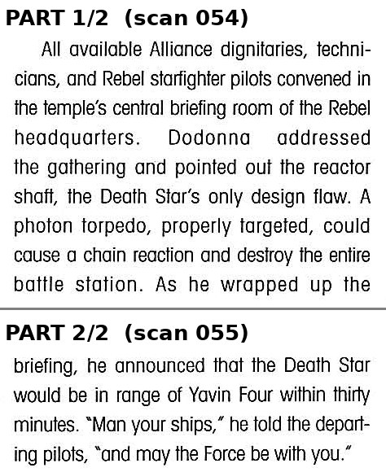
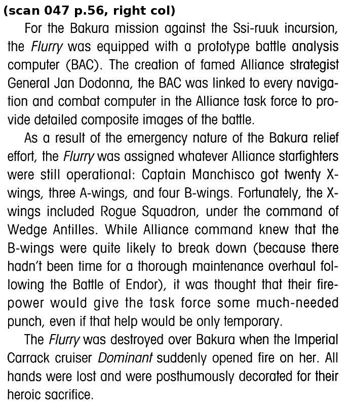

# Jan Dodonna

- **Aliases:** —
- **Era:** —
- **Continuity:** default Legends; entries present for: Legends
- **Research tier:** untiered (not listed as INTRO/DEEP/MASTERY in legends-feats.md)
- **Entries:** 13 (7 with quotations; 1 quotations extended to the full sentence/passage from the source text on file; 5 marked as fragments). Rebuilt 2026-11-17 from 15 old entries; old file: `characters/_bak/jan-dodonna.md.bak-20261117`.
- **How to read:** each entry is the quotation in full (block quote), then its source and point of view. "Note" lines are summaries from our notes, not quotations. `[fragment — full passage not on file]` means the source text is not on the box, so only the words in our notes are shown. Debate and forum material is in the last section and is unverified.

# LEGENDS (Legends / EU — main focus)

## Jedi Academy Trilogy (Kevin J. Anderson, 1994): Jedi Search, Dark Apprentice, Champions of the Force (power-scaling notes)

> “This slaughter must stop. It goes beyond even the Emperor’s atrocities,” the aging tactician, General Jan Dodonna, said. “The New Republic does not employ such barbarous tactics.”
— Source: Champions of the Force, ch.6, PDF p.54 — Owner Material 026 — Jedi Academy Trilogy: Champions of the Force (Kevin J. Anderson); Dodonna (also: Palpatine (the Emperor)).
Note (our notes, around the quote): Dodonna (also: Palpatine (the Emperor)): "“This slaughter must stop. It goes beyond even the Emperor’s atrocities,” the aging tactician, General Jan Dodonna, said. “The New Republic does not employ such barbarous tactics.”" Source: Champions of the Force, ch.6, PDF p.54
Our notes: `notes/materials/026-jedi-academy-trilogy/champions-of-the-force.md:105`

## Star Wars: The New Essential Chronology (Del Rey, 2005): power-scaling and lore notes

- Note (summary from our notes, not a quotation): art caption: "General Jan Dodonna" Source: The New Essential Chronology, p.108, caption
  — Source: Part Five: The Galactic Civil War.
Our notes: `notes/materials/027-new-essential-chronology/05-part-five-galactic-civil-war.md:27`

## The Complete Star Wars Encyclopedia, Vol. I (A–G)

> He encountered Rogue Squadron pilot Corran Horn there and attempted to kill him, but was himself killed by Horn with the assistance of Jan Dodonna.
— Source: scan pages 161–200; Corran Horn. POV: Corran Horn, about Jan Dodonna.
Note (our notes, around the quote): Corran Horn: "He encountered Rogue Squadron pilot Corran Horn there and attempted to kill him, but was himself killed by Horn with the assistance of Jan Dodonna." Source: The Complete Star Wars Encyclopedia, Vol. I, p.185
Our notes: `notes/materials/030-complete-star-wars-encyclopedia-vol-1/04-v1-scan-161-200.md:343`

> Dodonna, Vrad The son of General Jan Dodonna, he at first retreated from an encounter with Darth Vader's new Super Star Destroyer, the Executor.
— Source: scan pages 201–240; Darth Vader (Anakin Skywalker).
Note (our notes, around the quote): Darth Vader (Anakin Skywalker): "Dodonna, Vrad The son of General Jan Dodonna, he at first retreated from an encounter with Darth Vader's new Super Star Destroyer, the Executor." Source: The Complete Star Wars Encyclopedia, Vol. I, p.194
Our notes: `notes/materials/030-complete-star-wars-encyclopedia-vol-1/05-v1-scan-201-240.md:68`

## Sourcebooks/Geonosis and the Outer Rim Worlds.pdf [Star Wars Roleplaying Game Revised Core (d20, 2002)] (scan pages 121–162)

- Note (summary from our notes, not a quotation): Page contents: Yavin 4: Great Temple's Sith glyphs; Achtnak Turbine Station (Silas, Orman and Ulric Tagge; destroyed by Luke Skywalker); The Dark Temple (Jan Dodonna seals the Blueleaf Cluster temple; Exar Kun's retreat); GemDiver Station (Lando Calrissian); hooks False Fishing, Treasure Hunt, A Lost Lambda begins. (hand-read)
  — Source: Sourcebooks/Geonosis and the Outer Rim Worlds.pdf [Star Wars Roleplaying.
Our notes: `notes/materials/037-sw-d20-folder/667-geonosis-and-the-outer-rim-worlds-scan-121-162.md:276`

> General Jan Dodonna ordered the Temple of the Blueleaf Cluster sealed, wary of the crystal pyramid lit with a strange, pulsating cold blue light that stood in its foreboding main chamber,
> [fragment — full passage not on file]
— Source: Sourcebooks/Geonosis and the Outer Rim Worlds.pdf [Star Wars Roleplaying; Jan Dodonna — entry/section: Dodonna seals a temple.
Note (our notes, around the quote): Jan Dodonna — entry/section: Dodonna seals a temple: "General Jan Dodonna ordered the Temple of the Blueleaf Cluster sealed, wary of the crystal pyramid lit with a strange, pulsating cold blue light that stood in its foreboding main chamber," Source: *Geonosis and the Outer Rim Worlds* (SWRPG d20 Revised Core), scan p.155
Our notes: `notes/materials/037-sw-d20-folder/667-geonosis-and-the-outer-rim-worlds-scan-121-162.md:280`

## Sourcebooks/Hero's Guide.pdf [Star Wars Roleplaying Game Revised Core (d20, 2002)] (scan pages 61–120)

> The recognized leader of the Alliance is Mon Mothma, the former Senator of Chandrila. Assisted initially by the Corellian military strategist Garm Bel Iblis and Senator Bail Organa of Alderaan, Mon Mothma carried on virtually alone after Bel Iblis went into hiding and Bail Organa died along with his homeworld. A strong, intelligent woman, Mon Mothma is also poised and graceful—a paragon of diplomacy and an inspiration to every member of the Alliance. She is aided by the Mon Calamari tactician Ackbar and the Imperial defector Crix Madine, the replacement for General Jan Dodonna (lost in the Battle of Yavin).
— Source: Sourcebooks/Hero's Guide.pdf [Star Wars Roleplaying Game Revised Core (d2.
Note (our notes, around the quote): Mon Mothma; Bail Organa; Admiral Ackbar — entry/section: Mon Mothma, recognized leader of the Alliance: "The recognized leader of the Alliance is Mon Mothma, the former Senator of Chandrila. Assisted initially by the Corellian military strategist Garm Bel Iblis and Senator Bail Organa of Alderaan, Mon Mothma carried on virtually alone after Bel Iblis went into hiding and Bail Organa died along with his homeworld. A strong, intelligent woman, Mon Mothma is also poised and graceful—a paragon of diplomacy and an inspiration to every member of the Alliance. She is aided by the Mon Calamari tactician Ackbar and the Imperial defector Crix Madine, the replacement for General Jan Dodonna (lost in the Battle of Yavin)." Source: *Hero's Guide* (SWRPG d20 Revised Core), scan p.108
Our notes: `notes/materials/037-sw-d20-folder/668-heros-guide-scan-061-120.md:265`

## Sourcebooks/The Force Unleashed Campaign Guide.pdf [Star Wars Roleplaying Game Saga Edition (2007)] (scan pages 181–226)

- Note (summary from our notes, not a quotation): Page contents: Secret Apprentice cont.; Darth Vader's Secret Apprentice (as of the Battle of Callos) stat block (CL 14; feats Force Sensitivity, Force Training (3), Powerful Charge, Rapid Strike, Skill Focus (Use the Force), Strong in the Force, Unleashed, Weapon Focus (lightsabers)). Captain Jan Dodonna begins. (hand-read)
  — Source: Sourcebooks/The Force Unleashed Campaign Guide.pdf [Star Wars Roleplaying.
Our notes: `notes/materials/037-sw-d20-folder/729-the-force-unleashed-campaign-guide-scan-181-226.md:72`

- Note (summary from our notes, not a quotation): Page contents: Jan Dodonna stat block (CL 8). Captain Juno Eclipse; Juno Eclipse (as of the Battle of Callos) stat block (CL 11). Armand Isard; Armand Isard stat block begins. (hand-read)
  — Source: Sourcebooks/The Force Unleashed Campaign Guide.pdf [Star Wars Roleplaying.
Our notes: `notes/materials/037-sw-d20-folder/729-the-force-unleashed-campaign-guide-scan-181-226.md:84`

## Star Wars Insider #133 (2012)

- Note (summary from our notes, not a quotation): Page contents: Rogues Gallery cont.: Leia, Arhul Hextrophon, Han, Jan Dodonna, Voren Na'al, Chewbacca, Evram Lajaie, Pashna Starkiller, Morts Werl. (hand-read)
  — Source: Star Wars Insider #133 (2012).
Our notes: `notes/materials/038-star-wars-insider/133-ins133.md:218`

## Star Wars Visual Dictionaries, Episodes I–VI (DK, 1998–2005) + The Phantom Menace Expanded Visual Dictionary (DK, 2012)

> A good Rebel leader can overcome the Empire's numeric advantage with inventive tactics
> [fragment — full passage not on file]
>
> not as powerful or as long-range as Imperial military-issue blasters
> [fragment — full passage not on file]
>
> a dauntless master tactician, commanding the Rebel assault on the Death Star in the Battle of Yavin
> [fragment — full passage not on file]
>
> enabled a small fleet of 30 one-man fighters to annihilate a battle station over 160 kilometers wide.
> [fragment — full passage not on file]
— Source: Star Wars: The Visual Dictionary (DK, 1998; Episodes IV–VI): hand-read notes; p26 Rebel Leaders.
Note (our notes, around the quote): p26 Rebel Leaders: "A good Rebel leader can overcome the Empire's numeric advantage with inventive tactics"; DH-17 Rebel blaster ("not as powerful or as long-range as Imperial military-issue blasters"). Carlist Rieekan (seven hidden levels of Echo Base). Jan Dodonna [KEY]: "a dauntless master tactician, commanding the Rebel assault on the Death Star in the Battle of Yavin"; strategy "enabled a small fleet of 30 one-man fighters to annihilate a battle station over 160 kilometers wide." Massassi base tactical display.
Our notes: `notes/materials/047-visual-dictionaries/vd46-ep4-6.md:29`

## Essential Guide to Characters (1995)

> Holding up her hand, she turned. It was Obi-Wan, coming toward her at a shuffling run. One look at his face and she knew. This is it. Turning back to the men and women who’d volunteered to be the front line against Durd’s droid army, she nodded.
>
> “It’s time. Gear up, people, then take your positions.
>
> “It’s time. Gear up, people, then take your positions. And may the Force be with you.”
>
> Solemnly silent, the villagers loaded themselves with their assorted weaponry and headed out. Blinking back tears, Taria watched them go.
— Source: The Essential Guide to Characters (Andy Mangels, Del Rey, 1995), printed p.45–46, scan p.054–055. The 1995 guide's telling, not a power feat..
(Excerpt widened 2026-11-17 to the relevant passage, word for word from Star Wars: Clone Wars Gambit: Siege (Karen Miller) (text copy `MEGA_Legend_The_Clone_Wars_Series_Star_Wars_Star_Wars_The_Clone_Wars_05_Gambit_Siege_Karen_Miller_epub`).)
(Excerpt widened 2026-11-17 to the relevant passage, word for word from Star Wars: Clone Wars Gambit: Siege (Karen Miller) (text copy `MEGA_Legend_The_Clone_Wars_Series_Star_Wars_Star_Wars_The_Clone_Wars_05_Gambit_Siege_Karen_Miller_epub`).)
(Full sentence/passage taken from the source text on file: `cw_novels_tmp_gambit_siege_epub`.)
Note (our notes, around the quote): All available Alliance dignitaries, technicians, and Rebel starfighter pilots convened in the temple's central briefing room of the Rebel headquarters. Dodonna addressed the gathering and pointed out the reactor shaft, the Death Star's only design flaw. A photon torpedo, properly targeted, could cause a chain reaction and destroy the entire battle station. As he wrapped up the briefing, he announced that the Death Star would be in range of Yavin Four within thirty minutes. "Man your ships," he told the departing pilots, "and may the Force be with you."
Our notes: `notes/materials/147-essential-guide-to-characters-1995/egc-cbaoth-end-through-kyp.md`

## Essential Guide to Vehicles and Vessels (1996)

- Note (summary from our notes, not a quotation): For the Bakura mission against the Ssi-ruuk incursion, the *Flurry* was equipped with a prototype battle analysis computer (BAC). The creation of famed Alliance strategist General Jan Dodonna, the BAC was linked to every navigation and combat computer in the Alliance task force to provide detailed composite images of the battle.
  — Source: The Essential Guide to Vehicles and Vessels (Bill Smith, Del Rey, 1996), printed p.56, scan p.047. This is the guide's telling, not a power feat..
Our notes: `notes/materials/148-essential-guide-to-vehicles-vessels-1996/egvv-escapepod-through-houndstooth.md`

# Debate and forum claims (unverified)

Forum posts, Suspect Insight debates and Discord debates, respect threads, and verdicts. These are posters' arguments or quotations they typed; none is checked against the book here unless the entry says so.

_None in our notes._
