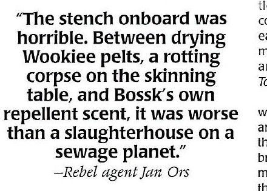

# Jan Ors

- **Aliases:** Jan
- **Era:** Rebellion
- **Continuity:** default Legends; entries present for: Canon, Legends
- **Research tier:** untiered (not listed as INTRO/DEEP/MASTERY in legends-feats.md)
- **Entries:** 280 (181 with quotations; 18 quotations extended to the full sentence/passage from the source text on file; 156 marked as fragments; 227 before the 2026-11-17 fragment fill). Rebuilt 2026-11-17 from 318 old entries; old file: `characters/_bak/jan-ors.md.bak-20261117`.
- **How to read:** each entry is the quotation in full (block quote), then its source and point of view. "Note" lines are summaries from our notes, not quotations. `[fragment — full passage not on file]` means the source text is not on the box, so only the words in our notes are shown. Debate and forum material is in the last section and is unverified.

# LEGENDS (Legends / EU — main focus)

## Tales of the Jedi: Freedon Nadd Uprising #1–2, Dark Lords of the Sith #1–6, The Sith War #1–6, plus the WEG Tales of the Jedi Companion (power-scaling notes)

- Note (summary from our notes, not a quotation): Source: *Star Wars: Tales of the Jedi — The Sith War* #1–6 (Legends; Dark Horse, Aug 1995–Jan 1996). Writer Kevin J. Anderson; pencils Dario Carrasco, Jr.; inks Jordi Ensign (and others per issue credits); letters Willie Schubert; covers Hugh Fleming. Credits/indicia on p2 of each issue.
  — Source: ** *Star Wars: Tales of the Jedi — The Sith War* #1–6 (Legends; Dark Horse, Aug 1995–Jan 1996). Writer Kevin J. Anderson; pencils Dario Carrasco, Jr.; inks Jordi Ensign (and others per issue credits); letters Willie Schubert; covers Hugh Fleming. Credits/indicia on p2 of each issue. — Owner Material 024c — Tales of the Jedi: The Sith War #1–6 (1995–96): power-scaling notes.
Our notes: `notes/materials/024-tales-of-the-jedi/the-sith-war.md:3`

## The Complete Star Wars Encyclopedia, Vol. II (H–O)

- Note (summary from our notes, not a quotation): Page contents: 994 words, 26 paragraphs | headings/entries: HAET-221; Haffrin; Haggleday; Hahrynyar; Hai, Korkeal; Hai, Resta Shug; Haik Expedition; Hailbrock, Jan; Hailey, Serra; Haime, Josek
  — Source: scan pages 1–40.
Our notes: `notes/materials/031-complete-star-wars-encyclopedia-vol-2/00-v2-scan-001-040.md:77`

- Note (summary from our notes, not a quotation): Page contents: 1224 words, 24 paragraphs | headings/entries: Jaminere; Jaminere Marches; Jamiro, Tigran; Jamos, Hen; JAN; Jan, Janvar; Janah; Janako; Janara Wl; Jandi, Aellyn; Jandi, Riit; Jandier, Myle; Jandovar, Maxa; Janessa's Atlas
  — Source: scan pages 121–160.
Our notes: `notes/materials/031-complete-star-wars-encyclopedia-vol-2/03-v2-scan-121-160.md:164`

> Kyle learned the truth, however, from a Rebel agent named Jan Ors: His father had been captured by the Empire for treason, and killed by the Dark JediJerec.
— Source: scan pages 201–240; Kyle Katarn — entry/section: Katarn, Kyle.
Note (our notes, around the quote): Kyle Katarn — entry/section: Katarn, Kyle: "Kyle learned the truth, however, from a Rebel agent named Jan Ors: His father had been captured by the Empire for treason, and killed by the Dark JediJerec." Source: The Complete Star Wars Encyclopedia, Vol. II, p.202

Our notes: `notes/materials/031-complete-star-wars-encyclopedia-vol-2/05-v2-scan-201-240.md:67`

- Note (summary from our notes, not a quotation): Page contents: 1055 words, 32 paragraphs | headings/entries: Orou'cya, Ceok; Orowood Tower; Orren, Yotts; Orrimaarko; Orrk, Guildmaster; Orr-Om; Orron Wl; Orr'UrRuuR'R; Orryxian; Ors, Jan; Orsk, Captain; Orthavan; Orto
  — Source: scan pages 401–440.
Our notes: `notes/materials/031-complete-star-wars-encyclopedia-vol-2/10-v2-scan-401-440.md:228`

## Star Wars Gamer/Star Wars Gamer 04.pdf [Star Wars Roleplaying Game (d20, 2000)] (scan pages 61–105)

- Note (summary from our notes, not a quotation): Page contents: 851 words, 26 paragraphs | headings/entries: Starfighter Easter Eggs; OurTiaws Art GALLERY; Jar Jan's Great Escape; Cowsoy Drop; BBO Drow
  — Source: Star Wars Gamer/Star Wars Gamer 04.pdf [Star Wars Roleplaying Game (d20,.
Our notes: `notes/materials/037-sw-d20-folder/053-star-wars-gamer-04-scan-061-105.md:206`

## Star Wars Gamer/Star Wars Gamer 09.pdf [Star Wars Roleplaying Game (d20, 2000)] (scan pages 61–104)

- Note (summary from our notes, not a quotation): Page contents: Jedi Outcast: a 3D lightsaber that blocks sabers, with location-based kills; Kyle gave up the Force nine years after Mysteries of the Sith, where Mara Jade saved him from the dark side; he flies missions for Mon Mothma with Jan Ors; it opens at an Imperial listening post on Kejim, taken over by the Dark Jedi Desann (hand-read)
  — Source: Star Wars Gamer/Star Wars Gamer 09.pdf [Star Wars Roleplaying Game (d20,.
Our notes: `notes/materials/037-sw-d20-folder/058-star-wars-gamer-09-scan-061-104.md:242`

## Star Wars Gamer/Star Wars Gamer 10.pdf [Star Wars Roleplaying Game (d20, 2000)] (scan pages 1–60)

- Note (summary from our notes, not a quotation): Page contents: Letters: revised starship rules (Gamer #8) preview Chapter 11 of the revised rulebook; Ramming Speed stays; diagonal move cost resets each round; establish pursuit needs ships in the same square; a reader asks for Dark Forces characters (Kyle, Jan Ors, 8t88, Jerec) (hand-read)
  — Source: Star Wars Gamer/Star Wars Gamer 10.pdf [Star Wars Roleplaying Game (d20,.
Our notes: `notes/materials/037-sw-d20-folder/059-star-wars-gamer-10-scan-001-060.md:50`

## Characters/The Dark Forces Saga/The Dark Forces Saga, Part 1.pdf [Star Wars Roleplaying Game Revised Core (d20, 2002)]

> Thus, Kyle joined the Academy on Carida as soon as he turned 18, hoping to alleviate some of the burden on his father while getting a first-rate free education. At the Academy, Kyle excelled at cybernetics systems theory and information engineering. Tragedy struck again, however, when the Dark Jedi Jerec discovered Morgan Katarn's Rebel ties and personally beheaded him. When Kyle discovered the treachery of his Imperial masters, he went rogue, working as a mercenary, pirate, and loose Rebel operative with his close friend Jan Ors to undermine the Imperial war machine.
— Source: Characters/The Dark Forces Saga/The Dark Forces Saga, Part 1.pdf [Star Wa.
Note (our notes, around the quote): Kyle Katarn; Jerec; Morgan Katarn; Jan Ors — entry/section: Kyle goes rogue: "Thus, Kyle joined the Academy on Carida as soon as he turned 18, hoping to alleviate some of the burden on his father while getting a first-rate free education. At the Academy, Kyle excelled at cybernetics systems theory and information engineering. Tragedy struck again, however, when the Dark Jedi Jerec discovered Morgan Katarn's Rebel ties and personally beheaded him. When Kyle discovered the treachery of his Imperial masters, he went rogue, working as a mercenary, pirate, and loose Rebel operative with his close friend Jan Ors to undermine the Imperial war machine." Source: *The Dark Forces Saga, Part 1* (SWRPG d20 Revised Core), scan p.1

Our notes: `notes/materials/037-sw-d20-folder/128-the-dark-forces-saga-part-1.md:14`

> One year after the destruction of that battle station at Endor, Kyle fulfilled the ancient prophecy that set free the Jedi spirits on Ruusan -- originally trapped during the Light and Dark War by Sith Lord Kaan -- by defeating no fewer than seven Dark Jedi. But the cost was great. Kyle often found himself relying on the dark side in order to defeat his powerful opponents. Only the combination of the Jedi Master Rahn's guidance, Kyle's love for Jan, and the memory of his father kept him from succumbing completely to the dark side in his final confrontation with the Dark Jedi Jerec.
— Source: Characters/The Dark Forces Saga/The Dark Forces Saga, Part 1.pdf [Star Wa.
Note (our notes, around the quote): Kyle Katarn; Jerec; Qu Rahn; Jan Ors; Morgan Katarn; Lord Kaan — entry/section: Kyle on Ruusan: "One year after the destruction of that battle station at Endor, Kyle fulfilled the ancient prophecy that set free the Jedi spirits on Ruusan -- originally trapped during the Light and Dark War by Sith Lord Kaan -- by defeating no fewer than seven Dark Jedi. But the cost was great. Kyle often found himself relying on the dark side in order to defeat his powerful opponents. Only the combination of the Jedi Master Rahn's guidance, Kyle's love for Jan, and the memory of his father kept him from succumbing completely to the dark side in his final confrontation with the Dark Jedi Jerec." Source: *The Dark Forces Saga, Part 1* (SWRPG d20 Revised Core), scan p.1

Our notes: `notes/materials/037-sw-d20-folder/128-the-dark-forces-saga-part-1.md:16`

## Characters/The Dark Forces Saga/The Dark Forces Saga, Part 2.pdf [Star Wars Roleplaying Game Revised Core (d20, 2002)]

- Note (summary from our notes, not a quotation): Page contents: Intro; Jan Ors, Rebel Agent: Alderaanian parents, Justice Action Network, Jan Strange in Imperial Intelligence, AX-456, Moldy Crow missions, love for Kyle, Alpha Blue, Alpha Red, search for Kyle with Jaden Korr; Jan Ors (NJO) stats begin (hand-read)
  — Source: Characters/The Dark Forces Saga/The Dark Forces Saga, Part 2.pdf [Star Wa.
Our notes: `notes/materials/037-sw-d20-folder/129-the-dark-forces-saga-part-2.md:10`

> Why Jan Ors left the extremist group for the Alliance is one of the operative's many mysteries, though it's suspected that the close relationship her parents shared with Mon Mothma years before had something to do with it. Jan had already infiltrated Imperial Intelligence under the name Jan Strange when she contacted the Alliance, providing priceless counter-intelligence. Within Intell, she and Imperial cadet Kyle Katarn had their first brief interactions, though the two remained largely oblivious to each other.
— Source: Characters/The Dark Forces Saga/The Dark Forces Saga, Part 2.pdf [Star Wa.
Note (our notes, around the quote): Jan Ors; Mon Mothma; Kyle Katarn — entry/section: Jan Ors infiltrates Imperial Intelligence: "Why Jan Ors left the extremist group for the Alliance is one of the operative's many mysteries, though it's suspected that the close relationship her parents shared with Mon Mothma years before had something to do with it. Jan had already infiltrated Imperial Intelligence under the name Jan Strange when she contacted the Alliance, providing priceless counter-intelligence. Within Intell, she and Imperial cadet Kyle Katarn had their first brief interactions, though the two remained largely oblivious to each other." Source: *The Dark Forces Saga, Part 2* (SWRPG d20 Revised Core), scan p.1

Our notes: `notes/materials/037-sw-d20-folder/129-the-dark-forces-saga-part-2.md:12`

> Yet the stage was set. When Jan crossed paths with Kyle again during a wild and bloody Imperial raid on the asteroid AX-456, the extreme circumstances, including Kyle's newfound self-confidence (not to mention facial hair), along with Jan's Rebel fatigues, combined to create a surreal encounter. Locking eyes for the first time, Jan and Kyle shared a heartstopping moment of vague recognition, as if they'd once met in a dream. Their destinies henceforth became permanently intertwined.
— Source: Characters/The Dark Forces Saga/The Dark Forces Saga, Part 2.pdf [Star Wa.
Note (our notes, around the quote): Jan Ors; Kyle Katarn — entry/section: Jan and Kyle lock eyes: "Yet the stage was set. When Jan crossed paths with Kyle again during a wild and bloody Imperial raid on the asteroid AX-456, the extreme circumstances, including Kyle's newfound self-confidence (not to mention facial hair), along with Jan's Rebel fatigues, combined to create a surreal encounter. Locking eyes for the first time, Jan and Kyle shared a heartstopping moment of vague recognition, as if they'd once met in a dream. Their destinies henceforth became permanently intertwined." Source: *The Dark Forces Saga, Part 2* (SWRPG d20 Revised Core), scan p.1

Our notes: `notes/materials/037-sw-d20-folder/129-the-dark-forces-saga-part-2.md:14`

- Note (summary from our notes, not a quotation): Jan Ors; Kyle Katarn; Mara Jade Skywalker; Mon Mothma; Admiral Hiram Drayson — entry/section: Jan and Kyle declare their love: "Her attitude changed, however, during the race for the Valley of the Jedi, during which Jan and Kyle declared their love. As freedom fighters, Jan and Kyle's relationship was far from ideal, particularly with Kyle's dark mood swings and the close bond he formed with the former Emperor's Hand Mara Jade, but the pair pulled through. On Mon Mothma's recommendation, Jan joined Admiral Hiram Drayson's secretive Alpha Blue intelligence agency, where she helped expose the Yevethan hypocrisy. She also kept a vigilant eye on ambiguous threats like the socialites of the Order of the Canted Circle and the Azurite Society of Lords, and the "retired" Grand Admiral Grant. In her new capacity, Jan was able to assign Kyle and accompany him on off-the-record missions against the Imperial Remnant." Source: *The Dark Forces Saga, Part 2* (SWRPG d20 Revised Core), scan p.1
  — Source: Characters/The Dark Forces Saga/The Dark Forces Saga, Part 2.pdf [Star Wa.

Our notes: `notes/materials/037-sw-d20-folder/129-the-dark-forces-saga-part-2.md:16`

> Eventually, Admiral Drayson retired from Alpha Blue and Jan took over his position -- just in time for the Yuuzhan Vong invasion. During the crisis, she enlisted the aid of Lurrian genetic engineers and the Chiss, among others, for a way to defeat the enemy, ultimately resulting in the genocidal concoction codenamed Alpha Red. More recently, she has spent every spare moment working with Kyle's one-time Jedi apprentice Jaden Korr, zealously searching for any leads to Kyle's whereabouts.
— Source: Characters/The Dark Forces Saga/The Dark Forces Saga, Part 2.pdf [Star Wa.
Note (our notes, around the quote): Jan Ors; Admiral Hiram Drayson; Jaden Korr; Kyle Katarn — entry/section: Jan heads Alpha Blue: "Eventually, Admiral Drayson retired from Alpha Blue and Jan took over his position -- just in time for the Yuuzhan Vong invasion. During the crisis, she enlisted the aid of Lurrian genetic engineers and the Chiss, among others, for a way to defeat the enemy, ultimately resulting in the genocidal concoction codenamed Alpha Red. More recently, she has spent every spare moment working with Kyle's one-time Jedi apprentice Jaden Korr, zealously searching for any leads to Kyle's whereabouts." Source: *The Dark Forces Saga, Part 2* (SWRPG d20 Revised Core), scan p.1

Our notes: `notes/materials/037-sw-d20-folder/129-the-dark-forces-saga-part-2.md:18`

- Note (summary from our notes, not a quotation): Page contents: Jan stats end; Adventure Seed: Jedi Search (Daye Azur-Jamin, Force-strong Yuuzhan Vong); Qu Rahn, Jedi Master: Katarn Clan, Yoda's gold lightsaber, Valley search, Morgan Katarn, capture and death at Jerec's hands, vision of Anakin and Ventor; Qu Rahn stats (hand-read)
  — Source: Characters/The Dark Forces Saga/The Dark Forces Saga, Part 2.pdf [Star Wa.
Our notes: `notes/materials/037-sw-d20-folder/129-the-dark-forces-saga-part-2.md:27`

> The Moldy Crow was produced approximately a decade after the last Old Republic Battle of Coruscant as part of the Corellian Engineering Corporation's Hawk series of transports. One of the ship's earliest owners was the smuggler Roark Garnet, who, after inheriting the Dorion Discus from his dead gunslinging sister Neena, used it as payment for debts incurred to Grappa the Hutt. Filched from Grappa by Dace Bonearm and IG-72, the Moldy Crow was subsequently dumped on the planet Teth after the two hunters used it as a decoy to capture Rebel commander Winfrid Dagore and claim the Imperial bounty on her. The Crow then fell into the hands of Lieutenant Palob Godalhi, who gave up the beat-up freighter to the Rebel dreadnaught New Hope. There it was refitted and later requisitioned by Kyle Katarn, though Jan Ors more frequently piloted the ship. The Crow was demolished during Kyle and Jan's mission to the Valley of the Jedi, and eventually replaced by the ship Raven's Claw.
— Source: Characters/The Dark Forces Saga/The Dark Forces Saga, Part 2.pdf [Star Wa; Kyle Katarn; Jan Ors — entry/section: The Moldy Crow.
Note (our notes, around the quote): Kyle Katarn; Jan Ors — entry/section: The Moldy Crow: "The Moldy Crow was produced approximately a decade after the last Old Republic Battle of Coruscant as part of the Corellian Engineering Corporation's Hawk series of transports. One of the ship's earliest owners was the smuggler Roark Garnet, who, after inheriting the Dorion Discus from his dead gunslinging sister Neena, used it as payment for debts incurred to Grappa the Hutt. Filched from Grappa by Dace Bonearm and IG-72, the Moldy Crow was subsequently dumped on the planet Teth after the two hunters used it as a decoy to capture Rebel commander Winfrid Dagore and claim the Imperial bounty on her. The Crow then fell into the hands of Lieutenant Palob Godalhi, who gave up the beat-up freighter to the Rebel dreadnaught New Hope. There it was refitted and later requisitioned by Kyle Katarn, though Jan Ors more frequently piloted the ship. The Crow was demolished during Kyle and Jan's mission to the Valley of the Jedi, and eventually replaced by the ship Raven's Claw." Source: *The Dark Forces Saga, Part 2* (SWRPG d20 Revised Core), scan p.3

Our notes: `notes/materials/037-sw-d20-folder/129-the-dark-forces-saga-part-2.md:48`

## Characters/The Dark Forces Saga/The Dark Forces Saga, Part 5.pdf [Star Wars Roleplaying Game Revised Core (d20, 2002)]

- Note (summary from our notes, not a quotation): Mara Jade Skywalker; Palpatine (Darth Sidious); Luke Skywalker; Grand Admiral Thrawn; Jan Ors; Kyle Katarn; Blackhole (Emperor's Hand) — entry/section: Adventure seed: Kyle Katarn, Meet Mara Jade: "Over the years convalescing on the planet Byss after his "death" at the Battle of Endor, the resurrected Emperor has been slowly rebuilding his telepathic bond with his Force-servant Mara Jade, incessantly commanding that she destroy Luke Skywalker. However, when Mara killed Luke's evil clone during the campaign against Grand Admiral Thrawn, the telepathic connection she and the Emperor shared was suddenly severed.
  — Source: Characters/The Dark Forces Saga/The Dark Forces Saga, Part 5.pdf [Star Wa.
Our notes: `notes/materials/037-sw-d20-folder/132-the-dark-forces-saga-part-5.md:37`

- Note (summary from our notes, not a quotation): To punish her, Palpatine has sent his minions to intercept Mara during her trip to the Senex sector as a representative of the Smugglers' Alliance. Though Luke is busy along with the rest of the New Republic dealing with an Imperial Mutiny taking place in the Core Worlds, he calls in a favor to Jan Ors at New Republic Intelligence. Ors has dispatched a ragtag group of heroes led by the equally maverick Jedi Kyle Katarn.
  — Source: Characters/The Dark Forces Saga/The Dark Forces Saga, Part 5.pdf [Star Wa.
(The heroes will have to help free Mara from the clutches of one of the Emperor's powerful dark side adepts, the former Prophet of the Dark Side Blackhole, and report to Kyle and Luke about clues they've discovered concerning a Sith temple." Source: *The Dark Forces Saga, Part 5* (SWRPG d20 Revised Core), scan p.2)

Our notes: `notes/materials/037-sw-d20-folder/132-the-dark-forces-saga-part-5.md:38`

## Living Force Campaign/Adventures/Among the Stars/Year 4/413 - The Replacements.pdf [Star Wars Roleplaying Game Revised Core (d20, 2002)]

> They are introduced to Mr. Jan and his 'Cularin Star Tours' operation – a space yacht rental business. This adventure begins with the heroes arriving at a docking facility in Space Port district of Hedrett, a bustling city on the planet Cularin. They've come to work for a man named Janvar Jan. He owns Cularin Star Tours and needs some replacement search and rescue staff. Please refer to Player Handout 1: Adventure Hooks and Cularin Travel report for some useful background materials. "Welcome to Cularin Stellar Tours... I know the place doesn't look like much, but believe you me, we are busier than a Jedi at a Separatist Rally." A welldressed, middle-aged human man beckons. He sports a receding, salt and peppered hairline, a bit of a paunch and a confident swagger as he motions around the docking bay with a friendly sweep of his arm. "Name's Janvar Jan, and I'm glad you've all decided to come by. I don't know how you heard about my little operation, but the fact is, I need some reliable help for the next several weeks..."
— Source: Living Force Campaign/Adventures/Among the Stars/Year 4/413 - The Replace.
(Excerpt widened 2026-11-17 to the relevant passage, word for word from Star Wars Roleplaying Game Revised Core Living Force Campaign Adventures Among the Stars Year 4 413 The Replacements (text copy `Star_Wars_Roleplaying_Game_Revised_Core_Living_Force_Campaign_Adventures_Among_the_Stars_Year_4_413_The_Replacements_pdf_c395464efb`).)
(Excerpt widened 2026-11-17 to the relevant passage, word for word from Star Wars Roleplaying Game Revised Core Living Force Campaign Adventures Among the Stars Year 4 413 The Replacements (text copy `Star_Wars_Roleplaying_Game_Revised_Core_Living_Force_Campaign_Adventures_Among_the_Stars_Year_4_413_The_Replacements_pdf_c395464efb`).)
(Full sentence/passage taken from the source text on file: `Star_Wars_Roleplaying_Game_Revised_Core_Living_Force_Campaign_Adventures_Among_the_Stars_Year_4_413_The_Replacements_pdf`.)
Note (our notes, around the quote): No single roster character (rules/setting/general) — entry/section: Janvar Jan: ""Welcome to Cularin Stellar Tours... I know the place doesn't look like much, but believe you me, we are busier than a Jedi at a Separatist Rally."" Source: *413 - The Replacements* (SWRPG d20 Revised Core), p.5

Our notes: `notes/materials/037-sw-d20-folder/335-413-the-replacements.md:34`

> A welldressed, middle-aged human man beckons. He sports a receding, salt and peppered hairline, a bit of a paunch and a confident swagger as he motions around the docking bay with a friendly sweep of his arm. "Name's Janvar Jan, and I'm glad you've all decided to come by. I don't know how you heard about my little operation, but the fact is, I need some reliable help for the next several weeks..." Jan pauses for a moment, as he seems to react to the flicker of a response from one of your group. "I know what you're probably thinking... another fly-by-night contract, someone needs an errand run... find my lost mynock... and so on. It's more than that. You see, people's lives are going to depend on you. Come with me to our conference room." Jan leads the way into the administrative section of his docking bay complex. The hallways are tidy, well lit and decorated nicely with potted plants and holovids of various locations throughout Cularin. The conference room is similarly decorated, and the furniture seems like it has only just been removed from shipping crates - the chair cushions are crisp as you sit in them, and there is a hint of 'new-furniture smell' in the room.
— Source: Living Force Campaign/Adventures/Among the Stars/Year 4/413 - The Replace.
(Excerpt widened 2026-11-17 to the relevant passage, word for word from Star Wars Roleplaying Game Revised Core Living Force Campaign Adventures Among the Stars Year 4 413 The Replacements (text copy `Star_Wars_Roleplaying_Game_Revised_Core_Living_Force_Campaign_Adventures_Among_the_Stars_Year_4_413_The_Replacements_pdf_c395464efb`).)
(Excerpt widened 2026-11-17 to the relevant passage, word for word from Star Wars Roleplaying Game Revised Core Living Force Campaign Adventures Among the Stars Year 4 413 The Replacements (text copy `Star_Wars_Roleplaying_Game_Revised_Core_Living_Force_Campaign_Adventures_Among_the_Stars_Year_4_413_The_Replacements_pdf_c395464efb`).)
(Full sentence/passage taken from the source text on file: `Star_Wars_Roleplaying_Game_Revised_Core_Living_Force_Campaign_Adventures_Among_the_Stars_Year_4_413_The_Replacements_pdf`.)
Note (our notes, around the quote): No single roster character (rules/setting/general) — entry/section: Janvar Jan: ""I know what you're probably thinking... another fly-by-night contract, someone needs an errand run... find my lost mynock... and so on. It's more than that. You see, people's lives are going to depend on you. Come with me to our conference room."" Source: *413 - The Replacements* (SWRPG d20 Revised Core), p.5

Our notes: `notes/materials/037-sw-d20-folder/335-413-the-replacements.md:36`

> You see, people's lives are going to depend on you. Come with me to our conference room." Jan leads the way into the administrative section of his docking bay complex. The hallways are tidy, well lit and decorated nicely with potted plants and holovids of various locations throughout Cularin. The conference room is similarly decorated, and the furniture seems like it has only just been removed from shipping crates - the chair cushions are crisp as you sit in them, and there is a hint of 'new-furniture smell' in the room. "Ever since the Cularin system reappeared, people from all over the galaxy have been rushing to visit the system. After all, how often does someone get to visit system that vanishes without a trace for 10 years?” “CST caters to groups who want to cruise around in style. We rent top-of the line space yachts to a lot of high-profile clients. I don't have to tell most of you that Cularin can be a dangerous place... which is why you are here – I need a crew to staff my search and rescue ship.” The heroes are likely to have questions.
— Source: Living Force Campaign/Adventures/Among the Stars/Year 4/413 - The Replace.
(Excerpt widened 2026-11-17 to the relevant passage, word for word from Star Wars Roleplaying Game Revised Core Living Force Campaign Adventures Among the Stars Year 4 413 The Replacements (text copy `Star_Wars_Roleplaying_Game_Revised_Core_Living_Force_Campaign_Adventures_Among_the_Stars_Year_4_413_The_Replacements_pdf_c395464efb`).)
(Excerpt widened 2026-11-17 to the relevant passage, word for word from Star Wars Roleplaying Game Revised Core Living Force Campaign Adventures Among the Stars Year 4 413 The Replacements (text copy `Star_Wars_Roleplaying_Game_Revised_Core_Living_Force_Campaign_Adventures_Among_the_Stars_Year_4_413_The_Replacements_pdf_c395464efb`).)
Note (our notes, around the quote): No single roster character (rules/setting/general) — entry/section: Janvar Jan: ""Ever since the Cularin system reappeared, people from all over the galaxy have been rushing to visit the system. After all, how often does someone get to visit system that vanishes without a trace for 10 years?"" Source: *413 - The Replacements* (SWRPG d20 Revised Core), p.5

Our notes: `notes/materials/037-sw-d20-folder/335-413-the-replacements.md:38`

> I know this is short notice – my regular crew doesn't get paid this much – but I need to get this show on the road. Just a week? That doesn't seem very long. Don't take this the wrong way... but you are replacement crew for my company. I had contracted a ship and crew from Naboo for search and rescue, but the constant fighting between the Republic and Separatists has cut them off from getting to Cularin for another week. Why all this fuss for just a week? Its the insurance underwriters... they insist I provide 'emergency assistance' services to my clients while within the Cularin system. Seems like insurance premiums are up quite a bit for star systems that tend to jump through time. Really? Sounds like you're in a tight spot. I think our services are worth 2500 credits. You drive a hard bargain.
— Source: Living Force Campaign/Adventures/Among the Stars/Year 4/413 - The Replace.
(Excerpt widened 2026-11-17 to the relevant passage, word for word from Star Wars Roleplaying Game Revised Core Living Force Campaign Adventures Among the Stars Year 4 413 The Replacements (text copy `Star_Wars_Roleplaying_Game_Revised_Core_Living_Force_Campaign_Adventures_Among_the_Stars_Year_4_413_The_Replacements_pdf_c395464efb`).)
(Excerpt widened 2026-11-17 to the relevant passage, word for word from Star Wars Roleplaying Game Revised Core Living Force Campaign Adventures Among the Stars Year 4 413 The Replacements (text copy `Star_Wars_Roleplaying_Game_Revised_Core_Living_Force_Campaign_Adventures_Among_the_Stars_Year_4_413_The_Replacements_pdf_c395464efb`).)
(Full sentence/passage taken from the source text on file: `Star_Wars_Roleplaying_Game_Revised_Core_Living_Force_Campaign_Adventures_Among_the_Stars_Year_4_413_The_Replacements_pdf`.)
Note (our notes, around the quote): No single roster character (rules/setting/general) — entry/section: Janvar Jan: "Its the insurance underwriters... they insist I provide 'emergency assistance' services to my clients while within the Cularin system. Seems like insurance premiums are up quite a bit for star systems that tend to jump through time." Source: *413 - The Replacements* (SWRPG d20 Revised Core), p.5

Our notes: `notes/materials/037-sw-d20-folder/335-413-the-replacements.md:40`

- Note (summary from our notes, not a quotation): Page contents: Title and blurb; boilerplate and house rules; GM and scenario overview (Janvar Jan's smuggling scheme); encounter summaries; judges' note; opening crawl (hand-read)
  — Source: Living Force Campaign/Adventures/Among the Stars/Year 4/413 - The Replace.
Our notes: `notes/materials/037-sw-d20-folder/335-413-the-replacements.md:45`

> Each of the yachts maintains special communications and tracking gear that allow us to track the ship's position anywhere in Cularin. They have independently powered emergency transmitters that allow the passengers to call for help directly to your vessel. Speaking of the ship you'll be using, it arrived a few hours ago. It's called the Starchaser IV... somewhat appropriate I suppose. She'll need a bit of TLC thought before you lift off. Why wouldn't your customers merely send out a distress signal and wait for the local authorities to arrive? You see, Cularin has a bit of an issue with 'local authorities'... there aren't many. Cularin has lots of ships in-system that would respond to a distress call, but aside from a passing freighter captain with a heart of gold, they'd be just as lucky to draw pirates or criminals to them as anyone 'legitimate'. For insurance reasons, you are going to be CST's primary responders to any critical issue that our ships may have. You said the yachts are rented? Who's in them?
— Source: Living Force Campaign/Adventures/Among the Stars/Year 4/413 - The Replace.
(Excerpt widened 2026-11-17 to the relevant passage, word for word from Star Wars Roleplaying Game Revised Core Living Force Campaign Adventures Among the Stars Year 4 413 The Replacements (text copy `Star_Wars_Roleplaying_Game_Revised_Core_Living_Force_Campaign_Adventures_Among_the_Stars_Year_4_413_The_Replacements_pdf_c395464efb`).)
(Excerpt widened 2026-11-17 to the relevant passage, word for word from Star Wars Roleplaying Game Revised Core Living Force Campaign Adventures Among the Stars Year 4 413 The Replacements (text copy `Star_Wars_Roleplaying_Game_Revised_Core_Living_Force_Campaign_Adventures_Among_the_Stars_Year_4_413_The_Replacements_pdf_c395464efb`).)
(Full sentence/passage taken from the source text on file: `Star_Wars_Roleplaying_Game_Revised_Core_Living_Force_Campaign_Adventures_Among_the_Stars_Year_4_413_The_Replacements_pdf`.)
Note (our notes, around the quote): No single roster character (rules/setting/general) — entry/section: Janvar Jan: "You see, Cularin has a bit of an issue with 'local authorities'... there aren't many." Source: *413 - The Replacements* (SWRPG d20 Revised Core), p.6

Our notes: `notes/materials/037-sw-d20-folder/335-413-the-replacements.md:52`

> Their choices determine how capable their ship is once they first take it into active duty. A ship in need of repairs Most medium transport ships have a reputation for being capable and reliable vehicles. The ship you see before you, however, seems more busted than robust. The transport class vehicle looks like it must have been through a meteor collision, some fateful space battle, or perhaps both. Hull plating is scorched beyond belief, and in some areas is missing altogether. Exposed converters and wiring stick out almost everywhere and the strong scent of a number of hazardous chemicals assault your sense of smell. “I know it doesn't look like much... but believe you me – some new parts, some paint and she'll be as good as new.” Jan beams. “For what its worth, consider yourselves on the job. I've given you all access to a joint credit account. I know it's only ten thousand credits, but you ought to be able to get this baby up and running for that.
— Source: Living Force Campaign/Adventures/Among the Stars/Year 4/413 - The Replace.
(Excerpt widened 2026-11-17 to the relevant passage, word for word from Star Wars Roleplaying Game Revised Core Living Force Campaign Adventures Among the Stars Year 4 413 The Replacements (text copy `Star_Wars_Roleplaying_Game_Revised_Core_Living_Force_Campaign_Adventures_Among_the_Stars_Year_4_413_The_Replacements_pdf_c395464efb`).)
(Excerpt widened 2026-11-17 to the relevant passage, word for word from Star Wars Roleplaying Game Revised Core Living Force Campaign Adventures Among the Stars Year 4 413 The Replacements (text copy `Star_Wars_Roleplaying_Game_Revised_Core_Living_Force_Campaign_Adventures_Among_the_Stars_Year_4_413_The_Replacements_pdf_c395464efb`).)
(Full sentence/passage taken from the source text on file: `Star_Wars_Roleplaying_Game_Revised_Core_Living_Force_Campaign_Adventures_Among_the_Stars_Year_4_413_The_Replacements_pdf`.)
Note (our notes, around the quote): No single roster character (rules/setting/general) — entry/section: Janvar Jan: ""I know it doesn't look like much... but believe you me — some new parts, some paint and she'll be as good as new." Jan beams." Source: *413 - The Replacements* (SWRPG d20 Revised Core), p.6

Our notes: `notes/materials/037-sw-d20-folder/335-413-the-replacements.md:54`

> This is a very useful ability in a smuggling operation. The one glitch at the moment is that these The Replacements Page 12 three smugglers are expecting the Naboo crew, not out heroes. They don't want any trouble, and as soon as they detect that these people may not want to partake in the smuggling operation, they pack up and disappear. The three strangers appear to pose no threat, though they do appear to be armed with blaster pistols on their hips. Their garb seems appropriate to spacers. Once the heroes decide to communicate with them, read the following. “You are come out now!” one of the Rodians says in thickly accented basic. “We are for Mr. Jan.” Some points of conversation are covered below. Use them as a basis for the roleplaying in this encounter.
— Source: Living Force Campaign/Adventures/Among the Stars/Year 4/413 - The Replace.
(Excerpt widened 2026-11-17 to the relevant passage, word for word from Star Wars Roleplaying Game Revised Core Living Force Campaign Adventures Among the Stars Year 4 413 The Replacements (text copy `Star_Wars_Roleplaying_Game_Revised_Core_Living_Force_Campaign_Adventures_Among_the_Stars_Year_4_413_The_Replacements_pdf_c395464efb`).)
(Excerpt widened 2026-11-17 to the relevant passage, word for word from Star Wars Roleplaying Game Revised Core Living Force Campaign Adventures Among the Stars Year 4 413 The Replacements (text copy `Star_Wars_Roleplaying_Game_Revised_Core_Living_Force_Campaign_Adventures_Among_the_Stars_Year_4_413_The_Replacements_pdf_c395464efb`).)
(Full sentence/passage taken from the source text on file: `Star_Wars_Roleplaying_Game_Revised_Core_Living_Force_Campaign_Adventures_Among_the_Stars_Year_4_413_The_Replacements_pdf`.)
Note (our notes, around the quote): No single roster character (rules/setting/general) — entry/section: Rodian smuggler: ""You are come out now!" one of the Rodians says in thickly accented basic. "We are for Mr. Jan."" Source: *413 - The Replacements* (SWRPG d20 Revised Core), p.12

Our notes: `notes/materials/037-sw-d20-folder/335-413-the-replacements.md:96`

> We are to you signaling for the pickup. The Rodian shrugs. He points to a pile of 10 or so crates near the yacht. For Mr. Jan we have his crate. So... that's not really The Crest of Dawn? Today, Crest of Dawn... tomorrow different ship. It is Jan's way. Is clever? Three ships registered, fourth ship not registered – can be any of three registered ships. So... there is no real distress call? Only distress is in head. You are knowing to come when we call, right? the Rodian seems to state more than ask. We are calling, you are coming because we have for Jan the crates that are of Jan!
— Source: Living Force Campaign/Adventures/Among the Stars/Year 4/413 - The Replace.
(Excerpt widened 2026-11-17 to the relevant passage, word for word from Star Wars Roleplaying Game Revised Core Living Force Campaign Adventures Among the Stars Year 4 413 The Replacements (text copy `Star_Wars_Roleplaying_Game_Revised_Core_Living_Force_Campaign_Adventures_Among_the_Stars_Year_4_413_The_Replacements_pdf_c395464efb`).)
(Excerpt widened 2026-11-17 to the relevant passage, word for word from Star Wars Roleplaying Game Revised Core Living Force Campaign Adventures Among the Stars Year 4 413 The Replacements (text copy `Star_Wars_Roleplaying_Game_Revised_Core_Living_Force_Campaign_Adventures_Among_the_Stars_Year_4_413_The_Replacements_pdf_c395464efb`).)
(Full sentence/passage taken from the source text on file: `Star_Wars_Roleplaying_Game_Revised_Core_Living_Force_Campaign_Adventures_Among_the_Stars_Year_4_413_The_Replacements_pdf`.)
Note (our notes, around the quote): No single roster character (rules/setting/general) — entry/section: Rodian smuggler: "Today, Crest of Dawn... tomorrow different ship. It is Jan's way. Is clever? Three ships registered, fourth ship not registered — can be any of three registered ships." Source: *413 - The Replacements* (SWRPG d20 Revised Core), p.12

Our notes: `notes/materials/037-sw-d20-folder/335-413-the-replacements.md:98`

- Note (summary from our notes, not a quotation): Page contents: E1 hired by Janvar Jan; E2 refitting the Starchaser IV; E3a the Kyak family; E3b the mynocks on the Perihelion; E3c the fourth-yacht smugglers at Tolea Biqua (hand-read)
  — Source: Living Force Campaign/Adventures/Among the Stars/Year 4/413 - The Replace.
Our notes: `notes/materials/037-sw-d20-folder/335-413-the-replacements.md:116`

- Note (summary from our notes, not a quotation): Page contents: 822 words, 24 paragraphs | headings/entries: Conclusion; Turning in Jan; Condoning Jan's Smuggling Operation; If The Heroes Captured The Liberators; The Replacements; Page 21
  — Source: Living Force Campaign/Adventures/Among the Stars/Year 4/413 - The Replace.
Our notes: `notes/materials/037-sw-d20-folder/335-413-the-replacements.md:180`

- Note (summary from our notes, not a quotation): Page contents: 806 words, 15 paragraphs | headings/entries: GM Aid 1- Janvar Jan Profile; Cularin Stellar Tours; Search and Rescue Team; The Replacements Page 32
  — Source: Living Force Campaign/Adventures/Among the Stars/Year 4/413 - The Replace.
Our notes: `notes/materials/037-sw-d20-folder/335-413-the-replacements.md:244`

> Sector D2 was noted as an area containing a waterfall. Sector C4 was distinct from the surrounding jungle areas with clearly visible rocky outcroppings – perhaps good shelter for the lost parties? Mountainous terrain dominates sectors A5, B5 and C5... though harsh terrain to cover, the parties may have traveled there to get their bearings. Each sector is roughly 1km x 1km in dimension. The Replacements Page 32 GM Aid 1- Janvar Jan Profile Janvar Jan is a very good-looking man, which goes along way to hide his ugly personality. A career criminal, Jan is now middle aged. Gone are the days of foolish risks and daredevil jobs. Now he is careful and experienced – a dangerous combination in a criminal. Part of a crime family syndicate on Malastare, Janvar Jan specialized in smuggling. At first he was jacking goods and vehicles to fence and smuggle, but then after proving himself, he moved into management, quickly rising in the ranks of the syndicate. However, several years ago in a brutal gang war, his syndicate was effectively destroyed. Cularin returning from its mysterious disappearance was just the opportunity he was looking for to get back on the bantha and re-establish himself in the criminal underworld.
— Source: Living Force Campaign/Adventures/Among the Stars/Year 4/413 - The Replace.
(Excerpt widened 2026-11-17 to the relevant passage, word for word from Star Wars Roleplaying Game Revised Core Living Force Campaign Adventures Among the Stars Year 4 413 The Replacements (text copy `Star_Wars_Roleplaying_Game_Revised_Core_Living_Force_Campaign_Adventures_Among_the_Stars_Year_4_413_The_Replacements_pdf_c395464efb`).)
(Excerpt widened 2026-11-17 to the relevant passage, word for word from Star Wars Roleplaying Game Revised Core Living Force Campaign Adventures Among the Stars Year 4 413 The Replacements (text copy `Star_Wars_Roleplaying_Game_Revised_Core_Living_Force_Campaign_Adventures_Among_the_Stars_Year_4_413_The_Replacements_pdf_c395464efb`).)
Note (our notes, around the quote): No single roster character (rules/setting/general) — entry/section: Janvar Jan: "Janvar Jan is a very good-looking man, which goes along way to hide his ugly personality. A career criminal, Jan is now middle aged. Gone are the days of foolish risks and daredevil jobs. Now he is careful and experienced — a dangerous combination in a criminal." Source: *413 - The Replacements* (SWRPG d20 Revised Core), p.32

Our notes: `notes/materials/037-sw-d20-folder/335-413-the-replacements.md:246`

- Note (summary from our notes, not a quotation): Page contents: XP and loot; player handouts (hooks, New Comer's Guide, CST ad, repair decisions, jungle map); GM Aids 1-6 (Janvar Jan, Wayfarer, manifest, jungle events, Shiana Trist, pacing) (hand-read)
  — Source: Living Force Campaign/Adventures/Among the Stars/Year 4/413 - The Replace.
Our notes: `notes/materials/037-sw-d20-folder/335-413-the-replacements.md:293`

## Sourcebooks/Galaxy of Intrigue.pdf [Star Wars Roleplaying Game Saga Edition (2007)] (scan pages 61–120)

- Note (summary from our notes, not a quotation): Page contents: NRI members: General Airen Cracken, Belindi Kalenda, Jan Ors (alias Captain Jan Strange), Ander Rendrake, Rivoche Tarkin; Using New Republic Intelligence. (hand-read)
  — Source: Sourcebooks/Galaxy of Intrigue.pdf [Star Wars Roleplaying Game Saga Editi.
Our notes: `notes/materials/037-sw-d20-folder/716-galaxy-of-intrigue-scan-061-120.md:433`

## The Lucasfilm Fan Club Magazine #10 (1990)

- Note (summary from our notes, not a quotation): Page contents: "Star Tours: A Grand Opening" by Adam Schultz: the Jan. 13 Disney-MGM opening (the article describes Darth Vader atop the building and Eisner firing a blaster at him); ride description (Starspeeder 3000, pilot droid RX "Rex"). Real-world event. (hand-read)
  — Source: The Lucasfilm Fan Club Magazine #10 (1990). POV: Page contents, about Jan Ors.
Our notes: `notes/materials/038-star-wars-insider/010-lfc010.md:95`

## The Lucasfilm Fan Club Magazine #14 (1991)

- Note (summary from our notes, not a quotation): Page contents: "Lucasfilm Trivia" by Don Bies and Adam Schultz: prop duplicates in the Archives (two Arks, 12 Holy Grails, over 20 Sankara Stones); Die Hard 2 cornflake snow; the Last Crusade motorcycle chase added in March 1989 (Steve Anderson's fake beard for Connery); the Blockade Runner model's cockpit went to the Falcon; top-ten grossing films (Variety, Jan. 1990); Peter Mayhew warned off the Endor redwoods set over Bigfoot-hunting fears; the Hitler autograph reshot at ILM (Mike McAlister, Don Bies). Club Classifieds: advertisers not named. Real-world. (hand-read)
  — Source: The Lucasfilm Fan Club Magazine #14 (1991). POV: Page contents, about Jan Ors.
Our notes: `notes/materials/038-star-wars-insider/014-lfc014.md:140`

## Star Wars Insider #41 (1998)

- Note (summary from our notes, not a quotation): Page contents: Peet Janes, From the Horse's Mouth: "Introducing Ki-Adi-Mundi, Jedi at Large", printed p.76: Jan Strnad, Anthony Winn, Dark Horse ongoing series. Real-world. (hand-read)
  — Source: Star Wars Insider #41 (1998).
Our notes: `notes/materials/038-star-wars-insider/041-ins041.md:373`

## Star Wars Insider #42 (1999)

> A planet torn by outsiders, a Jedi torn from within *(Ki-Adi-Mundi; Jan Strnad, Anthony Winn, Robert Jones)*
> [fragment — full passage not on file]
— Source: Star Wars Insider #42 (1999). POV: Ki-Adi-Mundi, about Jan Ors.
Note (our notes, around the quote): Page contents: Dark Horse ongoing Star Wars series ad (image-read): "A planet torn by outsiders, a Jedi torn from within" (Ki-Adi-Mundi; Jan Strnad, Anthony Winn, Robert Jones). Ad copy only. (hand-read)
Also cited as: Star Wars Insider #43 (1999); Page contents: Dark Horse new ongoing series ad (image-read).
Also noted as: Page contents: Dark Horse new ongoing series ad (image-read): "A planet torn by outsiders, a Jedi torn from within" (Jan Strnad, Anthony Winn, Robert Jones, Ken Kelly). Ad copy only. (hand-read)
Our notes: `notes/materials/038-star-wars-insider/042-ins042.md:50`; `notes/materials/038-star-wars-insider/043-ins043.md:445`

## Star Wars Insider #51 (2000)

- Note (summary from our notes, not a quotation): Page contents: Comics Link: Dark Horse Darth Maul miniseries (Ron Marz, Jan Duursema, Rick Magyar, Drew Struzan covers) (hand-read)
  — Source: Star Wars Insider #51 (2000).
Our notes: `notes/materials/038-star-wars-insider/051-ins051.md:366`

## Star Wars Insider #53 (2001)

- Note (summary from our notes, not a quotation): Page contents: Prequel Update: McCallum Jan 2001 - editing, ILM miniatures, ~800 animatics, London pick-ups; Hayden/Natalie praised. (hand-read)
  — Source: Star Wars Insider #53 (2001).
Our notes: `notes/materials/038-star-wars-insider/053-ins053.md:45`

## Star Wars Insider #54 (2001)

- Note (summary from our notes, not a quotation): Page contents: "The Grim Reaper of Comics": comic-strip-style humorous interview, Dark Horse editor Dave Land with writer John Ostrander framed as a Mos Eisley cantina meeting; Ostrander's career (DC, Marvel, First Comics, acting with Joe Mantegna and Dennis Franz); on A New Hope and The Phantom Menace; "Twilight" arc with Jan Duursema introducing Quinlan Vos, who lost his memory, and Devaronian sidekick Villie. Waiter is unnamed. (hand-read)
  — Source: Star Wars Insider #54 (2001). POV: Page contents, about Jan Ors.
Our notes: `notes/materials/038-star-wars-insider/054-ins054.md:297`

> Heck, kid—I was a fan of Star Wars before the first movie came out
> [fragment — full passage not on file]
>
> a character who could go either way
> [fragment — full passage not on file]
— Source: Star Wars Insider #54 (2001); Page contents: Ostrander interview cont.: pull quote.
Note (our notes, around the quote): Page contents: Ostrander interview cont.: pull quote "Heck, kid—I was a fan of Star Wars before the first movie came out"; caption "So wait—is Villie "Hope" or "Crosby?""; "Darkness" four-issue horror arc picking up Quin's Padawan Aayla and his origins ("a character who could go either way"); prefers blaster; praise for Jan Duursema; Lucasfilm owns created characters; Ewoks vs Jawas; Watto vs Sebulba. (hand-read)
Our notes: `notes/materials/038-star-wars-insider/054-ins054.md:302`

> A Jedi with no memory faces his past! *(Quinlan Vos arc, marketing copy)*
— Source: Star Wars Insider #54 (2001).
Note (our notes, around the quote): Page contents: Advertisement: Dark Horse Star Wars "Darkness" four-issue arc by John Ostrander, Jan Duursema, and Ray Kryssing, cover by Jon Foster; tagline "A Jedi with no memory faces his past!" (Quinlan Vos arc, marketing copy); on sale July-October 2001. No in-universe character statement. (hand-read)
Our notes: `notes/materials/038-star-wars-insider/054-ins054.md:531`

## Star Wars Insider #59 (2002)

- Note (summary from our notes, not a quotation): Page contents: Comic adaptation cont. (magazine p. 85): illustrator Jan Duursema (Al Williamson's Empire adaptation as influence; Marvel #92; Darth Maul miniseries) nearly quit comics until Episode I; co-creating Quinlan Vos with John Ostrander from a background character; adaptation vs. original story; Gilroy on Anakin; Duursema and Gilroy on the darker tone of Episode II; adaptation page art. (hand-read)
  — Source: Star Wars Insider #59 (2002).
Our notes: `notes/materials/038-star-wars-insider/059-ins059.md:617`

> came from the design of a background character in the outdoor cantina scene on Tatooine,
> [fragment — full passage not on file]
— Source: Star Wars Insider #59 (2002).
Note (our notes, around the quote): Quinlan Vos — entry/section: Jan Duursema on the origin of Quinlan Vos: "The result was Quinlan Vos, who, as Duursema explains, "came from the design of a background character in the outdoor cantina scene on Tatooine," —Jan Duursema, Star Wars Insider 59, p. 85" Source: *Star Wars Insider #59* (2002), scan p.85

Our notes: `notes/materials/038-star-wars-insider/059-ins059.md:619`

> It's got the best of Episode I and the best of the classic trilogy. It's the story. Obi-Wan and Anakin. The Master and the apprentice. It's the story we've all anticipated.
— Source: Star Wars Insider #59 (2002).
Note (our notes, around the quote): Obi-Wan Kenobi; Darth Vader (Anakin Skywalker) — entry/section: Jan Duursema on Attack of the Clones: ""It's got the best of Episode I and the best of the classic trilogy. It's the story. Obi-Wan and Anakin. The Master and the apprentice. It's the story we've all anticipated." —Jan Duursema, Star Wars Insider 59, p. 85" Source: *Star Wars Insider #59* (2002), scan p.85

Our notes: `notes/materials/038-star-wars-insider/059-ins059.md:623`

## Star Wars Insider #60 (2002)

> A Jedi shall not know anger. Nor hatred. Nor love. *(hand-read)*
— Source: Star Wars Insider #60 (2002).
Note (our notes, around the quote): Page contents: Full-page Dark Horse advertisement: Star Wars: Episode II Attack of the Clones trade-paperback adaptation by Henry Gilroy, Jan Duursema and Ray Kryssing, cover by Drew Struzan, $17.95; tagline "A Jedi shall not know anger. Nor hatred. Nor love." (hand-read)
Also cited as: Star Wars Insider #61 (2002).
Also noted as: Page contents: Ad: Dark Horse Star Wars Episode II Attack of the Clones trade-paperback adaptation by Henry Gilroy, Jan Duursema and Ray Kryssing, cover by Drew Struzan ("A Jedi shall not know anger. Nor hatred. Nor love."), also a four-issue comic series. (hand-read)
Our notes: `notes/materials/038-star-wars-insider/060-ins060.md:738`; `notes/materials/038-star-wars-insider/061-ins061.md:597`

## Star Wars Insider #62 (2002)

> Living in LA, I may be tempted to use the dark side
> [fragment — full passage not on file]
— Source: Star Wars Insider #62 (2002).
Note (our notes, around the quote): Page contents: Who's Who cont.: Aayla Secura box end (Amy Allen added as a Twi'lek aide to Orn Free Taa in the Episode I DVD), Shaak Ti (box "Life Imitates Art": Dermot Power and Iain McCaig design; Orli Shoshan), Luminara Unduli (box "Mary Oyaya"); "Chasing Aayla" cont. (Amy Allen at Celebration II, Jan Duursema using Allen as a model, "Living in LA, I may be tempted to use the dark side"). (hand-read)
Our notes: `notes/materials/038-star-wars-insider/062-ins062.md:199`

## Star Wars Insider #63 (2002)

> Begun, this Clone War has
> [fragment — full passage not on file]
— Source: Star Wars Insider #63 (2002); Page contents. POV: Page contents, about Jan Ors.
Note (our notes, around the quote): Page contents: "Begun, this Clone War has": Star Wars: Republic #49–50 begin the Clone Wars (Battle of Kamino); Haden Blackman, John Ostrander, Jan Duursema, Randy Stradley; Portland story summit. (hand-read)
Our notes: `notes/materials/038-star-wars-insider/063-ins063.md:523`

## Star Wars Insider #64 (2002)

- Note (summary from our notes, not a quotation): Page contents: Cover: Insider #64 (Dec 2002/Jan 2003) — holiday gift guide, ILM, Ben Burtt interview, gunships and gondolas of Episode II, Emissary of the Void final chapter, Coruscant and the Core Worlds RPG preview, Dark Horse on Star Wars: Jedi. (hand-read)
  — Source: Star Wars Insider #64 (2002).
Our notes: `notes/materials/038-star-wars-insider/064-ins064.md:10`

## Star Wars Insider #74 (2004)

- Note (summary from our notes, not a quotation): Page contents: Republic 63 ("Striking from the Shadows") preview: fallen heroes and redemption; Quinlan Vos, now in Count Dooku's inner circle after the Jedi – Dooku comic, believes he is still deceiving Dooku (Jan Duursema, John Ostrander). (hand-read)
  — Source: Star Wars Insider #74 (2004).
Our notes: `notes/materials/038-star-wars-insider/074-ins074.md:471`

> Quin is like the cop who goes underground to ferret out drug dealers and gets caught up in their world,
> [fragment — full passage not on file]
>
> He was playing up the darker aspects of his nature and pretending to be [on the] dark side, but he's gotten in way too deep. He believes he is still deceiving Dooku. He thinks he has everything under control – that he can tap into the dark side and still remain a Jedi. By the end of the story, it's up to the reader to decide which side Quin is truly on.
— Source: Star Wars Insider #74 (2004); Quinlan Vos; Count Dooku — entry/section: Duursema on Quin undercover.
Note (our notes, around the quote): Quinlan Vos; Count Dooku — entry/section: Duursema on Quin undercover: ""Quin is like the cop who goes underground to ferret out drug dealers and gets caught up in their world," says artist Jan Duursema. "He was playing up the darker aspects of his nature and pretending to be [on the] dark side, but he's gotten in way too deep. He believes he is still deceiving Dooku. He thinks he has everything under control – that he can tap into the dark side and still remain a Jedi. By the end of the story, it's up to the reader to decide which side Quin is truly on." —Jan Duursema, Star Wars Insider 74, p. 68" Source: *Star Wars Insider #74* (2004), scan p.68

Our notes: `notes/materials/038-star-wars-insider/074-ins074.md:473`

> I think it's possible for someone to be so unredeemable and so tainted by the dark side that they can never come back to the light,
> [fragment — full passage not on file]
>
> [Darth] Sidious could never come back. The dark side corrupted him beyond redemption. It's my feeling that Dooku does not consider himself to be evil. Disillusioned with what he saw in the Republic, he took another path: the wrong path. I think Dooku could come back from the dark side because it's his ideals that tempted him there. And Quin, like Dooku, has taken the wrong path for all the right reasons.
— Source: Star Wars Insider #74 (2004); Palpatine (Darth Sidious); Count Dooku — entry/section: Duursema on redemption.
Note (our notes, around the quote): Palpatine (Darth Sidious); Count Dooku — entry/section: Duursema on redemption: ""I think it's possible for someone to be so unredeemable and so tainted by the dark side that they can never come back to the light," says Duursema. "[Darth] Sidious could never come back. The dark side corrupted him beyond redemption. It's my feeling that Dooku does not consider himself to be evil. Disillusioned with what he saw in the Republic, he took another path: the wrong path. I think Dooku could come back from the dark side because it's his ideals that tempted him there. And Quin, like Dooku, has taken the wrong path for all the right reasons." —Jan Duursema, Star Wars Insider 74, pp. 69–70" Source: *Star Wars Insider #74* (2004), scan p.69

Our notes: `notes/materials/038-star-wars-insider/074-ins074.md:480`

## Star Wars Insider #75 (2004)

- Note (summary from our notes, not a quotation): Page contents: Marz on the comics industry and a planned Han and Chewbacca two-parter. Sidebar "Marz, Bringer of War": Empire 19 (Vader vs. the Falleen), Jango Fett and Zam Wesell (March 2002, Tom Fowler and Ted Naifeh), "Resurrection" in Star Wars Tales 9 (Vader vs. Maul), Darth Maul 1–4 (Black Sun, Jan Duursema). (hand-read)
  — Source: Star Wars Insider #75 (2004).
Our notes: `notes/materials/038-star-wars-insider/075-ins075.md:501`

## Star Wars Insider #76 (2004)

- Note (summary from our notes, not a quotation): Page contents: Best of Hyperspace: Episode III set diaries — the "Opening Battle" (Jan. 14, 2004; temporary music and animatics; Republic "triangles" vs. Separatist "circles," Trade Federation "donut ships") and "Filmed in Holoscope" (Jan. 21, 2004; John Knoll on holograms with a hint of color and curved scan lines). (hand-read)
  — Source: Star Wars Insider #76 (2004).
Our notes: `notes/materials/038-star-wars-insider/076-ins076.md:158`

## Star Wars Insider #77 (2004)

> Obi-Wan killed your father!
> [fragment — full passage not on file]
— Source: Star Wars Insider #77 (2004).
Note (our notes, around the quote): Page contents: Chat excerpts (fan usernames omitted): Amy Allen on playing Aayla, the head-tail tentacles, her grandmother in Gone with the Wind, her Unleashed figure and Jan Duursema; Mark Hamill on the "Obi-Wan killed your father!" decoy line, the severed-hand effect, his deleted entrance scene and Alec Guinness. (hand-read)
Our notes: `notes/materials/038-star-wars-insider/077-ins077.md:246`

- Note (summary from our notes, not a quotation): Page contents: Drawn by the Force comics, "Clash of the Titans": Star Wars Republic #68, "Armor" (John Ostrander, Jan Duursema), in which Aayla Secura faces her fallen former Master Quinlan Vos on Honoghr two years into the Clone Wars, with an early look at Episode III clone armor; "Talking Head" on the Infinities: Return of the Jedi trade paperback. (hand-read)
  — Source: Star Wars Insider #77 (2004).
Our notes: `notes/materials/038-star-wars-insider/077-ins077.md:516`

> Quin has been walking a shadowed path and has not admitted to himself that he is falling to the dark side,
> [fragment — full passage not on file]
>
> He thinks he can handle the situation as long as he uses what he has learned of the dark side to help win the war for the Republic.
— Source: Star Wars Insider #77 (2004); Quinlan Vos; Aayla Secura — entry/section: A shadowed path.
Note (our notes, around the quote): Quinlan Vos; Aayla Secura — entry/section: A shadowed path: ""Quin has been walking a shadowed path and has not admitted to himself that he is falling to the dark side," says artist Jan Duursema. "He thinks he can handle the situation as long as he uses what he has learned of the dark side to help win the war for the Republic." —Jan Duursema, Star Wars Insider 77, p. 82" Source: *Star Wars Insider #77* (2004), scan p.82

Our notes: `notes/materials/038-star-wars-insider/077-ins077.md:518`

> A clone's armor is visible and tangible. The Jedi's armor is the Force. Aayla's faith and trust in Quin seems to be part of her armor—or is it the flaw in it?
— Source: Star Wars Insider #77 (2004).
Note (our notes, around the quote): Aayla Secura; Quinlan Vos — entry/section: The Jedi's armor is the Force: ""A clone's armor is visible and tangible. The Jedi's armor is the Force. Aayla's faith and trust in Quin seems to be part of her armor—or is it the flaw in it?" —Jan Duursema, Star Wars Insider 77, p. 82" Source: *Star Wars Insider #77* (2004), scan p.82

Our notes: `notes/materials/038-star-wars-insider/077-ins077.md:520`

> We knew there had to be a confrontation between them,
> [fragment — full passage not on file]
>
> Aayla had to be the one to open Quin's eyes. She is very in tune with the light side of the Force, yet she has a deep understanding of the dark side since she once fell under the thrall of the Dark Anzati Jedi, Volfe Karkko.
— Source: Star Wars Insider #77 (2004).
Note (our notes, around the quote): Aayla Secura; Quinlan Vos — entry/section: Aayla had to open Quin's eyes: ""We knew there had to be a confrontation between them," says Duursema, speaking of the straight-arrow Jedi student and her deeply flawed mentor. "Aayla had to be the one to open Quin's eyes. She is very in tune with the light side of the Force, yet she has a deep understanding of the dark side since she once fell under the thrall of the Dark Anzati Jedi, Volfe Karkko." —Jan Duursema, Star Wars Insider 77, p. 82" Source: *Star Wars Insider #77* (2004), scan p.82

Our notes: `notes/materials/038-star-wars-insider/077-ins077.md:522`

> Aayla usually trusts her instincts, but her emotional attachment to her former Master is clouding her judgment,
> [fragment — full passage not on file]
>
> Quin is part of her armor—her faith in him and all that he taught her protects her. Her attachment to him is also the flaw in her armor.
— Source: Star Wars Insider #77 (2004).
Note (our notes, around the quote): Aayla Secura; Quinlan Vos — entry/section: The flaw in her armor: ""Aayla usually trusts her instincts, but her emotional attachment to her former Master is clouding her judgment," says Duursema. "Quin is part of her armor—her faith in him and all that he taught her protects her. Her attachment to him is also the flaw in her armor." —Jan Duursema, Star Wars Insider 77, p. 83" Source: *Star Wars Insider #77* (2004), scan p.83

Our notes: `notes/materials/038-star-wars-insider/077-ins077.md:531`

> Is the dark side still wrong if it is used to win a war for the 'good guys'?
— Source: Star Wars Insider #77 (2004); Quinlan Vos — entry/section: Is the dark side still wrong?.
Note (our notes, around the quote): Quinlan Vos — entry/section: Is the dark side still wrong?: ""Is the dark side still wrong if it is used to win a war for the 'good guys'?" she asks. —Jan Duursema, Star Wars Insider 77, p. 83" Source: *Star Wars Insider #77* (2004), scan p.83

Our notes: `notes/materials/038-star-wars-insider/077-ins077.md:533`

## Star Wars Insider #83 (2005)

- Note (summary from our notes, not a quotation): Page contents: Memorable Moments continued: Luke creates a Jedi Academy; Aayla Secura appears on the big screen (from Jan Duursema/John Ostrander's Republic, Jon Foster cover #33, played by Amy Allen); Crix Madine's death (Darksaber); Exar Kun gives in to the dark side; the redemption of Ulic Qel-Droma; the pregnancy of Mara Jade Skywalker (Balance Point). (hand-read)
  — Source: Star Wars Insider #83 (2005).
Our notes: `notes/materials/038-star-wars-insider/083-ins083.md:302`

## Star Wars Insider #84 (2005)

> Wipe Them Out, All of Them: Vader Gets into His Villainous Groove in Purge
> [fragment — full passage not on file]
— Source: Star Wars Insider #84 (2005); Page contents: Drawn by the Force, Daniel Wallace.
Note (our notes, around the quote): Page contents: Drawn by the Force, Daniel Wallace, "Wipe Them Out, All of Them: Vader Gets into His Villainous Groove in Purge": the one-shot by John Ostrander and Doug Wheatley; Vader hunts a secret Jedi gathering hoping Obi-Wan is there; Ostrander on Vader's anger, despair and the people he could not save; box "The Mighty Quin": Quinlan Vos' history since Star Wars #17, his death in Republic #81–83 (Kashyyyk, Vilmahr "Vile" Grahrk), Jan Duursema on saying goodbye to Quin and Aayla (hand-read)
Our notes: `notes/materials/038-star-wars-insider/084-ins084.md:125`

## Star Wars Insider #87 (2006)

- Note (summary from our notes, not a quotation): Page contents: Cade Skywalker illustration (Jan Duursema) (hand-read)
  — Source: Star Wars Insider #87 (2006).
Our notes: `notes/materials/038-star-wars-insider/087-ins087.md:255`

- Note (summary from our notes, not a quotation): Page contents: New Force Rising (Frank Parisi): John Ostrander and Jan Duursema on Star Wars Legacy; Aayla Secura's death (hand-read)
  — Source: Star Wars Insider #87 (2006).
Our notes: `notes/materials/038-star-wars-insider/087-ins087.md:260`

## Star Wars Insider #88 (2006)

- Note (summary from our notes, not a quotation): Page contents: Legacies of Future Orders (Frank Parisi), part 2 of 3: Star Wars Legacy (John Ostrander, Jan Duursema); Darth Krayt art (hand-read)
  — Source: Star Wars Insider #88 (2006).
Our notes: `notes/materials/038-star-wars-insider/088-ins088.md:283`

## Star Wars Insider #89 (2006)

- Note (summary from our notes, not a quotation): Page contents: The Art of War (Frank Parisi, illustrations Jan Duursema) opener spread (hand-read)
  — Source: Star Wars Insider #89 (2006).
Our notes: `notes/materials/038-star-wars-insider/089-ins089.md:271`

- Note (summary from our notes, not a quotation): Page contents: The Art of War: intro, Jan Duursema, artist of Star Wars Legacy, final installment of a three-part series (hand-read)
  — Source: Star Wars Insider #89 (2006).
Our notes: `notes/materials/038-star-wars-insider/089-ins089.md:276`

> Cade was one of the toughest,
> [fragment — full passage not on file]
>
> We wanted a new and unique take on someone with the family name. We thought about creating a dark-haired Skywalker, but every time I started to draw him, it didn't sit right.
— Source: Star Wars Insider #89 (2006); Cade Skywalker — entry/section: Designing Cade.
Note (our notes, around the quote): Cade Skywalker — entry/section: Designing Cade: ""Cade was one of the toughest," Duursema says. "We wanted a new and unique take on someone with the family name. We thought about creating a dark-haired Skywalker, but every time I started to draw him, it didn't sit right." —Jan Duursema, Star Wars Insider 89, p. 48" Source: *Star Wars Insider #89* (2006), scan p.48

Our notes: `notes/materials/038-star-wars-insider/089-ins089.md:293`

## Star Wars Insider #90 (2006)

- Note (summary from our notes, not a quotation): Page contents: Dark Times cont.: Harrison on Dass Jennir, Wheatley; themes; X-Wing Rogue Squadron Omnibus Vol. 2 (Battleground Tatooine, The Warrior Princess, Requiem for a Rogue); Upcoming Star Wars Comics Oct 2006–Jan 2007 (hand-read)
  — Source: Star Wars Insider #90 (2006).
Our notes: `notes/materials/038-star-wars-insider/090-ins090.md:155`

## Star Wars Insider #91 (2007)

- Note (summary from our notes, not a quotation): Page contents: Cover, Issue 91, Jan/Feb 2007, Star Wars 30th Anniversary 1st of 6 commemorative issues; Collector's Vader Cover #2 of 2; Vader Speaks! exclusive interview with David Prowse; Star Wars TV Series; A New Hope Recovered: never-before-seen storyboards from the Lucasfilm Archives; Hell Raiser: Brian Gernand on building Mustafar; Marvel Star Wars; Timothy Zahn exclusive interview on Allegiance (hand-read)
  — Source: Star Wars Insider #91 (2007).
Our notes: `notes/materials/038-star-wars-insider/091-ins091.md:10`

## Star Wars Insider #94 (2007)

> The Prodigal Son Returns: Cade Skywalker Faces His Past in Star Wars: Legacy
> [fragment — full passage not on file]
>
> Keeper of the Jedi Secret!
> [fragment — full passage not on file]
— Source: Star Wars Insider #94 (2007); Page contents: Comics by Daniel Wallace.
Note (our notes, around the quote): Page contents: Comics by Daniel Wallace: "The Prodigal Son Returns: Cade Skywalker Faces His Past in Star Wars: Legacy" (issues #11–12 "The Ghosts of Ossus"; Jan Duursema, John Ostrander; Yuuzhan Vong return); section "Unchartered Waters"; covers Legacy #11 "Return to Ossus – No Rest, No Peace, Just Ghosts" and #12 "Keeper of the Jedi Secret!"; pull quote Duursema (hand-read)
Our notes: `notes/materials/038-star-wars-insider/094-ins094.md:645`

> Cade could use a wake-up call,
> [fragment — full passage not on file]
— Source: Star Wars Insider #94 (2007); Cade Skywalker — entry/section: Wake-up call.
Note (our notes, around the quote): Cade Skywalker — entry/section: Wake-up call: ""Cade could use a wake-up call," —Jan Duursema, Star Wars Insider 94, p. 64" Source: *Star Wars Insider #94* (2007), scan p.64

Our notes: `notes/materials/038-star-wars-insider/094-ins094.md:647`

> Have they given up their vision of galactic conquest and turned their amphistaffs into plowshares? Or do some still remember the old days?
— Source: Star Wars Insider #94 (2007); none — entry/section: Amphistaffs into plowshares.
Note (our notes, around the quote): none — entry/section: Amphistaffs into plowshares: ""Have they given up their vision of galactic conquest and turned their amphistaffs into plowshares? Or do some still remember the old days?" —Jan Duursema, Star Wars Insider 94, p. 64" Source: *Star Wars Insider #94* (2007), scan p.64

Our notes: `notes/materials/038-star-wars-insider/094-ins094.md:651`

> I'm a fan myself, and it's tough to take the geek out of the artist,
> [fragment — full passage not on file]
— Source: Star Wars Insider #94 (2007); none — entry/section: Geek out of the artist.
Note (our notes, around the quote): none — entry/section: Geek out of the artist: ""I'm a fan myself, and it's tough to take the geek out of the artist," —Jan Duursema, Star Wars Insider 94, p. 65" Source: *Star Wars Insider #94* (2007), scan p.65

Our notes: `notes/materials/038-star-wars-insider/094-ins094.md:667`

## Star Wars Insider #96 (2007)

- Note (summary from our notes, not a quotation): Page contents: Comics: "Imperial Frames", words by Daniel Wallace — Scott Allie, Jan Duursema, Jeremy Barlow; Empire #1-4 "Betrayal"; Empire #13 "What Sin Loyalty" (hand-read)
  — Source: Star Wars Insider #96 (2007).
Our notes: `notes/materials/038-star-wars-insider/096-ins096.md:410`

- Note (summary from our notes, not a quotation): Page contents: Comics cont.: "A Force for Good" — Barlow on the Empire's appeal; post-Jedi Empire in X-Wing Rogue Squadron (Ysanne Isard, Prince-Admiral Krennel), Dark Empire, Crimson Empire, Union; Legacy (John Ostrander, Jan Duursema; Roan Fel); Barlow pull quote (hand-read)
  — Source: Star Wars Insider #96 (2007).
Our notes: `notes/materials/038-star-wars-insider/096-ins096.md:423`

> I guess the question remains, is having a 'good' Empire kind of like using the dark side for good?
— Source: Star Wars Insider #96 (2007); none — entry/section: Good Empire.
Note (our notes, around the quote): none — entry/section: Good Empire: ""I guess the question remains, is having a 'good' Empire kind of like using the dark side for good?" —Jan Duursema, Star Wars Insider 96, p. 48" Source: *Star Wars Insider #96* (2007), scan p.48

Our notes: `notes/materials/038-star-wars-insider/096-ins096.md:427`

## Star Wars Insider #98 (2008)

- Note (summary from our notes, not a quotation): Page contents: "Pirates of the Boards" (exclusive series part 6 of 6) — Joe Johnston's early storyboards (Oct-Dec 1975), words J.W. Rinzler; boards 204-221 with Edlund notations; script excerpt from Lucas' fourth draft (Jan 1, 1976); 30th anniversary logo (hand-read)
  — Source: Star Wars Insider #98 (2008). POV: Page contents, about Jan Ors.
Our notes: `notes/materials/038-star-wars-insider/098-ins098.md:256`

## Star Wars Insider #101 (2008)

> Bantha and his clan are the closest thing to family  for Cade. He never knew his mother, though by now he has at least met her, and at some point he had to find Bantha after the fall of Ossus. John and I knew a lot about Bantha, but what kind of woman would he find compatible? Droo is a rare, one of a kind woman who can kill a man a dozen different ways before breakfast, as well as make a mean bilaberry patoga. The 'kits' were also  fun to invent and each has their own personality. I see the Rawks as another layer in Cade's life where he can go when things get too hot.
— Source: Star Wars Insider #101 (2008).
Note (our notes, around the quote): Cade Skywalker — entry/section: Duursema: the Rawks: "Says artist Jan Duursema, "Bantha and his clan are the closest thing to family  for Cade. He never knew his mother, though by now he has at least met her, and at some point he had to find Bantha after the fall of Ossus. John and I knew a lot about Bantha, but what kind of woman would he find compatible? Droo is a rare, one of a kind woman who can kill a man a dozen different ways before breakfast, as well as make a mean bilaberry patoga. The 'kits' were also  fun to invent and each has their own personality. I see the Rawks as another layer in Cade's life where he can go when things get too hot." —Jan Duursema, Star Wars Insider 101, p. 61" Source: *Star Wars Insider #101* (2008), scan p.61

Our notes: `notes/materials/038-star-wars-insider/101-ins101.md:672`

> Luke and Vader's story is one of a wayward father redeemed,
> [fragment — full passage not on file]
>
> Cade and Krayt have a different sort of affiliation.
— Source: Star Wars Insider #101 (2008).
Note (our notes, around the quote): Luke Skywalker; Darth Vader (Anakin Skywalker); Cade Skywalker; Darth Krayt — entry/section: Duursema: different affiliation: ""Luke and Vader's story is one of a wayward father redeemed," explains Duursema. "Cade and Krayt have a different sort of affiliation." —Jan Duursema, Star Wars Insider 101, p. 62" Source: *Star Wars Insider #101* (2008), scan p.62

Our notes: `notes/materials/038-star-wars-insider/101-ins101.md:688`

> Cade is so much more than I initially saw him as,
> [fragment — full passage not on file]
>
> He really rankled me at first, but with each story we have done, I have seen more of his personality revealed. That's not to say that at times I don't think he wouldn't suffer much for a whack upside his head, but I am enjoying the journey.
— Source: Star Wars Insider #101 (2008); Cade Skywalker — entry/section: Duursema: Cade grew on me.
Note (our notes, around the quote): Cade Skywalker — entry/section: Duursema: Cade grew on me: ""Cade is so much more than I initially saw him as," admits Duursema. "He really rankled me at first, but with each story we have done, I have seen more of his personality revealed. That's not to say that at times I don't think he wouldn't suffer much for a whack upside his head, but I am enjoying the journey." —Jan Duursema, Star Wars Insider 101, p. 62" Source: *Star Wars Insider #101* (2008), scan p.62

Our notes: `notes/materials/038-star-wars-insider/101-ins101.md:692`

## Star Wars Insider #102 (2008)

> A long time ago.... 1999 *(top right)*
> [fragment — full passage not on file]
— Source: Star Wars Insider #102 (2008). POV: Page contents, about Jan Ors.
Note (our notes, around the quote): Page contents: "A Long Time Ago.... 1999" feature (unbylined): Time and Rolling Stone covers; Media: Time Magazine Covers Episode I; Entertainment 1999 sidebar; Month by Month (Jan–Dec) with photos of Rick McCallum, Episode I teaser poster, Yves Saint-Laurent One Love Amidala cosmetics, Lucas companies' holiday cards; running head "A long time ago.... 1999" (top right) (hand-read)
Our notes: `notes/materials/038-star-wars-insider/102-ins102.md:515`

## Star Wars Insider #114 (2010)

> Cade found that taking down Krayt wasn't the glorious moment he'd imagined, and he's wondering if the galaxy is going to be any better for it. The Sith didn't splinter as he'd hoped, Darth Wyyrlok is in charge, and the Sith seem to have as tight a hold as ever.
— Source: Star Wars Insider #114 (2010); Cade Skywalker — entry/section: Duursema: Cade after Krayt's apparent death.
Note (our notes, around the quote): Cade Skywalker — entry/section: Duursema: Cade after Krayt's apparent death: ""Cade found that taking down Krayt wasn't the glorious moment he'd imagined, and he's wondering if the galaxy is going to be any better for it. The Sith didn't splinter as he'd hoped, Darth Wyyrlok is in charge, and the Sith seem to have as tight a hold as ever." —Jan Duursema, Star Wars Insider 114, p. 58" Source: *Star Wars Insider #114* (2010), scan p.58

Our notes: `notes/materials/038-star-wars-insider/114-ins114.md:323`

> Two Sith in a room always equals trouble. Put Nyna Calixte into that room and war is likely. Krayt's death has caused internal strife within the Sith Empire as factions see opportunities arising.
— Source: Star Wars Insider #114 (2010).
Note (our notes, around the quote): Darth Wyyrlok III; Nyna Calixte — entry/section: Duursema: Sith infighting after Krayt's death: ""Two Sith in a room always equals trouble. Put Nyna Calixte into that room and war is likely. Krayt's death has caused internal strife within the Sith Empire as factions see opportunities arising." —Jan Duursema, Star Wars Insider 114, p. 59" Source: *Star Wars Insider #114* (2010), scan p.59

Our notes: `notes/materials/038-star-wars-insider/114-ins114.md:330`

## Star Wars Insider #118 (2010)

- Note (summary from our notes, not a quotation): Page contents: Comics (Daniel Wallace): Star Wars: Legacy ends with #50; Randy Stradley on wrapping series by end of 2010 for Dark Horse's 25th anniversary and Knight Errant; Cade Skywalker 130+ years after the films; final arc on Utapau, Antares Draco rescues Princess Sia on Korriban, Darth Krayt thought dead in #31; Jan Duursema and John Ostrander quotes. (hand-read)
  — Source: Star Wars Insider #118 (2010).
Our notes: `notes/materials/038-star-wars-insider/118-ins118.md:325`

## Star Wars Insider #121 (2010)

> In Legacy: War we see Krayt free of the Vong parasites and at the most powerful he's ever been,
> [fragment — full passage not on file]
>
> It's as if the Yuuzhan Vong biots were dampening his power. I wanted the new design to reflect all that he had been through. I finally decided on giving him an aged look, like a mummy who has been reanimated, but I kept him looking strong. He is a being who has defeated age and disease. He has cheated death and believes himself to be immortal. He is the Krayt who would have been, had the Yuuzhan Vong not experimented on him.
>
> —Jan Duursema, Star Wars Insider 121, p. 62
> [fragment — full passage not on file]
— Source: Star Wars Insider #121 (2010); Darth Krayt — entry/section: Duursema on the resurrected Krayt.
Note (our notes, around the quote): Darth Krayt — entry/section: Duursema on the resurrected Krayt: """In Legacy: War we see Krayt free of the Vong parasites and at the most powerful he's ever been," she says. "It's as if the Yuuzhan Vong biots were dampening his power. I wanted the new design to reflect all that he had been through. I finally decided on giving him an aged look, like a mummy who has been reanimated, but I kept him looking strong. He is a being who has defeated age and disease. He has cheated death and believes himself to be immortal. He is the Krayt who would have been, had the Yuuzhan Vong not experimented on him."" —Jan Duursema, Star Wars Insider 121, p. 62" Source: *Star Wars Insider #121* (2010), scan p.62

Our notes: `notes/materials/038-star-wars-insider/121-ins121.md:329`

> Cade has a real love/hate relationship with the Force,
> [fragment — full passage not on file]
>
> He hates the Sith for destroying the Jedi Order and killing his father. He blames the Jedi for losing to the Sith and has lost respect for their purported power in the Force. Cade is strong in the Force, but is connected to both dark and light in an awkward balancing act.
>
> —Jan Duursema, Star Wars Insider 121, p. 62
> [fragment — full passage not on file]
— Source: Star Wars Insider #121 (2010); Cade Skywalker — entry/section: Duursema on Cade and the Force.
Note (our notes, around the quote): Cade Skywalker — entry/section: Duursema on Cade and the Force: """Cade has a real love/hate relationship with the Force," explains Duursema. "He hates the Sith for destroying the Jedi Order and killing his father. He blames the Jedi for losing to the Sith and has lost respect for their purported power in the Force. Cade is strong in the Force, but is connected to both dark and light in an awkward balancing act."" —Jan Duursema, Star Wars Insider 121, p. 62" Source: *Star Wars Insider #121* (2010), scan p.62

Our notes: `notes/materials/038-star-wars-insider/121-ins121.md:331`

- Note (summary from our notes, not a quotation): Page contents: Bantha Tracks: a fan's first convention (Filoni Season Three panel, Seth Green, Ashley Eckstein, Aaron Allston, Troy Denning, Shelly Shapiro, Jan Duursema); Mary Franklin's "First Fan in Line" thanks to her volunteer Elite Squad (fan and volunteer names omitted). (hand-read)
  — Source: Star Wars Insider #121 (2010).
Our notes: `notes/materials/038-star-wars-insider/121-ins121.md:414`

## Star Wars Insider #130 (2012)

- Note (summary from our notes, not a quotation): Page contents: Cover (Jan 2012): Dee Bradley Baker, voice of the clones; tales from the dark side, the story of Darth Plagueis; why the Force isn't always with you; powerful friends; the characters of The Old Republic; what not to miss in 2012. (hand-read)
  — Source: Star Wars Insider #130 (2012).
Our notes: `notes/materials/038-star-wars-insider/130-ins130.md:10`

## Star Wars Insider #132 (2012)

> The Rakata have a kind of hyperdrive technology and possess ships powered by the dark side ... Rakata overlords use Force-sensitive beings they call Force Hounds to seek out worlds to dominate. One Force Hound named Xesh finds his story and destiny interwoven with the Je'daii on Tython.
> [fragment — full passage not on file]
— Source: Star Wars Insider #132 (2012).
Note (our notes, around the quote): Xesh — entry/section: Duursema: Rakata dark-side tech and the Force Hound Xesh: ""The Rakata have a kind of hyperdrive technology and possess ships powered by the dark side ... Rakata overlords use Force-sensitive beings they call Force Hounds to seek out worlds to dominate. One Force Hound named Xesh finds his story and destiny interwoven with the Je'daii on Tython." —Jan Duursema, Star Wars Insider 132, p. 64" Source: *Star Wars Insider #132* (2012), scan p.64

Our notes: `notes/materials/038-star-wars-insider/132-ins132.md:345`

## Star Wars Insider #141 (2013)

- Note (summary from our notes, not a quotation): Page contents: Archive (viewed): concept sketch; Jan 21, 1982, the Ewok village celebration (scene 132E), clapper reading "Revenge of the Jedi". (hand-read)
  — Source: Star Wars Insider #141 (2013).
Our notes: `notes/materials/038-star-wars-insider/141-ins141.md:165`

- Note (summary from our notes, not a quotation): Page contents: Exclusive fiction "Eruption" (John Ostrander, art by Jan Duursema; Dawn of the Jedi): full-page art of Lanoree Brock (viewed). (hand-read)
  — Source: Star Wars Insider #141 (2013).
Our notes: `notes/materials/038-star-wars-insider/141-ins141.md:255`

## Star Wars Insider #146 (2014)

- Note (summary from our notes, not a quotation): Page contents: Full-page Force War art (Jan Duursema), viewed; no text. (hand-read)
  — Source: Star Wars Insider #146 (2014).
Our notes: `notes/materials/038-star-wars-insider/146-ins146.md:397`

## Star Wars Insider #150 (2014)

- Note (summary from our notes, not a quotation): Page contents: Launchpad: Disney Publishing/Del Rey new canon fiction line announced (A New Dawn by John Jackson Miller, Sept. 2014, Kanan Jarrus and Hera Syndulla; Heir to the Jedi by Kevin Hearne, Jan. 2015); Jeanne Mosure and Scott Shannon quotes; "Living Legends": the earlier Expanded Universe rebranded as Star Wars Legends; sidebar confirms Insider fiction from the two-part Blade Squadron (#149-#150) on is canon. (Policy note: Blade Squadron T lines are tagged [canon-era story].) (hand-read)
  — Source: Star Wars Insider #150 (2014).
Our notes: `notes/materials/038-star-wars-insider/150-ins150.md:45`

## Star Wars Insider #151 (2014)

- Note (summary from our notes, not a quotation): Page contents: Fangirls: sidebar "Ladies With Lightsabers" (Carrie Fisher, Marcia Lucas, Carol Titelman, Judy-Lynn del Rey, Natalie Portman, Ashley Eckstein, Catherine Taber, Katie Lucas, Amy Beth Christenson, Jan Duursema, Kathleen Kennedy, Athena Portillo, Vanessa Marshall, Tiya Sircar); "A Relationship Story": the Han-Leia romance, Tina Fey quote (fan and podcast-guest names omitted). (hand-read)
  — Source: Star Wars Insider #151 (2014).
Our notes: `notes/materials/038-star-wars-insider/151-ins151.md:125`

## Star Wars: Legacy (Dark Horse, 2006–2010) single issues #20–#50, hand-read

> THE FUTURE OF STAR WARS!
> [fragment — full passage not on file]
— Source: Star Wars: Legacy #0 — "Welcome to the Future..." (Jun 2006; 25¢ preview/primer issue); Cover: Jan Duursema (Darth Talon.
Note (our notes, around the quote): Cover: Jan Duursema (Darth Talon, "THE FUTURE OF STAR WARS!", "Dark Horse 20 Years"). Text John Ostrander; art Jan Duursema and Sean Cooke and Dan Parsons; additional colors Brad Anderson. Not a narrative comic: an illustrated guidebook to the setting (character/ship/location entries). Quotes below are encyclopedic text, not dialogue.
Our notes: `notes/materials/039-legacy-2006/legacy-00.md:4`

- Note (summary from our notes, not a quotation): Script John Ostrander · art Jan Duursema · inks Dan Parsons · colors Brad Anderson · letters Michael Heisler · cover Duursema & Anderson. 24 pages read (p1 cover, p2 credits/recap, p3–24 story). Set 137 ABY, after Cade's escape from the Sith Temple (#20–21 thread on Coruscant).
  — Source: Star Wars: Legacy #23 — "Loyalties" (Dark Horse, May 2008).
Our notes: `notes/materials/039-legacy-2006/legacy-23.md:3`

> ENEMY AT THE DOOR!
> [fragment — full passage not on file]
— Source: Star Wars: Legacy #24 — "Loyalties, Part Two" (Dark Horse, May 2008).
Note (our notes, around the quote): Script John Ostrander · art Jan Duursema · inks Dan Parsons · colors Brad Anderson · letters Michael Heisler · cover Duursema & Anderson ("ENEMY AT THE DOOR!"). 24 pages read (p1 cover, p2 credits/recap, p3–24 story). Set 137 ABY, at Rawk's Nest, four days after #23.
Our notes: `notes/materials/039-legacy-2006/legacy-24.md:3`

- Note (summary from our notes, not a quotation): Script John Ostrander · art Jan Duursema · inks Dan Parsons · colors Brad Anderson · letters Michael Heisler · cover Sean Cooke ("THE HIDDEN TEMPLE..."). 23 pages read (p1 cover, p2 credits/recap, p3–23 story; p6 is a two-page spread in one file). Set 137 ABY. The Mynock flies to the Hidden Temple on Taivas in the Zhar system.
  — Source: Star Wars: Legacy #25 — "The Hidden Temple" (Dark Horse, June 2008).
Our notes: `notes/materials/039-legacy-2006/legacy-25.md:3`

> JEDI FOR A NEW AGE!
> [fragment — full passage not on file]
— Source: Star Wars: Legacy #26 — "The Hidden Temple, Part Two" (Dark Horse, July 2008).
Note (our notes, around the quote): Script John Ostrander · art Jan Duursema · inks Dan Parsons · colors Brad Anderson · letters Michael Heisler · cover Omar Francia ("JEDI FOR A NEW AGE!"). 24 pages read (p1 cover, p2 credits/recap, p3–24 story). Set 137 ABY at the Hidden Temple on Taivas. Flashback on Roon (p9–13, p15), when Jariah was 7.
Our notes: `notes/materials/039-legacy-2006/legacy-26.md:3`

- Note (summary from our notes, not a quotation): Story John Ostrander & Jan Duursema · script Ostrander · pencils Jan Duursema · inks Dan Parsons · colors Brad Anderson · letters Michael Heisler · cover Travis Charest ("WAITING FOR THE END OF THE GALAXY"). 24 pages read (p1 cover, p2 credits/recap, p3–24 story). Crossover with the Vector event. Set 137 ABY aboard the Star Destroyer *Iron Sun* in the Deep Core. The *Mynock* was headed for Had Abbadon.
  — Source: Star Wars: Legacy #28 — "Vector, Part 9 of 12" (Dark Horse, September 2008).
Our notes: `notes/materials/039-legacy-2006/legacy-28.md:3`

> A PLAGUE FROM THE PAST!
> [fragment — full passage not on file]
— Source: Star Wars: Legacy #29 — "Vector, Part 10 of 12" (Dark Horse, October 2008).
Note (our notes, around the quote): Story John Ostrander & Jan Duursema · script Ostrander · pencils Jan Duursema · inks Dan Parsons · colors Brad Anderson · letters Michael Heisler · cover Dustin Weaver ("A PLAGUE FROM THE PAST!"). 24 pages read (p1 cover, p2 credits/recap, p3–24 story). Set 137 ABY. The *Mynock* raids the Imperial garrison on Had Abbadon (Deep Core). Later scenes take place aboard the *Iron Sun*.
Our notes: `notes/materials/039-legacy-2006/legacy-29.md:3`

- Note (summary from our notes, not a quotation): Story John Ostrander & Jan Duursema · script Ostrander · pencils Jan Duursema · inks Dan Parsons · colors Brad Anderson · letters Michael Heisler · cover Omar Francia ("SKYWALKER BETRAYED!"). 24 pages read (p1 cover, p2 credits/recap, p3–24 story). Set 137 ABY. The issue moves from the Temple of the One Sith on Coruscant to Had Abbadon.
  — Source: Star Wars: Legacy #30 — "Vector, Part 11 of 12" (Dark Horse, November 2008).
Our notes: `notes/materials/039-legacy-2006/legacy-30.md:3`

> THE GALAXY RESTORED TO THE SKYWALKERS...
> [fragment — full passage not on file]
— Source: Star Wars: Legacy #31 — "Vector, Part 12 of 12" (Dec 2008); Cover: Jan Duursema (.
Our notes: `notes/materials/039-legacy-2006/legacy-31.md:3`

> ENCOUNTER UNDER THE SEA!
> [fragment — full passage not on file]
— Source: Star Wars: Legacy #32 — "Fight Another Day, Part 1 of 2" (Jan 2009); Cover: Omar Francia (.
Label in our notes: Script Ostrander, art Francia
Our notes: `notes/materials/039-legacy-2006/legacy-32.md:3`

- Note (summary from our notes, not a quotation): Pages read: p1–24 (all), hand-read 2026-11-02.
  — Source: Star Wars: Legacy #32 — "Fight Another Day, Part 1 of 2" (Jan 2009).
Our notes: `notes/materials/039-legacy-2006/legacy-32.md:4`

- Note (summary from our notes, not a quotation): Setting: Dac (Mon Calamari) underwater; Acklay battle fortress *Sea Lion*; Ranger grotto; Imperial Extermination Camp 28, Soheras Trench. Crawl: runs concurrently with #28–31.
  — Source: Star Wars: Legacy #32 — "Fight Another Day, Part 1 of 2" (Jan 2009).
Our notes: `notes/materials/039-legacy-2006/legacy-32.md:5`

- Note (summary from our notes, not a quotation): New roster entries: Vul Isen, Tanquar, Bor Alsek, Commander Sturves. (Darth Azard, Treis Sinde already present.) Also named: Lt. Troax (Sturves' aide), Faniel (refugee child?, p3), Krakana (Ranger fighter/unit name).
  — Source: Star Wars: Legacy #32 — "Fight Another Day, Part 1 of 2" (Jan 2009).
Our notes: `notes/materials/039-legacy-2006/legacy-32.md:6`

- Note (summary from our notes, not a quotation): Cover: Jan Duursema & Brad Anderson ("NO ARMOR FOR THE SOUL", Azlyn in life-support armor). Story Ostrander & Duursema, script Ostrander, pencils Duursema, inks Dan Parsons.
  — Source: Star Wars: Legacy #35 — "Storms, Part 2 of 2" (Apr 2009).
Our notes: `notes/materials/039-legacy-2006/legacy-35.md:3`

- Note (summary from our notes, not a quotation): Cover: Jan Duursema ("RETURN TO TATOOINE...", Cade under twin suns). Story Ostrander & Duursema, script Ostrander, pencils Duursema, inks Dan Parsons, colors Brad Anderson, letters Michael Heisler.
  — Source: Star Wars: Legacy #37 — "Tatooine, Part One of Four" (Jun 2009).
Our notes: `notes/materials/039-legacy-2006/legacy-37.md:3`

> A CLASH WITH DESTINY!
> [fragment — full passage not on file]
— Source: Star Wars: Legacy #39 — "Tatooine, Part Three of Four" (Aug 2009); Cover: Jan Duursema & Brad Anderson (.
Note (our notes, around the quote): Cover: Jan Duursema & Brad Anderson ("A CLASH WITH DESTINY!", Luke Skywalker vs. Cade, crossed green blades). Story Ostrander & Duursema, script Ostrander, pencils Duursema, inks Dan Parsons, colors Brad Anderson, letters Michael Heisler.
Our notes: `notes/materials/039-legacy-2006/legacy-39.md:3`

> THE FAILURE OF KOL SKYWALKER...
> [fragment — full passage not on file]
— Source: Star Wars: Legacy #43 — "Monster, Part One" (Dec 2009); Cover: Jan Duursema & Brad Anderson (.
Note (our notes, around the quote): Cover: Jan Duursema & Brad Anderson ("THE FAILURE OF KOL SKYWALKER...", Kol Skywalker and Wolf Sazen with lightsabers vs a Vong-formed monster). Story John Ostrander & Jan Duursema, script Ostrander, pencils Duursema, inks Dan Parsons, colors Brad Anderson, letters Michael Heisler.
Our notes: `notes/materials/039-legacy-2006/legacy-43.md:3`

- Note (summary from our notes, not a quotation): Cover: Chris Scalf ("MONSTER!", Vongspawn creature standing over fallen Cade and Jariah Syn). Story John Ostrander & Jan Duursema, script Ostrander, pencils Duursema, inks Dan Parsons, colors Brad Anderson, letters Michael Heisler.
  — Source: Star Wars: Legacy #44 — "Monster, Part Two" (Jan 2010).
Our notes: `notes/materials/039-legacy-2006/legacy-44.md:3`

- Note (summary from our notes, not a quotation): Pages read: p1–24 (all), hand-read 2026-11-03.
  — Source: Star Wars: Legacy #44 — "Monster, Part Two" (Jan 2010).
Our notes: `notes/materials/039-legacy-2006/legacy-44.md:4`

> SABOTAGED BY THE SITH...
> [fragment — full passage not on file]
— Source: Star Wars: Legacy #45 — "Monster, Part Three" (Feb 2010); Cover: Chris Scalf (.
Note (our notes, around the quote): Cover: Chris Scalf ("SABOTAGED BY THE SITH...", Darth Maladi amid Vongspawn). Story John Ostrander & Jan Duursema, script Ostrander, pencils Duursema, inks Dan Parsons, colors Brad Anderson, letters Michael Heisler.
Our notes: `notes/materials/039-legacy-2006/legacy-45.md:3`

- Note (summary from our notes, not a quotation): Cover: Jan Duursema ("MONSTER!", Darth Maladi amid Vongspawn). Story John Ostrander & Jan Duursema, script Ostrander, pencils Duursema, inks Dan Parsons, colors Brad Anderson, letters Michael Heisler.
  — Source: Star Wars: Legacy #46 — "Monster, Part Four" (Mar 2010).
Our notes: `notes/materials/039-legacy-2006/legacy-46.md:3`

- Note (summary from our notes, not a quotation): Cover: Sean Cooke ("DEATH OF A PLANET", Star Destroyer over Dac's ocean). Story John Ostrander & Jan Duursema, script Ostrander, pencils Duursema, inks Dan Parsons, colors Brad Anderson, letters Michael Heisler.
  — Source: Star Wars: Legacy #47 — "The Fate of Dac" (Apr 2010).
Our notes: `notes/materials/039-legacy-2006/legacy-47.md:3`

> CADE SKYWALKER: SITH HUNTER!
> [fragment — full passage not on file]
— Source: Star Wars: Legacy #48 — "Extremes, Part One" (May 2010); Cover: Jan Duursema (.
Note (our notes, around the quote): Cover: Jan Duursema ("CADE SKYWALKER: SITH HUNTER!", Cade vs. red-tattooed Sith amid skull-staked droids). Story John Ostrander & Jan Duursema, script Ostrander, pencils Duursema, inks Dan Parsons, colors Brad Anderson, letters Michael Heisler.
Our notes: `notes/materials/039-legacy-2006/legacy-48.md:3`

> On the Trail of the Sith!
— Source: Star Wars: Legacy #49 — "Extremes, Part Two" (Jun 2010); Cover: Chris Warner with Brad Anderson (.
Note (our notes, around the quote): Cover: Chris Warner with Brad Anderson ("On the Trail of the Sith!", Cade & Shado Vao ringed by lightsabers). Story John Ostrander & Jan Duursema, script Ostrander, pencils Duursema, inks Dan Parsons, colors Brad Anderson, letters Michael Heisler.
Our notes: `notes/materials/039-legacy-2006/legacy-49.md:3`

- Note (summary from our notes, not a quotation): Cover: Sean Cooke & Jan Duursema (Cade raising green lightsaber before GA/Mon Cal/Imperial fleets; wraparound version also in file). Story John Ostrander & Jan Duursema, script Ostrander, pencils Duursema, inks Dan Parsons, colors Brad Anderson, letters Michael Heisler. Final issue of the ongoing series.
  — Source: Star Wars: Legacy #50 — "Extremes, Part Three" / cover tagline "The End of an Era" (Aug 2010).
Our notes: `notes/materials/039-legacy-2006/legacy-50.md:3`

## Star Wars: Dark Empire (1991–92), Dark Empire II (1994–95), Empire's End (1995), single issues, hand-read

> Star Wars: Dark Empire II, #2 of 6, January 1995
> [fragment — full passage not on file]
— Source: Star Wars: Dark Empire II #2 (Jan 1995).
Note (our notes, around the quote): Script Tom Veitch, art Cam Kennedy, lettering Todd Klein, cover Dave Dorman (p2 indicia: "Star Wars: Dark Empire II, #2 of 6, January 1995").
Our notes: `notes/materials/041-dark-empire/de2-02.md:3`

- Note (summary from our notes, not a quotation): File: 2 cover variants (same art: Boba Fett firing, Chewbacca behind) + p2–27. Page numbers: p1 = covers, p2 = credits, p3 = crawl, p4–27 story.
  — Source: Star Wars: Dark Empire II #2 (Jan 1995).
Our notes: `notes/materials/041-dark-empire/de2-02.md:4`

- Note (summary from our notes, not a quotation): Pages read: p1 (both covers) and p2–27, all, hand-read 2026-11-03.
  — Source: Star Wars: Dark Empire II #2 (Jan 1995).
Our notes: `notes/materials/041-dark-empire/de2-02.md:5`

## Star Wars: Darth Vader and the Lost Command #1–5 (Dark Horse, Jan–May 2011) + TPB (Nov 2011)

> approximately nineteen years before the Battle of Yavin
> [fragment — full passage not on file]
— Source: Star Wars: Darth Vader and the Lost Command #1 (Dark Horse, Jan 2011): hand-read notes; Citation convention: "LC#1 p. NN" is the scan page, where p. 01 is the cover, p. 02 the credits/crawl, and p. 03 story page 1..
Note (our notes, around the quote): Credits (p. 02): script Haden Blackman; pencils Rick Leonardi; inks Daniel Green; colors Wes Dzioba; letters Michael Heisler; cover Tsuneo Sanda; 25th Anniversary variant cover by Douglas Wheatley. Editor Randy Stradley. Era: Rise of the Empire, "approximately nineteen years before the Battle of Yavin".
Our notes: `notes/materials/042-lost-command/lc-01.md:3`

> Darth Vader in Command!
> [fragment — full passage not on file]
— Source: Star Wars: Darth Vader and the Lost Command #1 (Dark Horse, Jan 2011): hand-read notes; p. 01 cover (Sanda).
Note (our notes, around the quote): p. 01 cover (Sanda): "Darth Vader in Command!" Vader with a red saber in front of clone troopers.
Our notes: `notes/materials/042-lost-command/lc-01.md:6`

> Though Vader has risen to a position of great power, his ascension has not been without sacrifice. He betrayed his Jedi friends, lost his limbs in a battle with his former master, and inadvertently killed the woman he loved. Now the galaxy's ostensive second in command is haunted by thoughts of what he gave up, and of what could have been . . .
— Source: Star Wars: Darth Vader and the Lost Command #1 (Dark Horse, Jan 2011): hand-read notes; p. 02 crawl.
Our notes: `notes/materials/042-lost-command/lc-01.md:7`

> He's strong in the Force. I feel it already.
>
> He *is* my son.
> [fragment — full passage not on file]
>
> … the son of *Anakin Skywalker*? The Jedi who saved Mace Windu from Darth Sidious and brought the Sith to justice … and the youngest leader of the Jedi Council …
> [fragment — full passage not on file]
>
> Seeing you … it's the only thing that keeps me sane.
> [fragment — full passage not on file]
— Source: Star Wars: Darth Vader and the Lost Command #1 (Dark Horse, Jan 2011): hand-read notes.
Note (our notes, around the quote): p. 03: a dream or fantasy of Padmé, pregnant, with an unscarred Anakin in a garden. Padmé: "He's strong in the Force. I feel it already." Anakin: "He *is* my son." Padmé: "… the son of *Anakin Skywalker*? The Jedi who saved Mace Windu from Darth Sidious and brought the Sith to justice … and the youngest leader of the Jedi Council …" Anakin: "Seeing you … it's the only thing that keeps me sane."
Our notes: `notes/materials/042-lost-command/lc-01.md:8`

> Please keep me sane…
> [fragment — full passage not on file]
>
> Routine maintenance complete. All neural links have been reset. You should be operating at peak efficiency for another --
> [fragment — full passage not on file]
>
> Schedule the next procedure.
> [fragment — full passage not on file]
>
> Give me my helmet. I am being summoned.
— Source: Star Wars: Darth Vader and the Lost Command #1 (Dark Horse, Jan 2011): hand-read notes.
Note (our notes, around the quote): pp. 04–06: Vader suspended out of his suit in a medical chamber, with surgical droids. "Please keep me sane…" "Beginning reassembly now." "Engaging neural stimulators." *FSSSCHH!* "AAAAGGGGGGGH!" A droid: "Routine maintenance complete. All neural links have been reset. You should be operating at peak efficiency for another --" Vader, gripping his scarred head: "Schedule the next procedure." "Give me my helmet. I am being summoned."
Our notes: `notes/materials/042-lost-command/lc-01.md:9`

- Note (summary from our notes, not a quotation): (ANALYSIS: canon depiction of Vader's suit needing periodic "routine maintenance" and neural-link resets, a limitation of his early suit.)
  — Source: Star Wars: Darth Vader and the Lost Command #1 (Dark Horse, Jan 2011): hand-read notes.
Context: pp. 04–06: Vader suspended out of his suit in a medical chamber, with surgical droids. "Please keep me sane…" "Beginning reassembly now." "Engaging neural stimulators." *FSSSCHH!* "AAAAGGGGGGGH!" A droid: "Routine maintenance complete. All neural links have been reset. You should be operating
Our notes: `notes/materials/042-lost-command/lc-01.md:10`

> Lord Vader. Kneel before me.
> [fragment — full passage not on file]
>
> What is thy bidding … my master?
> [fragment — full passage not on file]
— Source: Star Wars: Darth Vader and the Lost Command #1 (Dark Horse, Jan 2011): hand-read notes.
Note (our notes, around the quote): pp. 07–08: Vader walks past red-robed Royal Guards into a volcanic throne room. Palpatine: "Lord Vader. Kneel before me." Vader kneels: "What is thy bidding … my master?"
Our notes: `notes/materials/042-lost-command/lc-01.md:11`

> Largely unexplored, but inhabited.
> [fragment — full passage not on file]
>
> One of my Star Destroyers entered the system several weeks ago to hunt insurgents and simply vanished.
>
> Admiral Garoche Tarkin … my *son* *(Wilhuff Tarkin speaking)*
> [fragment — full passage not on file]
— Source: Star Wars: Darth Vader and the Lost Command #1 (Dark Horse, Jan 2011): hand-read notes.
Note (our notes, around the quote): p. 09: "Rise … my apprentice." Moff Tarkin's officer has gone missing in the Atoan system, the "Ghost Nebula": "Largely unexplored, but inhabited." "One of my Star Destroyers entered the system several weeks ago to hunt insurgents and simply vanished." The commander is "Admiral Garoche Tarkin … my *son*" (Wilhuff Tarkin speaking).
Our notes: `notes/materials/042-lost-command/lc-01.md:12`

> You are not *my* choice for this mission. I know of your failure to protect the AT-AT factory on Otavon XII. A failure caused by your obsession with hunting Jedi.
>
> The Jedi Order is *still* a threat to us.
>
> The Jedi are irrelevant…
> [fragment — full passage not on file]
>
> Lord Vader, I trust you will not be so easily distracted this time?
>
> will ensure that it succeeds
> [fragment — full passage not on file]
>
> I went through the academy with Garoche. We were rivals, but also friends.
>
> I do not require a shadow.
>
> You and Captain Shale will take two battalions of the 501st Legion. Find Admiral Tarkin and bring him home.
— Source: Star Wars: Darth Vader and the Lost Command #1 (Dark Horse, Jan 2011): hand-read notes; p. 10: Tarkin to Vader.
Note (our notes, around the quote): p. 10: Tarkin to Vader: "You are not *my* choice for this mission. I know of your failure to protect the AT-AT factory on Otavon XII. A failure caused by your obsession with hunting Jedi." Vader: "The Jedi Order is *still* a threat to us." Tarkin: "The Jedi are irrelevant…" Palpatine: "ENOUGH!" "Lord Vader, I trust you will not be so easily distracted this time?" Captain Shale "will ensure that it succeeds": "I went through the academy with Garoche. We were rivals, but also friends." Vader: "I do not require a shadow." Palpatine: "You and Captain Shale will take two battalions of the 501st Legion. Find Admiral Tarkin and bring him home."
Our notes: `notes/materials/042-lost-command/lc-01.md:13`

> The Atoan system. Four days later.
>
> Our intelligence on Atoa is limited.
>
> We must be prepared for a war.
>
> Crush any resistance, but leave the officers alive. For interrogation.
— Source: Star Wars: Darth Vader and the Lost Command #1 (Dark Horse, Jan 2011): hand-read notes; p. 11.
Note (our notes, around the quote): p. 11: "The Atoan system. Four days later." A Venator-class Star Destroyer with escorts and LAAT gunships in the hangar. "Our intelligence on Atoa is limited." "We must be prepared for a war." Vader: "Crush any resistance, but leave the officers alive. For interrogation."
Our notes: `notes/materials/042-lost-command/lc-01.md:14`

- Note (summary from our notes, not a quotation): p. 12: gunships and AT-TEs land on a snowy world by a river city. "501st! Move out!" (Vader with clone troopers.)
  — Source: Star Wars: Darth Vader and the Lost Command #1 (Dark Horse, Jan 2011): hand-read notes.
Our notes: `notes/materials/042-lost-command/lc-01.md:15`

> Movement up ahead, Lord Vader.
> [fragment — full passage not on file]
>
> Scanning a few hundred armed soldiers holding the city … and a scouting party headed our way.
> [fragment — full passage not on file]
— Source: Star Wars: Darth Vader and the Lost Command #1 (Dark Horse, Jan 2011): hand-read notes.
Note (our notes, around the quote): p. 13: "Report, Commander Voca." "Movement up ahead, Lord Vader." "Scanning a few hundred armed soldiers holding the city … and a scouting party headed our way." Vader: "Cut them down."
Our notes: `notes/materials/042-lost-command/lc-01.md:16`

- Note (summary from our notes, not a quotation): p. 14: a battle of AT-TEs and AT-RTs against fur-clad Atoan soldiers.
  — Source: Star Wars: Darth Vader and the Lost Command #1 (Dark Horse, Jan 2011): hand-read notes.
Our notes: `notes/materials/042-lost-command/lc-01.md:17`

> They're retreating to the watch-tower.
>
> Good. We will trap them inside.
— Source: Star Wars: Darth Vader and the Lost Command #1 (Dark Horse, Jan 2011): hand-read notes; p. 15.
Note (our notes, around the quote): p. 15: "They're retreating to the watch-tower." Vader: "Good. We will trap them inside." Vader saber-cuts Atoans; his blade deflects green blaster bolts. Atoan speech is lettered in untranslated alien script.
Our notes: `notes/materials/042-lost-command/lc-01.md:18`

> Well, my arrival proved quite timely, didn't it?
>
> Right then. Let's keep moving.
> [fragment — full passage not on file]
— Source: Star Wars: Darth Vader and the Lost Command #1 (Dark Horse, Jan 2011): hand-read notes.
Note (our notes, around the quote): p. 16: a female Atoan sniper is clubbed (*KRACK!*) by Captain Shale's black-armored troopers (shadow troopers style). Shale: "Well, my arrival proved quite timely, didn't it?" "Right then. Let's keep moving."
Our notes: `notes/materials/042-lost-command/lc-01.md:19`

> They have heavy artillery and snipers up there. We're pinned down.
>
> A walker could topple the tower.
>
> No. I want their leaders alive. We'll storm the doors.
>
> Wait. There's a way we can reduce our losses. Keep them occupied while I take the high road.
— Source: Star Wars: Darth Vader and the Lost Command #1 (Dark Horse, Jan 2011): hand-read notes; p. 17.
Label in our notes: Vader: Shale: Vader: "Go."
Our notes: `notes/materials/042-lost-command/lc-01.md:20`

- Note (summary from our notes, not a quotation): p. 18: the snipers aim at Vader in the open. Vader raises both hands: *FWOOSH!* He Force-pushes a wall of snow up the tower and blinds the snipers.
  — Source: Star Wars: Darth Vader and the Lost Command #1 (Dark Horse, Jan 2011): hand-read notes.
Our notes: `notes/materials/042-lost-command/lc-01.md:21`

> The snipers are blind! Let's go!
— Source: Star Wars: Darth Vader and the Lost Command #1 (Dark Horse, Jan 2011): hand-read notes.
Note (our notes, around the quote): p. 19: Shale's troopers rappel up the tower behind the snow cover. "The snipers are blind! Let's go!"
Our notes: `notes/materials/042-lost-command/lc-01.md:22`

> Don't die on me quite yet.
— Source: Star Wars: Darth Vader and the Lost Command #1 (Dark Horse, Jan 2011): hand-read notes.
Note (our notes, around the quote): p. 20: Vader deflects; a clone is killed ("Ack--"). Shale's men take the snipers: "Got you!" "Don't die on me quite yet."
Our notes: `notes/materials/042-lost-command/lc-01.md:23`

> Commander Voca, secure the tower.
> [fragment — full passage not on file]
>
> And drag these men to the river.
— Source: Star Wars: Darth Vader and the Lost Command #1 (Dark Horse, Jan 2011): hand-read notes.
Note (our notes, around the quote): p. 21: Vader drives his saber into the tower doors, then makes a hand gesture: *WHAM!* The blast door is Force-blown inward. "Commander Voca, secure the tower." "And drag these men to the river."
Our notes: `notes/materials/042-lost-command/lc-01.md:24`

> One standard month ago, you captured an Imperial officer. Tell me where he is being held, or you all die here.
>
> Essentially the same response as the others, Lord Vader. Almost impossible to translate, but I believe he's lamenting the death of his people.
— Source: Star Wars: Darth Vader and the Lost Command #1 (Dark Horse, Jan 2011): hand-read notes; p. 22: Atoan prisoners kneel by the river. Vader.
Note (our notes, around the quote): p. 22: Atoan prisoners kneel by the river. Vader: "One standard month ago, you captured an Imperial officer. Tell me where he is being held, or you all die here." A protocol droid: "Essentially the same response as the others, Lord Vader. Almost impossible to translate, but I believe he's lamenting the death of his people."
Our notes: `notes/materials/042-lost-command/lc-01.md:25`

> Sweep the area again. Execute anyone old enough to hold a weapon. Then burn the city.
>
> Vader … someone is out there.
> [fragment — full passage not on file]
— Source: Star Wars: Darth Vader and the Lost Command #1 (Dark Horse, Jan 2011): hand-read notes; p. 23: Vader.
Note (our notes, around the quote): p. 23: Vader: "Sweep the area again. Execute anyone old enough to hold a weapon. Then burn the city." "And these prisoners?" "Drown them." Shale: "Vader … someone is out there." Vader: "Hold your fire." White-robed figures arrive by boat; a hooded woman steps onto the water.
Our notes: `notes/materials/042-lost-command/lc-01.md:26`

> Servants of the Empire, we bid you welcome. I am the Lady Saro, High Priestess of Atoa. And I will help you find whatever you seek.
>
> Next issue: Vader vs. the Phantom Squadron!
— Source: Star Wars: Darth Vader and the Lost Command #1 (Dark Horse, Jan 2011): hand-read notes.
Note (our notes, around the quote): p. 24: she stands on the river surface. "Servants of the Empire, we bid you welcome. I am the Lady Saro, High Priestess of Atoa. And I will help you find whatever you seek." "Next issue: Vader vs. the Phantom Squadron!"
Our notes: `notes/materials/042-lost-command/lc-01.md:27`

- Note (summary from our notes, not a quotation): p. 25: "G85" scanner-group tag (Darth Maul art). Not part of the comic; excluded.
  — Source: Star Wars: Darth Vader and the Lost Command #1 (Dark Horse, Jan 2011): hand-read notes.
Our notes: `notes/materials/042-lost-command/lc-01.md:28`

- Note (summary from our notes, not a quotation): (ANALYSIS) Power notes for #1: a two-handed Force-push wall of snow up a multi-story tower (p. 18); a gesture blows in a fortified blast door (p. 21); routine saber deflection. Vader orders mass executions (p. 23). His suit needs routine neural-link reset maintenance (pp. 04–06).
  — Source: Star Wars: Darth Vader and the Lost Command #1 (Dark Horse, Jan 2011): hand-read notes.
Our notes: `notes/materials/042-lost-command/lc-01.md:29`

## Star Wars Handbook 3: Dark Empire (Dark Horse, 1998) + Star Wars Insider #157–159 "The Making of Dark Empire" (Titan, 2015)

- Note (summary from our notes, not a quotation): p. 010: Vima-Da-Boda (illustration by Jan Duursema; color by Dave Nestelle):
  — Source: Star Wars Handbook 3: Dark Empire (Dark Horse, 1998), notes part 1: pp. 000–026 (complete handbook).
Our notes: `notes/materials/046-dark-empire-handbook-3/hb3-01.md:52`

> Directly descended from the legendary Jedi Vima Sunrider
> [fragment — full passage not on file]
>
> a powerful Jedi during the height of the Republic
> [fragment — full passage not on file]
>
> so deep that not even her closest friends among the Jedi could sense her
> [fragment — full passage not on file]
— Source: Star Wars Handbook 3: Dark Empire (Dark Horse, 1998), notes part 1: pp. 000–026 (complete handbook).
Note (our notes, around the quote): "Directly descended from the legendary Jedi Vima Sunrider", she was "a powerful Jedi during the height of the Republic". After losing her daughter she fell into a despair "so deep that not even her closest friends among the Jedi could sense her"; that same masking hid her from Palpatine. Her experiences "spanned centuries".
Context: p. 010: Vima-Da-Boda (illustration by Jan Duursema; color by Dave Nestelle):
Our notes: `notes/materials/046-dark-empire-handbook-3/hb3-01.md:53`

> the spark that would rekindle the Jedi
> [fragment — full passage not on file]
— Source: Star Wars Handbook 3: Dark Empire (Dark Horse, 1998), notes part 1: pp. 000–026 (complete handbook); She sensed Leia's power and saw in her.
Label in our notes: and gave Leia her lightsaber
Context: p. 010: Vima-Da-Boda (illustration by Jan Duursema; color by Dave Nestelle):
Our notes: `notes/materials/046-dark-empire-handbook-3/hb3-01.md:54`

> But the ruse failed, and Vima-Da-Boda was given a glimpse into the black pit of despair and fear that was Emperor Palpatine's mind.
— Source: Star Wars Handbook 3: Dark Empire (Dark Horse, 1998), notes part 1: pp. 000–026 (complete handbook).
Note (our notes, around the quote): On New Alderaan she helped cure Luke after he was poisoned by Imperial scarab droids. She tried to deceive Palpatine into thinking she was Leia, "But the ruse failed, and Vima-Da-Boda was given a glimpse into the black pit of despair and fear that was Emperor Palpatine's mind." She disappeared after the victory.
Context: p. 010: Vima-Da-Boda (illustration by Jan Duursema; color by Dave Nestelle):
Our notes: `notes/materials/046-dark-empire-handbook-3/hb3-01.md:55`

> "despite the young Jedi Knight's best efforts, Palpatine's grasp on the dark side — and power over the galaxy — remained unshaken." — p. 012
> [fragment — full passage not on file]
— Source: Star Wars Handbook 3: Dark Empire (Dark Horse, 1998), notes part 1: pp. 000–026 (complete handbook).
Context: pp. 012–013: Luke Skywalker (illustration by Jan Duursema; color by Dave Nestelle):
Our notes: `notes/materials/046-dark-empire-handbook-3/hb3-01.md:61`

> "Knowing that his power could not stand against the Emperor's in a direct confrontation, Luke offered himself to the dark lord, hoping that, by welcoming the power of the dark side, he might find a weakness, and exploit it." — p. 012
> [fragment — full passage not on file]
— Source: Star Wars Handbook 3: Dark Empire (Dark Horse, 1998), notes part 1: pp. 000–026 (complete handbook).
Context: At Coruscant an "energy storm" appeared; Luke "allowed himself to be swallowed up by the storm" and was funneled into a dungeon ship to Byss.
Context: pp. 012–013: Luke Skywalker (illustration by Jan Duursema; color by Dave Nestelle):
Our notes: `notes/materials/046-dark-empire-handbook-3/hb3-01.md:63`

> "Luke's presence turned out to be nothing more than an illusion, for Luke had to remain behind and finish one final task: the destruction of Palpatine's clone chambers. … But Palpatine was able to transfer himself at the last moment. Within a new clone body, the Emperor was more powerful than ever. After a brief lightsaber battle, the Emperor subdued Luke and broke his will." — p. 013
> [fragment — full passage not on file]
>
> "Telling Palpatine that within the dark side power he had also discovered despair and sadness, Luke struck out at the Emperor's clone. But the Emperor's power was vast, and once again, he unleashed an energy storm, spawned by dark side anger. But the Emperor's will could not stand against brother and sister united by the power of light, and the energy storm turned to consume the Emperor's flagship." — p. 013
> [fragment — full passage not on file]
— Source: Star Wars Handbook 3: Dark Empire (Dark Horse, 1998), notes part 1: pp. 000–026 (complete handbook).
Context: Leia's presence gave Luke "the power to break his ties". He hid the World Devastator master codes "within the circuits of R2-D2".
Context: pp. 012–013: Luke Skywalker (illustration by Jan Duursema; color by Dave Nestelle):
Our notes: `notes/materials/046-dark-empire-handbook-3/hb3-01.md:65`

> more powerful than ever
> [fragment — full passage not on file]
— Source: Star Wars Handbook 3: Dark Empire (Dark Horse, 1998), notes part 1: pp. 000–026 (complete handbook).
Note (our notes, around the quote): (ANALYSIS: Luke's projected illusion, meaning he was physically elsewhere while appearing to leave, is an official handbook confirmation. Palpatine is "more powerful than ever" in the new clone body.)
Context: pp. 012–013: Luke Skywalker (illustration by Jan Duursema; color by Dave Nestelle):
Our notes: `notes/materials/046-dark-empire-handbook-3/hb3-01.md:68`

> had never seen a person with such mastery
> [fragment — full passage not on file]
>
> was awakened and helped defeat the dark lords
> [fragment — full passage not on file]
— Source: Star Wars Handbook 3: Dark Empire (Dark Horse, 1998), notes part 1: pp. 000–026 (complete handbook); Ossus: the Ysanna.
Note (our notes, around the quote): Ossus: the Ysanna "had never seen a person with such mastery" of the Force. Rayf and Jem Ysanna became trainees; Ood Bnar "was awakened and helped defeat the dark lords"; Luke and Jem bonded.
Context: pp. 012–013: Luke Skywalker (illustration by Jan Duursema; color by Dave Nestelle):
Our notes: `notes/materials/046-dark-empire-handbook-3/hb3-01.md:69`

> struck down by one of the dark lords while attempting to protect her new love.
> [fragment — full passage not on file]
— Source: Star Wars Handbook 3: Dark Empire (Dark Horse, 1998), notes part 1: pp. 000–026 (complete handbook); On New Alderaan Jem was.
Context: pp. 012–013: Luke Skywalker (illustration by Jan Duursema; color by Dave Nestelle):
Our notes: `notes/materials/046-dark-empire-handbook-3/hb3-01.md:70`

> continued to launch hyperspace missiles at Rebel emplacements across the galaxy
> [fragment — full passage not on file]
>
> the best of the Ysanna as genetic stock for a new line of clones
> [fragment — full passage not on file]
>
> Darth Vader had built his private retreat, Bast Castle
> [fragment — full passage not on file]
— Source: Star Wars Handbook 3: Dark Empire (Dark Horse, 1998), notes part 1: pp. 000–026 (complete handbook); Palpatine.
Label in our notes: His minions kidnapped . At Vjun
Context: pp. 012–013: Luke Skywalker (illustration by Jan Duursema; color by Dave Nestelle):
Our notes: `notes/materials/046-dark-empire-handbook-3/hb3-01.md:71`

- Note (summary from our notes, not a quotation): The final confrontation was on Onderon.
  — Source: Star Wars Handbook 3: Dark Empire (Dark Horse, 1998), notes part 1: pp. 000–026 (complete handbook).
Context: pp. 012–013: Luke Skywalker (illustration by Jan Duursema; color by Dave Nestelle):
Our notes: `notes/materials/046-dark-empire-handbook-3/hb3-01.md:72`

## Star Wars: The Ultimate Visual Guide (Ryder Windham, DK 2005)

> I said, 'My God, what's going on here? It must be a premiere or something.' I looked at the marquee, and it was Star Wars.
>
> March 5: Episode V: The Empire Stikes [sic] Back begins principal photography in Finse, Norway *(alt crop verified)*
> [fragment — full passage not on file]
>
> with a sandstorm scene that is ultimately cut
> [fragment — full passage not on file]
— Source: Star Wars: The Ultimate Visual Guide (DK, 2005): Behind the Scenes, Expanding the Universe, Timeline, Index, Acknowledgments, back cover (pp. 112–144 + covers),; p136-137 STAR WARS TIMELINE (real-world): Lucas at Grauman's.
Note (our notes, around the quote): p136-137 STAR WARS TIMELINE (real-world): Lucas at Grauman's: "I said, 'My God, what's going on here? It must be a premiere or something.' I looked at the marquee, and it was Star Wars." 1971 Lucasfilm incorporated; 1972 notes for first of four drafts; 1973 Aug 20 turns down higher salary in exchange for sequel, merchandising, publishing rights; 1975 ILM; Dykstraflex; Sprocket Systems; 1976 renamed "Star Wars"; Jan 15 fourth draft; Mar 22 Tunisia; Jul 16 Elstree; Dec novelization; 1977 Mar Williams/LSO; May 1 Northpoint test screening; May 25 opens at 32 theaters, 350 by mid-June; 1978 Apr 3 "seven Academy Awards"; Nov 17 Holiday Special. 1979 Computer Division; Sprocket → Skywalker Sound; "March 5: Episode V: The Empire Stikes [sic] Back begins principal photography in Finse, Norway" (alt crop verified); Sep 24 Elstree. 1980 May 21 ESB; two Academy Awards. 1981 Pixar Image Computer, EditDroid, SoundDroid; Go-Motion; Feb 9 syndicated strip; Sep 5 NPR radio drama. 1982 Games Division; Jan 11 Revenge of the Jedi photography at Pinewood "with a sandstorm scene that is ultimately cut"; June ANH on video. Caption: Guinness's 62nd birthday in Tunisia, April 2, 1976.
Our notes: `notes/materials/048-ultimate-visual-guide/uvg-04-behind-scenes-back-matter.md:18`

> June 18: The Phantom Menace becomes the first major full-length motion picture to be publicly screened using digital electronic projectors.
>
> first major motion picture to be shot completely on digital
> [fragment — full passage not on file]
>
> May 19: The final Star Wars film in the six-part saga, Episode III: Revenge of the Sith, has its worldwide theatrical release.
>
> the Star Wars timeline is all set to continue beyond the release of Episode III. Stay tuned!
> [fragment — full passage not on file]
>
> “I do, yes, I do!” Yoda said. “Sick have I become. Old and weak.” Pointing a crooked finger at his guest, he added, “When nine hundred years old you reach, look as good you will not. Hmm?” He chuckled to himself at this, then hobbled slowly across the room, each movement a struggle, and climbed onto his small bed. “Soon will I rest. Yes, forever sleep. Earned it, I have.” He was so weak, he could barely manage to pull his blanket up over himself.
— Source: Star Wars: The Ultimate Visual Guide (DK, 2005): Behind the Scenes, Expanding the Universe, Timeline, Index, Acknowledgments, back cover (pp. 112–144 + covers),.
(Excerpt widened 2026-11-17 to the relevant passage, word for word from Star Wars®: Episode VI: Return of the Jedi™ (by Ryder Windham, created by George Lucas) (text copy `MEGA_The_Episode_Junior_Novelizations_Star_Wars_Episode_VI_Return_of_the_Jedi_Junior_Novelization_Ryder_Windham_epub`).)
Note (our notes, around the quote): p138-139 Timeline cont.: 1983 Jan 27 title changed to Return of the Jedi; Feb 17–18 ESB radio drama (10 eps); May 25 ROTJ, one Academy Award. 1984 Mar 11 strip ends; Nov 25 Caravan of Courage (Emmy). 1985 Pixar Image Computer; Sep 7 Ewoks & Droids Adventure Hour; Nov 24 Battle for Endor (Emmy). 1986 Pixar sold "to Steve Jobs"; Feb 25 ROTJ video; Nov 1 Ewoks S2. 1987 Jan 9 Star Tours. 1994 Nov 1 first draft of Ep I. 1995 ILM tech award; Aug 29 THX trilogy video. 1996 Oct 19 ROTJ radio drama (six-episode). 1997 Jan 18 Special Edition premiere (Mann Village/Bruin); Jan 31 release. Chewbacca MTV Lifetime Achievement 1997. 1998 Jun 26–Sep 26 TPM filming at Leavesden. 1999 Apr 30–May 2 Celebration, Denver; May 19 TPM; "June 18: The Phantom Menace becomes the first major full-length motion picture to be publicly screened using digital electronic projectors." 2000 Dolby Digital Surround EX; Jun 26 AOTC filming Sydney; Sep 20 wrap at Elstree—"first major motion picture to be shot completely on digital". 2001 ILM awards; Oct 16 TPM DVD. 2002 May 16 AOTC; August Lucas begins Ep III script; Nov 12 AOTC DVD. 2003 Jun 30–Sep 17 Ep III photography Sydney. 2004 Sep 21 trilogy DVD. 2005 Mar 22 Clone Wars DVD; "May 19: The final Star Wars film in the six-part saga, Episode III: Revenge of the Sith, has its worldwide theatrical release." Caption: "the Star Wars timeline is all set to continue beyond the release of Episode III. Stay tuned!" Yoda caption: "When nine hundred years old you reach, look as good you will not. Hmm?"
Our notes: `notes/materials/048-ultimate-visual-guide/uvg-04-behind-scenes-back-matter.md:19`

> for making our Ultimate Visual Guide the ultimate read
> [fragment — full passage not on file]
>
> Leland Chee at Lucas Licensing for keeping us all on course
> [fragment — full passage not on file]
>
> who allowed me to edit Droids way back when
> [fragment — full passage not on file]
>
> for his excellent foreword
> [fragment — full passage not on file]
— Source: Star Wars: The Ultimate Visual Guide (DK, 2005): Behind the Scenes, Expanding the Universe, Timeline, Index, Acknowledgments, back cover (pp. 112–144 + covers),.
Note (our notes, around the quote): p144 ACKNOWLEDGMENTS: author thanks Dan Madsen, Jon Bradley Snyder (Star Wars Insider), Dan Wallace (Essential Guide books), Lisa Findlay (Random House), Brian J. Robb (Titan), Neil Kelly, Dan Bunyan, Jill Bunyan, Laura Gilbert at DK "for making our Ultimate Visual Guide the ultimate read", Simon Beecroft, Jonathan Rinzler, Iain Morris, "Leland Chee at Lucas Licensing for keeping us all on course", Mike Richardson & Randy Stradley (Dark Horse) "who allowed me to edit Droids way back when", Allan Kausch. DK thanks Ian McDiarmid "for his excellent foreword"; Julia March "for the index"; long list of artists (Dave Dorman, Jan Duursema, Ralph McQuarrie, Doug Wheatley, Drew Struzan, Tsuneo Sanda, Dermot Power, John Ostrander, etc.). Photo: Yoda before lightsaber-wielding Jedi.
Our notes: `notes/materials/048-ultimate-visual-guide/uvg-04-behind-scenes-back-matter.md:21`

## The Making of Star Wars: Return of the Jedi (J. W. Rinzler, Del Rey 2013)

What it shows (our notes): Marquand on the Elstree lava field: "‘Forget it! We’re not doing that.’" The "Jedi ‘One Line’" is dated Aug 5, 1981. Marquand: "I knew that I wanted him to eat a frog." (p. 89). Start date Jan 11: "this paper will self-destruct!" (Kazanjian, p. 89). Muren: Lucas "re-did the whole thing correctly" for the bike chase (p. 90).
> What’s going to happen about that?!’ ”
>
> A KALEIDOSCOPE OF ACTION After about two weeks of conferences and conferring, the UK contingent—Marquand, Watts, Reynolds, and Hume—returned home, where Mary Selway Buckley was holding a monthlong casting session at EMI and Twickenham Studios. The director’s return to Elstree had a few surprises: “I went back with the final agreed story outline, to discover that the special effects department was deeply involved in building a huge lava field,” he says. “The last thing that they knew was that Luke meets the Emperor down in the depths of this great, hot steaming lava field and has a big battle. The script was late, so they’d had to get started doing something. But I said, ‘Forget it! We’re not doing that.’ ”
>
> “The screenplay is the blueprint for everything, so, without it, you do tend to flounder a bit,” Watts says. “We’d had a sense of what was coming. We’d had indications, we’d had discussions, we’d had drafts.
>
> Armed with this information, the director also had them scale back the size of Vader’s Star Destroyer set to save costs. “Norman will be building the real live-action sets—and that job is a lot more difficult and a lot more physical than concept art,” says Johnston.
>
> “This was really when I lived and breathed three things,” Marquand adds. “One was casting; two was just living with Norman Reynolds the whole time, going over sets and designs that contained action; and the third was Jabba, just constantly seeing Jabba. I knew that I wanted him to eat a frog. And they said, ‘Oh, Jesus, in that case we need a huge sort of pipe thing to evacuate any liquid so that it doesn’t affect the electronics inside.’ ” To help them work on Jabba, one of the first puppeteers, Toby Philpott, came in to the studio’s makeup department for discussions and a fitting.
>
> Back in the United States, after a talk with Kasdan on Tuesday, September 8, Kazanjian marked in his phone log that the “script [was] coming along very nicely now. Will have a bunch of handwritten [pages] at end of week.”
>
> Will have a bunch of handwritten [pages] at end of week.” Three days later he issued a Confidential Memorandum to Lucas, Greber, Faxon, and other execs, nailing down the principal photography start date as January 11—which meant that all of production moved into high gear—and adding, “Twelve seconds after you have finished reading this sentence, this paper will self-destruct!”
>
> ILM was already being pushed to its limits, officially on four pictures at the same time (“No more ILM tours!” one memo said): Jedi, Poltergeist, E.T., and Star Trek II. Muren and his team were in the “second half” of finishing E.T., a hectic time.
>
> He and Johnston found moments, however, to watch motorcycle and car chase films in preparation for re-boarding the rocket bike sequence, after Lucas had given them carte blanche to fill in the sequence. “But that didn’t help,” says Muren.
>
> When they showed their first boards to Lucas, “he thought we were overdoing it,” Muren explains. “We had too many close-ups. After we’d done about 20 boards, George said, ‘No, no, no, no, no.’ Then he just re-did the whole thing correctly, as an action sequence. George came up with a lot of stuff. Someone came up with the idea of dividing it into three sections: after they separate, you have Leia over here and Luke over there. Then George came up with the ending, which Joe and I couldn’t—Luke taking out his lazer sword, which is a great coda to the whole thing.”
>
> A production illustration by Johnston of Jabba’s throne room with Luke hologram, circa May 1981.
— Source: Making of RotJ: notes part 2, ch. 2 (end) to the story-conference sidebar (pp. 43–70); Marquand on the Elstree lava field. POV: Marquand, about Jan Ors.
(Excerpt widened 2026-11-17 to the relevant passage, word for word from The Making of Star Wars: Return of the Jedi (Enhanced Edition) (J. W. Rinzler) (text copy `MEGA_Star_Wars_Other_The_Making_of_Star_Wars_Return_of_the_Jedi_J_W_Rinzler_Enhanced_Edition_epub`).)
(Excerpt widened 2026-11-17 to the relevant passage, word for word from The Making of Star Wars: Return of the Jedi (Enhanced Edition) (J. W. Rinzler) (text copy `MEGA_Star_Wars_Other_The_Making_of_Star_Wars_Return_of_the_Jedi_J_W_Rinzler_Enhanced_Edition_epub`).)
(Fragment completed 2026-11-17: full sentence/passage matched word for word in the source text on file: `MEGA_Star_Wars_Other_The_Making_of_Star_Wars_Return_of_the_Jedi_J_W_Rinzler_Enhanced_Edition_epub`.)
Note text that was attached to the quote line: *(p. 89)*
Note text that was attached to the quote line: *(Kazanjian, p. 89)*
Our notes: `notes/materials/052-making-of-rotj/rotj-02.md:64`

What it shows (our notes): Prowse: "There is no negotiation." Rinzler: he "had inadvertently leaked story points early on while making Empire and was therefore an ongoing security risk." (p. 100). The *Raiders* Japanese poster left out Ford (Kazanjian memo, p. 100).
> Meanwhile the Falcon goes on a bombing run through the Death Star superstructure. At the end, in the Ewok village square, Ben Kenobi and Yoda appear shimmering to Luke, but Luke is thinking of “someone else.”
>
> SETUP ON SPACE STREET SEPTEMBER 1981 TO JANUARY 1982 CHAPTER FIVE The day after the Lucasfilm/Fox showdown, Fisher and Ford signed their contracts, as did nearly all the principals. David Prowse (Darth Vader), Kenny Baker (R2-D2), and Peter Mayhew (Chewbacca) were compensated at roughly equal rates, though Prowse would later complain: “There is no negotiation. They make the offer and there is nothing to discuss. If you don’t like the offer, they’ll just find somebody else.” Relations between the actor and Lucasfilm had been strained for years, with Prowse often playing up his “ownership” of Vader and the company just as often asserting legal rights to its character. But the real problem was that Prowse had inadvertently leaked story points early on while making Empire and was therefore an ongoing security risk.
— Source: Making of RotJ: notes part 2, ch. 2 (end) to the story-conference sidebar (pp. 43–70); Prowse. POV: Prowse, about Jan Ors.
(Excerpt widened 2026-11-17 to the relevant passage, word for word from The Making of Star Wars: Return of the Jedi (Enhanced Edition) (J. W. Rinzler) (text copy `MEGA_Star_Wars_Other_The_Making_of_Star_Wars_Return_of_the_Jedi_J_W_Rinzler_Enhanced_Edition_epub`).)
(Excerpt widened 2026-11-17 to the relevant passage, word for word from The Making of Star Wars: Return of the Jedi (Enhanced Edition) (J. W. Rinzler) (text copy `MEGA_Star_Wars_Other_The_Making_of_Star_Wars_Return_of_the_Jedi_J_W_Rinzler_Enhanced_Edition_epub`).)
(Fragment completed 2026-11-17: full sentence/passage matched word for word in the source text on file: `MEGA_Star_Wars_Other_The_Making_of_Star_Wars_Return_of_the_Jedi_J_W_Rinzler_Enhanced_Edition_epub`.)
Note text that was attached to the quote line: *(p. 100)*
Our notes: `notes/materials/052-making-of-rotj/rotj-02.md:81`

> In my mind she is Jabba’s daughter. *(p. 100)*
— Source: Making of RotJ: notes part 2, ch. 2 (end) to the story-conference sidebar (pp. 43–70).
Note (our notes, around the quote): Marquand on casting: Bib Fortuna (Mike Carter) should have "pink eyes". The fat dancer: "In my mind she is Jabba’s daughter." (p. 100).
Our notes: `notes/materials/052-making-of-rotj/rotj-02.md:82`

What it shows (our notes): Salacious Crumb. Tippett: "‘Wait a minute guys while I tie my soolacious,’ instead of shoelaces, because I’d had a couple of pints". The name was refined "in homage to ... Robert Crumb". Lucas credits the idea to Ben Burtt. Lucas: "One day I came in and here was Salacious and I fell in love with Salacious." (pp. 101–102). Carson's note to Kirk Thatcher: "‘Kirk, get back to work!’" (p. 101).
> “He was so fantastic,” Kazanjian says.
>
> “That character was just a cast-off, a little hand-puppet that Tony McVey did,” says Tippett. “George asked us to come up with a name. We went out to lunch and had a couple pitchers of beer and we couldn’t think of it. We were getting up to go and my tennis shoes had come undone, so I said, ‘Wait a minute guys while I tie my soolacious,’ instead of shoelaces, because I’d had a couple of pints. We all said, ‘That’s a great name!’ I pitched it to George and he said, ‘No, it ain’t gonna be that.’ ” But later Lucas had a change of heart, refining it to Salacious Crumb (in homage to the underground adult comic book artist Robert Crumb, known for drawing well-proportioned women).
>
> “Salacious actually came from Ben Burtt,” Lucas says. “Ben came up with the idea, ‘Wouldn’t it be funny if there was a little tiny creature that sat on the shoulder of one of the creatures and repeated everything that the big creature said during the argument?’
>
> in homage to ... Robert Crumb
> [fragment — full passage not on file]
>
> Carrie was nice about it, though, and told me, ‘Turn around.’ ”
>
> A Monster Shop maquette of Bib Fortuna, based on Rodis-Jamero’s costume concept (below), fall 1981. Fortuna had been transformed from a human into an alien with head tentacles.
>
> A maquette of the Monster Shop’s rising star, Salacious Crumb, which served as a guide for his puppet version, displayed in progress by sculptor Tony McVey (below).
>
> Lucas says: “One day I came in and here was Salacious and I fell in love with Salacious.”
>
> Bib Fortuna costume concepts by Rodis-Jamero.
>
> A handwritten monster schedule from August 7, 1981, lists the various stages of the many monsters and their due dates.
>
> On the US side of the equation, it was decided that the rancor suit should be built around Monster Shopper Dan Howard. The rancor keeper was changed from an alien to a human, and creature technicians Dave Carson and Kirk Thatcher were assigned to the skiff guard costumes.
>
> “One of the people who worked in the creature shop, Kirk Thatcher, was a terrifically talented and very young man at the time, but his attention span was not huge,” creature coordinator Patty Blau would say. “Dave Carson wanted him to work a little harder with maybe a little more attention, so he made a note for the young man that he was told to put in his pocket and pull out once a day—and all it said was, ‘Kirk, get back to work!’ [laughs] “We had a choice between goofing off and working,” she adds. “Depending on the level of maturity of the individual, they would pick one or the other. Sometimes goofing off ended up being work and sometimes work ended up being goofing off. But that was all part of that process of creating things.”
>
> Marquand, Lucas, Reynolds, and Kazanjian discuss props, circa fall 1981 (associate producer Louis Friedman is in the background between Marquand and Lucas; property master Peter Hancock is on the far right).
— Source: Making of RotJ: notes part 2, ch. 2 (end) to the story-conference sidebar (pp. 43–70); Salacious Crumb. Tippett.
(Excerpt widened 2026-11-17 to the relevant passage, word for word from The Making of Star Wars: Return of the Jedi (Enhanced Edition) (J. W. Rinzler) (text copy `MEGA_Star_Wars_Other_The_Making_of_Star_Wars_Return_of_the_Jedi_J_W_Rinzler_Enhanced_Edition_epub`).)
(Excerpt widened 2026-11-17 to the relevant passage, word for word from The Making of Star Wars: Return of the Jedi (Enhanced Edition) (J. W. Rinzler) (text copy `MEGA_Star_Wars_Other_The_Making_of_Star_Wars_Return_of_the_Jedi_J_W_Rinzler_Enhanced_Edition_epub`).)
(Fragment completed 2026-11-17: full sentence/passage matched word for word in the source text on file: `MEGA_Star_Wars_Other_The_Making_of_Star_Wars_Return_of_the_Jedi_J_W_Rinzler_Enhanced_Edition_epub`.)
Note text that was attached to the quote line: *(pp. 101–102)*
Note text that was attached to the quote line: *(p. 101)*
Our notes: `notes/materials/052-making-of-rotj/rotj-02.md:83`

What it shows (our notes): Budget: $28,341,730 total; the UK cost of living was up 50%. Kazanjian: "Our first shipment of lumber, alone, was $101,000." Moving the Falcon would have cost $40,000, so Lucas said "‘Let ILM paint it in.’" (pp. 101–102). A wardrobe memo budgets "Extra costing for ‘Triumph of Will’ scene", about $13,000 for the Emperor's-arrival troops (p. 102).
> Then we got the script and I knew the construction would be much greater than we’d ever anticipated. Much greater. Also we had more robots, more new costumes, and a huge number of creatures. In the original budget we had $702,000 for creatures, I think. After analyzing this, we knew that we’d need a larger work force and materials would be greater. Our first shipment of lumber, alone, was $101,000.”
>
> Between the Yuma and Crescent City locations, Kazanjian had budgeted about $200,000, but when the US construction coordinator came in, he felt that materials alone for Yuma would cost $250,000. Kazanjian budgeted $400,000.
>
> “You have to think in terms of money all the time,” he says. “At one point we were going to move the Millennium Falcon from the big Star Wars Stage to another location for a scene, but when I told George that was going to cost $40,000, he said, ‘Let ILM paint it in.’ So it became a bluescreen shot, and I don’t think anyone will realize it’s a painting when they see it in the movie. But you also have to know when to forget about the budget and spend more money on the set.”
>
> So it became a bluescreen shot, and I don’t think anyone will realize it’s a painting when they see it in the movie. But you also have to know when to forget about the budget and spend more money on the set.”
>
> A wardrobe memo indicated that “Extra costing for ‘Triumph of Will’ scene” would run about $13,000, including 26 tunics and breeches, 24 caps, 40 overalls, and 20 pairs of jackboots—all for the Imperial troops awaiting the arrival of the Emperor.
>
> Back in the States, Rodgers and her team would continue fabricating costumes, trying to stay within their $800,000 budget. “I would get there at nine and I would leave every day at six, and every day at 5 PM, George would come to my office and we would talk about what I was supposed to be doing,” Rodgers would say.
— Source: Making of RotJ: notes part 2, ch. 2 (end) to the story-conference sidebar (pp. 43–70).
(Excerpt widened 2026-11-17 to the relevant passage, word for word from The Making of Star Wars: Return of the Jedi (Enhanced Edition) (J. W. Rinzler) (text copy `MEGA_Star_Wars_Other_The_Making_of_Star_Wars_Return_of_the_Jedi_J_W_Rinzler_Enhanced_Edition_epub`).)
(Excerpt widened 2026-11-17 to the relevant passage, word for word from The Making of Star Wars: Return of the Jedi (Enhanced Edition) (J. W. Rinzler) (text copy `MEGA_Star_Wars_Other_The_Making_of_Star_Wars_Return_of_the_Jedi_J_W_Rinzler_Enhanced_Edition_epub`).)
(Fragment completed 2026-11-17: full sentence/passage matched word for word in the source text on file: `MEGA_Star_Wars_Other_The_Making_of_Star_Wars_Return_of_the_Jedi_J_W_Rinzler_Enhanced_Edition_epub`.)
Note text that was attached to the quote line: *(pp. 101–102)*
Our notes: `notes/materials/052-making-of-rotj/rotj-02.md:84`

> Back in the States, Rodgers and her team would continue fabricating costumes, trying to stay within their $800,000 budget. “I would get there at nine and I would leave every day at six, and every day at 5 PM, George would come to my office and we would talk about what I was supposed to be doing,” Rodgers would say.
>
> One of the film’s most important costumes was the slave outfit. “Carrie came to ILM to try it on, with Penny Marshall,” Rodis-Jamero would say. “I explained to Carrie that she had to put this ice cold wax bra over her chest to conform it to her specific size and shape—but Penny was looking at me like I was making all this up. She was shooting daggers from her eyes. Carrie was nice about it, though, and told me, ‘Turn around.’ ”
>
> A Monster Shop maquette of Bib Fortuna, based on Rodis-Jamero’s costume concept (below), fall 1981. Fortuna had been transformed from a human into an alien with head tentacles.
>
> A maquette of the Monster Shop’s rising star, Salacious Crumb, which served as a guide for his puppet version, displayed in progress by sculptor Tony McVey (below).
— Source: Making of RotJ: notes part 2, ch. 2 (end) to the story-conference sidebar (pp. 43–70); Penny Marshall at the cold-wax bra fitting.
(Excerpt widened 2026-11-17 to the relevant passage, word for word from The Making of Star Wars: Return of the Jedi (Enhanced Edition) (J. W. Rinzler) (text copy `MEGA_Star_Wars_Other_The_Making_of_Star_Wars_Return_of_the_Jedi_J_W_Rinzler_Enhanced_Edition_epub`).)
(Excerpt widened 2026-11-17 to the relevant passage, word for word from The Making of Star Wars: Return of the Jedi (Enhanced Edition) (J. W. Rinzler) (text copy `MEGA_Star_Wars_Other_The_Making_of_Star_Wars_Return_of_the_Jedi_J_W_Rinzler_Enhanced_Edition_epub`).)
(Fragment completed 2026-11-17: full sentence/passage matched word for word in the source text on file: `MEGA_Star_Wars_Other_The_Making_of_Star_Wars_Return_of_the_Jedi_J_W_Rinzler_Enhanced_Edition_epub`.)
Note text that was attached to the quote line: *(p. 103)*
Label in our notes: p. 103
Our notes: `notes/materials/052-making-of-rotj/rotj-02.md:85`

What it shows (our notes): Ewok casting: the call ran in the *Sun* "on page three under the picture of a nude". Warwick Davis was "two foot eleven, 11-year-old, ‘bright as a button’"; his grandmother heard the radio call (p. 103).
> Bib Fortuna costume concepts by Rodis-Jamero.
>
> A handwritten monster schedule from August 7, 1981, lists the various stages of the many monsters and their due dates.
>
> THE FAIRY GRANDMOTHER Marquand departed for the States and more location work, while construction of the Ewok village began at Elstree that November. The set was going to be populated by actors in costumes, so assistant production manager Pat Carr was given the responsibility of searching for little people. “We only got four or five applications from the Job Center,” she says. “Then some reporter from the Sun newspaper put the story on page three under the picture of a nude, and suddenly we had phone calls from all over the country.”
>
> “I could never have done those six films without Pat,” says Watts. “She was working directly under me; she was my right arm and she was brilliant at it.”
>
> She began recruiting even smaller performers when she was told there would be Ewok children. “I had to tell some people that they were now too tall.
>
> They responded that they’d never been told they were too tall in their lives!” One applicant, at first told he was too short, was two foot eleven, 11-year-old, “bright as a button” Warwick Davis.
>
> “My grandmother happened to hear a commercial on the London radio station that they were putting out a call for short people to be in this new Star Wars movie,” Davis would say. Accompanied by his mother, he arrived at Elstree midmorning, for a fitting, in late October.
— Source: Making of RotJ: notes part 2, ch. 2 (end) to the story-conference sidebar (pp. 43–70); Ewok casting: the call ran in the *Sun*.
(Excerpt widened 2026-11-17 to the relevant passage, word for word from The Making of Star Wars: Return of the Jedi (Enhanced Edition) (J. W. Rinzler) (text copy `MEGA_Star_Wars_Other_The_Making_of_Star_Wars_Return_of_the_Jedi_J_W_Rinzler_Enhanced_Edition_epub`).)
(Excerpt widened 2026-11-17 to the relevant passage, word for word from The Making of Star Wars: Return of the Jedi (Enhanced Edition) (J. W. Rinzler) (text copy `MEGA_Star_Wars_Other_The_Making_of_Star_Wars_Return_of_the_Jedi_J_W_Rinzler_Enhanced_Edition_epub`).)
(Fragment completed 2026-11-17: full sentence/passage matched word for word in the source text on file: `MEGA_Star_Wars_Other_The_Making_of_Star_Wars_Return_of_the_Jedi_J_W_Rinzler_Enhanced_Edition_epub`.)
Our notes: `notes/materials/052-making-of-rotj/rotj-02.md:86`

> The battle at the end no longer pitted three Jedi—Yoda, Obi-Wan, and Luke—against the Emperor and Vader, as in the rough drafts, so it may have seemed logical to change the title. Then of course there was the issue of revenge itself and whether it was Jedi-like.
>
> “George took Larry’s script and rewrote his and Larry’s together,” says Kazanjian.
>
> Indeed, Lucas literally cut and stapled parts of Kasdan’s script onto lined pages, as he filled in parts with his own handwritten action and dialogue, marrying the two (at 105 pages). It would be typed up 10 days later.
>
> Lucas changed or refined about 50 percent of Kasdan’s draft, replacing and adding individual words, as well as inventing new scenes.
>
> ‘The name of the second sequel ... is now officially Revenge of the Jedi.’ *(p. 109)*
> [fragment — full passage not on file]
>
> In general, Lucas improved and deepened dialogue, motivation, and logistics while greatly expanding the action—a natural occurrence, since Kasdan could not know what sequences Lucas, Marquand, and their storyboard artists were dreaming up.
>
> Lucas changed or refined about 50 percent of Kasdan’s draft, replacing and adding individual words, as well as inventing new scenes. In general, Lucas improved and deepened dialogue, motivation, and logistics while greatly expanding the action—a natural occurrence, since Kasdan could not know what sequences Lucas, Marquand, and their storyboard artists were dreaming up.
>
> “Larry took my script and rewrote it and then I took his script and rewrote that,”
>
> Lucas would say. “And then he was going to take my script and rewrite that—to me, that’s a good way of working.”
>
> One of the significant lines added by Lucas covered Vader’s motivation and his relationship with the Emperor by having the latter say to him, “Only together can we turn [Luke] to the dark side of the Force.”
>
> “I figured the Emperor and Darth Vader needed to be more like partners,” Lucas would say. “The Emperor could have given Vader a tongue-lashing, but it would have diminished Vader; if you had somebody whip him, that would have made him weak. Whereas if you say, ‘Lord Vader, you weren’t on your game, were you?’ ‘No, Master. I’m sorry,’ that’s a little different.”
>
> ‘No, Master. I’m sorry,’ that’s a little different.”
>
> Luke costume concepts by Rodis-Jamero, November 1981.
>
> Costume concepts for Luke’s Jedi outfit by Rodis-Jamero, October 1981.
>
> Mark Hamill’s costume fitting at ILM (with Lucas, Aggie Rodgers, on right, and costume cutter Claudia Everett).
— Source: Making of RotJ: notes part 2, ch. 2 (end) to the story-conference sidebar (pp. 43–70).
(Excerpt widened 2026-11-17 to the relevant passage, word for word from The Making of Star Wars: Return of the Jedi (Enhanced Edition) (J. W. Rinzler) (text copy `MEGA_Star_Wars_Other_The_Making_of_Star_Wars_Return_of_the_Jedi_J_W_Rinzler_Enhanced_Edition_epub`).)
(Excerpt widened 2026-11-17 to the relevant passage, word for word from The Making of Star Wars: Return of the Jedi (Enhanced Edition) (J. W. Rinzler) (text copy `MEGA_Star_Wars_Other_The_Making_of_Star_Wars_Return_of_the_Jedi_J_W_Rinzler_Enhanced_Edition_epub`).)
(Fragment completed 2026-11-17: full sentence/passage matched word for word in the source text on file: `MEGA_Star_Wars_Other_The_Making_of_Star_Wars_Return_of_the_Jedi_J_W_Rinzler_Enhanced_Edition_epub`.)
Note text that was attached to the quote line: *(p. 103)*
Note text that was attached to the quote line: *(p. 104)*
Note (our notes, around the quote): Title. The Nov 1, 1981 revised second draft is titled *Return of the Jedi* (p. 103). Lucas "literally cut and stapled parts of Kasdan’s script onto lined pages" and changed about 50% of it (p. 103). Then on Nov 13: "‘The name of the second sequel ... is now officially Revenge of the Jedi.’" (p. 109). Lucas: "Larry took my script and rewrote it and then I took his script and rewrote that" (p. 103). Emperor/Vader as partners: "‘Lord Vader, you weren’t on your game, were you?’ ‘No, Master. I’m sorry,’" (p. 104).
Our notes: `notes/materials/052-making-of-rotj/rotj-02.md:87`

What it shows (our notes): The bike-chase videomatic. Muren and Johnston shot it with "Barbie-scale" toys, a tiny Hitachi camera and cardboard-tube trees "left over from E.T.", working out "100 shots in a week". Lucas: "I made a leap of faith and left it to Dennis" (p. 104).
> left over from E.T.
> [fragment — full passage not on file]
>
> The model shop had made little foot-long rocket bikes out of spare parts, and Muren placed a couple of Luke and Leia 3¾-inch action figures on them (Boba Fett was used for the bad guys). Rods were attached at key points, so the figures could be moved in real time while the camera was turning. “We hung the bikes from little rods and, with me hand-holding the camera and looking at a video monitor, we found some really neat angles,” Muren continues. “It isn’t static like a storyboard and you can move on it and see how the perspective changes throughout the shot. We did the whole sequence of 100 shots in a week and then transferred it to film, which gave George an actual motion medium with which to cut the sequence.”
>
> “This is one of those ideas I had while writing the script, but I had no idea how we were going to accomplish it,” Lucas would say. “I thought maybe we could do it with miniatures or something, but really I made a leap of faith and left it to Dennis to figure it out.”
— Source: Making of RotJ: notes part 2, ch. 2 (end) to the story-conference sidebar (pp. 43–70).
(Excerpt widened 2026-11-17 to the relevant passage, word for word from The Making of Star Wars: Return of the Jedi (Enhanced Edition) (J. W. Rinzler) (text copy `MEGA_Star_Wars_Other_The_Making_of_Star_Wars_Return_of_the_Jedi_J_W_Rinzler_Enhanced_Edition_epub`).)
(Excerpt widened 2026-11-17 to the relevant passage, word for word from The Making of Star Wars: Return of the Jedi (Enhanced Edition) (J. W. Rinzler) (text copy `MEGA_Star_Wars_Other_The_Making_of_Star_Wars_Return_of_the_Jedi_J_W_Rinzler_Enhanced_Edition_epub`).)
(Fragment completed 2026-11-17: full sentence/passage matched word for word in the source text on file: `MEGA_Star_Wars_Other_The_Making_of_Star_Wars_Return_of_the_Jedi_J_W_Rinzler_Enhanced_Edition_epub`.)
Note text that was attached to the quote line: *(p. 104)*
Our notes: `notes/materials/052-making-of-rotj/rotj-02.md:88`

> When Jabba first sees Solo’s copilot, he exclaims in Huttese, “At last we have the mighty Chewbacca!” Leia’s bounty hunter character is named BOUSHH and speaks Ubese. When she demands 50,000 credits, Jabba knocks his “talkdroid” over in anger. But the bounty hunter now produces a thermal detonator and threatens: “Tell that swollen garbage bag he’ll have to do better than that, or they’ll be picking his smelly hide out of every crack in this room.” After a tense moment, Jabba exclaims, “This bounty hunter is my kind of scum, fearless and inventive.”
>
> The art and construction departments, after technical drawings had been approved, started building the Ewok forest set at Elstree in November 1981.
>
> At Elstree Studios, Stuart Freeborn and his assistants—Nick Dudman (left) and Freeborn’s son, Graham Freeborn (right)—work on the early Ewok costumes (note the large toes), late fall 1981.
>
> “Trained well, and strong with the Force are you—but not that strong! Twilight is upon me, and soon night must fall. That is the way of things … the way of the Force.”
>
> Following that, Lucas added a new scene between the Emperor and Vader in the throne room, where the former tells him to send the fleet to the far side of Endor and not to worry about reports of the rebels massing. The scene effectively serves to reinforce the idea that the Emperor knows exactly what’s going on and that the heroes are in peril.
>
> In the rebel briefing room, Ackbar is now a salmon-colored Calamari (Marquand’s choice having taken effect). When Han learns Lando is a general, the latter explains, “Remember I commanded the Nabis fleet at the battle of Tamab and won … and … I volunteered.”
>
> After Leia meets the Ewoks, the script returns to Vader and the Emperor. Lucas adds to Kasdan’s dialogue:
>
> VADER My son is with them.
>
> Luke felt increasingly raw. “Your overconfidence is your weakness,” he challenged them.
>
> “Your faith in your friends is yours.” The Emperor began smiling; but then his mouth turned down, his voice grew angry. “Everything that has transpired has done so according to my design. Your friends up there on the Sanctuary Moon—they’re walking into a trap. And so is your Rebel fleet!”
>
> Let go of your hate.
>
> Vader will not relent and Luke remarks, “My father is truly dead.” Now when Han first sees the bunker, Chewie growls and he replies: “You’re right, Chewie, with just those guards, this should be easier than breaking a bantha.” During Luke’s first exchange with the Emperor, Lucas tweaked several lines and added:
>
> LUKE Your overconfidence is your weakness.
>
> EMPEROR Your faith in your friends is your weakness …
>
> After Luke defeats Vader, the Emperor tells him to finish him and take his father’s place—but Luke now responds: “Never!
>
> After Luke defeats Vader, the Emperor tells him to finish him and take his father’s place—but Luke now responds: “Never! Never will I turn to the dark side.
>
> He hurled his lightsaber away. “Never! Never will I turn to the dark side! You have failed, Palpatine. I am a Jedi, as my father was before me.”
— Source: Making of RotJ: notes part 2, ch. 2 (end) to the story-conference sidebar (pp. 43–70).
(Excerpt widened 2026-11-17 to the relevant passage, word for word from The Making of Star Wars: Return of the Jedi (Enhanced Edition) (J. W. Rinzler) (text copy `MEGA_Star_Wars_Other_The_Making_of_Star_Wars_Return_of_the_Jedi_J_W_Rinzler_Enhanced_Edition_epub`).)
(Excerpt widened 2026-11-17 to the relevant passage, word for word from Return of the Jedi (James Kahn) (text copy `MEGA_Legend_The_Episode_Novelizations_Star_Wars_Episode_VI_Return_of_the_Jedi_James_Kahn_epub`).)
(Excerpt widened 2026-11-17 to the relevant passage, word for word from The Making of Star Wars: Return of the Jedi (Enhanced Edition) (J. W. Rinzler) (text copy `MEGA_Star_Wars_Other_The_Making_of_Star_Wars_Return_of_the_Jedi_J_W_Rinzler_Enhanced_Edition_epub`).)
(Excerpt widened 2026-11-17 to the relevant passage, word for word from Return of the Jedi (James Kahn) (text copy `MEGA_Legend_The_Episode_Novelizations_Star_Wars_Episode_VI_Return_of_the_Jedi_James_Kahn_epub`).)
(Excerpt widened 2026-11-17 to the relevant passage, word for word from Return of the Jedi (James Kahn) (text copy `MEGA_Legend_The_Episode_Novelizations_Star_Wars_Episode_VI_Return_of_the_Jedi_James_Kahn_epub`).)
(Excerpt widened 2026-11-17 to the relevant passage, word for word from Return of the Jedi (James Kahn) (text copy `MEGA_Legend_The_Episode_Novelizations_Star_Wars_Episode_VI_Return_of_the_Jedi_James_Kahn_epub`).)
(Fragment completed 2026-11-17: full sentence/passage matched word for word in the source text on file: `MEGA_Star_Wars_Other_The_Making_of_Star_Wars_Return_of_the_Jedi_J_W_Rinzler_Enhanced_Edition_epub`.)
(Fragment completed 2026-11-17: full sentence/passage matched word for word in the source text on file: `MEGA_Legend_The_Episode_Novelizations_Star_Wars_Episode_VI_Return_of_the_Jedi_James_Kahn_epub`.)
(Fragment completed 2026-11-17: full sentence/passage matched word for word in the source text on file: `MEGA_Legend_The_Episode_Novelizations_Star_Wars_Episode_VI_Return_of_the_Jedi_James_Kahn_epub`.)
Note text that was attached to the quote line: *(pp. 105–108)*
Note (our notes, around the quote): Revised second draft sidebar (pp. 105–108). Endor's name is said to come from 1 Samuel 28. Oola is dropped into the rancor pit. Boushh: "‘This bounty hunter is my kind of scum, fearless and inventive.’" Yoda: "Twilight is upon me and soon night must fall." Lando: "I commanded the Nabis fleet at the battle of Tamab". New lines: "Your overconfidence is your weakness." / "Your faith in your friends is your weakness." / "I am a Jedi as my father was before me" (pp. 105–108).
Our notes: `notes/materials/052-making-of-rotj/rotj-02.md:89`

What it shows (our notes): Locations. Yuma's dunes had moved. Marquand: "These dunes are moving." Lucas: "The Sarlacc pit was a mess from the very beginning ... It should have been shot in England." Greber argued about "a ship out in the desert". In Crescent City: "200 inches of rain", a "quagmire" (Reynolds) (p. 109). Lucas shrinks sets: "‘We don’t need this corridor’—and save us $70,000." (p. 110).
> “We all drove over to where we thought that place had been. But it wasn’t there anymore. We said, ‘It was here, wasn’t it? No, I think it was there.’ I said, ‘You know, I think we’re doing the wrong thing, guys. These dunes are moving.’ And we all looked very dumbfounded until, I think it was Norman who said, ‘We’re going to have to build a big amphitheater if you want to shoot it here.’ ‘Right,’ everybody said. ‘That’s what we’re going to do.’ ”
>
> “The Sarlacc pit was a mess from the very beginning,” Lucas would say. “It was not planned out well.
>
> The Sarlacc pit was a mess from the very beginning ... It should have been shot in England.
> [fragment — full passage not on file]
>
> a ship out in the desert
> [fragment — full passage not on file]
>
> 200 inches of rain
> [fragment — full passage not on file]
>
> ‘We don’t need this corridor’—and save us $70,000. *(p. 110)*
— Source: Making of RotJ: notes part 2, ch. 2 (end) to the story-conference sidebar (pp. 43–70); Locations. Yuma's dunes had moved. Marquand.
(Excerpt widened 2026-11-17 to the relevant passage, word for word from The Making of Star Wars: Return of the Jedi (Enhanced Edition) (J. W. Rinzler) (text copy `MEGA_Star_Wars_Other_The_Making_of_Star_Wars_Return_of_the_Jedi_J_W_Rinzler_Enhanced_Edition_epub`).)
(Excerpt widened 2026-11-17 to the relevant passage, word for word from The Making of Star Wars: Return of the Jedi (Enhanced Edition) (J. W. Rinzler) (text copy `MEGA_Star_Wars_Other_The_Making_of_Star_Wars_Return_of_the_Jedi_J_W_Rinzler_Enhanced_Edition_epub`).)
(Fragment completed 2026-11-17: full sentence/passage matched word for word in the source text on file: `MEGA_Star_Wars_Other_The_Making_of_Star_Wars_Return_of_the_Jedi_J_W_Rinzler_Enhanced_Edition_epub`.)
Our notes: `notes/materials/052-making-of-rotj/rotj-02.md:90`

What it shows (our notes): Marquand's rebel briefing room "sort of like Britain’s last stand in 1940". Lucas: "‘They win because they’ve got the best equipment.’" (p. 110). Jabba took "four tons of clay" (Freeborn; sculpted by John Coppinger) (p. 110).
> “You look at the maquette and you know your actors are going to go down this corridor and you’re going to shoot down this way and shoot back to make it look like another corridor,” says Kazanjian. “George would sit there and say, ‘We don’t need this corridor’—and save us $70,000. Usually he made every set smaller and smaller and smaller. But when you see the movie, you’ll see that they are all still gigantic.”
>
> “I had this concept of the rebel briefing room as being a rather beaten up meeting place, sort of like Britain’s last stand in 1940 before the Americans joined the war,”
>
> Marquand says. “Norman thought this was terrific, too.
>
> Marquand says. “Norman thought this was terrific, too. But when we showed it to George, he said, ‘No, no, no, you’ve got it completely wrong.
>
> Marquand says. “Norman thought this was terrific, too. But when we showed it to George, he said, ‘No, no, no, you’ve got it completely wrong.
>
> Your concept of how the rebels win is not the way they win. They win because they’ve got the best equipment.
>
> four tons of clay *(Freeborn; sculpted by John Coppinger)*
> [fragment — full passage not on file]
— Source: Making of RotJ: notes part 2, ch. 2 (end) to the story-conference sidebar (pp. 43–70); Marquand's rebel briefing room.
(Excerpt widened 2026-11-17 to the relevant passage, word for word from The Making of Star Wars: Return of the Jedi (Enhanced Edition) (J. W. Rinzler) (text copy `MEGA_Star_Wars_Other_The_Making_of_Star_Wars_Return_of_the_Jedi_J_W_Rinzler_Enhanced_Edition_epub`).)
(Fragment completed 2026-11-17 with the full excerpt, word for word from The Making of Star Wars: Return of the Jedi (Enhanced Edition) (J. W. Rinzler) (text copy `MEGA_Star_Wars_Other_The_Making_of_Star_Wars_Return_of_the_Jedi_J_W_Rinzler_Enhanced_Edition_epub`).)
(Excerpt widened 2026-11-17 to the relevant passage, word for word from The Making of Star Wars: Return of the Jedi (Enhanced Edition) (J. W. Rinzler) (text copy `MEGA_Star_Wars_Other_The_Making_of_Star_Wars_Return_of_the_Jedi_J_W_Rinzler_Enhanced_Edition_epub`).)
(Fragment completed 2026-11-17: full sentence/passage matched word for word in the source text on file: `MEGA_Star_Wars_Other_The_Making_of_Star_Wars_Return_of_the_Jedi_J_W_Rinzler_Enhanced_Edition_epub`.)
Note text that was attached to the quote line: *(p. 110)*
Our notes: `notes/materials/052-making-of-rotj/rotj-02.md:91`

What it shows (our notes): The Ewok test in the snow at Black Park (Nov 25, 1981): "Their eyes misted up instantly." Kenny Baker: "George said they don’t really come to life until they blink". Tebrooke decorated costumes with "bits of dead birds, including a bird skull" (p. 111). Watts: "We never did get the articulated Ewoks" (p. 112).
> “It was the first day of snow in England. We should have been warned because, my God, did we have a snowy winter. But the lenses looked great, the color worked perfectly, and the stock looked glorious, which gave ILM a lot of relief. Because we would be the first off to use it, it was making us nervous, but we ran the risk.”
>
> The Ewoks were shot on a long lens running through the undergrowth, running, turning, dancing, sitting, and standing up, to see if there were any costume problems, “which there were,” says Marquand. “We realized immediately that you couldn’t expect a human being to wear those costumes.
>
> The Ewoks were shot on a long lens running through the undergrowth, running, turning, dancing, sitting, and standing up, to see if there were any costume problems, “which there were,” says Marquand. “We realized immediately that you couldn’t expect a human being to wear those costumes. Their eyes misted up instantly. So Stuart and his gang got down to solving that problem, which was to pinch little holes all the way around to let the heat out. We also realized that we had to give them more articulation.”
>
> We also realized that we had to give them more articulation.”
>
> So Stuart and his gang got down to solving that problem, which was to pinch little holes all the way around to let the heat out. We also realized that we had to give them more articulation.”
>
> “Stuart and I had spent hours trying to get these things to blink,” says Kenny Baker.
>
> “George said they don’t really come to life until they blink, so I was the guinea pig for that.” Although they tried using hidden wires linked to the eyebrows, controlled by the hands, no cost-effective technique was ever found for blinking.
>
> “George had asked me what else we could do to enhance them,” wardrobe mistress Janet Tebrooke would say.
>
> “George had asked me what else we could do to enhance them,” wardrobe mistress Janet Tebrooke would say. “So, thinking about the Ewoks’ environment, I walked ‘round Burnham Beeches forest and picked up things I felt would be useful, such as feathers, old bones, sticks, acorns, bits of dead birds, including a bird skull. I took my findings back to the studio and attached them to the costumes.”
>
> “So, thinking about the Ewoks’ environment, I walked ‘round Burnham Beeches forest and picked up things I felt would be useful, such as feathers, old bones, sticks, acorns, bits of dead birds, including a bird skull. I took my findings back to the studio and attached them to the costumes.”
>
> “George came along and looked at the test and there was a certain thing that he really, really didn’t like at all,” says Marquand. “It was one of the ways that the Ewoks ran. It was too uniform.”
>
> The next day Marquand sent a memo to Lucas per the tests, noting that they were planning to fine-tune the prototype costumes. With choreographer Gillian Gregory, Marquand also planned on giving the Ewok extras two to three days of movement classes.
>
> The next day Marquand sent a memo to Lucas per the tests, noting that they were planning to fine-tune the prototype costumes. With choreographer Gillian Gregory, Marquand also planned on giving the Ewok extras two to three days of movement classes.
>
> “Creatures are terribly difficult because you are breaking new ground each time on each new creation,” says Watts. “We never did get the articulated Ewoks when we should have had them.”
>
> At Elstree, carpenters and craftsmen at work on the rebel briefing set on Stage 5, circa November 1981.
>
> “Rebel technician (war room)” costume concepts by Rodis-Jamero, October 1981.
— Source: Making of RotJ: notes part 2, ch. 2 (end) to the story-conference sidebar (pp. 43–70).
(Excerpt widened 2026-11-17 to the relevant passage, word for word from The Making of Star Wars: Return of the Jedi (Enhanced Edition) (J. W. Rinzler) (text copy `MEGA_Star_Wars_Other_The_Making_of_Star_Wars_Return_of_the_Jedi_J_W_Rinzler_Enhanced_Edition_epub`).)
(Fragment completed 2026-11-17 with the full excerpt, word for word from The Making of Star Wars: Return of the Jedi (Enhanced Edition) (J. W. Rinzler) (text copy `MEGA_Star_Wars_Other_The_Making_of_Star_Wars_Return_of_the_Jedi_J_W_Rinzler_Enhanced_Edition_epub`).)
Note text that was attached to the quote line: *(p. 111)*
Note text that was attached to the quote line: *(p. 112)*
Our notes: `notes/materials/052-making-of-rotj/rotj-02.md:92`

> “He keeps the whole Star Wars mythology in his head—interrelationships, attitudes, everything—the whole visual cascade,” says the director.
>
> “The final script did come very, very late,” says Watts. “When you get the go-ahead on a late script, you incur an immense amount of overtime, which is expensive, but somehow you make it. It did happen this time, but not to an enormous extent.”
>
> “One of the advantages to doing the third one is you get to tie up all the loose ends, but one of the disadvantages of doing the final chapter is that you have to tie up all the loose ends,” says Lucas. “You have too many things you have to solve and not enough time to really do it in.”
>
> For secrecy’s sake the distributed version of the third draft omitted all mention of Leia as Luke’s sister and of the death of Vader; indeed, it contained fake scenes, such as Luke killing the Emperor, written to avoid any genuine leaks.
>
> The Emperor struggles, in his embrace, his bolt-shooting hands now lifted high, away from Luke.
>
> Now the white lightning arcs back to strike at Vader. Luke stumbles with his load as the sparks rain off his father’s helmet and flow down over his black cape. Luke holds this evil despot high over his head and walks to the edge of the abyss at the central core of the throne room. With one final burst of his awesome strength, Luke Skywalker hurls the Emperor’s body into the bottomless shaft.
>
> The Emperor’s body spins helplessly into the void, arcing as it bounces against the side of the abyss. Finally when the body is far down the shaft, it explodes, creating a rush of air through the room.
>
> a horrible mutant ... Luke is repulsed
> [fragment — full passage not on file]
>
> UK art department maquette of same, with typed notes indicating how scenic painting would work with the live-action filming.
>
> Lando’s copilot in the Falcon was named NIEN NUNB; Ackbar’s command ship, Home-one.
>
> The land battle on Endor has numerous changes, including a failed attempt by R2 to open the bunker’s blaster doors and comical action, with a chase around a tree involving an Ewok, a rat robot, a stormtrooper, and Chewbacca à la the Three Stooges. The Ewoks also construct a giant tiger-trap-like pit to destroy a walker. When Leia and Han are surrounded by stormtroopers, Han says, “You know I love you” and they both “whirl around drawing their pistols gunfighter-style” mowing them down, though Leia is injured in the leg.
>
> In space, the combat is described as “two armadas” slugging it out in a point-blank confrontation. In the throne room, a fake scene has been written: It is now Luke who kills the Emperor, after defeating his father and being zapped with Force lightning:
>
> Luke’s body stops moving; it appears lifeless.
— Source: Making of RotJ: notes part 2, ch. 2 (end) to the story-conference sidebar (pp. 43–70); Shooting script (Dec 1). Lucas.
(Excerpt widened 2026-11-17 to the relevant passage, word for word from The Making of Star Wars: Return of the Jedi (Enhanced Edition) (J. W. Rinzler) (text copy `MEGA_Star_Wars_Other_The_Making_of_Star_Wars_Return_of_the_Jedi_J_W_Rinzler_Enhanced_Edition_epub`).)
(Excerpt widened 2026-11-17 to the relevant passage, word for word from The Making of Star Wars: Return of the Jedi (Enhanced Edition) (J. W. Rinzler) (text copy `MEGA_Star_Wars_Other_The_Making_of_Star_Wars_Return_of_the_Jedi_J_W_Rinzler_Enhanced_Edition_epub`).)
(Fragment completed 2026-11-17: full sentence/passage matched word for word in the source text on file: `MEGA_Star_Wars_Other_The_Making_of_Star_Wars_Return_of_the_Jedi_J_W_Rinzler_Enhanced_Edition_epub`.)
Note text that was attached to the quote line: *(p. 112)*
Note (our notes, around the quote): Shooting script (Dec 1). Lucas: "one of the disadvantages of doing the final chapter is that you have to tie up all the loose ends". The distributed third draft held fake scenes, "such as Luke killing the Emperor" (p. 112). The third-draft sidebar (pp. 113–114) quotes the decoy: Luke "hurls the Emperor's body into the bottomless shaft". Unmasked, Vader is "a horrible mutant ... Luke is repulsed". Han: "‘You know I love you’", in a gunfighter-style shootout. "Gammorian Guards" (p. 113).
Our notes: `notes/materials/052-making-of-rotj/rotj-02.md:93`

What it shows (our notes): The Fox deal (Dec 4, 224 pp.): a $10M loan, with Fox's share at 30% of the first $35M rising to 40% beyond $105M. Marvin Davis: "‘Georgie boy, you’re going to make me rich with movies and I’m going to make you rich with oil.’" A key-man clause ties Fox's sequel rights to Davis owning the studio (p. 115).
> The studio could release Empire on VHS after October 1, 1982, and broadcast it after February 1, 1985. While the agreement might have seemed like a triumph for Fox in terms of the holdbacks, the studio stumbled badly in one respect.
>
> “Marvin Davis came in and gave George the bear hug,” Roffman would say. “They had this one-on-one meeting and Marvin said, ‘Georgie boy, you’re going to make me rich with movies and I’m going to make you rich with oil. I’m going to put you into good oil and gas investments.’ George was very suspicious of this guy, though he was willing to wheel and deal with him, because Davis had put a lot of very notable people into oil and gas investments.”
>
> In other words, Davis was announcing that he was in the movie business for the long haul, an assessment not shared by the cannier minds at Lucasfilm. “We looked at the situation and said, ‘Who knows what’s going to happen to the studio under this guy,’ because we were not sold on Marvin Davis,” Roffman continues.
— Source: Making of RotJ: notes part 2, ch. 2 (end) to the story-conference sidebar (pp. 43–70).
(Excerpt widened 2026-11-17 to the relevant passage, word for word from The Making of Star Wars: Return of the Jedi (Enhanced Edition) (J. W. Rinzler) (text copy `MEGA_Star_Wars_Other_The_Making_of_Star_Wars_Return_of_the_Jedi_J_W_Rinzler_Enhanced_Edition_epub`).)
(Excerpt widened 2026-11-17 to the relevant passage, word for word from The Making of Star Wars: Return of the Jedi (Enhanced Edition) (J. W. Rinzler) (text copy `MEGA_Star_Wars_Other_The_Making_of_Star_Wars_Return_of_the_Jedi_J_W_Rinzler_Enhanced_Edition_epub`).)
Our notes: `notes/materials/052-making-of-rotj/rotj-02.md:94`

What it shows (our notes): James Earl Jones's agent mentions "the voice of Varda [sic] ... and the six others being planned." (p. 116). Lucas: a lightsaber "became heavy and unwieldy once activated", so it must be held two-handed (p. 116).
> the voice of Varda [sic] ... and the six others being planned. *(p. 116)*
> [fragment — full passage not on file]
>
> I’m going to enjoy it. Having a fairly large bank balance at that time influenced me to no end.”
>
> For his part, Marquand had spent “every day” for six months with two UK-based storyboard artists preparing live-action sequences, such as the climactic duel, only to be told that a lightsaber could not be held with only one hand. Lucas explained that a lazer sword became heavy and unwieldy once activated.
>
> “I knew that I had to plan the duel in order to see what kind of set that I needed, before all of the heavies came over,” says Marquand. “We started off by saying, ‘The Emperor will probably be against a big window and it would be nice to have some steps and some pillars.’
— Source: Making of RotJ: notes part 2, ch. 2 (end) to the story-conference sidebar (pp. 43–70); James Earl Jones's agent mentions.
(Excerpt widened 2026-11-17 to the relevant passage, word for word from The Making of Star Wars: Return of the Jedi (Enhanced Edition) (J. W. Rinzler) (text copy `MEGA_Star_Wars_Other_The_Making_of_Star_Wars_Return_of_the_Jedi_J_W_Rinzler_Enhanced_Edition_epub`).)
(Excerpt widened 2026-11-17 to the relevant passage, word for word from The Making of Star Wars: Return of the Jedi (Enhanced Edition) (J. W. Rinzler) (text copy `MEGA_Star_Wars_Other_The_Making_of_Star_Wars_Return_of_the_Jedi_J_W_Rinzler_Enhanced_Edition_epub`).)
(Fragment completed 2026-11-17: full sentence/passage matched word for word in the source text on file: `MEGA_Star_Wars_Other_The_Making_of_Star_Wars_Return_of_the_Jedi_J_W_Rinzler_Enhanced_Edition_epub`.)
Our notes: `notes/materials/052-making-of-rotj/rotj-02.md:95`

> “Sebastian came in three times to audition for us,” says Marquand, “which is a tremendous tribute to him that he was prepared to give that time. He is a very, very well known English actor. Never stops working. Funny enough, he used to be a very popular juvenile lead in the theater as well. He was this beautiful young man.”
>
> On December 15, the actors who would be cast as the Emperor and Mon Mothma came in to audition: Alan Webb and Caroline Blakiston, respectively. The latter, it was noted, “can cry” if needed.
>
> On December 15, the actors who would be cast as the Emperor and Mon Mothma came in to audition: Alan Webb and Caroline Blakiston, respectively. The latter, it was noted, “can cry” if needed. Alan Webb, who was 75, walked in that afternoon: “old … [has] good eyelids … lots of energy for 90” [sic]. A prolific, long-storied, and respected thespian, Webb could trace his career back to at least 1938; he had more recently appeared in Michael Crichton’s The Great Train Robbery (1979). “In fact, someone who looked exactly like the ‘Emperor of the Universe’ walked into the office after I did,” says McDiarmid. “He was the right age and everything, although I’m not sure if he had the yellow eyes, or indeed, teeth.”
>
> “In fact, someone who looked exactly like the ‘Emperor of the Universe’ walked into the office after I did,” says McDiarmid. “He was the right age and everything, although I’m not sure if he had the yellow eyes, or indeed, teeth.”
>
> “The Emperor was very important casting,” says Marquand. “We spent a long, long time casting the Emperor. Even well-known English actors came in and auditioned.
>
> We should have some blood in this film. Not in Peckinpah proportions *(p. 117)*
> [fragment — full passage not on file]
— Source: Making of RotJ: notes part 2, ch. 2 (end) to the story-conference sidebar (pp. 43–70).
(Excerpt widened 2026-11-17 to the relevant passage, word for word from The Making of Star Wars: Return of the Jedi (Enhanced Edition) (J. W. Rinzler) (text copy `MEGA_Star_Wars_Other_The_Making_of_Star_Wars_Return_of_the_Jedi_J_W_Rinzler_Enhanced_Edition_epub`).)
(Fragment completed 2026-11-17 with the full excerpt, word for word from The Making of Star Wars: Return of the Jedi (Enhanced Edition) (J. W. Rinzler) (text copy `MEGA_Star_Wars_Other_The_Making_of_Star_Wars_Return_of_the_Jedi_J_W_Rinzler_Enhanced_Edition_epub`).)
(Excerpt widened 2026-11-17 to the relevant passage, word for word from The Making of Star Wars: Return of the Jedi (Enhanced Edition) (J. W. Rinzler) (text copy `MEGA_Star_Wars_Other_The_Making_of_Star_Wars_Return_of_the_Jedi_J_W_Rinzler_Enhanced_Edition_epub`).)
(Fragment completed 2026-11-17: full sentence/passage matched word for word in the source text on file: `MEGA_Star_Wars_Other_The_Making_of_Star_Wars_Return_of_the_Jedi_J_W_Rinzler_Enhanced_Edition_epub`.)
Note (our notes, around the quote): Casting the Emperor. McDiarmid read at 10:45 ("good profile", "reddish hair"), and Ben Kingsley also read. Alan Webb, 75, was cast ("lots of energy for 90" [sic]). Lindsay Anderson was possibly considered. Sebastian Shaw auditioned "for ‘dad’" three times; Alan Rickman read for Jerjerrod (pp. 116–117). Production-meeting notes: "We should have some blood in this film. Not in Peckinpah proportions" (p. 117).
Our notes: `notes/materials/052-making-of-rotj/rotj-02.md:96`

What it shows (our notes): The Jan 3, 1982 San Anselmo flood: Burtt chose to film it ("Do I try to rescue the equipment or do I make a documentary film? I chose the latter."). It forced the move to Sprockets on Kerner (pp. 117–118). The Computer Division's Genesis effect. Hamill: "‘You traitors!’" / Lucas: "‘It’s a business, kid.’" (p. 118).
> “Howie Hammerman and Ben were there and we started moving everything off the floor or carting it upstairs, because this was very expensive equipment; in addition Ben had his sound effects library there.
>
> So it was sandbagging and carrying stuff—it was insane!”
>
> “The ground was saturated and the creeks filled up,” Burtt would say. “Water started coming under the front door, so we started to plug it. I had a choice at this point:
>
> Do I try to rescue the equipment or do I make a documentary film? I chose the latter.
>
> I had my Super-8 camera with me and rolls of film, oddly enough.
>
> I had my Super-8 camera with me and rolls of film, oddly enough. I had a kind of newsreel cameraman’s desire, a secret wish inside of me, so I just abandoned the facility and let Howie and Gary Summers get the equipment up.
>
> We asked about clouds and were told, ‘No way.’ We said, ‘Okay we’re going to do clouds.’ ” In the end, they were able to do feathered edges on a little weather effects cloud system mapped on a terrestrial globe.
>
> When Hamill heard ILM was working on Star Trek II, he protested to Lucas, “You traitors! George, how could you do that?” To which Lucas replied, “It’s a business, kid.”
>
> It was a business and a platform for technological creativity. “On some level this was all inspiration from George,” Kessler explains.
— Source: Making of RotJ: notes part 2, ch. 2 (end) to the story-conference sidebar (pp. 43–70).
(Excerpt widened 2026-11-17 to the relevant passage, word for word from The Making of Star Wars: Return of the Jedi (Enhanced Edition) (J. W. Rinzler) (text copy `MEGA_Star_Wars_Other_The_Making_of_Star_Wars_Return_of_the_Jedi_J_W_Rinzler_Enhanced_Edition_epub`).)
(Excerpt widened 2026-11-17 to the relevant passage, word for word from The Making of Star Wars: Return of the Jedi (Enhanced Edition) (J. W. Rinzler) (text copy `MEGA_Star_Wars_Other_The_Making_of_Star_Wars_Return_of_the_Jedi_J_W_Rinzler_Enhanced_Edition_epub`).)
(Fragment completed 2026-11-17: full sentence/passage matched word for word in the source text on file: `MEGA_Star_Wars_Other_The_Making_of_Star_Wars_Return_of_the_Jedi_J_W_Rinzler_Enhanced_Edition_epub`.)
Note text that was attached to the quote line: *(p. 118)*
Our notes: `notes/materials/052-making-of-rotj/rotj-02.md:97`

> Once you start down the dark path, forever will it dominate your destiny. *(p. 118 caption)*
— Source: Making of RotJ: notes part 2, ch. 2 (end) to the story-conference sidebar (pp. 43–70); Lucas's handwritten Yoda page. POV: Lucas's handwritten Yoda page, about Jan Ors.
Label in our notes: p. 118 caption
Our notes: `notes/materials/052-making-of-rotj/rotj-02.md:98`

> A CONSTELLATION OF STARS The film’s principals arrived in England a few days after New Year’s, with Fisher first. Between sequels, she had appeared on Broadway in Censored Scenes from King Kong (1980); starred with Chevy Chase in Under the Rainbow (1981), coincidentally with a large cast of little people; and made a guest appearance on the TV show Laverne and Shirley alongside Penny Marshall, as a bunny in the episode “The Playboy Show” (1982).
>
> Mark Hamill settled in, accompanied by his wife, Marilou, and son, Nathan (born during principal photography on Empire), as did Billy Dee Williams. Ford was supposed to fly in at the same time but arrived last, to the surprise of some, in a wheelchair due to lingering back pain. He checked in to his hotel with Melissa Mathison, who had written the script for E.T. Ford, Mathison, and Fisher had recently vacationed together in Hawaii.
>
> “We are a club,” the actors had told Marquand. “And you’re now an honorary member.”
>
> ‘We are a club ... And you’re now an honorary member.’ *(p. 119)*
> [fragment — full passage not on file]
>
> A wizard, a religious figure, or just a glutton for punishment?”
>
> “Luke’s outfit went through incredible changes,” says Marquand. “We just worked and worked and worked. George really wanted Luke to wear black.”
>
> “That was completely George,” says Rodgers. “He told me, ‘That’s what it is—just copy the white one from Star Wars in black.’ ”
>
> “George was a little worried about my costume, that I would come off like a Hitler youth or something a little too stark,” Hamill adds.
>
> “I hated the costumes of Empire,” Marquand continues. “I couldn’t believe the way Princess Leia was dressed in Cloud City.
>
> Like Princess Leia’s outfit on Jabba’s barge. It’s a great costume; it’s outrageous to dress like that. I always thought that Carrie was a very sexy girl, so we came up with this thing. Well, she was very embarrassed to try it on the first time, which is not surprising.”
>
> “George had brought me up to San Francisco and showed me a picture of this bathing suit—to frighten me into exercise, I think,” Fisher would recall. “He succeeded.
>
> “George had brought me up to San Francisco and showed me a picture of this bathing suit—to frighten me into exercise, I think,” Fisher would recall. “He succeeded. The other thing was that they didn’t want me to have any lines on my body: ‘There can be no wrinkles.’
>
> “I hated the costumes of Empire,” Marquand continues. “I couldn’t believe the way Princess Leia was dressed in Cloud City. It was a disgrace.
>
> holed up in Northern Californian Redwoods with elite bodyguard of small furry creatures
> [fragment — full passage not on file]
— Source: Making of RotJ: notes part 2, ch. 2 (end) to the story-conference sidebar (pp. 43–70); Arrival in England: Ford arrived.
(Excerpt widened 2026-11-17 to the relevant passage, word for word from The Making of Star Wars: Return of the Jedi (Enhanced Edition) (J. W. Rinzler) (text copy `MEGA_Star_Wars_Other_The_Making_of_Star_Wars_Return_of_the_Jedi_J_W_Rinzler_Enhanced_Edition_epub`).)
(Excerpt widened 2026-11-17 to the relevant passage, word for word from The Making of Star Wars: Return of the Jedi (Enhanced Edition) (J. W. Rinzler) (text copy `MEGA_Star_Wars_Other_The_Making_of_Star_Wars_Return_of_the_Jedi_J_W_Rinzler_Enhanced_Edition_epub`).)
(Fragment completed 2026-11-17: full sentence/passage matched word for word in the source text on file: `MEGA_Star_Wars_Other_The_Making_of_Star_Wars_Return_of_the_Jedi_J_W_Rinzler_Enhanced_Edition_epub`.)
Note text that was attached to the quote line: *(p. 119)*
Note (our notes, around the quote): Arrival in England: Ford arrived "in a wheelchair due to lingering back pain". The actors told Marquand: "‘We are a club ... And you’re now an honorary member.’" (p. 119). Rodgers on Luke's black: "‘just copy the white one from Star Wars in black.’" Fisher on the bikini: "to frighten me into exercise, I think". Marquand: "I couldn’t believe the way Princess Leia was dressed in Cloud City. It was a disgrace." (p. 119). p. 120 has the joke "Notorious San Rafael Gang of Four" wanted poster: Lucas, "holed up in Northern Californian Redwoods with elite bodyguard of small furry creatures".
Our notes: `notes/materials/052-making-of-rotj/rotj-02.md:99`

- Note (summary from our notes, not a quotation): p. 98: a full page of Roy Carnon's numbered duel storyboards ("VADER WITH 2 SWORDS", "LUKE HIDES UNDER FLOOR"). p. 106: Lucas's handwritten opening page pasted into Kasdan's typescript. p. 109: the "SARLAC PIT: SHADOW SURVEY: NOV. 6-81" photos and the ILM pit miniature. p. 112: Kay Freeborn with shelves of Ewok heads.
  — Source: Making of RotJ: notes part 2, ch. 2 (end) to the story-conference sidebar (pp. 43–70).
Our notes: `notes/materials/052-making-of-rotj/rotj-02.md:102`

> I felt like Boris Badenov in Rocky and Bullwinkle
> [fragment — full passage not on file]
>
> The walls were thin and the sound was muffled.
>
> There was this tension going on and it was actually far more interesting than the script, so I don’t think I got to the end of it before they kicked me out.”
>
> “It wasn’t until Harrison came to London that George and I showed him the script,”
>
> Marquand says. “Harrison said, ‘Well, I understand, you know, you love Luke, that’s okay.’ ”
>
> “Harrison used to say, ‘Give me as few lines as possible; I don’t want any lines,’ ”
>
> Lucas would say. “He was never the one to say, ‘I want my part to be bigger.’ ”
>
> Anthony Daniels was pleased with his role as written.
>
> Anthony Daniels was pleased with his role as written. “We’d had a lot of discussions before shooting about the script and about how Threepio would feel about certain aspects of the story and how he would feel about Luke or Han and what would be his thought processes.”
— Source: Making of RotJ: notes part 2, ch. 2 (end) to the story-conference sidebar (pp. 43–70).
(Excerpt widened 2026-11-17 to the relevant passage, word for word from The Making of Star Wars: Return of the Jedi (Enhanced Edition) (J. W. Rinzler) (text copy `MEGA_Star_Wars_Other_The_Making_of_Star_Wars_Return_of_the_Jedi_J_W_Rinzler_Enhanced_Edition_epub`).)
(Excerpt widened 2026-11-17 to the relevant passage, word for word from The Making of Star Wars: Return of the Jedi (Enhanced Edition) (J. W. Rinzler) (text copy `MEGA_Star_Wars_Other_The_Making_of_Star_Wars_Return_of_the_Jedi_J_W_Rinzler_Enhanced_Edition_epub`).)
(Fragment completed 2026-11-17: full sentence/passage matched word for word in the source text on file: `MEGA_Star_Wars_Other_The_Making_of_Star_Wars_Return_of_the_Jedi_J_W_Rinzler_Enhanced_Edition_epub`.)
Note text that was attached to the quote line: *(p. 120)*
Note (our notes, around the quote): The insurance policy is about $4 million. Lucas arrives Jan 7 with the shooting script, Williams's temp Jabba music and the Betamax videomatic. Only Lucas, Kazanjian and Marquand had the secret "blue" pages (p. 120). Hamill: "I felt like Boris Badenov in Rocky and Bullwinkle". Ford: "‘Well, I understand, you know, you love Luke, that’s okay.’" Lucas: "Harrison used to say, ‘Give me as few lines as possible’" (p. 120).
Our notes: `notes/materials/052-making-of-rotj/rotj-02.md:105`

What it shows (our notes): Day One (Jan 11, 1982): the sandstorm, chosen as a "non-decision" (Watts). Kazanjian: "when we started shooting, we were already about $1.5 million over budget." Spielberg's telex: "It’s about time somebody made Blue Harvest. Break a leg." (p. 122). Before the shoot, Fisher escaped toxic heater fumes and Hamill's car was stolen (p. 122).
> “My feelings at that time were, I can hardly wait until the first day of shooting,” says Kazanjian. “Then we’re in motion and there’s no way you can have any delays.
>
> There’s no more stalling. The train is going down the track and there is no way you can stop it—absolutely no way. You have the same crew day in and day out. But when we started shooting, we were already about $1.5 million over budget.”
>
> Kazanjian received a telex from Gary Kurtz: “May the Force be with you.” Spielberg and his producers, Frank Marshall and Kathleen Kennedy, also telexed Lucas, Kazanjian, Watts, and Bloom: “It’s about time somebody made Blue Harvest.
>
> It’s about time somebody made Blue Harvest. Break a leg. *(p. 122)*
— Source: Making of RotJ: notes part 2, ch. 2 (end) to the story-conference sidebar (pp. 43–70).
(Excerpt widened 2026-11-17 to the relevant passage, word for word from The Making of Star Wars: Return of the Jedi (Enhanced Edition) (J. W. Rinzler) (text copy `MEGA_Star_Wars_Other_The_Making_of_Star_Wars_Return_of_the_Jedi_J_W_Rinzler_Enhanced_Edition_epub`).)
(Excerpt widened 2026-11-17 to the relevant passage, word for word from The Making of Star Wars: Return of the Jedi (Enhanced Edition) (J. W. Rinzler) (text copy `MEGA_Star_Wars_Other_The_Making_of_Star_Wars_Return_of_the_Jedi_J_W_Rinzler_Enhanced_Edition_epub`).)
(Fragment completed 2026-11-17: full sentence/passage matched word for word in the source text on file: `MEGA_Star_Wars_Other_The_Making_of_Star_Wars_Return_of_the_Jedi_J_W_Rinzler_Enhanced_Edition_epub`.)
Our notes: `notes/materials/052-making-of-rotj/rotj-02.md:109`

> The full-sized Millennium Falcon, originally constructed for Empire and then stored for three years, was making its last appearance. Subsequent shots would substitute matte paintings or models for Han’s ship, cheaper options than moving or constructing sets around the vehicle.
>
> Cameras rolled at either 10:12 AM, as reported in the Progress Report, or 10:18 AM, as reported by Peecher: “David Tomblin calls, ‘Turn over,’ on his radio and loud speaker. Director Marquand roars, ‘Action!’ All systems go? Not exactly. R2-D2 veers off course and careens into a rock. The first camera team doesn’t hear the ‘action’ command over the noise of the wind machines and is still waiting to start. And, finally, the sand blow is so successful it obscures almost everything anyway.”
>
> “We’d rehearsed without the big fans going—and these big fans completely fill the air with dirt and make an incredible noise, so what we’d rehearsed was completely useless!” says Daniels.
>
> “We spent a huge amount of money over a three month period reconditioning, refitting, putting new heads on the Artoo units, new electronics, new batteries, more modern equipment to have these things running, supposedly, like they should be,” Kazanjian says.
>
> Took its head off, checked it out, and wasted ten to twenty minutes. Pulled the whole unit out. Brought in another one. Set it up—and it did the same thing. The third one did it. Drilled a hole in the front and put a wire on it so we could just pull it.”
>
> The major change to the R2 units was the utilization of a chain-linked drive mechanism rather than a toothed-belt drive mechanism, which had been prone to slipping and had been unreliable on Empire. According to the special effects crew, it would be much more reliable, though producer and director didn’t think so that first day.
>
> Sand doesn’t look like sand on film so they use cork. We all wore white paper coveralls and colossal goggles, so nobody knew who anybody else was. We spent the whole morning tapping each other on the shoulders saying, ‘Who are you? Forget it! You’re not who I want—where’s my cameraman?’ We eventually wrote our names on our backs.”
>
> “It was really torturous shooting the sandstorm scene,” says Hamill. “They threw Fuller’s earth in front of big fans and it got into my eyes and nose.
>
> Lunch was from 1:45 to 2:45 PM.
>
> “The hard part started when I had to get close on the actors,” says Marquand. “Funny enough that was when Artoo behaved, which I wasn’t expecting. I was determined not to go over that first day because—all the world is watching. If we go over, I’ve lost.
>
> The battle had begun.”
>
> Hamill was the last to be released—the only actor to perform the first day of all three pictures—along with the rest of the unit at 6:30.
>
> Hamill was the last to be released—the only actor to perform the first day of all three pictures—along with the rest of the unit at 6:30. Marquand and crew had recorded 1 minute and 20 seconds of screen time and 17 setups, successfully wrapping the scene except for a few pickups to be shot the next day.
>
> Hamill was the last to be released—the only actor to perform the first day of all three pictures—along with the rest of the unit at 6:30. Marquand and crew had recorded 1 minute and 20 seconds of screen time and 17 setups, successfully wrapping the scene except for a few pickups to be shot the next day. The scheduled finish date for the UK shoot was April 1, for a total of 92 shooting days.
>
> Please ask Cindy ... if my cat still alive. If not, put it in the freezer.
> [fragment — full passage not on file]
— Source: Making of RotJ: notes part 2, ch. 2 (end) to the story-conference sidebar (pp. 43–70); First take. POV: First take, about Jan Ors.
(Excerpt widened 2026-11-17 to the relevant passage, word for word from The Making of Star Wars: Return of the Jedi (Enhanced Edition) (J. W. Rinzler) (text copy `MEGA_Star_Wars_Other_The_Making_of_Star_Wars_Return_of_the_Jedi_J_W_Rinzler_Enhanced_Edition_epub`).)
(Fragment completed 2026-11-17 with the full excerpt, word for word from The Making of Star Wars: Return of the Jedi (Enhanced Edition) (J. W. Rinzler) (text copy `MEGA_Star_Wars_Other_The_Making_of_Star_Wars_Return_of_the_Jedi_J_W_Rinzler_Enhanced_Edition_epub`).)
(Excerpt widened 2026-11-17 to the relevant passage, word for word from The Making of Star Wars: Return of the Jedi (Enhanced Edition) (J. W. Rinzler) (text copy `MEGA_Star_Wars_Other_The_Making_of_Star_Wars_Return_of_the_Jedi_J_W_Rinzler_Enhanced_Edition_epub`).)
(Fragment completed 2026-11-17: full sentence/passage matched word for word in the source text on file: `MEGA_Star_Wars_Other_The_Making_of_Star_Wars_Return_of_the_Jedi_J_W_Rinzler_Enhanced_Edition_epub`.)
Note text that was attached to the quote line: *(Peecher)*
Note text that was attached to the quote line: *(pp. 123–124)*
Note (our notes, around the quote): First take: "R2-D2 veers off course and careens into a rock" (Peecher). Kazanjian: the third R2 unit also failed, so they "Drilled a hole in the front and put a wire on it so we could just pull it." Daniels walked into a rock. The crew "wrote our names on our backs" (pp. 123–124). Hamill was "the only actor to perform the first day of all three pictures". Plan: 92 UK shooting days (p. 124). Ziff's telex: "Please ask Cindy ... if my cat still alive. If not, put it in the freezer." The full-sized Falcon was then burned on the back lot (p. 124).
Our notes: `notes/materials/052-making-of-rotj/rotj-02.md:110`

- Note (summary from our notes, not a quotation): The VistaVision camera, "the dinosaur", is the same Technirama unit Kubrick used on *Spartacus* (p. 124).
  — Source: Making of RotJ: notes part 2, ch. 2 (end) to the story-conference sidebar (pp. 43–70).
Our notes: `notes/materials/052-making-of-rotj/rotj-02.md:111`

What it shows (our notes): The Ewok village set: about 25 feet off the floor; 39 Ewoks; salt tablets for the actors. Marquand: "This set was a damnable thing, ridiculous, really, absurd". Fisher: "they would just fall over, fainting from the heat". Ford, with a bad back: "‘No, I’m hanging here, I’ve got to look uncomfortable.’" (p. 125).
> “The huts, hopefully, reflect their lifestyle,” says Reynolds. “But the nature of redwoods—long and thin—do not lend themselves readily to cinema-screen proportions.
>
> We’ll have to do matte shots, looking up and down, adding the extreme tops and bottoms of the trees, which will be locked off VistaVision footage.”
>
> “This set was a damnable thing, ridiculous, really, absurd,” adds Marquand. “Okay, so you are going to be in an Ewok village up in the trees, so you go up in the trees?
>
> I mean, surely there must be some way invented by now in state of the art cinema so you don’t have to do that.
>
> But, in fact, your four-foot-six camera with a wide-angle lens is going to shoot the floor unless you are 30 feet off the ground—and then you are going to see that it doesn’t go down forever. But it’s highly dangerous!”
>
> To carry the captured actors, props needed long poles and ropes, while scattered on the set were a slew of extra items: baby Ewok toys, spears, and drums; firewood; an iguana and 12 chickens; nylon for moving the branches manually; fall boxes for stunts; wind machines; a turntable for C-3PO’s revolving chair; practical fires, torches, smoke, and mist. Because of the hot lights, crew often had to give salt tablets to the costumed Ewoks. “You’d be doing a scene with them and sometimes they would just fall over, fainting from the heat,” says Fisher.
>
> It wasn’t particularly comfortable for Hamill or Ford, either, hanging by their wrists and ankles from poles. “Harrison is terrific, what I call a trouper,” says Marquand.
>
> ‘No, I’m hanging here, I’ve got to look uncomfortable.’ *(p. 125)*
— Source: Making of RotJ: notes part 2, ch. 2 (end) to the story-conference sidebar (pp. 43–70).
(Excerpt widened 2026-11-17 to the relevant passage, word for word from The Making of Star Wars: Return of the Jedi (Enhanced Edition) (J. W. Rinzler) (text copy `MEGA_Star_Wars_Other_The_Making_of_Star_Wars_Return_of_the_Jedi_J_W_Rinzler_Enhanced_Edition_epub`).)
(Excerpt widened 2026-11-17 to the relevant passage, word for word from The Making of Star Wars: Return of the Jedi (Enhanced Edition) (J. W. Rinzler) (text copy `MEGA_Star_Wars_Other_The_Making_of_Star_Wars_Return_of_the_Jedi_J_W_Rinzler_Enhanced_Edition_epub`).)
(Fragment completed 2026-11-17: full sentence/passage matched word for word in the source text on file: `MEGA_Star_Wars_Other_The_Making_of_Star_Wars_Return_of_the_Jedi_J_W_Rinzler_Enhanced_Edition_epub`.)
Our notes: `notes/materials/052-making-of-rotj/rotj-02.md:112`

What it shows (our notes): Oola: Marquand wanted Femi Taylor's skin with "a purplish haze". Lucas: "‘No, no. She’s green!’" (p. 128). Lucas: "The difficulty is that Jabba can’t move" (p. 128). Watts calls the film "The Monster Movie" (p. 128).
> THE MONSTER MASH On Friday, Reynolds flew to the States to check on set construction in Yuma and Crescent City, while Femi Taylor (Oola) had a costume and makeup fitting. “One of the characters I wanted is an alien dancing girl,” says Marquand. “I knew a black girl who was a terrific dancer, one of the leads in the London production of Cats. The alien face and appearance was designed to her. I wanted to keep the color of her skin, but add a purplish haze with gold dust over it. George said, ‘No, no. She’s green!’ I said, ‘What?!’ He said, ‘Yeah green.’ And then I thought, That really is rather good.”
>
> During the weekend, while the gate and hallway sets were struck, Lucas and Marquand, with the art department, blocked out shots for Jabba’s throne room.
>
> During the weekend, while the gate and hallway sets were struck, Lucas and Marquand, with the art department, blocked out shots for Jabba’s throne room. “The difficulty is that Jabba can’t move,” Lucas would say. “I had to plop him down somewhere and have the scene happen around him, which made for some inconvenient staging in the revelation scenes.”
>
> “The difficulty is that Jabba can’t move,” Lucas would say. “I had to plop him down somewhere and have the scene happen around him, which made for some inconvenient staging in the revelation scenes.”
>
> The other difficulty was that Jabba himself was not finished. “Stuart is slow,” Kazanjian says. “He just drives you crazy.”
— Source: Making of RotJ: notes part 2, ch. 2 (end) to the story-conference sidebar (pp. 43–70).
(Excerpt widened 2026-11-17 to the relevant passage, word for word from The Making of Star Wars: Return of the Jedi (Enhanced Edition) (J. W. Rinzler) (text copy `MEGA_Star_Wars_Other_The_Making_of_Star_Wars_Return_of_the_Jedi_J_W_Rinzler_Enhanced_Edition_epub`).)
(Excerpt widened 2026-11-17 to the relevant passage, word for word from The Making of Star Wars: Return of the Jedi (Enhanced Edition) (J. W. Rinzler) (text copy `MEGA_Star_Wars_Other_The_Making_of_Star_Wars_Return_of_the_Jedi_J_W_Rinzler_Enhanced_Edition_epub`).)
(Fragment completed 2026-11-17: full sentence/passage matched word for word in the source text on file: `MEGA_Star_Wars_Other_The_Making_of_Star_Wars_Return_of_the_Jedi_J_W_Rinzler_Enhanced_Edition_epub`.)
Note text that was attached to the quote line: *(p. 128)*
Our notes: `notes/materials/052-making-of-rotj/rotj-02.md:113`

> Marquand was “essentially doing a movie that’s been established, [and] ultimately I’ll have the final say,” said Lucas.109 Cast and crew tended to look to Lucas for direction or guidance, even with Marquand standing nearby. Marquand, scrambling for control of the film, tried to put the best face on things, insisting that he really did want Lucas on the set, providing input. “If I am going to do this properly, you’ve got to give me your time,” he told Lucas. “I like my producer around. And you’re more than the producer—you wrote this goddamn thing, so let’s get it right.”110 But Lucas did more than just provide suggestions or direct second unit; “George harassed Richard Marquand into more or less doing what he wanted,” said Kurtz.111 Most mornings, Lucas would ask to see Marquand’s shot list for the day—an intensely private list most directors guard like a diary. To ensure he got the shots he wanted, Lucas insisted that Marquand film in the “documentary” style Lucas had used on Star Wars, with multiple cameras catching the action from various angles, and then choosing the best shot in editing. Marquand found it all exasperating.
>
> I felt, you know, it’s like family. George had essentially got me going with Black Angel and I felt we were friends, so you do that kind of thing.”
>
> “We had been meeting pretty regularly with George,” Roffman would say. “And the idea had been that George would go over to London for the first week and just get Richard started, because the ranch was getting built and there were lots of things going on in the U.S. that required his attention. But it was wishful thinking to think that Marquand, who had never done a big movie at all, who was nowhere near the league of Irvin Kershner, could handle it. We found out that George was changing his schedule and staying in London, because all of a sudden he couldn’t do any of those executive meetings anymore.”
>
> “Richard would come in only at 12:00 or even 1:30 PM during preproduction at Elstree, because he didn’t understand a lot about the building of sets and the preparation,” Kazanjian would say. “Richard didn’t have that much to do, so I had called George before we started filming and said, ‘George, you’d better plan on staying the entire time.’
>
> “Richard didn’t have that much to do, so I had called George before we started filming and said, ‘George, you’d better plan on staying the entire time.’ Eventually he did stay the entire time, and really there was never a time when George was not on the set.”
>
> “A movie company operates on the split second, like a football game,” Lucas says.
>
> Eventually he did stay the entire time, and really there was never a time when George was not on the set.”
>
> “A movie company operates on the split second, like a football game,” Lucas says.
>
> “If you are not there when the decision has to be made, you’ve lost the moment. Those moments add up to hours, days, and weeks. Empire had gone 10 weeks over schedule and over budget.
>
> Empire had gone 10 weeks over schedule ... I couldn’t afford to go through that again. *(pp. 129–130)*
> [fragment — full passage not on file]
— Source: Making of RotJ: notes part 2, ch. 2 (end) to the story-conference sidebar (pp. 43–70); Lucas on set every day. Marquand.
(Excerpt widened 2026-11-17 to the relevant passage, word for word from George Lucas (Brian Jay Jones) (text copy `novels_tmp_lucas_bts_jones_a_life_epub_0a66b554e4`).)
(Excerpt widened 2026-11-17 to the relevant passage, word for word from The Making of Star Wars: Return of the Jedi (Enhanced Edition) (J. W. Rinzler) (text copy `MEGA_Star_Wars_Other_The_Making_of_Star_Wars_Return_of_the_Jedi_J_W_Rinzler_Enhanced_Edition_epub`).)
(Excerpt widened 2026-11-17 to the relevant passage, word for word from George Lucas (Brian Jay Jones) (text copy `novels_tmp_lucas_bts_jones_a_life_epub_0a66b554e4`).)
(Excerpt widened 2026-11-17 to the relevant passage, word for word from The Making of Star Wars: Return of the Jedi (Enhanced Edition) (J. W. Rinzler) (text copy `MEGA_Star_Wars_Other_The_Making_of_Star_Wars_Return_of_the_Jedi_J_W_Rinzler_Enhanced_Edition_epub`).)
(Full sentence/passage taken from the source text on file: `novels_tmp_lucas_bts_jones_a_life_epub`.)
(Fragment completed 2026-11-17: full sentence/passage matched word for word in the source text on file: `MEGA_Star_Wars_Other_The_Making_of_Star_Wars_Return_of_the_Jedi_J_W_Rinzler_Enhanced_Edition_epub`.)
Note (our notes, around the quote): Lucas on set every day. Marquand: "‘you wrote this goddamn thing, so let’s get it right.’" Roffman: Marquand was "nowhere near the league of Irvin Kershner". Kazanjian: "there was never a time when George was not on the set." Lucas: "Empire had gone 10 weeks over schedule ... I couldn’t afford to go through that again." (pp. 129–130). Roger Christian joins as uncredited second-unit director (p. 129).
Our notes: `notes/materials/052-making-of-rotj/rotj-02.md:114`

What it shows (our notes): McDiarmid recast. Alan Webb withdrew (snowbound, with flu) and died June 22, 1982. McDiarmid: "George paid me a compliment about my nose and I thought, I think I’ve got it." Lucas: "Star value is only an insurance policy for those who don’t trust themselves making films." (pp. 130–131).
> “It looked for a while as if another actor would play the part, but in the end, it was decided that he was too frail,” says McDiarmid. “So I got a call from my agent and he said, ‘George Lucas would like to meet you. They’re sending a car in a couple of hours.’ It was lunchtime when I got down to the studio, so I met George and Richard, and we talked for about 10 minutes, not about the film, but about life. It was very inconsequential. George paid me a compliment about my nose and I thought, I think I’ve got it.”
>
> “I can tell this story because I don’t lie to actors,” says Marquand. “I used to be an actor and I know that they prefer the truth.
>
> Star value is only an insurance policy for those who don’t trust themselves making films. *(pp. 130–131)*
— Source: Making of RotJ: notes part 2, ch. 2 (end) to the story-conference sidebar (pp. 43–70).
(Excerpt widened 2026-11-17 to the relevant passage, word for word from The Making of Star Wars: Return of the Jedi (Enhanced Edition) (J. W. Rinzler) (text copy `MEGA_Star_Wars_Other_The_Making_of_Star_Wars_Return_of_the_Jedi_J_W_Rinzler_Enhanced_Edition_epub`).)
(Excerpt widened 2026-11-17 to the relevant passage, word for word from The Making of Star Wars: Return of the Jedi (Enhanced Edition) (J. W. Rinzler) (text copy `MEGA_Star_Wars_Other_The_Making_of_Star_Wars_Return_of_the_Jedi_J_W_Rinzler_Enhanced_Edition_epub`).)
Our notes: `notes/materials/052-making-of-rotj/rotj-02.md:115`

What it shows (our notes): Hamill: Davis was (p. 131
> “I worked out most of the scene without the suit first. I spent the evening and I got all these ideas, though I knew the costume had certain limitations. During the rehearsals, I felt so silly, because here I was saying, ‘And then we went to Cloud City, which was very beautiful, and there was this bad man called Darth Vader …’ And Harrison Ford was looking at me like I was a real idiot.”
>
> “There was a scene where, purring like a cat, I hug Han Solo’s leg while See-Threepio tells the stories around the campfire,” Warwick Davis would say. “The look of surprise and then resignation on Harrison’s face wasn’t acted.”
>
> They are using a miniature set constructed on a four-by-eight foot sheet of plywood, with a green carpet over it, populated with trees made from two-foot-high cardboard tubes painted brown (left over from E.T.). On the bikes are toy action figures.
>
> “There is video content at this location that is not currently supported for your eReading device. The caption for this content is displayed below.”
>
> An excerpt from the telematics (or videomatics) of the rocket bike chase, with temp sound and voices by sound designer Ben Burtt, shot at ILM, fall 1981. (0:38) In the scene on Dagobah, Yoda welcomes death: “Twilight is upon me and soon night must fall.
>
> like sunshine in shoes ... I thought the script was a letdown after the first two *(p. 131)*
> [fragment — full passage not on file]
— Source: Making of RotJ: notes part 2, ch. 2 (end) to the story-conference sidebar (pp. 43–70); C-3PO's campfire tale. Davis. POV: C-3PO's campfire tale. Davis, about Jan Ors.
(Excerpt widened 2026-11-17 to the relevant passage, word for word from The Making of Star Wars: Return of the Jedi (Enhanced Edition) (J. W. Rinzler) (text copy `MEGA_Star_Wars_Other_The_Making_of_Star_Wars_Return_of_the_Jedi_J_W_Rinzler_Enhanced_Edition_epub`).)
(Excerpt widened 2026-11-17 to the relevant passage, word for word from The Making of Star Wars: Return of the Jedi (Enhanced Edition) (J. W. Rinzler) (text copy `MEGA_Star_Wars_Other_The_Making_of_Star_Wars_Return_of_the_Jedi_J_W_Rinzler_Enhanced_Edition_epub`).)
(Excerpt widened 2026-11-17 to the relevant passage, word for word from The Making of Star Wars: Return of the Jedi (Enhanced Edition) (J. W. Rinzler) (text copy `MEGA_Star_Wars_Other_The_Making_of_Star_Wars_Return_of_the_Jedi_J_W_Rinzler_Enhanced_Edition_epub`).)
Our notes: `notes/materials/052-making-of-rotj/rotj-02.md:116`

What it shows (our notes): The sibling scene (blue pages). Hamill: "It was like being in the Nixon administration"; his son was declared "a security risk". Lucas: "that really gets hard to swallow". Fisher: "‘Carrie, your dad isn’t Eddie Fisher. Hitler is.’" Hamill on Fett as "my mother": "George said, ‘So are fairy tales.’" Fisher: "I felt like a Barbie doll." (pp. 132–133).
> “The days when we would shoot the secret scenes, they would ask the crew not to listen,” says Fisher. “We learned to get the secrets and learn them fast. You had to because you wouldn’t get the script pages for those scenes until the last minute and, whereas I might want to work on them, you can’t. There was no time.”
>
> “They would give me pages and have me memorize them, and then shred them,” Hamill laughs. “It was like being in the Nixon administration.
>
> “They would give me pages and have me memorize them, and then shred them,” Hamill laughs. “It was like being in the Nixon administration. One time, my three-year-old son was on set and he’s saying, ‘Daddy, you go with Darth Vader.’ He said all this stuff—so the producer says, ‘This kid’s a security risk.’
>
> One time, my three-year-old son was on set and he’s saying, ‘Daddy, you go with Darth Vader.’ He said all this stuff—so the producer says, ‘This kid’s a security risk.’ I said, ‘George, how about if I do the dialogue, but I won’t listen to it?’ He said, ‘Okay, do that,’ somewhat sarcastically of course.”
>
> “It’s one thing to have Darth Vader tell Luke he is his father, but it’s another thing to have Luke tell Leia that she’s his sister and that Darth Vader is their father—that really gets hard to swallow,” Lucas would say. “That discussion is one of those scenes you never want to have to write.
>
> “It’s one thing to have Darth Vader tell Luke he is his father, but it’s another thing to have Luke tell Leia that she’s his sister and that Darth Vader is their father—that really gets hard to swallow,” Lucas would say. “That discussion is one of those scenes you never want to have to write. It’s a real challenge to come up with dialogue that is sincere and believable.”
>
> “I’d have laughed on camera if Mark had told me for the first time on camera,” Fisher says. “It would have been like, ‘Carrie, your dad isn’t Eddie Fisher. Hitler is.’ ”
>
> “I’d have laughed on camera if Mark had told me for the first time on camera,” Fisher says. “It would have been like, ‘Carrie, your dad isn’t Eddie Fisher. Hitler is.’ ”
>
> Decades later she would add, thinking of the first film: “So this is my father, who tortured me in that little room?! But this is George and this is the kind of amazing fairy tale myth that he’s constructed. It’s like opera and we accept it because we enjoy the relationships.”
>
> “The third one is difficult because you have to tie up all the loose ends,” Hamill says. “I thought when they unmasked Fett he was going to be my mother, because it all seemed so pat, and I complained about that to George.
>
> “I thought when they unmasked Fett he was going to be my mother, because it all seemed so pat, and I complained about that to George. But George said, ‘So are fairy tales.’ ”
>
> At the time, Fisher regretted “not having taken maybe an extra beat or two during the scene with Mark,” to create more emotion. “But with George, it’s always, ‘Faster, more intense.’ ”
>
> Although she had apparently asked Marquand to soften Leia, the final result was perhaps too far in the other direction. “I didn’t understand the character,” Fisher would say.
>
> I felt like a Barbie doll. *(pp. 132–133)*
— Source: Making of RotJ: notes part 2, ch. 2 (end) to the story-conference sidebar (pp. 43–70); The sibling scene (blue pages). Hamill.
(Excerpt widened 2026-11-17 to the relevant passage, word for word from The Making of Star Wars: Return of the Jedi (Enhanced Edition) (J. W. Rinzler) (text copy `MEGA_Star_Wars_Other_The_Making_of_Star_Wars_Return_of_the_Jedi_J_W_Rinzler_Enhanced_Edition_epub`).)
(Excerpt widened 2026-11-17 to the relevant passage, word for word from The Making of Star Wars: Return of the Jedi (Enhanced Edition) (J. W. Rinzler) (text copy `MEGA_Star_Wars_Other_The_Making_of_Star_Wars_Return_of_the_Jedi_J_W_Rinzler_Enhanced_Edition_epub`).)
(Fragment completed 2026-11-17: full sentence/passage matched word for word in the source text on file: `MEGA_Star_Wars_Other_The_Making_of_Star_Wars_Return_of_the_Jedi_J_W_Rinzler_Enhanced_Edition_epub`.)
Our notes: `notes/materials/052-making-of-rotj/rotj-02.md:117`

> The caption for this content is displayed below.”
>
> A printed daily of Jabba negotiating with Luke (Hamill delivers his lines off camera); Jabba speaks in English, and moves as directed by Marquand at Elstree Studios, January 1982. (0:53) “I’d spend most of my time yelling at Jabba,” says Marquand. “Because it was really only on the first day of shooting that we worked out a way in which we could all communicate.
>
> But Jabba is a pig and I found myself yelling at this ghastly slug, ‘Come on, blink your eyes!’ It says a lot about everybody’s patience that it worked.
>
> But Jabba is a pig and I found myself yelling at this ghastly slug, ‘Come on, blink your eyes!’ It says a lot about everybody’s patience that it worked. It’s great that people could be as professional as that, because it was incredibly hot on that set, particularly for Tony Daniels and Chewbacca.”
>
> a dangling leg ... it flailed around in distress. I heard, ‘Cut!!’ *(pp. 135–136)*
> [fragment — full passage not on file]
>
> The claustrophobic set contained everything from a large cooking spit behind the dais and galactic fruit to a metal grate in the floor, mattresses for trapdoor falls, chains, weapons, and musical instruments. “The range of creatures in Jabba’s palace did compound my problems,” Reynolds says, “because it meant that the entire set had to be built up off the floor in order to accommodate the people who would be working the creatures from below. The entire area had to be removable with individual panels—sort of like trap doors—and that became very expensive. The other problem was the sheer number of people involved—make-up, puppeteers, wardrobe, video, engineers. I remember once going in there when we were trying to finish the set and screaming at everyone, ‘Get off! Get off!’ It was like Piccadilly Circus.”
>
> “On this film there was so much going-on with the preparation of effects, set dressing, getting people costumed and made up,” says DP Alan Hume. “Then they were all milling around on the set, doing their own thing and making a lot of row and noise when doing it—they were totally unaware of the private battle I am having, trying to ‘paint’ a nice picture with my lamps and electricians.”
— Source: Making of RotJ: notes part 2, ch. 2 (end) to the story-conference sidebar (pp. 43–70).
(Excerpt widened 2026-11-17 to the relevant passage, word for word from The Making of Star Wars: Return of the Jedi (Enhanced Edition) (J. W. Rinzler) (text copy `MEGA_Star_Wars_Other_The_Making_of_Star_Wars_Return_of_the_Jedi_J_W_Rinzler_Enhanced_Edition_epub`).)
(Excerpt widened 2026-11-17 to the relevant passage, word for word from The Making of Star Wars: Return of the Jedi (Enhanced Edition) (J. W. Rinzler) (text copy `MEGA_Star_Wars_Other_The_Making_of_Star_Wars_Return_of_the_Jedi_J_W_Rinzler_Enhanced_Edition_epub`).)
(Fragment completed 2026-11-17: full sentence/passage matched word for word in the source text on file: `MEGA_Star_Wars_Other_The_Making_of_Star_Wars_Return_of_the_Jedi_J_W_Rinzler_Enhanced_Edition_epub`.)
Note text that was attached to the quote line: *(p. 136)*
Note (our notes, around the quote): Jabba: 18 ft long, operated by Philpott, Barclay and Edmonds, all from Henson's *Dark Crystal* team; the set was "a fire hazard". Marquand: "Jabba is a pig and I found myself yelling at this ghastly slug, ‘Come on, blink your eyes!’" The frog: "a dangling leg ... it flailed around in distress. I heard, ‘Cut!!’" (pp. 135–136). Marquand: "It was hell." (p. 136). Reynolds: "It was like Piccadilly Circus." (p. 136).
Our notes: `notes/materials/052-making-of-rotj/rotj-02.md:118`

What it shows (our notes): Tippett's creature notes (sidebar, p. 137). Gargan has "two extra pairs of jiggling breasts". Bib took "eight hours of makeup every single day".
> On one take I didn’t get the frog right into the mouth, but left a dangling leg, so when Dave chewed, it flailed around in distress. I heard, ‘Cut!!’ ”
>
> Audio element not supported.
>
> Hamill explains why Luke hasn’t given C-3PO all the information about his plans to rescue Han Solo. (Interview by Garrett, February 1982). (1:00) JABBA’S CREATURES, AS DESCRIBED BY PHIL TIPPETT Gargan (the heavy lady): “Obese and disgusting, to enhance her frenetic dance, we applied two extra pairs of jiggling breasts and a pie-crusty face makeup.”
>
> Oola: “We felt it necessary to adorn the supple Oola with extra body parts fabricated from foam latex and blended with makeup. This appliance took the form of two tentacles protruding from the skull that responded to every gesture and movement.
>
> Air bladders, operated through hoses by off-stage technicians, were fitted into the brows and temples, achieving a pulsing effect. As a translator, Bib had extended dialogue scenes, and a set of filed-down teeth provided a ghastly focal point for his oration. Bib’s piercing stare was finished off by a pair of dayglow-orange contact lenses that covered the entire surface of the performer’s eyeballs. For the final touch, clawlike finger extensions were fit through fingerless gloves to give Bib a spidery reach. Due to the complexity of the design, Bib took eight hours of makeup every single day.”
>
> Pig Guards and Other Creatures: For most of the sequences, the pig guard artists wore pullover masks. For close-ups, however, they wore cable-assisted masks, which an operating crew could manipulate so that eyebrows raised, mouths opened, and noses snarled.
— Source: Making of RotJ: notes part 2, ch. 2 (end) to the story-conference sidebar (pp. 43–70); Tippett's creature notes (sidebar, p. 137). Gargan has.
(Excerpt widened 2026-11-17 to the relevant passage, word for word from The Making of Star Wars: Return of the Jedi (Enhanced Edition) (J. W. Rinzler) (text copy `MEGA_Star_Wars_Other_The_Making_of_Star_Wars_Return_of_the_Jedi_J_W_Rinzler_Enhanced_Edition_epub`).)
(Excerpt widened 2026-11-17 to the relevant passage, word for word from The Making of Star Wars: Return of the Jedi (Enhanced Edition) (J. W. Rinzler) (text copy `MEGA_Star_Wars_Other_The_Making_of_Star_Wars_Return_of_the_Jedi_J_W_Rinzler_Enhanced_Edition_epub`).)
(Fragment completed 2026-11-17: full sentence/passage matched word for word in the source text on file: `MEGA_Star_Wars_Other_The_Making_of_Star_Wars_Return_of_the_Jedi_J_W_Rinzler_Enhanced_Edition_epub`.)
Our notes: `notes/materials/052-making-of-rotj/rotj-02.md:119`

What it shows (our notes): Leia and Jabba. Barclay to Fisher: "‘That’s not my shoulder.’" Fisher: "Strip me—and I’m silent!" / "This was no bikini. It was metal. It didn’t go where you went ... Dignity was out of the question." Marquand: "Carrie loved Jabba". Philpott stuck Jabba's tongue "right in Carrie’s ear" (pp. 138, 141). Fisher decided to become a writer during these scenes (p. 141).
> And whenever I was doing a scene face-to-face with Jabba it was like talking to a real person, because his eyes focus, they squint, they open and close.”
>
> After Leia’s entrance and attempted rescue of Han, she becomes one of Jabba’s slave girls. “When you’re filming, it is just a panic,” says Philpott. “All we could see was a grainy ‘security camera’ shot of Jabba on tiny monitors hanging on our chests, which made stuff hard. Dave told me he had to put Jabba’s right hand on Leia’s shoulder, but heard her say, quite calmly, ‘That’s not my shoulder.’ ”
>
> “The thing that killed me about this setup was, Okay you put me in this bathing suit—but then I have to stop talking from here on? Strip me—and I’m silent!” Fisher would note, again remarking on her character’s about-face.
>
> This was no bikini. It was metal. It didn’t go where you went ... Dignity was out of the question.
> [fragment — full passage not on file]
>
> right in Carrie’s ear *(pp. 138, 141)*
> [fragment — full passage not on file]
— Source: Making of RotJ: notes part 2, ch. 2 (end) to the story-conference sidebar (pp. 43–70); Leia and Jabba. Barclay to Fisher.
(Excerpt widened 2026-11-17 to the relevant passage, word for word from The Making of Star Wars: Return of the Jedi (Enhanced Edition) (J. W. Rinzler) (text copy `MEGA_Star_Wars_Other_The_Making_of_Star_Wars_Return_of_the_Jedi_J_W_Rinzler_Enhanced_Edition_epub`).)
(Excerpt widened 2026-11-17 to the relevant passage, word for word from The Making of Star Wars: Return of the Jedi (Enhanced Edition) (J. W. Rinzler) (text copy `MEGA_Star_Wars_Other_The_Making_of_Star_Wars_Return_of_the_Jedi_J_W_Rinzler_Enhanced_Edition_epub`).)
(Fragment completed 2026-11-17: full sentence/passage matched word for word in the source text on file: `MEGA_Star_Wars_Other_The_Making_of_Star_Wars_Return_of_the_Jedi_J_W_Rinzler_Enhanced_Edition_epub`.)
Our notes: `notes/materials/052-making-of-rotj/rotj-02.md:120`

> a little bit disco
> [fragment — full passage not on file]
>
> George loved them. Nobody else did. *(p. 138)*
— Source: Making of RotJ: notes part 2, ch. 2 (end) to the story-conference sidebar (pp. 43–70); The song Sy Snootles sang on set was.
Note (our notes, around the quote): The song Sy Snootles sang on set was "a little bit disco"; John Williams's son composed and sang the guide track (p. 139 caption). Ziff: "Salacious stealing show." (p. 140). Christian on the Ewok dancing: "George loved them. Nobody else did." (p. 138).
Our notes: `notes/materials/052-making-of-rotj/rotj-02.md:121`

What it shows (our notes): Security: there were two Vaders (Prowse and Bob Anderson); neither got full scripts. The *Yuma Daily Sun* leak compares the name to "Purple Haze" (*More American Graffiti*'s code name) (p. 139). Lucas: "We used to call it my director’s cough" (p. 140).
> “Everybody was sick all the time, but that’s always the way it is on a movie,” Lucas would say. “Every movie, everybody was sick because they’re working so hard and they’re traveling. I used to cough a lot when I was doing a movie, which I later discovered was asthma. But I didn’t know it then, with the dusty sound stages and all the stress.
>
> We used to call it my director’s cough, because I had it on every movie.”
>
> Back in the United States, Lucy Kroll wrote to Kazanjian that she was “happy we have concluded the deal for my client, James Earl Jones.”
>
> Back in the United States, Lucy Kroll wrote to Kazanjian that she was “happy we have concluded the deal for my client, James Earl Jones.” As on the previous two films, Jones would receive no billing.
— Source: Making of RotJ: notes part 2, ch. 2 (end) to the story-conference sidebar (pp. 43–70).
(Excerpt widened 2026-11-17 to the relevant passage, word for word from The Making of Star Wars: Return of the Jedi (Enhanced Edition) (J. W. Rinzler) (text copy `MEGA_Star_Wars_Other_The_Making_of_Star_Wars_Return_of_the_Jedi_J_W_Rinzler_Enhanced_Edition_epub`).)
(Excerpt widened 2026-11-17 to the relevant passage, word for word from The Making of Star Wars: Return of the Jedi (Enhanced Edition) (J. W. Rinzler) (text copy `MEGA_Star_Wars_Other_The_Making_of_Star_Wars_Return_of_the_Jedi_J_W_Rinzler_Enhanced_Edition_epub`).)
(Fragment completed 2026-11-17: full sentence/passage matched word for word in the source text on file: `MEGA_Star_Wars_Other_The_Making_of_Star_Wars_Return_of_the_Jedi_J_W_Rinzler_Enhanced_Edition_epub`.)
Note text that was attached to the quote line: *(p. 140)*
Our notes: `notes/materials/052-making-of-rotj/rotj-02.md:122`

What it shows (our notes): Kazanjian: "the iron fist in the velvet glove". Tippett: "‘She’s the Bank of Boston!’" (p. 141). Fisher's struggles: Barton says "a lot of drink and drugs and partying"; Fisher: "I’m, you know, serviceable." (pp. 142–143).
> “Howard was a really good guy,” Aggie Rodgers would say. “He’s just really, really, really straight. I’ll tell you a story about Howard: He knows on Sunday night everything he’s going to wear during the week and in what order, which explains a huge amount about Howard. Wouldn’t you want somebody like that on your side, setting schedules?”
>
> “Howard described himself as being the iron fist in the velvet glove,” Reynolds adds.
>
> “I thought that was so funny, because he was actually serious about it.”
>
> “I’m very fond of Howard,” Pat Carr would say.
>
> “I’m a big fan and we got on like a house afire. He was a lovely man.”
>
> “One day Howard Kazanjian was on the set and he suddenly got really nervous—this woman in a mink stole was walking through and the whole crew parted,” Tippett would say.
>
> “Howard points and whispers, ‘She’s the Bank of Boston!’ It was like, Oh God, that’s where they’re gettin’ their dough!”
>
> REPORT NOS.
>
> “I was walking around in sandals and the fewest clothes I’ve ever worn in movies.”
>
> “Carrier Fisher was looking terrible and she wasn’t really performing well at first,”
>
> Kazanjian would say. “Carrie would be in the makeup department at 6:00 or 6:30 in the morning drinking a Coca-Cola. So I got the word to go talk to her.”
>
> “Everybody knows they were all off the wall at that point, a lot of drink and drugs and partying,” Barton would say. “She was at a very low ebb.”
>
> “I was bad,” Fisher would say of her early scene on the Ewok bridge.
>
> I don’t know what happened.
>
> All of a sudden it was like, ‘I know somehow, dah dah dah. I’ve always known.’ I think it would require acting and I’m not much of an actress.
>
> I can play something close to myself, and I’m not putting myself down so you can reassure me that I’m really great. I’m, you know, serviceable.
>
> I can play something close to myself, and I’m not putting myself down so you can reassure me that I’m really great. I’m, you know, serviceable. But it was hard to say, the dialogue was hard to—it was sort of sentimental and stilted, but somebody who is a good actress could probably do that.”
>
> Meanwhile second unit filmed five shots of Han in VistaVision, as he’s freed.
— Source: Making of RotJ: notes part 2, ch. 2 (end) to the story-conference sidebar (pp. 43–70); Kazanjian. POV: Kazanjian, about Jan Ors.
(Excerpt widened 2026-11-17 to the relevant passage, word for word from The Making of Star Wars: Return of the Jedi (Enhanced Edition) (J. W. Rinzler) (text copy `MEGA_Star_Wars_Other_The_Making_of_Star_Wars_Return_of_the_Jedi_J_W_Rinzler_Enhanced_Edition_epub`).)
(Excerpt widened 2026-11-17 to the relevant passage, word for word from The Making of Star Wars: Return of the Jedi (Enhanced Edition) (J. W. Rinzler) (text copy `MEGA_Star_Wars_Other_The_Making_of_Star_Wars_Return_of_the_Jedi_J_W_Rinzler_Enhanced_Edition_epub`).)
(Fragment completed 2026-11-17: full sentence/passage matched word for word in the source text on file: `MEGA_Star_Wars_Other_The_Making_of_Star_Wars_Return_of_the_Jedi_J_W_Rinzler_Enhanced_Edition_epub`.)
Note text that was attached to the quote line: *(p. 141)*
Note text that was attached to the quote line: *(pp. 142–143)*
Our notes: `notes/materials/052-making-of-rotj/rotj-02.md:123`

> George ... said, ‘Get it out of there. Stop it.’ *(p. 143)*
> [fragment — full passage not on file]
>
> “The final casting decision, the big one, was Vader,” says Marquand. “I’d had in my mind to choose one of the great English actors. I don’t know why. I got some photographs, prepared a short list, and sent them off to George. He came back and said, ‘I think you’re making a mistake. I think when that helmet comes off and you see the face of Laurence Olivier or John Gielgud, people are not going to be able to take it seriously. I don’t think you should know that man.’
>
> “I thought about it for a while and I realized he was absolutely right. Because actually, the important thing is to find somebody who is just a person, a very ordinary face.
>
> “They decided that they needed a very experienced actor to play that very difficult scene,” Shaw would say. “And so they decided not to use David Prowse for it; they couldn’t use James Earl Jones, that magnificent American actor, because, quite frankly, Luke couldn’t have a black daddy. I don’t know why they chose me. I presume that the casting director had suggested various people, as they always do, and when I went up and talked to them, they liked what they saw.
>
> BRIDGE, VADER’S STAR DESTROYER AND PIT, SCS. 106, 111 [WATCHING SPACE BATTLE]; STAGE 8—JABBA’S THRONE ROOM, SC. 13 With Lucas again sick at home, Marquand carried on. The director may have considered the throne room his worst experience, yet now on the barge set, he revised his opinion.
>
> “Undoubtedly the worst place of all and the hottest set was the interior of Jabba’s sail barge,” he says. “I had no idea one could suffer like that.
>
> “Undoubtedly the worst place of all and the hottest set was the interior of Jabba’s sail barge,” he says. “I had no idea one could suffer like that. It was even more packed with people.
— Source: Making of RotJ: notes part 2, ch. 2 (end) to the story-conference sidebar (pp. 43–70).
(Excerpt widened 2026-11-17 to the relevant passage, word for word from The Making of Star Wars: Return of the Jedi (Enhanced Edition) (J. W. Rinzler) (text copy `MEGA_Star_Wars_Other_The_Making_of_Star_Wars_Return_of_the_Jedi_J_W_Rinzler_Enhanced_Edition_epub`).)
(Excerpt widened 2026-11-17 to the relevant passage, word for word from The Making of Star Wars: Return of the Jedi (Enhanced Edition) (J. W. Rinzler) (text copy `MEGA_Star_Wars_Other_The_Making_of_Star_Wars_Return_of_the_Jedi_J_W_Rinzler_Enhanced_Edition_epub`).)
(Fragment completed 2026-11-17: full sentence/passage matched word for word in the source text on file: `MEGA_Star_Wars_Other_The_Making_of_Star_Wars_Return_of_the_Jedi_J_W_Rinzler_Enhanced_Edition_epub`.)
Note text that was attached to the quote line: *(pp. 143–144)*
Note text that was attached to the quote line: *(p. 144)*
Note (our notes, around the quote): Prowse and Shaw. Kazanjian on Marquand's red lights on the Star Destroyer bridge: "George ... said, ‘Get it out of there. Stop it.’" (p. 143). Lucas on the unmasked face: "‘when that helmet comes off and you see the face of Laurence Olivier or John Gielgud, people are not going to be able to take it seriously.’" Shaw: "Luke couldn’t have a black daddy" (pp. 143–144). Marquand: "the worst place of all and the hottest set was the interior of Jabba’s sail barge" (p. 144).
Our notes: `notes/materials/052-making-of-rotj/rotj-02.md:124`

> The bad guys exist mostly in a black and white world; the good guys live in an organic world of browns and greens. *(p. 146)*
>
> ‘I really, really want to kill him myself.’ *(p. 146)*
— Source: Making of RotJ: notes part 2, ch. 2 (end) to the story-conference sidebar (pp. 43–70); Lucas on color design. POV: Lucas, about Jan Ors.
Note (our notes, around the quote): Lucas on color design: "The bad guys exist mostly in a black and white world; the good guys live in an organic world of browns and greens." (p. 146). Daniels "physically gave up" on the barge set. Fisher: "‘I really, really want to kill him myself.’" (p. 146).
Our notes: `notes/materials/052-making-of-rotj/rotj-02.md:125`

What it shows (our notes): Christian's A-wing-into-the-bridge shot nearly wrecked the camera boxes. Watts: "‘You earned your entire salary today.’" (p. 146). Jeremy Bulloch finished as Fett after 12 days (p. 146). Kenner's General Madine figure already had a beard, so Dermot Crowley had to wear one (p. 147). Daniels' claustrophobia under Salacious: "‘Get me out, get me out’" (p. 147).
> “That was the whole thing with the flying engine and a four or five camera setup with huge numbers of stunt people and everything,” Christian would say. “Kit West explained to me exactly what was going to happen, but that’s when I got a bit worried and thought, If this thing does overstep its mark, then these camera boxes are all going to go. And it did. The engine would have gone right into where they had all the expensive lenses and the spare parts for the cameras. Afterward, Robert Watts came over and said, ‘You earned your entire salary today. Thank you.’ ”
>
> That Thursday, shooting second unit, Mike Carter completed his role as Bib Fortuna after 14 days worked and Jeremy Bulloch completed his role as Boba Fett after 12 days worked, with filming on Jabba’s throne room set complete. The Progress Report read, “There will be further shooting on Boba in the USA with a double.”
>
> A memo to the crew, signed by Lucas and Kazanjian, was circulated that day, noting that the academy had nominated Raiders for eight awards, including Best Picture, Director, Cinematography, Sound, Editing, Visual Effects, and Art Direction, and had awarded a Special Achievement Oscar for Best Sound Effects Editing to Ben Burtt and Richard Anderson.
>
> ‘Get me out, get me out’ *(p. 147)*
> [fragment — full passage not on file]
— Source: Making of RotJ: notes part 2, ch. 2 (end) to the story-conference sidebar (pp. 43–70).
(Excerpt widened 2026-11-17 to the relevant passage, word for word from The Making of Star Wars: Return of the Jedi (Enhanced Edition) (J. W. Rinzler) (text copy `MEGA_Star_Wars_Other_The_Making_of_Star_Wars_Return_of_the_Jedi_J_W_Rinzler_Enhanced_Edition_epub`).)
(Excerpt widened 2026-11-17 to the relevant passage, word for word from The Making of Star Wars: Return of the Jedi (Enhanced Edition) (J. W. Rinzler) (text copy `MEGA_Star_Wars_Other_The_Making_of_Star_Wars_Return_of_the_Jedi_J_W_Rinzler_Enhanced_Edition_epub`).)
(Fragment completed 2026-11-17: full sentence/passage matched word for word in the source text on file: `MEGA_Star_Wars_Other_The_Making_of_Star_Wars_Return_of_the_Jedi_J_W_Rinzler_Enhanced_Edition_epub`.)
Note text that was attached to the quote line: *(p. 146)*
Our notes: `notes/materials/052-making-of-rotj/rotj-02.md:126`

> on one of the consoles right in the middle of it, there’s a great pile of pigeon shit. *(p. 147)*
> [fragment — full passage not on file]
— Source: Making of RotJ: notes part 2, ch. 2 (end) to the story-conference sidebar (pp. 43–70); Pigeon droppings on the briefing-room set. Daniels.
Label in our notes: p. 147
Our notes: `notes/materials/052-making-of-rotj/rotj-02.md:127`

> didn’t have the right tone that George needed, which was the Star Wars tone.
> [fragment — full passage not on file]
>
> It’s never fun ... it’s not a bundle of laughs.
> [fragment — full passage not on file]
>
> Marquand was most comfortable working directly with his camera operators, commonly known as the “British system,” which placed more responsibility on the cinematographer and camera operator. “Working on Jedi became a job of trying to dig into George’s mind, walking around the sets to see how he wanted them to look,” says Hume. “He has got very definite ideas, and, after all, he is Mr. Star Wars. Although I always make it my business to work for the director rather than the producer, on this occasion the producer—even Richard would agree with this—was very much ‘part director.’ ”
>
> “It’s mostly the itch to move things along,” says Lucas of watching things on set.
>
> “Occasionally, there are problems because I’ve worked with these crews a lot and they have a tendency to ask me questions instead of the director, so things get a little confused once in a while. And the special effects are really more my domain than anything else, because I’ve had so much more experience at it.”
>
> Actually George was almost a second unit director. I shot second unit with him quite often.”
>
> “When I was trying to do everything myself, and everything was always going wrong, it was killing me to drag everybody along and get the movie made,” Lucas says. “I was absolutely responsible for the vision. And now—I’m not. Generally, my participation is maybe one-tenth of what it would be if I were directing. People don’t understand why I can be so relaxed at this stage. I can go out to dinner, take weekends off.
>
> It’s such a different life from when I’m directing a movie.”
>
> Perhaps because Marquand had similar roots, he confided in Norman Reynolds.
>
> Perhaps because Marquand had similar roots, he confided in Norman Reynolds. “He was intimidated by George,” Reynolds would say. “What added to the tension was the fact that Empire had gone over budget and over schedule, and George was determined that the third one would not. So he was on the set all the time and whatever Richard did, he, in a way, had to run it by George.
>
> It can’t be easy to direct somebody else’s brainchild. So I worked out who I needed to speak to, to get the kind of information that I needed to play the role.”
>
> “Only once did I get conflicting directions,” says Fisher. “When I came into Jabba’s throne room disguised as a man, Richard told me to stand like an English sentry. Then George walked in and said, ‘Carrie, you’re standing like an English sentry; you want to be more swashbuckling.’ ”
>
> “Marquand can be fast,” says Kazanjian. “He’s certainly not a slow director. He keeps the takes to a fairly low number.”
>
> “Jedi was different again from the first two,” Watts says. “In the first place, we had an English director—something we hadn’t had on any of the others. And I think Richard took on a heavy task coming into this show. It is so much a creation of George’s that it’s to Richard’s credit that he’s obviously managed to put his bit into it, too.”
>
> Decades later Watts would add, “George came and he never left; Richard couldn’t grasp it and George was concerned, so he never left. I wish Richard had asked me for help.
>
> Decades later Watts would add, “George came and he never left; Richard couldn’t grasp it and George was concerned, so he never left. I wish Richard had asked me for help. He never did.
>
> But it’s quite possible he felt too vulnerable. It’s a tricky one to be in, particularly as a director, because I can remember Richard was ducking and diving, if you see what I mean, trying to take in what George said and make it sound like it was his idea as well.”
>
> “He did the wrong thing when trying to become one of the members of the club,” Fisher would say. “He would try to assert himself, but certainly not ingratiate himself, so then it would be like, ‘I’ll show you who’s boss.’ He would be sort of grand and very British and very grand.”
>
> “I liked Richard very much, he was very personable,” Hamill would say. “He had that certain type of English attitude that is delightful to an American; he was erudite, knowledgeable.
>
> Marquand was “essentially doing a movie that’s been established, [and] ultimately I’ll have the final say,” said Lucas.109 Cast and crew tended to look to Lucas for direction or guidance, even with Marquand standing nearby. Marquand, scrambling for control of the film, tried to put the best face on things, insisting that he really did want Lucas on the set, providing input. “If I am going to do this properly, you’ve got to give me your time,” he told Lucas. “I like my producer around. And you’re more than the producer—you wrote this goddamn thing, so let’s get it right.”110 But Lucas did more than just provide suggestions or direct second unit; “George harassed Richard Marquand into more or less doing what he wanted,” said Kurtz.111 Most mornings, Lucas would ask to see Marquand’s shot list for the day—an intensely private list most directors guard like a diary. To ensure he got the shots he wanted, Lucas insisted that Marquand film in the “documentary” style Lucas had used on Star Wars, with multiple cameras catching the action from various angles, and then choosing the best shot in editing. Marquand found it all exasperating. “I imposed my will a little bit, as I have a tendency to do,” Lucas admitted.112 “I hadn’t realized that ultimately it’s probably easier for me to do these things than to farm them out.”113 Marquand could only stand by, said Watts, and “take in what George said, and make it sound like it was his idea as well.”114
>
> rather like being a famous conductor ... You didn’t compose the music. Some other guy did and he’s in the next room. *(pp. 150–153)*
> [fragment — full passage not on file]
— Source: Making of RotJ: notes part 2, ch. 2 (end) to the story-conference sidebar (pp. 43–70); Lucas and Marquand. Christian: Marquand.
(Excerpt widened 2026-11-17 to the relevant passage, word for word from The Making of Star Wars: Return of the Jedi (Enhanced Edition) (J. W. Rinzler) (text copy `MEGA_Star_Wars_Other_The_Making_of_Star_Wars_Return_of_the_Jedi_J_W_Rinzler_Enhanced_Edition_epub`).)
(Excerpt widened 2026-11-17 to the relevant passage, word for word from George Lucas (Brian Jay Jones) (text copy `novels_tmp_lucas_bts_jones_a_life_epub_0a66b554e4`).)
(Fragment completed 2026-11-17 with the full excerpt, word for word from George Lucas (Brian Jay Jones) (text copy `novels_tmp_lucas_bts_jones_a_life_epub_0a66b554e4`), which is not the work named in the citation above; check the citation.)
(Excerpt widened 2026-11-17 to the relevant passage, word for word from The Making of Star Wars: Return of the Jedi (Enhanced Edition) (J. W. Rinzler) (text copy `MEGA_Star_Wars_Other_The_Making_of_Star_Wars_Return_of_the_Jedi_J_W_Rinzler_Enhanced_Edition_epub`).)
(Excerpt widened 2026-11-17 to the relevant passage, word for word from George Lucas (Brian Jay Jones) (text copy `novels_tmp_lucas_bts_jones_a_life_epub_0a66b554e4`).)
(Full sentence/passage taken from the source text on file: `novels_tmp_lucas_bts_jones_a_life_epub`.)
(Fragment completed 2026-11-17: full sentence/passage matched word for word in the source text on file: `MEGA_Star_Wars_Other_The_Making_of_Star_Wars_Return_of_the_Jedi_J_W_Rinzler_Enhanced_Edition_epub`.)
(Fragment completed 2026-11-17: full sentence/passage matched word for word in `novels_tmp_lucas_bts_jones_a_life_epub_0a66b554e4`.)
Note (our notes, around the quote): Lucas and Marquand. Christian: Marquand "didn’t have the right tone that George needed, which was the Star Wars tone." Marquand: "It’s never fun ... it’s not a bundle of laughs." Hume: the producer "was very much ‘part director.’" Lucas: "my participation is maybe one-tenth of what it would be if I were directing." Reynolds: "He was intimidated by George". Fisher: Marquand said "stand like an English sentry", then Lucas said "more swashbuckling." Watts: "George came and he never left". Fisher: Marquand "would be sort of grand and very British". Bloom contrasts the "overwhelmed" Marquand with Kershner the "old pro". Lucas: "I imposed my will a little bit". Barton on the multi-camera "obsession of George’s". Marquand: directing it was "rather like being a famous conductor ... You didn’t compose the music. Some other guy did and he’s in the next room." (pp. 150–153). p. 153 has a photo of the three trilogy directors together.
Our notes: `notes/materials/052-making-of-rotj/rotj-02.md:128`

> It felt like one piece, one continual experience.
>
> ‘God, you know, it reminds me of a silent movie.’ And he said, ‘Well, in many ways it is.’ *(McDiarmid)*
>
> a terrific cue for a choir *(p. 282)*
> [fragment — full passage not on file]
>
> My body heat is risin’
> [fragment — full passage not on file]
>
> YUB-NUB EEE CHOP YUB-NUB
>
> (Freedom . . . We got Freedom)
> [fragment — full passage not on file]
— Source: The Making of Star Wars: Return of the Jedi, part 3: Ch. 7 (end) and Ch. 8 (pp. 171–205); Williams at Abbey Road (from Jan 19). POV: Williams at Abbey Road, about Jan Ors.
Note (our notes, around the quote): Williams at Abbey Road (from Jan 19): "It felt like one piece, one continual experience." / "Performance" (pp. 281–282). Stolen ADR reels (p. 282). McDiarmid kept his own voice. Lucas at the scoring: "‘God, you know, it reminds me of a silent movie.’ And he said, ‘Well, in many ways it is.’" (McDiarmid). Burtt: the duel was scored, "a terrific cue for a choir" (p. 282). Annie Arbogast's Huttese temp vocal stayed in the film. Toto was considered for the source music (p. 282). "The Lyrics" sidebar prints the Huttese "Fancy Man" ("My body heat is risin’") and the Ewokese "Celebration" ("YUB-NUB EEE CHOP YUB-NUB / (Freedom . . . We got Freedom)") (p. 283).
Our notes: `notes/materials/052-making-of-rotj/rotj-03.md:72`

> Stars Wars people ask me for an interview—I continue to refuse ... They are ghastly bores.
> [fragment — full passage not on file]
>
> “Stars Wars people ask me for an interview—I continue to refuse,” he wrote in his diary on January 16, 1997. “They are ghastly bores.”
>
> After a long illness, Ralph McQuarrie passed away in 2012. “I’m quite happy with the work I did for Star Wars,” he had said. “I was an artist who did something that was widely seen and enjoyed.
>
> As a goal, that’s it for me.”
>
> For his part, Ben Burtt was planning on a long vacation and then shopping around for other projects, as he wasn’t sure he would be working on Temple of Doom.
>
> For his part, Ben Burtt was planning on a long vacation and then shopping around for other projects, as he wasn’t sure he would be working on Temple of Doom. “We all burned out on Star Wars,” he says.
>
> “We all burned out on Star Wars,” he says. “I know I did. I know I totally did. There was a point when we finished Jedi that I was so tired and tired of it, in many respects. I was always spent when the films were done and I didn’t want to hear another lazer gun for the rest of my life or make another explosion. I was ready for a change.”
>
> As it turned out Burtt would do the next Indy movie—and two more—along with three more Star Wars films. He would have a permanent office at Skywalker Sound, the follow-up facility to Sprocket Systems, on the grounds of the ranch.
>
> But I’m not going to sacrifice everything and be obsessed, because those people wind up bitter. And I’ve had so much more than anyone could expect in such a short period of time. I’m really happy and thankful. But I’m also not worried about dropping out for a while.”
>
> Harrison Ford continued his stellar trajectory, becoming one of the biggest stars of his generation and starring in Witness (1985), Regarding Henry (1991), Air Force One (1997), and, more recently, 42 (2013).
>
> “Mark, Harrison, and I have come through an amazing thing together that George generated,”
>
> Fisher would say, “but we all sort of grew up together in a variety of different ways and we have a shared history, which is a bond for a friendship.
>
> Fisher would say, “but we all sort of grew up together in a variety of different ways and we have a shared history, which is a bond for a friendship. Even if it’s a bad history, it’s still something. We went through a war together—three of them.”
>
> Fisher would say, “but we all sort of grew up together in a variety of different ways and we have a shared history, which is a bond for a friendship. Even if it’s a bad history, it’s still something. We went through a war together—three of them.”
>
> Even if it’s a bad history, it’s still something. We went through a war together—three of them.”
>
> In addition to more acting jobs, Carrie Fisher followed up on the decision she’d made in Jabba’s throne room and became a writer, authoring several bestselling books (such as Postcards from the Edge in 1987) and a one-woman show in which she analyzed her life and role as Princess Leia to hilarious effect.
>
> “I was brought onto Hook by Steven Spielberg after Postcards came out,” Fisher would say of her first script-doctoring job. “I didn’t want to do it.
>
> “One of the other very gratifying things about Star Wars has been that much of the music, not all of it, has been extractable from the soundtrack and has been performable before audiences and by other people, by youngsters in their schools and their performing groups and so on,” says John Williams, who would go on to be nominated for over a dozen Academy Awards. “And one of the experiences I’ve had worldwide in recent years [circa 1999], has been the experience of conducting orchestras and having players come up to me after the rehearsal, young ones, saying I was eight years old when I first saw Star Wars and that’s the reason I got interested in playing the violin and I’m now playing in the Detroit symphony, or the London symphony—and that’s a wonderfully rewarding experience to have. It speaks to many things, not the least of which is when you do things in cinema it reaches out to millions, maybe even billions of people, beyond what any of us in this room, as we do the work, can possibly imagine.”
>
> “And one of the experiences I’ve had worldwide in recent years [circa 1999], has been the experience of conducting orchestras and having players come up to me after the rehearsal, young ones, saying I was eight years old when I first saw Star Wars and that’s the reason I got interested in playing the violin and I’m now playing in the Detroit symphony, or the London symphony—and that’s a wonderfully rewarding experience to have. It speaks to many things, not the least of which is when you do things in cinema it reaches out to millions, maybe even billions of people, beyond what any of us in this room, as we do the work, can possibly imagine.”
>
> Like Fincher, Joe Johnston would succeed in becoming a director. “When Joe left, that was big,” Paul Huston would say. His first job came in part thanks to Tom Smith, who suggested him for Honey, I Shrunk the Kids (1989); Lucas also backed Johnston, convincing the studio to hire him.
>
> I’d expected Star Wars would go away ... The popularity of the special edition was a revelation.
> [fragment — full passage not on file]
>
> I basically get the joy back with kids. *(p. 351)*
— Source: The Making of Star Wars: Return of the Jedi, part 3: Ch. 7 (end) and Ch. 8 (pp. 171–205); **Guinness's diary, Jan 16, 1997.
(Excerpt widened 2026-11-17 to the relevant passage, word for word from The Making of Star Wars: Return of the Jedi (Enhanced Edition) (J. W. Rinzler) (text copy `MEGA_Star_Wars_Other_The_Making_of_Star_Wars_Return_of_the_Jedi_J_W_Rinzler_Enhanced_Edition_epub`).)
(Fragment completed 2026-11-17 with the full excerpt, word for word from The Making of Star Wars: Return of the Jedi (Enhanced Edition) (J. W. Rinzler) (text copy `MEGA_Star_Wars_Other_The_Making_of_Star_Wars_Return_of_the_Jedi_J_W_Rinzler_Enhanced_Edition_epub`).)
(Excerpt widened 2026-11-17 to the relevant passage, word for word from The Making of Star Wars: Return of the Jedi (Enhanced Edition) (J. W. Rinzler) (text copy `MEGA_Star_Wars_Other_The_Making_of_Star_Wars_Return_of_the_Jedi_J_W_Rinzler_Enhanced_Edition_epub`).)
(Fragment completed 2026-11-17: full sentence/passage matched word for word in the source text on file: `MEGA_Star_Wars_Other_The_Making_of_Star_Wars_Return_of_the_Jedi_J_W_Rinzler_Enhanced_Edition_epub`.)
Note text that was attached to the quote line: *(p. 349)*
Note text that was attached to the quote line: *(p. 350)*
Note (our notes, around the quote): Guinness's diary, Jan 16, 1997: "Stars Wars people ask me for an interview—I continue to refuse ... They are ghastly bores." McQuarrie: "I was an artist who did something that was widely seen and enjoyed. As a goal, that’s it for me." Burtt: "I didn’t want to hear another lazer gun for the rest of my life" (p. 349). Fisher: "We went through a war together—three of them." Williams: players tell him "I was eight years old when I first saw Star Wars" (p. 350). Lucas on the Special Edition: "I’d expected Star Wars would go away ... The popularity of the special edition was a revelation." Lucas: "I basically get the joy back with kids." (p. 351). Storyboard artist David Russell, whose father was a Tuskegee Airman, worked on *Red Tails* (p. 351). The book ends with the Oct 30, 2012 Disney sale; Hamill was "gobsmacked" by Episode VII, with Arndt and Abrams attached (p. 351).
Our notes: `notes/materials/052-making-of-rotj/rotj-03.md:104`

## *Dark Forces Official Player's Guide* (1995), filed in MEGA's "Prima Guides" folder but not a Prima book

- Note (summary from our notes, not a quotation): Chapter openers: Chapter 1 (PDF p. 7) has a pencil concept sketch of Kyle Katarn. Chapter 2 (PDF p. 19) has a pencil sketch of Jan Ors in a flight jacket.
  — Source: *Dark Forces Official Player's Guide* (1995): part 1, front matter, Strategy Briefing and the 14-mission shoot-through.
Our notes: `notes/materials/056-prima-dark-forces/df-01.md:21`

> Jabba the Hutt, the Fat One, the Slimy One, returns. This is not good. He's taken my gear, all my weapons, the nava card — and Jan.
— Source: *Dark Forces Official Player's Guide* (1995): part 1, front matter, Strategy Briefing and the 14-mission shoot-through; X, Jabba's Ship (PDF p. 151).
Our notes: `notes/materials/056-prima-dark-forces/df-01.md:66`

> This large yellow door adorned with the scowling mug of the Emperor himself conceals an extra life and a revive.
>
> there’s only that leatherneck mercenary Boba Fett looking smug and ready to wipe you off the face of the galaxy.
> [fragment — full passage not on file]
>
> Jan decides to return. You have every right to be upset by her absence, and she gives you a lame excuse.
— Source: *Dark Forces Official Player's Guide* (1995): part 1, front matter, Strategy Briefing and the 14-mission shoot-through; Mission XI (PDF p. 168).
Note (our notes, around the quote): Mission XI (PDF p. 168): "This large yellow door adorned with the scowling mug of the Emperor himself conceals an extra life and a revive." At the end of the mission (PDF p. 176), "there’s only that leatherneck mercenary Boba Fett looking smug and ready to wipe you off the face of the galaxy." Afterwards "Jan decides to return. You have every right to be upset by her absence, and she gives you a lame excuse."
Our notes: `notes/materials/056-prima-dark-forces/df-01.md:81`

> Suddenly, when the game was about 60 percent finished, we figured things out
> [fragment — full passage not on file]
>
> out of the game engine and putting them into their own engine
> [fragment — full passage not on file]
>
> This last change led to the creation of the Jan Ors character, who serves as the story mouthpiece for players as well as Kyle Katarn. *(PDF p. 229)*
— Source: *Dark Forces Official Player's Guide* (1995): part 2, Chapter 3 "The Making of Dark Forces" (printed pp. 201–212, PDF pp. 223–234); Jan Ors was created by an engine change.
Note (our notes, around the quote): Jan Ors was created by an engine change: "Suddenly, when the game was about 60 percent finished, we figured things out". Cut scenes were taken "out of the game engine and putting them into their own engine". "This last change led to the creation of the Jan Ors character, who serves as the story mouthpiece for players as well as Kyle Katarn." (PDF p. 229)
Our notes: `notes/materials/056-prima-dark-forces/df-02.md:33`

- Note (summary from our notes, not a quotation): Voice cast: Kyle Katarn / Imperial V/O, Nick Jameson; Jan Ors, Julie Eccles; Rom Mohc, Jack Angel; Mon Mothma, Peggy Roberts-Hope; Darth Vader, Scott Lawrence; Stormtrooper, Dying Rebel and Narrator, Denny Delk.
  — Source: *Dark Forces Official Player's Guide* (1995): part 2, Chapter 3 "The Making of Dark Forces" (printed pp. 201–212, PDF pp. 223–234).
Our notes: `notes/materials/056-prima-dark-forces/df-02.md:58`

> I should've kept working for the Empire.
>
> All right, I'm in. But I think I'll need some help on this one. I want Jan Ors as my mission officer.
>
> story descriptions for each of the 13 missions
> [fragment — full passage not on file]
— Source: *Dark Forces Official Player's Guide* (1995): part 3, Chapter 4 "Dark Forces Script & Conceptual Art" and the back matter (printed pp. 213–234, PDF pp. 235–259); Kyle's two best lines (PDF p. 241).
Note (our notes, around the quote): Kyle's two best lines (PDF p. 241): "I should've kept working for the Empire." and "All right, I'm in. But I think I'll need some help on this one. I want Jan Ors as my mission officer." Hoff's link says the script holds "story descriptions for each of the 13 missions" that follow.
Our notes: `notes/materials/056-prima-dark-forces/df-03.md:20`

> GENERAL MOHC points a pistol at CRIX MADINE, the captured Rebel spy. Darth Vader looks on ominously.
>
> being held at the Imperial Detention Center on Orinackra
> [fragment — full passage not on file]
— Source: *Dark Forces Official Player's Guide* (1995): part 3, Chapter 4 "Dark Forces Script & Conceptual Art" and the back matter (printed pp. 213–234, PDF pp. 235–259); The scene. POV: The scene, about Jan Ors.
Note (our notes, around the quote): The scene: "GENERAL MOHC points a pistol at CRIX MADINE, the captured Rebel spy. Darth Vader looks on ominously." The OCR reads "MOH". The setting is "INT. ARC HAMMER — LAUNCH BAY", yet Jan's briefing on the same page says Madine is "being held at the Imperial Detention Center on Orinackra".
Our notes: `notes/materials/056-prima-dark-forces/df-03.md:29`

> It looks like it’s freezing out there. I'm glad I'm not you. *(PDF p. 249)*
— Source: *Dark Forces Official Player's Guide* (1995): part 3, Chapter 4 "Dark Forces Script & Conceptual Art" and the back matter (printed pp. 213–234, PDF pp. 235–259).
Note (our notes, around the quote): Mission VIII (Robotics Construction Facility, Anteevy: Ice Station Beta): Jan says, "It looks like it’s freezing out there. I'm glad I'm not you." (PDF p. 249)
Our notes: `notes/materials/056-prima-dark-forces/df-03.md:40`

> for security reasons, the Arc Hammer makes periodic jumps across the galaxy, always hiding its location. The only ship that knows those locations is the Executor.
> [fragment — full passage not on file]
>
> It would get pretty lonely back at the Rebellion without you to worry about. *(PDF p. 253)*
— Source: *Dark Forces Official Player's Guide* (1995): part 3, Chapter 4 "Dark Forces Script & Conceptual Art" and the back matter (printed pp. 213–234, PDF pp. 235–259); Mission XII (Imperial Fuel Station, Ergo: Smuggler’s Hijack).
Note (our notes, around the quote): Mission XII (Imperial Fuel Station, Ergo: Smuggler’s Hijack): "for security reasons, the Arc Hammer makes periodic jumps across the galaxy, always hiding its location. The only ship that knows those locations is the Executor." Jan: "It would get pretty lonely back at the Rebellion without you to worry about." (PDF p. 253)
Our notes: `notes/materials/056-prima-dark-forces/df-03.md:47`

> Maybe he can finally rid the universe of Darth Vader as well. (Maybe not.)
>
> The Arc Hammer is a large cruiser that acts both as the construction facility and as a launch platform for the dark trooper. *(PDF p. 255)*
— Source: *Dark Forces Official Player's Guide* (1995): part 3, Chapter 4 "Dark Forces Script & Conceptual Art" and the back matter (printed pp. 213–234, PDF pp. 235–259); Mission XIV (The Arc Hammer: The Dark Awakening). POV: Mission XIV, about Jan Ors.
Note (our notes, around the quote): Mission XIV (The Arc Hammer: The Dark Awakening): "Maybe he can finally rid the universe of Darth Vader as well. (Maybe not.)" Jan: "The Arc Hammer is a large cruiser that acts both as the construction facility and as a launch platform for the dark trooper." (PDF p. 255)
Our notes: `notes/materials/056-prima-dark-forces/df-03.md:49`

## Prima *Jedi Knight: Dark Forces II, The Official Strategy Guide* (1997)

- Note (summary from our notes, not a quotation): | 2 The Hunt for the Lost Disk | 94 | 8 | Jan Ors in the Moldy Crow |
  — Source: 057 / jk-02: Jedi Walkthrough, Missions 1–8 (PDF 73–224).
Context: | Mission | PDF start | Secrets | Notes |
Our notes: `notes/materials/057-prima-jedi-knight/jk-02.md:8`

> invulnerable, but only for about 30 seconds
> [fragment — full passage not on file]
>
> land the Crow until you’ve eliminated every one of
> [fragment — full passage not on file]
— Source: 057 / jk-02: Jedi Walkthrough, Missions 1–8 (PDF 73–224); The super shield is.
Note (our notes, around the quote): The super shield is "invulnerable, but only for about 30 seconds". Also: Jan "won’t" … "land the Crow until you’ve eliminated every one of" the six goons (p120).
Our notes: `notes/materials/057-prima-jedi-knight/jk-02.md:26`

- Note (summary from our notes, not a quotation): With the other Dark Jedi gone, that leaves only Boc and Jerec. The caps OCR reads "LEAVES ONLY BOC AND" (p328). The goal is to "save Jan".
  — Source: 057 / jk-03: Jedi Walkthrough, Missions 9–21 (PDF 225–398).
Our notes: `notes/materials/057-prima-jedi-knight/jk-03.md:59`

## Star Wars: Legacy Book 1 (omnibus): power-scaling notes with panels

- Note (summary from our notes, not a quotation): Source: *Star Wars: Legacy Book 1* (Dark Horse hardcover/omnibus, Legends). Story by John Ostrander and Jan Duursema; script by Ostrander. Art by Jan Duursema, Dan Parsons, Colin Wilson, Travel Foreman, Adam DeKraker and others. Scanned copy from the Internet Archive, supplied by the maintainer.
  — Source: ** *Star Wars: Legacy Book 1* (Dark Horse hardcover/omnibus, Legends). Story by John Ostrander and Jan Duursema; script by Ostrander. Art by Jan Duursema, Dan Parsons, Colin Wilson, Travel Foreman, Adam DeKraker and others. Scanned copy from the Internet Archive, supplied by the maintainer. — Owner Material 009 — Star Wars: Legacy Book 1 (omnibus): power-scaling notes with panels.
Our notes: `notes/materials/009-legacy-book-1.md:3`

## Star Wars: Legacy—War #1–6 (2010–11): power-scaling notes with panels

- Note (summary from our notes, not a quotation): Source: *Star Wars: Legacy—War* #1–6 ("WAR PART ONE"–"WAR PART SIX"; Legends; first published by Dark Horse, Dec 2010–May 2011). Story John Ostrander and Jan Duursema; script Ostrander; pencils Duursema; inks Dan Parsons; colours Brad Anderson; letters Michael Heisler; cover art Duursema (credits on each issue's recap page: p1, p24, p47, p70, p93, p115). Supplied by the maintainer as a 136-page PDF.
  — Source: ** *Star Wars: Legacy—War* #1–6 ("WAR PART ONE"–"WAR PART SIX"; Legends; first published by Dark Horse, Dec 2010–May 2011). Story John Ostrander and Jan Duursema; script Ostrander; pencils Duursema; inks Dan Parsons; colours Brad Anderson; letters Michael Heisler; cover art Duursema (credits on each — Owner Material 010 — Star Wars: Legacy—War #1–6 (2010–11): power-scaling notes with panels.
Our notes: `notes/materials/010-legacy-war.md:3`

## Star Wars: Legacy Volume 2, *Shards* (TPB): power-scaling notes with panels

- Note (summary from our notes, not a quotation): Source: *Star Wars: Legacy Volume Two — Shards* (Dark Horse Books trade paperback, Legends; first printing December 2007; ISBN 978-1-59307-879-9; $19.95). Writer John Ostrander (story for Ghosts with Jan Duursema). Art by Adam DeKraker, Travel Foreman, Colin Wilson and Jan Duursema / Dan Parsons. Cover by Adam Hughes. Scanned copy supplied by the maintainer.
  — Source: ** *Star Wars: Legacy Volume Two — Shards* (Dark Horse Books trade paperback, Legends; first printing December 2007; ISBN 978-1-59307-879-9; $19.95). Writer John Ostrander (story for Ghosts with Jan Duursema). Art by Adam DeKraker, Travel Foreman, Colin Wilson and Jan Duursema / Dan Parsons. Cover b — Owner Material 012 — Star Wars: Legacy Volume 2, *Shards* (TPB): power-scaling notes with panels.
Our notes: `notes/materials/012-legacy-vol-2-shards.md:3`

- Note (summary from our notes, not a quotation): Chapter credits: 012 keeps a credits page for every arc (p9, p33, p57, p103, p127). *Noob* is lettered by Michael David Thomas, the others by Michael Heisler. *Ghosts* credits "Story John Ostrander & Jan Duursema". 009 had credits for every arc except *Ready to Die*.
  — Source: Legacy Volume 2, *Shards* (TPB): power-scaling notes with panels.
Our notes: `notes/materials/012-legacy-vol-2-shards.md:511`

## Star Wars: Legacy Volume 3, *Claws of the Dragon* (TPB): power-scaling notes with panels

- Note (summary from our notes, not a quotation): Source: *Star Wars: Legacy Volume Three — Claws of the Dragon* (Dark Horse Books trade paperback, Legends; first printing June 2008; ISBN 978-1-59307-946-8; this copy carries a UK Titan Books sticker, "TITAN BOOKS £14.99 ISBN13: 978-184576-934-5"). Story John Ostrander and Jan Duursema; script Ostrander; pencils Duursema; inks Dan Parsons; colours Brad Anderson; letters Michael Heisler; cover art Travis Charest (title page, p4). Scanned copy supplied by the maintainer.
  — Source: ** *Star Wars: Legacy Volume Three — Claws of the Dragon* (Dark Horse Books trade paperback, Legends; first printing June 2008; ISBN 978-1-59307-946-8; this copy carries a UK Titan Books sticker, "TITAN BOOKS £14.99 ISBN13: 978-184576-934-5"). Story John Ostrander and Jan Duursema; script Ostrander; — Owner Material 013 — Star Wars: Legacy Volume 3, *Claws of the Dragon* (TPB): power-scaling notes with panels.
Our notes: `notes/materials/013-legacy-vol-3-claws-of-the-dragon.md:3`

## Darth Plagueis (novel, read in full): feats, scaling, quotes and story notes

> An apprentice no longer needs to be stronger... merely more clever
> [fragment — full passage not on file]
>
> If it had come to a duel, I think Plagueis may have found a way to undermine his apprentice
> [fragment — full passage not on file]
— Source: Darth Plagueis (novel, read in full): feats, scaling, quotes and story notes; SP1, the thesis is cleverness over strength. The doctrine.
Note (our notes, around the quote): SP1, the thesis is cleverness over strength. The doctrine «An apprentice no longer needs to be stronger... merely more clever» L7247 is turned against its author. Luceno sets up the Rule of Two's return without settling who was stronger. This ambiguity is deliberate, and it explains why Luceno himself later hedged ("If it had come to a duel, I think Plagueis may have found a way to undermine his apprentice", Del Rey Facebook Q&A, Jan 25 2012; external, not from the book).
Our notes: `external/mega-notes/darth-plagueis-notes.md:2045`

## Legends Feats & Quotes (Star Wars Legends / EU)

- Note (summary from our notes, not a quotation): In the Valley, Boc held off an empowered Kyle until Jan's intervention; lost quickly to Qu Rahn earlier (Dark Forces/Jedi Knight, per thread) (debate #16)
  — Source: (debate #16) — Legends Feats & Quotes (Star Wars Legends / EU).
(Summarized from debaters' arguments; no verbatim lore quote extracted)
Our notes: `legends-feats.md:585`

> beat Dooku without a doubt
> [fragment — full passage not on file]
— Source: Legends Feats & Quotes (Star Wars Legends / EU).
Note (our notes, around the quote): "beat Dooku without a doubt" — Jan Duursema (as quoted by Darthor)
Context: Ostrander/Duursema: Vong Krayt peer of Sidious; 'beat Dooku without a doubt' (as cited by Darthor) (debate #48)
Our notes: `legends-feats.md:977`

## The New Essential Guide to Vehicles and Vessels (2003)

> The stench onboard was horrible. Between drying Wookiee pelts, a rotting corpse on the skinning table, and Bossk's own repellent scent, it was worse than a slaughterhouse on a sewage planet.
— Source: The New Essential Guide to Vehicles and Vessels (W. Haden Blackman, Del Rey, 2003), printed p.57, scan p.079..
Note (our notes, around the quote): "The stench onboard was horrible. Between drying Wookiee pelts, a rotting corpse on the skinning table, and Bossk's own repellent scent, it was worse than a slaughterhouse on a sewage planet." —Rebel agent Jan Ors.
Our notes: `notes/materials/154-new-essential-guide-to-vehicles-vessels-2003/quotes/QUOTES-INDEX.md`

# CANON (Disney canon — kept separate)

## Star Wars Insider #130 (2012)

- Note (summary from our notes, not a quotation): Page contents: 2011 Year in Review, Jan.–Apr.: Blu-ray date announced; Pernilla August's directing award; Darth Vader and the Lost Command comic; Volkswagen "Darth Vader kid" ad; Mortis trilogy airs; Christopher Lee's BAFTA Fellowship; Tom Kane voices the Oscars; TPM 3D date; Steve Sansweet steps down to Fan Relations Advisor; April Fools' jokes; Chewbacca's TCW debut (personal health item and a non-staff awards item omitted). (hand-read)
  — Source: Star Wars Insider #130 (2012).
Our notes: `notes/materials/038-star-wars-insider/130-ins130.md:54`

## *Dark Forces Official Player's Guide* (1995), filed in MEGA's "Prima Guides" folder but not a Prima book

> Operation Skyhook, the Rebels were very impressed. Now it’s back to mission hopping, \ just like the old days.
>
> a broken repeater rifle abandoned by the dark troopers during the massacre
> [fragment — full passage not on file]
— Source: *Dark Forces Official Player's Guide* (1995): part 3, Chapter 4 "Dark Forces Script & Conceptual Art" and the back matter (printed pp. 213–234, PDF pp. 235–259).
Note (our notes, around the quote): Mission II (Talay: TAK Base: After the Massacre): Jan says, "Good job on" "Operation Skyhook, the Rebels were very impressed. Now it’s back to mission hopping, \ just like the old days." The prize is "a broken repeater rifle abandoned by the dark troopers during the massacre". (PDF p. 242; the "\" is OCR noise from a sketch.)
Our notes: `notes/materials/056-prima-dark-forces/df-03.md:23`

## https://starwars.fandom.com/wiki/Kyle_Katarn

> Behind the scenes > Alternative endings
> [fragment — full passage not on file]
— Source: UNRESOLVED (sentence not found in current Wookieepedia article revision; primary source not identified) — Kyle Katarn — Wookieepedia extraction — https://starwars.fandom.com/wiki/Kyle_Katarn; The article has a.
Note (our notes, around the quote): The article has a “Behind the scenes > Alternative endings” section. It explicitly identifies the dark-side game ending as non-canon; it has Katarn kill Jan, defeat Jerec, absorb the Valley’s power, and become Emperor. Those events are excluded from the feats above.
(Source: UNRESOLVED (sentence not found in current Wookieepedia article revision; primary source not identified))
Our notes: `external/mega-notes/kyle-katarn-quotes.txt:65`

# Debate and forum claims (unverified)

Forum posts, Suspect Insight debates and Discord debates, respect threads, and verdicts. These are posters' arguments or quotations they typed; none is checked against the book here unless the entry says so.

## "Reflection on my 'Dissecting Legacy' Series (Rebuttal to the Rebuttal)" (Suspect Insight Forums)

> The inker (i.e., the guy who colors in Jan Duursema's illustrations)
> [fragment — full passage not on file]
>
> even Jan says that Cade may only surpass Krayt 'one day' *(as posted, with double quotes around one day)*
> [fragment — full passage not on file]
>
> on Darth Krayt's level **as a fighter**
> [fragment — full passage not on file]
>
> yes, of course he is. He walks the fine line between the light and the dark side
> [fragment — full passage not on file]
— Source: //www.suspectinsightforums.com/t4460-reflection-on-my-dissecting-legacy-series-rebuttal-to-the-rebuttal; | E12 | (new) Dan Parsons opinion | — |.
Note (our notes, around the quote): | E12 | (new) Dan Parsons opinion | — | "The inker (i.e., the guy who colors in Jan Duursema's illustrations)" believes Cade and Krayt are evenly matched (B045). "even Jan says that Cade may only surpass Krayt 'one day'" (as posted, with double quotes around one day). | Weak | Parsons inked War (p1 credits: "Inks Dan Parsons; Colors Brad Anderson"), so Ant's "colors" gloss is wrong. The question asked was "on Darth Krayt's level as a fighter". The answer ("yes, of course he is. He walks the fine line between the light and the dark side") is personal opinion, not authorial. The Jan "one day" quote is unsourced here. |
Posted by: not named in our notes (see thread/notes link).
Context: | # | Original point (015/016) | ILS rebuttal (019) | Ant reply (020) | Better of the exchange | Why |
Our notes: `notes/materials/020-reflection-dissecting-legacy-rebuttal-to-rebuttal.md:34`

> The common interpretation has been that Krayt deflected Wyyrlok’s Lightning into the pillars - he didn’t absorb it. The difference is best shown with Yoda and Dooku:
> [fragment — full passage not on file]
>
> Yoda absorbs, Dooku deflects.
> [fragment — full passage not on file]
>
> DarthAnt66 wrote:
> [fragment — full passage not on file]
>
> Krayt, now using two hands, channels lightning to break two columns. Again, its unclear who's lightning that is, but its notable that Krayt's entire torso is shown to be crackling with the lightning. No precedent of this ever happening with tutaminis... but it's happened with lightning.
> [fragment — full passage not on file]
>
> Well, actually, there is. In Star Wars (1998) #35 (also by Jan) Volfe Karkko has his whole body lit up with Force Lightning, as he seemingly absorbs it and then fires it back at Quinlan.
>
> Something similar happens in the Plagueis novel as a matter of curiosity; Plagueis absorbs the energy of blaster bolts via his palm, the energy travels across his chest and then he transmutes it into lightning.
>
> Diffuse means:
> [fragment — full passage not on file]
>
> “To cause to spread out freely.”
>
> Channelling energy would be akin to what Yoda, Plagueis or Volfe Karkko did; diffusing would be akin to what Dooku did.
>
> It’s usually done via an outstretched palm, but this is by convention rather than necessity. As we’ve seen, Karkko and Plagueis absorb energy into their chests and then transmute that energy into their own Force lightning. In Jedi Path, tutaminis can be used to shield the skin from the radiation of the sun, and this is treated as being same in kind to deflecting a blaster bolt.
>
> As for Krayt’s torso being enveloped in [… truncated here for length; full passage in raw thread.txt from line 22]
> [fragment — full passage not on file]
— Source: //www.suspectinsightforums.com/t4460-reflection-on-my-dissecting-legacy-series-rebuttal-to-the-rebuttal.
Context: A1. Source as labelled by blogger: (no attribution given) (raw thread.txt line 22)
Posted by: raw thread.txt line 22.
Our notes: `notes/materials/020-reflection-dissecting-legacy-rebuttal-to-rebuttal.md:175`

## Suspect Insight: Dooku threads (read 2026-10-17)

- Note (summary from our notes, not a quotation): t4525 SS (structured debate) Dooku (XannotZan) vs Exar Kun (Darthor), Jan 2024: only the rules post and one reply exist. The debate posts were never made (GAP). Rules note: both sides adopted the "Canon and Considerations" blog (t4404) as canon policy; multi-link scaling chains (Muur, Kueller) banned.
  — Source: Suspect Insight: Dooku threads (read 2026-10-17).
Posted by: not named in our notes (see thread/notes link).
Our notes: `external/mega-notes/debates-dooku.md:10`

## Suspect Insight: Exar Kun threads (read 2026-10-18)

- Note (summary from our notes, not a quotation): t4525 SS Dooku (XannotZan) vs Exar Kun (Darthor) (Jan 2024): rules post + 1 reply only; debate never posted (already noted in debates-dooku.md). Rules: pre-ritual Kun vs Invisible Hand Dooku; multi-link scaling (Muur, Kueller) banned.
  — Source: Suspect Insight: Exar Kun threads (read 2026-10-18) — https://www.suspectinsightforums.com/t22-count-dooku-vs-exar-kun ; https://www.suspectinsightforums.com/t3417-revan-vs-exar-kun ; https://www.suspectinsightforums.com/t29-darth-vader-v-exar-kun.
Posted by: Jan 2024.
Our notes: `external/mega-notes/debates-exar-kun.md:6`

## Forum debate: Plagueis vs pre-boost TPM Sidious (Suspect Insight)

> Do you feel that, had it come to a contest of lightsabers or Force powers, Sidious would have prevailed anyway?
>
> If it had come to a duel, I think Plagueis may have found a way to undermine his apprentice.
>
> Palpatine probably never thought of himself as an apprentice, and Plagueis never really treated him as an underling.
— Source: Forum debate: Plagueis vs pre-boost TPM Sidious (Suspect Insight) — https://www.suspectinsightforums.com/t394-plagueis-vs-pre-boost-tpm-sidious.
Note (our notes, around the quote): (2026-10-19) IDENTIFIED: the Luceno "undermine his apprentice" line is from the Del Rey Star Wars Books Facebook Q&A, Jan 25 2012. Q: "Do you feel that, had it come to a contest of lightsabers or Force powers, Sidious would have prevailed anyway?" A: "If it had come to a duel, I think Plagueis may have found a way to undermine his apprentice." Transcript: https://www.theforce.net/latestnews/story/James_Luceno_Facebook_QA_Recap_143276.asp (also Club Jade, Roqoo Depot). Same Q&A: "Palpatine probably never thought of himself as an apprentice, and Plagueis never really treated him as an underling."
Posted by: not named in our notes (see thread/notes link).
Our notes: `external/mega-notes/debates-plagueis-vs-sidious.md:43`

## Suspect Insight: Darth Sion threads (read 2026-10-18)

> Is Darth Sion really THAT bad? *(Jan 2021 / Nov 2022, discussion)*
— Source: Suspect Insight: Darth Sion threads (read 2026-10-18) — https://www.suspectinsightforums.com/t1734-revan-versus-darth-sion ; https://www.suspectinsightforums.com/t4252-is-darth-sion-really-that-bad ; https://www.suspectinsightforums.com/t1423-darth-sion-ranking.
Note (our notes, around the quote): t4252 "Is Darth Sion really THAT bad?" (Jan 2021 / Nov 2022, discussion): https://www.suspectinsightforums.com/t4252-is-darth-sion-really-that-bad
Posted by: not named in our notes (see thread/notes link).
Our notes: `external/mega-notes/debates-sion.md:6`

- Note (summary from our notes, not a quotation): t4272 Darth Bandon vs Darth Sion (Jan 2021): https://www.suspectinsightforums.com/t4272-darth-bandon-vs-darth-sion
  — Source: Suspect Insight: Darth Sion threads (read 2026-10-18) — https://www.suspectinsightforums.com/t1734-revan-versus-darth-sion ; https://www.suspectinsightforums.com/t4252-is-darth-sion-really-that-bad ; https://www.suspectinsightforums.com/t1423-darth-sion-ranking.
Posted by: Jan 2021.
Our notes: `external/mega-notes/debates-sion.md:10`

## Verdicts and rankings (living file)

> If it had come to a duel, I think Plagueis may have found a way to undermine his apprentice.
>
> Sidious knew that his own powers had increased tenfold over the decades, but he couldn’t be certain he had learned all of Plagueis’s secrets—“his sorcerer’s ways,” as the Sun Guards referred to them—including the ability to prevent beings from dying. He sometimes wondered: Was he a level behind? Two levels behind? Such questions were precisely what had driven generations of Sith apprentices ultimately to challenge their Masters. The uncertainty about who was the more powerful. The need to test themselves, to face the definitive trial. The temptation to take the mantle by force, to put one’s own spin on the power of the dark side—as Darth Gravid had attempted, only to set the Sith back countless years …
>
> so powerful and so wise
> [fragment — full passage not on file]
>
> In blinding motion his hands and feet smashed skulls and windpipes. He stopped once to conjure a Force wave that all but atomized the bodies of six Maladians. He spun through a turn, dragging the wave halfway around the room to kill half a dozen more. But even that wasn’t enough to deter his assailants. They flew against him again, making the most of his momentary weakness to open gashes on his arms and shoulders. Down on one knee, he levitated a Sun Guard blaster from the floor and called it toward him; but one of the assassins succeeded in altering its trajectory by hurling himself into the path of the airborne weapon.
— Source: Ch23, L5255; Ch20, L4765 — Verdicts and rankings (living file); For Plagueis: author intent. James Luceno (Facebook Q&A).
(Fragment completed 2026-11-17 with the full excerpt, word for word from Darth Plagueis (James Luceno) (text copy `MEGA_Legend_Standalones_Star_Wars_Darth_Plagueis_James_Luceno_epub`).)
(Excerpt widened 2026-11-17 to the relevant passage, word for word from Darth Plagueis (James Luceno) (text copy `MEGA_Legend_Standalones_Star_Wars_Darth_Plagueis_James_Luceno_epub`).)
(Excerpt widened 2026-11-17 to the relevant passage, word for word from Darth Plagueis (James Luceno) (text copy `MEGA_Legend_Standalones_Star_Wars_Darth_Plagueis_James_Luceno_epub`).)
(Full sentence/passage taken from the source text on file: `research_suspect_insight_respect_threads_raw_117_palpatine_emperor_legends_txt`.)
Note (our notes, around the quote): For Plagueis: author intent. James Luceno (Facebook Q&A): «If it had come to a duel, I think Plagueis may have found a way to undermine his apprentice.» (Del Rey Star Wars Books Facebook Q&A, Jan 25 2012; transcript: https://www.theforce.net/latestnews/story/James_Luceno_Facebook_QA_Recap_143276.asp) In the novel Sidious is unsure: «Was he a level behind? Two levels behind?» (Darth Plagueis, Ch23, L5255; TPM-era Sidious judging prime Plagueis, so it counts for those two versions). The film framing (ROTS): «so powerful and so wise». Feats: an injured Force wave «all but atomized the bodies of six Maladians» (Darth Plagueis, Ch20, L4765; ~54 BBY Plagueis, before the shift amp, so a floor for his prime).
Posted by: ROTS.
Our notes: `external/mega-notes/verdicts.md:106`

- Note (summary from our notes, not a quotation): Reasoning: The window was 1 Jan – 24 Oct 2021 (votes closed 24 Oct). In-window league numbers (Understat): Lewandowski 34 G (27 npG) in 2,204 min, npxG+xA 1.29/90; Messi 23 G (22 npG) in 2,088 min, 0.99/90. Lewandowski also set the Bundesliga record of 41 goals in 2020–21. But Bayern lost the UCL QF (he missed the tie injured, flagged), Poland went out of the Euro group (his 3 goals), and he had no trophy beyond a 9th straight Bundesliga. Messi won the Copa América: 4 G + 5 A, top scorer and top assister, involved in 9 of Argentina's 12 goals, Best Player (sole per Wikipedia, joint with Neymar per Reuters). He also scored 2 in the Copa del Rey final and won the Pichichi (30). His weak PSG start (Aug–Oct) is the main mark against him. Jorginho won the UCL + Euro double but had 0 non-penalty league goals and 0.10 npxG+xA/90, so his case is entirely team-based. Kanté (UCL final POTM) was arguably Chelsea's best player in Europe, but he played only 986 league minutes in the window.
  — Source: Verdicts and rankings (living file).
Posted by: Understat.
Our notes: `external/mega-notes/verdicts.md:931`

## Darth Plagueis (Mentor: The Ellimist, Students: IdrisianGraecus and Meatpants) vs DE Luke Skywalker (Mentor: DarthSkywalker0, Students: Jacen and HellfireUnit)

> Prepare to be crushed by the might of Skywalker *(no post followed)*
> [fragment — full passage not on file]
— Source: Darth Plagueis (Mentor: The Ellimist, Students: IdrisianGraecus and Meatpants) vs DE Luke Skywalker (Mentor: DarthSkywalker0, Students: Jacen and HellfireUnit) — https://www.suspectinsightforums.com/t2225-ss-the-apprenticeship-tournament-darth-plagueis-the-ellimist-vs-luke-skywalker-darthskywalker0.
Note (our notes, around the quote): Victor: Team The Ellimist — Opponent Timeout (directory, Jan 22–29 2020). One debate post only (MP, P5). Spectators: "Really impressive opening" (xolthol), "really outstanding post" (The lord of hunger), HellfireUnit: "Prepare to be crushed by the might of Skywalker" (no post followed).
Posted by: directory, Jan 22–29 2020.
Our notes: `suspect-insight/debates/011-darth-plagueis-vs-de-luke-skywalker.md:18`

## Boc Aseca (Ghost of Grievous) vs TUF Jacen Solo (RNGesus)

- Note (summary from our notes, not a quotation): Jan's interference doesn't mean Boc would have won.
  — Source: Boc Aseca (Ghost of Grievous) vs TUF Jacen Solo (RNGesus) — https://www.suspectinsightforums.com/t4390-stomper-showdown-r3-4-boc-aseca-ghost-of-grievous-vs-tuf-jacen-solo-rngesus4.
Posted by: not named in our notes (see thread/notes link).
Context: R1 (P5):
Our notes: `suspect-insight/debates/026-boc-aseca-vs-tuf-jacen-solo.md:29`

## Saarai (Darthor) vs Even Piell (Darthor)

> Reborn Krayt has 3 exponential power boost beyond a tier 9
— Source: Saarai (Darthor) vs Even Piell (Darthor) — https://www.suspectinsightforums.com/t4499-ss-arena-of-the-unknowns-saarai-glo-vs-even-piell-omni-bomni.
Note (our notes, around the quote): Post 3: "Vong Krayt ~ ROTS Sidious" per Ostrander and Jan. "Reborn Krayt has 3 exponential power boost beyond a tier 9". Krayt's fight shows parity with Kenobi, who fought "evenly" with Anakin and MFV, "still a 9" per Gillard.
Posted by: not named in our notes (see thread/notes link).
Our notes: `suspect-insight/debates/048-saarai-vs-even-piell.md:36`

> Omni said:
> [fragment — full passage not on file]
>
> If this is his best feat, then you don’t have much ground to stand on. How many fights exists between two force users that end in two pages made by the John/Jan team. Can’t think of any myself. Hardly a stalemate. Notice how Cade questions if Stryfe is the noob, calls him just another sith moron? Stryfe becomes more enraged during the duel, he stops even speaking coherent words, instead just growling “rahhhhhr”. Sith gain power from their rage, but even then Cade just kicks him away several meters, while Stryfe did absolutely nothing to Cade
— Source: Saarai (Darthor) vs Even Piell (Darthor) — https://www.suspectinsightforums.com/t4499-ss-arena-of-the-unknowns-saarai-glo-vs-even-piell-omni-bomni.
Context: Q31 — Source: [source not stated adjacent] (preceding line: "Did you think this was good for your case? Saarai had Stryfe's hear in her hands, utterly contorting his muscles making him roar (which according to you means getting stomped lol) , and would've killed him if Wyyrlok didn't stop her, and Stryfe made ")
Posted by: not named in our notes (see thread/notes link).
Our notes: `suspect-insight/debates/048-saarai-vs-even-piell.md:185`

> - The AOTC one being "kept in captivity and starved", which makes sense since Jan drew the Legacy one to be way bigger and healthier
>
> - Acklays are typically "excellent nighttime hunters" with "excellent eyesight" and "three other senses" that allows the Acklay to sense the "bio electric field"
>
> - Meanwhile in AOTC, the Acklay was suffering from "reduced eyesight" due to the Geonosian Sun, and also has his bio-electric field sensing impaired by the hundreds of gunshot
>
> - The Acklay in Legacy benefits from an "evolutionary fight for survival", where Acklays in the wild "either breed or die", and is noted as "evolutionary wonders"
— Source: Saarai (Darthor) vs Even Piell (Darthor) — https://www.suspectinsightforums.com/t4499-ss-arena-of-the-unknowns-saarai-glo-vs-even-piell-omni-bomni.
Context: I2 — Source line: - The AOTC Acklay is described as "clumsy" as opposed to the Legacy one which is a hunter at its apex
Posted by: not named in our notes (see thread/notes link).
Our notes: `suspect-insight/debates/048-saarai-vs-even-piell.md:508`

## Super Fight III: Darth Vader (Azronger) vs Revan (DarthAnt66)

> Sorry for the late delay on the finisher (forgot about it), but I'll do it this winter break.
>
> @DarthAnt66 Did you forget about this? *(P20, 28 Jan 2020)*
> [fragment — full passage not on file]
— Source: Super Fight III: Darth Vader (Azronger) vs Revan (DarthAnt66) — https://www.suspectinsightforums.com/t49-ss-super-fight-iii-darth-vader-azronger-vs-revan-darthant66.
(Full sentence/passage taken from the source text on file: `research_suspect_insight_raw_threads_052_txt`.)
Note (our notes, around the quote): Azronger posted his finisher (P18, 22 Oct 2019). Ant promised his own finisher (P19, 30 Dec 2019: "I'll do it this winter break") but never posted it. Azronger asked, "@DarthAnt66 Did you forget about this?" (P20, 28 Jan 2020).
Posted by: not named in our notes (see thread/notes link).
Our notes: `suspect-insight/debates/052-super-fight-iii-darth-vader-vs-revan.md:22`

> George Lucas has explicitly stated pre-suit Vader’s more powerful than post-suit.
>
> Per Lucas, because of the injuries Vader suffered on Mustafar, “From then on, he wasn’t as strong as the Emperor.” This indicates both that pre-suit Vader was as strong as the Emperor, and that post-suit Vader never again achieved such a level of power. The latter is informed through the following:
>
> Consider the statement, “From then on, Bob wasn’t as good a painter as Bill -- he was like Rob or Jan.” The statement is about Bob's painting skills, and parallelism to Rob and Jan are presented as apart of the same sentence. We can infer the statement is comparing Bob’s painting skills to Rob or Jan, **not** that it's stating that Bob, like Rob or Jan, aren’t as good as Bill.
— Source: Super Fight III: Darth Vader (Azronger) vs Revan (DarthAnt66) — https://www.suspectinsightforums.com/t49-ss-super-fight-iii-darth-vader-azronger-vs-revan-darthant66.
(Full sentence/passage taken from the source text on file: `research_suspect_insight_raw_threads_052_txt`.)
Context: Q76 — Source: (inline bold passage)
Posted by: not named in our notes (see thread/notes link).
Our notes: `suspect-insight/debates/052-super-fight-iii-darth-vader-vs-revan.md:554`

> We can infer the statement is comparing Bob’s painting skills to Rob or Jan, **not** that it's stating that Bob, like Rob or Jan, aren’t as good as Bill. The latter option is a tangent with no direct relevance to the immediately preceding context.
— Source: Super Fight III: Darth Vader (Azronger) vs Revan (DarthAnt66) — https://www.suspectinsightforums.com/t49-ss-super-fight-iii-darth-vader-azronger-vs-revan-darthant66.
(Full sentence/passage taken from the source text on file: `research_suspect_insight_raw_threads_052_txt`.)
Context: Q78 — Source: (inline bold passage)
Posted by: not named in our notes (see thread/notes link).
Our notes: `suspect-insight/debates/052-super-fight-iii-darth-vader-vs-revan.md:566`

## Cade Skywalker (i_like_swords) vs Darth Maul (HellfireUnit)

> Your scars go deep and are more than physical
> [fragment — full passage not on file]
— Source: Cade Skywalker (i_like_swords) vs Darth Maul (HellfireUnit) — https://www.suspectinsightforums.com/t688-ss-cade-skywalker-ils-vs-darth-maul-hellfireunit.
Note (our notes, around the quote): Cade's state at the time: he was at his "weakest" per Jan Duursema (CBR: https://www.cbr.com/ostrander-and-duursema-leave-their-legacy-on-star-wars/). He was a death-stick addict, his skills had atrophied below his padawan level, and he was carrying trauma ("Your scars go deep and are more than physical").
Posted by: not named in our notes (see thread/notes link).
Our notes: `suspect-insight/debates/061-cade-skywalker-vs-darth-maul.md:25`

> **“Lightsabers flash against sulfurious skies. Cade Skywalker’s personal war against the Sith has brought him here… searching…”**
> [fragment — full passage not on file]
>
> —Star Wars: Legacy #48
> [fragment — full passage not on file]
>
> **“Cade’s been on a tear ever since he learned this Isen was the one who posioned Dac. Got something else gnawing at him too, but he ain’t told me what. It’s like he wants to kill every Sith in the galaxy all by himself.”**
> [fragment — full passage not on file]
>
> —Jariah Syn
> [fragment — full passage not on file]
>
> **“Look, Pateesas, much as we’ve shared -- you’re not Jedi. I was raised as one. Not sure I can make you understand what it feels like to touch the Force. I was in denial after Ossus, but since that day the Force has been driving me toward something. Then Krayt calls in the Force and brings it all home. Now I know what the Force has been preparing me to do -- Krayt is alive and I gotta kill him.”**
> [fragment — full passage not on file]
>
> —Cade Skywalker
> [fragment — full passage not on file]
>
> “The Sith are poisoning planets they don’t like or to teach people a lesson. Cade’s been hunting down all the Sith that he can find.
>
> —John Ostrander
> [fragment — full passage not on file]
>
> **“That would be Cade. We’ve been through a lot with the guy, seen what motivates him-seen him at his weakest when dealing with addiction and at his strongest, when he decides to become a one man Sith-wrecking machine.”**
>
> —Jan Duursema
> [fragment — full passage not on file]
— Source: Cade Skywalker (i_like_swords) vs Darth Maul (HellfireUnit) — https://www.suspectinsightforums.com/t688-ss-cade-skywalker-ils-vs-darth-maul-hellfireunit. POV: Jariah Syn, about Jan Ors.
(Full sentence/passage taken from the source text on file: `research_suspect_insight_respect_threads_raw_186_wyyrlok_iii_txt`.)
Context: Q7 — Source: [source not stated adjacent]
Posted by: not named in our notes (see thread/notes link).
Our notes: `suspect-insight/debates/061-cade-skywalker-vs-darth-maul.md:119`; `suspect-insight/debates/061-cade-skywalker-vs-darth-maul.md:65`

> **“Cade Skywalker is more sober, focused and driven. The party is over. There is no more running and hiding. Destiny has bit him with sharp pointy teeth.”**
> [fragment — full passage not on file]
>
> —Jan Duursema
> [fragment — full passage not on file]
>
> The party is over. There is no more running and hiding. Destiny has bit him with sharp pointy teeth.”** —Jan Duursema **“When Talon witnessed Cade’s new mastery of the Force, she retreated to warn Krayt, leading Cade directly to his goal…”** —Star Wars: Legacy—War #6 **“Cade is…
>
>
> **“Cade is… stronger… than he was.”**
> [fragment — full passage not on file]
>
> —Darth Talon
> [fragment — full passage not on file]
— Source: Cade Skywalker (i_like_swords) vs Darth Maul (HellfireUnit) — https://www.suspectinsightforums.com/t688-ss-cade-skywalker-ils-vs-darth-maul-hellfireunit. POV: Jan Duursema, about Jan Ors.
(Full sentence/passage taken from the source text on file: `research_materials_raw_010_legacy_war_forum_extracts_txt`.)
(A fragment line was removed 2026-11-17: its words appear word for word inside the full excerpt in this entry.)
(Fragment completed 2026-11-17 from the forum thread text on file, not from the book itself: research materials raw 010 legacy war forum extracts (text copy `research_materials_raw_010_legacy_war_forum_extracts_txt_99cf4de3df`).)
(Fragment completed 2026-11-17 from the forum thread text on file, not from the book itself: `research_materials_raw_010_legacy_war_forum_extracts_txt_99cf4de3df`.)
Context: Q9 — Source: [source not stated adjacent]
Posted by: not named in our notes (see thread/notes link).
Our notes: `suspect-insight/debates/061-cade-skywalker-vs-darth-maul.md:147`

## Darth Malak (IdrisianGraecus) vs Darth Vader (Lobenzo)

- Note (summary from our notes, not a quotation): Directory: "Victor: IdrisianGraecus (Opponent Concession)" (Dec 31, 2019 – Jan 18, 2020).
  — Source: Darth Malak (IdrisianGraecus) vs Darth Vader (Lobenzo) — https://www.suspectinsightforums.com/t2056-ss-darth-malak-idrisiangraecus-vs-darth-vader-lorenzo-r-2nd. POV: Directory, about Jan Ors.
Posted by: Dec 31, 2019 – Jan 18, 2020.
Our notes: `suspect-insight/debates/072-darth-malak-vs-darth-vader.md:14`

## (Canon) Darth Maul (IdrisianGraecus) vs Darth Vader (BreakofDawn)

- Note (summary from our notes, not a quotation): Directory: "Draw (Debater Agreement)" (Jan 16 – Feb 13, 2020).
  — Source: (Canon) Darth Maul (IdrisianGraecus) vs Darth Vader (BreakofDawn) — https://www.suspectinsightforums.com/t2169-ss-darth-maul-ig-vs-darth-vader-breakofdawn. POV: Directory, about Jan Ors.
Posted by: Jan 16 – Feb 13, 2020.
Our notes: `suspect-insight/debates/073-darth-maul-vs-darth-vader.md:13`

## Ajunta Pall (Cheth) vs Cade Skywalker (HP_Legend)

> Concession — On Discord my opponent accepted Pall > Cade [screenshots] GG
> [fragment — full passage not on file]
— Source: Ajunta Pall (Cheth) vs Cade Skywalker (HP_Legend) — https://www.suspectinsightforums.com/t4098-ss-ajunta-pall-cheth-vs-cade-skywalker-arkhamasylum3; Cheth (P33, Jan 2021, joking). POV: Cheth, about Jan Ors.
Note (our notes, around the quote): Cheth (P33, Jan 2021, joking): "Concession — On Discord my opponent accepted Pall > Cade [screenshots] GG". This was a tongue-in-cheek interlude, since the debate continued afterwards.
Posted by: P33.
Our notes: `suspect-insight/debates/085-ajunta-pall-vs-cade-skywalker.md:18`

## Dooku (DarthAnt66) vs Exar Kun (AncientPower)

- Note (summary from our notes, not a quotation): Directory: "Draw (Inconclusive)" (Jan 2, 2021–).
  — Source: Dooku (DarthAnt66) vs Exar Kun (AncientPower) — https://www.suspectinsightforums.com/t3516-ss-dooku-darthant66-vs-exar-kun-ladykulvax. POV: Directory, about Jan Ors.
Posted by: Jan 2, 2021–.
Our notes: `suspect-insight/debates/086-dooku-vs-exar-kun.md:14`

> Good post. I'll get back to you by the end of January.
— Source: Dooku (DarthAnt66) vs Exar Kun (AncientPower) — https://www.suspectinsightforums.com/t3516-ss-dooku-darthant66-vs-exar-kun-ladykulvax.
Note (our notes, around the quote): AP posted his opener (P17) on Jan 2, 2021. Ant (P26, Jan 11, 2021): "Good post. I'll get back to you by the end of January." He never replied.
Posted by: P26.
Our notes: `suspect-insight/debates/086-dooku-vs-exar-kun.md:16`

## Darth Caedus (EmperorCaedus) vs Anakin Skywalker (Vaelias)

> "Is there anything post-Return of the Jedi that is G level?
>
> Not in the database, no. If there is anything anywhere, **only George knows.**"
— Source: Darth Caedus (EmperorCaedus) vs Anakin Skywalker (Vaelias) — https://www.suspectinsightforums.com/t4380-ss-darth-caedus-emperorcaedus-prez-vs-anakin-skywalker-vaelias.
Context: Q26 — Source: Leland Chee, LLP continuity database admin, Jan. - Dec. 2004
Posted by: not named in our notes (see thread/notes link).
Our notes: `suspect-insight/debates/088-darth-caedus-vs-anakin-skywalker.md:398`

## Jaden Korr (Fated Xtasy) vs Kam Solusar (RNGesus)

> Kyle again went rogue, working loosely with Jan on unofficial New Republic missions. Nearly eight years after Kyle defeated Jerec on Ruusan, the valley was threatened once again, this time by a former student of Master Skywalker called Desann, forcing Kyle to work alongside Luke to protect the galaxy. After defeating the Dark Jedi, Kyle returned to the Jedi academy with renewed confidence.
>
> Kyle became the academy's foremost battlemaster, honing the skills of countless Jedi students like Jaden Korr, and stopping the dark side berserker Jeng Droga
— Source: Jaden Korr (Fated Xtasy) vs Kam Solusar (RNGesus) — https://www.suspectinsightforums.com/t4437-jaden-korr-fatedxtasy-vs-kam-solusar-chris-cortosis-rng.
Context: Q30 — Source: The Dark Forces Saga
Posted by: not named in our notes (see thread/notes link).
Our notes: `suspect-insight/debates/110-jaden-korr-vs-kam-solusar.md:284`

## Darth Vader (AncientPower) vs Darth Malgus (Janix)

> Janix has failed to respond in the two months granted in the rules since my response. I win.
— Source: Darth Vader (AncientPower) vs Darth Malgus (Janix) — https://www.suspectinsightforums.com/t4454-darth-vader-ancientpower-vs-darth-malgus-janix; AP (P14, Jan 4, 2023). POV: AP, about Jan Ors.
(Full sentence/passage taken from the source text on file: `research_suspect_insight_raw_threads_113_txt`.)
Posted by: P14.
Context: Timeline:
Our notes: `suspect-insight/debates/113-darth-vader-vs-darth-malgus.md:23`

## Lord Hoth (Vaelias) vs Odan-Urr (Darthor)

> Uhhh its not true to the lore
— Source: Lord Hoth (Vaelias) vs Odan-Urr (Darthor) — https://www.suspectinsightforums.com/t4487-ss-lord-hoth-vaelias-vs-odan-urr-darthor; P16 (Darthor, Jan 2024).
Label in our notes: Context unclear
Posted by: Darthor.
Our notes: `suspect-insight/debates/121-lord-hoth-vs-odan-urr.md:21`

> “Come - let's find Jerec."
>
> "That shouldn't be too hard," Jan replied. "Look! "
>
> Kyle looked and saw shafts of light shoot upward to play across the ceiling.
>
> They ran in that direction. Jan ducked as a screamer howled by her head.
>
> Cosinga took a step in Palpatine’s direction, only to be hurled back against the bulkhead separating the communications room from the main cabin. A female voice from behind the closed hatch asked in distress, “What was that?”
> [fragment — full passage not on file]
>
> "Don't worry about it," Kyle responded. "It can't hurt you."
>
> "Can't hurt you, can't hurt you, can't hurt you," a chorus of voices echoed, only to be supplanted by a tidal wave of incomprehensible babble that closed around them. Many of the spirits were insane, having lost track of reality during eons of imprisonment, but some were not. They offered conflicting advice.
>
> "Refuse the dark side, boy."
>
> "Leave us! Flee while you can!"
>
> "Fight him, son, for there is no alternative."
>
> There were other voices as well - some of which spoke alien tongues - but none as clear as the one from within.
>
> "To know where evil grows and permit it to flourish is to accept responsibility for all that follows."
>
> A mound appeared in front of them. It marked the center of the Valley and the point from which the rays of light emanated. Someone had left footprints in the soft soil, and Kyle followed them up onto the mound. Jan followed. The light, which had grown more intense, strobed upward and splashed across the rocky ceiling.
>
> Kyle could "feel" the power gathering around him and knew time was running out.
>
> "Stop him!" a disembodied voice begged. "Stop him before he enslaves the billions we fought to defend! Even now he strengthens the bonds that hold us here!
>
> He plans to feed on us, to take our power, to use it for evil!”
>
> Taken from: Dark Forces: Jedi Knights
— Source: Lord Hoth (Vaelias) vs Odan-Urr (Darthor) — https://www.suspectinsightforums.com/t4487-ss-lord-hoth-vaelias-vs-odan-urr-darthor.
(Fragment completed 2026-11-17 with the full excerpt, word for word from Darth Plagueis (James Luceno) (text copy `MEGA_Legend_Standalones_Star_Wars_Darth_Plagueis_James_Luceno_epub`).)
(Fragment completed 2026-11-17 with the full excerpt, word for word from Darth Plagueis (James Luceno) (text copy `MEGA_Legend_Standalones_Star_Wars_Darth_Plagueis_James_Luceno_epub`).)
(Fragment completed 2026-11-17 with the full excerpt, word for word from Darth Plagueis (James Luceno) (text copy `MEGA_Legend_Standalones_Star_Wars_Darth_Plagueis_James_Luceno_epub`).)
(Fragment completed 2026-11-17: full sentence/passage matched word for word in the source text on file: `MEGA_Legend_Standalones_Star_Wars_Darth_Plagueis_James_Luceno_epub`.)
Context: Q156 — Source: [source not stated adjacent]
Posted by: not named in our notes (see thread/notes link).
Our notes: `suspect-insight/debates/121-lord-hoth-vs-odan-urr.md:723`

## Revan (chum) vs Yoda (Darth Durin's Baneling)

> The segment on the creation of the talisman directly notes that what it preserves of him is only his mind and will, not his body. He needs to find powerful Force users to access any Force power… there is none inherent in the talisman, so that leaves the Force user themself as the source that Muur can draw from, if the host allows it.
> [fragment — full passage not on file]
— Source: Revan (chum) vs Yoda (Darth Durin's Baneling) — https://www.suspectinsightforums.com/t4495-ss-revan-chum-vs-yoda-darth-durin-s-baneling.
Context: I14 — Source line: -Legacy #30: Vector Part 11 (2008, John Ostrander, Jan Duursema)
Posted by: not named in our notes (see thread/notes link).
> [IMG: https://i.servimg.com/u/f10/20/30/30/36/rco23710.jpg] [LINK: https://servimg.com/view/20303036/775]
Our notes: `suspect-insight/debates/129-revan-vs-yoda.md:547`

> Muur is shown to give people similar visions to tempt them, of things that would not happen in reality.
— Source: Revan (chum) vs Yoda (Darth Durin's Baneling) — https://www.suspectinsightforums.com/t4495-ss-revan-chum-vs-yoda-darth-durin-s-baneling.
Context: I17 — Source line: -Legacy #29: Vector Part 10 (2008, John Ostrander, Jan Duursema)
Posted by: not named in our notes (see thread/notes link).
> [IMG: https://i.servimg.com/u/f10/20/30/30/36/rco21811.jpg] [LINK: https://servimg.com/view/20303036/784]
> [IMG: https://i.servimg.com/u/f10/20/30/30/36/rco21911.jpg] [LINK: https://servimg.com/view/20303036/785]
> [IMG: https://i.servimg.com/u/f10/20/30/30/36/unnam243.png] [LINK: https://servimg.com/view/20303036/786]
Our notes: `suspect-insight/debates/129-revan-vs-yoda.md:565`

> And these are just the ones from after Muur’s introduction.
>
> If we want to look at Muur vs Palpatine from a holistic standpoint, from the view of all writers, it seems clear that the majority would not back Muur winning that fight.
>
> If we want to isolate the opinions to those of the people directly involved in writing the Vector series (which still doesn’t favor your overly simplistic interpretation of Muur’s standing), then we’d also take away all the support of your (already very suspect) Muur < Revan/Malak scaling. We are given no reason to think that they would back a DR/Malak > Muur take, though we are perhaps given a bit to the opposite effect, as previously covered.
>
> Muur in the Legacy Time Period
> [fragment — full passage not on file]
>
> The Krayt that Muur fights is at death’s door.
— Source: Revan (chum) vs Yoda (Darth Durin's Baneling) — https://www.suspectinsightforums.com/t4495-ss-revan-chum-vs-yoda-darth-durin-s-baneling.
Context: I18 — Source line: -Legacy #30: Vector Part 11 (2008, John Ostrander, Jan Duursema)
Posted by: not named in our notes (see thread/notes link).
> [IMG: https://i.servimg.com/u/f10/20/30/30/36/unnam244.png] [LINK: https://servimg.com/view/20303036/787]
Our notes: `suspect-insight/debates/129-revan-vs-yoda.md:571`

> The release of the Krayt miniature predates the Vector arc of Legacy by about half a year. The Krayt shown in the stats cannot have been Krayt as we see him in Vector.
>
> Dying!Krayt is so much weaker than usual that it would be a significant amount of time before he’s able to defeat Celeste Morne on her own.
— Source: Revan (chum) vs Yoda (Darth Durin's Baneling) — https://www.suspectinsightforums.com/t4495-ss-revan-chum-vs-yoda-darth-durin-s-baneling.
Context: I19 — Source line: -Legacy #31: Vector Part 12 (2008, John Ostrander, Jan Duursema)
Posted by: not named in our notes (see thread/notes link).
> [IMG: https://i.servimg.com/u/f10/20/30/30/36/rco25710.jpg] [LINK: https://servimg.com/view/20303036/789]
> [IMG: https://i.servimg.com/u/f10/20/30/30/36/rco25810.jpg] [LINK: https://servimg.com/view/20303036/788]
Our notes: `suspect-insight/debates/129-revan-vs-yoda.md:579`

> Despite Krayt being brought to this level, Muur, with full control of Morne, needs to draw on Krayt’s own powers to find the raw energies necessary to defeat him, as well as having the additional, minor distraction of Azlyn Rae stabbing Krayt through the chest with a lightsaber.
— Source: Revan (chum) vs Yoda (Darth Durin's Baneling) — https://www.suspectinsightforums.com/t4495-ss-revan-chum-vs-yoda-darth-durin-s-baneling.
Context: I21 — Source line: -Legacy #31: Vector Part 12 (2008, John Ostrander, Jan Duursema)
Posted by: not named in our notes (see thread/notes link).
> [IMG: https://i.servimg.com/u/f10/20/30/30/36/rco26010.jpg] [LINK: https://servimg.com/view/20303036/793]
> [IMG: https://i.servimg.com/u/f10/20/30/30/36/rco26110.jpg] [LINK: https://servimg.com/view/20303036/794]
> [IMG: https://i.servimg.com/u/f10/20/30/30/36/rco26210.jpg] [LINK: https://servimg.com/view/20303036/792]
> [IMG: https://i.servimg.com/u/f10/20/30/30/36/rco26310.jpg] [LINK: https://servimg.com/view/20303036/796]
> [IMG: https://i.servimg.com/u/f10/20/30/30/36/rco26410.jpg] [LINK: https://servimg.com/view/20303036/795]
Our notes: `suspect-insight/debates/129-revan-vs-yoda.md:590`

> The Muur that would “truly live again” is a Muur that Krayt willingly gives control of his body to.
— Source: Revan (chum) vs Yoda (Darth Durin's Baneling) — https://www.suspectinsightforums.com/t4495-ss-revan-chum-vs-yoda-darth-durin-s-baneling.
Context: I22 — Source line: -Legacy #30: Vector Part 11 (2008, John Ostrander, Jan Duursema)
Posted by: not named in our notes (see thread/notes link).
> [IMG: https://i.servimg.com/u/f10/20/30/30/36/rco24010.jpg] [LINK: https://servimg.com/view/20303036/797]
Our notes: `suspect-insight/debates/129-revan-vs-yoda.md:598`

> ... strander, Jan Duursema) -Legacy #30: Vector Part 11 (2008, John Ostrander, Jan Duursema) Of course that would be just about the most powerful Sith Lord we would see. It would essentially be Reborn Krayt with Muur’s mind… as you noted, Krayt accomplished his rebirth by using the same ability that Muur was going to use. It continues to say nothing about living!Muur’s power. That hasn’t existed in any form since his original death.
>
> The “truly live again” part is not because Muur would be restored to the same exact power level as while living. It is because his autonomy would be restored for the first time in millennia. He would have a willing Dark Side host, instead of the pesky Jedi who is constantly trying to subvert his goals.
— Source: Revan (chum) vs Yoda (Darth Durin's Baneling) — https://www.suspectinsightforums.com/t4495-ss-revan-chum-vs-yoda-darth-durin-s-baneling.
(Full sentence/passage taken from the source text on file: `research_materials_raw_010_legacy_war_forum_extracts_txt`.)
Context: I23 — Source line: -Legacy #28: Vector Part 9 (2008, John Ostrander, Jan Duursema)
Posted by: not named in our notes (see thread/notes link).
> [IMG: https://i.servimg.com/u/f10/20/30/30/36/rco20010.jpg] [LINK: https://servimg.com/view/20303036/799]
Our notes: `suspect-insight/debates/129-revan-vs-yoda.md:602`

> Muur controlling Krayt would not be due to superior power, merely Krayt shaking hands with the devil and not having the desire to resist Muur’s temptations the way Morne could. And this is all per Muur, who also thought he could dominate Morne and Cade in the same way when he first grabbed onto them with the Talisman. Spoiler alert: it didn’t go his way.
— Source: Revan (chum) vs Yoda (Darth Durin's Baneling) — https://www.suspectinsightforums.com/t4495-ss-revan-chum-vs-yoda-darth-durin-s-baneling.
Context: I24 — Source line: -Legacy #31: Vector Part 12 (2008, John Ostrander, Jan Duursema)
Posted by: not named in our notes (see thread/notes link).
> [IMG: https://i.servimg.com/u/f10/20/30/30/36/rco26710.jpg] [LINK: https://servimg.com/view/20303036/801]
> [IMG: https://i.servimg.com/u/f10/20/30/30/36/rco26810.jpg] [LINK: https://servimg.com/view/20303036/800]
Our notes: `suspect-insight/debates/129-revan-vs-yoda.md:607`

## How Powerful is Anakin Skywalker | Anakin Skywalker The Ultimate Respect Thread (2022 / OUTDATED VERSION) — respect-thread notes

> Is there anything post-Return of the Jedi that is G level?
>
> Not in the database, no. If there is anything anywhere, **only George knows**
>
> **The EU is bound by** what is seen in the most current version of the films and by **directives from George Lucas**.
— Source: SI respect-thread directory: How Powerful is Anakin Skywalker | Anakin Skywalker The Ultimate Respect Thread (2022 / OUTDATED VERSION) — https://www.suspectinsightforums.com/t4400-how-powerful-is-anakin-skywalker-anakin-skywalker-the-ultimate-respect-thread-2022.
Context: Considering this, note that Lucas' thoughts and directives are G-Canon
Posted by: not named in our notes (see thread/notes link).
(Source (as named in the post's quote header): Leland Chee, LLP continuity database admin, Jan. - Dec. 2004 wrote:)
(Source (as named in the post's quote header): Leland Chee, StarWars.com Forums (2005) wrote:)
Our notes: `suspect-insight/respect-threads/darth-vader--anakin-skywalker-pre-suit.md:557`

## Darth Wyyrlok III Respect Thread — respect-thread notes

- Note (summary from our notes, not a quotation): Jan Duursema, https://www.cbr.com/ostrander-duursema-unleash-star-wars-legacy-war/
  — Source: SI respect-thread directory: Darth Wyyrlok III Respect Thread — https://www.suspectinsightforums.com/t2805-darth-wyyrlok-iii-respect-thread.
Posted by: not named in our notes (see thread/notes link).
Our notes: `suspect-insight/respect-threads/darth-wyyrlok.md:1013`

## Respect Plo Koon — respect-thread notes

- Note (summary from our notes, not a quotation): -Republic #71: Dreadnaughts of Rendili (2004, John Ostrander, Jan Duursema)
  — Source: SI respect-thread directory: Respect Plo Koon — https://www.suspectinsightforums.com/t4408-respect-plo-koon.
Posted by: not named in our notes (see thread/notes link).
Our notes: `suspect-insight/respect-threads/plo-koon.md:2517`

- Note (summary from our notes, not a quotation): -Republic #71 (2004, John Ostrander, Jan Duursema)
  — Source: SI respect-thread directory: Respect Plo Koon — https://www.suspectinsightforums.com/t4408-respect-plo-koon.
Posted by: not named in our notes (see thread/notes link).
Our notes: `suspect-insight/respect-threads/plo-koon.md:2522`

## Skal'nas Respect Thread — respect-thread notes

> You can't have a great Star Wars story without a great villain, and you have a great one with Skal'nas. How does he compare to Darth Vader or Darth Krayt?
>
> **Jan Duursema:** I think he's far more manipulative than Vader or Krayt. They're more up-front evil. He's more like the Emperor. He's insidious. He has webs within webs.
> [fragment — full passage not on file]
>
> **John Ostrander:** He's also a very strong fighter.
> [fragment — full passage not on file]
— Source: SI respect-thread directory: Skal'nas Respect Thread — https://comicvine.gamespot.com/profile/i_like_swords/blog/skalnas-respect-thread/100098/.
Context: Skal'nas is regarded as being "far more manipulative" than either Darth Krayt or Darth Vader, and is also praised for his strength as a fighter.
Posted by: not named in our notes (see thread/notes link).
Our notes: `suspect-insight/respect-threads/skal-nas.md:25`

## Respect Tyvokka — respect-thread notes

- Note (summary from our notes, not a quotation): -Republic #37 (2001, Jan Duursema, Dave McCraig)
  — Source: SI respect-thread directory: Respect Tyvokka — https://www.suspectinsightforums.com/t4471-respect-tyvokka.
Posted by: not named in our notes (see thread/notes link).
Our notes: `suspect-insight/respect-threads/tyvokka.md:77`

## Xesh/Tau Respect Thread — respect-thread notes

> John Ostrander: "She [Trill] was always a little envious of Xesh, because Xesh is a more superior Force Hound. She wants to prove that she is the superior Force Hound."
>
> **Jan Duursema:** "Right from the first issue, we've seen that Xesh can take her down without an effort."
> [fragment — full passage not on file]
— Source: SI respect-thread directory: Xesh/Tau Respect Thread — https://comicvine.gamespot.com/profile/deactivated-5e8a1f5fafc4e/blog/xesh-tau-respect-thread/100088/.
Context: Xesh has effortlessly subdued another Force Hound, Trill, twice, with telekinesis and physically.
Posted by: not named in our notes (see thread/notes link).
Our notes: `suspect-insight/respect-threads/xesh.md:86`

## Matchup Verdicts — Research Log

- Note (summary from our notes, not a quotation): Forum result (FORUM OPINION): IdrisianGraecus won by opponent concession (Jan 18, 2020).
  — Source: Matchup Verdicts — Research Log.
Posted by: FORUM OPINION.
Our notes: `verdicts.md:1430`
