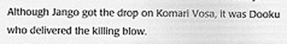

# Jango Fett

- **Aliases:** Jango
- **Era:** Prequel
- **Continuity:** default Legends; entries present for: Canon, Legends
- **Research tier:** untiered (not listed as INTRO/DEEP/MASTERY in legends-feats.md)
- **Entries:** 529 (204 with quotations; 131 marked as fragments; recounted after the public-release cleanup). Rebuilt 2026-11-17 from 618 old entries; old file: `characters/_bak/jango-fett.md.bak-20261117`.
- **How to read:** each entry is the quotation in full (block quote), then its source and point of view. "Note" lines are summaries from our notes, not quotations. `[fragment — full passage not on file]` means the source text is not on the box, so only the words in our notes are shown. Debate and forum material is in the last section and is unverified.

# LEGENDS (Legends / EU — main focus)

## Legacy of the Force 1–9: novel notes from the other agent (reference copy)

What it shows (our notes): Fathers and legacies: Jango/Boba/Ailyn/Mirta mirror Anakin/Jacen and Luke/Ben. The epigraph at L5371 reads «Train your sons to be strong but your daughters to be stronger.»
> Ke barjurir gar’ade, jagyc’ade kot’la a dalyc’ade kotla’shya.
>
> Train your sons to be strong but your daughters to be stronger.
— Source: Legacy of the Force 2: Bloodlines (novel), feats and scaling notes.
(Excerpt widened 2026-11-17 to the relevant passage, word for word from Bloodlines (Karen Traviss), Chapter Fourteen (text copy `MEGA_Legend_The_Legacy_of_the_Force_Series_Star_Wars_Legacy_of_the_Force_02_Bloodlines_Karen_Traviss_epub`).)
Our notes: `notes/materials/021-legacy-of-the-force/lotf-2-bloodlines-notes.md:206`

## Dark Lord trilogy (Labyrinth of Evil, Revenge of the Sith, Dark Lord): novel notes from the other agent (reference copy)

> “Close friends they were. Bound together by the unifying Force. But worried about Master Dooku, Sifo-Dyas was. Worried about his disenchantment with the Republic; about self-absorption among the Jedi. Saw in Dooku the effect of Qui-Gon’s death, Sifo-Dyas did. The effect that resurfaced the Sith had.” Yoda shook his head mournfully. “Knew of Dooku’s imminent departure, Master Sifo-Dyas did. Sensed, he may have, the birth of the Separatist movement.”
>
> But worried about Master Dooku, Sifo-Dyas was. *(L713)*
>
> But killed Sifo-Dyas was, before on Kamino Jango Fett arrived. *(L753)*
>
> Dooku's true confidant had been Master Sifo-Dyas, who, while also disturbed by what was occurring, was too weak to take action. *(L1693)*
>
> But Master Sifo-Dyas cannot stand, for the Jedi cannot learn about the army until we are prepared to have them learn of it. *(L1703)*
— Source: L713; L753; L1693; L1703 — Labyrinth of Evil (novel, read in full): feats, scaling, quotes and story notes; What LoE says: Yoda.
(Excerpt widened 2026-11-17 to the relevant passage, word for word from Labyrinth of Evil (James Luceno) (text copy `MEGA_Legend_The_Episode_Novelizations_Star_Wars_Revenge_of_the_Sith_01_Labyrinth_of_Evil_James_Luceno_epub`).)
Note (our notes, around the quote): What LoE says: Yoda: «Knew of Dooku's imminent departure, Master Sifo-Dyas did.» / «But worried about Master Dooku, Sifo-Dyas was.» (L713); «But killed Sifo-Dyas was, before on Kamino Jango Fett arrived.» (L753). Dooku's view: «Dooku's true confidant had been Master Sifo-Dyas, who, while also disturbed by what was occurring, was too weak to take action.» (L1693). Sidious's order: «But Master Sifo-Dyas cannot stand, for the Jedi cannot learn about the army until we are prepared to have them learn of it.» (L1703).
Our notes: `notes/materials/022-dark-lord-trilogy/labyrinth-of-evil-notes.md:1017`; `notes/materials/022-dark-lord-trilogy/labyrinth-of-evil-notes.md:1030`; `notes/materials/022-dark-lord-trilogy/labyrinth-of-evil-notes.md:1045`

> But playing both sides Jango Fett clearly was. *(L763)*
— Source: L85; L235; L763 — Labyrinth of Evil (novel, read in full): feats, scaling, quotes and story notes.
Note (our notes, around the quote): What LoE says: the clone template, who trained the early ARCs (L85); hired by Gunray to kill Padmé (L235); Yoda: «But playing both sides Jango Fett clearly was.» (L763).
Our notes: `notes/materials/022-dark-lord-trilogy/labyrinth-of-evil-notes.md:1039`; `notes/materials/022-dark-lord-trilogy/labyrinth-of-evil-notes.md:1046`

- Note (summary from our notes, not a quotation): Scaling implications: none. Nothing changes in the Plagueis entries.
  — Source: Labyrinth of Evil (novel, read in full): feats, scaling, quotes and story notes.
Our notes: `notes/materials/022-dark-lord-trilogy/labyrinth-of-evil-notes.md:1040`

- Note (summary from our notes, not a quotation): Complete quote register (5 lines: every sentence that names Jango Fett, verbatim, in book order):
  — Source: Labyrinth of Evil (novel, read in full): feats, scaling, quotes and story notes.
Our notes: `notes/materials/022-dark-lord-trilogy/labyrinth-of-evil-notes.md:1041`

> Over the years Obi-Wan had formed battlefield partnerships with several Advanced Recon Commandos—Alpha, with whom he had been imprisoned on Rattatak, and Jangotat, on Ord Cestus. Early-generation ARCs had received training by the Mandalorian clone template, Jango Fett. While the Kaminoans had managed to breed some of Fett out of the regulars, they had been more selective in the case of the ARCs. As a consequence, ARCs displayed more individual initiative and leadership abilities. In short, they were more like the late bounty hunter himself, which was to say, more human. While Cody wasn’t genetically an Advanced Recon Commando, he had ARC training and shared many ARC attributes.
— Source: Labyrinth of Evil (novel, read in full): feats, scaling, quotes and story notes; Ch1 L85.
(Excerpt widened 2026-11-17 to the relevant passage, word for word from Labyrinth of Evil (James Luceno) (text copy `MEGA_Legend_The_Episode_Novelizations_Star_Wars_Revenge_of_the_Sith_01_Labyrinth_of_Evil_James_Luceno_epub`).)
Context: Complete quote register (5 lines: every sentence that names Jango Fett, verbatim, in book order):
Our notes: `notes/materials/022-dark-lord-trilogy/labyrinth-of-evil-notes.md:1042`

> All these years later, he could still recall his brief conversation with Jango Fett, on Kamino. He glanced at Cody and the rest. An army of one man … But the right man for the job.
— Source: Labyrinth of Evil (novel, read in full): feats, scaling, quotes and story notes; Ch2 L135.
(Excerpt widened 2026-11-17 to the relevant passage, word for word from Labyrinth of Evil (James Luceno) (text copy `MEGA_Legend_The_Episode_Novelizations_Star_Wars_Revenge_of_the_Sith_01_Labyrinth_of_Evil_James_Luceno_epub`).)
Context: Complete quote register (5 lines: every sentence that names Jango Fett, verbatim, in book order):
Our notes: `notes/materials/022-dark-lord-trilogy/labyrinth-of-evil-notes.md:1043`

> It was personal because of Gunray's hiring of Jango Fett to assassinate Padme three years ago - - first with a bomb planted on her ship, then with the pair of kouhuns a changling had inserted into Padme's Senatorial quarters on Coruscant.
— Source: Labyrinth of Evil (novel, read in full): feats, scaling, quotes and story notes; Ch4 L235.
Context: Complete quote register (5 lines: every sentence that names Jango Fett, verbatim, in book order):
Our notes: `notes/materials/022-dark-lord-trilogy/labyrinth-of-evil-notes.md:1044`; `notes/materials/022-dark-lord-trilogy/labyrinth-of-evil-notes.md:1073`; `notes/materials/022-dark-lord-trilogy/labyrinth-of-evil-notes.md:1467`

> "Come on, boss," Cody had said, smiling out of Jango Fett's face, "have I ever let you down?" *(L5311)*
>
> "Well," Cody had said with a broad grin, "there was Cato Neimoidia . . ." *(L5323)*
— Source: L5311; L5323 — Revenge of the Sith (Matthew Stover novelization): Power-Scaling Research Notes.
Note (our notes, around the quote): Personality: competent, dryly humorous, devoted to Obi-Wan until the order arrives: «"Come on, boss," Cody had said, smiling out of Jango Fett's face, "have I ever let you down?"» (L5311); «"Well," Cody had said with a broad grin, "there was Cato Neimoidia . . ."» (L5323).
Our notes: `notes/materials/022-dark-lord-trilogy/rots-novel-notes.md:703`; `notes/materials/022-dark-lord-trilogy/rots-novel-notes.md:712`

## Star Wars: The New Essential Chronology (Del Rey, 2005): power-scaling and lore notes

> The Mandalorian army fought to the last man; only their commander Jango survived, to become the prisoner of slavers.
— Source: Part Two: The Fall of the Republic; Jango Fett; Count Dooku — Galidraan — Jango sole survivor.
Note (our notes, around the quote): Jango Fett; Count Dooku — Galidraan — Jango sole survivor: "The Mandalorian army fought to the last man; only their commander Jango survived, to become the prisoner of slavers." Source: The New Essential Chronology, p.35
Our notes: `notes/materials/027-new-essential-chronology/02-part-two-fall-of-the-republic.md:55`

> As a final test of loyalty for his would-be ap- prentice, he ordered Dooku to kill Sifo-Dyas, After the Gandestine murder, Dooku erased all races of Kamino from the Jedi archives and an- nounced his intention to leave the Order. Now a true Sth Lord, Dooku took the secret name of Darth Tyra- sus. He rctumed to his native Serenno, taking up the Sve and holdings due to him as the planet's hereditary Count, then disappeared from public view. Dooku be- came the newest Jedi Master to leave the Order, mak- ing the Lost Nineteen into the Lost Twenty.
>
> Jengo Fett THE Prime CLONE 32 BBY. ooku knew that the Kaminoan clone army had + to be flaviless If It hoped to stand a chance against the forces of industry he would soon marshal on the opposite side. For the genetic template that wouki become the Prime Clone, Dooku had his eye on Jango Fett, the greatest (and one of the last) of the Mandalorians.
>
> Jengo Fett THE Prime CLONE 32 BBY. ooku knew that the Kaminoan clone army had + to be flaviless If It hoped to stand a chance against the forces of industry he would soon marshal on the opposite side. For the genetic template that wouki become the Prime Clone, Dooku had his eye on Jango Fett, the greatest (and one of the last) of the Mandalorians. Jango had escaped from two years spent as a slave, following his capture In the Battle of Galidraan~a battle that Dooku hed orchestrated. After once again donning the armor of the Mandalorians, Jango reinvented himself, this time as a The Gungen Grand Army prepsres to engage Trade Federation forces on Naboo. tare vy Tous Lie Crasses) TArr ay Mare Geareiio) bounty hunter.
— Source: Part Two: The Fall of the Republic; Jango Fett; Count Dooku — Jango the Prime Clone.
(Excerpt widened 2026-11-17 to the relevant passage, word for word from research primary new essential chronology nec paged (text copy `research_primary_new_essential_chronology_nec_paged_txt_88b808b5bc`).)
(Excerpt widened 2026-11-17 to the relevant passage, word for word from research primary new essential chronology nec paged (text copy `research_primary_new_essential_chronology_nec_paged_txt_88b808b5bc`).)
Note (our notes, around the quote): Jango Fett; Count Dooku — Jango the Prime Clone: "Dooku had his eye on Jango Fett, the greatest (and one of the last) of the Mandalorians." Source: The New Essential Chronology, p.43
Our notes: `notes/materials/027-new-essential-chronology/02-part-two-fall-of-the-republic.md:123`

> Having heard that Jango had also tracked down and killed Vizsla of the Mandalorian Death Watch, it was clear to Dooku that slavery had done nothing to dull Jango's edge.
— Source: Part Two: The Fall of the Republic; Jango Fett — Jango kills Vizsla.
Note (our notes, around the quote): Jango Fett — Jango kills Vizsla: "Having heard that Jango had also tracked down and killed Vizsla of the Mandalorian Death Watch, it was clear to Dooku that slavery had done nothing to dull Jango's edge." Source: The New Essential Chronology, p.43
Our notes: `notes/materials/027-new-essential-chronology/02-part-two-fall-of-the-republic.md:125`

> Although Jango got the drop on Komari Vosa, it was Dooku who delivered the killing blow.
— Source: Part Two: The Fall of the Republic; Jango Fett; Count Dooku — Komari Vosa.
Note (our notes, around the quote): Jango Fett; Count Dooku — Komari Vosa: "Although Jango got the drop on Komari Vosa, it was Dooku who delivered the killing blow." Source: The New Essential Chronology, p.44

Our notes: `notes/materials/027-new-essential-chronology/02-part-two-fall-of-the-republic.md:132`

> Jango bested Obi-Wan in combat and escaped with Boba in Slave I.
— Source: Part Two: The Fall of the Republic.
Note (our notes, around the quote): Jango Fett; Obi-Wan Kenobi — Jango bests Obi-Wan on Kamino: "Jango bested Obi-Wan in combat and escaped with Boba in Slave I." Source: The New Essential Chronology, p.52
Our notes: `notes/materials/027-new-essential-chronology/02-part-two-fall-of-the-republic.md:208`

> Mace Windu beheaded Jango Fett, yet Dooku's forces held the upper hand until Yoda's armies arrived aboard laser-spewing Republic gunships.
— Source: Part Two: The Fall of the Republic; Mace Windu; Jango Fett — Mace beheads Jango.
Note (our notes, around the quote): Mace Windu; Jango Fett — Mace beheads Jango: "Mace Windu beheaded Jango Fett, yet Dooku's forces held the upper hand until Yoda's armies arrived aboard laser-spewing Republic gunships." Source: The New Essential Chronology, p.54
Our notes: `notes/materials/027-new-essential-chronology/02-part-two-fall-of-the-republic.md:222`

## The Complete Star Wars Encyclopedia, Vol. I (A–G)

> Antonin's forces were no match for Jango Fett.
— Source: scan pages 41–80; Jango Fett. POV: Jango Fett.
Note (our notes, around the quote): Jango Fett: "Antonin's forces were no match for Jango Fett." Source: The Complete Star Wars Encyclopedia, Vol. I, p.36
Our notes: `notes/materials/030-complete-star-wars-encyclopedia-vol-1/01-v1-scan-041-080.md:88`

> Rakir Banai was wanted by Hutt crime lords, and his ship was captured by bounty hunters when Kitster and his mother were sold into slavery. banda Tiny nibbling insects found on Ta­ tooine. Bandeam, Sors A frightened human youngling killed in Darth Vader's attack on the Jedi Temple after Order 66. bandflllA musical instrument that featured a number of mounted horn bells. Bane,CadCD Bando Gora A clandestine criminal or­ ganization and Force-worshipping cult that targeted large corporations in the final years of the Old Republic. It was based out of the planet Kohlma. Sando Gora's machinations conflicted with Darth Sidious's master plan, so the Sith Lord had Count Dooku deal with the cult, which came under the command of his fallen disciple Komari Vosa. To that end, Dooku hired rival bounty hunters Jango Fett and Montross to track down Vosa. With Vosa's defeat, Sando Gora disintegrated as a threat, and Fett proved himself capable enough in Dooku's eyes to become the template of the Republic's clone army. Sando Gora cultists seemed twisted by the dark side, often donning hoods and masks to increase their fearsome appearance. BandomeerBefore being despoiled by the invading Yuuzhan Vong, this planet rich in mineral resources was home to the native, silver-haired Meerian species.
— Source: scan pages 41–80; Count Dooku; Jango Fett.
(Excerpt widened 2026-11-17 to the relevant passage, word for word from research primary cse vol1 (text copy `research_primary_cse_vol1_pdf_45a954be6d`).)
(Excerpt widened 2026-11-17 to the relevant passage, word for word from research primary cse vol1 (text copy `research_primary_cse_vol1_pdf_45a954be6d`).)
Note (our notes, around the quote): Count Dooku; Jango Fett: "To that end, Dooku hired rival bounty hunters Jango Fett and Montross to track down Vosa." Source: The Complete Star Wars Encyclopedia, Vol. I, p.57
Our notes: `notes/materials/030-complete-star-wars-encyclopedia-vol-1/01-v1-scan-041-080.md:251`

> Jango Fett destroyed the vessel, forcing Vizsla to eject in an escape pod.
— Source: scan pages 161–200; Jango Fett. POV: Jango Fett.
Note (our notes, around the quote): Jango Fett: "Jango Fett destroyed the vessel, forcing Vizsla to eject in an escape pod." Source: The Complete Star Wars Encyclopedia, Vol. I, p.176
Our notes: `notes/materials/030-complete-star-wars-encyclopedia-vol-1/04-v1-scan-161-200.md:266`

> Ferlonlc Nebula A small nebula, it was located near the Dantooine system. Ferlanl, Luthus The leader of the Ferlani criminal family based on Esseles, he spent much of his youth representing the family on business throughout the Darpa sector and within Hutt space. Outwardly, Luthus Ferlani seemed like a kindly gentleman, but once he got angry or was disappointed, he could be terrifying. Fernooda As the liaison between Annoo­ dat radical General Ashaar Khorda and the outside world, this Dug hired both Jango Fett and Zam Wesell to steal the Infant of Shaa-a tiny religious statue that contained huge amounts of Force energy-in a plot to de­ stroy Coruscant. Jango succeeded and got his bounty, but in the end strangled Fernooda to death as he and Wesell thwarted the plot. Ferob, Captain An Imperial captain, he commanded the Victory-class Star Destroyer Iron Fist in the Unknown Regions under the watchful eye of Grand Admiral Thrawn. fero xyn This vicious predator, once native to the galaxy of the Yuuzhan Vong, was the only creature from their homeworld that had genetic material compatible with a vornskr. The initial Yuuzhan Vong attempts to create a Jedi-hunting creature from pure vornskr stock proved only mildly successful-the beast wasn't ferocious enough.
— Source: scan pages 241–280; Jango Fett. POV: Jango Fett.
(Excerpt widened 2026-11-17 to the relevant passage, word for word from research primary cse vol1 (text copy `research_primary_cse_vol1_pdf_45a954be6d`).)
(Excerpt widened 2026-11-17 to the relevant passage, word for word from research primary cse vol1 (text copy `research_primary_cse_vol1_pdf_45a954be6d`).)
Note (our notes, around the quote): Jango Fett: "Jango succeeded and got his bounty, but in the end strangled Fernooda to death as he and Wesell thwarted the plot." Source: The Complete Star Wars Encyclopedia, Vol. I, p.264
Our notes: `notes/materials/030-complete-star-wars-encyclopedia-vol-1/06-v1-scan-241-280.md:256`

> Sent to apprehend the bounty hunter for the attempted assassina­ tion of a Naboo Senator, Kenobi brawled with Jango as the Fetts sought to escape from Ka­ mino. Young Boba helped his father by pin­ ning the Jedi down with explosive laserfire from the Fett starship, SlaveI. Fleeing, the Fetts journeyed to Geono­ sis, where Jango's benefactor, Darth Tyranus, resided. Boba watched as his father's en­ emies were sentenced to death-but Jedi proved very hard to kill. A huge battle erupted as Jedi reinforcements stormed Geonosis to free their col­ leagues. Jango entered the fray, only to be killed by Jedi Master Mace Windu. Boba was shocked to witness his fa­ ther's swift death, and he quietly cra­ dled Jango's empty helmet as Geonosis erupted into all-out war. After Jango's death, Boba picked up the pieces of his shattered life with the help of his "black book;' an en­ coded message unit written by Jango with instructions for survival should Boba ever find himself alone. After the Battle of Geonosis, Boba quietly buried his father's body on Mandalore from fallen prey-that underscored his lethality. Fett's weapon of choice was a sawed-offBlasTech EE-3 rifle.
— Source: scan pages 281–320; Jango Fett; Mace Windu.
(Excerpt widened 2026-11-17 to the relevant passage, word for word from research primary cse vol1 (text copy `research_primary_cse_vol1_pdf_45a954be6d`).)
(Excerpt widened 2026-11-17 to the relevant passage, word for word from research primary cse vol1 (text copy `research_primary_cse_vol1_pdf_45a954be6d`).)
Note (our notes, around the quote): Jango Fett; Mace Windu: "Jango entered the fray, only to be killed by Jedi Master Mace Windu." Source: The Complete Star Wars Encyclopedia, Vol. I, p.266
Our notes: `notes/materials/030-complete-star-wars-encyclopedia-vol-1/07-v1-scan-281-320.md:14`

- Note (summary from our notes, not a quotation): Page contents: 1184 words, 18 paragraphs | headings/entries: Fett, Jango; Fevye'starn; Fex-M3; Fey'ja, Maja; Fey'jia, Torel
  — Source: scan pages 281–320.
Our notes: `notes/materials/030-complete-star-wars-encyclopedia-vol-1/07-v1-scan-281-320.md:30`

> In the final years of the Old Republic, Jango Fett was re­ garded as the best bounty hunter in the galaxy. A proficient marksman and unarmed com­ batant, Fett was covered in a sleek armored suit that concealed his grim visage. His combat gear featured an arsenal of weaponry, including re­ tractable wrist blades, a snare, dual blaster pis­ tols, and other, more exotic, tools of the trade. In combat, Jango used his harnessed jetpack to gain the advantage of speed and height over his enemies. The backpack also carried a nasty sur­ prise: An explosive rocket could be launched from it. For interstellar travel, Jango used his well-worn starship, SlaveI. Jango Fett was orphaned at an early age, the son of simple Concord Dawn farmers killed by brutal marauders. At 10 years old, he was picked up by Journeyman Protector Jaster Mer­ eel, who introduced Fett to the harsh world of mercenary life. He was raised among great war­ riors, learning to survive in the rugged frontiers. Though the Mandalorian supercomrnandos were wiped out by the Jedi Knights, Jango was one of the few left to still wear the armor. Years of physical conditioning and training honed him into one of the most feared bounty hunters in the underworld.
— Source: scan pages 281–320; Jango Fett — entry/section: Fett, Jango.
(Excerpt widened 2026-11-17 to the relevant passage, word for word from research primary cse vol1 (text copy `research_primary_cse_vol1_pdf_45a954be6d`).)
(Excerpt widened 2026-11-17 to the relevant passage, word for word from research primary cse vol1 (text copy `research_primary_cse_vol1_pdf_45a954be6d`).)
Note (our notes, around the quote): Jango Fett — entry/section: Fett, Jango: "Jango Fett was orphaned at an early age, the son of simple Concord Dawn farmers killed by brutal marauders." Source: The Complete Star Wars Encyclopedia, Vol. I, p.268
Our notes: `notes/materials/030-complete-star-wars-encyclopedia-vol-1/07-v1-scan-281-320.md:32`

> Though the Mandalorian supercommandos were wiped out by the Jedi Knights, Jango was one of the few left to still wear the armor.
— Source: scan pages 281–320; Jango Fett — entry/section: Fett, Jango.
Note (our notes, around the quote): Jango Fett — entry/section: Fett, Jango: "Though the Mandalorian supercommandos were wiped out by the Jedi Knights, Jango was one of the few left to still wear the armor." Source: The Complete Star Wars Encyclopedia, Vol. I, p.268
Our notes: `notes/materials/030-complete-star-wars-encyclopedia-vol-1/07-v1-scan-281-320.md:34`

> His blaster skills killed several Jedi, but Jango was not quite prepared to face off against Jedi Master Mace Windu.
— Source: scan pages 281–320; Jango Fett; Mace Windu — entry/section: Fett, Jango.
Note (our notes, around the quote): Jango Fett; Mace Windu — entry/section: Fett, Jango: "His blaster skills killed several Jedi, but Jango was not quite prepared to face off against Jedi Master Mace Windu." Source: The Complete Star Wars Encyclopedia, Vol. I, p.268
Our notes: `notes/materials/030-complete-star-wars-encyclopedia-vol-1/07-v1-scan-281-320.md:38`

> Kenobi and his compatriots were captured on Geonosis, which was revealed to be a Separatist stronghold. They were to be executed in grand Geonosian fashion, but their deaths were stalled by the sudden ar­ rival ofJedi reinforcements. Tasked with protect­ ing Lord Tyranus, Jango entered the fray against the Jedi. His blaster skills killed several Jedi, but Jango was not quite prepared to face off against Jedi Master Mace W indu. Windu did not break stride as he deflected Jango's incoming blasts and swiftly cleaved off the hunter's head with a single stroke of his luminescent blade. Jango's battle-dented helm bounced along the dusty ground ofthe Geonosian arena, to be picked up by a stunned and newly orphaned Boba Fett. fever wasp Native to the jungles of Haruun Kal, this vicious insect was a parasite that laid its eggs in every living being it could bite. The lar­ vae ofthe fever wasp fed on blood and flesh; they also liked to consume thyssel bark, and those Ko­ runnai who chewed the bark as a stimulant and were bitten by fever wasps died quickly. When the larvae reached the brain of their host, they continued to grow until they hatched, feeding on the brain cells and eventuallykilling the host.
— Source: scan pages 281–320; Jango Fett; Mace Windu — entry/section: Fett, Jango.
(Excerpt widened 2026-11-17 to the relevant passage, word for word from research primary cse vol1 (text copy `research_primary_cse_vol1_pdf_45a954be6d`).)
(Excerpt widened 2026-11-17 to the relevant passage, word for word from research primary cse vol1 (text copy `research_primary_cse_vol1_pdf_45a954be6d`).)
Note (our notes, around the quote): Jango Fett; Mace Windu — entry/section: Fett, Jango: "Windu did not break stride as he deflected Jango's incoming blasts and swiftly cleaved off the hunter's head with a single stroke of his luminescent blade." Source: The Complete Star Wars Encyclopedia, Vol. I, p.268
Our notes: `notes/materials/030-complete-star-wars-encyclopedia-vol-1/07-v1-scan-281-320.md:40`

> Half of the Jedi task force was killed while the Mandalorians were wiped out—except for Jango Fett, who was turned over to the governor.
— Source: scan pages 321–360; Jango Fett. POV: Jango Fett.
Note (our notes, around the quote): Jango Fett: "Half of the Jedi task force was killed while the Mandalorians were wiped out—except for Jango Fett, who was turned over to the governor." Source: The Complete Star Wars Encyclopedia, Vol. I, p.315
Our notes: `notes/materials/030-complete-star-wars-encyclopedia-vol-1/08-v1-scan-321-360.md:67`

## The Complete Star Wars Encyclopedia, Vol. II (H–O)

> Jango Fett established one for his son Boba before he was killed on Geonosis.
— Source: scan pages 41–80; Jango Fett; Boba Fett.
Note (our notes, around the quote): Jango Fett; Boba Fett: "Jango Fett established one for his son Boba before he was killed on Geonosis." Source: The Complete Star Wars Encyclopedia, Vol. II, p.41
Our notes: `notes/materials/031-complete-star-wars-encyclopedia-vol-2/01-v2-scan-041-080.md:56`

- Note (summary from our notes, not a quotation): Page contents: 1092 words, 26 paragraphs | headings/entries: Jangelile; Jangoed; Jango Fett Arena; Jangotat; Janguine; Janiidakara; Janissariad; Jankok; Janks; Jan-lo, Sunnar; Janna, Neile; Jannick, Jerus
  — Source: scan pages 121–160.
Our notes: `notes/materials/031-complete-star-wars-encyclopedia-vol-2/03-v2-scan-121-160.md:169`

> General Khorda nearly succeeded in destroying the Infant near Coruscant's central power core, but was killed in a struggle with Jango Fett and Jedi Master Yarael Poof.
— Source: scan pages 201–240; Jango Fett; Yarael Poof.
Note (our notes, around the quote): Jango Fett; Yarael Poof: "General Khorda nearly succeeded in destroying the Infant near Coruscant's central power core, but was killed in a struggle with Jango Fett and Jedi Master Yarael Poof." Source: The Complete Star Wars Encyclopedia, Vol. II, p.215
Our notes: `notes/materials/031-complete-star-wars-encyclopedia-vol-2/05-v2-scan-201-240.md:218`

> A handful of Death Watchmen survived, as did the True Mandalorian Jango Fett.
— Source: scan pages 281–320; Jango Fett. POV: Jango Fett.
Note (our notes, around the quote): Jango Fett: "A handful of Death Watchmen survived, as did the True Mandalorian Jango Fett." Source: The Complete Star Wars Encyclopedia, Vol. II, p.284
Our notes: `notes/materials/031-complete-star-wars-encyclopedia-vol-2/07-v2-scan-281-320.md:87`

> Vizsla tried to destroy the True Mandalorians on Concord Dawn, but Mereel and a small force managed to survive, thanks in part to the efforts of a young Jango Fett.
— Source: scan pages 281–320; Jango Fett. POV: Jango Fett.
Note (our notes, around the quote): Jango Fett: "Vizsla tried to destroy the True Mandalorians on Concord Dawn, but Mereel and a small force managed to survive, thanks in part to the efforts of a young Jango Fett." Source: The Complete Star Wars Encyclopedia, Vol. II, p.307
Our notes: `notes/materials/031-complete-star-wars-encyclopedia-vol-2/07-v2-scan-281-320.md:280`

> Myles A Mandalorian shock trooper who served under Jango Fett, Myles was killed when he was cut in half by a Jedi Knight during the Battle of Galidraan.
— Source: scan pages 321–360; Jango Fett. POV: Jango Fett.
Note (our notes, around the quote): Jango Fett: "Myles A Mandalorian shock trooper who served under Jango Fett, Myles was killed when he was cut in half by a Jedi Knight during the Battle of Galidraan." Source: The Complete Star Wars Encyclopedia, Vol. II, p.347
Our notes: `notes/materials/031-complete-star-wars-encyclopedia-vol-2/08-v2-scan-321-360.md:236`

> Fett survived a missile blast, and got the back-up set of armor—once worn by Jango Fett—that he kept on Ma'ar Shaddam.
— Source: scan pages 361–400; Jango Fett. POV: Jango Fett.
Note (our notes, around the quote): Jango Fett: "Fett survived a missile blast, and got the back-up set of armor—once worn by Jango Fett—that he kept on Ma'ar Shaddam." Source: The Complete Star Wars Encyclopedia, Vol. II, p.393
Our notes: `notes/materials/031-complete-star-wars-encyclopedia-vol-2/09-v2-scan-361-400.md:316`

> She wanted them destroyed, but Orun Wa stepped in and asked Jango Fett to evaluate them.
— Source: scan pages 401–440; Jango Fett. POV: Jango Fett.
Note (our notes, around the quote): Jango Fett: "She wanted them destroyed, but Orun Wa stepped in and asked Jango Fett to evaluate them." Source: The Complete Star Wars Encyclopedia, Vol. II, p.395
Our notes: `notes/materials/031-complete-star-wars-encyclopedia-vol-2/10-v2-scan-401-440.md:12`

## The Complete Star Wars Encyclopedia, Vol. III (P–Z)

> Boba Fett used a robot scoop to carry away the body of his father, Jango Fett, from the arena where he was beheaded by Mace Windu.
— Source: scan pages 81–120; Boba Fett; Jango Fett; Mace Windu.
Note (our notes, around the quote): Boba Fett; Jango Fett; Mace Windu: "Boba Fett used a robot scoop to carry away the body of his father, Jango Fett, from the arena where he was beheaded by Mace Windu." Source: The Complete Star Wars Encyclopedia, Vol. III, p.103
Our notes: `notes/materials/032-complete-star-wars-encyclopedia-vol-3/02-v3-scan-081-120.md:228`

> After the outbreak of the Clone Wars and the death of Jango Fett, Spar went to work rebuilding Jango's supercommandos from local police on Mandalore, where rumor spread that the son of Jango Fett, the last True Mandalorian, had survived to lead them.
— Source: scan pages 161–200; Jango Fett. POV: Jango Fett.
Note (our notes, around the quote): Jango Fett: "After the outbreak of the Clone Wars and the death of Jango Fett, Spar went to work rebuilding Jango's supercommandos from local police on Mandalore, where rumor spread that the son of Jango Fett, the last True Mandalorian, had survived to lead them." Source: The Complete Star Wars Encyclopedia, Vol. III, p.182
Our notes: `notes/materials/032-complete-star-wars-encyclopedia-vol-3/04-v3-scan-161-200.md:329`

> Unfortunately, his lack of combat experience became clear during the early stages of the battle when the bounty hunter Jango Fett shot and killed him.
— Source: scan pages 241–280; Jango Fett. POV: Jango Fett.
Note (our notes, around the quote): Jango Fett: "Unfortunately, his lack of combat experience became clear during the early stages of the battle when the bounty hunter Jango Fett shot and killed him." Source: The Complete Star Wars Encyclopedia, Vol. III, p.261
Our notes: `notes/materials/032-complete-star-wars-encyclopedia-vol-3/06-v3-scan-241-280.md:230`

> Vizsla seemed to gain the upper hand when he injected poison into Jango's body but was unprepared for the pack of dire-cats that ripped him apart and ate him.
— Source: scan pages 281–320; Jango Fett. POV: Jango Fett.
Note (our notes, around the quote): Jango Fett: "Vizsla seemed to gain the upper hand when he injected poison into Jango's body but was unprepared for the pack of dire-cats that ripped him apart and ate him." Source: The Complete Star Wars Encyclopedia, Vol. III, p.309
Our notes: `notes/materials/032-complete-star-wars-encyclopedia-vol-3/07-v3-scan-281-320.md:280`

> Although Kamino was devastated during the Clone Wars, Taun We survived, along with a portion of the genetic material harvested from Jango Fett.
— Source: scan pages 321–360; Jango Fett. POV: Jango Fett.
Note (our notes, around the quote): Jango Fett: "Although Kamino was devastated during the Clone Wars, Taun We survived, along with a portion of the genetic material harvested from Jango Fett." Source: The Complete Star Wars Encyclopedia, Vol. III, p.323
Our notes: `notes/materials/032-complete-star-wars-encyclopedia-vol-3/08-v3-scan-321-360.md:62`

> Zam Wesell was also a rival of Jango Fett, as the two were generally considered the best bounty hunters of their generation.
— Source: scan pages 321–360; Jango Fett. POV: Jango Fett.
Note (our notes, around the quote): Jango Fett: "Zam Wesell was also a rival of Jango Fett, as the two were generally considered the best bounty hunters of their generation." Source: The Complete Star Wars Encyclopedia, Vol. III, p.326
Our notes: `notes/materials/032-complete-star-wars-encyclopedia-vol-3/08-v3-scan-321-360.md:91`

> Wesell escaped to the Outlander Club, but Jango refused to have his plans compromised and killed Wesell with a poison dart as the Jedi were about to capture her.
— Source: scan pages 321–360; Hero of Tython; Jango Fett.
Note (our notes, around the quote): Hero of Tython; Jango Fett: "Wesell escaped to the Outlander Club, but Jango refused to have his plans compromised and killed Wesell with a poison dart as the Jedi were about to capture her." Source: The Complete Star Wars Encyclopedia, Vol. III, p.327
Our notes: `notes/materials/032-complete-star-wars-encyclopedia-vol-3/08-v3-scan-321-360.md:98`

## The New Essential Guide to Characters (2002)

> Jango Fett is killed by Mace Windu.
— Source: scan pages 1–30; Jango Fett; Mace Windu.
Note (our notes, around the quote): Jango Fett; Mace Windu: "Jango Fett is killed by Mace Windu." Source: The New Essential Guide to Characters, p.13
Our notes: `notes/materials/034-new-essential-guide-to-characters/00-negc-scan-001-030.md:39`

> Orphaned when his settler parents were killed in an uprising, Jango Fett joined the Mandalorian peacekeepers, a group of nomadic mercenaries with whom he traveled for a few years.
— Source: scan pages 61–90; Jango Fett. POV: Jango Fett.
Note (our notes, around the quote): Jango Fett: "Orphaned when his settler parents were killed in an uprising, Jango Fett joined the Mandalorian peacekeepers, a group of nomadic mercenaries with whom he traveled for a few years." Source: The New Essential Guide to Characters, p.69
Our notes: `notes/materials/034-new-essential-guide-to-characters/02-negc-scan-061-090.md:21`

## Star Wars Gamer/Star Wars Gamer 09.pdf [Star Wars Roleplaying Game (d20, 2000)] (scan pages 61–104)

- Note (summary from our notes, not a quotation): Page contents: Fenn Shysha: a Human who took Mandalorian armor as a Supercommando, stays near Mandalore and takes mercenary jobs to fund his fight against slavers; honorable; era substitutes include Jango Fett, Jodo Kast or the bounty hunter Alfreda Goot (hand-read)
  — Source: Star Wars Gamer/Star Wars Gamer 09.pdf [Star Wars Roleplaying Game (d20,.
Our notes: `notes/materials/037-sw-d20-folder/058-star-wars-gamer-09-scan-061-104.md:27`

## Star Wars Gamer/Star Wars Gamer 10.pdf [Star Wars Roleplaying Game (d20, 2000)] (scan pages 1–60)

- Note (summary from our notes, not a quotation): Page contents: Editorial 'What Kind of Gamer are You?' (Michael Mikaelian): Darth Sidious as the calculating GM, Jango Fett for electronic games and Epic Duels, Obi-Wan Kenobi the bluffer (Pazaak, Stratego, TCG), Jar Jar Binks the lucky social player (hand-read)
  — Source: Star Wars Gamer/Star Wars Gamer 10.pdf [Star Wars Roleplaying Game (d20,.
Our notes: `notes/materials/037-sw-d20-folder/059-star-wars-gamer-10-scan-001-060.md:25`

- Note (summary from our notes, not a quotation): Page contents: Board-game strategy: Epic Duels decks for Darth Maul (Sith Speed allows up to 8 attack cards a turn) and Jango Fett with Zam Wesell; Star Wars Stratego special powers: Vision, Advanced Blast, Charging, Leaping, Quickness (hand-read)
  — Source: Star Wars Gamer/Star Wars Gamer 10.pdf [Star Wars Roleplaying Game (d20,.
Our notes: `notes/materials/037-sw-d20-folder/059-star-wars-gamer-10-scan-001-060.md:337`

## Star Wars Gamer/Star Wars Gamer 10.pdf [Star Wars Roleplaying Game (d20, 2000)] (scan pages 61–120)

- Note (summary from our notes, not a quotation): Page contents: Star Wars Bounty Hunter preview by Eric Bratcher (PS2/GameCube): you play Jango Fett about ten years before Attack of the Clones; Darth Sidious charges his new right-hand man with destroying a cult, and he hires bounty hunters to kill its leader; Kenner's mail-away Boba Fett and Bossk figures (hand-read)
  — Source: Star Wars Gamer/Star Wars Gamer 10.pdf [Star Wars Roleplaying Game (d20,.
Our notes: `notes/materials/037-sw-d20-folder/059-star-wars-gamer-10-scan-061-120.md:285`

- Note (summary from our notes, not a quotation): Page contents: Bounty Hunter preview: Jango flies the Mandalorian ship Jaster's Legacy before he gets Slave I, prompting speculation about Jaster Mereel; his arsenal includes twin blasters, a jetpack rocket, a wrist flamethrower and a whipcord (hand-read)
  — Source: Star Wars Gamer/Star Wars Gamer 10.pdf [Star Wars Roleplaying Game (d20,.
Our notes: `notes/materials/037-sw-d20-folder/059-star-wars-gamer-10-scan-061-120.md:292`

- Note (summary from our notes, not a quotation): Page contents: Bounty Hunter preview: the jetpack allows leaps and dashes but not flight; the story starts at Outland Station with Jango's friend Rozatta, a tough old Toydarian; the cult steals the dead from battlefields; foes include a krayt dragon, an army of Dugs, a corrupt politician, and rival bounty hunters across six worlds (hand-read)
  — Source: Star Wars Gamer/Star Wars Gamer 10.pdf [Star Wars Roleplaying Game (d20,.
Our notes: `notes/materials/037-sw-d20-folder/059-star-wars-gamer-10-scan-061-120.md:297`

- Note (summary from our notes, not a quotation): Page contents: Bounty Hunter preview: Montross, Jango's ruthless arch-nemesis, kills a begging victim ('I'm worth more alive!' / 'You're worth enough dead'); the cult leader is pitched as an Apocalypse Now / Colonel Kurtz figure (hand-read)
  — Source: Star Wars Gamer/Star Wars Gamer 10.pdf [Star Wars Roleplaying Game (d20,.
Our notes: `notes/materials/037-sw-d20-folder/059-star-wars-gamer-10-scan-061-120.md:302`

## Adventures/Geonosis Battle Arena Advanced Missions.pdf [Star Wars Roleplaying Game Revised Core (d20, 2002)]

- Note (summary from our notes, not a quotation): Page contents: Advanced Mission 1, Count Dooku's Challenge: the heroes search the balcony for Dooku's secret plans (16+ on a d20) while fighting his guards; Advanced Mission 2, Jango Attacks!: Jango Fett traps the heroes in the arena (Zam Wesell can replace him) (hand-read)
  — Source: Adventures/Geonosis Battle Arena Advanced Missions.pdf [Star Wars Rolepla.
Our notes: `notes/materials/037-sw-d20-folder/064-geonosis-battle-arena-advanced-missions.md:15`

> The Heroes try to escape the Battle Arena. Suddenly, the armored figure of Jango Fett appears on the arena balcony. He touches a control on his wrist, and all of the arena doors slam shut. The Heroes are trapped, at the mercy of the bounty hunter! They can’t escape and help the Republic until Jango Fett is defeated! Jango’s Message One player should read this section aloud: “You’re not going anywhere!” Jango Fett shouts. “Did you really think we would let you go that easily? You still have more guards to fight!” The bounty hunter draws his blaster pistols. “And when you’re done with them, you have to fight me!” Your Goal Each player chooses a side: Heroes or Villains. The side that scores the most points wins—but only if they manage to stay on their feet!
— Source: Adventures/Geonosis Battle Arena Advanced Missions.pdf [Star Wars Rolepla.
(Excerpt widened 2026-11-17 to the relevant passage, word for word from imary sw d20 folder files Star Wars Roleplaying Game Revised Core Adventures Geonosis Battle Arena Advanced Missions (text copy `imary_sw_d20_folder_files_Star_Wars_Roleplaying_Game_Revised_Core_Adventures_Geonosis_Battle_Arena_Advanced_Missions_pdf_25d77adfe1`).)
(Excerpt widened 2026-11-17 to the relevant passage, word for word from imary sw d20 folder files Star Wars Roleplaying Game Revised Core Adventures Geonosis Battle Arena Advanced Missions (text copy `imary_sw_d20_folder_files_Star_Wars_Roleplaying_Game_Revised_Core_Adventures_Geonosis_Battle_Arena_Advanced_Missions_pdf_25d77adfe1`).)
Note (our notes, around the quote): Jango Fett — entry/section: Jango traps the heroes in the arena: "“You’re not going anywhere!” Jango Fett shouts. “Did you really think we would let you go that easily? You still have more guards to fight!”" Source: *Geonosis Battle Arena Advanced Missions* (SWRPG d20 Revised Core), scan p.2
Our notes: `notes/materials/037-sw-d20-folder/064-geonosis-battle-arena-advanced-missions.md:19`

> If your Hero gets knocked out, you don’t get any bonus points. Advanced Mission 2: Jango Attacks! The Heroes try to escape the Battle Arena. Suddenly, the armored figure of Jango Fett appears on the arena balcony. He touches a control on his wrist, and all of the arena doors slam shut. The Heroes are trapped, at the mercy of the bounty hunter! They can’t escape and help the Republic until Jango Fett is defeated! Jango’s Message One player should read this section aloud: “You’re not going anywhere!” Jango Fett shouts. “Did you really think we would let you go that easily? You still have more guards to fight!”
— Source: Adventures/Geonosis Battle Arena Advanced Missions.pdf [Star Wars Rolepla; Jango Fett — entry/section: Advanced Mission 2: Jango Attacks!.
(Excerpt widened 2026-11-17 to the relevant passage, word for word from imary sw d20 folder files Star Wars Roleplaying Game Revised Core Adventures Geonosis Battle Arena Advanced Missions (text copy `imary_sw_d20_folder_files_Star_Wars_Roleplaying_Game_Revised_Core_Adventures_Geonosis_Battle_Arena_Advanced_Missions_pdf_25d77adfe1`).)
(Excerpt widened 2026-11-17 to the relevant passage, word for word from imary sw d20 folder files Star Wars Roleplaying Game Revised Core Adventures Geonosis Battle Arena Advanced Missions (text copy `imary_sw_d20_folder_files_Star_Wars_Roleplaying_Game_Revised_Core_Adventures_Geonosis_Battle_Arena_Advanced_Missions_pdf_25d77adfe1`).)
Note (our notes, around the quote): Jango Fett — entry/section: Advanced Mission 2: Jango Attacks!: "They can't escape and help the Republic until Jango Fett is defeated!" Source: *Geonosis Battle Arena Advanced Missions* (SWRPG d20 Revised Core), scan p.2
Our notes: `notes/materials/037-sw-d20-folder/064-geonosis-battle-arena-advanced-missions.md:25`

## Characters/Hutts/Wallanooga and Dreddon.pdf [Star Wars Roleplaying Game Revised Core (d20, 2002)]

- Note (summary from our notes, not a quotation): Page contents: Wallanooga skills; Dreddon, Zam Wesell, Vigo Antonin, Jango Fett; Dreddon stats; Nightsaber teaser (hand-read)
  — Source: Characters/Hutts/Wallanooga and Dreddon.pdf [Star Wars Roleplaying Game R.
Our notes: `notes/materials/037-sw-d20-folder/090-wallanooga-and-dreddon.md:25`

> Skills: Appraise +12, Bluff +12, Diplomacy +21, Forgery +4, Gather Information +12, Intimidate +24, Knowledge (Anzati) +8, Knowledge (Ord Namurt) +3, Profession (slaver) +15, Profession (smuggler) +13, Read/Write Basic, Read/Write Huttese, Sense Motive +9, Speak Basic, Speak Huttese. Feats: Frightful Presence, Infamy, Influence, Skill Emphasis (Intimidate), Stamina, Toughness, Weapon Group Proficiency (blaster pistols, simple weapons). Dreddon The Ol' Double Double­Cross Dreddon, like most Hutts, had a voracious appetite for crime (among other things) but generally was loathe to eliminate his enemies personally. About halfway between the Battle of Naboo and the onset of the Clone Wars, Dreddon traveled throughout the Outer Rim selling weapons. (He picked up much of the late Wallanooga's gunrunning business when the one­eyed Hutt was killed by Aurra Sing.) He met his end five years before the Battle of Geonosis, when Zam Wesell took a contract on his life. The man who had hired her, the Black Sun Vigo Antonin, was killed by Jango Fett before she could collect her pay. In the end, neither hunter was rewarded ­­ as it turned out, Dreddon was the one who'd hired Fett. Heroes might encounter Dreddon the Hutt on almost any Outer Rim world with a spaceport. Though he prefers to have others do his killing, he loves to travel and usually handles transactions personally.
— Source: Characters/Hutts/Wallanooga and Dreddon.pdf [Star Wars Roleplaying Game R.
(Excerpt widened 2026-11-17 to the relevant passage, word for word from research primary sw d20 folder files Star Wars Roleplaying Game Revised Core Characters Hutts Wallanooga and Dreddon (text copy `research_primary_sw_d20_folder_files_Star_Wars_Roleplaying_Game_Revised_Core_Characters_Hutts_Wallanooga_and_Dreddon_pdf_44f04ad903`).)
(Excerpt widened 2026-11-17 to the relevant passage, word for word from research primary sw d20 folder files Star Wars Roleplaying Game Revised Core Characters Hutts Wallanooga and Dreddon (text copy `research_primary_sw_d20_folder_files_Star_Wars_Roleplaying_Game_Revised_Core_Characters_Hutts_Wallanooga_and_Dreddon_pdf_44f04ad903`).)
Note (our notes, around the quote): Zam Wesell; Jango Fett; Aurra Sing — entry/section: The double double-cross: "(He picked up much of the late Wallanooga's gunrunning business when the one-eyed Hutt was killed by Aurra Sing.) He met his end five years before the Battle of Geonosis, when Zam Wesell took a contract on his life. The man who had hired her, the Black Sun Vigo Antonin, was killed by Jango Fett before she could collect her pay. In the end, neither hunter was rewarded -- as it turned out, Dreddon was the one who'd hired Fett." Source: *Wallanooga and Dreddon* (SWRPG d20 Revised Core), scan p.2
Our notes: `notes/materials/037-sw-d20-folder/090-wallanooga-and-dreddon.md:27`

## Characters/Miniatures/Grand Army of the Republic.pdf [Star Wars Roleplaying Game Revised Core (d20, 2002)]

- Note (summary from our notes, not a quotation): Page contents: ARC Trooper (Scout 2/Thug 5/Elite Trooper 2, trained by Jango Fett, CC D); Agen Kolar (Zabrak Jedi Guardian 9/Jedi Master 3, CC F); new equipment: Aratech Hover Pack (hand-read)
  — Source: Characters/Miniatures/Grand Army of the Republic.pdf [Star Wars Roleplayi.
Our notes: `notes/materials/037-sw-d20-folder/109-grand-army-of-the-republic.md:20`

> The most advanced troops of the Republic Army are specialized clones known as ARC Troopers. These clones have not been modified like the standard Clone Trooper, resulting in fighters that are more independent. ARC Troopers were hand-trained by Jango Fett, making them excellent combatants but slightly mistrustful of their Jedi Generals.
— Source: Characters/Miniatures/Grand Army of the Republic.pdf [Star Wars Roleplayi; Jango Fett — entry/section: ARC Troopers trained by Jango Fett.
Note (our notes, around the quote): Jango Fett — entry/section: ARC Troopers trained by Jango Fett: "The most advanced troops of the Republic Army are specialized clones known as ARC Troopers. These clones have not been modified like the standard Clone Trooper, resulting in fighters that are more independent. ARC Troopers were hand-trained by Jango Fett, making them excellent combatants but slightly mistrustful of their Jedi Generals." Source: *Grand Army of the Republic* (SWRPG d20 Revised Core), scan p.3
Our notes: `notes/materials/037-sw-d20-folder/109-grand-army-of-the-republic.md:24`

## Characters/Miniatures/Scum and Villainy.pdf [Star Wars Roleplaying Game Revised Core (d20, 2002)]

> The Separatist movement saw Padme Amidala as a possible threat to fulfilling their ultimate goals. As a result, they hired the shapechanging assassin Zam Wesell to kill the young senator from Naboo. After failing to kill her on a landing bay on Naboo, Zam was given two kouhuns by Jango Fett to assist in a second attempt. Amidala's Jedi protectors, Anakin Skywalker and Obi-Wan Kenobi, foiled this attempt and captured the would-be assassin after a wild chase. But before she could talk, Zam was silenced by a poisoned dart fired by Jango Fett.
— Source: Characters/Miniatures/Scum and Villainy.pdf [Star Wars Roleplaying Game R.
Note (our notes, around the quote): Zam Wesell; Padmé Amidala; Jango Fett; Darth Vader (Anakin Skywalker); Obi-Wan Kenobi — entry/section: Zam Wesell's attempts on Amidala: "The Separatist movement saw Padme Amidala as a possible threat to fulfilling their ultimate goals. As a result, they hired the shapechanging assassin Zam Wesell to kill the young senator from Naboo. After failing to kill her on a landing bay on Naboo, Zam was given two kouhuns by Jango Fett to assist in a second attempt. Amidala's Jedi protectors, Anakin Skywalker and Obi-Wan Kenobi, foiled this attempt and captured the would-be assassin after a wild chase. But before she could talk, Zam was silenced by a poisoned dart fired by Jango Fett." Source: *Scum and Villainy* (SWRPG d20 Revised Core), scan p.1
Our notes: `notes/materials/037-sw-d20-folder/111-scum-and-villainy.md:12`

## Characters/ARC Trooper.pdf [Star Wars Roleplaying Game Revised Core (d20, 2002)]

- Note (summary from our notes, not a quotation): Page contents: ARC troopers: Jango clones with independent streak, Advanced Recon Commandos held in reserve on Kamino, Jango's orders to destroy youngest clones, distrust of Jedi generals; generic ARC Trooper stats (medium powered battle armor DR 2, light repeating blaster rifle); Republic comic cover image (hand-read)
  — Source: Characters/ARC Trooper.pdf [Star Wars Roleplaying Game Revised Core (d20,.
Our notes: `notes/materials/037-sw-d20-folder/134-arc-trooper.md:10`

> They grow up loyal to the Republic, or they don’t grow up at all.
>
> —ARC Trooper A-17, preparing to destroy Tipoca City’s clone children during the Battle of Kamino, three months after the Battle of Geonosis
— Source: Characters/ARC Trooper.pdf [Star Wars Roleplaying Game Revised Core (d20,.
(Excerpt widened 2026-11-17 to the relevant passage, word for word from True Colors (Karen Traviss) (text copy `MEGA_Legend_The_Republic_Commando_Series_Star_Wars_Clone_Wars_10_Republic_Commando_03_True_Colors_Karen_Traviss_epub`).)
(Excerpt widened 2026-11-17 to the relevant passage, word for word from True Colors (Karen Traviss) (text copy `MEGA_Legend_The_Republic_Commando_Series_Star_Wars_Clone_Wars_10_Republic_Commando_03_True_Colors_Karen_Traviss_epub`).)
Note (our notes, around the quote): Jango Fett; Obi-Wan Kenobi — entry/section: ARC troopers: Jango's secret orders: "Not every copy of Jango Fett became an unquestioningly loyal clone trooper in the Republic Army. Some specimens were bred to retain Jango's independent streak and display even more combat ferocity and skill, so the cloners of Kamino put them through special commando training. The Kaminoans held these special Advanced Recon Commandos, or ARC troopers, in reserve after Jango's death, both to provide genetic material and to defend the cloning operation itself, should the Clone Wars engulf the ocean world. Unknown to the Kaminoans, Jango Fett had instilled orders in the ARC troopers himself -- orders that should the Confederacy come for the youngest clones, those clones were to be destroyed. As one ARC trooper told Obi-Wan Kenobi, "They grow up loyal to the Republic, or they don't grow up at all."" Source: *ARC Trooper* (SWRPG d20 Revised Core), scan p.1
Our notes: `notes/materials/037-sw-d20-folder/134-arc-trooper.md:12`

> Unfortunately for Kamino, that time has indeed come, but, luckily, the ARC troopers have performed splendidly. Although they don't mask their distrust of their Jedi generals and might even. refuse to follow orders with which they disagree, their effectiveness on the battlefield is without question. ARC troopers work most effectively in small squads assigned specific missions that require innovation. As more and more Jedi fall in battle, these super commandos help balance the scales between the upstart Confederates and the great Republic. Their numbers are not large, but they get the job done at all costs.
— Source: Characters/ARC Trooper.pdf [Star Wars Roleplaying Game Revised Core (d20,; Jango Fett — entry/section: ARC troopers in battle.
Note (our notes, around the quote): Jango Fett — entry/section: ARC troopers in battle: "Unfortunately for Kamino, that time has indeed come, but, luckily, the ARC troopers have performed splendidly. Although they don't mask their distrust of their Jedi generals and might even. refuse to follow orders with which they disagree, their effectiveness on the battlefield is without question. ARC troopers work most effectively in small squads assigned specific missions that require innovation. As more and more Jedi fall in battle, these super commandos help balance the scales between the upstart Confederates and the great Republic. Their numbers are not large, but they get the job done at all costs." Source: *ARC Trooper* (SWRPG d20 Revised Core), scan p.1
Our notes: `notes/materials/037-sw-d20-folder/134-arc-trooper.md:14`

> Unknown to the Kaminoans, r Jango Fett had instilled orders in the ARC troopers himself -- orders that should the Confederacy come for the youngest clones, those clones were to be destroyed.
— Source: Characters/ARC Trooper.pdf [Star Wars Roleplaying Game Revised Core (d20,; Jango Fett. POV: Jango Fett.
Note (our notes, around the quote): Jango Fett: "Unknown to the Kaminoans, r Jango Fett had instilled orders in the ARC troopers himself -- orders that should the Confederacy come for the youngest clones, those clones were to be destroyed." Source: *ARC Trooper* (SWRPG d20 Revised Core), scan p.1
Our notes: `notes/materials/037-sw-d20-folder/134-arc-trooper.md:16`

## Characters/Boba Fett (NJO Era).pdf [Star Wars Roleplaying Game Revised Core (d20, 2002)]

> Long thought dead by many, Boba Fett -- possibly the last surviving clone of Jango -- has survived many brushes with death over the years. As the Yuuzhan Vong invade the galaxy, Fett mysteriously reappears with a band of Mandalorian hunters at his side. Fett and his team aid Han Solo and Princess Leia against the Yuuzhan Vong, though as always, Fett's true motivations are unclear. Is he bent merely on hunting the Vong? Or will he join the shattered forces of the Republic and the Jedi he has hated for so long?
— Source: Characters/Boba Fett (NJO Era).pdf [Star Wars Roleplaying Game Revised Co.
Note (our notes, around the quote): Boba Fett; Jango Fett; Han Solo; Leia Organa Solo — entry/section: Boba Fett in the NJO era: "Long thought dead by many, Boba Fett -- possibly the last surviving clone of Jango -- has survived many brushes with death over the years. As the Yuuzhan Vong invade the galaxy, Fett mysteriously reappears with a band of Mandalorian hunters at his side. Fett and his team aid Han Solo and Princess Leia against the Yuuzhan Vong, though as always, Fett's true motivations are unclear. Is he bent merely on hunting the Vong? Or will he join the shattered forces of the Republic and the Jedi he has hated for so long?" Source: *Boba Fett (NJO Era)* (SWRPG d20 Revised Core), scan p.1
Our notes: `notes/materials/037-sw-d20-folder/135-boba-fett-njo-era.md:12`

## Characters/Cydon Prax.pdf [Star Wars Roleplaying Game Revised Core (d20, 2002)]

- Note (summary from our notes, not a quotation): Page contents: Cydon Prax: Dooku's new right-hand man after Jango's death, watches young Boba; armor with augmented shoulder-mounted blaster negates cold-blooded penalties; tangled with Anakin Skywalker; stats; New Species: The Chistori (Desann noted); Chistori Commoner stats (hand-read)
  — Source: Characters/Cydon Prax.pdf [Star Wars Roleplaying Game Revised Core (d20,.
Our notes: `notes/materials/037-sw-d20-folder/136-cydon-prax.md:10`

> With the death of Jango Fett at the Battle of Geonosis, Count Dooku was left without a right-hand man. Although Jango's son Boba, who had found his way to Dooku's lair, would one day grow into a fierce warrior in his own right, Dooku needed another strongman, and quickly. The Sith apprentice found that strongman in Cydon Prax, an armored, reptilian Chistori with a heart of ice. In addition to giving him other missions, Dooku charged Prax with keeping an eye on young Boba, though the cold-blooded warrior was a poor substitute for the young clone's lost father.
— Source: Characters/Cydon Prax.pdf [Star Wars Roleplaying Game Revised Core (d20,.
Note (our notes, around the quote): Cydon Prax; Count Dooku; Jango Fett; Boba Fett — entry/section: Dooku's new strongman: "With the death of Jango Fett at the Battle of Geonosis, Count Dooku was left without a right-hand man. Although Jango's son Boba, who had found his way to Dooku's lair, would one day grow into a fierce warrior in his own right, Dooku needed another strongman, and quickly. The Sith apprentice found that strongman in Cydon Prax, an armored, reptilian Chistori with a heart of ice. In addition to giving him other missions, Dooku charged Prax with keeping an eye on young Boba, though the cold-blooded warrior was a poor substitute for the young clone's lost father." Source: *Cydon Prax* (SWRPG d20 Revised Core), scan p.1
Our notes: `notes/materials/037-sw-d20-folder/136-cydon-prax.md:12`

> Cydon Prax's reptilian nature is not immediately apparent -- like Jango Fett, he usually wears imposing battle armor. Though Prax's armor is not Mandalorian in origin, it does boast an augmented shoulder-mounted blaster (the weapon has a +2 damage bonus, and Prax's Weapon Specialization feat adds another +2) and keeps his body temperature constant in any environment, negating Chistori cold-blooded penalties. Prax, a talented pilot, tangled with Anakin Skywalker during one of the first major engagements of the Clone Wars.
— Source: Characters/Cydon Prax.pdf [Star Wars Roleplaying Game Revised Core (d20,.
Note (our notes, around the quote): Cydon Prax; Jango Fett; Darth Vader (Anakin Skywalker) — entry/section: Prax's armor: "Cydon Prax's reptilian nature is not immediately apparent -- like Jango Fett, he usually wears imposing battle armor. Though Prax's armor is not Mandalorian in origin, it does boast an augmented shoulder-mounted blaster (the weapon has a +2 damage bonus, and Prax's Weapon Specialization feat adds another +2) and keeps his body temperature constant in any environment, negating Chistori cold-blooded penalties. Prax, a talented pilot, tangled with Anakin Skywalker during one of the first major engagements of the Clone Wars." Source: *Cydon Prax* (SWRPG d20 Revised Core), scan p.1
Our notes: `notes/materials/037-sw-d20-folder/136-cydon-prax.md:14`

## Jedi Counselling/Jedi Counseling 10 - Force Lightning.pdf [Star Wars Roleplaying Game Revised Core (d20, 2002)]

- Note (summary from our notes, not a quotation): Page contents: Combat Expertise answer, jump boots, gravity well, astrogation, Pilot, degeneration and feats, Obi-Wan vs Jango AoO, flechette area, armor DR question (hand-read)
  — Source: Jedi Counselling/Jedi Counseling 10 - Force Lightning.pdf [Star Wars Role.
Our notes: `notes/materials/037-sw-d20-folder/173-jedi-counseling-10-force-lightning.md:22`

## Jedi Counselling/Jedi Counseling 16 - New Rules?.pdf [Star Wars Roleplaying Game Revised Core (d20, 2002)]

- Note (summary from our notes, not a quotation): Jango Fett; Boba Fett — entry/section: Flamethrowers cannot be deflected: "A: That's basically correct: The burst of flame from a flamethrower cannot be deflected. But remember that some nonblaster attacks can also be deflected (like slugthrowers, for example). The deciding factor should be whether or not the attacker makes an attack roll, and flamethrowers generally require a Reflex save, rather than making an attack roll. (This would mean that the flamethrower gauntlet on the armor worn by Jango and Boba Fett is in error; ignore the number in the "Critical" column.)" Source: *Jedi Counseling 16 - New Rules?* (SWRPG d20 Revised Core), scan p.2
  — Source: Jedi Counselling/Jedi Counseling 16 - New Rules?.pdf [Star Wars Roleplayi.
Our notes: `notes/materials/037-sw-d20-folder/179-jedi-counseling-16-new-rules.md:17`

## Jedi Counselling/Jedi Counseling 34 - Shifty Shi'ido.pdf [Star Wars Roleplaying Game Revised Core (d20, 2002)]

- Note (summary from our notes, not a quotation): Darth Vader (Anakin Skywalker); Jango Fett; Boba Fett — entry/section: Why armor is less useful (Vader, Jango, Boba): "A: The design team deliberately made armor less attractive to characters because we had observed that the heroes in the Star Wars movies didn't wear armor. So, in order to preserve the flavor of Star Wars, we made armor less useful than it is in, say Dungeons & Dragons. Characters like Darth Vader, Jango Fett, and Boba Fett all have their own reasons for wearing armor, and they've mostly adapted to it. Otherwise, armor is usually reserved for the "grunts": clone troopers and stormtroopers, and a little bit of armor padding worn by Rebel troops." Source: *Jedi Counseling 34 - Shifty Shi'ido* (SWRPG d20 Revised Core), scan p.2
  — Source: Jedi Counselling/Jedi Counseling 34 - Shifty Shi'ido.pdf [Star Wars Rolep.
Our notes: `notes/materials/037-sw-d20-folder/199-jedi-counseling-34-shifty-shiido.md:19`

## Jedi Counselling/Jedi Counseling 57.pdf [Star Wars Roleplaying Game Revised Core (d20, 2002)]

- Note (summary from our notes, not a quotation): Darth Vader (Anakin Skywalker); Darth Maul; Jango Fett; Boba Fett — entry/section: Mixing eras: Vader vs Maul, Jango and Boba side by side: "A: Technically, no, because this would be impossible within Star Wars continuity. That said, there's nothing wrong with "what if" scenarios that feature Darth Vader fighting Darth Maul, and you'll find that the minis are completely compatible. Therefore, the answer is that you can mix minis from the original trilogy and prequel trilogy, but only if everyone in the game agrees to do so.
  — Source: Jedi Counselling/Jedi Counseling 57.pdf [Star Wars Roleplaying Game Revis.
Our notes: `notes/materials/037-sw-d20-folder/224-jedi-counseling-57.md:17`

- Note (summary from our notes, not a quotation): However, you may freely use Fringe characters from either set in your squads. (It's therefore possible for Jango and Boba Fett to fight side by side.)" Source: *Jedi Counseling 57* (SWRPG d20 Revised Core), scan p.2
  — Source: Jedi Counselling/Jedi Counseling 57.pdf [Star Wars Roleplaying Game Revis.
Our notes: `notes/materials/037-sw-d20-folder/224-jedi-counseling-57.md:18`

## Jedi Counselling/Jedi Counseling 62.pdf [Star Wars Roleplaying Game Revised Core (d20, 2002)]

- Note (summary from our notes, not a quotation): Page contents: Deflect vs Force powers (Dooku/Kenobi/Mace/Jango), Qui-Gon Force Absorb vs Maul, Rescue at Ralltiir errata (Leia/Tion) (hand-read)
  — Source: Jedi Counselling/Jedi Counseling 62.pdf [Star Wars Roleplaying Game Revis.
Our notes: `notes/materials/037-sw-d20-folder/230-jedi-counseling-62.md:22`

> In the movie, Obi­Wan blocks the attack with his lightsaber, but I'm not sure about the Star Wars Minis game. A: No, a "nonmelee attack" does not mean "anything other than a melee attack." A nonmelee attack is an attack made by someone who does not have the Melee Attack special ability. So, no, it does not work against Force Powers. And, yes, in the movie, Obi­Wan blocks Dooku's lightning with his lightsaber, but the Star Wars Minis game isn't designed to capture all the capabilities of a character. For example, why would Mace Windu have Lightsaber Block but not Lightsaber Deflect when we clearly see him deflecting Jango Fett's shots in the arena? The answer is that the characters in the Star Wars Minis game are built to make an exciting and fast­paced game, not to be a holistic representation of what that character can do. If you want that kind of detail, the Star Wars Roleplaying Game is better suited for it. Q: If Qui­Gon is next to an enemy Jedi with Lightsaber Deflect or some other "roll a saving throw to avoid damage" effect that requires Force to activate, does Qui­Gon get to wait until he sees what the result of the saving throw is before he uses his Force Absorb to cancel it? Or does he have to cancel immediately in response to its use?
— Source: Jedi Counselling/Jedi Counseling 62.pdf [Star Wars Roleplaying Game Revis.
(Excerpt widened 2026-11-17 to the relevant passage, word for word from research primary sw d20 folder files Star Wars Roleplaying Game Revised Core Jedi Counselling Jedi Counseling 62 (text copy `research_primary_sw_d20_folder_files_Star_Wars_Roleplaying_Game_Revised_Core_Jedi_Counselling_Jedi_Counseling_62_pdf_f6d7ec13b1`).)
(Excerpt widened 2026-11-17 to the relevant passage, word for word from research primary sw d20 folder files Star Wars Roleplaying Game Revised Core Jedi Counselling Jedi Counseling 62 (text copy `research_primary_sw_d20_folder_files_Star_Wars_Roleplaying_Game_Revised_Core_Jedi_Counselling_Jedi_Counseling_62_pdf_f6d7ec13b1`).)
Note (our notes, around the quote): Obi-Wan Kenobi; Count Dooku; Mace Windu; Jango Fett — entry/section: Minis characters aren't holistic (Mace Windu vs Jango Fett): "And, yes, in the movie, Obi-Wan blocks Dooku's lightning with his lightsaber, but the Star Wars Minis game isn't designed to capture all the capabilities of a character. For example, why would Mace Windu have Lightsaber Block but not Lightsaber Deflect when we clearly see him deflecting Jango Fett's shots in the arena? The answer is that the characters in the Star Wars Minis game are built to make an exciting and fast-paced game, not to be a holistic representation of what that character can do. If you want that kind of detail, the Star Wars Roleplaying Game is better suited for it." Source: *Jedi Counseling 62* (SWRPG d20 Revised Core), scan p.3
Our notes: `notes/materials/037-sw-d20-folder/230-jedi-counseling-62.md:27`

## Jedi Counselling/Jedi Counseling 64.pdf [Star Wars Roleplaying Game Revised Core (d20, 2002)]

> Q: I have a question about the Wind and Rain conditions in the "Kamino Confrontation" mission in Ultimate Missions: Clone Strike. In the description, it says there's a –2 penalty on a die roll for all ranged attacks. My friend, playing Jango, won initiative and went first, rolling a 20 on his attack. I then informed him of the rule. He thought it was unfair that I, playing Obi­Wan, could inflict critical hits (because I make melee attacks) while he couldn't. Who is right? A: Sorry, but your friend is right. A critical hit occurs on roll of a natural 20 ­­ in other words, when the number on the actual face of the die is 20. All other modifiers are irrelevant. The –2 penalty in that scenario applies to the total roll (to determine if your attack actually hits), but it doesn't change the natural roll. A natural 20 is a critical hit, and a natural 1 is an automatic miss. Q: I have a question about General Kenobi's commander effect. Can Mace Windu or other Unique characters without a commander effect take advantage of the extra movement? It seems wrong that Mace would be Kenobi's "follower." A: Yes.
— Source: Jedi Counselling/Jedi Counseling 64.pdf [Star Wars Roleplaying Game Revis.
(Excerpt widened 2026-11-17 to the relevant passage, word for word from research primary sw d20 folder files Star Wars Roleplaying Game Revised Core Jedi Counselling Jedi Counseling 64 (text copy `research_primary_sw_d20_folder_files_Star_Wars_Roleplaying_Game_Revised_Core_Jedi_Counselling_Jedi_Counseling_64_pdf_6789ebc7d0`).)
(Excerpt widened 2026-11-17 to the relevant passage, word for word from research primary sw d20 folder files Star Wars Roleplaying Game Revised Core Jedi Counselling Jedi Counseling 64 (text copy `research_primary_sw_d20_folder_files_Star_Wars_Roleplaying_Game_Revised_Core_Jedi_Counselling_Jedi_Counseling_64_pdf_6789ebc7d0`).)
Note (our notes, around the quote): Jango Fett; Obi-Wan Kenobi — entry/section: Jango's natural 20 in the Kamino rain: "A: Sorry, but your friend is right. A critical hit occurs on roll of a natural 20 -- in other words, when the number on the actual face of the die is 20. All other modifiers are irrelevant. The —2 penalty in that scenario applies to the total roll (to determine if your attack actually hits), but it doesn't change the natural roll. A natural 20 is a critical hit, and a natural 1 is an automatic miss." Source: *Jedi Counseling 64* (SWRPG d20 Revised Core), scan p.2
Our notes: `notes/materials/037-sw-d20-folder/232-jedi-counseling-64.md:30`

## Jedi Counselling/Jedi Counseling 69.pdf [Star Wars Roleplaying Game Revised Core (d20, 2002)]

- Note (summary from our notes, not a quotation): Jango Fett — entry/section: Force Push into pits, with Flight (Jango Fett): "A: Actually, pit squares should be treated as if the character had hit a wall -- the character suffers double damage and stops moving before entering the pit. You might visualize this as the character straining himself while desperately grabbing onto the edge of the pit. In any event, the Force Push ability was not meant to be an easy way of defeating a very powerful opponent!
  — Source: Jedi Counselling/Jedi Counseling 69.pdf [Star Wars Roleplaying Game Revis.
Our notes: `notes/materials/037-sw-d20-folder/237-jedi-counseling-69.md:31`

- Note (summary from our notes, not a quotation): As for characters with Flight, they, too, stop at the edge of the pit and take double damage. Again, you might visualize this as being unable to activate a jet pack quickly enough (Jango Fett) or perhaps slamming on the brakes and jarring oneself in the process (Battle Droid on STAP)." Source: *Jedi Counseling 69* (SWRPG d20 Revised Core), scan p.3
  — Source: Jedi Counselling/Jedi Counseling 69.pdf [Star Wars Roleplaying Game Revis.
Our notes: `notes/materials/037-sw-d20-folder/237-jedi-counseling-69.md:32`

## Jedi Counselling/Jedi Counseling 74.pdf [Star Wars Roleplaying Game Revised Core (d20, 2002)]

- Note (summary from our notes, not a quotation): Jango Fett; Obi-Wan Kenobi; Darth Vader (Anakin Skywalker) — entry/section: Missile speed errata (buzz missiles, Jango's missiles): "Q: I have a question about the speed of missiles in starship combat. In the beginning of Revenge of the Sith, buzz missiles seem to be at least as fast as the Eta-2 interceptor (the fighter flown by Anakin and Obi-Wan). Should missiles be changed to go faster, or are buzz missiles not the same as normal ones?
  — Source: Jedi Counselling/Jedi Counseling 74.pdf [Star Wars Roleplaying Game Revis.
Our notes: `notes/materials/037-sw-d20-folder/243-jedi-counseling-74.md:21`

- Note (summary from our notes, not a quotation): A: Keep in mind that we didn't have this footage (or even the footage of Jango Fett's missile attack on Obi-Wan over Geonosis in Attack of the Clones) at the time those rules were written, so our original estimate of missile speed may not have been quite the same as what the special effects team at Industrial Light & Magic had in mind. Thus, consider this to be errata: Missiles have a speed of 15 in starship combat, just slightly faster than an Eta-2 interceptor or A-wing. (In atmosphere, missiles move 26 squares/action.)" Source: *Jedi Counseling 74* (SWRPG d20 Revised Core), scan p.2
  — Source: Jedi Counselling/Jedi Counseling 74.pdf [Star Wars Roleplaying Game Revis.
Our notes: `notes/materials/037-sw-d20-folder/243-jedi-counseling-74.md:22`

- Note (summary from our notes, not a quotation): Page contents: R2-D2 Tow Cable passenger, Riposte limit, Durge Momentum, Jango vs Kenobi natural 20, Gungan Cavalry; author bio (hand-read)
  — Source: Jedi Counselling/Jedi Counseling 74.pdf [Star Wars Roleplaying Game Revis.
Our notes: `notes/materials/037-sw-d20-folder/243-jedi-counseling-74.md:31`

- Note (summary from our notes, not a quotation): Jango Fett; Obi-Wan Kenobi — entry/section: Jango Fett's natural 20 vs General Kenobi's Lightsaber Deflect: "Q: Let's say Jango Fett attacks General Kenobi and hits with a natural 20. Even though a 20 is considered an automatic hit, is General Kenobi still allowed to negate the hit with Lightsaber Deflect?
  — Source: Jedi Counselling/Jedi Counseling 74.pdf [Star Wars Roleplaying Game Revis.
Our notes: `notes/materials/037-sw-d20-folder/243-jedi-counseling-74.md:38`

## Jedi Counselling/Jedi Counseling 75.pdf [Star Wars Roleplaying Game Revised Core (d20, 2002)]

> The player with the lower bid replaces the Unique character's points as necessary with other characters, as normal. (One advantage of losing is that you get to add characters after seeing your opponent's squad!) In the event of a tie, both players must make a new bid, higher than their last one, and repeat the process. If you continue to have a tie even when all available points are accounted for (in other words, when the Unique figure's cost + bid equals 100 points), then neither player can use that figure in that skirmish. (Alternatively, you may settle ties by simply rolling a die.) Q: What about cases where you have characters from different eras showing up in the same squad? For example, Jango Fett and Boba Fett (as an adult, from Rebel Storm) could be in the same Separatist squad, and clone troopers and stormtroopers could be in the same Imperial squad (if you have Emperor Palpatine, Sith Lord, anyway). Is there any way around this? A: Again, there's no official, sanctioned way to avoid this ­­ it's perfectly acceptable in the published rules. Unlike the case of two players wanting to use the same Unique character, this can't be solved by bidding. It simply has to be a mutual ruling made by all players. For example, you could say, "We're playing in the Clone Wars era.
— Source: Jedi Counselling/Jedi Counseling 75.pdf [Star Wars Roleplaying Game Revis.
(Excerpt widened 2026-11-17 to the relevant passage, word for word from research primary sw d20 folder files Star Wars Roleplaying Game Revised Core Jedi Counselling Jedi Counseling 75 (text copy `research_primary_sw_d20_folder_files_Star_Wars_Roleplaying_Game_Revised_Core_Jedi_Counselling_Jedi_Counseling_75_pdf_b7dab592ce`).)
(Excerpt widened 2026-11-17 to the relevant passage, word for word from research primary sw d20 folder files Star Wars Roleplaying Game Revised Core Jedi Counselling Jedi Counseling 75 (text copy `research_primary_sw_d20_folder_files_Star_Wars_Roleplaying_Game_Revised_Core_Jedi_Counselling_Jedi_Counseling_75_pdf_b7dab592ce`).)
Note (our notes, around the quote): Jango Fett; Boba Fett; Palpatine (Darth Sidious) — entry/section: Mixing eras in one squad: "Q: What about cases where you have characters from different eras showing up in the same squad? For example, Jango Fett and Boba Fett (as an adult, from Rebel Storm) could be in the same Separatist squad, and clone troopers and stormtroopers could be in the same Imperial squad (if you have Emperor Palpatine, Sith Lord, anyway). Is there any way around this?" Source: *Jedi Counseling 75* (SWRPG d20 Revised Core), scan p.3
Our notes: `notes/materials/037-sw-d20-folder/244-jedi-counseling-75.md:29`

## Jedi Counselling/Jedi Counseling 96.pdf [Star Wars Roleplaying Game Revised Core (d20, 2002)]

- Note (summary from our notes, not a quotation): Page contents: Amidala + Cody; Yoda/Obi-Wan Force points; Bacara super stealth vs Jango example; author bio start (hand-read)
  — Source: Jedi Counselling/Jedi Counseling 96.pdf [Star Wars Roleplaying Game Revis.
Our notes: `notes/materials/037-sw-d20-folder/267-jedi-counseling-96.md:45`

- Note (summary from our notes, not a quotation): Clone Commander Bacara; Jango Fett — entry/section: Bacara's "super stealth" vs Jango Fett: "In this situation, Jango Fett can't attack anyone. Bacara can't be targeted because of the commander effect, and the Jedi has cover and is not the nearest enemy. If Jango wants to attack someone, he must stay more than 6 squares from Bacara, get adjacent to one of the enemy characters, or wait for one or both of them to move out of cover.
  — Source: Jedi Counselling/Jedi Counseling 96.pdf [Star Wars Roleplaying Game Revis.
Our notes: `notes/materials/037-sw-d20-folder/267-jedi-counseling-96.md:52`

## Jedi Counselling/Jedi Counseling 99.pdf [Star Wars Roleplaying Game Revised Core (d20, 2002)]

- Note (summary from our notes, not a quotation): Boba Fett; Jango Fett — entry/section: Boba and Jango Fett and the Mandalorian tradition: "A: It is absolutely true that Boba and Jango Fett are closely linked to the Mandalorian tradition. This was described in detail in the article "The History of the Mandalorians" in Star Wars Insider #80 (March/April 2005). In fact, the word "Mandalorian" was first used in reference to Boba Fett's armor. As such, I can understand how this might be confusing." Source: *Jedi Counseling 99* (SWRPG d20 Revised Core), scan p.2
  — Source: Jedi Counselling/Jedi Counseling 99.pdf [Star Wars Roleplaying Game Revis.
Our notes: `notes/materials/037-sw-d20-folder/270-jedi-counseling-99.md:28`

> The Mandalorians in the Bounty Hunters set hail from the ranks of the Mandalorian Crusaders and Neo­Crusaders during the Old Sith Wars, a series of conflicts that includes the Great Sith War, the Cleansing of the Nine Houses, the Mandalorian Wars, and the War of the Star Forge. All of these conflicts occurred thousands of years before the events portrayed in the Star Wars trilogies, and as such they're almost a "prehistory" of how the Star Wars universe came to be. In the following millennia, Mandalorians were most often mercenaries (including a few bounty hunters), at least until the Mandalorian Civil War between the True Mandalorians under Jaster Mareel and the Death Watchmen led by Vizsla. That being the case, the Mandalorian faction, as depicted in the Star Wars Miniatures Game, has little in common with post­Mandalorian Civil War notables such as Boba and Jango Fett. Despite being a part of the same lineage and cultural heritage, the gulf of time between them is simply too vast. Thus, Boba and Jango Fett are not members of the Mandalorian faction for the same reason that Darth Vader is not a member of the Sith faction. Although he is indeed a Sith, he has no real connection to the ancient Sith of a nigh­forgotten age. Q: When Boba Fett, Bounty Hunter uses Flamethrower 20, does Twin Attack apply? A: No.
— Source: Jedi Counselling/Jedi Counseling 99.pdf [Star Wars Roleplaying Game Revis.
(Excerpt widened 2026-11-17 to the relevant passage, word for word from research primary sw d20 folder files Star Wars Roleplaying Game Revised Core Jedi Counselling Jedi Counseling 99 (text copy `research_primary_sw_d20_folder_files_Star_Wars_Roleplaying_Game_Revised_Core_Jedi_Counselling_Jedi_Counseling_99_pdf_5f5ad9c03e`).)
(Excerpt widened 2026-11-17 to the relevant passage, word for word from research primary sw d20 folder files Star Wars Roleplaying Game Revised Core Jedi Counselling Jedi Counseling 99 (text copy `research_primary_sw_d20_folder_files_Star_Wars_Roleplaying_Game_Revised_Core_Jedi_Counselling_Jedi_Counseling_99_pdf_5f5ad9c03e`).)
Note (our notes, around the quote): Boba Fett; Jango Fett; Darth Vader (Anakin Skywalker) — entry/section: Fetts not Mandalorian faction, as Vader is not Sith faction: "That being the case, the Mandalorian faction, as depicted in the Star Wars Miniatures Game, has little in common with post-Mandalorian Civil War notables such as Boba and Jango Fett. Despite being a part of the same lineage and cultural heritage, the gulf of time between them is simply too vast. Thus, Boba and Jango Fett are not members of the Mandalorian faction for the same reason that Darth Vader is not a member of the Sith faction. Although he is indeed a Sith, he has no real connection to the ancient Sith of a nigh-forgotten age." Source: *Jedi Counseling 99* (SWRPG d20 Revised Core), scan p.3
Our notes: `notes/materials/037-sw-d20-folder/270-jedi-counseling-99.md:37`

## Living Force Campaign/Articles/Year 4/03:18:04 - Only a Master of Evil.pdf [Star Wars Roleplaying Game Revised Core (d20, 2002)]

- Note (summary from our notes, not a quotation): Palpatine (Darth Sidious); Darth Vader (Anakin Skywalker); Darth Maul; Count Dooku; Jango Fett — entry/section: GM article (JD Wiker): "After all, look at the combination of "thinker" and "doer" in Star Wars: the Emperor and Vader, Sidious and Maul, and Dooku and Jango Fett." Source: *03:18:04 - Only a Master of Evil* (SWRPG d20 Revised Core), scan p.1
  — Source: Living Force Campaign/Articles/Year 4/03:18:04 - Only a Master of Evil.pd.
Our notes: `notes/materials/037-sw-d20-folder/456-03-18-04-only-a-master-of.md:14`

## Living Force Campaign/Articles/Year 5/06:02:05 - Conspiracy.pdf [Star Wars Roleplaying Game Revised Core (d20, 2002)]

> Third, the essential and inevitable imprecision of the cloning process, and its inability to adequately capture or account for all of the variables that must be controlled in order to "program" an army such as this to fight in a consistent, coordinated manner. We have a difficult enough time programming droids. If something were to happen to a clone, if it were to begin to manifest aberrant behavior, it's unlikely that a memory wipe would suffice. As regards our first point, we have come into possession of information stating that the clones that make up the Grand Army of the Republic (GAotR, for future reference) are, in fact, clones of a single individual. While we have not obtained his name, we understand that he was a bounty hunter - - an individual tasked with hunting down and in some cases killing other living beings. There are those who would argue that this is precisely the type of individual best suited to having a clone army created in his image: ruthless, cold, and willing to take lives. However, the mentality of the bounty hunter is very different from the mentality of a soldier. Bounty hunters are inherently individualistic.
— Source: Living Force Campaign/Articles/Year 5/06:02:05 - Conspiracy.pdf [Star War.
(Excerpt widened 2026-11-17 to the relevant passage, word for word from Sw wizard conspiracy by morrie mullins pdf x.txt (text copy `MEGA_Sw_wizard_conspiracy_by_morrie_mullins_pdf_x`).)
Note (our notes, around the quote): Jango Fett — entry/section: San Herrera and Nia Reston (on the clone template): "As regards our first point, we have come into possession of information stating that the clones that make up the Grand Army of the Republic (GAotR, for future reference) are, in fact, clones of a single individual. While we have not obtained his name, we understand that he was a bounty hunter -- an individual tasked with hunting down and in some cases killing other living beings. There are those who would argue that this is precisely the type of individual best suited to having a clone army created in his image: ruthless, cold, and willing to take lives." Source: *06:02:05 - Conspiracy* (SWRPG d20 Revised Core), scan p.1
Our notes: `notes/materials/037-sw-d20-folder/497-06-02-05-conspiracy.md:12`

> They are constantly in competition with other bounty hunters, trying to find and capture or kill the target before anyone else does. They are ill-suited to cooperation, and are notoriously bad at following orders. For all we know, this particular bounty hunter may have been mentally unstable; he wouldn't be the first in his profession to not be playing with a full sabacc deck. If a clone army to be led by Jedi were to be created, why not clone someone more suited to serving the galaxy? Why not an army of Mace Windu clones? Why utilize an individual with an unpredictable, dangerous temperament? The choice indicates a severe lack of judgment on the part of whoever commissioned the GAotR, since we now find ourselves defended by several thousand (likely imperfect, due to the nature of the technology) copies of what most of us would consider an individual of questionable moral fiber. The choice also indicates the possibility that the army may have been constructed with some secondary purpose in mind.
— Source: Living Force Campaign/Articles/Year 5/06:02:05 - Conspiracy.pdf [Star War.
(Excerpt widened 2026-11-17 to the relevant passage, word for word from Sw wizard conspiracy by morrie mullins pdf x.txt (text copy `MEGA_Sw_wizard_conspiracy_by_morrie_mullins_pdf_x`).)
Note (our notes, around the quote): Jango Fett; Mace Windu — entry/section: San Herrera and Nia Reston: "If a clone army to be led by Jedi were to be created, why not clone someone more suited to serving the galaxy? Why not an army of Mace Windu clones? Why utilize an individual with an unpredictable, dangerous temperament?" Source: *06:02:05 - Conspiracy* (SWRPG d20 Revised Core), scan p.1
Our notes: `notes/materials/037-sw-d20-folder/497-06-02-05-conspiracy.md:14`

## Sourcebooks/Sourcebook Web Enhancements/Galactic Campaign Guide - Quick Starfields.pdf [Star Wars Roleplaying Game Revised Core (d20, 2002)]

> By Peter Schweighofer and JD Wiker Quick Starfields A Galactic Campaign Guide Web Enhancement QUICK STARFIELDS 002 DESIGN PETER SCHWEIGHOFER AND JD WIKER EDITING RAY AND VALERIE VALLESE TYPESETTING NANCY WALKER WEB PRODUCTION JULIA MARTIN WEB DEVELOPMENT THOM BECKMAN ART DIRECTION ROB RAPER LUCAS LICENSING EDITOR MICHELLE VUCKOVICH AND LELAND Y. CHEE STAR WARS RPG DESIGN MANAGER CHRIS PERKINS DIRECTOR OF RPG R&D BILL SLAVICSEK Not all space is void. Interesting settings can harbor intriguing encounters while journeying aboard a starship, approaching or leaving a destination, or evading foes. Heroes can use astrographical formations to their benefit. In Attack of the Clones, Jango Fett flies Slave I into an asteroid field to evade Obi-Wan Kenobi in his Jedi starfighter, deploying concussion mines to further hinder pursuit. Han Solo attempts to lose Imperial forces in the asteroid field near Hoth in The Empire Strikes Back. Below, you’ll find examples and guidelines for four typical locations in space: asteroid fields, mine fields, nebulae, and planetary orbits. Use these when heroes encounter them during their misadventures or just to add atmosphere and authenticity to their interstellar travels. Asteroid Field When solid stellar bodies break up, asteroid belts form in orbit around the system’s central gravitational feature (usually a star).
— Source: Sourcebooks/Sourcebook Web Enhancements/Galactic Campaign Guide - Quick S.
(Excerpt widened 2026-11-17 to the relevant passage, word for word from  Wars Roleplaying Game Revised Core Sourcebooks Sourcebook Web Enhancements Galactic Campaign Guide Quick Starfields (text copy `_Wars_Roleplaying_Game_Revised_Core_Sourcebooks_Sourcebook_Web_Enhancements_Galactic_Campaign_Guide_Quick_Starfields_pdf_f6ca720325`).)
(Excerpt widened 2026-11-17 to the relevant passage, word for word from  Wars Roleplaying Game Revised Core Sourcebooks Sourcebook Web Enhancements Galactic Campaign Guide Quick Starfields (text copy `_Wars_Roleplaying_Game_Revised_Core_Sourcebooks_Sourcebook_Web_Enhancements_Galactic_Campaign_Guide_Quick_Starfields_pdf_f6ca720325`).)
Note (our notes, around the quote): Jango Fett; Obi-Wan Kenobi — entry/section: Slave I evades Obi-Wan in asteroid field (AOTC example): "In Attack of the Clones, Jango Fett flies Slave I into an asteroid field to evade Obi-Wan Kenobi in his Jedi starfighter, deploying concussion mines to further hinder pursuit." Source: *Galactic Campaign Guide - Quick Starfields* (SWRPG d20 Revised Core), scan p.2
Our notes: `notes/materials/037-sw-d20-folder/643-galactic-campaign-guide-quick-starfields.md:17`

## Sourcebooks/Sourcebook Web Enhancements/Hero's Guide Web Enhancement - Character Templates and Prestige Classes.pdf [Star Wars Roleplaying Game Revised Core (d20, 2002)]

- Note (summary from our notes, not a quotation): Page contents: Credits and legal; templates intro; Clone template (Kaminoans, Jango Fett, Thrawn; Fort +2, Will -2; ability floors for unaltered clones) (hand-read)
  — Source: Sourcebooks/Sourcebook Web Enhancements/Hero's Guide Web Enhancement - Ch.
Our notes: `notes/materials/037-sw-d20-folder/646-heros-guide-web-enhancement-character-templates-and.md:15`

> These changes, which differentiate a character from even other members of his species, can be illustrated through the use of a template. A template is a set of changes made to a standard character to make that character reflect those differences more accurately in game terms. The character continues to use all statistics and special abilities from his existing class, except as noted in the text of the template. Clone The Kaminoans, known to the galaxy as master cloners, created the perfect soldiers when they cloned Jango Fett and altered his genetic material to create the clone troopers. After the success of the Republic military forces during the Clone Wars, the art of cloning faded into relative obscurity. It wasn’t until several years after the Emperor’s death that widespread use of clones made a resurgence under the banner of Grand Admiral Thrawn. From time to time, clones were created to act as “backup bodies” in case of an important individual’s death (as in the case of both the Emperor and Thrawn himself), but this technique was rarely used due to the unavailability of cloning technology and the difficulties involved in growing clones too quickly.
— Source: Sourcebooks/Sourcebook Web Enhancements/Hero's Guide Web Enhancement - Ch.
(Excerpt widened 2026-11-17 to the relevant passage, word for word from d Core Sourcebooks Sourcebook Web Enhancements Hero s Guide Web Enhancement Character Templates and Prestige Classes (text copy `d_Core_Sourcebooks_Sourcebook_Web_Enhancements_Hero_s_Guide_Web_Enhancement_Character_Templates_and_Prestige_Classes_pdf_b192fa225a`).)
(Excerpt widened 2026-11-17 to the relevant passage, word for word from d Core Sourcebooks Sourcebook Web Enhancements Hero s Guide Web Enhancement Character Templates and Prestige Classes (text copy `d_Core_Sourcebooks_Sourcebook_Web_Enhancements_Hero_s_Guide_Web_Enhancement_Character_Templates_and_Prestige_Classes_pdf_b192fa225a`).)
Note (our notes, around the quote): Jango Fett — entry/section: Clone template: Jango cloned for clone troopers: "The Kaminoans, known to the galaxy as master cloners, created the perfect soldiers when they cloned Jango Fett and altered his genetic material to create the clone troopers." Source: *Hero's Guide Web Enhancement - Character Templates and Prestige Classes* (SWRPG d20 Revised Core), scan p.2
Our notes: `notes/materials/037-sw-d20-folder/646-heros-guide-web-enhancement-character-templates-and.md:17`

> Clone The Kaminoans, known to the galaxy as master cloners, created the perfect soldiers when they cloned Jango Fett and altered his genetic material to create the clone troopers. After the success of the Republic military forces during the Clone Wars, the art of cloning faded into relative obscurity. It wasn’t until several years after the Emperor’s death that widespread use of clones made a resurgence under the banner of Grand Admiral Thrawn. From time to time, clones were created to act as “backup bodies” in case of an important individual’s death (as in the case of both the Emperor and Thrawn himself), but this technique was rarely used due to the unavailability of cloning technology and the difficulties involved in growing clones too quickly. The clones created by the Kaminoans had their genetic structure altered to make them more efficient in combat and more willing to follow orders and take commands. This was the perfect combination for the clone troopers, who needed to be totally obedient to Supreme Chancellor Palpatine while at the same time effective and durable soldiers. Other clones might be genetically altered or exact replicas of their hosts. The Kaminoans and a few others knew how to create clones that did not suffer from mental instability, but those who lacked such knowledge often saw their results tainted with everything from paranoia to complete insanity.
— Source: Sourcebooks/Sourcebook Web Enhancements/Hero's Guide Web Enhancement - Ch.
(Excerpt widened 2026-11-17 to the relevant passage, word for word from d Core Sourcebooks Sourcebook Web Enhancements Hero s Guide Web Enhancement Character Templates and Prestige Classes (text copy `d_Core_Sourcebooks_Sourcebook_Web_Enhancements_Hero_s_Guide_Web_Enhancement_Character_Templates_and_Prestige_Classes_pdf_b192fa225a`).)
(Excerpt widened 2026-11-17 to the relevant passage, word for word from d Core Sourcebooks Sourcebook Web Enhancements Hero s Guide Web Enhancement Character Templates and Prestige Classes (text copy `d_Core_Sourcebooks_Sourcebook_Web_Enhancements_Hero_s_Guide_Web_Enhancement_Character_Templates_and_Prestige_Classes_pdf_b192fa225a`).)
Note (our notes, around the quote): Palpatine (Darth Sidious); Jango Fett — entry/section: Clone troopers engineered for obedience to Palpatine: "The clones created by the Kaminoans had their genetic structure altered to make them more efficient in combat and more willing to follow orders and take commands. This was the perfect combination for the clone troopers, who needed to be totally obedient to Supreme Chancellor Palpatine while at the same time effective and durable soldiers." Source: *Hero's Guide Web Enhancement - Character Templates and Prestige Classes* (SWRPG d20 Revised Core), scan p.2
Our notes: `notes/materials/037-sw-d20-folder/646-heros-guide-web-enhancement-character-templates-and.md:21`

## Sourcebooks/Geonosis and the Outer Rim Worlds.pdf [Star Wars Roleplaying Game Revised Core (d20, 2002)] (scan pages 61–120)

- Note (summary from our notes, not a quotation): Page contents: Kamino: description (stilt cities); history (Great Flood; cloning; Darth Tyrannus as Sifo-Dyas contracts the clone army; Obi-Wan Kenobi discovers it; Lama Su; Jango Fett template; Battle of Kamino led by Kenobi with Quinlan Vos and Aayla Secura). (hand-read)
  — Source: Sourcebooks/Geonosis and the Outer Rim Worlds.pdf [Star Wars Roleplaying.
Our notes: `notes/materials/037-sw-d20-folder/667-geonosis-and-the-outer-rim-worlds-scan-061-120.md:97`

> Though some details still remain clouded, it is generally acknowledged that some ten years prior to the Battle of Geonosis, the Kaminoans were contracted by Darth Tyrannus (under the guise of Jedi Knight Sifo-Dyas) to create an army of clones for use by the Republic. When Jedi Obi-Wan Kenobi tracked an assassination attempt on Senator Amidala of Naboo to Kamino, the clone army-in-progress was discovered, and since those events and the onset of the Clone Wars, Kamino has played a largely unseen but key role in galactic affairs. Under the stewardship of Prime Minister Lama Su, the Kaminoans issued their first armies of clone troopers based on the genetic template of the bounty hunter Jango Fett.
— Source: Sourcebooks/Geonosis and the Outer Rim Worlds.pdf [Star Wars Roleplaying.
Note (our notes, around the quote): Count Dooku; Obi-Wan Kenobi; Padmé Amidala; Jango Fett — entry/section: Kamino's clone army: "Though some details still remain clouded, it is generally acknowledged that some ten years prior to the Battle of Geonosis, the Kaminoans were contracted by Darth Tyrannus (under the guise of Jedi Knight Sifo-Dyas) to create an army of clones for use by the Republic. When Jedi Obi-Wan Kenobi tracked an assassination attempt on Senator Amidala of Naboo to Kamino, the clone army-in-progress was discovered, and since those events and the onset of the Clone Wars, Kamino has played a largely unseen but key role in galactic affairs. Under the stewardship of Prime Minister Lama Su, the Kaminoans issued their first armies of clone troopers based on the genetic template of the bounty hunter Jango Fett." Source: *Geonosis and the Outer Rim Worlds* (SWRPG d20 Revised Core), scan p.74
Our notes: `notes/materials/037-sw-d20-folder/667-geonosis-and-the-outer-rim-worlds-scan-061-120.md:99`

- Note (summary from our notes, not a quotation): Page contents: Kamino: Malio Preserve Units; Derem City Ruins and map; technology - pocker (Jango Fett makes young Boba turn off the sights). (hand-read)
  — Source: Sourcebooks/Geonosis and the Outer Rim Worlds.pdf [Star Wars Roleplaying.
Our notes: `notes/materials/037-sw-d20-folder/667-geonosis-and-the-outer-rim-worlds-scan-061-120.md:114`

> (Jango Fett, for example, makes young Boba turn off the sighting mechanisms so that Boba develops his natural instincts and doesn't learn to rely on technology to survive.)
— Source: Sourcebooks/Geonosis and the Outer Rim Worlds.pdf [Star Wars Roleplaying. POV: Jango Fett.
Note (our notes, around the quote): Jango Fett; Boba Fett — entry/section: Jango trains Boba with a pocker: "(Jango Fett, for example, makes young Boba turn off the sighting mechanisms so that Boba develops his natural instincts and doesn't learn to rely on technology to survive.)" Source: *Geonosis and the Outer Rim Worlds* (SWRPG d20 Revised Core), scan p.77
Our notes: `notes/materials/037-sw-d20-folder/667-geonosis-and-the-outer-rim-worlds-scan-061-120.md:116`

> She serves as the Project Coordinator for the Republic clone army, and she helps rear and tutor young Boba Fett when his father Jango is away on “business.”
— Source: Sourcebooks/Geonosis and the Outer Rim Worlds.pdf [Star Wars Roleplaying; Boba Fett; Jango Fett — entry/section: Taun We tutors Boba.
Note (our notes, around the quote): Boba Fett; Jango Fett — entry/section: Taun We tutors Boba: "She serves as the Project Coordinator for the Republic clone army, and she helps rear and tutor young Boba Fett when his father Jango is away on “business.”" Source: *Geonosis and the Outer Rim Worlds* (SWRPG d20 Revised Core), scan p.78
Our notes: `notes/materials/037-sw-d20-folder/667-geonosis-and-the-outer-rim-worlds-scan-061-120.md:123`

- Note (summary from our notes, not a quotation): Page contents: Kamino: Kina Ha stat block (Female Kaminoan Jedi Guardian 10); Spar (rogue clone of the first ARC test class; Male Human Thug 8); ARC Trooper description (trained by Jango Fett). (hand-read)
  — Source: Sourcebooks/Geonosis and the Outer Rim Worlds.pdf [Star Wars Roleplaying.
Our notes: `notes/materials/037-sw-d20-folder/667-geonosis-and-the-outer-rim-worlds-scan-061-120.md:146`

> One of the initial one hundred exhibited such independence and free-thinking that he refused the mantle of anonymity and eventually managed to flee the Tipoca City facilities after eight and half years, when he was grown to 17 biological years. The man with whom he shared his genetics, Jango Fett, was off-world, and the Kaminoans were unable to contain him. When he left the planet, he took with him the name he'd heard clone handlers use for him: Spar.
— Source: Sourcebooks/Geonosis and the Outer Rim Worlds.pdf [Star Wars Roleplaying; Jango Fett — entry/section: Spar, the rogue clone.
Note (our notes, around the quote): Jango Fett — entry/section: Spar, the rogue clone: "One of the initial one hundred exhibited such independence and free-thinking that he refused the mantle of anonymity and eventually managed to flee the Tipoca City facilities after eight and half years, when he was grown to 17 biological years. The man with whom he shared his genetics, Jango Fett, was off-world, and the Kaminoans were unable to contain him. When he left the planet, he took with him the name he'd heard clone handlers use for him: Spar." Source: *Geonosis and the Outer Rim Worlds* (SWRPG d20 Revised Core), scan p.81
Our notes: `notes/materials/037-sw-d20-folder/667-geonosis-and-the-outer-rim-worlds-scan-061-120.md:148`

> Exceptionally capable, the ARC troopers were personally trained by Jango Fett himself for the most critical missions. Because they are somewhat unpredictable, displaying Fett’s personality and independence, the troopers are contained in stasis tubes similar to the Spaarti cylinders encountered by New Republic forces at Mount Tantiss decades later.
— Source: Sourcebooks/Geonosis and the Outer Rim Worlds.pdf [Star Wars Roleplaying; Jango Fett — entry/section: Jango trains the ARC troopers.
Note (our notes, around the quote): Jango Fett — entry/section: Jango trains the ARC troopers: "Exceptionally capable, the ARC troopers were personally trained by Jango Fett himself for the most critical missions. Because they are somewhat unpredictable, displaying Fett’s personality and independence, the troopers are contained in stasis tubes similar to the Spaarti cylinders encountered by New Republic forces at Mount Tantiss decades later." Source: *Geonosis and the Outer Rim Worlds* (SWRPG d20 Revised Core), scan p.81
Our notes: `notes/materials/037-sw-d20-folder/667-geonosis-and-the-outer-rim-worlds-scan-061-120.md:150`

> Like the standard clonetroopers, the ARC troopers are based on Jango Fett's genetic template but have had their personality dampening lessened relative to the standard trooper, allowing for more independent thinking and enabling the trooper to be capable of more creative crisis resolution and unorthodox means.
— Source: Sourcebooks/Geonosis and the Outer Rim Worlds.pdf [Star Wars Roleplaying; Jango Fett. POV: Jango Fett.
Note (our notes, around the quote): Jango Fett: "Like the standard clonetroopers, the ARC troopers are based on Jango Fett's genetic template but have had their personality dampening lessened relative to the standard trooper, allowing for more independent thinking and enabling the trooper to be capable of more creative crisis resolution and unorthodox means." Source: *Geonosis and the Outer Rim Worlds* (SWRPG d20 Revised Core), scan p.81
Our notes: `notes/materials/037-sw-d20-folder/667-geonosis-and-the-outer-rim-worlds-scan-061-120.md:152`

## Sourcebooks/Hero's Guide.pdf [Star Wars Roleplaying Game Revised Core (d20, 2002)] (scan pages 121–180)

- Note (summary from our notes, not a quotation): Page contents: Web enhancement credits/legal; Character Templates intro; Clone template (Jango Fett, Thrawn, Palpatine; same text already logged from d646 p2); Shaped template intro. (hand-read)
  — Source: Sourcebooks/Hero's Guide.pdf [Star Wars Roleplaying Game Revised Core (d2.
Our notes: `notes/materials/037-sw-d20-folder/668-heros-guide-scan-121-180.md:224`

## Sourcebooks/Revised Core Rulebook.pdf [Star Wars Roleplaying Game Revised Core (d20, 2002)] (scan pages 181–240)

> Jango acquired the Firespray-class patrol ship from the prison colony at Oovo IV, after the son guards destroyed his own ship, Jaster's Shadow.
— Source: Sourcebooks/Revised Core Rulebook.pdf [Star Wars Roleplaying Game Revised; Jango Fett; Jaster Mereel.
Note (our notes, around the quote): Jango Fett; Jaster Mereel: "Jango acquired the Firespray-class patrol ship from the prison colony at Oovo IV, after the son guards destroyed his own ship, Jaster's Shadow." Source: *Revised Core Rulebook* (SWRPG d20 Revised Core), scan p.233
Our notes: `notes/materials/037-sw-d20-folder/671-revised-core-rulebook-scan-181-240.md:284`

## Sourcebooks/Revised Core Rulebook.pdf [Star Wars Roleplaying Game Revised Core (d20, 2002)] (scan pages 301–360)

> Mace Windu’s fighting skills are put to the ultimate test ton Geonosis, where he not only leads a Jedi assault against he Separatists’ battle droid army but also confronts the Hounty hunter Jango Fett.
— Source: Sourcebooks/Revised Core Rulebook.pdf [Star Wars Roleplaying Game Revised.
Note (our notes, around the quote): Mace Windu; Jango Fett — entry/section: Mace Windu (Revised Core Rulebook, Ch13): "Mace Windu’s fighting skills are put to the ultimate test ton Geonosis, where he not only leads a Jedi assault against he Separatists’ battle droid army but also confronts the Hounty hunter Jango Fett." Source: *Revised Core Rulebook* (SWRPG d20 Revised Core), scan p.313
Our notes: `notes/materials/037-sw-d20-folder/671-revised-core-rulebook-scan-301-360.md:164`

- Note (summary from our notes, not a quotation): Page contents: 775 words, 20 paragraphs | headings/entries: COUNT DOOKU; Jango Fett
  — Source: Sourcebooks/Revised Core Rulebook.pdf [Star Wars Roleplaying Game Revised.
Our notes: `notes/materials/037-sw-d20-folder/671-revised-core-rulebook-scan-301-360.md:206`

> He is charged with a mission to locate and terminate the leader of a group of Force-using raiders, the Bando Gora.
— Source: Sourcebooks/Revised Core Rulebook.pdf [Star Wars Roleplaying Game Revised.
Note (our notes, around the quote): Jango Fett; Count Dooku — entry/section: Jango Fett (Revised Core Rulebook, Ch13): "He is charged with a mission to locate and terminate the leader of a group of Force-using raiders, the Bando Gora." Source: *Revised Core Rulebook* (SWRPG d20 Revised Core), scan p.317
Our notes: `notes/materials/037-sw-d20-folder/671-revised-core-rulebook-scan-301-360.md:223`

- Note (summary from our notes, not a quotation): Page contents: Sidebar "Equipment of Jango and Boba Fett": full gadget list (jet pack 500 m flight, missile launcher 5d6+2, flamethrower 2d6, whipcord, rocket darts, Boba's laser gauntlet, sonic beam, spiked boots, Jango's wrist rocket launcher, sabredarts with kouhun venom, wrist blades). (hand-read)
  — Source: Sourcebooks/Revised Core Rulebook.pdf [Star Wars Roleplaying Game Revised.
Our notes: `notes/materials/037-sw-d20-folder/671-revised-core-rulebook-scan-301-360.md:234`

> At the Battle of Geonosis, 10-year-old Boba is orphaned When Jedi Master Mace Windu kills his father.
— Source: Sourcebooks/Revised Core Rulebook.pdf [Star Wars Roleplaying Game Revised.
Note (our notes, around the quote): Boba Fett; Mace Windu; Jango Fett — entry/section: Boba Fett (Revised Core Rulebook, Ch13): "At the Battle of Geonosis, 10-year-old Boba is orphaned When Jedi Master Mace Windu kills his father." Source: *Revised Core Rulebook* (SWRPG d20 Revised Core), scan p.319
Our notes: `notes/materials/037-sw-d20-folder/671-revised-core-rulebook-scan-301-360.md:241`

## Adventures/Dawn of Defiance/02 - A Wretched Hive.pdf [Star Wars Roleplaying Game Saga Edition (2007)]

> Though none of them is wearing any kind of Imperial uniform, whispers of “Imperial agents” ripple through the court. The two men are dressed in basic laborer’s clothing, and their eyes scan the room as if they expect an attack at any moment. The woman is also simply dressed, but it is clear from her bearing that she considers herself well above this assignment. Allow any of the heroes present to make a DC 15 Perception check. Success indicates that they notice that each of the men carries an identical blaster carbine, and in fact the two men could be twins, other than a few small differences, such as the placement of scars. The two men are actually stormtroopers who have removed their armor; each is one of the few remaining clones of Jango Fett left over from the Clone Wars. Primary Challenge: Before the Imperial liaison arrives, Darga summons the heroes close and quietly explains that he expects the Empire to try to double-cross him. Deals with the Empire have great potential rewards, he says, but one must always be careful when negotiating with such powerful allies. He implores the heroes to watch the proceedings and help him retain the upper hand in negotiations.
— Source: Adventures/Dawn of Defiance/02 - A Wretched Hive.pdf [Star Wars Roleplayi; Jango Fett — entry/section: Imperial Visitors.
(Excerpt widened 2026-11-17 to the relevant passage, word for word from h primary sw d20 folder files Star Wars Roleplaying Game Saga Edition Adventures Dawn of Defiance 02 A Wretched Hive (text copy `h_primary_sw_d20_folder_files_Star_Wars_Roleplaying_Game_Saga_Edition_Adventures_Dawn_of_Defiance_02_A_Wretched_Hive_pdf_1ed234e3b1`).)
(Excerpt widened 2026-11-17 to the relevant passage, word for word from h primary sw d20 folder files Star Wars Roleplaying Game Saga Edition Adventures Dawn of Defiance 02 A Wretched Hive (text copy `h_primary_sw_d20_folder_files_Star_Wars_Roleplaying_Game_Saga_Edition_Adventures_Dawn_of_Defiance_02_A_Wretched_Hive_pdf_1ed234e3b1`).)
Note (our notes, around the quote): Jango Fett — entry/section: Imperial Visitors: "The two men are actually stormtroopers who have removed their armor; each is one of the few remaining clones of Jango Fett left over from the Clone Wars." Source: *02 - A Wretched Hive* (SWRPG Saga Edition), scan p.12
Our notes: `notes/materials/037-sw-d20-folder/704-02-a-wretched-hive.md:71`

## Sourcebooks/Galaxy at War.pdf [Star Wars Roleplaying Game Saga Edition (2007)] (scan pages 61–120)

- Note (summary from our notes, not a quotation): Page contents: Mandalorian Protectors history: Jaster Mereel's Supercommandos (Mando Ori'ramikade); Death Watch vs. the True Mandalorians of Mereel and Jango Fett; Galidraan; Alpha-02 "Spar" as Mandalore the Resurrector leads 212 Protectors for the Separatists (New Bornalex, New Holstice, Null, Zaadja, Second Kamino); Fenn Shysa designed the BL droids; the Norval II ambush while trying to capture Senator Amidala—only Spar, Shysa and Tobbi Dala survived; post-war Shysa fights the Imperial slaving operation led by the Suprema. Pull quote from Fenn Shysa (verbatim from page image). (hand-read)
  — Source: Sourcebooks/Galaxy at War.pdf [Star Wars Roleplaying Game Saga Edition (2.
Our notes: `notes/materials/037-sw-d20-folder/715-galaxy-at-war-scan-061-120.md:383`

> The Protectors believed Spar to be the son of Jango Fett, and as inspiration, Spar took the title Mandalore the Resurrector.
— Source: Sourcebooks/Galaxy at War.pdf [Star Wars Roleplaying Game Saga Edition (2; Jango Fett. POV: Jango Fett.
Note (our notes, around the quote): Jango Fett: "The Protectors believed Spar to be the son of Jango Fett, and as inspiration, Spar took the title Mandalore the Resurrector." Source: *Galaxy at War* (SWRPG Saga Edition), scan p.119
Our notes: `notes/materials/037-sw-d20-folder/715-galaxy-at-war-scan-061-120.md:387`

## Sourcebooks/Galaxy of Intrigue.pdf [Star Wars Roleplaying Game Saga Edition (2007)] (scan pages 1–60)

- Note (summary from our notes, not a quotation): Page contents: Chapter II intro: film scenes as skill challenges (asteroid chase, Luke's negotiation with Jabba, the Podrace, Obi-Wan's Jango Fett investigation). (hand-read)
  — Source: Sourcebooks/Galaxy of Intrigue.pdf [Star Wars Roleplaying Game Saga Editi.
Our notes: `notes/materials/037-sw-d20-folder/716-galaxy-of-intrigue-scan-001-060.md:190`

## Sourcebooks/Saga Edition Core Rulebook.pdf [Star Wars Roleplaying Game Saga Edition (2007)] (scan pages 241–295)

> The ARC Troopers (Advanced Recon Commandos) are elite clone units that were personally trained by Jango Fett. Whereas most clone troopers are trained to work as a unit, ARC Troopers function well as individuals, making them even more formidable as foes.
— Source: Sourcebooks/Saga Edition Core Rulebook.pdf [Star Wars Roleplaying Game Sa.
Note (our notes, around the quote): Jango Fett — entry/section: ARC Troopers (Saga Edition Core Rulebook, Ch16): "The ARC Troopers (Advanced Recon Commandos) are elite clone units that were personally trained by Jango Fett. Whereas most clone troopers are trained to work as a unit, ARC Troopers function well as individuals, making them even more formidable as foes." Source: *Saga Edition Core Rulebook* (SWRPG Saga Edition), scan p.290
Our notes: `notes/materials/037-sw-d20-folder/723-saga-edition-core-rulebook-scan-241-295.md:330`

## Sourcebooks/Scum and Villany.pdf [Star Wars Roleplaying Game Saga Edition (2007)] (scan pages 61–120)

> However, such missions were Just business for Zam: She took no particular pleasure in killing or death. ladeed, when Jango Fett brought a powerful artifact to a rogue general who intended to use it to destroy Coruscant, Zam convinced Jango to steal it back and help prevent the destruction of the planet.
— Source: Sourcebooks/Scum and Villany.pdf [Star Wars Roleplaying Game Saga Edition; Jango Fett. POV: Jango Fett.
Note (our notes, around the quote): Jango Fett: "However, such missions were Just business for Zam: She took no particular pleasure in killing or death. ladeed, when Jango Fett brought a powerful artifact to a rogue general who intended to use it to destroy Coruscant, Zam convinced Jango to steal it back and help prevent the destruction of the planet." Source: *Scum and Villany* (SWRPG Saga Edition), scan p.114
Our notes: `notes/materials/037-sw-d20-folder/725-scum-and-villany-scan-061-120.md:357`

## Sourcebooks/Starships of the Galaxy.pdf [Star Wars Roleplaying Game Saga Edition (2007)] (scan pages 1–60)

- Note (summary from our notes, not a quotation): Page contents: Series of encounters (Battle of Yavin). Give Objectives Other Than Destruction (escort, getting from A to B, obtaining something). Build Interesting Battlefields (Falcon's asteroid escape; Obi-Wan vs. Jango Fett in Slave I in the rings of Geonosis). Asteroids, Debris, or Other Objects; Vehicle Traffic. (hand-read)
  — Source: Sourcebooks/Starships of the Galaxy.pdf [Star Wars Roleplaying Game Saga.
Our notes: `notes/materials/037-sw-d20-folder/727-starships-of-the-galaxy-scan-001-060.md:200`

## Sourcebooks/Starships of the Galaxy.pdf [Star Wars Roleplaying Game Saga Edition (2007)] (scan pages 61–120)

- Note (summary from our notes, not a quotation): Page contents: Firespray-31 Patrol Craft (Kuat Systems Engineering) stat block; description (prisoner transport and patrol; rotating cockpit orientation; prototypes destroyed by Jango Fett, Slave I survived; Imperial-era mass production; Mandalorian Protectors); Capabilities. (hand-read)
  — Source: Sourcebooks/Starships of the Galaxy.pdf [Star Wars Roleplaying Game Saga.
Our notes: `notes/materials/037-sw-d20-folder/727-starships-of-the-galaxy-scan-061-120.md:164`

- Note (summary from our notes, not a quotation): Page contents: Firespray-31 cont. (favorite of bounty hunters; 3 unused emplacement points). Original Prototypes (six prototype blueprints; Jango Fett's stolen prototype; black-market blueprints). Slave I (Boba Fett's ship, formerly Jango's; combat thrusters; proton tracking devices) stat block CL 17. (hand-read)
  — Source: Sourcebooks/Starships of the Galaxy.pdf [Star Wars Roleplaying Game Saga.
Our notes: `notes/materials/037-sw-d20-folder/727-starships-of-the-galaxy-scan-061-120.md:173`

## Sourcebooks/The Clone Wars Campaign Guide.pdf [Star Wars Roleplaying Game Saga Edition (2007)] (scan pages 61–120)

- Note (summary from our notes, not a quotation): Page contents: KR-TB Doomtreader cont. (Hell's Anvil taken by Montross; solar ionization cannons; Montross killed by Jango Fett; stat block). Art caption: A Pursuer-class enforcement ship chases down a Barloz-class freighter. Pursuer-class Enforcement Ship (MandalMotors; Mandalorian Protectors; Boba Fett's Slave II, nearly destroyed at Byss). (hand-read)
  — Source: Sourcebooks/The Clone Wars Campaign Guide.pdf [Star Wars Roleplaying Game.
Our notes: `notes/materials/037-sw-d20-folder/728-the-clone-wars-campaign-guide-scan-061-120.md:143`

> Taken as a prize by Montross, a well-known Mandalorian bounty hunter and rival of Jango Fett, Hell's Anvil is heavily modified and converted for use as a prisoner transport and mobile base.
— Source: Sourcebooks/The Clone Wars Campaign Guide.pdf [Star Wars Roleplaying Game; Jango Fett. POV: Jango Fett.
Note (our notes, around the quote): Jango Fett: "Taken as a prize by Montross, a well-known Mandalorian bounty hunter and rival of Jango Fett, Hell's Anvil is heavily modified and converted for use as a prisoner transport and mobile base." Source: *The Clone Wars Campaign Guide* (SWRPG Saga Edition), scan p.80
Our notes: `notes/materials/037-sw-d20-folder/728-the-clone-wars-campaign-guide-scan-061-120.md:147`

> The most notorious of Hell's Anvii's modifications is a pair of solar ionization cannons, devastating weapons that are unaffected by conventional deflector shields, With Montross's death at the hands of Jango Fett, the Hell's Anvil fades into obscurity.
— Source: Sourcebooks/The Clone Wars Campaign Guide.pdf [Star Wars Roleplaying Game; Jango Fett. POV: Jango Fett.
Note (our notes, around the quote): Jango Fett: "The most notorious of Hell's Anvii's modifications is a pair of solar ionization cannons, devastating weapons that are unaffected by conventional deflector shields, With Montross's death at the hands of Jango Fett, the Hell's Anvil fades into obscurity." Source: *The Clone Wars Campaign Guide* (SWRPG Saga Edition), scan p.80
Our notes: `notes/materials/037-sw-d20-folder/728-the-clone-wars-campaign-guide-scan-061-120.md:149`

- Note (summary from our notes, not a quotation): Page contents: Powerful Personality cont. (smuggler turned pirate captain example). Militarization intro. Conversion of Civilian Assets. Forces of the Clone Wars (clone troopers, V-19 starfighters, AT-XT walkers; Recusant-class destroyers; off-duty clone troopers in a cantina) begins. Yellow sidebar (missed by base OCR; re-OCR from crop c728_092b/d): Clone Heroes (ARC Troopers or Republic clone commandos, based on the original Jango Fett template with more of Fett's personality) and Republic Clone Species Traits (Str 15, Dex 13, Con 10, Int 12, Wis 10, Cha 8, +2 to one ability; Medium; speed 6; bonus trained skill; bonus feat; Automatic Languages: Basic). (hand-read)
  — Source: Sourcebooks/The Clone Wars Campaign Guide.pdf [Star Wars Roleplaying Game.
Our notes: `notes/materials/037-sw-d20-folder/728-the-clone-wars-campaign-guide-scan-061-120.md:255`

## Sourcebooks/The Clone Wars Campaign Guide.pdf [Star Wars Roleplaying Game Saga Edition (2007)] (scan pages 121–180)

- Note (summary from our notes, not a quotation): Page contents: Senate Advisory Council (Senatorial Council). The Republic High Command. War Council Advisory Panel (HomeWorld Security Command). Jedi Commanders (Jedi integrated into the military; Padawans commanders; Knights and Masters generals). The Republic Army (Grand Army and Special Operations Brigade under Palpatine). The Grand Army of the Republic (clones from the template of Jango Fett; order of battle: squad 9, platoon 36, company 144, battalion 576, regiment 2,304). (hand-read)
  — Source: Sourcebooks/The Clone Wars Campaign Guide.pdf [Star Wars Roleplaying Game.
Our notes: `notes/materials/037-sw-d20-folder/728-the-clone-wars-campaign-guide-scan-121-180.md:259`

- Note (summary from our notes, not a quotation): Page contents: Navy order of battle (element, section/line/flotilla, squadron, battle group, fleet, armada — Open Circle Armada under General Kenobi during the Outer Rim Sieges — Navy). Navy Command Structure. Personnel (over three million clones from Jango Fett; ten years to maturity; flash-trained). GAR Rank Colors sidebar (Commander yellow, Sergeant green, Trooper white). ARC Trooper (trained personally by Jango Fett). (hand-read)
  — Source: Sourcebooks/The Clone Wars Campaign Guide.pdf [Star Wars Roleplaying Game.
Our notes: `notes/materials/037-sw-d20-folder/728-the-clone-wars-campaign-guide-scan-121-180.md:278`

- Note (summary from our notes, not a quotation): Page contents: Clone Commando (Jango Fett suggests a special clone commando; Kaminoans compromise: ARC troopers plus a battalion of extra-trained clones; trained by the Cuy'val Dar; four-clone squads); stat block (nonheroic 6/soldier 4/elite trooper 2; Shoulder to Shoulder; Special Training options: Command, Demolitions/Technical, Field Medicine, Heavy Weapons, Infiltration). Clone Jet Trooper (jet packs, short "burst" flights; CL 4). (hand-read)
  — Source: Sourcebooks/The Clone Wars Campaign Guide.pdf [Star Wars Roleplaying Game.
Our notes: `notes/materials/037-sw-d20-folder/728-the-clone-wars-campaign-guide-scan-121-180.md:306`

- Note (summary from our notes, not a quotation): Page contents: Clone Jet Trooper stat block cont. Clone Naval Officer (aptitude speculated to come from Jango Fett's dogfighting understanding; certified on V-19 Torrent, ARC-170, Nu-class attack shuttle; tensions with nonclone Navy; CL 3, nonheroic 6/noble 1). Clone Pilot (CL 4; nonheroic 6/scoundrel 2; Spacehound). (hand-read)
  — Source: Sourcebooks/The Clone Wars Campaign Guide.pdf [Star Wars Roleplaying Game.
Our notes: `notes/materials/037-sw-d20-folder/728-the-clone-wars-campaign-guide-scan-121-180.md:315`

> Even among the clones of Jango Fett, there are a select number that prove themselves capable of understanding and executing naval strategy to a greater degree than their comrades.
— Source: Sourcebooks/The Clone Wars Campaign Guide.pdf [Star Wars Roleplaying Game; Jango Fett. POV: Jango Fett.
Note (our notes, around the quote): Jango Fett: "Even among the clones of Jango Fett, there are a select number that prove themselves capable of understanding and executing naval strategy to a greater degree than their comrades." Source: *The Clone Wars Campaign Guide* (SWRPG Saga Edition), scan p.152
Our notes: `notes/materials/037-sw-d20-folder/728-the-clone-wars-campaign-guide-scan-121-180.md:317`

- Note (summary from our notes, not a quotation): Page contents: Commander Rex (clone commander under General Anakin Skywalker; two heavy blaster pistols like Jango Fett); stat block (CL 10; soldier 7/officer 3; Assault Tactics, Battle Analysis, Shift Defense I; Dual Weapon Mastery II). Mas Amedda (Speaker of the Senate; Senator of Champala; nominated by Orn Free Taa; manipulated Valorum; outwitted by Palpatine). Art caption: Mas Amedda. (hand-read)
  — Source: Sourcebooks/The Clone Wars Campaign Guide.pdf [Star Wars Roleplaying Game.
Our notes: `notes/materials/037-sw-d20-folder/728-the-clone-wars-campaign-guide-scan-121-180.md:389`

> Commander Rex is a skilled warrior who has survived many battles, He is known for wieiding two heavy blaster pistols a1 oncee—like Jango Fett—but is trained in a variety of tactics and fighting styles, and can iead specialty clone units inte battle whenever the situation cails for them.
— Source: Sourcebooks/The Clone Wars Campaign Guide.pdf [Star Wars Roleplaying Game; Jango Fett. POV: Jango Fett.
Note (our notes, around the quote): Jango Fett: "Commander Rex is a skilled warrior who has survived many battles, He is known for wieiding two heavy blaster pistols a1 oncee—like Jango Fett—but is trained in a variety of tactics and fighting styles, and can iead specialty clone units inte battle whenever the situation cails for them." Source: *The Clone Wars Campaign Guide* (SWRPG Saga Edition), scan p.159
Our notes: `notes/materials/037-sw-d20-folder/728-the-clone-wars-campaign-guide-scan-121-180.md:391`

## Sourcebooks/The Clone Wars Campaign Guide.pdf [Star Wars Roleplaying Game Saga Edition (2007)] (scan pages 181–225)

- Note (summary from our notes, not a quotation): Page contents: Trandoshan Mercenary stat block cont. Influential Figures (Asajj Ventress, Durge, General Grievous, Count Dooku, Darth Sidious; Dooku plans to dispatch Sidious). Art caption: "Count Dooku and Whorm Loathsom". Count Dooku, Separatist Leader and Sith Lord begins (Darth Tyranus; Galidraan; Jango Fett among the Mandalorians). (hand-read)
  — Source: Sourcebooks/The Clone Wars Campaign Guide.pdf [Star Wars Roleplaying Game.
Our notes: `notes/materials/037-sw-d20-folder/728-the-clone-wars-campaign-guide-scan-181-225.md:34`

> Still thirsting far vengeance against the Mandalorians, Durge learns that the last of their eumber, Jango Fett, has been killed—but that he had left behind hundreds of thousands of clones, and the Separatist's leader, Count Dooku, recruits Durge to help kill them.
— Source: Sourcebooks/The Clone Wars Campaign Guide.pdf [Star Wars Roleplaying Game; Jango Fett; Count Dooku.
Note (our notes, around the quote): Jango Fett; Count Dooku: "Still thirsting far vengeance against the Mandalorians, Durge learns that the last of their eumber, Jango Fett, has been killed—but that he had left behind hundreds of thousands of clones, and the Separatist's leader, Count Dooku, recruits Durge to help kill them." Source: *The Clone Wars Campaign Guide* (SWRPG Saga Edition), scan p.186
Our notes: `notes/materials/037-sw-d20-folder/728-the-clone-wars-campaign-guide-scan-181-225.md:74`

## Sourcebooks/Threats of the Galaxy.pdf [Star Wars Roleplaying Game Saga Edition (2007)] (scan pages 1–60)

- Note (summary from our notes, not a quotation): Page contents: Jango Fett CL 15 stat block (Medium Human scout 3/scoundrel 3/soldier 3/gunslinger 3/bounty hunter 2/elite trooper 1; Destiny 1; 2 blaster pistols, flamethrower gauntlet, rocket dart launcher, saberdart launcher, whipcord, Mandalorian armor, jet pack with missile launcher, antisecurity blades, Slave I SG 85). (hand-read)
  — Source: Sourcebooks/Threats of the Galaxy.pdf [Star Wars Roleplaying Game Saga Ed.
Our notes: `notes/materials/037-sw-d20-folder/731-threats-of-the-galaxy-scan-001-060.md:147`

> WwANGO FETT Bounty hunter, assassin, and mercenary, in his day Jango Fett was one of the most feared individuals in the galaxy.
— Source: Sourcebooks/Threats of the Galaxy.pdf [Star Wars Roleplaying Game Saga Ed; Jango Fett — entry/section: Threats of the Galaxy (Saga).
Note (our notes, around the quote): Jango Fett — entry/section: Threats of the Galaxy (Saga): "WwANGO FETT Bounty hunter, assassin, and mercenary, in his day Jango Fett was one of the most feared individuals in the galaxy." Source: *Threats of the Galaxy* (SWRPG Saga Edition), scan p.20
Our notes: `notes/materials/037-sw-d20-folder/731-threats-of-the-galaxy-scan-001-060.md:149`

> After chasing Komari Vosa, the former apprentice of Count Dooku, across the galaxy, Jango Fett finally caught up with her and killed her; this was no smal!
— Source: Sourcebooks/Threats of the Galaxy.pdf [Star Wars Roleplaying Game Saga Ed.
Note (our notes, around the quote): Count Dooku; Jango Fett — entry/section: Threats of the Galaxy (Saga): "After chasing Komari Vosa, the former apprentice of Count Dooku, across the galaxy, Jango Fett finally caught up with her and killed her; this was no smal!" Source: *Threats of the Galaxy* (SWRPG Saga Edition), scan p.20
Our notes: `notes/materials/037-sw-d20-folder/731-threats-of-the-galaxy-scan-001-060.md:151`

> After chasing Komari Vosa, the former apprentice of Count Dooku, across the galaxy, Jango Fett finally caught up with her and killed her; this was no smal! feat, considering that the fallen Jedi was a skilled lightsaber duelist and a master of the Force.
— Source: Sourcebooks/Threats of the Galaxy.pdf [Star Wars Roleplaying Game Saga Ed; Count Dooku; Jango Fett.
Note (our notes, around the quote): Count Dooku; Jango Fett: "After chasing Komari Vosa, the former apprentice of Count Dooku, across the galaxy, Jango Fett finally caught up with her and killed her; this was no smal! feat, considering that the fallen Jedi was a skilled lightsaber duelist and a master of the Force." Source: *Threats of the Galaxy* (SWRPG Saga Edition), scan p.20
Our notes: `notes/materials/037-sw-d20-folder/731-threats-of-the-galaxy-scan-001-060.md:153`

## Web Articles.pdf [Star Wars Roleplaying Game Saga Edition (2007)] (scan pages 61–120)

- Note (summary from our notes, not a quotation): Page contents: Jedi Counseling 105 cont.: ISP Speeder should have Order 66 (errata); Jango Fett, Bounty Hunter's Sniper doesn't apply to Missiles (targeted attacks only); Nym's Rapport applies to characters with the Mercenary special ability. (hand-read)
  — Source: Web Articles.pdf [Star Wars Roleplaying Game Saga Edition (2007)] (scan p.
Our notes: `notes/materials/037-sw-d20-folder/732-web-articles-scan-061-120.md:183`

- Note (summary from our notes, not a quotation): Page contents: Starship Battles cont.: no two targets on one side; attack order: all Point Defense first, then each ship's other weapons; Slave I (Jango Fett) Seismic Mines PD +4 is the same +4, and it gets Point Defense against all fighters within 2 squares with Incoming Fighters; Darth Vader's TIE Advanced x1 really has Evasion (useful vs. Incoming Fighters and the Emperor's Will on Palpatine's Shuttle); Command counters can't go on destroyed ships but can on unlaunched fighters. (hand-read)
  — Source: Web Articles.pdf [Star Wars Roleplaying Game Saga Edition (2007)] (scan p.
Our notes: `notes/materials/037-sw-d20-folder/732-web-articles-scan-061-120.md:229`

## Web Articles.pdf [Star Wars Roleplaying Game Saga Edition (2007)] (scan pages 181–240)

- Note (summary from our notes, not a quotation): Page contents: Encounter Design 101 cont.: low-level goons around a Sith apprentice for 10th-level heroes (Battle of Geonosis: Mace Windu vs Jango Fett while others fought droids); Providing Cover Spots; Spreading Out the Enemies; Putting It All Together: 7th-level Rebellion-era party infiltrating an Imperial Detention Facility (two CL 5 ISB agents, CL 5 Imperial Officer, CL 3 crab droid scout; encounter CL 6; partial numbing-gas hazard CL 3 raises it to 7; barricades every 3 squares; Use Computer/Mechanics DC to shut off the gas). (hand-read)
  — Source: Web Articles.pdf [Star Wars Roleplaying Game Saga Edition (2007)] (scan p.
Our notes: `notes/materials/037-sw-d20-folder/732-web-articles-scan-181-240.md:459`

## Web Articles.pdf [Star Wars Roleplaying Game Saga Edition (2007)] (scan pages 241–300)

- Note (summary from our notes, not a quotation): Page contents: Clone Wars Preview 2: ARC Trooper Sniper by Sterling Hershey: ARC troopers trained by Jango Fett (T record); miniatures comparison with the ARC Trooper from the Clone Strike set (italic "C/one Strike"); stat card (Republic; cost 16; HP 30; Def 17; Atk +10; Dmg 20; Order 66, Accurate Shot, Deadeye, Sniper). Image: ARC trooper sniper miniature, no caption. (hand-read)
  — Source: Web Articles.pdf [Star Wars Roleplaying Game Saga Edition (2007)] (scan p.
Our notes: `notes/materials/037-sw-d20-folder/732-web-articles-scan-241-300.md:304`

## Web Articles.pdf [Star Wars Roleplaying Game Saga Edition (2007)] (scan pages 301–360)

- Note (summary from our notes, not a quotation): Page contents: Legacy of the Force Preview 1: Republic Commando Training Sergeant and Shado Vao by Gary M. Sarli and Sterling Hershey (title T record): Cuy'val Dur background (Jango Fett's 100 sergeants, Kamino, Mando'a, "the deluxe models", clone advisors such as CC-01/425 with Delta Squad) - T records for Jango Fett and CC-01/425 paragraphs; miniatures tactics (unlimited-range commander effect; Order 66; Aerial Clone Trooper Commander, Clone Trooper Grenadiers, ARC Troopers; Shields 2, Synchronized Fire; Republic Commando Scorch - T record; four Commandos plus Sergeant = 97 points); stat card (Republic; cost 30; HP 30; Def 15; Atk +10; Dmg 20; Order 66, Delta Fire Support, Delta Shield Support (Shields 2 bracket ends "10])" per OCR, dropped by text layer); commander effect +10 Damage on Order 66 combined fire and Grenades 30). (hand-read)
  — Source: Web Articles.pdf [Star Wars Roleplaying Game Saga Edition (2007)] (scan p.
Our notes: `notes/materials/037-sw-d20-folder/732-web-articles-scan-301-360.md:61`

## Star Wars Insider #56 (2001)

> There is nothing major that has caused us to stumble on this film—it's just very intense.
— Source: Star Wars Insider #56 (2001).
Note (our notes, around the quote): Page contents: Prequel Update cont. (magazine p. 14): top pull quote from McCallum ("There is nothing major that has caused us to stumble on this film—it's just very intense."); Q&A on early prep for Episode III (Lucas to start writing in late summer), additional shooting fall 2001/spring 2002; captions (Temuera Morrison as Jango Fett at the controls of Slave I; Obi-Wan on a secret mission; Obi-Wan beside his Jedi starfighter in the rain). (hand-read)
Our notes: `notes/materials/038-star-wars-insider/056-ins056.md:62`

## Star Wars Insider #57 (2001)

> Bad Company - Behind the Masks of Jango Fett, Zam Wesell, Boba Fett
> [fragment — full passage not on file]
>
> Plus: Aurra Sing's Convention Diary p. 60; Darth Vader's Bounty Hunters p. 80
> [fragment — full passage not on file]
— Source: Star Wars Insider #57 (2001).
Note (our notes, around the quote): Page contents: Cover: Star Wars Insider (issue 57, US $5.99) "Bounty Hunter Special - Countdown to Attack of the Clones"; "Bad Company - Behind the Masks of Jango Fett, Zam Wesell, Boba Fett"; Jango Fett and Zam Wesell with blasters; "Who's Who in the New Jedi Order"; "Plus: Aurra Sing's Convention Diary p. 60; Darth Vader's Bounty Hunters p. 80". (hand-read)
Our notes: `notes/materials/038-star-wars-insider/057-ins057.md:10`

- Note (summary from our notes, not a quotation): Page contents: Contents "Insider 57" (magazine p. 4): features - Birth of the Bounty Hunter / Once & Future Warrior, Temuera Morrison interview by Scott Chernoff (p. 26); Logan's Run, Daniel Logan interview (p. 36); Down Underworld, Leeanna Walsman interview by Michael J. Ryan (p. 42); Who's Who: New Jedi Order by Daniel Wallace (p. 52); Aurra Sing's Diary by Michonne Bourriague (p. 60); "On the Cover" box (Jango Fett / Temuera Morrison and Zam Wesell / Leeanna Walsman; photos by Keith Hamshere and Giles Westley); Slave I silhouette. (hand-read)
  — Source: Star Wars Insider #57 (2001).
Our notes: `notes/materials/038-star-wars-insider/057-ins057.md:15`

> Who Was That Masked Man? Which characters appear in all the Star Wars movies?
— Source: Star Wars Insider #57 (2001); Page contents: Departments list and editorial.
Note (our notes, around the quote): Page contents: Departments list and editorial "Who Was That Masked Man? Which characters appear in all the Star Wars movies?" by editor-in-chief Dave Gross (magazine p. 5): top-right "Anti-Hero Worship" box (staff joke about the editor's Vader fixation, photo of him in a Vader mask); editorial argues Darth Vader is the third figure in all films and that mystery (Vader's mask, Boba Fett's helmet, Jango Fett, the veiled Zam Wesell) is the power of the best Star Wars villains. Staff opinion, no in-universe text. (hand-read)
Our notes: `notes/materials/038-star-wars-insider/057-ins057.md:20`

- Note (summary from our notes, not a quotation): Page contents: "Birth of the Bounty Hunter" opener photo page (magazine p. 26): Jango Fett (Temuera Morrison) in the cockpit and young Boba Fett (Daniel Logan). No other text. (hand-read)
  — Source: Star Wars Insider #57 (2001). POV: Page contents, about Jango Fett.
Our notes: `notes/materials/038-star-wars-insider/057-ins057.md:109`

> Boba Fett & Jango Fett - The Truth Is Finally Revealed in Star Wars: Episode II Attack of the Clones
> [fragment — full passage not on file]
>
> the Fett in Attack of the Clones who will remind fans most of the Fett they know
> [fragment — full passage not on file]
— Source: Star Wars Insider #57 (2001); Page contents. POV: Page contents, about Jango Fett.
Note (our notes, around the quote): Page contents: "Boba Fett & Jango Fett - The Truth Is Finally Revealed in Star Wars: Episode II Attack of the Clones" by Scott Chernoff (magazine p. 27): descriptive headers (lurking in the darkness, macrobinocular viewplate, battle-scarred helmet, jet pack); Boba Fett's mystery since the classic films; Episode II unmasks him: Daniel Logan, 14, plays young Boba, Temuera Morrison plays his father Jango Fett, "the Fett in Attack of the Clones who will remind fans most of the Fett they know". (hand-read)
Our notes: `notes/materials/038-star-wars-insider/057-ins057.md:114`

> Everybody wants to be in Star Wars
> [fragment — full passage not on file]
— Source: Star Wars Insider #57 (2001). POV: Page contents, about Jango Fett.
Note (our notes, around the quote): Page contents: "Temuera Morrison: Once & Future Warrior" (magazine p. 28): Morrison donned the Jango Fett armor at Fox Studios Australia and ran around the costume department doing fight moves; his New Zealand fame (Once Were Warriors); "Everybody wants to be in Star Wars"; video-store box intro. (hand-read)
Our notes: `notes/materials/038-star-wars-insider/057-ins057.md:119`

- Note (summary from our notes, not a quotation): Page contents: Morrison interview (magazine p. 30): top-right "Test Your Knowledge" trivia box (General Rieekan's "death mark", the Sarlacc's thousand years, Boushh's 35,000 credits, IG-88, Khetanna; answers printed upside down, verified on crop); caption on Morrison (Jango Fett) and Daniel Logan (Boba Fett); Morrison on getting character from the costume, only receiving his own script pages, and learning he was Boba Fett's father. (hand-read)
  — Source: Star Wars Insider #57 (2001).
Our notes: `notes/materials/038-star-wars-insider/057-ins057.md:129`

> You get most of your stuff from your outfit,
> [fragment — full passage not on file]
>
> because it gives you all that texture. It starts from all these organic feelings you get while you're in costume: You have to walk the way you can walk in it, which gives you a little bit of character as well.
> [fragment — full passage not on file]
— Source: Star Wars Insider #57 (2001).
Note (our notes, around the quote): Jango Fett — entry/section: Temuera Morrison on finding Jango Fett through the costume: ""You get most of your stuff from your outfit," he said, "because it gives you all that texture. It starts from all these organic feelings you get while you're in costume: You have to walk the way you can walk in it, which gives you a little bit of character as well." —Temuera Morrison, Star Wars Insider 57, p. 30" Source: *Star Wars Insider #57* (2001), scan p.24
Our notes: `notes/materials/038-star-wars-insider/057-ins057.md:131`

> When Robin called to tell me, I wasn't quite sure who it was. She said, 'You're playing Jango Fett, Boba Fett's father,' and I just said, 'Great! Beautiful! That sounds good!' Then, when I hung up, I said, 'Who the hell is that?'
— Source: Star Wars Insider #57 (2001).
Note (our notes, around the quote): Jango Fett; Boba Fett — entry/section: Temuera Morrison on learning he was cast as Jango Fett: ""When Robin called to tell me, I wasn't quite sure who it was. She said, 'You're playing Jango Fett, Boba Fett's father,' and I just said, 'Great! Beautiful! That sounds good!' Then, when I hung up, I said, 'Who the hell is that?'" —Temuera Morrison, Star Wars Insider 57, pp. 30-31" Source: *Star Wars Insider #57* (2001), scan p.24
Our notes: `notes/materials/038-star-wars-insider/057-ins057.md:133`

> More than just any old bad guy, Jango Fett is the bounty hunting bad guy who is the progenitor of legendary mercenary Boba Fett.
— Source: Star Wars Insider #57 (2001); Jango Fett; Boba Fett.
Note (our notes, around the quote): Jango Fett; Boba Fett: "More than just any old bad guy, Jango Fett is the bounty hunting bad guy who is the progenitor of legendary mercenary Boba Fett." Source: *Star Wars Insider #57* (2001), scan p.24
Our notes: `notes/materials/038-star-wars-insider/057-ins057.md:137`

> I'm the original bounty hunter. Whatever Boba Fett is, he takes it from me.
— Source: Star Wars Insider #57 (2001).
Note (our notes, around the quote): Boba Fett; Jango Fett — entry/section: Temuera Morrison on playing Boba Fett's father: ""I asked around, and everybody said, 'Boba Fett—he was the coolest! Everybody had a Boba Fett toy.' Now I know that Boba Fett was one of the most popular characters in the Star Wars saga. With Fett, I'm fortunate to have such a dynamic role, to be playing the father of one of the popular characters from the earlier trilogy. "I'm the original bounty hunter. Whatever Boba Fett is, he takes it from me." —Temuera Morrison, Star Wars Insider 57, p. 31" Source: *Star Wars Insider #57* (2001), scan p.25
Our notes: `notes/materials/038-star-wars-insider/057-ins057.md:148`

> When the helmet was on my head, I had trouble breathing, seeing, and everything—so there were a lot of curse words underneath my helmet.
— Source: Star Wars Insider #57 (2001).
Note (our notes, around the quote): Jango Fett — entry/section: Temuera Morrison pull quote on the Jango Fett helmet: ""When the helmet was on my head, I had trouble breathing, seeing, and everything—so there were a lot of curse words underneath my helmet." —Temuera Morrison, Star Wars Insider 57, p. 31" Source: *Star Wars Insider #57* (2001), scan p.25
Our notes: `notes/materials/038-star-wars-insider/057-ins057.md:150`

- Note (summary from our notes, not a quotation): Page contents: Morrison interview (magazine p. 32): caption on George Lucas and Morrison discussing a scene in Jango Fett's apartment; Morrison's water business and Maori TV projects; Harrison Ford's advice against directing (Six Days, Seven Nights); career from extra to Other Halves, Never Say Die, The Piano, Shortland Street, Once Were Warriors and its sequel, Crooked Earth, Barb Wire, The Island of Dr. Moreau, Speed 2, Vertical Limit; meeting casting director Robin Gurland. (Magazine p. 33 is not in the scan; text jumps.) (hand-read)
  — Source: Star Wars Insider #57 (2001).
Our notes: `notes/materials/038-star-wars-insider/057-ins057.md:155`

- Note (summary from our notes, not a quotation): Page contents: Morrison interview conclusion (magazine p. 34): only shining when the helmet comes off; rain fight scenes and stunt coordinator Nick Gillard; green-screen work; Once Were Warriors co-star Rena Owen standing in for the CG Taun We; facing Samuel L. Jackson's Mace Windu; pull quote on the buzz of film running through a camera; Jeremy Bulloch at his favorite L.A. restaurant; Jango vs. Boba. Photo of Jango Fett. (hand-read)
  — Source: Star Wars Insider #57 (2001).
Our notes: `notes/materials/038-star-wars-insider/057-ins057.md:164`

> I had a lot of fight scenes in the rain, and at first I was quite willing to do it,
> [fragment — full passage not on file]
>
> But after a day or two, I let the stunt guy have his turn.
— Source: Star Wars Insider #57 (2001).
Note (our notes, around the quote): Jango Fett — entry/section: Temuera Morrison on Jango Fett's rain fight scenes: ""I had a lot of fight scenes in the rain, and at first I was quite willing to do it," Morrison said. "But after a day or two, I let the stunt guy have his turn." —Temuera Morrison, Star Wars Insider 57, p. 34" Source: *Star Wars Insider #57* (2001), scan p.27
Our notes: `notes/materials/038-star-wars-insider/057-ins057.md:166`

> It was a little bit weird for me when I saw the woman who played my wife in Once Were Warriors, Rena Owen, wearing a helmet and something like a cardboard cut-out on her head, too,
> [fragment — full passage not on file]
>
> We do this scene with Obi-Wan Kenobi, and she's in there as well with this ridiculous thing on her head. We tried to keep ourselves from laughing too much.
— Source: Star Wars Insider #57 (2001).
Note (our notes, around the quote): Jango Fett; Taun We; Obi-Wan Kenobi — entry/section: Temuera Morrison on Rena Owen standing in for Taun We: ""It was a little bit weird for me when I saw the woman who played my wife in Once Were Warriors, Rena Owen, wearing a helmet and something like a cardboard cut-out on her head, too," he said with a laugh. "We do this scene with Obi-Wan Kenobi, and she's in there as well with this ridiculous thing on her head. We tried to keep ourselves from laughing too much." —Temuera Morrison, Star Wars Insider 57, p. 34" Source: *Star Wars Insider #57* (2001), scan p.27
Our notes: `notes/materials/038-star-wars-insider/057-ins057.md:168`

> I had a couple of scenes with Samuel,
> [fragment — full passage not on file]
>
> That was lovely, because I've always respected his work. He's very focused, and there's a good kind of stillness about him, a powerful presence. He's quite still in his acting as well. It was nice to come eyeball-to-eyeball with Samuel L. Jackson. That's what we actors enjoy—that vibe that happens between us, which is caused by that internal energy.
— Source: Star Wars Insider #57 (2001).
Note (our notes, around the quote): Jango Fett; Mace Windu — entry/section: Temuera Morrison on his scenes with Samuel L. Jackson's Mace Windu: ""I had a couple of scenes with Samuel," he said. "That was lovely, because I've always respected his work. He's very focused, and there's a good kind of stillness about him, a powerful presence. He's quite still in his acting as well. It was nice to come eyeball-to-eyeball with Samuel L. Jackson. That's what we actors enjoy—that vibe that happens between us, which is caused by that internal energy." —Temuera Morrison, Star Wars Insider 57, p. 34" Source: *Star Wars Insider #57* (2001), scan p.27
Our notes: `notes/materials/038-star-wars-insider/057-ins057.md:170`

> We always kept copies of these reels to show potential clients our work and also to screen for visiting big shots who were getting a tour. My favorite to show people was the one from The Empire Strikes Back. That one always impressed people. It was exciting and contained great work. The funny thing is that almost no one has ever seen these reels and they are amazing because they were all of the “wow” scenes from major effects films cut into a nonstop reel of action.
>
> the guy who used to play Boba Fett, Jeremy Bulloch, goes to one of my favorite restaurants in L.A. all the time, and every time I turn up there, they go, 'Oh, your son was just in here'—which is funny because he's about 20 years older than me. I'm going to tell the guys at the restaurant to tell me when he's coming back, and I'll come in. I need to meet my son, Boba Fett!
> [fragment — full passage not on file]
— Source: Star Wars Insider #57 (2001).
(Excerpt widened 2026-11-17 to the relevant passage, word for word from Inside the Star Wars Empire (Bill Kimberlin) (text copy `novels_tmp_lucas_bts_kimberlin_inside_the_star_wars_empire_epub_0d4920d9fb`).)
(Full sentence/passage taken from the source text on file: `novels_tmp_lucas_bts_kimberlin_inside_the_star_wars_empire_epub`.)
Note (our notes, around the quote): Boba Fett; Jango Fett — entry/section: Temuera Morrison on Jeremy Bulloch, his "son": ""The funny thing is," he said, "the guy who used to play Boba Fett, Jeremy Bulloch, goes to one of my favorite restaurants in L.A. all the time, and every time I turn up there, they go, 'Oh, your son was just in here'—which is funny because he's about 20 years older than me. I'm going to tell the guys at the restaurant to tell me when he's coming back, and I'll come in. I need to meet my son, Boba Fett!" —Temuera Morrison, Star Wars Insider 57, p. 34" Source: *Star Wars Insider #57* (2001), scan p.27
Our notes: `notes/materials/038-star-wars-insider/057-ins057.md:172`

> I feel like Jango Fett is a little cooler than Boba Fett,
> [fragment — full passage not on file]
— Source: Star Wars Insider #57 (2001).
Note (our notes, around the quote): Jango Fett; Boba Fett — entry/section: Temuera Morrison comparing Jango and Boba: ""I feel like Jango Fett is a little cooler than Boba Fett," the actor said. —Temuera Morrison, Star Wars Insider 57, p. 34" Source: *Star Wars Insider #57* (2001), scan p.27
Our notes: `notes/materials/038-star-wars-insider/057-ins057.md:174`

> a sweet, lovely boy
> [fragment — full passage not on file]
>
> Darth Vader's right-hand man
> [fragment — full passage not on file]
— Source: Star Wars Insider #57 (2001); Page contents: Logan feature (magazine p. 38): Morrison on Logan (.
Note (our notes, around the quote): Page contents: Logan feature (magazine p. 38): Morrison on Logan ("a sweet, lovely boy" who told Christopher Lee and Samuel Jackson he'd seen them in movies); Logan's family; Morrison as his Maori screen dad who kept calling him "son"; best friend on set Ewan McGregor; pull quote that he told people he plays a baby Ewok. Timeline sidebar "The Fett Effect" part 1: 1978 Ready! Fett! Go! (Joe Johnston's design, he painted Fett's armor himself); 1978 Cartoon Debut (Holiday Special, C-3PO reveals him as "Darth Vader's right-hand man"); 1979 It Figures (mail-away action figure); 1980 It Takes Two to Jango (Jeremy Bulloch in costume, voice by Jason Wingreen; both interviewed in Insider #49); 1983 Return of the Fett-I (Sarlacc fate; editor's aside about Zuckuss, Dengar and Bossk). Photos of Bulloch and Wingreen. (hand-read)
Our notes: `notes/materials/038-star-wars-insider/057-ins057.md:195`

> The Fett Effect: Boba Fett's Steady Rise from Concept Art to Cult Anti-Hero
> [fragment — full passage not on file]
— Source: Star Wars Insider #57 (2001).
Note (our notes, around the quote): Page contents: Logan feature (magazine p. 39): Logan's earlier Hercules demon role, rugby commercial with Michael Jones, Shortland Street, Falling Sparrows, Tamoro; caption: Logan listens as George Lucas explains the next scene. Timeline "The Fett Effect: Boba Fett's Steady Rise from Concept Art to Cult Anti-Hero" part 2: 1995 Boba Fett Superstar (Dark Horse one-shot and Enemy of the Empire); 1996 Insider #30 article "Boba Fett: From Obscure Villain to Cultural Icon"; 1997 Special Edition cameos (ILM's Mark Austin, Don Bies, Nelson Hall); 1999 Rick McCallum announces Boba in Episode II; 2002 Boba Fett and Jango Fett in Attack of the Clones. Photo of Slave I concept art and Special Edition still. (hand-read)
Our notes: `notes/materials/038-star-wars-insider/057-ins057.md:200`

- Note (summary from our notes, not a quotation): Page contents: Logan feature (magazine p. 40): pull quote about his mom taking him out of the business if he got big-headed; his Darth Vader coin bank ("Impressive, most impressive"); won the role after one audition; secrecy (told kids he played a baby Ewok or baby Chewbacca); Lucas on why fans can't let Boba go; Logan on Boba's appeal and on Jango. (hand-read)
  — Source: Star Wars Insider #57 (2001).
Our notes: `notes/materials/038-star-wars-insider/057-ins057.md:205`

> I think people are going to be attracted to Jango Fett because of Boba Fett,
> [fragment — full passage not on file]
>
> They're probably going to think Jango Fett is Boba Fett. They'll be like, 'Yeah! Boba Fett!' And then this little guy comes in. They'll say, 'Hey, who's that? Did Boba Fett have a son?'
— Source: Star Wars Insider #57 (2001).
Note (our notes, around the quote): Jango Fett; Boba Fett — entry/section: Daniel Logan predicting audiences' reaction to Jango Fett: ""I think people are going to be attracted to Jango Fett because of Boba Fett," Daniel said. "They're probably going to think Jango Fett is Boba Fett. They'll be like, 'Yeah! Boba Fett!' And then this little guy comes in. They'll say, 'Hey, who's that? Did Boba Fett have a son?'" —Daniel Logan, Star Wars Insider 57, p. 40" Source: *Star Wars Insider #57* (2001), scan p.32
Our notes: `notes/materials/038-star-wars-insider/057-ins057.md:215`

> He's always with his dad,
> [fragment — full passage not on file]
>
> He does things with his dad, lives with his dad, loves his dad, and is always there for his dad. Jango Fett is his idol.
— Source: Star Wars Insider #57 (2001).
Note (our notes, around the quote): Boba Fett; Jango Fett — entry/section: Daniel Logan on Boba Fett and his father: ""He's always with his dad," Daniel said. "He does things with his dad, lives with his dad, loves his dad, and is always there for his dad. Jango Fett is his idol." —Daniel Logan, Star Wars Insider 57, pp. 40-41" Source: *Star Wars Insider #57* (2001), scan p.32
Our notes: `notes/materials/038-star-wars-insider/057-ins057.md:217`

## Star Wars Insider #58 (2002)

- Note (summary from our notes, not a quotation): Page contents: AotC Update cont. (magazine p. 10): "Title Treatment" - McCallum defends the Attack of the Clones title as a nod to old-time serials; "Finishing Touches" - five days of pick-ups in England at end of September. Captions on Watto, Jango/Boba on Kamino, Anakin on a swoop. (hand-read)
  — Source: Star Wars Insider #58 (2002).
Our notes: `notes/materials/038-star-wars-insider/058-ins058.md:44`

> desperate for roles in Episode III
> [fragment — full passage not on file]
— Source: Star Wars Insider #58 (2002). POV: Page contents, about Jango Fett.
Note (our notes, around the quote): Page contents: "The Fighting 501st" cont. (magazine p. 60): the fictional regiment backstory - named after units like the 101st Airborne, imagined as Darth Vader's elite troops; Rules of Engagement (one rule: own a professional-grade Imperial costume; no dues; Garrisons, Squads, Outposts; "TK designation" homage to TK-421). Photo captions name costumers (omitted): trooper at a birthday party, a Jango and Boba pair "desperate for roles in Episode III", biker scouts in Atlanta. (hand-read)
Our notes: `notes/materials/038-star-wars-insider/058-ins058.md:328`

> The Core Rules Strike Back!
> [fragment — full passage not on file]
>
> Rodian Crime Lord: Clever, witty, and deadly - nothing like Greedo. *(hand-read)*
— Source: Star Wars Insider #58 (2002); Page contents. POV: Page contents, about Jango Fett.
Note (our notes, around the quote): Page contents: "The Core Rules Strike Back!" cont. (magazine p. 77): Top 10 items 8-1 - more character species (seventeen total; Gamorrean scoundrel, Kel Dor fringer/Jedi consular, Tarbak noble; stats for 26 more incl. Chiss, Jawas, Yuuzhan Vong), new foreword by Steve Sansweet, new skills and feats, creature creation rules, new full-color art, dark side Force feats and prestige classes (dark side devotee, dark side marauder), the tech specialist class, Attack of the Clones features (stats for Anakin, Padme, Mace Windu, Jango Fett, Count Dooku, Slave I, Geonosians, Kaminoans). Body: More Heroes, More Choices (droid hero rules from Star Wars Gamer #3); Grittier Combat (attacks of opportunity, armor as damage reduction, starship combat on a grid; preview in Star Wars Gamer #8). Caption "Rodian Crime Lord: Clever, witty, and deadly - nothing like Greedo." (hand-read)
Our notes: `notes/materials/038-star-wars-insider/058-ins058.md:379`

> I guess I'm the 'Bad Guy' guy
> [fragment — full passage not on file]
— Source: Star Wars Insider #58 (2002).
Note (our notes, around the quote): Page contents: Comics Link: "Bounty Hunters - We Don't Need Their Scum" by Daniel Wallace (magazine p. 80): bounty hunters' appeal (politically neutral, motivated by money); Dark Horse's two interlocking one-shots Jango Fett and Zam Wesell, both written by Ron Marz (Darth Maul miniseries; "I guess I'm the 'Bad Guy' guy"); Marz's professional-envy and attraction angle between Zam and Jango. (hand-read)
Our notes: `notes/materials/038-star-wars-insider/058-ins058.md:402`

> I really like Zam, her look, her costume. But Jango has the armor, which I've loved for two decades. That's a big appeal.
— Source: Star Wars Insider #58 (2002). POV: Page contents, about Jango Fett.
Note (our notes, around the quote): Page contents: "Bounty Hunters" ends (magazine p. 81): Ted Naifeh (Zam Wesell artist; his sample female hunter resembled Zam); Tom Fowler (Jango Fett artist, fully painted; first thought he'd been hired for a Boba Fett book); Marz and Fowler on seeing Star Wars as kids. Pull quote: "I really like Zam, her look, her costume. But Jango has the armor, which I've loved for two decades. That's a big appeal." —Ted Naifeh. (hand-read)
Our notes: `notes/materials/038-star-wars-insider/058-ins058.md:411`

> Jango has a really sleek look to him as opposed to Boba. His armor is newer, all blue and silver. With Boba I always got the impression he was patched together. Jango is like the James Bond of Star Wars. —Tom Fowler, Star Wars Insider 58, p. 81
> [fragment — full passage not on file]
— Source: Star Wars Insider #58 (2002).
Note (our notes, around the quote): Jango Fett; Boba Fett — entry/section: Tom Fowler on Jango vs. Boba: "Jango has a really sleek look to him as opposed to Boba. His armor is newer, all blue and silver. With Boba I always got the impression he was patched together. Jango is like the James Bond of Star Wars. —Tom Fowler, Star Wars Insider 58, p. 81" Source: *Star Wars Insider #58* (2002), scan p.64
Our notes: `notes/materials/038-star-wars-insider/058-ins058.md:415`

## Star Wars Insider #59 (2002)

- Note (summary from our notes, not a quotation): Page contents: AotC Update photos (magazine p. 9): clone troopers on a Kamino landing platform; Jango Fett jetpack fight on Kamino; Kamino classroom of young clones; ILM's all-digital Yoda replacing the 60-lb. puppet. (hand-read)
  — Source: Star Wars Insider #59 (2002).
Our notes: `notes/materials/038-star-wars-insider/059-ins059.md:52`

> We've tried our hardest to make it so fans around the globe can experience the film together
> [fragment — full passage not on file]
— Source: Star Wars Insider #59 (2002).
Note (our notes, around the quote): Page contents: Star News cont. (magazine p. 17): pull quote from Jim Ward ("We've tried our hardest to make it so fans around the globe can experience the film together"); "British Film Academy Salute to George Lucas Postponed" (BAFTA Stanley Kubrick Britannia Award moved to April 12, 2002 after September 11); joke caption on Jango Fett's armor being waterproof; "Unite! for Attack of the Clones" table of release dates by region (South America, Europe, North America, Asia). (hand-read)
Our notes: `notes/materials/038-star-wars-insider/059-ins059.md:109`

- Note (summary from our notes, not a quotation): Page contents: Making of NEGC cont. (magazine p. 61), illustrations by Michael Sutfin (Qui-Gon and Obi-Wan art): 102 full entries plus 50 appendix thumbnails; cuts (Het Nkik, Davin Felth) and additions (Qui-Gon Jinn, Nom Anor, Jango Fett); Sutfin on the deadline, researching EU characters, redoing the Episode II Anakin, the Obi-Wan lightsaber layer; bonus entries for Wes Janson and Poggle the Lesser. (hand-read)
  — Source: Star Wars Insider #59 (2002).
Our notes: `notes/materials/038-star-wars-insider/059-ins059.md:465`

- Note (summary from our notes, not a quotation): Page contents: Ad: Dark Horse Comics one-shots Star Wars: Zam Wesell and Star Wars: Jango Fett ($5.95 each). (hand-read)
  — Source: Star Wars Insider #59 (2002).
Our notes: `notes/materials/038-star-wars-insider/059-ins059.md:511`

- Note (summary from our notes, not a quotation): Page contents: TCG cont. (magazine p. 81): Ready, Command and Battle phases; using the Force; Jar Jar Binks (A) card ability quoted; "You Aren't All-Powerful, Yet" - deck building rules; "Powerful You Will Become" - league stores, Celebration II demos, Star Wars Gamer #10 card reproductions; sidebar "Rules of Engagement" (tapping, speed order, hits on 4-6, damage counters); Jango Fett card image. (hand-read)
  — Source: Star Wars Insider #59 (2002).
Our notes: `notes/materials/038-star-wars-insider/059-ins059.md:595`

## Star Wars Insider #60 (2002)

- Note (summary from our notes, not a quotation): Page contents: Contents departments (Rebel Rumblings, Star News, Jawa Trader catalog, Action Figure Update, Behind the Magic - Rob Coleman on battle droids, Gamescape, Bookshelf, Comics Link - Jango Fett: Open Seasons, Set Piece, Scouting the Galaxy, Crossword, Star Wars Q&A, Last Page - Drew Struzan poster) and editorial "Best Episode Ever?" by Editor-in-Chief Dave Gross (magazine p. 5), with a spoiler warning: ten reasons Attack of the Clones could top the list - 10 lightsabers, 9 mystery (Obi-Wan's search for the assassin), 8 war machines, 7 forbidden love, 6 troopers, 5 bounty hunters (Jango Fett vs Obi-Wan), 4 giant monsters (Geonosis arena), 3 fighting banter (Count Dooku vs the silent Darth Maul), 2 warrior princess (Padmé), 1 return of the dismemberments. (hand-read)
  — Source: Star Wars Insider #60 (2002).
Our notes: `notes/materials/038-star-wars-insider/060-ins060.md:30`

> Inside Attack of the Clones: Duel at the Landing Platform *(magazine p. 10)*
> [fragment — full passage not on file]
— Source: Star Wars Insider #60 (2002); Page contents. POV: Page contents, about Jango Fett.
Note (our notes, around the quote): Page contents: "Inside Attack of the Clones: Duel at the Landing Platform" (magazine p. 10): Obi-Wan vs Jango Fett on Kamino. Blue boxes "Background Miniature" (model shop supervisor Brian Gernand on the Tipoca City miniature, about 18 major elements), "Hand-Animated Fire" (blaster bolts mostly hand-animated) and "Real Obi-Wan Kenobi" (Pablo Helman: Obi-Wan is the only real element in the shot, Ewan's movement retimed so he could deflect a blast); yellow box "Fast Parry". (hand-read)
Our notes: `notes/materials/038-star-wars-insider/060-ins060.md:70`

> Obi-Wan is the only real element in this shot,
> [fragment — full passage not on file]
>
> And even he was digitally manipulated. We changed the timing of Ewan's movement so that he could deflect a blast from Jango in the revised shot.
— Source: Star Wars Insider #60 (2002).
Note (our notes, around the quote): Obi-Wan Kenobi; Jango Fett — entry/section: Pablo Helman on the digital Obi-Wan shot: ""Obi-Wan is the only real element in this shot," says Pablo Helman. "And even he was digitally manipulated. We changed the timing of Ewan's movement so that he could deflect a blast from Jango in the revised shot." —Pablo Helman, Star Wars Insider 60, p. 10" Source: *Star Wars Insider #60* (2002), scan p.10
Our notes: `notes/materials/038-star-wars-insider/060-ins060.md:72`

> At best the bounty hunter might overwhelm Obi-Wan with so many bolts that he'll be unable to deflect them back at Jango.
— Source: Star Wars Insider #60 (2002).
Note (our notes, around the quote): Obi-Wan Kenobi; Jango Fett — entry/section: Fast Parry: Jango vs. Obi-Wan: "At best the bounty hunter might overwhelm Obi-Wan with so many bolts that he'll be unable to deflect them back at Jango." Source: *Star Wars Insider #60* (2002), scan p.10
Our notes: `notes/materials/038-star-wars-insider/060-ins060.md:74`

- Note (summary from our notes, not a quotation): Page contents: "Duel at the Landing Platform" continued (magazine p. 11): yellow boxes "Blaster Pistols" (Jango's pistols) and "Autumn Weather" (Kaminoans prefer their planet's autumn season; summer heat and brightness are unpleasant to their large eyes and delicate skin); blue boxes "Jango Fett" (Helman: Jango is digital whenever he flies) and "Landing Platform" (the floor done digitally for camera control). (hand-read)
  — Source: Star Wars Insider #60 (2002). POV: Page contents, about Jango Fett.
Our notes: `notes/materials/038-star-wars-insider/060-ins060.md:83`

> Jango is digital here,
> [fragment — full passage not on file]
>
> Whenever he flies he's digital. We want to believe that he flies via the rockets, and the only way to do that is to have complete control, to get rid of gravity. Some things like this are easier to do in CG than with an actor flying on wires.
— Source: Star Wars Insider #60 (2002).
Note (our notes, around the quote): Jango Fett — entry/section: Pablo Helman on the digital Jango Fett: ""Jango is digital here," Helman says. "Whenever he flies he's digital. We want to believe that he flies via the rockets, and the only way to do that is to have complete control, to get rid of gravity. Some things like this are easier to do in CG than with an actor flying on wires." —Pablo Helman, Star Wars Insider 60, p. 11" Source: *Star Wars Insider #60* (2002), scan p.11
Our notes: `notes/materials/038-star-wars-insider/060-ins060.md:85`

> I'm trying to do his voice the best I can,
> [fragment — full passage not on file]
>
> I'm trying to imitate the tune in his voice. There are also moments when I'm going into Jango Fett's apartment, where it's like the scene on the Death Star when Guinness is going around with his hood up to turn off the tractor beam. There are moments that remind me of him—and other bits that don't.
— Source: Star Wars Insider #60 (2002).
Note (our notes, around the quote): Obi-Wan Kenobi; Jango Fett — entry/section: Ewan McGregor on mirroring Alec Guinness: ""I'm trying to do his voice the best I can," the actor said. "I'm trying to imitate the tune in his voice. There are also moments when I'm going into Jango Fett's apartment, where it's like the scene on the Death Star when Guinness is going around with his hood up to turn off the tractor beam. There are moments that remind me of him—and other bits that don't." —Ewan McGregor, Star Wars Insider 60, p. 28" Source: *Star Wars Insider #60* (2002), scan p.28
Our notes: `notes/materials/038-star-wars-insider/060-ins060.md:195`

> I'm free to be as creative in whatever way I want to be—which means that if I make mistakes, they are my own mistakes.
— Source: Star Wars Insider #60 (2002).
Note (our notes, around the quote): Page contents: Lucas interview continued (magazine p. 57), section "Six Chapters, One Story": returning to make the backstory; ILM's effects giving him a novelist's freedom; Boba Fett's added role via Jango Fett; the prequels as character-driven backstory; Anakin's turn to evil. Pull quote: "I'm free to be as creative in whatever way I want to be—which means that if I make mistakes, they are my own mistakes." Captions identify Obi-Wan on Geonosis, Padmé and Anakin at Padmé's lake retreat, Lucas and McCallum with C-3PO and R2-D2, and Mace Windu and other Jedi arriving on Geonosis. (hand-read)
Our notes: `notes/materials/038-star-wars-insider/060-ins060.md:412`

> He is a background character, but I needed a device, a bounty hunter to do things. That particular bounty hunter had become a rather popular character, and even though people were writing all kinds of things about where he came from, in my mind he was always connected to the stormtroopers. I realized I could use Jango Fett as the bounty hunter, and he would be Boba's father, and then it all fell into place. But even if he wasn't a popular character, it probably would have fallen into place. There are lots of little stories going on in this one, sidebars of how things came to be. Some of it was written back then, mainly the main characters. But all the secondary characters, like Boba Fett, were added later.
— Source: Star Wars Insider #60 (2002).
Note (our notes, around the quote): Boba Fett; Jango Fett — entry/section: George Lucas on Boba Fett and Jango Fett: ""Probably not," Lucas said. "He is a background character, but I needed a device, a bounty hunter to do things. That particular bounty hunter had become a rather popular character, and even though people were writing all kinds of things about where he came from, in my mind he was always connected to the stormtroopers. I realized I could use Jango Fett as the bounty hunter, and he would be Boba's father, and then it all fell into place. But even if he wasn't a popular character, it probably would have fallen into place. There are lots of little stories going on in this one, sidebars of how things came to be. Some of it was written back then, mainly the main characters. But all the secondary characters, like Boba Fett, were added later." —George Lucas, Star Wars Insider 60, p. 57" Source: *Star Wars Insider #60* (2002), scan p.57
Our notes: `notes/materials/038-star-wars-insider/060-ins060.md:414`

> 'There's always danger, Captain,' the other responded in a distinctly female voice. 'Sometimes we're just lucky enough to avoid it.'
— Source: Star Wars Insider #60 (2002).
Note (our notes, around the quote): Page contents: Novelization excerpt art page (magazine p. 64): reek and nexu photos. Pull quote from the excerpt: "'There's always danger, Captain,' the other responded in a distinctly female voice. 'Sometimes we're just lucky enough to avoid it.'" Captions: a giant, lumbering reek enters the Geonosian execution arena; bounty hunter Jango Fett (Temuera Morrison) fires flames from a wrist weapon during a battle on Geonosis against a phalanx of Jedi; a ferocious nexu bares its teeth in the Geonosis execution arena. (hand-read)
Our notes: `notes/materials/038-star-wars-insider/060-ins060.md:483`

> “Would you so diminish Cordé’s death as to stand here and risk your own life?” Typho bluntly stated. “What good will her sacrifice be if—”
— Source: Star Wars Insider #60 (2002).
(Excerpt widened 2026-11-17 to the relevant passage, word for word from Attack of the Clones (R.A. Salvatore) (text copy `MEGA_Legend_The_Episode_Novelizations_Star_Wars_Episode_II_Attack_of_the_Clones_R_A_Salvatore_epub`).)
Note (our notes, around the quote): Page contents: Novelization excerpt concludes (magazine p. 70): Padmé grieves Cordé; Typho urges her away to the vote ("Would you so diminish Cordé's death as to stand here and risk your own life?"); R2-D2 falls in line behind them. Captions: Obi-Wan tries to maneuver his Jedi starfighter out of the way of a guided aerial torpedo fired by Jango Fett in an asteroid belt above Geonosis; Yoda discusses the worrisome state of affairs in the galaxy with Obi-Wan and Mace Windu in a corridor of the Jedi Temple; Padmé and Anakin leave a Coruscant airbus as Obi-Wan looks on. (hand-read)
Our notes: `notes/materials/038-star-wars-insider/060-ins060.md:525`

- Note (summary from our notes, not a quotation): Page contents: Topps article cont.: AOTC set types (Character, Storyline, Behind-the-Scenes cards), chase cards (8 Prismatic, 10 Silver Foil, 5 Panoramic Fold-Out), Gary Gerani's scene selection, late Lucasfilm imagery, possible Series Two/Widevision/3D; twenty-eighth regular Topps Star Wars set. Card images: clone trooper, Anakin, Jango Fett, Padmé, Yoda; Behind-the-Scenes cards "The Many Faces of Anthony Daniels", "Mace Sets the Pace". Captions [ABOVE]/[BELOW]. (hand-read)
  — Source: Star Wars Insider #60 (2002).
Our notes: `notes/materials/038-star-wars-insider/060-ins060.md:708`

> Jango Fett: Open Seasons — What's a Mandalorian? Glad You Asked.
— Source: Star Wars Insider #60 (2002); Page contents: Comics Link.
Note (our notes, around the quote): Page contents: Comics Link: "Jango Fett: Open Seasons — What's a Mandalorian? Glad You Asked." by Daniel Wallace. Temuera Morrison's "Bucket Head" umbrella homage; four-issue series by Haden Blackman (LucasArts, Star Wars Galaxies producer; Crossbones with Nym); developed backstory with Bounty Hunter lead Jon Knoles; Jaster Mereel/Concord Dawn fragments preserved. Comic art illustrations by Ramon F. Bachs and Raul Fernandez. (hand-read)
Our notes: `notes/materials/038-star-wars-insider/060-ins060.md:871`

> I chose the title Open Seasons because the story is really about four seasons in Jango's life,
> [fragment — full passage not on file]
>
> Four key events that transform him and put him on a different path. Throughout the series, we see him go from an innocent, to a soldier, to a hardened killer.
— Source: Star Wars Insider #60 (2002); Jango Fett — entry/section: Blackman on Open Seasons title.
Note (our notes, around the quote): Jango Fett — entry/section: Blackman on Open Seasons title: ""I chose the title Open Seasons because the story is really about four seasons in Jango's life," explains Blackman. "Four key events that transform him and put him on a different path. Throughout the series, we see him go from an innocent, to a soldier, to a hardened killer." —Haden Blackman, Star Wars Insider 60, p. 112" Source: *Star Wars Insider #60* (2002), scan p.112
Our notes: `notes/materials/038-star-wars-insider/060-ins060.md:873`

> I'm really trying to show Jango as a soldier, a grunt,
> [fragment — full passage not on file]
— Source: Star Wars Insider #60 (2002); Jango Fett — entry/section: Blackman: Jango as a soldier.
Note (our notes, around the quote): Jango Fett — entry/section: Blackman: Jango as a soldier: ""I'm really trying to show Jango as a soldier, a grunt," Blackman clarifies. —Haden Blackman, Star Wars Insider 60, p. 112" Source: *Star Wars Insider #60* (2002), scan p.112
Our notes: `notes/materials/038-star-wars-insider/060-ins060.md:875`

- Note (summary from our notes, not a quotation): Page contents: Open Seasons end: Jaster Mereel in Fett's life, Jango as cult hero, artists Ramon F. Bachs and Raul Fernandez (Barcelona) on Star Wars in Spain. Comic panels (Death Watch, Vizsla, Jaster Mereel, Concord Dawn). Sidebar "The Marvel Series Returns": Dark Horse reprinting the Marvel series in seven trade paperbacks (first volume June 5), with quote from editor David Land. (hand-read)
  — Source: Star Wars Insider #60 (2002).
Our notes: `notes/materials/038-star-wars-insider/060-ins060.md:880`

> We thought it was plausible that Jaster Mereel had been someone in Fett's life and that the two histories got confused over time.
— Source: Star Wars Insider #60 (2002); Jaster Mereel; Jango Fett — entry/section: Blackman on Jaster Mereel.
Note (our notes, around the quote): Jaster Mereel; Jango Fett — entry/section: Blackman on Jaster Mereel: ""We thought it was plausible that Jaster Mereel had been someone in Fett's life and that the two histories got confused over time." —Haden Blackman, Star Wars Insider 60, p. 113" Source: *Star Wars Insider #60* (2002), scan p.113
Our notes: `notes/materials/038-star-wars-insider/060-ins060.md:882`

> Who knew that Wedge would become such a fan favorite? Jango's a bounty hunter with a cool suit of armor and lots of gadgets—what's not cool about that? He's technically a villain, but you get the feeling that there's more to him than just a hired gun, that he has some depth. And, of course, he can whack just about anyone in the galaxy.
— Source: Star Wars Insider #60 (2002).
Note (our notes, around the quote): Jango Fett; Wedge Antilles — entry/section: Blackman on Jango as cult hero: ""Who knew that Wedge would become such a fan favorite? Jango's a bounty hunter with a cool suit of armor and lots of gadgets—what's not cool about that? He's technically a villain, but you get the feeling that there's more to him than just a hired gun, that he has some depth. And, of course, he can whack just about anyone in the galaxy." —Haden Blackman, Star Wars Insider 60, p. 113" Source: *Star Wars Insider #60* (2002), scan p.113
Our notes: `notes/materials/038-star-wars-insider/060-ins060.md:884`

> Now That You Bought It, Where Do You Put It? — Sleeping on Action Figures, a Leia Gender Change, Programs, Posters, and Glasses for a Ticket
> [fragment — full passage not on file]
— Source: Star Wars Insider #60 (2002); Page contents: Scouting the Galaxy.
Note (our notes, around the quote): Page contents: Scouting the Galaxy: "Now That You Bought It, Where Do You Put It? — Sleeping on Action Figures, a Leia Gender Change, Programs, Posters, and Glasses for a Ticket" by Steve Sansweet. AOTC merchandise after April 23; Toy Fair report: LEGO Republic Gunship, Hasbro's 52 new figures (Gentle Giant laser scans), 12-inch line, Geonosian Arena playset, Playskool line, voice-activated electronic R2-D2. Photos: Jango Fett figure, R2-D2, Playskool toys. (hand-read)
Our notes: `notes/materials/038-star-wars-insider/060-ins060.md:914`

> Grab Your Lightsaber, The Clone War Has Begun!
— Source: Star Wars Insider #60 (2002).
Note (our notes, around the quote): Page contents: THQ/LucasArts Star Wars Episode II: Attack of the Clones Game Boy Advance ad ("Grab Your Lightsaber, The Clone War Has Begun!"; play as Anakin Skywalker, Obi-Wan Kenobi and Mace Windu; villains Jango Fett, Zam Wesell, Count Dooku). (hand-read)
Our notes: `notes/materials/038-star-wars-insider/060-ins060.md:955`

## Star Wars Insider #61 (2002)

> It was very difficult to create a sense of individuality when all of these guys had the exact same height and the same outfit. With a crowd of real actors, you would have different heights, different speeds of reaction, and so on.
— Source: Star Wars Insider #61 (2002).
Note (our notes, around the quote): Jango Fett — entry/section: Pablo Helman on the digital clone crowd: ""It was very difficult to create a sense of individuality when all of these guys had the exact same height and the same outfit. With a crowd of real actors, you would have different heights, different speeds of reaction, and so on." —Pablo Helman, Star Wars Insider 61, p. 18" Source: *Star Wars Insider #61* (2002), scan p.18
Our notes: `notes/materials/038-star-wars-insider/061-ins061.md:103`

> old-fashioned movie music
> [fragment — full passage not on file]
— Source: Star Wars Insider #61 (2002).
Note (our notes, around the quote): Page contents: Across the Stars cont.: Williams on writing for film alongside sound effects and dialogue, pencil and paper; Lucas on "old-fashioned movie music"; opener of the Abbey Road recording-session report (London Symphony Orchestra recording the asteroid-field chase between Jango Fett and Obi-Wan Kenobi). (hand-read)
Our notes: `notes/materials/038-star-wars-insider/061-ins061.md:208`

- Note (summary from our notes, not a quotation): Page contents: Abbey Road session report cont.: percussion for bounty hunters Zam Wesell and Jango Fett; takes and retakes; scoring the assassin droid in Padmé's apartment and the chase of Zam to the nightclub; "Across the Pond" sidebar (first two scores recorded at Denham Studios, then Abbey Road); musicians' lunch; Williams on the LSO as "old partners." Orchestra member quoted anonymously only. (hand-read)
  — Source: Star Wars Insider #61 (2002).
Our notes: `notes/materials/038-star-wars-insider/061-ins061.md:215`

- Note (summary from our notes, not a quotation): Page contents: Celebration II Report cont.: 10-foot LEGO Yoda built through the weekend, life-size LEGO Jango Fett, battle droid and destroyer droid, LEGO preview of the Geonosis battle; Dark Horse/Gentle Giant laser scanning; Hasbro voice-controlled R2-D2; game demos (Hasbro board games, TCG, RPG, LucasArts); new licensees (Fernandes guitars, Rubie's costumes, Australia Post stamps); autograph area and toy museum; "Going ... Going ... Gone!" collectibles track opener. (hand-read)
  — Source: Star Wars Insider #61 (2002).
Our notes: `notes/materials/038-star-wars-insider/061-ins061.md:245`

> Other LEGO artwork included a life-size Jango Fett, battle droid, and destroyer droid, plus dioramas of some of the most memorable Star Wars scenes.
— Source: Star Wars Insider #61 (2002); Jango Fett — entry/section: LEGO artwork at Celebration II.
Note (our notes, around the quote): Jango Fett — entry/section: LEGO artwork at Celebration II: "Other LEGO artwork included a life-size Jango Fett, battle droid, and destroyer droid, plus dioramas of some of the most memorable Star Wars scenes." Source: *Star Wars Insider #61* (2002), scan p.38
Our notes: `notes/materials/038-star-wars-insider/061-ins061.md:247`

- Note (summary from our notes, not a quotation): Page contents: World Cup campaign ads: "The Other 'Group of Death'" (Dooku, Jango Fett, Zam Wesell and a droid army); "On Our Pitch, Size Matters Not" and "Yodinho!" (Yoda); captions on the Group of Death and pitch size. (hand-read)
  — Source: Star Wars Insider #61 (2002).
Our notes: `notes/materials/038-star-wars-insider/061-ins061.md:367`

- Note (summary from our notes, not a quotation): Page contents: Fan Club online store catalog: Attack of the Clones action figures (Zam Wesell, Obi-Wan Kenobi, Battle Droid, Boba Fett, Padmé Amidala, Captain Typho, Jango Fett and others); exclusive carbon-freezing chamber playset with Bespin security guard; Stormtrooper Troop Builder Set. (hand-read)
  — Source: Star Wars Insider #61 (2002).
Our notes: `notes/materials/038-star-wars-insider/061-ins061.md:377`

## Star Wars Insider #62 (2002)

> Behind the Magic: Real or Digital? Computer Generated Actors in Attack of the Clones
> [fragment — full passage not on file]
— Source: Star Wars Insider #62 (2002); Page contents. POV: Page contents, about Jango Fett.
Note (our notes, around the quote): Page contents: "Behind the Magic: Real or Digital? Computer Generated Actors in Attack of the Clones" by Rob Coleman (ILM animation director): stunt doubles vs digital doubles; "The Big Three" (skin, hair, clothing); Jango Fett captions. (hand-read)
Our notes: `notes/materials/038-star-wars-insider/062-ins062.md:509`

- Note (summary from our notes, not a quotation): Page contents: Real or Digital? cont.: skin and sub-surface scattering, hair, Yoda's digital Jedi robe; "Rumble in the Rain" (KOJ: Kamino, Obi-Wan, Jango) digital Obi-Wan and Jango shots. (hand-read)
  — Source: Star Wars Insider #62 (2002).
Our notes: `notes/materials/038-star-wars-insider/062-ins062.md:514`

- Note (summary from our notes, not a quotation): Page contents: "Rebel Rumblings" letters cont. from p. 4: Attack of the Clones observations, World Cup campaign, reader photos, "Five Things to Love About Attack of the Clones" sidebar (Jango Fett, humor, battle scenes...); letter-writer names not recorded. (hand-read)
  — Source: Star Wars Insider #62 (2002). POV: Page contents, about Jango Fett.
Our notes: `notes/materials/038-star-wars-insider/062-ins062.md:672`

- Note (summary from our notes, not a quotation): Page contents: "Star Wars Q&A with Pablo Hidalgo": crystal vs electrum lightsabers, Jabba's voice, Padmé's fall on Geonosis, why Jango hired Zam, why Jango didn't kill Obi-Wan and Anakin, Artoo's rockets, Threepio's coverings deleted scene. (hand-read)
  — Source: Star Wars Insider #62 (2002). POV: Page contents, about Jango Fett.
Our notes: `notes/materials/038-star-wars-insider/062-ins062.md:692`

- Note (summary from our notes, not a quotation): Page contents: Q&A cont.: Threepio change late in production; R4-P17's body; Owen as Anakin's stepbrother; Padmé's "shift" button; Jango's head and helmet; Rothana Heavy Engineering's clone army hardware. (hand-read)
  — Source: Star Wars Insider #62 (2002).
Our notes: `notes/materials/038-star-wars-insider/062-ins062.md:709`

## Star Wars Insider #63 (2002)

> You're Jango Fett, the most ruthless bounty hunter the galaxy has ever seen. *(hand-read)*
— Source: Star Wars Insider #63 (2002); Page contents: Star Wars Bounty Hunter ad (right half).
Label in our notes: hand-read
Our notes: `notes/materials/038-star-wars-insider/063-ins063.md:96`

> Walk the Thin Gray Line Between Good & Evil in Star Wars Bounty Hunter
> [fragment — full passage not on file]
— Source: Star Wars Insider #63 (2002); Page contents. POV: Page contents, about Jango Fett.
Note (our notes, around the quote): Page contents: "Walk the Thin Gray Line Between Good & Evil in Star Wars Bounty Hunter" by Brett Rector: To Rule a Galaxy (game premise), A Wretched Galaxy (Joe Brisbois, levels, Jango's weapons). (hand-read)
Our notes: `notes/materials/038-star-wars-insider/063-ins063.md:399`

- Note (summary from our notes, not a quotation): Page contents: Bounty Hunter cont.: ID scanner and secondary bounties, Jango's moves, Battle Scars (story, ILM cut-scenes, color palette), voice cast (Temuera Morrison, Leeanna Walsman, Clancy Brown as Montross, Lucille Bliss as Razzata), Mandalorian Legacy. (hand-read)
  — Source: Star Wars Insider #63 (2002).
Our notes: `notes/materials/038-star-wars-insider/063-ins063.md:408`

> To us, Jango Fett is a classic character. We feel he would fit perfectly in Episodes IV, V, and VI.
— Source: Star Wars Insider #63 (2002).
Note (our notes, around the quote): Jango Fett — entry/section: Bounty Hunter: Brisbois on Jango as classic character: ""To us, Jango Fett is a classic character. We feel he would fit perfectly in Episodes IV, V, and VI." —Joe Brisbois, Star Wars Insider 63, p. 65" Source: *Star Wars Insider #63* (2002), p.65
Our notes: `notes/materials/038-star-wars-insider/063-ins063.md:410`

## Star Wars Insider #64 (2002)

- Note (summary from our notes, not a quotation): Page contents: Star Wars Bounty Hunter ad: Jango Fett as genetic template of the clone army; 18 levels on six worlds. (hand-read)
  — Source: Star Wars Insider #64 (2002).
Our notes: `notes/materials/038-star-wars-insider/064-ins064.md:20`

- Note (summary from our notes, not a quotation): Page contents: Contents (features): Prequel Update (Rick McCallum on sets and costumes), Clones to the IMAX, Inside Attack of the Clones (Geonosian prison cell), cover digital Jango Fett; Bantha Tracks flip-side introduced. (hand-read)
  — Source: Star Wars Insider #64 (2002).
Our notes: `notes/materials/038-star-wars-insider/064-ins064.md:25`

- Note (summary from our notes, not a quotation): Page contents: ILM feature title spread: the droid factory sequence is entirely computer-generated apart from the principal actors (including Jango Fett's arrival). (hand-read)
  — Source: Star Wars Insider #64 (2002).
Our notes: `notes/materials/038-star-wars-insider/064-ins064.md:152`

- Note (summary from our notes, not a quotation): Page contents: ILM: Knoll cont. (advice, Apollo 11 project, the real asteroid Eros in the Jango/Obi-Wan asteroid chase); Paul Huston, Troubleshooter; Episode II DVD Easter eggs sidebar (Wilhelm scream, Jango bumping his head on a door). (hand-read)
  — Source: Star Wars Insider #64 (2002).
Our notes: `notes/materials/038-star-wars-insider/064-ins064.md:167`

- Note (summary from our notes, not a quotation): Page contents: Gift Guide: Episode II DVD/VHS, Stormtrooper Retrorocket guitar, Anakin FX lightsaber, deluxe Jango Fett costume. (hand-read)
  — Source: Star Wars Insider #64 (2002).
Our notes: `notes/materials/038-star-wars-insider/064-ins064.md:407`

- Note (summary from our notes, not a quotation): Page contents: Gift Guide: Attack of the Clones novel, MBNA cards, Darth Vader minibust, Jango Fett: Open Seasons. (hand-read)
  — Source: Star Wars Insider #64 (2002).
Our notes: `notes/materials/038-star-wars-insider/064-ins064.md:417`

## Star Wars Insider #65 (2003)

- Note (summary from our notes, not a quotation): Page contents: Meet the Makers: director Jon Knoles on creating Bounty Hunter and the Jango/Boba backstory. (hand-read)
  — Source: Star Wars Insider #65 (2003).
Our notes: `notes/materials/038-star-wars-insider/065-ins065.md:104`

## Star Wars Insider #66 (2003)

- Note (summary from our notes, not a quotation): Page contents: Q&A with Pablo Hidalgo: Yaddle and Yarael Poof, Leia's memories of Padmé, Jango's motives, Boba not a Jedi, Jedi vanishing. (hand-read)
  — Source: Star Wars Insider #66 (2003).
Our notes: `notes/materials/038-star-wars-insider/066-ins066.md:509`

## Star Wars Insider #67 (2003)

> Jango Fett is one of the finest specimens we ever encountered. Not only did he provide his genetic material, he also aided in training the first batch.
— Source: Star Wars Insider #67 (2003).
Note (our notes, around the quote): Jango Fett — entry/section: Star Wars Insider 067 (2003): Lama Su on Jango: "Jango Fett is one of the finest specimens we ever encountered. Not only did he provide his genetic material, he also aided in training the first batch." Source: *Star Wars Insider #67* (2003), scan p.98
Our notes: `notes/materials/038-star-wars-insider/067-ins067.md:561`

- Note (summary from our notes, not a quotation): Page contents: Q&A: Answers to Your Star Wars Questions with Pablo Hidalgo (Jango's vs. Boba's helmet; afterlife; Beggar's Canyon; other questions). (hand-read)
  — Source: Star Wars Insider #67 (2003).
Our notes: `notes/materials/038-star-wars-insider/067-ins067.md:566`

## Star Wars Insider #72 (2003)

- Note (summary from our notes, not a quotation): Page contents: Biggar feature concluded: Jango Fett's stunt-friendly costume; Anakin made darker in Episode III, "black-brown"; simplicity is hard-earned. Sidebar Q&A on high-definition digital cameras picking up fine costume detail and textured fabrics. (hand-read)
  — Source: Star Wars Insider #72 (2003).
Our notes: `notes/materials/038-star-wars-insider/072-ins072.md:246`

- Note (summary from our notes, not a quotation): Page contents: Toy Box (printed p. 80): Master Replicas' Darth Vader and Luke Skywalker Force FX lightsabers, Jango Fett's WESTAR-34 blasters, Palpatine's cane, and three Thermal Detonator editions. (hand-read)
  — Source: Star Wars Insider #72 (2003).
Our notes: `notes/materials/038-star-wars-insider/072-ins072.md:465`

## Star Wars Insider #73 (2004)

- Note (summary from our notes, not a quotation): Page contents: Reader commentary page (names omitted): praise for issue 71, KOTOR and Galaxies; the Kohl Seerdon question; a Jango Fett costume at a disco-dance night. (hand-read)
  — Source: Star Wars Insider #73 (2004).
Our notes: `notes/materials/038-star-wars-insider/073-ins073.md:506`

## Star Wars Insider #75 (2004)

- Note (summary from our notes, not a quotation): Page contents: Marz on the comics industry and a planned Han and Chewbacca two-parter. Sidebar "Marz, Bringer of War": Empire 19 (Vader vs. the Falleen), Jango Fett and Zam Wesell (March 2002, Tom Fowler and Ted Naifeh), "Resurrection" in Star Wars Tales 9 (Vader vs. Maul), Darth Maul 1–4 (Black Sun, Jan Duursema). (hand-read)
  — Source: Star Wars Insider #75 (2004).
Our notes: `notes/materials/038-star-wars-insider/075-ins075.md:501`

- Note (summary from our notes, not a quotation): Page contents: "Answers to Your Star Wars Questions" with Pablo Hidalgo (starwars.com): why Tuskens charged Anakin; Boba Fett's old Jaster Mereel backstory replaced by Jango Fett: Open Seasons and The New Essential Guide to Characters; why Vader stopped Fett shooting Chewbacca; Obi-Wan's Episode III lightsaber belt clip. Questioner names omitted. (hand-read)
  — Source: Star Wars Insider #75 (2004). POV: Page contents, about Jango Fett.
Our notes: `notes/materials/038-star-wars-insider/075-ins075.md:588`

## Star Wars Insider #77 (2004)

- Note (summary from our notes, not a quotation): Page contents: StarWarsShop catalog: patches, Hasbro 12-inch figures, pins, a Jedi robe, a Luke lightsaber replica, an Obi-Wan maquette, a Jango/Boba mug set, the Thermos R2-D2 lunch kit. (hand-read)
  — Source: Star Wars Insider #77 (2004).
Our notes: `notes/materials/038-star-wars-insider/077-ins077.md:640`

## Star Wars Insider #78 (2004)

- Note (summary from our notes, not a quotation): Page contents: StarWarsShop.com catalog: Jango Fett collector's helmet, Tsuneo Sanda fine art, Hasbro vintage 12" case, Attakus clone trooper statue, Dark Side jersey, A New Hope lunch box, Unleashed wave 4. (hand-read)
  — Source: Star Wars Insider #78 (2004).
Our notes: `notes/materials/038-star-wars-insider/078-ins078.md:630`

## Star Wars Insider #79 (2005)

- Note (summary from our notes, not a quotation): Page contents: StarWarsShop.com: limited-edition Jango Fett chrome mini-bust (formerly a Star Wars Credit Card Galactic Credits redemption). (hand-read)
  — Source: Star Wars Insider #79 (2005).
Our notes: `notes/materials/038-star-wars-insider/079-ins079.md:623`

> In the final years of the Republic, Jango Fett was regarded as the best bounty hunter In the galaxy.
— Source: Star Wars Insider #79 (2005); Jango Fett — entry/section: Star Wars Insider 079 (2005).
Note (our notes, around the quote): Jango Fett — entry/section: Star Wars Insider 079 (2005): "In the final years of the Republic, Jango Fett was regarded as the best bounty hunter In the galaxy." Source: *Star Wars Insider #79* (2005), scan p.93
Our notes: `notes/materials/038-star-wars-insider/079-ins079.md:625`

## Star Wars Insider #80 (2005)

- Note (summary from our notes, not a quotation): Page contents: Mandalorian title art by Joe Corroney (Jango Fett, Boba Fett, Slave I, and others). (hand-read)
  — Source: Star Wars Insider #80 (2005).
Our notes: `notes/materials/038-star-wars-insider/080-ins080.md:176`

- Note (summary from our notes, not a quotation): Page contents: Mandalorian Wars and the Mandalorian Mercs (Canderous Ordo, Ung Kusp); Jaster Mereel and the supercommando Codex; Vizsla and the Death Watch; the civil war and Galidraan; Jango as the sole True Mandalorian; Alpha-02's Mandalorian Protectors in the Clone Wars; Tobbi Dala and Fenn Shysa. (hand-read)
  — Source: Star Wars Insider #80 (2005).
Our notes: `notes/materials/038-star-wars-insider/080-ins080.md:186`

> Jango died as the Clone Wars began, but thanks to one of his clones, the Mandalorian tradition survived.
— Source: Star Wars Insider #80 (2005); Jango Fett — entry/section: The Mandalorian tradition survives.
Note (our notes, around the quote): Jango Fett — entry/section: The Mandalorian tradition survives: "Jango died as the Clone Wars began, but thanks to one of his clones, the Mandalorian tradition survived." Source: *Star Wars Insider #80* (2005), scan p.29
Our notes: `notes/materials/038-star-wars-insider/080-ins080.md:188`

- Note (summary from our notes, not a quotation): Page contents: Set Piece: Jango Fett's apartment on Kamino ("A Stark Space for a Simple Man") — the set at Fox Studios Australia; Lucas directs Daniel Logan's suspicious look (McGregor's whispered advice); furniture built slightly higher for seven-foot Kaminoans (set decorator Peter Walpole: not "the Land of the Giants"); white decor ties to clone and stormtrooper armor; Lucas rejected white armor for Jango. (hand-read)
  — Source: Star Wars Insider #80 (2005).
Our notes: `notes/materials/038-star-wars-insider/080-ins080.md:217`

> It looked too slick. I needed something a little rougher than that but still reminiscent of the stormtroopers.
— Source: Star Wars Insider #80 (2005).
Note (our notes, around the quote): Jango Fett; Boba Fett — entry/section: Lucas on Jango's armor: "Lucas soon felt that white still wasn't right for Jango in this film: "It looked too slick. I needed something a little rougher than that but still reminiscent of the stormtroopers." —George Lucas, Star Wars Insider 80, p. 32" Source: *Star Wars Insider #80* (2005), scan p.32
Our notes: `notes/materials/038-star-wars-insider/080-ins080.md:219`

- Note (summary from our notes, not a quotation): Page contents: Set Piece captions: Daniel Logan (13, New Zealand) on McGregor; Obi-Wan's grown hair and beard; Temuera Morrison once chased Harrison Ford in Six Days Seven Nights; Jango was not the first name considered; armor finish and hero suits. (hand-read)
  — Source: Star Wars Insider #80 (2005).
Our notes: `notes/materials/038-star-wars-insider/080-ins080.md:224`

- Note (summary from our notes, not a quotation): Page contents: StarWarsShop.com: exclusive Gentle Giant chrome stormtrooper mini-bust (worldwide edition 2,500; following Jango Fett and Darth Vader); Revenge of the Sith teaser poster, t-shirts, and more. (hand-read)
  — Source: Star Wars Insider #80 (2005).
Our notes: `notes/materials/038-star-wars-insider/080-ins080.md:493`

## Star Wars Insider #84 (2005)

> Are the Fetts A Cursed Family, or What?
>
> sometimes Sith just happens
> [fragment — full passage not on file]
— Source: Star Wars Insider #84 (2005); Page contents: Comlink letters (letter-writer names omitted).
Note (our notes, around the quote): Page contents: Comlink letters (letter-writer names omitted), "Are the Fetts A Cursed Family, or What?": jetpack malfunctions doom Jango and Boba; request for a prequel top-10 list; pop-culture program track at Celebration III; three versus four ellipses in Return of the Jedi's opening crawl ("sometimes Sith just happens"); correction box "Incoming Transmission" on misspelling author Michael Reaves' name in MedStar: Intermezzo (hand-read)
Our notes: `notes/materials/038-star-wars-insider/084-ins084.md:45`

- Note (summary from our notes, not a quotation): Page contents: Feature, Karen Traviss and Ryan Kaufman, illustrations by Chris Trevas, "Guide to the Grand Army of the Republic": Clones: Bred for War (Arligan Zey's line on intelligent humans; Jango Fett's genome and Mandalorian traits) (hand-read)
  — Source: Star Wars Insider #84 (2005).
Our notes: `notes/materials/038-star-wars-insider/084-ins084.md:151`

## Star Wars Insider #86 (2006)

- Note (summary from our notes, not a quotation): Page contents: Mandalorians: Origins (no true Mandalorian ethnic type; Jango Fett adopted, Concord Dawn); Warrior Nomads (hand-read)
  — Source: Star Wars Insider #86 (2006).
Our notes: `notes/materials/038-star-wars-insider/086-ins086.md:116`

## Star Wars Insider #88 (2006)

- Note (summary from our notes, not a quotation): Page contents: Ask the Master: Adi Gallia vs. Stass Allie on Saleucami (caption Gin Clarke, Lily Nyamwasa, Nina Fallon); Vader's and the Emperor's other apprentices (Lumiya, Vost Tyne, Lord Hethrir); Jango "keep him here" (hand-read)
  — Source: Star Wars Insider #88 (2006).
Our notes: `notes/materials/038-star-wars-insider/088-ins088.md:246`

## Star Wars Insider #91 (2007)

- Note (summary from our notes, not a quotation): Page contents: Jabba's Collection: Sideshow life-sized Yoda bust ($549.99); Medicom 12-inch Real Action Hero clone trooper (1,000 pieces, $149.99); Gentle Giant mini-busts (Obi-Wan Kenobi, Luke Skywalker Jedi Knight, Jango Fett, Zuckuss; $50) (hand-read)
  — Source: Star Wars Insider #91 (2007).
Our notes: `notes/materials/038-star-wars-insider/091-ins091.md:178`

## Star Wars Insider #92 (2007)

- Note (summary from our notes, not a quotation): Page contents: Delsaux photograph: Jango Fett in a parking lot at dusk (no text) (hand-read)
  — Source: Star Wars Insider #92 (2007).
Our notes: `notes/materials/038-star-wars-insider/092-ins092.md:170`

## Star Wars Insider #94 (2007)

> Luke's Duel Against the Dark Side on Dagobah....
> [fragment — full passage not on file]
— Source: Star Wars Insider #94 (2007); Page contents: Star Wars Q&A by Pablo Hidalgo.
Note (our notes, around the quote): Page contents: Star Wars Q&A by Pablo Hidalgo: "Luke's Duel Against the Dark Side on Dagobah...." (plus Jango's jetpack jinx, Count Dooku's bust, Nute Gunray's grudge and Durge's sunburn): Dagobah cave vision, the Lost Twenty, Durge's fate, Anakin's datapad in his Episode III vision; reader questions (names omitted); contact box for questions (hand-read)
Our notes: `notes/materials/038-star-wars-insider/094-ins094.md:702`

- Note (summary from our notes, not a quotation): Page contents: Q&A cont.: Wiorkettle the Snivvian on Cloud City (Snaggletooth/"The Colonel" masks; King Ozz retcon, Planet Dreams, Inc.), sabacc vs. Pazaak, Jedi Temple holobooks, Jango's two jetpacks; photos Snivvian, Jango and Boba jetpacks; reader questions (names omitted) (hand-read)
  — Source: Star Wars Insider #94 (2007).
Our notes: `notes/materials/038-star-wars-insider/094-ins094.md:716`

## Star Wars Insider #95 (2007)

> Jango Fett's Friends Are Visiting: They're here to train your army
> [fragment — full passage not on file]
— Source: Star Wars Insider #95 (2007); Page contents: Advertisement: Entertainment Earth exclusive Hasbro.
Note (our notes, around the quote): Page contents: Advertisement: Entertainment Earth exclusive Hasbro "Jango Fett's Friends Are Visiting: They're here to train your army" — Elite Forces of the Republic full set (14 figures, two boxed sets of 7, $66.99), Llats Ward figure (hand-read)
Our notes: `notes/materials/038-star-wars-insider/095-ins095.md:35`

## Star Wars Insider #96 (2007)

- Note (summary from our notes, not a quotation): Page contents: Toys: "Six of the Best", words by Jeremy Beckett — Hasbro 30th Anniversary eighth wave ($6.99, mid-December): Jango Fett, Padmé Amidala, Clone Trooper with Training Fatigues (hand-read)
  — Source: Star Wars Insider #96 (2007).
Our notes: `notes/materials/038-star-wars-insider/096-ins096.md:439`

## Star Wars Insider #97 (2007)

> I'd breathe and it would fog up and I couldn't see anything. I also couldn't hear anything inside it, so I'd be standing there, wondering if they'd said 'action' or not.
— Source: Star Wars Insider #97 (2007); Jango Fett — entry/section: Helmet fog.
Note (our notes, around the quote): Jango Fett — entry/section: Helmet fog: ""I'd breathe and it would fog up and I couldn't see anything. I also couldn't hear anything inside it, so I'd be standing there, wondering if they'd said 'action' or not." —Temuera Morrison, Star Wars Insider 97, p. 55" Source: *Star Wars Insider #97* (2007), scan p.55
Our notes: `notes/materials/038-star-wars-insider/097-ins097.md:543`

- Note (summary from our notes, not a quotation): Page contents: Set Piece cont.: boxes Jango Fett, Art, Slave I, Set Design, Stunts (hand-read)
  — Source: Star Wars Insider #97 (2007).
Our notes: `notes/materials/038-star-wars-insider/097-ins097.md:556`

## Star Wars Insider #99 (2008)

- Note (summary from our notes, not a quotation): Page contents: Tales of the Bounty Hunters cont. (Daniel Wallace): intro, "Gray Morality" section; pull quote by LucasArts' Haden Blackman; Aurra Sing photo, Cloud City hunters still, Jango Fett with flamethrower (hand-read)
  — Source: Star Wars Insider #99 (2008).
Our notes: `notes/materials/038-star-wars-insider/099-ins099.md:109`

- Note (summary from our notes, not a quotation): Page contents: Tales of the Bounty Hunters cont.: group art of hunters (Aurra Sing, Jango Fett, 4-LOM, Cade Skywalker, Bossk, Durge, Zam Wesell); Embo-style caption (hand-read)
  — Source: Star Wars Insider #99 (2008).
Our notes: `notes/materials/038-star-wars-insider/099-ins099.md:124`

> Multi-media stars: from novels to computer games, to featuring in comic books, the bounty hunters are everywhere! *(hand-read)*
— Source: Star Wars Insider #99 (2008).
Note (our notes, around the quote): Page contents: Tales of the Bounty Hunters cont. (Daniel Wallace): Blackman on designing the Galaxies bounty hunter class; Calo Nord, Battlefront II; "By the Book" section begins; art of Aurra Sing, Jango Fett, comics hunters; caption "Multi-media stars: from novels to computer games, to featuring in comic books, the bounty hunters are everywhere!" (hand-read)
Our notes: `notes/materials/038-star-wars-insider/099-ins099.md:145`

- Note (summary from our notes, not a quotation): Page contents: Bulloch interview concl. (new Fetts, voice dubbing, Episode III cameo, legacy); box "Daniel Logan: Being Boba" (Logan at Celebration Europe: acting start, becoming young Boba, George Lucas, discovering Fett); images of Boba Fett, Temuera Morrison, Logan, Jango Fett, Bulloch in ROTS (hand-read)
  — Source: Star Wars Insider #99 (2008).
Our notes: `notes/materials/038-star-wars-insider/099-ins099.md:202`

> People often ask me about the voice, which wasn't mine to start with. It was dubbed by an American actor named Jason Wingreen. On the new DVD versions it was re-dubbed by Temuera. I understand why they did it. It was originally raspy, but now has the New Zealand stress on different words. They've done it so there is strong continuity between films.
— Source: Star Wars Insider #99 (2008); Boba Fett; Jango Fett — entry/section: Fett's voice.
Note (our notes, around the quote): Boba Fett; Jango Fett — entry/section: Fett's voice: ""People often ask me about the voice, which wasn't mine to start with. It was dubbed by an American actor named Jason Wingreen. On the new DVD versions it was re-dubbed by Temuera. I understand why they did it. It was originally raspy, but now has the New Zealand stress on different words. They've done it so there is strong continuity between films." —Jeremy Bulloch, Star Wars Insider 99, p. 24" Source: *Star Wars Insider #99* (2008), scan p.24
Our notes: `notes/materials/038-star-wars-insider/099-ins099.md:204`

> Update: Data card access accepted
> [fragment — full passage not on file]
>
> The ability to become a bounty hunter is open to all life forms in the galaxy. Success depends on a ruthless nature, cunning, and guile. It's a rancor-eat-rancor universe with glory—or death—just around the corner. *(hand-read)*
— Source: Star Wars Insider #99 (2008). POV: Page contents, about Jango Fett.
Note (our notes, around the quote): Page contents: "Bounty Hunters Guild Handbook" opener (Words: Jonathan Wilkins), datapad styling ("Update: Data card access accepted"); Jango/Boba-style Mandalorian armor image; standfirst "The ability to become a bounty hunter is open to all life forms in the galaxy. Success depends on a ruthless nature, cunning, and guile. It's a rancor-eat-rancor universe with glory—or death—just around the corner." (hand-read)
Our notes: `notes/materials/038-star-wars-insider/099-ins099.md:227`

## Star Wars Insider #100 (2008)

- Note (summary from our notes, not a quotation): Page contents: The 100 Greatest Things About Star Wars... Ever! opening spread (left): montage — X-wings, Wicket, clone commander, Han Solo, Mace Windu, Jango/Mandalorian helmet, ARC-170, Darth Sidious (hand-read)
  — Source: Star Wars Insider #100 (2008).
Our notes: `notes/materials/038-star-wars-insider/100-ins100.md:133`

- Note (summary from our notes, not a quotation): Page contents: Top 100: 29 Jango Fett (Jango photo; Order 66 clone troopers/Vader image at top); 28 The 501st Legion (hand-read)
  — Source: Star Wars Insider #100 (2008).
Our notes: `notes/materials/038-star-wars-insider/100-ins100.md:478`

## Star Wars Insider #102 (2008)

- Note (summary from our notes, not a quotation): Page contents: Ad: OfficialPix.com (Darth Vader photo; signed photo strip: Luke X-wing pilot, Leia slave outfit, Jango Fett, Padmé) (hand-read)
  — Source: Star Wars Insider #102 (2008).
Our notes: `notes/materials/038-star-wars-insider/102-ins102.md:140`

## Star Wars Insider #103 (2008)

> S-foils to attack positions!
> [fragment — full passage not on file]
— Source: Star Wars Insider #103 (2008).
Note (our notes, around the quote): Page contents: Books continued + Ask Lobot (folio "60 INSIDER"): "Younglings Lessons" sidebar; Ask Lobot panel (Lobot headshots, X-wings attacking Death Star still captioned "S-foils to attack positions!", Jango Fett render and Slave I images) (hand-read)
Our notes: `notes/materials/038-star-wars-insider/103-ins103.md:448`

## Star Wars Insider #107 (2009)

- Note (summary from our notes, not a quotation): Page contents: Making the A List: waves, refreshes and carry-forwards; A/B/C grading (only 12 A characters; Luke in Jedi or pilot gear, Boba and Jango, clone troopers and stormtroopers; R2-D2 but not C-3PO, Han or Leia). Captions: Yuuzhan Vong warrior, Anakin pieces, Kyle Katarn. Out-of-universe. (hand-read)
  — Source: Star Wars Insider #107 (2009).
Our notes: `notes/materials/038-star-wars-insider/107-ins107.md:70`

- Note (summary from our notes, not a quotation): Page contents: Toys (Gus Lopez): Funko bobble-heads of Jango Fett, 4-LOM, Darth Maul and Luke, plus the Luke X-wing "Bobble Ship." Out-of-universe. (hand-read)
  — Source: Star Wars Insider #107 (2009).
Our notes: `notes/materials/038-star-wars-insider/107-ins107.md:312`

## Star Wars Insider #109 (2009)

- Note (summary from our notes, not a quotation): Page contents: Comics cont.: Princess Leia and the Royal Ransom; Dark Times "Blue Harvest" (Dass Jennir); Omnibus Emissaries and Assassins (Episode I Adventures, Emissaries to Malastare, Jango Fett: Open Seasons, Outlander with Aurra Sing hunting a lost Jedi among the Tusken Raiders). (hand-read)
  — Source: Star Wars Insider #109 (2009). POV: Dass Jennir, about Jango Fett.
Our notes: `notes/materials/038-star-wars-insider/109-ins109.md:327`

## Star Wars Insider #110 (2009)

- Note (summary from our notes, not a quotation): Page contents: Incoming cont.: Acme Archives art prints (Waggoner "Stormtrooper", Sanda "Jango & Boba Fett", Silvers "Destiny Awaits", Vader's TIE); F-toys 1/144 vehicles wave two (secret Y-wing with coverings). (hand-read)
  — Source: Star Wars Insider #110 (2009).
Our notes: `notes/materials/038-star-wars-insider/110-ins110.md:392`

## Star Wars Insider #112 (2009)

- Note (summary from our notes, not a quotation): Page contents: Hasbro exclusives: Republic gunship Crumb Bomber (Toys R Us), Octuptarra droid (Wal-Mart), Geonosis Arena two-packs (Target: Kit Fisto vs Geonosian, Coleman Trebor vs Jango Fett, Yoda vs destroyer droid, Rath-Del Masona vs super battle droid, Joclad Danva vs battle droid, Mace Windu vs battle droid commander). Toy pairings, not feats. Out-of-universe. (hand-read)
  — Source: Star Wars Insider #112 (2009).
Our notes: `notes/materials/038-star-wars-insider/112-ins112.md:390`

## Star Wars Insider #114 (2010)

- Note (summary from our notes, not a quotation): Page contents: Launch Pad: Clone Wars Easter eggs (Season Two homages—Anakin's hands-behind-back exit in "Cargo of Doom" echoes Vader in ESB; Cad Bane in stormtrooper disguise; holographic crib mobile of colo claw fish, opee sea killer and sando aqua monster in "Children of the Force"; Sidious' separate Mustafar installation; Bane's wrist-launched lariat like Jango's and Boba's in "Holocron Heist"); 1,000 Collectibles giveaway; new Titan UK Clone Wars comic (Tom DeFalco, Robin Etherington, Rik Hoskin). (hand-read)
  — Source: Star Wars Insider #114 (2010).
Our notes: `notes/materials/038-star-wars-insider/114-ins114.md:45`

> There's nothing like a good blaster at your side, kid. *(hand-read)*
— Source: Star Wars Insider #114 (2010).
Note (our notes, around the quote): Page contents: Contents for the back half: Books (Darth Bane: Dynasty of Evil), Comics (Cade Skywalker vs Sith science), Ask Lobot, Retro, Incoming, Bantha Tracks, Classic Moment (Obi-Wan meets Jango Fett). Pull quote "There's nothing like a good blaster at your side, kid." (hand-read)
Our notes: `notes/materials/038-star-wars-insider/114-ins114.md:290`

> the evil of the Empire and Anakin's struggle to maintain his goodness.
> [fragment — full passage not on file]
— Source: Star Wars Insider #114 (2010).
Note (our notes, around the quote): Page contents: Classic Moment: AOTC Scene 076, Obi-Wan meets Jango Fett in his Tipoca City apartment; Jango as unaltered-clone "father" of Boba and progenitor of the clone army; Obi-Wan investigating Sifo-Dyas; "hissing politeness." George Lucas (LA Daily News, May 2002) on Episode II descending into "the evil of the Empire and Anakin's struggle to maintain his goodness." Film script material. (hand-read)
Our notes: `notes/materials/038-star-wars-insider/114-ins114.md:433`

What it shows (our notes): Page contents: Classic Moment script continued: Jango "just a simple man, trying to make my way in the universe"; recruited by "a man called [Darth] Tyranus on one of the moons of Bogden"; "They'll do their job well, I'll guarantee that"; "Pack your things. We're leaving." Film script, logged as summary. Next time: "There's something alive in here!" (hand-read)
> “I’m just a simple man, trying to make my way in the universe, Master Jedi,” Jango replied.
>
> “Aren’t we all?” Obi-Wan asked.
>
> “Aren’t we all?” Obi-Wan asked.
>
> a man called [Darth] Tyranus on one of the moons of Bogden
> [fragment — full passage not on file]
>
> Jango continued to stare at him, to try to see the intent behind his words, Obi-Wan knew. And then, as if it hardly mattered, the bounty hunter gave a toothy smile. “They’ll do their job well. I’ll guarantee that.”
>
> Pack your things. We're leaving.
> [fragment — full passage not on file]
>
> There's something alive in here! *(hand-read)*
> [fragment — full passage not on file]
— Source: Star Wars Insider #114 (2010); Page contents: Classic Moment script continued: Jango.
(Excerpt widened 2026-11-17 to the relevant passage, word for word from Star Wars®: Episode II: Attack of the Clones™ (by Patricia C. Wrede, created by George Lucas) (text copy `quick_tmp_aotc_junior_epub_50c76ab824`).)
(Excerpt widened 2026-11-17 to the relevant passage, word for word from Star Wars®: Episode II: Attack of the Clones™ (by Patricia C. Wrede, created by George Lucas) (text copy `quick_tmp_aotc_junior_epub_50c76ab824`).)
(Excerpt widened 2026-11-17 to the relevant passage, word for word from Attack of the Clones (R.A. Salvatore) (text copy `MEGA_Legend_The_Episode_Novelizations_Star_Wars_Episode_II_Attack_of_the_Clones_R_A_Salvatore_epub`).)
(Full sentence/passage taken from the source text on file: `quick_tmp_aotc_junior_epub`.)
Our notes: `notes/materials/038-star-wars-insider/114-ins114.md:438`

> I'm the original bounty hunter
> [fragment — full passage not on file]
>
> With Fett, I'm fortunate to have such a dynamic role, to be playing the father of one of the popular characters from the earlier trilogy. I'm the original bounty hunter. Whatever Boba Fett is, he takes it from me.
— Source: Star Wars Insider #114 (2010); Jango Fett — entry/section: Temuera Morrison.
Note (our notes, around the quote): Jango Fett — entry/section: Temuera Morrison: "I'm the original bounty hunter": ""With Fett, I'm fortunate to have such a dynamic role, to be playing the father of one of the popular characters from the earlier trilogy. I'm the original bounty hunter. Whatever Boba Fett is, he takes it from me." —Temuera Morrison (Jango Fett), quoted from Star Wars Insider #57, Star Wars Insider 114, p. 79" Source: *Star Wars Insider #114* (2010), scan p.79
Our notes: `notes/materials/038-star-wars-insider/114-ins114.md:440`

## Star Wars Insider #115 (2010)

- Note (summary from our notes, not a quotation): Page contents: Editorial note: Attack of the Clones (May 2002) revealed Boba Fett as Jango Fett's clone, negating the possibility of Boba having fought in the Clone Wars alongside the Mandalorians as depicted in the Marvel comics; Lucasfilm created a Mandalorian alphabet for Slave I displays. (hand-read)
  — Source: Star Wars Insider #115 (2010).
Our notes: `notes/materials/038-star-wars-insider/115-ins115.md:84`

- Note (summary from our notes, not a quotation): Page contents: Retro: Boba Fett collectibles (Gus Lopez): Joe Johnston white-armored concept lithographs (wrist flamethrower later used by Jango); Ben Cooper costume; Holiday Special animated segment (Fett befriends Luke while secretly working for the Empire); Gentle Giant animated maquette; Kenner rocket-firing prototype. (hand-read)
  — Source: Star Wars Insider #115 (2010).
Our notes: `notes/materials/038-star-wars-insider/115-ins115.md:230`

## Star Wars Insider #116 (2010)

- Note (summary from our notes, not a quotation): Page contents: Books: Star Wars: A Scanimation Book (Rufus Butler Seder), 12 moments including Luke vs. Vader, Yoda, Jango Fett, Death Star II explosion. Ask Lobot (anonymous): why Chewbacca got no medal in ANH, Lucas's 1977 in-character interview as C-3PO (Wookiee ceremony, later Life Day), novelization, Marvel UK, Tag and Bink, 1997 MTV award. (hand-read)
  — Source: Star Wars Insider #116 (2010).
Our notes: `notes/materials/038-star-wars-insider/116-ins116.md:370`

## Star Wars Insider #117 (2010)

> The Return of Boba Fett: Ready for Revenge! *(young Boba with Jango's helmet, Bossk, Aurra Sing)*
— Source: Star Wars Insider #117 (2010); Page contents: Cover.
Note (our notes, around the quote): Page contents: Cover: "The Return of Boba Fett: Ready for Revenge!" (young Boba with Jango's helmet, Bossk, Aurra Sing); "On Your Trail! Creating the Bounty Hunters"; "Romancing a Jedi! Satine's Story Revealed". Issue #117, May/June 2010. (hand-read)
Our notes: `notes/materials/038-star-wars-insider/117-ins117.md:10`

- Note (summary from our notes, not a quotation): Page contents: Contents: Daniel Logan p13, Bounty Hunters concept art with Filoni p22, David Acord p28, Anna Graves p32, ESB storyboards p40, Boba Fett history p50, Alan Ruscoe p56; Jango Fett AOTC epigraph. (hand-read)
  — Source: Star Wars Insider #117 (2010).
Our notes: `notes/materials/038-star-wars-insider/117-ins117.md:25`

> Outbid but Never Outgunned *(Sintas; daughter Ailyn Vel, later in Bloodlines)*
> [fragment — full passage not on file]
— Source: Star Wars Insider #117 (2010). POV: Sintas, about Jango Fett.
Note (our notes, around the quote): Page contents: Boba Fett history: Underworld (Fett protects the competitors for the Yavin Vassilika); Jango Fett and Zam Wesell one-shots; post-AOTC overhaul (Jango born on Concord Dawn, Jaster Mereel adopted Jango); "Outbid but Never Outgunned" (Sintas; daughter Ailyn Vel, later in Bloodlines); Scholastic Boba Fett series (Aurra Sing tutelage, vendetta against Mace Windu, knows Dooku is Tyranus). (hand-read)
Our notes: `notes/materials/038-star-wars-insider/117-ins117.md:289`

## Star Wars Insider #119 (2010)

> insignificant next to the power of the Force
> [fragment — full passage not on file]
— Source: Star Wars Insider #119 (2010).
Note (our notes, around the quote): Page contents: Comics: Blood Ties (Daniel Wallace), "Double Your Fett": four-issue series of interlocking Jango and Boba tales by Tom Taylor and Chris Scalf. Ask Lobot on EU examples supporting Vader's "insignificant next to the power of the Force". (hand-read)
Our notes: `notes/materials/038-star-wars-insider/119-ins119.md:401`

> But unlike Vader who is doing evil and knows it, or Palpatine who is doing evil and loves it, with Boba (or Jango) it's all business. He may know that by taking you in for the bounty on your head that he's ruining the lives of your entire family, but it's never personal. He neither regrets nor relishes the fallout from his actions. He's really more of an anti-hero than a true bad guy.
— Source: Star Wars Insider #119 (2010).
Note (our notes, around the quote): Boba Fett; Jango Fett; Darth Vader (Anakin Skywalker); Palpatine (Darth Sidious) — entry/section: Stradley on the Fetts' appeal: ""But unlike Vader who is doing evil and knows it, or Palpatine who is doing evil and loves it, with Boba (or Jango) it's all business. He may know that by taking you in for the bounty on your head that he's ruining the lives of your entire family, but it's never personal. He neither regrets nor relishes the fallout from his actions. He's really more of an anti-hero than a true bad guy." —Randy Stradley, Star Wars Insider 119, p. 79" Source: *Star Wars Insider #119* (2010), scan p.79
Our notes: `notes/materials/038-star-wars-insider/119-ins119.md:413`

## Star Wars Insider #120 (2010)

- Note (summary from our notes, not a quotation): Page contents: Incoming: Sideshow Gamorrean guard, Obi-Wan legendary bust, Momaw Nadon 12-inch, Jango Fett bronze statue. (hand-read)
  — Source: Star Wars Insider #120 (2010).
Our notes: `notes/materials/038-star-wars-insider/120-ins120.md:358`

## Star Wars Insider #123 (2011)

- Note (summary from our notes, not a quotation): Page contents: (printed p. 69) Incoming: Acme prints "Regrets" (Vader) and "Jango Fett" (facing death at Mace Windu's hands). (hand-read)
  — Source: Star Wars Insider #123 (2011).
Our notes: `notes/materials/038-star-wars-insider/123-ins123.md:406`

## Star Wars Insider #125 (2011)

- Note (summary from our notes, not a quotation): Page contents: Comics: Blood Ties – A Tale of Jango and Boba Fett (Tom Taylor, Chris Scalf). Ask Lobot (questioner omitted): unselected Initiates go to the four Jedi Service Corps branches; Obi-Wan was headed for the Agricultural Corps. (hand-read)
  — Source: Star Wars Insider #125 (2011).
Our notes: `notes/materials/038-star-wars-insider/125-ins125.md:449`

## Star Wars Insider #133 (2012)

- Note (summary from our notes, not a quotation): Page contents: Feature (Mark Newbold): 10 years of clone troopers with the 501st Legion; clones bred from Jango Fett's DNA. (hand-read)
  — Source: Star Wars Insider #133 (2012).
Our notes: `notes/materials/038-star-wars-insider/133-ins133.md:228`

## Star Wars Insider #136 (2012)

> He'd be running the galaxy and be married to Zam Wesell. *(hand-read)*
— Source: Star Wars Insider #136 (2012).
Note (our notes, around the quote): Page contents: Daniel Logan (2005): golf-cart races with Ewan McGregor; Lucas as "a regular guy". Temuera Morrison (2012): drew on his Maori warrior side to play Jango; if Jango had survived, "He'd be running the galaxy and be married to Zam Wesell." (hand-read)
Our notes: `notes/materials/038-star-wars-insider/136-ins136.md:120`

> kicking some major butt
> [fragment — full passage not on file]
>
> when Yoda flies in with the clone army and they just decimate the enemy
> [fragment — full passage not on file]
— Source: Star Wars Insider #136 (2012); Page contents: Matt Lanter: Yoda.
Note (our notes, around the quote): Page contents: Matt Lanter: Yoda "kicking some major butt"; "when Yoda flies in with the clone army and they just decimate the enemy"; Jango is a bad guy. (hand-read)
Our notes: `notes/materials/038-star-wars-insider/136-ins136.md:354`

- Note (summary from our notes, not a quotation): Page contents: 3D art of Jango Fett with jetpack over Coruscant (viewed, no text). (hand-read)
  — Source: Star Wars Insider #136 (2012).
Our notes: `notes/materials/038-star-wars-insider/136-ins136.md:359`

- Note (summary from our notes, not a quotation): Page contents: Keith Kellogg (animation supervisor; family detail left out) and Joel Aron (Obi-Wan on Kamino; the Geonosis battle to Anakin losing his arm; Padmé "this bright star" for Anakin; Jango as the face of the Republic and Order 66, printed as "Order 65"). (hand-read)
  — Source: Star Wars Insider #136 (2012).
Our notes: `notes/materials/038-star-wars-insider/136-ins136.md:364`

> When Dooku makes such short work of Anakin. I still get surprised when people lose limbs
> [fragment — full passage not on file]
>
> a dad who can beat up your dad. Unless you're Luke Skywalker
> [fragment — full passage not on file]
— Source: Star Wars Insider #136 (2012); Page contents: James Arnold Taylor (.
Note (our notes, around the quote): Page contents: James Arnold Taylor ("When Dooku makes such short work of Anakin. I still get surprised when people lose limbs"; would play Dexter Jettster) and Sam Witwer (favorite sequence "Yoda vs. Dooku"; Jango "a dad who can beat up your dad. Unless you're Luke Skywalker"). Crop-verified. (hand-read)
Our notes: `notes/materials/038-star-wars-insider/136-ins136.md:371`

## Star Wars Insider #139 (2013)

- Note (summary from our notes, not a quotation): Page contents: Comics: Blood Ties Volume 2—Boba Fett Is Dead TPB (Tom Taylor, Chris Scalf, cover David Palumbo); Connor Freeman, son of one of Jango's original clones; January 23. (hand-read)
  — Source: Star Wars Insider #139 (2013).
Our notes: `notes/materials/038-star-wars-insider/139-ins139.md:323`

- Note (summary from our notes, not a quotation): Page contents: Ad (back cover): Kotobukiya ARTFX Bishoujo Jaina Solo (in Rogue Squadron at 18, a fully trained Jedi Knight) and ARTFX+ Jango Fett. (hand-read)
  — Source: Star Wars Insider #139 (2013).
Our notes: `notes/materials/038-star-wars-insider/139-ins139.md:444`

## Star Wars Insider #140 (2013)

- Note (summary from our notes, not a quotation): Page contents: Incoming (James Burns): Kotobukiya Jango Fett ARTFX+ statue (1/10 scale, about 8 in; Summer 2013, $49.99). (hand-read)
  — Source: Star Wars Insider #140 (2013).
Our notes: `notes/materials/038-star-wars-insider/140-ins140.md:420`

- Note (summary from our notes, not a quotation): Page contents: Incoming (viewed): full-page images of the Jango Fett statue, front and back. (hand-read)
  — Source: Star Wars Insider #140 (2013).
Our notes: `notes/materials/038-star-wars-insider/140-ins140.md:425`

## Star Wars Insider #141 (2013)

- Note (summary from our notes, not a quotation): Page contents: Benton Jew, concluded; storyboard captions (Anakin and Obi-Wan in Episode III by Derek Thompson; Obi-Wan vs. Jango Fett by Warren Drummond; the Geonosis arena by Ed Natividad). (hand-read)
  — Source: Star Wars Insider #141 (2013).
Our notes: `notes/materials/038-star-wars-insider/141-ins141.md:250`

## Star Wars Insider #142 (2013)

> Who is Jango Fett?!
> [fragment — full passage not on file]
— Source: Star Wars Insider #142 (2013).
Note (our notes, around the quote): Page contents: My Star Wars, continued: favorite film ESB; cast as Jango Fett after a chat with casting director Robin Gurland ("Who is Jango Fett?!"); first autograph at a Star Wars Weekend. (hand-read)
Our notes: `notes/materials/038-star-wars-insider/142-ins142.md:109`

- Note (summary from our notes, not a quotation): Page contents: Incoming: Hallmark 2013 Keepsake Ornaments (ROTJ 30th, including Wrath of the Rancor and a Jango Fett ornament). (hand-read)
  — Source: Star Wars Insider #142 (2013).
Our notes: `notes/materials/038-star-wars-insider/142-ins142.md:402`

## Star Wars Insider #146 (2014)

- Note (summary from our notes, not a quotation): Page contents: Bantha Tracks: fan photos incl. the four Boba/Jango Fett actors panel. Fan names omitted. (hand-read)
  — Source: Star Wars Insider #146 (2014).
Our notes: `notes/materials/038-star-wars-insider/146-ins146.md:461`

## Star Wars Insider #147 (2014)

- Note (summary from our notes, not a quotation): Page contents: #7 Obi-Wan/Jango apartment showdown (Schreiber), #8 Qui-Gon/Obi-Wan vs Maul duel, #9 fashion (Eckstein), #10 death-sticks mind trick (John Jackson Miller), #11 a starting point (Filoni, Amy Beth Christenson, James Arnold Taylor). Opinion; no feat content beyond film events. (hand-read)
  — Source: Star Wars Insider #147 (2014).
Our notes: `notes/materials/038-star-wars-insider/147-ins147.md:80`

## Star Wars Insider #149 (2014)

- Note (summary from our notes, not a quotation): Page contents: Photo: Scott McLean's (stunt double, Jango Fett) armor on the bluescreen Geonosis arena set, Episode II. (hand-read)
  — Source: Star Wars Insider #149 (2014).
Our notes: `notes/materials/038-star-wars-insider/149-ins149.md:278`

## Star Wars Insider #151 (2014)

- Note (summary from our notes, not a quotation): Page contents: Photo (viewed): Temuera Morrison and Daniel Logan (Jango and Boba Fett) aboard the Slave I set (Sue Adler, Episode II, July 31, 2000). (hand-read)
  — Source: Star Wars Insider #151 (2014).
Our notes: `notes/materials/038-star-wars-insider/151-ins151.md:248`

## Star Wars Insider Digital Sampler Edition (2010)

- Note (summary from our notes, not a quotation): Page contents: "New Friends, Old Foes" and "Web of Intrigue" (viewed): Naboo crisis, Maul kills Qui-Gon and is slain by Kenobi; Kamino, Sifo-Dyas, Jango Fett, Tyranus, Dooku. (hand-read)
  — Source: Star Wars Insider Digital Sampler Edition (2010). POV: Page contents, about Jango Fett.
Our notes: `notes/materials/038-star-wars-insider/155-inssampler2010.md:65`

## Star Wars Insider Special Edition (2010)

- Note (summary from our notes, not a quotation): Page contents: Kamino platform: Jango Fett armor (production, S only). (hand-read)
  — Source: Star Wars Insider Special Edition (2010).
Our notes: `notes/materials/038-star-wars-insider/157-insspecial2010.md:608`

## Star Wars Insider Special Edition (2012)

- Note (summary from our notes, not a quotation): Page contents: Rarely Seen photos (viewed): Lucas with Jango Fett helmet, AOTC/TPM behind-the-scenes caption (real-world). (hand-read)
  — Source: Star Wars Insider Special Edition (2012).
Our notes: `notes/materials/038-star-wars-insider/158-insspecial2012.md:357`

- Note (summary from our notes, not a quotation): Page contents: "Bounty Hunters Guild Handbook" opener (viewed), words Jonathan Wilkins: in-universe guide framing; Jango Fett image. (hand-read)
  — Source: Star Wars Insider Special Edition (2012). POV: Page contents, about Jango Fett.
Our notes: `notes/materials/038-star-wars-insider/158-insspecial2012.md:467`

## Star Wars Insider Special Edition (2013)

- Note (summary from our notes, not a quotation): Page contents: Boba Fett continuity: Enemy of the Empire, Attack of the Clones retcon (Jango from Concord Dawn, Jaster Mereel separate), Underworld, Sintas and Ailyn Vel, Scholastic junior novels. (hand-read)
  — Source: Star Wars Insider Special Edition (2013).
Our notes: `notes/materials/038-star-wars-insider/159-insspecial2013.md:59`

- Note (summary from our notes, not a quotation): Page contents: Boba Fett continuity: Infinities, Episode II Adventures (Cradossk/Bossk vs. Jango/Boba), Empire "Betrayal", Last of the Jedi (Fett and D'harhan hunting Jedi), Clone Wars concept art. (hand-read)
  — Source: Star Wars Insider Special Edition (2013).
Our notes: `notes/materials/038-star-wars-insider/159-insspecial2013.md:68`

## Star Wars Visual Dictionaries, Episodes I–VI (DK, 1998–2005) + The Phantom Menace Expanded Visual Dictionary (DK, 2012)

> instantly launches a volley of blasts that would annihilate an ordinary opponent
> [fragment — full passage not on file]
>
> Fett is a professional at the top of his field, but he cannot overcome Obi-Wan.
>
> Invented ages ago when blaster weapons first became common ... it has been refined into an expression of nonaggressive Jedi philosophy.
> [fragment — full passage not on file]
— Source: 047 summary: Visual Dictionaries I–VI + Expanded Ep I.
Note (our notes, around the quote): Jango vs Obi-Wan (VD2 p. 40 and p. 15): Jango "instantly launches a volley of blasts that would annihilate an ordinary opponent"; "Fett is a professional at the top of his field, but he cannot overcome Obi-Wan." On Form III: "Invented ages ago when blaster weapons first became common ... it has been refined into an expression of nonaggressive Jedi philosophy."
Our notes: `notes/materials/047-visual-dictionaries/summary.md:5`

- Note (summary from our notes, not a quotation): fc front cover: DK/Lucas Books "Attack of the Clones: The Visual Dictionary"; Jango Fett helmet (targeting rangefinder, macrobinocular viewplate); Taun We; electrobinoculars; assassin droid; KYD-21 blaster; saberdart (injector needle, poison chamber); Anakin Skywalker; Naboo blaster.
  — Source: Star Wars Attack of the Clones: The Visual Dictionary (DK, 2002): hand-read notes.
Our notes: `notes/materials/047-visual-dictionaries/vd2-ep2.md:7`

> Bite delivers lethal nerve poison
> [fragment — full passage not on file]
>
> fast-acting nerve toxin
> [fragment — full passage not on file]
>
> an ancient order of warrior-knights on her homeworld
> [fragment — full passage not on file]
>
> Third-level Mabari fighter markings
> [fragment — full passage not on file]
— Source: Star Wars Attack of the Clones: The Visual Dictionary (DK, 2002): hand-read notes.
Note (our notes, around the quote): p18 Zam Wesell: Clawdite shape-shifter; learned trade on Denon; corporate security sergeant -> executive bodyguard -> contract execution & bounty hunting; worked with Jango Fett; ASN-121 assassin droid; kouhuns ("Bite delivers lethal nerve poison"; "fast-acting nerve toxin"); Mabari "an ancient order of warrior-knights on her homeworld"; "Third-level Mabari fighter markings".
Our notes: `notes/materials/047-visual-dictionaries/vd2-ep2.md:25`

> THE MYSTERIOUS Jedi Sifo-Dyas ordered from the Kaminoan cloners a secret army created from a single individual. An agent named Tyranus selected the clone-source: Jango Fett, a man whose natural combat ability and high endurance level would produce the ideal soldier.
>
> to accelerate their growth to twice the normal human rate, and their mental structure was subtly reconfigured to make them obedient to authority.
> [fragment — full passage not on file]
>
> special equipment modulates brainwaves and enhances the clones' ability to retain instruction.
> [fragment — full passage not on file]
— Source: Star Wars Attack of the Clones: The Visual Dictionary (DK, 2002): hand-read notes; p36 Clone Trooper Growth [KEY].
Note (our notes, around the quote): p36 Clone Trooper Growth [KEY]: "THE MYSTERIOUS Jedi Sifo-Dyas ordered from the Kaminoan cloners a secret army created from a single individual. An agent named Tyranus selected the clone-source: Jango Fett, a man whose natural combat ability and high endurance level would produce the ideal soldier." Ko Sai: genetic code altered "to accelerate their growth to twice the normal human rate, and their mental structure was subtly reconfigured to make them obedient to authority." Egg Lab; odd/even-class learning helmets (mental receptivity enhancer, biorhythm synchronizer). Accelerated Learning: "special equipment modulates brainwaves and enhances the clones' ability to retain instruction."
Our notes: `notes/materials/047-visual-dictionaries/vd2-ep2.md:41`

> At a physical age of just ten years, the clones are fully developed and ready for battle, though they cannot be said to have normal personalities.
>
> recondition an average of seven aberrants for every two hundred clones produced
> [fragment — full passage not on file]
— Source: Star Wars Attack of the Clones: The Visual Dictionary (DK, 2002): hand-read notes.
Note (our notes, around the quote): p37 Maintaining Perfection: Ko Sai inspects; aberrant clones "given extra conditioning"; serum gun, brainwave probe/canceler. Developed Clone: "At a physical age of just ten years, the clones are fully developed and ready for battle, though they cannot be said to have normal personalities." Jango trains them. DATA FILE: "recondition an average of seven aberrants for every two hundred clones produced".
Our notes: `notes/materials/047-visual-dictionaries/vd2-ep2.md:42`

> the Mandalorian 'shocktrooper' supercommandos, of whom Jango Fett is a survivor.
> [fragment — full passage not on file]
>
> Together with their superb training and conditioning, clone troopers feel virtually invincible with this panoply.
>
> Outfitted in their extraordinary gear, clone troopers can withstand hails of deadly projectiles or explosive blasts with impunity. They are also able to march through deflector shield barriers that would incinerate a shocktrooper.
>
> troops fear no one and want their enemies to see them coming from afar.
> [fragment — full passage not on file]
>
> plasma guns ... Like all standard blaster weapons, these guns create a charged plasma bolt using a small amount of Tibanna gas
> [fragment — full passage not on file]
>
> cooperated in devising the design of the armor
> [fragment — full passage not on file]
— Source: Star Wars Attack of the Clones: The Visual Dictionary (DK, 2002): hand-read notes; p38-39 Clone Trooper Equipment [KEY]: armor based on.
Note (our notes, around the quote): p38-39 Clone Trooper Equipment [KEY]: armor based on "the Mandalorian 'shocktrooper' supercommandos, of whom Jango Fett is a survivor." "Together with their superb training and conditioning, clone troopers feel virtually invincible with this panoply." "Outfitted in their extraordinary gear, clone troopers can withstand hails of deadly projectiles or explosive blasts with impunity. They are also able to march through deflector shield barriers that would incinerate a shocktrooper." Body Armor: 20 plates plastoid-alloy composite. White Terror: "troops fear no one and want their enemies to see them coming from afar." Battle Gear: Republic gunship, AT-TE, SPHA-T. Weaponry: "plasma guns ... Like all standard blaster weapons, these guns create a charged plasma bolt using a small amount of Tibanna gas"; cartridge ~500 shots; DC-15 rifle/blaster. DATA FILE: Jango "cooperated in devising the design of the armor".
Our notes: `notes/materials/047-visual-dictionaries/vd2-ep2.md:43`

> adopted and raised by the legendary Mandalorian warrior army, a mercenary group who earned a reputation as the most formidable supercommandoes in the galaxy. The Jedi destroyed this dangerous force, but Fett survived
> [fragment — full passage not on file]
>
> Even the surprise appearance of a Jedi Knight is not enough to overcome Fett's topnotch combat skills. When Obi-Wan Kenobi tries to capture him, Jango is well-prepared and instantly launches a volley of blasts that would annihilate an ordinary opponent.
>
> In battle with Kenobi, Fett soon appreciates the seemingly supernatural abilities of the Jedi. Jango must quickly re-assess his tactical situation before Kenobi gains the upper hand.
— Source: Star Wars Attack of the Clones: The Visual Dictionary (DK, 2002): hand-read notes; p40 Jango Fett-Bounty Hunter [KEY].
Note (our notes, around the quote): p40 Jango Fett-Bounty Hunter [KEY]: "adopted and raised by the legendary Mandalorian warrior army, a mercenary group who earned a reputation as the most formidable supercommandoes in the galaxy. The Jedi destroyed this dangerous force, but Fett survived". "Even the surprise appearance of a Jedi Knight is not enough to overcome Fett's topnotch combat skills. When Obi-Wan Kenobi tries to capture him, Jango is well-prepared and instantly launches a volley of blasts that would annihilate an ordinary opponent." "In battle with Kenobi, Fett soon appreciates the seemingly supernatural abilities of the Jedi. Jango must quickly re-assess his tactical situation before Kenobi gains the upper hand." Pineal eye sensor; whipcord thrower; field security overloader.
Our notes: `notes/materials/047-visual-dictionaries/vd2-ep2.md:44`

> can withstand sustained-fire heating that would melt an ordinary gun
> [fragment — full passage not on file]
>
> Set to explode, it would kill any ordinary humanoid, but will it kill a Jedi?
>
> Never governed by passions or panic, Fett coolly calculates his every move
> [fragment — full passage not on file]
>
> so professionally formidable that planetary governments are known to hire him.
> [fragment — full passage not on file]
>
> Ten years ago, Darth Tyranus recruited Jango as the clone-source
> [fragment — full passage not on file]
>
> Jango's Mandalorian armor is one of the only surviving sets of this feared and elusive panoply.
— Source: Star Wars Attack of the Clones: The Visual Dictionary (DK, 2002): hand-read notes; p41 WESTAR-34 (dallorian alloy.
Note (our notes, around the quote): p41 WESTAR-34 (dallorian alloy "can withstand sustained-fire heating that would melt an ordinary gun"); lock breaker; jetpack missile: "Set to explode, it would kill any ordinary humanoid, but will it kill a Jedi?" "Never governed by passions or panic, Fett coolly calculates his every move". Professional: Concord Dawn; "so professionally formidable that planetary governments are known to hire him." DATA FILE [KEY]: "Ten years ago, Darth Tyranus recruited Jango as the clone-source"; "Jango's Mandalorian armor is one of the only surviving sets of this feared and elusive panoply."
Our notes: `notes/materials/047-visual-dictionaries/vd2-ep2.md:45`

> To young Boba, Jango Fett is father, family, ideal, and hero, the greatest of the Mandalorians and the image of his own destiny.
>
> At age 13, boys had to face the trials of manhood. Although these rites could be fatal, actual deaths were extremely rare
> [fragment — full passage not on file]
>
> protects Jango from enemy sonic weapons
> [fragment — full passage not on file]
— Source: Star Wars Attack of the Clones: The Visual Dictionary (DK, 2002): hand-read notes; p42 Jango and Boba Fett.
Note (our notes, around the quote): p42 Jango and Boba Fett: "To young Boba, Jango Fett is father, family, ideal, and hero, the greatest of the Mandalorians and the image of his own destiny." Like Father, Like Son: "At age 13, boys had to face the trials of manhood. Although these rites could be fatal, actual deaths were extremely rare". Earpiece "protects Jango from enemy sonic weapons"; Kaminoan doorbell; setla lamp; datapad.
Our notes: `notes/materials/047-visual-dictionaries/vd2-ep2.md:46`

> Boba Fett is a perfect, unaltered clone of his father, part of Jango's compensation from the Kaminoans.
>
> Jango knows that Darth Tyranus, who recruited him for the clone-army project, is actually the Separatist leader, Count Dooku.
>
> prototype Kuat Systems Firespray-class interceptor of the kind made for patrolling the prison planet of Oovo IV
> [fragment — full passage not on file]
— Source: Star Wars Attack of the Clones: The Visual Dictionary (DK, 2002): hand-read notes.
Note (our notes, around the quote): p43 Boba Fett: perceptive, intelligent; senses trouble when Obi-Wan appears. DATA FILE [KEY]: "Boba Fett is a perfect, unaltered clone of his father, part of Jango's compensation from the Kaminoans." "Jango knows that Darth Tyranus, who recruited him for the clone-army project, is actually the Separatist leader, Count Dooku." Slave I: "prototype Kuat Systems Firespray-class interceptor of the kind made for patrolling the prison planet of Oovo IV"; Darien lava-skimmer model.
Our notes: `notes/materials/047-visual-dictionaries/vd2-ep2.md:47`

> the Jedi Knights were too few in number to serve as an elite force or as field commanders for millions of soldiers
> [fragment — full passage not on file]
>
> enhanced programming and extra training
> [fragment — full passage not on file]
>
> trained personally by bounty hunter Jango Fett
> [fragment — full passage not on file]
>
> operated autonomously, but reported to Jedi Generals.
> [fragment — full passage not on file]
>
> CC 2224 came to be called Cody; 1004, Gree; and 1138, Bacara.
>
> Instinct-level programming enables ARC troopers to react without thinking. The clones consider this to be similar to a Jedi's use of the Force.
>
> to have undergone intensive deep-core programming
> [fragment — full passage not on file]
>
> The Kaminoans were intrigued by the idea of cloning a being with a high midi-chlorian count, but were never given the opportunity
> [fragment — full passage not on file]
>
> The Kaminoans asked Tyranus why they were not being given a Jedi template for the army. Tyranus told them that he had an able-bodied warrior in mind for the job.
— Source: Star Wars Revenge of the Sith: The Visual Dictionary (DK, 2005): hand-read notes; p40-41 Elite Clones [KEY]: Kaminoans believed.
Note (our notes, around the quote): p40-41 Elite Clones [KEY]: Kaminoans believed "the Jedi Knights were too few in number to serve as an elite force or as field commanders for millions of soldiers", so gave some clones "enhanced programming and extra training"; Advanced Recon Commandos (ARCs) "trained personally by bounty hunter Jango Fett"; deployed on Muunilinst; "operated autonomously, but reported to Jedi Generals." Clone names: "CC 2224 came to be called Cody; 1004, Gree; and 1138, Bacara." Commander Cody, Commander Neyo, Commander Bly. Superior Skills [KEY]: "Instinct-level programming enables ARC troopers to react without thinking. The clones consider this to be similar to a Jedi's use of the Force." Combat veterans: new ARC troopers rumored "to have undergone intensive deep-core programming"; armor colors denote legion affiliation. DATA FILE [KEY]: "The Kaminoans were intrigued by the idea of cloning a being with a high midi-chlorian count, but were never given the opportunity"; "The Kaminoans asked Tyranus why they were not being given a Jedi template for the army. Tyranus told them that he had an able-bodied warrior in mind for the job." Command skirt modeled after Republic fighters on Rotas V.
Our notes: `notes/materials/047-visual-dictionaries/vd3-ep3.md:42`

## Star Wars: The Ultimate Visual Guide (Ryder Windham, DK 2005)

> she is killed by a toxic dart.
> [fragment — full passage not on file]
>
> a well-traveled Besalisk with an extremely retentive memory
> [fragment — full passage not on file]
>
> Using growth-acceleration technology, the Kaminoans are able to produce fully developed human clones within 10 years. By the time of Kenobi's visit, 200,000 clones have matured, and another million are in production. The clones are physically identical to their genetic host, a bounty hunter named Jango Fett, but engineered to be more durable and completely obedient.
>
> killed almost a decade ago
> [fragment — full passage not on file]
>
> On the colony world Concord Dawn, the young Jango Fett was orphaned when his family was killed by the ruthless Death Watch ... Fett eventually became the Mandalorians' leader and destroyed the Death Watch, but two years before the Battle of Naboo, a conflict with the Jedi left him as the sole-surviving Mandalorian warrior.
> [fragment — full passage not on file]
>
> fails to stop Jango and Boba ... but secures a homing device on their ship, Slave I
> [fragment — full passage not on file]
— Source: Star Wars: The Ultimate Visual Guide (DK, 2005): A Galaxy Far, Far Away and The Old Republic (cover to p. 49), hand-read notes. POV: speaker not named in our notes.
Note (our notes, around the quote): p44-45 The Clone Army (22 BBY) [KEY]: Padmé's starship explodes, killing decoy Cordé; kouhuns "deadly arthropods"; chase of Zam Wesell (Clawdite, Koro-2); "she is killed by a toxic dart." Dexter Jettster "a well-traveled Besalisk with an extremely retentive memory" identifies a "saberdart from Kamino". Missing planet erased from the archive. Forbidden love. CLONE SOLDIERS: "Using growth-acceleration technology, the Kaminoans are able to produce fully developed human clones within 10 years. By the time of Kenobi's visit, 200,000 clones have matured, and another million are in production. The clones are physically identical to their genetic host, a bounty hunter named Jango Fett, but engineered to be more durable and completely obedient." Sifo-Dyas "killed almost a decade ago". ORIGIN OF A BOUNTY HUNTER: "On the colony world Concord Dawn, the young Jango Fett was orphaned when his family was killed by the ruthless Death Watch ... Fett eventually became the Mandalorians' leader and destroyed the Death Watch, but two years before the Battle of Naboo, a conflict with the Jedi left him as the sole-surviving Mandalorian warrior." [CONTRADICTION: p28 dates Galidraan to 44 B.B.Y., i.e. 12 years before Naboo.] Clash on Kamino: Obi-Wan "fails to stop Jango and Boba ... but secures a homing device on their ship, Slave I".
Our notes: `notes/materials/048-ultimate-visual-guide/uvg-01-galaxy-old-republic.md:30`

> is told that a Sith Lord named Darth Sidious controls the Republic
> [fragment — full passage not on file]
>
> Mace Windu and 200 Jedi travel to Geonosis ... Jango Fett opens fire upon the Jedi, but Mace Windu retaliates and slays the bounty hunter ... Despite their powers and abilities, the Jedi are vastly outnumbered by the battle droids and Geonosian warriors, and many fall to the arena floor.
> [fragment — full passage not on file]
>
> the holographic designs for an ultimate weapon
> [fragment — full passage not on file]
>
> Displaying an alarming degree of skill with the Force, Dooku casts dark-side lightning that sends Anakin crashing against a wall. He then injures Obi-Wan in a lightsaber duel, but Anakin recovers in time to prevent Dooku from killing his Master. However, Dooku proves to be the master swordsman when he cuts Anakin's right arm off at the elbow. Lying defenceless, the wounded Jedi are only saved by the fortuitous arrival of Yoda.
>
> Unable to defeat Yoda in combat, Count Dooku uses the Force to topple a crane that threatens to crush Obi-Wan and Anakin. As Yoda rescues his allies, Dooku flees in his Solar Sailer.
>
> Huge Acclimator-class warships, with enough firepower to decimate entire cities
> [fragment — full passage not on file]
— Source: Star Wars: The Ultimate Visual Guide (DK, 2005): A Galaxy Far, Far Away and The Old Republic (cover to p. 49), hand-read notes; p48-49 Battle of Geonosis (22 BBY) [KEY]: Obi-Wan. POV: NOWHERE TO RUN; DUEL WITH DOOKU; Caption; about Jango Fett.
Note (our notes, around the quote): p48-49 Battle of Geonosis (22 BBY) [KEY]: Obi-Wan "is told that a Sith Lord named Darth Sidious controls the Republic"; Jar Jar proposes emergency powers. Blood sport (three creatures). NOWHERE TO RUN: "Mace Windu and 200 Jedi travel to Geonosis ... Jango Fett opens fire upon the Jedi, but Mace Windu retaliates and slays the bounty hunter ... Despite their powers and abilities, the Jedi are vastly outnumbered by the battle droids and Geonosian warriors, and many fall to the arena floor." Yoda leads the charge in low-altitude gunships. Secret weapon: Poggle gives Dooku "the holographic designs for an ultimate weapon". DUEL WITH DOOKU: "Displaying an alarming degree of skill with the Force, Dooku casts dark-side lightning that sends Anakin crashing against a wall. He then injures Obi-Wan in a lightsaber duel, but Anakin recovers in time to prevent Dooku from killing his Master. However, Dooku proves to be the master swordsman when he cuts Anakin's right arm off at the elbow. Lying defenceless, the wounded Jedi are only saved by the fortuitous arrival of Yoda." Caption: "Unable to defeat Yoda in combat, Count Dooku uses the Force to topple a crane that threatens to crush Obi-Wan and Anakin. As Yoda rescues his allies, Dooku flees in his Solar Sailer." The Clone Wars Begin: "Huge Acclimator-class warships, with enough firepower to decimate entire cities". Secret wedding in the Naboo Lake Country.
Our notes: `notes/materials/048-ultimate-visual-guide/uvg-01-galaxy-old-republic.md:32`

## Prima Official Game Guide: *Star Wars Episode III: Revenge of the Sith* (game)

> of the same genetic family as the ARC (Advanced Recon Commandos) troopers
> [fragment — full passage not on file]
>
> closer in thinking and attitude to their progenitor Jango Fett
> [fragment — full passage not on file]
>
> Through intense training in the arts of Tera Kasi
> [fragment — full passage not on file]
>
> even dodge the grip of Force powers
> [fragment — full passage not on file]
>
> If you see one coming, it’s already too late.
— Source: 053 · Prima Official Game Guide: *Star Wars: Episode III Revenge of the Sith* (PS2/Xbox), Part 1; Clone Assassin.
Label in our notes: they can
Our notes: `notes/materials/053-prima-rots-game/rots-01.md:57`

## Prima Official Game Guide: *Star Wars: The Force Unleashed* (2008)

> Meanwhile, Anakin and Amidala grew closer while in seclusion. Though Anakin was haunted by the memory of his mother, his love for Amidala grew every day they spent together. Eventually, Anakin’s concerns about his mother overwhelmed him, and he was drawn away from the hideout in Naboo. With Amidala in tow, Anakin set out in search of his mother only to find that she’d been captured by a Tusken Raider hunting party. In a failed attempt to rescue his mother, Anakin was briefly reunited with her long enough for her to die in his arms. In a fit of rage, he single-handedly destroyed the entire village of Tusken Raiders. Meanwhile, Jango Fett led Obi-Wan to the Trade Federation planet Geonosis. There, lying amidst a large concentration of Federation ships, was a large battle droid factory. Obi-Wan infiltrated the factory to discover Count Dooku and his followers secretly scheming to destroy the Jedi and overthrow the Republic. Before he was captured, Obi-Wan sent out a call to Anakin and the Jedi Order. However, instead of following the Jedi Order’s instructions to protect Amidala on Naboo, Amidala coerced Anakin into searching for Obi-Wan in hopes of rescuing him.
— Source: Prima *Star Wars: The Force Unleashed* guide — part 1: front matter, lore primer, cast and bestiary, combat systems (printed pp. 1–35); Jango.
(Excerpt widened 2026-11-17 to the relevant passage, word for word from Star Wars The Force Unleashed Prima Official eGuide pdf x.txt (text copy `MEGA_Star_Wars_The_Force_Unleashed_Prima_Official_eGuide_pdf_x`).)
(Excerpt widened 2026-11-17 to the relevant passage, word for word from Star Wars The Force Unleashed Prima Official eGuide pdf x.txt (text copy `MEGA_Star_Wars_The_Force_Unleashed_Prima_Official_eGuide_pdf_x`).)
(Fragment completed 2026-11-17: full sentence/passage matched word for word in the source text on file: `MEGA_Star_Wars_The_Force_Unleashed_Prima_Official_eGuide_pdf_x`.)
Note text that was attached to the quote line: *(p. 4)*
Label in our notes: p. 4
Context: Slips in the recap:
Our notes: `notes/materials/055-prima-force-unleashed/fu-01.md:20`

## https://starwars.fandom.com/wiki/Dooku/Legends

- Note (summary from our notes, not a quotation): [25] Star Wars: Jango Fett: Open Seasons
  — Source: Dooku (Legends) — research extraction — https://starwars.fandom.com/wiki/Dooku/Legends.
Our notes: `external/mega-notes/dooku-legends-quotes.txt:90`

## https://starwars.fandom.com/wiki/Obi-Wan_Kenobi/Legends

- Note (summary from our notes, not a quotation): [Feat/skill] He trained in Ataru, later studied Shien and Niman, and made Soresu his primary form. After ten years of Form III study, the article credits his tight, efficient defense with standing up to Jango Fett and chaotic Geonosis firefights (Attack of the Clones).
  — Source: Wookieepedia extraction: Obi-Wan Kenobi/Legends — https://starwars.fandom.com/wiki/Obi-Wan_Kenobi/Legends.
Our notes: `external/mega-notes/obiwan-legends-quotes.txt:21`

- Note (summary from our notes, not a quotation): Jango Fett — Kamino (22 BBY), article section “Beginning of the Clone Wars”
  — Source: Wookieepedia extraction: Obi-Wan Kenobi/Legends — https://starwars.fandom.com/wiki/Obi-Wan_Kenobi/Legends.
Our notes: `external/mega-notes/obiwan-legends-quotes.txt:33`

- Note (summary from our notes, not a quotation): [Feat/result] Kenobi attempted to apprehend Jango Fett in a fierce fight while Boba Fett fired on him from Jango’s ship; Jango escaped to Geonosis. The article later says that during the Kamino duel Kenobi was briefly deprived of his lightsaber and fought Jango unarmed (Attack of the Clones).
  — Source: Wookieepedia extraction: Obi-Wan Kenobi/Legends — https://starwars.fandom.com/wiki/Obi-Wan_Kenobi/Legends.
Our notes: `external/mega-notes/obiwan-legends-quotes.txt:34`

- Note (summary from our notes, not a quotation): [Feat] The article says Kenobi used Force-stick while holding a rope anchored against Jango’s jetpack, yanking Jango down (Attack of the Clones novelization).
  — Source: Wookieepedia extraction: Obi-Wan Kenobi/Legends — https://starwars.fandom.com/wiki/Obi-Wan_Kenobi/Legends.
Our notes: `external/mega-notes/obiwan-legends-quotes.txt:35`

> masterful gunslingers such as Jango Fett.
> [fragment — full passage not on file]
— Source: Star Wars: Episode II Attack of the Clones [per Wookieepedia "Obi-Wan Kenobi/Legends" rev 15682376, ref 21; exact text match]; per Wookieepedia "Obi-Wan Kenobi/Legends" rev 15682376, ref 21; exact text match — Wookieepedia extraction: Obi-Wan Kenobi/Legends — https://starwars.fandom.com/wiki/Obi-Wan_Kenobi/Legends.
Note (our notes, around the quote): [Statement/skill] The article says ten years of Soresu study served him against “masterful gunslingers such as Jango Fett.” This is the article’s characterization of the matchup, not a claim that Kenobi defeated Jango.
(Source: Star Wars: Episode II Attack of the Clones [per Wookieepedia "Obi-Wan Kenobi/Legends" rev 15682376, ref 21; exact text match])
Our notes: `external/mega-notes/obiwan-legends-quotes.txt:36`

- Note (summary from our notes, not a quotation): [Feat] He lifted a speeder and threw it over his head; used the Force to pull objects and open/close doors; and used Force-stick to anchor himself to Jango’s jetpack (The Clone Wars: “Bounty Hunters”; Attack of the Clones novelization).
  — Source: Wookieepedia extraction: Obi-Wan Kenobi/Legends — https://starwars.fandom.com/wiki/Obi-Wan_Kenobi/Legends.
Our notes: `external/mega-notes/obiwan-legends-quotes.txt:71`

## https://starwars.fandom.com/wiki/Asajj_Ventress/Legends

- Note (summary from our notes, not a quotation): In the later Tipoca City assault, she killed ARC Trooper Commander Colt, fought Anakin over Jango Fett's DNA template, was defeated, and escaped aboard Grievous's vessel [39].
  — Source: UNRESOLVED (sentence not found in current Wookieepedia article revision; primary source not identified) — Asajj Ventress (Legends) — research extraction — https://starwars.fandom.com/wiki/Asajj_Ventress/Legends.
(Source: UNRESOLVED (sentence not found in current Wookieepedia article revision; primary source not identified))
Our notes: `external/mega-notes/ventress-quotes.txt:70`

# CANON (Disney canon — kept separate)

## Star Wars Insider #117 (2010)

- Note (summary from our notes, not a quotation): Page contents: Logan: Takapu; the fans make Boba enduring; Jango and young Boba tattoo. Pull quote is TCW dialogue. (hand-read)
  — Source: Star Wars Insider #117 (2010).
Our notes: `notes/materials/038-star-wars-insider/117-ins117.md:90`

- Note (summary from our notes, not a quotation): Page contents: Boba Fett history: Infinities ESB unhelmeted Fett; Episode II Adventures (Jango and Boba vs. Cradossk and Bossk); Empire #4 "Betrayal" (Boba comes to Vader's aid before ANH); Last of the Jedi (Fett and D'harhan hunt Jedi); TCW Season Two concept art. (hand-read)
  — Source: Star Wars Insider #117 (2010).
Our notes: `notes/materials/038-star-wars-insider/117-ins117.md:298`

## Star Wars Insider #119 (2010)

- Note (summary from our notes, not a quotation): Page contents: Blood Ties cont.: Jango on a mission for Count Dooku orphans Connor Freeman, who later collides with Boba; Randy Stradley on Boba's psychological scars and clone status. Ask Lobot: Boba's armor color, TCW "Death Trap" helmet bomb, helmet dents, multiple armor sets. (hand-read)
  — Source: Star Wars Insider #119 (2010).
Our notes: `notes/materials/038-star-wars-insider/119-ins119.md:411`

## Star Wars Insider #120 (2010)

- Note (summary from our notes, not a quotation): Page contents: Incoming (Chris Spitale): Hasbro TCW wave (Kit Fisto, Mace Windu with Jango helmet "explosives", jungle ARF trooper, Ki-Adi-Mundi, battle droid commander, clone pilot Goji). (hand-read)
  — Source: Star Wars Insider #120 (2010).
Our notes: `notes/materials/038-star-wars-insider/120-ins120.md:343`

## Star Wars Insider #150 (2014)

- Note (summary from our notes, not a quotation): Page contents: Incoming (words: James Burns): Gentle Giant life-sized Kenner-inspired Darth Vader monument (6' 7"), Ezra and Chopper maquette (Rebels); Sideshow Jango Fett sixth-scale figure (2015, $219.99). (hand-read)
  — Source: Star Wars Insider #150 (2014).
Our notes: `notes/materials/038-star-wars-insider/150-ins150.md:438`

# Debate and forum claims (unverified)

Forum posts, Suspect Insight debates and Discord debates, respect threads, and verdicts. These are posters' arguments or quotations they typed; none is checked against the book here unless the entry says so.

## Legends feat notes

- Note (summary from our notes, not a quotation): The article credits her with perceiving shatterpoints and foreseeing Jango Fett's death roughly 4,000 years later.
  — Source: Legends feat notes — https://starwars.fandom.com/wiki/Palpatine/Legends ; https://comicvine.gamespot.com/emperor-palpatine/4005-16164/ ; https://www.suspectinsightforums.com/t1921-darth-krayt-versus-darth-sidious.
Posted by: not named in our notes (see thread/notes link).
Our notes: `external/mega-notes/legends-feats.md:163`

## https://comicvine.gamespot.com/profile/shootingnova/blog/mace-windu-respect-thread/99811/ ; https://comicvine.gamespot.com/profile/erkan12/blog/mace-windu-respect-thread/99305/

> The Force hinted a shatterpoint, and I left a headless corpse on the sand. *(Shatterpoint)*
— Source: CITED EXTRACTION: Mace Windu respect threads (Comic Vine blogs) — https://comicvine.gamespot.com/profile/shootingnova/blog/mace-windu-respect-thread/99811/ ; https://comicvine.gamespot.com/profile/erkan12/blog/mace-windu-respect-thread/99305/; F: Jango Fett.
Label in our notes: Shatterpoint) [A, B]
Posted by: not named in our notes (see thread/notes link).
Our notes: `external/mega-notes/mace-comicvine-respect.txt:42`

- Note (summary from our notes, not a quotation): Mace's unique sword skills against Jango Fett, the best bounty hunter in the galaxy. (Canon) (issue unknown (source not named in thread)) [panel: panels/mace/mace-maces-unique-sword-skills-against-jango-fett-1.gif]
  — Source: CITED EXTRACTION: Mace Windu respect threads (Comic Vine blogs) — https://comicvine.gamespot.com/profile/shootingnova/blog/mace-windu-respect-thread/99811/ ; https://comicvine.gamespot.com/profile/erkan12/blog/mace-windu-respect-thread/99305/.
Posted by: not named in our notes (see thread/notes link).
Our notes: `external/mega-notes/mace-comicvine-respect.txt:123`

- Note (summary from our notes, not a quotation): Jango is skilled enough to kill multiple Jedi with only his bare hands and even a Council member Jedi Master, Coleman Trebor. And he stalemated with AotC Obi-Wa (issue unknown (source not named in thread)) [panel: panels/mace/mace-jango-skilled-enough-kill-multiple-jedi-bare-1.jpg]
  — Source: CITED EXTRACTION: Mace Windu respect threads (Comic Vine blogs) — https://comicvine.gamespot.com/profile/shootingnova/blog/mace-windu-respect-thread/99811/ ; https://comicvine.gamespot.com/profile/erkan12/blog/mace-windu-respect-thread/99305/.
Posted by: not named in our notes (see thread/notes link).
Our notes: `external/mega-notes/mace-comicvine-respect.txt:124`

## https://starwars.fandom.com/wiki/Mace_Windu/Legends

- Note (summary from our notes, not a quotation): “Battle of Geonosis”: Windu led a Jedi strike force to Geonosis; with Luminara Unduli he destroyed gun emplacements in a TX-130S fighter tank. He decapitated Jango Fett after Fett’s flamethrower threw him into the arena. He later defeated three of Dooku’s Dark Acolytes in their vehicles. [10][60]
  — Source: Star Wars: Episode II Attack of the Clones ; Star Wars: The Clone Wars video game [per Wookieepedia "Mace Windu/Legends" rev 15682404, ref 10,60; per-sentence approximate match (4/4 sentences matched, min 0.68), verify; agrees with the entry's own ref marker]; per Wookieepedia "Mace Windu/Legends" rev 15682404, ref 10,60; per-sentence approximate match (4/4 sentences matched, min 0.68), verify; agrees with the entry's own ref marker — [Cross-link 2026-10-12] DEEP layer: mace-comicvine-respect.txt (ShootingNova + Erkan12 CV RTs, sourced) + debates-yoda-mace-sidious.md (SI). Verdicts in verdict — https://starwars.fandom.com/wiki/Mace_Windu/Legends.
Posted by: not named in our notes (see thread/notes link).
(Source: Star Wars: Episode II Attack of the Clones ; Star Wars: The Clone Wars video game [per Wookieepedia "Mace Windu/Legends" rev 15682404, ref 10,60; per-sentence approximate match (4/4 sentences matched, min 0.68), verify; agrees with the entry's own ref marker])
Our notes: `external/mega-notes/mace-legends-quotes.txt:63`

- Note (summary from our notes, not a quotation): Jango Fett — Windu decapitated him at Geonosis. [10]
  — Source: [Cross-link 2026-10-12] DEEP layer: mace-comicvine-respect.txt (ShootingNova + Erkan12 CV RTs, sourced) + debates-yoda-mace-sidious.md (SI). Verdicts in verdict — https://starwars.fandom.com/wiki/Mace_Windu/Legends.
Posted by: not named in our notes (see thread/notes link).
Our notes: `external/mega-notes/mace-legends-quotes.txt:81`

## The Hero of Coruscant (RNGesus) vs Oppo Rancisis and Greedo (Cheth)

> TCW Greedo <<<< Jango Fett < AOTC Hero of Coruscant < ROTS Hero of Coruscant
— Source: The Hero of Coruscant (RNGesus) vs Oppo Rancisis and Greedo (Cheth) — https://www.suspectinsightforums.com/t4433-pt-tournament-prelim-round-rng-hero-of-coruscant-vs-cheth-oppo-rancisis-greedo; Chain. POV: Chain.
Posted by: not named in our notes (see thread/notes link).
Context: Opener — "The Power of the Self Insert":
Our notes: `suspect-insight/debates/037-the-hero-of-coruscant-vs-oppo-rancisis-and-greedo.md:41`

> Note that Gorm wears fully armour, is stated to be one of the galaxy’s deadliest bounty hunters, and most importantly, has come up against Mace Windu and survived:
>
> So the following chain is instead true: GREEDO > Gorm ~ Mace Windu > Jango Fett < AOTC Hero of Coruscant < ROTS Hero of Coruscant.
>
> GREEDO = ROTS Hero of Coruscant.
— Source: The Hero of Coruscant (RNGesus) vs Oppo Rancisis and Greedo (Cheth) — https://www.suspectinsightforums.com/t4433-pt-tournament-prelim-round-rng-hero-of-coruscant-vs-cheth-oppo-rancisis-greedo.
(Full sentence/passage taken from the source text on file: `research_suspect_insight_raw_threads_037_txt`.)
Note (our notes, around the quote): Greedo: pre-training Greedo one-shot Gorm the Dissolver, one of the galaxy's deadliest bounty hunters, who "has come up against Mace Windu and survived". That gives "GREEDO > Gorm ~ Mace Windu > Jango Fett < AOTC Hero of Coruscant < ROTS Hero of Coruscant", hence "GREEDO = ROTS Hero of Coruscant." Greedo did shoot where Han's head was, and the CGI dodge proves it.
Posted by: not named in our notes (see thread/notes link).
Context: Opener (P6):
Our notes: `suspect-insight/debates/037-the-hero-of-coruscant-vs-oppo-rancisis-and-greedo.md:68`

> Fight a galaxy full of fiendish foesThey're all here -- and more fearsome than ever!  Battle Droids, Darth Maul, Mandalorian Supercommando, Jango Fett, Geonosians, Count Dooku, General Grievous, Emperor Palpatine, Darth Vader -- and many more!
>
> **-Hasbro: Star Wars Saga Edition Lightsaber Battle Game**
— Source: The Hero of Coruscant (RNGesus) vs Oppo Rancisis and Greedo (Cheth) — https://www.suspectinsightforums.com/t4433-pt-tournament-prelim-round-rng-hero-of-coruscant-vs-cheth-oppo-rancisis-greedo.
Context: Q60 — Source: [source not stated adjacent] (preceding line: "More fearsome than ever:")
Posted by: not named in our notes (see thread/notes link).
Our notes: `suspect-insight/debates/037-the-hero-of-coruscant-vs-oppo-rancisis-and-greedo.md:456`

> Lets contrast that with the type of enemies HoC deals with. In AOTC, he defeats not only Jango Fett (who is more than capable of landing shots from point blank range in a neutral environment), but a bunch of Mandalorian Commandos that the Naboo security forces are "no match for".
>
> Jango and Co:
> [fragment — full passage not on file]
>
> Safe to say this puts HoC well above TCW Greedo's class.
>
> So, we're left with the below chains:
— Source: The Hero of Coruscant (RNGesus) vs Oppo Rancisis and Greedo (Cheth) — https://www.suspectinsightforums.com/t4433-pt-tournament-prelim-round-rng-hero-of-coruscant-vs-cheth-oppo-rancisis-greedo.
Context: I1 — Source line: -TCW Greedo <~ ANH Greedo <<< Basic sentient competence
Posted by: not named in our notes (see thread/notes link).
> [IMG: https://cdn.discordapp.com/attachments/951863172611051570/951882978231984148/unknown.png]
> [IMG: https://cdn.discordapp.com/attachments/951863172611051570/951882985282633738/unknown.png]
> [IMG: https://cdn.discordapp.com/attachments/951863172611051570/951882985681080340/unknown.png]
> [IMG: https://cdn.discordapp.com/attachments/951863172611051570/951882986041778216/unknown.png]
Our notes: `suspect-insight/debates/037-the-hero-of-coruscant-vs-oppo-rancisis-and-greedo.md:595`

## Saarai (Darthor) vs Even Piell (Darthor)

> Omni said:
> [fragment — full passage not on file]
>
> You then talk about Wolf and Shado beating a stronger Acklay, claiming they did better, but the Acklay isn't exactly lightsaber proof, and can't defend against attackers from two fronts either. I don't see the display here being better than Kenobi's, as soon as Kenobi got his saber he destroyed his Acklay with ease
— Source: Saarai (Darthor) vs Even Piell (Darthor) — https://www.suspectinsightforums.com/t4499-ss-arena-of-the-unknowns-saarai-glo-vs-even-piell-omni-bomni.
Context: Q42 — Source: [source not stated adjacent] (preceding line: "ith Mace, dodging his strike, and only losing due to what AOTC Novelization call an attack which Mace didn't anticipate would work. Even moreso, we have quotes that Mace nearly didn't survive against Jango. Meanwhile Obi Wan faced him and forced him ")
Posted by: not named in our notes (see thread/notes link).
Our notes: `suspect-insight/debates/048-saarai-vs-even-piell.md:243`

## Mace Windu (Alz) vs Darth Tyranus (Darth Durin’s Baneling)

> FROM THE PRIVATE JOURNALS OF MACE WINDU
>
> But I do it right.
> [fragment — full passage not on file]
>
> My blade doesn't light the underside of Jango Fett's square jaw. I don't waste time with words. I don't hesitate.
>
> I believe.
> [fragment — full passage not on file]
>
> In my dreams, the purple flare of my blade sizzles the gray hairs of Dooku's beard, and in the critical semisecond it takes Jango Fett to aim and fire, I twitch that blade and take Dooku with me into death.
— Source: Mace Windu (Alz) vs Darth Tyranus (Darth Durin’s Baneling) — https://www.suspectinsightforums.com/t4392-ss-mace-windu-knightfallvader-alex-s-vs-darth-tyranus-darth-dorin-s-baneling.
Context: Q76 — Source: Shatterpoint | I'm not buying the idea that the office duel was the first time Mace fought without restraint, especially without any evidence to actually support that claim. It goes entirely against the thematic focus of Stover's other novel.
Posted by: not named in our notes (see thread/notes link).
Our notes: `suspect-insight/debates/092-mace-windu-vs-darth-tyranus.md:416`

## Lord Hoth (Vaelias) vs Odan-Urr (Darthor)

> In the swirl of the Force around me, I could feel the connections Dooku had forged among Jango and the Trade Federation, the Geonosians, the whole Separatist movement: connections of greed and fear, of deception and bald intimidation. I did not know what they were—I did not know how Dooku had forged them, or why—but I felt their power: the power of what I now know is a web of treason he had woven to catch the galaxy.
— Source: Lord Hoth (Vaelias) vs Odan-Urr (Darthor) — https://www.suspectinsightforums.com/t4487-ss-lord-hoth-vaelias-vs-odan-urr-darthor.
(Excerpt widened 2026-11-17 to the relevant passage, word for word from Crosscurrent (Paul Kemp) (text copy `MEGA_Legend_Standalones_Star_Wars_Crosscurrent_Paul_S_Kemp_epub`).)
(Fragment completed 2026-11-17: full sentence/passage matched word for word in the source text on file: `MEGA_Legend_Standalones_Star_Wars_Crosscurrent_Paul_S_Kemp_epub`.)
Note text that was attached to the quote line: **connections of greed and fear, of deception and bald intimidation**. I did not know what they were—I did not know how Dooku had forged them, or why— but I felt **their power: the power of what I now know is a web of treason he had woven to catch the galaxy.** -Shatterpoint
Context: Q53 — Source: [source not stated adjacent] (preceding line: "directly rely on Yoda as the avatar of light for their power, he keeps them all bound together and strong, united as an order. We see how these threads are created through emotions, this is the same deal with Hoth, only rather than, fear, deception e")
Posted by: not named in our notes (see thread/notes link).
Our notes: `suspect-insight/debates/121-lord-hoth-vs-odan-urr.md:306`

> In the swirl of the Force around me, I could feel the connections Dooku had forged among Jango and the Trade Federation, the Geonosians, the whole Separatist movement: connections of greed and fear, of deception and bald intimidation. I did not know what they were—I did not know how Dooku had forged them, or why—but I felt their power: the power of what I now know is a web of treason he had woven to catch the galaxy.
>
> I could feel that without him to maintain its weave, to repair its flaws and double its thinning strands, the web would rot, would shrivel and decay until a mere breath would shred it and scatter its strings into the infinite stellar winds.
>
> Dooku was the shatterpoint.
>
> I knew it.
>
> That is my gift.
>
> Imagine a Corusca gem: a mineral whose interlocking crystalline structure makes it harder than durasteel. You can strike one with a five-kilo hammer and do no more than dent the hammer’s face. Yet the same crystalline structure that gives the Corusca strength also gives it shatterpoints: spots where a precise application of carefully measured force—no more than a gentle tap—will break it into pieces. But to find these shatterpoints, to use them to shape the Corusca gem into beauty and utility, requires years of study, an intimate understanding of crystal structure, and rigorous practice to train the hand in the perfect combination of strength and precision to produce the desired cut.
— Source: Lord Hoth (Vaelias) vs Odan-Urr (Darthor) — https://www.suspectinsightforums.com/t4487-ss-lord-hoth-vaelias-vs-odan-urr-darthor.
(Excerpt widened 2026-11-17 to the relevant passage, word for word from Crosscurrent (Paul Kemp) (text copy `MEGA_Legend_Standalones_Star_Wars_Crosscurrent_Paul_S_Kemp_epub`).)
(Excerpt widened 2026-11-17 to the relevant passage, word for word from Crosscurrent (Paul Kemp) (text copy `MEGA_Legend_Standalones_Star_Wars_Crosscurrent_Paul_S_Kemp_epub`).)
(Full sentence/passage taken from the source text on file: `cw_novels_tmp_gambit_siege_epub`.)
Context: Q230 — Source: [source not stated adjacent] (preceding line: "hen what is happening here? what are the Sith's goals in Season 6? this is all stuff we covered in the opener and its all in line with these concepts as we can see... Do the threads exist in SW. Yes. do they work the same. yes do they form a web of p")
Posted by: not named in our notes (see thread/notes link).
Also noted as: Q342 — Source: [source not stated adjacent] (preceding line: "o one giant mass of lights, that's the single host, that's the AoL, they are now a giant mass of energy united in a tapestry, not little small one's, and who united them, who formed this web... Lord Hoth, Its the same concept going on here, but Dooku")
Our notes: `suspect-insight/debates/121-lord-hoth-vs-odan-urr.md:1275`; `suspect-insight/debates/121-lord-hoth-vs-odan-urr.md:1638`

## ARC-77 Fordo Respect Thread — respect-thread notes

- Note (summary from our notes, not a quotation): ARC troopers are described as only one step removed from Jango Fett himself.
  — Source: SI respect-thread directory: ARC-77 Fordo Respect Thread — https://www.suspectinsightforums.com/t4316-arc-77-fordo-respect-thread.
Posted by: not named in our notes (see thread/notes link).
Our notes: `suspect-insight/respect-threads/arc-77-fordo.md:24`

- Note (summary from our notes, not a quotation): [image: https://i.servimg.com/u/f10/20/30/30/36/alpha_10.jpg]
  — Source: SI respect-thread directory: ARC-77 Fordo Respect Thread — https://www.suspectinsightforums.com/t4316-arc-77-fordo-respect-thread.
Posted by: not named in our notes (see thread/notes link).
Context: ARC troopers are described as only one step removed from Jango Fett himself.
Our notes: `suspect-insight/respect-threads/arc-77-fordo.md:25`

## Boba Fett Respect Thread - Gen. Discussion - Comic Vine — respect-thread notes

- Note (summary from our notes, not a quotation): Boba's genetic clone, Jango Fett, kicks a durasteel door down with a single strike.
  — Source: SI respect-thread directory: Boba Fett Respect Thread - Gen. Discussion - Comic Vine — https://comicvine.gamespot.com/forums/gen-discussion-1/boba-fett-respect-thread-1581984/.
Posted by: not named in our notes (see thread/notes link).
Our notes: `suspect-insight/respect-threads/boba-fett.md:25`

- Note (summary from our notes, not a quotation): Appearing as a blur to Connor Freeman  - Boba's half brother who inherits some of his and Jango's reflexes - ripping his gun out of his hand before he can even comprehend what has happened.
  — Source: SI respect-thread directory: Boba Fett Respect Thread - Gen. Discussion - Comic Vine — https://comicvine.gamespot.com/forums/gen-discussion-1/boba-fett-respect-thread-1581984/.
Posted by: not named in our notes (see thread/notes link).
Our notes: `suspect-insight/respect-threads/boba-fett.md:98`

> Obi-Wan charged, his hood still concealing his identity. He lunged into the teeth of the blaster fire, weaponless. A surprised Boba Fett took a step back. He was too good to stumble, but for the smallest whisper of a second he was slightly off balance. Obi-Wan saw it. Fett's left side was the vulnerable point.
>
> He leaped. In midair, he twisted, coming down with one boot planted squarely on Boba Fett's left knee. But to his surprise, Fett didn't go over. Obi-Wan felt the bounty hunter's body give, but suddenly Fett reversed direction, planting himself more firmly. Obi-Wan was stopped cold and had the unpleasant sensation of feeling an armored elbow smash into the back of his head, sending him to the ground.
>
> He'd seen that move before. The memory of a desperate fight on Kamino came back to him. Jango Fett had taught his son well. If only Obi-Wan had remembered it in time.
— Source: SI respect-thread directory: Boba Fett Respect Thread - Gen. Discussion - Comic Vine — https://comicvine.gamespot.com/forums/gen-discussion-1/boba-fett-respect-thread-1581984/.
Context: At thirteen years old, Boba lands well in a brief exchange with circa-RotS Obi-Wan Kenobi.
Posted by: not named in our notes (see thread/notes link).
Our notes: `suspect-insight/respect-threads/boba-fett.md:165`

- Note (summary from our notes, not a quotation): Boba was taught martial arts directly from his clone-father, Jango Fett (Aka the guy who killed seven Jedi with his bare hands).
  — Source: SI respect-thread directory: Boba Fett Respect Thread - Gen. Discussion - Comic Vine — https://comicvine.gamespot.com/forums/gen-discussion-1/boba-fett-respect-thread-1581984/.
Posted by: not named in our notes (see thread/notes link).
Our notes: `suspect-insight/respect-threads/boba-fett.md:177`

- Note (summary from our notes, not a quotation): After being injured from a close encounter with that Starkiller clone + narrowly escaping an explosion, Boba takes on a Jedi, a Force User-training droid and some rebel troops. He ices the first few rebels easily enough, floors Kota with a single strike, and then enters a H2H engagement with Proxy, who is using a Jango Fett simulation. Boba is punched down but then activates a sonic emitter, debilitating both Kota and Proxy.
  — Source: SI respect-thread directory: Boba Fett Respect Thread - Gen. Discussion - Comic Vine — https://comicvine.gamespot.com/forums/gen-discussion-1/boba-fett-respect-thread-1581984/.
Posted by: not named in our notes (see thread/notes link).
Our notes: `suspect-insight/respect-threads/boba-fett.md:251`

- Note (summary from our notes, not a quotation): As a result of being a Jango Fett clone, Boba inherits some of his impressive accuracy, which has been sufficient to kill several Force Users. For example, Connor Freeman is a good marksman by virtue of being the son of a Clone:
  — Source: SI respect-thread directory: Boba Fett Respect Thread - Gen. Discussion - Comic Vine — https://comicvine.gamespot.com/forums/gen-discussion-1/boba-fett-respect-thread-1581984/.
Posted by: not named in our notes (see thread/notes link).
Our notes: `suspect-insight/respect-threads/boba-fett.md:439`

> You have faced the most terrifying thing in the galaxy. Now, no matter how long you live, no matter what you come up against... you know the most fearful thing you will ever face is behind you. You have faced the Balyeg. You need never fear again.
— Source: SI respect-thread directory: Boba Fett Respect Thread - Gen. Discussion - Comic Vine — https://comicvine.gamespot.com/forums/gen-discussion-1/boba-fett-respect-thread-1581984/.
Note (our notes, around the quote): "You have faced the most terrifying thing in the galaxy. Now, no matter how long you live, no matter what you come up against... you know the most fearful thing you will ever face is behind you. You have faced the Balyeg. You need never fear again." - Jango Fett speaking to Boba Fett.
Posted by: not named in our notes (see thread/notes link).
Our notes: `suspect-insight/respect-threads/boba-fett.md:732`

- Note (summary from our notes, not a quotation): Did you know there was a whole novel series for Boba from after Jango died up to about Revenge of the Sith? I didn't. It seems sort of interesting although I don't think it'd be great for actual showings.
  — Source: SI respect-thread directory: Boba Fett Respect Thread - Gen. Discussion - Comic Vine — https://comicvine.gamespot.com/forums/gen-discussion-1/boba-fett-respect-thread-1581984/.
Posted by: not named in our notes (see thread/notes link).
Our notes: `suspect-insight/respect-threads/boba-fett.md:752`

> And his pistol was aimed directly at Mace's chest.
>
> "I've waited a long time for this, Jedi Windu - but I'm not waiting anymore!"
>
> Boba fired. The flechette's missile tore through the air. A nanosecond later it burst open. Hundreds of deadly projectiles spun out.
>
> Faster than thought, Mace Windu leaped aside. The missiles exploded against the wall.
>
> "Who are you?" Mace Windu shouted.
>
> Boba fired again. Another starburst of flechettes exploded through the room.
>
> Again, the Jedi was too fast.
>
> "On Geonosis, you murdered a warrior named Jango Fett," Boba said.
>
> FFFFAAMM! He fired again!
>
> "Jango Fett was my father."
>
> "Your father?" Mace raced from the barrage of flechettes. "He had no son! Only clones - "
>
> "He had me!" Boba lunged at Mace. The Jedi fell back, overwhelmed by the young man's rage and power. "And now I'll have you!"
>
> KRACK!
> [fragment — full passage not on file]
>
> A flechette smashed against Mace's shoulder. The Jedi reeled backward. His hand reached for his lightsaber. But before he could touch it Boba struck again, this time the other shoulder. And again!
>
> KRACK! KRACK!
> [fragment — full passage not on file]
>
> With each alternate blow the Jedi fell back. In a moment, Boba would have him pinioned against the wall. And then - he'd go for the kill!
>
> "I had no choice!" Mace's voice was deep, unafraid. Without warning he leaped, springing past Boba as he drew his lightsaber. "Just as you're giving me no choice now!"
>
> The lightsaber glowed deep violet. Its hum filled the room, and Mace Windu swung - and struck! PAM!
>
> Boba staggered back. The lightsaber had skimmed his armor. He recovered immediately, darting off. Mace followed, his robes billowing behind him.
>
> PAM!
> [fragment — full passage not on file]
>
> The lightsaber struck again!
>
> But this time Boba was ready. Or so he thought. Mace's violet blur sliced the flechette pistol cleanly out of his hand. Blinding indigo light flared as Mace Windu drew back, arm raised for another blow.
>
> Before he could strike, Boba drew his dagger with his free hand and charged.
>
> The dagger ripped through Mace's robes. The Jedi twisted, avoiding the blade.
>
> But Boba's fist followed, smashing into the Jedi's ribs.
>
> "Ah - !"
> [fragment — full passage not on file]
>
> Mace staggered to one side. Before he could dodge, Boba was on him!
>
> BAM!
> [fragment — full passage not on file]
>
> Boba lunged the dagger at Mace's head - but the Jedi was too fast! He dropped and rolled, jumping to his feet. The lightsaber rose and fell - And struck.
>
> "Agh!" Boba cried out as the glowing blade smashed against his shoulder. Pain arced through him. Blood seeped from the grievous wound.
>
> "Surrender!" commanded Mace Windu. "Surrender, and I promise you'll receive fair treatment!"
>
> "Surrender?" Boba hesitated, feigning doubt. Unseen he shoved the dagger into his belt, then reached for a cryo-ban grenade.
>
> "You have my word," Mace continued.
>
> "And you have my hatred!" Boba screamed. He fired the grenade! Mace leaped, seeming to fly above Boba's head.
>
> BRRAAANG! Boba flung himself away from the freezing blast. Waves of numbing cold rushed past him as the cryo-blast absorbed heat. The cold could not penetrate Boba's body armor. But Mace Windu had no body armor. The Jedi stumbled, nearly falling as the frigid waves sapped him of energy. Boba picked up his flechette pistol. He towered above the fallen Jedi.He fired.
>
> FAM! Blinding pain lanced Boba's arm as Mace Windu's Lightsaber struck.
>
> "No!" Boba cried. In agony, Boba fell. He rolled, trying to get to his feet.
>
> FAM! The lightsaber crashed against his head. Not even his helmet could absorb the blow. Boba shouted with pain and fury, striking blindly at the figure above him.
>
> "I don't want to kill you," said Mace Windu grimly. "Surrender, or die."
>
> "Never." He swung his dagger. The Jedi's weapon knocked the dagger blade aside.
>
> "You leave me no choice!" Mace cried.
>
> Boba stumbled to his feet. Blood streamed from his wounds. The dagger lay useless and out of reach. And his blasters were on Slave I. But he still had the saberdart. He slid his hand toward his utility belt. His fingers slipped into the familiar configuration of his palm shooter. The poisonous dart was loaded into it. He had only one shot. I won't miss this time. He raised his hand. Mace Windu was just meters away. Boba stared at the Jedi, summoning all his strength. All his hatred. His thumb pressed the trigger. The dart sang from the palm shooter like an enraged hornet. It spun, glittering, through the air, straight for Mace Windu's throat.
>
> I got him! Boba's mind sang in triumph. Mace Windu flinched. His hand shot into the air. Between his fingers the saberdart shivered like a trapped insect.
>
> "No!" groaned Boba. Mace Windu flung the deadly dart into the shadows. He stepped toward Boba, his lightsaber poised to strike. Boba Fett was cornered.
>
> "This is my final offer of surrender," said the Jedi Master.
>
> "No," said Boba in a low voice. He would never surrender. The Jedi took another step toward him. Boba thought of his friends back on Tatooine. Good-bye, Ygabba. Good-bye, Gab'borah. I'll miss you. He thought of his father, fighting until the very last. Boba lifted his head and stared fearlessly at Mace Windu.
>
> "There are worse things than death," the bounty hunter said, raising his flechette pistol.
>
> "There are," the Jedi replied in his powerful voice. "You are brave indeed, stranger. I would have spared your life. But now you leave me no choice - "
>
> His raised his arms. The glowing light blade tore through the air.
>
> "STOP!"
> [fragment — full passage not on file]
— Source: SI respect-thread directory: Boba Fett Respect Thread - Gen. Discussion - Comic Vine — https://comicvine.gamespot.com/forums/gen-discussion-1/boba-fett-respect-thread-1581984/.
Context: Boba's heart was racing. But his voice was cold and utterly calm.
Posted by: not named in our notes (see thread/notes link).
(Source (as named in the post's quote header): Boba Fett: Pursuit)
Our notes: `suspect-insight/respect-threads/boba-fett.md:905`

## Coleman Trebor Respect Thread — respect-thread notes

> Great thread. Consider doing one for Drallig, too.  You should also add this quote below. It's similar to the one from Fact File.
>
> "Here, where the Clone Wars begin, **Trebor defeats countless Geonosian warriors and droid battalions**, but meets his ultimate fate in the gunslinging hands of bounty hunter Jango Fett." *(http://www.rebelscum.com/swsaga/sw0324colemantreborcardbk.jpg)*
— Source: SI respect-thread directory: Coleman Trebor Respect Thread — https://www.suspectinsightforums.com/t3831-coleman-trebor-respect-thread.
Context: (quoted passage)
Posted by: not named in our notes (see thread/notes link).
(Source (as named in the post's quote header): DarthAnt66 wrote:)
Our notes: `suspect-insight/respect-threads/coleman-trebor.md:85`; `suspect-insight/respect-threads/coleman-trebor.md:75`

- Note (summary from our notes, not a quotation): Sounds like Jango lowballing to me
  — Source: SI respect-thread directory: Coleman Trebor Respect Thread — https://www.suspectinsightforums.com/t3831-coleman-trebor-respect-thread.
Posted by: not named in our notes (see thread/notes link).
Our notes: `suspect-insight/respect-threads/coleman-trebor.md:114`

> His death is still dumb and makes no logical sense. But nice regardless. Also that quote about Form 3 is utterly dumb.
>
> Sounds like Jango lowballing to me
> [fragment — full passage not on file]
>
> OT: Great thread
> [fragment — full passage not on file]
— Source: SI respect-thread directory: Coleman Trebor Respect Thread — https://www.suspectinsightforums.com/t3831-coleman-trebor-respect-thread.
Context: (quoted passage)
Posted by: not named in our notes (see thread/notes link).
(Source (as named in the post's quote header): Zenwolf wrote:)
(Source (as named in the post's quote header): Nute_Chethray wrote:)
Our notes: `suspect-insight/respect-threads/coleman-trebor.md:120`

- Note (summary from our notes, not a quotation): It’s not and it’s hardly lowballing Jango when he has plenty of better feats. I don’t see how anyone can see Trebor’s death as logical.
  — Source: SI respect-thread directory: Coleman Trebor Respect Thread — https://www.suspectinsightforums.com/t3831-coleman-trebor-respect-thread.
Posted by: not named in our notes (see thread/notes link).
Our notes: `suspect-insight/respect-threads/coleman-trebor.md:127`

## Hero of Coruscant Respect Thread — respect-thread notes

> **(8) Defeated Jango Fett in the Naboo Theed Palace early into Episode II:**
> [fragment — full passage not on file]
— Source: SI respect-thread directory: Hero of Coruscant Respect Thread — https://www.suspectinsightforums.com/t4216-hero-of-coruscant-respect-thread.
Context: [image: https://media.discordapp.net/attachments/796137173820506112/796138238413635624/unknown.png]
Posted by: not named in our notes (see thread/notes link).
Context: (quoted passage)
Our notes: `suspect-insight/respect-threads/hero-of-coruscant.md:55`

## Jango Fett Respect Thread - Gen. Discussion - Comic Vine — respect-thread notes

- Note (summary from our notes, not a quotation): Continuity (from the thread title/directory label): Legends unless the post says otherwise
  — Source: SI respect-thread directory: Jango Fett Respect Thread - Gen. Discussion - Comic Vine — https://comicvine.gamespot.com/forums/gen-discussion-1/jango-fett-respect-thread-1557582/.
Posted by: not named in our notes (see thread/notes link).
Our notes: `suspect-insight/respect-threads/jango-fett.md:6`

- Note (summary from our notes, not a quotation): [image: https://web.archive.org/web/20241001123349im_/https://comicvine.gamespot.com/a/uploads/scale_super/11111/111114474/3785122-jango%20fett.jpg]
  — Source: SI respect-thread directory: Jango Fett Respect Thread - Gen. Discussion - Comic Vine — https://comicvine.gamespot.com/forums/gen-discussion-1/jango-fett-respect-thread-1557582/.
Posted by: not named in our notes (see thread/notes link).
Context: Respect Jango Fett
Our notes: `suspect-insight/respect-threads/jango-fett.md:12`

- Note (summary from our notes, not a quotation): ..and once you're done respecting him, go ahead and show Boba Fett  some love too.
  — Source: SI respect-thread directory: Jango Fett Respect Thread - Gen. Discussion - Comic Vine — https://comicvine.gamespot.com/forums/gen-discussion-1/jango-fett-respect-thread-1557582/.
Posted by: not named in our notes (see thread/notes link).
Our notes: `suspect-insight/respect-threads/jango-fett.md:14`

- Note (summary from our notes, not a quotation): Gonna split this up into the following categories:
  — Source: SI respect-thread directory: Jango Fett Respect Thread - Gen. Discussion - Comic Vine — https://comicvine.gamespot.com/forums/gen-discussion-1/jango-fett-respect-thread-1557582/.
Posted by: not named in our notes (see thread/notes link).
Our notes: `suspect-insight/respect-threads/jango-fett.md:16`

- Note (summary from our notes, not a quotation): Get ready to feel the respect.
  — Source: SI respect-thread directory: Jango Fett Respect Thread - Gen. Discussion - Comic Vine — https://comicvine.gamespot.com/forums/gen-discussion-1/jango-fett-respect-thread-1557582/.
Posted by: not named in our notes (see thread/notes link).
Our notes: `suspect-insight/respect-threads/jango-fett.md:24`

- Note (summary from our notes, not a quotation): Jango was pretty strong, one of the reasons he was selected as the prime candidate for the Clone Army to copy their genes from.
  — Source: SI respect-thread directory: Jango Fett Respect Thread - Gen. Discussion - Comic Vine — https://comicvine.gamespot.com/forums/gen-discussion-1/jango-fett-respect-thread-1557582/.
Posted by: not named in our notes (see thread/notes link).
Our notes: `suspect-insight/respect-threads/jango-fett.md:28`

- Note (summary from our notes, not a quotation): Kicks a durasteel door off it's foundations.
  — Source: SI respect-thread directory: Jango Fett Respect Thread - Gen. Discussion - Comic Vine — https://comicvine.gamespot.com/forums/gen-discussion-1/jango-fett-respect-thread-1557582/.
Posted by: not named in our notes (see thread/notes link).
Our notes: `suspect-insight/respect-threads/jango-fett.md:30`

- Note (summary from our notes, not a quotation): [image: https://web.archive.org/web/20241001123349im_/https://comicvine.gamespot.com/a/uploads/original/11111/111114474/3785127-kicks%20door%20open.png]
  — Source: SI respect-thread directory: Jango Fett Respect Thread - Gen. Discussion - Comic Vine — https://comicvine.gamespot.com/forums/gen-discussion-1/jango-fett-respect-thread-1557582/.
Posted by: not named in our notes (see thread/notes link).
Context: Kicks a durasteel door off it's foundations.
Our notes: `suspect-insight/respect-threads/jango-fett.md:31`

- Note (summary from our notes, not a quotation): Capable of picking up and flying around with a young Boba.
  — Source: SI respect-thread directory: Jango Fett Respect Thread - Gen. Discussion - Comic Vine — https://comicvine.gamespot.com/forums/gen-discussion-1/jango-fett-respect-thread-1557582/.
Posted by: not named in our notes (see thread/notes link).
Our notes: `suspect-insight/respect-threads/jango-fett.md:33`

- Note (summary from our notes, not a quotation): One shots multiple Jedi with his bare hands.
  — Source: SI respect-thread directory: Jango Fett Respect Thread - Gen. Discussion - Comic Vine — https://comicvine.gamespot.com/forums/gen-discussion-1/jango-fett-respect-thread-1557582/.
Posted by: not named in our notes (see thread/notes link).
Our notes: `suspect-insight/respect-threads/jango-fett.md:36`

- Note (summary from our notes, not a quotation): [image: https://web.archive.org/web/20241001123349im_/https://static.comicvine.com/uploads/square_avatar/11111/111114474/3785133-jango%20killing%20jedi3.jpg]
  — Source: SI respect-thread directory: Jango Fett Respect Thread - Gen. Discussion - Comic Vine — https://comicvine.gamespot.com/forums/gen-discussion-1/jango-fett-respect-thread-1557582/.
Posted by: not named in our notes (see thread/notes link).
Context: Gallery
Our notes: `suspect-insight/respect-threads/jango-fett.md:39`

- Note (summary from our notes, not a quotation): As for speed, he also isn't lacking.
  — Source: SI respect-thread directory: Jango Fett Respect Thread - Gen. Discussion - Comic Vine — https://comicvine.gamespot.com/forums/gen-discussion-1/jango-fett-respect-thread-1557582/.
Posted by: not named in our notes (see thread/notes link).
Our notes: `suspect-insight/respect-threads/jango-fett.md:41`

- Note (summary from our notes, not a quotation): Dodges blaster bolts, leaps over a flamethrower burst into an acrobatic kick and creates an after-image with a knife slash.
  — Source: SI respect-thread directory: Jango Fett Respect Thread - Gen. Discussion - Comic Vine — https://comicvine.gamespot.com/forums/gen-discussion-1/jango-fett-respect-thread-1557582/.
Posted by: not named in our notes (see thread/notes link).
Our notes: `suspect-insight/respect-threads/jango-fett.md:43`

- Note (summary from our notes, not a quotation): [image: https://web.archive.org/web/20241001123349im_/https://static.comicvine.com/uploads/square_avatar/11111/111114474/3785143-dodging%20blaster%20fire.jpg]
  — Source: SI respect-thread directory: Jango Fett Respect Thread - Gen. Discussion - Comic Vine — https://comicvine.gamespot.com/forums/gen-discussion-1/jango-fett-respect-thread-1557582/.
Posted by: not named in our notes (see thread/notes link).
Context: Gallery
Our notes: `suspect-insight/respect-threads/jango-fett.md:46`

What it shows (our notes): Jango dodges a blaster bolt.
> Obi-Wan launched himself through the air at the bounty hunter. Another blaster shot followed, then another, and the Jedi easily picked them both off, deflecting one and turning the other back at Jango. But as the bolt ricocheted toward him, the bounty hunter leapt away, his rocket pack flaring to life, sending him up to the top of the nearby tower.
>
> -- Attack of the Clones
> [fragment — full passage not on file]
— Source: SI respect-thread directory: Jango Fett Respect Thread - Gen. Discussion - Comic Vine — https://comicvine.gamespot.com/forums/gen-discussion-1/jango-fett-respect-thread-1557582/.
(Excerpt widened 2026-11-17 to the relevant passage, word for word from Attack of the Clones (R.A. Salvatore) (text copy `MEGA_Legend_The_Episode_Novelizations_Star_Wars_Episode_II_Attack_of_the_Clones_R_A_Salvatore_epub`).)
Posted by: not named in our notes (see thread/notes link).
Our notes: `suspect-insight/respect-threads/jango-fett.md:48`

What it shows (our notes): Jango moves nigh-imperceptibly fast.
> Jango’s hands worked almost imperceptibly, twisting in and about the Jedi’s arms and hands, expertly loosening Obi-Wan’s grip. Then he fired his thrusters, left and right, causing a sudden and repeated jerk that broke him free of Obi-Wan’s grasp.
>
> -- Attack of the Clones
> [fragment — full passage not on file]
— Source: SI respect-thread directory: Jango Fett Respect Thread - Gen. Discussion - Comic Vine — https://comicvine.gamespot.com/forums/gen-discussion-1/jango-fett-respect-thread-1557582/.
(Excerpt widened 2026-11-17 to the relevant passage, word for word from Attack of the Clones (R.A. Salvatore) (text copy `MEGA_Legend_The_Episode_Novelizations_Star_Wars_Episode_II_Attack_of_the_Clones_R_A_Salvatore_epub`).)
Posted by: not named in our notes (see thread/notes link).
Our notes: `suspect-insight/respect-threads/jango-fett.md:52`

> "After the murder of his parents, Jango Fett was adopted and raised by the legendary Mandalorian warrior army, a mercenary group who earned a reputation as the most formidable supercommandoes in the galaxy. The Jedi destroyed this dangerous force, but Fett survived and continues to wear the armored, weapon-filled uniform that helped make the Mandalroians a dreaded name. Keeping himself in top condition and training often with his equipment, Jango Fett combines physical and tactical skill with a prudent intelligence that is a rare attribute in the bounty-hunting community."
>
> -- Star Wars: Attack of the Clones: The Visual Dictionary
> [fragment — full passage not on file]
>
> "Never governed by passions or panic, Fett coolly calculates his every move, always playing to win or survive. He knows when to make use of evasion and thus outlasts both rivals and opponents."
>
> -- Star Wars: Attack of the Clones: The Visual Dictionary
> [fragment — full passage not on file]
— Source: SI respect-thread directory: Jango Fett Respect Thread - Gen. Discussion - Comic Vine — https://comicvine.gamespot.com/forums/gen-discussion-1/jango-fett-respect-thread-1557582/.
Context: Jango's skills as a tactician and overall combatant are among the best in the galaxy.
Posted by: not named in our notes (see thread/notes link).
Our notes: `suspect-insight/respect-threads/jango-fett.md:58`

- Note (summary from our notes, not a quotation): Jango at a young age earned the favour of his fellow Mandalorians, and succeeded his mentor, Jaster, as Mandalore.
  — Source: SI respect-thread directory: Jango Fett Respect Thread - Gen. Discussion - Comic Vine — https://comicvine.gamespot.com/forums/gen-discussion-1/jango-fett-respect-thread-1557582/.
Posted by: not named in our notes (see thread/notes link).
Our notes: `suspect-insight/respect-threads/jango-fett.md:64`

> "Over time, Jango rose through the ranks. When Jaster Mereel was killed in battle, Jango was named the commander, the youngest in the long history of the notorious mercenary army."
>
> --Star Wars: Bounty Hunter: Prima's Official Strategy Guide
> [fragment — full passage not on file]
>
> "Since ancient times, Mandalorians have been brutally effective fighters, and especially so under Jango Fett's leadership."
>
> --Star Wars: Bounty Hunter: Prima's Official Strategy Guide
> [fragment — full passage not on file]
— Source: SI respect-thread directory: Jango Fett Respect Thread - Gen. Discussion - Comic Vine — https://comicvine.gamespot.com/forums/gen-discussion-1/jango-fett-respect-thread-1557582/.
Context: [image: data:image/gif;base64,R0lGODlhAQABAAAAACH5BAEKAAEALAAAAAABAAEAAAICTAEAOw==]
Posted by: not named in our notes (see thread/notes link).
Context: Jango at a young age earned the favour of his fellow Mandalorians, and succeeded his mentor, Jaster, as Mandalore.
Our notes: `suspect-insight/respect-threads/jango-fett.md:65`

- Note (summary from our notes, not a quotation): Mandalorians are among the most elite fighting forces in history.
  — Source: SI respect-thread directory: Jango Fett Respect Thread - Gen. Discussion - Comic Vine — https://comicvine.gamespot.com/forums/gen-discussion-1/jango-fett-respect-thread-1557582/.
Posted by: not named in our notes (see thread/notes link).
Our notes: `suspect-insight/respect-threads/jango-fett.md:71`

- Note (summary from our notes, not a quotation): Source- Threats of the Galaxy [image: data:image/gif;base64,R0lGODlhAQABAAAAACH5BAEKAAEALAAAAAABAAEAAAICTAEAOw==]
  — Source: SI respect-thread directory: Jango Fett Respect Thread - Gen. Discussion - Comic Vine — https://comicvine.gamespot.com/forums/gen-discussion-1/jango-fett-respect-thread-1557582/.
Posted by: not named in our notes (see thread/notes link).
Our notes: `suspect-insight/respect-threads/jango-fett.md:73`; `suspect-insight/respect-threads/boba-fett.md:26`; `suspect-insight/respect-threads/boba-fett.md:99`; `suspect-insight/respect-threads/boba-fett.md:178`; `suspect-insight/respect-threads/boba-fett.md:440`; `suspect-insight/respect-threads/jango-fett.md:34`; `suspect-insight/respect-threads/jango-fett.md:78`; `suspect-insight/respect-threads/jango-fett.md:86`; `suspect-insight/respect-threads/jango-fett.md:94`; `suspect-insight/respect-threads/jango-fett.md:186`; `suspect-insight/respect-threads/jango-fett.md:189`; `suspect-insight/respect-threads/jango-fett.md:331`; `suspect-insight/respect-threads/jango-fett.md:334`; `suspect-insight/respect-threads/jango-fett.md:367`; `suspect-insight/respect-threads/jango-fett.md:370`

- Note (summary from our notes, not a quotation): He was handpicked by Count Dooku to be the Clone Army's gene-source.
  — Source: SI respect-thread directory: Jango Fett Respect Thread - Gen. Discussion - Comic Vine — https://comicvine.gamespot.com/forums/gen-discussion-1/jango-fett-respect-thread-1557582/.
Posted by: not named in our notes (see thread/notes link).
Our notes: `suspect-insight/respect-threads/jango-fett.md:75`

> He's the perfect soldier in every way.
— Source: SI respect-thread directory: Jango Fett Respect Thread - Gen. Discussion - Comic Vine — https://comicvine.gamespot.com/forums/gen-discussion-1/jango-fett-respect-thread-1557582/.
Posted by: not named in our notes (see thread/notes link).
Our notes: `suspect-insight/respect-threads/jango-fett.md:77`

- Note (summary from our notes, not a quotation): Jango was capable of outsmarting Dooku in order to gain some leverage over him, by poisoning him. Granted, Dooku used the Force to heal himself later, but Jango could have killed him then and there.
  — Source: SI respect-thread directory: Jango Fett Respect Thread - Gen. Discussion - Comic Vine — https://comicvine.gamespot.com/forums/gen-discussion-1/jango-fett-respect-thread-1557582/.
Posted by: not named in our notes (see thread/notes link).
Our notes: `suspect-insight/respect-threads/jango-fett.md:80`

- Note (summary from our notes, not a quotation): [image: https://web.archive.org/web/20241001123349im_/https://static.comicvine.com/uploads/square_avatar/11111/111114474/3785154-outsmarting%20dooku.jpg]
  — Source: SI respect-thread directory: Jango Fett Respect Thread - Gen. Discussion - Comic Vine — https://comicvine.gamespot.com/forums/gen-discussion-1/jango-fett-respect-thread-1557582/.
Posted by: not named in our notes (see thread/notes link).
Context: Gallery
Our notes: `suspect-insight/respect-threads/jango-fett.md:83`

- Note (summary from our notes, not a quotation): Jango teaches Boba an important lesson about when to avoid direct confrontation.
  — Source: SI respect-thread directory: Jango Fett Respect Thread - Gen. Discussion - Comic Vine — https://comicvine.gamespot.com/forums/gen-discussion-1/jango-fett-respect-thread-1557582/.
Posted by: not named in our notes (see thread/notes link).
Our notes: `suspect-insight/respect-threads/jango-fett.md:85`

- Note (summary from our notes, not a quotation): Jango was the best Bounty Hunter in the galaxy, and because of this, he often gets challengers trying to make a reputation for themselves. Not a good move.
  — Source: SI respect-thread directory: Jango Fett Respect Thread - Gen. Discussion - Comic Vine — https://comicvine.gamespot.com/forums/gen-discussion-1/jango-fett-respect-thread-1557582/.
Posted by: not named in our notes (see thread/notes link).
Our notes: `suspect-insight/respect-threads/jango-fett.md:88`

- Note (summary from our notes, not a quotation): [image: https://web.archive.org/web/20241001123349im_/https://static.comicvine.com/uploads/square_avatar/11111/111114474/3785162-killing%20asshole.jpg]
  — Source: SI respect-thread directory: Jango Fett Respect Thread - Gen. Discussion - Comic Vine — https://comicvine.gamespot.com/forums/gen-discussion-1/jango-fett-respect-thread-1557582/.
Posted by: not named in our notes (see thread/notes link).
Context: Gallery
Our notes: `suspect-insight/respect-threads/jango-fett.md:91`

- Note (summary from our notes, not a quotation): Jango shows CQC skill while dispatching a Death Watch Mandalorian.
  — Source: SI respect-thread directory: Jango Fett Respect Thread - Gen. Discussion - Comic Vine — https://comicvine.gamespot.com/forums/gen-discussion-1/jango-fett-respect-thread-1557582/.
Posted by: not named in our notes (see thread/notes link).
Our notes: `suspect-insight/respect-threads/jango-fett.md:93`

- Note (summary from our notes, not a quotation): Jango was capable of killing numerous Jedi armed with nothing more than a rock, some snow and his training.
  — Source: SI respect-thread directory: Jango Fett Respect Thread - Gen. Discussion - Comic Vine — https://comicvine.gamespot.com/forums/gen-discussion-1/jango-fett-respect-thread-1557582/.
Posted by: not named in our notes (see thread/notes link).
Our notes: `suspect-insight/respect-threads/jango-fett.md:96`

- Note (summary from our notes, not a quotation): [image: https://web.archive.org/web/20241001123349im_/https://static.comicvine.com/uploads/square_avatar/11111/111114474/3785176-jango%20killing%20jedi.jpg]
  — Source: SI respect-thread directory: Jango Fett Respect Thread - Gen. Discussion - Comic Vine — https://comicvine.gamespot.com/forums/gen-discussion-1/jango-fett-respect-thread-1557582/.
Posted by: not named in our notes (see thread/notes link).
Context: Gallery
Our notes: `suspect-insight/respect-threads/jango-fett.md:99`

- Note (summary from our notes, not a quotation): Gives Obi-Wan Kenobi a solid fight.
  — Source: SI respect-thread directory: Jango Fett Respect Thread - Gen. Discussion - Comic Vine — https://comicvine.gamespot.com/forums/gen-discussion-1/jango-fett-respect-thread-1557582/.
Posted by: not named in our notes (see thread/notes link).
Our notes: `suspect-insight/respect-threads/jango-fett.md:101`

What it shows (our notes): [EMBED: https://web.archive.org/web/20241001123349if_/https://www.youtube-nocookie.com/embed/8tMZdrUx8eM]
> "As Jango swung about, Boba's eyes went wider still. The running figure was their Jedi visitor-and he was drawing his lightsaber and igniting a blue blade that hissed in the downpour. "Get on board!" Jango called to him, but Boba hesitated, watching his father pull out his blaster and fire off a bolt at the charging Jedi. With amazing reflexes, Obi-Wan snapped his lightsaber about, deflecting the bolt harmlessly wide.
>
> "Boba!" Jango yelled, and the boy came out of his trance and scrambled up the ramp and into Slave I.
>
> Obi-Wan launched himself through the air at the bounty hunter. Another blaster shot followed, then another, and the Jedi easily picked them both off, deflecting one and turning the other back at Jango. But as the bolt ricocheted toward him, the bounty hunter leapt away, his rocket pack flaring to life, sending him up to the top of the nearby tower.
>
> Obi-Wan tumbled headlong, turning while he rolled to come around as Jango fired again. Without even thinking of the movement, letting the Force guide his hand, the Jedi brought his lightsaber to the left and down, knocking the energy bolt aside.
>
> “You’re coming with me, Jango,” he called.
>
> The man answered with a series of shots, a line of bolts coming at the Jedi. The lightsaber went alternately left then right, picking off each one, and when Jango altered the pattern, left, right, left, right, then right again, the Force guided Obi-Wan’s hand true.
>
> "Jango!" he started to call out. But then he realized that the bounty hunter's latest shot was not a bolt but an explosive pack, and the next moment he was diving, enhancing his leap with the Force.
>
> All of Slave I recoiled from the explosion outside, and the jolt sent Boba tumbling to the side. "Dad!" he cried. He scrambled to the viewscreen, flicking it on and orienting the cam on the scene below.
>
> He saw his father immediately, and burst out in tears of relief. He calmed himself quickly, though, scanning the area for the enemy Jedi, and saw Obi-Wan coming over from a roll, back to his feet-and blocking another series of bolts with seeming ease.
>
> Boba scanned the panel, trying to remember all his lessons about Slave I, glad that he had been so diligent in his studies. With a wicked grin that would have made his father proud, Boba fired up the energy packs and clicked off the locking mechanism of the main laser.
>
> “Block this, Jedi,” he whispered. He took a bead on Obi-Wan and pulled the trigger.
>
> “You have a lot to answer!” Obi-Wan called to Jango, his voice sounding thin in the thunderous downpour and lashing wind. “It’ll go easier on you, and on your son, if—”
>
> He stopped suddenly, registering the report of a heavy laser somewhere in his subconscious. The Force had him moving instinctively before he even understood what was happening, leaping and flying across the air in a double somersault.
>
> He landed to find the ground shaking violently under his feet, quaking from the thunder of Slave I 's heavy laser cannon, which swung around to follow him.
>
> Obi-Wan had to dive again, but this time the bouncing report sent him sprawling to the ground, his lightsaber skidding from his grasp across the rain-slickened surface.
>
> Fortunately, Slave I’s cannon went quiet, the energy pack depleted for the moment, and Obi-Wan wasted no time leaping to his feet and charging at Jango Fett, who was coming hard his way.
>
> Fortunately, Slave I 's cannon went quiet, the energy pack depleted for the moment, and Obi-Wan wasted no time leaping to his feet and charging at Jango Fett, who was coming hard his way.
>
> A blaster bolt led the bounty hunter in, but Obi-Wan leapt above the streaking line of energy, flying forward and spinning around to snap-kick the weapon from Jango's hand.
>
> The bounty hunter didn't flinch. He charged right into the Jedi as Obi-Wan landed, looping his arms over Obi-Wan's and bearing him backward.
>
> He tried to wrestle Obi-Wan to the ground, but the Jedi's feet were too quick for that, setting him in perfect balance almost immediately. He slid one leg between the bounty hunter's feet and started to twist to the side, weakening Jango's hold on his arms.
>
> Jango smiled wickedly and snapped his forehead into Obi-Wan's face, dazing him for a moment. The bounty hunter pulled a hand free and launched a heavy punch, but realized his mistake immediately as the Jedi ducked the blow and did a tight, stationary somersault right under the swinging arm, double-kicking out as he came over, his feet slamming Jango in the chest and throwing him backward.
>
> Now Obi-Wan had gained the initiative and he used it with a fierce charge, slamming into the stumbling bounty hunter, thinking to bring him down to the ground beneath him, where the encumbering armor the man wore would work against him.
>
> But Jango showed the Jedi why he had been chosen as the basis for the clones. He went with the flow of the tackle for a moment, then suddenly reversed his footing and his momentum, stopping Obi-Wan's progress cold.
>
> Jango launched a left hook. Obi-Wan ducked and snapped out a straight right in response. Jango slipped his head to the side so that the blow barely grazed him. A short rocket burst had him in the air and spinning a circle kick out at Obi-Wan, who dropped to his knees and ducked it, then came up high in a leap, over the second kick as Jango came around again.
>
> Now Obi-Wan snapped off a kick of his own, but Jango accepted the blow against his lowered hip and snapped his left arm down across the Jedi's shin, locking the leg long enough for him to drive a right cross into Obi-Wan's inner thigh.
>
> The Jedi threw his head and torso back, lying flat out and lifting his left leg as he did, kicking Jango under the side of his ribs. A sudden scissor-twist, right leg going down and across, left leg shooting across the other way above it, had Jango and Obi-Wan spinning sidelong. Obi-Wan caught himself with extended arms as he turned facedown, broke his feet from their hold on Jango, and mule-kicked the falling man backward. Then, going down to the platform to launch himself right back up to his feet, he turned about and rushed forward, gaining an advantage on the off-balance and struggling Jango.
>
> A right cross smashed the bounty hunter across the face, followed by a looping left hook that should have laid the man low. But again, with brilliant reflexes, Jango ducked the brunt of that blow and caught the surprised Obi-Wan with a sudden and short, but heavy, left and right in the gut.
>
> The Jedi's right hand waved across between his face and Jango's, and he used a quick Force shove to throw the man back a step until he could straighten and find a defensive posture once more.
>
> Jango came right back in, fiercely, wildly, kicking and punching with abandon.
>
> Obi-Wan’s hands worked vertically before him, hardly moving, amazingly precise, turning blow after blow harmlessly aside. He turned one hand in and down suddenly, taking the momentum from a heavy kick, then came right back up to lift Jango’s jabbing fist up high. Then he snapped his hand straight out, his stiffened fingers smashing against a seam in the bounty hunter’s armor. Jango winced and fell back. Obi-Wan launched himself forward, diving onto the man, going for the victory.
>
> But Jango had an answer, firing his rockets and lifting both himself and the grappling Jedi up into the air. A burst of a side-thruster sent the pair out past the landing pad proper to the sloping skirt of the structure.
>
> Jango's hands worked almost imperceptibly, twisting in and about the Jedi's arms and hands, expertly loosening Obi-Wan's grip. Then he fired his thrusters, left and right, causing a sudden and repeated jerk that broke him free of Obi-Wan's grasp.
>
> Obi-Wan hit the deck hard and slid perilously close to the edge-close enough to hear the great waves breaking against the platform's stilts below him. He caught a hold and reached into the Force, using it to grab his lightsaber, recognizing that he was suddenly vulnerable.
>
> He heard a shot from the side, not the screech of a blaster bolt, but a pfizzt sound, and rolled as far as he could.
>
> But not far enough. He lost his concentration, along with his grasp on his lightsaber, as a thin wire slid under his wrists, then wrapped about them, securing him tightly.
>
> But not far enough. He lost his concentration, along with his grasp on his lightsaber, as a thin wire slid under his wrists, then wrapped about them, securing him tightly.
>
> And then he was sliding, back up the sloping skirt and across the platform, towed by the rocket-man. With reflexes honed by years of intensive training, and with the Force-strength of a Jedi Master, Obi-Wan snap-rolled his body forward, back up over his outstretched arms, tumbling to his feet, then leaping out to the side as the towline again went taut, jerking him along. He rolled about a pylon and came back to his feet again, now having the leverage of the metal pole helping to hold him there.
>
> Reaching deeply in the Force once more, he grounded himself, becoming, for an instant, almost as one with the platform.
>
> Immovable.
> [fragment — full passage not on file]
>
> The wire snapped tightly, but Obi-Wan didn’t budge.
>
> He felt the angle of the pull change dramatically as the rocket-man plunged to the deck, his pack breaking away.
>
> Obi-Wan started around the pole, but stopped and shielded his eyes as Jango Fett’s rocket pack exploded with a burst of light and a tremendous concussion.
>
> “Dad!” Boba Fett cried as the rocket pack blew apart, his face coming right to the viewscreen. But then he saw Jango, off to the side and apparently unharmed, though tugging frantically against the pull of the wire—that was now being controlled by the Jedi.
>
> Boba slapped one hand helplessly against the screen, mouthing "Dad" again, and then he winced as the Jedi slammed into his father, kicking and butting him, and both of them, locked together, went rolling off the back edge of the landing pad, sliding fast down the skirt and toward the raging ocean. Obi-Wan kicked and tried to find his way back to the Force, but Jango punched him repeatedly. He could hardly believe that the bounty hunter would waste the effort, with certain death awaiting them both at the end of the slide and fall. He managed to pull back somewhat and saw Jango lift one forearm, a strange smile on his face. The bounty hunter clenched his fist, and a line of claws popped forth from the armor.
>
> Obi-Wan instinctively recoiled as Jango lifted that arm higher, but then the bounty hunter slammed it down, not on Obi-Wan, but on the platform skirt. At the same time, Jango worked his other hand, releasing the locking mechanism of the wire-launching bracelet, and it slid free of his arm.
>
> He screeched to a halt, and Obi-Wan slid past him. "Catch a roller fish for me," the Jedi heard Jango say, and then he was falling, over the lip and down toward the raging whitecaps."Dad! Oh, Dad!" Boba Fett cried in relief as he spotted his father clambering back over the skirt lip and onto the platform. Jango climbed to his feet and stumbled toward Slave I, and Boba rushed to the hatch, sliding it open and reaching down to help his father aboard.
>
> “Get us out of here,” the dazed and battered Jango said, and Boba grinned and rushed to the control panel, firing up the engines.
>
> “I’ll put her right to lightspeed!”
>
> "Just break atmosphere and take her straight out!" Jango ordered, and his words came out with a growl of pain as he held his bruised side. Then he noticed his son's wounded look. "Get the nav computer on line and have it set the coordinates for the jump," he conceded.
>
> Boba's smile beamed brighter than ever. "Liftoff." he shouted.Obi-Wan used the Force to grab the trailing, loose end of the wire that still held him by the wrists, and he threw that end out, looping it over a crossbeam in the platform structure. His descent stopped with a sudden jerk.
>
> He glanced around, then began to swing, back and forth, gaining momentum until he was far enough out to pull himself free of the bond and drop lightly onto a small service platform, barely above the lashing waves.
>
> He took only a moment to catch his breath, and then opened the door of the service turbolift with a wave of his hand. Even before the door opened at the landing platform, he heard the engines of the bounty hunter's ship roar to life.
>
> He came over the lip, spotting his lightsaber immediately and calling it in to him with the Force.
>
> But he was too late. The ship was already shuddering, ready to blast away.
>
> Obi-Wan pulled a small transmitter from his belt and threw it out long and far at Slave I . The magnetic lock of the tracking device grasped on to the ship's hull just in time.
>
> Rain and steam pouring all about him, Obi-Wan Kenobi stood there for a long while until Slave I disappeared from view.
>
> He looked around at the platform, replaying the battle in his head, his respect for this bounty hunter, Jango Fett, growing considerably. He understood now why Jango had been selected by Sifo-Dyas, or Tyranus, or whoever it was that selected him. The man was good, full of tricks and full of skill.
>
> He had taken Obi-Wan Kenobi, a Jedi Knight, the man who had defeated the Sith Lord Darth Maul, to the very precipice of disaster.
>
> But Obi-Wan was still pleased at the way it had played out. He would track Jango now. Perhaps at the end of the coming journey, he would finally get some answers instead of even more riddles.
>
> "Even the surprise appearance of a Jedi Knight is not enough to overcome Fett's topnotch combat skills. When Obi-Wan Kenobi tries to capture him, Jango is well-prepared and isntantly launches a volley of blasters that would annihilate an ordinary opponent."
>
> "In battle with Kenobi, Fett soon appreciates the seemingly supernatural abilities of the Jedi. Jango must quickly re-assess his tactical situation before Kenobi gains the upper hand."
>
> "Realizing that Kenobi is a formidable opponent, Fett launches his jetpack missile set for explosive charge. The missile can be optionally locked dead as a grappling hook."
— Source: SI respect-thread directory: Jango Fett Respect Thread - Gen. Discussion - Comic Vine — https://comicvine.gamespot.com/forums/gen-discussion-1/jango-fett-respect-thread-1557582/.
(Excerpt widened 2026-11-17 to the relevant passage, word for word from Attack of the Clones (R.A. Salvatore) (text copy `MEGA_Legend_The_Episode_Novelizations_Star_Wars_Episode_II_Attack_of_the_Clones_R_A_Salvatore_epub`).)
(Excerpt widened 2026-11-17 to the relevant passage, word for word from The Prequel Trilogy (Terry Brooks) (text copy `MEGA_Legend_The_Episode_Novelizations_Star_Wars_The_Prequel_Trilogy_Terry_Brooks_R_A_Salvatore_Matthew_Stover_epub`).)
(A fragment line was removed 2026-11-17: its words appear word for word inside the full excerpt in this entry.)
(Fragment completed 2026-11-17 with the full excerpt, word for word from Attack of the Clones (R.A. Salvatore) (text copy `MEGA_Legend_The_Episode_Novelizations_Star_Wars_Episode_II_Attack_of_the_Clones_R_A_Salvatore_epub`).)
(Excerpt widened 2026-11-17 to the relevant passage, word for word from Attack of the Clones (R.A. Salvatore) (text copy `MEGA_Legend_The_Episode_Novelizations_Star_Wars_Episode_II_Attack_of_the_Clones_R_A_Salvatore_epub`).)
(Excerpt widened 2026-11-17 to the relevant passage, word for word from The Prequel Trilogy (Terry Brooks) (text copy `MEGA_Legend_The_Episode_Novelizations_Star_Wars_The_Prequel_Trilogy_Terry_Brooks_R_A_Salvatore_Matthew_Stover_epub`).)
(Fragment completed 2026-11-17: full sentence/passage matched word for word in the source text on file: `MEGA_Legend_The_Episode_Novelizations_Star_Wars_Episode_II_Attack_of_the_Clones_R_A_Salvatore_epub`.)
Posted by: not named in our notes (see thread/notes link).
Our notes: `suspect-insight/respect-threads/jango-fett.md:103`; `suspect-insight/respect-threads/jango-fett.md:372`

- Note (summary from our notes, not a quotation): Shoots past the guard of Coleman Trebor, easily. Trebor had slaughtered several waves of droid battalions (which contains roughly 150 droids each) prior to this according to Insider, so he's a highly capable fighter and blaster bolt deflector.
  — Source: SI respect-thread directory: Jango Fett Respect Thread - Gen. Discussion - Comic Vine — https://comicvine.gamespot.com/forums/gen-discussion-1/jango-fett-respect-thread-1557582/.
Posted by: not named in our notes (see thread/notes link).
Our notes: `suspect-insight/respect-threads/jango-fett.md:168`; `suspect-insight/respect-threads/jango-fett.md:578`

- Note (summary from our notes, not a quotation): [EMBED: https://web.archive.org/web/20241001123349if_/https://www.youtube-nocookie.com/embed/lzdMyqZsJ2k]
  — Source: SI respect-thread directory: Jango Fett Respect Thread - Gen. Discussion - Comic Vine — https://comicvine.gamespot.com/forums/gen-discussion-1/jango-fett-respect-thread-1557582/.
Posted by: not named in our notes (see thread/notes link).
Our notes: `suspect-insight/respect-threads/jango-fett.md:170`

> "The reek followed Mace, and he had to slash wildly to fend it off. He did manage to drive it back, but was butted and lost his lightsaber in the process. He came up facing the reek, and figured that he could outmaneuver it to get his weapon back easily enough, but then an armored rocket-man flew down in his path, blaster leveled.
>
> Mace reached out with the Force and brought his lightsaber flying to his hand, moving like lightning to parry Jango's first shot. With the second shot, Mace was more in control, and his parry sent the bolt right back at the bounty hunter. But Jango was already in motion, diving sidelong and coming around ready to launch a series of shots the Jedi's way.
>
> He was stopped by the reek. Unable to distinguish friend from foe, the reek bore down on Jango. He scored a couple of hits, but they hardly slowed the beast, and he was tossed away. The reek charged him, trying to stomp him as he rolled about desperately. Jango was fast, though. Every time he came around, he fired again, and again, his bolts burrowing into the furious reek's belly.
>
> Finally, the huge bullish creature swayed, and Jango wisely rolled out the far side, opposite Mace, as the beast collapsed.The Jedi was on him immediately, lightsaber weaving through the air. Jango dodged and lifted into the air with his rockets, trying to keep one step ahead of that deadly blade and to occasionally fire a bolt at Mace.
>
> The man was good, Mace had to admit. Very good, and more than once the Jedi had to parry desperately to turn a bolt aside. He kept up his offensive flurry, though, keeping Jango on the defensive with sudden stabs and slashing cuts.
>
> One misstep …
>
> And then it happened, all of a sudden. Mace started to slash to the left, cut it short and stabbed straight out, then reversed his grip and sent the lightsaber slashing across, left to right. He spun a complete circuit, coming around to parry a blaster shot, but there was no shot forthcoming.
>
> That left to right reversal had cleanly landed. Jango Fett’s head flew free of his shoulders and fell out of his helmet, to settle in the dirt.
>
> --Attack of the Clones
> [fragment — full passage not on file]
— Source: SI respect-thread directory: Jango Fett Respect Thread - Gen. Discussion - Comic Vine — https://comicvine.gamespot.com/forums/gen-discussion-1/jango-fett-respect-thread-1557582/.
(Fragment completed 2026-11-17: full sentence/passage matched word for word in the source text on file: `MEGA_Legend_The_Episode_Novelizations_Star_Wars_Episode_II_Attack_of_the_Clones_R_A_Salvatore_epub`.)
Context: In the Attack of the Clones novelisation, Jango actually causes Mace Windu serious problems during their fight.
Posted by: not named in our notes (see thread/notes link).
Our notes: `suspect-insight/respect-threads/jango-fett.md:172`

What it shows (our notes): Mace regards Jango during his dreams..
> Master no more. Count Dooku.
>
> I may never get used to calling him that. Even in dreams.
>
> Jango Fett bristles with weapons. An instinctive killer: the deadliest man in the galaxy.
>
> Jango Fett bristles with weapons. An instinctive killer: the deadliest man in the galaxy. Jango can kill me in less than a second. I know it. Even if I had never seen Kenobi’s report from Kamino, I can feel the violence Jango radiates: in the Force, a pulsar of death.
>
> I know it. Even if I had never seen Kenobi’s report from Kamino, I can feel the violence Jango radiates: in the Force, a pulsar of death.
>
> I know it. Even if I had never seen Kenobi’s report from Kamino, I can feel the violence Jango radiates: in the Force, a pulsar of death.
>
> But I do it right.
>
> My blade doesn’t light the underside of Fett’s square jaw. I don’t waste time with words.
>
> --Shatterpoint
> [fragment — full passage not on file]
— Source: SI respect-thread directory: Jango Fett Respect Thread - Gen. Discussion - Comic Vine — https://comicvine.gamespot.com/forums/gen-discussion-1/jango-fett-respect-thread-1557582/.
(Excerpt widened 2026-11-17 to the relevant passage, word for word from Attack of the Clones (R.A. Salvatore) (text copy `MEGA_Legend_The_Episode_Novelizations_Star_Wars_Episode_II_Attack_of_the_Clones_R_A_Salvatore_epub`).)
(Fragment completed 2026-11-17 with the full excerpt, word for word from Attack of the Clones (R.A. Salvatore) (text copy `MEGA_Legend_The_Episode_Novelizations_Star_Wars_Episode_II_Attack_of_the_Clones_R_A_Salvatore_epub`).)
(Excerpt widened 2026-11-17 to the relevant passage, word for word from Attack of the Clones (R.A. Salvatore) (text copy `MEGA_Legend_The_Episode_Novelizations_Star_Wars_Episode_II_Attack_of_the_Clones_R_A_Salvatore_epub`).)
Posted by: not named in our notes (see thread/notes link).
Our notes: `suspect-insight/respect-threads/jango-fett.md:181`

- Note (summary from our notes, not a quotation): This level of marksmanship...
  — Source: SI respect-thread directory: Jango Fett Respect Thread - Gen. Discussion - Comic Vine — https://comicvine.gamespot.com/forums/gen-discussion-1/jango-fett-respect-thread-1557582/.
Posted by: not named in our notes (see thread/notes link).
Our notes: `suspect-insight/respect-threads/jango-fett.md:185`

- Note (summary from our notes, not a quotation): ..is built into the genes of any clone of Jango.
  — Source: SI respect-thread directory: Jango Fett Respect Thread - Gen. Discussion - Comic Vine — https://comicvine.gamespot.com/forums/gen-discussion-1/jango-fett-respect-thread-1557582/.
Posted by: not named in our notes (see thread/notes link).
Our notes: `suspect-insight/respect-threads/jango-fett.md:188`

- Note (summary from our notes, not a quotation): This would mean that Boba Fett inherits his accuracy from Jango too - so I recommend going to my Boba Fett Respect Thread  to look at his accuracy feats, since they should apply to Jango as well.
  — Source: SI respect-thread directory: Jango Fett Respect Thread - Gen. Discussion - Comic Vine — https://comicvine.gamespot.com/forums/gen-discussion-1/jango-fett-respect-thread-1557582/.
Posted by: not named in our notes (see thread/notes link).
Our notes: `suspect-insight/respect-threads/jango-fett.md:191`

- Note (summary from our notes, not a quotation): Speaking of accuracy, Jango shot Zam Wesell from a fair distance away with a poison dart. This is also a feat for his sounds sensors, given how far away she was from him when she was about to give away his name.
  — Source: SI respect-thread directory: Jango Fett Respect Thread - Gen. Discussion - Comic Vine — https://comicvine.gamespot.com/forums/gen-discussion-1/jango-fett-respect-thread-1557582/.
Posted by: not named in our notes (see thread/notes link).
Our notes: `suspect-insight/respect-threads/jango-fett.md:193`

> The bounty hunter continued to glare at him, but, lips twitching, she started to answer. “It was a bounty hunter called—”
>
> They heard a puff from above and the bounty hunter twitched and gasped, and simply expired, her human female features twisting grotesquely back into the lumpy form of her true Clawdite nature.
>
> Anakin and Obi-Wan tore their eyes away from the spectacle to look up, and heard the roar as they watched an armored rocket-man lift away into the Coruscant night, disappearing into the sky. Obi-Wan looked back to the dead creature and pulled a small item from her neck, holding it up for Anakin to see.
>
> 'Toxic dart.'"
> [fragment — full passage not on file]
>
> **--Attack of the Clones**
> [fragment — full passage not on file]
— Source: SI respect-thread directory: Jango Fett Respect Thread - Gen. Discussion - Comic Vine — https://comicvine.gamespot.com/forums/gen-discussion-1/jango-fett-respect-thread-1557582/.
(Fragment completed 2026-11-17 with the full excerpt, word for word from Attack of the Clones (R.A. Salvatore) (text copy `MEGA_Legend_The_Episode_Novelizations_Star_Wars_Episode_II_Attack_of_the_Clones_R_A_Salvatore_epub`).)
(Fragment completed 2026-11-17: full sentence/passage matched word for word in the source text on file: `MEGA_Legend_The_Episode_Novelizations_Star_Wars_Episode_II_Attack_of_the_Clones_R_A_Salvatore_epub`.)
Context: [EMBED: https://web.archive.org/web/20241001123349if_/https://www.youtube-nocookie.com/embed/4hOdNAe6Hcc]
Posted by: not named in our notes (see thread/notes link).
Our notes: `suspect-insight/respect-threads/jango-fett.md:195`

- Note (summary from our notes, not a quotation): Next, I'm going to be showing feats from the game Star Wars: Bounty Hunter. Obviously there will be gameplay mechanics involved, but canonically speaking Jango did perform these feats, so even if we don't see everything, we can still use them. Also, ignore where the player dies during missions - Jango doesn't die canonically until Attack of the Clones. Obviously.
  — Source: SI respect-thread directory: Jango Fett Respect Thread - Gen. Discussion - Comic Vine — https://comicvine.gamespot.com/forums/gen-discussion-1/jango-fett-respect-thread-1557582/.
Posted by: not named in our notes (see thread/notes link).
Our notes: `suspect-insight/respect-threads/jango-fett.md:202`

- Note (summary from our notes, not a quotation): Takes down the Starship Longshot, armed with heavy laser cannons and concussion missile launchers, using only his blaster pistols.
  — Source: SI respect-thread directory: Jango Fett Respect Thread - Gen. Discussion - Comic Vine — https://comicvine.gamespot.com/forums/gen-discussion-1/jango-fett-respect-thread-1557582/.
Posted by: not named in our notes (see thread/notes link).
Our notes: `suspect-insight/respect-threads/jango-fett.md:204`

- Note (summary from our notes, not a quotation): https://www.youtube.com/watch?v=LLbtW7YRtzU#t=404
  — Source: SI respect-thread directory: Jango Fett Respect Thread - Gen. Discussion - Comic Vine — https://comicvine.gamespot.com/forums/gen-discussion-1/jango-fett-respect-thread-1557582/.
Posted by: not named in our notes (see thread/notes link).
Our notes: `suspect-insight/respect-threads/jango-fett.md:206`

> "The Longshot is an exceptionally fast starship, powered by three large Elsinore-Cordova Turbodyne engines, and it is armed with an array of autotargeting dual-barrel laser turrets and concussion missiles."
>
> -- Star Wars: Bounty Hunter: Prima's Official Strategy Guide
> [fragment — full passage not on file]
>
> "Armament: 6 rotating laser turrets (2 front; 2 rear; 2 dorsal); 1 concussion missile launcher array"
> [fragment — full passage not on file]
>
> -- Star Wars: Bounty Hunter: Prima's Official Strategy Guide
> [fragment — full passage not on file]
>
> "As you enter the hangar cargo bay area, the Longshot hovers around and scans you. Meeko's turrets are targeting you! Jango spins his twin blasters and engages the craft!"
>
> -- Star Wars: Bounty Hunter: Prima's Official Strategy Guide
> [fragment — full passage not on file]
>
> **"To take down this craft, target and balst away at all its turrets. Ifnore the Aqualish and Grans on the ground for the moment. You must destroy the seven turrets-two on the top of the wings, two on the front of the body, and two on the back of the main body, plus a missile turret at the craft's base."**
> [fragment — full passage not on file]
>
> -- Star Wars: Bounty Hunter: Prima's Official Strategy Guide
> [fragment — full passage not on file]
— Source: SI respect-thread directory: Jango Fett Respect Thread - Gen. Discussion - Comic Vine — https://comicvine.gamespot.com/forums/gen-discussion-1/jango-fett-respect-thread-1557582/.
Context: "The Longshot is an exceptionally fast starship, powered by three large Elsinore-Cordova Turbodyne engines, and it is armed with an array of autotargeting dual-barrel laser turrets and concussion missiles."
Posted by: not named in our notes (see thread/notes link).
Our notes: `suspect-insight/respect-threads/jango-fett.md:208`

- Note (summary from our notes, not a quotation): Drives off the Mandalorian Warrior Montross in single combat.
  — Source: SI respect-thread directory: Jango Fett Respect Thread - Gen. Discussion - Comic Vine — https://comicvine.gamespot.com/forums/gen-discussion-1/jango-fett-respect-thread-1557582/.
Posted by: not named in our notes (see thread/notes link).
Our notes: `suspect-insight/respect-threads/jango-fett.md:218`

- Note (summary from our notes, not a quotation): http://youtu.be/SaXjLujFQTU?t=7m57s
  — Source: SI respect-thread directory: Jango Fett Respect Thread - Gen. Discussion - Comic Vine — https://comicvine.gamespot.com/forums/gen-discussion-1/jango-fett-respect-thread-1557582/.
Posted by: not named in our notes (see thread/notes link).
Our notes: `suspect-insight/respect-threads/jango-fett.md:220`

- Note (summary from our notes, not a quotation): https://www.youtube.com/watch?v=3-BjyxWK2dU
  — Source: SI respect-thread directory: Jango Fett Respect Thread - Gen. Discussion - Comic Vine — https://comicvine.gamespot.com/forums/gen-discussion-1/jango-fett-respect-thread-1557582/.
Posted by: not named in our notes (see thread/notes link).
Our notes: `suspect-insight/respect-threads/jango-fett.md:222`

- Note (summary from our notes, not a quotation): Takes down a Coruscant Police Assault ship, while fighting security troops armed with blaster rifles and grenade launchers. Jango is noted as having to dodge their projectiles while shooting them.
  — Source: SI respect-thread directory: Jango Fett Respect Thread - Gen. Discussion - Comic Vine — https://comicvine.gamespot.com/forums/gen-discussion-1/jango-fett-respect-thread-1557582/.
Posted by: not named in our notes (see thread/notes link).
Our notes: `suspect-insight/respect-threads/jango-fett.md:226`

- Note (summary from our notes, not a quotation): https://www.youtube.com/watch?v=0RPEY84inhA
  — Source: SI respect-thread directory: Jango Fett Respect Thread - Gen. Discussion - Comic Vine — https://comicvine.gamespot.com/forums/gen-discussion-1/jango-fett-respect-thread-1557582/.
Posted by: not named in our notes (see thread/notes link).
Our notes: `suspect-insight/respect-threads/jango-fett.md:228`

> "Armament: Concussion missile launcher; two heavy laser cannon turrets"
> [fragment — full passage not on file]
>
> -- Star Wars: Bounty Hunter: Prima's Official Strategy Guide
> [fragment — full passage not on file]
>
> "Around five Coruscant Police guards and an officer are stationed to protect the senator. Fortunately, they won't live long enough to be fired from their jobs -- head inside and blast them all!"
>
> "Dispatch the guards, including ones armed with a grenade launcher (shoot them while flying to avoid unpleasant and repeated blasts), then run to the window and peer out."
>
> -- Star Wars: Bounty Hunter: Prima's Official Strategy Guide
> [fragment — full passage not on file]
>
> "After you destroy the five different turrets, the craft blows apart and slowly spirals down, trailing a stream of black smoke."
>
> -- Star Wars: Bounty Hunter: Prima's Official Strategy Guide
> [fragment — full passage not on file]
— Source: SI respect-thread directory: Jango Fett Respect Thread - Gen. Discussion - Comic Vine — https://comicvine.gamespot.com/forums/gen-discussion-1/jango-fett-respect-thread-1557582/.
Context: "Armament: Concussion missile launcher; two heavy laser cannon turrets"
Posted by: not named in our notes (see thread/notes link).
Our notes: `suspect-insight/respect-threads/jango-fett.md:230`

- Note (summary from our notes, not a quotation): In Chapter 3 of the game, Jango fights through the entire guard of a maximum security prison to get to a prisoner. When he gets to the prisoner, he's already being taken by another bounty hunter (Zam Wessel), who, while escaping, incites a riot. So Jango has fight back to the surface through the riot involving the prison security and the prisoners.
  — Source: SI respect-thread directory: Jango Fett Respect Thread - Gen. Discussion - Comic Vine — https://comicvine.gamespot.com/forums/gen-discussion-1/jango-fett-respect-thread-1557582/.
Posted by: not named in our notes (see thread/notes link).
Our notes: `suspect-insight/respect-threads/jango-fett.md:240`

- Note (summary from our notes, not a quotation): Just in case you want to watch all of it..
  — Source: SI respect-thread directory: Jango Fett Respect Thread - Gen. Discussion - Comic Vine — https://comicvine.gamespot.com/forums/gen-discussion-1/jango-fett-respect-thread-1557582/.
Posted by: not named in our notes (see thread/notes link).
Our notes: `suspect-insight/respect-threads/jango-fett.md:242`

- Note (summary from our notes, not a quotation): http://youtu.be/sRt8fX_BuBA?t=48s
  — Source: SI respect-thread directory: Jango Fett Respect Thread - Gen. Discussion - Comic Vine — https://comicvine.gamespot.com/forums/gen-discussion-1/jango-fett-respect-thread-1557582/.
Posted by: not named in our notes (see thread/notes link).
Our notes: `suspect-insight/respect-threads/jango-fett.md:244`

- Note (summary from our notes, not a quotation): https://www.youtube.com/watch?v=NXb-xi_pZ7M
  — Source: SI respect-thread directory: Jango Fett Respect Thread - Gen. Discussion - Comic Vine — https://comicvine.gamespot.com/forums/gen-discussion-1/jango-fett-respect-thread-1557582/.
Posted by: not named in our notes (see thread/notes link).
Our notes: `suspect-insight/respect-threads/jango-fett.md:246`

- Note (summary from our notes, not a quotation): https://www.youtube.com/watch?v=gRDr7ZF8ePU
  — Source: SI respect-thread directory: Jango Fett Respect Thread - Gen. Discussion - Comic Vine — https://comicvine.gamespot.com/forums/gen-discussion-1/jango-fett-respect-thread-1557582/.
Posted by: not named in our notes (see thread/notes link).
Our notes: `suspect-insight/respect-threads/jango-fett.md:248`

- Note (summary from our notes, not a quotation): https://www.youtube.com/watch?v=hg-97odLb6Q
  — Source: SI respect-thread directory: Jango Fett Respect Thread - Gen. Discussion - Comic Vine — https://comicvine.gamespot.com/forums/gen-discussion-1/jango-fett-respect-thread-1557582/.
Posted by: not named in our notes (see thread/notes link).
Our notes: `suspect-insight/respect-threads/jango-fett.md:250`

- Note (summary from our notes, not a quotation): https://www.youtube.com/watch?v=t3DrnOCEINc
  — Source: SI respect-thread directory: Jango Fett Respect Thread - Gen. Discussion - Comic Vine — https://comicvine.gamespot.com/forums/gen-discussion-1/jango-fett-respect-thread-1557582/.
Posted by: not named in our notes (see thread/notes link).
Our notes: `suspect-insight/respect-threads/jango-fett.md:252`

- Note (summary from our notes, not a quotation): https://www.youtube.com/watch?v=w2T2NWbrmxI
  — Source: SI respect-thread directory: Jango Fett Respect Thread - Gen. Discussion - Comic Vine — https://comicvine.gamespot.com/forums/gen-discussion-1/jango-fett-respect-thread-1557582/.
Posted by: not named in our notes (see thread/notes link).
Our notes: `suspect-insight/respect-threads/jango-fett.md:254`

- Note (summary from our notes, not a quotation): -- Chapter 3: Levels 1 & 2
  — Source: SI respect-thread directory: Jango Fett Respect Thread - Gen. Discussion - Comic Vine — https://comicvine.gamespot.com/forums/gen-discussion-1/jango-fett-respect-thread-1557582/.
Posted by: not named in our notes (see thread/notes link).
Our notes: `suspect-insight/respect-threads/jango-fett.md:256`

- Note (summary from our notes, not a quotation): Takes down another ship.. or whatever you want to call this thing. It's armed with blaster cannons and missiles, and Jango fights prison security at the same time.
  — Source: SI respect-thread directory: Jango Fett Respect Thread - Gen. Discussion - Comic Vine — https://comicvine.gamespot.com/forums/gen-discussion-1/jango-fett-respect-thread-1557582/.
Posted by: not named in our notes (see thread/notes link).
Our notes: `suspect-insight/respect-threads/jango-fett.md:258`

- Note (summary from our notes, not a quotation): http://youtu.be/S7cxvrXM_e0?t=1m27s
  — Source: SI respect-thread directory: Jango Fett Respect Thread - Gen. Discussion - Comic Vine — https://comicvine.gamespot.com/forums/gen-discussion-1/jango-fett-respect-thread-1557582/.
Posted by: not named in our notes (see thread/notes link).
Our notes: `suspect-insight/respect-threads/jango-fett.md:260`

- Note (summary from our notes, not a quotation): Jango has to keep Zam covered as she passes through a heavily guarded canyon. He does so from a far away vantage point, with his sniper rifle, taking out ground troops and other snipers.
  — Source: SI respect-thread directory: Jango Fett Respect Thread - Gen. Discussion - Comic Vine — https://comicvine.gamespot.com/forums/gen-discussion-1/jango-fett-respect-thread-1557582/.
Posted by: not named in our notes (see thread/notes link).
Our notes: `suspect-insight/respect-threads/jango-fett.md:264`

- Note (summary from our notes, not a quotation): (You need to excuse the poor accuracy of the player - that's just gameplay mechanics. Canonically, Zam makes it through the canyon without being shot, thanks to Jango's accuracy).
  — Source: SI respect-thread directory: Jango Fett Respect Thread - Gen. Discussion - Comic Vine — https://comicvine.gamespot.com/forums/gen-discussion-1/jango-fett-respect-thread-1557582/.
Posted by: not named in our notes (see thread/notes link).
Our notes: `suspect-insight/respect-threads/jango-fett.md:266`

- Note (summary from our notes, not a quotation): http://youtu.be/0XUmOWhMyQI?t=2m12s
  — Source: SI respect-thread directory: Jango Fett Respect Thread - Gen. Discussion - Comic Vine — https://comicvine.gamespot.com/forums/gen-discussion-1/jango-fett-respect-thread-1557582/.
Posted by: not named in our notes (see thread/notes link).
Our notes: `suspect-insight/respect-threads/jango-fett.md:268`

- Note (summary from our notes, not a quotation): Destroys a skiff which was being piloted by Montross, who was firing missiles at Jango throughout the fight.
  — Source: SI respect-thread directory: Jango Fett Respect Thread - Gen. Discussion - Comic Vine — https://comicvine.gamespot.com/forums/gen-discussion-1/jango-fett-respect-thread-1557582/.
Posted by: not named in our notes (see thread/notes link).
Our notes: `suspect-insight/respect-threads/jango-fett.md:272`

- Note (summary from our notes, not a quotation): http://youtu.be/dmCcO3ObMl8?t=2m9s
  — Source: SI respect-thread directory: Jango Fett Respect Thread - Gen. Discussion - Comic Vine — https://comicvine.gamespot.com/forums/gen-discussion-1/jango-fett-respect-thread-1557582/.
Posted by: not named in our notes (see thread/notes link).
Our notes: `suspect-insight/respect-threads/jango-fett.md:274`

- Note (summary from our notes, not a quotation): Out-shoots a room full of bandits and their leader, single handedly - every other mercenary sent after these bandits by Jabba the Hutt was killed, so as far as unnamed characters go, they're pretty good.
  — Source: SI respect-thread directory: Jango Fett Respect Thread - Gen. Discussion - Comic Vine — https://comicvine.gamespot.com/forums/gen-discussion-1/jango-fett-respect-thread-1557582/.
Posted by: not named in our notes (see thread/notes link).
Our notes: `suspect-insight/respect-threads/jango-fett.md:278`

- Note (summary from our notes, not a quotation): http://youtu.be/HbWE4eM8S9I?t=5s
  — Source: SI respect-thread directory: Jango Fett Respect Thread - Gen. Discussion - Comic Vine — https://comicvine.gamespot.com/forums/gen-discussion-1/jango-fett-respect-thread-1557582/.
Posted by: not named in our notes (see thread/notes link).
Our notes: `suspect-insight/respect-threads/jango-fett.md:280`

- Note (summary from our notes, not a quotation): Rips through Gardulla the Hutt's palace, killing all of her guards, reaching her throne. Then, after killing her, takes on a massive beast of a species I'm not familiar with, while being shot at by guards with missile launchers from all different angles. I think by this point we can deduce that Jango is very good at not getting hit by missiles!
  — Source: SI respect-thread directory: Jango Fett Respect Thread - Gen. Discussion - Comic Vine — https://comicvine.gamespot.com/forums/gen-discussion-1/jango-fett-respect-thread-1557582/.
Posted by: not named in our notes (see thread/notes link).
Our notes: `suspect-insight/respect-threads/jango-fett.md:284`

- Note (summary from our notes, not a quotation): http://youtu.be/siikyRRE04w?t=3m10s
  — Source: SI respect-thread directory: Jango Fett Respect Thread - Gen. Discussion - Comic Vine — https://comicvine.gamespot.com/forums/gen-discussion-1/jango-fett-respect-thread-1557582/.
Posted by: not named in our notes (see thread/notes link).
Our notes: `suspect-insight/respect-threads/jango-fett.md:286`

- Note (summary from our notes, not a quotation): Jango finally defeats his rival, and fellow Mandalorian, Montross, in single combat. Fett gives him the luxury of a slow and painful death at the teeth of Bando Gora minions.
  — Source: SI respect-thread directory: Jango Fett Respect Thread - Gen. Discussion - Comic Vine — https://comicvine.gamespot.com/forums/gen-discussion-1/jango-fett-respect-thread-1557582/.
Posted by: not named in our notes (see thread/notes link).
Our notes: `suspect-insight/respect-threads/jango-fett.md:290`

- Note (summary from our notes, not a quotation): http://youtu.be/8fE-DLFpBk4?t=2m12s
  — Source: SI respect-thread directory: Jango Fett Respect Thread - Gen. Discussion - Comic Vine — https://comicvine.gamespot.com/forums/gen-discussion-1/jango-fett-respect-thread-1557582/.
Posted by: not named in our notes (see thread/notes link).
Our notes: `suspect-insight/respect-threads/jango-fett.md:292`

> "Montross, like Jango Fett, was once a Mandalorian Warrior, feared by his enemies, as well as by the men with whom he served. He was exceptionally brutal, even for a Mandalorian, and his reckless bravado often placed his comrades in danger."
>
> -- Star Wars: Bounty Hunter: Prima's Official Strategy Guide
> [fragment — full passage not on file]
>
> "His [Montross'] brutal, unorthodox methods suited his new profession well, and stories of his atrocities struck terror in the hearts of wanted fugitives who learned Montross was stalking them."
>
> -- Star Wars: Bounty Hunter: Prima's Official Strategy Guide
> [fragment — full passage not on file]
— Source: SI respect-thread directory: Jango Fett Respect Thread - Gen. Discussion - Comic Vine — https://comicvine.gamespot.com/forums/gen-discussion-1/jango-fett-respect-thread-1557582/.
Context: More information on Montross:
Posted by: not named in our notes (see thread/notes link).
Our notes: `suspect-insight/respect-threads/jango-fett.md:296`

- Note (summary from our notes, not a quotation): Defeats Komari Vosa, Dark Jedi, leader of the Bando Gora cult, and former apprentice of Count Dooku, in single combat. This is especially impressive when you consider that she killed 20 Mandalorians at the Battle of Galidraan.
  — Source: SI respect-thread directory: Jango Fett Respect Thread - Gen. Discussion - Comic Vine — https://comicvine.gamespot.com/forums/gen-discussion-1/jango-fett-respect-thread-1557582/.
Posted by: not named in our notes (see thread/notes link).
Our notes: `suspect-insight/respect-threads/jango-fett.md:302`

- Note (summary from our notes, not a quotation): https://www.youtube.com/watch?v=Fwcr3H3vI4g#t=217
  — Source: SI respect-thread directory: Jango Fett Respect Thread - Gen. Discussion - Comic Vine — https://comicvine.gamespot.com/forums/gen-discussion-1/jango-fett-respect-thread-1557582/.
Posted by: not named in our notes (see thread/notes link).
Our notes: `suspect-insight/respect-threads/jango-fett.md:304`

- Note (summary from our notes, not a quotation): https://www.youtube.com/watch?v=LRFISjbj2Uw
  — Source: SI respect-thread directory: Jango Fett Respect Thread - Gen. Discussion - Comic Vine — https://comicvine.gamespot.com/forums/gen-discussion-1/jango-fett-respect-thread-1557582/.
Posted by: not named in our notes (see thread/notes link).
Our notes: `suspect-insight/respect-threads/jango-fett.md:306`

> "Komari Vosa was once a promising Padawan learner, apprenticed to the legendary Jedi Master Dooku. As a student, she showed a surprisingly aggressive temperament for a member of the Jedi order, and she was especially skilled in using paired lightsabers.
>
> Vosa was with Dooku on Galidraan when the Jedi all but vanquished the Mandalorian ranks.She was personally responsible for killing 20 of the seasoned warriors. Though the Jedi would grow to regret the conflict, Dooku voiced his admiration of Vosa's abilities and predicted an eventful future for the young Padawan.
>
> Thus, it came as a betrayal that Dooku eventually denied her the chance to undergo the trials to achieve Knighthood. Dooku and others had noticed a growing infatuation in the young girl for her accomplished Master. This and other instabilities in her character prompted the Jedi Council to end her training. Enraged, Vosa fled Coruscant and joined a group of Jedi sent to rescue the people of Baltizaar from the depredations of the deadly Bando Gora cult. Many Jedi fell in that mission, and Vosa was presumed dead.
>
> In truth, she survived. Subjected to torture and cruelty, Vosa succumbed to the dark side. She lashed against her captors, defeating the leaders of the Bando Gora. Revelling in her newfound power, Vosa took command of the cult, leading it from a decrepit citadel on Kohlma, a burial moon orbiting Bogden."
— Source: SI respect-thread directory: Jango Fett Respect Thread - Gen. Discussion - Comic Vine — https://comicvine.gamespot.com/forums/gen-discussion-1/jango-fett-respect-thread-1557582/.
Context: For more information on Komari Vosa, here is part of her entry in the former StarWars.com databank, which, while replaced now, still gives us some insight on her capabilities. I've underlined the important parts.
Posted by: not named in our notes (see thread/notes link).
Our notes: `suspect-insight/respect-threads/jango-fett.md:310`

> "Bounty hunter, assassin, and mercenary, in his day Jango Fett was one of the most feared individuals in the galaxy. After the death of his parents, Mandalorian warriors adopted, trained, and raised him, a debt he would repay when he led them during the Mandalorian Civil War. Perhaps the most important event In Jango Fett's long career was meeting Darth Tyranus. After chasing Komari Vosa, the former apprentice of Count Dooku, across the galaxy, Jango Fett finally caught up with her and killed her; this was no small feat, considering that the fallen Jedi was a skilled lightsaber duelist and a master of the Force. It turned out the entire enterprise had been a test to see if Jango Fett would be a worthy candidate to become a template for a new clone army."
>
> -- Threats of the Galaxy
> [fragment — full passage not on file]
— Source: SI respect-thread directory: Jango Fett Respect Thread - Gen. Discussion - Comic Vine — https://comicvine.gamespot.com/forums/gen-discussion-1/jango-fett-respect-thread-1557582/.
Context: http://web.archive.org/web/20100330041653/http://www.starwars.com/databank/character/komarivosa/index.html
Posted by: not named in our notes (see thread/notes link).
Our notes: `suspect-insight/respect-threads/jango-fett.md:317`

> "As a young woman, Komari Vosa was an adept Padawan learner, who frequently impressed her Jedi Master with her unique style of fighting, which included the use of two lightsabers. But Vosa was emotionally unstable and subject to aggressive rages. During the Galidraan conflict, she single-handedly killed at least 20 Mandalorians in battle."
>
> -- Star Wars: Bounty Hunter: Prima's Official Strategy Guide
> [fragment — full passage not on file]
— Source: SI respect-thread directory: Jango Fett Respect Thread - Gen. Discussion - Comic Vine — https://comicvine.gamespot.com/forums/gen-discussion-1/jango-fett-respect-thread-1557582/.
Context: It's said in the Official Strategy Guide that Vosa killed at least twenty Mandalorians single-handedly, meaning she could have and likely killed more.
Posted by: not named in our notes (see thread/notes link).
Our notes: `suspect-insight/respect-threads/jango-fett.md:321`

What it shows (our notes): Vosa has also moved faster than the eye can see, easily deflected blaster fire from every direction simultaneously and rapidly cut down Jabba the Hutt's mercenaries.
> “Dugway! Keepuna!”
>
> “Dugway! Keepuna!”
>
> The Gamorreans opened fire from either side, but Vosa moved faster than they could shoot, faster even than the naked eye could see. Adapting the Form One style of Soresu, she whirled her lightsabers in front of her, their blades absorbing and deflecting the blasts easily from all sides.
>
> The outcome was never truly in doubt. Darting forward, she slashed the blaster directly from the hand of the nearest thug, piston-kicked him backward, and spun to bisect the Trandoshan behind her neatly at the waist.
>
> The outcome was never truly in doubt. Darting forward, she slashed the blaster directly from the hand of the nearest thug, piston-kicked him backward, and spun to bisect the Trandoshan behind her neatly at the waist. Throughout it all, the expression on her face—focused yet unhurried, almost relaxed—revealed virtually nothing about what was happening inside her mind, nor about the true purpose of her visit here."
>
> -- Maul: Lockdown
> [fragment — full passage not on file]
— Source: SI respect-thread directory: Jango Fett Respect Thread - Gen. Discussion - Comic Vine — https://comicvine.gamespot.com/forums/gen-discussion-1/jango-fett-respect-thread-1557582/.
(Excerpt widened 2026-11-17 to the relevant passage, word for word from Lockdown: Star Wars (Maul) (Joe Schreiber) (text copy `MEGA_Legend_Darth_Maul_Star_Wars_Maul_Lockdown_Joe_Schreiber_epub`).)
(Excerpt widened 2026-11-17 to the relevant passage, word for word from Lockdown: Star Wars (Maul) (Joe Schreiber) (text copy `MEGA_Legend_Darth_Maul_Star_Wars_Maul_Lockdown_Joe_Schreiber_epub`).)
Posted by: not named in our notes (see thread/notes link).
Our notes: `suspect-insight/respect-threads/jango-fett.md:325`

- Note (summary from our notes, not a quotation): As a final note, in the cutscene prior to Jango's fight with Vosa, he was able to drive her away using his blasters:
  — Source: SI respect-thread directory: Jango Fett Respect Thread - Gen. Discussion - Comic Vine — https://comicvine.gamespot.com/forums/gen-discussion-1/jango-fett-respect-thread-1557582/.
Posted by: not named in our notes (see thread/notes link).
Our notes: `suspect-insight/respect-threads/jango-fett.md:330`

- Note (summary from our notes, not a quotation): Which is impressive considering Vosa's prior feats, and she was also able to easily disarm Wessell when she shot at her:
  — Source: SI respect-thread directory: Jango Fett Respect Thread - Gen. Discussion - Comic Vine — https://comicvine.gamespot.com/forums/gen-discussion-1/jango-fett-respect-thread-1557582/.
Posted by: not named in our notes (see thread/notes link).
Our notes: `suspect-insight/respect-threads/jango-fett.md:333`

- Note (summary from our notes, not a quotation): (Note: these gifs are slightly sped up)
  — Source: SI respect-thread directory: Jango Fett Respect Thread - Gen. Discussion - Comic Vine — https://comicvine.gamespot.com/forums/gen-discussion-1/jango-fett-respect-thread-1557582/.
Posted by: not named in our notes (see thread/notes link).
Our notes: `suspect-insight/respect-threads/jango-fett.md:336`

- Note (summary from our notes, not a quotation): [image: https://web.archive.org/web/20241001123349im_/https://static.comicvine.com/uploads/square_avatar/11111/111114474/3785243-avoiding%20confrontation%20sniper%20rifle.jpg]
  — Source: SI respect-thread directory: Jango Fett Respect Thread - Gen. Discussion - Comic Vine — https://comicvine.gamespot.com/forums/gen-discussion-1/jango-fett-respect-thread-1557582/.
Posted by: not named in our notes (see thread/notes link).
Context: Gallery
Our notes: `suspect-insight/respect-threads/jango-fett.md:341`

- Note (summary from our notes, not a quotation): Mini-Concussion Rocket capable of blowing up a stone building
  — Source: SI respect-thread directory: Jango Fett Respect Thread - Gen. Discussion - Comic Vine — https://comicvine.gamespot.com/forums/gen-discussion-1/jango-fett-respect-thread-1557582/.
Posted by: not named in our notes (see thread/notes link).
Our notes: `suspect-insight/respect-threads/jango-fett.md:345`

- Note (summary from our notes, not a quotation): Wrist Projectile Blade/Harpoon
  — Source: SI respect-thread directory: Jango Fett Respect Thread - Gen. Discussion - Comic Vine — https://comicvine.gamespot.com/forums/gen-discussion-1/jango-fett-respect-thread-1557582/.
Posted by: not named in our notes (see thread/notes link).
Our notes: `suspect-insight/respect-threads/jango-fett.md:351`

- Note (summary from our notes, not a quotation): Electromagnetic Gloves and Guns
  — Source: SI respect-thread directory: Jango Fett Respect Thread - Gen. Discussion - Comic Vine — https://comicvine.gamespot.com/forums/gen-discussion-1/jango-fett-respect-thread-1557582/.
Posted by: not named in our notes (see thread/notes link).
Our notes: `suspect-insight/respect-threads/jango-fett.md:357`

- Note (summary from our notes, not a quotation): Jango's Armor allows him to take glancing shots from blaster bolts without issue, as well as tank extremely large falls at high velocities.
  — Source: SI respect-thread directory: Jango Fett Respect Thread - Gen. Discussion - Comic Vine — https://comicvine.gamespot.com/forums/gen-discussion-1/jango-fett-respect-thread-1557582/.
Posted by: not named in our notes (see thread/notes link).
Our notes: `suspect-insight/respect-threads/jango-fett.md:361`

- Note (summary from our notes, not a quotation): [image: https://web.archive.org/web/20241001123349im_/https://static.comicvine.com/uploads/square_avatar/11111/111114474/4408712-blaster%20bolt%20tank.jpg]
  — Source: SI respect-thread directory: Jango Fett Respect Thread - Gen. Discussion - Comic Vine — https://comicvine.gamespot.com/forums/gen-discussion-1/jango-fett-respect-thread-1557582/.
Posted by: not named in our notes (see thread/notes link).
Context: Gallery
Our notes: `suspect-insight/respect-threads/jango-fett.md:364`

- Note (summary from our notes, not a quotation): Jango also has access to "Anti-security blades", which allow him to disrupt and manipulate advanced electronics.
  — Source: SI respect-thread directory: Jango Fett Respect Thread - Gen. Discussion - Comic Vine — https://comicvine.gamespot.com/forums/gen-discussion-1/jango-fett-respect-thread-1557582/.
Posted by: not named in our notes (see thread/notes link).
Our notes: `suspect-insight/respect-threads/jango-fett.md:366`

- Note (summary from our notes, not a quotation): Jango's WESTAR-34 blaster pistols are so powerful that had they not been built from an expensive Dallorian alloy, they would melt regular blaster metal.
  — Source: SI respect-thread directory: Jango Fett Respect Thread - Gen. Discussion - Comic Vine — https://comicvine.gamespot.com/forums/gen-discussion-1/jango-fett-respect-thread-1557582/.
Posted by: not named in our notes (see thread/notes link).
Our notes: `suspect-insight/respect-threads/jango-fett.md:369`

- Note (summary from our notes, not a quotation): A pair of Wester-34 blaster pistols delivered with a withering rate of fire - enough to beat even a Jedi's reactions. [image: data:image/gif;base64,R0lGODlhAQABAAAAACH5BAEKAAEALAAAAAABAAEAAAICTAEAOw==]
  — Source: SI respect-thread directory: Jango Fett Respect Thread - Gen. Discussion - Comic Vine — https://comicvine.gamespot.com/forums/gen-discussion-1/jango-fett-respect-thread-1557582/.
Posted by: not named in our notes (see thread/notes link).
Our notes: `suspect-insight/respect-threads/jango-fett.md:390`

> Click here to be redirected to my list of respect threads. <
— Source: SI respect-thread directory: Jango Fett Respect Thread - Gen. Discussion - Comic Vine — https://comicvine.gamespot.com/forums/gen-discussion-1/jango-fett-respect-thread-1557582/.
Context: (quoted passage)
Posted by: not named in our notes (see thread/notes link).
Our notes: `suspect-insight/respect-threads/jango-fett.md:396`

- Note (summary from our notes, not a quotation): @fetts  Did I miss anything?
  — Source: SI respect-thread directory: Jango Fett Respect Thread - Gen. Discussion - Comic Vine — https://comicvine.gamespot.com/forums/gen-discussion-1/jango-fett-respect-thread-1557582/.
Posted by: not named in our notes (see thread/notes link).
Our notes: `suspect-insight/respect-threads/jango-fett.md:401`

- Note (summary from our notes, not a quotation): @i_like_swords : Nice Job good sir.
  — Source: SI respect-thread directory: Jango Fett Respect Thread - Gen. Discussion - Comic Vine — https://comicvine.gamespot.com/forums/gen-discussion-1/jango-fett-respect-thread-1557582/.
Posted by: not named in our notes (see thread/notes link).
Our notes: `suspect-insight/respect-threads/jango-fett.md:405`

- Note (summary from our notes, not a quotation): @i_like_swords : BTW were did you get these from?
  — Source: SI respect-thread directory: Jango Fett Respect Thread - Gen. Discussion - Comic Vine — https://comicvine.gamespot.com/forums/gen-discussion-1/jango-fett-respect-thread-1557582/.
Posted by: not named in our notes (see thread/notes link).
Our notes: `suspect-insight/respect-threads/jango-fett.md:409`

- Note (summary from our notes, not a quotation): [image: https://web.archive.org/web/20241001123349im_/http://www.comicvine.com/api/image/scale_medium/3785299-3785159-avoiding%2Bconfrontation%2Bsniper%2Brifle.png]
  — Source: SI respect-thread directory: Jango Fett Respect Thread - Gen. Discussion - Comic Vine — https://comicvine.gamespot.com/forums/gen-discussion-1/jango-fett-respect-thread-1557582/.
Posted by: not named in our notes (see thread/notes link).
Context: @i_like_swords : BTW were did you get these from?
Our notes: `suspect-insight/respect-threads/jango-fett.md:410`

- Note (summary from our notes, not a quotation): @whirlwind_33 : Blood Ties - A Tale of Jango and Boba Fett
  — Source: SI respect-thread directory: Jango Fett Respect Thread - Gen. Discussion - Comic Vine — https://comicvine.gamespot.com/forums/gen-discussion-1/jango-fett-respect-thread-1557582/.
Posted by: not named in our notes (see thread/notes link).
Our notes: `suspect-insight/respect-threads/jango-fett.md:414`

- Note (summary from our notes, not a quotation): @i_like_swords : Well done.
  — Source: SI respect-thread directory: Jango Fett Respect Thread - Gen. Discussion - Comic Vine — https://comicvine.gamespot.com/forums/gen-discussion-1/jango-fett-respect-thread-1557582/.
Posted by: not named in our notes (see thread/notes link).
Our notes: `suspect-insight/respect-threads/jango-fett.md:426`

- Note (summary from our notes, not a quotation): @ssjdarthplagueis : Thanks.
  — Source: SI respect-thread directory: Jango Fett Respect Thread - Gen. Discussion - Comic Vine — https://comicvine.gamespot.com/forums/gen-discussion-1/jango-fett-respect-thread-1557582/.
Posted by: not named in our notes (see thread/notes link).
Our notes: `suspect-insight/respect-threads/jango-fett.md:430`

- Note (summary from our notes, not a quotation): @i_like_swords : Interesting. When will the Boba one be up?
  — Source: SI respect-thread directory: Jango Fett Respect Thread - Gen. Discussion - Comic Vine — https://comicvine.gamespot.com/forums/gen-discussion-1/jango-fett-respect-thread-1557582/.
Posted by: not named in our notes (see thread/notes link).
Our notes: `suspect-insight/respect-threads/jango-fett.md:434`

- Note (summary from our notes, not a quotation): @shootingnova : About 700 pages later
  — Source: SI respect-thread directory: Jango Fett Respect Thread - Gen. Discussion - Comic Vine — https://comicvine.gamespot.com/forums/gen-discussion-1/jango-fett-respect-thread-1557582/.
Posted by: not named in our notes (see thread/notes link).
Our notes: `suspect-insight/respect-threads/jango-fett.md:438`

- Note (summary from our notes, not a quotation): I am having so much fun with this sale.
  — Source: SI respect-thread directory: Jango Fett Respect Thread - Gen. Discussion - Comic Vine — https://comicvine.gamespot.com/forums/gen-discussion-1/jango-fett-respect-thread-1557582/.
Posted by: not named in our notes (see thread/notes link).
Our notes: `suspect-insight/respect-threads/jango-fett.md:442`

- Note (summary from our notes, not a quotation): @i_like_swords : I think I should get some extra comics too... did you get them for Kindle, or what?
  — Source: SI respect-thread directory: Jango Fett Respect Thread - Gen. Discussion - Comic Vine — https://comicvine.gamespot.com/forums/gen-discussion-1/jango-fett-respect-thread-1557582/.
Posted by: not named in our notes (see thread/notes link).
Our notes: `suspect-insight/respect-threads/jango-fett.md:446`

- Note (summary from our notes, not a quotation): When will the Theron Shan thread be up, then?
  — Source: SI respect-thread directory: Jango Fett Respect Thread - Gen. Discussion - Comic Vine — https://comicvine.gamespot.com/forums/gen-discussion-1/jango-fett-respect-thread-1557582/.
Posted by: not named in our notes (see thread/notes link).
Our notes: `suspect-insight/respect-threads/jango-fett.md:448`

- Note (summary from our notes, not a quotation): @shootingnova : From Dark Horse's digital store/app. Go to digital.darkhorse.com and search Star Wars. Then just sift through everything that pops up.
  — Source: SI respect-thread directory: Jango Fett Respect Thread - Gen. Discussion - Comic Vine — https://comicvine.gamespot.com/forums/gen-discussion-1/jango-fett-respect-thread-1557582/.
Posted by: not named in our notes (see thread/notes link).
Our notes: `suspect-insight/respect-threads/jango-fett.md:452`

- Note (summary from our notes, not a quotation): It'll be up in a couple of days. I'm gonna re-read Annihilation tomorrow to get his feats. He got a few good ones in there.
  — Source: SI respect-thread directory: Jango Fett Respect Thread - Gen. Discussion - Comic Vine — https://comicvine.gamespot.com/forums/gen-discussion-1/jango-fett-respect-thread-1557582/.
Posted by: not named in our notes (see thread/notes link).
Our notes: `suspect-insight/respect-threads/jango-fett.md:454`

- Note (summary from our notes, not a quotation): @i_like_swords : Well done man!
  — Source: SI respect-thread directory: Jango Fett Respect Thread - Gen. Discussion - Comic Vine — https://comicvine.gamespot.com/forums/gen-discussion-1/jango-fett-respect-thread-1557582/.
Posted by: not named in our notes (see thread/notes link).
Our notes: `suspect-insight/respect-threads/jango-fett.md:458`

> none of that is canon anymore.
> [fragment — full passage not on file]
— Source: SI respect-thread directory: Jango Fett Respect Thread - Gen. Discussion - Comic Vine — https://comicvine.gamespot.com/forums/gen-discussion-1/jango-fett-respect-thread-1557582/; INB4.
Posted by: not named in our notes (see thread/notes link).
Our notes: `suspect-insight/respect-threads/jango-fett.md:460`

- Note (summary from our notes, not a quotation): @i_like_swords : Question? How were you able to use the pictures from Darkhorse Digital on this thread or how did you transfer these images to your computer? Because I've both a bunch of comics from digital darkhorse, but I can't copy and paste the images to my computer or Vine account.
  — Source: SI respect-thread directory: Jango Fett Respect Thread - Gen. Discussion - Comic Vine — https://comicvine.gamespot.com/forums/gen-discussion-1/jango-fett-respect-thread-1557582/.
Posted by: not named in our notes (see thread/notes link).
Our notes: `suspect-insight/respect-threads/jango-fett.md:472`; `suspect-insight/respect-threads/jango-fett.md:478`

- Note (summary from our notes, not a quotation): Alright first, just get the full image you want to save on your screen. Make sure you can see all of it.
  — Source: SI respect-thread directory: Jango Fett Respect Thread - Gen. Discussion - Comic Vine — https://comicvine.gamespot.com/forums/gen-discussion-1/jango-fett-respect-thread-1557582/.
Posted by: not named in our notes (see thread/notes link).
Our notes: `suspect-insight/respect-threads/jango-fett.md:480`

- Note (summary from our notes, not a quotation): Hold down FN and then press END or "PRTSC". This will "print screen", essentially copying whatever is on your screen at the time of pressing it.
  — Source: SI respect-thread directory: Jango Fett Respect Thread - Gen. Discussion - Comic Vine — https://comicvine.gamespot.com/forums/gen-discussion-1/jango-fett-respect-thread-1557582/.
Posted by: not named in our notes (see thread/notes link).
Our notes: `suspect-insight/respect-threads/jango-fett.md:482`

- Note (summary from our notes, not a quotation): Go into Paint and press CTRL+V and it will paste whatever was on your screen when you print screened. Then, use the select tool to drag a rectangle around the page/panel you want in the picture. Right click, crop, and walla! You have the image you want.
  — Source: SI respect-thread directory: Jango Fett Respect Thread - Gen. Discussion - Comic Vine — https://comicvine.gamespot.com/forums/gen-discussion-1/jango-fett-respect-thread-1557582/.
Posted by: not named in our notes (see thread/notes link).
Our notes: `suspect-insight/respect-threads/jango-fett.md:484`

- Note (summary from our notes, not a quotation): @i_like_swords : Hell yeah, just sucks that hes gonna lose most of his feats now...dang you LucasFilm
  — Source: SI respect-thread directory: Jango Fett Respect Thread - Gen. Discussion - Comic Vine — https://comicvine.gamespot.com/forums/gen-discussion-1/jango-fett-respect-thread-1557582/.
Posted by: not named in our notes (see thread/notes link).
Our notes: `suspect-insight/respect-threads/jango-fett.md:496`

- Note (summary from our notes, not a quotation): @i_like_swords : Dayum! I'm impressed dude! I haven't seen like more than half of these scans. VERY nicely done. I approve :)
  — Source: SI respect-thread directory: Jango Fett Respect Thread - Gen. Discussion - Comic Vine — https://comicvine.gamespot.com/forums/gen-discussion-1/jango-fett-respect-thread-1557582/.
Posted by: not named in our notes (see thread/notes link).
Our notes: `suspect-insight/respect-threads/jango-fett.md:500`

- Note (summary from our notes, not a quotation): @fetts : Woah, that's pretty awesome to hear from the Fett-man himself! Thanks.
  — Source: SI respect-thread directory: Jango Fett Respect Thread - Gen. Discussion - Comic Vine — https://comicvine.gamespot.com/forums/gen-discussion-1/jango-fett-respect-thread-1557582/.
Posted by: not named in our notes (see thread/notes link).
Our notes: `suspect-insight/respect-threads/jango-fett.md:504`

- Note (summary from our notes, not a quotation): Btw, man, you need to get on Dark Horse's digital store and get as many Star Wars comics (including these Jango Fett stories) as you can now! Everything is literally quartered in price. I got all of Jango and Boba's comics (save for probably 2-3) for like $40 dollars, maybe less. I dunno. I bought like 2000 pages worth of comics for $55 (or £33 if that's your currency). It's crazy!
  — Source: SI respect-thread directory: Jango Fett Respect Thread - Gen. Discussion - Comic Vine — https://comicvine.gamespot.com/forums/gen-discussion-1/jango-fett-respect-thread-1557582/.
Posted by: not named in our notes (see thread/notes link).
Our notes: `suspect-insight/respect-threads/jango-fett.md:506`

- Note (summary from our notes, not a quotation): @i_like_swords : O_O Dang son! I'm definitely going to have to check that out.
  — Source: SI respect-thread directory: Jango Fett Respect Thread - Gen. Discussion - Comic Vine — https://comicvine.gamespot.com/forums/gen-discussion-1/jango-fett-respect-thread-1557582/.
Posted by: not named in our notes (see thread/notes link).
Our notes: `suspect-insight/respect-threads/jango-fett.md:510`

- Note (summary from our notes, not a quotation): @i_like_swords : HA! It worked! Thank you so much man. And keep hoping on those deals :)
  — Source: SI respect-thread directory: Jango Fett Respect Thread - Gen. Discussion - Comic Vine — https://comicvine.gamespot.com/forums/gen-discussion-1/jango-fett-respect-thread-1557582/.
Posted by: not named in our notes (see thread/notes link).
Our notes: `suspect-insight/respect-threads/jango-fett.md:514`

- Note (summary from our notes, not a quotation): @whirlwind_33 : You bet I will. Just bought all of the Dawn of the Jedi stuff!
  — Source: SI respect-thread directory: Jango Fett Respect Thread - Gen. Discussion - Comic Vine — https://comicvine.gamespot.com/forums/gen-discussion-1/jango-fett-respect-thread-1557582/.
Posted by: not named in our notes (see thread/notes link).
Our notes: `suspect-insight/respect-threads/jango-fett.md:518`

- Note (summary from our notes, not a quotation): Updated with a bunch of feats from the game Star Wars Bounty Hunter.
  — Source: SI respect-thread directory: Jango Fett Respect Thread - Gen. Discussion - Comic Vine — https://comicvine.gamespot.com/forums/gen-discussion-1/jango-fett-respect-thread-1557582/.
Posted by: not named in our notes (see thread/notes link).
Our notes: `suspect-insight/respect-threads/jango-fett.md:522`; `suspect-insight/respect-threads/jango-fett.md:542`; `suspect-insight/respect-threads/jango-fett.md:562`

- Note (summary from our notes, not a quotation): If you're a fan of Jango Fett, I recommend either playing the game or watching the playthrough on youtube, since the story goes into a lot about Jango's origin and gives some insight into things like where he got the ship Slave I, and how he met Zam Wessel.
  — Source: SI respect-thread directory: Jango Fett Respect Thread - Gen. Discussion - Comic Vine — https://comicvine.gamespot.com/forums/gen-discussion-1/jango-fett-respect-thread-1557582/.
Posted by: not named in our notes (see thread/notes link).
Our notes: `suspect-insight/respect-threads/jango-fett.md:524`; `suspect-insight/respect-threads/jango-fett.md:544`; `suspect-insight/respect-threads/jango-fett.md:564`

- Note (summary from our notes, not a quotation): @i_like_swords : Jango is awesome and all but is no match for mace obviously lol X(
  — Source: SI respect-thread directory: Jango Fett Respect Thread - Gen. Discussion - Comic Vine — https://comicvine.gamespot.com/forums/gen-discussion-1/jango-fett-respect-thread-1557582/.
Posted by: not named in our notes (see thread/notes link).
Our notes: `suspect-insight/respect-threads/jango-fett.md:528`

- Note (summary from our notes, not a quotation): @obi_wan__ : Jango got abit hard done by in his fight against Mace, as he went to retreat his jet pack was damaged meaning he was unable to. Led to his death, would of loved Boba to kill Windu because of this, but alas no luck there.
  — Source: SI respect-thread directory: Jango Fett Respect Thread - Gen. Discussion - Comic Vine — https://comicvine.gamespot.com/forums/gen-discussion-1/jango-fett-respect-thread-1557582/.
Posted by: not named in our notes (see thread/notes link).
Our notes: `suspect-insight/respect-threads/jango-fett.md:532`

- Note (summary from our notes, not a quotation): That was a great game! Loved how while you were going about your business you could scan the crowd for any outstanding bounties.
  — Source: SI respect-thread directory: Jango Fett Respect Thread - Gen. Discussion - Comic Vine — https://comicvine.gamespot.com/forums/gen-discussion-1/jango-fett-respect-thread-1557582/.
Posted by: not named in our notes (see thread/notes link).
Our notes: `suspect-insight/respect-threads/jango-fett.md:546`; `suspect-insight/respect-threads/jango-fett.md:566`

- Note (summary from our notes, not a quotation): They need more Fett in games! (So upset about Star Wars 1313 being cancelled)
  — Source: SI respect-thread directory: Jango Fett Respect Thread - Gen. Discussion - Comic Vine — https://comicvine.gamespot.com/forums/gen-discussion-1/jango-fett-respect-thread-1557582/.
Posted by: not named in our notes (see thread/notes link).
Our notes: `suspect-insight/respect-threads/jango-fett.md:548`; `suspect-insight/respect-threads/jango-fett.md:568`

- Note (summary from our notes, not a quotation): Funnily enough I don't even own it. I just watched the playthrough on youtube to gather feats. It did look like a blast though, and I enjoyed the story, especially as a Jango Fett fan.
  — Source: SI respect-thread directory: Jango Fett Respect Thread - Gen. Discussion - Comic Vine — https://comicvine.gamespot.com/forums/gen-discussion-1/jango-fett-respect-thread-1557582/.
Posted by: not named in our notes (see thread/notes link).
Our notes: `suspect-insight/respect-threads/jango-fett.md:570`

- Note (summary from our notes, not a quotation): Agreed.. although with the new movies coming I can see Boba Fett becoming a bit of an icon in the coming years. One modern fight scene and he'll have action figures, comics, video games.. well, that's what I hope for, anyway. There's also meant to be a Boba Fett solo movie, I hear, so that's definitely something to look forward to. And yeah, I'm upset about that being cancelled too - game looked awesome. Disney canned a lot of great projects when they took over. There was a Darth Maul game in production too, which was also canned.
  — Source: SI respect-thread directory: Jango Fett Respect Thread - Gen. Discussion - Comic Vine — https://comicvine.gamespot.com/forums/gen-discussion-1/jango-fett-respect-thread-1557582/.
Posted by: not named in our notes (see thread/notes link).
Our notes: `suspect-insight/respect-threads/jango-fett.md:572`

- Note (summary from our notes, not a quotation): Wow, this is new to me. I always heard that Trebor was a sucky Council member, so could you post the Insider quote? And great respect thread.
  — Source: SI respect-thread directory: Jango Fett Respect Thread - Gen. Discussion - Comic Vine — https://comicvine.gamespot.com/forums/gen-discussion-1/jango-fett-respect-thread-1557582/.
Posted by: not named in our notes (see thread/notes link).
Our notes: `suspect-insight/respect-threads/jango-fett.md:581`

- Note (summary from our notes, not a quotation): [image: https://web.archive.org/web/20241001123349im_/https://comicvine.gamespot.com/a/uploads/original/11111/111114474/4459023-6269243617-44215.jpg]
  — Source: SI respect-thread directory: Jango Fett Respect Thread - Gen. Discussion - Comic Vine — https://comicvine.gamespot.com/forums/gen-discussion-1/jango-fett-respect-thread-1557582/.
Posted by: not named in our notes (see thread/notes link).
Context: @zapan87 :
Our notes: `suspect-insight/respect-threads/jango-fett.md:586`

- Note (summary from our notes, not a quotation): @i_like_swords : Uhm, how do you know that a wave= 150 droids? And he also had help, though as a feat it would still be above average.
  — Source: SI respect-thread directory: Jango Fett Respect Thread - Gen. Discussion - Comic Vine — https://comicvine.gamespot.com/forums/gen-discussion-1/jango-fett-respect-thread-1557582/.
Posted by: not named in our notes (see thread/notes link).
Our notes: `suspect-insight/respect-threads/jango-fett.md:592`

- Note (summary from our notes, not a quotation): @zapan87 : Well, actually.. according to the Essential Guide to Warfare a droid "battalion" consists of 784 droids. I was mixing the term up with a Clone "company", which consists of around 144 clones.
  — Source: SI respect-thread directory: Jango Fett Respect Thread - Gen. Discussion - Comic Vine — https://comicvine.gamespot.com/forums/gen-discussion-1/jango-fett-respect-thread-1557582/.
Posted by: not named in our notes (see thread/notes link).
Our notes: `suspect-insight/respect-threads/jango-fett.md:596`

- Note (summary from our notes, not a quotation): [image: https://web.archive.org/web/20241001123349im_/https://comicvine.gamespot.com/a/uploads/original/11111/111114474/4459190-screenshot%202015-03-20%20at%2017.03.24.png]
  — Source: SI respect-thread directory: Jango Fett Respect Thread - Gen. Discussion - Comic Vine — https://comicvine.gamespot.com/forums/gen-discussion-1/jango-fett-respect-thread-1557582/.
Posted by: not named in our notes (see thread/notes link).
Context: @zapan87 : Well, actually.. according to the Essential Guide to Warfare a droid "battalion" consists of 784 droids. I was mixing the term up with a Clone "company", which consists of around 144 clones.
Our notes: `suspect-insight/respect-threads/jango-fett.md:597`

- Note (summary from our notes, not a quotation): @i_like_swords : Excellent respect thread.
  — Source: SI respect-thread directory: Jango Fett Respect Thread - Gen. Discussion - Comic Vine — https://comicvine.gamespot.com/forums/gen-discussion-1/jango-fett-respect-thread-1557582/.
Posted by: not named in our notes (see thread/notes link).
Our notes: `suspect-insight/respect-threads/jango-fett.md:601`

- Note (summary from our notes, not a quotation): @i_like_swords : 784? Jesus, that would mean that overall he destroyed and deflected blaster fire from thousands of droids. I think it's hyperbole, so it would be more in the hundreds range.
  — Source: SI respect-thread directory: Jango Fett Respect Thread - Gen. Discussion - Comic Vine — https://comicvine.gamespot.com/forums/gen-discussion-1/jango-fett-respect-thread-1557582/.
Posted by: not named in our notes (see thread/notes link).
Our notes: `suspect-insight/respect-threads/jango-fett.md:607`

- Note (summary from our notes, not a quotation): @zapan87 : As you said, he had help from the other Jedi as well. But given the sheer numbers of the droids he's still pretty dope.
  — Source: SI respect-thread directory: Jango Fett Respect Thread - Gen. Discussion - Comic Vine — https://comicvine.gamespot.com/forums/gen-discussion-1/jango-fett-respect-thread-1557582/.
Posted by: not named in our notes (see thread/notes link).
Our notes: `suspect-insight/respect-threads/jango-fett.md:611`

- Note (summary from our notes, not a quotation): Excellent respect thread.
  — Source: SI respect-thread directory: Jango Fett Respect Thread - Gen. Discussion - Comic Vine — https://comicvine.gamespot.com/forums/gen-discussion-1/jango-fett-respect-thread-1557582/.
Posted by: not named in our notes (see thread/notes link).
Our notes: `suspect-insight/respect-threads/jango-fett.md:615`

- Note (summary from our notes, not a quotation): [image: https://web.archive.org/web/20241001123349im_/https://comicvine.gamespot.com/a/bundles/phoenixsite/images/core/loose/img_broken.png]
  — Source: SI respect-thread directory: Jango Fett Respect Thread - Gen. Discussion - Comic Vine — https://comicvine.gamespot.com/forums/gen-discussion-1/jango-fett-respect-thread-1557582/.
Posted by: not named in our notes (see thread/notes link).
Context: Jango Fett cosplay.
Our notes: `suspect-insight/respect-threads/jango-fett.md:624`

- Note (summary from our notes, not a quotation): @i_like_swords : nice work
  — Source: SI respect-thread directory: Jango Fett Respect Thread - Gen. Discussion - Comic Vine — https://comicvine.gamespot.com/forums/gen-discussion-1/jango-fett-respect-thread-1557582/.
Posted by: not named in our notes (see thread/notes link).
Our notes: `suspect-insight/respect-threads/jango-fett.md:628`

## Jaster Mereel Respect Thread — respect-thread notes

- Note (summary from our notes, not a quotation): -Jaster Mereel and Jango fett
  — Source: SI respect-thread directory: Jaster Mereel Respect Thread — https://www.suspectinsightforums.com/t2201-jaster-mereel-respect-thread.
Posted by: not named in our notes (see thread/notes link).
Our notes: `suspect-insight/respect-threads/jaster-mereel.md:22`

- Note (summary from our notes, not a quotation): Jaster Mereel is an extraordinary soldier who became and maintained the title of Mandalor through his sheer skill, placing him above all true Mandalorians alive of his time. This list includes Kal Skirata, Jango fett, Montross, and Silas. It also likely includes that of Tor Viszla and most of death watch since they broke off after Jaster dominated and united the remaining clans.
  — Source: SI respect-thread directory: Jaster Mereel Respect Thread — https://www.suspectinsightforums.com/t2201-jaster-mereel-respect-thread.
Posted by: not named in our notes (see thread/notes link).
Our notes: `suspect-insight/respect-threads/jaster-mereel.md:26`

- Note (summary from our notes, not a quotation): Jaster Mereel likely hand trained Jango Fett as it was a key part of the mando'ade way.
  — Source: SI respect-thread directory: Jaster Mereel Respect Thread — https://www.suspectinsightforums.com/t2201-jaster-mereel-respect-thread.
Posted by: not named in our notes (see thread/notes link).
Our notes: `suspect-insight/respect-threads/jaster-mereel.md:36`

- Note (summary from our notes, not a quotation): [image: https://lh5.googleusercontent.com/GIAlhWThf7Z4LsjVGRV_dcSqJRGul3eRhxN3J1iTiew7bCWcqQ1CCU5oN_4apfb514IsPLweFBWn51D2tOzTVLIrZgRB7Q7jysTVWIhn5L3Qdf72HLbZDUPVSlkeI1WuzcKwP6Te]
  — Source: SI respect-thread directory: Jaster Mereel Respect Thread — https://www.suspectinsightforums.com/t2201-jaster-mereel-respect-thread.
Posted by: not named in our notes (see thread/notes link).
Context: Jaster Mereel likely hand trained Jango Fett as it was a key part of the mando'ade way.
Our notes: `suspect-insight/respect-threads/jaster-mereel.md:37`

- Note (summary from our notes, not a quotation): Evidence that Jaster took Jango under his wing as a father includes:
  — Source: SI respect-thread directory: Jaster Mereel Respect Thread — https://www.suspectinsightforums.com/t2201-jaster-mereel-respect-thread.
Posted by: not named in our notes (see thread/notes link).
Our notes: `suspect-insight/respect-threads/jaster-mereel.md:41`

- Note (summary from our notes, not a quotation): [image: https://lh5.googleusercontent.com/OmnYEyD0Wq-1p-dQGNC24S97wBtqMX9kUWyt_hXQ0TF6Z-4Onof_BQ6u6Ejlc9MyMx7KS1UFGh3KyHajl28jW22yuhlMGydBfZ0Z5jZhaKUhexMgb7Qr5smo1ZpxetDDfTI3codL]
  — Source: SI respect-thread directory: Jaster Mereel Respect Thread — https://www.suspectinsightforums.com/t2201-jaster-mereel-respect-thread.
Posted by: not named in our notes (see thread/notes link).
Context: Evidence that Jaster took Jango under his wing as a father includes:
Our notes: `suspect-insight/respect-threads/jaster-mereel.md:42`

- Note (summary from our notes, not a quotation): -The New Essential Guide to Characters (Jango Fett)
  — Source: SI respect-thread directory: Jaster Mereel Respect Thread — https://www.suspectinsightforums.com/t2201-jaster-mereel-respect-thread.
Posted by: not named in our notes (see thread/notes link).
Our notes: `suspect-insight/respect-threads/jaster-mereel.md:52`

- Note (summary from our notes, not a quotation): Tor Viszla who knew Jaster intimately and trained with him implies that Jango Fett as of Open Seasons 4 is not as skilled as Jaster was. He claims Jango's skills are "incomplete", of course it could just be psychological warfare.
  — Source: SI respect-thread directory: Jaster Mereel Respect Thread — https://www.suspectinsightforums.com/t2201-jaster-mereel-respect-thread.
Posted by: not named in our notes (see thread/notes link).
Our notes: `suspect-insight/respect-threads/jaster-mereel.md:54`

- Note (summary from our notes, not a quotation): [image: https://lh3.googleusercontent.com/GcNghWX14dCpQYeTlRxRmmasn3weKz6XCqcXDAJZdMEgy1s7PJ44ieLoMMQwnGZpbtLxwTlOMPUU18yL7nyOm77-sGtmv-CItYVUYMFZBFuPIXQv8Irx8PYiW1FlCZTkbetGHZLQ]
  — Source: SI respect-thread directory: Jaster Mereel Respect Thread — https://www.suspectinsightforums.com/t2201-jaster-mereel-respect-thread.
Posted by: not named in our notes (see thread/notes link).
Context: Tor Viszla who knew Jaster intimately and trained with him implies that Jango Fett as of Open Seasons 4 is not as skilled as Jaster was. He claims Jango's skills are "incomplete", of course it could just be psychological warfare.
Our notes: `suspect-insight/respect-threads/jaster-mereel.md:55`

- Note (summary from our notes, not a quotation): [image: https://lh4.googleusercontent.com/5jyW2qdJ552nStIVNvd3g144u12oIkswHn_dzGFJBQULYZm-vLPCmfSvndlUmLOa1pmVfdO_RCMywjZpqqoWbO9MKMV-I13P_Ztc7Fk9z4AEdUA1-iZ1DijvuMuamLZWePyBipT9]
  — Source: SI respect-thread directory: Jaster Mereel Respect Thread — https://www.suspectinsightforums.com/t2201-jaster-mereel-respect-thread.
Posted by: not named in our notes (see thread/notes link).
Context: Tor Viszla who knew Jaster intimately and trained with him implies that Jango Fett as of Open Seasons 4 is not as skilled as Jaster was. He claims Jango's skills are "incomplete", of course it could just be psychological warfare.
Our notes: `suspect-insight/respect-threads/jaster-mereel.md:56`

- Note (summary from our notes, not a quotation): Simply by being Mandalore Jaster Mereel must be the best of his clan, Jango Fett as a mere squad commander is fully capable of dispatching Death Watch Mandalorians in hand to hand.
  — Source: SI respect-thread directory: Jaster Mereel Respect Thread — https://www.suspectinsightforums.com/t2201-jaster-mereel-respect-thread.
Posted by: not named in our notes (see thread/notes link).
Our notes: `suspect-insight/respect-threads/jaster-mereel.md:62`

- Note (summary from our notes, not a quotation): [image: https://comicvine1.cbsistatic.com/uploads/original/11111/111114474/4408711-screenshot%202015-02-22%20at%2008.10.24.png]
  — Source: SI respect-thread directory: Jaster Mereel Respect Thread — https://www.suspectinsightforums.com/t2201-jaster-mereel-respect-thread.
Posted by: not named in our notes (see thread/notes link).
Context: Simply by being Mandalore Jaster Mereel must be the best of his clan, Jango Fett as a mere squad commander is fully capable of dispatching Death Watch Mandalorians in hand to hand.
Our notes: `suspect-insight/respect-threads/jaster-mereel.md:63`

- Note (summary from our notes, not a quotation): Based on Viszla's earlier comments Jaster Mereel is a better combatant than Jango Fett, who killed 20 Jedi with his bare hands.
  — Source: SI respect-thread directory: Jaster Mereel Respect Thread — https://www.suspectinsightforums.com/t2201-jaster-mereel-respect-thread.
Posted by: not named in our notes (see thread/notes link).
Our notes: `suspect-insight/respect-threads/jaster-mereel.md:72`

- Note (summary from our notes, not a quotation): [image: https://lh6.googleusercontent.com/N-Cazj6u-Sh5Sm28sdRu6p1YGByVib-9wK9m3Tg16M2UQGyFBgy9QLlYLF-a3dRWlvoA0pW9lWTgvtOVCUZ9J-5AE1rPN2Mm7377k7i1kDt172Bf78msnaoI2jINMZR-upIisJIv]
  — Source: SI respect-thread directory: Jaster Mereel Respect Thread — https://www.suspectinsightforums.com/t2201-jaster-mereel-respect-thread.
Posted by: not named in our notes (see thread/notes link).
Context: Based on Viszla's earlier comments Jaster Mereel is a better combatant than Jango Fett, who killed 20 Jedi with his bare hands.
Our notes: `suspect-insight/respect-threads/jaster-mereel.md:73`

- Note (summary from our notes, not a quotation): It's worth noting Jango accomplished the aforementioned feat after taking a fall from as high as a castle:
  — Source: SI respect-thread directory: Jaster Mereel Respect Thread — https://www.suspectinsightforums.com/t2201-jaster-mereel-respect-thread.
Posted by: not named in our notes (see thread/notes link).
Our notes: `suspect-insight/respect-threads/jaster-mereel.md:77`

- Note (summary from our notes, not a quotation): [image: https://2.bp.blogspot.com/pWVW1lB1G_SFntRMDjDbrAuli-Ym4SA0YO-nEI8919TwCPh2yA8ldeVzShGYUG2SQJbgTEJVUbTS=s1600]
  — Source: SI respect-thread directory: Jaster Mereel Respect Thread — https://www.suspectinsightforums.com/t2201-jaster-mereel-respect-thread.
Posted by: not named in our notes (see thread/notes link).
Context: It's worth noting Jango accomplished the aforementioned feat after taking a fall from as high as a castle:
Our notes: `suspect-insight/respect-threads/jaster-mereel.md:78`

## Jedi Knight(Legends) respect thread — respect-thread notes

- Note (summary from our notes, not a quotation): People site this battle as a feat for Jango and sure it is, but the Jedi themselves also show stuff as they fight the Mandalorians.
  — Source: SI respect-thread directory: Jedi Knight(Legends) respect thread — https://www.suspectinsightforums.com/t1567-jedi-knightlegends-respect-thread.
Posted by: not named in our notes (see thread/notes link).
Our notes: `suspect-insight/respect-threads/thread-jedi-knight-legends-respect-thread.md:125`

- Note (summary from our notes, not a quotation): [image: https://comicvine1.cbsistatic.com/uploads/original/12/127594/5789369-6975315708-57893.png]
  — Source: SI respect-thread directory: Jedi Knight(Legends) respect thread — https://www.suspectinsightforums.com/t1567-jedi-knightlegends-respect-thread.
Posted by: not named in our notes (see thread/notes link).
Context: People site this battle as a feat for Jango and sure it is, but the Jedi themselves also show stuff as they fight the Mandalorians.
Our notes: `suspect-insight/respect-threads/thread-jedi-knight-legends-respect-thread.md:126`

- Note (summary from our notes, not a quotation): [image: https://comicvine1.cbsistatic.com/uploads/original/12/127594/5789370-6345727990-57893.jpg]
  — Source: SI respect-thread directory: Jedi Knight(Legends) respect thread — https://www.suspectinsightforums.com/t1567-jedi-knightlegends-respect-thread.
Posted by: not named in our notes (see thread/notes link).
Context: People site this battle as a feat for Jango and sure it is, but the Jedi themselves also show stuff as they fight the Mandalorians.
Our notes: `suspect-insight/respect-threads/thread-jedi-knight-legends-respect-thread.md:127`

## Vhonte Tervho Respect Thread — respect-thread notes

> "Jango Fett trained the ARC troopers personally and then secretly recruited a hundred experienced Special Forces veterans to train the Republic Commandos."
— Source: SI respect-thread directory: Vhonte Tervho Respect Thread — https://www.suspectinsightforums.com/t4379-vhonte-tervho-respect-thread.
Context: By a multitude of sources, the Cuy'val Dar are confirmed as the greatest mandalorian warriors in the galaxy.
Posted by: not named in our notes (see thread/notes link).
(Source (as named in the post's quote header): Star Wars Insider 84 - Guide to the Grand Army of the Republic wrote:)
Our notes: `suspect-insight/respect-threads/vhonte-tervho.md:18`

> "The survival rate of the Mandalorian's trainees in combat was significantly higher than those trained by non-mandalorian sergeants,"
> [fragment — full passage not on file]
— Source: SI respect-thread directory: Vhonte Tervho Respect Thread — https://www.suspectinsightforums.com/t4379-vhonte-tervho-respect-thread.
Context: The Cuy'val Dar were hand-picked by Jango, since they were the best in their fields. This means that they're specifically the best warriors in the galaxy. As a member of Cuy'val Dar, Vhonte would also be one of the best (rivaled only by other members) in demolitions, slicing, infiltration, sniping, tactics, sapping, communications, and survival, as well as generally being a soldier.
Posted by: not named in our notes (see thread/notes link).
(Source (as named in the post's quote header): Star Wars Insider 84 - Guide to the Grand Army of the Republic wrote:)
Our notes: `suspect-insight/respect-threads/vhonte-tervho.md:28`

> "He was educated in combat both by his father and by seventy five of the greatest warriors of their era, Jango’s Cuy’val Dor, which included the fierce Mandalorian outlaw and gunslinger Vhonte Tervho."
— Source: SI respect-thread directory: Vhonte Tervho Respect Thread — https://www.suspectinsightforums.com/t4379-vhonte-tervho-respect-thread.
Context: Now onto the more personal scans for Vhonte:
Posted by: not named in our notes (see thread/notes link).
(Source (as named in the post's quote header): SO UNCIVILIZED: GREAT GUNSLINGERS IN STAR WARS wrote:)
Our notes: `suspect-insight/respect-threads/vhonte-tervho.md:34`

## Matchup Verdicts — Research Log

- Note (summary from our notes, not a quotation): Date compiled: 2026-10-20
  — Source: Matchup Verdicts — Research Log.
Posted by: verdict file (verdicts.md).
Our notes: `verdicts.md:1116`

- Note (summary from our notes, not a quotation): Versions/conditions: Unknown (Discord-only debate; directory metadata only)
  — Source: Matchup Verdicts — Research Log.
Posted by: verdict file (verdicts.md).
Our notes: `verdicts.md:1117`

- Note (summary from our notes, not a quotation): Key reasoning: Unavailable: private Discord channel.
  — Source: Matchup Verdicts — Research Log.
Posted by: verdict file (verdicts.md).
Our notes: `verdicts.md:1119`

- Note (summary from our notes, not a quotation): What could flip it: Unknown.
  — Source: Matchup Verdicts — Research Log.
Posted by: verdict file (verdicts.md).
Our notes: `verdicts.md:1121`

- Note (summary from our notes, not a quotation): Deep notes: suspect-insight/debates/049-han-solo-vs-jango-fett.md
  — Source: Matchup Verdicts — Research Log.
Posted by: verdict file (verdicts.md).
Our notes: `verdicts.md:1122`

## Verdict pointers

