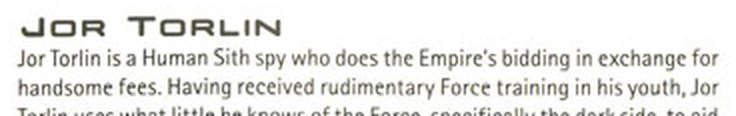
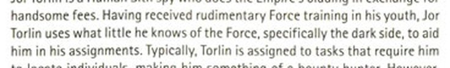
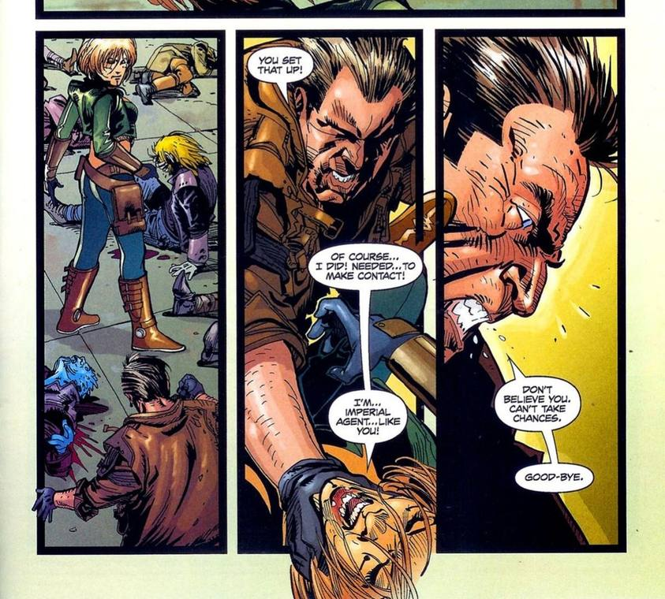
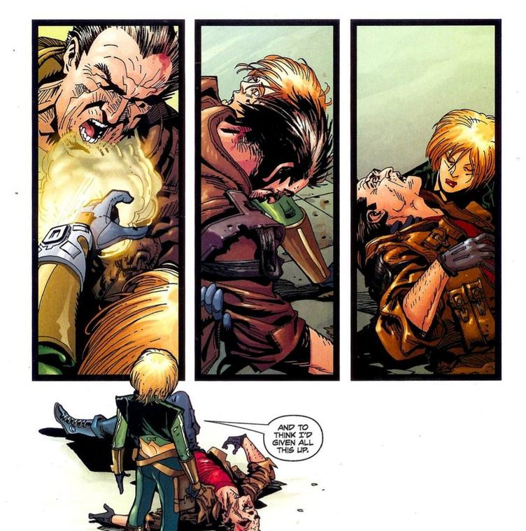
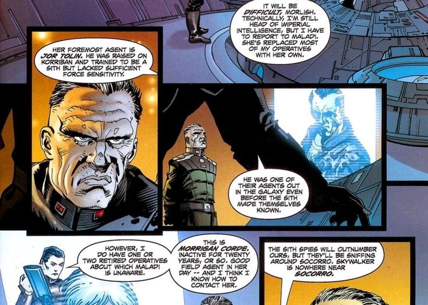
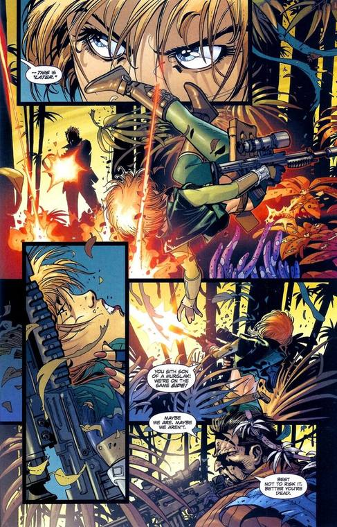
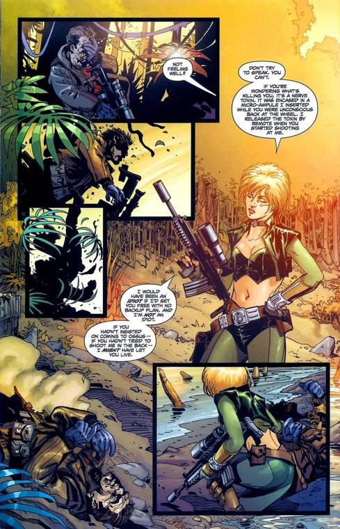

# Jor Torlin

- **Aliases:** —
- **Era:** —
- **Continuity:** default Legends; entries present for: Legends
- **Research tier:** untiered (not listed as INTRO/DEEP/MASTERY in legends-feats.md)
- **Entries:** 18 (9 with quotations; 0 quotations extended to the full sentence/passage from the source text on file; 5 marked as fragments). Rebuilt 2026-11-17 from 29 old entries; old file: `characters/_bak/jor-torlin.md.bak-20261117`.
- **How to read:** each entry is the quotation in full (block quote), then its source and point of view. "Note" lines are summaries from our notes, not quotations. `[fragment — full passage not on file]` means the source text is not on the box, so only the words in our notes are shown. Debate and forum material is in the last section and is unverified.

# LEGENDS (Legends / EU — main focus)

## The Complete Star Wars Encyclopedia, Vol. III (P–Z)

> Raider Sith assassin Jor Torlin's starship during the time of Emperor Roan Fel, it was stolen by Morrigan Corde after she killed him.
— Source: scan pages 81–120; Roan Fel. POV: Roan Fel, about Jor Torlin.
Note (our notes, around the quote): Roan Fel: "Raider Sith assassin Jor Torlin's starship during the time of Emperor Roan Fel, it was stolen by Morrigan Corde after she killed him." Source: The Complete Star Wars Encyclopedia, Vol. III, p.75
Our notes: `notes/materials/032-complete-star-wars-encyclopedia-vol-3/02-v3-scan-081-120.md:12`

## Sourcebooks/Legacy Era Campaign Guide.pdf [Star Wars Roleplaying Game Saga Edition (2007)] (scan pages 61–120)

> NICE TASTE IN WEAPONS, TORLIN. NICE SHIP TOO.
— Source: Sourcebooks/Legacy Era Campaign Guide.pdf [Star Wars Roleplaying Game Sag; Morrigan Corde; Jor Torlin — entry/section: Pull quote.
Note (our notes, around the quote): Morrigan Corde; Jor Torlin — entry/section: Pull quote: ""NICE TASTE IN WEAPONS, TORLIN. NICE SHIP TOO." —MORRIGAN CORDE" Source: *Legacy Era Campaign Guide* (SWRPG Saga Edition), scan p.87
Our notes: `notes/materials/037-sw-d20-folder/719-legacy-era-campaign-guide-scan-061-120.md:215`

## Sourcebooks/Legacy Era Campaign Guide.pdf [Star Wars Roleplaying Game Saga Edition (2007)] (scan pages 181–225)

- Note (summary from our notes, not a quotation): Page contents: Caption label: "JOR TORLIN". Jor Torlin stat block CL 11 (Medium Human scoundrel 5/scout 3/bounty hunter 3; Dark Side 14; heavy blaster rifle). (hand-read)
  — Source: Sourcebooks/Legacy Era Campaign Guide.pdf [Star Wars Roleplaying Game Sag.
Our notes: `notes/materials/037-sw-d20-folder/719-legacy-era-campaign-guide-scan-181-225.md:311`

## Star Wars: Legacy (Dark Horse, 2006–2010) single issues #20–#50, hand-read

> WE ARE, PURPORTEDLY, ALLIES, MASTER ANTARES. BUT, PLEASE, DO NOT ASSUME FOR A MOMENT THAT I WILL LET YOU HARM A FELLOW JEDI.
>
> MASTER YOURSELF. YOU DO YOUR EMPEROR NO CREDIT.
>
> FINISH YOUR POSTURING LATER, YOUNG MASTERS. HIS IMPERIAL MAJESTY REQUIRES HIS KNIGHTS IN HIS QUARTERS. IMMEDIATELY.
— Source: Star Wars: Legacy #49 — "Extremes, Part Two" (Jun 2010).
Note (our notes, around the quote): > "WE ARE, PURPORTEDLY, ALLIES, MASTER ANTARES. BUT, PLEASE, DO NOT ASSUME FOR A MOMENT THAT I WILL LET YOU HARM A FELLOW JEDI." / "MASTER YOURSELF. YOU DO YOUR EMPEROR NO CREDIT." (Shaak? — blue Twi'lek Jedi, likely T'ra Saa? flag; holding Draco's Force push) / "FINISH YOUR POSTURING LATER, YOUNG MASTERS. HIS IMPERIAL MAJESTY REQUIRES HIS KNIGHTS IN HIS QUARTERS. IMMEDIATELY." (Jagged Fel-style cyborg officer — Moff/General Ayrin? flag; cyborg = Jor Torlin? unidentified)
Our notes: `notes/materials/039-legacy-2006/legacy-49.md:56`

## Star Wars: Legacy Book 1 (omnibus): power-scaling notes with panels

- Note (summary from our notes, not a quotation): Maladi breaks Hosk with droids and her will (p197–200). Calixte reactivates "Morrigan Corde", her own alias (p201). Fel sends Draco and Krieg to escort Bovark to Admiral Stazi on the Wheel (p204–210). Corde brawls through thugs and captures Sith-trained agent Jor Torlin (p211–221). She uses C.O.L.D. limpet droids to sabotage the Imperial–GA talks. Draco and Krieg deflect fire, and Draco Force-pushes Admiral Stazi off Bovark (p225–231; corrected 2026-10-21: no guards are pushed). On Ossus, Corde kills Torlin with a nerve-toxin backup plan (p232–237). A flashback reveals she is Cade's mother (p238–240).
  — Source: Legacy Book 1 (omnibus): power-scaling notes with panels.
Our notes: `notes/materials/009-legacy-book-1.md:61`

> AND TO THINK I'D GIVEN ALL THIS UP.
>
> FORCE SENSITIVE. TRAINED ON KORRIBAN BY THE SITH -- THOUGH NOT STRONG ENOUGH IN THE FORCE TO BE TRULY SITH.
— Source: Legacy Book 1 (omnibus): power-scaling notes with panels.
Note (our notes, around the quote): Brawls through Wheel thugs bare-handed; subdues Sith-trained Jor Torlin. p211 (#9 Trust Issues)–p221 (#10 Trust Issues): "YOU WERE SAYING?" · "AND TO THINK I'D GIVEN ALL THIS UP." · (p220) "FORCE SENSITIVE. TRAINED ON KORRIBAN BY THE SITH -- THOUGH NOT STRONG ENOUGH IN THE FORCE TO BE TRULY SITH."
Our notes: `notes/materials/009-legacy-book-1.md:964`; `notes/materials/012-legacy-vol-2-shards.md:439`

- Note (summary from our notes, not a quotation): | 14 | Corde vs Wheel thugs and Jor Torlin | The Wheel / Ossus | p211–237 (#9–10) | Corde wins both | Torlin killed by a pre-planted toxin |
  — Source: Legacy Book 1 (omnibus): power-scaling notes with panels.
Context: | # | Fight | Where / when | Pages (issue) | Outcome | Conditions / outside help |
Our notes: `notes/materials/009-legacy-book-1.md:1058`

## Star Wars Saga Edition: *Legacy Era Campaign Guide* (WotC 2009): power-scaling notes with panels

> a Human Sith spy
> [fragment — full passage not on file]
>
> Having received rudimentary Force training in his youth
> [fragment — full passage not on file]
— Source: *Legacy Era Campaign Guide* (WotC 2009): power-scaling notes with panels; Jor Torlin (p214).
Note (our notes, around the quote): Jor Torlin (p214): "a Human Sith spy"; "Having received rudimentary Force training in his youth". CL 11; UtF +9; DS 14; hp 95.

Our notes: `notes/materials/011-legacy-era-campaign-guide.md:415`

- Note (summary from our notes, not a quotation): Sith: Darth Krayt (CL20), Darth Wyyrlok III (CL16), Darth Nihl (CL16), Darth Azard (CL15), Darth Maladi (CL15), Darth Talon (CL13), Darth Maleval (CL13), Jor Torlin (CL11).
  — Source: *Legacy Era Campaign Guide* (WotC 2009): power-scaling notes with panels.
Our notes: `notes/materials/011-legacy-era-campaign-guide.md:1101`

## Star Wars: Legacy Volume 2, *Shards* (TPB): power-scaling notes with panels

> LET'S JUST SKIP THE OPENING RITUAL. *(p73)*
>
> OF COURSE... I DID! NEEDED... TO MAKE CONTACT!
> [fragment — full passage not on file]
>
> DON'T BELIEVE YOU. CAN'T TAKE CHANCES.
>
> AND TO THINK I'D GIVEN ALL THIS UP. *(p79)*
— Source: Legacy Volume 2, *Shards* (TPB): power-scaling notes with panels.
Note (our notes, around the quote): 1. Corde vs Torlin and the Wheel gang. p72 (#9)–p79 (#9) [009 p211–218]. Torlin starts the brawl: "LET'S JUST SKIP THE OPENING RITUAL." (p73). Corde had set the gang on him: "OF COURSE... I DID! NEEDED... TO MAKE CONTACT!" Torlin strangles her: "DON'T BELIEVE YOU. CAN'T TAKE CHANCES." "GOOD-BYE." (p78). She shocks him unconscious with her gauntlet: "AND TO THINK I'D GIVEN ALL THIS UP." (p79).

Our notes: `notes/materials/012-legacy-vol-2-shards.md:363`

- Note (summary from our notes, not a quotation): 
  — Source: Legacy Volume 2, *Shards* (TPB): power-scaling notes with panels.
(*Panel: p78 — `p078-torlin-strangles-corde.jpg`*)
Our notes: `notes/materials/012-legacy-vol-2-shards.md:365`

- Note (summary from our notes, not a quotation): 
  — Source: Legacy Volume 2, *Shards* (TPB): power-scaling notes with panels.
(*Panel: p79 — `p079-corde-shocks-torlin.jpg`*)
Our notes: `notes/materials/012-legacy-vol-2-shards.md:368`

> HER FOREMOST AGENT IS JOR TOLIN [sic]. HE WAS RAISED ON KORRIBAN AND TRAINED TO BE A SITH BUT LACKED SUFFICIENT FORCE SENSITIVITY.
>
> FORCE SENSITIVE. TRAINED ON KORRIBAN BY THE SITH -- THOUGH NOT STRONG ENOUGH IN THE FORCE TO BE TRULY SITH.
>
> SITH AT HEART, THOUGH, AND GOOD AT WHAT YOU DO
> [fragment — full passage not on file]
— Source: Legacy Volume 2, *Shards* (TPB): power-scaling notes with panels; 2. Torlin's Force status. p62 (#9), Calixte.
Note (our notes, around the quote): 2. Torlin's Force status. p62 (#9), Calixte: "HER FOREMOST AGENT IS JOR TOLIN [sic]. HE WAS RAISED ON KORRIBAN AND TRAINED TO BE A SITH BUT LACKED SUFFICIENT FORCE SENSITIVITY." · p81 (#10), Corde: "FORCE SENSITIVE. TRAINED ON KORRIBAN BY THE SITH -- THOUGH NOT STRONG ENOUGH IN THE FORCE TO BE TRULY SITH." · "SITH AT HEART, THOUGH, AND GOOD AT WHAT YOU DO".

Our notes: `notes/materials/012-legacy-vol-2-shards.md:371`

- Note (summary from our notes, not a quotation): 
  — Source: Legacy Volume 2, *Shards* (TPB): power-scaling notes with panels.
(*Panel: p62 — `p062-jor-tolin-dossier.jpg`*)
Our notes: `notes/materials/012-legacy-vol-2-shards.md:373`

> (p94) **Torlin**: "-- THIS IS 'LATER.'" · **Corde**: "YOU SITH SON OF A MURGLAK! WE'RE ON THE SAME SIDE!" · **Torlin**: "MAYBE WE ARE. MAYBE WE AREN'T." "BEST NOT TO RISK IT. BETTER YOU'RE DEAD." · (p97) Corde: "IT WAS ENCASED IN A MICRO-AMPULE I INSERTED WHILE YOU WERE UNCONSCIOUS BACK AT THE WHEEL." · "I WOULD HAVE BEEN AN IDIOT IF I'D SET YOU FREE WITH NO BACKUP PLAN. AND I'M NOT AN IDIOT." · (p98) "STORY OF YOUR LIFE, TORLIN. GOOD, BUT NOT GOOD ENOUGH."
> [fragment — full passage not on file]
— Source: Legacy Volume 2, *Shards* (TPB): power-scaling notes with panels.
Context: 3. Corde kills Torlin with a pre-planted nerve toxin. p93 (#10)–p98 (#10) [009 p232–237]

Our notes: `notes/materials/012-legacy-vol-2-shards.md:376`

- Note (summary from our notes, not a quotation): 
  — Source: Legacy Volume 2, *Shards* (TPB): power-scaling notes with panels.
(*Panel: p94 — `p094-murglak-sniper-duel.jpg`*)
Our notes: `notes/materials/012-legacy-vol-2-shards.md:379`

- Note (summary from our notes, not a quotation): 
  — Source: Legacy Volume 2, *Shards* (TPB): power-scaling notes with panels.
(*Panel: p97 — `p097-corde-nerve-toxin.jpg`*)
Our notes: `notes/materials/012-legacy-vol-2-shards.md:382`

> I'VE HAD SOME SUCCESS IN SHIELDING MY THOUGHTS FROM FORCE USERS.
— Source: Legacy Volume 2, *Shards* (TPB): power-scaling notes with panels; 4. Shields her thoughts (claim). p23 (#8).
Note (our notes, around the quote): 4. Shields her thoughts (claim). p23 (#8): "I'VE HAD SOME SUCCESS IN SHIELDING MY THOUGHTS FROM FORCE USERS." · "YOU, FOR EXAMPLE." (to Fel).
Our notes: `notes/materials/012-legacy-vol-2-shards.md:385`

# Debate and forum claims (unverified)

Forum posts, Suspect Insight debates and Discord debates, respect threads, and verdicts. These are posters' arguments or quotations they typed; none is checked against the book here unless the entry says so.

_None in our notes._
