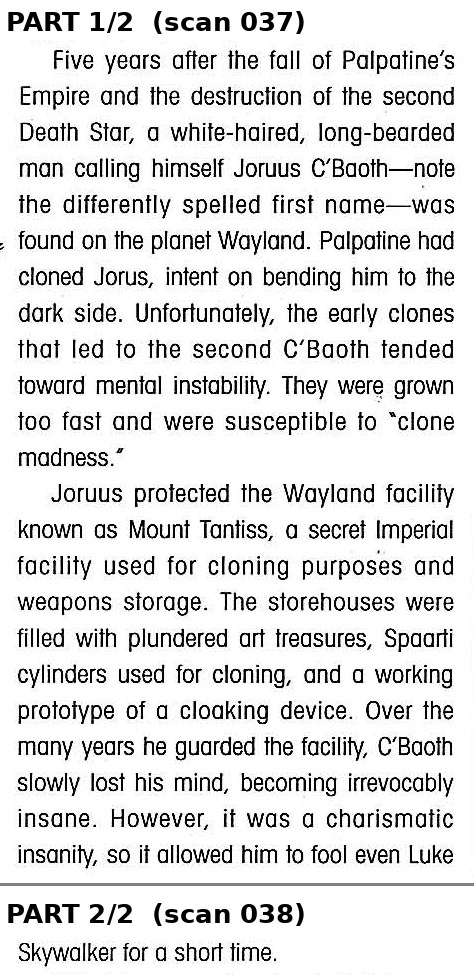
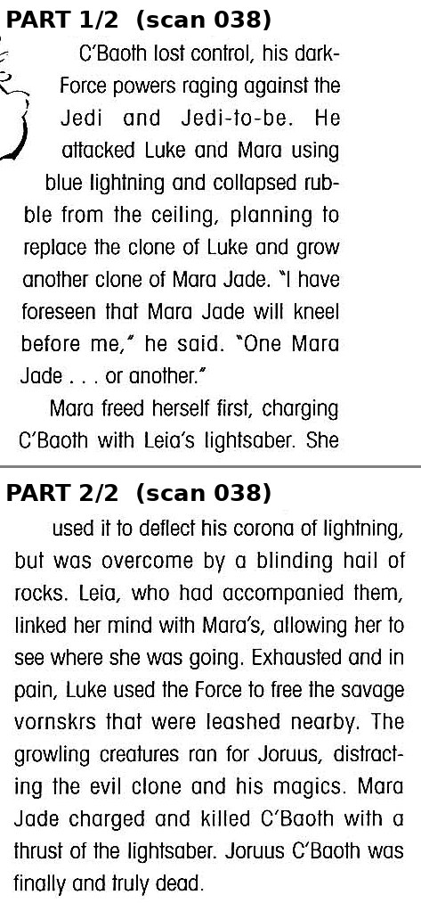
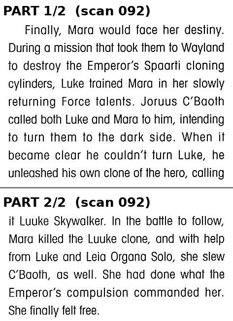

# Joruus C'baoth

- **Aliases:** Joruus, C'baoth, C’baoth
- **Era:** NR
- **Continuity:** default Legends; entries present for: Canon, Legends
- **Research tier:** DEEP
- **Entries:** 362 (286 with quotations; 4 quotations extended to the full sentence/passage from the source text on file; 155 marked as fragments; 322 before the 2026-11-17 fragment fill). Rebuilt 2026-11-17 from 526 old entries; old file: `characters/_bak/joruus-cbaoth.md.bak-20261117`.
- **How to read:** each entry is the quotation in full (block quote), then its source and point of view. "Note" lines are summaries from our notes, not quotations. `[fragment — full passage not on file]` means the source text is not on the box, so only the words in our notes are shown. Debate and forum material is in the last section and is unverified.

# LEGENDS (Legends / EU — main focus)

## Jedi Academy Trilogy (Kevin J. Anderson, 1994): Jedi Search, Dark Apprentice, Champions of the Force (power-scaling notes)

> He heard them stirring, not speaking to each other, each one no doubt wrapped up in thoughts of touching the Force, finding new pathways to inner strength and windows to the universe that only Jedi teachings could open for them. Their collective talent amazed him, but he hoped for even more trainees. Soon Han Solo would send his young friend, Kyp Durron; and Luke had strongly hinted for his former opponent Mara Jade to join them, since they had struck an uneasy truce during the battle against Joruus C’baoth.
— Source: Dark Apprentice, ch.5, PDF p.53 — Owner Material 026 — Jedi Academy Trilogy: Dark Apprentice (Kevin J. Anderson); Luke hopes Mara will join (also: Mara Jade, Joruus C'baoth). POV: Luke hopes Mara will join, about Joruus C'baoth.
(Excerpt widened 2026-11-17 to the relevant passage, word for word from Dark Apprentice (Kevin Anderson), Chapter 5 (text copy `MEGA_Legend_The_Jedi_Academy_Trilogy_Star_Wars_Jedi_Academy_02_Dark_Apprentice_Kevin_J_Anderson_epub`).)
Note (our notes, around the quote): Luke hopes Mara will join (also: Mara Jade, Joruus C'baoth): "Soon Han Solo would send his young friend, Kyp Durron; and Luke had strongly hinted for his former opponent Mara Jade to join them, since they had struck an uneasy truce during the battle against Joruus C’baoth." Source: Dark Apprentice, ch.5, PDF p.53
Our notes: `notes/materials/026-jedi-academy-trilogy/dark-apprentice.md:49`

> Senator Bel Iblis raised himself slowly to his feet. “A comment, if I may? I’m sorry, Luke, but I have to raise the question—we’ve already seen the terrible damage a Jedi can cause if he allows himself to be swayed by the dark side. We just recently fought against Joruus C’baoth, and of course Darth Vader nearly caused the death of us all. If a teacher as great as Obi-Wan Kenobi could fail and let his student fall to evil, how can we take the risk of training an entire new order of Jedi Knights? How many will turn to the dark side? How many new enemies will we make for ourselves?”
— Source: Jedi Search, ch.2, PDF p.26 — Owner Material 026 — Jedi Academy Trilogy: Jedi Search (Kevin J. Anderson).
(Excerpt widened 2026-11-17 to the relevant passage, word for word from Jedi Search (Kevin Anderson) (text copy `MEGA_Legend_The_Jedi_Academy_Trilogy_Star_Wars_Jedi_Academy_01_Jedi_Search_Kevin_J_Anderson_epub`).)
Note (our notes, around the quote): Senator Bel Iblis warns the Senate about fallen Jedi; Luke answers (also: Joruus C'baoth, Darth Vader): "“A comment, if I may? I’m sorry, Luke, but I have to raise the question—we’ve already seen the terrible damage a Jedi can cause if he allows himself to be swayed by the dark side. We just recently fought against Joruus C’baoth, and of course Darth Vader nearly caused the death of us all. If a teacher as great as Obi-Wan Kenobi could fail and let his student fall to evil, how can we take the risk of training an entire new order of Jedi Knights? How many will turn to the dark side? How many new enemies will we make for ourselves?”" Source: Jedi Search, ch.2, PDF p.26
Our notes: `notes/materials/026-jedi-academy-trilogy/jedi-search.md:44`

> Leia heaved a sigh and slumped back in the self-conforming chair. Luke tried to cover his disappointment as he remembered his own training. Yoda had made him stand on his head while balancing rocks and other heavy objects. Luke had received other training from the twisted Joruus C’baoth, and he had learned the depths of the dark side from the resurrected Emperor himself.
— Source: Jedi Search, ch.3, PDF p.37 — Owner Material 026 — Jedi Academy Trilogy: Jedi Search (Kevin J. Anderson).
(Excerpt widened 2026-11-17 to the relevant passage, word for word from Jedi Search (Kevin Anderson), Chapter 3 (text copy `MEGA_Legend_The_Jedi_Academy_Trilogy_Star_Wars_Jedi_Academy_01_Jedi_Search_Kevin_J_Anderson_epub`).)
Note (our notes, around the quote): Luke on his own training and Leia’s block (also: Leia Organa Solo, Joruus C'baoth, Palpatine (the Emperor)): "Luke tried to cover his disappointment as he remembered his own training. Yoda had made him stand on his head while balancing rocks and other heavy objects. Luke had received other training from the twisted Joruus C’baoth, and he had learned the depths of the dark side from the resurrected Emperor himself." Source: Jedi Search, ch.3, PDF p.37
Our notes: `notes/materials/026-jedi-academy-trilogy/jedi-search.md:46`

## Star Wars: The New Essential Chronology (Del Rey, 2005): power-scaling and lore notes

> The third item was the mad Jedi Joruus C'baoth, apparently a clone of the Jorus C'baoth who had led the Outbound Flight mission. C'baoth had been stranded on Wayland for years and had gone completely insane.
— Source: Part Seven: Empire Resurgent; Joruus C'baoth; Grand Admiral Thrawn — Joruus C'baoth on Wayland.
Note (our notes, around the quote): Joruus C'baoth; Grand Admiral Thrawn — Joruus C'baoth on Wayland: "The third item was the mad Jedi Joruus C'baoth, apparently a clone of the Jorus C'baoth who had led the Outbound Flight mission. C'baoth had been stranded on Wayland for years and had gone completely insane." Source: The New Essential Chronology, p.148
Our notes: `notes/materials/027-new-essential-chronology/07-part-seven-empire-resurgent.md:13`

> Joruus C'baoth held up his end of the bargain, Force-linking the ships of Thrawn's fleet into a supernatural fighting force.
— Source: Part Seven: Empire Resurgent; Joruus C'baoth; Grand Admiral Thrawn — Force-linked fleet.
Note (our notes, around the quote): Joruus C'baoth; Grand Admiral Thrawn — Force-linked fleet: "Joruus C'baoth held up his end of the bargain, Force-linking the ships of Thrawn's fleet into a supernatural fighting force." Source: The New Essential Chronology, p.148
Our notes: `notes/materials/027-new-essential-chronology/07-part-seven-empire-resurgent.md:15`

> Admiral Ackbar was reinstated as fleet commander, the finandal scandal having been revealed as an Imperial setup.
>
> On Coruscant, Leia Organa Solo gave birth to twins, a boy and a girl—Jacen and Jaina-who were to join the new gen- eration of Jedi Knights.
>
> _ Because she had been an Emperor's Hand, Mara Jaxie had known many of Palpatine’s srets—inciuding the location of the Mount Tantiss Goning fadiity on Wayland. Mara ki Luke Skywalker, Han Solo, Chewbacca, Lando Calrissian, and their droids to Wayland to destray Thrawn’s ready-made soldier fac tory. Upon reaching Mount Tantiss, Luke and Mara headed for the Emperor's throne room. Waiting for them on the throne, Ike an arachnid at the center of Its web, was Joruus Cbaoth, The demented Jedi Master was easily a match for both Skywalker and Jade combined. While he toyed with them, he unleashed a shocking surprise: Cbaoth had grown a special clone from Skywalker's own genetic material, taken from the hand Luke had lost at Cloud City, The mindless drone, Luuke Skywalker, was his exact duplicate.
>
> The cone had a lightsaber as well-the blue-bladed saber that had once belonged to Anakin Skywalker, a weapon that had been considered lost since the agic events in Goud City.
— Source: Part Seven: Empire Resurgent.
(Excerpt widened 2026-11-17 to the relevant passage, word for word from research primary new essential chronology nec paged (text copy `research_primary_new_essential_chronology_nec_paged_txt_88b808b5bc`).)
(Excerpt widened 2026-11-17 to the relevant passage, word for word from research primary new essential chronology nec paged (text copy `research_primary_new_essential_chronology_nec_paged_txt_88b808b5bc`).)
Note (our notes, around the quote): Joruus C'baoth; Luke Skywalker; Mara Jade Skywalker — C'baoth a match for both: "The demented Jedi Master was easily a match for both Skywalker and Jade combined." Source: The New Essential Chronology, p.152
Our notes: `notes/materials/027-new-essential-chronology/07-part-seven-empire-resurgent.md:51`

> The doubles squared off in a frenzied duel. Though she had often expressed her desire to murder the man who had brought about the Emperor's death, Mara Jade ended the combat by killing the Luke clone. C'baoth, in a fit of rage, collapsed the chamber's ceiling, but Mara skewered him cleanly through the torso.
— Source: Part Seven: Empire Resurgent.
Note (our notes, around the quote): Mara Jade Skywalker; Luke Skywalker; Joruus C'baoth — Mara kills Luuke and C'baoth: "The doubles squared off in a frenzied duel. Though she had often expressed her desire to murder the man who had brought about the Emperor's death, Mara Jade ended the combat by killing the Luke clone. C'baoth, in a fit of rage, collapsed the chamber's ceiling, but Mara skewered him cleanly through the torso." Source: The New Essential Chronology, p.152
Our notes: `notes/materials/027-new-essential-chronology/07-part-seven-empire-resurgent.md:53`

## Star Wars Saga Edition: Jedi Academy Training Manual (WotC, 2009): power-scaling and lore notes

- Note (summary from our notes, not a quotation): Luke Skywalker; Grand Admiral Thrawn; Joruus C'baoth; Mara Jade Skywalker — Grand Master Luke Skywalker — Thrawn era: "Skywalker is faced with two threats related to Thrawn. One is a mad clone of the old Jedi Master Jorus C'Baoth. The clone "Joruus" tempts Skywalker toward the dark side but is defeated. The other threat is Mara Jade, an assassin with her sights set on Luke Skywalker." Source: Jedi Academy Training Manual, p.100
  — Source: Chapter V: Instructors and Alumni.
Our notes: `notes/materials/028-jedi-academy-training-manual/05-ch5-instructors-and-alumni.md:51`

## The Jedi Academy Sourcebook (WEG, 1996): power-scaling and lore notes

> While training Leia, he probes her mind and finds an area which instinctively “knocks back” the prober if the subject is Force-sensitive. At almost the same time, he discovers a scanning device the Empire used to ferret out Force-sensitive people.
>
> By combining these discoveries with an exhaus- tive electronic search of galactic computer nets, Luke has the means to conduct his search for potential Jedi candidates.
>
> Though he easily convinces the New Repub- lic Senate that founding a Jedi academy is an The Jedi Academy Sourcebook === sp34 OO OWN Ir reer irs seen es oreo pemnnnee A NMS Oye o °° MERE, The Jedi Academy Sourcebook === sp35 important step toward restoring the values of the Old Republic, Luke is not entirely confident in his own ability to train a new. generation of Jedi Knights. He knows that he had good role models in Obi-Wan Kenobi and Yoda, but his recent experiences with Joruus C'baoth and the resurrected Emperor make him cautious.
>
> Though he easily convinces the New Repub- lic Senate that founding a Jedi academy is an The Jedi Academy Sourcebook === sp34 OO OWN Ir reer irs seen es oreo pemnnnee A NMS Oye o °° MERE, The Jedi Academy Sourcebook === sp35 important step toward restoring the values of the Old Republic, Luke is not entirely confident in his own ability to train a new. generation of Jedi Knights. He knows that he had good role models in Obi-Wan Kenobi and Yoda, but his recent experiences with Joruus C'baoth and the resurrected Emperor make him cautious. And ever-present at the back of his mind is the harsh lesson Kenobilearned in taking Anakin Skywalker as a student before he was truly prepared to teach Jedi. Luke wonders whether he has the strength to bring back a student who gives in to the dark side.
— Source: Chapter Three: The Jedi Academy.
(Excerpt widened 2026-11-17 to the relevant passage, word for word from research primary jedi academy sourcebook jas clean (text copy `research_primary_jedi_academy_sourcebook_jas_clean_txt_04b8ab0d44`).)
(Excerpt widened 2026-11-17 to the relevant passage, word for word from research primary jedi academy sourcebook jas clean (text copy `research_primary_jedi_academy_sourcebook_jas_clean_txt_04b8ab0d44`).)
(Full sentence/passage taken from the source text on file: `research_primary_jedi_academy_sourcebook_jas_clean_txt`.)
Note (our notes, around the quote): Luke Skywalker; Joruus C'baoth; Palpatine (Darth Sidious) — Luke Skywalker — caution as a teacher: "his recent experiences with Joruus C'baoth and the resurrected Emperor make him cautious." Source: The Jedi Academy Sourcebook, p.34
Our notes: `notes/materials/029-jedi-academy-sourcebook/03-ch3-the-jedi-academy.md:47`

## The Complete Star Wars Encyclopedia, Vol. I (A–G)

> She was shot down at Oradin by Baron Soontir Fe!. Though she survived the jorus Cbaoth, the Jedi Master who oversaw Outbound Flight
>
> A recent recruit, Cayr did not participate in the Battle of Endor. She was shot down at Oradin by Baron Soontir Fe!. Though she survived the jorus Cbaoth, the Jedi Master who oversaw Outbound Flight
>
> Cel, Lieutenant e Joruus Cbaoth was powerful with the dark side of the Force, but also insane. by the Chiss Expansionary Defense Fleet under the command of Field Commander Thrawn.
>
> Thrawn's cunning tactics made short work of the vessels, though in his rage over seeing his dream destroyed, C'baoth reached out with the dark side of the Force and attempted to strangle Thrawn. C'baoth died when a radiation bomb detonated on his Dreadnaught.
>
> C'baoth's arrogance was his undoing, as the Outbound Flight expedition was intercepted jorus Cbaoth, theJedi Master who oversaw Outbound Flight Joruus Cbaoth was powerful with the dark side of the Force, but also insane. by the Chiss Expansionary Defense Fleet under the command of Field Commander Thrawn. Thrawn's cunning tactics made short work of the vessels, though in his rage over seeing his dream destroyed, C'baoth reached out with the dark side ofthe Force and attempted to strangle Thrawn. C'baoth died when a radiation bomb detonated on his Dreadnaught. Somehow C'baoth's genetic material was harvested and the Jedi Master was cloned. The telltale side effects ofmental instabilityand self­ name mispronunciation indicated that ]oruus C'baoth was the result of hasty Spaarti-based cloning. Decades after the Outbound Flight in­ cident, Thrawn had risen to the rank of Grand Admiral in the Imperial Navy.
— Source: scan pages 121–160; Grand Admiral Thrawn; Joruus C'baoth.
(Excerpt widened 2026-11-17 to the relevant passage, word for word from research audit work src m030 (text copy `research_audit_work_src_m030_txt_69ea9f4a41`).)
(Excerpt widened 2026-11-17 to the relevant passage, word for word from research primary cse vol1 (text copy `research_primary_cse_vol1_pdf_45a954be6d`).)
(Excerpt widened 2026-11-17 to the relevant passage, word for word from research audit work src m030 (text copy `research_audit_work_src_m030_txt_69ea9f4a41`).)
Note (our notes, around the quote): Grand Admiral Thrawn; Joruus C'baoth: "Thrawn's cunning tactics made short work of the vessels, though in his rage over seeing his dream destroyed, C'baoth reached out with the dark side of the Force and attempted to strangle Thrawn." Source: The Complete Star Wars Encyclopedia, Vol. I, p.113
Our notes: `notes/materials/030-complete-star-wars-encyclopedia-vol-1/03-v1-scan-121-160.md:63`

> Covell, General Freja Although a fairly young man himself, this Imperial officer was placed in charge of the Empire's young and inexperienced ground troops by Grand Admi­ ral Thrawn. The legendary General Veers saw Covell as ayoungerversion ofhimselfwhen he served as Veers's first officer during the Battle of Hoth. Captain Pellaeon promoted Covell to major general in charge of Chimaera's ground troops after the Battle of Endor. Thrawn gave him the rank ofgeneral when he returned, and he immediately began training his troops for real battle. General Covell wanted to regain the Core Worlds, such as Coruscant, from the New Republic. But he never got to fulfill his Cowaye dreams. General Covell died on the planet Wayland after the mad clone Jedi, Joruus C'baoth; destroyed his mind. Covenant,theA secret enclave of Jedi Knights formed by Lady Krynda Draay, active 4,000 years before the Battle of Yavin. These talented seers were devoted to stopping any hint of a Sith uprising following the devastation of the Great Sith War. Their members included Lucien Draay, Krynda's son; Q'Anilia, a Miralukan seer; Xanar, a Khil; Raana Tey, a Togruta; and Fein, a Feeorin. The vast Draay fortune was funneled through numerous fronts and investments in preparation for defense of the galaxy.
— Source: scan pages 161–200; Joruus C'baoth. POV: Joruus C'baoth.
(Excerpt widened 2026-11-17 to the relevant passage, word for word from research primary cse vol1 (text copy `research_primary_cse_vol1_pdf_45a954be6d`).)
(Excerpt widened 2026-11-17 to the relevant passage, word for word from research primary cse vol1 (text copy `research_primary_cse_vol1_pdf_45a954be6d`).)
Note (our notes, around the quote): Joruus C'baoth: "General Covell died on the planet Wayland after the mad clone Jedi, Joruus C'baoth, destroyed his mind." Source: The Complete Star Wars Encyclopedia, Vol. I, p.149
Our notes: `notes/materials/030-complete-star-wars-encyclopedia-vol-1/04-v1-scan-161-200.md:35`

> When C'baoth destroyed a slinker missile that was supposed to assassinate both Gilfrome and Passel Argente, C'baoth was securing mining rights for the Brolfi while protecting the Corporate Alliance's investments on Barlok.
— Source: scan pages 321–360; Joruus C'baoth. POV: Joruus C'baoth.
Note (our notes, around the quote): Joruus C'baoth: "When C'baoth destroyed a slinker missile that was supposed to assassinate both Gilfrome and Passel Argente, C'baoth was securing mining rights for the Brolfi while protecting the Corporate Alliance's investments on Barlok." Source: The Complete Star Wars Encyclopedia, Vol. I, p.341
Our notes: `notes/materials/030-complete-star-wars-encyclopedia-vol-1/08-v1-scan-321-360.md:249`

> Guard A group of Viraxo Razor starfighters used to harass the Azzameen's shipping operations. guardglobeA form of remote, it was used by Dr. Arakkus to guard his fortress in the Graveyard of Lost Ships. Guard globes pa­ trolled the corridors and were programmed to intercept intruders. Guardian ( I ) A style of double-bladed lightsaber hilt, it was sometimes used by the new Order of Jedi Knights who were trained by Luke Skywalker at the height of the New Republic. The Guardian had wide, angled emitter shrouds that protected each end of the weapon, giving it the appearance of a two­ bladed dagger when inactive. Guardian (1)The title used by the being sent by Emperor Palpatine to guard the Mount Tantiss storehouse on the planet Wayland. It was believed that the Guardian was killed by Joruus C'baoth when he arrived on Wayland. Guardian (3) The largest Spook crystals found on Narn Chorios-often formed into tsil­ these sentient crystals controlled the actions of the smaller Spook crystals found on the planet. Guardian (I)A Super-class Star Destroyer under the command of Admiral Drommel, it was badly damaged in the Battle ofTantive V with New Republic forces about three years after the Battle of Endor. Later, the New Republic recovered and refit the ship. The Guardian was later deployed to Kashyyyk during the Yuuzhan Vong War.
— Source: scan pages 361–398; Joruus C'baoth. POV: Joruus C'baoth.
(Excerpt widened 2026-11-17 to the relevant passage, word for word from research primary cse vol1 (text copy `research_primary_cse_vol1_pdf_45a954be6d`).)
(Excerpt widened 2026-11-17 to the relevant passage, word for word from research primary cse vol1 (text copy `research_primary_cse_vol1_pdf_45a954be6d`).)
Note (our notes, around the quote): Joruus C'baoth: "It was believed that the Guardian was killed by Joruus C'baoth when he arrived on Wayland." Source: The Complete Star Wars Encyclopedia, Vol. I, p.373
Our notes: `notes/materials/030-complete-star-wars-encyclopedia-vol-1/09-v1-scan-361-398.md:233`

## The Complete Star Wars Encyclopedia, Vol. II (H–O)

> Lorana only survived Thrawn's attack because she had been ordered by C'baoth to lock up a group of rebellious engineers in the central core of the ship.
— Source: scan pages 161–200; Grand Admiral Thrawn; Joruus C'baoth.
Note (our notes, around the quote): Grand Admiral Thrawn; Joruus C'baoth: "Lorana only survived Thrawn's attack because she had been ordered by C'baoth to lock up a group of rebellious engineers in the central core of the ship." Source: The Complete Star Wars Encyclopedia, Vol. II, p.166
Our notes: `notes/materials/031-complete-star-wars-encyclopedia-vol-2/04-v2-scan-161-200.md:91`

> With his last breath, Ma'Ning told C'baoth's Padawan, Lorana Jinzler, that a more devastating attack was coming now that C'baoth had given himself over to the dark side of the Force.
— Source: scan pages 281–320; Joruus C'baoth. POV: Joruus C'baoth.
Note (our notes, around the quote): Joruus C'baoth: "With his last breath, Ma'Ning told C'baoth's Padawan, Lorana Jinzler, that a more devastating attack was coming now that C'baoth had given himself over to the dark side of the Force." Source: The Complete Star Wars Encyclopedia, Vol. II, p.285
Our notes: `notes/materials/031-complete-star-wars-encyclopedia-vol-2/07-v2-scan-281-320.md:94`

> Crazed Jedi clone Joruus C'baoth arrived on Wayland, defeated the Guardian, and took control of the Imperial interests.
— Source: scan pages 321–360; Joruus C'baoth. POV: Joruus C'baoth.
Note (our notes, around the quote): Joruus C'baoth: "Crazed Jedi clone Joruus C'baoth arrived on Wayland, defeated the Guardian, and took control of the Imperial interests." Source: The Complete Star Wars Encyclopedia, Vol. II, p.337
Our notes: `notes/materials/031-complete-star-wars-encyclopedia-vol-2/08-v2-scan-321-360.md:162`

## The Complete Star Wars Encyclopedia, Vol. III (P–Z)

> When the mad Jedi clone Joruus C'baoth called both Luke and Mara to him, then unleashed Skywalker's clone, Luuke, Mara killed the Skywalker clone—and finally C'baoth, too, with help from Luke and Leia Organa Solo.
— Source: scan pages 161–200; Joruus C'baoth; Luke Skywalker; Mara Jade Skywalker; Leia Organa Solo.
Note (our notes, around the quote): Joruus C'baoth; Luke Skywalker; Mara Jade Skywalker; Leia Organa Solo: "When the mad Jedi clone Joruus C'baoth called both Luke and Mara to him, then unleashed Skywalker's clone, Luuke, Mara killed the Skywalker clone—and finally C'baoth, too, with help from Luke and Leia Organa Solo." Source: The Complete Star Wars Encyclopedia, Vol. III, p.166
Our notes: `notes/materials/032-complete-star-wars-encyclopedia-vol-3/04-v3-scan-161-200.md:151`

> Some five years later, mad Jedi clone Joruus C'baoth coordinated an Imperial attack on Taanab, where he used the turbolasers of the Bellicose to destroy a New Republic ship against the direct orders of Captain Aban.
— Source: scan pages 201–240; Joruus C'baoth. POV: Joruus C'baoth.
Note (our notes, around the quote): Joruus C'baoth: "Some five years later, mad Jedi clone Joruus C'baoth coordinated an Imperial attack on Taanab, where he used the turbolasers of the Bellicose to destroy a New Republic ship against the direct orders of Captain Aban." Source: The Complete Star Wars Encyclopedia, Vol. III, p.209
Our notes: `notes/materials/032-complete-star-wars-encyclopedia-vol-3/05-v3-scan-201-240.md:140`

## The New Essential Guide to Characters (2002)

> Inside Wayland's Mount Tantiss complex, Mara killed two clones— the mad Jedi Master Joruus C'baoth and a clone duplicate of Luke Skywalker, thus fulfilling—on a technicality—the Emperor's final command.
— Source: scan pages 151–180; Mara Jade Skywalker; Joruus C'baoth; Luke Skywalker.
Note (our notes, around the quote): Mara Jade Skywalker; Joruus C'baoth; Luke Skywalker: "Inside Wayland's Mount Tantiss complex, Mara killed two clones— the mad Jedi Master Joruus C'baoth and a clone duplicate of Luke Skywalker, thus fulfilling—on a technicality—the Emperor's final command." Source: The New Essential Guide to Characters, p.162
Our notes: `notes/materials/034-new-essential-guide-to-characters/05-negc-scan-151-180.md:52`

> An insane clone of the Jedi Master Jorus C'baoth, Joruus assisted Grand Admiral Thrawn in waging war against the New Republic before being killed by Mara Jade on Wayland.
— Source: scan pages 181–210; Joruus C'baoth; Grand Admiral Thrawn; Mara Jade Skywalker.
Note (our notes, around the quote): Joruus C'baoth; Grand Admiral Thrawn; Mara Jade Skywalker: "An insane clone of the Jedi Master Jorus C'baoth, Joruus assisted Grand Admiral Thrawn in waging war against the New Republic before being killed by Mara Jade on Wayland." Source: The New Essential Guide to Characters, p.208
Our notes: `notes/materials/034-new-essential-guide-to-characters/06-negc-scan-181-210.md:146`

## Sourcebooks/Star Wars Roleplaying Game Core Rulebook.pdf [Star Wars Roleplaying Game (d20, 2000)] (scan pages 241–300)

> Only when the mad Jedi clone Joruus C'Baoth attempted to turn them both to the dark side, and Mara slew a clone of Luke Skywalker, did she finally feel as though she had fulfilled her duty to the Emperor.
— Source: Sourcebooks/Star Wars Roleplaying Game Core Rulebook.pdf [Star Wars Rolep.
Note (our notes, around the quote): Mara Jade Skywalker; Luke Skywalker — entry/section: Key Characters: Mara Jade Skywalker: "Only when the mad Jedi clone Joruus C'Baoth attempted to turn them both to the dark side, and Mara slew a clone of Luke Skywalker, did she finally feel as though she had fulfilled her duty to the Emperor." Source: *Star Wars Roleplaying Game Core Rulebook* (SWRPG d20), scan p.246
Our notes: `notes/materials/037-sw-d20-folder/046-star-wars-roleplaying-game-core-rulebook-scan-241-300.md:83`

## Jedi Counselling/Jedi Counseling 18 - Cortosis Bullets.pdf [Star Wars Roleplaying Game Revised Core (d20, 2002)]

- Note (summary from our notes, not a quotation): Grand Admiral Thrawn; Joruus C'baoth — entry/section: Ysalamiri in a backpack: "A: It sounds like your player has read Timothy Zahn's "Thrawn Trilogy," in which Grand Admiral Thrawn uses ysalamiri in a cage to protect himself from Joruus C'baoth. There's nothing technically wrong with what he's done, but if you want to take the ysalamiri away, the smart thing to do is have someone simply shoot them. Or you could just have the character caught in an explosion or two. If he fails his save, his backpack -- and anything in it -- should also suffer damage." Source: *Jedi Counseling 18 - Cortosis Bullets* (SWRPG d20 Revised Core), scan p.3
  — Source: Jedi Counselling/Jedi Counseling 18 - Cortosis Bullets.pdf [Star Wars Rol.
Our notes: `notes/materials/037-sw-d20-folder/181-jedi-counseling-18-cortosis-bullets.md:24`

## Sourcebooks/Revised Core Rulebook.pdf [Star Wars Roleplaying Game Revised Core (d20, 2002)] (scan pages 301–360)

> Only after the mad Jedi clone Joruus C'baoth attempts to turn them both to the dark side, and Mara slays a clone of Luke Skywalker, does she feel as though she has fulfilled her last duty to the Emperor.
— Source: Sourcebooks/Revised Core Rulebook.pdf [Star Wars Roleplaying Game Revised.
Note (our notes, around the quote): Mara Jade Skywalker; Joruus C'baoth; Luke Skywalker — entry/section: Mara Jade (Revised Core Rulebook, Ch13): "Only after the mad Jedi clone Joruus C'baoth attempts to turn them both to the dark side, and Mara slays a clone of Luke Skywalker, does she feel as though she has fulfilled her last duty to the Emperor." Source: *Revised Core Rulebook* (SWRPG d20 Revised Core), scan p.311
Our notes: `notes/materials/037-sw-d20-folder/671-revised-core-rulebook-scan-301-360.md:130`

- Note (summary from our notes, not a quotation): Page contents: 740 words, 24 paragraphs | headings/entries: Mace Windu; MACE WINDU; Jdorus C'baoth
  — Source: Sourcebooks/Revised Core Rulebook.pdf [Star Wars Roleplaying Game Revised.
Our notes: `notes/materials/037-sw-d20-folder/671-revised-core-rulebook-scan-301-360.md:156`

> Jorus C’baoth achieves the title of Jedi Master not through training an apprentice, but purely on the weight of his accomplishments.
— Source: Sourcebooks/Revised Core Rulebook.pdf [Star Wars Roleplaying Game Revised; Joruus C'baoth — entry/section: Jorus C'baoth (Revised Core Rulebook, Ch13).
Note (our notes, around the quote): Joruus C'baoth — entry/section: Jorus C'baoth (Revised Core Rulebook, Ch13): "Jorus C’baoth achieves the title of Jedi Master not through training an apprentice, but purely on the weight of his accomplishments." Source: *Revised Core Rulebook* (SWRPG d20 Revised Core), scan p.313
Our notes: `notes/materials/037-sw-d20-folder/671-revised-core-rulebook-scan-301-360.md:166`

> His search leads him to a group of darksiders menacing the Elrood Sector. Jorus and a small strike team of Jedi Knights track down and vanquish the dark Jedi.
— Source: Sourcebooks/Revised Core Rulebook.pdf [Star Wars Roleplaying Game Revised; Joruus C'baoth — entry/section: Jorus C'baoth (Revised Core Rulebook, Ch13).
Note (our notes, around the quote): Joruus C'baoth — entry/section: Jorus C'baoth (Revised Core Rulebook, Ch13): "His search leads him to a group of darksiders menacing the Elrood Sector. Jorus and a small strike team of Jedi Knights track down and vanquish the dark Jedi." Source: *Revised Core Rulebook* (SWRPG d20 Revised Core), scan p.314
Our notes: `notes/materials/037-sw-d20-folder/671-revised-core-rulebook-scan-301-360.md:178`

## Star Wars Insider #36 (1998)

- Note (summary from our notes, not a quotation): Page contents: Unseen Planets (printed 48): Taanab battle under Thrawn with C'baoth taking the Bellicose's turbolasers (T); Dark Lords of the Sith pirate skirmish (Kestrel Nova); Dantooine radicals incl. Kyp Durron sent to Kessel; Anoat system (Kyle Katarn vs. Moff Rebus; Ugnaughts of Gentes leaving for Cloud City). In-universe summary. (hand-read)
  — Source: Star Wars Insider #36 (1998).
Our notes: `notes/materials/038-star-wars-insider/036-ins036.md:287`

> start three to five years after Jedi
> [fragment — full passage not on file]
— Source: Star Wars Insider #36 (1998); Page contents: Zahn interview (printed 52): Lucy Wilson and Bantam.
Note (our notes, around the quote): Page contents: Zahn interview (printed 52): Lucy Wilson and Bantam, "start three to five years after Jedi" rule, Noghri first planned as "Siths", C'baoth first planned as an insane clone of Obi-Wan, Thrawn bridging the gap, Mara Jade (T), ysalamiri as the first idea, sources (films, West End Games). Real-world. (hand-read)
Our notes: `notes/materials/038-star-wars-insider/036-ins036.md:313`

## Star Wars Insider #74 (2004)

- Note (summary from our notes, not a quotation): Page contents: Zahn feature concludes: ysalamiri, naming Coruscant, discarded ideas (C'baoth as an Obi-Wan clone, Noghri as the Sith), Mara Jade's popularity, the Hand of Thrawn duology request to pair Luke and Mara, and his 1977 Star Destroyer memory; Zahn bibliography sidebar. (hand-read)
  — Source: Star Wars Insider #74 (2004).
Our notes: `notes/materials/038-star-wars-insider/074-ins074.md:458`

## Star Wars Insider #75 (2004)

- Note (summary from our notes, not a quotation): Page contents: Mara Jade continued: the Myrkr reveal, the Chimaera jailbreak, killing Joruus C'baoth's clone Luuke at the climax of The Last Command; marriage in Vision of the Future; Corellian Trilogy escape with Leia from Corona House; "Jade Solitaire"; the Vong disease, first blood against Yomin Carr in Vector Prime; Survivor's Quest. Sidebar "Recognize This Book?": the December 1976 first edition of the novelization, ghostwritten by Alan Dean Foster under George Lucas's name, with Ralph McQuarrie cover art, six months before the film. (hand-read)
  — Source: Star Wars Insider #75 (2004).
Our notes: `notes/materials/038-star-wars-insider/075-ins075.md:487`

> The rest of the Thrawn Trilogy tells how Mara comes to terms with her past, but along the way there's action galore: Mara and Luke team up for a thrilling jailbreak aboard the Star Destroyer Chimaera in Dark Force Rising, and she faces down Joruus C'baoth and kills the clone Luuke Skywalker at the climax of The Last Command, simultaneously saving Luke and freeing herself from the Emperor's hold.
— Source: Star Wars Insider #75 (2004).
Note (our notes, around the quote): Mara Jade Skywalker; Luke Skywalker; Joruus C'baoth; Grand Admiral Thrawn; Palpatine (Darth Sidious) — entry/section: Mara kills Luuke: "The rest of the Thrawn Trilogy tells how Mara comes to terms with her past, but along the way there's action galore: Mara and Luke team up for a thrilling jailbreak aboard the Star Destroyer Chimaera in Dark Force Rising, and she faces down Joruus C'baoth and kills the clone Luuke Skywalker at the climax of The Last Command, simultaneously saving Luke and freeing herself from the Emperor's hold." Source: *Star Wars Insider #75* (2004), scan p.77
Our notes: `notes/materials/038-star-wars-insider/075-ins075.md:489`

## Star Wars Insider #145 (2013)

- Note (summary from our notes, not a quotation): Page contents: RPGs part 2: Zahn choreographed the Luke vs. C'baoth fight to a WEG-designed throne room; Allston used warfare supplements; Pablo Hidalgo as an avid gamemaster (Tatooine Manhunt, Otherspace); Imperial Center, from an unused McQuarrie Had Abbadon painting, named "Coruscant" by Zahn. Production history. (hand-read)
  — Source: Star Wars Insider #145 (2013).
Our notes: `notes/materials/038-star-wars-insider/145-ins145.md:159`

## Star Wars Insider Special Edition (2010)

- Note (summary from our notes, not a quotation): Page contents: Artoo and Threepio's Greatest Hits! continued: Rebel Stand, Dark Force Rising vs. C'baoth, Star by Star vs. Viqi Shesh, Mindor, others. (hand-read)
  — Source: Star Wars Insider Special Edition (2010).
Our notes: `notes/materials/038-star-wars-insider/157-insspecial2010.md:793`

## Dark Empire Sourcebook (West End Games, 1993), hand-read

> "Palpatine was so powerful in this new incarnation that Luke felt that the only way to defeat the Dark Side was to know its ways and to find its weaknesses." — p. 9
> [fragment — full passage not on file]
>
> "He quickly fell under the Emperor’s sway, consumed by anger and hate, and seemingly powerless to defeat the Emperor. Only the efforts of his sister Leia saved him from eternal darkness. If not for her, the Emperor might have triumphed." — p. 9–10
> [fragment — full passage not on file]
— Source: Dark Empire Sourcebook (WEG 40071, 1993) — chunk 1: front matter, Prologue, Chapter One part A (printed pp. 1–17).
Context: > "Palpatine held a power over Luke that C’baoth never could. Where Luke felt concern and even pity for C’baoth, Palpatine’s power seemed overwhelming. The Emperor was not a mad, deluded shadow of a once great man; he was a conscious, willing participant in corruption for its own sake." — p. 9
Our notes: `notes/materials/043-dark-empire-sourcebook/01-front-and-new-republic-a.md:19`

> "“Jedi. Hear the Words of Bodo Baas! “Some among us have thought to conquer the Dark Side by learning its secrets... “Three, to my knowledge, three have tried this... perished, every one of them perished.”" — p. 66
> [fragment — full passage not on file]
>
> "There have only been three cases of those who, as fully trained Jedi, have embraced the Dark Side to learn its secrets and intended to use the Darkness upon itself. Of these, Leia learned of one, Ulic QelDroma" — p. 66
> [fragment — full passage not on file]
>
> "He had foreseen just how powerful Luke could be if he turned to the way of destruction. More powerful than Vader." — p. 66 (Palpatine's view of Luke at Endor)
> [fragment — full passage not on file]
>
> "Perhaps this gave Luke a sense of confidence he didn’t deserve, for convinced that he could learn the Dark Side’s secrets and destroy it from within, he finally accepted the mantle of Darth Vader as his own. And it was Leia, and her unborn child, who saved him from eternal Darkness." — p. 66
> [fragment — full passage not on file]
— Source: Dark Empire Sourcebook — chunk 4: Chapter Four "The Force" (printed pp. 61–76) + Chapter Five opening (pp. 77–81).
Context: > "Others, like Ulic Qel-Droma, simply spread death and destruction on a genocidal level. Many, like the clone Joruus C’baoth, have been driven insane by it and have dominated only the chaos in their minds. Only Palpatine has been able to spread his darkness completely and totally over an entire galaxy." — p. 66
Our notes: `notes/materials/043-dark-empire-sourcebook/04-the-force.md:26`

## The Thrawn Trilogy (Timothy Zahn): Heir to the Empire, Dark Force Rising, The Last Command, plus the Heir 20th Anniversary extras

What it shows (our notes): > — Thrawn, DFR ch. 1
> The glowing eyes bored into Pellaeon’s face. “Never forget, Captain, that our goal is no longer merely the pitiful rear-guard harassment of the past five years. With Mount Tantiss and our late Emperor’s collection of Spaarti cylinders in our hands, the initiative is once again ours. Very soon now we’ll begin the process of taking planets back from the Rebellion; and for that we’ll need an army every bit as well trained as the officers and crew of the Fleet.”
— Source: Dark Force Rising — notes part 1: front matter, ch. 1–2.
(Excerpt widened 2026-11-17 to the relevant passage, word for word from Heir to the Empire (Timothy Zahn) (text copy `MEGA_Legend_The_Thrawn_Trilogy_Star_Wars_Thrawn_Trilogy_01_Heir_to_the_Empire_20th_Anniversary_Edition_Timothy_Zahn_epub`).)
Our notes: `notes/materials/044-thrawn-trilogy/dfr-01.md:9`

> one of his twelve Grand Admirals ... given Thrawn’s not-entirely-human heritage and the Emperor’s well-known prejudices
> [fragment — full passage not on file]
— Source: Dark Force Rising — notes part 1: front matter, ch. 1–2; Thrawn's twelve-Grand-Admiral context. POV: Thrawn's twelve-Grand-Admiral context, about Joruus C'baoth.
Note (our notes, around the quote): Thrawn's twelve-Grand-Admiral context: "one of his twelve Grand Admirals ... given Thrawn’s not-entirely-human heritage and the Emperor’s well-known prejudices". He has commanded the *Chimaera* for "the year".
Our notes: `notes/materials/044-thrawn-trilogy/dfr-01.md:10`

What it shows (our notes): Thrawn plans the raid three ways: the base, the Hyllyard City contacts, and field experience. It is masked by a timed transmission summoning the Interdictor *Constrainer*.
> “I don’t either,” Thrawn agreed. “But it’s the only sizable cover available for nearly ten million kilometers around Myrkr. There’s really no other place for Karrde to watch our operation from.”
>
> "You forget, Captain ... that I’ve met the man. More important, I’ve seen the sort of artwork he collects." — Thrawn, DFR ch. 1
> [fragment — full passage not on file]
— Source: Dark Force Rising — notes part 1: front matter, ch. 1–2.
(Excerpt widened 2026-11-17 to the relevant passage, word for word from Heir to the Empire (Timothy Zahn) (text copy `MEGA_Legend_The_Thrawn_Trilogy_Star_Wars_Thrawn_Trilogy_01_Heir_to_the_Empire_20th_Anniversary_Edition_Timothy_Zahn_epub`).)
(Fragment completed 2026-11-17: full sentence/passage matched word for word in the source text on file: `MEGA_Legend_The_Thrawn_Trilogy_Star_Wars_Thrawn_Trilogy_01_Heir_to_the_Empire_20th_Anniversary_Edition_Timothy_Zahn_epub`.)
Note text that was attached to the quote line: — Thrawn, DFR ch. 1
Our notes: `notes/materials/044-thrawn-trilogy/dfr-01.md:11`

What it shows (our notes): Covell's force: 4 AT-ATs (one per side), AT-STs, and hoverscouts carrying 8-man squads. Covell "had directed literally hundreds of assault campaigns". Myrkr's "metal-rich flora" dampens comms.
> The acknowledgments came in; and with a shiver from the steel deck beneath him, the huge AT-AT walker was off, lumbering its deceptively awkward-looking way through the forest toward the encampment a kilometer away. Ahead of the AT-AT, occasionally visible through the armored transparisteel viewport, a pair of AT-ST scout walkers ran in twin-point formation, tracking along the AT-AT’s path and watching for enemy positions or booby traps. Not that such futile gestures would do Karrde any good. Covell had directed literally hundreds of assault campaigns in his years of Imperial service, and he knew full well the awesome capabilities of the fighting machines under his command.
— Source: Dark Force Rising — notes part 1: front matter, ch. 1–2.
(Excerpt widened 2026-11-17 to the relevant passage, word for word from Heir to the Empire (Timothy Zahn) (text copy `MEGA_Legend_The_Thrawn_Trilogy_Star_Wars_Thrawn_Trilogy_01_Heir_to_the_Empire_20th_Anniversary_Edition_Timothy_Zahn_epub`).)
(Fragment completed 2026-11-17: full sentence/passage matched word for word in the source text on file: `MEGA_Legend_The_Thrawn_Trilogy_Star_Wars_Thrawn_Trilogy_01_Heir_to_the_Empire_20th_Anniversary_Edition_Timothy_Zahn_epub`.)
Our notes: `notes/materials/044-thrawn-trilogy/dfr-01.md:14`

What it shows (our notes): Vornskrs stare at Mara the way the wild ones stared at Luke "just before they attacked him". (ANALYSIS: this marks her Force-sensitivity.)
> Except that those vornskr stares hadn’t been directed at her. They’d been reserved instead for Skywalker. Usually just before they attacked him.
— Source: Dark Force Rising — notes part 1: front matter, ch. 1–2.
(Excerpt widened 2026-11-17 to the relevant passage, word for word from Heir to the Empire (Timothy Zahn) (text copy `MEGA_Legend_The_Thrawn_Trilogy_Star_Wars_Thrawn_Trilogy_01_Heir_to_the_Empire_20th_Anniversary_Edition_Timothy_Zahn_epub`).)
(Fragment completed 2026-11-17: full sentence/passage matched word for word in the source text on file: `MEGA_Legend_The_Thrawn_Trilogy_Star_Wars_Thrawn_Trilogy_01_Heir_to_the_Empire_20th_Anniversary_Edition_Timothy_Zahn_epub`.)
Our notes: `notes/materials/044-thrawn-trilogy/dfr-01.md:15`

> "With their four huge gravity-wave generators capable of simulating planet-sized masses, Interdictor Cruisers were the Empire’s weapon of choice ... coming in fresh out of lightspeed itself, the Interdictor would need another minute before it could power up those generators." — DFR ch. 1
> [fragment — full passage not on file]
>
> But no. It was all coming back, as it had so many times before in the past five years. The hunches and sensory flickers, the urges and the compulsions.
>
> Which meant that, very soon now, the dreams would probably be starting again, too.
— Source: Dark Force Rising — notes part 1: front matter, ch. 1–2.
(Fragment completed 2026-11-17: full sentence/passage matched word for word in the source text on file: `MEGA_Legend_The_Thrawn_Trilogy_Star_Wars_Thrawn_Trilogy_01_Heir_to_the_Empire_20th_Anniversary_Edition_Timothy_Zahn_epub`.)
Note text that was attached to the quote line: — Mara, DFR ch. 1
Context: Mara's precognitive danger sense: she powers up *before* the Interdictor arrives. "They’re coming." The Interdictor drops in "not twenty kilometers away".
Our notes: `notes/materials/044-thrawn-trilogy/dfr-01.md:16`

What it shows (our notes): Mara's post-Endor jobs: serving girl in a Phorliss cantina, "come-up flector for a swoop gang on Caprioril", hyperdrive mechanic in the Ison Corridor. Karrde is "the most powerful smuggler in the galaxy".
> But she wasn’t a serving girl in a Phorliss cantina this time, or a come-up flector for a swoop gang on Caprioril, or even a hyperdrive mechanic stuck in the backwater of the Ison Corridor. She was second in command to the most powerful smuggler in the galaxy, with the kind of resources and mobility she hadn’t had since the death of the Emperor.
— Source: Dark Force Rising — notes part 1: front matter, ch. 1–2; Mara's post-Endor jobs: serving girl in a Phorliss cantina.
(Excerpt widened 2026-11-17 to the relevant passage, word for word from Heir to the Empire (Timothy Zahn) (text copy `MEGA_Legend_The_Thrawn_Trilogy_Star_Wars_Thrawn_Trilogy_01_Heir_to_the_Empire_20th_Anniversary_Edition_Timothy_Zahn_epub`).)
(Fragment completed 2026-11-17: full sentence/passage matched word for word in the source text on file: `MEGA_Legend_The_Thrawn_Trilogy_Star_Wars_Thrawn_Trilogy_01_Heir_to_the_Empire_20th_Anniversary_Edition_Timothy_Zahn_epub`.)
Our notes: `notes/materials/044-thrawn-trilogy/dfr-01.md:19`

> “Mara is second in command,” Karrde cut him off. “As such, she has the right and the duty to make important decisions.”
— Source: Dark Force Rising — notes part 1: front matter, ch. 1–2; Karrde. POV: Karrde, about Joruus C'baoth.
(Excerpt widened 2026-11-17 to the relevant passage, word for word from Heir to the Empire (Timothy Zahn) (text copy `MEGA_Legend_The_Thrawn_Trilogy_Star_Wars_Thrawn_Trilogy_01_Heir_to_the_Empire_20th_Anniversary_Edition_Timothy_Zahn_epub`).)
(Fragment completed 2026-11-17: full sentence/passage matched word for word in the source text on file: `MEGA_Legend_The_Thrawn_Trilogy_Star_Wars_Thrawn_Trilogy_01_Heir_to_the_Empire_20th_Anniversary_Edition_Timothy_Zahn_epub`.)
Our notes: `notes/materials/044-thrawn-trilogy/dfr-01.md:20`

What it shows (our notes): Thrawn: "Or else he was somehow warned off." He starts working the Mara puzzle.
> “Yes,” Thrawn nodded. “And it implies one of three things. Either Karrde was about to leave anyway, or else he panicked for some reason—” The red eyes glittered. “Or else he was somehow warned off.”
— Source: Dark Force Rising — notes part 1: front matter, ch. 1–2; Thrawn. POV: Thrawn, about Joruus C'baoth.
(Excerpt widened 2026-11-17 to the relevant passage, word for word from Heir to the Empire (Timothy Zahn) (text copy `MEGA_Legend_The_Thrawn_Trilogy_Star_Wars_Thrawn_Trilogy_01_Heir_to_the_Empire_20th_Anniversary_Edition_Timothy_Zahn_epub`).)
Our notes: `notes/materials/044-thrawn-trilogy/dfr-01.md:21`

> Eight of the fifteen groups ... expressed interest
> [fragment — full passage not on file]
>
> Thrawn nodded. “We’ll give them a few weeks. If there’ve been no results after that time, we’ll make the invitation a bit more compulsory.”
— Source: Dark Force Rising — notes part 1: front matter, ch. 1–2; The warship invitation. POV: The warship invitation, about Joruus C'baoth.
(Excerpt widened 2026-11-17 to the relevant passage, word for word from Heir to the Empire (Timothy Zahn) (text copy `MEGA_Legend_The_Thrawn_Trilogy_Star_Wars_Thrawn_Trilogy_01_Heir_to_the_Empire_20th_Anniversary_Edition_Timothy_Zahn_epub`).)
(Fragment completed 2026-11-17: full sentence/passage matched word for word in the source text on file: `MEGA_Legend_The_Thrawn_Trilogy_Star_Wars_Thrawn_Trilogy_01_Heir_to_the_Empire_20th_Anniversary_Edition_Timothy_Zahn_epub`.)
Label in our notes: Thrawn
Our notes: `notes/materials/044-thrawn-trilogy/dfr-01.md:22`

> The Noghri ... are loyal to me personally.
> [fragment — full passage not on file]
— Source: Dark Force Rising — notes part 1: front matter, ch. 1–2.
Note (our notes, around the quote): C'baoth: the Taanab operation will be his last for now. Thrawn takes "a personal hand" in the Leia matter. "The Noghri ... are loyal to me personally."
Our notes: `notes/materials/044-thrawn-trilogy/dfr-01.md:23`

What it shows (our notes): Each assault yields "the three best infantry troopers and two best mechanized operators" for transfer to Mount Tantiss and Wayland. (ANALYSIS: these are clone templates.)
> “I’ll want the general’s report on file in three hours,” Thrawn continued. “Twelve hours after that I want his recommendations as to the three best infantry troopers and two best mechanized operators in the assault. Those five men will be transferred to the Mount Tantiss operation and given immediate transport to Wayland.”
— Source: Dark Force Rising — notes part 1: front matter, ch. 1–2; Each assault yields.
(Excerpt widened 2026-11-17 to the relevant passage, word for word from Heir to the Empire (Timothy Zahn) (text copy `MEGA_Legend_The_Thrawn_Trilogy_Star_Wars_Thrawn_Trilogy_01_Heir_to_the_Empire_20th_Anniversary_Edition_Timothy_Zahn_epub`).)
(Fragment completed 2026-11-17: full sentence/passage matched word for word in the source text on file: `MEGA_Legend_The_Thrawn_Trilogy_Star_Wars_Thrawn_Trilogy_01_Heir_to_the_Empire_20th_Anniversary_Edition_Timothy_Zahn_epub`.)
Our notes: `notes/materials/044-thrawn-trilogy/dfr-01.md:24`

What it shows (our notes): C'baoth's POV: Jomark's High Castle sits on a volcanic rim, with Ring Lake "four hundred meters almost straight down". His memory is failing ("only glimpses of memory").
> It didn’t matter anyway. Memory wasn’t important; concentration wasn’t important; his own past wasn’t important. He could call upon the Force when he wanted to, and that was what was important. As long as he could do that, no one could ever hurt him or take away what he had.
>
> "This wasn’t Wayland, which he’d wrested from the Dark Jedi whom the Emperor had set to guard his Mount Tantiss storehouse ... On Wayland he hadn’t had to do anything like that, not since he’d fought against the Emperor’s Guardian. ... It had been a grand battle, that fight against the Guardian." — DFR ch. 1
> [fragment — full passage not on file]
— Source: Dark Force Rising — notes part 1: front matter, ch. 1–2.
(Excerpt widened 2026-11-17 to the relevant passage, word for word from Heir to the Empire (Timothy Zahn) (text copy `MEGA_Legend_The_Thrawn_Trilogy_Star_Wars_Thrawn_Trilogy_01_Heir_to_the_Empire_20th_Anniversary_Edition_Timothy_Zahn_epub`).)
(Fragment completed 2026-11-17: full sentence/passage matched word for word in the source text on file: `MEGA_Legend_The_Thrawn_Trilogy_Star_Wars_Thrawn_Trilogy_01_Heir_to_the_Empire_20th_Anniversary_Edition_Timothy_Zahn_epub`.)
Note text that was attached to the quote line: — DFR ch. 1
Our notes: `notes/materials/044-thrawn-trilogy/dfr-01.md:25`

> three times before in the past few seasons ... Like someone who had learned how to utilize the Force for a time, but then somehow forgotten. *(ANALYSIS: this is Mara.)*
> [fragment — full passage not on file]
— Source: Dark Force Rising — notes part 1: front matter, ch. 1–2; He has sensed Force "flickers.
Label in our notes: " (ANALYSIS: this is Mara
Our notes: `notes/materials/044-thrawn-trilogy/dfr-01.md:28`

What it shows (our notes): He senses the ISD "entering high orbit, far above the clouds". Battle coordination costs him "effort and pain"; it is "hard ... to hold his thoughts and feelings closely in line, and for long periods at a time."
> Above him, he could sense now the Imperial Star Destroyer entering high orbit, far above the clouds where none of the others on Jomark would see it. When night fell, the shuttle would come, and they would take him off somewhere—Taanab, he thought—to help coordinate yet another of these multiple Imperial attacks.
>
> hard ... to hold his thoughts and feelings closely in line, and for long periods at a time.
> [fragment — full passage not on file]
— Source: Dark Force Rising — notes part 1: front matter, ch. 1–2; He senses the ISD.
(Excerpt widened 2026-11-17 to the relevant passage, word for word from Heir to the Empire (Timothy Zahn) (text copy `MEGA_Legend_The_Thrawn_Trilogy_Star_Wars_Thrawn_Trilogy_01_Heir_to_the_Empire_20th_Anniversary_Edition_Timothy_Zahn_epub`).)
(Fragment completed 2026-11-17: full sentence/passage matched word for word in the source text on file: `MEGA_Legend_The_Thrawn_Trilogy_Star_Wars_Thrawn_Trilogy_01_Heir_to_the_Empire_20th_Anniversary_Edition_Timothy_Zahn_epub`.)
Our notes: `notes/materials/044-thrawn-trilogy/dfr-01.md:29`

> GRANTED TITLE OF JEDI KNIGHT 3\6\86 PE. OFFICIALLY ASSUMED TITLE OF JEDI MASTER 4\3\74 PE.
— Source: Dark Force Rising — notes part 2: ch. 3–5.
(Fragment completed 2026-11-17 with the full excerpt, word for word from Dark Force Rising (Timothy Zahn), Chapter 4 (text copy `MEGA_Legend_The_Thrawn_Trilogy_Star_Wars_Thrawn_Trilogy_02_Dark_Force_Rising_Timothy_Zahn_epub`).)
Note (our notes, around the quote): Jorus C'baoth file (Old Senate Library): born in Reithcas, on Bortras, 4\3\112 PE; Mirnic University; Jedi training center on Kamparas, 90–88 PE; private training 88 PE, "instructor unknown"; Jedi Knight 3\6\86 PE; "OFFICIALLY ASSUMED TITLE OF JEDI MASTER 4\3\74 PE".
Our notes: `notes/materials/044-thrawn-trilogy/dfr-02.md:14`

> PERSONAL JEDI ADVISER TO SENATOR PALPATINE 6\79 TO 5\77 *(details "UNAVAILABLE")*
> [fragment — full passage not on file]
— Source: Dark Force Rising — notes part 2: ch. 3–5.
Note (our notes, around the quote): Ando Demilitarization Observation Group; Senate Interspecies Advisory Committee; "PERSONAL JEDI ADVISER TO SENATOR PALPATINE 6\79 TO 5\77" (details "UNAVAILABLE").
Context: Jorus C'baoth file (Old Senate Library): born in Reithcas, on Bortras, 4\3\112 PE; Mirnic University; Jedi training center on Kamparas, 90–88 PE; private training 88 PE, "instructor unknown"; Jedi Knight 3\6\86 PE; "OFFICIALLY ASSUMED TITLE OF JEDI MASTER 4\3\74 PE".
Our notes: `notes/materials/044-thrawn-trilogy/dfr-02.md:15`

> MEMBER OF JEDI FORCE ASSEMBLED TO OPPOSE THE DARK JEDI INSURRECTION ON BPFASSH 7\77 TO 1\74 PE.
— Source: Dark Force Rising — notes part 2: ch. 3–5.
Note (our notes, around the quote): "MEMBER OF JEDI FORCE ASSEMBLED TO OPPOSE THE DARK JEDI INSURRECTION ON BPFASSH 7\77 TO 1\74 PE." He helped resolve the Alderaan ascendancy contention and the Duinuogwuin–Gotal mediation (with "TRA'S M'INS"). Ambassador at large to the Xappyh sector.
Context: Jorus C'baoth file (Old Senate Library): born in Reithcas, on Bortras, 4\3\112 PE; Mirnic University; Jedi training center on Kamparas, 90–88 PE; private training 88 PE, "instructor unknown"; Jedi Knight 3\6\86 PE; "OFFICIALLY ASSUMED TITLE OF JEDI MASTER 4\3\74 PE".
Our notes: `notes/materials/044-thrawn-trilogy/dfr-02.md:16`

> HIGHLY INSTRUMENTAL IN CONVINCING SENATE TO AUTHORIZE AND FUND OUTBOUND FLIGHT PROJECT. ONE OF SIX JEDI MASTERS ATTACHED TO PROJECT ... NO RECORD EXISTS AFTER PROJECT DEPARTURE FROM YAGA MINOR
> [fragment — full passage not on file]
— Source: Dark Force Rising — notes part 2: ch. 3–5.
Context: Jorus C'baoth file (Old Senate Library): born in Reithcas, on Bortras, 4\3\112 PE; Mirnic University; Jedi training center on Kamparas, 90–88 PE; private training 88 PE, "instructor unknown"; Jedi Knight 3\6\86 PE; "OFFICIALLY ASSUMED TITLE OF JEDI MASTER 4\3\74 PE".
Our notes: `notes/materials/044-thrawn-trilogy/dfr-02.md:17`

> Luke leaned back in his chair, gazing at the display and chewing at the inside of his cheek. So not only had C’baoth once been an adviser to the man who would someday declare himself Emperor, but he’d also been part of the attack against those Dark Jedi from the Sluis sector that Leia had told him about. One of whom had survived long enough to face Master Yoda on Dagobah …
— Source: Dark Force Rising — notes part 2: ch. 3–5; Luke: one of the Bpfassh Dark Jedi survived.
(Excerpt widened 2026-11-17 to the relevant passage, word for word from Dark Force Rising (Timothy Zahn), Chapter 4 (text copy `MEGA_Legend_The_Thrawn_Trilogy_Star_Wars_Thrawn_Trilogy_02_Dark_Force_Rising_Timothy_Zahn_epub`).)
(Fragment completed 2026-11-17: full sentence/passage matched word for word in the source text on file: `MEGA_Legend_The_Thrawn_Trilogy_Star_Wars_Thrawn_Trilogy_02_Dark_Force_Rising_Timothy_Zahn_epub`.)
Our notes: `notes/materials/044-thrawn-trilogy/dfr-02.md:18`

What it shows (our notes): Winter has a "perfect and indelible memory". She describes C'baoth as about 40 in the Alderaan holo, "Fairly muscular ... rather odd for a Jedi". Luke: "control of the body was linked to control of the mind."
> perfect and indelible memory
> [fragment — full passage not on file]
>
> Fairly muscular ... rather odd for a Jedi
> [fragment — full passage not on file]
>
> “No problem,” Luke assured her. It was a common misconception, he’d discovered: with mastery over the Force, people just assumed there was no reason for a Jedi to cultivate physical strength. It had taken Luke himself several years to truly appreciate the subtle ways in which control of the body was linked to control of the mind. “What else?”
— Source: Dark Force Rising — notes part 2: ch. 3–5; Winter has a.
(Excerpt widened 2026-11-17 to the relevant passage, word for word from Dark Force Rising (Timothy Zahn), Chapter 4 (text copy `MEGA_Legend_The_Thrawn_Trilogy_Star_Wars_Thrawn_Trilogy_02_Dark_Force_Rising_Timothy_Zahn_epub`).)
(Fragment completed 2026-11-17: full sentence/passage matched word for word in the source text on file: `MEGA_Legend_The_Thrawn_Trilogy_Star_Wars_Thrawn_Trilogy_02_Dark_Force_Rising_Timothy_Zahn_epub`.)
Our notes: `notes/materials/044-thrawn-trilogy/dfr-02.md:19`

> Luke hesitated; but however the Imperials were getting information out of the New Republic’s inner sanctum, Winter was certainly far above suspicion. “The problem is that if this alleged Jedi out on Jomark really is Jorus C’baoth, he has to be over a hundred by now. I know there are some species that live longer than that, but he’s supposed to be human.”
>
> Luke thought about that. It was possible, he knew. Yoda had certainly had a long life—a good nine hundred years—and as a general rule, smaller species usually had shorter life spans than larger ones. But usually didn’t mean always; and after many hours of records searches, Luke still hadn’t figured out just what species Yoda had belonged to. Perhaps a better approach might be to try to find out how long the Emperor had lived.
— Source: Dark Force Rising — notes part 2: ch. 3–5; Luke: if Jomark's Jedi is C'baoth.
(Excerpt widened 2026-11-17 to the relevant passage, word for word from Dark Force Rising (Timothy Zahn), Chapter 4 (text copy `MEGA_Legend_The_Thrawn_Trilogy_Star_Wars_Thrawn_Trilogy_02_Dark_Force_Rising_Timothy_Zahn_epub`).)
(Fragment completed 2026-11-17: full sentence/passage matched word for word in the source text on file: `MEGA_Legend_The_Thrawn_Trilogy_Star_Wars_Thrawn_Trilogy_02_Dark_Force_Rising_Timothy_Zahn_epub`.)
Label in our notes: Yoda lived
Our notes: `notes/materials/044-thrawn-trilogy/dfr-02.md:20`

> “And a good point it is, too,” Luke admitted, half turning to watch the last bit of red fade away on the ch’hala tree he’d touched. The Nkllon contact with the mysterious Jedi had been like that: there for a short time, and then gone without a trace. Was C’baoth perhaps no longer fully in control of his powers? “New subject, then. What do you know about this Outbound Flight project the Old Republic put together?”
— Source: Dark Force Rising — notes part 2: ch. 3–5; The Nkllon contact.
(Excerpt widened 2026-11-17 to the relevant passage, word for word from Dark Force Rising (Timothy Zahn), Chapter 4 (text copy `MEGA_Legend_The_Thrawn_Trilogy_Star_Wars_Thrawn_Trilogy_02_Dark_Force_Rising_Timothy_Zahn_epub`).)
(Fragment completed 2026-11-17: full sentence/passage matched word for word in the source text on file: `MEGA_Legend_The_Thrawn_Trilogy_Star_Wars_Thrawn_Trilogy_02_Dark_Force_Rising_Timothy_Zahn_epub`.)
Our notes: `notes/materials/044-thrawn-trilogy/dfr-02.md:21`

- Note (summary from our notes, not a quotation): Ch'hala trees ripple red when touched (sets up the TLC plot).
  — Source: Dark Force Rising — notes part 2: ch. 3–5.
Our notes: `notes/materials/044-thrawn-trilogy/dfr-02.md:22`

What it shows (our notes): The Bothans held off a *Victory*-class SD at New Cov with four ships "until a Star Cruiser could come".
> It was clear from Leia’s face that she didn’t see where Han was going with this, a sentiment Luke could readily identify with. But she fed in the parameters without comment. “Well … I suppose the only one that really qualifies would be a short but violent battle off New Cov in the Churba sector. Four Bothan ships took on a Victory-class Star Destroyer that was snooping around, keeping it busy until a Star Cruiser could come to their assistance.”
— Source: Dark Force Rising — notes part 2: ch. 3–5.
(Excerpt widened 2026-11-17 to the relevant passage, word for word from Dark Force Rising (Timothy Zahn), Chapter 4 (text copy `MEGA_Legend_The_Thrawn_Trilogy_Star_Wars_Thrawn_Trilogy_02_Dark_Force_Rising_Timothy_Zahn_epub`).)
(Fragment completed 2026-11-17: full sentence/passage matched word for word in the source text on file: `MEGA_Legend_The_Thrawn_Trilogy_Star_Wars_Thrawn_Trilogy_02_Dark_Force_Rising_Timothy_Zahn_epub`.)
Our notes: `notes/materials/044-thrawn-trilogy/dfr-02.md:23`

What it shows (our notes): Leia promised Khabarakh she would come alone to Honoghr. Chewie insists on coming. Han: "Khabarakh knows I’m Darth Vader’s daughter".
> “I wouldn’t be going if I thought that,” she insisted. “Khabarakh knows I’m Darth Vader’s daughter, and for whatever reason, that seems to be very important to them. Maybe I can use that leverage to turn them away from the Empire and onto our side. Anyway, I have to try.”
— Source: Dark Force Rising — notes part 2: ch. 3–5.
(Excerpt widened 2026-11-17 to the relevant passage, word for word from Dark Force Rising (Timothy Zahn), Chapter 4 (text copy `MEGA_Legend_The_Thrawn_Trilogy_Star_Wars_Thrawn_Trilogy_02_Dark_Force_Rising_Timothy_Zahn_epub`).)
(Fragment completed 2026-11-17: full sentence/passage matched word for word in the source text on file: `MEGA_Legend_The_Thrawn_Trilogy_Star_Wars_Thrawn_Trilogy_02_Dark_Force_Rising_Timothy_Zahn_epub`.)
Our notes: `notes/materials/044-thrawn-trilogy/dfr-02.md:24`

What it shows (our notes): A Bulk Cruiser converted to a carrier launches "three full squadrons of A-wing starfighters". Thrawn: the idea "was first proposed over twenty years ago." A-wings are suited to "hit-and-fade", and escort duty "largely neutralizes their speed advantage".
> But Thrawn had been on the bridge, and had recognized immediately the unlikelihood that the Rebellion’s strategists would have put such an important convoy under the protection of such a weak ship. And so, when the Bulk Cruiser’s bays suddenly erupted with three full squadrons of A-wing starfighters, the Chimaera’s TIE interceptors were already in space and swarming to the attack.
>
> “Interesting tactic,” Thrawn commented as the gap between the Chimaera and the Rebel convoy began to sparkle with laser flashes. “If not especially innovative. The idea of converting Bulk Cruisers to starfighter carriers was first proposed over twenty years ago.”
>
> “Excellent fighters, A-wings,” Thrawn said, as if reading Pellaeon’s thoughts. “Not without their limitations, though. Particularly here—high-speed craft like that are far more suited to hit-and-fade operations than to escort duty. Forcing them to remain near a convoy largely neutralizes their speed advantage.” He cocked a blue-black eyebrow at Pellaeon. “Perhaps we’re seeing the result of Admiral Ackbar’s removal as Supreme Commander.”
— Source: Dark Force Rising — notes part 3: ch. 6–8; A Bulk Cruiser converted to a carrier launches.
(Excerpt widened 2026-11-17 to the relevant passage, word for word from Dark Force Rising (Timothy Zahn), Chapter 6 (text copy `MEGA_Legend_The_Thrawn_Trilogy_Star_Wars_Thrawn_Trilogy_02_Dark_Force_Rising_Timothy_Zahn_epub`).)
(Fragment completed 2026-11-17: full sentence/passage matched word for word in the source text on file: `MEGA_Legend_The_Thrawn_Trilogy_Star_Wars_Thrawn_Trilogy_02_Dark_Force_Rising_Timothy_Zahn_epub`.)
Our notes: `notes/materials/044-thrawn-trilogy/dfr-03.md:4`

What it shows (our notes): Thrawn on Fey'lya: "I’ve spent many hours studying Bothan art ... Councilor Fey’lya will play his part beautifully. As beautifully as if we were pulling his strings directly."
> “We’ve been over this territory already, Captain,” Thrawn said, his voice cooling slightly. “Planting a vacuum-tight collection of evidence against Ackbar would have ruined him far too quickly. The more subtle attack will still neutralize him, but it will also send ripples of uncertainty and confusion through the Rebellion’s entire political system. At the very least, it will distract and weaken them just at the moment when we’ll be launching the Mount Tantiss campaign. At its best, it could split the entire Alliance apart.” He smiled. “Ackbar himself is replaceable, Captain. The delicate political balance the Rebellion has created for itself is not.”
— Source: Dark Force Rising — notes part 3: ch. 6–8. POV: Thrawn, about Joruus C'baoth.
(Excerpt widened 2026-11-17 to the relevant passage, word for word from Dark Force Rising (Timothy Zahn), Chapter 6 (text copy `MEGA_Legend_The_Thrawn_Trilogy_Star_Wars_Thrawn_Trilogy_02_Dark_Force_Rising_Timothy_Zahn_epub`).)
(Fragment completed 2026-11-17: full sentence/passage matched word for word in the source text on file: `MEGA_Legend_The_Thrawn_Trilogy_Star_Wars_Thrawn_Trilogy_02_Dark_Force_Rising_Timothy_Zahn_epub`.)
Note text that was attached to the quote line: — Thrawn, DFR ch. 6
Our notes: `notes/materials/044-thrawn-trilogy/dfr-03.md:5`

> “Ah,” Pellaeon said, feeling his own expression go a little sour. The Chimaera’s Intelligence section had been nagging him for months now to find out what exactly this Delta Source was that seemed to feed such clear and precise information to the Grand Admiral from the very heart of the Imperial Palace. So far all Thrawn would say was that Delta Source was firmly established and that the information gained through it should be treated as absolutely reliable.
— Source: Dark Force Rising — notes part 3: ch. 6–8.
(Excerpt widened 2026-11-17 to the relevant passage, word for word from Dark Force Rising (Timothy Zahn), Chapter 6 (text copy `MEGA_Legend_The_Thrawn_Trilogy_Star_Wars_Thrawn_Trilogy_02_Dark_Force_Rising_Timothy_Zahn_epub`).)
(Fragment completed 2026-11-17: full sentence/passage matched word for word in the source text on file: `MEGA_Legend_The_Thrawn_Trilogy_Star_Wars_Thrawn_Trilogy_02_Dark_Force_Rising_Timothy_Zahn_epub`.)
Note (our notes, around the quote): The *Death's Head* is sent to Palanhi to trap Solo. Delta Source reports Skywalker is going to Jomark; it feeds information "from the very heart of the Imperial Palace" and eludes "hourly counterintelligence sweeps".
Our notes: `notes/materials/044-thrawn-trilogy/dfr-03.md:7`

What it shows (our notes): Thrawn reads a cluster trap on a Frigate blister and loses one TIE interceptor "half a heartbeat too late".
> The commander acknowledged, the TIE interceptors veering away in response. A second later, half a heartbeat too late, the blister abruptly exploded, sending a withering hail of concussion grenades outward in all directions. The rearmost of the TIE interceptors was caught by the edge of the fiery flower, shattering in a brilliant secondary explosion. The rest, out of range, escaped the booby trap unharmed.
— Source: Dark Force Rising — notes part 3: ch. 6–8.
(Excerpt widened 2026-11-17 to the relevant passage, word for word from Dark Force Rising (Timothy Zahn), Chapter 6 (text copy `MEGA_Legend_The_Thrawn_Trilogy_Star_Wars_Thrawn_Trilogy_02_Dark_Force_Rising_Timothy_Zahn_epub`).)
(Fragment completed 2026-11-17: full sentence/passage matched word for word in the source text on file: `MEGA_Legend_The_Thrawn_Trilogy_Star_Wars_Thrawn_Trilogy_02_Dark_Force_Rising_Timothy_Zahn_epub`.)
Our notes: `notes/materials/044-thrawn-trilogy/dfr-03.md:8`

What it shows (our notes): The ysalamiri leash: "Each of them creating a bubble in the Force where none of C’baoth’s Jedi tricks would work."
> Thrawn turned his glowing eyes on Pellaeon. “I understand your concerns, Captain,” he said quietly. “What you fail to grasp—what you’ve always failed to grasp—is that a man with C’baoth’s mental and emotional instabilities can never be a threat to us. Yes, he has a great deal of power, and at any given moment he could certainly do considerable damage to our people and equipment. But by his very nature he’s unable to use that power for any length of time. Concentration, focus, long-term thinking—those are the qualities that separate a warrior from a mere flailing fighter. And they’re qualities C’baoth will never possess.”
— Source: Dark Force Rising — notes part 3: ch. 6–8.
(Excerpt widened 2026-11-17 to the relevant passage, word for word from Dark Force Rising (Timothy Zahn), Chapter 6 (text copy `MEGA_Legend_The_Thrawn_Trilogy_Star_Wars_Thrawn_Trilogy_02_Dark_Force_Rising_Timothy_Zahn_epub`).)
(Fragment completed 2026-11-17: full sentence/passage matched word for word in the source text on file: `MEGA_Legend_The_Thrawn_Trilogy_Star_Wars_Thrawn_Trilogy_02_Dark_Force_Rising_Timothy_Zahn_epub`.)
Note text that was attached to the quote line: — Thrawn, DFR ch. 6
Our notes: `notes/materials/044-thrawn-trilogy/dfr-03.md:9`

> The entire Noghri populace ... needs to be reminded of who it is they serve.
> [fragment — full passage not on file]
— Source: Dark Force Rising — notes part 3: ch. 6–8; Thrawn takes a course to Honoghr. POV: Thrawn takes a course, about Joruus C'baoth.
Our notes: `notes/materials/044-thrawn-trilogy/dfr-03.md:11`

What it shows (our notes): "Economics and psychology, Captain." He lets the convoy go to spread the tale. Ship hunt: "five more capital ships ... Nothing larger than an old Star Galleon".
> He tapped a key, and a tactical holo of this section of the galaxy appeared between their two stations. Blue lines marked the Rebellion’s main trade routes; those sheathed in red marked ones the Imperial forces had hit in the past month. “There’s more to these attacks than simple harassment, Captain. Once this group has told their story, all future convoys from Sarka will demand upgraded protection. Enough such attacks, and the Rebellion will face the choice of either tying up large numbers of its ships with escort duty or effectively abandoning cargo shipment through these border sectors. Either way, it will put them at a serious disadvantage when we launch the Mount Tantiss campaign.” He smiled grimly. “Economics and psychology, Captain. For now, the more civilian survivors there are to spread the tale of Imperial power, the better. There’ll be time enough for destruction later.” He glanced at his board, looked back out the viewport. “Speaking of Imperial power, any news on our ship hunt?”
>
> five more capital ships ... Nothing larger than an old Star Galleon
> [fragment — full passage not on file]
— Source: Dark Force Rising — notes part 3: ch. 6–8.
(Excerpt widened 2026-11-17 to the relevant passage, word for word from Dark Force Rising (Timothy Zahn), Chapter 6 (text copy `MEGA_Legend_The_Thrawn_Trilogy_Star_Wars_Thrawn_Trilogy_02_Dark_Force_Rising_Timothy_Zahn_epub`).)
(Fragment completed 2026-11-17: full sentence/passage matched word for word in the source text on file: `MEGA_Legend_The_Thrawn_Trilogy_Star_Wars_Thrawn_Trilogy_02_Dark_Force_Rising_Timothy_Zahn_epub`.)
Our notes: `notes/materials/044-thrawn-trilogy/dfr-03.md:12`

What it shows (our notes): C'baoth's POV — the Taanab feat (KEY):
> The messenger below was approaching the High Castle gate now. Reaching out with the Force to call his robe to him, C’baoth got out of bed, feeling a brief rush of vertigo as he stood erect. Yes, it had been difficult, that business of taking command of the Bellicose’s turbolaser crews for the few seconds it had required to annihilate that Rebel ship. It had gone beyond any previous stretch of concentration and control, and the mental aches he was feeling now were the payment for that stretch.
>
> C’baoth felt his lip twist in disgust. No, they most certainly did not. They made him fight their battles for them—drove him by their disbelief to do things he hadn’t attempted for years and years. And then, when he’d succeeded in doing the impossible, they still held tightly to their private contempt for him, hiding it behind those ysalamiri creatures and the strange empty spaces they somehow created in the Force.
— Source: Dark Force Rising — notes part 3: ch. 6–8.
(Excerpt widened 2026-11-17 to the relevant passage, word for word from Dark Force Rising (Timothy Zahn), Chapter 6 (text copy `MEGA_Legend_The_Thrawn_Trilogy_Star_Wars_Thrawn_Trilogy_02_Dark_Force_Rising_Timothy_Zahn_epub`).)
(Fragment completed 2026-11-17: full sentence/passage matched word for word in the source text on file: `MEGA_Legend_The_Thrawn_Trilogy_Star_Wars_Thrawn_Trilogy_02_Dark_Force_Rising_Timothy_Zahn_epub`.)
Note text that was attached to the quote line: — DFR ch. 6
Our notes: `notes/materials/044-thrawn-trilogy/dfr-03.md:13`

> shouting and blaspheming at him ... as C’baoth calmly inflicted his punishment on the Rebel ship
> [fragment — full passage not on file]
— Source: Dark Force Rising — notes part 3: ch. 6–8; Captain Aban was.
Note (our notes, around the quote): Captain Aban was "shouting and blaspheming at him ... as C’baoth calmly inflicted his punishment on the Rebel ship". C'baoth disobeyed a direct order; Pellaeon calls it "mutiny".
Our notes: `notes/materials/044-thrawn-trilogy/dfr-03.md:16`

What it shows (our notes): He tracks a rider on a Cracian Thumper from bed at a distance through the Force ("hard to concentrate—so very hard"). He calls his robe to him telekinetically.
> For a moment he lay there in the darkness, his long white beard scratching gently against his chest as he breathed, his mind reaching out through the Force to track along the road from the High Castle to the cluster of villages at the base of the rim mountains. It was hard to concentrate—so very hard—but with a perverse grimness he ignored the fatigue-driven pain and kept at it. There … no … there. A lone man riding a Cracian Thumper, laboring over one of the steeper sections of the roadway. Most likely a messenger, come to bring him some news from the villagers below. Something trifling, no doubt, but something that they felt their new Master should know.
— Source: Dark Force Rising — notes part 3: ch. 6–8.
(Excerpt widened 2026-11-17 to the relevant passage, word for word from Dark Force Rising (Timothy Zahn), Chapter 6 (text copy `MEGA_Legend_The_Thrawn_Trilogy_Star_Wars_Thrawn_Trilogy_02_Dark_Force_Rising_Timothy_Zahn_epub`).)
(Fragment completed 2026-11-17: full sentence/passage matched word for word in the source text on file: `MEGA_Legend_The_Thrawn_Trilogy_Star_Wars_Thrawn_Trilogy_02_Dark_Force_Rising_Timothy_Zahn_epub`.)
Our notes: `notes/materials/044-thrawn-trilogy/dfr-03.md:17`

What it shows (our notes): On Wayland he ruled a city-state of humans, Psadans, and Myneyrshi. Plan: "to bend and twist another Jedi to his will without the other even being aware". "And when he’d succeeded, there would be two of them … and who could tell what might be possible then?"
> C’baoth smiled tightly in the darkness. If that was what the glowing-eyed Grand Admiral thought, he was going to be in for a surprise. Because when Luke Skywalker finally got here, C’baoth would face perhaps the most subtle challenge of his life: to bend and twist another Jedi to his will without the other even being aware of what was happening to him.
>
> And when he’d succeeded, there would be two of them … and who could tell what might be possible then?
>
> The messenger had dismounted from his Thumper and was standing beside the gate now, his sense that of a man prepared to await the convenience of his Master, no matter how long that wait might be. That was good: exactly the proper attitude. Giving his robe sash one final tug, C’baoth headed through the maze of darkened rooms toward the door, to hear what his new subjects wished to tell him.
— Source: Dark Force Rising — notes part 3: ch. 6–8.
(Excerpt widened 2026-11-17 to the relevant passage, word for word from Dark Force Rising (Timothy Zahn) (text copy `MEGA_Legend_The_Thrawn_Trilogy_Star_Wars_Thrawn_Trilogy_02_Dark_Force_Rising_Timothy_Zahn_epub`).)
(Excerpt widened 2026-11-17 to the relevant passage, word for word from Dark Force Rising (Timothy Zahn) (text copy `MEGA_Legend_The_Thrawn_Trilogy_Star_Wars_Thrawn_Trilogy_02_Dark_Force_Rising_Timothy_Zahn_epub`).)
(Fragment completed 2026-11-17: full sentence/passage matched word for word in the source text on file: `MEGA_Legend_The_Thrawn_Trilogy_Star_Wars_Thrawn_Trilogy_02_Dark_Force_Rising_Timothy_Zahn_epub`.)
Our notes: `notes/materials/044-thrawn-trilogy/dfr-03.md:18`

What it shows (our notes): Luke senses the other Jedi "since first dropping out of hyperspace" but can't make direct contact. Jomark has about 300,000 km² of dry land.
> Luke tapped his fingers gently on the edge of his control board, gazing out at the greenish-brown chunk of land now framed in his X-wing’s canopy. He could sense the other Jedi’s presence—had been able to sense it, in fact, since first dropping out of hyperspace—but so far he’d been unable to make a more direct contact. Master C’baoth? he called silently, trying one more time. This is Luke Skywalker. Can you hear me?
— Source: Dark Force Rising — notes part 5: ch. 12–14; Luke senses the other Jedi.
(Excerpt widened 2026-11-17 to the relevant passage, word for word from Dark Force Rising (Timothy Zahn), Chapter 14 (text copy `MEGA_Legend_The_Thrawn_Trilogy_Star_Wars_Thrawn_Trilogy_02_Dark_Force_Rising_Timothy_Zahn_epub`).)
(Fragment completed 2026-11-17: full sentence/passage matched word for word in the source text on file: `MEGA_Legend_The_Thrawn_Trilogy_Star_Wars_Thrawn_Trilogy_02_Dark_Force_Rising_Timothy_Zahn_epub`.)
Our notes: `notes/materials/044-thrawn-trilogy/dfr-05.md:25`

What it shows (our notes): C'baoth: "Then you should be in control ... In control of yourself; in control of the people and events around you. Always."
> “There are no buts, Jedi Skywalker,” C’baoth cut him off sharply. “To be a Jedi is to be a servant of the Force. I called you through the Force; and when the Force calls, you must obey.”
>
> “Yes, I know,” Luke said. “They were hunted down by the Emperor and Darth Vader.”
>
> “And one or two other Dark Jedi with them,” C’baoth said grimly, his gaze turned inward. “Dark Jedi like Vader. I fought the last of them on—” He broke off, shaking his head slowly. “So long ago.”
>
> “Justice.” C’baoth’s lip twisted. “Do not look to lesser beings for justice, Jedi Skywalker.” He slapped himself twice on the chest, two quick movements of his fingertips. “We are the true justice of this galaxy. We two, and the new legacy of Jedi that we will forge to follow us. Leave the petty battles to others, and prepare yourself for that future.”
— Source: Dark Force Rising — notes part 5: ch. 12–14. POV: C'baoth.
(Excerpt widened 2026-11-17 to the relevant passage, word for word from Dark Force Rising (Timothy Zahn) (text copy `MEGA_Legend_The_Thrawn_Trilogy_Star_Wars_Thrawn_Trilogy_02_Dark_Force_Rising_Timothy_Zahn_epub`).)
(Excerpt widened 2026-11-17 to the relevant passage, word for word from Dark Force Rising (Timothy Zahn) (text copy `MEGA_Legend_The_Thrawn_Trilogy_Star_Wars_Thrawn_Trilogy_02_Dark_Force_Rising_Timothy_Zahn_epub`).)
(Fragment completed 2026-11-17: full sentence/passage matched word for word in the source text on file: `MEGA_Legend_The_Thrawn_Trilogy_Star_Wars_Thrawn_Trilogy_02_Dark_Force_Rising_Timothy_Zahn_epub`.)
Note text that was attached to the quote line: — C'baoth, DFR ch. 14
Our notes: `notes/materials/044-thrawn-trilogy/dfr-05.md:26`

> “He will stay where he is,” C’baoth bit out. “Droids are an abomination—creations that reason, but yet are not genuinely part of the Force.”
— Source: Dark Force Rising — notes part 5: ch. 12–14.
(Excerpt widened 2026-11-17 to the relevant passage, word for word from Dark Force Rising (Timothy Zahn), Chapter 14 (text copy `MEGA_Legend_The_Thrawn_Trilogy_Star_Wars_Thrawn_Trilogy_02_Dark_Force_Rising_Timothy_Zahn_epub`).)
Our notes: `notes/materials/044-thrawn-trilogy/dfr-05.md:30`

> Luke hurried to catch up. It was, he knew, something of a long shot: even if the spot he was looking for was within Artoo’s sensor range, there was no guarantee that the droid would be able to distinguish healthy alien plants from unhealthy ones. But it was worth a try. Yoda, he had long suspected, had managed to stay hidden from the Emperor and Vader only because the dark side cave near his home had somehow shielded his own influence on the Force. For C’baoth to have remained unnoticed, it followed that Jomark must also have a similar focus of dark side power somewhere.
— Source: Dark Force Rising — notes part 5: ch. 12–14; Luke's theory: Yoda stayed hidden only because.
(Excerpt widened 2026-11-17 to the relevant passage, word for word from Dark Force Rising (Timothy Zahn), Chapter 14 (text copy `MEGA_Legend_The_Thrawn_Trilogy_Star_Wars_Thrawn_Trilogy_02_Dark_Force_Rising_Timothy_Zahn_epub`).)
(Fragment completed 2026-11-17: full sentence/passage matched word for word in the source text on file: `MEGA_Legend_The_Thrawn_Trilogy_Star_Wars_Thrawn_Trilogy_02_Dark_Force_Rising_Timothy_Zahn_epub`.)
Our notes: `notes/materials/044-thrawn-trilogy/dfr-05.md:31`

What it shows (our notes): He says of Outbound Flight
> The smile faded. “The Emperor didn’t destroy me, Jedi Skywalker, for the simple reason that during most of his reign I was beyond his reach. And after I returned …”
>
> All of them died. I alone survived to return. ... It changed me.
> [fragment — full passage not on file]
— Source: Dark Force Rising — notes part 5: ch. 12–14; C'baoth on the Emperor. POV: C'baoth.
(Fragment completed 2026-11-17 with the full excerpt, word for word from Dark Force Rising (Timothy Zahn) (text copy `MEGA_Legend_The_Thrawn_Trilogy_Star_Wars_Thrawn_Trilogy_02_Dark_Force_Rising_Timothy_Zahn_epub`).)
(Excerpt widened 2026-11-17 to the relevant passage, word for word from Dark Force Rising (Timothy Zahn) (text copy `MEGA_Legend_The_Thrawn_Trilogy_Star_Wars_Thrawn_Trilogy_02_Dark_Force_Rising_Timothy_Zahn_epub`).)
(Fragment completed 2026-11-17: full sentence/passage matched word for word in the source text on file: `MEGA_Legend_The_Thrawn_Trilogy_Star_Wars_Thrawn_Trilogy_02_Dark_Force_Rising_Timothy_Zahn_epub`.)
Our notes: `notes/materials/044-thrawn-trilogy/dfr-05.md:32`

- Note (summary from our notes, not a quotation): C'baoth reacts strongly to Mara's name: "his eyes glistening".
  — Source: Dark Force Rising — notes part 5: ch. 12–14. POV: C'baoth reacts strongly.
Our notes: `notes/materials/044-thrawn-trilogy/dfr-05.md:33`

> "even as Luke’s green-white blade snapped into existence, C’baoth raised his hand; and from his fingertips flashed a sizzling volley of all-too-well-remembered blue lightning bolts. Svan took the blast full in the head and chest ... a second blast ... The slugthrower flew from his hand, its metal surrounded for an instant by a blue-white coronal discharge." — DFR ch. 14
> [fragment — full passage not on file]
— Source: Dark Force Rising — notes part 5: ch. 12–14.
Context: C'baoth's Force lightning:
Our notes: `notes/materials/044-thrawn-trilogy/dfr-05.md:34`

> alleviate the other’s pain
> [fragment — full passage not on file]
— Source: Dark Force Rising — notes part 5: ch. 12–14.
Note (our notes, around the quote): The injuries are "angry red burns", not serious, and C'baoth was "faster" than Luke. Luke uses the Force to "alleviate the other’s pain".
Our notes: `notes/materials/044-thrawn-trilogy/dfr-05.md:36`

> “That is as it should be,” C’baoth said. “He required a lesson, and pain is the one teacher no one will ignore. Now come away.”
— Source: Dark Force Rising — notes part 5: ch. 12–14.
(Excerpt widened 2026-11-17 to the relevant passage, word for word from Dark Force Rising (Timothy Zahn), Chapter 14 (text copy `MEGA_Legend_The_Thrawn_Trilogy_Star_Wars_Thrawn_Trilogy_02_Dark_Force_Rising_Timothy_Zahn_epub`).)
(Fragment completed 2026-11-17: full sentence/passage matched word for word in the source text on file: `MEGA_Legend_The_Thrawn_Trilogy_Star_Wars_Thrawn_Trilogy_02_Dark_Force_Rising_Timothy_Zahn_epub`.)
Our notes: `notes/materials/044-thrawn-trilogy/dfr-05.md:37`

> wearier than he’d been ... since ... the Emperor
> [fragment — full passage not on file]
>
> a dull ache in his muscles
> [fragment — full passage not on file]
— Source: Dark Force Rising — notes part 5: ch. 12–14; Luke is unusually weary (.
Note (our notes, around the quote): Luke is unusually weary ("wearier than he’d been ... since ... the Emperor") with "a dull ache in his muscles". (ANALYSIS: this foreshadows C'baoth's influence.)
Our notes: `notes/materials/044-thrawn-trilogy/dfr-05.md:38`

What it shows (our notes): Luke's Force-ghost theory: a dying Jedi can "anchor himself to another Jedi". He wonders whether the five other Outbound Flight Masters anchored to C'baoth. Luke judges C'baoth insane rather than dark: "he doesn’t have the same sort of evil aura".
> Artoo twittered. “Yes, that’s who I sometimes talked to on Dagobah,” Luke confirmed. “And then right after the Battle of Endor, I was able to see not only Ben but Yoda and my father, too. Though the other two never spoke, and I never saw them again. My guess is that there’s some way for a dying Jedi to—oh, I don’t know; to somehow anchor himself to another Jedi who’s close by.”
>
> Artoo gave an electronic grunt, a list of possible reasons scrolling across the screen. A rather lengthy list—clearly, the droid had put a lot of time and thought into the question. “I appreciate your concern, Artoo,” Luke soothed him. “But I really don’t think he’s a Dark Jedi. He’s erratic and moody, but he doesn’t have the same sort of evil aura about him that I could sense in Vader and the Emperor.” He hesitated. This wasn’t going to be easy to say. “I think it’s more likely that Master C’baoth is insane.”
— Source: Dark Force Rising — notes part 5: ch. 12–14; Luke's Force-ghost theory: a dying Jedi can.
(Excerpt widened 2026-11-17 to the relevant passage, word for word from Dark Force Rising (Timothy Zahn), Chapter 14 (text copy `MEGA_Legend_The_Thrawn_Trilogy_Star_Wars_Thrawn_Trilogy_02_Dark_Force_Rising_Timothy_Zahn_epub`).)
(Fragment completed 2026-11-17: full sentence/passage matched word for word in the source text on file: `MEGA_Legend_The_Thrawn_Trilogy_Star_Wars_Thrawn_Trilogy_02_Dark_Force_Rising_Timothy_Zahn_epub`.)
Our notes: `notes/materials/044-thrawn-trilogy/dfr-05.md:39`

- Note (summary from our notes, not a quotation): Luke hears C'baoth's mental call: "Luke?"
  — Source: Dark Force Rising — notes part 5: ch. 12–14.
Our notes: `notes/materials/044-thrawn-trilogy/dfr-05.md:40`

What it shows (our notes): Thrawn: "I rule the Empire now ... The only treason is defiance of my orders." He offers Mara first officer of a Katana Dreadnaught, or else she'd be "given instead to Master C’baoth as a little bonus gift".
> I rule the Empire now ... The only treason is defiance of my orders.
> [fragment — full passage not on file]
>
> “My Empire isn’t in the habit of wasting valuable resources,” the other countered. “You’d be given instead to Master C’baoth as a little bonus gift. And I suspect you would soon wish I’d had you executed.”
— Source: Dark Force Rising — notes part 7: ch. 18–21; Thrawn. POV: Thrawn, about Joruus C'baoth.
(Excerpt widened 2026-11-17 to the relevant passage, word for word from Dark Force Rising (Timothy Zahn), Chapter 19 (text copy `MEGA_Legend_The_Thrawn_Trilogy_Star_Wars_Thrawn_Trilogy_02_Dark_Force_Rising_Timothy_Zahn_epub`).)
(Fragment completed 2026-11-17: full sentence/passage matched word for word in the source text on file: `MEGA_Legend_The_Thrawn_Trilogy_Star_Wars_Thrawn_Trilogy_02_Dark_Force_Rising_Timothy_Zahn_epub`.)
Our notes: `notes/materials/044-thrawn-trilogy/dfr-07.md:18`

> Joruus C’baoth is a mad Jedi Master ... in exchange for Jedi to mold into whatever twisted image he chooses.
> [fragment — full passage not on file]
— Source: Dark Force Rising — notes part 7: ch. 18–21.
Our notes: `notes/materials/044-thrawn-trilogy/dfr-07.md:19`

> “Sorry?” C’baoth’s eyebrows rose sardonically. “Sorry? Jedi Skywalker, you had it all right there in your hands. You should have cut off their prattle far sooner than you did—your time is too valuable to waste with petty recriminations. You should have made the decision yourself on the amount of compensation, but instead gave it over to that absurd excuse of a village council. And as to the fence—” He shook his head in mild disgust. “There was absolutely no reason for you to postpone judgment on that. Everything you needed to know about the damage was right there in their minds. It should have been no trouble, even for you, to have pulled that from them.”
— Source: Dark Force Rising — notes part 7: ch. 18–21; C'baoth expects Luke to read minds. POV: C'baoth expects Luke.
(Excerpt widened 2026-11-17 to the relevant passage, word for word from Dark Force Rising (Timothy Zahn), Chapter 20 (text copy `MEGA_Legend_The_Thrawn_Trilogy_Star_Wars_Thrawn_Trilogy_02_Dark_Force_Rising_Timothy_Zahn_epub`).)
Our notes: `notes/materials/044-thrawn-trilogy/dfr-07.md:24`

> "For a thousand generations we stood tall among the lesser beings of the galaxy ... The Senate could debate and pass laws; but it was the Jedi who turned those laws into reality ... Do you truly believe that even the Emperor could have succeeded in such a task without the consent of the entire galaxy?" — C'baoth, DFR ch. 20
> [fragment — full passage not on file]
— Source: Dark Force Rising — notes part 7: ch. 18–21.
Context: C'baoth's voice "echoed grandly" (a possible Force technique).
Our notes: `notes/materials/044-thrawn-trilogy/dfr-07.md:25`

What it shows (our notes): C'baoth's mind is "as always ... closed to him". Luke finds himself "two paces back from C'baoth without any recollection of having taken the steps" (Force compulsion).
> The other’s face softened a bit. “I know you didn’t,” he said. He took another deep breath, exhaled it quietly. “Bring your sister to me, Jedi Skywalker. I will protect her from the Empire; and will teach her such power as you can’t imagine.”
— Source: Dark Force Rising — notes part 7: ch. 18–21.
(Excerpt widened 2026-11-17 to the relevant passage, word for word from Dark Force Rising (Timothy Zahn), Chapter 20 (text copy `MEGA_Legend_The_Thrawn_Trilogy_Star_Wars_Thrawn_Trilogy_02_Dark_Force_Rising_Timothy_Zahn_epub`).)
(Fragment completed 2026-11-17: full sentence/passage matched word for word in the source text on file: `MEGA_Legend_The_Thrawn_Trilogy_Star_Wars_Thrawn_Trilogy_02_Dark_Force_Rising_Timothy_Zahn_epub`.)
Note text that was attached to the quote line: — C'baoth, DFR ch. 20
Our notes: `notes/materials/044-thrawn-trilogy/dfr-07.md:27`

What it shows (our notes): Mara's recurring dream: Vader and Luke turn on the Emperor, who "raised his hands, sending cascades of jagged blue-white lightning at his enemies. Both men staggered". "YOU WILL KILL LUKE SKYWALKER!" She has had "The same dream ... for five years now."
> She looked back at him, wanting desperately to turn away from the coming disaster but unable to move. A thousand thoughts and emotions flooded in through that gaze, a glittering kaleidoscope of pain and fear and rage that spun far too fast for her to really absorb. The Emperor raised his hands, sending cascades of jagged blue-white lightning at his enemies. Both men staggered under the counterattack, and Mara watched with the sudden agonized hope that this time it might end differently. But no. Vader and Skywalker straightened; and with another roar of rage, they lifted their lightsabers high—
>
> Mara Jade performed dozens of successful missions for the Emperor, earning his appreciation and his occasional indulgence for the missions she failed. One such was her mission to assassinate Luke Skywalker, the Jedi hero of the Rebellion who destroyed the first Death Star and escaped Darth Vader's clutches on Bespin. Mara intercepted Skywalker on Tatooine, in the desert palace of the depraved Hutt crime lord Jabba, but was prevented from fulfilling her mission. Skywalker escaped, and though the Emperor was disappointed, he ordered Mara to give up the chase for the time being. When the Emperor next contacted her, he was dyingslain by Darth Vader at the Battle of Endor. His final telepathic command thundered in Mara Jade's mind: "You will kill Luke Skywalker." But in the turmoil following news of the Emperor's death, it was all Mara could do to arrange passage away from Imperial Center without being captured and executed by the Emperor's Director of Intelligence, Ysanne lsard. Mara fled to the anonymity offered by the Outer Rim Territories. Though the Emperor's final command still pounded in her skull, she managed to live a relatively quiet life-with the occasional wild adventure brought about by her past position in the Empire. Eventually, she joined the smuggler baron Talon Karrde and served with him as a mechanic and, after a time, as an advisor.
>
> The same dream ... for five years now.
> [fragment — full passage not on file]
— Source: Dark Force Rising — notes part 7: ch. 18–21.
(Excerpt widened 2026-11-17 to the relevant passage, word for word from research primary dark side sourcebook dss (text copy `research_primary_dark_side_sourcebook_dss_pdf_9cd3453f4a`).)
(Fragment completed 2026-11-17 with the full excerpt, word for word from Dark Force Rising (Timothy Zahn) (text copy `MEGA_Legend_The_Thrawn_Trilogy_Star_Wars_Thrawn_Trilogy_02_Dark_Force_Rising_Timothy_Zahn_epub`).)
(Excerpt widened 2026-11-17 to the relevant passage, word for word from Dark Force Rising (Timothy Zahn) (text copy `MEGA_Legend_The_Thrawn_Trilogy_Star_Wars_Thrawn_Trilogy_02_Dark_Force_Rising_Timothy_Zahn_epub`).)
(Excerpt widened 2026-11-17 to the relevant passage, word for word from research primary dark side sourcebook dss (text copy `research_primary_dark_side_sourcebook_dss_pdf_9cd3453f4a`).)
(Full sentence/passage taken from the source text on file: `research_primary_dark_side_sourcebook_dss_pdf`.)
(Fragment completed 2026-11-17: full sentence/passage matched word for word in the source text on file: `MEGA_Legend_The_Thrawn_Trilogy_Star_Wars_Thrawn_Trilogy_02_Dark_Force_Rising_Timothy_Zahn_epub`.)
Our notes: `notes/materials/044-thrawn-trilogy/dfr-07.md:29`

> One second she felt as if she had just finished a four-day battle; half a step later ... the fatigue abruptly vanished.
> [fragment — full passage not on file]
— Source: Dark Force Rising — notes part 7: ch. 18–21.
Note (our notes, around the quote): C'baoth's long-range fatigue attack: the Skipray drops into the atmosphere while Mara is asleep. One step from the ysalamir, "One second she felt as if she had just finished a four-day battle; half a step later ... the fatigue abruptly vanished." (ANALYSIS: Luke's weeks of fatigue are now explained as C'baoth's influence.)
Our notes: `notes/materials/044-thrawn-trilogy/dfr-07.md:30`

What it shows (our notes): Telekinetic rock barrage on a starship: "small, fast-moving rocks, undetectable by most of the Skipray’s sophisticated sensors. The fourth impact knocked out the repulsorlifts, sending the Skipray falling out of the sky." The impacts kick the craft "a few centimeters upward" and yaw it "hard to starboard".
> She was nearly to the midpoint of the crater when the attack came, a sudden impact on the Skipray’s underside that kicked the entire craft a few centimeters upward. The second impact came on the heels of the first, this one centered on the ventral fin and yawing the ship hard to starboard. The ship jolted a third time before Mara finally identified the weapon: not missiles or laser blasts, but small, fast-moving rocks, undetectable by most of the Skipray’s sophisticated sensors.
>
> The fourth impact knocked out the repulsorlifts, sending the Skipray falling out of the sky.
>
— Source: Dark Force Rising — notes part 7: ch. 18–21; Telekinetic rock barrage on a starship.
(A fragment line was removed 2026-11-17: its words appear word for word inside the full excerpt in this entry.)
(Excerpt widened 2026-11-17 to the relevant passage, word for word from Dark Force Rising (Timothy Zahn), Chapter 20 (text copy `MEGA_Legend_The_Thrawn_Trilogy_Star_Wars_Thrawn_Trilogy_02_Dark_Force_Rising_Timothy_Zahn_epub`).)
(Fragment completed 2026-11-17: full sentence/passage matched word for word in the source text on file: `MEGA_Legend_The_Thrawn_Trilogy_Star_Wars_Thrawn_Trilogy_02_Dark_Force_Rising_Timothy_Zahn_epub`.)
Our notes: `notes/materials/044-thrawn-trilogy/dfr-07.md:31`

What it shows (our notes): C'baoth: "I saw it all in your mind as you approached." Mara: "It was like hearing the Emperor speak again."
> There was no doubt this time that the Jedi Master had smiled. A thin, ghostly smile. “Oh, no, Mara Jade,” he murmured. “You are mistaken. Do you truly believe that simply because you stand in the middle of an empty space in the Force that I am powerless against you?”
>
> "I could destroy you, you know ... Right there where you stand, before you even knew the attack was coming ... I’ve felt your presence over the years, Mara Jade; the rising and falling of your power after the Emperor’s death took most of your strength away ... Someday you will kneel before me. I have foreseen it." — C'baoth, DFR ch. 21
> [fragment — full passage not on file]
— Source: Dark Force Rising — notes part 7: ch. 18–21. POV: C'baoth.
(Excerpt widened 2026-11-17 to the relevant passage, word for word from Dark Force Rising (Timothy Zahn), Chapter 21 (text copy `MEGA_Legend_The_Thrawn_Trilogy_Star_Wars_Thrawn_Trilogy_02_Dark_Force_Rising_Timothy_Zahn_epub`).)
(Fragment completed 2026-11-17: full sentence/passage matched word for word in the source text on file: `MEGA_Legend_The_Thrawn_Trilogy_Star_Wars_Thrawn_Trilogy_02_Dark_Force_Rising_Timothy_Zahn_epub`.)
Note text that was attached to the quote line: — C'baoth, DFR ch. 21
Our notes: `notes/materials/044-thrawn-trilogy/dfr-07.md:35`

What it shows (our notes): Fight: a TK-thrown rock "struck her gun hand with paralyzing force". Luke "took a long step forward to put himself outside the ysalamir’s influence" and cut "two more incoming rocks".
> Still laughing, C’baoth raised his hand and sent a flash of blue lightning toward them.
>
> Skywalker caught the bolt on his lightsaber, and for an instant the green of the blade was surrounded by a blue-white coronal discharge. A second bolt shot past him to vanish at the edge of the empty zone around Mara; a third again wrapped itself around the lightsaber blade.
— Source: Dark Force Rising — notes part 7: ch. 18–21.
(Excerpt widened 2026-11-17 to the relevant passage, word for word from Dark Force Rising (Timothy Zahn) (text copy `MEGA_Legend_The_Thrawn_Trilogy_Star_Wars_Thrawn_Trilogy_02_Dark_Force_Rising_Timothy_Zahn_epub`).)
(Excerpt widened 2026-11-17 to the relevant passage, word for word from Dark Force Rising (Timothy Zahn) (text copy `MEGA_Legend_The_Thrawn_Trilogy_Star_Wars_Thrawn_Trilogy_02_Dark_Force_Rising_Timothy_Zahn_epub`).)
(Fragment completed 2026-11-17: full sentence/passage matched word for word in the source text on file: `MEGA_Legend_The_Thrawn_Trilogy_Star_Wars_Thrawn_Trilogy_02_Dark_Force_Rising_Timothy_Zahn_epub`.)
Note text that was attached to the quote line: — DFR ch. 21
Our notes: `notes/materials/044-thrawn-trilogy/dfr-07.md:40`

What it shows (our notes): R2 fires the X-wing lasers. C'baoth is knocked out ("Not even singed", "the sonic shock"). Luke refuses to kill him: "He’s ill. Maybe he can be cured." Luke now judges: "there was no doubt in Luke’s mind that he was now moving along the path of the dark side."
> “He doesn’t have to be an enemy, Mara,” Skywalker said with that irritating earnestness of his. “He’s ill. Maybe he can be cured.”
>
> Luke shivered. I will teach her such power as you can’t imagine, C’baoth had said about Leia. The words had been different from those Vader had spoken to Luke on Endor, but the dark sense behind them had been identical. Whatever C’baoth had once been, there was no doubt in Luke’s mind that he was now moving along the path of the dark side.
— Source: Dark Force Rising — notes part 7: ch. 18–21.
(Excerpt widened 2026-11-17 to the relevant passage, word for word from Dark Force Rising (Timothy Zahn), Chapter 21 (text copy `MEGA_Legend_The_Thrawn_Trilogy_Star_Wars_Thrawn_Trilogy_02_Dark_Force_Rising_Timothy_Zahn_epub`).)
(Fragment completed 2026-11-17: full sentence/passage matched word for word in the source text on file: `MEGA_Legend_The_Thrawn_Trilogy_Star_Wars_Thrawn_Trilogy_02_Dark_Force_Rising_Timothy_Zahn_epub`.)
Our notes: `notes/materials/044-thrawn-trilogy/dfr-07.md:43`

> Luke looked around, an involuntary shiver running up his back. “Dead center in the middle of nowhere.”
— Source: Dark Force Rising — notes part 9: ch. 25–27; The Katana fleet sits.
(Fragment completed 2026-11-17: full sentence/passage matched word for word in the source text on file: `MEGA_Legend_The_Thrawn_Trilogy_Star_Wars_Thrawn_Trilogy_02_Dark_Force_Rising_Timothy_Zahn_epub`.)
Our notes: `notes/materials/044-thrawn-trilogy/dfr-09.md:23`

What it shows (our notes): Luke's Force intuition picks the one Dreadnaught that turns out to be the *Katana* itself ("It was just intuition through the Force").
> Luke shook his head. “I guess so. It was just intuition through the Force.”
>
> “Han, Luke,” Wedge’s voice cut in suddenly. “We’ve got incoming.”
>
> Luke felt his heart jump. “Where?”
>
> “Vector two-ten mark twenty-one. Configuration … it’s an Escort Frigate.”
— Source: Dark Force Rising — notes part 9: ch. 25–27.
(Excerpt widened 2026-11-17 to the relevant passage, word for word from Dark Force Rising (Timothy Zahn) (text copy `MEGA_Legend_The_Thrawn_Trilogy_Star_Wars_Thrawn_Trilogy_02_Dark_Force_Rising_Timothy_Zahn_epub`).)
(Excerpt widened 2026-11-17 to the relevant passage, word for word from Dark Force Rising (Timothy Zahn) (text copy `MEGA_Legend_The_Thrawn_Trilogy_Star_Wars_Thrawn_Trilogy_02_Dark_Force_Rising_Timothy_Zahn_epub`).)
(Fragment completed 2026-11-17: full sentence/passage matched word for word in the source text on file: `MEGA_Legend_The_Thrawn_Trilogy_Star_Wars_Thrawn_Trilogy_02_Dark_Force_Rising_Timothy_Zahn_epub`.)
Our notes: `notes/materials/044-thrawn-trilogy/dfr-09.md:24`

What it shows (our notes): The ships are maintained by droids. "Six of the eight main power converters have been knocked out of alignment".
> “Doesn’t look good,” Lando reported. “Tomrus says that six of the eight main power converters have been knocked out of alignment. He’s still running a check, but my guess is this tub’s not going anywhere without a complete overhaul.”
— Source: Dark Force Rising — notes part 9: ch. 25–27.
(Excerpt widened 2026-11-17 to the relevant passage, word for word from Dark Force Rising (Timothy Zahn), Chapter 27 (text copy `MEGA_Legend_The_Thrawn_Trilogy_Star_Wars_Thrawn_Trilogy_02_Dark_Force_Rising_Timothy_Zahn_epub`).)
(Fragment completed 2026-11-17: full sentence/passage matched word for word in the source text on file: `MEGA_Legend_The_Thrawn_Trilogy_Star_Wars_Thrawn_Trilogy_02_Dark_Force_Rising_Timothy_Zahn_epub`.)
Our notes: `notes/materials/044-thrawn-trilogy/dfr-09.md:25`

> the backbone of the Old Republic’s fleet ... its massive turbolaser batteries still packed an awesome punch.
> [fragment — full passage not on file]
— Source: Dark Force Rising — notes part 9: ch. 25–27; The Dreadnaught is.
Our notes: `notes/materials/044-thrawn-trilogy/dfr-09.md:26`

- Note (summary from our notes, not a quotation): *Quenfis* (Escort Frigate, Captain Virgilio) is crewed by Fey'lya loyalists. The ISD *Judicator* (Captain Brandei) launches 12 drop ships and two TIE squadrons.
  — Source: Dark Force Rising — notes part 9: ch. 25–27.
Our notes: `notes/materials/044-thrawn-trilogy/dfr-09.md:27`

What it shows (our notes): Single Katana broadside: "The laser bolts hit the drop ship formation dead center ... took out five of the drop ships ... A few of the TIE fighters, too" (follow-up report: "Five drop ships and three TIE fighters destroyed"). The capacitor bank disintegrates, so it is a one-shot weapon.
> The laser bolts hit the drop ship formation dead center ... took out five of the drop ships ... A few of the TIE fighters, too *(follow-up report: "Five drop ships and three TIE fighters destroyed")*
> [fragment — full passage not on file]
>
> “Karrde must have decided to be generous,” Pellaeon said, skimming the follow-up report. Five drop ships and three TIE fighters destroyed; one of the Dreadnaughts apparently under Rebellion control and joining battle. It looked like a major scrap was shaping up out there. “I recommend we send another Star Destroyer to assist, Admiral,” he said. “The Rebellion may have larger ships on the way.”
— Source: Dark Force Rising — notes part 9: ch. 25–27; Single Katana broadside.
(Excerpt widened 2026-11-17 to the relevant passage, word for word from Dark Force Rising (Timothy Zahn), Chapter 27 (text copy `MEGA_Legend_The_Thrawn_Trilogy_Star_Wars_Thrawn_Trilogy_02_Dark_Force_Rising_Timothy_Zahn_epub`).)
(Fragment completed 2026-11-17: full sentence/passage matched word for word in the source text on file: `MEGA_Legend_The_Thrawn_Trilogy_Star_Wars_Thrawn_Trilogy_02_Dark_Force_Rising_Timothy_Zahn_epub`.)
Our notes: `notes/materials/044-thrawn-trilogy/dfr-09.md:28`

> “This had better be some defense,” Luke commented as they left the bridge and headed back down the portside corridor. “Especially when we’re talking maybe forty-to-one odds.”
>
> Han shook his head. “Never tell me the odds,” he admonished the other, glancing at his chrono. It could be any time now. “Besides, you never know when the odds are going to change.”
— Source: Dark Force Rising — notes part 9: ch. 25–27; Luke. POV: Luke, about Joruus C'baoth.
(Excerpt widened 2026-11-17 to the relevant passage, word for word from Dark Force Rising (Timothy Zahn), Chapter 27 (text copy `MEGA_Legend_The_Thrawn_Trilogy_Star_Wars_Thrawn_Trilogy_02_Dark_Force_Rising_Timothy_Zahn_epub`).)
(Fragment completed 2026-11-17: full sentence/passage matched word for word in the source text on file: `MEGA_Legend_The_Thrawn_Trilogy_Star_Wars_Thrawn_Trilogy_02_Dark_Force_Rising_Timothy_Zahn_epub`.)
Label in our notes: Han
Our notes: `notes/materials/044-thrawn-trilogy/dfr-09.md:29`

What it shows (our notes): Fey'lya draws a blaster on Leia. Leia's TK: "Her rudimentary abilities with the Force weren’t nearly strong enough for her to grab or deflect the blaster". However, "reached out with the Force ... and without even a click the intercom was on. Another effort and the comm was, too." (ANALYSIS: this sets the low end of Leia's telekinesis at this point.)
> Leia consciously unclenched her teeth. If Fey’lya’s aim would only shift—even a little—she might be able to risk jumping him. But as matters stood, she was helpless. Her rudimentary abilities with the Force weren’t nearly strong enough for her to grab or deflect the blaster, and he was nearly a meter out of reach of her lightsaber. “Han and Luke are vitally important to the New Republic,” she said. “If they die or are captured—”
>
> She looked up again. Fey’lya’s blaster was still pointed at her, but the Bothan’s violet eyes were turned toward Karrde. Setting her teeth, Leia focused on the board behind him and reached out with the Force … and without even a click the intercom was on. Another effort and the comm was, too. “I don’t understand,” she said to Karrde. “What other priorities could Councilor Fey’lya have?”
— Source: Dark Force Rising — notes part 9: ch. 25–27; Fey'lya draws a blaster on Leia. Leia's TK.
(Excerpt widened 2026-11-17 to the relevant passage, word for word from Dark Force Rising (Timothy Zahn), Chapter 27 (text copy `MEGA_Legend_The_Thrawn_Trilogy_Star_Wars_Thrawn_Trilogy_02_Dark_Force_Rising_Timothy_Zahn_epub`).)
(Fragment completed 2026-11-17: full sentence/passage matched word for word in the source text on file: `MEGA_Legend_The_Thrawn_Trilogy_Star_Wars_Thrawn_Trilogy_02_Dark_Force_Rising_Timothy_Zahn_epub`.)
Note text that was attached to the quote line: *(ANALYSIS: this sets the low end of Leia's telekinesis at this point.)*
Our notes: `notes/materials/044-thrawn-trilogy/dfr-09.md:30`

What it shows (our notes): Karrde baits Fey'lya into saying "What other use are soldiers to a politician? ... all those who are not on my side are my enemies" over the open comm. His X-wings desert him, and Virgilio relieves him: "some of us don’t consider loyalty to be all that outmoded".
> What other use are soldiers to a politician? ... all those who are not on my side are my enemies
> [fragment — full passage not on file]
>
> “You see, Councilor, some of us don’t consider loyalty to be all that outmoded,” Virgilio cut him off, turning to Leia. “Councilor Organa Solo, I’d like you to join me on the bridge at your convenience. We’ve called for a Star Cruiser to back us up, but it’ll take awhile to get here.”
— Source: Dark Force Rising — notes part 9: ch. 25–27; Karrde baits Fey'lya into saying.
(Excerpt widened 2026-11-17 to the relevant passage, word for word from Dark Force Rising (Timothy Zahn), Chapter 27 (text copy `MEGA_Legend_The_Thrawn_Trilogy_Star_Wars_Thrawn_Trilogy_02_Dark_Force_Rising_Timothy_Zahn_epub`).)
(Fragment completed 2026-11-17: full sentence/passage matched word for word in the source text on file: `MEGA_Legend_The_Thrawn_Trilogy_Star_Wars_Thrawn_Trilogy_02_Dark_Force_Rising_Timothy_Zahn_epub`.)
Our notes: `notes/materials/044-thrawn-trilogy/dfr-09.md:31`

> the almost overwhelming urge to snatch her lightsaber ... Violent hatred was the path of the dark side.
> [fragment — full passage not on file]
— Source: Dark Force Rising — notes part 9: ch. 25–27; Leia resists using the dark side.
Our notes: `notes/materials/044-thrawn-trilogy/dfr-09.md:32`

- Note (summary from our notes, not a quotation): Thrawn's "Depot" region, and ISD *Peremptory* sent to assist.
  — Source: Dark Force Rising — notes part 9: ch. 25–27.
Our notes: `notes/materials/044-thrawn-trilogy/dfr-09.md:33`

> "He most likely hijacked it ... He’s been sending messages for us over distances of several light-years, and he certainly knows how to take control of people. Apparently, he’s learned how to meld the two abilities." — Thrawn, DFR ch. 27
> [fragment — full passage not on file]
— Source: Dark Force Rising — notes part 9: ch. 25–27.
Context: C'baoth's remote mind control (KEY): a Lancer frigate arrives at the system's sentry line. Meanwhile the *Chimaera*'s nav officer is frozen ("unnaturally stiff") until C'baoth releases him ("the nav officer gasped and slumped ... now-shivering").
Our notes: `notes/materials/044-thrawn-trilogy/dfr-09.md:34`

- Note (summary from our notes, not a quotation): (ANALYSIS: C'baoth's Force communication works across several light-years. He controls a person on another ship from at least sentry-line distance, in-system. He also hijacked a Lancer and its crew.)
  — Source: Dark Force Rising — notes part 9: ch. 25–27.
Our notes: `notes/materials/044-thrawn-trilogy/dfr-09.md:36`

> It may be time to reconsider our arrangement with Master C’baoth.
— Source: Dark Force Rising — notes part 9: ch. 25–27; Thrawn. POV: Thrawn, about Joruus C'baoth.
Our notes: `notes/materials/044-thrawn-trilogy/dfr-09.md:37`

> "I have grown in power and ability since I left Wayland ... I am C’baoth; Jedi Master. The Force which binds the galaxy together is my servant." — DFR ch. 29 (his "voice boomed and echoed throughout the room")
> [fragment — full passage not on file]
>
> "The circle has closed. The Jedi will rule again." ... "As of now, I am all that is not indispensable to the Empire." — DFR ch. 29
> [fragment — full passage not on file]
— Source: Dark Force Rising — notes part 10: ch. 28–29 + end matter.
Context: C'baoth's power claims:
Our notes: `notes/materials/044-thrawn-trilogy/dfr-10.md:21`

> Pellaeon eased a half step closer to the Grand Admiral, moving a little farther into the protective sphere of the ysalamir beside the command chair, and braced himself for the explosion.
— Source: Dark Force Rising — notes part 10: ch. 28–29 + end matter.
(Fragment completed 2026-11-17: full sentence/passage matched word for word in the source text on file: `MEGA_Legend_The_Thrawn_Trilogy_Star_Wars_Thrawn_Trilogy_02_Dark_Force_Rising_Timothy_Zahn_epub`.)
Note (our notes, around the quote): C'baoth will take over the Mount Tantiss project on Wayland. Pellaeon steps "into the protective sphere of the ysalamir".
Our notes: `notes/materials/044-thrawn-trilogy/dfr-10.md:24`

> It took the Chimaera nearly five days at its Point Four1 cruising speed to cover the three hundred fifty light-years between Myrkr and Wayland. But that was all right, because it took the engineers nearly that long to come up with a portable frame that would both support and nourish the ysalamiri.
>
> It took the Chimaera nearly five days at its Point Four cruising speed to cover the three hundred fifty light-years between Myrkr and Wayland. But that was all right, because it took the engineers nearly that long to come up with a portable frame that would both support and nourish the ysalamiri.
— Source: Heir to the Empire — notes part 2: Chapters 4–7; Wayland. POV: Wayland, about Joruus C'baoth.
(Excerpt widened 2026-11-17 to the relevant passage, word for word from Heir to the Empire (Timothy Zahn) (text copy `MEGA_Legend_The_Thrawn_Trilogy_Star_Wars_Thrawn_Trilogy_01_Heir_to_the_Empire_20th_Anniversary_Edition_Timothy_Zahn_epub`).)
(Excerpt widened 2026-11-17 to the relevant passage, word for word from Heir to the Empire (Timothy Zahn), Chapter 4 (text copy `MEGA_Legend_The_Thrawn_Trilogy_Star_Wars_Thrawn_Trilogy_01_Heir_to_the_Empire_Timothy_Zahn_epub`).)
(Fragment completed 2026-11-17: full sentence/passage matched word for word in the source text on file: `MEGA_Legend_The_Thrawn_Trilogy_Star_Wars_Thrawn_Trilogy_01_Heir_to_the_Empire_20th_Anniversary_Edition_Timothy_Zahn_epub`.)
(Fragment completed 2026-11-17: full sentence/passage matched word for word in the source text on file: `MEGA_Legend_The_Thrawn_Trilogy_Star_Wars_Thrawn_Trilogy_01_Heir_to_the_Empire_Timothy_Zahn_epub`.)
Note text that was attached to the quote line: *(ch. 4)*
Label in our notes: took (ch. 4
Our notes: `notes/materials/044-thrawn-trilogy/heir-02.md:4`

What it shows (our notes): Feat (Rukh): he flattens a two-storey building with a blaster in about 20+ shots (ch. 4).
> Without warning, blue lightning bolts flashed from his fingertips—
>
> And vanished without a trace a meter away from each of them.
>
> It all happened so fast that Pellaeon had no chance to even flinch, let alone fire. Now, belatedly, he raised his blaster, the scalding hot air from the bolts washing over his hand—
>
> “They push its presence out away from themselves,” Thrawn explained. “Much the same way a bubble is created by air pushing outward against water. A single ysalamir can occasionally create a bubble as large as ten meters across; a whole group of them reinforcing one another can create much larger ones.”10
>
> "And three meters from the Imperials the bolt came to an abrupt halt in midair. ... With a crackle of splintering wood, the crossbow bolt shattered" — Heir, ch. 4 (C'baoth TK)
> [fragment — full passage not on file]
>
> And in a blur of motion almost too fast to see, a flat stone detached itself from the ground and hurled itself directly into the path of the shot, shattering spectacularly as the blast hit it.
— Source: Heir to the Empire — notes part 2: Chapters 4–7.
(Excerpt widened 2026-11-17 to the relevant passage, word for word from Heir to the Empire (Timothy Zahn) (text copy `MEGA_Legend_The_Thrawn_Trilogy_Star_Wars_Thrawn_Trilogy_01_Heir_to_the_Empire_20th_Anniversary_Edition_Timothy_Zahn_epub`).)
(Fragment completed 2026-11-17 with the full excerpt, word for word from Heir to the Empire (Timothy Zahn) (text copy `MEGA_Legend_The_Thrawn_Trilogy_Star_Wars_Thrawn_Trilogy_01_Heir_to_the_Empire_20th_Anniversary_Edition_Timothy_Zahn_epub`).)
(Excerpt widened 2026-11-17 to the relevant passage, word for word from Heir to the Empire (Timothy Zahn) (text copy `MEGA_Legend_The_Thrawn_Trilogy_Star_Wars_Thrawn_Trilogy_01_Heir_to_the_Empire_20th_Anniversary_Edition_Timothy_Zahn_epub`).)
(Fragment completed 2026-11-17: full sentence/passage matched word for word in the source text on file: `MEGA_Legend_The_Thrawn_Trilogy_Star_Wars_Thrawn_Trilogy_01_Heir_to_the_Empire_20th_Anniversary_Edition_Timothy_Zahn_epub`.)
Note text that was attached to the quote line: — Heir, ch. 4 (C'baoth's Force lightning vs. ysalamiri, three salvos)
Note text that was attached to the quote line: — Heir, ch. 4 (Thrawn)
Note text that was attached to the quote line: — Heir, ch. 4 (C'baoth blocks Rukh's blaster bolt with TK)
Our notes: `notes/materials/044-thrawn-trilogy/heir-02.md:5`

What it shows (our notes): C'baoth claims: "I am a Jedi Master" and "I killed them, of course. Just as I killed the Guardian." The candles mark offworlders he killed (ch. 4).
> “Yes, Captain, you were there,” Thrawn said, his voice abruptly hard. “And it’s time you gave up your blindfold and faced the truth, no matter how bitter you find it. You had no real fighting spirit of your own anymore—none of you in the Imperial Fleet did. It was the Emperor’s will that drove you; the Emperor’s mind that provided you with strength and resolve and efficiency. You were as dependent on that presence as if you were all borg-implanted into a combat computer.”12
>
> Thrawn himself didn’t seem to notice the implication. “Then you must have wondered how a few dozen Rebel ships could possibly rout an Imperial force that outgunned it by at least ten to one.”
— Source: Heir to the Empire — notes part 2: Chapters 4–7. POV: C'baoth claims.
(Excerpt widened 2026-11-17 to the relevant passage, word for word from Heir to the Empire (Timothy Zahn) (text copy `MEGA_Legend_The_Thrawn_Trilogy_Star_Wars_Thrawn_Trilogy_01_Heir_to_the_Empire_20th_Anniversary_Edition_Timothy_Zahn_epub`).)
(Fragment completed 2026-11-17: full sentence/passage matched word for word in the source text on file: `MEGA_Legend_The_Thrawn_Trilogy_Star_Wars_Thrawn_Trilogy_01_Heir_to_the_Empire_20th_Anniversary_Edition_Timothy_Zahn_epub`.)
Note text that was attached to the quote line: — Heir, ch. 4 (Thrawn on Endor and Emperor's battle meditation)
Note text that was attached to the quote line: — Heir, ch. 4
Our notes: `notes/materials/044-thrawn-trilogy/heir-02.md:10`

What it shows (our notes): Thrawn asks C'baoth only to "enhance the coordination between ships and task forces—and then only at critical times" (ch. 4).
> "Jorus C’baoth is dead ... He was one of the six Jedi Masters aboard the Old Republic’s Outbound Flight project. ... It was intercepted by a task force outside Old Republic space and destroyed. ... Because I was the force’s commander." — Heir, ch. 4
> [fragment — full passage not on file]
>
> “Who is it we’ve brought aboard the Chimaera?” Thrawn finished the question for him. “I should have thought that obvious. Joruus C’baoth—note the telltale mispronunciation of the name Jorus—is a clone.”
>
> "Would you rather we have brought back a full-fledged Dark Jedi? ... A second Darth Vader, perhaps" — Heir, ch. 4
> [fragment — full passage not on file]
— Source: Heir to the Empire — notes part 2: Chapters 4–7.
(Excerpt widened 2026-11-17 to the relevant passage, word for word from Heir to the Empire (Timothy Zahn) (text copy `MEGA_Legend_The_Thrawn_Trilogy_Star_Wars_Thrawn_Trilogy_01_Heir_to_the_Empire_20th_Anniversary_Edition_Timothy_Zahn_epub`).)
(Fragment completed 2026-11-17: full sentence/passage matched word for word in the source text on file: `MEGA_Legend_The_Thrawn_Trilogy_Star_Wars_Thrawn_Trilogy_01_Heir_to_the_Empire_20th_Anniversary_Edition_Timothy_Zahn_epub`.)
Note text that was attached to the quote line: — Heir, ch. 4
Our notes: `notes/materials/044-thrawn-trilogy/heir-02.md:13`

What it shows (our notes): Mount Tantiss yields "a genuinely practical cloaking shield" and "that other small, almost trivial, bit of technology" (the Spaarti cylinders), found in "seven hours of searching" (ch. 4).
> Thrawn studied him for a moment. “There were rumors, just before the Battle of Endor, that the Emperor’s researchers had finally developed a genuinely practical cloaking shield.11 I want it. Also,” he added, almost as an afterthought, “another small—almost trivial—bit of technology.”
>
> It took seven hours of searching, through a mountain fortress much larger than Pellaeon had expected. But in the end, they did indeed find the treasures Thrawn had hoped for. The cloaking shield … and that other small, almost trivial, bit of technology.
>
> seven hours of searching *(ch. 4)*
> [fragment — full passage not on file]
— Source: Heir to the Empire — notes part 2: Chapters 4–7; Mount Tantiss yields.
(Fragment completed 2026-11-17 with the full excerpt, word for word from Heir to the Empire (Timothy Zahn) (text copy `MEGA_Legend_The_Thrawn_Trilogy_Star_Wars_Thrawn_Trilogy_01_Heir_to_the_Empire_20th_Anniversary_Edition_Timothy_Zahn_epub`).)
(Excerpt widened 2026-11-17 to the relevant passage, word for word from Heir to the Empire (Timothy Zahn) (text copy `MEGA_Legend_The_Thrawn_Trilogy_Star_Wars_Thrawn_Trilogy_01_Heir_to_the_Empire_20th_Anniversary_Edition_Timothy_Zahn_epub`).)
(Fragment completed 2026-11-17: full sentence/passage matched word for word in the source text on file: `MEGA_Legend_The_Thrawn_Trilogy_Star_Wars_Thrawn_Trilogy_01_Heir_to_the_Empire_20th_Anniversary_Edition_Timothy_Zahn_epub`.)
Note text that was attached to the quote line: *(the Spaarti cylinders)*
Our notes: `notes/materials/044-thrawn-trilogy/heir-02.md:17`

- Note (summary from our notes, not a quotation): C'baoth overhears Thrawn and Pellaeon's quiet conversation across the command room (ch. 8).
  — Source: Heir to the Empire — notes part 3: Chapters 8–10.
Our notes: `notes/materials/044-thrawn-trilogy/heir-03.md:4`

> C’baoth smiled. “He is a Jedi; I am a Jedi. If I call, he will come to me.”
>
> "You served too long under Lord Vader, Captain ... I have no qualms about accepting a useful idea merely because it wasn’t my own. My position and ego are not at stake here." — Heir, ch. 8 (Thrawn)
> [fragment — full passage not on file]
— Source: Heir to the Empire — notes part 3: Chapters 8–10. POV: Wayland, about Joruus C'baoth.
(Fragment completed 2026-11-17: full sentence/passage matched word for word in the source text on file: `MEGA_Legend_The_Thrawn_Trilogy_Star_Wars_Thrawn_Trilogy_01_Heir_to_the_Empire_20th_Anniversary_Edition_Timothy_Zahn_epub`.)
Note text that was attached to the quote line: — Heir, ch. 8 (C'baoth)
Context: Wayland: "nearly eighty percent of the Spaarti cylinders we’ll need are functional"; "Three of the four reactors" online. *Death’s Head* is bringing "two hundred ysalamiri". Thrawn needs "a minimum of forty" mole miners (ch. 8).
Our notes: `notes/materials/044-thrawn-trilogy/heir-03.md:5`

> And with the bulk of his attention and power on the task of mentally communicating with two other task forces nearly four light-years away, C’baoth still had enough left to do all this.
>
> Pellaeon had wondered, with a certain private contempt, just what had given the old man the right to add the word Master to his title. Now, he knew.
— Source: Heir to the Empire — notes part 3: Chapters 8–10.
(Fragment completed 2026-11-17: full sentence/passage matched word for word in the source text on file: `MEGA_Legend_The_Thrawn_Trilogy_Star_Wars_Thrawn_Trilogy_01_Heir_to_the_Empire_20th_Anniversary_Edition_Timothy_Zahn_epub`.)
Note text that was attached to the quote line: — Heir, ch. 9
Context: > "There was no mistake. In every single category and subcategory of speed, coordination, efficiency, and accuracy, the Chimaera and its crew were running no less than 40 percent more effective than usual." — Heir, ch. 9
Our notes: `notes/materials/044-thrawn-trilogy/heir-03.md:10`

What it shows (our notes): Bpfassh raid results: the Imperials lost "only three TIE fighters"; the enemy lost "eight of the enemy’s line ships and eighteen of its fighters" (ch. 9). Three systems were hit at once, four Star Destroyers per system (Han, ch. 9).
>
> An unpleasant feeling began to stir in the pit of Pellaeon’s stomach as he checked his board’s real-time status readout. Thus far the Imperial forces had lost only three TIE fighters and sustained superficial damage to the Star Destroyers, compared to eight of the enemy’s line ships and eighteen of its fighters gone. Granted, the Imperials vastly outgunned the defenders. But still …
— Source: Heir to the Empire — notes part 3: Chapters 8–10; Bpfassh raid results: the Imperials lost.
(A fragment line was removed 2026-11-17: its words appear word for word inside the full excerpt in this entry.)
(Excerpt widened 2026-11-17 to the relevant passage, word for word from Heir to the Empire (Timothy Zahn) (text copy `MEGA_Legend_The_Thrawn_Trilogy_Star_Wars_Thrawn_Trilogy_01_Heir_to_the_Empire_20th_Anniversary_Edition_Timothy_Zahn_epub`).)
(Fragment completed 2026-11-17: full sentence/passage matched word for word in the source text on file: `MEGA_Legend_The_Thrawn_Trilogy_Star_Wars_Thrawn_Trilogy_01_Heir_to_the_Empire_20th_Anniversary_Edition_Timothy_Zahn_epub`.)
Note text that was attached to the quote line: *(ch. 9)*
Our notes: `notes/materials/044-thrawn-trilogy/heir-03.md:13`

What it shows (our notes): became routine after (ch. 9
> Pellaeon threw a glance at the Grand Admiral, then returned his attention to the bank of tactical and status readouts facing him. To the readouts, and to the blackness outside that seemed to have swallowed up the rest of Pellaeon’s five-ship task force. Three-thousandths of a light-year away, the Bpfassh system’s sun was a mere pinprick, indistinguishable from the other stars blazing all around them. Conventional military wisdom frowned on this business of picking a spot just outside the target system as a jumping-off point—it was considered dangerously easy for one or more ships to get lost on the way to such a rendezvous, and it was difficult to make an accurate hyperspace jump over so short a distance. He and Thrawn, in fact, had had a long and barely civilized argument over the idea the first time the Grand Admiral had included it in one of his attack plans. Now, after nearly a year of practice, the procedure had become almost routine.
— Source: Heir to the Empire — notes part 3: Chapters 8–10; Thrawn's micro-jumps from.
(Excerpt widened 2026-11-17 to the relevant passage, word for word from Heir to the Empire (Timothy Zahn) (text copy `MEGA_Legend_The_Thrawn_Trilogy_Star_Wars_Thrawn_Trilogy_01_Heir_to_the_Empire_20th_Anniversary_Edition_Timothy_Zahn_epub`).)
(Fragment completed 2026-11-17: full sentence/passage matched word for word in the source text on file: `MEGA_Legend_The_Thrawn_Trilogy_Star_Wars_Thrawn_Trilogy_01_Heir_to_the_Empire_20th_Anniversary_Edition_Timothy_Zahn_epub`.)
Note text that was attached to the quote line: *(ch. 9)*
Our notes: `notes/materials/044-thrawn-trilogy/heir-03.md:14`

> Even back in the old days when the Empire was capable of style or subtlety, he stood out above the rest. *(ch. 9)*
— Source: Heir to the Empire — notes part 3: Chapters 8–10; Mara on Thrawn. POV: Mara, about Joruus C'baoth.
Label in our notes: ch. 9
Our notes: `notes/materials/044-thrawn-trilogy/heir-03.md:15`

> "A dozen stinger blasts shot out in quick succession as the remote swooped like a crazed insect; effortlessly, Luke blocked each in turn ... The remote had a twenty-minute time limit built in, and he’d just come to the end of it." — Heir, ch. 9
> [fragment — full passage not on file]
— Source: Heir to the Empire — notes part 3: Chapters 8–10.
Context: Leia's saber training: her "self-defense training" on Alderaan may be "getting in my way"; the remote hits her (ch. 9).
Our notes: `notes/materials/044-thrawn-trilogy/heir-03.md:16`

> “She’s right.” Leia nodded. “We were still getting echoes of the whole fiasco in the Imperial Senate when I was serving there. It wasn’t just Bpfassh, either—some of those Dark Jedi escaped and made trouble all throughout the Sluis sector. One of them even got as far as Dagobah before he was caught.”
>
> “Thirty, thirty-five years ago,”12 Leia said, her forehead creased slightly as she studied his face.
— Source: Heir to the Empire — notes part 3: Chapters 8–10; Lore: Bpfasshi Dark Jedi in the Clone Wars. POV: Leia, about Joruus C'baoth.
(Excerpt widened 2026-11-17 to the relevant passage, word for word from Heir to the Empire (Timothy Zahn) (text copy `MEGA_Legend_The_Thrawn_Trilogy_Star_Wars_Thrawn_Trilogy_01_Heir_to_the_Empire_20th_Anniversary_Edition_Timothy_Zahn_epub`).)
(Fragment completed 2026-11-17: full sentence/passage matched word for word in the source text on file: `MEGA_Legend_The_Thrawn_Trilogy_Star_Wars_Thrawn_Trilogy_01_Heir_to_the_Empire_20th_Anniversary_Edition_Timothy_Zahn_epub`.)
Note text that was attached to the quote line: *(Leia, ch. 9)*
Label in our notes: Leia, ch. 9
Our notes: `notes/materials/044-thrawn-trilogy/heir-03.md:18`

> Joruus C’baoth ... one of the major Jedi Masters back in pre-Empire days ... surfaced again and set up shop on some minor world named Jomark. *(ch. 10)*
> [fragment — full passage not on file]
— Source: Heir to the Empire — notes part 3: Chapters 8–10; Wedge. POV: Wedge, about Joruus C'baoth.
Label in our notes: ch. 10
Our notes: `notes/materials/044-thrawn-trilogy/heir-03.md:21`

> "You will come to me, Luke ... You will find me . . . and the Jedi shall rise again." — Heir, ch. 13 (C'baoth's voice in Luke's mind from the Chimaera, far out in the Athega system)
> [fragment — full passage not on file]
— Source: Heir to the Empire — notes part 4: Chapters 11–14 (to line ~1661 of ch. 14).
Context: > "Half closing his eyes, flying entirely on reflex, Luke reached out with the Force. ... to touch that same mind with the intent of deliberately distorting its perception was something else entirely. ... Perhaps this sort of action—even done purely in self-defense—was dangerously close to the edge of the dark areas where Jedi were forbidden to go." — Heir, ch. 13
Our notes: `notes/materials/044-thrawn-trilogy/heir-04.md:16`

> had somehow lost over half an hour. Half an hour that his internal time sense had no recollection of whatsoever.
> [fragment — full passage not on file]
>
> “It’s all over,” Leia assured him. “We got two of the TIE fighters before the rest disengaged and retreated.”
— Source: Heir to the Empire — notes part 4: Chapters 11–14 (to line ~1661 of ch. 14); Luke.
(Fragment completed 2026-11-17: full sentence/passage matched word for word in the source text on file: `MEGA_Legend_The_Thrawn_Trilogy_Star_Wars_Thrawn_Trilogy_01_Heir_to_the_Empire_20th_Anniversary_Edition_Timothy_Zahn_epub`.)
Note text that was attached to the quote line: *(ch. 13)*
Note (our notes, around the quote): Luke "had somehow lost over half an hour. Half an hour that his internal time sense had no recollection of whatsoever." During the blackout the TIE squadron was routed; "We got two of the TIE fighters" (ch. 13).
Our notes: `notes/materials/044-thrawn-trilogy/heir-04.md:18`

What it shows (our notes): C'baoth guided the *Judicator* raid in and out blind: "They obtained fifty-one of the mole miner machines" (ch. 13). He senses Luke "in the very center of the battle" from the far system edge (ch. 13).
> Thrawn shrugged fractionally. “The Jedi had ways of influencing people, Captain, even over considerable distances. It’s possible that even out here he was close enough to Skywalker to plant a suggestion or compulsion. Whether those techniques will work on another Jedi—” He shrugged again. “We’ll see.”
— Source: Heir to the Empire — notes part 4: Chapters 11–14 (to line ~1661 of ch. 14).
(Excerpt widened 2026-11-17 to the relevant passage, word for word from Heir to the Empire (Timothy Zahn) (text copy `MEGA_Legend_The_Thrawn_Trilogy_Star_Wars_Thrawn_Trilogy_01_Heir_to_the_Empire_20th_Anniversary_Edition_Timothy_Zahn_epub`).)
(Fragment completed 2026-11-17: full sentence/passage matched word for word in the source text on file: `MEGA_Legend_The_Thrawn_Trilogy_Star_Wars_Thrawn_Trilogy_01_Heir_to_the_Empire_20th_Anniversary_Edition_Timothy_Zahn_epub`.)
Note text that was attached to the quote line: — Heir, ch. 13 (Thrawn)
Our notes: `notes/materials/044-thrawn-trilogy/heir-04.md:19`

What it shows (our notes): Thrawn: "Skywalker has proved himself to be highly dangerous, and by all accounts has already withstood at least one attempt to turn him." He plans an ambush "at least twenty light-years away" on the Nkllon–Jomark line (ch. 13).
> “I’m reconsidering the deal,” Thrawn told him coolly. “Skywalker has proved himself to be highly dangerous, and by all accounts has already withstood at least one attempt to turn him. C’baoth should have more success bending Skywalker’s sister and her twins to his will.”
>
> “I knew that much already, Captain,” Thrawn said. “What I need is a bit more challenging. We’re going to drop C’baoth off on Jomark, then backtrack to a point on Skywalker’s projected course. A point at least twenty light-years away, I think.”
— Source: Heir to the Empire — notes part 4: Chapters 11–14 (to line ~1661 of ch. 14); Thrawn. POV: Thrawn, about Joruus C'baoth.
(Excerpt widened 2026-11-17 to the relevant passage, word for word from Heir to the Empire (Timothy Zahn) (text copy `MEGA_Legend_The_Thrawn_Trilogy_Star_Wars_Thrawn_Trilogy_01_Heir_to_the_Empire_20th_Anniversary_Edition_Timothy_Zahn_epub`).)
(Fragment completed 2026-11-17: full sentence/passage matched word for word in the source text on file: `MEGA_Legend_The_Thrawn_Trilogy_Star_Wars_Thrawn_Trilogy_01_Heir_to_the_Empire_20th_Anniversary_Edition_Timothy_Zahn_epub`.)
Our notes: `notes/materials/044-thrawn-trilogy/heir-04.md:21`

What it shows (our notes): Sluis Van count: "A hundred twelve transient warships in all. Sixty-five being used as cargo carriers" (ch. 27).
> “We don’t have much choice in the matter,” Thrawn reminded him dryly. “That’s how a cloaking shield works—nothing gets out, nothing gets in.” He cocked an eyebrow. “Assuming, of course, that it works at all,”2 he added pointedly.
>
> Pellaeon frowned at him. “He said he doesn’t want power.”
>
> “Then he lies,” Thrawn returned coldly. “All men want power. And the more they have, the more they want.”
— Source: Heir to the Empire — notes part 9: Chapters 26–29 (to line 3618). POV: Sluis Van count, about Joruus C'baoth.
(Excerpt widened 2026-11-17 to the relevant passage, word for word from Heir to the Empire (Timothy Zahn) (text copy `MEGA_Legend_The_Thrawn_Trilogy_Star_Wars_Thrawn_Trilogy_01_Heir_to_the_Empire_20th_Anniversary_Edition_Timothy_Zahn_epub`).)
(Excerpt widened 2026-11-17 to the relevant passage, word for word from Heir to the Empire (Timothy Zahn) (text copy `MEGA_Legend_The_Thrawn_Trilogy_Star_Wars_Thrawn_Trilogy_01_Heir_to_the_Empire_20th_Anniversary_Edition_Timothy_Zahn_epub`).)
(Fragment completed 2026-11-17: full sentence/passage matched word for word in the source text on file: `MEGA_Legend_The_Thrawn_Trilogy_Star_Wars_Thrawn_Trilogy_01_Heir_to_the_Empire_20th_Anniversary_Edition_Timothy_Zahn_epub`.)
Note text that was attached to the quote line: — Heir, ch. 27 (Thrawn)
Note text that was attached to the quote line: — Heir, ch. 27 (Thrawn on C'baoth)
Our notes: `notes/materials/044-thrawn-trilogy/heir-09.md:15`

> we can’t afford to use C’baoth too much or too often ... we don’t give Master C’baoth too much of a taste for this kind of power. *(ch. 27)*
> [fragment — full passage not on file]
— Source: Heir to the Empire — notes part 9: Chapters 26–29 (to line 3618); Thrawn limits C'baoth's use. POV: Thrawn limits C'baoth's use.
Label in our notes: ch. 27
Our notes: `notes/materials/044-thrawn-trilogy/heir-09.md:18`

> wrested from the Dark Jedi whom the Emperor had set to guard his Mount Tantiss storehouse ... since he’d fought against the Emperor’s Guardian.
> [fragment — full passage not on file]
>
> hard ... the effort and pain.
> [fragment — full passage not on file]
— Source: Heir to the Empire — notes part 11: Back matter (Del Rey Legends edition, lines 4023–5560); C'baoth on Jomark: Wayland.
Note (our notes, around the quote): C'baoth on Jomark: Wayland "wrested from the Dark Jedi whom the Emperor had set to guard his Mount Tantiss storehouse ... since he’d fought against the Emperor’s Guardian." He senses a Force "flicker" three times before (Mara). Battle coordination is "hard ... the effort and pain."
Our notes: `notes/materials/044-thrawn-trilogy/heir-11.md:13`

> headed for the cantina
> [fragment — full passage not on file]
— Source: Heir to the Empire, 20th Anniversary Edition (Del Rey 2011 epub): extras, part 1.
Note (our notes, around the quote): All 32 chapters match at ratio 0.993–0.998. The differences are (a) superscript annotation markers (e.g. "Thrawn7", "Warlord13", "Sluis Van1"), which key into the Author Annotations at the back, and (b) copyedit fixes: "Joruus" for the old file's "Jorus" C'baoth, "Point Four", "Psadan", "datapad", "Leiaorganasolo", "hailing" for the old "nailing", and "headed for the cantina" for the old "bar". There are no plot or feat changes, so the chapters were not re-noted; the heir-01…10 notes stand.
Our notes: `notes/materials/044-thrawn-trilogy/heir20-01.md:6`

What it shows (our notes): "In Heir to the Empire, Tim 'gave birth' to the unforgettable Mara Jade, Grand Admiral Thrawn, and Joruus C'baoth". She and Zahn met George Lucas at Skywalker Ranch, "who thanked Tim for his contribution to the Star Wars universe."
> That trust was certainly borne out: In Heir to the Empire, Tim “gave birth” to the unforgettable Mara Jade, Grand Admiral Thrawn, and Joruus C’baoth and was already thinking of names for the twins Leia would bear later in the trilogy. Heir to the Empire hit number one on the New York Times hardcover bestseller list—almost unheard of for a science-fiction novel at that time—and went on to sell millions of copies. Tim and I were invited to Skywalker Ranch in San Rafael, California, and had the pleasure of meeting George Lucas, who thanked Tim for his contribution to the Star Wars universe. (Talk about somebody walking on air! I swear I could have swung a cat underneath Tim’s boots during that encounter.)
— Source: Heir to the Empire, 20th Anniversary Edition (Del Rey 2011 epub): extras, part 1.
(Excerpt widened 2026-11-17 to the relevant passage, word for word from Heir to the Empire (Timothy Zahn) (text copy `MEGA_Legend_The_Thrawn_Trilogy_Star_Wars_Thrawn_Trilogy_01_Heir_to_the_Empire_20th_Anniversary_Edition_Timothy_Zahn_epub`).)
(Fragment completed 2026-11-17: full sentence/passage matched word for word in the source text on file: `MEGA_Legend_The_Thrawn_Trilogy_Star_Wars_Thrawn_Trilogy_01_Heir_to_the_Empire_20th_Anniversary_Edition_Timothy_Zahn_epub`.)
Our notes: `notes/materials/044-thrawn-trilogy/heir20-01.md:23`

What it shows (our notes): ch. 4 n4: body armor (he wears it only when expecting danger). ch. 4 n8: Thrawn's rare emotion toward C'baoth comes from "distant memories of his encounter years earlier with the original, nonclone C'baoth" (Outbound Flight).
> 8 Thrawn doesn’t show this kind of emotion very often. It’s likely some of this is the distant memories of his encounter years earlier with the original, nonclone C’baoth.
— Source: Heir 20th Anniversary: Author Annotations (Zahn "TZ" and editor Betsy Mitchell "BM"), all chapters 1–32.
(Excerpt widened 2026-11-17 to the relevant passage, word for word from Heir to the Empire (Timothy Zahn) (text copy `MEGA_Legend_The_Thrawn_Trilogy_Star_Wars_Thrawn_Trilogy_01_Heir_to_the_Empire_20th_Anniversary_Edition_Timothy_Zahn_epub`).)
(Fragment completed 2026-11-17: full sentence/passage matched word for word in the source text on file: `MEGA_Legend_The_Thrawn_Trilogy_Star_Wars_Thrawn_Trilogy_01_Heir_to_the_Empire_20th_Anniversary_Edition_Timothy_Zahn_epub`.)
Note text that was attached to the quote line: *(Outbound Flight)*
Our notes: `notes/materials/044-thrawn-trilogy/heir20-03.md:15`

> I borrowed this from Sauron's driving of his forces in The Lord of the Rings. … I felt there had to be something going on beneath the surface to explain their victory at Endor. … Endor was to be his victory over the Rebellion, and he would have made sure he could claim it as such. Logic aside, of course, I also needed this ability for C'baoth to use later in the books.
> [fragment — full passage not on file]
— Source: Heir 20th Anniversary: Author Annotations (Zahn "TZ" and editor Betsy Mitchell "BM"), all chapters 1–32.
Label in our notes: > — Annotations, ch. 4 n12
Our notes: `notes/materials/044-thrawn-trilogy/heir20-03.md:27`

What it shows (our notes): ch. 4 n7: C'baoth was originally "an insane clone of Obi-Wan Kenobi, created before the Clone Wars by the Emperor"; Lucasfilm vetoed it. Pronounced "SA-bay-oth".
> 7 In my first outline this character was an insane clone of Obi-Wan Kenobi, created before the Clone Wars by the Emperor and put here to guard the storehouse. That would have given me a very interesting dynamic to work with, especially when Luke faces him in Dark Force Rising. At that point, with his own emotions running high, Luke would have to determine whether this was a trick, or in fact a reincarnation of his old friend and Master.
— Source: Heir 20th Anniversary: Author Annotations (Zahn "TZ" and editor Betsy Mitchell "BM"), all chapters 1–32; ch. 4 n7: C'baoth was originally.
(Excerpt widened 2026-11-17 to the relevant passage, word for word from Heir to the Empire (Timothy Zahn) (text copy `MEGA_Legend_The_Thrawn_Trilogy_Star_Wars_Thrawn_Trilogy_01_Heir_to_the_Empire_20th_Anniversary_Edition_Timothy_Zahn_epub`).)
(Fragment completed 2026-11-17: full sentence/passage matched word for word in the source text on file: `MEGA_Legend_The_Thrawn_Trilogy_Star_Wars_Thrawn_Trilogy_01_Heir_to_the_Empire_20th_Anniversary_Edition_Timothy_Zahn_epub`.)
Our notes: `notes/materials/044-thrawn-trilogy/heir20-03.md:31`

What it shows (our notes): ch. 4 n5: Zahn is firm that C'baoth killed the real guardian ("Such speculation is wrong, of course. I think …").
> To my mild surprise, speculation quickly arose that C’baoth was the original guardian, and it was merely because of his insanity that he thought he’d killed someone and taken his place.
>
> Such speculation is wrong, of course.
>
> I think …
— Source: Heir 20th Anniversary: Author Annotations (Zahn "TZ" and editor Betsy Mitchell "BM"), all chapters 1–32.
(Excerpt widened 2026-11-17 to the relevant passage, word for word from Heir to the Empire (Timothy Zahn) (text copy `MEGA_Legend_The_Thrawn_Trilogy_Star_Wars_Thrawn_Trilogy_01_Heir_to_the_Empire_20th_Anniversary_Edition_Timothy_Zahn_epub`).)
(Fragment completed 2026-11-17: full sentence/passage matched word for word in the source text on file: `MEGA_Legend_The_Thrawn_Trilogy_Star_Wars_Thrawn_Trilogy_01_Heir_to_the_Empire_20th_Anniversary_Edition_Timothy_Zahn_epub`.)
Our notes: `notes/materials/044-thrawn-trilogy/heir20-03.md:32`

> 9 This scene sets up a balance of two kinds of power that will affect the next three books: Thrawn’s military command and tactics-oriented mind versus C’baoth’s Force abilities and the danger of his completely unpredictable thought processes.
— Source: Heir 20th Anniversary: Author Annotations (Zahn "TZ" and editor Betsy Mitchell "BM"), all chapters 1–32; ch. 4 n9 (BM).
(Fragment completed 2026-11-17: full sentence/passage matched word for word in the source text on file: `MEGA_Legend_The_Thrawn_Trilogy_Star_Wars_Thrawn_Trilogy_01_Heir_to_the_Empire_20th_Anniversary_Edition_Timothy_Zahn_epub`.)
Our notes: `notes/materials/044-thrawn-trilogy/heir20-03.md:33`

- Note (summary from our notes, not a quotation): ch. 4 n2: "Dark Jedi" was used because Sith wasn't defined yet.
  — Source: Heir 20th Anniversary: Author Annotations (Zahn "TZ" and editor Betsy Mitchell "BM"), all chapters 1–32.
Our notes: `notes/materials/044-thrawn-trilogy/heir20-03.md:34`

What it shows (our notes): C'baoth: fleet-scale control and power
> "He raised his hands above his head, an eerie blue-white coronal sheen playing about them. … C'baoth had taken command of the Chimaera." — TLC ch. 12
> [fragment — full passage not on file]
>
> "I can see the men inside your precious cloaking shields … I can see their thoughts and guide their wills." — TLC ch. 1
> [fragment — full passage not on file]
>
> And as it had with the Emperor aboard the Death Star, the dark side energy within him burst out in a violent explosion of blue fire.
>
> Luke was ready. Throwing every last bit of strength into the effort, he caught Mara in a solid Force grip, pulling her back away from that burst of energy as fast as he could. He felt the wave-front slam into him; felt the slight easing of stress as Leia’s strength joined his effort.
>
> “Look out!” Luke shouted, throwing his arms up to protect his head and trying to leap out of the way. But the center of the rockfall moved with him. He tried again, this time nearly losing his balance as his foot caught in a pile of stones already ankle deep. Too numerous and too small for him to get a grip on through the Force, they kept coming, pummeling against him with bruising impact. Through the dust swirling around him, he saw Mara floundering under a deluge of her own, trying to guard her head with one arm as she slashed vainly at the falling stones with her lightsaber. From across the throne room, Luke could hear Han shouting something, and guessed that they, too, were under the same attack.
— Source: 044 Thrawn Trilogy: summary of strongest findings.
(Excerpt widened 2026-11-17 to the relevant passage, word for word from The Last Command (Timothy Zahn) (text copy `MEGA_Legend_The_Thrawn_Trilogy_Star_Wars_Thrawn_Trilogy_03_The_Last_Command_Timothy_Zahn_epub`).)
(Excerpt widened 2026-11-17 to the relevant passage, word for word from The Last Command (Timothy Zahn) (text copy `MEGA_Legend_The_Thrawn_Trilogy_Star_Wars_Thrawn_Trilogy_03_The_Last_Command_Timothy_Zahn_epub`).)
(Fragment completed 2026-11-17: full sentence/passage matched word for word in the source text on file: `MEGA_Legend_The_Thrawn_Trilogy_Star_Wars_Thrawn_Trilogy_03_The_Last_Command_Timothy_Zahn_epub`.)
Note text that was attached to the quote line: — TLC ch. 28 (C'baoth's death)
Note text that was attached to the quote line: — TLC ch. 28 (the rockfall that beat his TK)
Our notes: `notes/materials/044-thrawn-trilogy/summary.md:12`

> "I can see the men inside your precious cloaking shields … I can see their thoughts and guide their wills. What does the metal itself matter?" — ch. 1
> [fragment — full passage not on file]
>
> "What doesn't matter to a Jedi Master does not matter to the universe." — ch. 1
> [fragment — full passage not on file]
>
> "Barely two months ago, Thrawn had confidently said that C'baoth would never be a threat to the Empire because he lacked the ability to focus and concentrate his Jedi power on a long-term basis. Somehow, between that time and now, C'baoth had obviously succeeded in learning the necessary control." — ch. 1
> [fragment — full passage not on file]
— Source: The Last Command (Zahn, 1993): notes part 1, front matter and ch. 1.
Context: C'baoth's long-range fleet control has matured. He coordinates four cloaked cruisers, whose sensors are blind under cloak, by locating "the minds he was touching":
Our notes: `notes/materials/044-thrawn-trilogy/tlc-01.md:18`

> thousand-man crews … composed of variants on just twenty or so different minds
> [fragment — full passage not on file]
— Source: The Last Command (Zahn, 1993): notes part 1, front matter and ch. 1; The cruiser crews are.
Note (our notes, around the quote): The cruiser crews are "thousand-man crews … composed of variants on just twenty or so different minds". Pellaeon wonders whether C'baoth's control is easier because he is himself a clone. (ANALYSIS: in-universe speculation only.)
Our notes: `notes/materials/044-thrawn-trilogy/tlc-01.md:22`

What it shows (our notes): Mind control of Pellaeon: C'baoth makes him agree to order secret clone "sample B-2332-54" (later revealed to be Luuke Skyywalker). "Once you have obeyed, you will forget it even happened." Pellaeon later can't recall it. C'baoth also reads his thoughts casually: "I am the Empire, Captain Pellaeon … Your thoughts are a part of your service to me."
> sample B-2332-54 *(later revealed to be Luuke Skyywalker)*
> [fragment — full passage not on file]
>
> “You will also keep this conversation a private matter between ourselves,” C’baoth said lazily. “Once you have obeyed, you will forget it even happened.”
>
> I am the Empire, Captain Pellaeon … Your thoughts are a part of your service to me.
> [fragment — full passage not on file]
— Source: The Last Command (Zahn, 1993): notes part 1, front matter and ch. 1.
(Excerpt widened 2026-11-17 to the relevant passage, word for word from Dark Force Rising (Timothy Zahn), Chapter 1 (text copy `MEGA_Legend_The_Thrawn_Trilogy_Star_Wars_Thrawn_Trilogy_02_Dark_Force_Rising_Timothy_Zahn_epub`).)
Our notes: `notes/materials/044-thrawn-trilogy/tlc-01.md:23`

What it shows (our notes): C'baoth hijacks the fleet: sensing Leia at Filve ("My Jedi are at Filve"), he cuts off Thrawn's intercom and turns "the whole Imperial force" at Filve onto the Falcon. Leia feels "a distant malevolence pressing against the edges of her mind" from the system's edge.
> My Jedi are at Filve
> [fragment — full passage not on file]
>
> the whole Imperial force
> [fragment — full passage not on file]
>
> Leia swallowed. The strange tension was still there, like a distant malevolence pressing against the edges of her mind. “Maybe he has enough Spaarti cylinders to clone some engineers and techs as well as soldiers.”
— Source: The Last Command (Zahn, 1993): notes part 1, front matter and ch. 1; C'baoth hijacks the fleet: sensing Leia at Filve (.
(Excerpt widened 2026-11-17 to the relevant passage, word for word from Dark Force Rising (Timothy Zahn) (text copy `MEGA_Legend_The_Thrawn_Trilogy_Star_Wars_Thrawn_Trilogy_02_Dark_Force_Rising_Timothy_Zahn_epub`).)
(Fragment completed 2026-11-17: full sentence/passage matched word for word in the source text on file: `MEGA_Legend_The_Thrawn_Trilogy_Star_Wars_Thrawn_Trilogy_02_Dark_Force_Rising_Timothy_Zahn_epub`.)
Our notes: `notes/materials/044-thrawn-trilogy/tlc-01.md:24`

> “Very well, Grand Admiral Thrawn,” C’baoth said abruptly. “You may have one final chance. But I warn you: it will be your last. After that, I will take the matter into my own hands.” Beneath the bushy eyebrows his eyes flashed. “And I warn you further: if you cannot accomplish even so small a task, perhaps I will deem you unworthy to lead the military forces of my Empire.”
— Source: The Last Command (Zahn, 1993): notes part 1, front matter and ch. 1; C'baoth gives his ultimatum. POV: C'baoth gives his ultimatum.
(Excerpt widened 2026-11-17 to the relevant passage, word for word from Dark Force Rising (Timothy Zahn), Chapter 1 (text copy `MEGA_Legend_The_Thrawn_Trilogy_Star_Wars_Thrawn_Trilogy_02_Dark_Force_Rising_Timothy_Zahn_epub`).)
(Fragment completed 2026-11-17: full sentence/passage matched word for word in the source text on file: `MEGA_Legend_The_Thrawn_Trilogy_Star_Wars_Thrawn_Trilogy_02_Dark_Force_Rising_Timothy_Zahn_epub`.)
Our notes: `notes/materials/044-thrawn-trilogy/tlc-01.md:31`

> a single gigantic crystal
> [fragment — full passage not on file]
— Source: The Last Command: notes part 2, ch. 2–4 (and ch. 5 opening); Calius is.
Label in our notes: city grown from salt spray
Our notes: `notes/materials/044-thrawn-trilogy/tlc-02.md:4`

What it shows (our notes): Luke's clone-sensing: he scans crowds for "the strange aura he'd detected in the boarding party of clones". He picks Karrde's "coolly calculating mind" out of a "torrent of human and alien thoughts". He locates the clones at "Half a kilometer away" and estimates "twenty to thirty of them" inside a closed cargo carrier.
> A group of men dressed in the dulbands and robes of Svivreni traders came around a corner two blocks ahead, and as he had so many times in the past two days, Luke reached out toward them with the Force. One quick check was all it took: the traders did not have the strange aura he’d detected in the boarding party of clones that had attacked them aboard the Katana.
>
> But even as he withdrew his consciousness, something else caught Luke’s attention. Something he had almost missed amid the torrent of human and alien thoughts and sensations that swirled together around him like bits of colored glass in a sandstorm. A coolly calculating mind, one which Luke felt certain he’d encountered before but couldn’t quite identify through the haze of mental noise between them.
>
> Half a kilometer away
> [fragment — full passage not on file]
>
> “They’re definitely coming this way,” Luke told him. He reached out with the Force, trying to sort out the clone sense from the sandstorm of other thoughts and minds surrounding him. “I’d guess twenty to thirty of them.”
— Source: The Last Command: notes part 2, ch. 2–4 (and ch. 5 opening); Luke's clone-sensing: he scans crowds for.
(Excerpt widened 2026-11-17 to the relevant passage, word for word from The Last Command (Timothy Zahn), Chapter 2 (text copy `MEGA_Legend_The_Thrawn_Trilogy_Star_Wars_Thrawn_Trilogy_03_The_Last_Command_Timothy_Zahn_epub`).)
(Fragment completed 2026-11-17: full sentence/passage matched word for word in the source text on file: `MEGA_Legend_The_Thrawn_Trilogy_Star_Wars_Thrawn_Trilogy_03_The_Last_Command_Timothy_Zahn_epub`.)
Our notes: `notes/materials/044-thrawn-trilogy/tlc-02.md:5`

What it shows (our notes): Clone growth-time scaling:
> (ch. 2) "Clones can only be grown so quickly if you want them mentally stable enough to trust with your warships. One year minimum per clone, as I recall the old rule of thumb." … "The pre-Clone Wars documents I've seen suggest three to five years would be a more appropriate period." — Karrde, ch. 2
> [fragment — full passage not on file]
>
> “The full cycle was fifteen to twenty days.”
>
> Karrde stopped short. “What?” he demanded, turning to stare at Luke.
— Source: The Last Command: notes part 2, ch. 2–4 (and ch. 5 opening).
(Excerpt widened 2026-11-17 to the relevant passage, word for word from The Last Command (Timothy Zahn) (text copy `MEGA_Legend_The_Thrawn_Trilogy_Star_Wars_Thrawn_Trilogy_03_The_Last_Command_Timothy_Zahn_epub`).)
(Excerpt widened 2026-11-17 to the relevant passage, word for word from The Last Command (Timothy Zahn) (text copy `MEGA_Legend_The_Thrawn_Trilogy_Star_Wars_Thrawn_Trilogy_03_The_Last_Command_Timothy_Zahn_epub`).)
(Fragment completed 2026-11-17: full sentence/passage matched word for word in the source text on file: `MEGA_Legend_The_Thrawn_Trilogy_Star_Wars_Thrawn_Trilogy_03_The_Last_Command_Timothy_Zahn_epub`.)
Note text that was attached to the quote line: — Luke, ch. 2, on the Katana clones
Our notes: `notes/materials/044-thrawn-trilogy/tlc-02.md:6`

> Luke felt a hollow sensation in his stomach. Ukio was one of the top five producers of foodstuffs in the entire New Republic. The repercussions for Abrion sector alone—“How badly was Ukio damaged?”
>
> “A knack for doing the impossible was one of the things Grand Admirals were selected for,” Karrde said dryly. “Details of the attack are still sketchy; it’ll be interesting to see how he pulled it off.”
— Source: The Last Command: notes part 2, ch. 2–4 (and ch. 5 opening); Ukio is.
(Excerpt widened 2026-11-17 to the relevant passage, word for word from The Last Command (Timothy Zahn), Chapter 2 (text copy `MEGA_Legend_The_Thrawn_Trilogy_Star_Wars_Thrawn_Trilogy_03_The_Last_Command_Timothy_Zahn_epub`).)
(Fragment completed 2026-11-17: full sentence/passage matched word for word in the source text on file: `MEGA_Legend_The_Thrawn_Trilogy_Star_Wars_Thrawn_Trilogy_03_The_Last_Command_Timothy_Zahn_epub`.)
Label in our notes: Karrde
Our notes: `notes/materials/044-thrawn-trilogy/tlc-02.md:9`

What it shows (our notes): Winter later puts it at
> “I don’t know how you can call it overreacting,” Luke said. “The Empire has most of the two hundred Dreadnaughts of the Katana fleet, and now they’ve got an unlimited supply of clones to crew them with.”
>
> “It’s bad enough,” Winter said. “I don’t know if you knew it, but they beat us to the Katana fleet. They’d already moved nearly a hundred and eighty of the Dreadnaughts by the time we arrived. Combined with their new bottomless source of crewers and soldiers, the balance of power has been badly shifted.”
— Source: The Last Command: notes part 2, ch. 2–4 (and ch. 5 opening); The Empire holds.
(Excerpt widened 2026-11-17 to the relevant passage, word for word from The Last Command (Timothy Zahn) (text copy `MEGA_Legend_The_Thrawn_Trilogy_Star_Wars_Thrawn_Trilogy_03_The_Last_Command_Timothy_Zahn_epub`).)
(Excerpt widened 2026-11-17 to the relevant passage, word for word from The Last Command (Timothy Zahn) (text copy `MEGA_Legend_The_Thrawn_Trilogy_Star_Wars_Thrawn_Trilogy_03_The_Last_Command_Timothy_Zahn_epub`).)
(Fragment completed 2026-11-17: full sentence/passage matched word for word in the source text on file: `MEGA_Legend_The_Thrawn_Trilogy_Star_Wars_Thrawn_Trilogy_03_The_Last_Command_Timothy_Zahn_epub`.)
(Fragment completed 2026-11-17: full sentence/passage matched word for word in the source text on file: `MEGA_Legend_The_Thrawn_Trilogy_Star_Wars_Thrawn_Trilogy_03_The_Last_Command_Timothy_Zahn_epub`.)
Our notes: `notes/materials/044-thrawn-trilogy/tlc-02.md:10`

- Note (summary from our notes, not a quotation): The bounty on Karrde is "nearly fifty thousand". Fingal is an Intelligence watchdog on Governor Staffa. Thrawn's directive is to let Luke leave unhindered, since Calius is a decoy conduit.
  — Source: The Last Command: notes part 2, ch. 2–4 (and ch. 5 opening).
Our notes: `notes/materials/044-thrawn-trilogy/tlc-02.md:11`

What it shows (our notes): Ch. 3, Mara: she wakes after "most of a month" of neural reconstruction plus bacta, and recalls "YOU WILL KILL LUKE SKYWALKER." "Had watched through his mind as Luke Skywalker cut him down" (ANALYSIS: Mara on Coruscant experienced the Emperor's death across the galaxy through their link).
> most of a month
> [fragment — full passage not on file]
>
> YOU WILL KILL LUKE SKYWALKER.
> [fragment — full passage not on file]
>
> She took a step back to lean against the doorjamb, knees suddenly feeling weak as the Emperor’s words echoed through her mind. She’d been here, on this world and in this building, when he’d died over Endor. Had watched through his mind as Luke Skywalker cut him down and brought her life crashing in ruins around her head.
— Source: The Last Command: notes part 2, ch. 2–4 (and ch. 5 opening); Ch. 3, Mara: she wakes after.
(Excerpt widened 2026-11-17 to the relevant passage, word for word from The Last Command (Timothy Zahn), Chapter 3 (text copy `MEGA_Legend_The_Thrawn_Trilogy_Star_Wars_Thrawn_Trilogy_03_The_Last_Command_Timothy_Zahn_epub`).)
(Fragment completed 2026-11-17: full sentence/passage matched word for word in the source text on file: `MEGA_Legend_The_Thrawn_Trilogy_Star_Wars_Thrawn_Trilogy_03_The_Last_Command_Timothy_Zahn_epub`.)
Our notes: `notes/materials/044-thrawn-trilogy/tlc-02.md:12`

> “Sure,” Ghent said. “That suspicious bank deposit thing Councilor Fey’lya made such a fuss over was a complete fraud—the guys who did that electronic break-in at the bank planted it in his account at the same time. Probably Imperial Intelligence—it had their noseprints all over the programming. Oh, sure; I proved that two days after I got here.”
>
> “Well …” For a moment Ghent seemed taken aback. “No one’s come back to get me, for one thing.” His face brightened. “Besides, there’s this really neat encrypt code someone nearby is using to send information to the Empire. General Bel Iblis says the Imperials call it Delta Source, and that it’s sending them stuff right out of the Palace.”
— Source: The Last Command: notes part 2, ch. 2–4 (and ch. 5 opening); Ghent cleared Ackbar.
(Excerpt widened 2026-11-17 to the relevant passage, word for word from The Last Command (Timothy Zahn), Chapter 3 (text copy `MEGA_Legend_The_Thrawn_Trilogy_Star_Wars_Thrawn_Trilogy_03_The_Last_Command_Timothy_Zahn_epub`).)
(Fragment completed 2026-11-17: full sentence/passage matched word for word in the source text on file: `MEGA_Legend_The_Thrawn_Trilogy_Star_Wars_Thrawn_Trilogy_03_The_Last_Command_Timothy_Zahn_epub`.)
Note (our notes, around the quote): Ghent cleared Ackbar "two days after I got here": the bank deposit was an Imperial Intelligence plant. Delta Source is "sending them stuff right out of the Palace".
Our notes: `notes/materials/044-thrawn-trilogy/tlc-02.md:13`

What it shows (our notes): Winter = "Targeter. The one with the perfect memory". She grew up with Leia on Alderaan.
> Mara nodded as understanding came. “So you were the one called Targeter. The one with the perfect memory.”
— Source: The Last Command: notes part 2, ch. 2–4 (and ch. 5 opening); Winter =.
(Excerpt widened 2026-11-17 to the relevant passage, word for word from The Last Command (Timothy Zahn), Chapter 3 (text copy `MEGA_Legend_The_Thrawn_Trilogy_Star_Wars_Thrawn_Trilogy_03_The_Last_Command_Timothy_Zahn_epub`).)
(Fragment completed 2026-11-17: full sentence/passage matched word for word in the source text on file: `MEGA_Legend_The_Thrawn_Trilogy_Star_Wars_Thrawn_Trilogy_03_The_Last_Command_Timothy_Zahn_epub`.)
Our notes: `notes/materials/044-thrawn-trilogy/tlc-02.md:14`

What it shows (our notes): Rumor of a superweapon
> “ ‘Serious’ is an understatement,” Winter said grimly. “In the past five days we’ve effectively lost control of four sectors, and thirteen more are on the edge. The biggest loss was the food production facilities at Ukio. Somehow, they managed to take it with its defenses intact.”
>
> “Not according to the preliminary reports.” Winter hesitated. “There are rumors that the Imperials used a new superweapon that was able to fire straight through the Ukians’ planetary shield. We’re still trying to check that out.”
— Source: The Last Command: notes part 2, ch. 2–4 (and ch. 5 opening); War status. POV: War status, about Joruus C'baoth.
(Excerpt widened 2026-11-17 to the relevant passage, word for word from The Last Command (Timothy Zahn), Chapter 3 (text copy `MEGA_Legend_The_Thrawn_Trilogy_Star_Wars_Thrawn_Trilogy_03_The_Last_Command_Timothy_Zahn_epub`).)
(Fragment completed 2026-11-17: full sentence/passage matched word for word in the source text on file: `MEGA_Legend_The_Thrawn_Trilogy_Star_Wars_Thrawn_Trilogy_03_The_Last_Command_Timothy_Zahn_epub`.)
Our notes: `notes/materials/044-thrawn-trilogy/tlc-02.md:15`

- Note (summary from our notes, not a quotation): Mara's hidden blaster is in the fake "Complete History of Corvis Minor" card box. Her forearm holster is noted.
  — Source: The Last Command: notes part 2, ch. 2–4 (and ch. 5 opening).
Our notes: `notes/materials/044-thrawn-trilogy/tlc-02.md:16`

> "On no fewer than four occasions I told the Emperor that I would not waste his troops and ships attacking an enemy which I was not yet prepared to defeat." … "The first time I refused he called me a traitor and gave my attack force to someone else. After its destruction, he knew better than to ignore my recommendations." — Thrawn, ch. 3
> [fragment — full passage not on file]
— Source: The Last Command: notes part 2, ch. 2–4 (and ch. 5 opening).
Context: Thrawn vs. the Emperor:
Our notes: `notes/materials/044-thrawn-trilogy/tlc-02.md:17`

> “The word is self-explanatory,” Thrawn said icily. “The military logic should be, as well. We don’t have the numbers for a frontal assault on Coruscant; neither have we the supply lines and bases necessary for a traditional siege. Any attack would be both useless and wasteful, and the Empire will therefore not launch one.”
— Source: The Last Command: notes part 2, ch. 2–4 (and ch. 5 opening); No frontal assault on Coruscant. POV: No frontal assault, about Joruus C'baoth.
(Excerpt widened 2026-11-17 to the relevant passage, word for word from The Last Command (Timothy Zahn), Chapter 3 (text copy `MEGA_Legend_The_Thrawn_Trilogy_Star_Wars_Thrawn_Trilogy_03_The_Last_Command_Timothy_Zahn_epub`).)
Our notes: `notes/materials/044-thrawn-trilogy/tlc-02.md:19`

What it shows (our notes): C'baoth: "I rule the Empire! … You will obey me, or you will die!" Pellaeon: the clone-madness bursts are "becoming more frequent and more vicious. Like a system in a positive feedback loop".
> I rule the Empire! … You will obey me, or you will die!
> [fragment — full passage not on file]
>
> Carefully, Pellaeon eased a little deeper into the Force-empty bubble that surrounded Thrawn’s ysalamir. At those times when he was in control of himself, C’baoth appeared more confident and in control than he ever had before; but at the same time these violent bursts of clone madness were becoming more frequent and more vicious. Like a system in a positive feedback loop, swinging farther from its core point with each oscillation until it ripped itself apart.
— Source: The Last Command: notes part 2, ch. 2–4 (and ch. 5 opening); C'baoth. POV: C'baoth.
(Excerpt widened 2026-11-17 to the relevant passage, word for word from The Last Command (Timothy Zahn), Chapter 3 (text copy `MEGA_Legend_The_Thrawn_Trilogy_Star_Wars_Thrawn_Trilogy_03_The_Last_Command_Timothy_Zahn_epub`).)
(Fragment completed 2026-11-17: full sentence/passage matched word for word in the source text on file: `MEGA_Legend_The_Thrawn_Trilogy_Star_Wars_Thrawn_Trilogy_03_The_Last_Command_Timothy_Zahn_epub`.)
Our notes: `notes/materials/044-thrawn-trilogy/tlc-02.md:20`

What it shows (our notes): Thrawn suspects the Noghri: "There's something wrong with the Noghri … I can sense it with every communication I have with the dynasts". The Palace has an Emperor's "private way in and out". The plan is an Intelligence team to kidnap Leia and neutralize Mara, who might know about Wayland: "I knew many of the Emperor's secrets, and it still took me a great deal of effort to find Wayland."
> There's something wrong with the Noghri … I can sense it with every communication I have with the dynasts
> [fragment — full passage not on file]
>
> Pellaeon frowned down at him. Secrets … “Such as a private way in and out?” he hazarded.
>
> Thrawn smiled up at him. “Precisely. And now that we can finally insure that Organa Solo will be staying put in the Palace for a while, it becomes profitable to try sending in a commando team.”
>
> “That is indeed the question,” Thrawn agreed. “There’s a good chance she doesn’t—I knew many of the Emperor’s secrets, and it still took me a great deal of effort to find Wayland. But it’s not a risk we can afford to take.”
— Source: The Last Command: notes part 2, ch. 2–4 (and ch. 5 opening); Thrawn suspects the Noghri. POV: Thrawn suspects the Noghri.
(Excerpt widened 2026-11-17 to the relevant passage, word for word from The Last Command (Timothy Zahn) (text copy `MEGA_Legend_The_Thrawn_Trilogy_Star_Wars_Thrawn_Trilogy_03_The_Last_Command_Timothy_Zahn_epub`).)
(Excerpt widened 2026-11-17 to the relevant passage, word for word from The Last Command (Timothy Zahn) (text copy `MEGA_Legend_The_Thrawn_Trilogy_Star_Wars_Thrawn_Trilogy_03_The_Last_Command_Timothy_Zahn_epub`).)
(Fragment completed 2026-11-17: full sentence/passage matched word for word in the source text on file: `MEGA_Legend_The_Thrawn_Trilogy_Star_Wars_Thrawn_Trilogy_03_The_Last_Command_Timothy_Zahn_epub`.)
Our notes: `notes/materials/044-thrawn-trilogy/tlc-02.md:21`

What it shows (our notes): Thrawn's plan for C'baoth: "we'll have come to a suitable arrangement with our Jedi Master over the sharing of power … " (Pellaeon reads this as: or he would have the Jedi Master killed).
> “There’s no need for concern,” Thrawn said, shaking his head. “Turning either Organa Solo or Skywalker would take C’baoth a great deal of time and effort. It would be even longer before the infants are old enough to be of any danger to us, no matter what he does to them. Long before any of that occurs”—Thrawn’s eyes glittered—“we’ll have come to a suitable arrangement with our Jedi Master over the sharing of power in the Empire.”
— Source: The Last Command: notes part 2, ch. 2–4 (and ch. 5 opening); Thrawn's plan for C'baoth. POV: Thrawn's plan for C'baoth.
(Excerpt widened 2026-11-17 to the relevant passage, word for word from The Last Command (Timothy Zahn), Chapter 3 (text copy `MEGA_Legend_The_Thrawn_Trilogy_Star_Wars_Thrawn_Trilogy_03_The_Last_Command_Timothy_Zahn_epub`).)
(Fragment completed 2026-11-17: full sentence/passage matched word for word in the source text on file: `MEGA_Legend_The_Thrawn_Trilogy_Star_Wars_Thrawn_Trilogy_03_The_Last_Command_Timothy_Zahn_epub`.)
Note text that was attached to the quote line: *(Pellaeon reads this as: or he would have the Jedi Master killed)*
Our notes: `notes/materials/044-thrawn-trilogy/tlc-02.md:22`

- Note (summary from our notes, not a quotation): (Chapter numbering: epub SEC c02 = ch. 2, Calius; SEC c03 = ch. 3, Mara/Winter/Thrawn-C'baoth. The bullets above cover both.)
  — Source: The Last Command: notes part 2, ch. 2–4 (and ch. 5 opening).
Our notes: `notes/materials/044-thrawn-trilogy/tlc-02.md:24`

What it shows (our notes): Wedge's realization: the precise in-battle jumps came from Interdictor-supplied vectors ("wait until the edge of the gravity well cone yanked them back into normal space"), not "half-mystical coordination". (ANALYSIS: at least some of the Imperial coordination is technical, not C'baoth.)
> The Interdictor Cruiser …
>
> And belatedly the explanation struck him. He’d been wrong—those Victory Star Destroyers hadn’t needed to rely on any half-mystical coordination technique to jump in so close to the Star Cruiser. All they’d had to do was fly in along a hyperspace vector supplied to them by the Interdictor Cruiser and wait until the edge of the gravity well cone yanked them back into normal space.
— Source: The Last Command: notes part 3, ch. 5 (end) to ch. 8.
(Excerpt widened 2026-11-17 to the relevant passage, word for word from The Last Command (Timothy Zahn), Chapter 5 (text copy `MEGA_Legend_The_Thrawn_Trilogy_Star_Wars_Thrawn_Trilogy_03_The_Last_Command_Timothy_Zahn_epub`).)
(Fragment completed 2026-11-17: full sentence/passage matched word for word in the source text on file: `MEGA_Legend_The_Thrawn_Trilogy_Star_Wars_Thrawn_Trilogy_03_The_Last_Command_Timothy_Zahn_epub`.)
Our notes: `notes/materials/044-thrawn-trilogy/tlc-03.md:5`

> "GRAND ADMIRAL THRAWN!" The shout roared through the bridge like a violent thunderclap … An angry radiance seemed to burn the air around him; behind him, the two stormtroopers guarding the entrance to the bridge were sprawled on the floor, unconscious or dead." — ch. 12
> [fragment — full passage not on file]
— Source: The Last Command: notes part 5, ch. 11 (cont.) to ch. 13.
Context: C'baoth takes over the Chimaera:
Our notes: `notes/materials/044-thrawn-trilogy/tlc-05.md:20`

> "He raised his hands above his head, an eerie blue-white coronal sheen playing about them. … The crewers were sitting stiffly in their chairs … the officers were equally stiff … the displays had all gone static. … C'baoth had taken command of the Chimaera." — ch. 12
> [fragment — full passage not on file]
— Source: The Last Command: notes part 5, ch. 11 (cont.) to ch. 13.
Context: C'baoth Force-reads "hundreds of officers and techs" around the asteroids to piece together Thrawn's plan: "trying to draw out those speculations and compile them into a complete picture".
Our notes: `notes/materials/044-thrawn-trilogy/tlc-05.md:22`

> I see many possible futures … In not all of them do you survive.
> [fragment — full passage not on file]
>
> Never assume you are indispensable to my Empire, Grand Admiral Thrawn. Only I am that.
— Source: The Last Command: notes part 5, ch. 11 (cont.) to ch. 13; C'baoth. POV: C'baoth.
Our notes: `notes/materials/044-thrawn-trilogy/tlc-05.md:26`

What it shows (our notes): The Noghri honor guard is led by Cakhmaim clan Eikh'mir, with Mobvekhar clan Hakh'khar and Khabarakh. Han is "consort of the Lady Vader". The Noghri are silent: "He would have sworn none of the half-sized aliens were anywhere near him."
> consort of the Lady Vader
> [fragment — full passage not on file]
>
> Han jerked, hand dropping to his blaster as he spun around. There was a Noghri standing there, all right. He would have sworn none of the half-sized aliens were anywhere near him. “You always sneak up on people like that?” he demanded.
— Source: The Last Command: notes part 5, ch. 11 (cont.) to ch. 13.
(Excerpt widened 2026-11-17 to the relevant passage, word for word from The Last Command (Timothy Zahn), Chapter 13 (text copy `MEGA_Legend_The_Thrawn_Trilogy_Star_Wars_Thrawn_Trilogy_03_The_Last_Command_Timothy_Zahn_epub`).)
Our notes: `notes/materials/044-thrawn-trilogy/tlc-05.md:32`

What it shows (our notes): Mara confirms it's Luke by
> The impromptu missile never reached him. The figure simply held up a hand, and the data pad skidded to a halt in midair. “It’s all right, Mara,” he murmured as he took another step into the room. “It’s just me—Luke Skywalker.”
>
> Mara frowned through the darkness, stretching out with her mind toward the intruder. It was Skywalker, all right. “What do you want?” she demanded.
— Source: The Last Command: notes part 5, ch. 11 (cont.) to ch. 13; Luke's TK catch.
(Excerpt widened 2026-11-17 to the relevant passage, word for word from The Last Command (Timothy Zahn), Chapter 13 (text copy `MEGA_Legend_The_Thrawn_Trilogy_Star_Wars_Thrawn_Trilogy_03_The_Last_Command_Timothy_Zahn_epub`).)
(Fragment completed 2026-11-17: full sentence/passage matched word for word in the source text on file: `MEGA_Legend_The_Thrawn_Trilogy_Star_Wars_Thrawn_Trilogy_03_The_Last_Command_Timothy_Zahn_epub`.)
Our notes: `notes/materials/044-thrawn-trilogy/tlc-05.md:33`

What it shows (our notes): A G-2RD guard droid is disabled with a restraining bolt: "You get a G-2RD droid going, and you'll have to take its head off to stop it."
> “Just don’t miss,” Han warned. “You get a G-2RD droid going, and you’ll have to take its head off to stop it.”
— Source: The Last Command: notes part 5, ch. 11 (cont.) to ch. 13.
(Excerpt widened 2026-11-17 to the relevant passage, word for word from The Last Command (Timothy Zahn), Chapter 13 (text copy `MEGA_Legend_The_Thrawn_Trilogy_Star_Wars_Thrawn_Trilogy_03_The_Last_Command_Timothy_Zahn_epub`).)
Our notes: `notes/materials/044-thrawn-trilogy/tlc-05.md:34`

> “Set course for Obroa-skai,” she told him. “That was the last stop before Wayland on that trip. I should be able to have the rest of it plotted out by the time we get there.”
— Source: The Last Command: notes part 5, ch. 11 (cont.) to ch. 13; Route: Obroa-skai is.
(Excerpt widened 2026-11-17 to the relevant passage, word for word from The Last Command (Timothy Zahn), Chapter 13 (text copy `MEGA_Legend_The_Thrawn_Trilogy_Star_Wars_Thrawn_Trilogy_03_The_Last_Command_Timothy_Zahn_epub`).)
(Fragment completed 2026-11-17: full sentence/passage matched word for word in the source text on file: `MEGA_Legend_The_Thrawn_Trilogy_Star_Wars_Thrawn_Trilogy_03_The_Last_Command_Timothy_Zahn_epub`.)
Our notes: `notes/materials/044-thrawn-trilogy/tlc-05.md:35`

What it shows (our notes): C'baoth leaves for Wayland, sensing something ("Has something happened on Wayland?"). Thrawn sends him on the Star Galleon Draklor with General Covell, "a company of the general's best troops", and "a list of troops and crewers assigned as cloning templets". Thrawn: "this is more likely to be a solution than a problem."
> Sharply, but with a strange sense of preoccupation. “Has something happened on Wayland?” Pellaeon asked.
>
> C’baoth looked at him, and Pellaeon had the odd sense that the Jedi Master was really only noticing him for the first time. “What happens or does not happen on Wayland is no concern of yours, Imperial Captain Pellaeon,” he said. “Your only concern is to prepare me a ship.” He looked out the viewport again. “Or do I need to choose my own?”
>
> C’baoth threw each of them another piercing look, then turned and strode away. “Inform General Covell of this change of plans, Captain,” Thrawn ordered Pellaeon, watching C’baoth make his way across the bridge. “The computer has a list of troops and crewers assigned as cloning templets; Covell’s aides will arrange for them to be put aboard the Draklor. Along with a company of the general’s best troops.”
>
> Thrawn followed his gaze. “I wouldn’t worry about it,” he said quietly. “Actually, this is more likely to be a solution than a problem.”
— Source: The Last Command: notes part 5, ch. 11 (cont.) to ch. 13; C'baoth leaves for Wayland, sensing something (.
(Excerpt widened 2026-11-17 to the relevant passage, word for word from The Last Command (Timothy Zahn) (text copy `MEGA_Legend_The_Thrawn_Trilogy_Star_Wars_Thrawn_Trilogy_03_The_Last_Command_Timothy_Zahn_epub`).)
(Excerpt widened 2026-11-17 to the relevant passage, word for word from The Last Command (Timothy Zahn) (text copy `MEGA_Legend_The_Thrawn_Trilogy_Star_Wars_Thrawn_Trilogy_03_The_Last_Command_Timothy_Zahn_epub`).)
(Fragment completed 2026-11-17: full sentence/passage matched word for word in the source text on file: `MEGA_Legend_The_Thrawn_Trilogy_Star_Wars_Thrawn_Trilogy_03_The_Last_Command_Timothy_Zahn_epub`.)
Our notes: `notes/materials/044-thrawn-trilogy/tlc-05.md:36`

> “Consider it a cultivation of your trust,” Thrawn said. “Someday I’ll turn Delta Source over to you. But not yet.”
— Source: "Someday I'll turn Delta Source over to you. But not yet." — The Last Command: notes part 5, ch. 11 (cont.) to ch. 13. POV: Delta Source, about Joruus C'baoth.
(Excerpt widened 2026-11-17 to the relevant passage, word for word from The Last Command (Timothy Zahn), Chapter 13 (text copy `MEGA_Legend_The_Thrawn_Trilogy_Star_Wars_Thrawn_Trilogy_03_The_Last_Command_Timothy_Zahn_epub`).)
Our notes: `notes/materials/044-thrawn-trilogy/tlc-05.md:37`

> Pellaeon grimaced, the ghostly memories of the Empire’s defeat at Endor floating up before his eyes. The second Death Star had died there, along with Vader’s Super Star Destroyer Executor and far too many of the best and brightest of the Empire’s officer corps. If C’baoth’s interference precipitated a repetition of that debacle—if the Empire lost both Grand Admiral Thrawn and his core Star Destroyer force—it might never again recover.
— Source: The Last Command: notes part 5, ch. 11 (cont.) to ch. 13; Pellaeon on Endor. POV: Pellaeon, about Joruus C'baoth.
(Excerpt widened 2026-11-17 to the relevant passage, word for word from The Last Command (Timothy Zahn), Chapter 13 (text copy `MEGA_Legend_The_Thrawn_Trilogy_Star_Wars_Thrawn_Trilogy_03_The_Last_Command_Timothy_Zahn_epub`).)
(Fragment completed 2026-11-17: full sentence/passage matched word for word in the source text on file: `MEGA_Legend_The_Thrawn_Trilogy_Star_Wars_Thrawn_Trilogy_03_The_Last_Command_Timothy_Zahn_epub`.)
Our notes: `notes/materials/044-thrawn-trilogy/tlc-05.md:38`

> They stood there silently: Mara and Luke, waiting as the dark hooded shadow moved toward them, a lightsaber glittering in its hand. Back behind the figure an old man stood, craziness in his eyes and blue lightning in his hands. The shadow stopped and raised its weapon. Luke stepped away from Mara, lifting his own lightsaber, his mind filled with horror and dread—
>
> Leia bit at her lip as she fastened the half-boots. “I don’t know,” she had to admit. If it hadn’t been a dream, but instead had been a Jedi vision … “No—it had to be a dream,” she decided. “Luke would be able to tell from space if C’baoth or another Dark Jedi was there. He wouldn’t risk trying to carry out the mission under those conditions.”
— Source: The Last Command: notes part 5, ch. 11 (cont.) to ch. 13; Leia's vision-dream.
(Excerpt widened 2026-11-17 to the relevant passage, word for word from The Last Command (Timothy Zahn), Chapter 14 (text copy `MEGA_Legend_The_Thrawn_Trilogy_Star_Wars_Thrawn_Trilogy_03_The_Last_Command_Timothy_Zahn_epub`).)
Label in our notes: Leia
Our notes: `notes/materials/044-thrawn-trilogy/tlc-05.md:41`

> The Star Destroyer's blast is not, in fact, penetrating Ukio's planetary shield. What appears to be that same blast is actually a second shot, fired from a cloaked vessel inside the shield … most likely a Carrack-class light cruiser
> [fragment — full passage not on file]
>
> “I don’t think you’d find anyone arguing that point,” Drayson nodded. “At any rate, this should put an end to this particular gambit. We’ll put out an alert to all planetary forces that if the Empire tries it again, all they need to do is direct a saturation fire at the spot where the turbolaser blasts appear to penetrate the shield.”
>
> “Fraud or not, it was still one highly impressive show,” Bel Iblis commented. “The position and timing were exquisitely handled. What do you think, Leia—that insane Jedi Luke locked horns with on Jomark?”
— Source: The Last Command: notes part 8, ch. 18 (end) to ch. 21 (Covell); The Ukio "superweapon" is exposed by Gillespee's macrobinocular record.
(Excerpt widened 2026-11-17 to the relevant passage, word for word from The Last Command (Timothy Zahn), Chapter 20 (text copy `MEGA_Legend_The_Thrawn_Trilogy_Star_Wars_Thrawn_Trilogy_03_The_Last_Command_Timothy_Zahn_epub`).)
(Fragment completed 2026-11-17: full sentence/passage matched word for word in the source text on file: `MEGA_Legend_The_Thrawn_Trilogy_Star_Wars_Thrawn_Trilogy_03_The_Last_Command_Timothy_Zahn_epub`.)
Note (our notes, around the quote): The Ukio "superweapon" is exposed by Gillespee's macrobinocular record: "The Star Destroyer's blast is not, in fact, penetrating Ukio's planetary shield. What appears to be that same blast is actually a second shot, fired from a cloaked vessel inside the shield … most likely a Carrack-class light cruiser". The counter is "saturation fire at the spot where the turbolaser blasts appear to penetrate the shield." Bel Iblis attributes the timing to C'baoth: "The position and timing were exquisitely handled."
Our notes: `notes/materials/044-thrawn-trilogy/tlc-08.md:18`

> She’d expected Skywalker to be angry. To her mild surprise, and not so mild annoyance, he wasn’t in the least. “Good,” he said encouragingly. “Very good. It’s difficult to split your attention between two separate mental and physical activities that way. And you did it well.”
>
> “The Emperor’s philosophy was to use everything you had available,” Mara said.
>
> “Somehow, that doesn’t surprise me,” Skywalker said dryly. He held out the lightsaber. “Let’s try something else. Go ahead and take the lightsaber.”
>
> “I think we’ve got time for a few more exercises,” Skywalker decided, turning back to face her. “That technique of yours is very interesting—Obi-wan never taught me anything about using the tip of the lightsaber blade.”
— Source: The Last Command: notes part 8, ch. 18 (end) to ch. 21 (Covell).
(Excerpt widened 2026-11-17 to the relevant passage, word for word from The Last Command (Timothy Zahn) (text copy `MEGA_Legend_The_Thrawn_Trilogy_Star_Wars_Thrawn_Trilogy_03_The_Last_Command_Timothy_Zahn_epub`).)
(Excerpt widened 2026-11-17 to the relevant passage, word for word from The Last Command (Timothy Zahn) (text copy `MEGA_Legend_The_Thrawn_Trilogy_Star_Wars_Thrawn_Trilogy_03_The_Last_Command_Timothy_Zahn_epub`).)
(Fragment completed 2026-11-17: full sentence/passage matched word for word in the source text on file: `MEGA_Legend_The_Thrawn_Trilogy_Star_Wars_Thrawn_Trilogy_03_The_Last_Command_Timothy_Zahn_epub`.)
Note (our notes, around the quote): Mara's lightsaber training: Luke moves a seed pod with TK, and Mara immobilizes it with her own TK while stabbing it ("It's difficult to split your attention between two separate mental and physical activities"). Luke recalls the saber into his hand with TK. Mara: "The Emperor's philosophy was to use everything you had available." Obi-Wan "never taught me anything about using the tip of the lightsaber blade."
Our notes: `notes/materials/044-thrawn-trilogy/tlc-08.md:26`

> Not yet … I still need him.
> [fragment — full passage not on file]
— Source: The Last Command: notes part 8, ch. 18 (end) to ch. 21 (Covell); The compulsion "YOU WILL KILL LUKE SKYWALKER" recurs. Mara.
Our notes: `notes/materials/044-thrawn-trilogy/tlc-08.md:27`

What it shows (our notes): Luke senses groups of 5–6 and two species but "I don't have any basis for figuring out what kind." Mara senses that they have stopped.
> Luke strained, but it was no use. “Sorry,” he said. “There’s plenty of emotion there, but I don’t have any basis for figuring out what kind.”
— Source: The Last Command: notes part 8, ch. 18 (end) to ch. 21 (Covell); Luke senses groups of 5–6 and two species but.
(Excerpt widened 2026-11-17 to the relevant passage, word for word from The Last Command (Timothy Zahn), Chapter 21 (text copy `MEGA_Legend_The_Thrawn_Trilogy_Star_Wars_Thrawn_Trilogy_03_The_Last_Command_Timothy_Zahn_epub`).)
Our notes: `notes/materials/044-thrawn-trilogy/tlc-08.md:28`

> Chewbacca rumbled something Luke didn’t catch. “Could be,” Han said. “It’d be pretty stupid to hold a council of war this close to their target, though.”
>
> And then, ahead and to their left, Luke caught a shadowy movement beside a thick tree trunk. “Watch it!” he warned, his lightsaber igniting with a snap-hiss. In the green-white light from the blade a small figure in a tight-fitting hooded garment could be seen as it ducked back behind the trunk, barely getting out of the way as Han’s quick shot blew a sizable pit in one side of the trunk. Chewbacca’s bowcaster bolt was a split second behind Han’s, gouging out a section of the trunk on the other side. Through the erupting cloud of smoke and splinters the figure could be seen briefly as it darted from the rapidly decreasing cover of its chosen tree toward another, thicker trunk. Even as Han swung his blaster to track it, a strange warbling split the air, sounding like a dozen alien birds—
— Source: The Last Command: notes part 8, ch. 18 (end) to ch. 21 (Covell); Han's blaster.
(Excerpt widened 2026-11-17 to the relevant passage, word for word from The Last Command (Timothy Zahn), Chapter 21 (text copy `MEGA_Legend_The_Thrawn_Trilogy_Star_Wars_Thrawn_Trilogy_03_The_Last_Command_Timothy_Zahn_epub`).)
(Fragment completed 2026-11-17: full sentence/passage matched word for word in the source text on file: `MEGA_Legend_The_Thrawn_Trilogy_Star_Wars_Thrawn_Trilogy_03_The_Last_Command_Timothy_Zahn_epub`.)
Our notes: `notes/materials/044-thrawn-trilogy/tlc-08.md:29`

> “There are eight,” the other replied. “Two each have traveled before, after, and on either side of you during your journey.”
— Source: The Last Command: notes part 8, ch. 18 (end) to ch. 21 (Covell); Ekhrikhor clan Bakh'tor and 8 Noghri covertly escort the party (.
(Fragment completed 2026-11-17: full sentence/passage matched word for word in the source text on file: `MEGA_Legend_The_Thrawn_Trilogy_Star_Wars_Thrawn_Trilogy_03_The_Last_Command_Timothy_Zahn_epub`.)
Label in our notes: Han becomes "Han clan Solo"
Our notes: `notes/materials/044-thrawn-trilogy/tlc-08.md:30`

What it shows (our notes): Myneyrshi and Psadans; Wayland history: first human colonists, then the Empire building "into the forbidden mountain" with slaves, then "the Guardian", then "the one who called himself the Jedi Master came, and in a battle that lit up the sky he defeated the Guardian". The Wookiee with a "lightning bow" proves they don't keep slaves. Safe conduct is given by satna-chakka.
>
> “Well,” Threepio said, tilting his head and settling into the professor mode Han had always hated. “There are many details—but I will pass those by for now,” he added hastily, probably at a look from one of the Noghri. “The humans who came as colonists were the first invaders. They drove the native peoples from some of their lands, and were stopped only when their lightning bows and metal birds—those are their terms, of course—began to fail. Much later came the Empire, who as we know built into the forbidden mountain. They enslaved many of the native peoples to help on the project and drove others from their lands. After the builders left came someone who called himself the Guardian, and he, too, sought control over the native peoples. Finally, the one who called himself the Jedi Master came, and in a battle that lit up the sky he defeated the Guardian. For a time the native peoples thought they might be freed, but the Jedi Master brought humans and native peoples to himself and forced them to live together beneath the shadow of the forbidden mountain. Finally, the Empire has returned.” Threepio tilted his head back again. “As you can see, Master Luke, we are merely the last in a long line of invaders.”
— Source: The Last Command: notes part 8, ch. 18 (end) to ch. 21 (Covell).
(A fragment line was removed 2026-11-17: its words appear word for word inside the full excerpt in this entry.)
(Excerpt widened 2026-11-17 to the relevant passage, word for word from The Last Command (Timothy Zahn), Chapter 21 (text copy `MEGA_Legend_The_Thrawn_Trilogy_Star_Wars_Thrawn_Trilogy_03_The_Last_Command_Timothy_Zahn_epub`).)
(Fragment completed 2026-11-17: full sentence/passage matched word for word in the source text on file: `MEGA_Legend_The_Thrawn_Trilogy_Star_Wars_Thrawn_Trilogy_03_The_Last_Command_Timothy_Zahn_epub`.)
Our notes: `notes/materials/044-thrawn-trilogy/tlc-08.md:31`

> "'Yes, I heard,' C'baoth said, his amusement echoing through his voice. And through Covell's mind." … "This—this—is true power. Holding another's life in the palm of your hand. Having the power to choose his path, and his thoughts, and his feelings. To rule his life, and decree his death. … To command his soul." — C'baoth, ch. 21
> [fragment — full passage not on file]
>
> "He, like the Grand Admiral, saw power only as how far outside himself he could reach. And it destroyed him … For if he'd truly commanded Vader …" — C'baoth on the Emperor, ch. 21
> [fragment — full passage not on file]
— Source: The Last Command: notes part 8, ch. 18 (end) to ch. 21 (Covell).
Context: C'baoth's control of Covell (key):
Our notes: `notes/materials/044-thrawn-trilogy/tlc-08.md:32`

What it shows (our notes): ANALYSIS: the Luuke clone
> He felt the distant sense as he did all others now: filtered and focused and structured through the Master’s perfect mind. “You see, I was right,” C’baoth said, reaching out to examine that sense. “They are here. Skywalker and Jade both.” He smiled at Covell. “They will be the first, General Covell—the first of our many. For they will come to me, and when I have shown to them the true power, they will understand and will join us.” His eyes drifted away again. “Jade will be first, I think,” he added thoughtfully. “Skywalker has resisted once, and will resist again; but the key to his soul is even now waiting for me in the mountain below. But Jade is another matter. I have seen her in my meditations—have seen her coming to me and kneeling at my feet. She will be mine, and Skywalker will follow. One way or another.”
— Source: The Last Command: notes part 8, ch. 18 (end) to ch. 21 (Covell); C'baoth senses Luke and Mara on Wayland from orbit/approach.
(Excerpt widened 2026-11-17 to the relevant passage, word for word from The Last Command (Timothy Zahn), Chapter 21 (text copy `MEGA_Legend_The_Thrawn_Trilogy_Star_Wars_Thrawn_Trilogy_03_The_Last_Command_Timothy_Zahn_epub`).)
(Fragment completed 2026-11-17: full sentence/passage matched word for word in the source text on file: `MEGA_Legend_The_Thrawn_Trilogy_Star_Wars_Thrawn_Trilogy_03_The_Last_Command_Timothy_Zahn_epub`.)
Note text that was attached to the quote line: *(ANALYSIS: the Luuke clone)*
Our notes: `notes/materials/044-thrawn-trilogy/tlc-08.md:35`

- Note (summary from our notes, not a quotation): Covell experiences sudden "emptiness" when C'baoth's link is cut (ysalamiri, continued in the next slice).
  — Source: The Last Command: notes part 8, ch. 18 (end) to ch. 21 (Covell).
Our notes: `notes/materials/044-thrawn-trilogy/tlc-08.md:36`

> I can hear you … He looked past C'baoth's face, to the interesting pattern of lines on the shuttle bulkhead.
> [fragment — full passage not on file]
>
> I no longer touch your mind, but I am still your Master … I will give you things to say, and you will repeat every word.
> [fragment — full passage not on file]
— Source: The Last Command: notes part 9, ch. 21 (end) to ch. 24 (opening); Covell after the ysalamir cut-off.
Label in our notes: C'baoth
Our notes: `notes/materials/044-thrawn-trilogy/tlc-09.md:4`

What it shows (our notes): Noghri plan: "When the time is right the Noghri will turn upon their enslavers … five groups will come here." The Noghri goal is "eliminating every last reminder of the Emperor's presence on Wayland." They passed the Wayland coordinates to Coruscant.
> When the time is right the Noghri will turn upon their enslavers … five groups will come here.
> [fragment — full passage not on file]
>
> “Our missions complement each other,” the Noghri assured her, his gravelly mewing somehow sounding grimmer. “You have set for yourselves the task of destroying the cloning facility. With the help of the son of Vader we do not doubt you will succeed. For ourselves, the Noghri have chosen the task of eliminating every last reminder of the Emperor’s presence on Wayland.”
— Source: The Last Command: notes part 9, ch. 21 (end) to ch. 24 (opening); Noghri plan. POV: Noghri plan, about Joruus C'baoth.
(Excerpt widened 2026-11-17 to the relevant passage, word for word from The Last Command (Timothy Zahn), Chapter 21 (text copy `MEGA_Legend_The_Thrawn_Trilogy_Star_Wars_Thrawn_Trilogy_03_The_Last_Command_Timothy_Zahn_epub`).)
(Fragment completed 2026-11-17: full sentence/passage matched word for word in the source text on file: `MEGA_Legend_The_Thrawn_Trilogy_Star_Wars_Thrawn_Trilogy_03_The_Last_Command_Timothy_Zahn_epub`.)
Our notes: `notes/materials/044-thrawn-trilogy/tlc-09.md:5`

> Mara turned away from him, staring down at the sleeping form no more than a meter away from her feet, a horrible numbness flooding through her. Suddenly, finally, after all these years, the last elusive piece had fallen into place. The Emperor didn’t want her to kill Skywalker for his own sake. It was, instead, one final act of vengeance against his father.
— Source: The Last Command: notes part 9, ch. 21 (end) to ch. 24 (opening); Mara learns that Luke is Vader's son.
(Excerpt widened 2026-11-17 to the relevant passage, word for word from The Last Command (Timothy Zahn), Chapter 21 (text copy `MEGA_Legend_The_Thrawn_Trilogy_Star_Wars_Thrawn_Trilogy_03_The_Last_Command_Timothy_Zahn_epub`).)
Our notes: `notes/materials/044-thrawn-trilogy/tlc-09.md:6`

> "I have seen you in my meditations, the voice continued placidly. Have seen you coming to me and kneeling at my feet. … the words and laughter disappeared beneath a distant but steady pressure against her mind. Setting her teeth, she pushed back against it. … And then, with a suddenness that made her catch her breath, the pressure was gone." — ch. 21
> [fragment — full passage not on file]
— Source: The Last Command: notes part 9, ch. 21 (end) to ch. 24 (opening).
Context: C'baoth's long-range telepathic assault on Mara (from inside the mountain, before the ysalamiri cut him off):
Our notes: `notes/materials/044-thrawn-trilogy/tlc-09.md:7`

> “I didn’t hear any words. But I felt the pressure.”
>
> Mara looked up toward the leaf canopy overhead. “It’s C’baoth,” she said. “He’s here.”
>
> The silhouette shrugged. “How? We’re only a couple of days from the mountain. It’d take us a lot longer than that to get back to the Falcon.”
— Source: The Last Command: notes part 9, ch. 21 (end) to ch. 24 (opening); Luke. POV: Luke, about Joruus C'baoth.
(Excerpt widened 2026-11-17 to the relevant passage, word for word from The Last Command (Timothy Zahn) (text copy `MEGA_Legend_The_Thrawn_Trilogy_Star_Wars_Thrawn_Trilogy_03_The_Last_Command_Timothy_Zahn_epub`).)
(Excerpt widened 2026-11-17 to the relevant passage, word for word from The Last Command (Timothy Zahn) (text copy `MEGA_Legend_The_Thrawn_Trilogy_Star_Wars_Thrawn_Trilogy_03_The_Last_Command_Timothy_Zahn_epub`).)
(Fragment completed 2026-11-17: full sentence/passage matched word for word in the source text on file: `MEGA_Legend_The_Thrawn_Trilogy_Star_Wars_Thrawn_Trilogy_03_The_Last_Command_Timothy_Zahn_epub`.)
Label in our notes: They are
Context: C'baoth's long-range telepathic assault on Mara (from inside the mountain, before the ysalamiri cut him off):
Our notes: `notes/materials/044-thrawn-trilogy/tlc-09.md:9`

What it shows (our notes): Selid reports Covell died in his sleep: "large portions of the General's brain had simply shut down." C'baoth had kept Covell at his side "Muttering, sort of, the whole time". Through Covell, C'baoth sent the Draklor company out of the mountain with explosives under "secret orders".
> “We don’t know yet, sir,” Selid said. “He apparently died in his sleep. The medics are still running tests, but so far all they can suggest is that large portions of the General’s brain had simply shut down.”
>
> “Maybe it was C’baoth’s idea, sir,” Selid suggested. “He was at the general’s side from the minute they got off the shuttle. Muttering, sort of, the whole time.”
— Source: The Last Command: notes part 9, ch. 21 (end) to ch. 24 (opening); Selid reports Covell died in his sleep.
(Excerpt widened 2026-11-17 to the relevant passage, word for word from The Last Command (Timothy Zahn), Chapter 22 (text copy `MEGA_Legend_The_Thrawn_Trilogy_Star_Wars_Thrawn_Trilogy_03_The_Last_Command_Timothy_Zahn_epub`).)
(Fragment completed 2026-11-17: full sentence/passage matched word for word in the source text on file: `MEGA_Legend_The_Thrawn_Trilogy_Star_Wars_Thrawn_Trilogy_03_The_Last_Command_Timothy_Zahn_epub`.)
Our notes: `notes/materials/044-thrawn-trilogy/tlc-09.md:12`

> “I see no other likely explanation,” Thrawn said. “My guess is that our beloved Jedi Master was trying to take over Covell’s mind, perhaps even replacing entire sections of it with his own. When they hit the ysalamir bubble and he lost that direct contact, there wasn’t enough of Covell left to keep him alive for long.”
— Source: The Last Command: notes part 9, ch. 21 (end) to ch. 24 (opening).
(Fragment completed 2026-11-17: full sentence/passage matched word for word in the source text on file: `MEGA_Legend_The_Thrawn_Trilogy_Star_Wars_Thrawn_Trilogy_03_The_Last_Command_Timothy_Zahn_epub`.)
Note text that was attached to the quote line: — Thrawn, ch. 22
Context: Thrawn's diagnosis (key Force-damage quote):
Our notes: `notes/materials/044-thrawn-trilogy/tlc-09.md:13`

> Thrawn shook his head. “I doubt it. According to my calculations, the entire mountain and some of the surrounding area should be within the Force-empty bubble. What happened then, Colonel?”
— Source: The Last Command: notes part 9, ch. 21 (end) to ch. 24 (opening); Ysalamir bubble. POV: Ysalamir bubble, about Joruus C'baoth.
(Excerpt widened 2026-11-17 to the relevant passage, word for word from The Last Command (Timothy Zahn), Chapter 22 (text copy `MEGA_Legend_The_Thrawn_Trilogy_Star_Wars_Thrawn_Trilogy_03_The_Last_Command_Timothy_Zahn_epub`).)
(Fragment completed 2026-11-17: full sentence/passage matched word for word in the source text on file: `MEGA_Legend_The_Thrawn_Trilogy_Star_Wars_Thrawn_Trilogy_03_The_Last_Command_Timothy_Zahn_epub`.)
Our notes: `notes/materials/044-thrawn-trilogy/tlc-09.md:15`

> The Force is not so easily betrayed as you think … With my destruction will come your own. I have foreseen it.
> [fragment — full passage not on file]
>
> General Covell was mine to do with as I pleased … As is everything in my Empire.
> [fragment — full passage not on file]
— Source: The Last Command: notes part 9, ch. 21 (end) to ch. 24 (opening); C'baoth. POV: C'baoth.
Our notes: `notes/materials/044-thrawn-trilogy/tlc-09.md:16`

> unwitting accomplices to treason
> [fragment — full passage not on file]
— Source: The Last Command: notes part 9, ch. 21 (end) to ch. 24 (opening).
Note (our notes, around the quote): C'baoth is arrested in the royal chambers. The Covell company is barred from the mountain as "unwitting accomplices to treason".
Our notes: `notes/materials/044-thrawn-trilogy/tlc-09.md:17`

> "C'baoth is insane … But such insanity is in his mind. Not in his body. … I envision bringing such a clone to childhood and then allowing it to grow to maturity at a normal pace for its last ten or fifteen years. … Possibly on one of the worlds in the Unknown Regions where I once served the Emperor." — Thrawn, ch. 22
> [fragment — full passage not on file]
— Source: The Last Command: notes part 9, ch. 21 (end) to ch. 24 (opening).
Context: Thrawn's C'baoth-clone plan:
Our notes: `notes/materials/044-thrawn-trilogy/tlc-09.md:18`

> is all well and good for techs and TIE fighter pilots, but not a project of this delicacy.
> [fragment — full passage not on file]
— Source: The Last Command: notes part 9, ch. 21 (end) to ch. 24 (opening); Tantiss fast-growth.
Context: Thrawn's C'baoth-clone plan:
Our notes: `notes/materials/044-thrawn-trilogy/tlc-09.md:20`

- Note (summary from our notes, not a quotation): Aves catches an Aqualish spy tailing Rogue Squadron. Wedge feeds him the "twenty-eight hours" Tangrene timing hint on purpose.
  — Source: The Last Command: notes part 9, ch. 21 (end) to ch. 24 (opening).
Our notes: `notes/materials/044-thrawn-trilogy/tlc-09.md:21`

What it shows (our notes): Mara: "Whatever it costs, don't let me go over to C'baoth's side … Even if you have to kill me." Luke, asked if C'baoth can force her: "There was so much he didn't know yet about the Force. 'No.'" Luke: "That voice you hear is just a memory he left behind inside you … Your destiny is in your hands".
> Whatever it costs, don't let me go over to C'baoth's side … Even if you have to kill me.
> [fragment — full passage not on file]
>
> Luke grimaced. There was so much he didn’t know yet about the Force. “No.”
>
> “Neither am I,” Mara said. “That’s what worries me. C’baoth told me back on Jomark that I’d be joining him. He said it again here, too, the night he arrived.”
>
> That voice you hear is just a memory he left behind inside you … Your destiny is in your hands
> [fragment — full passage not on file]
— Source: The Last Command: notes part 10, ch. 24 (cont.) to ch. 27 (opening); Mara.
(Excerpt widened 2026-11-17 to the relevant passage, word for word from The Last Command (Timothy Zahn) (text copy `MEGA_Legend_The_Thrawn_Trilogy_Star_Wars_Thrawn_Trilogy_03_The_Last_Command_Timothy_Zahn_epub`).)
(Excerpt widened 2026-11-17 to the relevant passage, word for word from The Last Command (Timothy Zahn) (text copy `MEGA_Legend_The_Thrawn_Trilogy_Star_Wars_Thrawn_Trilogy_03_The_Last_Command_Timothy_Zahn_epub`).)
Our notes: `notes/materials/044-thrawn-trilogy/tlc-10.md:7`

What it shows (our notes): Psadans attack the main gate "armed with blasters, portable missile launchers, and thermal detonators" and demand C'baoth's release (ANALYSIS: arms and data pad came via the Covell company).
> “I was getting to that, sir,” Threepio said, sounding a bit huffy. “According to gate reports, the attackers are armed with blasters, portable missile launchers, and thermal detonators. All quite modern versions, if reports are to be believed.”
— Source: The Last Command: notes part 10, ch. 24 (cont.) to ch. 27 (opening); Psadans attack the main gate.
(Excerpt widened 2026-11-17 to the relevant passage, word for word from The Last Command (Timothy Zahn), Chapter 24 (text copy `MEGA_Legend_The_Thrawn_Trilogy_Star_Wars_Thrawn_Trilogy_03_The_Last_Command_Timothy_Zahn_epub`).)
(Fragment completed 2026-11-17: full sentence/passage matched word for word in the source text on file: `MEGA_Legend_The_Thrawn_Trilogy_Star_Wars_Thrawn_Trilogy_03_The_Last_Command_Timothy_Zahn_epub`.)
Our notes: `notes/materials/044-thrawn-trilogy/tlc-10.md:8`

> “Ready,” Luke confirmed. There was the snap-hiss of the kid’s lightsaber, and the brilliant green blade whipped past Han’s head to slice horizontally through the heavy metal of the blast door. Somewhere along the way it caught the internal release mechanism, and as Luke finished the cut the top part of the door shot up along its track into the ceiling.
>
> “You’ve got that,” Lando agreed. “I think the Emperor must have just picked up the cloning complex and dropped it in here whole.”
— Source: The Last Command: notes part 10, ch. 24 (cont.) to ch. 27 (opening); Luke's saber slices.
(Excerpt widened 2026-11-17 to the relevant passage, word for word from The Last Command (Timothy Zahn), Chapter 25 (text copy `MEGA_Legend_The_Thrawn_Trilogy_Star_Wars_Thrawn_Trilogy_03_The_Last_Command_Timothy_Zahn_epub`).)
(Fragment completed 2026-11-17: full sentence/passage matched word for word in the source text on file: `MEGA_Legend_The_Thrawn_Trilogy_Star_Wars_Thrawn_Trilogy_03_The_Last_Command_Timothy_Zahn_epub`.)
Label in our notes: Lando
Our notes: `notes/materials/044-thrawn-trilogy/tlc-10.md:15`

> at least ten stories
> [fragment — full passage not on file]
>
> Thousands of little circles. Each one the top cover plate of a Spaarti cloning cylinder.
>
> Beside Han, Luke made a strange sound in the back of his throat. “It’s hard to believe,” he said, sounding about halfway between awestruck and dumbfounded.
— Source: The Last Command: notes part 10, ch. 24 (cont.) to ch. 27 (opening); Cavern scale.
(Excerpt widened 2026-11-17 to the relevant passage, word for word from The Last Command (Timothy Zahn) (text copy `MEGA_Legend_The_Thrawn_Trilogy_Star_Wars_Thrawn_Trilogy_03_The_Last_Command_Timothy_Zahn_epub`).)
(Excerpt widened 2026-11-17 to the relevant passage, word for word from The Last Command (Timothy Zahn) (text copy `MEGA_Legend_The_Thrawn_Trilogy_Star_Wars_Thrawn_Trilogy_03_The_Last_Command_Timothy_Zahn_epub`).)
Label in our notes: of balconies
Our notes: `notes/materials/044-thrawn-trilogy/tlc-10.md:16`

What it shows (our notes): Mara: "The Emperor wasn't one for leaving things behind for other people to use", so she suspects a self-destruct in the throne room.
> She looked across the cavern. “Not really.” She hesitated. “But there might be another way. The Emperor wasn’t one for leaving things behind for other people to use. Not if he could help it.”
— Source: The Last Command: notes part 10, ch. 24 (cont.) to ch. 27 (opening); Mara. POV: Mara, about Joruus C'baoth.
(Excerpt widened 2026-11-17 to the relevant passage, word for word from The Last Command (Timothy Zahn), Chapter 25 (text copy `MEGA_Legend_The_Thrawn_Trilogy_Star_Wars_Thrawn_Trilogy_03_The_Last_Command_Timothy_Zahn_epub`).)
(Fragment completed 2026-11-17: full sentence/passage matched word for word in the source text on file: `MEGA_Legend_The_Thrawn_Trilogy_Star_Wars_Thrawn_Trilogy_03_The_Last_Command_Timothy_Zahn_epub`.)
Our notes: `notes/materials/044-thrawn-trilogy/tlc-10.md:17`

> Star Destroyers … Dreadnaughts … Lancer Frigates … Strike Cruisers … TIE squadrons
> [fragment — full passage not on file]
— Source: The Last Command: notes part 10, ch. 24 (cont.) to ch. 27 (opening); Bilbringi: Thrawn's fleet arrives (.
Note (our notes, around the quote): Bilbringi: Thrawn's fleet arrives ("Star Destroyers … Dreadnaughts … Lancer Frigates … Strike Cruisers … TIE squadrons"). Interdictors are in an "entrapment configuration" for the Republic fleet, not the smugglers.
Our notes: `notes/materials/044-thrawn-trilogy/tlc-10.md:18`

> "a blaze of light twenty meters across, was the galaxy. … sculpted in exquisite and absolutely unique detail, with a single accurately positioned spot of light for each of the galaxy's hundred billion stars." — ch. 25
> [fragment — full passage not on file]
— Source: The Last Command: notes part 10, ch. 24 (cont.) to ch. 27 (opening).
Context: Emperor's galaxy hologram:
Our notes: `notes/materials/044-thrawn-trilogy/tlc-10.md:19`

What it shows (our notes): C'baoth waits on the throne
> It didn’t do any real damage, of course—at that distance, and without the Force, Skywalker wasn’t that good a shot. But it did a fine job of distracting the stormtrooper, and that was all Mara needed. Even as the Imperial ducked away from the whirling blade, she caught him with two clean shots. He hit the deck and stayed there.
>
> She grabbed Skywalker’s arm, snapping her blaster up to point at the throne. The massive chair completed its turn—
>
> “So at last you have come to me,” Joruus C’baoth said gravely, gazing out at them from the depths of the throne. “I knew you would. Together we will teach the galaxy what it means to serve the Jedi.”
— Source: The Last Command: notes part 10, ch. 24 (cont.) to ch. 27 (opening); Luke's thrown saber misses without the Force (.
(Excerpt widened 2026-11-17 to the relevant passage, word for word from The Last Command (Timothy Zahn), Chapter 25 (text copy `MEGA_Legend_The_Thrawn_Trilogy_Star_Wars_Thrawn_Trilogy_03_The_Last_Command_Timothy_Zahn_epub`).)
(Fragment completed 2026-11-17: full sentence/passage matched word for word in the source text on file: `MEGA_Legend_The_Thrawn_Trilogy_Star_Wars_Thrawn_Trilogy_03_The_Last_Command_Timothy_Zahn_epub`.)
Our notes: `notes/materials/044-thrawn-trilogy/tlc-10.md:21`

> “Of course it was necessary,” C’baoth said. “You needed a distraction to gain entrance to my prison. And they, like all lesser beings, needed purpose. What better purpose could they have than the honor of dying in the service of the Jedi?”
— Source: The Last Command: notes part 10, ch. 24 (cont.) to ch. 27 (opening); C'baoth staged the Psadan riot as a "distraction".
(Excerpt widened 2026-11-17 to the relevant passage, word for word from The Last Command (Timothy Zahn), Chapter 26 (text copy `MEGA_Legend_The_Thrawn_Trilogy_Star_Wars_Thrawn_Trilogy_03_The_Last_Command_Timothy_Zahn_epub`).)
Our notes: `notes/materials/044-thrawn-trilogy/tlc-10.md:24`

- Note (summary from our notes, not a quotation): Luke tells him he's a clone (Jorus died on Outbound Flight per Katana records). C'baoth laughs it off.
  — Source: The Last Command: notes part 10, ch. 24 (cont.) to ch. 27 (opening).
Our notes: `notes/materials/044-thrawn-trilogy/tlc-10.md:25`

> "The true power of the Jedi is not in these simple tricks of matter and energy. The true might of the Jedi is that we alone of all those in the galaxy have the power to grow beyond ourselves. To extend ourselves into all the reaches of the universe." … "With General Covell. What even the Emperor never did. I took his mind in my hands and altered it. Re-formed it and rebuilt it into my own image." … "the army he thinks he is creating for himself he is instead creating for me." — C'baoth, ch. 26
> [fragment — full passage not on file]
— Source: The Last Command: notes part 10, ch. 24 (cont.) to ch. 27 (opening).
Context: C'baoth's power philosophy and mind-rebuilding:
Our notes: `notes/materials/044-thrawn-trilogy/tlc-10.md:26`

- Note (summary from our notes, not a quotation): (ANALYSIS: Luke reasons that because clone minds are near-identical, breaking one clone breaks the whole template batch.)
  — Source: The Last Command: notes part 10, ch. 24 (cont.) to ch. 27 (opening).
Context: C'baoth's power philosophy and mind-rebuilding:
Our notes: `notes/materials/044-thrawn-trilogy/tlc-10.md:28`

What it shows (our notes): A remote activator triggers charges planted by Covell's men. "something distant and very alien seemed to shriek in agony", and the Force returns. In the cavern this is seen as "many simultaneous small" explosions in the clusters of cylinders.
> C’baoth shook his head. “You won’t have to” he said softly, pressing the switch. In the back of Luke’s mind, something distant and very alien seemed to shriek in agony—
— Source: The Last Command: notes part 10, ch. 24 (cont.) to ch. 27 (opening).
(Excerpt widened 2026-11-17 to the relevant passage, word for word from The Last Command (Timothy Zahn), Chapter 26 (text copy `MEGA_Legend_The_Thrawn_Trilogy_Star_Wars_Thrawn_Trilogy_03_The_Last_Command_Timothy_Zahn_epub`).)
(Fragment completed 2026-11-17: full sentence/passage matched word for word in the source text on file: `MEGA_Legend_The_Thrawn_Trilogy_Star_Wars_Thrawn_Trilogy_03_The_Last_Command_Timothy_Zahn_epub`.)
Our notes: `notes/materials/044-thrawn-trilogy/tlc-10.md:29`

What it shows (our notes): C'baoth's lightning versus Luke: He TK-tears Mara's blaster away and hits her square in the chest with lightning. Luke blocks "most of it on his lightsaber blade" as "a third burst, and a fourth, and a fifth" follow. Mara survives, "still pretty much on her feet", burns "not too bad".
> The blast caught Mara square in the chest, throwing her backward to slam into the guardrail behind her. “Stop it!” Luke shouted, getting in front of her and igniting his lightsaber. C’baoth ignored him, firing a second burst. Luke caught most of it on his lightsaber blade, grimacing as the part he missed jolted through his muscles. C’baoth fired a third burst, and a fourth, and a fifth—
>
> “I’m not your servant,” Luke told him, stepping back and throwing a quick look at Mara. She was still pretty much on her feet, clutching the guardrail for support. Her eyes were open but not fully aware, her breath making little moaning sounds as she exhaled between clenched teeth. Laying his free hand on her shoulder, wincing at the stink of ozone, Luke began a quick probe of her injuries.
— Source: The Last Command: notes part 10, ch. 24 (cont.) to ch. 27 (opening).
(Excerpt widened 2026-11-17 to the relevant passage, word for word from The Last Command (Timothy Zahn), Chapter 26 (text copy `MEGA_Legend_The_Thrawn_Trilogy_Star_Wars_Thrawn_Trilogy_03_The_Last_Command_Timothy_Zahn_epub`).)
(Fragment completed 2026-11-17: full sentence/passage matched word for word in the source text on file: `MEGA_Legend_The_Thrawn_Trilogy_Star_Wars_Thrawn_Trilogy_03_The_Last_Command_Timothy_Zahn_epub`.)
Our notes: `notes/materials/044-thrawn-trilogy/tlc-10.md:30`

What it shows (our notes): Luuke: "created from the hand you left behind in the Cloud City on Bespin. Wielding the lightsaber you lost there." Luke feels a "buzzing pressure", possibly the "close presence of an exact duplicate that was itself drawing on the Force". This echoes the Dagobah cave vision.
> Luke felt himself moving back from the steps, his mind frozen with shock and the buzzing pressure growing against it. “Yes, Jedi Skywalker,” C’baoth said quietly from behind him. “He is you. Luuke Skywalker, created from the hand you left behind in the Cloud City on Bespin. Wielding the lightsaber you lost there.”
>
> The clone. His clone. Was that what was causing this strange pressure in his mind? The close presence of an exact duplicate that was itself drawing on the Force?
— Source: The Last Command: notes part 10, ch. 24 (cont.) to ch. 27 (opening); Luuke.
(Excerpt widened 2026-11-17 to the relevant passage, word for word from The Last Command (Timothy Zahn), Chapter 26 (text copy `MEGA_Legend_The_Thrawn_Trilogy_Star_Wars_Thrawn_Trilogy_03_The_Last_Command_Timothy_Zahn_epub`).)
(Fragment completed 2026-11-17: full sentence/passage matched word for word in the source text on file: `MEGA_Legend_The_Thrawn_Trilogy_Star_Wars_Thrawn_Trilogy_03_The_Last_Command_Timothy_Zahn_epub`.)
Our notes: `notes/materials/044-thrawn-trilogy/tlc-10.md:31`

> He leaped to the top of the stairway, igniting his lightsaber and slashing the blue-white blade viciously toward Luke’s chest. Luke jumped to the side, whipping his own weapon up to block the attack. The blades came together with an impact that threw him off balance and nearly tore the lightsaber from his grip. The clone Luuke jumped after him, lightsaber already swinging to the attack; reaching out to the Force, Luke threw himself backwards, flipping over the guardrail and onto one of the raised guard platforms rising from the lower part of the throne room floor. He needed time to think and plan, and to find a way past the distraction of the buzzing in his mind.
— Source: The Last Command: notes part 10, ch. 24 (cont.) to ch. 27 (opening); The first blade clash.
(Excerpt widened 2026-11-17 to the relevant passage, word for word from The Last Command (Timothy Zahn), Chapter 26 (text copy `MEGA_Legend_The_Thrawn_Trilogy_Star_Wars_Thrawn_Trilogy_03_The_Last_Command_Timothy_Zahn_epub`).)
(Fragment completed 2026-11-17: full sentence/passage matched word for word in the source text on file: `MEGA_Legend_The_Thrawn_Trilogy_Star_Wars_Thrawn_Trilogy_03_The_Last_Command_Timothy_Zahn_epub`.)
Context: Duel feats:
Our notes: `notes/materials/044-thrawn-trilogy/tlc-10.md:33`

- Note (summary from our notes, not a quotation): Luke Force-backflips over the guardrail onto a guard platform.
  — Source: The Last Command: notes part 10, ch. 24 (cont.) to ch. 27 (opening).
Context: Duel feats:
Our notes: `notes/materials/044-thrawn-trilogy/tlc-10.md:34`

> But the clone Luuke wasn’t going to give him that time. Stepping to the guardrail, he hurled his lightsaber downward at the base of the platform Luke was standing on. It wasn’t a clean hit—the blade probably sliced through only-half of the base—but it was enough to throw the platform into a sudden tilt. Reaching out again to the Force, Luke did another backflip, trying to reach the overhead catwalk that spanned the throne room five meters behind him.
— Source: The Last Command: notes part 10, ch. 24 (cont.) to ch. 27 (opening); Luuke's thrown saber cuts.
(Excerpt widened 2026-11-17 to the relevant passage, word for word from The Last Command (Timothy Zahn), Chapter 26 (text copy `MEGA_Legend_The_Thrawn_Trilogy_Star_Wars_Thrawn_Trilogy_03_The_Last_Command_Timothy_Zahn_epub`).)
(Fragment completed 2026-11-17: full sentence/passage matched word for word in the source text on file: `MEGA_Legend_The_Thrawn_Trilogy_Star_Wars_Thrawn_Trilogy_03_The_Last_Command_Timothy_Zahn_epub`.)
Label in our notes: of the platform
Context: Duel feats:
Our notes: `notes/materials/044-thrawn-trilogy/tlc-10.md:35`

> But the distance was too great, or else his mind too distracted by the buzzing to properly draw on the Force. The back of his knee hit the edge of the catwalk, and instead of landing on his feet he flipped over to slam into it on his back.
— Source: The Last Command: notes part 10, ch. 24 (cont.) to ch. 27 (opening); Luke's backflip to a catwalk 5 m away falls short.
(Excerpt widened 2026-11-17 to the relevant passage, word for word from The Last Command (Timothy Zahn), Chapter 26 (text copy `MEGA_Legend_The_Thrawn_Trilogy_Star_Wars_Thrawn_Trilogy_03_The_Last_Command_Timothy_Zahn_epub`).)
(Fragment completed 2026-11-17: full sentence/passage matched word for word in the source text on file: `MEGA_Legend_The_Thrawn_Trilogy_Star_Wars_Thrawn_Trilogy_03_The_Last_Command_Timothy_Zahn_epub`.)
Context: Duel feats:
Our notes: `notes/materials/044-thrawn-trilogy/tlc-10.md:36`

> Join me … Together we can save the galaxy from the lesser peoples
> [fragment — full passage not on file]
— Source: The Last Command: notes part 10, ch. 24 (cont.) to ch. 27 (opening); C'baoth. POV: C'baoth.
Our notes: `notes/materials/044-thrawn-trilogy/tlc-10.md:37`

> power core arhythmic resonance
> [fragment — full passage not on file]
— Source: The Last Command: notes part 10, ch. 24 (cont.) to ch. 27 (opening); Chewie plans a.
Note (our notes, around the quote): Chewie plans a "power core arhythmic resonance" overload: a negative flow coupler run into a positive flow regulator.
Our notes: `notes/materials/044-thrawn-trilogy/tlc-10.md:38`

What it shows (our notes): Bilbringi: Rogue Squadron is pulled out of hyperspace by Interdictors, too far out. Ackbar: "It appears to be a trap."
> “All ships—emergency combat status,” Admiral Ackbar’s gravelly voice cut in on the comm. “Defensive configuration: Starfighter Command to screen positions. It appears to be a trap.”
— Source: The Last Command: notes part 10, ch. 24 (cont.) to ch. 27 (opening).
(Excerpt widened 2026-11-17 to the relevant passage, word for word from The Last Command (Timothy Zahn), Chapter 26 (text copy `MEGA_Legend_The_Thrawn_Trilogy_Star_Wars_Thrawn_Trilogy_03_The_Last_Command_Timothy_Zahn_epub`).)
Our notes: `notes/materials/044-thrawn-trilogy/tlc-10.md:39`

> Leia shook her head. “That’s just it: they’re not. The Force is back. Just before you jumped out of cover.”
— Source: The Last Command: notes part 10, ch. 24 (cont.) to ch. 27 (opening); Han meets Leia, Karrde, and the vornskrs. Leia.
(Excerpt widened 2026-11-17 to the relevant passage, word for word from The Last Command (Timothy Zahn), Chapter 26 (text copy `MEGA_Legend_The_Thrawn_Trilogy_Star_Wars_Thrawn_Trilogy_03_The_Last_Command_Timothy_Zahn_epub`).)
(Fragment completed 2026-11-17: full sentence/passage matched word for word in the source text on file: `MEGA_Legend_The_Thrawn_Trilogy_Star_Wars_Thrawn_Trilogy_03_The_Last_Command_Timothy_Zahn_epub`.)
Our notes: `notes/materials/044-thrawn-trilogy/tlc-10.md:40`

What it shows (our notes): Mara on C'baoth: "His would be a more personal form of empire: minds re-formed and rebuilt into his own conception of what a mind should be." C'baoth replies to her unspoken thought (ANALYSIS: he reads her mind).
> But unlike the Emperor, he was not going to be content merely with the control of worlds and armies. His would be a more personal form of empire: minds re-formed and rebuilt into his own conception of what a mind should be.
— Source: The Last Command: notes part 10, ch. 24 (cont.) to ch. 27 (opening); Mara on C'baoth. POV: Mara, about Joruus C'baoth.
(Excerpt widened 2026-11-17 to the relevant passage, word for word from The Last Command (Timothy Zahn), Chapter 27 (text copy `MEGA_Legend_The_Thrawn_Trilogy_Star_Wars_Thrawn_Trilogy_03_The_Last_Command_Timothy_Zahn_epub`).)
Our notes: `notes/materials/044-thrawn-trilogy/tlc-10.md:43`

What it shows (our notes): Emperor's mental-shield pattern: "a pattern for those times when he'd wanted his instructions hidden even from Vader". C'baoth punishes her first attempt with "a sudden jolt of pain", and her second attempt holds. C'baoth: "Do you truly believe I need to hear your thoughts in order to read your heart?"
> But there was a mental pattern the Emperor had taught her long ago, a pattern for those times when he’d wanted his instructions hidden even from Vader. If she could just clear her mind enough to get it in place—
>
> Through the turmoil came a sudden jolt of pain. “Do not attempt to hide your thoughts from me, Mara Jade,” C’baoth admonished her sharply. “You are mine now. It is not right for an apprentice to hide her thoughts from her master.”
>
> “You disappoint me, Mara Jade,” C’baoth said, shaking his head. “Do you truly believe I need to hear your thoughts in order to read your heart? Like the lesser peoples of the galaxy, you seek my destruction. A foolish notion. Did the Emperor teach you nothing about our destiny?”
— Source: The Last Command: notes part 10, ch. 24 (cont.) to ch. 27 (opening); Emperor's mental-shield pattern.
(Excerpt widened 2026-11-17 to the relevant passage, word for word from The Last Command (Timothy Zahn), Chapter 27 (text copy `MEGA_Legend_The_Thrawn_Trilogy_Star_Wars_Thrawn_Trilogy_03_The_Last_Command_Timothy_Zahn_epub`).)
(Fragment completed 2026-11-17: full sentence/passage matched word for word in the source text on file: `MEGA_Legend_The_Thrawn_Trilogy_Star_Wars_Thrawn_Trilogy_03_The_Last_Command_Timothy_Zahn_epub`.)
Our notes: `notes/materials/044-thrawn-trilogy/tlc-10.md:44`

> his sister and her children
> [fragment — full passage not on file]
— Source: The Last Command: notes part 10, ch. 24 (cont.) to ch. 27 (opening); C'baoth will claim.
Our notes: `notes/materials/044-thrawn-trilogy/tlc-10.md:45`

> This duel must be to the death … weapon against weapon, mind against mind, soul against soul.
> [fragment — full passage not on file]
— Source: The Last Command: notes part 10, ch. 24 (cont.) to ch. 27 (opening).
Note (our notes, around the quote): TK tug-of-war: C'baoth stops Luke's recalled saber dead in midair. When Luke tries to cut the other saber's handle, C'baoth hurls Mara's blaster into Luke's shoulder and TK-returns the saber to Luuke. "This duel must be to the death … weapon against weapon, mind against mind, soul against soul."
Our notes: `notes/materials/044-thrawn-trilogy/tlc-10.md:46`

- Note (summary from our notes, not a quotation): C'baoth uses TK to block 3 of Han's blaster shots with Mara's blaster (the third shot hits the power pack, "a spectacular fireball"), then rips Han's blaster away.
  — Source: The Last Command: notes part 10, ch. 24 (cont.) to ch. 27 (opening).
Our notes: `notes/materials/044-thrawn-trilogy/tlc-10.md:47`

> "It was like nothing she'd ever experienced before; not from Vader, not from the Emperor himself. The utter, animal ferocity—the total loss of every shred of self-control … Wave after wave of fury swept over her, ripping through the mental barrier she'd created and battering her mind with a numbing combination of hatred and pain." — Mara POV, ch. 27
> [fragment — full passage not on file]
— Source: The Last Command: notes part 10, ch. 24 (cont.) to ch. 27 (opening).
Context: C'baoth's berserk Force scream (key):
Our notes: `notes/materials/044-thrawn-trilogy/tlc-10.md:48`

- Note (summary from our notes, not a quotation): Han takes lightning and is thrown into a guardrail. Leia blocks the third blast on her blade. C'baoth's lightning splits the catwalk. Leia cuts it and is struck on the head and shoulder.
  — Source: The Last Command: notes part 10, ch. 24 (cont.) to ch. 27 (opening).
Our notes: `notes/materials/044-thrawn-trilogy/tlc-10.md:50`

What it shows (our notes): C'baoth: "I could crush you like a small insect beneath my heel." Luke deactivates his saber and offers: "Let them go, and I'll stay."
> “Do you also seek to destroy me, Jedi Skywalker?” C’baoth said, his voice quietly deadly. “For such thoughts are foolish. I could crush you like a small insect beneath my heel.”
>
> Let them go, and I'll stay.
— Source: The Last Command: notes part 10, ch. 24 (cont.) to ch. 27 (opening); C'baoth. POV: C'baoth.
(Excerpt widened 2026-11-17 to the relevant passage, word for word from The Last Command (Timothy Zahn), Chapter 27 (text copy `MEGA_Legend_The_Thrawn_Trilogy_Star_Wars_Thrawn_Trilogy_03_The_Last_Command_Timothy_Zahn_epub`).)
Our notes: `notes/materials/044-thrawn-trilogy/tlc-10.md:51`

What it shows (our notes): Lando: "C'baoth's at least as dangerous as the Emperor was. Maybe even more so." Covell's men killed all the ysalamiri with "blasting disk explosions".
> There was a moment of silence. Chewbacca broke it with the obvious question. “I don’t think we’ve got a choice anymore,” Lando told him grimly. “The way Luke and Mara talk about him, C’baoth’s at least as dangerous as the Emperor was. Maybe even more so. We’ve got to try to take out the whole storehouse and hope we get him along with it.”
— Source: The Last Command: notes part 11, ch. 27 (end) to ch. 29, plus front of back matter; Lando. POV: Lando, about Joruus C'baoth.
(Excerpt widened 2026-11-17 to the relevant passage, word for word from The Last Command (Timothy Zahn), Chapter 27 (text copy `MEGA_Legend_The_Thrawn_Trilogy_Star_Wars_Thrawn_Trilogy_03_The_Last_Command_Timothy_Zahn_epub`).)
Our notes: `notes/materials/044-thrawn-trilogy/tlc-11.md:4`

What it shows (our notes): C'baoth TK-twitches Leia's dropped blaster "another half meter" away from Han while also supporting the duel: "Whatever effort C'baoth was expending on the lightsaber duel, he clearly still had enough concentration left to toy with his prisoners."
> Mara threw a quick look at Solo as the clone charged over the edge in pursuit. If the clone really was an extension of C’baoth’s mind …
>
> But no. Even as Solo tried again for the blaster it again slid away from him. Whatever effort C’baoth was expending on the lightsaber duel, he clearly still had enough concentration left to toy with his prisoners.
— Source: The Last Command: notes part 11, ch. 27 (end) to ch. 29, plus front of back matter.
(Excerpt widened 2026-11-17 to the relevant passage, word for word from The Last Command (Timothy Zahn), Chapter 27 (text copy `MEGA_Legend_The_Thrawn_Trilogy_Star_Wars_Thrawn_Trilogy_03_The_Last_Command_Timothy_Zahn_epub`).)
Our notes: `notes/materials/044-thrawn-trilogy/tlc-11.md:5`

What it shows (our notes): C'baoth TK-pulls Karrde's blaster, Leia's lightsaber, and Han's target blaster all at once: "As will their insignificant weapons."
> He looked across the room and beckoned. Still crouching behind the catwalk wreckage, Karrde jerked in surprise as his blaster rose from his holster and shot through the air toward C’baoth. Halfway there it was joined by Organa Solo’s dropped lightsaber and the blaster Solo was still doggedly trying to chase down. “As will their insignificant weapons,” C’baoth added. Holding a negligent hand out to receive them, he turned his eyes back to the duel about to play itself to its conclusion.
— Source: The Last Command: notes part 11, ch. 27 (end) to ch. 29, plus front of back matter.
(Excerpt widened 2026-11-17 to the relevant passage, word for word from The Last Command (Timothy Zahn), Chapter 27 (text copy `MEGA_Legend_The_Thrawn_Trilogy_Star_Wars_Thrawn_Trilogy_03_The_Last_Command_Timothy_Zahn_epub`).)
(Fragment completed 2026-11-17: full sentence/passage matched word for word in the source text on file: `MEGA_Legend_The_Thrawn_Trilogy_Star_Wars_Thrawn_Trilogy_03_The_Last_Command_Timothy_Zahn_epub`.)
Our notes: `notes/materials/044-thrawn-trilogy/tlc-11.md:7`

> "Reaching through the chaos surrounding her mind, she stretched out to the Force, focusing her eyes and mind on the weapons flying across the room toward C'baoth's hand. She felt his inattentive control snap— And Organa Solo's lightsaber arced away from the blasters to land firmly in her hand." — ch. 27
> [fragment — full passage not on file]
— Source: The Last Command: notes part 11, ch. 27 (end) to ch. 29, plus front of back matter.
Context: Mara breaks C'baoth's TK grip:
Our notes: `notes/materials/044-thrawn-trilogy/tlc-11.md:8`

What it shows (our notes): C'baoth's counter-tug is "twisted with confusion and dread". Note that his control was "inattentive".
> C’baoth spun back to face her, the blasters falling with a clatter onto the stairway. “No!” he screamed, his face twisted horribly with fear, confusion, and dread. Mara felt his sudden frantic tug fumbling at the lightsaber; but it, too, was twisted with confusion and dread, and this time he didn’t have surprise on his side. Given time, he would recover from the shock, but Mara had no intention of giving him that time. Igniting the lightsaber, she charged.
— Source: The Last Command: notes part 11, ch. 27 (end) to ch. 29, plus front of back matter; C'baoth's counter-tug is.
(Excerpt widened 2026-11-17 to the relevant passage, word for word from The Last Command (Timothy Zahn), Chapter 27 (text copy `MEGA_Legend_The_Thrawn_Trilogy_Star_Wars_Thrawn_Trilogy_03_The_Last_Command_Timothy_Zahn_epub`).)
(Fragment completed 2026-11-17: full sentence/passage matched word for word in the source text on file: `MEGA_Legend_The_Thrawn_Trilogy_Star_Wars_Thrawn_Trilogy_03_The_Last_Command_Timothy_Zahn_epub`.)
Context: Mara breaks C'baoth's TK grip:
Our notes: `notes/materials/044-thrawn-trilogy/tlc-11.md:10`

- Note (summary from our notes, not a quotation): Thrawn plans to let Ackbar's cruiser survive as a messenger, so the Republic will suspect betrayal.
  — Source: The Last Command: notes part 11, ch. 27 (end) to ch. 29, plus front of back matter.
Our notes: `notes/materials/044-thrawn-trilogy/tlc-11.md:14`

What it shows (our notes): At least four Golan II stations at Bilbringi. Aves's smugglers grab the CGT and punch out past the Golans. Rogue Squadron escorts them in: "With or without support, we're going in." Wedge on trust: "a farm kid … a former high-stakes gambler … a smuggler".
> Wedge looked out at the lights of the shipyard. So once again, as it had so many times before, it was all going to come down to a matter of trust. Trust in a farm kid, fresh off a backward desert world, to lead him in an attack on the first Death Star. Trust in a former high-stakes gambler, who might or might not have had any real combat experience, to lead him in an attack on the second Death Star. And now, trust in a smuggler who might just as easily betray him for the right price. “It doesn’t matter,” he said. “With or without support, we’re going in.”
>
> a farm kid … a former high-stakes gambler … a smuggler
> [fragment — full passage not on file]
— Source: The Last Command: notes part 11, ch. 27 (end) to ch. 29, plus front of back matter.
(Excerpt widened 2026-11-17 to the relevant passage, word for word from The Last Command (Timothy Zahn), Chapter 28 (text copy `MEGA_Legend_The_Thrawn_Trilogy_Star_Wars_Thrawn_Trilogy_03_The_Last_Command_Timothy_Zahn_epub`).)
Our notes: `notes/materials/044-thrawn-trilogy/tlc-11.md:15`

> Mara’s lightsaber flashed, slicing viciously through the clone Luuke. The clone fell, its lightsaber clattering to the floor, and lay still.
>
> And suddenly, the buzzing pressure in Luke’s mind was gone.
— Source: The Last Command: notes part 11, ch. 27 (end) to ch. 29, plus front of back matter; Luke. POV: Luke, about Joruus C'baoth.
(Excerpt widened 2026-11-17 to the relevant passage, word for word from The Last Command (Timothy Zahn), Chapter 28 (text copy `MEGA_Legend_The_Thrawn_Trilogy_Star_Wars_Thrawn_Trilogy_03_The_Last_Command_Timothy_Zahn_epub`).)
(Fragment completed 2026-11-17: full sentence/passage matched word for word in the source text on file: `MEGA_Legend_The_Thrawn_Trilogy_Star_Wars_Thrawn_Trilogy_03_The_Last_Command_Timothy_Zahn_epub`.)
Label in our notes: when Luuke dies
Our notes: `notes/materials/044-thrawn-trilogy/tlc-11.md:16`

> "with a thunderous explosion, the sections of throne room ceiling directly above him and Mara suddenly collapsed in a downpour of gravel-sized rocks. … the center of the rockfall moved with him. … Too numerous and too small for him to get a grip on through the Force, they kept coming, pummeling against him with bruising impact." — ch. 28
> [fragment — full passage not on file]
— Source: The Last Command: notes part 11, ch. 27 (end) to ch. 29, plus front of back matter.
Context: C'baoth's TK rockfall (key):
Our notes: `notes/materials/044-thrawn-trilogy/tlc-11.md:17`

What it shows (our notes): C'baoth's TK rockfall (key):
> And standing untouched by the destructive rock storms he’d unleashed, C’baoth lifted his hands high. “I am the Jedi Master C’baoth!” he shouted, his voice ringing through the throne room and the roar of the rockfalls. “The Empire—the universe—is mine.”
>
> I am the Jedi Master C'baoth! … The Empire—the universe—is mine.
> [fragment — full passage not on file]
— Source: The Last Command: notes part 11, ch. 27 (end) to ch. 29, plus front of back matter.
(Excerpt widened 2026-11-17 to the relevant passage, word for word from The Last Command (Timothy Zahn), Chapter 28 (text copy `MEGA_Legend_The_Thrawn_Trilogy_Star_Wars_Thrawn_Trilogy_03_The_Last_Command_Timothy_Zahn_epub`).)
(Fragment completed 2026-11-17: full sentence/passage matched word for word in the source text on file: `MEGA_Legend_The_Thrawn_Trilogy_Star_Wars_Thrawn_Trilogy_03_The_Last_Command_Timothy_Zahn_epub`.)
Our notes: `notes/materials/044-thrawn-trilogy/tlc-11.md:19`

What it shows (our notes): Luke is buried "to above his waist". C'baoth's lightning on Luke's blade knocks him to his knees. Lightning "throwing coronal fire all through the stone pile". Luke's saber is TK-plucked away.
> to above his waist
> [fragment — full passage not on file]
>
> Luke dropped his lightsaber back into defense position, senses again tingling with danger. But once again, the knowledge did him little good. C’baoth’s lightning burst flashed against the lightsaber blade, the impact knocking Luke off balance and dropping him painfully onto his knees in the pile of stones around him. Even as he struggled to get up, one of the falling rocks slammed hard into the side of his head. He staggered, toppling sideways onto one hand. Again the lightning flashed, throwing coronal fire all through the stone pile and sending wave after wave of agony through him. The lightsaber was plucked from his fingers; dimly he saw it fly over the railing toward the far end of the throne room.
— Source: The Last Command: notes part 11, ch. 27 (end) to ch. 29, plus front of back matter; Luke is buried.
(Excerpt widened 2026-11-17 to the relevant passage, word for word from The Last Command (Timothy Zahn), Chapter 28 (text copy `MEGA_Legend_The_Thrawn_Trilogy_Star_Wars_Thrawn_Trilogy_03_The_Last_Command_Timothy_Zahn_epub`).)
(Fragment completed 2026-11-17: full sentence/passage matched word for word in the source text on file: `MEGA_Legend_The_Thrawn_Trilogy_Star_Wars_Thrawn_Trilogy_03_The_Last_Command_Timothy_Zahn_epub`.)
Context: C'baoth's TK rockfall (key):
Our notes: `notes/materials/044-thrawn-trilogy/tlc-11.md:20`

> You cannot die yet. Not until I have taken you down to the Grand Admiral's cloning chamber … One Mara Jade … or another.
> [fragment — full passage not on file]
— Source: The Last Command: notes part 11, ch. 27 (end) to ch. 29, plus front of back matter; C'baoth. POV: C'baoth.
Context: C'baoth's TK rockfall (key):
Our notes: `notes/materials/044-thrawn-trilogy/tlc-11.md:21`

- Note (summary from our notes, not a quotation): Simultaneous rockfall covers Han, Leia, and Karrde under the catwalk, plus stones piled in front of the turbolift.
  — Source: The Last Command: notes part 11, ch. 27 (end) to ch. 29, plus front of back matter.
Context: C'baoth's TK rockfall (key):
Our notes: `notes/materials/044-thrawn-trilogy/tlc-11.md:22`

What it shows (our notes): Lando and Chewie collapse the bridge onto the balcony three levels down. The central column blows ("the column crashed to the cloning cavern floor"), and the power core arrhythmic resonance starts.
> Ten seconds later, bursting past the single token guard who’d been left on this level’s exit door, they were out. They were two corridors away when they felt the distant vibration as the column crashed to the cloning cavern floor.
— Source: The Last Command: notes part 11, ch. 27 (end) to ch. 29, plus front of back matter.
(Excerpt widened 2026-11-17 to the relevant passage, word for word from The Last Command (Timothy Zahn), Chapter 28 (text copy `MEGA_Legend_The_Thrawn_Trilogy_Star_Wars_Thrawn_Trilogy_03_The_Last_Command_Timothy_Zahn_epub`).)
(Fragment completed 2026-11-17: full sentence/passage matched word for word in the source text on file: `MEGA_Legend_The_Thrawn_Trilogy_Star_Wars_Thrawn_Trilogy_03_The_Last_Command_Timothy_Zahn_epub`.)
Our notes: `notes/materials/044-thrawn-trilogy/tlc-11.md:23`

What it shows (our notes): Final fight: Mara slices gashes in the floor to drain the stones. She blocks repeated lightning on her blade ("C'baoth fired again and again"). C'baoth hurls stones curving into her face.
> C’baoth swung around to face her, his face contorted with rage. “No!” he screamed; and again the blue-white lightning crackled from his fingertips. Mara caught the burst on her lightsaber, her mad rush faltering as coronal fire burned all around her. C’baoth fired again and again, backing toward the throne and the solid wall behind it. Doggedly, Mara kept coming.
— Source: The Last Command: notes part 11, ch. 27 (end) to ch. 29, plus front of back matter.
(Excerpt widened 2026-11-17 to the relevant passage, word for word from The Last Command (Timothy Zahn), Chapter 28 (text copy `MEGA_Legend_The_Thrawn_Trilogy_Star_Wars_Thrawn_Trilogy_03_The_Last_Command_Timothy_Zahn_epub`).)
(Fragment completed 2026-11-17: full sentence/passage matched word for word in the source text on file: `MEGA_Legend_The_Thrawn_Trilogy_Star_Wars_Thrawn_Trilogy_03_The_Last_Command_Timothy_Zahn_epub`.)
Our notes: `notes/materials/044-thrawn-trilogy/tlc-11.md:24`

What it shows (our notes): Final fight: Mara slices gashes in the floor to drain the stones. She blocks repeated lightning on her blade ("C'baoth fired again and again"). C'baoth hurls stones curving into her face.
> Keep your eyes closed, Mara, and listen to my voice. I can see; I’ll guide you.
>
> “No!” C’baoth screamed again. “No! She is mine!”
— Source: The Last Command: notes part 11, ch. 27 (end) to ch. 29, plus front of back matter; Leia guides Mara by telepathy.
(Excerpt widened 2026-11-17 to the relevant passage, word for word from The Last Command (Timothy Zahn) (text copy `MEGA_Legend_The_Thrawn_Trilogy_Star_Wars_Thrawn_Trilogy_03_The_Last_Command_Timothy_Zahn_epub`).)
(Excerpt widened 2026-11-17 to the relevant passage, word for word from The Last Command (Timothy Zahn) (text copy `MEGA_Legend_The_Thrawn_Trilogy_Star_Wars_Thrawn_Trilogy_03_The_Last_Command_Timothy_Zahn_epub`).)
Our notes: `notes/materials/044-thrawn-trilogy/tlc-11.md:25`

- Note (summary from our notes, not a quotation): Luke TK-ignites his buried saber from range, flies it in, and cuts the vornskrs' leashes. C'baoth's lightning downs one vornskr.
  — Source: The Last Command: notes part 11, ch. 27 (end) to ch. 29, plus front of back matter.
Context: Final fight: Mara slices gashes in the floor to drain the stones. She blocks repeated lightning on her blade ("C'baoth fired again and again"). C'baoth hurls stones curving into her face.
Our notes: `notes/materials/044-thrawn-trilogy/tlc-11.md:26`

What it shows (our notes): Final fight: Mara slices gashes in the floor to drain the stones. She blocks repeated lightning on her blade ("C'baoth fired again and again"). C'baoth hurls stones curving into her face.
> The distraction was all the opening Mara needed. She leaped forward against the rocks still pummeling against her face, covering the last remaining distance between her and C’baoth; and as he brought his hands desperately back toward her, she dropped onto her knees in front of him and stabbed viciously upward with her lightsaber. With a last, mournful scream, C’baoth crumpled—
— Source: The Last Command: notes part 11, ch. 27 (end) to ch. 29, plus front of back matter; Mara stabs upward from her knees.
(Excerpt widened 2026-11-17 to the relevant passage, word for word from The Last Command (Timothy Zahn), Chapter 28 (text copy `MEGA_Legend_The_Thrawn_Trilogy_Star_Wars_Thrawn_Trilogy_03_The_Last_Command_Timothy_Zahn_epub`).)
(Fragment completed 2026-11-17: full sentence/passage matched word for word in the source text on file: `MEGA_Legend_The_Thrawn_Trilogy_Star_Wars_Thrawn_Trilogy_03_The_Last_Command_Timothy_Zahn_epub`.)
Our notes: `notes/materials/044-thrawn-trilogy/tlc-11.md:27`

> "And as it had with the Emperor aboard the Death Star, the dark side energy within him burst out in a violent explosion of blue fire. Luke was ready. Throwing every last bit of strength into the effort, he caught Mara in a solid Force grip, pulling her back away from that burst of energy … felt the slight easing of stress as Leia's strength joined his effort." — ch. 28
> [fragment — full passage not on file]
>
> "The walls and ceiling were blackened and cratered; the metal of the floor where C'baoth had stood was buckled and half melted; the throne itself had been ripped away … through a jagged crack in the rear wall, he could see the bright twinkle of a single star." — ch. 28
> [fragment — full passage not on file]
— Source: The Last Command: notes part 11, ch. 27 (end) to ch. 29, plus front of back matter.
Context: Dark-side death explosion (key):
Our notes: `notes/materials/044-thrawn-trilogy/tlc-11.md:28`

> “Enough!” C’baoth thundered. “It doesn’t matter what you think the lesser peoples need from me. I am the one who will decide that. They will accept my rule, or they will die.” His eyes flashed. “You had that choice, Jedi Skywalker. And more—you could have ruled beside me. Instead, you chose death.”
>
> A dozen expressions flicked across C’baoth’s face, as if he were trying various emotions on for size. “Can you, now,” he said, settling on wry amusement. “And why should you do that for me?”
>
> “Because you need it,” Luke said. “And because we need you. You have a vast store of experience and power that you could use for the good of the New Republic.”
— Source: The Last Command: notes part 11, ch. 27 (end) to ch. 29, plus front of back matter; C'baoth's position. POV: C'baoth's position.
(Excerpt widened 2026-11-17 to the relevant passage, word for word from The Last Command (Timothy Zahn), Chapter 28 (text copy `MEGA_Legend_The_Thrawn_Trilogy_Star_Wars_Thrawn_Trilogy_03_The_Last_Command_Timothy_Zahn_epub`).)
(Fragment completed 2026-11-17: full sentence/passage matched word for word in the source text on file: `MEGA_Legend_The_Thrawn_Trilogy_Star_Wars_Thrawn_Trilogy_03_The_Last_Command_Timothy_Zahn_epub`.)
Label in our notes: Luke
Our notes: `notes/materials/044-thrawn-trilogy/tlc-11.md:31`

> "'But,' he whispered, 'it was so artistically done.' … and Thrawn, the last Grand Admiral, was gone." — ch. 28
> [fragment — full passage not on file]
— Source: The Last Command: notes part 11, ch. 27 (end) to ch. 29, plus front of back matter.
Context: Thrawn's death: Rukh delivers a throat strike that paralyzes Pellaeon. "For the treachery of the Empire against the Noghri people … We were betrayed. We have been revenged." The knife goes through Thrawn's chest.
Our notes: `notes/materials/044-thrawn-trilogy/tlc-11.md:32`

What it shows (our notes): "Prepare to retreat."
What it shows (our notes): Thrawn's death: Rukh delivers a throat strike that paralyzes Pellaeon. "For the treachery of the Empire against the Noghri people … We were betrayed. We have been revenged." The knife goes through Thrawn's chest.
> Thrawn could still have pulled an Imperial victory out of it. But he, Pellaeon, was not Thrawn.
>
> “Signal to all ships,” he rasped. The words ached in his throat, in a way that had nothing to do with the throbbing pain of Rukh’s treacherous attack. “Prepare to retreat.”
— Source: The Last Command: notes part 11, ch. 27 (end) to ch. 29, plus front of back matter; Pellaeon. POV: Pellaeon, about Joruus C'baoth.
(Excerpt widened 2026-11-17 to the relevant passage, word for word from The Last Command (Timothy Zahn) (text copy `MEGA_Legend_The_Thrawn_Trilogy_Star_Wars_Thrawn_Trilogy_03_The_Last_Command_Timothy_Zahn_epub`).)
(Excerpt widened 2026-11-17 to the relevant passage, word for word from The Last Command (Timothy Zahn) (text copy `MEGA_Legend_The_Thrawn_Trilogy_Star_Wars_Thrawn_Trilogy_03_The_Last_Command_Timothy_Zahn_epub`).)
Our notes: `notes/materials/044-thrawn-trilogy/tlc-11.md:34`

## The Thrawn Trilogy Sourcebook (West End Games, 1996; WEG 40131)

What it shows (our notes): C'baoth at Tantiss (tts-04): "Alter 12D / Force Points: 20 / Dark Side Points: 35"; KNOWLEDGE and PERCEPTION decay. Force lightning "cannot be parried or dodged" without the lightsaber combat power (p. 58).
> Alter Difficulty: Perception or control roll of target. Required Power: Absorb/dissipate energy, injure/ kill, inflict pain Warning:AJedi who uses this power for any reason immediately gets a dark side Point. Effect: This power is a corruption of the Force, harnessing pure hatred and evil from the user and the darkside. When used, it produces bolts ofwhite or blue energy which fly from the user's fingertips, like sorcerous lightning. These bolts tear through the target, causing intense pain and injury. The user must make a control roll to summon the energy for these bolts. These lightning bolts cannot be parried or dodged. Once the lightning bolts are called forth, the victim's only hope is to roll higher with his Perception or control. If the victim does roll higher, the lightning bolts reach out toward the victim, but are deflected or go around. A Jedi armed with a lightsaber can use the lightsaber combat power to block force lightning by rolling a higher control total, but force lightning cannot be deflected to other targets. This power can be dissipated with the absorb/dissipate energy power — the intended victim simply absorbs the bolts.
— Source: 045 Thrawn Trilogy Sourcebook: summary of strongest findings. POV: C'baoth at Tantiss.
(Excerpt widened 2026-11-17 to the relevant passage, word for word from WEG40131 Star Wars The Thrawn Trilogy Sourcebook pdf x.txt (text copy `MEGA_WEG40131_Star_Wars_The_Thrawn_Trilogy_Sourcebook_pdf_x`).)
(Excerpt widened 2026-11-17 to the relevant passage, word for word from WEG40131 Star Wars The Thrawn Trilogy Sourcebook pdf x.txt (text copy `MEGA_WEG40131_Star_Wars_The_Thrawn_Trilogy_Sourcebook_pdf_x`).)
(Fragment completed 2026-11-17: full sentence/passage matched word for word in the source text on file: `MEGA_WEG40131_Star_Wars_The_Thrawn_Trilogy_Sourcebook_pdf_x`.)
Our notes: `notes/materials/045-thrawn-trilogy-sourcebook/summary.md:8`

> "C'baoth was able to coordinate distant attacks through the Force, allowing greater accuracy and efficiency." — p. 9
> [fragment — full passage not on file]
— Source: The Thrawn Trilogy Sourcebook (WEG 40131, 1996), notes part 1: PDF pp. 1–24 (book pp. 4–27).
Context: Mara is "apparently Force-sensitive, though not as well-trained as Skywalker".
Context: A recap of Heir follows. Points beyond the novels:
Our notes: `notes/materials/045-thrawn-trilogy-sourcebook/tts-01.md:19`

What it shows (our notes): C'baoth "sent the entire task force after" Leia at Filve and gives Thrawn an ultimatum (p. 13).
> The Star Destroyer captain, sensing that the tide of battle was begin to turn against him, moved his ship from its defensive position and began to engage the New Republic vessels at close range. Suddenly, Garm Bel Iblis and his Peregrine's Nest troops arrived and attacked the Star Destroyer, and once again, the tide of battle seemed to shift. Asthevarious combatantsconcentratedonthebattle, Karrde noted that there were only a fraction of the Katana fleet ships present. Thrawn had already made 13 The Thrawn Trilogy Sourcebook gerous an opponent Grand Admiral Thrawn was. During the attack on Ukio, Thrawn again made use of Joruus C'baoth's ability to coordinate Imperial troops. It was also during this attack that C'baoth's instability became more pronounced. Sensing Leia Organa Solo's presence at Filve, C'baoth sent the entire task force after her, claiming that Organa Solo wanted C'baoth to "train" her unborn children in the ways of the Force. Dissatisfied with Thrawn's efforts to procure Leia and her children, C'baoth issued an ultimatum to the Grand Admiral: find and detain Skywalker and Organa Solo, or the mad Jedi Masterwould no longer assist the Empire. AsThrawn captured Ukio, Luke Skywalker proceeded with a dangerous mission. Jedi Skywalker could detect an odd "resonance" through the Force from Thrawn's cloned soldiers. Skywalker volunteered to track the clones to their source, in order to locate and destroy the cloning facility.
— Source: The Thrawn Trilogy Sourcebook (WEG 40131, 1996), notes part 1: PDF pp. 1–24 (book pp. 4–27); C'baoth.
(Excerpt widened 2026-11-17 to the relevant passage, word for word from WEG40131 Star Wars The Thrawn Trilogy Sourcebook pdf x.txt (text copy `MEGA_WEG40131_Star_Wars_The_Thrawn_Trilogy_Sourcebook_pdf_x`).)
(Excerpt widened 2026-11-17 to the relevant passage, word for word from WEG40131 Star Wars The Thrawn Trilogy Sourcebook pdf x.txt (text copy `MEGA_WEG40131_Star_Wars_The_Thrawn_Trilogy_Sourcebook_pdf_x`).)
(Fragment completed 2026-11-17: full sentence/passage matched word for word in the source text on file: `MEGA_WEG40131_Star_Wars_The_Thrawn_Trilogy_Sourcebook_pdf_x`.)
Our notes: `notes/materials/045-thrawn-trilogy-sourcebook/tts-01.md:26`

What it shows (our notes): C'baoth uses "Force lightning" on Mara; Han's shots fail and he is "severely burned in C'baoth's counter-attack"; C'baoth "telekinetically brought the roof … crashing down" (p. 14).
> Falling back to the audacious tactics that were once the hallmark of the Rebel Alliance, it was decided that an 14 The Thrawn Trilogy Sourcebook C'baoth uses a remote detonatorto activate explosives near the clone vats inside Mount Tantiss, killing the ysalamiri used in the cloning process. Attacking Mara with "Force lightning," C'baoth unleashes a horrifying creation against Jedi Skywalker: a clone of Luke himself. While Luke and Mara battled for their lives in the throne room, Lando Calrissian, Chewbacca and the Noghri commando team managed to sabotage the installations power supply, building it towards a massive detonation. While the running battle inside the mountain grew more fierce, Han located Leia and Karrde, and the group entered the throne room and attempted to help Luke and Mara combat C'baoth. Unfortunately, Solo's attempts to shoot the Jedi Master — like his attempt to blast Vader on Cloud City — were unsuccessful. Solo was severely burned in C'baoth's counter-attack. The battle in the throneroominitiallywent v e r y badlyfor the valiant New Republic heroes. C'baoth used his Force powers to toy with his opponents, while Luke continued to battle his clone. At a critical moment, Mara managedtoseizeLeia's fallen lightsaber and slay the Skywalker-clone. Furious at the failure, C'baoth telekinetically brought the roof of the throne room crashing down on Luke and Mara, pinning them to the ground.
>
> telekinetically brought the roof … crashing down *(p. 14)*
> [fragment — full passage not on file]
— Source: The Thrawn Trilogy Sourcebook (WEG 40131, 1996), notes part 1: PDF pp. 1–24 (book pp. 4–27).
(Excerpt widened 2026-11-17 to the relevant passage, word for word from WEG40131 Star Wars The Thrawn Trilogy Sourcebook pdf x.txt (text copy `MEGA_WEG40131_Star_Wars_The_Thrawn_Trilogy_Sourcebook_pdf_x`).)
(Excerpt widened 2026-11-17 to the relevant passage, word for word from WEG40131 Star Wars The Thrawn Trilogy Sourcebook pdf x.txt (text copy `MEGA_WEG40131_Star_Wars_The_Thrawn_Trilogy_Sourcebook_pdf_x`).)
(Fragment completed 2026-11-17: full sentence/passage matched word for word in the source text on file: `MEGA_WEG40131_Star_Wars_The_Thrawn_Trilogy_Sourcebook_pdf_x`.)
Our notes: `notes/materials/045-thrawn-trilogy-sourcebook/tts-01.md:30`

- Note (summary from our notes, not a quotation): (ANALYSIS: the sourcebook says C'baoth caused the roof collapse; in the novel it was the Noghri's explosive.)
  — Source: The Thrawn Trilogy Sourcebook (WEG 40131, 1996), notes part 1: PDF pp. 1–24 (book pp. 4–27).
Context: C'baoth uses "Force lightning" on Mara; Han's shots fail and he is "severely burned in C'baoth's counter-attack"; C'baoth "telekinetically brought the roof … crashing down" (p. 14).
Our notes: `notes/materials/045-thrawn-trilogy-sourcebook/tts-01.md:31`

- Note (summary from our notes, not a quotation): C'baoth used "a remote detonator" to kill the ysalamiri at the vats. Rukh assassinates Thrawn on the bridge (p. 15).
  — Source: The Thrawn Trilogy Sourcebook (WEG 40131, 1996), notes part 1: PDF pp. 1–24 (book pp. 4–27).
Our notes: `notes/materials/045-thrawn-trilogy-sourcebook/tts-01.md:32`

> "Since the majority of the clones at Mount Tantiss were from approximately 20 basic genetic templates, C'baoth only needed to learn to control those 20 minds to control all the clones." — p. 54
> [fragment — full passage not on file]
>
> "Unconfirmed reports from within Imperial circles claim that it was C'baoth's control of a well-known Imperial officer that led to the battle between Imperial factions during the assault on Mount Tantiss." — p. 54
> [fragment — full passage not on file]
>
> "According to Luke Skywalker, the duplicate C'baoth was easily as formidable a foe as Darth Vader and completely twisted to the dark side of the Force." — p. 54
> [fragment — full passage not on file]
— Source: Thrawn Trilogy Sourcebook, notes part 4: PDF pp. 42–53 (book pp. 45–56), Ch. 2 end; Ch. 3 The Force: Luke, C'baoth, powers (start).
Context: Joruus C'baoth: "he believed that he killed the guardian". "He could enhance coordination between people, even if those people were light years apart."
Our notes: `notes/materials/045-thrawn-trilogy-sourcebook/tts-04.md:23`; `suspect-insight/debates/121-lord-hoth-vs-odan-urr.md:2445`; `suspect-insight/respect-threads/darth-vader--vader-darth-suit-legends.md:40`

- Note (summary from our notes, not a quotation): Joruus C'baoth stats (verbatim, PDF p. 52, checked against the page image):
  — Source: Thrawn Trilogy Sourcebook, notes part 4: PDF pp. 42–53 (book pp. 45–56), Ch. 2 end; Ch. 3 The Force: Luke, C'baoth, powers (start).
Our notes: `notes/materials/045-thrawn-trilogy-sourcebook/tts-04.md:31`

> Force Skills: Control 13D, sense 12D, alter 11D
> [fragment — full passage not on file]
— Source: Thrawn Trilogy Sourcebook, notes part 4: PDF pp. 42–53 (book pp. 45–56), Ch. 2 end; Ch. 3 The Force: Luke, C'baoth, powers (start); Sluis Van.
Note (our notes, around the quote): Sluis Van: "Force Skills: Control 13D, sense 12D, alter 11D". Lightsaber 9D+2, brawling parry and dodge 9D+2, command 11D, con 10D. FP 35, DSP 21.
Context: Joruus C'baoth stats (verbatim, PDF p. 52, checked against the page image):
Our notes: `notes/materials/045-thrawn-trilogy-sourcebook/tts-04.md:32`

- Note (summary from our notes, not a quotation): Katana fleet: FP 22, DSP 25.
  — Source: Thrawn Trilogy Sourcebook, notes part 4: PDF pp. 42–53 (book pp. 45–56), Ch. 2 end; Ch. 3 The Force: Luke, C'baoth, powers (start).
Context: Joruus C'baoth stats (verbatim, PDF p. 52, checked against the page image):
Our notes: `notes/materials/045-thrawn-trilogy-sourcebook/tts-04.md:34`

> Force skills: Alter 12D
>
> Force Points: 20
>
> Dark Side Points: 35
> [fragment — full passage not on file]
— Source: Thrawn Trilogy Sourcebook, notes part 4: PDF pp. 42–53 (book pp. 45–56), Ch. 2 end; Ch. 3 The Force: Luke, C'baoth, powers (start); Mount Tantiss.
Note (our notes, around the quote): Mount Tantiss: "Force skills: Alter 12D / Force Points: 20 / Dark Side Points: 35"; equipment includes a "remote detonator". Knowledge and Perception skills drop (asterisked): KNOWLEDGE 2D, PERCEPTION 2D, willpower 5D. (ANALYSIS: mental decay with rising power.)
Context: Joruus C'baoth stats (verbatim, PDF p. 52, checked against the page image):
Our notes: `notes/materials/045-thrawn-trilogy-sourcebook/tts-04.md:35`

- Note (summary from our notes, not a quotation): (ANALYSIS: by these rules, C'baoth's Alter 11D to 12D gives 11D to 12D lightning.)
  — Source: Thrawn Trilogy Sourcebook, notes part 5: PDF pp. 53–66 (book pp. 56–69), Ch. 3 powers (end); Ch. 4 Remnants of the Empire (start).
Context: Force Lightning (rules, verbatim):
Our notes: `notes/materials/045-thrawn-trilogy-sourcebook/tts-05.md:12`

> "This power was often used by Emperor Palpatine to increase the fighting ability of his troops, mentally driving them on … Joruus C'baoth currently uses the power to increase the abilities of Grand Admiral Thrawn's troops." — p. 59
> [fragment — full passage not on file]
— Source: Thrawn Trilogy Sourcebook, notes part 5: PDF pp. 53–66 (book pp. 56–69), Ch. 3 powers (end); Ch. 4 Remnants of the Empire (start).
Context: Enhanced Coordination (verbatim table): 1–10 Very Easy; 11–100 Easy; 101–500 Moderate; 501–5,000 Difficult; 5,001–50,000 Very Difficult; "51,000-500,000" Heroic.
Our notes: `notes/materials/045-thrawn-trilogy-sourcebook/tts-05.md:14`

> "A Jedi uses the Force for knowledge and defense, never for attack? A platitude for the simpleminded. … I am beyond such things." — p. 60
> [fragment — full passage not on file]
— Source: Thrawn Trilogy Sourcebook, notes part 5: PDF pp. 53–66 (book pp. 56–69), Ch. 3 powers (end); Ch. 4 Remnants of the Empire (start).
Context: Sidebar "The Teachings of Joruus C'baoth":
Our notes: `notes/materials/045-thrawn-trilogy-sourcebook/tts-05.md:22`

> "The Emperor was feared. Thrawn was respected and trusted." — p. 63
> [fragment — full passage not on file]
>
> "Forging an uneasy alliance with the mad Jedi Master Joruus C'baoth, Thrawn could coordinate attacks with a precision virtually unheard of in the history of galactic warfare." — p. 63
> [fragment — full passage not on file]
— Source: Thrawn Trilogy Sourcebook, notes part 5: PDF pp. 53–66 (book pp. 56–69), Ch. 3 powers (end); Ch. 4 Remnants of the Empire (start).
Context: Thrawn: "Once, a dozen Grand Admirals served"; "the only alien to be admitted into the Grand Admiral brotherhood"; he won "the title of Warlord". He destroyed the species behind the real sculpture "Because of this". "the man was a genius."
Our notes: `notes/materials/045-thrawn-trilogy-sourcebook/tts-05.md:28`

What it shows (our notes): Pellaeon: a Corellian who lied about his age to enter the Academy; as an ensign at Gavryn he hid in the planet's magnetic pole to beat pirates. Stats: tactics: capital ships 9D, ISD piloting 9D+2, DSP 11. At Bilbringi his willpower is 5D*, "reduced due to the effects of Joruus C'baoth's mind-tampering powers". Whereabouts unknown after Thrawn's death.
> There have been no no further reports on Captain Pellaeon's activities, nor on those of the Chimaera. • Captain Gilad Pellaeon (as of the Battle at Sluis Van Shipyards) Type: Imperial Captain DEXTERITY 2D+2 Blaster 7D+2, blaster: blaster pistol 8D+2, dodge 7D+2, grenade 7D+2, melee 6D+2, melee parry 6D+2, missile weapons 6D+2 KNOWLEDGE 3D Alien species 6D, bureaucracy 9D, business 5D, cultures 5D, intimidation 6D, languages 6D, law enforcement 6D, law enforcement: Imperial law 8D, planetary systems 10D, tactics: capital ships 9D, value 6D+1, willpower 7D MECHANICAL 3D+2 Astrogation 8D, capital ship gunnery 6D+2, capital ship gunnery: concussion missiles 7D+2, capital ship piloting 8D+2, capital ship piloting: Imperial Star Destroyer 9D+2, capital ship shields 7D+2, communications 6D+2, repulsorlift operation 6D+2, sensors 6D+2, space transports 7D+2 PERCEPTION 3D+1 Bargain 7D+1, command 8D+1, command: Imperial Navy officers 9D+1,con7D+1,gambling6D+1,hide7D+1,search8D+1,sneak 7D+1 STRENGTH 2D+1 Brawling3D+1,stamina7D+1 TECHNICAL 3D Capitalshiprepair6D+1,capitalshipweaponrepair5D,computer programming/repair6D, demolitions5D,droidprogramming5D, droid repair 4D, first aid 6D, repulsorlift repair 5D, security 8D Force Points: 4 Dark Side Points: 11 Character Points: 33 Move: 10 Equipment: Imperial Munitions heavyblaster pistol (5D+1), Imperial uniform, comlink, datapad • (as of the Battle for the Katana Fleet) Intimidation 7D, law enforcement: Imperial law 8D+1 Dark Side Points: 12 Character Points: 26 • (as of the Battle of Bilbringi) Willpower 5D* * Skill has been reduced due to the effects of Joruus C'baoth's mind-tampering powers.
— Source: Thrawn Trilogy Sourcebook, notes part 5: PDF pp. 53–66 (book pp. 56–69), Ch. 3 powers (end); Ch. 4 Remnants of the Empire (start).
(Excerpt widened 2026-11-17 to the relevant passage, word for word from WEG40131 Star Wars The Thrawn Trilogy Sourcebook pdf x.txt (text copy `MEGA_WEG40131_Star_Wars_The_Thrawn_Trilogy_Sourcebook_pdf_x`).)
(Excerpt widened 2026-11-17 to the relevant passage, word for word from WEG40131 Star Wars The Thrawn Trilogy Sourcebook pdf x.txt (text copy `MEGA_WEG40131_Star_Wars_The_Thrawn_Trilogy_Sourcebook_pdf_x`).)
(Fragment completed 2026-11-17: full sentence/passage matched word for word in the source text on file: `MEGA_WEG40131_Star_Wars_The_Thrawn_Trilogy_Sourcebook_pdf_x`.)
Our notes: `notes/materials/045-thrawn-trilogy-sourcebook/tts-05.md:38`

> "Jedi have often demonstrated the ability to plant 'suggestions' in a target's mind, but few Jedi have ever attempted to totally supplant a person's mind. C'baoth effectively addicted Covell to the touch of the dark Jedi's mind." — pp. 77–78
> [fragment — full passage not on file]
>
> "when their shuttle entered the influence of the ysalamiri at Mount Tantiss, the loss of mental contact with C'baoth wiped out the young General's mind completely. … the tissue of his brain, traumatized by the Jedi Master's influence, simply shut down" — p. 78
> [fragment — full passage not on file]
— Source: Thrawn Trilogy Sourcebook, notes part 6: PDF pp. 66–76 (book pp. 69–79), Ch. 4 (cont.): Imperial forces, Intelligence, officers.
Context: General Freja Covell: learned AT-AT doctrine under Veers; walker operation: AT-AT 9D+1, tactics: ground assault 10D+1.
Our notes: `notes/materials/045-thrawn-trilogy-sourcebook/tts-06.md:26`

What it shows (our notes): Colonel Kleyn Selid: temporary Tantiss commander; "skeptical of Grand Admiral Thrawn's claims that the ysalamiri were necessary to the cloning process". Fiction sidebar "Not What He Expected …": Covell arrives under C'baoth's control and salutes "clumsily, as if he had never performed the motion before" (continues).
> skeptical of Grand Admiral Thrawn's claims that the ysalamiri were necessary to the cloning process
> [fragment — full passage not on file]
>
> Selid snapped to attention as the shuttle's ramp lowered and the vessel's occupants began to exit. Selid noted with disdain the unkempt hair and beard of the robed figure who emerged first. That must be C'baoth, he thought. C'baoth was followed by General Covell. "General Covell," Selid announced, saluting. "I stand down as base commander and relinquish authorityto you byorder of Grand Admiral Thrawn." Covell smiled vacantly, and returned the salute clumsily, as if he had never performed the motion before. "Er ... yes ...um... Colonel, is it? Not just yet. 1 will assume command ... in the morning."
— Source: Thrawn Trilogy Sourcebook, notes part 6: PDF pp. 66–76 (book pp. 69–79), Ch. 4 (cont.): Imperial forces, Intelligence, officers.
(Excerpt widened 2026-11-17 to the relevant passage, word for word from WEG40131 Star Wars The Thrawn Trilogy Sourcebook pdf x.txt (text copy `MEGA_WEG40131_Star_Wars_The_Thrawn_Trilogy_Sourcebook_pdf_x`).)
(Excerpt widened 2026-11-17 to the relevant passage, word for word from WEG40131 Star Wars The Thrawn Trilogy Sourcebook pdf x.txt (text copy `MEGA_WEG40131_Star_Wars_The_Thrawn_Trilogy_Sourcebook_pdf_x`).)
(Fragment completed 2026-11-17: full sentence/passage matched word for word in the source text on file: `MEGA_WEG40131_Star_Wars_The_Thrawn_Trilogy_Sourcebook_pdf_x`.)
Note text that was attached to the quote line: *(continues)*
Our notes: `notes/materials/045-thrawn-trilogy-sourcebook/tts-06.md:30`

> Joruus C'baoth's mocking laughter
> [fragment — full passage not on file]
— Source: Thrawn Trilogy Sourcebook, notes part 7: PDF pp. 76–87 (book pp. 79–90), Ch. 4 end; Ch. 5 The Fringe (start).
Note (our notes, around the quote): "Not What He Expected …" (cont.): Covell speaks in a "monotone, mechanical" voice while C'baoth whispers in his ear; the troops came aboard the *Draklor*. Selid hears "Joruus C'baoth's mocking laughter".
Our notes: `notes/materials/045-thrawn-trilogy-sourcebook/tts-07.md:4`

- Note (summary from our notes, not a quotation): Bpfasshi petition the NR for protection from the new dark Jedi (C'baoth). A double planet; "surprisingly few deaths".
  — Source: Thrawn Trilogy Sourcebook, notes part 10: PDF pp. 106–114 (book pp. 109–117), Ch. 6 Planets (Berchest–Filve).
Context: Bpfassh:
Our notes: `notes/materials/045-thrawn-trilogy-sourcebook/tts-10.md:12`

What it shows (our notes): Jomark: C'baoth ruled from the "High Castle" on a volcanic rim above Rim Lake ("four hundred meters below"); alien-built, purpose unknown. Colonists settled "a few thousand years ago"; population 2.8 million. C'baoth has left.
> four hundred meters below
> [fragment — full passage not on file]
>
> Today's entrée was fish. Hour 5: I may have underestimated this new recruit. He's obviously fresh out of officer's training, but Captain Smalyun has mastered the customs holoscanner in record time. Another credit to BAS training, thank the balance. Processed 27 visitors, 27 diplomatic pouches declared. May the Sacred Balance Look with Favor on the Honored Depositors. Bank of Aargau Security BAS44 Customs­Grade Holoscanner While hologram technology predates the Republic itself, holoscanning equipment capable of accurately and safely portraying the insides of a sentient being weren't developed until a few thousand years ago. Not surprisingly, BAS holds the patent. Even less surprising, the official BAS press release for the device claimed that the mere announcement of the BAS44 resulted in a 14 percent drop in smuggling incidents over the six months preceding the official product launch. BAS Research & Development released the BAS44 and equipped all customs stations with the security tool not long after the Battle of Hoth. The device resembles a small computer with an oversized monitor large enough to scan a square area measuring 2 meters by 2 meters.
— Source: Thrawn Trilogy Sourcebook, notes part 11: PDF pp. 114–126 (book pp. 117–129), Ch. 6 Planets (Filve–Poderis).
(Excerpt widened 2026-11-17 to the relevant passage, word for word from leplaying Game Revised Core Locations Planet Hoppers Aargau For All Your Banking Needs Part 2 Secure Lines of Credit (text copy `leplaying_Game_Revised_Core_Locations_Planet_Hoppers_Aargau_For_All_Your_Banking_Needs_Part_2_Secure_Lines_of_Credit_pdf_cc80ac0978`).)
(Excerpt widened 2026-11-17 to the relevant passage, word for word from leplaying Game Revised Core Locations Planet Hoppers Aargau For All Your Banking Needs Part 2 Secure Lines of Credit (text copy `leplaying_Game_Revised_Core_Locations_Planet_Hoppers_Aargau_For_All_Your_Banking_Needs_Part_2_Secure_Lines_of_Credit_pdf_cc80ac0978`).)
(Full sentence/passage taken from the source text on file: `leplaying_Game_Revised_Core_Locations_Planet_Hoppers_Aargau_For_All_Your_Banking_Needs_Part_2_Secure_Lines_of_Credit_pdf`.)
Our notes: `notes/materials/045-thrawn-trilogy-sourcebook/tts-11.md:8`

> "the dark Jedi Joruus C'baoth arrived on Wayland and confronted the Guardian. C'baoth emerged the victor, but then subjugated the people of Wayland … he used his mental powers to instill obedience." — p. 170 (native myths, unconfirmed)
> [fragment — full passage not on file]
— Source: Thrawn Trilogy Sourcebook, notes part 15: PDF pp. 164–176 (book pp. 161–173), Ch. 9 The Noghri; Ch. 10 Mount Tantiss (start).
Context: The Noghri "have sworn to destroy every remnant of the Emperor". A Wayland filing error erased the colony.
Our notes: `notes/materials/045-thrawn-trilogy-sourcebook/tts-15.md:26`

> a dark Jedi named Joruus C'baoth *(p. 172)*
> [fragment — full passage not on file]
— Source: Thrawn Trilogy Sourcebook, notes part 15: PDF pp. 164–176 (book pp. 161–173), Ch. 9 The Noghri; Ch. 10 Mount Tantiss (start); The Wayland entry contradicts this, calling the Guardian himself.
Note (our notes, around the quote): The Wayland entry contradicts this, calling the Guardian himself "a dark Jedi named Joruus C'baoth" (p. 172).
Context: The Noghri "have sworn to destroy every remnant of the Emperor". A Wayland filing error erased the colony.
Our notes: `notes/materials/045-thrawn-trilogy-sourcebook/tts-15.md:28`

> "The Guardian grew lonely, bored, and eventually ventured out of the mountain. He built his own kingdom, forging the three separate species into a single society through the power of his mind." — p. 172
> [fragment — full passage not on file]
— Source: Thrawn Trilogy Sourcebook, notes part 15: PDF pp. 164–176 (book pp. 161–173), Ch. 9 The Noghri; Ch. 10 Mount Tantiss (start).
Context: (ANALYSIS: the book carries both versions: the Guardian clone or the defeated Guardian. Later canon says C'baoth killed the Guardian.)
Context: The Noghri "have sworn to destroy every remnant of the Emperor". A Wayland filing error erased the colony.
Our notes: `notes/materials/045-thrawn-trilogy-sourcebook/tts-15.md:29`

- Note (summary from our notes, not a quotation): Wayland: population 28 million; government "Dictatorship (Joruus C'baoth)".
  — Source: Thrawn Trilogy Sourcebook, notes part 15: PDF pp. 164–176 (book pp. 161–173), Ch. 9 The Noghri; Ch. 10 Mount Tantiss (start).
Our notes: `notes/materials/045-thrawn-trilogy-sourcebook/tts-15.md:32`

> "The clone that Joruus C'baoth created to test me with was the fulfillment of my vision in the cave on Dagobah. … The numbing, buzzing pressure on my mind, the exhausting struggle to conquer an enemy that shared my thought processes, all under the oppressive gaze of a dark Jedi." — p. 178
> [fragment — full passage not on file]
— Source: Thrawn Trilogy Sourcebook, notes part 16: PDF pp. 176–188 (book pp. 173–185), Ch. 10 Mount Tantiss.
Context: Sidebar "Mirror Image" (Luke's journal):
Our notes: `notes/materials/045-thrawn-trilogy-sourcebook/tts-16.md:11`

> "Thrawn was able to cloak four small Carrack-class cruisers and well before the attack place them in Ukio's atmosphere, underneath the boundary of the planet's shields (50 kilometers above the planet's surface)." — pp. 244–245
> [fragment — full passage not on file]
>
> "Using the Force powers of Joruus C'baoth, the Empire aligned the Carrack cruisers to precise coordinates directly underneath the Imperial Star Destroyer in upper orbit … C'baoth maintained constant mental contact with the vessels' crews and controlled their movements and firing patterns to create multiple simultaneous firings." — p. 245
> [fragment — full passage not on file]
— Source: Thrawn Trilogy Sourcebook, notes part 21: PDF pp. 237–252 (book pp. 234–248 and back), Ch. 13 end; Appendix: Tactics and Battles.
Context: Battle at Ukio (key Force-coordination feat):
Our notes: `notes/materials/045-thrawn-trilogy-sourcebook/tts-21.md:24`; `notes/materials/045-thrawn-trilogy-sourcebook/summary.md:6`

- Note (summary from our notes, not a quotation): (ANALYSIS: C'baoth coordinates crews of multiple ships from orbit down to inside the atmosphere, with precision timing. The "super weapon" was a hoax.)
  — Source: Thrawn Trilogy Sourcebook, notes part 21: PDF pp. 237–252 (book pp. 234–248 and back), Ch. 13 end; Appendix: Tactics and Battles.
Context: Battle at Ukio (key Force-coordination feat):
Our notes: `notes/materials/045-thrawn-trilogy-sourcebook/tts-21.md:27`

- Note (summary from our notes, not a quotation): PDF p. 174: Ch. 10 Mount Tantiss art. C'baoth with lightsaber and Mara Jade against the throne-room hologram, matching the climactic duel.
  — Source: Thrawn Trilogy Sourcebook, notes part 22: image-page checks (rendered and viewed).
Our notes: `notes/materials/045-thrawn-trilogy-sourcebook/tts-22.md:7`

## Darth Plagueis (novel, read in full): feats, scaling, quotes and story notes

> “Well, what with assassinations, taxation of the free-trade zones, posturing by the Trade Federation, and accusations of political impropriety, the conversation has been much on my mind of late. Fractiousness, factionalism, intersystem conflicts … Even in this hall the Jedi appear to be divided in their loyalties. Master C’baoth here, Masters Yoda and Gallia there, and yet no sign of Master Dooku.”
— Source: Darth Plagueis (novel, read in full): feats, scaling, quotes and story notes; Ch28 Chain of Command L6615.
(Excerpt widened 2026-11-17 to the relevant passage, word for word from Darth Plagueis (James Luceno), Chapter 28 (text copy `MEGA_Legend_Standalones_Star_Wars_Darth_Plagueis_James_Luceno_epub`).)
Context: Complete quote register (10 lines: every sentence that names Yoda, verbatim, in book order):
Our notes: `external/mega-notes/darth-plagueis-notes.md:570`; `external/mega-notes/darth-plagueis-notes.md:1866`

What it shows (our notes): Role: Jedi at the Senate reception. «An arrogant, wild-eyed human, C'baoth was cut from the same cloth as Dooku» (L6577). Gallia is named only (L6615).
> Palpatine couldn’t argue the point. Off to one side of them stood Senator Bail Antilles and his aides. A Prince on his homeworld of Alderaan and chair of the Senate’s Internal Activities Committee, the handsome, dark-haired Antilles was surrounded by a crowd that included Core World Senators and businessbeings, all of whom had pledged to support him in the coming election, and Jedi Master Jorus C’baoth, who had been enlisted to arbitrate a dispute among some of Alderaan’s royal houses. An arrogant, wild-eyed human, C’baoth was cut from the same cloth as Dooku, whose absence from the political gathering had been noted by many. Antilles had been the Sith’s pawn in bringing to the fore accusations of wrongdoing on the part of Valorum during the Eriadu crisis, but the notoriety he had gained as a result—in the Senate and in the media—had bolstered his campaign and made him the current top candidate for the chancellorship.
— Source: L6577; L6615 — Darth Plagueis (novel, read in full): feats, scaling, quotes and story notes.
(Excerpt widened 2026-11-17 to the relevant passage, word for word from Darth Plagueis (James Luceno), Chapter 28 (text copy `MEGA_Legend_Standalones_Star_Wars_Darth_Plagueis_James_Luceno_epub`).)
(Fragment completed 2026-11-17: full sentence/passage matched word for word in the source text on file: `MEGA_Legend_Standalones_Star_Wars_Darth_Plagueis_James_Luceno_epub`.)
Note text that was attached to the quote line: *(L6577)*
Our notes: `external/mega-notes/darth-plagueis-notes.md:1860`

> Palpatine couldn’t argue the point. Off to one side of them stood Senator Bail Antilles and his aides. A Prince on his homeworld of Alderaan and chair of the Senate’s Internal Activities Committee, the handsome, dark-haired Antilles was surrounded by a crowd that included Core World Senators and businessbeings, all of whom had pledged to support him in the coming election, and Jedi Master Jorus C’baoth, who had been enlisted to arbitrate a dispute among some of Alderaan’s royal houses. An arrogant, wild-eyed human, C’baoth was cut from the same cloth as Dooku, whose absence from the political gathering had been noted by many. Antilles had been the Sith’s pawn in bringing to the fore accusations of wrongdoing on the part of Valorum during the Eriadu crisis, but the notoriety he had gained as a result—in the Senate and in the media—had bolstered his campaign and made him the current top candidate for the chancellorship.
— Source: Darth Plagueis (novel, read in full): feats, scaling, quotes and story notes; Ch28 Chain of Command L6577.
(Excerpt widened 2026-11-17 to the relevant passage, word for word from Darth Plagueis (James Luceno), Chapter 28 (text copy `MEGA_Legend_Standalones_Star_Wars_Darth_Plagueis_James_Luceno_epub`).)
Context: Complete quote register (4 lines: every sentence that names Jorus C'baoth and Adi Gallia, verbatim, in book order):
Our notes: `external/mega-notes/darth-plagueis-notes.md:1864`

## https://starwars.fandom.com/wiki/Mara_Jade_Skywalker

- Note (summary from our notes, not a quotation): While strengthened by Luke through the Force, she defeated the dark clone Luuke Skywalker. She then dodged Joruus C'baoth's Force lightning and stabbed C'baoth through the chest while he attacked with Force scream, lightning, and rocks. Luke's powers protected her from the dark-side energy released at C'baoth's death. [14]
  — Source: Mara Jade Skywalker — research extraction — https://starwars.fandom.com/wiki/Mara_Jade_Skywalker.
Our notes: `external/mega-notes/mara-jade-quotes.txt:66`

- Note (summary from our notes, not a quotation): The Powers and abilities section summarizes this as her defeating Luuke while Force-strengthened and dodging C'baoth's lightning before stabbing him. That scaling is conditional on Luke's aid; the article does not present it as a solo defeat of C'baoth. [14]
  — Source: Mara Jade Skywalker — research extraction — https://starwars.fandom.com/wiki/Mara_Jade_Skywalker.
Our notes: `external/mega-notes/mara-jade-quotes.txt:67`

> Mara Jade will bow before me.
— Source: Mara Jade Skywalker — research extraction — https://starwars.fandom.com/wiki/Mara_Jade_Skywalker; C'baoth says he foresaw that.
Note (our notes, around the quote): C'baoth says he foresaw that “Mara Jade will bow before me.” This is a villain's prophecy; the actual event is that she stabbed him after evading his attacks. [14]
Our notes: `external/mega-notes/mara-jade-quotes.txt:133`

- Note (summary from our notes, not a quotation): C'baoth was not presented as a solo defeat: Mara received Luke's Force aid, and Luke's powers protected her from the death-energy afterward. [14]
  — Source: Mara Jade Skywalker — research extraction — https://starwars.fandom.com/wiki/Mara_Jade_Skywalker.
Our notes: `external/mega-notes/mara-jade-quotes.txt:140`

## Legends Feats & Quotes (Star Wars Legends / EU)

- Note (summary from our notes, not a quotation): Dark Force Rising: telepathically coordinates/dominates the ~37,000 crew of the Katana fleet ships, suggested sustainable for days (debate #75)
  — Source: (debate #75) — Legends Feats & Quotes (Star Wars Legends / EU).
Our notes: `legends-feats.md:1584`

> In Dark Force Rising, Joruus manages to fully telepathically dominate 37000 people.
— Source: Legends Feats & Quotes (Star Wars Legends / EU).
Label in our notes: Cheth (paraphrasing the novel
Context: Dark Force Rising: telepathically coordinates/dominates the ~37,000 crew of the Katana fleet ships, suggested sustainable for days (debate #75)
Our notes: `legends-feats.md:1586`

- Note (summary from our notes, not a quotation): The Last Command: kills Joruus C'baoth, catching and evading his lightning and closing the distance (debate #93)
  — Source: (debate #93) — Legends Feats & Quotes (Star Wars Legends / EU).
Our notes: `legends-feats.md:1771`

## Essential Guide to Characters (1995)

- Note (summary from our notes, not a quotation): Five years after the fall of Palpatine's Empire and the destruction of the second Death Star, a white-haired, long-bearded man calling himself Joruus C'Baoth—note the differently spelled first name—was found on the planet Wayland. Palpatine had cloned Jorus, intent on bending him to the dark side. Unfortunately, the early clones that led to the second C'Baoth tended toward mental instability. They were grown too fast and were susceptible to "clone madness." Joruus protected the Wayland facility known as Mount Tantiss, a secret Imperial facility used for cloning purposes and weapons storage. The storehouses were filled with plundered art treasures, Spaarti cylinders used for cloning, and a working prototype of a cloaking device. Over the many years he guarded the facility, C'Baoth slowly lost his mind, becoming irrevocably insane. However, it was a charismatic insanity, so it allowed him to fool even Luke Skywalker for a short time.
  — Source: The Essential Guide to Characters (Andy Mangels, Del Rey, 1995), printed p.28–29, scan p.037–038. The 1995 guide's telling, not a power feat..
Our notes: `notes/materials/147-essential-guide-to-characters-1995/egc-bodo-through-cbaoth.md`

> “For I have foreseen that Mara Jade will kneel before me,” C’baoth reminded her. “One Mara Jade … or another.”
>
— Source: The Essential Guide to Characters (Andy Mangels, Del Rey, 1995), printed p.29, scan p.038. The 1995 guide's telling, not a power feat..
(A fragment line was removed 2026-11-17: its words appear word for word inside the full excerpt in this entry.)
(Fragment completed 2026-11-17 with the full excerpt, word for word from The Last Command (Timothy Zahn) (text copy `MEGA_Legend_The_Thrawn_Trilogy_Star_Wars_Thrawn_Trilogy_03_The_Last_Command_Timothy_Zahn_epub`).)
(Excerpt widened 2026-11-17 to the relevant passage, word for word from The Last Command (Timothy Zahn) (text copy `MEGA_Legend_The_Thrawn_Trilogy_Star_Wars_Thrawn_Trilogy_03_The_Last_Command_Timothy_Zahn_epub`).)
(Fragment completed 2026-11-17: full sentence/passage matched word for word in the source text on file: `MEGA_Legend_The_Thrawn_Trilogy_Star_Wars_Thrawn_Trilogy_03_The_Last_Command_Timothy_Zahn_epub`.)
Note (our notes, around the quote): C’Baoth lost control, his dark-Force powers raging against the Jedi and Jedi-to-be. He attacked Luke and Mara using blue lightning and collapsed rubble from the ceiling, planning to replace the clone of Luke and grow another clone of Mara Jade. “I have foreseen that Mara Jade will kneel before me,” he said. “One Mara Jade . . . or another.” Mara freed herself first, charging C’Baoth with Leia’s lightsaber. She used it to deflect his corona of lightning, but was overcome by a blinding hail of rocks. Leia, who had accompanied them, linked her mind with Mara’s, allowing her to see where she was going. Exhausted and in pain, Luke used the Force to free the savage vornskrs that were leashed nearby. The growling creatures ran for Joruus, distracting the evil clone and his magics. Mara Jade charged and killed C’Baoth with a thrust of the lightsaber. Joruus C’Baoth was finally and truly dead.
Our notes: `notes/materials/147-essential-guide-to-characters-1995/egc-bodo-through-cbaoth.md`

- Note (summary from our notes, not a quotation): Finally, Mara would face her destiny. During a mission that took them to Wayland to destroy the Emperor’s Spaarti cloning cylinders, Luke trained Mara in her slowly returning Force talents. Joruus C’Baoth called both Luke and Mara to him, intending to turn them to the dark side. When it became clear he couldn’t turn Luke, he unleashed his own clone of the hero, calling it Luuke Skywalker. In the battle to follow, Mara killed the Luuke clone, and with help from Luke and Leia Organa Solo, she slew C’Baoth, as well. She had done what the Emperor’s compulsion commanded her. She finally felt free.
  — Source: The Essential Guide to Characters (Andy Mangels, Del Rey, 1995), printed p.83, scan p.092. The 1995 guide's telling, not a power feat..
Our notes: `notes/materials/147-essential-guide-to-characters-1995/egc-greedo-through-mara.md`

# Debate and forum claims (unverified)

Forum posts, Suspect Insight debates and Discord debates, respect threads, and verdicts. These are posters' arguments or quotations they typed; none is checked against the book here unless the entry says so.

## https://comicvine.gamespot.com/forums/star-wars-universe-1943200/darth-sidioussheev-palpatine-super-respect-thread-1877280/

- Note (summary from our notes, not a quotation): [102] Type: feat
  — Source: Darth Sidious/Sheev Palpatine Super Respect Thread — cited-quote extraction — https://comicvine.gamespot.com/forums/star-wars-universe-1943200/darth-sidioussheev-palpatine-super-respect-thread-1877280/; Source named in post: Dark Empire Sourcebook.
Posted by: not named in our notes (see thread/notes link).
(Section context: Evolution as a Force user)
(Quote/source-associated text (verbatim):)
(Palpatine held a power over Luke that C'baoth never could. Where Luke felt concern and even pity for C'baoth, Palpatine's power seemed overwhelming. The Emperor was not a mad, deluded shadow of a once great man; he was a conscious, willing participant in corruption for its own sake. Luke apprenticed himself to the Emperor of his own free will. Palpatine was so powerful in this new incarnation that Luke felt the only way to defeat the Dark Side was to know its ways and find its weaknesses. Luke had chosen his destiny: to understand the Dark Side from within and to use that knowledge to conquer it.)
(Scaling stated in quote (verbatim):)
(Palpatine held a power over Luke that C'baoth never could. Where Luke felt concern and even pity for C'baoth, Palpatine's power seemed overwhelming. The Emperor was not a mad, deluded shadow of a once great man; he was a conscious, willing participant in corruption for its own sake. Luke apprenticed himself to the Emperor of his own free will. Palpatine was so powerful in this new incarnation that Luke felt the only way to defeat the Dark Side was to know its ways and find its weaknesses. Luke had chosen his destiny: to understand the Dark Side from within and to use that knowledge to conquer it.)
Our notes: `external/mega-notes/sidious-comicvine-respect.txt:895`

- Note (summary from our notes, not a quotation): [497] Type: statement
  — Source: Darth Sidious/Sheev Palpatine Super Respect Thread — cited-quote extraction — https://comicvine.gamespot.com/forums/star-wars-universe-1943200/darth-sidioussheev-palpatine-super-respect-thread-1877280/; Source named in post: Heir to the Empire.
Posted by: not named in our notes (see thread/notes link).
(Section context: Feats)
(Quote/source-associated text (verbatim):)
(C'baoth snorted. "So is this what you want me for, Grand Admiral Thrawn?" he asked scornfully. "To turn your ships into puppets for you?")
("Not at all, Master C'baoth," Thrawn told him, his voice perfectly calm again. "My analogy with combat borg implants was a carefully considered one. The Emperor's fatal error was in seeking to control the entire Imperial Fleet personally, as completely and constantly as possible. That, over the long run, is what did the damage. My wish is merely to have you enhance the coordination between ships and task forces - and then only at critical times and in carefully selected combat situations.")
(Scaling stated in quote (verbatim):)
(None stated explicitly in this quote block.)
Our notes: `external/mega-notes/sidious-comicvine-respect.txt:5490`; `suspect-insight/respect-threads/darth-sidious--palpatine-emperor-legends.md:3019`

- Note (summary from our notes, not a quotation): [539] Type: feat
  — Source: Darth Sidious/Sheev Palpatine Super Respect Thread — cited-quote extraction — https://comicvine.gamespot.com/forums/star-wars-universe-1943200/darth-sidioussheev-palpatine-super-respect-thread-1877280/; Source named in post: Dark Force Rising sourcebook.
Posted by: not named in our notes (see thread/notes link).
(Section context: Feats)
(Quote/source-associated text (verbatim):)
(C’baoth’s Jedi powers serve Thrawn well, providing the combat coordination that the Empire has been missing since the Emperor’s death over Endor’s forest moon.)
(Scaling stated in quote (verbatim):)
(None stated explicitly in this quote block.)
Our notes: `external/mega-notes/sidious-comicvine-respect.txt:6015`; `suspect-insight/respect-threads/darth-sidious--palpatine-emperor-legends.md:3272`

- Note (summary from our notes, not a quotation): [540] Type: feat
  — Source: Darth Sidious/Sheev Palpatine Super Respect Thread — cited-quote extraction — https://comicvine.gamespot.com/forums/star-wars-universe-1943200/darth-sidioussheev-palpatine-super-respect-thread-1877280/; Source named in post: Dark Force Rising sourcebook.
Posted by: not named in our notes (see thread/notes link).
(Section context: Feats)
(Quote/source-associated text (verbatim):)
(Enhanced Coordination: The use of this power allows a Jedi to coordinate the activities of a group in order to increase the group’s effectiveness at a given task. This power was often used by Emperor Palpatine to increase the fighting ability of his troops, mentally driving them on and supplementing their will to fight; Joruus C’baoth currently uses the power to increase the abilities of Grand Admiral Thrawn’s troops.)
(Scaling stated in quote (verbatim):)
(None stated explicitly in this quote block.)
Our notes: `external/mega-notes/sidious-comicvine-respect.txt:6023`; `suspect-insight/respect-threads/darth-sidious--palpatine-emperor-legends.md:3275`

- Note (summary from our notes, not a quotation): [541] Type: feat
  — Source: Darth Sidious/Sheev Palpatine Super Respect Thread — cited-quote extraction — https://comicvine.gamespot.com/forums/star-wars-universe-1943200/darth-sidioussheev-palpatine-super-respect-thread-1877280/; Source named in post: The Complete Star Wars Encyclopedia.
Posted by: not named in our notes (see thread/notes link).
(Section context: Feats)
(Quote/source-associated text (verbatim):)
(Thrawn needed C'baoth to coordinate his military forces in much the same way Emperor Palpatine consolidated the fighting spirit of his followers through the Force.)
(Scaling stated in quote (verbatim):)
(None stated explicitly in this quote block.)
Our notes: `external/mega-notes/sidious-comicvine-respect.txt:6031`; `suspect-insight/respect-threads/darth-sidious--palpatine-emperor-legends.md:3278`

- Note (summary from our notes, not a quotation): [542] Type: feat
  — Source: Darth Sidious/Sheev Palpatine Super Respect Thread — cited-quote extraction — https://comicvine.gamespot.com/forums/star-wars-universe-1943200/darth-sidioussheev-palpatine-super-respect-thread-1877280/; Source named in post: Heir to the Empire.
Posted by: not named in our notes (see thread/notes link).
(Section context: Feats)
(Quote/source-associated text (verbatim):)
(Thrawn smiled back. "It is indeed. Tell me, Master C'baoth: are you familiar with the Imperial Fleet's disastrous defeat at the Battle of Endor five years ago?")
("I've heard rumors. One of the offworlders who came here spoke about it." C'baoth's gaze drifted to the window, to the palace/crypt visible across the square. "Though only briefly.")
(Pellaeon swallowed. Thrawn himself didn't seem to notice the implication. "Then you must have wondered how a few dozen Rebel ships could possibly rout an Imperial force that outgunned it by at least ten to one.")
("I didn't spend much time with such wonderings," C'baoth said dryly. "I assumed that the Rebels were simply better warriors.")
("In a sense, that's true," Thrawn agreed. "The Rebels did indeed fight better, but not because of any special abilities or training. They fought better than the Fleet because the Emperor was dead.")
(He turned to look at Pellaeon. "You were there, Captain—you must have noticed it. The sudden loss of coordination between crew members and ships; the loss of efficiency and discipline. The loss, in short, of that elusive quality we call fighting spirit.")
("There was some confusion, yes," Pellaeon said stiffly. He was starting to see where Thrawn was going with this, and he didn't like it a bit. "But nothing that can't be explained by the normal stresses of battle.")
(One blue-black eyebrow went up, just slightly. "Really? The loss of the Executor—the sudden, last-minute TIE fighter incompetence that brought about the destruction of the Death Star itself—the loss of six other Star Destroyers in engagements that none of them should have had trouble with? All of that nothing but normal battle stress?")
("The Emperor was not directing the battle," Pellaeon snapped with a fire that startled him. "Not in any way. I was there, Admiral—I know.")
("Yes, Captain, you were there," Thrawn said, his voice abruptly hard. "And it's time you gave up your blindfold and faced the truth, no matter how bitter you find it. You had no real fighting spirit of your own anymore—none of you in the Imperial Fleet did. It was the Emperor's will that drove you; the Emperor's mind that provided you with strength and resolve and efficiency. You were as dependent on that presence as if you were all borg-implanted into a combat Computer.")
(Scaling stated in quote (verbatim):)
(Thrawn smiled back. "It is indeed. Tell me, Master C'baoth: are you familiar with the Imperial Fleet's disastrous defeat at the Battle of Endor five years ago?")
Our notes: `external/mega-notes/sidious-comicvine-respect.txt:6039`; `suspect-insight/respect-threads/darth-sidious--palpatine-emperor-legends.md:3281`

- Note (summary from our notes, not a quotation): [738] Type: feat
  — Source: Darth Sidious/Sheev Palpatine Super Respect Thread — cited-quote extraction — https://comicvine.gamespot.com/forums/star-wars-universe-1943200/darth-sidioussheev-palpatine-super-respect-thread-1877280/; Source named in post: Dark Force Rising.
Posted by: not named in our notes (see thread/notes link).
(Section context: Feats)
(Quote/source-associated text (verbatim):)
(C'baoth seemed to study her. "I could destroy you, you know," he said. The menace had vanished from his voice now, leaving something almost conversational in its place. "Right there where you stand, before you even knew the attack was coming. But I won't. Not now. I've felt your presence over the years, Mara Jade; the rising and falling of your power after the Emperor's death took most of your strength away. And now I've seen you in my meditations. Someday you will come to me, of your own free will.")
(Scaling stated in quote (verbatim):)
(None stated explicitly in this quote block.)
Our notes: `external/mega-notes/sidious-comicvine-respect.txt:9304`; `suspect-insight/respect-threads/darth-sidious--palpatine-emperor-legends.md:5560`

## https://comicvine.gamespot.com/profile/zapan871/blog/darth-vader-respect-thread-part-1/128786/

> Their lives and deaths were, quite literally, in the palm of his hand. He had no desire to hold distant power over faceless lives. C'baoth had his own ideas on howthe Empire should be run. C'baoth apparently planned to rule the "new" Empire that Thrawn was creating, exerting particularly strong influence over the weaker-minded officers under his command. Unconfirmed reports from within Imperial circles claim that it was C'baoth's control of a well-known Imperial officer that led to the battle between Imperial factions during the assault on Mount Tantiss. Since the majority of the clones at Mount Tantiss were from approximately 20 basic genetic templates, C'baoth only needed to learn to control those 20 minds to control all the clones. According to Luke Skywalker, the duplicate C'baoth was easily as formidable a foe as Darth Vader and completely twisted to the dark side of the Force. "Joruus C'baoth was ill, very ill. He claimed that myself, Leia and the twins would kneel before him, and he would 'heal the galaxy.' But he was no healer. He tried to destroy Han, Leia, Mara ... all of us."
— Source: Darth Vader Respect Thread (Part 1) — cited extraction — https://comicvine.gamespot.com/profile/zapan871/blog/darth-vader-respect-thread-part-1/128786/; Source named in post: Thrawn Trilogy Sourcebook.
(Excerpt widened 2026-11-17 to the relevant passage, word for word from WEG40131 Star Wars The Thrawn Trilogy Sourcebook pdf x.txt (text copy `MEGA_WEG40131_Star_Wars_The_Thrawn_Trilogy_Sourcebook_pdf_x`).)
(Excerpt widened 2026-11-17 to the relevant passage, word for word from WEG40131 Star Wars The Thrawn Trilogy Sourcebook pdf x.txt (text copy `MEGA_WEG40131_Star_Wars_The_Thrawn_Trilogy_Sourcebook_pdf_x`).)
Context: Type: statement
Posted by: not named in our notes (see thread/notes link).
(Continuity: Legends)
(Scaling stated in quote: According to Luke Skywalker, the duplicate C'baoth was easily as formidable a foe as Darth Vader and completely twisted to the dark side of the Force.)
Our notes: `external/mega-notes/vader-comicvine-respect-part1.txt:546`

> Vader is perhaps the ultimate master of the dark side after the Emperor.
>
> Before Joruus C'baoth come out of his seclusion to threaten the New Republic, Luke Skywalker had to face perhaps the ultimate masters of the Dark Side, Darth Vader and Emperor Palpatine.
— Source: Darth Vader Respect Thread (Part 1) — cited extraction — https://comicvine.gamespot.com/profile/zapan871/blog/darth-vader-respect-thread-part-1/128786/; Source named in post: Heir To The Empire Sourcebook.
Context: Type: statement
Posted by: not named in our notes (see thread/notes link).
(Continuity: Legends)
(Scaling stated in quote: Vader is perhaps the ultimate master of the dark side after the Emperor. Before Joruus C'baoth come out of his seclusion to threaten the New Republic, Luke Skywalker had to face perhaps the ultimate masters of the Dark Side, Darth Vader and Emperor Palpatine.)
Our notes: `external/mega-notes/vader-comicvine-respect-part1.txt:624`

## Kyp Durron (RNGesus) vs Darth Thanaton (Darth Plagueis the Wise)

> He shaped those of his government by using the Force against them. He used it to control his fleets and to drive his soldiers on to victory. He used it to destroy his enemies from a distance and learn of conspiracies against him. Without it, there was no way the Empire could endure, as he had designed it. The Dark Side flowed through him like some primordial ichor and was the key to all his power. It was the key to his destiny: for the Dark Side, coupled with his mastery of cloning, was the key to immortality. Soon he was ready to strike. Fully healed and in greater control of the Dark Side than ever, he finally acted to end the Mutiny. In the past, he had been content to let his “children” tear each other to shreds. Such destruction would cull out the weak, t he cowardly, the stupid. Now that he was truly indestructible, he could afford to set his standards higher. None of those struggling to seize power ever realized they were being observed from the audience chambers on Byss.
>
> -- Palpatine held a power over Luke that C'baoth never could. Where Luke felt concern and even pity for C'baoth, Palpatine's power seemed overwhelming. The Emperor was not a mad, deluded shadow of a once great man; he was a conscious, willing participant in corruption for its own sake. Luke apprenticed himself to the Emperor of his own free will. Palpatine was so powerful in this new incarnation that Luke felt the only way to defeat the Dark Side was to know its ways and find its weaknesses. Luke had chosen his destiny: to understand the Dark Side from within and to use that knowledge to conquer it.
>
> **-DE Sourcebook**
> [fragment — full passage not on file]
— Source: Kyp Durron (RNGesus) vs Darth Thanaton (Darth Plagueis the Wise) — https://www.suspectinsightforums.com/t4418-stomper-showdown-finale-kyp-durron-rng-vs-darth-thanaton-darth-plagueis-the-wise.
(Excerpt widened 2026-11-17 to the relevant passage, word for word from WEG40071 Star Wars Dark Empire Sourcebook pdf x.txt (text copy `MEGA_WEG40071_Star_Wars_Dark_Empire_Sourcebook_pdf_x`).)
(Excerpt widened 2026-11-17 to the relevant passage, word for word from WEG40071 Star Wars Dark Empire Sourcebook pdf x.txt (text copy `MEGA_WEG40071_Star_Wars_Dark_Empire_Sourcebook_pdf_x`).)
Context: Q52 — Source: [source not stated adjacent] (preceding line: "Palpy:")
Posted by: not named in our notes (see thread/notes link).
Our notes: `suspect-insight/debates/030-kyp-durron-vs-darth-thanaton.md:352`; `suspect-insight/debates/101-exar-kun-vs-darth-plagueis.md:595`; `suspect-insight/debates/123-exar-kun-vs-darth-sidious.md:1148`; `suspect-insight/respect-threads/darth-sidious--palpatine-emperor-legends.md:610`

## The Hero of Coruscant (RNGesus) vs Oppo Rancisis and Greedo (Cheth)

> “You lie!” C’baoth cut him off, jabbing an accusing finger at him. “You always lie to me. But no more. No more. I command the Empire, and all its forces.”
>
> He raised his hands above his head, an eerie blue-white coronal sheen playing about them. Pellaeon cringed despite himself, remembering the lightning bolts C’baoth had thrown at them in the crypt on Wayland. But no lightning came. C’baoth simply stood there, his hands clutching at empty air, his eyes gazing toward infinity. Pellaeon frowned at him … and he was just considering asking C’baoth what he was talking about when he happened to glance down into the portside crew pit.
>
> The crewers were sitting stiffly in their chairs, their backs parade-ground straight, their hands folded in their laps, their eyes staring blankly through their consoles. Behind them, the officers were equally stiff, equally motionless, equally oblivious. The starboard crew pit was the same as was the aft bridge. And on the consoles Pellaeon could see, which should have been active with incoming reports from other sectors of the ship, the displays had all gone static.
>
> It was a moment Pellaeon had expected and dreaded since that first visit to Wayland. C’baoth had taken command of the Chimaera.
— Source: The Hero of Coruscant (RNGesus) vs Oppo Rancisis and Greedo (Cheth) — https://www.suspectinsightforums.com/t4433-pt-tournament-prelim-round-rng-hero-of-coruscant-vs-cheth-oppo-rancisis-greedo.
Context: Q33 — Source: Dark Force Rising
Posted by: not named in our notes (see thread/notes link).
Our notes: `suspect-insight/debates/037-the-hero-of-coruscant-vs-oppo-rancisis-and-greedo.md:276`

> "I think so," Luke said, rubbing at the corner of his eye. His mind felt so sluggish in the fatigue dragging at him. And yet, even as he tried to think about C'baoth's words, images flowed unbidden from his memory. Images of Master Yoda, gruff but unafraid, with no trace of bitterness or anger toward anyone at the destruction of his fellow Jedi. Images of Ben Kenobi in the Mos Eisley cantina, treated with a sort of aloof respect, but respect nonetheless, after he'd been forced to cut down those two troublemakers.
>
> **-Dark Force Rising**
> [fragment — full passage not on file]
— Source: The Hero of Coruscant (RNGesus) vs Oppo Rancisis and Greedo (Cheth) — https://www.suspectinsightforums.com/t4433-pt-tournament-prelim-round-rng-hero-of-coruscant-vs-cheth-oppo-rancisis-greedo.
Context: Q62 — Source: [source not stated adjacent] (preceding line: "Use on Luke:")
Posted by: not named in our notes (see thread/notes link).
Our notes: `suspect-insight/debates/037-the-hero-of-coruscant-vs-oppo-rancisis-and-greedo.md:466`

> "Maybe he can do it without you," Mara put in loudly, trying to break up the verbal spell C'baoth was weaving. She'd seen the same sort of thing work for the Emperor, and Skywalker's eyelids were heavy enough as it was.
>
> Too heavy, in fact. Like hers had been on the approach to Jomark …
>
> Stepping away from the X-wing, she walked over to Skywalker. C’baoth made a small movement, as if he were going to stop her; she hefted her blaster, and he seemed to abandon the idea.
>
> Even without looking at him, she could tell when the Force-empty zone around her ysalamir touched Skywalker. He inhaled sharply, shoulders straightening from a slump he probably hadn't even noticed they had, and nodded as if he finally understood a hitherto unexplained piece of a puzzle. "Is this how you would heal the galaxy, Master C'baoth?" he asked. "By coercion and deceit?"
>
> **-Dark Force Rising**
> [fragment — full passage not on file]
— Source: The Hero of Coruscant (RNGesus) vs Oppo Rancisis and Greedo (Cheth) — https://www.suspectinsightforums.com/t4433-pt-tournament-prelim-round-rng-hero-of-coruscant-vs-cheth-oppo-rancisis-greedo.
(Excerpt widened 2026-11-17 to the relevant passage, word for word from Dark Force Rising (Timothy Zahn) (text copy `MEGA_Legend_The_Thrawn_Trilogy_Star_Wars_Thrawn_Trilogy_02_Dark_Force_Rising_Timothy_Zahn_epub`).)
(Fragment completed 2026-11-17 with the full excerpt, word for word from Dark Force Rising (Timothy Zahn) (text copy `MEGA_Legend_The_Thrawn_Trilogy_Star_Wars_Thrawn_Trilogy_02_Dark_Force_Rising_Timothy_Zahn_epub`).)
(Excerpt widened 2026-11-17 to the relevant passage, word for word from Dark Force Rising (Timothy Zahn) (text copy `MEGA_Legend_The_Thrawn_Trilogy_Star_Wars_Thrawn_Trilogy_02_Dark_Force_Rising_Timothy_Zahn_epub`).)
(Fragment completed 2026-11-17: full sentence/passage matched word for word in the source text on file: `MEGA_Legend_The_Thrawn_Trilogy_Star_Wars_Thrawn_Trilogy_02_Dark_Force_Rising_Timothy_Zahn_epub`.)
Context: Q63 — Source: [source not stated adjacent] (preceding line: "Spoiler:")
Posted by: not named in our notes (see thread/notes link).
Our notes: `suspect-insight/debates/037-the-hero-of-coruscant-vs-oppo-rancisis-and-greedo.md:471`

## Darth Tyranus (IdrisianGraecus) vs Joruus C’baoth (Cheth)

- Note (summary from our notes, not a quotation): Raw full-thread text (all pages): raw/threads/075.txt
  — Source: Darth Tyranus (IdrisianGraecus) vs Joruus C’baoth (Cheth) — https://www.suspectinsightforums.com/t2360-ss-darth-tyranus-ig-vs-joruus-c-baoth-cheth.
Posted by: not named in our notes (see thread/notes link).
Our notes: `suspect-insight/debates/075-darth-tyranus-vs-joruus-c-baoth.md:6`

- Note (summary from our notes, not a quotation): Darth Tyranus (RotS), argued by IdrisianGraecus ("IG"), vs Joruus C'baoth (The Last Command), argued by Nute_Chethray ("Cheth"). Legends.
  — Source: Darth Tyranus (IdrisianGraecus) vs Joruus C’baoth (Cheth) — https://www.suspectinsightforums.com/t2360-ss-darth-tyranus-ig-vs-joruus-c-baoth-cheth.
Posted by: RotS.
Our notes: `suspect-insight/debates/075-darth-tyranus-vs-joruus-c-baoth.md:10`

- Note (summary from our notes, not a quotation): Luke calls him "erratic and moody".
  — Source: Darth Tyranus (IdrisianGraecus) vs Joruus C’baoth (Cheth) — https://www.suspectinsightforums.com/t2360-ss-darth-tyranus-ig-vs-joruus-c-baoth-cheth.
Posted by: not named in our notes (see thread/notes link).
Context: III. Joruus:
Our notes: `suspect-insight/debates/075-darth-tyranus-vs-joruus-c-baoth.md:30`

- Note (summary from our notes, not a quotation): Dooku's "whipcrack" ragdolls Kenobi in RotS.
  — Source: Darth Tyranus (IdrisianGraecus) vs Joruus C’baoth (Cheth) — https://www.suspectinsightforums.com/t2360-ss-darth-tyranus-ig-vs-joruus-c-baoth-cheth.
Posted by: not named in our notes (see thread/notes link).
Context: III. Joruus:
Our notes: `suspect-insight/debates/075-darth-tyranus-vs-joruus-c-baoth.md:31`

- Note (summary from our notes, not a quotation): Dooku is far stronger than the original Jorus.
  — Source: Darth Tyranus (IdrisianGraecus) vs Joruus C’baoth (Cheth) — https://www.suspectinsightforums.com/t2360-ss-darth-tyranus-ig-vs-joruus-c-baoth-cheth.
Posted by: not named in our notes (see thread/notes link).
Context: III. Joruus:
Our notes: `suspect-insight/debates/075-darth-tyranus-vs-joruus-c-baoth.md:32`

- Note (summary from our notes, not a quotation): Joruus doesn't use lightsabers.
  — Source: Darth Tyranus (IdrisianGraecus) vs Joruus C’baoth (Cheth) — https://www.suspectinsightforums.com/t2360-ss-darth-tyranus-ig-vs-joruus-c-baoth-cheth.
Posted by: not named in our notes (see thread/notes link).
Our notes: `suspect-insight/debates/075-darth-tyranus-vs-joruus-c-baoth.md:46`

- Note (summary from our notes, not a quotation): Dooku's stamina refresh has limits, as seen against Anakin in the RotS novel.
  — Source: Darth Tyranus (IdrisianGraecus) vs Joruus C’baoth (Cheth) — https://www.suspectinsightforums.com/t2360-ss-darth-tyranus-ig-vs-joruus-c-baoth-cheth.
Posted by: not named in our notes (see thread/notes link).
Our notes: `suspect-insight/debates/075-darth-tyranus-vs-joruus-c-baoth.md:47`

> In Dark Force Rising, Joruus manages to fully telepathically dominate 37000 people… a telepathic feat unprecedented in all of Star Wars, even beyond Kun’s freezing of the senate
> [fragment — full passage not on file]
— Source: Darth Tyranus (IdrisianGraecus) vs Joruus C’baoth (Cheth) — https://www.suspectinsightforums.com/t2360-ss-darth-tyranus-ig-vs-joruus-c-baoth-cheth.
Posted by: not named in our notes (see thread/notes link).
Our notes: `suspect-insight/debates/075-darth-tyranus-vs-joruus-c-baoth.md:50`

> for five days, on multiple support ships
> [fragment — full passage not on file]
— Source: Darth Tyranus (IdrisianGraecus) vs Joruus C’baoth (Cheth) — https://www.suspectinsightforums.com/t2360-ss-darth-tyranus-ig-vs-joruus-c-baoth-cheth; He is suggested to be able to sustain it.
Posted by: not named in our notes (see thread/notes link).
Our notes: `suspect-insight/debates/075-darth-tyranus-vs-joruus-c-baoth.md:51`

- Note (summary from our notes, not a quotation): Telepathy bypasses barriers: Ulic was dominated by Amanoa and Ommin.
  — Source: Darth Tyranus (IdrisianGraecus) vs Joruus C’baoth (Cheth) — https://www.suspectinsightforums.com/t2360-ss-darth-tyranus-ig-vs-joruus-c-baoth-cheth.
Posted by: not named in our notes (see thread/notes link).
Our notes: `suspect-insight/debates/075-darth-tyranus-vs-joruus-c-baoth.md:53`

- Note (summary from our notes, not a quotation): Joruus dominated Luke and Mara.
  — Source: Darth Tyranus (IdrisianGraecus) vs Joruus C’baoth (Cheth) — https://www.suspectinsightforums.com/t2360-ss-darth-tyranus-ig-vs-joruus-c-baoth-cheth.
Posted by: not named in our notes (see thread/notes link).
Our notes: `suspect-insight/debates/075-darth-tyranus-vs-joruus-c-baoth.md:54`

> Joruus doesn’t care about ragdoll gaps or lightsaber abilities because he’ll just telepathically dominate Dooku, who never has demonstrated any ability to resist it
> [fragment — full passage not on file]
— Source: Darth Tyranus (IdrisianGraecus) vs Joruus C’baoth (Cheth) — https://www.suspectinsightforums.com/t2360-ss-darth-tyranus-ig-vs-joruus-c-baoth-cheth.
Posted by: not named in our notes (see thread/notes link).
Our notes: `suspect-insight/debates/075-darth-tyranus-vs-joruus-c-baoth.md:55`

> says that 'a force barrier wasn’t perfect'
> [fragment — full passage not on file]
— Source: Darth Tyranus (IdrisianGraecus) vs Joruus C’baoth (Cheth) — https://www.suspectinsightforums.com/t2360-ss-darth-tyranus-ig-vs-joruus-c-baoth-cheth; The quote.
Note (our notes, around the quote): The quote "says that 'a force barrier wasn’t perfect'", which indicates it CAN be broken.
Posted by: not named in our notes (see thread/notes link).
Our notes: `suspect-insight/debates/075-darth-tyranus-vs-joruus-c-baoth.md:58`

> Dooku’s claim to fame is his skill with a lightsaber, and his skill far outstrips C’Baoth’s, Where C’Baoth has next-to-nothing in terms of saber skill, Dooku’s been remarked as “second only to Master Yoda” with a lightsaber.
>
> Dooku’s also said to have “unmatched” mastery of Makashi, which is useful because Kreia notes that Makashi is, “a technique that helps one resist the Force attacks of an enemy, and is also excellent for lightsaber combat”, and that one should, “Use it against others wielding the Force or lightsabers”, meaning that Dooku has the greatest mastery of a lightsaber form specifically meant to combat other force users and saber wielders.
>
> Another advantage Dooku has here is his ability to get rid of his fatigue, eliminating the possibility of Joruus outlasting him in a fight of stamina:
> [fragment — full passage not on file]
— Source: Darth Tyranus (IdrisianGraecus) vs Joruus C’baoth (Cheth) — https://www.suspectinsightforums.com/t2360-ss-darth-tyranus-ig-vs-joruus-c-baoth-cheth.
Context: Q5 — Source: (inline bold passage)
Posted by: not named in our notes (see thread/notes link).
Our notes: `suspect-insight/debates/075-darth-tyranus-vs-joruus-c-baoth.md:107`

> Joruus is said to have inherited the powers of his template, Jorus C’baoth:
> [fragment — full passage not on file]
>
> However, the text notes that “the speed with which he had been created had caused various fundamental faults”, a notion backed up by Luke, as he says that, "But I really don't think he's a Dark Jedi. He's erratic and moody, but he doesn't have the sort of evil aura about him that I could sense in Vader and the Emperor. I think it's more likely that
> [fragment — full passage not on file]
— Source: Darth Tyranus (IdrisianGraecus) vs Joruus C’baoth (Cheth) — https://www.suspectinsightforums.com/t2360-ss-darth-tyranus-ig-vs-joruus-c-baoth-cheth.
Context: Q7 — Source: (inline bold passage)
Posted by: not named in our notes (see thread/notes link).
Our notes: `suspect-insight/debates/075-darth-tyranus-vs-joruus-c-baoth.md:117`; `suspect-insight/debates/075-darth-tyranus-vs-joruus-c-baoth.md:29`

> The tests on the cloned C'baoth were ultimately disappointing. The new version had all the powers of the original, but the speed with which he had been created had caused various fundamental faults.
— Source: Darth Tyranus (IdrisianGraecus) vs Joruus C’baoth (Cheth) — https://www.suspectinsightforums.com/t2360-ss-darth-tyranus-ig-vs-joruus-c-baoth-cheth.
Context: Q8 — Source: Star Wars Fact File 86
Posted by: not named in our notes (see thread/notes link).
Our notes: `suspect-insight/debates/075-darth-tyranus-vs-joruus-c-baoth.md:124`; `suspect-insight/debates/037-the-hero-of-coruscant-vs-oppo-rancisis-and-greedo.md:292`

> This gives Dooku a fundamental advantage in every way. Given that per Kreia, Makashi allows its users to “resist the Force attacks of an enemy”, Dooku will already have the ability to shrug off most force attacks, but C’baoth’s insanity allows Dooku to exploit almost all openings that Joruus leaves for him, something he is extremely skilled at, demonstrated here:
> [fragment — full passage not on file]
>
> Here, Dooku is able to take advantage of an opening that Obi Wan leaves him, using a “whipcrack” of his power, a miniscule fraction of his power to completely ragdoll Obi Wan. This is important because Kenobi is noted as “
> [fragment — full passage not on file]
— Source: Darth Tyranus (IdrisianGraecus) vs Joruus C’baoth (Cheth) — https://www.suspectinsightforums.com/t2360-ss-darth-tyranus-ig-vs-joruus-c-baoth-cheth.
Context: Q9 — Source: (inline bold passage)
Posted by: not named in our notes (see thread/notes link).
Our notes: `suspect-insight/debates/075-darth-tyranus-vs-joruus-c-baoth.md:127`

> master of Soresu”, and per Drallig, “This Form [Soresu] maximizes defensive protection in a style characterized by tight, efficient movements that expose minimal target areas when compared with the relatively open styles of some other forms”, meaning that it’s nigh-impossible to find openings in a Soresu-user’s form. Yet Dooku is able to do so, seemingly with ease.
> [fragment — full passage not on file]
>
> Another thing to keep in mind is the fact that there’s no real evidence that C’Baoth’s clone is far more powerful than the original, or that he is at all. Dooku is far more powerful than C’baoth as a Jedi, as he’s noted to be matched only by Mace Windu and Yoda. Once he turns to the dark, Dooku is noted as being introduced to “power beyond his most spectacular fantasies”, and he’s noted as “once a Great Jedi Master, now an even greater Lord of the Sith”, implying ridiculous growth.
— Source: Darth Tyranus (IdrisianGraecus) vs Joruus C’baoth (Cheth) — https://www.suspectinsightforums.com/t2360-ss-darth-tyranus-ig-vs-joruus-c-baoth-cheth.
Context: Q11 — Source: (inline bold passage)
Posted by: not named in our notes (see thread/notes link).
Our notes: `suspect-insight/debates/075-darth-tyranus-vs-joruus-c-baoth.md:139`

> The quote above clearly states that only “the combined efforts of several powerful Force users eventually could break through [the barrier]”.
>
> This is demonstrated in Path of Destruction:
> [fragment — full passage not on file]
>
> Bane gathers his energy across an entire speech, so this is clearly an incredibly powerful attack, and it “shook the very foundations of the great Rakatan temple”, but at the “last possible instance”, Kas’im “threw up a shield” and manages to completely negate the attack.
>
> This is likewise demonstrated in Shadow Conspiracy, when the likes of Sidious, a character so astronomically above Maul is incapable of ragdolling him, and he has to resort to “pounce” on the openings Maul leaves.
>
> From this we can establish that while superiority in the force does play a role in the outcome of a fight, unless there’s an immense gap, no ragdolling or outright telekinetic dominance is displayed. Dooku has several dozen accolades raving about his combat skill, as I’ve already cited, possesses “unmatched” mastery of Makashi, is able to contend and nigh-stalemate Yoda while the latter is amped at least as much as he is.
>
> Like, Joruus isn’t on that tier as a combatant. At all. He has what? Some lackluster accolades that can possibly translate to him being as skilled as his template as a combatant with significant mental gymnastics? Dooku’s one of the greatest combatants of all time, let alone the PT. It’s ridiculous to even begin to assume that they’re semi-comparable as combatants.
— Source: Darth Tyranus (IdrisianGraecus) vs Joruus C’baoth (Cheth) — https://www.suspectinsightforums.com/t2360-ss-darth-tyranus-ig-vs-joruus-c-baoth-cheth.
Context: Q12 — Source: (inline bold passage)
Posted by: not named in our notes (see thread/notes link).
> [IMG: https://lh6.googleusercontent.com/UGwMSQuqAaL1fjWOCaiYJmIxGtrskF5qcUHHhlKkHyegQFBnCgxTiNkrt6SOMz6mV89uBqhUJcJSebh65G-rRLVz5UjweR7zMYwm0n5x9iBk8npaBbG7Wth63Rijzx0llgiI5Gqs]
Our notes: `suspect-insight/debates/075-darth-tyranus-vs-joruus-c-baoth.md:144`

> “Maybe he can do it without you,” Mara put in loudly, trying to break up the verbal spell C’baoth was weaving. She’d seen the same sort of thing work for the Emperor, and Skywalker’s eyelids were heavy enough as it was.
>
> Too heavy, in fact. Like hers had been on the approach to Jomark …
>
> Stepping away from the X-wing, she walked over to Skywalker. C’baoth made a small movement, as if he were going to stop her; she hefted her blaster, and he seemed to abandon the idea.
>
> Even without looking at him, she could tell when the Force-empty zone around her ysalamir touched Skywalker. He inhaled sharply, shoulders straightening from a slump he probably hadn’t even noticed they had, and nodded as if he finally understood a hitherto unexplained piece of a puzzle. “Is this how you would heal the galaxy, Master C’baoth?” he asked. “By coercion and deceit?”
>
> <<QUOTE Star Wars: Dark Force Rising wrote:>>
— Source: Darth Tyranus (IdrisianGraecus) vs Joruus C’baoth (Cheth) — https://www.suspectinsightforums.com/t2360-ss-darth-tyranus-ig-vs-joruus-c-baoth-cheth.
(Excerpt widened 2026-11-17 to the relevant passage, word for word from Dark Force Rising (Timothy Zahn) (text copy `MEGA_Legend_The_Thrawn_Trilogy_Star_Wars_Thrawn_Trilogy_02_Dark_Force_Rising_Timothy_Zahn_epub`).)
(Excerpt widened 2026-11-17 to the relevant passage, word for word from Dark Force Rising (Timothy Zahn) (text copy `MEGA_Legend_The_Thrawn_Trilogy_Star_Wars_Thrawn_Trilogy_02_Dark_Force_Rising_Timothy_Zahn_epub`).)
(Full sentence/passage taken from the source text on file: `research_suspect_insight_raw_threads_093_txt`.)
Context: Q21 — Source: [source not stated adjacent] (preceding line: "We even have an example from Joruus himself;")
Posted by: not named in our notes (see thread/notes link).
Our notes: `suspect-insight/debates/075-darth-tyranus-vs-joruus-c-baoth.md:201`

## Darth Vader (InsidiousVader) vs Darth Tyranus (IdrisianGraecus)

> Okay so to kick this off I have to include one of the instances of Vader’s yearly growth, which starts off with an assasination attempt by the emperor to test Vader’s mettle. He sends Sa Cuis after Vader to try and kill him, the results are a fairly even battle:
>
> Vader matched him step for step in the standoff as they circled each other. Nothing personal. Perhaps Cuis thought that an ice-cold act would intimidate him. But it was anger and all the other brutal emotions that would win the fight.
>
> Vader lunged.
> [fragment — full passage not on file]
>
> My Master wants me dead.
>
> He brought his saber down hard in a straight arc and Cuis blocked it with both of his, rasping them straight down its length as if sharpening a metal blade. Vader withdrew and sliced upward, then feinted to the left, wrong-footing the Jedi, who leapt back against the trunk of one of the trees. Vader made a double lunge on his right leg, dipping under the swirling twin beams.
>
> He needed to force Cuis into a confined space to deny him the advantage of two lightsabers. There had once been a boy called Anakin who could have done that with sheer technique, but he was forgotten, and the transformed man that was Vader opted for sheer power and began a fast, furious slashing assault, slicing through a tree trunk as Cuis dodged behind it. My Master forced me to live and now he wants me dead. The trunk creaked and toppled and Cuis deflected the weight of branches with the Force. It bought Vader a second. He used it to send Cuis's white beam spinning into the fountain, clattering down the wet stones. As Cuis's remaining lightsaber flew from his left to his right hand, Vader intercepted it, jerking it high into the air and using the Force to throw it to the other side of the courtyard, out of reach.
>
> Cuis leapt high and saved his legs from a savage low sweep, but his opponent had him backed up almost into the angle of the walls. Vader couldn't match Cuis's agility, so instead he reached out with his left hand: the Force seized Cuis's throat.
>
> It gave Vader a familiar and painful jolt of recognition. He shut out what he knew was a memory. Instead he concentrated on using a wholly unexpected surge of rage and hatred to flood the gap it left and overwhelm it. Cuis staggered back against the wall, struggling against Vader's remote, crushing grip with his own Force power. Then he sank to his knees, shaking with the effort. Vader forced him lower, and lower.
>
> Vader here has a decent Duel with Sa Cuis and it’s noted even after Vader summons his “unexpected surge of rage and hatred to flood the gap it left and overwhelm it.” that “Cuis staggered back against the wall, struggling against Vader’s remote, crushing grip with his own force power. Then he sank to his knees, shaking with the effort.” This is an example of Cuis contending with Vader’s power. It is only after his oxygen is drained that “Vader forced him lower, and lower.” The last bit of evidence that says that Vader was drawing on a rage amp that had “given him the power to defeat a faster Jedi.”:
>
> A door opposite him flew open. “Lord Vader!” Lekauf came running out, blaster drawn, but Vader held up his hand and stopped him a little more insistently than perhaps he should have. Lekauf bounced back with a grunt as if he’d run into a wall, which in effect he had. But Vader didn’t want Cuis dead right then. He was still savoring rage, seeing how it had swept through him and given him the power to defeat a faster Jedi and keep the memories locked deep within. He shut down his energy blade with a flick of his thumb.
>
> Combine this with their earlier seemingly comparable duel and you can conclude that Cuis is definitely not just fodder to Vader, he has to work to overwhelm him.
>
> That idea doesn’t work anymore for his 18BBY iteration:
>
> For a dead man, Sa Cuis still had a fine lightsaber technique. Lord Vader swung his blade and the two beams of red energy rasped off each other.
>
> Cuis - one of his clones, anyway - circled and Vader matched him, keeping a constant distance between them. He had no intention of killing the assassin again. Arkanian Micro had spent more than a year creating this clone of the Dark Jedi and it would have been wasteful to destroy him or any of his five brothers simply to prove superiority.
>
> Besides, they were men. Vader tried not to lose sight of that. If he had wanted mindless predictability, he would have commissioned droids for the Imperial Army.
>
> He was aware of two people watching the duel intently from the dais set a little above the training-hall floor; his master Emperor Palpatine and one of his aides, Lieutenant Erv Lekauf. Part of his mind could sense Lekauf's discomfort at being so close to the Emperor without Vader beside him.
>
> "Enough," said Vader, and shut down his lightsaber. The Cuis clone snapped his blade off too but watched Vader cautiously until he stood back to allow the clones to continue their lightsaber drill with the instructor. Vader was satisfied. The clones had retained all the speed and sharp reflexes of the unfortunate Emperor's Hand whose genome was now theirs. He hoped they had somehow inherited his extraordinary loyalty, too.
>
> So first of all Vader comments that they are just as fast and skilled. They would naturally be equally as powerful as force sensitive clones like starkiller are commonly equal to their hosts:
>
> Now with that information, Vader does this to multiple:
>
> "Get clear," said Vader, and stabbed his Force reach through the shield of the Cuis clones, seizing their throats and crushing them. One yielded and Vader moved in fast, taking three strides forward and slashing his saber down to fell the clone.
>
> Vader’s suit could withstand nearly every assault. But Lekauf, a man trained to react without pausing to debate, flung himself in front of him and took the brunt of the flame. He fell, gasping, as the clones closed in on the Dark Jedi and Vader burst apart their Force-shields with pure focused rage.
>
> Speculation on my part, but your post about a week ago on Joruus C’baoth vs Darth Tyranus detailed that you accepted Ant’s new methodology and that the requirement for someone to physically ragdoll the other and break the force barrier was a sign of a very large gap between the two. Wonderful, then I also assume you are willing to freely concede Vader about tripled in power in the span of one year, to the point where he can casually engage Sa Cuis’s clones in a lightsaber duel and not be stressed out by the speed or technique of the former emperors hand. You would also be conceding that Darth Vader is far beyond his initial 19bby self who was growing at an alarming rate in the span of a few months.
>
> Conclusion: Vader has ragdoll gaps between himself in his annual growth rate.
— Source: Darth Vader (InsidiousVader) vs Darth Tyranus (IdrisianGraecus) — https://www.suspectinsightforums.com/t2492-ss-darth-vader-isv-vs-darth-tyranus-ig.
(Excerpt widened 2026-11-17 to the relevant passage, word for word from Betrayal (Aaron Allston), Chapter Thirty-Four (text copy `MEGA_Legend_The_Legacy_of_the_Force_Series_Star_Wars_Legacy_of_the_Force_01_Betrayal_Aaron_Allston_epub`).)
Context: Q9 — Source: ISV
Posted by: not named in our notes (see thread/notes link).
>  [IMG: https://lh6.googleusercontent.com/A_AOz0XdL_VjjVwuNwOtMVmGGR-4iOxUTtizpoSOh6a0i3_HCOvmOq9r8KR_u1ItBzbDdw8SClWYpwVdRxss7sDsbw1HBkAh3M6Pf-LLUmftNAuQDQuxsfshj59evcwsvvskYnX_]
Our notes: `suspect-insight/debates/076-darth-vader-vs-darth-tyranus.md:162`

## Mara Jade Skywalker (EmperorCaedus) vs Darth Wyyrlok III (DC77)

- Note (summary from our notes, not a quotation): Mara vs Joruus C'baoth (The Last Command):
  — Source: Mara Jade Skywalker (EmperorCaedus) vs Darth Wyyrlok III (DC77) — https://www.suspectinsightforums.com/t4396-ss-mara-jade-skywalker-emperorcaedus-vs-darth-wyyrlok-iii-dc77.
Posted by: The Last Command.
Our notes: `suspect-insight/debates/093-mara-jade-skywalker-vs-darth-wyyrlok-iii.md:21`

- Note (summary from our notes, not a quotation): She catches his lightning on her lightsaber, ducks it, and kills him.
  — Source: Mara Jade Skywalker (EmperorCaedus) vs Darth Wyyrlok III (DC77) — https://www.suspectinsightforums.com/t4396-ss-mara-jade-skywalker-emperorcaedus-vs-darth-wyyrlok-iii-dc77.
Posted by: not named in our notes (see thread/notes link).
Context: Mara vs Joruus C'baoth (The Last Command):
Our notes: `suspect-insight/debates/093-mara-jade-skywalker-vs-darth-wyyrlok-iii.md:23`

> With a crackle of splintering wood, the crossbow bolt shattered, the pieces dropping to the ground. Slowly, reluctantly, the guard lowered his crossbow, his eyes still burning with a now impotent rage. Thrawn let him stand there another second like that, then gestured to Rukh. The Noghri raised his blaster and fired—
>
> **And in a blur of motion almost too fast to see, a flat stone detached itself from the ground and hurled itself directly into the path of the shot, shattering spectacularly as the blast hit it.**
>
> Thrawn spun to face C’baoth, his face a mirror of surprise and anger. “C’baoth—!”
>
> “These are my people, Grand Admiral Thrawn,” the other cut him off, his voice forged from quiet steel. “Not yours; mine. If there is punishment to be dealt out, I will do it.”
>
> “These are my people, Grand Admiral Thrawn,” the other cut him off, his voice forged from quiet steel. “Not yours; mine. If there is punishment to be dealt out, I will do it.”
— Source: Mara Jade Skywalker (EmperorCaedus) vs Darth Wyyrlok III (DC77) — https://www.suspectinsightforums.com/t4396-ss-mara-jade-skywalker-emperorcaedus-vs-darth-wyyrlok-iii-dc77.
(Excerpt widened 2026-11-17 to the relevant passage, word for word from Heir to the Empire (Timothy Zahn) (text copy `MEGA_Legend_The_Thrawn_Trilogy_Star_Wars_Thrawn_Trilogy_01_Heir_to_the_Empire_Timothy_Zahn_epub`).)
(Excerpt widened 2026-11-17 to the relevant passage, word for word from Heir to the Empire (Timothy Zahn) (text copy `MEGA_Legend_The_Thrawn_Trilogy_Star_Wars_Thrawn_Trilogy_01_Heir_to_the_Empire_Timothy_Zahn_epub`).)
Context: Q1 — Source: Star Wars: Heir to The Empire
Posted by: not named in our notes (see thread/notes link).
Our notes: `suspect-insight/debates/093-mara-jade-skywalker-vs-darth-wyyrlok-iii.md:69`

> Solo had a different sort of lesson in mind. He reached the end of the walkway, sighted along the barrel of his blaster, and fired.
>
> But even wallowing in self-delusion, a Jedi of C'baoth's power couldn't be taken out that easily. In a blur of motion, Mara's blaster leaped upward from the floor into the path of the shot, its grip shattering into a shower of sparks as Solo's shot expended its energy there. The second shot was likewise blocked; the third caught the blaster's power pack, turning the weapon into a spectacular fireball. The blaster was torn from Solo's grip before he could fire a fourth.
— Source: Mara Jade Skywalker (EmperorCaedus) vs Darth Wyyrlok III (DC77) — https://www.suspectinsightforums.com/t4396-ss-mara-jade-skywalker-emperorcaedus-vs-darth-wyyrlok-iii-dc77.
Context: Q2 — Source: Star Wars: The Last Command
Posted by: not named in our notes (see thread/notes link).
Our notes: `suspect-insight/debates/093-mara-jade-skywalker-vs-darth-wyyrlok-iii.md:76`; `suspect-insight/debates/093-mara-jade-skywalker-vs-darth-wyyrlok-iii.md:22`

> There was a snap-hiss from beside her, and suddenly the terrain was bathed in the green-white glow of Skywalker's lightsaber. "Get behind the ship," he ordered her. "I'll hold him off."
>
> The memory of Myrkr flashed through Mara's mind; but even as she opened her mouth to remind him of how useless he was without the Force, he took a long step forward to put himself outside the ysalamir's influence. The lightsaber flashed sideways, and she heard the double crunch as its silent blade intercepted two more incoming rocks.
>
> Still laughing, C’baoth raised his hand and sent a flash of blue lightning toward them.
>
> Skywalker caught the bolt on his lightsaber, and for an instant the green of the blade was surrounded by a blue-white coronal discharge. A second bolt shot past him to vanish at the edge of the empty zone around Mara; a third again wrapped itself around the lightsaber blade.
— Source: Mara Jade Skywalker (EmperorCaedus) vs Darth Wyyrlok III (DC77) — https://www.suspectinsightforums.com/t4396-ss-mara-jade-skywalker-emperorcaedus-vs-darth-wyyrlok-iii-dc77.
(Excerpt widened 2026-11-17 to the relevant passage, word for word from Dark Force Rising (Timothy Zahn) (text copy `MEGA_Legend_The_Thrawn_Trilogy_Star_Wars_Thrawn_Trilogy_02_Dark_Force_Rising_Timothy_Zahn_epub`).)
(Excerpt widened 2026-11-17 to the relevant passage, word for word from Dark Force Rising (Timothy Zahn) (text copy `MEGA_Legend_The_Thrawn_Trilogy_Star_Wars_Thrawn_Trilogy_02_Dark_Force_Rising_Timothy_Zahn_epub`).)
Context: Q3 — Source: Star Wars: Dark Force Rising
Posted by: not named in our notes (see thread/notes link).
Our notes: `suspect-insight/debates/093-mara-jade-skywalker-vs-darth-wyyrlok-iii.md:81`

> Raising her lightsaber, she charged.
>
> C'baoth swung around to face her, his face contorted with rage. "No!" he screamed; and again the blue-white lightning crackled from his fingertips. Mara caught the burst on her lightsaber, her mad rush faltering as coronal fire burned all around her. C'baoth fired again and again, backing toward the throne and the solid wall behind it. Doggedly, Mara kept coming.
— Source: Mara Jade Skywalker (EmperorCaedus) vs Darth Wyyrlok III (DC77) — https://www.suspectinsightforums.com/t4396-ss-mara-jade-skywalker-emperorcaedus-vs-darth-wyyrlok-iii-dc77.
Context: Q4 — Source: Star Wars: The Last Command
Posted by: not named in our notes (see thread/notes link).
Our notes: `suspect-insight/debates/093-mara-jade-skywalker-vs-darth-wyyrlok-iii.md:90`; `legends-feats.md:1773`

> The distraction was all the opening Mara needed. She leaped forward against the rocks still pummeling against her face, covering the last remaining distance between her and C'baoth; and as he brought his hands desperately back toward her, she dropped onto her knees in front of him and stabbed viciously upward with her lightsaber. With a last, mournful scream, C'baoth crumpledó
>
> And as it had with the Emperor aboard the Death Star, the dark side energy within him burst out in a violent explosion of blue fire.
>
> Luke was ready. Throwing every last bit of strength into the effort, he caught Mara in a solid Force grip, pulling her back away from that burst of energy as fast as he could. He felt the wave-front slam into him; felt the slight easing of stress as Leia’s strength joined his effort.
>
> And then, suddenly, it was all over.
— Source: Mara Jade Skywalker (EmperorCaedus) vs Darth Wyyrlok III (DC77) — https://www.suspectinsightforums.com/t4396-ss-mara-jade-skywalker-emperorcaedus-vs-darth-wyyrlok-iii-dc77.
(Excerpt widened 2026-11-17 to the relevant passage, word for word from The Last Command (Timothy Zahn) (text copy `MEGA_Legend_The_Thrawn_Trilogy_Star_Wars_Thrawn_Trilogy_03_The_Last_Command_Timothy_Zahn_epub`).)
(Excerpt widened 2026-11-17 to the relevant passage, word for word from The Last Command (Timothy Zahn) (text copy `MEGA_Legend_The_Thrawn_Trilogy_Star_Wars_Thrawn_Trilogy_03_The_Last_Command_Timothy_Zahn_epub`).)
Context: Q5 — Source: Star Wars: The Last Command | Joruus comics:
Posted by: not named in our notes (see thread/notes link).
Our notes: `suspect-insight/debates/093-mara-jade-skywalker-vs-darth-wyyrlok-iii.md:95`

## Jaden Korr (Fated Xtasy) vs Kam Solusar (RNGesus)

> While it's important to note that this is partially because Solusar is familiar with Goir's moves, the same is true in reverse, given that Goir was Kam's master.
>
> As we see, even a noob Kam is out-doing Jaden in the feats department. And Kam obviously grows far more in the decades following this.
>
> Lets move onto the most important and direct comparison between Kam and Jaden:
>
> Alpha
> [fragment — full passage not on file]
>
> Alpha was a mad clone of Master Solusar. Before we delve into Jaden's fight with Alpha, let's first tie him to Kam.
>
> We have precedence for clones of force users being at least on the level of their template. As we see with Joruus C'Baoth:
>
> Joruus:
> [fragment — full passage not on file]
>
> (Luuke too given his performance against Luke)
>
> Alpha was grown in a Spaarti cylinder just like Joruus was.
>
> There is one way these clones differed from the likes of C'Baoth:
>
> Spoiler:
> [fragment — full passage not on file]
>
> Jaden inhaled, then dived in, speaking to Khedryn the way he might have to R6, the way he did when confessing a transgression. "I suspect they recombined the DNA of Jedi with the DNA of Sith."
>
> Khedryn's lazy eye floated in its socket, fixing on nothing, as if it did not want to see. "Why would they do that? Being a Jedi or a Sith is a choice, isn't it? It's not biology."
>
> Jaden shook his head. "We didn't know all there is to know about how biology meshes with Force use. Perhaps they sought to create some kind of breakthrough Force-user, one unbound by the limitations of light and dark."
— Source: Jaden Korr (Fated Xtasy) vs Kam Solusar (RNGesus) — https://www.suspectinsightforums.com/t4437-jaden-korr-fatedxtasy-vs-kam-solusar-chris-cortosis-rng.
Context: Q22 — Source: (inline bold passage) | -Crosscurrent**
Posted by: not named in our notes (see thread/notes link).
Our notes: `suspect-insight/debates/110-jaden-korr-vs-kam-solusar.md:198`

> **-Fact File 86**
> [fragment — full passage not on file]
— Source: Jaden Korr (Fated Xtasy) vs Kam Solusar (RNGesus) — https://www.suspectinsightforums.com/t4437-jaden-korr-fatedxtasy-vs-kam-solusar-chris-cortosis-rng.
Context: Q23 — Source: [source not stated adjacent] (preceding line: "Joruus:")
Posted by: not named in our notes (see thread/notes link).
> [IMG: https://cdn.discordapp.com/attachments/956001049624330261/959731968617087016/unknown.png]
Our notes: `suspect-insight/debates/110-jaden-korr-vs-kam-solusar.md:231`

> A hole opened in the center of the room, a perfect circle several meters in diameter, like the gullet of some gargantuan beast. Machinery hung from armatures above the hole. Jaden recognized the apparatus immediately—a Spaarti cloning cylinder.
>
> **-Crosscurrent**
> [fragment — full passage not on file]
— Source: Jaden Korr (Fated Xtasy) vs Kam Solusar (RNGesus) — https://www.suspectinsightforums.com/t4437-jaden-korr-fatedxtasy-vs-kam-solusar-chris-cortosis-rng.
Context: Q24 — Source: [source not stated adjacent] (preceding line: "Alpha was grown in a Spaarti cylinder just like Joruus was.")
Posted by: not named in our notes (see thread/notes link).
Our notes: `suspect-insight/debates/110-jaden-korr-vs-kam-solusar.md:236`

> They were bred with Jedi and Sith DNA. In hopes of creating a force user that transcends the limits of light and dark. We know the attempt was more or less a complete failure due to the almost complete dark sided nature of the clones. As well as Jaden's own description:
>
> What's all this mean? Simply that there is nothing that puts Alpha far above Kam. Why? Well we know Alpha is almost completely a dark sider. So there goes the breakthrough Force user thing. And as I pointed out above, we've had cases like Joruus and Luuke where clones were close to if not equal to their templates.
>
> As such, we can safely say Alpha>~Kam or Kam>~Alpha in the Force
>
> Now unfortunately for Jaden, he did not perform so well against Kam's evil half:
>
> Alpha Fight:
> [fragment — full passage not on file]
>
> The clone reverse-backflipped, balancing on the pit's edge, then immediately charged Jaden again. He feinted low and unleashed a vicious overhand blow, then another, and another. Jaden parried each one, but the blows began to numb his arms. He let the Force soothe his muscles and augment his strength, and answered with a flurry of blows of his own.
>
> The clone gave no ground, and Jaden could not penetrate his defenses. They crossed blades at the chest, weapons sizzling, the sparks from the clone's blade searing scorch marks into Jaden's suit. The clone grunted, shoved Jaden two meters backward, and lunged after him.
>
> Jaden leapt over his head, flipping, his blade slashing down as he flew over the clone, but the clone parried. Jaden landed on his feet on the edge of the pit and the clone was upon him, forcing his lightsaber high and landing a Force-augmented kick in his chest. Ribs snapped and Jaden staggered backward.
>
> -- Jaden used the Force to deaden the blow, but his broken ribs ground against one another and he hissed with pain. By now the clone had recovered enough to charge. He attacked high, low, overhand, cross-cuts, Jaden parried them all while backing off. The clone did not relent, pressing Jaden further, faster. Jaden answered where he could but the clone's blade seemed everywhere. Jaden parried left, right, again, again, until he felt a sharp, stinging sensation and both his lightsaber and three fingers went flying off into the darkness.
— Source: Jaden Korr (Fated Xtasy) vs Kam Solusar (RNGesus) — https://www.suspectinsightforums.com/t4437-jaden-korr-fatedxtasy-vs-kam-solusar-chris-cortosis-rng.
Context: Q25 — Source: (inline bold passage) | -Crosscurrent**
Posted by: not named in our notes (see thread/notes link).
Our notes: `suspect-insight/debates/110-jaden-korr-vs-kam-solusar.md:241`

## Darth Vader: A comprehensive respect thread — respect-thread notes

- Note (summary from our notes, not a quotation): Compared to Joruus C’baoth by Luke:
  — Source: SI respect-thread directory: Darth Vader: A comprehensive respect thread — https://www.suspectinsightforums.com/t1923-darth-vader-a-comprehensive-respect-thread.
Posted by: not named in our notes (see thread/notes link).
Our notes: `suspect-insight/respect-threads/darth-vader--vader-darth-suit-legends.md:38`

## Han Solo(Legends) respect thread — respect-thread notes

What it shows (our notes): Noted as the man who may have been the fastest in the galaxy with a blaster.
> Mara winced in sympathetic pain as Solo was thrown backwards into the guardrail at the front of the hologram pit. Through the crackle of the lightning she heard Organa Solo shout her husband’s name and jump to his side, dropping her blaster and igniting her lightsaber just in time to catch the third blast of lightning on the green-white blade. Abruptly, C’baoth shifted his aim upward to the damaged catwalk hanging precariously over their heads. The lightning flashed again—
>
> And with a crack of exploding metal the center of the catwalk split apart. Pivoting on its last remaining support strut, it toppled ponderously downward toward Organa Solo.
>
> Her head movement must have caught Karrde’s eye. He looked up at her, his face expressionless. Still patting the vornskrs, he tilted his head fractionally toward Solo and Organa Solo. Frowning, Mara followed his gaze—
>
> And froze. Beside the section of catwalk wreckage still half covering his wife, Solo was moving. Slowly, a couple of centimeters at a time, he was creeping across the floor.
>
> Toward the blaster Organa Solo had dropped.
>
> “You ask too much, Skywalker,” C’baoth warned softly. “Mara Jade will be mine. Must be mine. It is the destiny demanded of her by the Force. Not even you may trifle with that.”
>
> "They're not too bad," she said, catching his arm to help steady him. "But Han's going to need medical treatment—he's got some bad burns."
>
> "So does Mara," Karrde said grimly, coming up the steps holding an unconscious Mara in his arms. "We have to get her to the Wild Karrde as quickly as possible."
>
> “So does Mara,” Karrde said grimly, coming up the steps holding an unconscious Mara in his arms. “We have to get her to the Wild Karrde as quickly as possible.”
>
> “So does Mara,” Karrde said grimly, coming up the steps holding an unconscious Mara in his arms. “We have to get her to the Wild Karrde as quickly as possible.”
>
> “So give them a call,” Han said. He was kneeling over the dead Luuke clone, gazing down at him. “Tell them to come pick us up.”
>
> - The Last Command(In-Sidiousvader)
> [fragment — full passage not on file]
— Source: SI respect-thread directory: Han Solo(Legends) respect thread — https://www.suspectinsightforums.com/t1762-han-sololegends-respect-thread.
(Excerpt widened 2026-11-17 to the relevant passage, word for word from The Last Command (Timothy Zahn) (text copy `MEGA_Legend_The_Thrawn_Trilogy_Star_Wars_Thrawn_Trilogy_03_The_Last_Command_Timothy_Zahn_epub`).)
(Excerpt widened 2026-11-17 to the relevant passage, word for word from The Last Command (Timothy Zahn) (text copy `MEGA_Legend_The_Thrawn_Trilogy_Star_Wars_Thrawn_Trilogy_03_The_Last_Command_Timothy_Zahn_epub`).)
(Fragment completed 2026-11-17 with the full excerpt, word for word from The Last Command (Timothy Zahn) (text copy `MEGA_Legend_The_Thrawn_Trilogy_Star_Wars_Thrawn_Trilogy_03_The_Last_Command_Timothy_Zahn_epub`).)
(Excerpt widened 2026-11-17 to the relevant passage, word for word from The Last Command (Timothy Zahn) (text copy `MEGA_Legend_The_Thrawn_Trilogy_Star_Wars_Thrawn_Trilogy_03_The_Last_Command_Timothy_Zahn_epub`).)
(Excerpt widened 2026-11-17 to the relevant passage, word for word from The Last Command (Timothy Zahn) (text copy `MEGA_Legend_The_Thrawn_Trilogy_Star_Wars_Thrawn_Trilogy_03_The_Last_Command_Timothy_Zahn_epub`).)
(Fragment completed 2026-11-17: full sentence/passage matched word for word in the source text on file: `MEGA_Legend_The_Thrawn_Trilogy_Star_Wars_Thrawn_Trilogy_03_The_Last_Command_Timothy_Zahn_epub`.)
Posted by: not named in our notes (see thread/notes link).
Our notes: `suspect-insight/respect-threads/han-solo.md:442`

- Note (summary from our notes, not a quotation): Here Han gets thrown back by C'baoth's lighting, yet he's still able to move if not slowly towards a blaster Leia had dropped. Later noting to have some bad burns.
  — Source: SI respect-thread directory: Han Solo(Legends) respect thread — https://www.suspectinsightforums.com/t1762-han-sololegends-respect-thread.
Posted by: not named in our notes (see thread/notes link).
Our notes: `suspect-insight/respect-threads/han-solo.md:457`

## Kueller Respect Thread (2020) — respect-thread notes

What it shows (our notes): Mara Jade states Kueller’s power is comparable to “early days” Palpatine. This is likely in reference to Palpatine’s power-level between Revenge of the Sith and A New Hope, as Mara Jade was taken and apprenticed by Palpatine as a child not long after 17 BBY. Note that Mara Jade has sensed the “supreme power” of Joruus C’baoth.
> She raised her head. She was stunning, he had to give her that, with her bright green eyes, and red, almost auburn, hair. A woman to respect. A woman that no one ever should tamper with. “I haven’t felt power like this since Palpatine in the early days. If this continues, Han, Kueller will be stronger than the Emperor ever was, and he’ll do it quicker.”
>
> Mara swallowed, shivering from the cold night wind and the colder feeling within her. Thrawn had said that C’baoth was insane, and she could indeed hear the unstable edge of madness in his voice. But there was far more to the man than just that. There was a hard steel behind the voice, ruthless and calculating, with a sense of both supreme power and supreme confidence underlying it all.
— Source: SI respect-thread directory: Kueller Respect Thread (2020) — https://www.suspectinsightforums.com/t2918-kueller-respect-thread-2020.
(Excerpt widened 2026-11-17 to the relevant passage, word for word from The New Rebellion (Kristine Kathryn Rusch) (text copy `MEGA_Legend_Standalones_Star_Wars_The_New_Rebellion_Kristine_Kathryn_Rusch_epub`).)
Posted by: not named in our notes (see thread/notes link).
(Source (as named in the post's quote header): Mara Jade, New Rebellion wrote:)
(Source (as named in the post's quote header): Dark Force Rising wrote:)
Our notes: `suspect-insight/respect-threads/kueller.md:140`

> Luke states Kueller is more powerful than any living being he has felt since Palpatine. Note that this is likely in reference to Return of the Jedi Palpatine, as Bantam Books either differentiate Dark Empire Palpatine as instead the “reborn Emperor” or outright ignore the series, meaning the quote includes Joruus C’baoth and Gethzerion.
>
> The presence had neared. It was strong in the dark side. He could feel the ripples, feel a power he hadn’t felt in a living being since he encountered the Emperor. Luke had never had a student that powerful, of that he was certain. Whoever it was became powerful after he had left the academy.
— Source: SI respect-thread directory: Kueller Respect Thread (2020) — https://www.suspectinsightforums.com/t2918-kueller-respect-thread-2020.
(Excerpt widened 2026-11-17 to the relevant passage, word for word from The New Rebellion (Kristine Kathryn Rusch) (text copy `MEGA_Legend_Standalones_Star_Wars_The_New_Rebellion_Kristine_Kathryn_Rusch_epub`).)
Context: (quoted passage)
Posted by: not named in our notes (see thread/notes link).
(Source (as named in the post's quote header): New Rebellion wrote:)
Our notes: `suspect-insight/respect-threads/kueller.md:611`; `suspect-insight/respect-threads/kueller.md:92`

> I'm also unconvinced this is in reference to ROTJ Palpatine. Not only do I not care for some supposed "trend" in Bantam-published books, but the sentence itself would not make sense in the greater context of the lore as Luke has felt the power of DE Palpatine which is greater than that of his ROTJ counterpart. In other words, if he's referring to ROTJ Sheev, then he's by default also suggesting that the DE Sheev is less powerful than ROTJ Sheev, which both sourcebooks and Luke himself have opined to be untrue. By extension, then, this quote doesn't put Kueller above Joruus C'baoth or Gethzerion either.
— Source: SI respect-thread directory: Kueller Respect Thread (2020) — https://www.suspectinsightforums.com/t2918-kueller-respect-thread-2020.
Context: @Azronger
Posted by: not named in our notes (see thread/notes link).
Our notes: `suspect-insight/respect-threads/kueller.md:620`; `suspect-insight/respect-threads/kueller.md:616`

## Mara Jade Skywalker Respect Thread (2022) — respect-thread notes

- Note (summary from our notes, not a quotation): Immediately after taking the full brunt of Joruus C'boath's lightning, Mara Jade kills an exact clone of Luke Skywalker, Luuke Skywalker, with a blitz.
  — Source: SI respect-thread directory: Mara Jade Skywalker Respect Thread (2022) — https://www.suspectinsightforums.com/t4439-mara-jade-skywalker-respect-thread-2022.
Posted by: not named in our notes (see thread/notes link).
Our notes: `suspect-insight/respect-threads/mara-jade.md:94`

- Note (summary from our notes, not a quotation): [image: https://i.servimg.com/u/f21/20/06/49/72/alsumc10.jpg]
  — Source: SI respect-thread directory: Mara Jade Skywalker Respect Thread (2022) — https://www.suspectinsightforums.com/t4439-mara-jade-skywalker-respect-thread-2022.
Posted by: not named in our notes (see thread/notes link).
Context: Immediately after taking the full brunt of Joruus C'boath's lightning, Mara Jade kills an exact clone of Luke Skywalker, Luuke Skywalker, with a blitz.
Our notes: `suspect-insight/respect-threads/mara-jade.md:95`

- Note (summary from our notes, not a quotation): [image: https://i.servimg.com/u/f21/20/06/49/72/wydtzl10.jpg]
  — Source: SI respect-thread directory: Mara Jade Skywalker Respect Thread (2022) — https://www.suspectinsightforums.com/t4439-mara-jade-skywalker-respect-thread-2022.
Posted by: not named in our notes (see thread/notes link).
Context: Immediately after taking the full brunt of Joruus C'boath's lightning, Mara Jade kills an exact clone of Luke Skywalker, Luuke Skywalker, with a blitz.
Our notes: `suspect-insight/respect-threads/mara-jade.md:96`

- Note (summary from our notes, not a quotation): [image: https://i.servimg.com/u/f21/20/06/49/72/x7nml010.jpg]
  — Source: SI respect-thread directory: Mara Jade Skywalker Respect Thread (2022) — https://www.suspectinsightforums.com/t4439-mara-jade-skywalker-respect-thread-2022.
Posted by: not named in our notes (see thread/notes link).
Context: Immediately after taking the full brunt of Joruus C'boath's lightning, Mara Jade kills an exact clone of Luke Skywalker, Luuke Skywalker, with a blitz.
Our notes: `suspect-insight/respect-threads/mara-jade.md:97`

- Note (summary from our notes, not a quotation): [image: https://i.servimg.com/u/f21/20/06/49/72/mtagxc10.jpg]
  — Source: SI respect-thread directory: Mara Jade Skywalker Respect Thread (2022) — https://www.suspectinsightforums.com/t4439-mara-jade-skywalker-respect-thread-2022.
Posted by: not named in our notes (see thread/notes link).
Context: Immediately after taking the full brunt of Joruus C'boath's lightning, Mara Jade kills an exact clone of Luke Skywalker, Luuke Skywalker, with a blitz.
Our notes: `suspect-insight/respect-threads/mara-jade.md:98`

- Note (summary from our notes, not a quotation): [image: https://i.servimg.com/u/f21/20/06/49/72/kfgnb110.jpg]
  — Source: SI respect-thread directory: Mara Jade Skywalker Respect Thread (2022) — https://www.suspectinsightforums.com/t4439-mara-jade-skywalker-respect-thread-2022.
Posted by: not named in our notes (see thread/notes link).
Context: Immediately after taking the full brunt of Joruus C'boath's lightning, Mara Jade kills an exact clone of Luke Skywalker, Luuke Skywalker, with a blitz.
Our notes: `suspect-insight/respect-threads/mara-jade.md:99`

> Artoo whistled thoughtfully. “Right,” Luke agreed ruefully. “It didn’t bother me any to have Ben around—in fact, I wish he had talked to me more often. But Master C’baoth was a lot more powerful than I was. Maybe it was different with him.”
— Source: SI respect-thread directory: Mara Jade Skywalker Respect Thread (2022) — https://www.suspectinsightforums.com/t4439-mara-jade-skywalker-respect-thread-2022.
Context: This is incredibly impressive as Joruus is considerably more powerful than Luke Skywalker as of 4ABY was:
Posted by: not named in our notes (see thread/notes link).
(Source (as named in the post's quote header): Dark Force Rising wrote:)
Our notes: `suspect-insight/respect-threads/mara-jade.md:101`

What it shows (our notes): He's also still more powerful than Luke in the Force as of 9ABY:
> Skywalker was good, all right. With the strange buzzing pressure in his mind he must have known he couldn’t match C’baoth strength for strength. Mara felt the subtle change in his concentration; and suddenly he swung his own lightsaber over his shoulder, the green-white blade scything toward a point midway along the other lightsaber handle.
— Source: SI respect-thread directory: Mara Jade Skywalker Respect Thread (2022) — https://www.suspectinsightforums.com/t4439-mara-jade-skywalker-respect-thread-2022.
(Excerpt widened 2026-11-17 to the relevant passage, word for word from The Last Command (Timothy Zahn), Chapter 27 (text copy `MEGA_Legend_The_Thrawn_Trilogy_Star_Wars_Thrawn_Trilogy_03_The_Last_Command_Timothy_Zahn_epub`).)
Posted by: not named in our notes (see thread/notes link).
(Source (as named in the post's quote header): The Last Command wrote:)
Our notes: `suspect-insight/respect-threads/mara-jade.md:105`

> C'baoth swung around to face her, his face contorted with rage. "No!" he screamed; and again the blue-white lightning crackled from his fingertips. Mara caught the burst on her lightsaber, her mad rush faltering as coronal fire burned all around her. C'baoth fired again and again, backing toward the throne and the solid wall behind it. Doggedly, Mara kept coming.
— Source: SI respect-thread directory: Mara Jade Skywalker Respect Thread (2022) — https://www.suspectinsightforums.com/t4439-mara-jade-skywalker-respect-thread-2022.
Context: Mara is able to repeatedly intercept the lightning of an enraged Joruus and continuously close the gap as she does so:
Posted by: not named in our notes (see thread/notes link).
(Source (as named in the post's quote header): The Last Command wrote:)
Our notes: `suspect-insight/respect-threads/mara-jade.md:109`

> Luke caught the flicker of sense a half second before Svan dived for the slugthrower. With a single smooth motion he had his lightsaber free of his belt and ignited. But C’baoth was faster. Even as Luke’s green-white blade snapped into existence, C’baoth raised his hand; and from his fingertips flashed a sizzling volley of all-too-well-remembered blue lightning bolts.
— Source: SI respect-thread directory: Mara Jade Skywalker Respect Thread (2022) — https://www.suspectinsightforums.com/t4439-mara-jade-skywalker-respect-thread-2022.
Context: Yet Joruus was able to fire lightning faster than Luke Skywalker could summon his lightsaber from his belt:
Posted by: not named in our notes (see thread/notes link).
(Source (as named in the post's quote header): Dark Force Rising wrote:)
Our notes: `suspect-insight/respect-threads/mara-jade.md:113`

> The blast caught Mara square in the chest, throwing her backward to slam into the guardrail behind her. “Stop it!” Luke shouted, getting in front of her and igniting his lightsaber. C’baoth ignored him, firing a second burst. Luke caught most of it on his lightsaber blade, grimacing as the part he missed jolted through his muscles. C’baoth fired a third burst, and a fourth, and a fifth—
— Source: SI respect-thread directory: Mara Jade Skywalker Respect Thread (2022) — https://www.suspectinsightforums.com/t4439-mara-jade-skywalker-respect-thread-2022.
(Fragment completed 2026-11-17: full sentence/passage matched word for word in the source text on file: `MEGA_Legend_The_Thrawn_Trilogy_Star_Wars_Thrawn_Trilogy_03_The_Last_Command_Timothy_Zahn_epub`.)
Context: By comparison, Luke Skywalker was not capable of catching all of C'baoth's lightning bolts on his blade:
Posted by: not named in our notes (see thread/notes link).
(Source (as named in the post's quote header): The Last Command wrote:)
Our notes: `suspect-insight/respect-threads/mara-jade.md:117`

> Luke dropped his lightsaber back into defense position, senses again tingling with danger. But once again, the knowledge did him little good. C’baoth’s lightning burst flashed against the lightsaber blade, the impact knocking Luke off balance and dropping him painfully onto his knees in the pile of stones around him. Even as he struggled to get up, one of the falling rocks slammed hard into the side of his head. He staggered, toppling sideways onto one hand. Again the lightning flashed, throwing coronal fire all through the stone pile and sending wave after wave of agony through him. The lightsaber was plucked from his fingers; dimly he saw it fly over the railing toward the far end of the throne room.
— Source: SI respect-thread directory: Mara Jade Skywalker Respect Thread (2022) — https://www.suspectinsightforums.com/t4439-mara-jade-skywalker-respect-thread-2022.
Context: C'baoth's lightning could also defeat Luke's lightsaber-ready defense so totally it knocked him off his feet:
Posted by: not named in our notes (see thread/notes link).
(Source (as named in the post's quote header): The Last Command wrote:)
Our notes: `suspect-insight/respect-threads/mara-jade.md:121`

## Matchup Verdicts — Research Log

- Note (summary from our notes, not a quotation): Date compiled: 2026-10-20
  — Source: Matchup Verdicts — Research Log.
Posted by: verdict file (verdicts.md).
Our notes: `verdicts.md:1469`

- Note (summary from our notes, not a quotation): Versions/conditions: RotS Dooku vs The Last Command Joruus
  — Source: Matchup Verdicts — Research Log.
Posted by: verdict file (verdicts.md).
Our notes: `verdicts.md:1470`

- Note (summary from our notes, not a quotation): Forum result (FORUM OPINION): Draw (Debater Agreement), Mar 1, 2020; openers only.
  — Source: Matchup Verdicts — Research Log.
Posted by: FORUM OPINION.
Our notes: `verdicts.md:1471`

> "Yes, but it's like a Richter scale - an earthquake - and so the difference between seven and eight and eight and nine is enormous." — Nick Gillard (quoted by Cheth)
> [fragment — full passage not on file]
>
> "Joruus doesn’t care about ragdoll gaps or lightsaber abilities because he’ll just telepathically dominate Dooku" — Cheth
> [fragment — full passage not on file]
— Source: Matchup Verdicts — Research Log.
Context: Key reasoning: IG: Dooku's near-parity with Yoda (Vjun, AotC), Makashi resisting Force attacks, barriers, Joruus's clone flaws. Cheth: Gillard's levels (Yoda 9, Dooku 8, 'like a Richter scale'), and Joruus's domination of 37,000 minds in Dark Force Rising bypasses barriers and saber skill.
Posted by: verdict file (verdicts.md).
Our notes: `verdicts.md:1472`

- Note (summary from our notes, not a quotation): What could flip it: Evidence that Dooku can resist mass-scale telepathic domination, or that the clone's instability ruins his focus.
  — Source: Matchup Verdicts — Research Log.
Posted by: verdict file (verdicts.md).
Our notes: `verdicts.md:1478`

- Note (summary from our notes, not a quotation): Deep notes: suspect-insight/debates/075-darth-tyranus-vs-joruus-c-baoth.md
  — Source: Matchup Verdicts — Research Log.
Posted by: verdict file (verdicts.md).
Our notes: `verdicts.md:1479`

## Verdict pointers

- `verdicts.md:1468` — #75 — Darth Tyranus (IdrisianGraecus) vs Joruus C'baoth (Cheth)
- `suspect-insight/debates/075-darth-tyranus-vs-joruus-c-baoth.md` — SI debate #75: Darth Tyranus (IdrisianGraecus) vs Joruus C’baoth (Cheth) — Result (FORUM OPINION): **Directory: "Draw (Debater Agreement)"** (Feb 5 – Mar 1, 2020).
