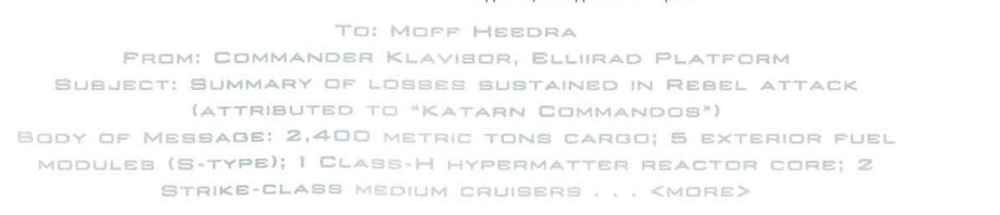

# Judder Page

- **Aliases:** —
- **Era:** —
- **Continuity:** default Legends; entries present for: Legends
- **Research tier:** untiered (not listed as INTRO/DEEP/MASTERY in legends-feats.md)
- **Entries:** 5 (0 with quotations; 0 quotations extended to the full sentence/passage from the source text on file; 0 marked as fragments). Rebuilt 2026-11-17 from 5 old entries; old file: `characters/_bak/judder-page.md.bak-20261117`.
- **How to read:** each entry is the quotation in full (block quote), then its source and point of view. "Note" lines are summaries from our notes, not quotations. `[fragment — full passage not on file]` means the source text is not on the box, so only the words in our notes are shown. Debate and forum material is in the last section and is unverified.

# LEGENDS (Legends / EU — main focus)

## Sourcebooks/Galaxy at War.pdf [Star Wars Roleplaying Game Saga Edition (2007)] (scan pages 61–120)

- Note (summary from our notes, not a quotation): Page contents: Katarn Commandos history: SpecForce 32nd under Bren Derlin; held at Hoth; General Crix Madine recommended them to protect High Command under Mon Mothma; part of General Han Solo's Endor strike team; Lt. Judder Page took over, refused promotion; "Page's Commandos"; Basilisk (Governor Nistola surrendered; General Garret took the capital); Kyle Katarn joined; name tribute to Katarn (or per Wookiee Frorral the predator); Page in the capture of Coruscant and the war against Thrawn; later captain. Methods; General Rieekan quote. (hand-read)
  — Source: Sourcebooks/Galaxy at War.pdf [Star Wars Roleplaying Game Saga Edition (2.
Our notes: `notes/materials/037-sw-d20-folder/715-galaxy-at-war-scan-061-120.md:336`

- Note (summary from our notes, not a quotation): Kyle Katarn; Judder Page — entry/section: Sidebar memo: Klavisor to Moff Heedra on the Katarn Commandos: "To: Moff Heedra From: Commander Klavisor, Elliirad Platform Subject: Summary of losses sustained in Rebel attack (attributed to "Katarn Commandos") Body of Message: 2,400 metric tons cargo; 5 exterior fuel modules (S-type); 1 Class-H hypermatter reactor core; 2 Strike-class medium cruisers . . . <MORE>" Source: *Galaxy at War* (SWRPG Saga Edition), scan p.116
  — Source: Sourcebooks/Galaxy at War.pdf [Star Wars Roleplaying Game Saga Edition (2.

Our notes: `notes/materials/037-sw-d20-folder/715-galaxy-at-war-scan-061-120.md:352`

## Sourcebooks/The Force Unleashed Campaign Guide.pdf [Star Wars Roleplaying Game Saga Edition (2007)] (scan pages 1–60)

- Note (summary from our notes, not a quotation): Page contents: Examples of infiltrators (Lt. Judder Page, Sabe, Shira Brie, Winter, Bothan Spynet operatives). Table; requirements; Infiltration talent tree (Always Ready, Concealed Weapon Expert, Creeping Approach, Set for Stun, Silent Takedown). (hand-read)
  — Source: Sourcebooks/The Force Unleashed Campaign Guide.pdf [Star Wars Roleplaying.
Our notes: `notes/materials/037-sw-d20-folder/729-the-force-unleashed-campaign-guide-scan-001-060.md:314`

## Star Wars Insider #126 (2011)

- Note (summary from our notes, not a quotation): Page contents: Buyer's Market: Lando calls Lt. Judder Page of the Katarn Commandos; the "big shot" deal is glitterstim; Cravel's gang gets the AT-AT working in two days. (hand-read)
  — Source: Star Wars Insider #126 (2011).
Our notes: `notes/materials/038-star-wars-insider/126-ins126.md:236`

# Debate and forum claims (unverified)

Forum posts, Suspect Insight debates and Discord debates, respect threads, and verdicts. These are posters' arguments or quotations they typed; none is checked against the book here unless the entry says so.

_None in our notes._

# NJO FULL re-read additions (2026-11-17)
Verbatim excerpts from the full consecutive re-read of the New Jedi Order novels (Dark Journey through The Unifying Force), each shown with the text around it and its source chapter.

## *The Unifying Force*
Page welcomes the Jedi to Necropolis.

> “Welcome home,” Judder Page said, shouting to be heard as two A-wings streaked low overhead. “To, as we like to call it, ‘Necropolis.’ ”
>
> Like his comrades, Page was wearing a jet pack and helmet, and carrying a blaster rifle. Along the lip of the balcony stood a dozen YVH droids. Han wasn’t surprised to spy a couple of Wraiths among the commando platoon, but Pash Cracken was the last person he had expected to see.

— Source: *The Unifying Force* (James Luceno, Del Rey 2004), chapter 36 (UF).

