# K'Kruhk

- **Aliases:** K’Kruhk, K'kruhk
- **Era:** Clone Wars–Legacy
- **Continuity:** default Legends; entries present for: Canon, Legends
- **Research tier:** MASTERY (Legacy era only); DEEP
- **Entries:** 192 (89 with quotations; 8 quotations extended to the full sentence/passage from the source text on file; 63 marked as fragments; 68 before the 2026-11-17 fragment fill). Rebuilt 2026-11-17 from 230 old entries; old file: `characters/_bak/k-kruhk.md.bak-20261117`.
- **How to read:** each entry is the quotation in full (block quote), then its source and point of view. "Note" lines are summaries from our notes, not quotations. `[fragment — full passage not on file]` means the source text is not on the box, so only the words in our notes are shown. Debate and forum material is in the last section and is unverified.

# LEGENDS (Legends / EU — main focus)

## Dark Lord trilogy (Labyrinth of Evil, Revenge of the Sith, Dark Lord): novel notes from the other agent (reference copy)

> A break hadn’t come until Jedi Master Tholme had recalled a detail from the debriefing of his former Padawan, Quinlan Vos. As part of Vos’s covert mission to penetrate Count Dooku’s inner circle of dark side apprentices, Vos had been tasked with assassinating a duplicitous Senator, named Viento. Immediately following the assassination—and a brutal duel with Master K’Kruhk—Vos had met briefly with Dooku in The Works. There, Dooku had informed his would-be protégé that Vos had been incorrect in assuming that Viento was a Sith, and had again denied that he himself answered to any Master.
>
> They walked in silence to a balcony that overlooked the desolate sprawl of The Works. In the far distance the glassy towers of the Senate District disappeared into clouds. One of Dooku’s previous visits had followed the assassination of a faithless Senator by Jedi Knight Quinlan Vos. Duped by Dooku on several occasions, Vos had managed to track Dooku to The Works, though he apparently hadn’t perceived just how deeply the dark side had taken root there.
— Source: L3063; L2477 — Labyrinth of Evil (novel, read in full): feats, scaling, quotes and story notes.
(Excerpt widened 2026-11-17 to the relevant passage, word for word from Labyrinth of Evil (James Luceno) (text copy `MEGA_Legend_The_Episode_Novelizations_Star_Wars_Revenge_of_the_Sith_01_Labyrinth_of_Evil_James_Luceno_epub`).)
(Fragment completed 2026-11-17: full sentence/passage matched word for word in the source text on file: `MEGA_Legend_The_Episode_Novelizations_Star_Wars_Revenge_of_the_Sith_01_Labyrinth_of_Evil_James_Luceno_epub`.)
Note text that was attached to the quote line: *(L3063)*
Note (our notes, around the quote): Role: the clue that leads the Jedi to The Works. «A break hadn't come until Jedi Master Tholme had recalled a detail from the debriefing of his former Padawan, Quinlan Vos.» (L3063). Vos had been «tasked with assassinating a duplicitous» Senator as part of his «covert mission to penetrate Count Dooku's inner circle of dark side apprentices» (L3063), fought «a brutal duel with Master K'Kruhk», and then met Dooku in The Works (L3063). He had «managed to track Dooku to The Works, though he apparently hadn't perceived just how deeply the dark side» ran there (L2477).
Our notes: `notes/materials/022-dark-lord-trilogy/labyrinth-of-evil-notes.md:941`

> A break hadn’t come until Jedi Master Tholme had recalled a detail from the debriefing of his former Padawan, Quinlan Vos. As part of Vos’s covert mission to penetrate Count Dooku’s inner circle of dark side apprentices, Vos had been tasked with assassinating a duplicitous Senator, named Viento. Immediately following the assassination—and a brutal duel with Master K’Kruhk—Vos had met briefly with Dooku in The Works. There, Dooku had informed his would-be protégé that Vos had been incorrect in assuming that Viento was a Sith, and had again denied that he himself answered to any Master.
— Source: Labyrinth of Evil (novel, read in full): feats, scaling, quotes and story notes; Ch30 L3063.
(Excerpt widened 2026-11-17 to the relevant passage, word for word from Labyrinth of Evil (James Luceno) (text copy `MEGA_Legend_The_Episode_Novelizations_Star_Wars_Revenge_of_the_Sith_01_Labyrinth_of_Evil_James_Luceno_epub`).)
Context: Complete quote register (12 lines: every sentence that names Quinlan Vos, verbatim, in book order):
Our notes: `notes/materials/022-dark-lord-trilogy/labyrinth-of-evil-notes.md:951`

- Note (summary from our notes, not a quotation): Every named side character with a real role in LoE gets a profile here, followed by the complete register of sentences that name them. Named characters with no real role (one or two passing mentions, so no profile): Dodonna, Zan Arbor, Seti Ashgad, Lapiz, Aayla Secura, Ylenic It'kla, K'Kruhk, Daakman Barrek, Tarr Seir, Cin Drallig, Sun Fac.
  — Source: Labyrinth of Evil (novel, read in full): feats, scaling, quotes and story notes.
Our notes: `notes/materials/022-dark-lord-trilogy/labyrinth-of-evil-notes.md:1064`

## Star Wars: The New Essential Chronology (Del Rey, 2005): power-scaling and lore notes

> General Grievous chose a key moment to attack Republic forces and nearly killed the Jedi Masters Ki-Adi-Mundi, K'Kruhk, Shaak Ti, and Aayla Secura.
— Source: Part Two: The Fall of the Republic.
Note (our notes, around the quote): General Grievous; Ki-Adi-Mundi; K'Kruhk; Shaak Ti; Aayla Secura — Grievous on Hypori: "General Grievous chose a key moment to attack Republic forces and nearly killed the Jedi Masters Ki-Adi-Mundi, K'Kruhk, Shaak Ti, and Aayla Secura." Source: The New Essential Chronology, p.62
Our notes: `notes/materials/027-new-essential-chronology/02-part-two-fall-of-the-republic.md:284`

> he ran afoul of the Whiphid Jedi Master K'Kruhk, hero of Teyr and former dissident Jedi. K'Kruhk nearly died in his pursuit of Quinlan through the vertical city.
— Source: Part Two: The Fall of the Republic; Quinlan Vos; K'Kruhk — K'Kruhk nearly dies.
Note (our notes, around the quote): Quinlan Vos; K'Kruhk — K'Kruhk nearly dies: "he ran afoul of the Whiphid Jedi Master K'Kruhk, hero of Teyr and former dissident Jedi. K'Kruhk nearly died in his pursuit of Quinlan through the vertical city." Source: The New Essential Chronology, p.72
Our notes: `notes/materials/027-new-essential-chronology/02-part-two-fall-of-the-republic.md:380`

## The Complete Star Wars Encyclopedia, Vol. II (H–O)

- Note (summary from our notes, not a quotation): Page contents: 919 words, 21 paragraphs | headings/entries: Kirrek; Kirske, Osika; Kirst; Kirtania; Kit; Kithaba; Kithra; Kitonak; Kkak, Hrar; Kkak, Tteel; K'Kruhk
  — Source: scan pages 201–240.
Our notes: `notes/materials/031-complete-star-wars-encyclopedia-vol-2/05-v2-scan-201-240.md:261`

> Master K'Kruhk was badly injured in a lightsaber duel with Ventress.
— Source: scan pages 201–240; K'Kruhk; Asajj Ventress — entry/section: K'Kruhk.
Note (our notes, around the quote): K'Kruhk; Asajj Ventress — entry/section: K'Kruhk: "Master K'Kruhk was badly injured in a lightsaber duel with Ventress." Source: The Complete Star Wars Encyclopedia, Vol. II, p.221
Our notes: `notes/materials/031-complete-star-wars-encyclopedia-vol-2/05-v2-scan-201-240.md:270`

> During a mission to destroy the droid foundries on Hypori, K'Kruhk was gravely wounded by General Grievous.
— Source: scan pages 201–240; K'Kruhk; General Grievous — entry/section: K'Kruhk.
Note (our notes, around the quote): K'Kruhk; General Grievous — entry/section: K'Kruhk: "During a mission to destroy the droid foundries on Hypori, K'Kruhk was gravely wounded by General Grievous." Source: The Complete Star Wars Encyclopedia, Vol. II, p.221
Our notes: `notes/materials/031-complete-star-wars-encyclopedia-vol-2/05-v2-scan-201-240.md:272`

> Masters K'Kruhk and Jeisel were placed in charge of the ground forces that attacked the Separatist stronghold on the planet, ultimately destroying the primary shield generator that protected the cloning facilities for the Shadow Army.
— Source: scan pages 201–240; K'Kruhk — entry/section: K'Kruhk.
Note (our notes, around the quote): K'Kruhk — entry/section: K'Kruhk: "Masters K'Kruhk and Jeisel were placed in charge of the ground forces that attacked the Separatist stronghold on the planet, ultimately destroying the primary shield generator that protected the cloning facilities for the Shadow Army." Source: The Complete Star Wars Encyclopedia, Vol. II, p.221
Our notes: `notes/materials/031-complete-star-wars-encyclopedia-vol-2/05-v2-scan-201-240.md:274`

## The Complete Star Wars Encyclopedia, Vol. III (P–Z)

> K'Kruhk and Piru defeated the criminals and transported the clan elsewhere.
— Source: scan pages 1–40; K'Kruhk. POV: K'Kruhk.
Note (our notes, around the quote): K'Kruhk: "K'Kruhk and Piru defeated the criminals and transported the clan elsewhere." Source: The Complete Star Wars Encyclopedia, Vol. III, p.27
Our notes: `notes/materials/032-complete-star-wars-encyclopedia-vol-3/00-v3-scan-001-040.md:240`

> Only K'Kruhk survived the attack, and Teyr fell to the Separatists.
— Source: scan pages 201–240; K'Kruhk. POV: K'Kruhk.
Note (our notes, around the quote): K'Kruhk: "Only K'Kruhk survived the attack, and Teyr fell to the Separatists." Source: The Complete Star Wars Encyclopedia, Vol. III, p.234
Our notes: `notes/materials/032-complete-star-wars-encyclopedia-vol-3/05-v3-scan-201-240.md:353`

> Master K'kruhk and Quinlan Vos struggled, but Vos killed Viento before K'kruhk could stop him.
— Source: scan pages 281–320; K'Kruhk; Quinlan Vos.
Note (our notes, around the quote): K'Kruhk; Quinlan Vos: "Master K'kruhk and Quinlan Vos struggled, but Vos killed Viento before K'kruhk could stop him." Source: The Complete Star Wars Encyclopedia, Vol. III, p.306
Our notes: `notes/materials/032-complete-star-wars-encyclopedia-vol-3/07-v3-scan-281-320.md:257`

## Sourcebooks/Ultimate Alien Anthology.pdf [Star Wars Roleplaying Game Revised Core (d20, 2002)] (scan pages 181–225)

- Note (summary from our notes, not a quotation): Page contents: Whiphid (example names incl. K'Kruhk, J'Quille) traits; Wookiee (Emperor, Trandoshans; example names incl. Chewbacca). (hand-read)
  — Source: Sourcebooks/Ultimate Alien Anthology.pdf [Star Wars Roleplaying Game Revi.
Our notes: `notes/materials/037-sw-d20-folder/673-ultimate-alien-anthology-scan-181-225.md:25`

## Sourcebooks/The Clone Wars Campaign Guide.pdf [Star Wars Roleplaying Game Saga Edition (2007)] (scan pages 121–180)

> A person always takes his home with him, wherever he goes. Worlds are so vast—yet they fit easily into one's heart.
— Source: Sourcebooks/The Clone Wars Campaign Guide.pdf [Star Wars Roleplaying Game.
Note (our notes, around the quote): Page contents: Ki-Adi-Mundi stat block (CL 13; Cerean Jedi 7/Jedi Knight 5/Jedi Master 1; Clear Mind). Epigraph: "A person always takes his home with him, wherever he goes. Worlds are so vast—yet they fit easily into one's heart." -Ki-Adi-Mundi. K'Kruhk (Whiphid Padawan of Lilit Twoseas; Yinchorri Uprising with Micah Giiett, Qui-Gon Jinn, Plo Koon; Geonosis rescue task force; 416th Star Corps on Teyr; disappears; rejoins with Mace Windu's help; Hypori, left for dead by General Grievous; protects Senator Viento). (hand-read)
Our notes: `notes/materials/037-sw-d20-folder/728-the-clone-wars-campaign-guide-scan-121-180.md:118`

- Note (summary from our notes, not a quotation): Page contents: K'Kruhk stat block (CL 13; Whiphid Jedi 7/Jedi Knight 5/Jedi Master 1; Extra Second Wind; conical straw hat). Plo Koon (Kel Dor; studied under Tyvokka; Padawans Bultar Swan and the Trandoshan Lissarkh; Stark Hyperspace Wars; High Council seat; captured with Ki-Adi-Mundi at Geonosis; Battles of Brentaal IV and Rendili); stat block (CL 15; Shien, Telekinetic Savant). (hand-read)
  — Source: Sourcebooks/The Clone Wars Campaign Guide.pdf [Star Wars Roleplaying Game.
Our notes: `notes/materials/037-sw-d20-folder/728-the-clone-wars-campaign-guide-scan-121-180.md:131`

## Sourcebooks/The Force Unleashed Campaign Guide.pdf [Star Wars Roleplaying Game Saga Edition (2007)] (scan pages 1–60)

- Note (summary from our notes, not a quotation): Page contents: Togruta cont. (example names Ashla, Raana Tey, Shaak Ti, Ahsoka [Tano; surname cut], etc.; traits Pack Hunter, Sneaky, Spatial Awareness). Whiphid (Toola; Spearmaster; example names J'Quille, K'Kruhk, etc.; traits begin). (hand-read)
  — Source: Sourcebooks/The Force Unleashed Campaign Guide.pdf [Star Wars Roleplaying.
Our notes: `notes/materials/037-sw-d20-folder/729-the-force-unleashed-campaign-guide-scan-001-060.md:125`

## Star Wars Insider #95 (2007)

> Two of a Kind — A pair of fugitives walk the same road in Star Wars: Dark Times
> [fragment — full passage not on file]
— Source: Star Wars Insider #95 (2007); Page contents: Comics.
Note (our notes, around the quote): Page contents: Comics: "Two of a Kind — A pair of fugitives walk the same road in Star Wars: Dark Times", words by Daniel Wallace: "Parallels" five-issue arc from issue #6 (art Dave Ross, story Mick Harrison), two months after Revenge of the Sith; Jedi Master K'Kruhk (Whiphid) and Jeisel, younglings and Order 66; Bomo Greenbark (Nosaurian) and the Uhumele; "Planet Hopping" section; comic panel art (hand-read)
Our notes: `notes/materials/038-star-wars-insider/095-ins095.md:578`

> A face only a mother could love? Whiphid Jedi K'Kruhk springs into action in Star Wars: Dark Times 'Parallels.'
— Source: Star Wars Insider #95 (2007).
Note (our notes, around the quote): Page contents: Comics cont.: K'Kruhk long-lived (Legacy, 160+ years after Jedi Council: Acts of War); Uhumele crew (Ratty, Heren, Ko Vakier, Janks; co-designed by Doug Wheatley); "A New Family" section; comic art and captions ("A face only a mother could love? Whiphid Jedi K'Kruhk springs into action in Star Wars: Dark Times 'Parallels.'") (hand-read)
Our notes: `notes/materials/038-star-wars-insider/095-ins095.md:593`

## Star Wars Insider #139 (2013)

- Note (summary from our notes, not a quotation): Page contents: Comics: Dark Times—Fire Carrier (Randy Stradley; art Gabriel Guzman, covers Doug Wheatley): K'Kruhk and his 10 Padawans on Arkinnea; Vader training Falco Sang to find Dass Jennir. "Order 66" (crop-verified; the OCR read it as 64). Issue #1 on sale February 6. (hand-read)
  — Source: Star Wars Insider #139 (2013).
Our notes: `notes/materials/038-star-wars-insider/139-ins139.md:328`

- Note (summary from our notes, not a quotation): Page contents: Fire Carrier cover art (OCR empty; viewed): K'Kruhk with a green lightsaber shielding his Padawans. (hand-read)
  — Source: Star Wars Insider #139 (2013).
Our notes: `notes/materials/038-star-wars-insider/139-ins139.md:339`

## Star Wars: Legacy (Dark Horse, 2006–2010) single issues #20–#50, hand-read

> — Shado Vao (caption), Star Wars: Legacy #25, p. 13
> [fragment — full passage not on file]
>
> "NO! I DON'T BELIEVE IT! A'SHARAD HETT WAS HUMAN -- HE COULD NOT HAVE LIVED SO LONG! ... A'SHARAD HETT WAS A GOOD MAN...A GOOD JEDI!" (T'ra Saa) · "THE CLONE WARS CHANGED US ALL, T'RA SAA. AND...THERE WAS ALWAYS A DARKNESS IN HETT. PERHAPS WE FAILED HIM." (K'Kruhk)
> [fragment — full passage not on file]
>
> — T'ra Saa
>
> K'Kruhk, Star Wars: Legacy #25, p. 16
> [fragment — full passage not on file]
>
> "SADLY, THE SITH ARE MANY AND HIGHLY ORGANIZED. SINCE OSSUS, THE JEDI ARE SCATTERED AND ARE STILL HUNTED." · "IT MAY REQUIRE SEVERAL GENERATIONS OF RECOVERY BEFORE THE JEDI HAVE SUFFICIENT NUMBERS TO OPPOSE THE SITH."
>
> — T'ra Saa, Star Wars: Legacy #25, p. 15
> [fragment — full passage not on file]
>
> "JEDI RESPECT LIFE, YOUNG SKYWALKER -- ALL LIFE. THE FORCE CONNECTS EVERYTHING IN THE CYCLE OF DEATH AND RENEWAL -- EVEN THE SITH." (T'ra Saa) · "JEDI MAY TAKE LIVES IF THERE IS NO OTHER CHOICE, BUT TO DELIBERATELY SEARCH OUT ONE TO KILL? THIS IS NOT THE JEDI WAY." (speaker unclear: T'ra Saa or Tili Qua)
> [fragment — full passage not on file]
>
> — Star Wars: Legacy #25, p. 21
> [fragment — full passage not on file]
— Source: Star Wars: Legacy #25 — "The Hidden Temple" (Dark Horse, June 2008). POV: Shado Vao, about K'Kruhk.
Context: > "NETI ARE REAL ENOUGH, IF FEW IN NUMBER. MASTER T'RA SAA IS HERSELF SOMETHING OF A LEGEND. NETI ARE NATURALLY LONG-LIVED, AND MASTER SAA FOUGHT IN THE CLONE WARS ALONG WITH MASTER K'KRUHK." · "IT IS SAID THAT WHEN HER DEAR COMPANION MASTER THOLME DIED, SHE TOOK ROOT IN MEDITATION AT THE SITE OF HIS FUNERAL PYRE ON ANZAT."
Our notes: `notes/materials/039-legacy-2006/legacy-25.md:65`

> — Bantha Rawk, Star Wars: Legacy #26, p. 3
> [fragment — full passage not on file]
>
> "THE JEDI GOT INTO THAT WAR AND IT NEARLY DESTROYED THE ORDER. I MYSELF GAVE IN TO AGGRESSIVE FEELINGS. I KNOW HOW DANGEROUS THEY ARE NO MATTER HOW JUSTIFIED THEY SEEM."
>
> — K'Kruhk, Star Wars: Legacy #26, p. 3
> [fragment — full passage not on file]
>
> "HOW CAN WE ACT? THE ORDER IS SCATTERED. WE'VE FEW KNIGHTS -- AND FEWER MASTERS. DO WE SEND RAW APPRENTICES AGAINST KRAYT'S DARK SIDE ARMY?" (Tili Qua) · "IF WE ATTEMPT TO SAVE THE MON CAL NOW, DO WE ULTIMATELY GIVE THE GALAXY TO THE SITH? HOW MANY MORE WORLDS DO WE THEN DOOM?" (T'ra Saa)
> [fragment — full passage not on file]
>
> — Tili Qua
>
> T'ra Saa, Star Wars: Legacy #26, p. 3
> [fragment — full passage not on file]
— Source: Star Wars: Legacy #26 — "The Hidden Temple, Part Two" (Dark Horse, July 2008). POV: Bantha Rawk, about K'Kruhk.
Context: > "ASSASSINATION. MY NEPHEW'S GOTTEN DARKER. NO DEBATIN' THAT." · "I DON'T KNOW AS HIS IDEA'S WRONG, THOUGH. BACK IN THE CLONE WARS, JEDI GOT THEMSELVES ROPED INTO BEIN' GENERALS." · "KRAYT'S COMMITTIN' GENOCIDE AND THE MON CAL ARE JUST SCREAMIN' FOR HELP! THE JEDI GOTTA ACT!"
Our notes: `notes/materials/039-legacy-2006/legacy-26.md:10`

> "THE FIRST ORDER OF BUSINESS IS WITH PRINCESS MARASIAH. THE COUNCIL IS WILLING TO EXPLORE ROAN FEL'S SUGGESTION OF AN ALLIANCE. KRAYT'S ILLNESS MAY PROVIDE AN OPPORTUNITY UNSEEN BEFORE." (speaker unclear: the balloon comes from the Council hologram) · "DURING OUR MEDITATION, THE COUNCIL SENSED A FUTURE IN GREAT TURMOIL. IF CADE SUCCEEDS IN KILLING KRAYT, THE POSSIBILITY EXISTS THAT SOMEONE MORE POWERFUL MAY EMERGE TO RULE THE SITH." (K'Kruhk) · "PERHAPS THE BEST PATH IS TO ALLOW A NATURAL COURSE -- LET THE FORCE WEAKEN THE SITH UNTIL THE ORDER FALLS IN ON ITSELF." (Tili Qua) · "THEREFORE, CADE SKYWALKER, IT IS THE DECISION OF THE COUNCIL NOT TO SUPPORT YOU IN AN ATTEMPT TO ASSASSINATE KRAYT." (T'ra Saa)
> [fragment — full passage not on file]
>
> — Star Wars: Legacy #26, p. 21
> [fragment — full passage not on file]
>
> "I HAVE BEEN INSIDE YOUR MIND, SKYWALKER. IT IS NOT CONCERN FOR THE INNOCENT THAT GOADS YOU. YOUR MOTIVE IS REVENGE FOR YOUR FATHER'S DEATH." (K'Kruhk) · "THAT IS A DARK PATH AND A DANGEROUS ONE. JEDI HAVE WALKED IT BUT ALWAYS AT A RISK. WE WILL NOT FIGHT THE ENEMY BY BECOMING THE ENEMY. THAT'S NOT THE JEDI WAY." (T'ra Saa)
> [fragment — full passage not on file]
>
> — K'Kruhk
>
> T'ra Saa, Star Wars: Legacy #26, p. 22
> [fragment — full passage not on file]
— Source: Star Wars: Legacy #26 — "The Hidden Temple, Part Two" (Dark Horse, July 2008). POV: K'Kruhk.
Context: > "THE FIRST ORDER OF BUSINESS IS WITH PRINCESS MARASIAH. THE COUNCIL IS WILLING TO EXPLORE ROAN FEL'S SUGGESTION OF AN ALLIANCE. KRAYT'S ILLNESS MAY PROVIDE AN OPPORTUNITY UNSEEN BEFORE." (speaker unclear: the balloon comes from the Council hologram) · "DURING OUR MEDITATION, THE COUNCIL SENSED A FUTURE IN GREAT TURMOIL. IF CADE SUCCEEDS IN KILLING KRAYT, THE POSSIBILITY EXISTS THAT SOMEONE MORE POWERFUL MAY EMERGE TO RULE THE SITH." (K'Kruhk) · "PERHAPS THE BEST PATH IS TO ALLOW A NATURAL COURSE -- LET THE FORCE WEAKEN THE SITH UNTIL THE ORDER FALLS IN ON ITSELF." (Tili Qua) · "THEREFORE, CADE SKYWALKER, IT IS THE DECISION OF THE COUNCIL NOT TO SUPPORT YOU IN AN ATTEMPT TO ASSASSINATE KRAYT." (T'ra Saa)
Our notes: `notes/materials/039-legacy-2006/legacy-26.md:19`

> OR RATHER THAN SHATTER, THE SITH COULD SPLINTER INTO FACTIONS -- EACH ONE A NEXUS OF DARK SIDE POWER
> [fragment — full passage not on file]
>
> IF THE SITH DO SHATTER, WILL THEY DISAPPEAR INTO THE GALAXY OR GO ON THE RAMPAGE?
— Source: Star Wars: Legacy #26 — "The Hidden Temple, Part Two" (Dark Horse, July 2008).
Note (our notes, around the quote): (Speaker check, p21: K'Kruhk's panel has two balloons, the second being "OR RATHER THAN SHATTER, THE SITH COULD SPLINTER INTO FACTIONS -- EACH ONE A NEXUS OF DARK SIDE POWER". Tili Qua's panel also has two, the first being "IF THE SITH DO SHATTER, WILL THEY DISAPPEAR INTO THE GALAXY OR GO ON THE RAMPAGE?". I assigned these by panel.)
Our notes: `notes/materials/039-legacy-2006/legacy-26.md:26`

> "YES, SHADO. THEY SEEK TO INTIMIDATE AN UNKNOWN -- US. WE JEDI HAVE MADE AN ALLIANCE WITH GAR STAZI'S FORCES. ROAN FEL HAS DONE THE SAME."
>
> "NOW ALL THAT REMAINS IS TO SEE IF WE CAN COME TO TERMS WITH ROAN FEL AND CREATE A TRUE ALLIANCE AGAINST THE SITH. WE SHOULD NOT ASSUME IT AS A GIVEN." (K'Kruhk)
> [fragment — full passage not on file]
— Source: Star Wars: Legacy #45 — "Monster, Part Three" (Feb 2010). POV: K'Kruhk.
Context: — Star Wars: Legacy #45, p. 15
Our notes: `notes/materials/039-legacy-2006/legacy-45.md:136`

> "MASTERS, I AM STRUGGLING WITH THIS -- -- ROAN FEL STILL COMMANDED THE EMPIRE WHEN IT STRUCK AT OSSUS. YET WE ARE LOOKING TO BE HIS FRIEND?" (Shado Vao — flag; could be the hooded woman Hira, but K'Kruhk's reply addresses "Hira")
> [fragment — full passage not on file]
— Source: Star Wars: Legacy #45 — "Monster, Part Three" (Feb 2010).
Context: — Star Wars: Legacy #45, p. 15
Our notes: `notes/materials/039-legacy-2006/legacy-45.md:139`

> "HIS ALLY, HIRA -- AND THAT IS A DIFFERENT THING. THE PRINCESS MARASIAH REVEALED THAT ATTACK WAS NEITHER HER FATHER'S ORDER, NOR HIS WISH." (K'Kruhk)
> [fragment — full passage not on file]
— Source: Star Wars: Legacy #45 — "Monster, Part Three" (Feb 2010). POV: K'Kruhk.
Context: — Star Wars: Legacy #45, p. 15
Our notes: `notes/materials/039-legacy-2006/legacy-45.md:142`

> "WE ALL SENSED THE PRINCESS BELIEVED THAT TO BE TRUE, MASTER K'KRUHK, BUT CAN WE TRUST ROAN FEL AFTER THE SITH ARE DEFEATED?" (bearded Jedi — likely Rasi Tuum, flag)
>
> "THE JEDI ORDER IS STILL REELING FROM OSSUS, MASTER RASI TUUM. LETTING GO OF PAIN AND ANGER IS NEVER EASY, BUT WE MUST DO THIS TO FORGE AN ALLIANCE TODAY. TOMORROW IS TOMORROW." (K'Kruhk)
> [fragment — full passage not on file]
— Source: Star Wars: Legacy #45 — "Monster, Part Three" (Feb 2010). POV: K'Kruhk.
Context: — Star Wars: Legacy #45, p. 15
Our notes: `notes/materials/039-legacy-2006/legacy-45.md:145`

- Note (summary from our notes, not a quotation): Speaker correction: because K'Kruhk answers "HIS ALLY, HIRA", the "MASTERS, I AM STRUGGLING" line is most likely Hira (the hooded woman), not Shado — attribute to Hira (flag).
  — Source: Star Wars: Legacy #45 — "Monster, Part Three" (Feb 2010).
Our notes: `notes/materials/039-legacy-2006/legacy-45.md:150`

> "THEN WE ARE AGREED, MASTER K'KRUHK?" (Roan Fel, disguised)
>
> "ON ALL MAJOR POINTS, YOUR IMPERIAL HIGHNESS -- YES. WE WILL COOPERATE AND COORDINATE OUR ATTACKS TOGETHER, WORKING IN CONCERT. BASTION WILL GIVE SAFE HAVEN TO JEDI; AS WILL ADMIRAL STAZI'S FORCES." (K'Kruhk)
> [fragment — full passage not on file]
— Source: Star Wars: Legacy #45 — "Monster, Part Three" (Feb 2010). POV: Roan Fel, about K'Kruhk.
Context: — Star Wars: Legacy #45, p. 19
Our notes: `notes/materials/039-legacy-2006/legacy-45.md:177`

> "IMPERIAL KNIGHTS -- DEFEND YOUR EMPEROR!" (Draco, by appearance — flag)
>
> "JEDI! DEFEND THE EMPEROR! THE FATE OF THE GALAXY COULD DEPEND ON HIS SAFETY!" (K'Kruhk)
>
> "IT'S BEEN FAR TOO LONG SINCE I KILLED A SITH!" (hooded woman with blaster — likely Calixte; flag)
> [fragment — full passage not on file]
— Source: Star Wars: Legacy #46 — "Monster, Part Four" (Mar 2010).
Context: Sith strike team (multiple red-tattooed Zabrak/Iridonian-style Sith with red sabers) emerges from the swamp water (p4).
Our notes: `notes/materials/039-legacy-2006/legacy-46.md:29`

## Star Wars: Legacy Book 1 (omnibus): power-scaling notes with panels

> (p281) K'Kruhk: "HIS FUTURE IS CLOUDED. THE DARK SIDE PULLS STRONGLY AT HIM -- AS IT ONCE DID ANAKIN SKYWALKER. IF WE TRAIN HIM, WE MAY BE TRAINING A NEW VADER." · (p307) Shado: "I'VE BEEN PRESENT AT TWO OF CADE'S HEALINGS. CADE TOUCHED THE DARK SIDE TO DO IT." · "HE WASN'T SIMPLY OPEN TO THE FORCE; HE TWISTED IT TO HIS WILL. THAT IS SOMETHING A SITH DOES." · "IF HE EVER GOES COMPLETELY OVER TO THE DARK SIDE, I WILL END HIM."
> [fragment — full passage not on file]
— Source: Legacy Book 1 (omnibus): power-scaling notes with panels.
Context: 11. Shado: Cade "TWISTED IT TO HIS WILL"; K'Kruhk: "A NEW VADER". p281 (#11 Ghosts), p307 (#12 Ghosts)
Our notes: `notes/materials/009-legacy-book-1.md:463`; `notes/materials/012-legacy-vol-2-shards.md:279`; `notes/materials/012-legacy-vol-2-shards.md:462`

> one fool at a time
> [fragment — full passage not on file]
— Source: Legacy Book 1 (omnibus): power-scaling notes with panels.
Note (our notes, around the quote): Scaling (ANALYSIS) for debates #22, #36 and #131 (Nihl vs Kam Solusar / K'Kruhk): Book 1 gives Nihl one-armed-Sazen (an arm off), the Kol kill (with help), "one fool at a time" against Cade and Syn, and a loss to empowered Cade. He's never shown losing to a Jedi Master here.
Our notes: `notes/materials/009-legacy-book-1.md:719`

> "OF ALL MY LEARNERS, YOU ALWAYS HAD THE GREATEST POTENTIAL. UNFORTUNATELY, YOU WERE ALSO THE MOST STUBBORN." · "I'VE DIED ANY NUMBER OF TIMES IN MY LIFE. OR SO I'VE HEARD." · Cade: "I'LL JUST TAP A LITTLE INTO MY HEALING POWER -- LIKE I ALWAYS DO -- AND I'LL BE GOOD AS NEW." · K'Kruhk: "USING THE FORCE THAT WAY IS NOT WHAT I TAUGHT YOU." · "YOU HAVEN'T BEEN 'GOOD AS NEW' IN SOME TIME. IN FACT, I'M HEALING YOU NOW." · "THERE IS NO PHYSICAL WOUND. I'M FOCUSING ON HEALING YOUR WHOLE BEING."
— Source: Legacy Book 1 (omnibus): power-scaling notes with panels.
Context: Light-side "whole being" healing of the overdosed Cade. p272 (#11 Ghosts)–p273 (#11 Ghosts)
Our notes: `notes/materials/009-legacy-book-1.md:935`; `notes/materials/012-legacy-vol-2-shards.md:276`; `notes/materials/009-legacy-book-1.md:1106`; `notes/materials/012-legacy-vol-2-shards.md:463`

- Note (summary from our notes, not a quotation): ANALYSIS (debates #18, #24, #28, #131): this is where the "Warmaster" label (legends-feats.md, debate #18) comes from: p306, Cade's words "LIKE BOTH WARMASTER AND HIGH PRIEST". K'Kruhk has no combat feats in Book 1.
  — Source: Legacy Book 1 (omnibus): power-scaling notes with panels.
Our notes: `notes/materials/009-legacy-book-1.md:946`

- Note (summary from our notes, not a quotation): K'Kruhk "Warmaster" (debate #18).
  — Source: (debate #18) — Owner Material 009 — Star Wars: Legacy Book 1 (omnibus): power-scaling notes with panels.
Our notes: `notes/materials/009-legacy-book-1.md:1204`

- Note (summary from our notes, not a quotation): The term is Cade's description (p306: "LIKE BOTH WARMASTER AND HIGH PRIEST"), not an official rank or a feat. K'Kruhk has healing and authority but no combat on panel in Book 1.
  — Source: Legacy Book 1 (omnibus): power-scaling notes with panels.
Context: K'Kruhk "Warmaster" (debate #18).
Our notes: `notes/materials/009-legacy-book-1.md:1205`

- Note (summary from our notes, not a quotation): Jedi: Cade Skywalker (130 and 137 ABY), Kol Skywalker, Wolf Sazen, Shado Vao, K'Kruhk, Hosk Trey'lis.
  — Source: Legacy Book 1 (omnibus): power-scaling notes with panels.
Our notes: `notes/materials/009-legacy-book-1.md:1216`

> ## Appended — Legacy Book 1 (owner material 009)
> [fragment — full passage not on file]
— Source: (debate #18); (debate #17) — Owner Material 009 — Star Wars: Legacy Book 1 (omnibus): power-scaling notes with panels.
Note (our notes, around the quote): `[local path]`: the sections for Darth Krayt (debates #2, #6, #48, #108, #114), Cade Skywalker (debates #61, #81), K'Kruhk (debate #18) and Imperial Knights / Draco (debate #17). New Book 1 entries are appended under "## Appended — Legacy Book 1 (owner material 009)".
Our notes: `notes/materials/009-legacy-book-1.md:1224`

## Star Wars: Legacy—War #1–6 (2010–11): power-scaling notes with panels

- Note (summary from our notes, not a quotation): | #6 | 115–136 | WAR PART SIX | Sith Temple (Coruscant), *Jagged Fel*, the sun, Korriban, aftermath | Cade vs Krayt: lightning, dark transfer, the vision. Cade rejects Krayt and stabs him. Fel tries to launch the toxin and Draco strikes him down. Troopers go mad, K'Kruhk warns of suicide runs, Nihl withdraws. Cade flies Krayt's body into the sun, Luke's ghost appears, Cade ejects. Fel's funeral and the Triumvirate. Nihl's dispersal speech. Cade revived from a hibernation trance. Epilogue. |
  — Source: Legacy—War #1–6 (2010–11): power-scaling notes with panels.
Context: | Issue | PDF pages | Title on recap page | Setting | Main events |
Our notes: `notes/materials/010-legacy-war.md:41`

> YOU DON'T WIN BY PLAYING SAFE.
— Source: Legacy—War #1–6 (2010–11): power-scaling notes with panels.
Note (our notes, around the quote): Taivas council (p61–63). Marasiah gives Draco a chance at redemption (p61). At the council Cade proposes the trap ("YOU DON'T WIN BY PLAYING SAFE.") and K'Kruhk sums up: "AGREED THEN." (p62–63).
Our notes: `notes/materials/010-legacy-war.md:107`

- Note (summary from our notes, not a quotation): The temple lifts off (p80–81). The younglings' ship goes out with K'Kruhk at the controls (p80), and the temple's towers lift off as ships (p81).
  — Source: Legacy—War #1–6 (2010–11): power-scaling notes with panels.
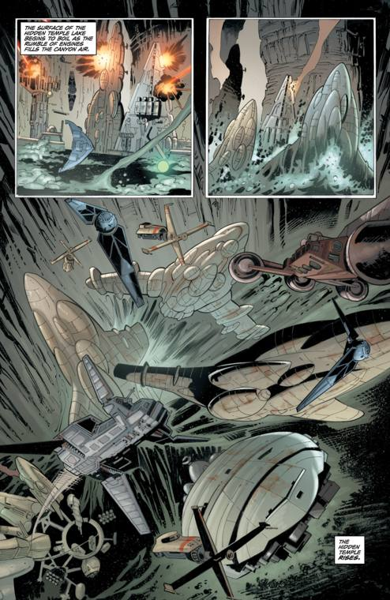
Our notes: `notes/materials/010-legacy-war.md:115`

- Note (summary from our notes, not a quotation): Aftermath in battle (p127). The troopers go mad. Shado kills one, K'Kruhk warns of suicide runs, and Nihl orders the withdrawal and the troopers' destruction.
  — Source: Legacy—War #1–6 (2010–11): power-scaling notes with panels.
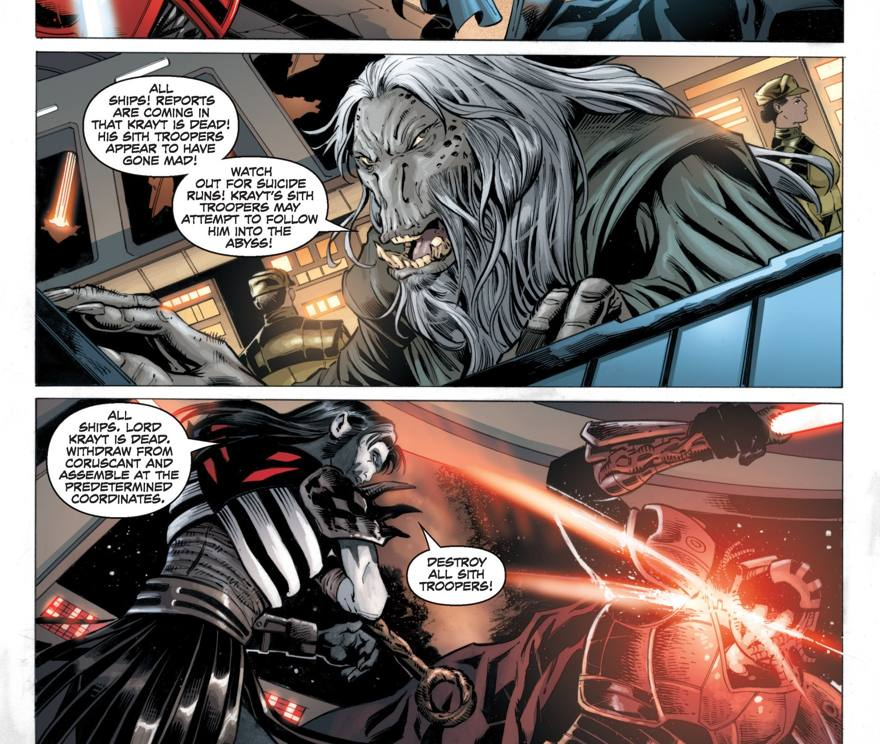
Our notes: `notes/materials/010-legacy-war.md:136`

> LORD KRAYT IS DEAD... DESTROY ALL SITH TROOPERS!
> [fragment — full passage not on file]
— Source: Legacy—War #1–6 (2010–11): power-scaling notes with panels; ![p127 K'Kruhk warns of suicide runs; Nihl.
Note (our notes, around the quote): 
(*Panel: p127 — `p127-kkruhk-nihl-krayt-is-dead.jpg`*)
Our notes: `notes/materials/010-legacy-war.md:564`

> Trooper: "LORD KRAYT IS DEAD! LONG LIVE THE SITH -- UHK!" (Shado runs him through) · K'Kruhk: "HIS SITH TROOPERS APPEAR TO HAVE GONE MAD!" "WATCH OUT FOR SUICIDE RUNS! KRAYT'S SITH TROOPERS MAY ATTEMPT TO FOLLOW HIM INTO THE ABYSS!"
— Source: Legacy—War #1–6 (2010–11): power-scaling notes with panels.
Context: 3. Madness at Krayt's death. p127 (#6)
Our notes: `notes/materials/010-legacy-war.md:648`

> AGREED THEN. IT'S WORTH THE RISK OF LOSING OUR HOME TO DELIVER A SEVERE, PERHAPS FATAL, BLOW TO THE SITH EMPIRE. THIS IS THE BATTLE WE HAVE BEEN PREPARING FOR SINCE OSSUS.
— Source: Legacy—War #1–6 (2010–11): power-scaling notes with panels; p63 (#3), presiding over the council.
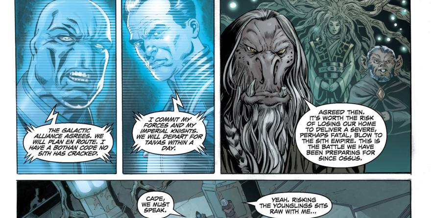
Our notes: `notes/materials/010-legacy-war.md:808`

> THE FORCE BE WITH YOU, MASTER SAA.
— Source: Legacy—War #1–6 (2010–11): power-scaling notes with panels.
Note (our notes, around the quote): p80 (#4): at the controls of the younglings' ship, with Tili Qua: "THE FORCE BE WITH YOU, MASTER SAA."
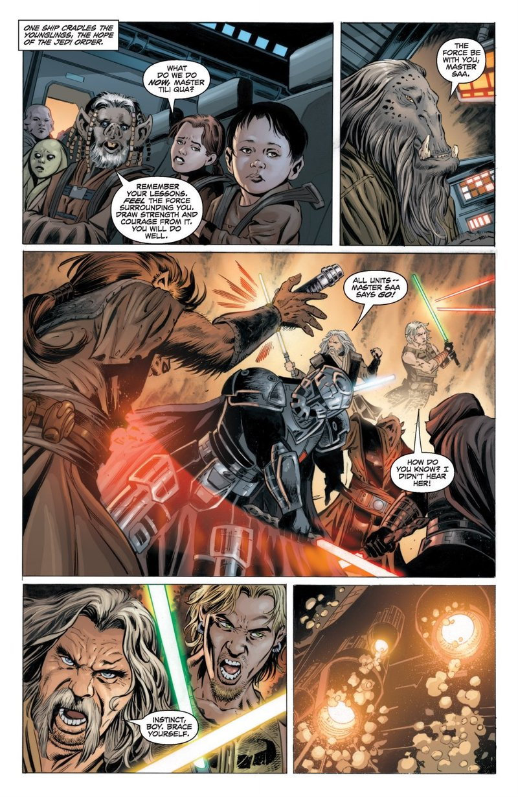 *(p80)*
Our notes: `notes/materials/010-legacy-war.md:809`

- Note (summary from our notes, not a quotation): Identified by zoom as the white-maned grey Whiphid with tusks, on a ship's bridge.
  — Source: Legacy—War #1–6 (2010–11): power-scaling notes with panels.
Context: p127 (#6): "ALL SHIPS! REPORTS ARE COMING IN THAT KRAYT IS DEAD! HIS SITH TROOPERS APPEAR TO HAVE GONE MAD!" "WATCH OUT FOR SUICIDE RUNS! KRAYT'S SITH TROOPERS MAY ATTEMPT TO FOLLOW HIM INTO THE ABYSS!"
 *(p127)*
Our notes: `notes/materials/010-legacy-war.md:813`

> ...THE GALACTIC FEDERATION TRIUMVIRATE...
> [fragment — full passage not on file]
>
> ...WHICH WILL BE HEADED BY ADMIRAL GAR STAZI, JEDI MASTER K'KRUHK, AND HIS IMPERIAL HIGHNESS'S DAUGHTER, EMPRESS MARASIAH FEL.
> [fragment — full passage not on file]
— Source: Legacy—War #1–6 (2010–11): power-scaling notes with panels; p132 (#6), eulogy.

Our notes: `notes/materials/010-legacy-war.md:815`

- Note (summary from our notes, not a quotation): Title check, every page: K'Kruhk is "MASTER K'KRUHK" (p100) and "JEDI MASTER K'KRUHK" (p132). "Grand Master" never appears in War #1–6, for K'Kruhk or anyone else. He is a Triumvir (p132).
  — Source: Legacy—War #1–6 (2010–11): power-scaling notes with panels.
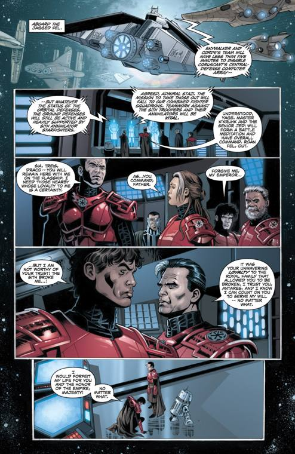

Our notes: `notes/materials/010-legacy-war.md:816`

- Note (summary from our notes, not a quotation): No personal combat feat in War. His role is presiding, piloting, battle meditation and command, and the warning.
  — Source: Legacy—War #1–6 (2010–11): power-scaling notes with panels.

Our notes: `notes/materials/010-legacy-war.md:817`

- Note (summary from our notes, not a quotation): 
  — Source: Legacy—War #1–6 (2010–11): power-scaling notes with panels.
(*Panel: p63 — `p063-kkruhk-council-agrees.jpg`*)
Our notes: `notes/materials/010-legacy-war.md:819`

> MASTER K'KRUHK AND THE SENIOR JEDI WILL FORM A BATTLE MEDITATION AND HAVE OVERALL COMMAND.
— Source: Legacy—War #1–6 (2010–11): power-scaling notes with panels; 
  — Source: Legacy—War #1–6 (2010–11): power-scaling notes with panels.
(*Panel: p132 — `p132-fel-funeral-triumvirate.jpg`*)
Our notes: `notes/materials/010-legacy-war.md:825`

> REPORTS ARE COMING IN THAT KRAYT IS DEAD!
>
> LORD KRAYT IS DEAD. WITHDRAW...
> [fragment — full passage not on file]
— Source: Legacy—War #1–6 (2010–11): power-scaling notes with panels; p127. "LORD KRAYT IS DEAD! LONG LIVE THE SITH --". K'Kruhk.
Note (our notes, around the quote): p127. "LORD KRAYT IS DEAD! LONG LIVE THE SITH --". K'Kruhk: "REPORTS ARE COMING IN THAT KRAYT IS DEAD!" Nihl: "LORD KRAYT IS DEAD. WITHDRAW..." The troopers go mad.
Our notes: `notes/materials/010-legacy-war.md:975`

- Note (summary from our notes, not a quotation): Jedi: council on Taivas. K'Kruhk sums up the council's decision (p63). T'ra Saa runs the battle meditation (p74). Fel names "MASTER K'KRUHK AND THE SENIOR JEDI ... OVERALL COMMAND" for Coruscant (p100).
  — Source: Legacy—War #1–6 (2010–11): power-scaling notes with panels.

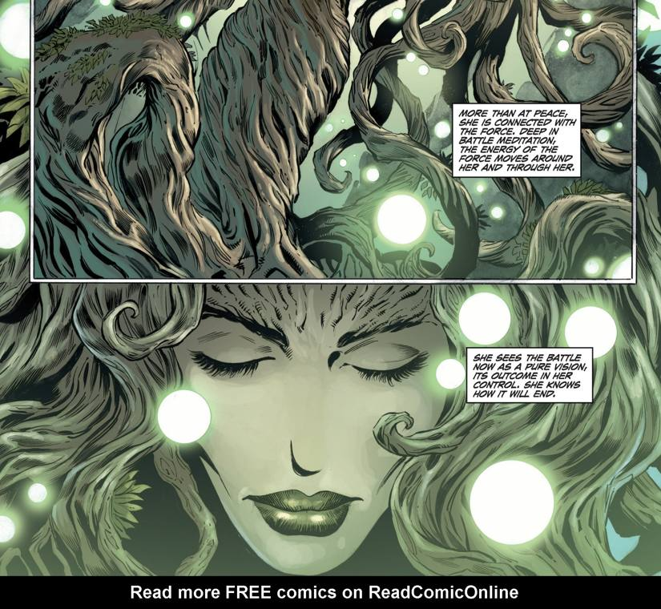

Our notes: `notes/materials/010-legacy-war.md:1016`

- Note (summary from our notes, not a quotation): No Grand Master is named anywhere.
  — Source: Legacy—War #1–6 (2010–11): power-scaling notes with panels.
Context: Jedi: council on Taivas. K'Kruhk sums up the council's decision (p63). T'ra Saa runs the battle meditation (p74). Fel names "MASTER K'KRUHK AND THE SENIOR JEDI ... OVERALL COMMAND" for Coruscant (p100).
Our notes: `notes/materials/010-legacy-war.md:1017`

- Note (summary from our notes, not a quotation): K'Kruhk "GM by War" (debates #18, #28).
  — Source: Legacy—War #1–6 (2010–11): power-scaling notes with panels.
Our notes: `notes/materials/010-legacy-war.md:1113`

- Note (summary from our notes, not a quotation): Counter: the page says "MASTER K'KRUHK" (p100) and "JEDI MASTER K'KRUHK", Triumvir (p132). There is no Grand Master title. K'Kruhk debaters should use "oldest/most senior" framing from elsewhere, plus his battle-meditation command (p100).
  — Source: Legacy—War #1–6 (2010–11): power-scaling notes with panels.
Context: K'Kruhk "GM by War" (debates #18, #28).

Our notes: `notes/materials/010-legacy-war.md:1114`

- Note (summary from our notes, not a quotation): Wolf Sazen, Shado Vao, K'Kruhk, Rawk, T'ra Saa, Tili Qua, and the ghosts of Kol and Luke.
  — Source: Legacy—War #1–6 (2010–11): power-scaling notes with panels.
Context: Covers:
Our notes: `notes/materials/010-legacy-war.md:1143`

- Note (summary from our notes, not a quotation): | Triumvirate: Stazi, K'Kruhk, Marasiah | p132 | "JEDI MASTER K'KRUHK" |
  — Source: Legacy—War #1–6 (2010–11): power-scaling notes with panels.
Context: | Intro-tier item | Page | Note |
Our notes: `notes/materials/010-legacy-war.md:1190`

- Note (summary from our notes, not a quotation): | K'Kruhk's suicide-run warning | p127 | Exact |
  — Source: Legacy—War #1–6 (2010–11): power-scaling notes with panels.
Context: | Intro-tier item | Page | Note |
Our notes: `notes/materials/010-legacy-war.md:1192`

- Note (summary from our notes, not a quotation): "Grand Master" K'Kruhk.
  — Source: Legacy—War #1–6 (2010–11): power-scaling notes with panels.
Our notes: `notes/materials/010-legacy-war.md:1226`

- Note (summary from our notes, not a quotation): Dated corrections (2026-10-21) at the Saarai entry (the feat is *Legacy* #34, not War) and the K'Kruhk entry (no Grand Master in War; he is a Triumvir).
  — Source: Legacy—War #1–6 (2010–11): power-scaling notes with panels.
Context: `legends-feats.md`:
Our notes: `notes/materials/010-legacy-war.md:1233`

## Star Wars Saga Edition: *Legacy Era Campaign Guide* (WotC 2009): power-scaling notes with panels

- Note (summary from our notes, not a quotation): Jedi remnants / Hidden Temple (Taivas; a council of Tili Qua, K'Kruhk and T'ra Saa; p52, p194–195).
  — Source: *Legacy Era Campaign Guide* (WotC 2009): power-scaling notes with panels.
Our notes: `notes/materials/011-legacy-era-campaign-guide.md:93`

> Thanks to a vision he receives, Sazen believes Skywalker could be a rallying point for all Jedi.
>
> Master K'Kruhk is given custody of the surviving Jedi artifacts
> [fragment — full passage not on file]
— Source: *Legacy Era Campaign Guide* (WotC 2009): power-scaling notes with panels; p194.
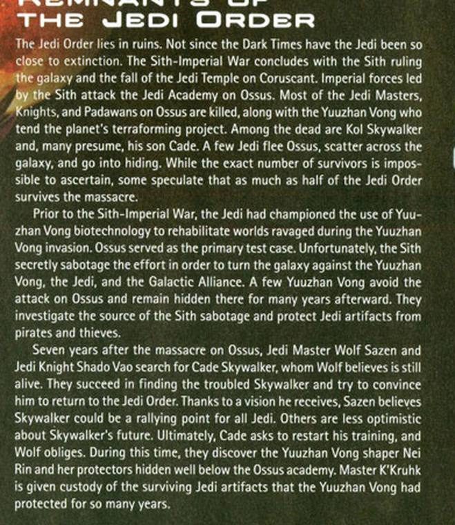
Our notes: `notes/materials/011-legacy-era-campaign-guide.md:651`

> a Jedi Council of three masters know and control the Hidden Temple: Master Tili Qua and two of the oldest surviving Masters, K'Kruhk and T'ra Saa.
> [fragment — full passage not on file]
— Source: *Legacy Era Campaign Guide* (WotC 2009): power-scaling notes with panels; p195.
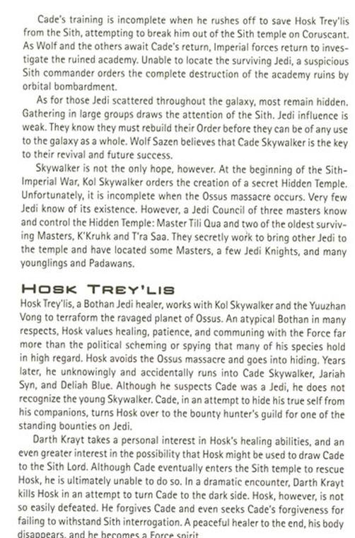
Our notes: `notes/materials/011-legacy-era-campaign-guide.md:653`

- Note (summary from our notes, not a quotation): K'Kruhk has no stat block. The lines above are all the guide says about him (debates #18, #24, #28, #131).
  — Source: *Legacy Era Campaign Guide* (WotC 2009): power-scaling notes with panels.
Our notes: `notes/materials/011-legacy-era-campaign-guide.md:655`

- Note (summary from our notes, not a quotation): Not covered by this book: K'Kruhk, Stryfe, Krul, Ruyn, Celeste Morne, Karness Muur, and anything from *Legacy: War* or *Legacy II*.
  — Source: *Legacy Era Campaign Guide* (WotC 2009): power-scaling notes with panels.
Our notes: `notes/materials/011-legacy-era-campaign-guide.md:1109`

## Star Wars: Legacy Volume 2, *Shards* (TPB): power-scaling notes with panels

- Note (summary from our notes, not a quotation): #11: On Ossus, Cade overdoses on death sticks and has visions of Mara Jade and of Anakin/Vader, who runs him through in the vision (p128–134). K'Kruhk, who is real, heals him (p135–137). Sazen and Shado arrive, and Cade asks to finish his training (p137–138). On Socorro, Rav sells Jariah and Deliah to the Empire. Jariah won't give up Cade (p139–142). Two weeks later, sparring shows Cade has "RAW POWER" but atrophied skills (p143). Sazen tells K'Kruhk of his vision of a Skywalker reuniting the Jedi; K'Kruhk fears "A NEW VADER" (p143–145). Cade hides from Shado's Force sense in the tunnels. They fall into a hidden chamber of Jedi artifacts, and Yuuzhan Vong warriors attack (p145–149).
  — Source: Legacy Volume 2, *Shards* (TPB): power-scaling notes with panels.
Our notes: `notes/materials/012-legacy-vol-2-shards.md:61`

> WITHIN THE FLAMES, HIS BODY DISAPPEARED.
>
> IF HE EVER GOES COMPLETELY OVER TO THE DARK SIDE, I WILL END HIM. *(p170)*
>
> NO ONE DIES FOR ME. NEVER AGAIN. *(p171)*
— Source: Legacy Volume 2, *Shards* (TPB): power-scaling notes with panels.
Note (our notes, around the quote): #12: A Vong warrior pins Cade. Master Shaper Nei Rin stops the fight, and Sazen and K'Kruhk arrive (p150–151). Nei Rin explains the Ossus Project, the Sith sabotage, and Kol's funeral: "WITHIN THE FLAMES, HIS BODY DISAPPEARED." She offers Cade the Jedi legacy, and he refuses it (p152–155). At the spot where Kol died, Cade attacks Sazen and loses. Sazen tells him his healings drew on the dark side and calls Kol's last stand a selfless holding action (p156–161). In the meditation of emptiness, Cade remembers drifting in space and his rescue by Rav and Jariah (p162–166). He then sees the tortured Hosk, and Luke's spirit tells him to make it right (p167–168). Nei Rin gives him Kol's lightsaber, now with a Vong-shaped lambent crystal, and K'Kruhk gives him R2-D2 (p169–170). Shado: "IF HE EVER GOES COMPLETELY OVER TO THE DARK SIDE, I WILL END HIM." (p170). Cade heads for Coruscant: "NO ONE DIES FOR ME. NEVER AGAIN." (p171).
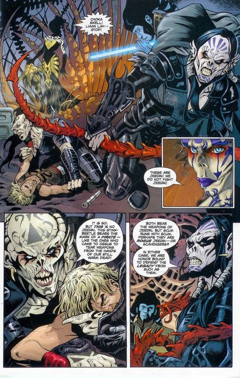
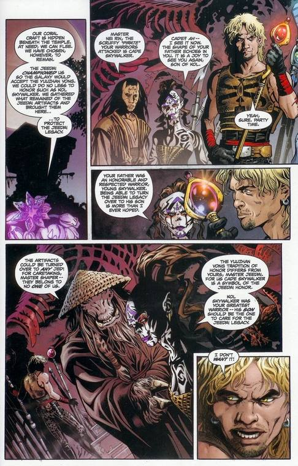
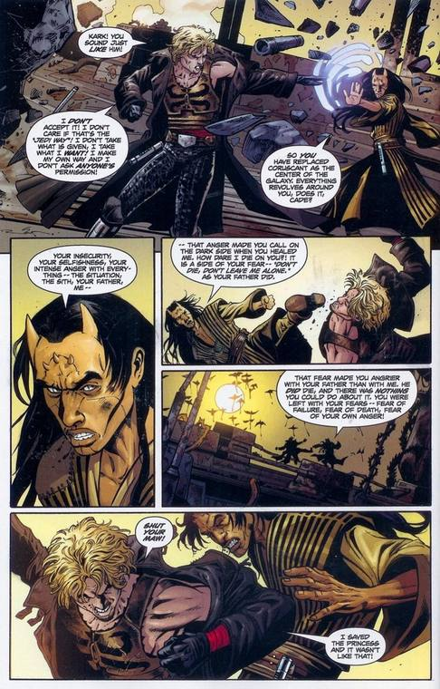
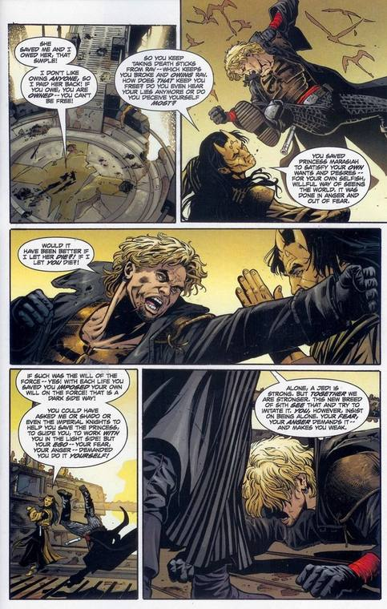
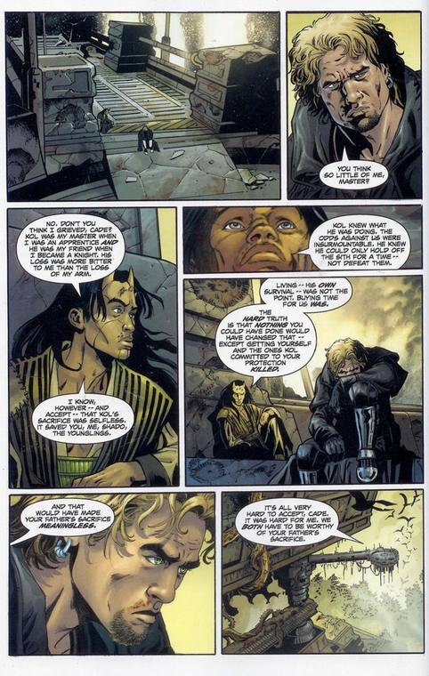
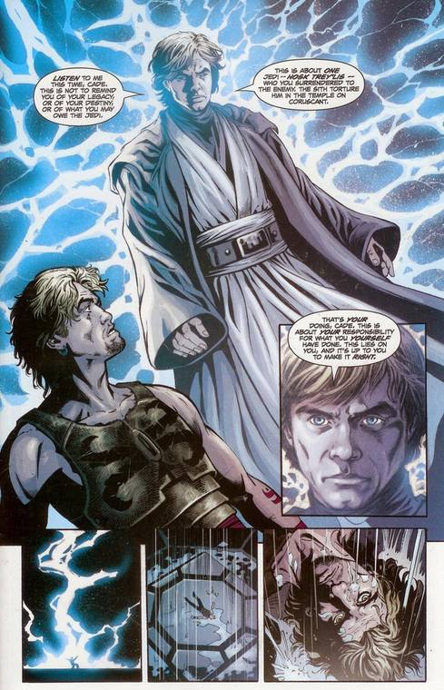
Our notes: `notes/materials/012-legacy-vol-2-shards.md:62`

> TELL YOU A SECRET, MASTER. I'LL JUST TAP A LITTLE INTO MY HEALING POWER -- LIKE I ALWAYS DO -- AND I'LL BE GOOD AS NEW.
>
> YOU HAVEN'T BEEN 'GOOD AS NEW' IN SOME TIME.
— Source: Legacy Volume 2, *Shards* (TPB): power-scaling notes with panels; 6. Habitual self-healing. p136 (#11).
Note (our notes, around the quote): 6. Habitual self-healing. p136 (#11): "TELL YOU A SECRET, MASTER. I'LL JUST TAP A LITTLE INTO MY HEALING POWER -- LIKE I ALWAYS DO -- AND I'LL BE GOOD AS NEW." K'Kruhk: "YOU HAVEN'T BEEN 'GOOD AS NEW' IN SOME TIME."
Our notes: `notes/materials/012-legacy-vol-2-shards.md:260`

> "I'VE DIED ANY NUMBER OF TIMES IN MY LIFE. OR SO I'VE HEARD. IT IS YOUR DEATH THAT CONCERNS ME." · "USING THE FORCE THAT WAY IS NOT WHAT I TAUGHT YOU." · "IN FACT, I'M HEALING YOU NOW." · "THERE IS NO PHYSICAL WOUND. I'M FOCUSING ON HEALING YOUR WHOLE BEING." · (p137) "WHAT..." "...MAKES YOU THINK..." "...I'M NOT REAL?"
> [fragment — full passage not on file]
— Source: Legacy Volume 2, *Shards* (TPB): power-scaling notes with panels.
Context: 1. Light-side healing of "your whole being". p135 (#11)–p137 (#11) [009 p272–274]
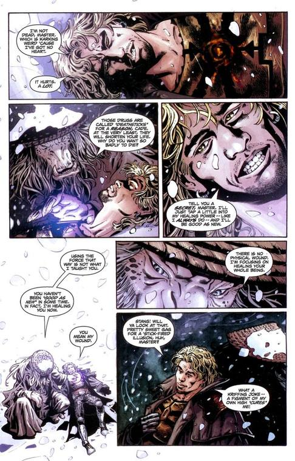
Our notes: `notes/materials/012-legacy-vol-2-shards.md:335`

- Note (summary from our notes, not a quotation): 
  — Source: Legacy Volume 2, *Shards* (TPB): power-scaling notes with panels.
(*Panel: p136 — `p136-kkruhk-heals-cade.jpg`*)
Our notes: `notes/materials/012-legacy-vol-2-shards.md:338`

> a calling in the Force
> [fragment — full passage not on file]
>
> I REMEMBER, TOO KEENLY, THE FIRST TIME THE JEDI FELL...
> [fragment — full passage not on file]
>
> I WAS IN THE SNOWS OF TOOLA, THE PLACE I THOUGHT I WOULD CALL 'LAST HOME,' WHEN I FELT A CALLING IN THE FORCE.
>
> MY OWN FEELINGS, MY OWN PERSPECTIVE, ARE NOT INFALLIBLE. I DEEPLY RESPECT MASTER SAZEN. HIS VISION MAY BE THE TRUE ONE.
— Source: Legacy Volume 2, *Shards* (TPB): power-scaling notes with panels; **2. Clone Wars survivor; came because of.
Label in our notes: ** p144 (#11): · p151 (#12): · p170
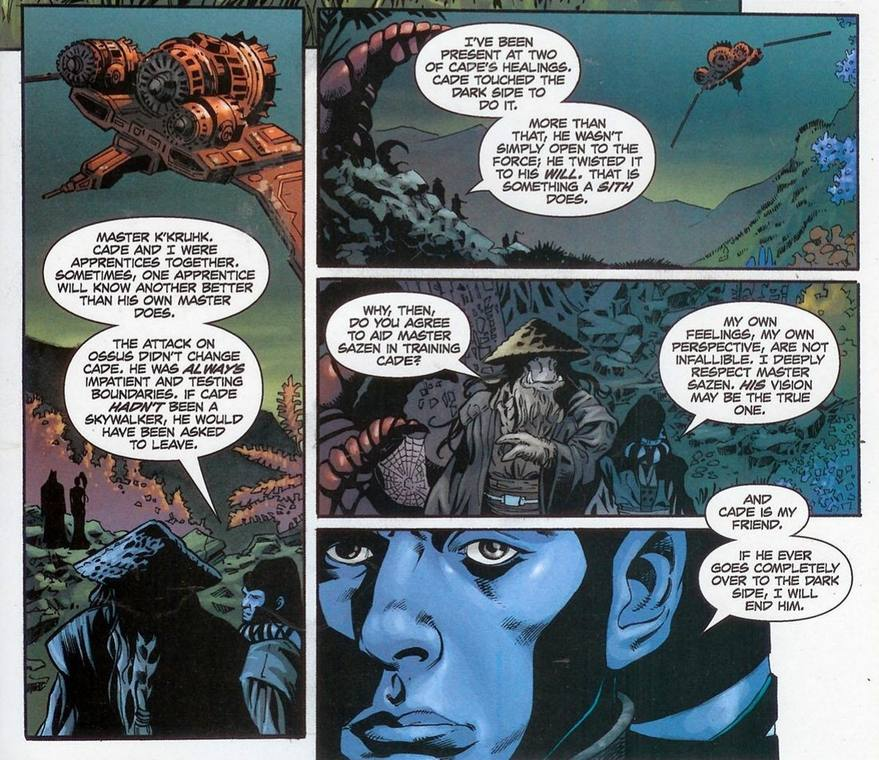
Our notes: `notes/materials/012-legacy-vol-2-shards.md:341`

> NEI RIN, WE BOTH KNOW I'M NOT THE RIGHT CARETAKER FOR THE LEGACY. LET K'KRUHK DO IT. AMONG THE JEDI HE IS LIKE BOTH WARMASTER AND HIGH PRIEST -- AND A FAR BETTER CHOICE THAN ME.
— Source: Legacy Volume 2, *Shards* (TPB): power-scaling notes with panels.
Note (our notes, around the quote): 3. The "Warmaster" label is Cade's description, not a rank. p169 (#12): "NEI RIN, WE BOTH KNOW I'M NOT THE RIGHT CARETAKER FOR THE LEGACY. LET K'KRUHK DO IT. AMONG THE JEDI HE IS LIKE BOTH WARMASTER AND HIGH PRIEST -- AND A FAR BETTER CHOICE THAN ME." K'Kruhk has no combat on panel in this volume.
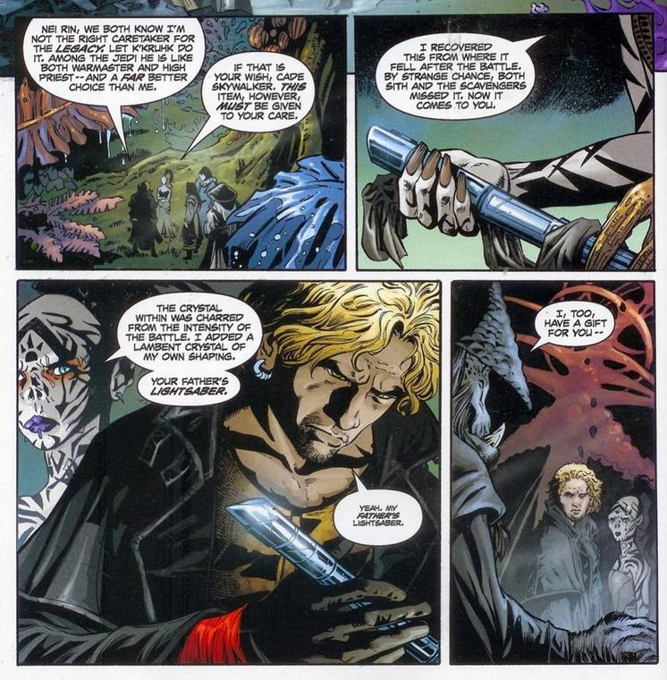
Our notes: `notes/materials/012-legacy-vol-2-shards.md:343`

- Note (summary from our notes, not a quotation): Sazen was Kol's apprentice: "KOL WAS MY MASTER WHEN I WAS AN APPRENTICE" (p161). K'Kruhk was Cade's teacher ("OF ALL MY LEARNERS", p135) and remembers "THE FIRST TIME THE JEDI FELL" (p144). Cade was "ALMOST READY FOR HIS TRIALS WHEN... OSSUS FELL" (p143). Shado and Cade were "APPRENTICES TOGETHER" (p170).
  — Source: Legacy Volume 2, *Shards* (TPB): power-scaling notes with panels. POV: Sazen was Kol's apprentice.
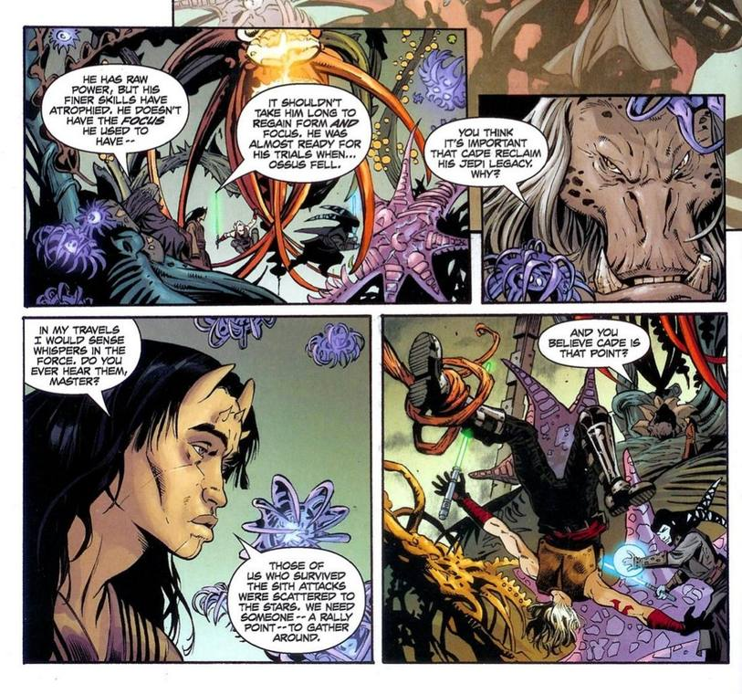

Our notes: `notes/materials/012-legacy-vol-2-shards.md:448`

- Note (summary from our notes, not a quotation): K'Kruhk (debates #18, #24, #28, #131).
  — Source: Legacy Volume 2, *Shards* (TPB): power-scaling notes with panels.
Our notes: `notes/materials/012-legacy-vol-2-shards.md:486`

- Note (summary from our notes, not a quotation): Use: a Clone Wars survivor ("THE FIRST TIME THE JEDI FELL", p144), "whole being" healing (p136), and Cade's "LIKE BOTH WARMASTER AND HIGH PRIEST" (p169).
  — Source: Legacy Volume 2, *Shards* (TPB): power-scaling notes with panels.
Context: K'Kruhk (debates #18, #24, #28, #131).
Our notes: `notes/materials/012-legacy-vol-2-shards.md:487`

- Note (summary from our notes, not a quotation): Counter: no combat on panel here. "Warmaster" is Cade's simile, not a title. Don't cite Shards for K'Kruhk combat; cite Legacy—War (010) or later issues.
  — Source: Legacy Volume 2, *Shards* (TPB): power-scaling notes with panels.
Context: K'Kruhk (debates #18, #24, #28, #131).
Our notes: `notes/materials/012-legacy-vol-2-shards.md:488`

> ## Appended — Legacy Vol 2 Shards (owner material 012)
> [fragment — full passage not on file]
— Source: Legacy Volume 2, *Shards* (TPB): power-scaling notes with panels.
Note (our notes, around the quote): `[local path]`: Krayt (debates #2, #6, #8, #108, #114), Cade (debates #61, #81, #85, #91), K'Kruhk (#18, #24, #28, #131), Imperial Knights / Draco (#17), Wolf Sazen (#67), Kol (#115). New *Shards* items are appended under "## Appended — Legacy Vol 2 Shards (owner material 012)". The existing 009 appendix entry "Fel vs Darth Krul" (009 p257) is the same feat as 012 p120–121.
Our notes: `notes/materials/012-legacy-vol-2-shards.md:555`

- Note (summary from our notes, not a quotation): `[local path]`: #6 and #114 (Krayt vs Revan: the Knight squad), #17 (Draco: cortosis and the "ALL MY KNIGHTS" line), #18, #24, #28 and #131 (K'Kruhk: no combat here; the "Warmaster" simile), #35 (Maladi), #61, #81, #85 and #91 (Cade: the rusty-floor caveat), #67 (Wolf Sazen), #115 (Bane vs Kol: the p161 holding-action line).
  — Source: Legacy Volume 2, *Shards* (TPB): power-scaling notes with panels.
Our notes: `notes/materials/012-legacy-vol-2-shards.md:556`

> They open fire on the Sith Lord
> [fragment — full passage not on file]
— Source: Legacy Volume 2, *Shards* (TPB): power-scaling notes with panels.
Note (our notes, around the quote): Owner materials: 009 (`009-legacy-book-1.md`): same issues, omnibus scan, and the corrections listed above. 010 (`010-legacy-war.md`): Fel's death and Draco's fall in Legacy—War; K'Kruhk's later council role. 011 (`011-legacy-era-campaign-guide.md`): Fel CL 20, Maladi CL 15, Maleval CL 13 (the p138 Karr/Maleval blurb, "They open fire on the Sith Lord"), Torlin CL 11 ("rudimentary Force training"), Sazen CL 15, Shado CL 10; Krul, K'Kruhk and Nei Rin not statted.
Our notes: `notes/materials/012-legacy-vol-2-shards.md:557`

## Star Wars: Legacy Volume 3, *Claws of the Dragon* (TPB): power-scaling notes with panels

> CONCENTRATE ON EMPTINESS AND WE WILL NOT BE DETECTED.
— Source: Legacy Volume 3, *Claws of the Dragon* (TPB): power-scaling notes with panels; Force concealment. p75 (K'Kruhk, by tail; ambiguous).
Note (our notes, around the quote): Force concealment. p75 (K'Kruhk, by tail; ambiguous): "CONCENTRATE ON EMPTINESS AND WE WILL NOT BE DETECTED." Neither Jedi ship nor "LIAAN LAH'S CORALSKIPPER" is found (p74).
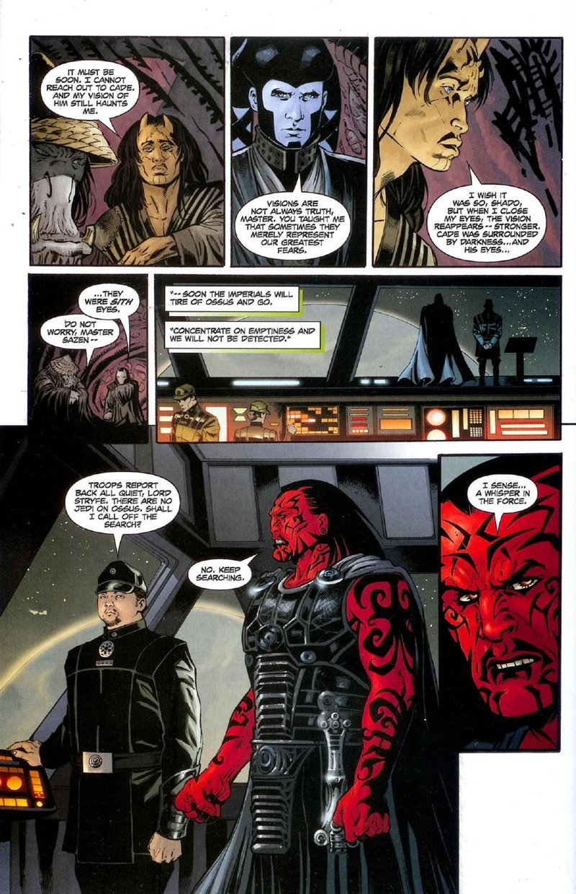 *(p75)*
Our notes: `notes/materials/013-legacy-vol-3-claws-of-the-dragon.md:412`

> WE SHOULD HAVE FACED THEM LIKE WARRIORS AND SLAIN THEM ALL.
>
> THEIR DEATHS WOULD ONLY HAVE CONFIRMED OUR PRESENCE, CHOKA SKELL.
— Source: Legacy Volume 3, *Claws of the Dragon* (TPB): power-scaling notes with panels; Restraint. p96: Liaan Lah.
Note (our notes, around the quote): Restraint. p96: Liaan Lah: "WE SHOULD HAVE FACED THEM LIKE WARRIORS AND SLAIN THEM ALL." · K'Kruhk (likely, by tail): "THEIR DEATHS WOULD ONLY HAVE CONFIRMED OUR PRESENCE, CHOKA SKELL." No combat on panel for any of them.
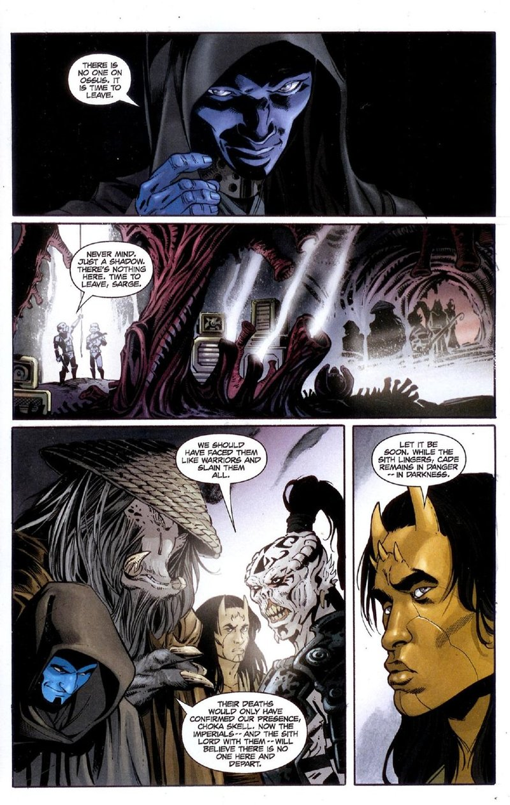 *(p96)*
Our notes: `notes/materials/013-legacy-vol-3-claws-of-the-dragon.md:416`

## https://starwars.fandom.com/wiki/Grievous/Legends

- Note (summary from our notes, not a quotation): Grievous led a droid attack that the article says obliterated a Republic task force, cut down Jedi Master Daakman Barrek, then engaged trapped Jedi including Ki-Adi-Mundi, Shaak Ti, Aayla Secura, K’Kruhk, Tarr Seirr, and Padawan Sha’a Gi. [20]
  — Source: Wookieepedia extraction: Grievous (Legends) — https://starwars.fandom.com/wiki/Grievous/Legends.
Our notes: `external/mega-notes/grievous-legends-quotes.txt:26`

- Note (summary from our notes, not a quotation): He killed Sha’a Gi when the Padawan ran into the open; evaded Ki-Adi-Mundi’s Force-push; blasted the Jedi aside on impact; cut down K’Kruhk; picked up and slammed Tarr Seirr with a mechanical foot; threw Seirr and Aayla Secura; fought Mundi and Shaak Ti simultaneously; overwhelmed Shaak Ti and knocked away her lightsaber; trapped Mundi’s Force-retrieved lightsaber under a foot; and was preparing to kill Mundi when ARC troopers intervened. [20]
  — Source: Wookieepedia extraction: Grievous (Legends) — https://starwars.fandom.com/wiki/Grievous/Legends.
Our notes: `external/mega-notes/grievous-legends-quotes.txt:27`

- Note (summary from our notes, not a quotation): He evaded ARC fire, cut through clone troopers, escaped the gunship’s laser fire and rockets, and took K’Kruhk’s fallen lightsaber as a trophy. [20]
  — Source: Wookieepedia extraction: Grievous (Legends) — https://starwars.fandom.com/wiki/Grievous/Legends.
Our notes: `external/mega-notes/grievous-legends-quotes.txt:28`

## https://starwars.fandom.com/wiki/Asajj_Ventress/Legends

- Note (summary from our notes, not a quotation): Killed Mira, ambushed Rhad Tarn, wounded Jedi Master K'Kruhk, and used psychological manipulation to turn Rhad toward the dark side. She briefly dueled Mace Windu, realized she was no match for his Vaapad, and fled with Sora Bulq.
  — Source: Jedi: Mace Windu [per Wookieepedia "Asajj Ventress/Legends" rev 15683810, ref 3; per-sentence approximate match (1/2 sentences matched, min 0.90), verify]; per Wookieepedia "Asajj Ventress/Legends" rev 15683810, ref 3; per-sentence approximate match (1/2 sentences matched, min 0.90), verify — Asajj Ventress (Legends) — research extraction — https://starwars.fandom.com/wiki/Asajj_Ventress/Legends.
(Source: Jedi: Mace Windu [per Wookieepedia "Asajj Ventress/Legends" rev 15683810, ref 3; per-sentence approximate match (1/2 sentences matched, min 0.90), verify])
Our notes: `external/mega-notes/ventress-quotes.txt:24`

## Legends Feats & Quotes (Star Wars Legends / EU)

> So, K'Kruhk is above Wolf Sazen, who stalemated Darth Stryfe in a duel, and this Stryfe is above the one we see in Vector, who is an equal to Vector Cade (due to a TK clash). I don't need to get on specifics about Skywalker growth and power... and K'Kruhk is above that.
> [fragment — full passage not on file]
>
> — (inline bold passage) | - Star Wars: Legacy War** *(cited by shame in debate #18)*
> [fragment — full passage not on file]
— Source: (debate #18); (cited by shame in debate #18) — Legends Feats & Quotes (Star Wars Legends / EU).
Context: Legacy-era: called a 'Warmaster' by Cade; argued above Wolf Sazen; TK vs nuclear blasts and debris (Legacy: Claws of the Dragon / The Hidden Temple, per thread) (debate #18)
>  [IMG: https://media.discordapp.net/attachments/686903902201053184/828668742308462623/unknown.png]
Our notes: `legends-feats.md:1590`; `verdicts.md:734`; `suspect-insight/debates/018-k-kruhk-vs-quinlan-vos.md:55`

- Note (summary from our notes, not a quotation): Becomes Grand Master after Kol Skywalker's death (Legacy: War); Clone Wars stats slightly above Ventress's (per thread) (debate #28)
  — Source: (debate #28) — Legends Feats & Quotes (Star Wars Legends / EU).
(Summarized from argument)
Our notes: `legends-feats.md:1597`

> MASTER K'KRUHK AND THE SENIOR JEDI WILL FORM A BATTLE MEDITATION AND HAVE OVERALL COMMAND.
>
> Jedi Master
>
> Triumvir
>
> overall command at Coruscant
> [fragment — full passage not on file]
— Source: Legends Feats & Quotes (Star Wars Legends / EU).
Note (our notes, around the quote): Correction (2026-10-21, material 010 full read): the "Grand Master" part is not supported by *Legacy—War* #1–6. The title "Grand Master" appears nowhere in War, for K'Kruhk or anyone else. On the page he is "MASTER K'KRUHK" (Fel, p100: "MASTER K'KRUHK AND THE SENIOR JEDI WILL FORM A BATTLE MEDITATION AND HAVE OVERALL COMMAND.") and, at Fel's funeral, "JEDI MASTER K'KRUHK", one of the three heads of the Galactic Federation Triumvirate with Admiral Gar Stazi and Empress Marasiah Fel (p132). Use "Jedi Master / Triumvir / overall command at Coruscant", not "Grand Master (Legacy: War)". The Clone Wars half of the claim was not checked. See `notes/materials/010-legacy-war.md`.
Context: Becomes Grand Master after Kol Skywalker's death (Legacy: War); Clone Wars stats slightly above Ventress's (per thread) (debate #28)
Our notes: `legends-feats.md:1600`

- Note (summary from our notes, not a quotation): Sazen senses Cade's capture from Ossus (Cade on Coruscant) (material 009; p332, Legacy #14)
  — Source: Legends Feats & Quotes (Star Wars Legends / EU).
Our notes: `legends-feats.md:2389`

> Shado has honed his martial skills and has yet to find his equal with a lightsaber.
>
> — Legacy Handbook, p465
> [fragment — full passage not on file]
— Source: Legends Feats & Quotes (Star Wars Legends / EU).
Context: Shado Vao handbook (material 009; p465)
Our notes: `legends-feats.md:2390`

> NEI RIN, WE BOTH KNOW I'M NOT THE RIGHT CARETAKER FOR THE LEGACY. LET K'KRUHK DO IT. AMONG THE JEDI HE IS LIKE BOTH WARMASTER AND HIGH PRIEST-- AND A FAR BETTER CHOICE THAN ME.
>
> — Cade Skywalker, Star Wars: Legacy #12 (≈), p306
> [fragment — full passage not on file]
— Source: Legends Feats & Quotes (Star Wars Legends / EU). POV: Cade Skywalker, about K'Kruhk.
Context: Source of the K'Kruhk "Warmaster" label (Cade's words, not a rank) (material 009; p306, Legacy #12)
Our notes: `legends-feats.md:2395`

> two of the oldest surviving Masters, K'Kruhk and T'ra Saa *(Hidden Temple council)*
> [fragment — full passage not on file]
— Source: Legends Feats & Quotes (Star Wars Legends / EU); No stat block. The only content is.
Note (our notes, around the quote): No stat block. The only content is "two of the oldest surviving Masters, K'Kruhk and T'ra Saa" (Hidden Temple council) and custody of the Jedi artifacts. (material 011; p194–195; debates #18, #24, #28, #131)

Our notes: `legends-feats.md:2520`

> THERE IS NO PHYSICAL WOUND. I'M FOCUSING ON HEALING YOUR WHOLE BEING.
>
> I REMEMBER, TOO KEENLY, THE FIRST TIME THE JEDI FELL...
> [fragment — full passage not on file]
— Source: Legends Feats & Quotes (Star Wars Legends / EU).
Note (our notes, around the quote): K'Kruhk: light-side healing of "your whole being"; a Clone Wars survivor (material 012; p136, p144, Legacy #11): "THERE IS NO PHYSICAL WOUND. I'M FOCUSING ON HEALING YOUR WHOLE BEING." · "I REMEMBER, TOO KEENLY, THE FIRST TIME THE JEDI FELL..." No combat on panel.
Our notes: `legends-feats.md:2617`

> ALONE, A JEDI IS STRONG. BUT TOGETHER WE ARE STRONGER. THIS NEW BREED OF SITH SEE THAT AND TRY TO IMITATE IT.
>
> — Wolf Sazen, Star Wars: Legacy #12, p160
> [fragment — full passage not on file]
— Source: Legends Feats & Quotes (Star Wars Legends / EU). POV: Wolf Sazen, about K'Kruhk.
Context: Sazen: Force-blocks hurled debris with an open palm and out-fights Cade one-armed (no sabers) (material 012; p159–160, Legacy #12)
Our notes: `legends-feats.md:2618`

> You are a Jedi. Time to choose your own path.
>
> culled from those strongest in the Force
> [fragment — full passage not on file]
— Source: Legends Feats & Quotes (Star Wars Legends / EU).
Note (our notes, around the quote): _Added by the material 010 pass on 2026-10-21. Above this heading, the only changes are two dated correction notes (K'Kruhk "Grand Master", Saarai/Stryfe) and the 2026-10-21 tier notes and MASTERY list. Every quote was read from the page images of *Star Wars: Legacy—War* #1–6 (136-page scan), with lettering kept in capitals. "p" is the scan's PDF page. Issues by page: #1 p1–23, #2 p24–46, #3 p47–69, #4 p70–92, #5 p93–114, #6 p115–136. Known scan gaps: p66 repeats p65, so one #3 page is probably missing, and #5 and #6 have 21 story pages each. Panels and full context: `notes/materials/010-legacy-war.md`. Not found anywhere in War, so don't cite these as War: Krayt's "I HAVE RETURNED WITH MY POWER MULTIPLIED", "THE DARK SIDE ... MANIFESTS ITSELF THROUGH ME" and "ripples" speech (the p1 recap only reports the ripples); Luke's "You are a Jedi. Time to choose your own path."; Sinde's "thousand ships"; Sith troopers "culled from those strongest in the Force"; any "Grand Master" title; any Saarai feat._
Our notes: `legends-feats.md:2792`

> MASTER K'KRUHK AND THE SENIOR JEDI WILL FORM A BATTLE MEDITATION AND HAVE OVERALL COMMAND.
>
> — Roan Fel, Star Wars: Legacy—War #5, p100
> [fragment — full passage not on file]
>
> ...WHICH WILL BE HEADED BY ADMIRAL GAR STAZI, JEDI MASTER K'KRUHK, AND HIS IMPERIAL HIGHNESS'S DAUGHTER, EMPRESS MARASIAH FEL.
> [fragment — full passage not on file]
>
> — eulogist (Hogrum Chalk by appearance), Star Wars: Legacy—War #6, p132
> [fragment — full passage not on file]
— Source: Legends Feats & Quotes (Star Wars Legends / EU). POV: Roan Fel, about K'Kruhk.
Context: Leads the Jedi council decision at Taivas; overall command at Coruscant through battle meditation; warns of the troopers' suicide runs; named Triumvir (material 010; p63, p100, p127, p132, Legacy—War #3, #5, #6). He has no personal combat feat in War. His title is "Jedi Master", never "Grand Master".
Our notes: `legends-feats.md:2987`

> DEATH DOES NOT...MATTER. WE MILLIONS...SERVE LORD KRAYT...LINKED THROUGH THE DARK SIDE. HIS WILL IS...OUR WILL. HIS LIFE...OUR LIFE.
> [fragment — full passage not on file]
>
> — captured Sith trooper, Star Wars: Legacy—War #5, p94
> [fragment — full passage not on file]
>
> WATCH OUT FOR SUICIDE RUNS! KRAYT'S SITH TROOPERS MAY ATTEMPT TO FOLLOW HIM INTO THE ABYSS!
>
> — K'Kruhk, Star Wars: Legacy—War #6, p127
> [fragment — full passage not on file]
— Source: Legends Feats & Quotes (Star Wars Legends / EU). POV: K'Kruhk.
Context: Sith trooper link, as stated on-page (Legacy—War #5, p94; #6, p127; 018).
Our notes: `legends-feats.md:3051`

# Debate and forum claims (unverified)

Forum posts, Suspect Insight debates and Discord debates, respect threads, and verdicts. These are posters' arguments or quotations they typed; none is checked against the book here unless the entry says so.

## Dark Lord trilogy (Labyrinth of Evil, Revenge of the Sith, Dark Lord): novel notes from the other agent (reference copy)

> He has never bought one, nor has he recovered one that was lost. Each and all, he has taken from the dead hands of Jedi he has killed. *(named: K'Kruhk, Jmmaar, Puroth, Nystammall)*
— Source: Ch5, L1863–1865 — Revenge of the Sith (Matthew Stover novelization): Power-Scaling Research Notes; [Grievous] (Ch5, L1863–1865)..
(Full sentence/passage taken from the source text on file: `quick_tmp_rots_stover_epub`.)
Note (our notes, around the quote): [Grievous] (Ch5, L1863–1865). «Each and all, he has taken from the dead hands of Jedi he has killed» (named: K'Kruhk, Jmmaar, Puroth, Nystammall). → Jedi-killer résumé (Knights/Masters of unspecified level).
Posted by: not named in our notes (see thread/notes link).
Our notes: `notes/materials/022-dark-lord-trilogy/rots-novel-notes.md:205`

## Star Wars Saga Edition: *Legacy Era Campaign Guide* (WotC 2009): power-scaling notes with panels

> two of the oldest surviving Masters *(p195)*
> [fragment — full passage not on file]
>
> WotC stats K'Kruhk at…
> [fragment — full passage not on file]
— Source: *Legacy Era Campaign Guide* (WotC 2009): power-scaling notes with panels.
Note (our notes, around the quote): #18, #24, #28, #131 (K'Kruhk): the guide gives no stats, only "two of the oldest surviving Masters" (p195) and custody of the Jedi artifacts (p194). Any "WotC stats K'Kruhk at…" claim does not come from this book.
Posted by: K'Kruhk.

Our notes: `notes/materials/011-legacy-era-campaign-guide.md:1087`

## "Dissecting Legacy #5: Darth Krayt's Sith Troopers" (Suspect Insight Forums)

> appear to have gone mad! *(Scan dead.)*
> [fragment — full passage not on file]
— Source: Darth Krayt's Sith Troopers" (Suspect Insight Forums) — https://www.suspectinsightforums.com/t4464-dissecting-legacy-5-darth-krayt-s-sith-troopers.
Note (our notes, around the quote): Post-death behaviour: after Krayt dies they move to suicide and attack Jedi and Sith alike. K'Kruhk: "appear to have gone mad!" (Scan dead.)
Posted by: not named in our notes (see thread/notes link).
Our notes: `notes/materials/018-dissecting-legacy-5-krayts-sith-troopers.md:26`

> ALL SHIPS! REPORTS ARE COMING IN THAT KRAYT IS DEAD! HIS SITH TROOPERS APPEAR TO HAVE GONE MAD!
>
> WATCH OUT FOR SUICIDE RUNS! KRAYT'S SITH TROOPERS MAY ATTEMPT TO FOLLOW HIM INTO THE ABYSS!
>
> LORD KRAYT IS DEAD! LONG LIVE THE SITH -- UHK!
>
> DESTROY ALL SITH TROOPERS!
> [fragment — full passage not on file]
— Source: Darth Krayt's Sith Troopers" (Suspect Insight Forums) — https://www.suspectinsightforums.com/t4464-dissecting-legacy-5-darth-krayt-s-sith-troopers; War p127 (#6), K'Kruhk.
Note (our notes, around the quote): War p127 (#6), K'Kruhk: "ALL SHIPS! REPORTS ARE COMING IN THAT KRAYT IS DEAD! HIS SITH TROOPERS APPEAR TO HAVE GONE MAD!" / "WATCH OUT FOR SUICIDE RUNS! KRAYT'S SITH TROOPERS MAY ATTEMPT TO FOLLOW HIM INTO THE ABYSS!" Also a trooper: "LORD KRAYT IS DEAD! LONG LIVE THE SITH -- UHK!" Nihl: "DESTROY ALL SITH TROOPERS!"
Posted by: #6.
Our notes: `notes/materials/018-dissecting-legacy-5-krayts-sith-troopers.md:46`; `notes/materials/010-legacy-war.md:812`

> Serve Lord Krayt.. Linked through the dark side.”
— Source: Darth Krayt's Sith Troopers" (Suspect Insight Forums) — https://www.suspectinsightforums.com/t4464-dissecting-legacy-5-darth-krayt-s-sith-troopers.
(Full sentence/passage taken from the source text on file: `research_suspect_insight_respect_threads_raw_186_wyyrlok_iii_txt`.)
Note (our notes, around the quote): Ant's strongest point: neither War nor anything we have says Krayt *pilots* or *powers* the troopers. "Linked through the Dark Side" plus conditioned loyalty explains every on-page behaviour, including suicide runs (K'Kruhk: "MAY ATTEMPT TO FOLLOW HIM INTO THE ABYSS").
Posted by: not named in our notes (see thread/notes link).
Our notes: `notes/materials/018-dissecting-legacy-5-krayts-sith-troopers.md:69`

- Note (summary from our notes, not a quotation): | 8 | Madness = devotion, not Force effect | Partly | That fits K'Kruhk's "FOLLOW HIM INTO THE ABYSS". But "gone mad" (indiscriminate attacks) fits a severed link at least as well. Undecided. |
  — Source: Darth Krayt's Sith Troopers" (Suspect Insight Forums) — https://www.suspectinsightforums.com/t4464-dissecting-legacy-5-darth-krayt-s-sith-troopers.
Posted by: not named in our notes (see thread/notes link).
Context: | # | Claim | Verdict | Why |
Our notes: `notes/materials/018-dissecting-legacy-5-krayts-sith-troopers.md:96`

## https://comicvine.gamespot.com/profile/shootingnova/blog/mace-windu-respect-thread/99811/ ; https://comicvine.gamespot.com/profile/erkan12/blog/mace-windu-respect-thread/99305/

- Note (summary from our notes, not a quotation): First Mace saves the Jedi master K'kruhk from Asajj Ventress, (Legends) (issue unknown (source not named in thread)) [panel: panels/mace/mace-first-mace-saves-jedi-master-kkruhk-asajj-1.jpg]
  — Source: CITED EXTRACTION: Mace Windu respect threads (Comic Vine blogs) — https://comicvine.gamespot.com/profile/shootingnova/blog/mace-windu-respect-thread/99811/ ; https://comicvine.gamespot.com/profile/erkan12/blog/mace-windu-respect-thread/99305/.
Posted by: not named in our notes (see thread/notes link).
Our notes: `external/mega-notes/mace-comicvine-respect.txt:135`

## K’Kruhk (AaylaSecuraFan) vs Quinlan Vos (I Think Therefore I Am)

- Note (summary from our notes, not a quotation): Raw full-thread text (all pages): raw/threads/018.txt
  — Source: K’Kruhk (AaylaSecuraFan) vs Quinlan Vos (I Think Therefore I Am) — https://www.suspectinsightforums.com/t4371-stomper-showdown-r2-4-k-kruhk-aaylasecurafan-vs-quinlan-vos-i-think-therefore-i-am.
Posted by: not named in our notes (see thread/notes link).
Our notes: `suspect-insight/debates/018-k-kruhk-vs-quinlan-vos.md:6`

> even in his prime in the Legacy era
> [fragment — full passage not on file]
— Source: K’Kruhk (AaylaSecuraFan) vs Quinlan Vos (I Think Therefore I Am) — https://www.suspectinsightforums.com/t4371-stomper-showdown-r2-4-k-kruhk-aaylasecurafan-vs-quinlan-vos-i-think-therefore-i-am.
Note (our notes, around the quote): K'Kruhk vs Quinlan Vos — Legends. Stomper Showdown R2 match 4. No explicit versions (K'Kruhk side argues Legacy-era K'Kruhk; Vos side says "even in his prime in the Legacy era" K'Kruhk falls short). Stomper character constraints (see #16).
Posted by: not named in our notes (see thread/notes link).
Our notes: `suspect-insight/debates/018-k-kruhk-vs-quinlan-vos.md:10`

> Scans coming in a sec
> [fragment — full passage not on file]
— Source: K’Kruhk (AaylaSecuraFan) vs Quinlan Vos (I Think Therefore I Am) — https://www.suspectinsightforums.com/t4371-stomper-showdown-r2-4-k-kruhk-aaylasecurafan-vs-quinlan-vos-i-think-therefore-i-am.
Note (our notes, around the quote): Victor: AaylaSecuraFan — Opponent Timeout (Apr 3–12 2021). Vos opener P2 (1,227 chars, "Scans coming in a sec"; P4–P6 were blank or image-only); K'Kruhk response P7 (3,122 chars, Apr 5). Vos side posted nothing further. No judging.
Posted by: Apr 3–12 2021.
Our notes: `suspect-insight/debates/018-k-kruhk-vs-quinlan-vos.md:16`

> During their fight on coruscant, Vos completely dominated him, and K'kruhk was only able to land a few shots.
— Source: K’Kruhk (AaylaSecuraFan) vs Quinlan Vos (I Think Therefore I Am) — https://www.suspectinsightforums.com/t4371-stomper-showdown-r2-4-k-kruhk-aaylasecurafan-vs-quinlan-vos-i-think-therefore-i-am.
Posted by: not named in our notes (see thread/notes link).
Our notes: `suspect-insight/debates/018-k-kruhk-vs-quinlan-vos.md:20`

> fought evenly with mace. Mace was able for fight evenly with prime grievous… Quinlan Vos ~ Grievous. When put up against prime grievous, K'kruhk barely lasted 5 seconds, and got absolutely stomped and almost died.
> [fragment — full passage not on file]
— Source: K’Kruhk (AaylaSecuraFan) vs Quinlan Vos (I Think Therefore I Am) — https://www.suspectinsightforums.com/t4371-stomper-showdown-r2-4-k-kruhk-aaylasecurafan-vs-quinlan-vos-i-think-therefore-i-am; Chain: Vos beat Sora Bulq, who.
Posted by: not named in our notes (see thread/notes link).
Our notes: `suspect-insight/debates/018-k-kruhk-vs-quinlan-vos.md:21`

> just managed to defeat him
> [fragment — full passage not on file]
— Source: K’Kruhk (AaylaSecuraFan) vs Quinlan Vos (I Think Therefore I Am) — https://www.suspectinsightforums.com/t4371-stomper-showdown-r2-4-k-kruhk-aaylasecurafan-vs-quinlan-vos-i-think-therefore-i-am.
Note (our notes, around the quote): Vos vs Karkko: Vos had help — Jedi on the planet joined in battle meditation; he only "just managed to defeat him" (*Star Wars: Darkness*; Fact File 137 "Volfe Karkko"; Fact File 103 "Quinlan Vos") → "nowhere near Karkko".
Posted by: not named in our notes (see thread/notes link).
Our notes: `suspect-insight/debates/018-k-kruhk-vs-quinlan-vos.md:24`

> K'Kruhk didn't land only a few shots, he knocked Vos on the ground, defeating him… a 'struggle' for Quinlan, who couldn't defeat the Whiphid in a lightsaber duel.
> [fragment — full passage not on file]
>
> Despite his fearsome countenance and the Whiphid reputation for fierceness, he had strong pacifist ideals.
— Source: K’Kruhk (AaylaSecuraFan) vs Quinlan Vos (I Think Therefore I Am) — https://www.suspectinsightforums.com/t4371-stomper-showdown-r2-4-k-kruhk-aaylasecurafan-vs-quinlan-vos-i-think-therefore-i-am; K'Kruhk vs Vos.
Note (our notes, around the quote): K'Kruhk vs Vos: "K'Kruhk didn't land only a few shots, he knocked Vos on the ground, defeating him… a 'struggle' for Quinlan, who couldn't defeat the Whiphid in a lightsaber duel." K'Kruhk was only gripped by the Force when he asked Vos to surrender and lowered his defences; he is a pacifist (*Republic* #63; Fact File 138 "Vos' Mission"; Databank I-quote: "Despite his fearsome countenance and the Whiphid reputation for fierceness, he had strong pacifist ideals.").
Posted by: not named in our notes (see thread/notes link).
Our notes: `suspect-insight/debates/018-k-kruhk-vs-quinlan-vos.md:25`

> GG matches ROTS Mace, who is then superior to his AOTC Version *(Q2)*
> [fragment — full passage not on file]
>
> You must have fear, surprise (...)
> [fragment — full passage not on file]
— Source: K’Kruhk (AaylaSecuraFan) vs Quinlan Vos (I Think Therefore I Am) — https://www.suspectinsightforums.com/t4371-stomper-showdown-r2-4-k-kruhk-aaylasecurafan-vs-quinlan-vos-i-think-therefore-i-am.
Note (our notes, around the quote): Vos/Sora/Mace/Grievous chain: Vos fought Sora while amped by Aayla's and Tholme's battle meditation (*Siege of Saleucami*); Mace wasn't at full strength vs Sora, conflicted over his friend's fall and haunted since Geonosis (Q1, Fact File 108 "Jedi Schism", Shatterpoint); "GG matches ROTS Mace, who is then superior to his AOTC Version" (Q2) → Grievous ~ Vos invalid; K'Kruhk vs Grievous involved surprise ("You must have fear, surprise (...)" — Dooku, TCW micro-series videos); New Essential Chronology, *Dark Times: Fire Carrier*, Complete Encyclopedia Vol II scans.
Posted by: not named in our notes (see thread/notes link).
Our notes: `suspect-insight/debates/018-k-kruhk-vs-quinlan-vos.md:26`

> K'Kruhk is above Wolf Sazen, who stalemated Darth Stryfe in a duel, and this Stryfe is above the one we see in Vector, who is an equal to Vector Cade (due to a TK clash). *(Q3, *Legacy: War*; *Vector*)*
— Source: K’Kruhk (AaylaSecuraFan) vs Quinlan Vos (I Think Therefore I Am) — https://www.suspectinsightforums.com/t4371-stomper-showdown-r2-4-k-kruhk-aaylasecurafan-vs-quinlan-vos-i-think-therefore-i-am.
Note (our notes, around the quote): "The Warmaster": Cade calls K'Kruhk a "Warmaster"; a Vong Warmaster is second only to the Supreme Overlord → K'Kruhk is second only to Grand Master Kol Skywalker in the Legacy Jedi (Complete Encyclopedia Vol III). Chain: "K'Kruhk is above Wolf Sazen, who stalemated Darth Stryfe in a duel, and this Stryfe is above the one we see in Vector, who is an equal to Vector Cade (due to a TK clash)." (Q3, *Legacy: War*; *Vector*). TK: holding back nuclear blasts and tons of debris (*Legacy: Claws of the Dragon*; *The Hidden Temple*; AOTC Cross-Sections).
Posted by: not named in our notes (see thread/notes link).
Our notes: `suspect-insight/debates/018-k-kruhk-vs-quinlan-vos.md:27`

- Note (summary from our notes, not a quotation): Vos side's strongest: direct Clone Wars win over K'Kruhk and the Karkko kill. K'Kruhk side's strongest: Legacy-era growth ("Warmaster" status, Sazen > Stryfe ~ Cade scaling) and the context of the Coruscant fight. Note: K'Kruhk's side relies on a metaphor ("Warmaster") as a rank accolade — an inference to be cautious with.
  — Source: K’Kruhk (AaylaSecuraFan) vs Quinlan Vos (I Think Therefore I Am) — https://www.suspectinsightforums.com/t4371-stomper-showdown-r2-4-k-kruhk-aaylasecurafan-vs-quinlan-vos-i-think-therefore-i-am.
Posted by: not named in our notes (see thread/notes link).
Our notes: `suspect-insight/debates/018-k-kruhk-vs-quinlan-vos.md:33`

> Concerning the fight with GG, it really shouldn't be indicative that AOTC Mace (the one who fights Sora) would fare in the same way as he did in his almost ROTS Mace version, who has growth throughout the war by leading campaigns against the CIS. So Grievous ~ Quinlan has no place to exist whatsoever, since GG matches ROTS Mace, who is then superior to his AOTC Version, who fought Sora while having internal conflicts, and then Quinlan who fought Sora while amped. While K'Kruhk fought Grievous while in his Pre-Prime, exhausted, with no prior knowledge as to how GG fights and being scared. Fair fight huh? The fight also doesn't bind 150 years of growth K'Kruhk.
>
> [EMBED: https://www.youtube.com/embed/I-CLZamrhtE]
> [fragment — full passage not on file]
— Source: K’Kruhk (AaylaSecuraFan) vs Quinlan Vos (I Think Therefore I Am) — https://www.suspectinsightforums.com/t4371-stomper-showdown-r2-4-k-kruhk-aaylasecurafan-vs-quinlan-vos-i-think-therefore-i-am.
Context: Q2 — Source: (inline bold passage)
Posted by: not named in our notes (see thread/notes link).
Our notes: `suspect-insight/debates/018-k-kruhk-vs-quinlan-vos.md:50`

## Aayla Secura (ARandomBrokenTwig) vs K’Kruhk (AaylaSecuraFan)

- Note (summary from our notes, not a quotation): Raw full-thread text (all pages): raw/threads/024.txt
  — Source: Aayla Secura (ARandomBrokenTwig) vs K’Kruhk (AaylaSecuraFan) — https://www.suspectinsightforums.com/t4388-stomper-showdown-r3-2-aayla-secura-abrokentwig-vs-k-kruhk-aaylasecurafan.
Posted by: not named in our notes (see thread/notes link).
Our notes: `suspect-insight/debates/024-aayla-secura-vs-k-kruhk.md:6`

- Note (summary from our notes, not a quotation): Aayla Secura vs K'Kruhk — Legends. Stomper Showdown R3 match 2 (host Jacob218). No versions given.
  — Source: Aayla Secura (ARandomBrokenTwig) vs K’Kruhk (AaylaSecuraFan) — https://www.suspectinsightforums.com/t4388-stomper-showdown-r3-2-aayla-secura-abrokentwig-vs-k-kruhk-aaylasecurafan.
Posted by: not named in our notes (see thread/notes link).
Our notes: `suspect-insight/debates/024-aayla-secura-vs-k-kruhk.md:10`

- Note (summary from our notes, not a quotation): None in this thread. For each side's likely case see #21 (Aayla's accolades, Morgukai and Sing wins) and #18 (K'Kruhk's Legacy "Warmaster" scaling and TK).
  — Source: Aayla Secura (ARandomBrokenTwig) vs K’Kruhk (AaylaSecuraFan) — https://www.suspectinsightforums.com/t4388-stomper-showdown-r3-2-aayla-secura-abrokentwig-vs-k-kruhk-aaylasecurafan.
Posted by: not named in our notes (see thread/notes link).
Our notes: `suspect-insight/debates/024-aayla-secura-vs-k-kruhk.md:19`

## Darth Angral (Darth Plagueis the Wise) vs K’Kruhk (AaylaSecuraFan)

- Note (summary from our notes, not a quotation): Raw full-thread text (all pages): raw/threads/028.txt
  — Source: Darth Angral (Darth Plagueis the Wise) vs K’Kruhk (AaylaSecuraFan) — https://www.suspectinsightforums.com/t4395-stomper-showdown-r4-2-darth-angral-darth-plagueis-the-wise-vs-k-kruhk-aaylasecurafan.
Posted by: not named in our notes (see thread/notes link).
Our notes: `suspect-insight/debates/028-darth-angral-vs-k-kruhk.md:6`

- Note (summary from our notes, not a quotation): Darth Angral (SWTOR, as of *Threat of Peace* / Jedi Knight Act 1) vs K'Kruhk (Legacy-era / Grand Master by *Legacy: War*, as the K'Kruhk side argued) — Legends. Stomper Showdown R4 match 2 (semi-final). Character limits per the Stomper format (conclusions 2,250).
  — Source: Darth Angral (Darth Plagueis the Wise) vs K’Kruhk (AaylaSecuraFan) — https://www.suspectinsightforums.com/t4395-stomper-showdown-r4-2-darth-angral-darth-plagueis-the-wise-vs-k-kruhk-aaylasecurafan.
Posted by: not named in our notes (see thread/notes link).
Our notes: `suspect-insight/debates/028-darth-angral-vs-k-kruhk.md:10`

> As such, one would reach a scaling chain such as the following. ToC Angral ~ ToC Baras > Pre-Boost Baras >> Fulminiss >>>> Cade < K'Kruhk
— Source: Darth Angral (Darth Plagueis the Wise) vs K’Kruhk (AaylaSecuraFan) — https://www.suspectinsightforums.com/t4395-stomper-showdown-r4-2-darth-angral-darth-plagueis-the-wise-vs-k-kruhk-aaylasecurafan; Chain: **.
(Full sentence/passage taken from the source text on file: `research_suspect_insight_raw_threads_028_txt`.)
Posted by: not named in our notes (see thread/notes link).
Context: Opener — "Vanguard of the Empire":
Our notes: `suspect-insight/debates/028-darth-angral-vs-k-kruhk.md:40`

- Note (summary from our notes, not a quotation): Legacy Campaign Guide: Kol Skywalker tops the Order, and K'Kruhk has only Clone Wars stats.
  — Source: Darth Angral (Darth Plagueis the Wise) vs K’Kruhk (AaylaSecuraFan) — https://www.suspectinsightforums.com/t4395-stomper-showdown-r4-2-darth-angral-darth-plagueis-the-wise-vs-k-kruhk-aaylasecurafan.
Posted by: not named in our notes (see thread/notes link).
Context: Stats:
Our notes: `suspect-insight/debates/028-darth-angral-vs-k-kruhk.md:42`

- Note (summary from our notes, not a quotation): Chain: "Angral > ToC Satele >> Bastila Shan > Kol Skywalker >~ K'Kruhk".
  — Source: Darth Angral (Darth Plagueis the Wise) vs K’Kruhk (AaylaSecuraFan) — https://www.suspectinsightforums.com/t4395-stomper-showdown-r4-2-darth-angral-darth-plagueis-the-wise-vs-k-kruhk-aaylasecurafan.
Posted by: not named in our notes (see thread/notes link).
Context: Stats:
Our notes: `suspect-insight/debates/028-darth-angral-vs-k-kruhk.md:46`

- Note (summary from our notes, not a quotation): Miniatures: the Sith Triumvirate sits close to Krayt. "Angral ~ Baras >> Traya ~ Vong Krayt >> Talon ~ K'Kruhk".
  — Source: Darth Angral (Darth Plagueis the Wise) vs K’Kruhk (AaylaSecuraFan) — https://www.suspectinsightforums.com/t4395-stomper-showdown-r4-2-darth-angral-darth-plagueis-the-wise-vs-k-kruhk-aaylasecurafan.
Posted by: not named in our notes (see thread/notes link).
Context: R3:
Our notes: `suspect-insight/debates/028-darth-angral-vs-k-kruhk.md:64`

- Note (summary from our notes, not a quotation): HoT growth path: Act I beat Angral, then the possessed Kira. Act II joined a strike team of the Order's most powerful, stalemated Scourge, trained in the dark side for months, broke Vitiate's control and beat a fallen strike-team Jedi. So Fulminiss, a threat to Act III HoT, can't be below Angral.
  — Source: Darth Angral (Darth Plagueis the Wise) vs K’Kruhk (AaylaSecuraFan) — https://www.suspectinsightforums.com/t4395-stomper-showdown-r4-2-darth-angral-darth-plagueis-the-wise-vs-k-kruhk-aaylasecurafan.
Posted by: not named in our notes (see thread/notes link).
Context: R1 (P4):
Our notes: `suspect-insight/debates/028-darth-angral-vs-k-kruhk.md:74`

- Note (summary from our notes, not a quotation): Kol trained longer than Anakin but sits below him, so potential and time ≠ surpassing (relevant to Satele vs Bastila).
  — Source: Darth Angral (Darth Plagueis the Wise) vs K’Kruhk (AaylaSecuraFan) — https://www.suspectinsightforums.com/t4395-stomper-showdown-r4-2-darth-angral-darth-plagueis-the-wise-vs-k-kruhk-aaylasecurafan.
Posted by: not named in our notes (see thread/notes link).
Context: R1 (P4):
Our notes: `suspect-insight/debates/028-darth-angral-vs-k-kruhk.md:75`

> Asajj Ventress, of all enemies ever faced by the Jedi, was second only to Dooku.
— Source: Darth Angral (Darth Plagueis the Wise) vs K’Kruhk (AaylaSecuraFan) — https://www.suspectinsightforums.com/t4395-stomper-showdown-r4-2-darth-angral-darth-plagueis-the-wise-vs-k-kruhk-aaylasecurafan; Ventress.
(Full sentence/passage taken from the source text on file: `research_suspect_insight_raw_threads_028_txt`.)
Label in our notes: → caps DS Bastila
Posted by: not named in our notes (see thread/notes link).
Context: R1 (P4):
Our notes: `suspect-insight/debates/028-darth-angral-vs-k-kruhk.md:76`

- Note (summary from our notes, not a quotation): K'Kruhk's CG stats are slightly above Ventress's. He went on to fight more campaigns, trained NJO-era Jedi (with Ossus knowledge), and became Grand Master.
  — Source: Darth Angral (Darth Plagueis the Wise) vs K’Kruhk (AaylaSecuraFan) — https://www.suspectinsightforums.com/t4395-stomper-showdown-r4-2-darth-angral-darth-plagueis-the-wise-vs-k-kruhk-aaylasecurafan.
Posted by: not named in our notes (see thread/notes link).
Context: R1 (P4):
Our notes: `suspect-insight/debates/028-darth-angral-vs-k-kruhk.md:77`

> Grand Master K’Kruhk >> NJO K’Kruhk >> ROTS K’Kruhk > Mid-War K’Kruhk >~ Asajj Ventress > DS Bastila >> LS Bastila < HoT > Darth Angral
— Source: Darth Angral (Darth Plagueis the Wise) vs K’Kruhk (AaylaSecuraFan) — https://www.suspectinsightforums.com/t4395-stomper-showdown-r4-2-darth-angral-darth-plagueis-the-wise-vs-k-kruhk-aaylasecurafan; Chain: **.
Posted by: not named in our notes (see thread/notes link).
Context: R1 (P4):
Our notes: `suspect-insight/debates/028-darth-angral-vs-k-kruhk.md:78`

- Note (summary from our notes, not a quotation): Scourge is above the Dark Council (Vitiate's personal executioner). HoT stalemating him shows immense growth.
  — Source: Darth Angral (Darth Plagueis the Wise) vs K’Kruhk (AaylaSecuraFan) — https://www.suspectinsightforums.com/t4395-stomper-showdown-r4-2-darth-angral-darth-plagueis-the-wise-vs-k-kruhk-aaylasecurafan.
Posted by: not named in our notes (see thread/notes link).
Context: R2:
Our notes: `suspect-insight/debates/028-darth-angral-vs-k-kruhk.md:80`

- Note (summary from our notes, not a quotation): Fulminiss's TP worked on unsuspecting healers in the Healing Shrine, or on a nexus.
  — Source: Darth Angral (Darth Plagueis the Wise) vs K’Kruhk (AaylaSecuraFan) — https://www.suspectinsightforums.com/t4395-stomper-showdown-r4-2-darth-angral-darth-plagueis-the-wise-vs-k-kruhk-aaylasecurafan.
Posted by: not named in our notes (see thread/notes link).
Context: R2:
Our notes: `suspect-insight/debates/028-darth-angral-vs-k-kruhk.md:81`

- Note (summary from our notes, not a quotation): Cade wiped only Maladi's Ossus memories.
  — Source: Darth Angral (Darth Plagueis the Wise) vs K’Kruhk (AaylaSecuraFan) — https://www.suspectinsightforums.com/t4395-stomper-showdown-r4-2-darth-angral-darth-plagueis-the-wise-vs-k-kruhk-aaylasecurafan.
Posted by: not named in our notes (see thread/notes link).
Context: R2:
Our notes: `suspect-insight/debates/028-darth-angral-vs-k-kruhk.md:82`

- Note (summary from our notes, not a quotation): Wyyrlok influenced Krayt.
  — Source: Darth Angral (Darth Plagueis the Wise) vs K’Kruhk (AaylaSecuraFan) — https://www.suspectinsightforums.com/t4395-stomper-showdown-r4-2-darth-angral-darth-plagueis-the-wise-vs-k-kruhk-aaylasecurafan.
Posted by: not named in our notes (see thread/notes link).
Context: R2:
Our notes: `suspect-insight/debates/028-darth-angral-vs-k-kruhk.md:83`

- Note (summary from our notes, not a quotation): Kol may be Ben's son, which makes the potential argument cut both ways.
  — Source: Darth Angral (Darth Plagueis the Wise) vs K’Kruhk (AaylaSecuraFan) — https://www.suspectinsightforums.com/t4395-stomper-showdown-r4-2-darth-angral-darth-plagueis-the-wise-vs-k-kruhk-aaylasecurafan.
Posted by: not named in our notes (see thread/notes link).
Context: R2:
Our notes: `suspect-insight/debates/028-darth-angral-vs-k-kruhk.md:84`

- Note (summary from our notes, not a quotation): Bastila's stats are outdated: the Saga CL cap is 20.
  — Source: Darth Angral (Darth Plagueis the Wise) vs K’Kruhk (AaylaSecuraFan) — https://www.suspectinsightforums.com/t4395-stomper-showdown-r4-2-darth-angral-darth-plagueis-the-wise-vs-k-kruhk-aaylasecurafan.
Posted by: not named in our notes (see thread/notes link).
Context: R2:
Our notes: `suspect-insight/debates/028-darth-angral-vs-k-kruhk.md:85`

- Note (summary from our notes, not a quotation): Sidious feared Ventress's growth.
  — Source: Darth Angral (Darth Plagueis the Wise) vs K’Kruhk (AaylaSecuraFan) — https://www.suspectinsightforums.com/t4395-stomper-showdown-r4-2-darth-angral-darth-plagueis-the-wise-vs-k-kruhk-aaylasecurafan.
Posted by: not named in our notes (see thread/notes link).
Context: R2:
Our notes: `suspect-insight/debates/028-darth-angral-vs-k-kruhk.md:86`

- Note (summary from our notes, not a quotation): Plag's Malgus argument is called "autistic".
  — Source: Darth Angral (Darth Plagueis the Wise) vs K’Kruhk (AaylaSecuraFan) — https://www.suspectinsightforums.com/t4395-stomper-showdown-r4-2-darth-angral-darth-plagueis-the-wise-vs-k-kruhk-aaylasecurafan.
Posted by: not named in our notes (see thread/notes link).
Context: R2:
Our notes: `suspect-insight/debates/028-darth-angral-vs-k-kruhk.md:87`

- Note (summary from our notes, not a quotation): Baras grows from "Lord" to "Darth" to the DC.
  — Source: Darth Angral (Darth Plagueis the Wise) vs K’Kruhk (AaylaSecuraFan) — https://www.suspectinsightforums.com/t4395-stomper-showdown-r4-2-darth-angral-darth-plagueis-the-wise-vs-k-kruhk-aaylasecurafan.
Posted by: not named in our notes (see thread/notes link).
Context: R3:
Our notes: `suspect-insight/debates/028-darth-angral-vs-k-kruhk.md:89`

- Note (summary from our notes, not a quotation): Sidious fears Ventress's skill and wonders if she could replace him.
  — Source: Darth Angral (Darth Plagueis the Wise) vs K’Kruhk (AaylaSecuraFan) — https://www.suspectinsightforums.com/t4395-stomper-showdown-r4-2-darth-angral-darth-plagueis-the-wise-vs-k-kruhk-aaylasecurafan.
Posted by: not named in our notes (see thread/notes link).
Context: R3:
Our notes: `suspect-insight/debates/028-darth-angral-vs-k-kruhk.md:90`

- Note (summary from our notes, not a quotation): Bane recommends "D[efending]…".
  — Source: Darth Angral (Darth Plagueis the Wise) vs K’Kruhk (AaylaSecuraFan) — https://www.suspectinsightforums.com/t4395-stomper-showdown-r4-2-darth-angral-darth-plagueis-the-wise-vs-k-kruhk-aaylasecurafan.
Posted by: not named in our notes (see thread/notes link).
Context: R3:
Our notes: `suspect-insight/debates/028-darth-angral-vs-k-kruhk.md:91`

- Note (summary from our notes, not a quotation): Luke as a threat to restored Abeloth.
  — Source: Darth Angral (Darth Plagueis the Wise) vs K’Kruhk (AaylaSecuraFan) — https://www.suspectinsightforums.com/t4395-stomper-showdown-r4-2-darth-angral-darth-plagueis-the-wise-vs-k-kruhk-aaylasecurafan.
Posted by: not named in our notes (see thread/notes link).
Context: R3:
Our notes: `suspect-insight/debates/028-darth-angral-vs-k-kruhk.md:92`

> Wyyrlok kicks the shit out of Loseddu even when Loseddu has the field advantage.
— Source: Darth Angral (Darth Plagueis the Wise) vs K’Kruhk (AaylaSecuraFan) — https://www.suspectinsightforums.com/t4395-stomper-showdown-r4-2-darth-angral-darth-plagueis-the-wise-vs-k-kruhk-aaylasecurafan; Wyyrlok.
(Full sentence/passage taken from the source text on file: `research_suspect_insight_raw_threads_028_txt`.)
Posted by: not named in our notes (see thread/notes link).
Context: R3:
Our notes: `suspect-insight/debates/028-darth-angral-vs-k-kruhk.md:93`

- Note (summary from our notes, not a quotation): Ostrander compares the Imperial Knights' stand against Krayt to the B-Team's stand against Palpatine.
  — Source: Darth Angral (Darth Plagueis the Wise) vs K’Kruhk (AaylaSecuraFan) — https://www.suspectinsightforums.com/t4395-stomper-showdown-r4-2-darth-angral-darth-plagueis-the-wise-vs-k-kruhk-aaylasecurafan.
Posted by: not named in our notes (see thread/notes link).
Context: R3:
Our notes: `suspect-insight/debates/028-darth-angral-vs-k-kruhk.md:94`

- Note (summary from our notes, not a quotation): Miniature cost is for balance, and attack/defence counts matter more. "Mace >> Yoda" in the minis shows why cost isn't power.
  — Source: Darth Angral (Darth Plagueis the Wise) vs K’Kruhk (AaylaSecuraFan) — https://www.suspectinsightforums.com/t4395-stomper-showdown-r4-2-darth-angral-darth-plagueis-the-wise-vs-k-kruhk-aaylasecurafan.
Posted by: not named in our notes (see thread/notes link).
Context: R3:
Our notes: `suspect-insight/debates/028-darth-angral-vs-k-kruhk.md:95`

- Note (summary from our notes, not a quotation): Traya's CG stats put her above DR, so the stats are wrong.
  — Source: Darth Angral (Darth Plagueis the Wise) vs K’Kruhk (AaylaSecuraFan) — https://www.suspectinsightforums.com/t4395-stomper-showdown-r4-2-darth-angral-darth-plagueis-the-wise-vs-k-kruhk-aaylasecurafan.
Posted by: not named in our notes (see thread/notes link).
Context: R3:
Our notes: `suspect-insight/debates/028-darth-angral-vs-k-kruhk.md:96`

- Note (summary from our notes, not a quotation): Conclusion (P14, 2,197/2250):
  — Source: Darth Angral (Darth Plagueis the Wise) vs K’Kruhk (AaylaSecuraFan) — https://www.suspectinsightforums.com/t4395-stomper-showdown-r4-2-darth-angral-darth-plagueis-the-wise-vs-k-kruhk-aaylasecurafan.
Posted by: P14.
Our notes: `suspect-insight/debates/028-darth-angral-vs-k-kruhk.md:97`

> -- Opponent was willing to use Fanon sources to provide a link, the official source backs my point.
— Source: Darth Angral (Darth Plagueis the Wise) vs K’Kruhk (AaylaSecuraFan) — https://www.suspectinsightforums.com/t4395-stomper-showdown-r4-2-darth-angral-darth-plagueis-the-wise-vs-k-kruhk-aaylasecurafan.
(Full sentence/passage taken from the source text on file: `research_suspect_insight_raw_threads_028_txt`.)
Posted by: not named in our notes (see thread/notes link).
Context: Conclusion (P14, 2,197/2250):
Our notes: `suspect-insight/debates/028-darth-angral-vs-k-kruhk.md:98`

> -- Opponent didn't attack my claims on Cade and K'Kruhk, making the link viable.
— Source: Darth Angral (Darth Plagueis the Wise) vs K’Kruhk (AaylaSecuraFan) — https://www.suspectinsightforums.com/t4395-stomper-showdown-r4-2-darth-angral-darth-plagueis-the-wise-vs-k-kruhk-aaylasecurafan.
(Full sentence/passage taken from the source text on file: `research_suspect_insight_raw_threads_028_txt`.)
Posted by: not named in our notes (see thread/notes link).
Context: Conclusion (P14, 2,197/2250):
Our notes: `suspect-insight/debates/028-darth-angral-vs-k-kruhk.md:99`

> Opponent completely misunderstood stats and their mechanics
— Source: Darth Angral (Darth Plagueis the Wise) vs K’Kruhk (AaylaSecuraFan) — https://www.suspectinsightforums.com/t4395-stomper-showdown-r4-2-darth-angral-darth-plagueis-the-wise-vs-k-kruhk-aaylasecurafan.
Posted by: not named in our notes (see thread/notes link).
Context: Conclusion (P14, 2,197/2250):
Our notes: `suspect-insight/debates/028-darth-angral-vs-k-kruhk.md:100`

> -- Asajj was fully defended so far, and the scans weren't debunked.
— Source: Darth Angral (Darth Plagueis the Wise) vs K’Kruhk (AaylaSecuraFan) — https://www.suspectinsightforums.com/t4395-stomper-showdown-r4-2-darth-angral-darth-plagueis-the-wise-vs-k-kruhk-aaylasecurafan.
(Full sentence/passage taken from the source text on file: `research_suspect_insight_raw_threads_028_txt`.)
Posted by: not named in our notes (see thread/notes link).
Context: Conclusion (P14, 2,197/2250):
Our notes: `suspect-insight/debates/028-darth-angral-vs-k-kruhk.md:101`

- Note (summary from our notes, not a quotation): K'Kruhk's strongest are Grand Master status, the Ventress accolade and Baras's growth.
  — Source: Darth Angral (Darth Plagueis the Wise) vs K’Kruhk (AaylaSecuraFan) — https://www.suspectinsightforums.com/t4395-stomper-showdown-r4-2-darth-angral-darth-plagueis-the-wise-vs-k-kruhk-aaylasecurafan.
Posted by: not named in our notes (see thread/notes link).
Our notes: `suspect-insight/debates/028-darth-angral-vs-k-kruhk.md:111`

> "Then K’Kruhk is selected as the Grand Master of the Order, which is a title bestowed upon the greatest of all masters."
— Source: Darth Angral (Darth Plagueis the Wise) vs K’Kruhk (AaylaSecuraFan) — https://www.suspectinsightforums.com/t4395-stomper-showdown-r4-2-darth-angral-darth-plagueis-the-wise-vs-k-kruhk-aaylasecurafan.
Context: Q55 — Source: AaylaSecuraFan87
Posted by: not named in our notes (see thread/notes link).
Our notes: `suspect-insight/debates/028-darth-angral-vs-k-kruhk.md:290`

> Within the S-canon realm, Bastila's stats are well above both K'kruhk and Asajj Ventress.
— Source: Darth Angral (Darth Plagueis the Wise) vs K’Kruhk (AaylaSecuraFan) — https://www.suspectinsightforums.com/t4395-stomper-showdown-r4-2-darth-angral-darth-plagueis-the-wise-vs-k-kruhk-aaylasecurafan.
Context: Q78 — Source: Plag
Posted by: not named in our notes (see thread/notes link).
Our notes: `suspect-insight/debates/028-darth-angral-vs-k-kruhk.md:547`

> "But above Ventress? Heck no. Sidious even fears Ventress’ skills, her growth in power and questions if Dooku and Ventress could overthrow him. Malgus isn’t above Asajj and by extension, K’Kruhk."
— Source: Darth Angral (Darth Plagueis the Wise) vs K’Kruhk (AaylaSecuraFan) — https://www.suspectinsightforums.com/t4395-stomper-showdown-r4-2-darth-angral-darth-plagueis-the-wise-vs-k-kruhk-aaylasecurafan.
Context: Q169 — Source: SubTalon Fan87
Posted by: not named in our notes (see thread/notes link).
Our notes: `suspect-insight/debates/028-darth-angral-vs-k-kruhk.md:895`

> "Cade shares parity with K’Kruhk per two different stat cards."
— Source: Darth Angral (Darth Plagueis the Wise) vs K’Kruhk (AaylaSecuraFan) — https://www.suspectinsightforums.com/t4395-stomper-showdown-r4-2-darth-angral-darth-plagueis-the-wise-vs-k-kruhk-aaylasecurafan.
Context: Q190 — Source: SubTalon Fan87
Posted by: not named in our notes (see thread/notes link).
Our notes: `suspect-insight/debates/028-darth-angral-vs-k-kruhk.md:1070`

> "K’Kruhk’s attacks will also be very difficult for Angral to parry, let’s compare K’Kruhk’s strength to some other characters:"
— Source: Darth Angral (Darth Plagueis the Wise) vs K’Kruhk (AaylaSecuraFan) — https://www.suspectinsightforums.com/t4395-stomper-showdown-r4-2-darth-angral-darth-plagueis-the-wise-vs-k-kruhk-aaylasecurafan.
Context: Q218 — Source: SubTalon Fan87
Posted by: not named in our notes (see thread/notes link).
Our notes: `suspect-insight/debates/028-darth-angral-vs-k-kruhk.md:1164`

> GF is as relevant as Sith Showdown! DR > Krayt! I love that miniatures has a druggie Cade (who is still working as a bounty hunter) as a more cost-expensive character than K'Kruhk. Likewise, Talon is closer to this Cade..
— Source: Darth Angral (Darth Plagueis the Wise) vs K’Kruhk (AaylaSecuraFan) — https://www.suspectinsightforums.com/t4395-stomper-showdown-r4-2-darth-angral-darth-plagueis-the-wise-vs-k-kruhk-aaylasecurafan.
Context: Q246 — Source: Sub-Maw
Posted by: not named in our notes (see thread/notes link).
Our notes: `suspect-insight/debates/028-darth-angral-vs-k-kruhk.md:1352`

> This is the death of Darth Angral:
>
> A starburst of clarity blossoms within K'Kruhk's mind, when he says to himself Oh. I get it, now and discovers that the fear within his heart can be a weapon, too.
>
> It is that simple, and that complex.
>
> And it is final.
>
> Angral is dead already. The rest is mere detail.
>
> The play is still on; the comedy of lightsabers flashes and snaps and hisses. Angral & K'Kruhk, a one-time-only command performance, for an audience of one. Jedi and Sith and Sith and Jedi, spinning, whirling, crashing together, slashing and chopping, parrying, binding, slipping and whipping and ripping the air around them with snarls of power.
>
> And all for nothing, because a nuclear flame has consumed K'Kruhk's Jedi restraint, and fear becomes fury without effort, and fury is a blade that makes his lightsaber into a toy.
>
> The play goes on, but the suspense is over. It has become mere pantomime, as intricate and as meaningless as the space-time curves that guide galactic clusters through a measureless cosmos.
— Source: Darth Angral (Darth Plagueis the Wise) vs K’Kruhk (AaylaSecuraFan) — https://www.suspectinsightforums.com/t4395-stomper-showdown-r4-2-darth-angral-darth-plagueis-the-wise-vs-k-kruhk-aaylasecurafan.
Context: Q252 — Source: [source not stated adjacent] (preceding line: "Things Sub-Maw guy agrees to use in a formal debate:")
Posted by: not named in our notes (see thread/notes link).
Our notes: `suspect-insight/debates/028-darth-angral-vs-k-kruhk.md:1376`

> Darth Revan > Vong Krayt >> K'Kruhk
— Source: Darth Angral (Darth Plagueis the Wise) vs K’Kruhk (AaylaSecuraFan) — https://www.suspectinsightforums.com/t4395-stomper-showdown-r4-2-darth-angral-darth-plagueis-the-wise-vs-k-kruhk-aaylasecurafan.
Context: Q261 — Source: Sub-Maw | The quote that caps Issue 20 Krayt, he is almost dying by that time (the quote is from 2008). Krayt’s stats are from his Legacy 1 appearance, who is above Issue 20 version.
Posted by: not named in our notes (see thread/notes link).
Our notes: `suspect-insight/debates/028-darth-angral-vs-k-kruhk.md:1422`

> There is still more to miniature stats than just attack and defense, there is obviously a strong correlation to cost and the writer’s perceived power of a character in the game. Aayla’s argument with miniatures should instead be that miniatures sucks as an anchor, but that would kill his K’Kruhk ~ Cade ~ Reborn Krayt argument.
— Source: Darth Angral (Darth Plagueis the Wise) vs K’Kruhk (AaylaSecuraFan) — https://www.suspectinsightforums.com/t4395-stomper-showdown-r4-2-darth-angral-darth-plagueis-the-wise-vs-k-kruhk-aaylasecurafan.
Context: Q270 — Source: Plag
Posted by: not named in our notes (see thread/notes link).
Our notes: `suspect-insight/debates/028-darth-angral-vs-k-kruhk.md:1522`

> Sith Showdown still binds Issue 1 Krayt. Likewise, miniatures holds Vong Krayt over K’Kruhk and Cade.
— Source: Darth Angral (Darth Plagueis the Wise) vs K’Kruhk (AaylaSecuraFan) — https://www.suspectinsightforums.com/t4395-stomper-showdown-r4-2-darth-angral-darth-plagueis-the-wise-vs-k-kruhk-aaylasecurafan.
Context: Q271 — Source: Plag
Posted by: not named in our notes (see thread/notes link).
Our notes: `suspect-insight/debates/028-darth-angral-vs-k-kruhk.md:1525`

## General Grievous Respect Thread - Gen. Discussion - Comic Vine — respect-thread notes

- Note (summary from our notes, not a quotation): Grievous bests a group of Jedi consisting of Ki-Adi-Mundi, Shaak Ti, Aayla Secura, K'Kruhk and Tarr Seirr.
  — Source: SI respect-thread directory: General Grievous Respect Thread - Gen. Discussion - Comic Vine — https://comicvine.gamespot.com/forums/gen-discussion-1/general-grievous-respect-thread-1620576/.
Posted by: not named in our notes (see thread/notes link).
Our notes: `suspect-insight/respect-threads/general-grievous--grievous-general-unknown-author.md:424`

## Respect Plo Koon — respect-thread notes

- Note (summary from our notes, not a quotation): Plo Koon pilots a weaponless Jedi cruiser in a firefight, evading enemy blasterfire. Considering the fact that he is piloting while Micah Giiett , Lilit Twoseas, and K’Kruhk are also present, this suggests superiority as a pilot even then.
  — Source: SI respect-thread directory: Respect Plo Koon — https://www.suspectinsightforums.com/t4408-respect-plo-koon.
Posted by: not named in our notes (see thread/notes link).
Our notes: `suspect-insight/respect-threads/plo-koon.md:2297`

- Note (summary from our notes, not a quotation): [image: https://qph.fs.quoracdn.net/main-qimg-1d8b484e42bffe099bcd534a4f2f839c-mzj]
  — Source: SI respect-thread directory: Respect Plo Koon — https://www.suspectinsightforums.com/t4408-respect-plo-koon.
Posted by: not named in our notes (see thread/notes link).
Context: Plo Koon pilots a weaponless Jedi cruiser in a firefight, evading enemy blasterfire. Considering the fact that he is piloting while Micah Giiett , Lilit Twoseas, and K’Kruhk are also present, this suggests superiority as a pilot even then.
Our notes: `suspect-insight/respect-threads/plo-koon.md:2298`

- Note (summary from our notes, not a quotation): [image: https://qph.fs.quoracdn.net/main-qimg-e33b8be03615b2a6f28d3f62c89c4aeb]
  — Source: SI respect-thread directory: Respect Plo Koon — https://www.suspectinsightforums.com/t4408-respect-plo-koon.
Posted by: not named in our notes (see thread/notes link).
Context: Plo Koon pilots a weaponless Jedi cruiser in a firefight, evading enemy blasterfire. Considering the fact that he is piloting while Micah Giiett , Lilit Twoseas, and K’Kruhk are also present, this suggests superiority as a pilot even then.
Our notes: `suspect-insight/respect-threads/plo-koon.md:2299`

- Note (summary from our notes, not a quotation): [image: https://qph.fs.quoracdn.net/main-qimg-98ad92668923ab48a1d0b5a599011c29]
  — Source: SI respect-thread directory: Respect Plo Koon — https://www.suspectinsightforums.com/t4408-respect-plo-koon.
Posted by: not named in our notes (see thread/notes link).
Context: Plo Koon pilots a weaponless Jedi cruiser in a firefight, evading enemy blasterfire. Considering the fact that he is piloting while Micah Giiett , Lilit Twoseas, and K’Kruhk are also present, this suggests superiority as a pilot even then.
Our notes: `suspect-insight/respect-threads/plo-koon.md:2300`

## Quinlan Vos Respect Thread - Gen. Discussion - Comic Vine — respect-thread notes

- Note (summary from our notes, not a quotation): Telekinetically dominating K'Kruhk, causing him severe injuries:
  — Source: SI respect-thread directory: Quinlan Vos Respect Thread - Gen. Discussion - Comic Vine — https://comicvine.gamespot.com/forums/gen-discussion-1/quinlan-vos-respect-thread-1566791/.
Posted by: not named in our notes (see thread/notes link).
Our notes: `suspect-insight/respect-threads/quinlan-vos.md:217`; `suspect-insight/respect-threads/quinlan-vos.md:861`

## Matchup Verdicts — Research Log

- Note (summary from our notes, not a quotation): Date compiled: 2026-10-20
  — Source: Matchup Verdicts — Research Log.
Posted by: verdict file (verdicts.md).
Our notes: `verdicts.md:730`; `verdicts.md:816`; `verdicts.md:879`; `verdicts.md:2159`

- Note (summary from our notes, not a quotation): Versions/conditions: Legends. Versions unstated; K'Kruhk argued as Legacy-era.
  — Source: Matchup Verdicts — Research Log.
Posted by: verdict file (verdicts.md).
Our notes: `verdicts.md:731`

- Note (summary from our notes, not a quotation): Forum result (FORUM OPINION): AaylaSecuraFan (K'Kruhk) won by opponent timeout after one exchange; no judging.
  — Source: Matchup Verdicts — Research Log.
Posted by: FORUM OPINION.
Our notes: `verdicts.md:732`

- Note (summary from our notes, not a quotation): Key reasoning: Vos: killed Volfe Karkko; beat K'Kruhk on Coruscant; Vos > Sora ~ Mace ~ Grievous, who stomped K'Kruhk. K'Kruhk: Vos had battle-meditation help both vs Karkko and Sora; K'Kruhk knocked Vos down and was only gripped after lowering his guard; Legacy 'Warmaster' status (second only to Kol Skywalker), above Wolf Sazen (stalemated Stryfe ~ Cade); TK holding nuclear blasts.
  — Source: Matchup Verdicts — Research Log.
Posted by: verdict file (verdicts.md).
Our notes: `verdicts.md:733`

- Note (summary from our notes, not a quotation): What could flip it: Treating the Clone Wars head-to-head as decisive versus accepting Legacy-era growth.
  — Source: Matchup Verdicts — Research Log.
Posted by: verdict file (verdicts.md).
Our notes: `verdicts.md:741`

- Note (summary from our notes, not a quotation): Deep notes: suspect-insight/debates/018-k-kruhk-vs-quinlan-vos.md
  — Source: Matchup Verdicts — Research Log.
Posted by: verdict file (verdicts.md).
Our notes: `verdicts.md:742`

- Note (summary from our notes, not a quotation): Versions/conditions: Legends. Unspecified.
  — Source: Matchup Verdicts — Research Log.
Posted by: verdict file (verdicts.md).
Our notes: `verdicts.md:817`

- Note (summary from our notes, not a quotation): Forum result (FORUM OPINION): AaylaSecuraFan (K'Kruhk) advanced; opponent dropped out (concession); no arguments posted.
  — Source: Matchup Verdicts — Research Log.
Posted by: FORUM OPINION.
Our notes: `verdicts.md:818`

- Note (summary from our notes, not a quotation): Key reasoning: None, procedural.
  — Source: Matchup Verdicts — Research Log.
Posted by: verdict file (verdicts.md).
Our notes: `verdicts.md:819`

- Note (summary from our notes, not a quotation): What could flip it: N/A
  — Source: Matchup Verdicts — Research Log.
Posted by: verdict file (verdicts.md).
Our notes: `verdicts.md:821`

- Note (summary from our notes, not a quotation): Deep notes: suspect-insight/debates/024-aayla-secura-vs-k-kruhk.md
  — Source: Matchup Verdicts — Research Log.
Posted by: verdict file (verdicts.md).
Our notes: `verdicts.md:822`

- Note (summary from our notes, not a quotation): Versions/conditions: Legends. Angral as of Threat of Peace / Act 1; K'Kruhk Legacy-era (Grand Master by War, argued).
  — Source: Matchup Verdicts — Research Log.
Posted by: verdict file (verdicts.md).
Our notes: `verdicts.md:880`

- Note (summary from our notes, not a quotation): Forum result (FORUM OPINION): Darth Plagueis the Wise (Angral) won; recorded as opponent concession (Aayla quit) after a full debate; a Guest judge had already voted Plag.
  — Source: Matchup Verdicts — Research Log.
Posted by: FORUM OPINION.
Our notes: `verdicts.md:881`

> While nothing he wrote was iron clad, it held up to a decent degree - enough that I think Aayla's lack of solid offensive very much sealed the deal.
— Source: Matchup Verdicts — Research Log.
(Fragment completed 2026-11-17 from the forum thread text on file, not from the book itself: `research_suspect_insight_raw_threads_028_txt_185abc9327`.)
Note text that was attached to the quote line: — Guest judge
Context: Key reasoning: Judge: Angral ~ ToC Baras, Angral vs ToC Satele and Angral > Malgus went uncontested. The direct Baras > Fulminiss accolade stood. Bane > Wyyrlok on taking Andeddu's knowledge. Aayla's Ventress → Bastila → HoT chain lacked connectivity to Angral. Plag's Ekkage and Malgus-in-PT arguments did not hold.
Posted by: verdict file (verdicts.md).
Our notes: `verdicts.md:882`

- Note (summary from our notes, not a quotation): What could flip it: Connecting K'Kruhk directly to SWTOR characters, or showing Baras grew massively after ToC (which weakens the Fulminiss link).
  — Source: Matchup Verdicts — Research Log.
Posted by: verdict file (verdicts.md).
Our notes: `verdicts.md:886`

- Note (summary from our notes, not a quotation): Deep notes: suspect-insight/debates/028-darth-angral-vs-k-kruhk.md
  — Source: Matchup Verdicts — Research Log.
Posted by: verdict file (verdicts.md).
Our notes: `verdicts.md:887`

- Note (summary from our notes, not a quotation): Versions/conditions: Unknown (Discord-only debate; directory metadata only)
  — Source: Matchup Verdicts — Research Log.
Posted by: verdict file (verdicts.md).
Our notes: `verdicts.md:2160`

- Note (summary from our notes, not a quotation): Forum result (FORUM OPINION): Ongoing [from directory; debate content inaccessible]
  — Source: Matchup Verdicts — Research Log.
Posted by: FORUM OPINION.
Our notes: `verdicts.md:2161`

- Note (summary from our notes, not a quotation): Key reasoning: Unavailable: private Discord channel.
  — Source: Matchup Verdicts — Research Log.
Posted by: verdict file (verdicts.md).
Our notes: `verdicts.md:2162`

- Note (summary from our notes, not a quotation): What could flip it: Unknown.
  — Source: Matchup Verdicts — Research Log.
Posted by: verdict file (verdicts.md).
Our notes: `verdicts.md:2164`

- Note (summary from our notes, not a quotation): Deep notes: suspect-insight/debates/131-k-kruhk-vs-darth-nihl.md
  — Source: Matchup Verdicts — Research Log.
Posted by: verdict file (verdicts.md).
Our notes: `verdicts.md:2165`

## Verdict pointers

- `verdicts.md:729` — #18 — K'Kruhk (AaylaSecuraFan, as 'shame') vs Quinlan Vos (I Think Therefore I Am)
- `verdicts.md:815` — #24 — Aayla Secura (ARandomBrokenTwig) vs K'Kruhk (AaylaSecuraFan)
- `verdicts.md:878` — #28 — Darth Angral (Darth Plagueis the Wise) vs K'Kruhk (AaylaSecuraFan, as 'shame')
- `verdicts.md:2158` — #131 — K'Kruhk (yoda741) vs Darth Nihl (Bernard Monty)
- `suspect-insight/debates/018-k-kruhk-vs-quinlan-vos.md` — SI debate #18: K’Kruhk (AaylaSecuraFan) vs Quinlan Vos (I Think Therefore I Am) — Result (FORUM OPINION): **Victor: AaylaSecuraFan — Opponent Timeout** (Apr 3–12 2021). Vos opener P2 (1,227 chars, "Scans coming in a sec"; P4–P6 were blank or image-only); K'Kruhk response P7 (3,122 chars, Apr 5). Vos side 
- `suspect-insight/debates/024-aayla-secura-vs-k-kruhk.md` — SI debate #24: Aayla Secura (ARandomBrokenTwig) vs K’Kruhk (AaylaSecuraFan) — Result (FORUM OPINION): **Victor: AaylaSecuraFan — Opponent Concession / dropout** (Jun 21–Jul 1 2021). Jacob218 (P2): "@Abrokentwig has dropped out of the tournament, so @AaylaSecuraFan87 will be advancing to the next round
- `suspect-insight/debates/028-darth-angral-vs-k-kruhk.md` — SI debate #28: Darth Angral (Darth Plagueis the Wise) vs K’Kruhk (AaylaSecuraFan) — Result (FORUM OPINION): **Victor: Darth Plagueis the Wise — Opponent Concession** (directory). Every round and both conclusions were completed (Jul 9–Aug 18 2021).
- `suspect-insight/debates/131-k-kruhk-vs-darth-nihl.md` — SI debate #131: K'Kruhk (yoda741) vs Darth Nihl (Bernard Monty) — Result (FORUM OPINION): 
