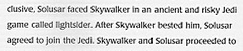

# Kam Solusar

- **Aliases:** Kam, Solusar
- **Era:** NR
- **Continuity:** default Legends; entries present for: Canon, Legends
- **Research tier:** DEEP
- **Entries:** 357 (180 with quotations; 23 quotations extended to the full sentence/passage from the source text on file; 88 marked as fragments; 108 before the 2026-11-17 fragment fill). Rebuilt 2026-11-17 from 381 old entries; old file: `characters/_bak/kam-solusar.md.bak-20261117`.
- **How to read:** each entry is the quotation in full (block quote), then its source and point of view. "Note" lines are summaries from our notes, not quotations. `[fragment — full passage not on file]` means the source text is not on the box, so only the words in our notes are shown. Debate and forum material is in the last section and is unverified.

# LEGENDS (Legends / EU — main focus)

## Legacy of the Force 1–9: novel notes from the other agent (reference copy)

- Note (summary from our notes, not a quotation): Serpa's ritual: children arranged in circle (L3233–3249). Serpa shoots Tionne (knee, then later arm/leg amputated by bolts) (L3275, L3349); Tionne «Force-slap» too slow (L3275). Serpa's snipers kill Jedi Knights Vis'l & Loli (L3297); Kam Solusar, Ozlo, Jerga shot down by sniper fire when drawn out (L3345, L3355; «K. Solusar down» — not stated dead; *Fury* L683 has Kam and Tionne recovering). Alfi and Hedda down (L3355).
  — Source: L3233–3249; L3275; L3297; L3355 — Legacy of the Force 6: Inferno (novel, read in full): feats, scaling and story notes.
Our notes: `notes/materials/021-legacy-of-the-force/lotf-6-inferno-notes.md:336`

> Octa, trained by Kam and Tionne Solusar, both still recovering from their near-fatal wounds at the hands of Jacen Solo’s soldiers, was more subdued than the rest, her stillness in the Force clearly a consequence of rigid self-control rather than inner peace. *(L683)*
— Source: L683 — Legacy of the Force 7: Fury (novel, read in full): feats, scaling and story notes.
(Full sentence/passage taken from the source text on file: `novels_tmp_fury_FULL_txt`.)
Note (our notes, around the quote): Masters present: Luke, Kyle Katarn, Cilghal, Kyp, Corran, Saba, Octa Ramis (L683). Kam and Tionne «both still recovering from their near-fatal wounds» (L683) [Allston: Kam alive; contrast Inferno L3345–3355 where Kam appeared killed — continuity note].
Our notes: `notes/materials/021-legacy-of-the-force/lotf-7-fury-notes.md:245`

> “I don’t know how he could do that, send in a crazy man to bargain with the younglings’ lives, to torture Kam Solusar and Tionne and kill all those others.” *(L781)*
— Source: L765–769; L781 — Legacy of the Force 7: Fury (novel, read in full): feats, scaling and story notes.
(Full sentence/passage taken from the source text on file: `novels_tmp_fury_FULL_txt`.)
Note (our notes, around the quote): Seha (Jacen-sponsored apprentice, Temple spy for him) confesses: she helped Ben leave the Temple at Jacen's order (L765–769). Seha: «to torture Kam Solusar and Tionne and kill all those others» (L781).
Our notes: `notes/materials/021-legacy-of-the-force/lotf-7-fury-notes.md:249`

## Jedi Academy Trilogy (Kevin J. Anderson, 1994): Jedi Search, Dark Apprentice, Champions of the Force (power-scaling notes)

> Tionne and Kam Solusar raced forward, stretching out their arms, using what they had been taught. Less than a meter above the crushing stones, Leia found herself slowed, pausing in the air beside Luke’s body. They drifted gently to the floor. Leia cradled Luke against her, but her brother did not respond.
— Source: Champions of the Force, ch.7, PDF p.61 — Owner Material 026 — Jedi Academy Trilogy: Champions of the Force (Kevin J. Anderson).
(Excerpt widened 2026-11-17 to the relevant passage, word for word from Champions of the Force (Kevin Anderson), Chapter 7 (text copy `MEGA_Legend_The_Jedi_Academy_Trilogy_Star_Wars_Jedi_Academy_03_Champions_of_the_Force_Kevin_J_Anderson_epub`).)
Note (our notes, around the quote): Tionne and Kam catch Leia and Luke mid-fall (also: Tionne, Leia Organa Solo): "Tionne and Kam Solusar raced forward, stretching out their arms, using what they had been taught. Less than a meter above the crushing stones, Leia found herself slowed, pausing in the air beside Luke’s body. They drifted gently to the floor." Source: Champions of the Force, ch.7, PDF p.61
Our notes: `notes/materials/026-jedi-academy-trilogy/champions-of-the-force.md:142`

> Luke intended to bring together everyone he could, immediately—not just Gantoris and Streen, but also Kyp Durron, Mara Jade, several of the witches of Dathomir, Kam Solusar, and others he had encountered since the Battle of Endor. And the search for new people with Jedi potential would have to be intensified. He needed candidates, as many as possible.
— Source: Jedi Search, Epilogue, PDF p.273 — Owner Material 026 — Jedi Academy Trilogy: Jedi Search (Kevin J. Anderson).
(Excerpt widened 2026-11-17 to the relevant passage, word for word from Jedi Search (Kevin Anderson), Epilogue (text copy `MEGA_Legend_The_Jedi_Academy_Trilogy_Star_Wars_Jedi_Academy_01_Jedi_Search_Kevin_J_Anderson_epub`).)
Note (our notes, around the quote): Luke’s planned first class on Yavin 4 (Kam Solusar named) (also: Kyp Durron, Mara Jade, Kam Solusar, Gantoris, Streen): "Luke intended to bring together everyone he could, immediately—not just Gantoris and Streen, but also Kyp Durron, Mara Jade, several of the witches of Dathomir, Kam Solusar, and others he had encountered since the Battle of Endor." Source: Jedi Search, Epilogue, PDF p.273
Our notes: `notes/materials/026-jedi-academy-trilogy/jedi-search.md:70`

## Star Wars: The New Essential Chronology (Del Rey, 2005): power-scaling and lore notes

> Solusar faced Skywalker in an ancient and risky Jedi game called lightsider. After Skywalker bested him, Solusar agreed to join the Jedi.
— Source: Part Seven: Empire Resurgent; Kam Solusar; Luke Skywalker — lightsider.
Note (our notes, around the quote): Kam Solusar; Luke Skywalker — lightsider: "Solusar faced Skywalker in an ancient and risky Jedi game called lightsider. After Skywalker bested him, Solusar agreed to join the Jedi." Source: The New Essential Chronology, p.157

Our notes: `notes/materials/027-new-essential-chronology/07-part-seven-empire-resurgent.md:106`

> He knew that his sister Leia, her three children, Kam Solusar, the Witches of Dathomir, Kyle Katarn, and Mara Jade had all exhibited an aptitude for the Force.
— Source: Part Eight: The Return of the Jedi Knights; Luke Skywalker — academy recruits. POV: speaker not named in our notes.
Note (our notes, around the quote): Luke Skywalker — academy recruits: "He knew that his sister Leia, her three children, Kam Solusar, the Witches of Dathomir, Kyle Katarn, and Mara Jade had all exhibited an aptitude for the Force." Source: The New Essential Chronology, p.162
Our notes: `notes/materials/027-new-essential-chronology/08-part-eight-return-of-the-jedi-knights.md:11`

> On snowy Dolls 3, a band of Imperial partisans viewed the looming nuptials with contempt Believing the event to be more proof thal the Empire had been watered down like weak caf, the loyalists made plans to slip into Coruscant and sabotage the ceremony.
>
> One of their number claimed to be a former Royal Guardsman, and though his experience was likely a mere boast, his attempt to kill Mara Jade during her dress fitting gave a murderous edge to the plot. The other Imperiats focused on infiltrating the event site and hiring a gang of swoopbikers to harass the wedding guests, Despite the scheming, the wedding went off with mini mum mayhem. Following Luke's raucous bachelor party in Coruscant’s lower levels, the happy couple joined together in a private Jedi ceremony officiated by Kam Solusar in the renovated Jedi Temple. The public ceremony, held in Coruscant’s Reflection Gardens, remained peaceful thanks to extra muscle provided by Booster Terrik and others, who kept the swoopbikers at bay. When the final Imperial plotter crashed the ceremony and threatened to release a crippling computer virus, Luke persuaded him to give himself up and join the party. With that quiet denouncement, a generation Of hostilities suddenly seemed as dead as Palpatine himself.
>
> Weeks later, Lando Calrissian wed Tendra Risant, the woman he had met during the events of the Corellian insurrection.
— Source: Part Ten: A Lasting Peace; Kam Solusar; Luke Skywalker; Mara Jade Skywalker — Kam officiates.
(Excerpt widened 2026-11-17 to the relevant passage, word for word from research primary new essential chronology nec paged (text copy `research_primary_new_essential_chronology_nec_paged_txt_88b808b5bc`).)
(Excerpt widened 2026-11-17 to the relevant passage, word for word from research primary new essential chronology nec paged (text copy `research_primary_new_essential_chronology_nec_paged_txt_88b808b5bc`).)
(Full sentence/passage taken from the source text on file: `research_primary_new_essential_chronology_nec_paged_txt`.)
Note (our notes, around the quote): Kam Solusar; Luke Skywalker; Mara Jade Skywalker — Kam officiates: "the happy couple joined together in a private Jedi ceremony officiated by Kam Solusar in the renovated Jedi Temple." Source: The New Essential Chronology, p.194
Our notes: `notes/materials/027-new-essential-chronology/10-part-ten-a-lasting-peace.md:49`

## Star Wars Saga Edition: Jedi Academy Training Manual (WotC, 2009): power-scaling and lore notes

- Note (summary from our notes, not a quotation): Not in this book: Kyp Durron, Gantoris, Streen, Kam Solusar, Admiral Daala, the Sun Crusher and Tionne are not named anywhere in it (both OCR passes searched, fuzzy matching).
  — Source: Front matter and Introduction.
Our notes: `notes/materials/028-jedi-academy-training-manual/00-front-matter-introduction.md:6`; `notes/materials/028-jedi-academy-training-manual/01-ch1-power-of-the-force.md:6`; `notes/materials/028-jedi-academy-training-manual/02-ch2-philosophy.md:6`; `notes/materials/028-jedi-academy-training-manual/03-ch3-equipment-and-artifacts.md:6`; `notes/materials/028-jedi-academy-training-manual/04-ch4-affiliated-programs.md:6`; `notes/materials/028-jedi-academy-training-manual/05-ch5-instructors-and-alumni.md:6`; `notes/materials/028-jedi-academy-training-manual/06-ch6-dangers-of-study.md:6`; `notes/materials/028-jedi-academy-training-manual/07-ch7-studying-abroad-back-cover.md:6`

## The Jedi Academy Sourcebook (WEG, 1996): power-scaling and lore notes

> He has encountered several potential Jedi in his travels, among them Mara Jade, Kirana Ti and Kam Solusar.
— Source: Chapter Three: The Jedi Academy.
Note (our notes, around the quote): Luke Skywalker; Mara Jade Skywalker; Kirana Ti; Kam Solusar — The Jedi Search Begins: "He has encountered several potential Jedi in his travels, among them Mara Jade, Kirana Ti and Kam Solusar." Source: The Jedi Academy Sourcebook, p.30
Our notes: `notes/materials/029-jedi-academy-sourcebook/03-ch3-the-jedi-academy.md:11`

> That much he could feel, and for now that was enough.
>
> Luke looked out over the city as the sun rose, sending rays of light into darkened ur- ban canyons below. Far across the endless city, one of the towering demolition droids that dotted the landscape roared to life, and began tearing its way into a new block of buildings demolished in the recent battle with the Empire. Luke watched it a long time before going back inside, === sp33 Leia recovered from the resurrected Emperor's stronghold. The Holocron is very useful in aug- menting Luke's training regimen, but its true utility is in instilling in his students the knowl- edge of Jedi history and culture — all of the lessons Yoda never had the time or luxury to teach him on Dagobah when he was preparing him to face Vader.
>
> He has other resources as well, including a host of tutorial books and datatapes he found on ancient Ossus and Dathomir. He also draws on the Jedi training Kam Solusar received as a young man, because his master, Ranik Solusar, came from a different school of Jedi training than did Obi-Wan and Yoda.
>
> From Kam’s training he derives a series of exercises in resourcefulness and concentration.
>
> In one such exercise, Luke sends his students in pairs into the wilderness.
— Source: Chapter Three: The Jedi Academy; Luke Skywalker; Kam Solusar — Jedi Training — Kam Solusar's school.
(Excerpt widened 2026-11-17 to the relevant passage, word for word from research primary jedi academy sourcebook jas clean (text copy `research_primary_jedi_academy_sourcebook_jas_clean_txt_04b8ab0d44`).)
(Excerpt widened 2026-11-17 to the relevant passage, word for word from research primary jedi academy sourcebook jas clean (text copy `research_primary_jedi_academy_sourcebook_jas_clean_txt_04b8ab0d44`).)
Note (our notes, around the quote): Luke Skywalker; Kam Solusar — Jedi Training — Kam Solusar's school: "He also draws on the Jedi training Kam Solusar received as a young man, because his master, Ranik Solusar, came from a different school of Jedi training than did Obi-Wan and Yoda." Source: The Jedi Academy Sourcebook, p.32
Our notes: `notes/materials/029-jedi-academy-sourcebook/03-ch3-the-jedi-academy.md:29`

> 1, running 4D KNOWLEDGE 5D Alien species 5D+2, bureaucracy 5D+2, bureaucracy:
>
> Khomm civil service 7D, business 6D, cultures 6D, plan- etary systems 5D-+2, survival 5D+2, survival: Yavin Four 6D, willpower 5D+1 MECHANICAL 2D Astrogation 3D+2, beast riding 4D, ground vehicle opera- tion 4D+1, repulsorlift operation 4D+1, sensors 3D+1, space transports 3D, starship shields 3D PERCEPTION 4D Bargain 5D-+2, investigation: bureaucratic audit 6D+1, persuasion 5D er eee The Jedi Academy Sourcebook === sp40 ee BR cr ater three: The Jedi Academ ON Chapter Three: The Jedi Academy STRENGTH 2D Climbing/jumping 2D-2, lifting 2D+1, stamina 3D TECHNICAL 3D Computer programming/repair 4D, first aid 4D+2, lightsaber repair 3D+2, security 4D, space transports repair 3D+1 Special Abilities:
>
> Force Skills: Control 4D, sense 3D+1, alter 3D These are only some of the powers which Dorsk 81 has so far demonstrated:
>
> Control: Accelerate healing, concentration* , control pain, emptiness, hibernation trance, reduce injury, remain conscious, remove fatigue Sense: Danger sense**, life detection, life sense, magnify senses, sense Force Alter: Telekinesis Control and Alter: Accelerate another's healing, control another's pain, remove another's fatigue * Described in the Movie Trilogy Sourcebook ** Described in The Thrawn Trilogy Sourcebook This character is Force-sensitive Force Points: 2 Character Points: 9 Move: 1() Equipment: Jed! robes, staff, datapad Kam Solusar Kam Solusar is a middle-aged man, tall and solidly built. The Force runs strong in his family, and Kam's father, Ranik Solusar, was a great Jedi master.
>
> Kam studied under his father for a number of years before the Imperial Jedi purges drove his family apart. Ranik fell at the hands of Lord Darth Vader, and Kam himself barely escaped the Imperial inquisition. He went into hiding in the isolated regions of the Outer Rim.
>
> Ranik fell at the hands of Lord Darth Vader, and Kam himself barely escaped the Imperial inquisition. He went into hiding in the isolated regions of the Outer Rim.
>
> Like Luke and Kyp, Kam has had his brush with the dark side of the Force. While in exile, he was captured and tortured by evil Jedi, and twisted to serve the dark side. Luke won him back over to the light side, and brought him back to the Core to serve as his apprentice.
— Source: Chapter Three: The Jedi Academy; Kam Solusar; Darth Vader (Anakin Skywalker) — Kam Solusar — the purge.
(Excerpt widened 2026-11-17 to the relevant passage, word for word from research primary jedi academy sourcebook jas clean (text copy `research_primary_jedi_academy_sourcebook_jas_clean_txt_04b8ab0d44`).)
(Excerpt widened 2026-11-17 to the relevant passage, word for word from research primary jedi academy sourcebook jas clean (text copy `research_primary_jedi_academy_sourcebook_jas_clean_txt_04b8ab0d44`).)
Note (our notes, around the quote): Kam Solusar; Darth Vader (Anakin Skywalker) — Kam Solusar — the purge: "Ranik fell at the hands of Lord Darth Vader, and Kam himself barely escaped the Imperial inquisition." Source: The Jedi Academy Sourcebook, p.39
Our notes: `notes/materials/029-jedi-academy-sourcebook/03-ch3-the-jedi-academy.md:140`

> The Force runs strong in his family, and Kam's father, Ranik Solusar, was a great Jedi master.
>
> Kam studied under his father for a number of years before the Imperial Jedi purges drove his family apart. Ranik fell at the hands of Lord Darth Vader, and Kam himself barely escaped the Imperial inquisition. He went into hiding in the isolated regions of the Outer Rim.
>
> Like Luke and Kyp, Kam has had his brush with the dark side of the Force. While in exile, he was captured and tortured by evil Jedi, and twisted to serve the dark side.
>
> Like Luke and Kyp, Kam has had his brush with the dark side of the Force. While in exile, he was captured and tortured by evil Jedi, and twisted to serve the dark side. Luke won him back over to the light side, and brought him back to the Core to serve as his apprentice.
>
> Kam's grasp of the Force is astounding in some areas, and remarkably weak in others, because he was forced to leave his master be- fore he could complete his training.
— Source: Chapter Three: The Jedi Academy.
(Excerpt widened 2026-11-17 to the relevant passage, word for word from research primary jedi academy sourcebook jas clean (text copy `research_primary_jedi_academy_sourcebook_jas_clean_txt_04b8ab0d44`).)
(Excerpt widened 2026-11-17 to the relevant passage, word for word from research primary jedi academy sourcebook jas clean (text copy `research_primary_jedi_academy_sourcebook_jas_clean_txt_04b8ab0d44`).)
Note (our notes, around the quote): Kam Solusar; Luke Skywalker; Kyp Durron — Kam Solusar — brush with the dark side: "Like Luke and Kyp, Kam has had his brush with the dark side of the Force. While in exile, he was captured and tortured by evil Jedi, and twisted to serve the dark side. Luke won him back over to the light side, and brought him back to the Core to serve as his apprentice." Source: The Jedi Academy Sourcebook, p.39
Our notes: `notes/materials/029-jedi-academy-sourcebook/03-ch3-the-jedi-academy.md:142`

> Kam's grasp of the Force is astounding in some areas, and remarkably weak in others, because he was forced to leave his master before he could complete his training.
— Source: Chapter Three: The Jedi Academy; Kam Solusar — Kam Solusar — uneven grasp of the Force.
Note (our notes, around the quote): Kam Solusar — Kam Solusar — uneven grasp of the Force: "Kam's grasp of the Force is astounding in some areas, and remarkably weak in others, because he was forced to leave his master before he could complete his training." Source: The Jedi Academy Sourcebook, p.39
Our notes: `notes/materials/029-jedi-academy-sourcebook/03-ch3-the-jedi-academy.md:144`

> Kam's grasp of the Force is astounding in some areas, and remarkably weak in others, because he was forced to leave his master be- fore he could complete his training. Though he has received advanced training in certain areas, he still knows little about many aspects of the Force. m Kam Solusar Type: Jedi Apprentice DEXTERITY 4D Blaster 6D+2, brawling parry 5D, dodge 5D-2, lightsaber 5D, melee combat 5D+2, melee parry 4D-2, running 5D, thrown weapons 5D KNOWLEDGE 4D Alien species 5D, cultures 5D+1, intimidation 6D, lan- guages 4D+2, planetary systems 5D, streetwise 5D+2, survival 4D+2, survival: Yavin Four 5D, value 5D, will- power 6D MECHANICAL 3D Archaic starship piloting 4D+2, astrogation 4D+1, beast riding 5D, ground vehicle operation 4D-+2, repulsorlift operation 5D, sensors 3D+2, space transports 5D, starship gunnery 4D+2, starship shields 4D PERCEPTION 3D Bargain 4D+1, command 4D+2, forgery 3D+1, hide 4D, persuasion 5D+2, search 4D+2, sneak 5D STRENGTH 2D Brawling 4D, climbing/jumping 5D+1, stamina 5D TECHNICAL 2D Blaster repair 3D+1, computer programming/repair 4D, droid programming 3D, first aid 4D, lightsaber repair 4D+1, repulsorlift repair 3D+1, security 4D, space trans- ports repair 3D+2 Special Abilities:
>
> Force Skills: Control 2D+2, sense 4D+1, alter 6D These are only some of the powers which Kam Solusar has so far demonstrated:
>
> Control: Accelerate healing, concentration*, control pain, emptiness, hibernation trance, reduce injury, remain conscious, remove fatigue Sense: Danger sense**, life detection, life sense, magnify senses, sense Force Alter; Injure/kill, telekinesis Control and Alter; Accelerate another's healing, control another's pain**, inflict pain**, remove another's fa- tigue Sense and Alter Dim others’ senses** * Described in the Movie Trilogy Sourcebook ** Described In The Thrawn Trilogy Sourcebook This character is Force-sensitive Force Points: 2 Dark Side Points: | Character Points: 17 Move: 10 Equipment: Lightsaber (5D), comlink Tionne Tionne is a winsome young woman with an undying passion for the Jedi way.
— Source: Chapter Three: The Jedi Academy.
(Excerpt widened 2026-11-17 to the relevant passage, word for word from research primary jedi academy sourcebook jas clean (text copy `research_primary_jedi_academy_sourcebook_jas_clean_txt_04b8ab0d44`).)
(Excerpt widened 2026-11-17 to the relevant passage, word for word from research primary jedi academy sourcebook jas clean (text copy `research_primary_jedi_academy_sourcebook_jas_clean_txt_04b8ab0d44`).)
(Full sentence/passage taken from the source text on file: `research_primary_jedi_academy_sourcebook_jas_clean_txt`.)
Note (our notes, around the quote): Kam Solusar — Kam Solusar — stat block, combat skills (RPG mechanics) — RPG mechanics (weaker source): "Blaster 6D+2, brawling parry 5D, dodge 5D+2, lightsaber 5D, melee combat 5D+2," Source: The Jedi Academy Sourcebook, p.39, stat block
Our notes: `notes/materials/029-jedi-academy-sourcebook/03-ch3-the-jedi-academy.md:146`

> Kam's grasp of the Force is astounding in some areas, and remarkably weak in others, because he was forced to leave his master be- fore he could complete his training. Though he has received advanced training in certain areas, he still knows little about many aspects of the Force. m Kam Solusar Type: Jedi Apprentice DEXTERITY 4D Blaster 6D+2, brawling parry 5D, dodge 5D-2, lightsaber 5D, melee combat 5D+2, melee parry 4D-2, running 5D, thrown weapons 5D KNOWLEDGE 4D Alien species 5D, cultures 5D+1, intimidation 6D, lan- guages 4D+2, planetary systems 5D, streetwise 5D+2, survival 4D+2, survival: Yavin Four 5D, value 5D, will- power 6D MECHANICAL 3D Archaic starship piloting 4D+2, astrogation 4D+1, beast riding 5D, ground vehicle operation 4D-+2, repulsorlift operation 5D, sensors 3D+2, space transports 5D, starship gunnery 4D+2, starship shields 4D PERCEPTION 3D Bargain 4D+1, command 4D+2, forgery 3D+1, hide 4D, persuasion 5D+2, search 4D+2, sneak 5D STRENGTH 2D Brawling 4D, climbing/jumping 5D+1, stamina 5D TECHNICAL 2D Blaster repair 3D+1, computer programming/repair 4D, droid programming 3D, first aid 4D, lightsaber repair 4D+1, repulsorlift repair 3D+1, security 4D, space trans- ports repair 3D+2 Special Abilities:
>
> Force Skills: Control 2D+2, sense 4D+1, alter 6D These are only some of the powers which Kam Solusar has so far demonstrated:
>
> Control: Accelerate healing, concentration*, control pain, emptiness, hibernation trance, reduce injury, remain conscious, remove fatigue Sense: Danger sense**, life detection, life sense, magnify senses, sense Force Alter; Injure/kill, telekinesis Control and Alter; Accelerate another's healing, control another's pain**, inflict pain**, remove another's fa- tigue Sense and Alter Dim others’ senses** * Described in the Movie Trilogy Sourcebook ** Described In The Thrawn Trilogy Sourcebook This character is Force-sensitive Force Points: 2 Dark Side Points: | Character Points: 17 Move: 10 Equipment: Lightsaber (5D), comlink Tionne Tionne is a winsome young woman with an undying passion for the Jedi way.
— Source: Chapter Three: The Jedi Academy.
(Excerpt widened 2026-11-17 to the relevant passage, word for word from research primary jedi academy sourcebook jas clean (text copy `research_primary_jedi_academy_sourcebook_jas_clean_txt_04b8ab0d44`).)
(Excerpt widened 2026-11-17 to the relevant passage, word for word from research primary jedi academy sourcebook jas clean (text copy `research_primary_jedi_academy_sourcebook_jas_clean_txt_04b8ab0d44`).)
Note (our notes, around the quote): Kam Solusar — Kam Solusar — stat block, Force skills (RPG mechanics) — RPG mechanics (weaker source): "Force Skills: Control 2D+2, sense 4D+1, alter 6D" Source: The Jedi Academy Sourcebook, p.39, stat block
Our notes: `notes/materials/029-jedi-academy-sourcebook/03-ch3-the-jedi-academy.md:148`

## The Complete Star Wars Encyclopedia, Vol. II (H–O)

> Luke Skywalker once bested Kam Solusar at it during the early years of the New Republic.
— Source: scan pages 241–280; Luke Skywalker; Kam Solusar.
Note (our notes, around the quote): Luke Skywalker; Kam Solusar: "Luke Skywalker once bested Kam Solusar at it during the early years of the New Republic." Source: The Complete Star Wars Encyclopedia, Vol. II, p.256
Our notes: `notes/materials/031-complete-star-wars-encyclopedia-vol-2/06-v2-scan-241-280.md:191`

> Murra A tribesman of the Ysanna on Ossus, Murra was the first to help Okko attempt to defeat Luke Skywalker and Kam Solusar when they arrived on the planet.
— Source: scan pages 321–360; Luke Skywalker; Kam Solusar.
Note (our notes, around the quote): Luke Skywalker; Kam Solusar: "Murra A tribesman of the Ysanna on Ossus, Murra was the first to help Okko attempt to defeat Luke Skywalker and Kam Solusar when they arrived on the planet." Source: The Complete Star Wars Encyclopedia, Vol. II, p.343
Our notes: `notes/materials/031-complete-star-wars-encyclopedia-vol-2/08-v2-scan-321-360.md:202`

- Note (summary from our notes, not a quotation): Page contents: 1224 words, 27 paragraphs | headings/entries: Nakay, Pell; Naked Hutt Cantina; N'a-kee-tula; Nak'har; Nakhym, Golov; Nakk, Urman; Nalan; Naldar; Nale, Kam; Nalgol; Nal Hutta; Nal Hutta Kal'tamok; Nali-Erun; Nalju; Nalju, Count
  — Source: scan pages 361–400.
Our notes: `notes/materials/031-complete-star-wars-encyclopedia-vol-2/09-v2-scan-361-400.md:32`

## The Complete Star Wars Encyclopedia, Vol. III (P–Z)

> They realized that their relationship was now stronger than ever, and they were soon wed; once in a Jedi ceremony performed by Kam Solusar, and again in a public ceremony on Coruscant.
— Source: scan pages 161–200; Kam Solusar. POV: Kam Solusar.
Note (our notes, around the quote): Kam Solusar: "They realized that their relationship was now stronger than ever, and they were soon wed; once in a Jedi ceremony performed by Kam Solusar, and again in a public ceremony on Coruscant." Source: The Complete Star Wars Encyclopedia, Vol. III, p.166
Our notes: `notes/materials/032-complete-star-wars-encyclopedia-vol-3/04-v3-scan-161-200.md:155`

- Note (summary from our notes, not a quotation): Page contents: 990 words, 17 paragraphs | headings/entries: Solomahal; Solusar, Kam
  — Source: scan pages 161–200.
Our notes: `notes/materials/032-complete-star-wars-encyclopedia-vol-3/04-v3-scan-161-200.md:289`

> Solusar united with Skywalker's other Jedi students in defeating Exar Kun's spirit.
— Source: scan pages 161–200; Kam Solusar; Exar Kun — entry/section: Solusar, Kam.
Note (our notes, around the quote): Kam Solusar; Exar Kun — entry/section: Solusar, Kam: "Solusar united with Skywalker's other Jedi students in defeating Exar Kun's spirit." Source: The Complete Star Wars Encyclopedia, Vol. III, p.178
Our notes: `notes/materials/032-complete-star-wars-encyclopedia-vol-3/04-v3-scan-161-200.md:299`

- Note (summary from our notes, not a quotation): Page contents: 1396 words, 22 paragraphs | headings/entries: Solusar, Ranik; Solusar, Tionne; Somerce, Akeeli; Sommos, Noma; Somoril, Vak; Somov Rit; Sonniod; Sonsen, Jenica; Sooflie 1X, Prince R'cardo; Sookcool, Avaro
  — Source: scan pages 161–200.
Our notes: `notes/materials/032-complete-star-wars-encyclopedia-vol-3/04-v3-scan-161-200.md:304`

> He escaped the slaughter of Order 66, but was later killed by Darth Vader during the Empire's Purge of Jedi survivors.
— Source: scan pages 161–200; Kam Solusar; Darth Vader (Anakin Skywalker) — entry/section: Solusar, Ranik.
Note (our notes, around the quote): Kam Solusar; Darth Vader (Anakin Skywalker) — entry/section: Solusar, Ranik: "He escaped the slaughter of Order 66, but was later killed by Darth Vader during the Empire's Purge of Jedi survivors." Source: The Complete Star Wars Encyclopedia, Vol. III, p.179
Our notes: `notes/materials/032-complete-star-wars-encyclopedia-vol-3/04-v3-scan-161-200.md:306`

> Soon after Solusar's conversion, three Ysanna prisoners from Ossus were taken to Vjun to serve as raw material in creating new clone bodies for Emperor Palpatine.
— Source: scan pages 281–320; Kam Solusar; Palpatine (Darth Sidious).
Note (our notes, around the quote): Kam Solusar; Palpatine (Darth Sidious): "Soon after Solusar's conversion, three Ysanna prisoners from Ossus were taken to Vjun to serve as raw material in creating new clone bodies for Emperor Palpatine." Source: The Complete Star Wars Encyclopedia, Vol. III, p.309
Our notes: `notes/materials/032-complete-star-wars-encyclopedia-vol-3/07-v3-scan-281-320.md:282`

## The New Essential Guide to Characters (2002)

- Note (summary from our notes, not a quotation): Page contents: 519 words, 22 paragraphs | headings/entries: AM SOLUSAR; H am Solusar has beaten the odds; Ladsaab etaedede- despa aabnneaie
  — Source: scan pages 151–180.
Our notes: `notes/materials/034-new-essential-guide-to-characters/05-negc-scan-151-180.md:155`

> After Palpatine's defeat and apparent death at the New Republic's Pinnacle Base, Solusar encountered Luke Skywalker on the abandoned space city Nespis VIII.
— Source: scan pages 151–180; Palpatine (Darth Sidious); Kam Solusar; Luke Skywalker.
Note (our notes, around the quote): Palpatine (Darth Sidious); Kam Solusar; Luke Skywalker: "After Palpatine's defeat and apparent death at the New Republic's Pinnacle Base, Solusar encountered Luke Skywalker on the abandoned space city Nespis VIII." Source: The New Essential Guide to Characters, p.177
Our notes: `notes/materials/034-new-essential-guide-to-characters/05-negc-scan-151-180.md:157`

> Skywalker sensed the goodness the Emperor had smothered, and bested Solusar in the ancient Jedi game of lightsider.
— Source: scan pages 151–180; Kam Solusar. POV: Kam Solusar.
Note (our notes, around the quote): Kam Solusar: "Skywalker sensed the goodness the Emperor had smothered, and bested Solusar in the ancient Jedi game of lightsider." Source: The New Essential Guide to Characters, p.177
Our notes: `notes/materials/034-new-essential-guide-to-characters/05-negc-scan-151-180.md:159`

## Adventures/Rebel Jedi.pdf [Star Wars Roleplaying Game Revised Core (d20, 2002)]

- Note (summary from our notes, not a quotation): Page contents: Q&A with Luke (Dal mostly practiced basics, gift for mind trick); Luke offers a Force-sensitive hero a low-power lightsaber spar and a teaching post, mentioning Keiran Halcyon and Kam Solusar; Ord Mantell savrip hunters under Dal's mind trick (hand-read)
  — Source: Adventures/Rebel Jedi.pdf [Star Wars Roleplaying Game Revised Core (d20,.
Our notes: `notes/materials/037-sw-d20-folder/072-rebel-jedi.md:37`

> He REBEL JEDI 004 If any of the heroes are Force-Sensitive, Skywalker remarks on this fact. “I hadn’t heard that you had Jedi training,” he says. “Perhaps, when things are a little less chaotic, we can share what we’ve both learned. I may be the teacher here, but I’m also a student.” If the hero is agreeable, Luke even suggests that they spar—with lightsabers set on low power, of course—to give each other a good challenge. “Some of my students here—Keiran Halcyon and Kam Solusar in particular—are gifted lightsaber duelists, but neither has all that much experience as yet.” Should a hero accept Luke’s offer, the sparring takes place on the landing pad, and if the hero wins, Luke takes it in good grace. He comments on the hero’s fighting style, no matter who wins, and asks about the hero’s experiences with the Force. If the hero seems amenable, Luke asks if he or she would be interested in teaching, at least part time, at the Academy. “I can’t always be here, and it’s unfair to always rely on Kam and Tionne to fill in. It wouldn’t be a full-time commitment—unless that’s what you want—but I’d appreciate any help you could give.”
— Source: Adventures/Rebel Jedi.pdf [Star Wars Roleplaying Game Revised Core (d20,; Kam Solusar; Luke Skywalker — entry/section: Rebel Jedi.
(Excerpt widened 2026-11-17 to the relevant passage, word for word from research primary sw d20 folder files Star Wars Roleplaying Game Revised Core Adventures Rebel Jedi (text copy `research_primary_sw_d20_folder_files_Star_Wars_Roleplaying_Game_Revised_Core_Adventures_Rebel_Jedi_pdf_ea4ca0868e`).)
(Excerpt widened 2026-11-17 to the relevant passage, word for word from research primary sw d20 folder files Star Wars Roleplaying Game Revised Core Adventures Rebel Jedi (text copy `research_primary_sw_d20_folder_files_Star_Wars_Roleplaying_Game_Revised_Core_Adventures_Rebel_Jedi_pdf_ea4ca0868e`).)
Note (our notes, around the quote): Kam Solusar; Luke Skywalker — entry/section: Rebel Jedi: "“Some of my students here—Keiran Halcyon and Kam Solusar in particular—are gifted lightsaber duelists, but neither has all that much experience as yet.” Should a hero accept Luke’s offer, the sparring takes place on the landing pad, and if the hero wins, Luke takes it in good grace." Source: *Rebel Jedi* (SWRPG d20 Revised Core), scan p.4
Our notes: `notes/materials/037-sw-d20-folder/072-rebel-jedi.md:39`

> With that, the locals produce an assortment of melee weapons and a few battered, latemodel blaster pistols. If the heroes don’t initiate combat, the locals do (or try to). Carry out the combat, treating the locals as mid-level thugs, and their leader as a mid-level outlaw (see Chapter 14: Allies and Opponents, in the revised core rulebook). He REBEL JEDI 004 If any of the heroes are Force-Sensitive, Skywalker remarks on this fact. “I hadn’t heard that you had Jedi training,” he says. “Perhaps, when things are a little less chaotic, we can share what we’ve both learned. I may be the teacher here, but I’m also a student.” If the hero is agreeable, Luke even suggests that they spar—with lightsabers set on low power, of course—to give each other a good challenge. “Some of my students here—Keiran Halcyon and Kam Solusar in particular—are gifted lightsaber duelists, but neither has all that much experience as yet.” Should a hero accept Luke’s offer, the sparring takes place on the landing pad, and if the hero wins, Luke takes it in good grace. He comments on the hero’s fighting style, no matter who wins, and asks about the hero’s experiences with the Force.
— Source: Adventures/Rebel Jedi.pdf [Star Wars Roleplaying Game Revised Core (d20,; Luke Skywalker — entry/section: Luke offers to spar.
(Excerpt widened 2026-11-17 to the relevant passage, word for word from research primary sw d20 folder files Star Wars Roleplaying Game Revised Core Adventures Rebel Jedi (text copy `research_primary_sw_d20_folder_files_Star_Wars_Roleplaying_Game_Revised_Core_Adventures_Rebel_Jedi_pdf_ea4ca0868e`).)
(Excerpt widened 2026-11-17 to the relevant passage, word for word from research primary sw d20 folder files Star Wars Roleplaying Game Revised Core Adventures Rebel Jedi (text copy `research_primary_sw_d20_folder_files_Star_Wars_Roleplaying_Game_Revised_Core_Adventures_Rebel_Jedi_pdf_ea4ca0868e`).)
Note (our notes, around the quote): Luke Skywalker — entry/section: Luke offers to spar: "If any of the heroes are Force-Sensitive, Skywalker remarks on this fact. “I hadn't heard that you had Jedi training,” he says. “Perhaps, when things are a little less chaotic, we can share what we've both learned. I may be the teacher here, but I'm also a student.” If the hero is agreeable, Luke even suggests that they spar—with lightsabers set on low power, of course—to give each other a good challenge. “Some of my students here—Keiran Halcyon and Kam Solusar in particular—are gifted lightsaber duelists, but neither has all that much experience as yet.”" Source: *Rebel Jedi* (SWRPG d20 Revised Core), scan p.4
Our notes: `notes/materials/037-sw-d20-folder/072-rebel-jedi.md:43`

## Sourcebooks/Geonosis and the Outer Rim Worlds.pdf [Star Wars Roleplaying Game Revised Core (d20, 2002)] (scan pages 61–120)

- Note (summary from our notes, not a quotation): Page contents: Ossus: moons Mim and Nerit; history (Jedi stronghold; Great Sith War - Crado and Aleema with Ulic Qel-Droma and Exar Kun ignite the Cron Cluster; Ysanna descendants met by Luke Skywalker and Kam Solusar; Ood Bnar guards the lightsaber vaults and later aids them against Executor Sedriss; NJO era); people; Knossa Spaceport begins. (hand-read)
  — Source: Sourcebooks/Geonosis and the Outer Rim Worlds.pdf [Star Wars Roleplaying.
Our notes: `notes/materials/037-sw-d20-folder/667-geonosis-and-the-outer-rim-worlds-scan-061-120.md:375`

> (Their descendants, over the centuries, constitute the Ysanna society that Luke Skywalker and Kam Solusar encounter some years after the Battle of Endor.)
— Source: Sourcebooks/Geonosis and the Outer Rim Worlds.pdf [Star Wars Roleplaying; Luke Skywalker; Kam Solusar — entry/section: The Ysanna.
Note (our notes, around the quote): Luke Skywalker; Kam Solusar — entry/section: The Ysanna: "(Their descendants, over the centuries, constitute the Ysanna society that Luke Skywalker and Kam Solusar encounter some years after the Battle of Endor.)" Source: *Geonosis and the Outer Rim Worlds* (SWRPG d20 Revised Core), scan p.110
Our notes: `notes/materials/037-sw-d20-folder/667-geonosis-and-the-outer-rim-worlds-scan-061-120.md:379`

> The aged Neti Jedi Master Ood Bnar also stayed behind to protect Ossus’ lightsaber vaults from the plundering Sith and Krath looters. Exar Kun and his followers succeeded in stealing some relics and dark side lore, but even they had to flee the pending destruction. Master Bnar, however, survived the intense radiation rained on the world’s surface and, nearly four thousand years later, was still able to assist Skywalker and Solusar in their struggle against Executor Sedriss.
— Source: Sourcebooks/Geonosis and the Outer Rim Worlds.pdf [Star Wars Roleplaying.
Note (our notes, around the quote): Ood Bnar; Exar Kun; Luke Skywalker; Kam Solusar — entry/section: Ood Bnar stays behind: "The aged Neti Jedi Master Ood Bnar also stayed behind to protect Ossus’ lightsaber vaults from the plundering Sith and Krath looters. Exar Kun and his followers succeeded in stealing some relics and dark side lore, but even they had to flee the pending destruction. Master Bnar, however, survived the intense radiation rained on the world’s surface and, nearly four thousand years later, was still able to assist Skywalker and Solusar in their struggle against Executor Sedriss." Source: *Geonosis and the Outer Rim Worlds* (SWRPG d20 Revised Core), scan p.110
Our notes: `notes/materials/037-sw-d20-folder/667-geonosis-and-the-outer-rim-worlds-scan-061-120.md:381`

- Note (summary from our notes, not a quotation): Page contents: Ossus: Knossa Spaceport (Ossus Day; Alliance cruiser Ossus Day); Knossa Security Knight stats; Great Jedi Library (Odan-Urr and Empress Teta; Exar Kun slays Odan-Urr; Exis Station on Teedio; Luke Skywalker and Tionne retrieve records). Ossus: sidebar Archaeological Campaigning begins (Luke Skywalker and Kam Solusar defeat Sedriss; Obroan Institute, Hanna Institute, NRAC, University of Agamar). (hand-read)
  — Source: Sourcebooks/Geonosis and the Outer Rim Worlds.pdf [Star Wars Roleplaying.
Our notes: `notes/materials/037-sw-d20-folder/667-geonosis-and-the-outer-rim-worlds-scan-061-120.md:386`

> After Luke Skywalker and Kam Solusar defeat Sedriss and establish relations with the Ysanna, the ruins of Ossus are a key archaeological site for the New Republic and for the new order of Jedi,
> [fragment — full passage not on file]
— Source: Sourcebooks/Geonosis and the Outer Rim Worlds.pdf [Star Wars Roleplaying; Luke Skywalker; Kam Solusar — entry/section: Ossus after Sedriss.
Note (our notes, around the quote): Luke Skywalker; Kam Solusar — entry/section: Ossus after Sedriss: "After Luke Skywalker and Kam Solusar defeat Sedriss and establish relations with the Ysanna, the ruins of Ossus are a key archaeological site for the New Republic and for the new order of Jedi," Source: *Geonosis and the Outer Rim Worlds* (SWRPG d20 Revised Core), scan p.111
Our notes: `notes/materials/037-sw-d20-folder/667-geonosis-and-the-outer-rim-worlds-scan-061-120.md:398`

## Sourcebooks/Geonosis and the Outer Rim Worlds.pdf [Star Wars Roleplaying Game Revised Core (d20, 2002)] (scan pages 121–162)

- Note (summary from our notes, not a quotation): Page contents: Yavin 4: blockade (Darth Vader awaits the Executor; Vellam and House of Tagge infighting); Luke Skywalker's Jedi academy and Exar Kun; Shadow Academy; Yuuzhan Vong (Anakin Solo redeems Vua Rapuung); people (Dr'uun Unnh; Ikrit, Kam Solusar, Tionne); Yavin 8 (Melodies) and Yavin 13 (Slith, Gerbs). Yavin 4: The Great Temple of the Massassi begins (Rebel base layout; Jedi academy). (hand-read)
  — Source: Sourcebooks/Geonosis and the Outer Rim Worlds.pdf [Star Wars Roleplaying.
Our notes: `notes/materials/037-sw-d20-folder/667-geonosis-and-the-outer-rim-worlds-scan-121-162.md:259`

> Years later, the Kushiban Jedi Master Ikrit and the Jedi Knights Kam Solusar and Tionne lived there as three members of the Jedi academy’s small permanent staff.
— Source: Sourcebooks/Geonosis and the Outer Rim Worlds.pdf [Star Wars Roleplaying; Kam Solusar; Tionne — entry/section: Academy staff.
Note (our notes, around the quote): Kam Solusar; Tionne — entry/section: Academy staff: "Years later, the Kushiban Jedi Master Ikrit and the Jedi Knights Kam Solusar and Tionne lived there as three members of the Jedi academy’s small permanent staff." Source: *Geonosis and the Outer Rim Worlds* (SWRPG d20 Revised Core), scan p.154
Our notes: `notes/materials/037-sw-d20-folder/667-geonosis-and-the-outer-rim-worlds-scan-121-162.md:267`

## Star Wars Insider #57 (2001)

- Note (summary from our notes, not a quotation): Page contents: Who's Who (magazine p. 55): Jedi Masters Cilghal, Kyp Durron, Ikrit (died), Kenth Hamner, Tresina Lobi, Kam Solusar, Streen; "Jedi Knights" begins with Daye Azur-Jamin (cyborg prosthetics; Kathy Tyers' Adventure Journal stories; investigating Nal Hutta). Key: a dot indicates the character has died. (hand-read)
  — Source: Star Wars Insider #57 (2001).
Our notes: `notes/materials/038-star-wars-insider/057-ins057.md:317`

## Star Wars Insider #84 (2005)

- Note (summary from our notes, not a quotation): Page contents: HoloNet News headlines; "Be Alert!" partial list of Jedi still at large (incl. Kai Justiss, Halagad Ventor, Ranik Solusar) — final edition notice (hand-read)
  — Source: Star Wars Insider #84 (2005).
Our notes: `notes/materials/038-star-wars-insider/084-ins084.md:361`

## Star Wars: Dark Empire (1991–92), Dark Empire II (1994–95), Empire's End (1995), single issues, hand-read

- Note (summary from our notes, not a quotation): Kam Solusar, Sedriss, the Dark Side Adepts, Xecr Nist, Empatojayos Brand, Jem and Rayf Ysanne and Carnor Jax do not appear in Dark Empire I. They come in Dark Empire II and Empire's End.
  — Source: Star Wars: Dark Empire (#1–6, Dec 1991–Oct 1992): series summary and scaling notes.
Our notes: `notes/materials/041-dark-empire/de1-summary.md:71`

- Note (summary from our notes, not a quotation): Statement: Luke's turning of Kam happens off-page, before this issue. The crawl only says it took "GREAT DIFFICULTY" (p3).
  — Source: Star Wars: Dark Empire II #1 (Dec 1994).
Our notes: `notes/materials/041-dark-empire/de2-01.md:18`

> I'M WITH YOU, LUKE! THE JEDI KNIGHTS WILL RISE AGAIN! *(Kam)*
— Source: Star Wars: Dark Empire II #1 (Dec 1994). POV: Kam.
Label in our notes: > (Kam
Our notes: `notes/materials/041-dark-empire/de2-01.md:48`

> "YES. I WAS APPRENTICED TO THE GREAT JEDI MASTER, RANIK SOLUSAR--MY FATHER."
>
> "NOW I HAVE BEGUN MY SERVICE UNDER LUKE SKYWALKER." (Kam)
> [fragment — full passage not on file]
— Source: Star Wars: Dark Empire II #1 (Dec 1994). POV: Kam.
Context: — Star Wars: Dark Empire II #1, p. 13
Our notes: `notes/materials/041-dark-empire/de2-01.md:49`

> "LEIA FEELS THE STRENGTH OF THE FORCE IN KAM SOLUSAR'S HEART. WONDER OF WONDERS... SHE AND LUKE ARE NO LONGER ALONE!" (caption)
> [fragment — full passage not on file]
— Source: Star Wars: Dark Empire II #1 (Dec 1994).
Context: — Star Wars: Dark Empire II #1, p. 14
Our notes: `notes/materials/041-dark-empire/de2-01.md:52`

- Note (summary from our notes, not a quotation): — Star Wars: Dark Empire II #1, p. 14
  — Source: Star Wars: Dark Empire II #1 (Dec 1994).
Our notes: `notes/materials/041-dark-empire/de2-01.md:55`

- Note (summary from our notes, not a quotation): — Star Wars: Dark Empire II #1, p. 17
  — Source: Star Wars: Dark Empire II #1 (Dec 1994).
Our notes: `notes/materials/041-dark-empire/de2-01.md:60`

> "YOU NEED TO GO INTO HIDING, LEIA... UNTIL YOUR CHILD IS BORN. HE WILL BE A VERY GREAT JEDI." (Luke)
>
> "LEIA IS SIX MONTHS PREGNANT WITH HER THIRD CHILD..." (caption)
> [fragment — full passage not on file]
— Source: Star Wars: Dark Empire II #1 (Dec 1994). POV: Luke, about Kam Solusar.
Context: Speaker note: the first balloon comes from off-panel. The reply sits over a close-up of Kam. (ANALYSIS) The most natural reading is that Kam says he was one of them, but neither speaker is certain from the art. Logged as ambiguous.
Our notes: `notes/materials/041-dark-empire/de2-01.md:62`

> "GREETINGS, JEDI! I AM BODO BAAS, GATEKEEPER OF THE HOLOCRON." (caption: "THE ANCIENT RECORDING DEVICE DETECTS THE PRESENCE OF A JEDI KNIGHT...")
> [fragment — full passage not on file]
— Source: Star Wars: Dark Empire II #1 (Dec 1994).
Context: — Star Wars: Dark Empire II #1, p. 18
Our notes: `notes/materials/041-dark-empire/de2-01.md:65`

> "...BUT ABOVE ALL, PATIENCE IS NEEDED... ONE STEP AT A TIME... FIRST TO OSSUS... TO THE SOURCES..."
>
> "...SOMEONE WHO WAS DEAD MAY YET LIVE... ALTHOUGH MEN CAN FORGET ITS NAME, THE FORCE CAN NEVER DIE..." (Bodo Baas)
> [fragment — full passage not on file]
— Source: Star Wars: Dark Empire II #1 (Dec 1994). POV: Bodo Baas, about Kam Solusar.
Context: — Star Wars: Dark Empire II #1, p. 18
Our notes: `notes/materials/041-dark-empire/de2-01.md:68`

- Note (summary from our notes, not a quotation): — Star Wars: Dark Empire II #1, p. 19
  — Source: Star Wars: Dark Empire II #1 (Dec 1994).
Our notes: `notes/materials/041-dark-empire/de2-01.md:71`

> "YOUR SISTER IS A STRONG JEDI, LUKE." (Kam)
> [fragment — full passage not on file]
— Source: Star Wars: Dark Empire II #1 (Dec 1994). POV: Kam.
Context: Statement: the Holocron responds to Kam as a "JEDI KNIGHT" (p18), which is in-text confirmation of his status after his redemption.
Our notes: `notes/materials/041-dark-empire/de2-01.md:73`

- Note (summary from our notes, not a quotation): — Star Wars: Dark Empire II #1, p. 22
  — Source: Star Wars: Dark Empire II #1 (Dec 1994).
Our notes: `notes/materials/041-dark-empire/de2-01.md:76`

> I WANT YOU TO TELL ME EVERYTHING YOU CAN ABOUT THIS 'SEDRISS' CHARACTER. *(p22)*
— Source: Star Wars: Dark Empire II #1 (Dec 1994).
Note (our notes, around the quote): Plot setup: Han, Leia and Chewie take the *Falcon* to Nar Shaddaa with Salla Zend and Shug Ninx to find Vima-Da-Boda (p20–22). Luke and Kam plan Ossus. Luke asks Kam: "I WANT YOU TO TELL ME EVERYTHING YOU CAN ABOUT THIS 'SEDRISS' CHARACTER." (p22).
Our notes: `notes/materials/041-dark-empire/de2-01.md:78`

- Note (summary from our notes, not a quotation): Statement: Ranik Solusar was "MURDERED BY DARTH VADER" (p3).
  — Source: Star Wars: Dark Empire II #2 (Jan 1995).
Our notes: `notes/materials/041-dark-empire/de2-02.md:14`

- Note (summary from our notes, not a quotation): Speaker note: Cam Kennedy colours Luke and Kam inconsistently from page to page, and both are drawn pale-haired. I attribute their lines by content: names used, captions, and replies. Lines I could not pin to one of them are marked.
  — Source: Star Wars: Dark Empire II #3 (Feb 1995).
Our notes: `notes/materials/041-dark-empire/de2-03.md:6`

> "FEEL THAT?" (Kam)
>
> "YEAH... TINY MOVEMENTS IN THE FORCE... VERY EASY TO BLOCK."
>
> "ALL THESE GUYS NEED SOME TRAINING." (Luke)
> [fragment — full passage not on file]
— Source: Star Wars: Dark Empire II #3 (Feb 1995). POV: Kam.
Context: — Star Wars: Dark Empire II #3, p. 16–17
Our notes: `notes/materials/041-dark-empire/de2-03.md:47`

> THE MOST POWERFUL MAGICIAN IN THE HISTORY OF HIS PEOPLE
> [fragment — full passage not on file]
>
> BUT SEDRISS AND GOIR'S COMMAND OF THE FORCE IS FAR GREATER THAN OKKO'S! *(p22)*
— Source: Star Wars: Dark Empire II #3 (Feb 1995); Scaling chain: Okko is.
Note (our notes, around the quote): Scaling chain: Okko is "THE MOST POWERFUL MAGICIAN IN THE HISTORY OF HIS PEOPLE", boosted by the whole war party (p16–17). Luke calls the result "VERY EASY TO BLOCK" (p17). Then: "BUT SEDRISS AND GOIR'S COMMAND OF THE FORCE IS FAR GREATER THAN OKKO'S!" (p22). Ranking: Luke and Kam, then Sedriss and Goir, both far above Okko and the Ysanna. Okko yields: "GREAT OKKO KNOWS HE'S MET HIS MATCH--" (p17).
Our notes: `notes/materials/041-dark-empire/de2-03.md:52`

> OUR DARKTROOPERS WILL MAKE SHORT WORK OF THESE SAVAGES, GOIR...
> [fragment — full passage not on file]
>
> THEN YOU AND I WILL TAKE SKYWALKER AND SOLUSAR! *(p19)*
>
> THESE ARE THE DARK-SIDE ELITE I TOLD YOU ABOUT! *(p19)*
— Source: Star Wars: Dark Empire II #3 (Feb 1995); The Imperial hunter *Scourge One* lands. Sedriss.
Label in our notes: / (p19). Kam: (p19
Our notes: `notes/materials/041-dark-empire/de2-03.md:58`

> MY THROAT--LIKE AN INVISIBLE HAND!
>
> I CAN FEEL THE CARTILAGE SNAPPING! *(p22)*
— Source: Star Wars: Dark Empire II #3 (Feb 1995); Sedriss and Goir use Force choking. Kam.
Label in our notes: / (p22
Our notes: `notes/materials/041-dark-empire/de2-03.md:62`

> CAREFUL, VILL GOIR--YOU FORGET THAT YOU SHOWED ME ALL YOUR MOVES WHEN I WAS ON VJUN!
>
> WITH THE ONE-POINTED CONCENTRATION OF A TRAINED JEDI SWORDSMAN, SOLUSAR ENDS THE CAREER OF VILL GOIR! *(p22)*
— Source: Star Wars: Dark Empire II #3 (Feb 1995); Kam vs. Goir. POV: Kam vs. Goir, about Kam Solusar.
Note (our notes, around the quote): Kam vs. Goir: "CAREFUL, VILL GOIR--YOU FORGET THAT YOU SHOWED ME ALL YOUR MOVES WHEN I WAS ON VJUN!" / "WITH THE ONE-POINTED CONCENTRATION OF A TRAINED JEDI SWORDSMAN, SOLUSAR ENDS THE CAREER OF VILL GOIR!" (p22). This happens in one panel.
Our notes: `notes/materials/041-dark-empire/de2-03.md:65`

- Note (summary from our notes, not a quotation): (ANALYSIS) After a 20-minute battle that left Luke "WEAKENED" (by Sedriss's claim), Luke still blocks a Sith choke, by his own statement, and takes Sedriss off his feet with one Force move. Kam kills Goir quickly. Sedriss, the Emperor's "MILITARY EXECUTOR", is clearly below Luke here. In #1 he killed two Adepts in about three panels (de2-01). The chain therefore runs: Luke above Sedriss, and Sedriss above the Adepts Nefta and Sa-Di. Ood's self-statement ("GREATER MASTER OF THE FORCE THAN HE") is backed by the outcome, but it was a mutual-destruction blast that drew on the planet's energy.
  — Source: Star Wars: Dark Empire II #3 (Feb 1995).
Our notes: `notes/materials/041-dark-empire/de2-03.md:71`

> "THE KID'S RIGHT! HUNDREDS OF LIGHTSABERS!" (Kam)
>
> "THIS IS A SIGN, KAM. WHERE THERE ARE LIGHTSABERS... THERE WILL ONE DAY BE JEDI!" (Luke)
> [fragment — full passage not on file]
— Source: Star Wars: Dark Empire II #3 (Feb 1995). POV: Kam.
Context: — Star Wars: Dark Empire II #3, p. 26
Our notes: `notes/materials/041-dark-empire/de2-03.md:84`

- Note (summary from our notes, not a quotation): Luke, Kam, Jem and Rayf each ignite an ancient saber from the sealed vault beneath Ood's roots. They still work after "CENTURIES" (p27).
  — Source: Star Wars: Dark Empire II #3 (Feb 1995).
Our notes: `notes/materials/041-dark-empire/de2-03.md:90`

> "--A SHOCK THAT IS FELT ACROSS THE GALAXY, AMONGST THE RUINS OF ANCIENT JEDI CITIES."
>
> "DID YOU FEEL THAT?" (Luke)
>
> "FEEL WHAT?" (Kam)
> [fragment — full passage not on file]
— Source: Star Wars: Dark Empire II #4 (Mar 1995). POV: Luke, about Kam Solusar.
Context: — Star Wars: Dark Empire II #4, p. 9
Our notes: `notes/materials/041-dark-empire/de2-04.md:30`

- Note (summary from our notes, not a quotation): Feat (Palpatine, power transfer): he grants two followers "THE FULL RANK OF DARK JEDI" through a transfer of power. Its "MAGNITUDE" is felt "ACROSS THE GALAXY" (p9–10). On Ossus, Luke feels it and Kam does not ("FEEL WHAT?", p10). (ANALYSIS) The text shows Luke's sensing range is galactic for an event of this size, and that Luke senses more sharply than Kam.
  — Source: Star Wars: Dark Empire II #4 (Mar 1995).
Our notes: `notes/materials/041-dark-empire/de2-04.md:35`

> "GOOD! THE FORCE WILL PROTECT RAYF AND JEM... AND I WILL TRAIN THEM MYSELF." (Luke)
>
> "YOU WON'T REGRET IT, CHIEF. LUKE IS THE BEST THERE IS... A REAL JEDI MASTER." (Kam)
> [fragment — full passage not on file]
— Source: Star Wars: Dark Empire II #4 (Mar 1995). POV: Luke, about Kam Solusar.
Context: — Star Wars: Dark Empire II #4, p. 12
Our notes: `notes/materials/041-dark-empire/de2-04.md:44`

- Note (summary from our notes, not a quotation): Feat (Jem): in anger, she cuts the training remote in half with one stroke (p22, "SSHHRMMNNG!"). Before that, the remote stings her once (p22). Someone says "THAT REMOTE'S TUNED TOO HIGH" (p22; probably Kam, by content).
  — Source: Star Wars: Dark Empire II #5 (Apr 1995).
Our notes: `notes/materials/041-dark-empire/de2-05.md:85`

> THE KID'S A NATURAL WITH THE LIGHTSABER, LUKE. *(said of Rayf, p21; speaker probably Kam)*
— Source: Star Wars: Dark Empire II #5 (Apr 1995); Statement. POV: Statement.
Note (our notes, around the quote): Statement: "THE KID'S A NATURAL WITH THE LIGHTSABER, LUKE." (said of Rayf, p21; speaker probably Kam).
Our notes: `notes/materials/041-dark-empire/de2-05.md:88`

> "THE REACTION BUILDS QUICKLY TO CATASTROPHIC LEVELS, UNTIL EVERY MOLECULE OF THE MOON'S ROCKY CORE BURSTS LIKE A MINIATURE EXPLODING SUN!"
>
> "PINNACLE MOON IS NO MORE."
>
> "MON MOTHMA... THE ALLIANCE... ALL DEAD." (Luke)
>
> "THE ALLIANCE IS FINISHED!" (Kam)
> [fragment — full passage not on file]
— Source: Star Wars: Dark Empire II #5 (Apr 1995). POV: Luke, about Kam Solusar.
Context: — Star Wars: Dark Empire II #5, p. 26
Our notes: `notes/materials/041-dark-empire/de2-05.md:95`

> IT'S LIKE THEY'RE ABANDONING THE MOON!
— Source: Star Wars: Dark Empire II #5 (Apr 1995).
Note (our notes, around the quote): Feat (tech): one Galaxy Gun projectile destroys a whole moon (p26–27). This confirms the planet-level claim in #4 p8. (ANALYSIS) Luke and Kam assume everyone at the base died, but the moon's population was seen fleeing at p25 ("IT'S LIKE THEY'RE ABANDONING THE MOON!"). The death toll is not settled on the page.
Our notes: `notes/materials/041-dark-empire/de2-05.md:100`

- Note (summary from our notes, not a quotation): Speaker note: as in #3, Kennedy's colouring makes several figures hard to tell apart (Leia/Winter on p4–5, the group on p10, Luke/Kam on p21 and p26). Lines are attributed by content where the art is unclear, and marked.
  — Source: Star Wars: Dark Empire II #6 (May 1995).
Our notes: `notes/materials/041-dark-empire/de2-06.md:6`

> "AND NOW YOU KNOW, THE SIZE AND WEIGHT OF AN OBJECT DOESN'T MATTER TO THE FORCE!" (speaker unclear, figure at left)
>
> "YES... EVEN VIMA CAN LIFT THE STONE! AGE MATTERS NOT!" (Vima)
>
> "RAYF AND JEM ARE REALLY GOOD... VERY OPEN TO THE FORCE." (speaker unclear, probably Kam)
> [fragment — full passage not on file]
— Source: Star Wars: Dark Empire II #6 (May 1995). POV: Vima, about Kam Solusar.
Context: — Star Wars: Dark Empire II #6, p. 10
Our notes: `notes/materials/041-dark-empire/de2-06.md:67`

> "HEY! WATCH WHERE YOU SWING THAT THING, RAYF! YOU ALMOST TOOK OFF MY HEAD!" (Kam, by content)
> [fragment — full passage not on file]
— Source: Star Wars: Dark Empire II #6 (May 1995). POV: Kam.
Context: — Star Wars: Dark Empire II #6, p. 17
Our notes: `notes/materials/041-dark-empire/de2-06.md:131`

> "I AM NIST, THE EMPEROR'S EXECUTOR. I AM MORE JEDI THAN YOU, MY FRIEND." (Nist)
>
> "AH... SEDRISS' OLD JOB. I WASN'T HIS FRIEND AND I'M NOT YOUR FRIEND, FRIEND." (Kam)
>
> "KAM MAKES A DEFT FEINT WITH HIS LIGHTSABER AND XECR NIST GOES DOWN!" (caption)
> [fragment — full passage not on file]
— Source: Star Wars: Dark Empire II #6 (May 1995). POV: Nist, about Kam Solusar.
Context: — Star Wars: Dark Empire II #6, p. 18
Our notes: `notes/materials/041-dark-empire/de2-06.md:137`

- Note (summary from our notes, not a quotation): The three Jedi meet the darksiders at the door with lightsabers drawn; the darksiders answer with their own sabers (p17). Rayf's inexperience shows: Kam says he "ALMOST TOOK OFF MY HEAD" (p17).
  — Source: Star Wars: Dark Empire II #6 (May 1995).
Our notes: `notes/materials/041-dark-empire/de2-06.md:152`

- Note (summary from our notes, not a quotation): Brand, using several prosthetic fighting arms (one with a built-in saber), is said to "DOMINATE SEVERAL ADVERSARIES AT ONCE" (caption, p18).
  — Source: Star Wars: Dark Empire II #6 (May 1995).
Our notes: `notes/materials/041-dark-empire/de2-06.md:153`

- Note (summary from our notes, not a quotation): Kam faces Xecr Nist, newly empowered Executor (#4 p9), who claims "I AM MORE JEDI THAN YOU" (p18). Kam drops him with one feint (p18).
  — Source: Star Wars: Dark Empire II #6 (May 1995).
Our notes: `notes/materials/041-dark-empire/de2-06.md:154`

- Note (summary from our notes, not a quotation): Gthull grabs the twins during the fight (p18). Rayf pulls them out of his arms with the Force into Winter's (p19). Leia arrives and drops Gthull, "YYUNNH--", with a beam fired from her hand (p19). (ANALYSIS) Drawn as a shot from her hand; she fired a blaster on p15, so it is most likely the blaster, but the gun is not clearly drawn.
  — Source: Star Wars: Dark Empire II #6 (May 1995).
Our notes: `notes/materials/041-dark-empire/de2-06.md:155`

- Note (summary from our notes, not a quotation): Jem dies of the blaster wound despite Vima's healing attempt; light rises from her body (p19).
  — Source: Star Wars: Dark Empire II #6 (May 1995).
Our notes: `notes/materials/041-dark-empire/de2-06.md:156`

- Note (summary from our notes, not a quotation): Feat (Rayf): Force-pulls two children out of an adult's grip at a distance, calling it "EASY AS TOSSIN' ROCKS" (p19).
  — Source: Star Wars: Dark Empire II #6 (May 1995).
Our notes: `notes/materials/041-dark-empire/de2-06.md:158`

- Note (summary from our notes, not a quotation): Feat (Brand): multiple simultaneous opponents, by caption only (p18). No individual kill by Brand is shown.
  — Source: Star Wars: Dark Empire II #6 (May 1995).
Our notes: `notes/materials/041-dark-empire/de2-06.md:159`

- Note (summary from our notes, not a quotation): Name note: the darksider at the interrogation is lettered "KVAG GHULL" on p8 and the child-snatcher "GTHULL" on p17–18. The page does not say whether they are the same person; kept as two names.
  — Source: Star Wars: Dark Empire II #6 (May 1995).
Our notes: `notes/materials/041-dark-empire/de2-06.md:160`

> "THAT'S TRUE, RAYF, BUT ONCE AGAIN, TECHNOLOGY HAS GOT US BEAT--THE EMPEROR'S NEW GALAXY GUN IS VIRTUALLY INVINCIBLE!" (Kam)
>
> "GIVE IN TO THE DESPAIR AND YOU GIVE IN TO THE DARK SIDE!" (Brand)
> [fragment — full passage not on file]
— Source: Star Wars: Dark Empire II #6 (May 1995). POV: Kam.
Context: — Star Wars: Dark Empire II #6, p. 26
Our notes: `notes/materials/041-dark-empire/de2-06.md:198`

- Note (summary from our notes, not a quotation): Statement (Kam): the Galaxy Gun is "VIRTUALLY INVINCIBLE" (p26). It is not fired in this issue; the Emperor holds it back because he wants the children alive (p9).
  — Source: Star Wars: Dark Empire II #6 (May 1995).
Our notes: `notes/materials/041-dark-empire/de2-06.md:213`

- Note (summary from our notes, not a quotation): Dark Jedi tier is low against the heroes. Three named darksiders go down in one panel each: Krdys Mordi killed by a trainee (Jem, p15), Tedryn-Sha (self-styled "SECOND IN COMMAND") killed by Leia (p16), Executor Xecr Nist dropped by one feint from Kam (p18; correction: not killed, since he is alive in EE #1 p8 and captured in EE #1 p27). All three were among those the Emperor had just "empowered" or sent as "LIVING EXTENSION[S] OF HIS POWER" (p8–9).
  — Source: Star Wars: Dark Empire II #6 (May 1995).
Our notes: `notes/materials/041-dark-empire/de2-06.md:217`

- Note (summary from our notes, not a quotation): Galaxy Gun: described by the Emperor as able to "OBLITERATE THEIR HIDDEN REFUGE WITH A SINGLE PROJECTILE" (p9) and by Kam as "VIRTUALLY INVINCIBLE" (p26). The proven feat stays Pinnacle Moon (#5 p26–27).
  — Source: Star Wars: Dark Empire II #6 (May 1995).
Our notes: `notes/materials/041-dark-empire/de2-06.md:223`

- Note (summary from our notes, not a quotation): | 8 | Luke + Kam (+ Ysanna) | Beat a Darktrooper squad ("THE BEST IN THE IMPERIAL LEGIONS") after "TWENTY MINUTES OF FIERCE STRUGGLE", "SHIELDING THEMSELVES WITH THE FORCE" | DE II #3 p20–21 | Ysanna archers help |
  — Source: Star Wars: Dark Empire II (#1–6, Dec 1994–May 1995): series summary and scaling notes.
Context: | # | Who | Feat | Where | Conditions / caveats |
Our notes: `notes/materials/041-dark-empire/de2-summary.md:19`

> YOU SHOWED ME ALL YOUR MOVES WHEN I WAS ON VJUN
> [fragment — full passage not on file]
— Source: Star Wars: Dark Empire II (#1–6, Dec 1994–May 1995): series summary and scaling notes.
Note (our notes, around the quote): | 10 | Kam | Kills Vill Goir in one panel | DE II #3 p22 | "YOU SHOWED ME ALL YOUR MOVES WHEN I WAS ON VJUN" |
Context: | # | Who | Feat | Where | Conditions / caveats |
Our notes: `notes/materials/041-dark-empire/de2-summary.md:21`

- Note (summary from our notes, not a quotation): | 12 | Emperor | Grants Nist and Tedryn-Sha "THE FULL RANK OF DARK JEDI". The transfer is felt "ACROSS THE GALAXY" | DE II #4 p9–10 | Luke senses it on Ossus and Kam does not |
  — Source: Star Wars: Dark Empire II (#1–6, Dec 1994–May 1995): series summary and scaling notes.
Context: | # | Who | Feat | Where | Conditions / caveats |
Our notes: `notes/materials/041-dark-empire/de2-summary.md:23`

- Note (summary from our notes, not a quotation): | 24 | Kam | Drops the newly empowered Executor Xecr Nist with "A DEFT FEINT" | DE II #6 p18 | Nist: "I AM MORE JEDI THAN YOU" |
  — Source: Star Wars: Dark Empire II (#1–6, Dec 1994–May 1995): series summary and scaling notes.
Context: | # | Who | Feat | Where | Conditions / caveats |
Our notes: `notes/materials/041-dark-empire/de2-summary.md:35`

- Note (summary from our notes, not a quotation): | Holocron | Responds to Kam as a "JEDI KNIGHT" | DE II #1 p18 | In-text confirmation of rank |
  — Source: Star Wars: Dark Empire II (#1–6, Dec 1994–May 1995): series summary and scaling notes.
Context: | Speaker | Statement | Where | Weight |
Our notes: `notes/materials/041-dark-empire/de2-summary.md:42`

- Note (summary from our notes, not a quotation): | Nist | "I AM MORE JEDI THAN YOU" (to Kam) | DE II #6 p18 | Boast, refuted on the page |
  — Source: Star Wars: Dark Empire II (#1–6, Dec 1994–May 1995): series summary and scaling notes.
Context: | Speaker | Statement | Where | Weight |
Our notes: `notes/materials/041-dark-empire/de2-summary.md:54`

- Note (summary from our notes, not a quotation): | Kam | The Galaxy Gun is "VIRTUALLY INVINCIBLE" | DE II #6 p26 | Character opinion |
  — Source: Star Wars: Dark Empire II (#1–6, Dec 1994–May 1995): series summary and scaling notes.
Context: | Speaker | Statement | Where | Weight |
Our notes: `notes/materials/041-dark-empire/de2-summary.md:57`

- Note (summary from our notes, not a quotation): Luke, Kam and the Ysanna vs. Sedriss, Vill Goir and Darktroopers (DE II #3 p18–26): the troopers are beaten after 20 minutes. Luke blocks the choke and floors Sedriss. Kam kills Goir in one panel. Sedriss takes Jem hostage. Ood Bnar's planet-energy blast disintegrates Ood and Sedriss. A Jedi win.
  — Source: Star Wars: Dark Empire II (#1–6, Dec 1994–May 1995): series summary and scaling notes.
Our notes: `notes/materials/041-dark-empire/de2-summary.md:65`

- Note (summary from our notes, not a quotation): Kam Solusar: A "JEDI KNIGHT" per the Holocron (#1 p18). He has a one-panel kill on Vill Goir (#3 p22) and one-panel downs the Executor Xecr Nist (#6 p18). Nist survives to EE #1 p8 and is captured at EE #1 p27. He does not sense the galaxy-wide empowerment that Luke feels (#4 p10).
  — Source: Star Wars: Dark Empire II (#1–6, Dec 1994–May 1995): series summary and scaling notes.
Our notes: `notes/materials/041-dark-empire/de2-summary.md:73`

- Note (summary from our notes, not a quotation): Xecr Nist, Tedryn-Sha, Krdys Mordi: Empowered or elite Dark Jedi who each go down in one panel to Kam, Leia and the trainee Jem respectively (#6 p15–18). Sha and Mordi die. Correction: Nist only falls and is alive in Empire's End #1 p8. (ANALYSIS) Low tier against the heroes in this series despite the "LIVING EXTENSION OF HIS POWER" caption.
  — Source: Star Wars: Dark Empire II (#1–6, Dec 1994–May 1995): series summary and scaling notes.
Our notes: `notes/materials/041-dark-empire/de2-summary.md:76`

- Note (summary from our notes, not a quotation): What hurts the Jedi is not Force power. It is masked approach, poison, blasters, AT-AT firepower and a superweapon (#5 p26–27; #6 p13–21). Kam's verdict: "ONCE AGAIN, TECHNOLOGY HAS GOT US BEAT" (#6 p26).
  — Source: Star Wars: Dark Empire II (#1–6, Dec 1994–May 1995): series summary and scaling notes.
Our notes: `notes/materials/041-dark-empire/de2-summary.md:87`

- Note (summary from our notes, not a quotation): Hierarchy shown in the text: Luke above Kam (sensing, #4 p10), and both above the Dark Jedi. Sedriss is above the Adepts. Okko and the Ysanna's "magic" are below the trained users (#3 p17, 22). Ood Bnar is above Sedriss by his own claim and by the outcome, at the cost of his life.
  — Source: Star Wars: Dark Empire II (#1–6, Dec 1994–May 1995): series summary and scaling notes.
Our notes: `notes/materials/041-dark-empire/de2-summary.md:88`

- Note (summary from our notes, not a quotation): Continuity correction: Xecr Nist is alive and captioned by name ("PALPATINE AND HIS DARK-SIDE COHORT XECR NIST", p8). He was downed by Kam's feint in DE II #6 p18 but not killed. The de2 notes have been corrected.
  — Source: Star Wars: Empire's End #1 (Oct 1995).
Our notes: `notes/materials/041-dark-empire/ee-01.md:39`

> "GENERAL SOLUSAR! WE'VE GOT AN APPROACHING PROJECTILE ON OUR TARGETING SCREENS... IT JUST LEFT HYPERSPACE!" (gunner)
>
> "THAT'S IT! ION CANNONS ON FULL FIRE! OUR NEW KUAT V-200'S WILL CRACK ANY SHIELD KNOWN TO THE EMPIRE!" (Kam)
> [fragment — full passage not on file]
— Source: Star Wars: Empire's End #1 (Oct 1995). POV: Kam.
Context: — Star Wars: Empire's End #1, p. 13
Our notes: `notes/materials/041-dark-empire/ee-01.md:70`

> "YEAH... A LITTLE VACATION SPOT THAT USED TO BELONG TO DARTH VADER--! I WAS THERE, REMEMBER?" *(Kam, by content; see p23)*
> [fragment — full passage not on file]
— Source: Star Wars: Empire's End #1 (Oct 1995). POV: Kam.
Context: — Star Wars: Empire's End #1, p. 22
Our notes: `notes/materials/041-dark-empire/ee-01.md:129`

- Note (summary from our notes, not a quotation): Han, Leia, the children and Winter go "ONCE AGAIN INTO EXILE" (p21). Luke, Rayf, Kam and Brand fly to Ossus in the *Jedi Explorer II* and Kam's stolen I-7 Howlrunner (p21). They arrive after the hunters have left with Okko and two younger chiefs (p22).
  — Source: Star Wars: Empire's End #1 (Oct 1995).
Our notes: `notes/materials/041-dark-empire/ee-01.md:134`

> "YOUR PLAN WORKED, KAM--GOOD THING YOU WERE IN THE JEDI EXPLORER II WITH US!"
>
> "THE I-7'S HAVE FULL ROBOTIC CONTROL--THEY MAKE EXCELLENT GUIDED MISSILES!" (Kam)
>
> "THERE THEY ARE--LET'S TAKE 'EM!"
— Source: Star Wars: Empire's End #1 (Oct 1995). POV: Kam.
Context: — Star Wars: Empire's End #1, p. 24
Our notes: `notes/materials/041-dark-empire/ee-01.md:144`

> "AS THE DARK-SIDE WARRIORS RAISE THEIR WEAPONS OVER KAM SOLUSAR, IT IS AS IF THE DARK LORD HIMSELF IS REACHING OUT OF THE PAST TO FINISH HIS DREADFUL WORK OF EXTERMINATION." (caption)
>
> "LUKE! LEND A GUY A HAND, WILL YA!" (Kam)
> [fragment — full passage not on file]
— Source: Star Wars: Empire's End #1 (Oct 1995). POV: Kam.
Context: — Star Wars: Empire's End #1, p. 26
Our notes: `notes/materials/041-dark-empire/ee-01.md:156`

- Note (summary from our notes, not a quotation): Feat (Kam, tactics): he flies the empty, robot-controlled Howlrunner into the blast gate as a guided missile while riding in Luke's ship (p24–25).
  — Source: Star Wars: Empire's End #1 (Oct 1995).
Our notes: `notes/materials/041-dark-empire/ee-01.md:170`

- Note (summary from our notes, not a quotation): Fight (four Jedi vs. Nist's darksiders and troopers, p25–27): Rayf's green blade sweeps across a darksider's saber hand ("SHHRAAANZZZ", p25; the result isn't captioned). Brand fires his arm weapon (p25). Nist duels Luke (p26). Kam is beaten to the floor with darksiders standing over him (p26).
  — Source: Star Wars: Empire's End #1 (Oct 1995).
Our notes: `notes/materials/041-dark-empire/ee-01.md:171`

- Note (summary from our notes, not a quotation): Feat (Luke, telekinesis): a crackling Force blast to its base topples the "TOWERING EFFIGY" of Vader, many times a man's height, toward the darksiders standing over Kam (p26–27). The fight ends with Nist captured (p27).
  — Source: Star Wars: Empire's End #1 (Oct 1995).
Our notes: `notes/materials/041-dark-empire/ee-01.md:172`

- Note (summary from our notes, not a quotation): | Luke, Kam, Brand, Rayf vs. Xecr Nist and the Bast Castle darksiders | p24–27 | Kam's Howlrunner breaches the gate. Kam is downed and saved when Luke topples the statue. Nist is captured |
  — Source: Star Wars: Empire's End #1 (Oct 1995).
Context: | Fight | Pages | Result |
Our notes: `notes/materials/041-dark-empire/ee-01.md:182`

- Note (summary from our notes, not a quotation): Nist's tier: confident but outclassed. He duels Luke (p26) and is captured alive after Luke's statue topple (p27). Together with his fall to Kam's feint in DE II #6 p18, he has not won a shown exchange against a Jedi.
  — Source: Star Wars: Empire's End #1 (Oct 1995).
Our notes: `notes/materials/041-dark-empire/ee-01.md:187`

> "THE FALCON BOARDING PARTY IS READY, LUKE--BUT PALPATINE IS NOT ON THAT SHIP!" (Kam, on screen)
>
> "WE FEEL IT TOO, KAM."
— Source: Star Wars: Empire's End #2 (Nov 1995). POV: Kam.
Context: — Star Wars: Empire's End #2, p. 13
Our notes: `notes/materials/041-dark-empire/ee-02.md:89`

- Note (summary from our notes, not a quotation): Feat (Kam, sensing): from the boarding party he senses Palpatine is not aboard *Eclipse II*, and the Explorer II Jedi confirm it (p13).
  — Source: Star Wars: Empire's End #2 (Nov 1995).
Our notes: `notes/materials/041-dark-empire/ee-02.md:100`

- Note (summary from our notes, not a quotation): | *Eclipse II* (R2/Solusar's team) vs. the Galaxy Gun | p24–27 | Ram; the gun fires into Byss; Byss destroyed; *Falcon* escapes |
  — Source: Star Wars: Empire's End #2 (Nov 1995).
Context: | Fight | Pages | Result |
Our notes: `notes/materials/041-dark-empire/ee-02.md:246`

- Note (summary from our notes, not a quotation): | 5 | Kam | Flies a robot-controlled I-7 Howlrunner into Bast Castle's blast gate as a guided missile | EE #1 p24–25 | Tech and tactics |
  — Source: Star Wars: Empire's End (#1–2, Oct–Nov 1995): series summary and scaling notes.
Context: | # | Who | Feat | Where | Conditions / caveats |
Our notes: `notes/materials/041-dark-empire/ee-summary.md:16`

- Note (summary from our notes, not a quotation): | 6 | Luke | Topples Vader's towering statue with the Force to save Kam; Nist captured | EE #1 p26–27 | His only Force feat in EE |
  — Source: Star Wars: Empire's End (#1–2, Oct–Nov 1995): series summary and scaling notes.
Context: | # | Who | Feat | Where | Conditions / caveats |
Our notes: `notes/materials/041-dark-empire/ee-summary.md:17`

- Note (summary from our notes, not a quotation): | 19 | R2-D2 + Solusar's team | Bypasses *Eclipse II*'s bridge and jumps it into the Galaxy Gun | EE #2 p24–26 | The same trick as the World Devastators (EE #2 p14) |
  — Source: Star Wars: Empire's End (#1–2, Oct–Nov 1995): series summary and scaling notes.
Context: | # | Who | Feat | Where | Conditions / caveats |
Our notes: `notes/materials/041-dark-empire/ee-summary.md:30`

- Note (summary from our notes, not a quotation): Bast Castle (EE #1 p24–27): four Jedi against Nist's darksiders. The Howlrunner breaches the gate and Kam is downed. Luke's statue topple turns the fight, and Nist is captured. The Ysanna are found in carbonite.
  — Source: Star Wars: Empire's End (#1–2, Oct–Nov 1995): series summary and scaling notes.
Our notes: `notes/materials/041-dark-empire/ee-summary.md:49`

- Note (summary from our notes, not a quotation): Kam Solusar: a tactician (the Howlrunner missile, EE #1 p24–25) and a sensor (EE #2 p13). He leads the *Eclipse II* commando team (EE #2 p17, p24). He is downed at Bast Castle (EE #1 p26).
  — Source: Star Wars: Empire's End (#1–2, Oct–Nov 1995): series summary and scaling notes.
Our notes: `notes/materials/041-dark-empire/ee-summary.md:63`

## Star Wars Handbook 3: Dark Empire (Dark Horse, 1998) + Star Wars Insider #157–159 "The Making of Dark Empire" (Titan, 2015)

> "Had it been merely a contest between dark side adepts and Jedi, Sedriss might have been victorious. But the dark lord had not counted on the strength of the native Ysanna, nor the presence of the treelike Jedi Ood Bnar. Dark side Executor Sedriss was consumed in a burst of light side energy." — p. 003
> [fragment — full passage not on file]
— Source: Star Wars Handbook 3: Dark Empire (Dark Horse, 1998), notes part 1: pp. 000–026 (complete handbook).
Context: On Ossus, Sedriss and Vill Goir met Luke and Kam Solusar:
Context: p. 003: Dark Side Adepts (illustration by Dusty Abell and Jim Royal; color by Dave Nestelle):
Our notes: `notes/materials/046-dark-empire-handbook-3/hb3-01.md:21`

> "But Luke had learned much since his first encounter with the Emperor's dark side energies, and he shrugged off the attack, forcing Sedriss and Goir to attack with their lightsabers. Kam Solusar cut down his former dark side teacher Vill Goir, and Sedriss was thrown to the ground by Luke's powerful use of the Force." — p. 015
> [fragment — full passage not on file]
>
> "the tree he was backed up against turned out to be the ancient Jedi Ood Bnar, who had rooted himself in this spot four thousand years earlier in order to become guardian of the planet's Jedi secrets. Ood drew on the planet's living energy to battle Sedriss, and the two were consumed in an explosive flash." — p. 015
> [fragment — full passage not on file]
— Source: Star Wars Handbook 3: Dark Empire (Dark Horse, 1998), notes part 1: pp. 000–026 (complete handbook).
Context: "remnants of the Sith War some four thousand years past". The Ysanna used "projectile weapons enhanced through weak implementation of the Force."
Context: p. 015: Ossus / The Ysanna (Owens; Nestelle):
Our notes: `notes/materials/046-dark-empire-handbook-3/hb3-01.md:78`

## The Dark Nest Trilogy (Troy Denning, Del Rey 2005): FULL consecutive re-read (2026-11-16 CST)

What it shows (our notes): Ben builds a "Killik" out of crate covers and has secretly eaten a whole case of gelmeat, "Feeding it to my Killik.". This is a clue to the stowaway assassin bug. Mara keeps "feeling like we’re about to be attacked again." Ben's punishment for lying: staying with "Kam and Tionne".
> Ben’s expression grew worried again, and he reluctantly said, “Feeding it to my Killik.”
>
> Mara was silent for a moment, then she asked, “Ben, what did we say about lying?”
>
> “It’s just this uneasiness I have,” Mara said. “I keep feeling like we’re about to be attacked again.”
— Source: Dark Nest I: The Joiner King: notes part 3 (ch. 18 onward).
(Excerpt widened 2026-11-17 to the relevant passage, word for word from The Joiner King (Troy Denning) (text copy `MEGA_Legend_The_Dark_Nest_Trilogy_Star_Wars_Dark_Nest_01_The_Joiner_King_Troy_Denning_epub`).)
(Excerpt widened 2026-11-17 to the relevant passage, word for word from The Joiner King (Troy Denning) (text copy `MEGA_Legend_The_Dark_Nest_Trilogy_Star_Wars_Dark_Nest_01_The_Joiner_King_Troy_Denning_epub`).)
(Full sentence/passage taken from the source text on file: `dn_tmp_jk_epub`.)
(Fragment completed 2026-11-17: full sentence/passage matched word for word in the source text on file: `MEGA_Legend_The_Dark_Nest_Trilogy_Star_Wars_Dark_Nest_01_The_Joiner_King_Troy_Denning_epub`.)
Our notes: `notes/materials/051-dark-nest-trilogy/jk-03.md:6`

What it shows (our notes): Ben: "You just dump me someplace with Masters Tionne and Solusar". Jacen stays on Ossus with Ben ("Trust me"). Mara does not "quite trust the 'new-and-improved' Jacen".
> Han grimaced, then said, “Not if we can help it, kid.”
>
> “And certainly not in this part of the galaxy,” Mara added. “Why are you worried about that?”
>
> “Because this is what you do when there’s a war,” Ben said. “You just dump me someplace with Masters Tionne and Solusar and then never even come to visit.”
>
> “Of course.” Mara answered with no outward hesitation, but Luke detected just a hint of apprehension, as though she did not quite trust the “new-and-improved” Jacen. “As long as Master Solusar thinks Ben is keeping up with his schoolwork—”
— Source: Dark Nest I: The Joiner King: notes part 4 (end of ch. 29 onward); Ben. POV: Ben, about Kam Solusar.
(Excerpt widened 2026-11-17 to the relevant passage, word for word from The Joiner King (Troy Denning) (text copy `MEGA_Legend_The_Dark_Nest_Trilogy_Star_Wars_Dark_Nest_01_The_Joiner_King_Troy_Denning_epub`).)
(Excerpt widened 2026-11-17 to the relevant passage, word for word from The Joiner King (Troy Denning) (text copy `MEGA_Legend_The_Dark_Nest_Trilogy_Star_Wars_Dark_Nest_01_The_Joiner_King_Troy_Denning_epub`).)
(Full sentence/passage taken from the source text on file: `dn_tmp_jk_epub`.)
Our notes: `notes/materials/051-dark-nest-trilogy/jk-04.md:29`

## NJO 7, *Edge of Victory I: Conquest* (Greg Keyes, Del Rey 2001): FULL consecutive re-read (2026-11-16 CST)

What it shows (our notes): the Peace Brigade "flesh merchants"; Jaina suspects Viqi Shesh; "The praxeum!"; Anakin "has killed more Yuuzhan Vong in hand-to-hand combat than any of us"; only Kam, Tionne, Streen and Ikrit left at Yavin 4; Anakin's dream of Tahiri
> Jaina looked relieved. “How to figure out where the worst hot spots are, which Jedi are in the most immediate danger,” she said.
>
> Jacen quirked his mouth as if tasting a Hutt appetizer. “With the Peace Brigade out there, that’s an open question. They aren’t tied to the interests of a single system. They’ll hunt us from the Rim to the Core if they think it’ll appease the Yuuzhan Vong.”
>
> “The Peace Brigade can’t be everywhere at once. They can’t follow every rumor they’ve heard about Jedi.”
>
> “The Peace Brigade has plenty of allies, and good intelligence,” Jacen countered. “Given what they’ve managed already, they must have more than a few insiders, maybe even in the senate. They don’t have to chase rumors. More often than not, from what I can tell, they don’t even make half the captures they boast about. They’re just the flesh merchants who turn Jedi over to the Yuuzhan Vong.”
>
> “I still have a bad feeling about the senator from Kuat, Viqi Shesh,” Jaina muttered.
>
> “My point is this,” Anakin said. “It’s hard to predict which single Jedi might be next on their list. But if they could get a package deal, wouldn’t they jump at it?”
>
> Jaina’s eyes widened. “You think they’ll move against us while we’re gathered here?”
>
> Anakin drew a negative arc with his chin. “Things aren’t that bad yet, and who would want to face all of the most powerful Jedi in the galaxy at once? That would be crazy—us they’ll pick off one at a time. But—”
>
> “The praxeum!” Jacen interrupted.
>
> “Yes,” Anakin agreed. “The Jedi academy!”
>
> “But they’re just kids!” Jaina said.
>
> “Have you noticed that makes any difference to the Yuuzhan Vong, or to the Peace Brigade, for that matter?” Jacen asked. “Besides, Anakin’s only sixteen, and he’s killed more Yuuzhan Vong in hand-to-hand combat than any of us. The Yuuzhan Vong know that.”
>
> “What about the illusion the Jedi have been maintaining around Yavin Four? That’s been keeping strangers away.”
>
> “Not since almost all of the Jedi Knights have left,” Anakin said. “They’ve either come to Coruscant to this meeting, or gone off to try to help comrades who’ve disappeared. Last I heard, only the students Kam and Tionne are left, with maybe Streen, and Master Ikrit. They might not be strong enough. Where did Uncle Luke go? We should talk to him about this, right away. It may already be too late.”
>
> “That’s a good call, Anakin,” Jacen admitted.
>
> “Thanks.”
>
> What Anakin didn’t mention to his siblings was how he had awakened in the night, heart thrumming, gripped by a nameless dread. And though he couldn’t remember the dream that had torn him from sleep, one image had remained with him: the blond hair and green eyes of Tahiri, his best friend.
>
> What Anakin didn’t mention to his siblings was how he had awakened in the night, heart thrumming, gripped by a nameless dread. And though he couldn’t remember the dream that had torn him from sleep, one image had remained with him: the blond hair and green eyes of Tahiri, his best friend.
>
> And Tahiri was at the academy.
> [fragment — full passage not on file]
— Source: The New Jedi Order: Edge of Victory I: Conquest (Greg Keyes, Del Rey 2001), CQ ch. 1 — 121 Conquest notes (re-read 2026-11-16).
(Fragment completed 2026-11-17 with the full excerpt, word for word from Conquest: Edge of Victory I (Greg Keyes) (text copy `MEGA_Legend_The_New_Jedi_Order_Series_Star_Wars_New_Jedi_Order_08_Edge_of_Victory_01_Conquest_Greg_Keyes_epub`).)
(Excerpt widened 2026-11-17 to the relevant passage, word for word from Conquest: Edge of Victory I (Greg Keyes) (text copy `MEGA_Legend_The_New_Jedi_Order_Series_Star_Wars_New_Jedi_Order_08_Edge_of_Victory_01_Conquest_Greg_Keyes_epub`).)
(Fragment completed 2026-11-17 with the full excerpt, word for word from Conquest: Edge of Victory I (Greg Keyes) (text copy `MEGA_Legend_The_New_Jedi_Order_Series_Star_Wars_New_Jedi_Order_08_Edge_of_Victory_01_Conquest_Greg_Keyes_epub`).)
(Fragment completed 2026-11-17 with the full excerpt, word for word from Conquest: Edge of Victory I (Greg Keyes) (text copy `MEGA_Legend_The_New_Jedi_Order_Series_Star_Wars_New_Jedi_Order_08_Edge_of_Victory_01_Conquest_Greg_Keyes_epub`).)
(Excerpt widened 2026-11-17 to the relevant passage, word for word from Conquest: Edge of Victory I (Greg Keyes) (text copy `MEGA_Legend_The_New_Jedi_Order_Series_Star_Wars_New_Jedi_Order_08_Edge_of_Victory_01_Conquest_Greg_Keyes_epub`).)
(Fragment completed 2026-11-17: full sentence/passage matched word for word in the source text on file: `MEGA_Legend_The_New_Jedi_Order_Series_Star_Wars_New_Jedi_Order_08_Edge_of_Victory_01_Conquest_Greg_Keyes_epub`.)
Note text that was attached to the quote line: (CQ ch. 1) — **the Peace Brigade "flesh merchants"; Jaina suspects Viqi Shesh; "The praxeum!"; Anakin "has killed more Yuuzhan Vong in hand-to-hand combat than any of us"; only Kam, Tionne, Streen and Ikrit left at Yavin 4; Anakin's dream of Tahiri**
Our notes: `notes/materials/121-njo-08-conquest/cq-01.md:31`

What it shows (our notes): the Massassi temple hangar; Kam Solusar; "I came against orders, actually"; "You need a sense of your limitations … we'll lose kids. I have to think of them first."
> Anakin vaulted from the cockpit of the X-wing into silent near darkness. A twilight line of illumination in the distance was the entrance he had flown through into what had once been a part of an ancient Massassi temple complex, much later the central hangar for the Rebel fleet, and which now saw little use at all, since most ships landing at the academy set down outside.
>
> Anakin’s flight boots scuffed the ancient stone surface, and the sound grew around him into the hushed beating of enormous wings. He smelled stone and lubricant and more faintly the musky jungle outside.
>
> Someone was watching Anakin from the darkness.
>
> “Who is that?” a voice asked, each word stretching to fill the abyss.
>
> “It’s me, Kam. Anakin.”
>
> A faint glow appeared, and then a bank of light panels came on. Some ten meters away Kam Solusar stood, hooking his lightsaber back into his belt.
>
> “I thought it felt like you,” Kam said. “But there’s been an unknown ship in orbit for several standard days now. We’ve been trying to keep them confused.”
>
> “Peace Brigade,” Anakin explained. “And the one ship has friends now, about twelve of them. And they aren’t confused anymore.”
>
> He’d been walking toward Kam while he spoke, and suddenly his old teacher swept forward, clasping his arm. “It’s good to see you, Anakin. And you? You’re alone?”
>
> Anakin nodded. “Talon Karrde is on the way with a flotilla. He’s supposed to evacuate you and the students. Uncle Luke wasn’t expecting the Peace Brigade to show up so soon, I guess.”
>
> Kam’s eyes narrowed. “But you were, weren’t you? You came here without permission.”
>
> “I came against orders, actually,” Anakin corrected. “That’s not important now. Getting the students to safety, that is.”
>
> “Of course,” Kam agreed. “How long before the Peace Brigade can land?”
>
> “An hour? Not long.”
>
> “And Karrde?”
>
> “He could be days.”
>
> Kam grimaced. “We can’t hold out here that long.”
>
> “We might. We’re all Jedi.”
>
> Kam snorted. “You need a sense of your limitations. I have a sense of mine. We might do very well, but we’ll lose kids. I have to think of them first.”
— Source: The New Jedi Order: Edge of Victory I: Conquest (Greg Keyes, Del Rey 2001), CQ ch. 3 — 121 Conquest notes (re-read 2026-11-16).
(Excerpt widened 2026-11-17 to the relevant passage, word for word from Conquest: Edge of Victory I (Greg Keyes) (text copy `MEGA_Legend_The_New_Jedi_Order_Series_Star_Wars_New_Jedi_Order_08_Edge_of_Victory_01_Conquest_Greg_Keyes_epub`).)
(A fragment line was removed 2026-11-17: its words appear word for word inside the full excerpt in this entry.)
(Fragment completed 2026-11-17 with the full excerpt, word for word from Conquest: Edge of Victory I (Greg Keyes) (text copy `MEGA_Legend_The_New_Jedi_Order_Series_Star_Wars_New_Jedi_Order_08_Edge_of_Victory_01_Conquest_Greg_Keyes_epub`).)
(Excerpt widened 2026-11-17 to the relevant passage, word for word from Conquest: Edge of Victory I (Greg Keyes) (text copy `MEGA_Legend_The_New_Jedi_Order_Series_Star_Wars_New_Jedi_Order_08_Edge_of_Victory_01_Conquest_Greg_Keyes_epub`).)
(Fragment completed 2026-11-17: full sentence/passage matched word for word in the source text on file: `MEGA_Legend_The_New_Jedi_Order_Series_Star_Wars_New_Jedi_Order_08_Edge_of_Victory_01_Conquest_Greg_Keyes_epub`.)
Note text that was attached to the quote line: (CQ ch. 3) — **the Massassi temple hangar; Kam Solusar; "I came against orders, actually"; "You need a sense of your limitations … we'll lose kids. I have to think of them first."**
Our notes: `notes/materials/121-njo-08-conquest/cq-01.md:51`

What it shows (our notes): Ikrit "on all fours," his eyes dull; Tionne: "Has the galaxy gone mad?" / Kam: "It's an old madness, war."; no ships (Streen went with Peckhum)
> * * *
>
> Tahiri was back with Ikrit only moments later. The old Jedi Master padded into the room on all fours, his long floppy ears dragging the ground. His normally bright eyes seemed a little dull to Anakin, and he felt an inexplicable pang.
>
> “Master Ikrit.”
>
> “Young Anakin. It is good to see you,” Ikrit replied. “Though you bring troubling news.”
>
> “Yes.” He raced through the details once again, for Ikrit and Tionne.
>
> “They would take our children?” Tionne murmured, more darkly than was her wont.
>
> “The Peace Brigade? Absolutely. Tionne, it’s bad for Jedi out there right now.”
>
> “I understand,” she said, then clenched her fist. “No, I don’t understand. Has the galaxy gone mad?”
>
> “Yes,” Kam said softly. “It’s an old madness, war.”
>
> “You don’t have any ships, do you?”
>
> “No. Streen went with Peckhum in the supply ship.”
>
> “Where to?”
>
> “Corellia. He should be back soon. Though I suppose they won’t, now.” (CQ ch. 3) — **Ikrit "on all fours," his eyes dull; Tionne: "Has the galaxy gone mad?"
>
> “Yes,” Kam said softly. “It’s an old madness, war.”
>
> “You don’t have any ships, do you?”
>
> “No. Streen went with Peckhum in the supply ship.”
> [fragment — full passage not on file]
— Source: The New Jedi Order: Edge of Victory I: Conquest (Greg Keyes, Del Rey 2001), CQ ch. 3 — 121 Conquest notes (re-read 2026-11-16).
(Fragment completed 2026-11-17 with the full excerpt, word for word from Conquest: Edge of Victory I (Greg Keyes) (text copy `MEGA_Legend_The_New_Jedi_Order_Series_Star_Wars_New_Jedi_Order_08_Edge_of_Victory_01_Conquest_Greg_Keyes_epub`).)
Note text that was attached to the quote line: Kam: no ships (Streen went with Peckhum)**
(Excerpt widened 2026-11-17 to the relevant passage, word for word from Conquest: Edge of Victory I (Greg Keyes) (text copy `MEGA_Legend_The_New_Jedi_Order_Series_Star_Wars_New_Jedi_Order_08_Edge_of_Victory_01_Conquest_Greg_Keyes_epub`).)
(Excerpt widened 2026-11-17 to the relevant passage, word for word from Conquest: Edge of Victory I (Greg Keyes) (text copy `MEGA_Legend_The_New_Jedi_Order_Series_Star_Wars_New_Jedi_Order_08_Edge_of_Victory_01_Conquest_Greg_Keyes_epub`).)
Our notes: `notes/materials/121-njo-08-conquest/cq-01.md:54`

What it shows (our notes): Tahiri: "I'm staying with Anakin."; Anakin: "I got Chewbacca killed."; "you think I'm a kid, just like they do!"; "I just don't want to see you killed, too."; Kam: "We need you alive." / "Most people don't. It happens anyway."
> Kam gnawed his lip for a moment. “Very well,” he said at last. “I don’t like it, but we don’t have time for a debate. Tahiri, come along. Help me and Tionne get the students on the boats.”
>
> “Fine,” Tahiri said, “but I’m staying with Anakin.”
>
> “No,” Anakin said.
>
> “Yes!” Tahiri retorted. “I’ve been stuck on this mud-ball while you’ve been out fighting the Yuuzhan Vong. I’m sick of it! I’m ready to do something!”
>
> “No,” Anakin said.
>
> “No,” Anakin said.
>
> “You’re too young for this,” Tionne said.
>
> “Anakin’s only two years older than me! He was fifteen at Sernpidal!”
>
> “That’s right,” Anakin said, “and I got Chewbacca killed. Tahiri, please go with Kam.”
>
> Her eyes widened in shocked betrayal. “You don’t want me with you! After all we—you think I’m a kid, just like they do!”
>
> No, Anakin thought. I just don’t want to see you killed, too.
>
> “Come on, Tahiri,” Tionne said gently. “There’s no time to lose.”
>
> “Fine. That’s just fine,” she said, and without another glance at Anakin she darted from the room.
>
> Kam placed his hand on Anakin’s shoulder. “It’s been hard on her without you here.”
>
> Anakin nodded. “Anyway,” he said gruffly, “I’d better get to work.”
>
> “Be careful, Anakin. You don’t have to buy us a lot of time. When you need to go, go. We need you alive.”
>
> “I don’t plan to die,” Anakin assured him.
>
> “Most people don’t. It happens anyway. Trust the Force, listen to Ikrit. May the Force be with you.”
>
> “Most people don’t. It happens anyway. Trust the Force, listen to Ikrit. May the Force be with you.” (CQ ch. 3) — **Tahiri: "I'm staying with Anakin."; Anakin: "I got Chewbacca killed."; "you think I'm a kid, just like they do!"; "I just don't want to see you killed, too."; Kam: "We need you alive."
— Source: The New Jedi Order: Edge of Victory I: Conquest (Greg Keyes, Del Rey 2001), CQ ch. 3 — 121 Conquest notes (re-read 2026-11-16).
(Excerpt widened 2026-11-17 to the relevant passage, word for word from Conquest: Edge of Victory I (Greg Keyes) (text copy `MEGA_Legend_The_New_Jedi_Order_Series_Star_Wars_New_Jedi_Order_08_Edge_of_Victory_01_Conquest_Greg_Keyes_epub`).)
(A fragment line was removed 2026-11-17: its words appear word for word inside the full excerpt in this entry.)
(Fragment completed 2026-11-17 with the full excerpt, word for word from Conquest: Edge of Victory I (Greg Keyes) (text copy `MEGA_Legend_The_New_Jedi_Order_Series_Star_Wars_New_Jedi_Order_08_Edge_of_Victory_01_Conquest_Greg_Keyes_epub`).)
(Excerpt widened 2026-11-17 to the relevant passage, word for word from Conquest: Edge of Victory I (Greg Keyes) (text copy `MEGA_Legend_The_New_Jedi_Order_Series_Star_Wars_New_Jedi_Order_08_Edge_of_Victory_01_Conquest_Greg_Keyes_epub`).)
(Fragment completed 2026-11-17: full sentence/passage matched word for word in the source text on file: `MEGA_Legend_The_New_Jedi_Order_Series_Star_Wars_New_Jedi_Order_08_Edge_of_Victory_01_Conquest_Greg_Keyes_epub`.)
Our notes: `notes/materials/121-njo-08-conquest/cq-01.md:56`

What it shows (our notes): Kam and Tionne feel Ikrit die; Tionne "stronger than he"; "He knew all along."; "Anakin is still out there."
> Kam Solusar gasped and sagged against the damp stone wall of the cave. Tionne, nearby, stifled a cry of anguish. Some of the children, the more sensitive ones, began to cry, probably not even sure what they were crying about.
>
> He groped through the darkness until he found Tionne and took her in his arms. He could smell the salt on her cheeks, feel the torn place in her.
>
> Tionne felt things so deep, so strong. She had no fear of the pain that such openness could cause. It was one of the things he loved about her. While he put on armor against the universe, she took it all in and gave it back as something better. Her wound would heal, and from it a song would come. Others thought she was weak, because her powers in the Force weren’t so great.
>
> Kam knew better. Ultimately, she was stronger than he.
>
> “Master Ikrit,” she whispered.
>
> “I know,” Kam replied, stroking her silver hair. “He knew all along.”
>
> They stood that way for a few precious seconds, drawing strength and comfort from each other. It was Tionne who moved away first.
>
> “The children need us,” she said. “We’re all they have, now.”
>
> “No,” Kam whispered back. “Anakin is still out there.”
— Source: The New Jedi Order: Edge of Victory I: Conquest (Greg Keyes, Del Rey 2001), CQ ch. 7 — 121 Conquest notes (re-read 2026-11-16).
(Excerpt widened 2026-11-17 to the relevant passage, word for word from Conquest: Edge of Victory I (Greg Keyes) (text copy `MEGA_Legend_The_New_Jedi_Order_Series_Star_Wars_New_Jedi_Order_08_Edge_of_Victory_01_Conquest_Greg_Keyes_epub`).)
(Excerpt widened 2026-11-17 to the relevant passage, word for word from Conquest: Edge of Victory I (Greg Keyes) (text copy `MEGA_Legend_The_New_Jedi_Order_Series_Star_Wars_New_Jedi_Order_08_Edge_of_Victory_01_Conquest_Greg_Keyes_epub`).)
(Fragment completed 2026-11-17: full sentence/passage matched word for word in the source text on file: `MEGA_Legend_The_New_Jedi_Order_Series_Star_Wars_New_Jedi_Order_08_Edge_of_Victory_01_Conquest_Greg_Keyes_epub`.)
Note text that was attached to the quote line: (CQ ch. 7) — **Kam and Tionne feel Ikrit die; Tionne "stronger than he"; "He knew all along."; "Anakin is still out there."**
Our notes: `notes/materials/121-njo-08-conquest/cq-01.md:89`

What it shows (our notes): Halm falls; "Regards from Luke and Mara's wedding!"; "I'm getting too old for this"; Kam's lightsaber deflects the killing bolts: "Nice to see you, Solusar. What took you so long?"; the Brigaders routed
> When they had allowed him only three of his crew, they hadn’t known exactly how good Shada was. How could they? Now it was too late.
>
> The air went thick with energy, and the cave strobed.
>
> By his count it was now four to fifteen.
>
> He heard Halm cry out, and regretfully amended his own forces to three. He pulled his other blaster and leapt up, both weapons blazing, searching for better cover.
>
> “Come on, come on,” he shouted. “I know you’re here! Regards from Luke and Mara’s wedding!”
>
> A bolt singed across his arm, and he stumbled on the uneven floor. I’m getting too old for this, he thought, rolling on his back. Without cover he would last a few seconds, maybe long enough to shoot two more. Shada might still manage to kill them all, but that would leave the galaxy short one Talon Karrde, which would be a terrible tragedy.
>
> Grimly, he raised his weapons and pointed over his feet. Muzzles flashed.
>
> And suddenly a glowing wand of energy appeared above him, cutting complex hieroglyphs in the air. The blaster bolts that had meant to end the glorious career of Talon Karrde whined off into the cavern.
>
> Karrde blinked up at the man standing over him. “Nice to see you, Solusar. What took you so long?”
>
> Then he opened up on the Peace Brigaders, climbing to his feet as he did so. Solusar was his cover now, deflecting the fire directed at them with that eerie Jedi certainty.
>
> Another lightsaber flashed into existence across the room. That would be Tionne.
>
> Karrde now counted five for his side, an estimated ten on the other.
>
> When the Peace Brigaders were down to three, they fled back up the passageway.
>
> “We can’t let them get away,” Karrde said.
>
> “They won’t,” the shadowy figure beside him promised. Then he was gone.
>
> And somewhere behind him in the cavern, Karrde heard the voices of children.
— Source: The New Jedi Order: Edge of Victory I: Conquest (Greg Keyes, Del Rey 2001), CQ ch. 8 — 121 Conquest notes (re-read 2026-11-16).
(Excerpt widened 2026-11-17 to the relevant passage, word for word from Conquest: Edge of Victory I (Greg Keyes) (text copy `MEGA_Legend_The_New_Jedi_Order_Series_Star_Wars_New_Jedi_Order_08_Edge_of_Victory_01_Conquest_Greg_Keyes_epub`).)
(Excerpt widened 2026-11-17 to the relevant passage, word for word from Conquest: Edge of Victory I (Greg Keyes) (text copy `MEGA_Legend_The_New_Jedi_Order_Series_Star_Wars_New_Jedi_Order_08_Edge_of_Victory_01_Conquest_Greg_Keyes_epub`).)
(Fragment completed 2026-11-17: full sentence/passage matched word for word in the source text on file: `MEGA_Legend_The_New_Jedi_Order_Series_Star_Wars_New_Jedi_Order_08_Edge_of_Victory_01_Conquest_Greg_Keyes_epub`.)
Note text that was attached to the quote line: (CQ ch. 8) — **Halm falls; "Regards from Luke and Mara's wedding!"; "I'm getting too old for this"; Kam's lightsaber deflects the killing bolts: "Nice to see you, Solusar. What took you so long?"; the Brigaders routed**
Our notes: `notes/materials/121-njo-08-conquest/cq-01.md:94`

What it shows (our notes): Kam: "None of the children are on your ship, Captain … Nothing prevents us vaping you."; "you might best serve the galaxy as star food"; "You have five."; "He's hiding something"
> Karrde gestured, and Kam Solusar strode into view.
>
> “Let me introduce you. This is Kam Solusar, one of the teachers at the Jedi academy whose curricula you have so rudely interrupted. He is a Jedi, and they can sense one another. Did you know that?”
>
> Imsatad’s eyes flicked back and forth between the two. “I’ve heard such things.”
>
> “None of the children are on your ship, Captain,” Solusar said in a voice that could saw through bones. “Nothing prevents us vaping you.”
>
> Imsatad blinked, twice. “I do what I do for the good of the galaxy,” he said.
>
> “Yes, you’ve said that already,” Karrde said. “Personally, I think you might best serve the galaxy as star food.”
>
> Imsatad massaged his forehead. “What do you want?” he asked wearily.
>
> “I want all of your ships grounded so I can conduct a ship-to-ship search.”
>
> Imsatad shrugged. “I don’t have the children you seek. You may search my ships. Give me eight hours to get them all on the ground.”
>
> “You have five.” Karrde signed for the connection to be severed.
>
> “He’s hiding something,” Solusar said. “I can’t sense what.”
— Source: The New Jedi Order: Edge of Victory I: Conquest (Greg Keyes, Del Rey 2001), CQ ch. 10 — 121 Conquest notes (re-read 2026-11-16).
(Excerpt widened 2026-11-17 to the relevant passage, word for word from Conquest: Edge of Victory I (Greg Keyes) (text copy `MEGA_Legend_The_New_Jedi_Order_Series_Star_Wars_New_Jedi_Order_08_Edge_of_Victory_01_Conquest_Greg_Keyes_epub`).)
(Excerpt widened 2026-11-17 to the relevant passage, word for word from Conquest: Edge of Victory I (Greg Keyes) (text copy `MEGA_Legend_The_New_Jedi_Order_Series_Star_Wars_New_Jedi_Order_08_Edge_of_Victory_01_Conquest_Greg_Keyes_epub`).)
(Fragment completed 2026-11-17: full sentence/passage matched word for word in the source text on file: `MEGA_Legend_The_New_Jedi_Order_Series_Star_Wars_New_Jedi_Order_08_Edge_of_Victory_01_Conquest_Greg_Keyes_epub`.)
Note text that was attached to the quote line: (CQ ch. 10) — **Kam: "None of the children are on your ship, Captain … Nothing prevents us vaping you."; "you might best serve the galaxy as star food"; "You have five."; "He's hiding something"**
Our notes: `notes/materials/121-njo-08-conquest/cq-02.md:14`

What it shows (our notes): "He feels utterly defeated. But he is being deceptive about Anakin and the others."; the Idiot's Array to take the children to Coruscant; Kam stays; "I'm glad I didn't kill you." / "The perfect gift for the perfect occasion, that's you, Solusar."
> “He doesn’t think he’s beaten?”
>
> “No, that’s the strange thing. He feels utterly defeated. But he is being deceptive about Anakin and the others.”
>
> “You really think they’re still alive?”
>
> “Anakin is, I’m certain of that much. And Tahiri. If they are alive, Sannah and Valin must be. After all, the Peace Brigade didn’t come here to kill them, but to capture them.”
>
> Karrde nodded thoughtfully. “I’m going to have the Idiot’s Array come alongside. She’s a corvette and her captain is one of my best. I want to get these children we have aboard safe on Coruscant, now.”
>
> “An excellent idea, though they won’t be safe on Coruscant, not for long.”
>
> “No. Luke Skywalker has another plan in the works for that.”
>
> “I’m staying until we find the rest,” Solusar said.
>
> “I imagined you would. And Tionne?”
>
> “The children need one of us.”
>
> “Very good. I’ll arrange the transfer, now.”
>
> Solusar nodded and held out his hand. “I didn’t thank you before. I’m glad I didn’t kill you.”
>
> Karrde grinned wryly and took the proffered hand. “The perfect gift for the perfect occasion, that’s you, Solusar.” (CQ ch. 10) — **"He feels utterly defeated. But he is being deceptive about Anakin and the others."; the Idiot's Array to take the children to Coruscant; Kam stays; "I'm glad I didn't kill you."
>
> Karrde grinned wryly and took the proffered hand. “The perfect gift for the perfect occasion, that’s you, Solusar.”
— Source: The New Jedi Order: Edge of Victory I: Conquest (Greg Keyes, Del Rey 2001), CQ ch. 10 — 121 Conquest notes (re-read 2026-11-16).
(Excerpt widened 2026-11-17 to the relevant passage, word for word from Conquest: Edge of Victory I (Greg Keyes) (text copy `MEGA_Legend_The_New_Jedi_Order_Series_Star_Wars_New_Jedi_Order_08_Edge_of_Victory_01_Conquest_Greg_Keyes_epub`).)
(Excerpt widened 2026-11-17 to the relevant passage, word for word from Conquest: Edge of Victory I (Greg Keyes) (text copy `MEGA_Legend_The_New_Jedi_Order_Series_Star_Wars_New_Jedi_Order_08_Edge_of_Victory_01_Conquest_Greg_Keyes_epub`).)
(Fragment completed 2026-11-17: full sentence/passage matched word for word in the source text on file: `MEGA_Legend_The_New_Jedi_Order_Series_Star_Wars_New_Jedi_Order_08_Edge_of_Victory_01_Conquest_Greg_Keyes_epub`.)
Our notes: `notes/materials/121-njo-08-conquest/cq-02.md:15`

What it shows (our notes): a Vong warship breaks orbit; Karrde must know if Jedi are aboard; Kam: the Yuuzhan Vong "make me doubt my Jedi senses altogether. They make the whole area … murky"; "A good crew. They would die if he asked them to."
> “Captain, one of the Yuuzhan Vong warships has broken orbit,” H’sishi said. “It has a substantial escort.”
>
> Karrde stroked his mustache. “Get Solusar up here. Meanwhile, close distance, and have the Etherway and the Idiot’s Array lay down a barrage. Let’s keep her in the gas giant’s mass shadow for as long as we can.”
>
> “Yes, sir,” Dankin, the pilot, returned.
>
> “And get Solusar up here,” Karrde repeated. “We’ll need him for this.”
>
> “I’m already here, Captain Karrde.”
>
> Indeed, Solusar was standing just behind him. “Ah. Perfect. The Yuuzhan Vong are trying to punch a ship through our defenses, presumably to leave the system. My question is, should I let them go?”
>
> “You haven’t let any others go,” Solusar pointed out.
>
> “True. But none of those tried in such force. If we fight here, I’ll lose ships, more than we can spare. If I thought relief was on the way, I might risk it. As it is, I need to know—are there Jedi on that ship?”
>
> For an instant, Karrde saw a twinge of what might pass for fear in the Jedi’s eyes.
>
> “I can’t be certain,” Solusar said stiffly.
>
> “Why not?”
>
> “I can’t sense the Yuuzhan Vong in the Force. Their ships might as well be lifeless asteroids as far as my senses are concerned.”
>
> “Then I should think the children would stand out in quite a spectacular manner.”
>
> “They should, and they don’t. If it weren’t important, I would say there are no non–Yuuzhan Vong on any of those ships. But it is important. If I’m wrong, we might end up letting them go—then we’d be fighting here for nothing.”
>
> “How might you be wrong? I don’t understand.”
>
> “The Yuuzhan Vong not only don’t exist in the Force—they make me doubt my Jedi senses altogether. They make the whole area … murky, somehow. I’ve no better way to explain it.”
>
> Karrde looked back at the screen. The Yuuzhan Vong had scrambled fighters.
>
> “I can’t wait much longer, Solusar. I have to decide. Forget the ships; try to sense them on the moon. If they’re still there, they can’t be on that warship.”
>
> “I’ll try,” the Jedi said. He closed his eyes.
>
> Karrde watched the enemy fighters race closer. So far, he had managed hit-and-run operations at minimal risk to his people. He’d made good use of mines and asteroids and other classic guerrilla weapons of intrasystem war.
>
> But if he had to stop that ship, he would have to commit to a real stand-up-slug-it-out battle, a battle he could win—at the cost of the war.
>
> Maybe that was all they wanted. His instincts certainly told him that this was a decoy of some kind, not what he was fighting for. Solusar seemed to concur. But if they couldn’t be sure …
>
> “First fighter wave in thirty seconds,” H’sishi said tonelessly.
>
> “Get ready, people.”
>
> A good crew. They would die if he asked them to.
>
> “Tahiri,” Solusar breathed. His face was beaded with sweat.
— Source: The New Jedi Order: Edge of Victory I: Conquest (Greg Keyes, Del Rey 2001), CQ ch. 18 — 121 Conquest notes (re-read 2026-11-16).
(Excerpt widened 2026-11-17 to the relevant passage, word for word from Conquest: Edge of Victory I (Greg Keyes) (text copy `MEGA_Legend_The_New_Jedi_Order_Series_Star_Wars_New_Jedi_Order_08_Edge_of_Victory_01_Conquest_Greg_Keyes_epub`).)
(A fragment line was removed 2026-11-17: its words appear word for word inside the full excerpt in this entry.)
(Fragment completed 2026-11-17 with the full excerpt, word for word from Conquest: Edge of Victory I (Greg Keyes) (text copy `MEGA_Legend_The_New_Jedi_Order_Series_Star_Wars_New_Jedi_Order_08_Edge_of_Victory_01_Conquest_Greg_Keyes_epub`).)
(Excerpt widened 2026-11-17 to the relevant passage, word for word from Conquest: Edge of Victory I (Greg Keyes) (text copy `MEGA_Legend_The_New_Jedi_Order_Series_Star_Wars_New_Jedi_Order_08_Edge_of_Victory_01_Conquest_Greg_Keyes_epub`).)
(Fragment completed 2026-11-17: full sentence/passage matched word for word in the source text on file: `MEGA_Legend_The_New_Jedi_Order_Series_Star_Wars_New_Jedi_Order_08_Edge_of_Victory_01_Conquest_Greg_Keyes_epub`.)
Note text that was attached to the quote line: (CQ ch. 18) — **a Vong warship breaks orbit; Karrde must know if Jedi are aboard; Kam: the Yuuzhan Vong "make me doubt my Jedi senses altogether. They make the whole area … murky"; "A good crew. They would die if he asked them to."**
Our notes: `notes/materials/121-njo-08-conquest/cq-03.md:18`

What it shows (our notes): Kam senses Tahiri, Valin, Sannah and Anakin on the moon: "Tahiri's been tortured."; Karrde lets the ship go: "We'll fight another day … I'm definitely looking into getting my own Star Destroyer."
> A good crew. They would die if he asked them to.
>
> “Tahiri,” Solusar breathed. His face was beaded with sweat.
>
> “What’s that?”
>
> “Tahiri. And Valin. Sannah. Anakin. They’re all down there.” His voice dropped lower, into a register of anguish. “Tahiri’s been tortured.”
>
> “But they’re down there.”
>
> “Yes. I’m sure of it.”
>
> “Thank you, Jedi Solusar. Dankin, break off the attack. We’re letting this one go. Lay down minimal cover fire and tell the other ships to burn jets. We’ll fight another day, people—when it really counts.” Karrde took a deep breath, trying to release the pent-up tension in his neck and shoulders.
>
> “And hope those Solo kids find that rogue Terrik before we have to fight that fight. After this, I’m definitely looking into getting my own Star Destroyer.”
> [fragment — full passage not on file]
— Source: The New Jedi Order: Edge of Victory I: Conquest (Greg Keyes, Del Rey 2001), CQ ch. 18 — 121 Conquest notes (re-read 2026-11-16).
(Fragment completed 2026-11-17 with the full excerpt, word for word from Conquest: Edge of Victory I (Greg Keyes) (text copy `MEGA_Legend_The_New_Jedi_Order_Series_Star_Wars_New_Jedi_Order_08_Edge_of_Victory_01_Conquest_Greg_Keyes_epub`).)
(Excerpt widened 2026-11-17 to the relevant passage, word for word from Conquest: Edge of Victory I (Greg Keyes) (text copy `MEGA_Legend_The_New_Jedi_Order_Series_Star_Wars_New_Jedi_Order_08_Edge_of_Victory_01_Conquest_Greg_Keyes_epub`).)
(Fragment completed 2026-11-17 with the full excerpt, word for word from Conquest: Edge of Victory I (Greg Keyes) (text copy `MEGA_Legend_The_New_Jedi_Order_Series_Star_Wars_New_Jedi_Order_08_Edge_of_Victory_01_Conquest_Greg_Keyes_epub`).)
(Fragment completed 2026-11-17 with the full excerpt, word for word from Conquest: Edge of Victory I (Greg Keyes) (text copy `MEGA_Legend_The_New_Jedi_Order_Series_Star_Wars_New_Jedi_Order_08_Edge_of_Victory_01_Conquest_Greg_Keyes_epub`).)
(Excerpt widened 2026-11-17 to the relevant passage, word for word from Conquest: Edge of Victory I (Greg Keyes) (text copy `MEGA_Legend_The_New_Jedi_Order_Series_Star_Wars_New_Jedi_Order_08_Edge_of_Victory_01_Conquest_Greg_Keyes_epub`).)
(Fragment completed 2026-11-17: full sentence/passage matched word for word in the source text on file: `MEGA_Legend_The_New_Jedi_Order_Series_Star_Wars_New_Jedi_Order_08_Edge_of_Victory_01_Conquest_Greg_Keyes_epub`.)
Note text that was attached to the quote line: (CQ ch. 18) — **Kam senses Tahiri, Valin, Sannah and Anakin on the moon: "Tahiri's been tortured."; Karrde lets the ship go: "We'll fight another day … I'm definitely looking into getting my own Star Destroyer."**
Our notes: `notes/materials/121-njo-08-conquest/cq-03.md:19`

What it shows (our notes): Kam Solusar: "Only moments ago, I felt an incredible surge in the Force … I'm sure Anakin was involved, and I think Tahiri, as well."; Karrde: the Vong "using us for target practice and to thin the stupid from their gene pool"; Shada: "When have we ever not been with you, Captain?"
> Talon Karrde followed the pinpoint on the long-range scanner with a raptor gaze.
>
> Still, he was fully aware when Kam Solusar came silently up behind him.
>
> “What is it?” the Jedi asked.
>
> “Long-range sensors tell us some sort of transport just broke the atmosphere of Yavin Four,” Karrde told him.
>
> “Only moments ago, I felt an incredible surge in the Force,” Solusar said. “I’m sure Anakin was involved, and I think Tahiri, as well.”
>
> “Can you feel them now? Are they on that transport?”
>
> “I think they must be,” Solusar replied.
>
> Karrde shook his head. “Not good enough. If I commit that deeply into Yuuzhan Vong territory, there is every chance not a single ship in my fleet will come back out. I need to know. What if it’s just a Peace Brigader or two who’ve been hiding on the far side of Yavin?”
>
> “It’s Anakin,” Solusar replied.
>
> Karrde let his shoulders relax. “Well. That’s better. As long as you sound certain,” he said. “Fine.”
>
> He turned to his crew. “This looks like what we’ve been waiting for, people. Our mission has changed. Up until now we’ve just been surviving, picking off strays. From what I gather, the Yuuzhan Vong have been using us for target practice and to thin the stupid from their gene pool.
>
> “They’ll behave differently when we push to intercept the ship out there. They’ll probably hit us with everything they’ve got, and we’ll be in a position to get hit. We can forget backup from the New Republic; we’re on our own. If there are any doubts about this course of action, I need to hear them now.”
>
> Silence, as he swept his gaze around the bridge and the screens depicting the captains of his other ships.
>
> “When have we ever not been with you, Captain?” Shada asked from the Idiot’s Array.
>
> A chorus of cheers punctuated Shada’s remark.
>
> Karrde’s chest tightened with pride. “All right, people,” he said. “Let’s go to work.”
— Source: The New Jedi Order: Edge of Victory I: Conquest (Greg Keyes, Del Rey 2001), CQ ch. 32 — 121 Conquest notes (re-read 2026-11-16).
(Excerpt widened 2026-11-17 to the relevant passage, word for word from Conquest: Edge of Victory I (Greg Keyes) (text copy `MEGA_Legend_The_New_Jedi_Order_Series_Star_Wars_New_Jedi_Order_08_Edge_of_Victory_01_Conquest_Greg_Keyes_epub`).)
(Excerpt widened 2026-11-17 to the relevant passage, word for word from Conquest: Edge of Victory I (Greg Keyes) (text copy `MEGA_Legend_The_New_Jedi_Order_Series_Star_Wars_New_Jedi_Order_08_Edge_of_Victory_01_Conquest_Greg_Keyes_epub`).)
(Fragment completed 2026-11-17: full sentence/passage matched word for word in the source text on file: `MEGA_Legend_The_New_Jedi_Order_Series_Star_Wars_New_Jedi_Order_08_Edge_of_Victory_01_Conquest_Greg_Keyes_epub`.)
Note text that was attached to the quote line: (CQ ch. 32) — **Kam Solusar: "Only moments ago, I felt an incredible surge in the Force … I'm sure Anakin was involved, and I think Tahiri, as well."; Karrde: the Vong "using us for target practice and to thin the stupid from their gene pool"; Shada: "When have we ever not been with you, Captain?"**
Our notes: `notes/materials/121-njo-08-conquest/cq-04.md:72`

What it shows (our notes): Fiver; Vehn: "After what you did to her last time? … No vapin' thanks at all."; "Fly real fast until we get away."; Valin and Sannah feel Kam Solusar: "There." / "'There'? … That's supposed to be a direction?"
> A series of bleeps and whistles greeted Anakin as he came aboard the transport.
>
> “Hey, Fiver,” he said. “I’m glad to see you, too.”
>
> “Get back to work, you lazy little droid,” Vehn snapped over his shoulder from the pilot’s seat. “And you, hotshot, pick a cannon. Let’s see if we can shake this crud.”
>
> “I’d feel better at the controls,” Anakin said, watching Yavin 4 dwindle to starboard.
>
> “After what you did to her last time?” Vehn said. “No, thanks. No vapin’ thanks at all.”
>
> “Your ship,” Anakin said.
>
> “Ramming right it is.”
>
> Anakin looked over the pilot’s shoulder at the screen. “Nice lead,” he remarked.
>
> “Yeah. Those Vong ships take longer to pull out of an atmosphere. Out here they’re gaining, though.”
>
> “What’s the plan?”
>
> “Fly real fast until we get away.”
>
> “Fly real fast until we get away.”
>
> “That’s it?”
>
> “Hey, I’m improvising. You gonna complain about me saving your butt?”
>
> “No,” Anakin said, “I was thinking about thanking you. Now I’m not so sure.”
>
> “Stop it. You’ll make me cry. If you have a plan, let me hear it.”
>
> Anakin looked at the starfield. He was weak, very weak, but he thought he felt something.
>
> “Give me long-range sensors,” Anakin said.
>
> “Sorry, no can do. We were working on those when the creepy twins back there told me they ‘felt’ you needed help. We cut the repairs short and hot-jetted it.”
>
> “Sannah, Valin,” Anakin said, gesturing them forward. “Concentrate. Do you feel something out there?”
>
> “Sure,” Valin said, after a minute. “Kam Solusar is out there, somewhere.”
>
> “Yes,” Sannah said. “I feel him, too.”
>
> “I’m too weak to be sure, and so is Tahiri. Tell Vehn where.”
>
> Valin studied the space around him for a moment, then pointed at around ninety degrees to starboard. “There.”
>
> “ ‘There’?” Vehn asked. “That’s supposed to be a direction?”
>
> “Do we have hyperdrive?” Anakin asked.
>
> "'There'? … That's supposed to be a direction?"**
> [fragment — full passage not on file]
— Source: The New Jedi Order: Edge of Victory I: Conquest (Greg Keyes, Del Rey 2001), CQ ch. 32 — 121 Conquest notes (re-read 2026-11-16).
(Excerpt widened 2026-11-17 to the relevant passage, word for word from Conquest: Edge of Victory I (Greg Keyes) (text copy `MEGA_Legend_The_New_Jedi_Order_Series_Star_Wars_New_Jedi_Order_08_Edge_of_Victory_01_Conquest_Greg_Keyes_epub`).)
(Fragment completed 2026-11-17 with the full excerpt, word for word from Conquest: Edge of Victory I (Greg Keyes) (text copy `MEGA_Legend_The_New_Jedi_Order_Series_Star_Wars_New_Jedi_Order_08_Edge_of_Victory_01_Conquest_Greg_Keyes_epub`).)
(Excerpt widened 2026-11-17 to the relevant passage, word for word from Conquest: Edge of Victory I (Greg Keyes) (text copy `MEGA_Legend_The_New_Jedi_Order_Series_Star_Wars_New_Jedi_Order_08_Edge_of_Victory_01_Conquest_Greg_Keyes_epub`).)
(Fragment completed 2026-11-17: full sentence/passage matched word for word in the source text on file: `MEGA_Legend_The_New_Jedi_Order_Series_Star_Wars_New_Jedi_Order_08_Edge_of_Victory_01_Conquest_Greg_Keyes_epub`.)
Note text that was attached to the quote line: (CQ ch. 32) — **Fiver; Vehn: "After what you did to her last time? … No vapin' thanks at all."; "Fly real fast until we get away."; Valin and Sannah feel Kam Solusar: "There."
Our notes: `notes/materials/121-njo-08-conquest/cq-04.md:73`

> “Tahiri. And Valin. Sannah. Anakin. They’re all down there.” His voice dropped lower, into a register of anguish. “Tahiri’s been tortured.”
— Source: The New Jedi Order: Edge of Victory I: Conquest (Greg Keyes, Del Rey 2001), CQ ch. 18 — 121 Conquest notes (re-read 2026-11-16).
(Fragment completed 2026-11-17: full sentence/passage matched word for word in the source text on file: `MEGA_Legend_The_New_Jedi_Order_Series_Star_Wars_New_Jedi_Order_08_Edge_of_Victory_01_Conquest_Greg_Keyes_epub`.)
Note text that was attached to the quote line: (CQ ch. 18) — **Kam Solusar: "Tahiri's been tortured."**
Context: Kam Solusar: "Tahiri's been tortured."
Our notes: `notes/materials/121-njo-08-conquest/summary.md:25`

## *Edge of Victory II: Rebirth* (Greg Keyes, Del Rey 2001): FULL consecutive re-read (2026-11-16 CST)

> As predicted, they found the Errant Venture about one standard day later. The Star Destroyer opened a berth for them, and he navigated the Jade Shadow in without incident.
>
> A small crowd awaited Luke, Mara, and Cilghal. Booster Terrik, captain and owner of the Errant Venture, stood in front, a great gundark of a human with an impressive, well-tended beard and curling mustachios. Just behind him and to the side were three more humans, two in Jedi robes. Luke recognized Kam Solusar by his sure stance, haunted features, and receding blond hair. His wife, Tionne, was as unmistakable; her hair was a silver river cascading down her shoulders. The third human was another woman, clad in a dun jumpsuit, her black-glass hair cut in a bob: Mirax Terrik Horn, Booster’s daughter and sometimes business partner. She was married to Corran Horn, who was conspicuous by his absence.
>
> Behind them were some thirty-odd youngsters of at least seven species. This was what remained of the academy on Yavin 4, the praxeum that had trained almost a hundred Jedi. Now Yavin 4 was occupied by the Yuuzhan Vong, the temple that had housed his students destroyed. With half the galaxy hunting for Jedi gifts to present to the Yuuzhan Vong warmaster, the only safe place for the moment was no place. For months, Booster had been jumping randomly about the galaxy to keep the students hidden.
>
> Two others were missing as well, Luke noticed. Anakin Solo and Tahiri Veila. Knowing Anakin, that was a bad sign. Luke made a mental note to ask after him as soon as the pleasantries were over.
— Source: The New Jedi Order: Edge of Victory II: Rebirth (Greg Keyes, Del Rey 2001), RB ch. 17 — 123 notes (re-read 2026-11-16).
(Fragment completed 2026-11-17: full sentence/passage matched word for word in the source text on file: `MEGA_Legend_The_New_Jedi_Order_Series_Star_Wars_New_Jedi_Order_09_Edge_of_Victory_02_Rebirth_Greg_Keyes_epub`.)
Note text that was attached to the quote line: (RB ch. 17) — **Booster, "a great gundark of a human"; Kam Solusar, Tionne, Mirax Terrik Horn; thirty-odd students, all that remains of the praxeum; "the only safe place for the moment was no place"; Anakin and Tahiri missing: "Knowing Anakin, that was a bad sign."**
Context: Booster, "a great gundark of a human"; Kam Solusar, Tionne, Mirax Terrik Horn; thirty-odd students, all that remains of the praxeum; "the only safe place for the moment was no place"; Anakin and Tahiri missing: "Knowing Anakin, that was a bad sign."
Our notes: `notes/materials/123-njo-09-rebirth/rb-02.md:54`

What it shows (our notes): "robe-wearing freeloaders"; the Maw is "pretty well known"; Booster: a place like the Maw, "Worse, actually": Kam: "The Deep Core … Terrik, you're crazy."; "If Kyp could do it at the Maw, we can do it in the Core."; Tionne: "A Jedi world, safe for the children"; "I suspect we've found your madman, Solusar."
> “Well, that sounds good to me,” Terrik said. “I certainly don’t want all of you robe-wearing freeloaders on my ship. You have someplace in mind?”
>
> “Frankly, no. I was hoping for some suggestions.”
>
> “The Maw installation,” Kam said.
>
> “We’re already using that,” Luke said, “but the Maw is pretty well known. Almost impossible to navigate in, but well known. Any number of collaborators could at least point the Yuuzhan Vong there, and we still don’t know the limits of their technology. We’re risking a base there, a safe house, but I won’t place the future hope of the Jedi in that exposed a position.”
>
> “If there were another cluster of black holes like the Maw …,” Tionne began.
>
> “Well, there is,” Booster said. “Or at least a place like it. Worse, actually.”
>
> “Where?”
>
> “Think. What makes the Maw such a nightmare? All those mass shadows, butted up against each other. Gravity bending space and time so much that almost no hyperspace route is a safe one. There’s another place like that.”
>
> Kam nodded. “The Deep Core,” he said. “Terrik, you’re crazy.”
>
> “You’re the one who suggested the Maw,” Booster pointed out.
>
> “Yes, but we know how to get in and out of the Maw.” “Somebody found the way,” Booster said.
>
> “Right. Somebody crazy.”
>
> “Kyp found it, too,” Luke said. “Using the Force. If Kyp could do it at the Maw, we can do it in the Core. It just won’t be easy.”
>
> “A world of our own,” Tionne lilted. “A Jedi world, safe for the children. It’s a worthy goal.”
>
> “Worth a song or two, wouldn’t you say?” Booster asked.
>
> Tionne, well known for her ballads, nodded and enigmatically smiled.
>
> Not so enigmatic to Kam. His eyes went very wide. “Us?” he said.
>
> His wife continued smiling. “The students will have Luke, at least until Mara gives birth, and I suspect for a bit after. And they will have Corran when he returns. We have been too long sedentary, Kam. You have. This will be good for us.”
>
> Booster bellowed laughter. “I suspect we’ve found your madman, Solusar.”
>
> Kam set his shoulders uncomfortably. “Yes, perhaps you have,” he acknowledged.
>
> “Speaking of Corran,” Luke said, after smaller versions of Booster’s laughter had wandered around the table, “where is he? I didn’t see Anakin either.”
> [fragment — full passage not on file]
— Source: The New Jedi Order: Edge of Victory II: Rebirth (Greg Keyes, Del Rey 2001), RB ch. 17 — 123 notes (re-read 2026-11-16).
(Fragment completed 2026-11-17 with the full excerpt, word for word from Star Wars: The New Jedi Order: Edge of Victory II: Rebirth (Greg Keyes) (text copy `MEGA_Legend_The_New_Jedi_Order_Series_Star_Wars_New_Jedi_Order_09_Edge_of_Victory_02_Rebirth_Greg_Keyes_epub`).)
(Excerpt widened 2026-11-17 to the relevant passage, word for word from Star Wars: The New Jedi Order: Edge of Victory II: Rebirth (Greg Keyes) (text copy `MEGA_Legend_The_New_Jedi_Order_Series_Star_Wars_New_Jedi_Order_09_Edge_of_Victory_02_Rebirth_Greg_Keyes_epub`).)
(Fragment completed 2026-11-17 with the full excerpt, word for word from Star Wars: The New Jedi Order: Edge of Victory II: Rebirth (Greg Keyes) (text copy `MEGA_Legend_The_New_Jedi_Order_Series_Star_Wars_New_Jedi_Order_09_Edge_of_Victory_02_Rebirth_Greg_Keyes_epub`).)
(Fragment completed 2026-11-17 with the full excerpt, word for word from Star Wars: The New Jedi Order: Edge of Victory II: Rebirth (Greg Keyes) (text copy `MEGA_Legend_The_New_Jedi_Order_Series_Star_Wars_New_Jedi_Order_09_Edge_of_Victory_02_Rebirth_Greg_Keyes_epub`).)
(Excerpt widened 2026-11-17 to the relevant passage, word for word from Star Wars: The New Jedi Order: Edge of Victory II: Rebirth (Greg Keyes) (text copy `MEGA_Legend_The_New_Jedi_Order_Series_Star_Wars_New_Jedi_Order_09_Edge_of_Victory_02_Rebirth_Greg_Keyes_epub`).)
(Fragment completed 2026-11-17: full sentence/passage matched word for word in the source text on file: `MEGA_Legend_The_New_Jedi_Order_Series_Star_Wars_New_Jedi_Order_09_Edge_of_Victory_02_Rebirth_Greg_Keyes_epub`.)
Note text that was attached to the quote line: (RB ch. 17) — **"robe-wearing freeloaders"; the Maw is "pretty well known"; Booster: a place like the Maw, "Worse, actually": Kam: "The Deep Core … Terrik, you're crazy."; "If Kyp could do it at the Maw, we can do it in the Core."; Tionne: "A Jedi world, safe for the children"; "I suspect we've found your madman, Solusar."**
Our notes: `notes/materials/123-njo-09-rebirth/rb-02.md:57`

What it shows (our notes): Anakin and Tahiri went with Corran; Booster: "When that CorSec whelp my daughter married gets back"; Kam: "He took Anakin and Tahiri, together? No, I doubt he has any idea whatsoever what he's doing."
> “Speaking of Corran,” Luke said, after smaller versions of Booster’s laughter had wandered around the table, “where is he? I didn’t see Anakin either.”
>
> “Boy was getting deck fever,” Booster said. “He went with Corran for supplies.”
>
> “They took Tahiri with them?”
>
> “I don’t know about that,” Booster said.
>
> “He did,” Kam said.
>
> Booster’s eyes narrowed in anger. “Without asking my permission? Who’s captain here, anyway? When that CorSec whelp my daughter married gets back, I’m going to teach him who is, that’s for sure.”
>
> “I’m sure Corran knew what he was doing,” Luke said.
>
> “Oh, I wouldn’t go that far,” Kam averred. “He took Anakin and Tahiri, together? No, I doubt he has any idea whatsoever what he’s doing.”
— Source: The New Jedi Order: Edge of Victory II: Rebirth (Greg Keyes, Del Rey 2001), RB ch. 17 — 123 notes (re-read 2026-11-16).
(Excerpt widened 2026-11-17 to the relevant passage, word for word from Star Wars: The New Jedi Order: Edge of Victory II: Rebirth (Greg Keyes) (text copy `MEGA_Legend_The_New_Jedi_Order_Series_Star_Wars_New_Jedi_Order_09_Edge_of_Victory_02_Rebirth_Greg_Keyes_epub`).)
(Excerpt widened 2026-11-17 to the relevant passage, word for word from Star Wars: The New Jedi Order: Edge of Victory II: Rebirth (Greg Keyes) (text copy `MEGA_Legend_The_New_Jedi_Order_Series_Star_Wars_New_Jedi_Order_09_Edge_of_Victory_02_Rebirth_Greg_Keyes_epub`).)
(Fragment completed 2026-11-17: full sentence/passage matched word for word in the source text on file: `MEGA_Legend_The_New_Jedi_Order_Series_Star_Wars_New_Jedi_Order_09_Edge_of_Victory_02_Rebirth_Greg_Keyes_epub`.)
Note text that was attached to the quote line: (RB ch. 17) — **Anakin and Tahiri went with Corran; Booster: "When that CorSec whelp my daughter married gets back"; Kam: "He took Anakin and Tahiri, together? No, I doubt he has any idea whatsoever what he's doing."**
Our notes: `notes/materials/123-njo-09-rebirth/rb-02.md:58`

What it shows (our notes): Kam and Tionne think they've found the planet; the Falcon arrived yesterday, Jaina coming; "He looks healthy … After that, he could look like a Dug for all I care."; "You did it, Mara." / "We did it, Luke."; "How long before we get to sleep through the night again?" / "at least another twenty years"; "Something in Ben's gray eyes seemed to agree."
> “You had another communication while I was in the ’fresher,” she said.
>
> “I was just getting to that. It was Kam. He and Tionne think they’ve found the planet we’re looking for. And they send their congratulations.”
>
> “So they’re headed back here?”
>
> “Yep.”
>
> “Wow. And the Falcon showed up yesterday. When Jaina gets here, it’ll be a real reunion.”
>
> “Yeah.” Luke touched the tiny, perfect digits of Ben’s hand. “And guess who’ll be the center of attention? That’s you, fellah.” He cocked his head. “He looks like you today.”
>
> “He looks healthy,” Mara said softly. “After that, he could look like a Dug for all I care.”
>
> “You did it, Mara,” he whispered, kissing her cheek.
>
> “We did it, Luke.”
>
> “Now I only want to know one thing,” Luke said.
>
> “That being?”
>
> “How long before we get to sleep through the night again?”
>
> Mara snorted and patted his hand fondly. “If this one is anything like the Solo kids, I’d say at least another twenty years.”
>
> Something in Ben’s gray eyes seemed to agree. (RB epil.) — **Kam and Tionne think they've found the planet; the Falcon arrived yesterday, Jaina coming; "He looks healthy … After that, he could look like a Dug for all I care."; "You did it, Mara."
>
> "We did it, Luke."; "How long before we get to sleep through the night again?"
— Source: The New Jedi Order: Edge of Victory II: Rebirth (Greg Keyes, Del Rey 2001), RB epil. — 123 notes (re-read 2026-11-16).
(Excerpt widened 2026-11-17 to the relevant passage, word for word from Star Wars: The New Jedi Order: Edge of Victory II: Rebirth (Greg Keyes) (text copy `MEGA_Legend_The_New_Jedi_Order_Series_Star_Wars_New_Jedi_Order_09_Edge_of_Victory_02_Rebirth_Greg_Keyes_epub`).)
(A fragment line was removed 2026-11-17: its words appear word for word inside the full excerpt in this entry.)
(Fragment completed 2026-11-17 with the full excerpt, word for word from Star Wars: The New Jedi Order: Edge of Victory II: Rebirth (Greg Keyes) (text copy `MEGA_Legend_The_New_Jedi_Order_Series_Star_Wars_New_Jedi_Order_09_Edge_of_Victory_02_Rebirth_Greg_Keyes_epub`).)
(Excerpt widened 2026-11-17 to the relevant passage, word for word from Star Wars: The New Jedi Order: Edge of Victory II: Rebirth (Greg Keyes) (text copy `MEGA_Legend_The_New_Jedi_Order_Series_Star_Wars_New_Jedi_Order_09_Edge_of_Victory_02_Rebirth_Greg_Keyes_epub`).)
(Fragment completed 2026-11-17: full sentence/passage matched word for word in the source text on file: `MEGA_Legend_The_New_Jedi_Order_Series_Star_Wars_New_Jedi_Order_09_Edge_of_Victory_02_Rebirth_Greg_Keyes_epub`.)
Our notes: `notes/materials/123-njo-09-rebirth/rb-04.md:93`

## *Star by Star* (Troy Denning, Del Rey 2001): FULL consecutive re-read (2026-11-16 CST)

What it shows (our notes): the hunt for "the queen"; all voxyn are clones, and their cells decay fast (a few months' life); Booster may go after Corran and Mirax, but not with Tionne, Kam and the students (Valin and Jysella) aboard; Ben in Mara's arms: "the glue that held it together remained"
> This drew a chorus of agreement, for Cilghal was keeping many of the Jedi busy trying to identify the location of the original voxyn—the queen, as they now called her. Ganner had retraced the Sweet Surprise’s route to and from Nova Station, Streen had searched the log for suspicious gaps, and Cheklev was still keeping a dozen scientists busy analyzing pieces of the destroyed ship. Meanwhile, Anakin and his group rushed from planet to planet retrieving voxyn corpses for Cilghal, who plotted dispersal patterns and correlated data. The result of all that effort had been to confirm that all voxyn were indeed clones of a single creature, but also—and more importantly—to establish that their cells deteriorated at an accelerated rate. Cilghal estimated that the creatures could survive no more than a few months after release, and Han knew she had been searching for a way to use the Force to make them age even more rapidly. With any luck, she had called today’s meeting to announce her success.
>
> Luke allowed everyone a chance to express their support, then raised a hand to quiet the gathering. “We have no complaints about Cilghal’s progress, but there is reason for concern. If Corran and Mirax are missing, Booster Terrik may take it on himself to go into the war zone after them.”
>
> “Not with Tionne and Kam aboard,” Han said. He and Leia had finally caught up to Booster between trips to Coruscant. “They know where to find us. They won’t let him try anything stupid without swinging by here to drop the students off.”
>
> “You’re sure?” Luke asked. “That ship is carrying the next generation of Jedi Knights.”
>
> “Two of whom are his own grandchildren,” Leia said. “Booster won’t risk Valin and Jysella, even for Mirax.”
>
> Luke considered this, then nodded. “Good. I’ve been friends with Corran long enough to know he can take care of himself, but we’ll all breathe easier if we don’t have to worry about the academy students.” He fell silent for a moment, then said, “Let’s turn our attention to preventing the voxyn from taking any more of us. Cilghal has some interesting news.”
>
> Luke stepped over to Mara and smiled at the infant sleeping in her arms. The sight filled Han with a sense of calm, and he wondered if that was what it felt like to touch the Force. For a moment, the galaxy did not seem to be coming apart after all; the glue that held it together remained, and Yuuzhan Vong or not, it would still be there tomorrow.
— Source: The New Jedi Order: Star by Star (Troy Denning, Del Rey 2001), SBS ch. 13 — 124 notes (re-read 2026-11-16).
(Excerpt widened 2026-11-17 to the relevant passage, word for word from Star by Star (Troy Denning) (text copy `MEGA_Legend_The_New_Jedi_Order_Series_Star_Wars_New_Jedi_Order_10_Star_by_Star_Troy_Denning_epub`).)
(Excerpt widened 2026-11-17 to the relevant passage, word for word from Star by Star (Troy Denning) (text copy `MEGA_Legend_The_New_Jedi_Order_Series_Star_Wars_New_Jedi_Order_10_Star_by_Star_Troy_Denning_epub`).)
(Fragment completed 2026-11-17: full sentence/passage matched word for word in the source text on file: `MEGA_Legend_The_New_Jedi_Order_Series_Star_Wars_New_Jedi_Order_10_Star_by_Star_Troy_Denning_epub`.)
Note text that was attached to the quote line: (SBS ch. 13) — **the hunt for "the queen"; all voxyn are clones, and their cells decay fast (a few months' life); Booster may go after Corran and Mirax, but not with Tionne, Kam and the students (Valin and Jysella) aboard; Ben in Mara's arms: "the glue that held it together remained"**
Our notes: `notes/materials/124-njo-10-star-by-star/sbs-03.md:24`

## Star Wars: Legacy Book 1 (omnibus): power-scaling notes with panels

> one fool at a time
> [fragment — full passage not on file]
— Source: Legacy Book 1 (omnibus): power-scaling notes with panels.
Note (our notes, around the quote): Scaling (ANALYSIS) for debates #22, #36 and #131 (Nihl vs Kam Solusar / K'Kruhk): Book 1 gives Nihl one-armed-Sazen (an arm off), the Kol kill (with help), "one fool at a time" against Cade and Syn, and a loss to empowered Cade. He's never shown losing to a Jedi Master here.
Our notes: `notes/materials/009-legacy-book-1.md:719`

## https://starwars.fandom.com/wiki/Darth_Caedus

- Note (summary from our notes, not a quotation): [STATEMENT] Section: Powers and abilities — Force powers
  — Source: Jedi vs. Sith: The Essential Guide to the Force [per Wookieepedia "Darth Caedus" rev 15733922, ref 88; exact text match; agrees with the entry's own ref marker]; per Wookieepedia "Darth Caedus" rev 15733922, ref 88; exact text match; agrees with the entry's own ref marker — Darth Caedus (Jacen Solo) — article extraction — https://starwars.fandom.com/wiki/Darth_Caedus.
(“Jedi historian Tionne Solusar described him as ‘briefly transformed into the most powerful manifestation of the Force on record.’” [88])
(Scaling: Tionne’s historical description of the Onimi encounter; explicitly marked as a statement/hype, not treated as a standalone feat.)
(Source: Jedi vs. Sith: The Essential Guide to the Force [per Wookieepedia "Darth Caedus" rev 15733922, ref 88; exact text match; agrees with the entry's own ref marker])
Our notes: `external/mega-notes/caedus-legends-quotes.txt:222`

## Legends Feats & Quotes (Star Wars Legends / EU)

- Note (summary from our notes, not a quotation): Dueled DE Luke to mutual exhaustion; Luke admits Kam might kill him (Dark Empire, per thread) (debate #22)
  — Source: (debate #22) — Legends Feats & Quotes (Star Wars Legends / EU).
Our notes: `legends-feats.md:1604`

- Note (summary from our notes, not a quotation): Dark Empire II audio drama: fights Luke Skywalker for over a minute, both tiring; former Jedi Battlemaster (debate #110)
  — Source: (debate #110) — Legends Feats & Quotes (Star Wars Legends / EU).
Our notes: `legends-feats.md:1608`

# CANON (Disney canon — kept separate)

## Star Wars: Dark Empire (1991–92), Dark Empire II (1994–95), Empire's End (1995), single issues, hand-read

> "THE EMPEROR HAS A NEW ELITE CORPS OF DARK-SIDE WARRIORS... THEY'RE VERY POWERFUL."
>
> "I KNOW... I WAS ONE OF THEM."
> [fragment — full passage not on file]
— Source: Star Wars: Dark Empire II #1 (Dec 1994).
Context: Alliance strategy (p15–17): Beltane offers the Rebels a cargo of Vipers. Wedge proposes smuggling troops to Byss inside the shipment. Luke objects: "I'VE BEEN ON BYSS. I KNOW THEIR SECURITY. YOU'LL NEVER REACH THE CITADEL." (p16). He is overruled.
Our notes: `notes/materials/041-dark-empire/de2-01.md:57`

- Note (summary from our notes, not a quotation): New Alderaan (DE II #6 p13–23): scarab-poison ambush on the sleeping Luke. Jem kills Krdys Mordi, Leia kills Tedryn-Sha, Kam drops Xecr Nist with a feint (Nist survives; see EE #1 p8, p27), and Rayf saves the twins. Jem dies of a blaster wound. AT-ATs raze the settlement, and smugglers plus X-wings get the survivors out. Mixed result: the darksider strike team is beaten, but the Rebels lose the base and Jem.
  — Source: Star Wars: Dark Empire II (#1–6, Dec 1994–May 1995): series summary and scaling notes.
Our notes: `notes/materials/041-dark-empire/de2-summary.md:68`

# Debate and forum claims (unverified)

Forum posts, Suspect Insight debates and Discord debates, respect threads, and verdicts. These are posters' arguments or quotations they typed; none is checked against the book here unless the entry says so.

## Star Wars: Dark Empire (1991–92), Dark Empire II (1994–95), Empire's End (1995), single issues, hand-read

> THE REBELS FEEL FORTUNATE TO HAVE GAINED THE UPPER HAND *(p20)*
> [fragment — full passage not on file]
— Source: Star Wars: Dark Empire II #6 (May 1995).
Note (our notes, around the quote): Result: the darksiders lose Tedryn-Sha and Krdys Mordi, and Nist is put down (Gthull is dropped but not shown dead). Correction: Nist survives. He is alive in Empire's End #1 p8 and captured by Luke in EE #1 p27 and the twins stay safe. Caption: "THE REBELS FEEL FORTUNATE TO HAVE GAINED THE UPPER HAND" (p20). The "SURVIVING DARKSIDERS BREAK FOR COVER" (p20) and later chase the escape in Howlrunners (p23). (ANALYSIS) Nist goes down to one feint after the Emperor's personal empowerment; the comic does not translate that empowerment into a fighting edge.
Posted by: not named in our notes (see thread/notes link).
Our notes: `notes/materials/041-dark-empire/de2-06.md:157`

## https://comicvine.gamespot.com/forums/star-wars-universe-1943200/darth-sidioussheev-palpatine-super-respect-thread-1877280/

- Note (summary from our notes, not a quotation): [551] Type: feat
  — Source: Darth Sidious/Sheev Palpatine Super Respect Thread — cited-quote extraction — https://comicvine.gamespot.com/forums/star-wars-universe-1943200/darth-sidioussheev-palpatine-super-respect-thread-1877280/; Source named in post: Dark Empire II Audio drama.
Posted by: not named in our notes (see thread/notes link).
(Section context: Feats)
(Quote/source-associated text (verbatim):)
(The Reborn Emperor dominates Kam Solusar, forcing him to become a Dark Side Adept. This is a display of Dominate Mind.)
(Luke: I sense your old life. Before the dark side ensnared you. When the Force flowed through you.)
(Kam: No! No! No! (Sound of lightsaber turning off.) My life is forfeit, Jedi. Kill me.)
(Luke: I do not take life unless I must. Yours I give back to you.)
(Kam: Why? When I lured you here... I would have made this derelict space station your grave. The tomb of the last Jedi Master.)
(Luke: Instead, I will make it the place of your rebirth. You were a Dark Jedi once. But only because you fell under the Emperor's spell. Now that spell is broken! (Sound of the Force being used. Kam screams.) Kam Solusar, I give you back your life. I give you your freedom. I give you the power that is already yours—the power of the Jedi. (Sound of the Force fades.))
(Kam: I...Skywalker...I'm free.)
(Luke: The Force is strong in you.)
(Kam: My old life...I remember it now. I...my father was a Jedi. I was a Jedi.)
(Luke: You are a Jedi, Kam Solusar.)
(Kam: I...I owe you my life.)
(Scaling stated in quote (verbatim):)
(The Reborn Emperor dominates Kam Solusar, forcing him to become a Dark Side Adept. This is a display of Dominate Mind.)
Our notes: `external/mega-notes/sidious-comicvine-respect.txt:6248`; `suspect-insight/respect-threads/darth-sidious--palpatine-emperor-legends.md:3381`

- Note (summary from our notes, not a quotation): [552] Type: feat
  — Source: Darth Sidious/Sheev Palpatine Super Respect Thread — cited-quote extraction — https://comicvine.gamespot.com/forums/star-wars-universe-1943200/darth-sidioussheev-palpatine-super-respect-thread-1877280/; Source named in post: Dark Empire II.
Posted by: not named in our notes (see thread/notes link).
(Section context: Feats)
(Quote/source-associated text (verbatim):)
(Note: Luke had significant trouble breaking the connection between Kam and the Emperor.)
(Near the Cron Drift, in the derelict space city of Nespis VIII, Luke discovered the fallen Jedi Kam Solusar. With great difficulty, Luke managed to free Solusar from the Dark Side. In gratitude, Solusar agreed to join Luke in reviving the ancient company of Jedi Knights.)
(Scaling stated in quote (verbatim):)
(None stated explicitly in this quote block.)
Our notes: `external/mega-notes/sidious-comicvine-respect.txt:6276`; `suspect-insight/respect-threads/darth-sidious--palpatine-emperor-legends.md:3395`

- Note (summary from our notes, not a quotation): [744] Type: feat
  — Source: Darth Sidious/Sheev Palpatine Super Respect Thread — cited-quote extraction — https://comicvine.gamespot.com/forums/star-wars-universe-1943200/darth-sidioussheev-palpatine-super-respect-thread-1877280/; Source named in post: Handbook #3: Dark Empire.
Posted by: not named in our notes (see thread/notes link).
(Section context: Feats)
(Quote/source-associated text (verbatim):)
(The Emperor Reborn has amplified Sedriss to the point where he is powerful enough to defeat Luke Skywalker in combat. [panel: panels/sidious/sidious-emperor-reborn-amplified-sedriss-point-he-powerful-1.png])
(Sedriss tracked Skywalker to Ossus, a wasted world, once a great center for Jedi learning. Sedriss and Vill Goir met Luke Skywalker and recent Jedi recruit Kam Solusar on the plains of Ossus. Had it been merely a contest between dark side adepts and Jedi, Sedriss might have been victorious.)
(Scaling stated in quote (verbatim):)
(The Emperor Reborn has amplified Sedriss to the point where he is powerful enough to defeat Luke Skywalker in combat.)
Our notes: `external/mega-notes/sidious-comicvine-respect.txt:9362`; `suspect-insight/respect-threads/darth-sidious--palpatine-emperor-legends.md:5589`

- Note (summary from our notes, not a quotation): [745] Type: feat
  — Source: Darth Sidious/Sheev Palpatine Super Respect Thread — cited-quote extraction — https://comicvine.gamespot.com/forums/star-wars-universe-1943200/darth-sidioussheev-palpatine-super-respect-thread-1877280/; Source named in post: Dark Empire II audio drama.
Posted by: not named in our notes (see thread/notes link).
(Section context: Feats)
(Quote/source-associated text (verbatim):)
((★) The Reborn Emperor amplifies the powers of two of his Dark Side Adepts, Xecr Nist and Tedryn-Sha, causing galaxy-wide shock waves in the process. [panel: panels/sidious/sidious-reborn-emperor-amplifies-powers-two-dark-side-1.png; panels/sidious/sidious-reborn-emperor-amplifies-powers-two-dark-side-2.png])
(Palpatine: You, Tedryn-Sha and Xecr Nist, kneel before me!)
(Sha: M-my Lord?)
(Palpatine: Kneel!)
(Sha and Nist: Yes, my Lord!)
(Palpatine: I have watched you... You have advanced in submission to my will! I will make you Dark Jedi... extensions of my own power! Xecr Nist, you will replace Sedriss as my military commander.)
(Nist: Yes, my Lord!)
(Palpatine: Tedryn-Sha, you will be second in command.)
(Sha: My Lord!)
(Palpatine: I now vest you both with the full rank of Dark Jedi. Let this power enter you, and fill you with the knowledge and strength of the dark side of the Force that is mine to give you!)
(Sha and Nist: (screaming))
(Palpatine: (laughing) Can you fathom this mysterious power? In my hands, the dark side can bestow the most malevolent gift!)
(Nist: I feel the power!)
(Palpatine: Or it can cause the most delicious pain!)
(Luke: (screaming))
(Kam: Luke, what's wrong?)
(Luke: I... uh... I don't know... Something... A great disturbance in the Force... A terrible... uh... and all too familiar...)
(Kam: What do you mean?)
(Luke: (panting) Sedriss wasn't lying, Emperor Palpatine is alive! Somehow he's alive again!)
(Scaling stated in quote (verbatim):)
(None stated explicitly in this quote block.)
Our notes: `external/mega-notes/sidious-comicvine-respect.txt:9372`; `suspect-insight/respect-threads/darth-sidious--palpatine-emperor-legends.md:5597`

## Darth Angral (Darth Plagueis the Wise) vs RotJ Mara Jade (LT Page)

> This fact was made all that more damning because we actually saw very little of each other. In the mornings we would run together, then Luke would concentrate on working with Mara much as he had with Kyp. That left Kam instructing the rest of us. After lunch we would listen to more Jedi lore from the Holocron, then Mara and I would practice with the lightsaber. While I was not her equal with the shimmering blade, we would have been closely enough matched to seriously hurt each other, so Kam just pitted us against remotes.
— Source: Darth Angral (Darth Plagueis the Wise) vs RotJ Mara Jade (LT Page) — https://www.suspectinsightforums.com/t4368-stomper-showdown-r2-1-darth-angral-darth-plagueis-the-wise-vs-rotj-mara-jade-lt-page.
(Excerpt widened 2026-11-17 to the relevant passage, word for word from Star Wars: I, Jedi (Michael A. Stackpole) (text copy `MEGA_Legend_Standalones_Star_Wars_I_Jedi_Michael_A_Stackpole_epub`).)
Context: Q8 — Source: I. Jedi
Posted by: not named in our notes (see thread/notes link).
Our notes: `suspect-insight/debates/020-darth-angral-vs-rotj-mara-jade.md:80`

> “Feeling Mara Jade’s back pressed against mine, I had to smile, ‘Kam isn’t making this easy, is he?’
>
> Her blue lightsaber hummed then spar as it barred away a remote’s fiery dart. ‘Easy isn’t for Jedi, is it?’
>
> ‘Nope.’ I extended my sense as far as I could, taking in most of the darkened hangar space. Kam had closed the door and turned off all the lights, leaving our lightsabers to provide the only illumination. Eight remotes floated out through the darkness, dancing through a complex weave of paths that allowed one to eclipse another. If we did not concentrate enough to project our senses into the hollows behind the emotes or the pillars, we left ourselves pitifully vulnerable.”
— Source: Darth Angral (Darth Plagueis the Wise) vs RotJ Mara Jade (LT Page) — https://www.suspectinsightforums.com/t4368-stomper-showdown-r2-1-darth-angral-darth-plagueis-the-wise-vs-rotj-mara-jade-lt-page.
Context: Q10 — Source: I. Jedi
Posted by: not named in our notes (see thread/notes link).
Our notes: `suspect-insight/debates/020-darth-angral-vs-rotj-mara-jade.md:86`

## Kam Solusar (Marc Spector) vs Darth Nihl (Mas)

- Note (summary from our notes, not a quotation): Raw full-thread text (all pages): raw/threads/022.txt
  — Source: Kam Solusar (Marc Spector) vs Darth Nihl (Mas) — https://www.suspectinsightforums.com/t4373-stomper-showdown-r2-6-kam-soulsar-marc-spector-vs-darth-nihl-mas.
Posted by: not named in our notes (see thread/notes link).
Our notes: `suspect-insight/debates/022-kam-solusar-vs-darth-nihl.md:6`

- Note (summary from our notes, not a quotation): Kam Solusar vs Darth Nihl — Legends. Stomper Showdown R2 match 6. No versions specified (Kam side argues *Dark Empire* Kam plus later growth).
  — Source: Kam Solusar (Marc Spector) vs Darth Nihl (Mas) — https://www.suspectinsightforums.com/t4373-stomper-showdown-r2-6-kam-soulsar-marc-spector-vs-darth-nihl-mas.
Posted by: not named in our notes (see thread/notes link).
Our notes: `suspect-insight/debates/022-kam-solusar-vs-darth-nihl.md:10`

- Note (summary from our notes, not a quotation): Victor: Mas — Opponent Timeout (directory, Apr 5–12 2021). [UNCLEAR: the only debate post in the thread is Marc Spector's opener for Kam (P2, Apr 5). Mas has no post. The forum still records Mas as the timeout winner, so presumably Marc missed a later deadline or the result was settled off-thread; the thread doesn't explain it.]
  — Source: Kam Solusar (Marc Spector) vs Darth Nihl (Mas) — https://www.suspectinsightforums.com/t4373-stomper-showdown-r2-6-kam-soulsar-marc-spector-vs-darth-nihl-mas.
Posted by: directory, Apr 5–12 2021.
Our notes: `suspect-insight/debates/022-kam-solusar-vs-darth-nihl.md:16`

> Nihl is weaker than Darth Wyyrlok (the 2nd strongest member of the One Sith), who in turn is capped by Vong Krayt.
>
> Celeste Morne, amped by Karness Murr was no match for a vastly pre prime noobie suit Vader.
>
> ROTJ Luke < Bakura Luke < Mindor Luke < Courtship Luke < Thrawn Trilogy Luke < DE Luke
> [fragment — full passage not on file]
— Source: Kam Solusar (Marc Spector) vs Darth Nihl (Mas) — https://www.suspectinsightforums.com/t4373-stomper-showdown-r2-6-kam-soulsar-marc-spector-vs-darth-nihl-mas; Nihl cap chain.
Note (our notes, around the quote): Nihl cap chain: "Nihl is weaker than Darth Wyyrlok (the 2nd strongest member of the One Sith), who in turn is capped by Vong Krayt." Karness Muur ≈ Vong Krayt; "Celeste Morne, amped by Karness Murr was no match for a vastly pre prime noobie suit Vader." Suit Vader < RotJ Vader < RotJ Luke. Luke progression: "ROTJ Luke < Bakura Luke < Mindor Luke < Courtship Luke < Thrawn Trilogy Luke < DE Luke".
Posted by: not named in our notes (see thread/notes link).
Our notes: `suspect-insight/debates/022-kam-solusar-vs-darth-nihl.md:19`

- Note (summary from our notes, not a quotation): DE Kam vs DE Luke (Dark Empire audio drama transcript): four points:
  — Source: Kam Solusar (Marc Spector) vs Darth Nihl (Mas) — https://www.suspectinsightforums.com/t4373-stomper-showdown-r2-6-kam-soulsar-marc-spector-vs-darth-nihl-mas.
Posted by: not named in our notes (see thread/notes link).
Our notes: `suspect-insight/debates/022-kam-solusar-vs-darth-nihl.md:20`

- Note (summary from our notes, not a quotation): Luke sought to turn Kam;
  — Source: Kam Solusar (Marc Spector) vs Darth Nihl (Mas) — https://www.suspectinsightforums.com/t4373-stomper-showdown-r2-6-kam-soulsar-marc-spector-vs-darth-nihl-mas.
Posted by: not named in our notes (see thread/notes link).
Context: DE Kam vs DE Luke (Dark Empire audio drama transcript): four points:
Our notes: `suspect-insight/debates/022-kam-solusar-vs-darth-nihl.md:21`

- Note (summary from our notes, not a quotation): Luke admits Kam might kill him;
  — Source: Kam Solusar (Marc Spector) vs Darth Nihl (Mas) — https://www.suspectinsightforums.com/t4373-stomper-showdown-r2-6-kam-soulsar-marc-spector-vs-darth-nihl-mas.
Posted by: not named in our notes (see thread/notes link).
Context: DE Kam vs DE Luke (Dark Empire audio drama transcript): four points:
Our notes: `suspect-insight/debates/022-kam-solusar-vs-darth-nihl.md:22`

- Note (summary from our notes, not a quotation): both are pushed to exhaustion;
  — Source: Kam Solusar (Marc Spector) vs Darth Nihl (Mas) — https://www.suspectinsightforums.com/t4373-stomper-showdown-r2-6-kam-soulsar-marc-spector-vs-darth-nihl-mas.
Posted by: not named in our notes (see thread/notes link).
Context: DE Kam vs DE Luke (Dark Empire audio drama transcript): four points:
Our notes: `suspect-insight/debates/022-kam-solusar-vs-darth-nihl.md:23`

- Note (summary from our notes, not a quotation): the fight ends with Kam turning to the light.
  — Source: Kam Solusar (Marc Spector) vs Darth Nihl (Mas) — https://www.suspectinsightforums.com/t4373-stomper-showdown-r2-6-kam-soulsar-marc-spector-vs-darth-nihl-mas.
Posted by: not named in our notes (see thread/notes link).
Context: DE Kam vs DE Luke (Dark Empire audio drama transcript): four points:
Our notes: `suspect-insight/debates/022-kam-solusar-vs-darth-nihl.md:24`

> KAM: If I do not (grunts), others will follow (slash)!! I-- uhh--am one of many!…
>
> LUKE: The Emperor is dead. The Dark Side is defeated. I feel the good in you!!
>
> LUKE: Kam Solusar--I give you back your life!! I give you your freedom! I give you the power that is already yours-- the power of the Jedi!!
— Source: Kam Solusar (Marc Spector) vs Darth Nihl (Mas) — https://www.suspectinsightforums.com/t4373-stomper-showdown-r2-6-kam-soulsar-marc-spector-vs-darth-nihl-mas; Transcript lines. POV: Transcript lines, about Kam Solusar.
Posted by: not named in our notes (see thread/notes link).
Context: DE Kam vs DE Luke (Dark Empire audio drama transcript): four points:
Our notes: `suspect-insight/debates/022-kam-solusar-vs-darth-nihl.md:25`

> DE Kam shows considerable parity to DE Luke.
— Source: Kam Solusar (Marc Spector) vs Darth Nihl (Mas) — https://www.suspectinsightforums.com/t4373-stomper-showdown-r2-6-kam-soulsar-marc-spector-vs-darth-nihl-mas; Conclusion. POV: Conclusion.
Posted by: not named in our notes (see thread/notes link).
Context: DE Kam vs DE Luke (Dark Empire audio drama transcript): four points:
Our notes: `suspect-insight/debates/022-kam-solusar-vs-darth-nihl.md:26`

> 1 shot his former master
> [fragment — full passage not on file]
— Source: Kam Solusar (Marc Spector) vs Darth Nihl (Mas) — https://www.suspectinsightforums.com/t4373-stomper-showdown-r2-6-kam-soulsar-marc-spector-vs-darth-nihl-mas; A boost on turning to the light, after which he.
Posted by: not named in our notes (see thread/notes link).
Context: Growth:
Our notes: `suspect-insight/debates/022-kam-solusar-vs-darth-nihl.md:28`

> broad & astounding power in all areas
> [fragment — full passage not on file]
— Source: Kam Solusar (Marc Spector) vs Darth Nihl (Mas) — https://www.suspectinsightforums.com/t4373-stomper-showdown-r2-6-kam-soulsar-marc-spector-vs-darth-nihl-mas.
Label in our notes: before any real training
Posted by: not named in our notes (see thread/notes link).
Context: Growth:
Our notes: `suspect-insight/debates/022-kam-solusar-vs-darth-nihl.md:29`

>
> The only vaguely positive explanation for Exar Kun’s dormancy that I could come up with was that his effort to draw the Sun Crusher from Yavin and to down Luke had tired him out. I had no way to determine how powerful Exar Kun could be, but it struck me as possible that he’d expended a lot of energy to defeat a Jedi Master. There was no telling how long it would take for him to recover, but with each passing day the apprentices grew in strength as well.
— Source: Kam Solusar (Marc Spector) vs Darth Nihl (Mas) — https://www.suspectinsightforums.com/t4373-stomper-showdown-r2-6-kam-soulsar-marc-spector-vs-darth-nihl-mas; He grows stronger.
(A fragment line was removed 2026-11-17: its words appear word for word inside the full excerpt in this entry.)
(Excerpt widened 2026-11-17 to the relevant passage, word for word from Star Wars: I, Jedi (Michael A. Stackpole) (text copy `MEGA_Legend_Standalones_Star_Wars_I_Jedi_Michael_A_Stackpole_epub`).)
(Full sentence/passage taken from the source text on file: `novels_tmp_i_jedi_book_epub`.)
Label in our notes: DE novel/comic text
Posted by: not named in our notes (see thread/notes link).
Context: Growth:
Our notes: `suspect-insight/debates/022-kam-solusar-vs-darth-nihl.md:30`

- Note (summary from our notes, not a quotation): Thirty-plus more years as Master, Battlemaster, Councilor, potential GM.
  — Source: Kam Solusar (Marc Spector) vs Darth Nihl (Mas) — https://www.suspectinsightforums.com/t4373-stomper-showdown-r2-6-kam-soulsar-marc-spector-vs-darth-nihl-mas.
Posted by: not named in our notes (see thread/notes link).
Context: Growth:
Our notes: `suspect-insight/debates/022-kam-solusar-vs-darth-nihl.md:31`

> Kam, at his peak, would absolutely body suit Vader.
— Source: Kam Solusar (Marc Spector) vs Darth Nihl (Mas) — https://www.suspectinsightforums.com/t4373-stomper-showdown-r2-6-kam-soulsar-marc-spector-vs-darth-nihl-mas; Conclusion. POV: Conclusion.
Posted by: not named in our notes (see thread/notes link).
Context: Growth:
Our notes: `suspect-insight/debates/022-kam-solusar-vs-darth-nihl.md:32`

> < Wyyrlok < Vong Krayt ~ Karness Murr amped Celeste Morne < noob Vader < ROTJ Vader
> [fragment — full passage not on file]
>
> had trouble with a teenage Jaden Korr (Kam’s VAST inferior)
> [fragment — full passage not on file]
— Source: Kam Solusar (Marc Spector) vs Darth Nihl (Mas) — https://www.suspectinsightforums.com/t4373-stomper-showdown-r2-6-kam-soulsar-marc-spector-vs-darth-nihl-mas; Final chain.
Note (our notes, around the quote): Final chain: "< Wyyrlok < Vong Krayt ~ Karness Murr amped Celeste Morne < noob Vader < ROTJ Vader"; Muur is also capped by base Exar Kun, who is capped by TPM Maul via "NUMEROUS supremacy quotes"; and by Marka Ragnos, whose spirit "had trouble with a teenage Jaden Korr (Kam’s VAST inferior)".
Posted by: not named in our notes (see thread/notes link).
Our notes: `suspect-insight/debates/022-kam-solusar-vs-darth-nihl.md:33`

## FNU Ulic Qel-Droma (Vaelias) vs Kam Solusar (Marc Spector)

- Note (summary from our notes, not a quotation): Raw full-thread text (all pages): raw/threads/025.txt
  — Source: FNU Ulic Qel-Droma (Vaelias) vs Kam Solusar (Marc Spector) — https://www.suspectinsightforums.com/t4389-stomper-showdown-r3-3-freedon-nadd-uprising-ulic-qel-droma-vaelias-vs-kam-soulsar-marc-spector.
Posted by: not named in our notes (see thread/notes link).
Our notes: `suspect-insight/debates/025-fnu-ulic-qel-droma-vs-kam-solusar.md:6`

- Note (summary from our notes, not a quotation): Freedon Nadd Uprising Ulic Qel-Droma vs Kam Solusar — Legends. Stomper Showdown R3 match 3.
  — Source: FNU Ulic Qel-Droma (Vaelias) vs Kam Solusar (Marc Spector) — https://www.suspectinsightforums.com/t4389-stomper-showdown-r3-3-freedon-nadd-uprising-ulic-qel-droma-vaelias-vs-kam-soulsar-marc-spector.
Posted by: not named in our notes (see thread/notes link).
Our notes: `suspect-insight/debates/025-fnu-ulic-qel-droma-vs-kam-solusar.md:10`

> Droma is weaker than base living Kun.
— Source: FNU Ulic Qel-Droma (Vaelias) vs Kam Solusar (Marc Spector) — https://www.suspectinsightforums.com/t4389-stomper-showdown-r3-3-freedon-nadd-uprising-ulic-qel-droma-vaelias-vs-kam-soulsar-marc-spector.
Posted by: not named in our notes (see thread/notes link).
Our notes: `suspect-insight/debates/025-fnu-ulic-qel-droma-vs-kam-solusar.md:20`

> Kun is capped by 1999 TPM Maul, and TPM Maul gets buried beneath ROTS B-team members like Fisto by PT and CW scaling.
— Source: FNU Ulic Qel-Droma (Vaelias) vs Kam Solusar (Marc Spector) — https://www.suspectinsightforums.com/t4389-stomper-showdown-r3-3-freedon-nadd-uprising-ulic-qel-droma-vaelias-vs-kam-soulsar-marc-spector.
Posted by: not named in our notes (see thread/notes link).
Our notes: `suspect-insight/debates/025-fnu-ulic-qel-droma-vs-kam-solusar.md:21`

> Fisto gets speed blitzed be ROTS Sidious.
— Source: FNU Ulic Qel-Droma (Vaelias) vs Kam Solusar (Marc Spector) — https://www.suspectinsightforums.com/t4389-stomper-showdown-r3-3-freedon-nadd-uprising-ulic-qel-droma-vaelias-vs-kam-soulsar-marc-spector.
Posted by: not named in our notes (see thread/notes link).
Our notes: `suspect-insight/debates/025-fnu-ulic-qel-droma-vs-kam-solusar.md:22`

> DE Luke matches and even out performs that same Sidious in a duel.
— Source: FNU Ulic Qel-Droma (Vaelias) vs Kam Solusar (Marc Spector) — https://www.suspectinsightforums.com/t4389-stomper-showdown-r3-3-freedon-nadd-uprising-ulic-qel-droma-vaelias-vs-kam-soulsar-marc-spector.
Posted by: not named in our notes (see thread/notes link).
Our notes: `suspect-insight/debates/025-fnu-ulic-qel-droma-vs-kam-solusar.md:23`

> Based on the DE audio drama, Kam pushed DE Luke to physical exhaustion. This was prior to any real Jedi training… Prime Kam would be much closer to DE Luke, possibly even have surpassed him.
> [fragment — full passage not on file]
— Source: FNU Ulic Qel-Droma (Vaelias) vs Kam Solusar (Marc Spector) — https://www.suspectinsightforums.com/t4389-stomper-showdown-r3-3-freedon-nadd-uprising-ulic-qel-droma-vaelias-vs-kam-soulsar-marc-spector.
Posted by: not named in our notes (see thread/notes link).
Our notes: `suspect-insight/debates/025-fnu-ulic-qel-droma-vs-kam-solusar.md:24`

> Ulic < base living Kun
> [fragment — full passage not on file]
— Source: FNU Ulic Qel-Droma (Vaelias) vs Kam Solusar (Marc Spector) — https://www.suspectinsightforums.com/t4389-stomper-showdown-r3-3-freedon-nadd-uprising-ulic-qel-droma-vaelias-vs-kam-soulsar-marc-spector; The result is procedural. Kam's chain rests on.
Note (our notes, around the quote): The result is procedural. Kam's chain rests on "Ulic < base living Kun", which Vaelias's #19 case (Ulic one-shotting Warb Null) would contest.
Posted by: not named in our notes (see thread/notes link).
Our notes: `suspect-insight/debates/025-fnu-ulic-qel-droma-vs-kam-solusar.md:30`

## Darth Caedus (DC77) vs Darth Tyranus (Meatpants and greysentinel365)

> **I hesitated for a moment and let the question roam around in my brain. I shook my head. "I know I'm competitive, and I would have thought you'd be right, but I don't see Kyp as some-one I'm competing with. I've been second best before. That's a role I can accept. I make it my mission to make sure the front runner can't relax, but I'm more concerned with doing my best than I am with beating someone else's best."**
>
> Kam’s expression lightened considerably. “That shows a fair amount of maturity.”
>
> “Kinda scary, isn’t it?”
>
> “Not in a Jedi Knight.” Kam tossed the remote into the air and it withdrew to a range of four meters. “Go again, Keiran Halcyon. Concentrate. Show me your best.”
>
> Of course, my best was nothing compared to Kyp Durron’s best. Kyp’s growth in the Force was nothing shy of incredible. In just over a week he surpassed anything the rest of us were doing by light-years. Master Skywalker didn’t know what to do with him, he was so good. Kyp gave us hope that reestablishing the Jedi Order could be and would be done.
>
> **- I, Jedi**
> [fragment — full passage not on file]
— Source: Darth Caedus (DC77) vs Darth Tyranus (Meatpants and greysentinel365) — https://www.suspectinsightforums.com/t532-ss-darth-caedus-dc77-vs-darth-tyranus-greysentinel365.
(Excerpt widened 2026-11-17 to the relevant passage, word for word from Star Wars: I, Jedi (Michael A. Stackpole) (text copy `MEGA_Legend_Standalones_Star_Wars_I_Jedi_Michael_A_Stackpole_epub`).)
(A fragment line was removed 2026-11-17: its words appear word for word inside the full excerpt in this entry.)
(Fragment completed 2026-11-17 with the full excerpt, word for word from Star Wars: I, Jedi (Michael A. Stackpole) (text copy `MEGA_Legend_Standalones_Star_Wars_I_Jedi_Michael_A_Stackpole_epub`).)
(Excerpt widened 2026-11-17 to the relevant passage, word for word from Star Wars: I, Jedi (Michael A. Stackpole) (text copy `MEGA_Legend_Standalones_Star_Wars_I_Jedi_Michael_A_Stackpole_epub`).)
(Fragment completed 2026-11-17: full sentence/passage matched word for word in the source text on file: `MEGA_Legend_Standalones_Star_Wars_I_Jedi_Michael_A_Stackpole_epub`.)
Context: Q87 — Source: [source not stated adjacent] (preceding line: "Likewise Corran concedes inferiority to Kyp by a wide margin.")
Posted by: not named in our notes (see thread/notes link).
Our notes: `suspect-insight/debates/058-darth-caedus-vs-darth-tyranus.md:1025`

## Corran Horn (greysentinel365) vs Kyle Katarn (MasterCilghal)

- Note (summary from our notes, not a quotation): Kam vs Luke (DE audio drama): Luke says Kam "cannot defeat him" and was trying to redeem him, not best him. Sparring ≠ real duels.
  — Source: Corran Horn (greysentinel365) vs Kyle Katarn (MasterCilghal) — https://www.suspectinsightforums.com/t841-ss-corran-horn-greysentinel365-vs-kyle-katarn-mastercilghal.
Posted by: DE audio drama.
Our notes: `suspect-insight/debates/063-corran-horn-vs-kyle-katarn.md:35`

- Note (summary from our notes, not a quotation): Kam challenged DE Luke ("KAM: DIE, SKYWALKER!!!"), then beat Goir in one move.
  — Source: Corran Horn (greysentinel365) vs Kyle Katarn (MasterCilghal) — https://www.suspectinsightforums.com/t841-ss-corran-horn-greysentinel365-vs-kyle-katarn-mastercilghal.
Posted by: not named in our notes (see thread/notes link).
Context: Accolade chain:
Our notes: `suspect-insight/debates/063-corran-horn-vs-kyle-katarn.md:46`

- Note (summary from our notes, not a quotation): Corran consistently edged Kam in spars.
  — Source: Corran Horn (greysentinel365) vs Kyle Katarn (MasterCilghal) — https://www.suspectinsightforums.com/t841-ss-corran-horn-greysentinel365-vs-kyle-katarn-mastercilghal.
Posted by: not named in our notes (see thread/notes link).
Context: Accolade chain:
Our notes: `suspect-insight/debates/063-corran-horn-vs-kyle-katarn.md:47`

> LotF Corran > NJO Corran >> In training Corran >/= Mara(Empire deadliest agent) > Kam >>>>> Goir >> Shadow Guard > Galen Marek (Perfected Lightsaber Combat) > Shaak Ti > Kyle's generic lightsaber acolades.
— Source: Corran Horn (greysentinel365) vs Kyle Katarn (MasterCilghal) — https://www.suspectinsightforums.com/t841-ss-corran-horn-greysentinel365-vs-kyle-katarn-mastercilghal; Chain (verbatim): **.
Label in our notes: Chain (verbatim
Posted by: not named in our notes (see thread/notes link).
Our notes: `suspect-insight/debates/063-corran-horn-vs-kyle-katarn.md:50`

- Note (summary from our notes, not a quotation): The crux is how to read Luke's mission choices (Fury vs Apocalypse) and the long Corran accolade chain through Mara, Kam, Goir and Galen.
  — Source: Corran Horn (greysentinel365) vs Kyle Katarn (MasterCilghal) — https://www.suspectinsightforums.com/t841-ss-corran-horn-greysentinel365-vs-kyle-katarn-mastercilghal.
Posted by: not named in our notes (see thread/notes link).
Our notes: `suspect-insight/debates/063-corran-horn-vs-kyle-katarn.md:54`

- Note (summary from our notes, not a quotation): Cilghal's P25 attacked several links (Kam vs Luke, Shadow Guard parity, "deadliest agent") and Grey never answered, so the debate ended by concession.
  — Source: Corran Horn (greysentinel365) vs Kyle Katarn (MasterCilghal) — https://www.suspectinsightforums.com/t841-ss-corran-horn-greysentinel365-vs-kyle-katarn-mastercilghal.
Posted by: not named in our notes (see thread/notes link).
Our notes: `suspect-insight/debates/063-corran-horn-vs-kyle-katarn.md:55`

> **LUKE AND KAM: (grunting with effort)**
>
> **KAM: DIE, SKYWALKER!!!**
> [fragment — full passage not on file]
>
> **LUKE: You cannot defeat me, Dark Jedi.**
>
> **KAM: If I do not (grunts), others will follow (slash)!! I-- uhh--am one of many! The Emperor's Dark Side warriors will find you!**
>
> **LUKE: Uhh!! If you kill me-unn--I will gain powers beyond your imagination.**
>
> **KAM: Your Jedi delusions mean nothing--uhn--to me!!
>
> - Dark Empire II script**
> [fragment — full passage not on file]
— Source: Corran Horn (greysentinel365) vs Kyle Katarn (MasterCilghal) — https://www.suspectinsightforums.com/t841-ss-corran-horn-greysentinel365-vs-kyle-katarn-mastercilghal.
Context: Q14 — Source: [source not stated adjacent] (preceding line: "Also a member of this elite is Kam Solusar. Who on his own could challenge DE Luke Skywalker. Straining him")
Posted by: not named in our notes (see thread/notes link).
Our notes: `suspect-insight/debates/063-corran-horn-vs-kyle-katarn.md:157`; `suspect-insight/respect-threads/kam-solusar.md:80`; `suspect-insight/respect-threads/kam-solusar.md:82`; `suspect-insight/respect-threads/kam-solusar.md:84`

> **This fact is made all that more damning because we actually saw very little of each other. In the mornings we would run together, then Luke would concentrate on working with Mara much as he had Kyp. That left Kam instructing the rest of us. After lunch we would listen to more Jedi lore from the Holocron, then Mara and I would practice with the lightsaber. While I was not her equal with the shimmering blade, we would have been closely enough matched to seriously hurt each other, so Kam just pitted us against remotes.**
> [fragment — full passage not on file]
>
> **- I, Jedi**
> [fragment — full passage not on file]
— Source: Corran Horn (greysentinel365) vs Kyle Katarn (MasterCilghal) — https://www.suspectinsightforums.com/t841-ss-corran-horn-greysentinel365-vs-kyle-katarn-mastercilghal.
Context: Q15 — Source: [source not stated adjacent] (preceding line: "Now we get to Mara. While only in training on Yavin IV, Corran is close enough to Mara that a proper spar could fatal.")
Posted by: not named in our notes (see thread/notes link).
Our notes: `suspect-insight/debates/063-corran-horn-vs-kyle-katarn.md:172`; `suspect-insight/respect-threads/mara-jade.md:199`; `suspect-insight/debates/058-darth-caedus-vs-darth-tyranus.md:220`; `suspect-insight/debates/059-darth-caedus-vs-exar-kun.md:227`

> Implying he’s sure about the outcome of the duel.
>
> 2- At several points it is noted that Luke was fighting defensively.
>
> 3- Most importantly, Luke’s intention, which can be seen in several of his statements, was to redeem him, not best him in combat.
>
> Overall, there is no way a fighter inferior to Vader, per the quote that you posted earlier, could challenge Luke, who at this point is significantly superior to Vader, so my interpretation is supported by the lore as well. Having said that, it is true Kam underwent a massive, KENOBIAN style, growth after his redemption, which allowed him to one-shot Goir, but by the time of the duel with Luke it doesn’t apply.
>
> Can you provide an example? Regardless of the fact that sparring sessions and real combat are not the same thing, the only sparring session between them i have any knowledge of is the one in SW Union, in which Kam and Corran were more or less stalemating until Kam used TK to swiftly end the fight, but even if there were another he definitely didn’t “hold the edge consistently”  :
> [fragment — full passage not on file]
>
> Again, as I already said, sparring matches and actual duels are different in nature and are a rather ineffective way to establish parity between two characters. Furthermore, Mara was weakened by the Vong comb spores, so that is a factor to consider as well.
>
> The fact that she couldn’t learn anything new from the NJO doesn’t preclude the quote from referring to her assassination abilities, as it doesn’t state the most powerful or the most skilled but rather deadly, which could refer to a wide variety of abilities and skills that make her what she is. Also, I find it quite ironic that you posted a quote which states that Mara is no threat to Vader and then, all of a sudden, argue she’s deadlier than him.
>
> Overall, your scaling fails as it based on 2 wrong assumptions :
> [fragment — full passage not on file]
>
> 1- That lightsaber combat and force abilities are interchangeable.
>
> 2- That sparring sessions and live combat are the same thing.
>
> Spoiler:
> [fragment — full passage not on file]
>
> Good fight
> [fragment — full passage not on file]
— Source: Corran Horn (greysentinel365) vs Kyle Katarn (MasterCilghal) — https://www.suspectinsightforums.com/t841-ss-corran-horn-greysentinel365-vs-kyle-katarn-mastercilghal.
Context: Q32 — Source: (inline bold passage)
Posted by: not named in our notes (see thread/notes link).
>  [IMG: https://lh3.googleusercontent.com/cwXoaGxtFUd75T2ITUKvrLHcUMlNApUWVWmIYzNDO6O0kqae2eCuSdQhozhfQZCKEMq6pByGLQOc9nflALRaFRUuC9MubNzhR3lOxjVhcdmCQlrfYAfQJQjLC6QxP1Tp0yM2w6I-]
Our notes: `suspect-insight/debates/063-corran-horn-vs-kyle-katarn.md:329`

## Exar Kun (IdrisianGraecus) vs the Outlander (Praxis)

> And Sedriss might have been able to beat Luke Skywalker, had it been a battle between the two.
>
> Sedriss and Vill Goir met Luke Skywalker and recent Jedi recruit kam Solusar on the plains of Ossus. Had it been merely a contest between dark side adepts and Jedi, Sedriss might have been victorious.
>
> Source: Handbook 3: Dark Empire
> [fragment — full passage not on file]
>
> He's also canonically more powerful than the likes of Jerec
> [fragment — full passage not on file]
>
> Perhaps the strongest disciple of Palpatine after Darth Vader, Executor Sedriss remained loyal to the Emperor after the death of his clone over the Rebel's Pinnacle Base
>
> Source: Handbook 3: Dark Empire
> [fragment — full passage not on file]
— Source: Handbook 3: Dark Empire — Exar Kun (IdrisianGraecus) vs the Outlander (Praxis) — https://www.suspectinsightforums.com/t1117p25-ss-exar-kun-idrisiangraecus-vs-the-outlander-praxis.
Context: Q20 — Source: IdrisianGraecus
Posted by: not named in our notes (see thread/notes link).
Our notes: `suspect-insight/debates/064-exar-kun-vs-the-outlander.md:303`

## Kyle Katarn (RNGesus) vs Mace Windu (HelloThere)

> The greatest master of lightsaber combat in the Jedi Order was known as the Battlemaster. This Jedi was the head instructor of lightsaber combat and sometimes lived at the temple training full time. Some well-known battlemasters are Cin Drallig, Kam Solusar and Kyle Katarn, who was the last to use the title.
>
> **-Jedi Academy Miniatures Preview 3**
— Source: Kyle Katarn (RNGesus) vs Mace Windu (HelloThere) — https://www.suspectinsightforums.com/t4428-kyle-katarn-chris-cortosis-vs-mace-windu-hellothere.
Context: Q20 — Source: [source not stated adjacent] (preceding line: "Battlemaster:")
Posted by: not named in our notes (see thread/notes link).
Our notes: `suspect-insight/debates/107-kyle-katarn-vs-mace-windu.md:195`

## Jaden Korr (Fated Xtasy) vs Kam Solusar (RNGesus)

- Note (summary from our notes, not a quotation): Raw full-thread text (all pages): raw/threads/110.txt
  — Source: Jaden Korr (Fated Xtasy) vs Kam Solusar (RNGesus) — https://www.suspectinsightforums.com/t4437-jaden-korr-fatedxtasy-vs-kam-solusar-chris-cortosis-rng.
Posted by: not named in our notes (see thread/notes link).
Our notes: `suspect-insight/debates/110-jaden-korr-vs-kam-solusar.md:6`

- Note (summary from our notes, not a quotation): Jaden Korr (as of Fate of the Jedi), argued by Fated Xtasy, vs Kam Solusar (as of Fate of the Jedi), argued by Chris Cortosis.
  — Source: Jaden Korr (Fated Xtasy) vs Kam Solusar (RNGesus) — https://www.suspectinsightforums.com/t4437-jaden-korr-fatedxtasy-vs-kam-solusar-chris-cortosis-rng.
Posted by: as of Fate of the Jedi.
Our notes: `suspect-insight/debates/110-jaden-korr-vs-kam-solusar.md:10`

- Note (summary from our notes, not a quotation): | Kyle lineage (Jaden trained by Kyle) | "lackluster at best". Not shown to make Jaden > Kam. |
  — Source: Jaden Korr (Fated Xtasy) vs Kam Solusar (RNGesus) — https://www.suspectinsightforums.com/t4437-jaden-korr-fatedxtasy-vs-kam-solusar-chris-cortosis-rng.
Posted by: not named in our notes (see thread/notes link).
Context: | Point | Verdict |
Our notes: `suspect-insight/debates/110-jaden-korr-vs-kam-solusar.md:20`

> Fated: 'He's named prime', RNG: 'He's named Alpha'.
— Source: Jaden Korr (Fated Xtasy) vs Kam Solusar (RNGesus) — https://www.suspectinsightforums.com/t4437-jaden-korr-fatedxtasy-vs-kam-solusar-chris-cortosis-rng.
Note (our notes, around the quote): | Jaden vs Soldier vs Alpha vs Kam | No solid lead for either side. "Fated: 'He's named prime', RNG: 'He's named Alpha'." |
Posted by: not named in our notes (see thread/notes link).
Context: | Point | Verdict |
Our notes: `suspect-insight/debates/110-jaden-korr-vs-kam-solusar.md:22`

> RNG's argument is clear; Kam "leveled" up quicker, and has held the position of master for far longer, and master > non-master, so Kam > Jaden.
— Source: Jaden Korr (Fated Xtasy) vs Kam Solusar (RNGesus) — https://www.suspectinsightforums.com/t4437-jaden-korr-fatedxtasy-vs-kam-solusar-chris-cortosis-rng; | Rank/accolades | "Overall advantage RNG" (.
(Full sentence/passage taken from the source text on file: `research_suspect_insight_raw_threads_110_txt`.)
Label in our notes: | Rank/accolades | "Overall advantage RNG" ( ). |
Posted by: not named in our notes (see thread/notes link).
Context: | Point | Verdict |
Our notes: `suspect-insight/debates/110-jaden-korr-vs-kam-solusar.md:24`

> Jaden has a mastery ability only Kreia does
>
> Kam has combat applicable mass illusions
— Source: Jaden Korr (Fated Xtasy) vs Kam Solusar (RNGesus) — https://www.suspectinsightforums.com/t4437-jaden-korr-fatedxtasy-vs-kam-solusar-chris-cortosis-rng; | Force feats | "Extremely low-effort". Valid points.
Note (our notes, around the quote): | Force feats | "Extremely low-effort". Valid points: "Jaden has a mastery ability only Kreia does" and "Kam has combat applicable mass illusions". |
Posted by: not named in our notes (see thread/notes link).
Context: | Point | Verdict |
Our notes: `suspect-insight/debates/110-jaden-korr-vs-kam-solusar.md:25`

- Note (summary from our notes, not a quotation): Chain (verbatim): "Jaden=Soldier>Clones>Benighted! Jaden>Kam" (Jaden ~ Soldier, the strongest of the Kam-template clones in Crosscurrent/Riptide).
  — Source: Jaden Korr (Fated Xtasy) vs Kam Solusar (RNGesus) — https://www.suspectinsightforums.com/t4437-jaden-korr-fatedxtasy-vs-kam-solusar-chris-cortosis-rng.
Posted by: not named in our notes (see thread/notes link).
Our notes: `suspect-insight/debates/110-jaden-korr-vs-kam-solusar.md:57`

> To start off with, Solusar's onetime status as Battlemaster means at one point he was the best swordsman in the order bar Luke.
>
> The greatest master of lightsaber combat in the Jedi Order was known as the Battlemaster
— Source: Jaden Korr (Fated Xtasy) vs Kam Solusar (RNGesus) — https://www.suspectinsightforums.com/t4437-jaden-korr-fatedxtasy-vs-kam-solusar-chris-cortosis-rng; Kam was once Battlemaster.
(Full sentence/passage taken from the source text on file: `research_suspect_insight_raw_threads_110_txt`.)
Label in our notes: Kam was once Battlemaster
Posted by: not named in our notes (see thread/notes link).
Our notes: `suspect-insight/debates/110-jaden-korr-vs-kam-solusar.md:62`

> I did not think myself ready for the responsibility.
— Source: Jaden Korr (Fated Xtasy) vs Kam Solusar (RNGesus) — https://www.suspectinsightforums.com/t4437-jaden-korr-fatedxtasy-vs-kam-solusar-chris-cortosis-rng.
Note (our notes, around the quote): Kam was a master longer and a High Council member. Jaden declined the master's rank: "I did not think myself ready for the responsibility."
Posted by: not named in our notes (see thread/notes link).
Our notes: `suspect-insight/debates/110-jaden-korr-vs-kam-solusar.md:63`

What it shows (our notes): Dark Empire II audio drama duel with Luke: both grunt and tire. "If you kill [me]…" "few duels lasted more than a minute."
> Luke even acknowledges that Kam may kill him when he says "If you kill me, I will gain powers beyond your imagination."
>
> Lightsaber battles were brutal in their intensity; few duels lasted more than a minute. Even for a trained Jedi, the effort of all-out combat was exhausting … particularly when using the acrobatic maneuvers of Ataru. It didn’t take long for Zannah to sense that her opponent was wearing down. She, on the other hand, was barely winded. At Bane’s urging, she had become an expert in the defensive sequences of the Soresu form. It was simple for her to parry, redirect, or evade her opponent’s blows by using Set’s own momentum against him, easily keeping the Dark Jedi at bay.
— Source: Jaden Korr (Fated Xtasy) vs Kam Solusar (RNGesus) — https://www.suspectinsightforums.com/t4437-jaden-korr-fatedxtasy-vs-kam-solusar-chris-cortosis-rng.
(Excerpt widened 2026-11-17 to the relevant passage, word for word from Dynasty of Evil (Drew Karpyshyn) (text copy `MEGA_Legend_The_Darth_Bane_Trilogy_Star_Wars_Darth_Bane_03_Dynasty_of_Evil_Drew_Karpyshyn_epub`).)
(Full sentence/passage taken from the source text on file: `research_suspect_insight_raw_threads_110_txt`.)
Posted by: not named in our notes (see thread/notes link).
Our notes: `suspect-insight/debates/110-jaden-korr-vs-kam-solusar.md:64`

- Note (summary from our notes, not a quotation): Holding back doesn't mean trash: Yoda's unarmed demonstration against Plo Koon, Saesee Tiin and Depa Billaba; Luke vs Cilghal and Kyp.
  — Source: Jaden Korr (Fated Xtasy) vs Kam Solusar (RNGesus) — https://www.suspectinsightforums.com/t4437-jaden-korr-fatedxtasy-vs-kam-solusar-chris-cortosis-rng.
Posted by: not named in our notes (see thread/notes link).
Our notes: `suspect-insight/debates/110-jaden-korr-vs-kam-solusar.md:65`

> not as finely polished as… a Shadow Trooper
> [fragment — full passage not on file]
— Source: Jaden Korr (Fated Xtasy) vs Kam Solusar (RNGesus) — https://www.suspectinsightforums.com/t4437-jaden-korr-fatedxtasy-vs-kam-solusar-chris-cortosis-rng; Tavion is.
Posted by: not named in our notes (see thread/notes link).
Our notes: `suspect-insight/debates/110-jaden-korr-vs-kam-solusar.md:66`

> NJO Corran
>
> Kyp
>
> Kam ~ Hand Mara < < JA Mara > ~ JA Corran < < < NJO Corran/Kyp/Kam
— Source: Jaden Korr (Fated Xtasy) vs Kam Solusar (RNGesus) — https://www.suspectinsightforums.com/t4437-jaden-korr-fatedxtasy-vs-kam-solusar-chris-cortosis-rng.
Posted by: not named in our notes (see thread/notes link).
Our notes: `suspect-insight/debates/110-jaden-korr-vs-kam-solusar.md:70`

> That was not the intended subject of any of my arguments. Kyle>Kam and Kam>Jaden are by no means mutually exclusive (as I've proved multiple times.)
— Source: Jaden Korr (Fated Xtasy) vs Kam Solusar (RNGesus) — https://www.suspectinsightforums.com/t4437-jaden-korr-fatedxtasy-vs-kam-solusar-chris-cortosis-rng; Rebuts the Kyle lineage. POV: Rebuts the Kyle lineage.
(Full sentence/passage taken from the source text on file: `research_suspect_insight_raw_threads_110_txt`.)
Posted by: not named in our notes (see thread/notes link).
Our notes: `suspect-insight/debates/110-jaden-korr-vs-kam-solusar.md:73`

- Note (summary from our notes, not a quotation): The DS elite and Ossus troopers outrank the Reborn.
  — Source: Jaden Korr (Fated Xtasy) vs Kam Solusar (RNGesus) — https://www.suspectinsightforums.com/t4437-jaden-korr-fatedxtasy-vs-kam-solusar-chris-cortosis-rng.
Posted by: not named in our notes (see thread/notes link).
Our notes: `suspect-insight/debates/110-jaden-korr-vs-kam-solusar.md:75`

> Lightsaber battles were brutal in their intensity; few duels lasted more than a minute. Even for a trained Jedi, the effort of all-out combat was exhausting … particularly when using the acrobatic maneuvers of Ataru. It didn’t take long for Zannah to sense that her opponent was wearing down. She, on the other hand, was barely winded. At Bane’s urging, she had become an expert in the defensive sequences of the Soresu form. It was simple for her to parry, redirect, or evade her opponent’s blows by using Set’s own momentum against him, easily keeping the Dark Jedi at bay.
>
> The STAR WARS Legends Novels Timeline BEFORE THE REPUBLIC 37,000–25,000 YEARS BEFORE STAR WARS: A New Hope 25793 YEARS BEFORE STAR WARS: A New Hope Dawn of the Jedi: Into the Void OLD REPUBLIC 5000–67 YEARS BEFORE STAR WARS: A New Hope Lost Tribe of the Sith: The Collected Stories 3954 YEARS BEFORE STAR WARS: A New Hope The Old Republic: Revan 3650 YEARS BEFORE STAR WARS: A New Hope The Old Republic: Deceived Red Harvest The Old Republic: Fatal Alliance The Old Republic: Annihilation 1032 YEARS BEFORE STAR WARS: A New Hope Knight Errant Darth Bane: Path of Destruction Darth Bane: Rule of Two Darth Bane: Dynasty of Evil RISE OF THE EMPIRE 67–0 YEARS BEFORE STAR WARS: A New Hope 67 YEARS BEFORE STAR WARS: A New Hope Darth Plagueis 33 YEARS BEFORE STAR WARS: A New Hope Darth Maul: Saboteur* Cloak of Deception Darth Maul: Shadow Hunter Maul: Lockdown 32 YEARS BEFORE STAR WARS: A New Hope STAR WARS: EPISODE I: The Phantom Menace Rogue Planet Outbound Flight The Approaching Storm 22 YEARS BEFORE STAR WARS: A New Hope STAR WARS: EPISODE II: Attack of the Clones 22-19 YEARS BEFORE STAR WARS: A New Hope The Clone Wars: Wild Space The Clone Wars: No Prisoners Clone Wars Gambit Stealth Siege Republic Commando Hard Contact Triple Zero True Colors Order 66 Shatterpoint The Cestus Deception The Hive* MedStar I: Battle Surgeons MedStar II: Jedi Healer Jedi Trial Yoda: Dark Rendezvous Labyrinth of Evil 19 YEARS BEFORE STAR WARS: A New Hope STAR WARS: EPISODE III: Revenge of the Sith Kenobi Dark Lord: The Rise of Darth Vader Imperial Commando: 501st Coruscant Nights Jedi Twilight Street of Shadows Patterns of Force The Last Jedi 10 YEARS BEFORE STAR WARS: A New Hope The Han Solo Trilogy The Paradise Snare The Hutt Gambit Rebel Dawn The Adventures of Lando Calrissian The Force Unleashed The Han Solo Adventures Death Troopers The Force Unleashed II REBELLION 0–5 YEARS AFTER STAR WARS: A New Hope Death Star Shadow Games STAR WARS: EPISODE IV: A NEW HOPE Tales from the Mos Eisley Cantina Tales from the Empire Tales from the New Republic Winner Lose All* Scoundrels Allegiance Choices of One Honor Among Thieves
— Source: Jaden Korr (Fated Xtasy) vs Kam Solusar (RNGesus) — https://www.suspectinsightforums.com/t4437-jaden-korr-fatedxtasy-vs-kam-solusar-chris-cortosis-rng.
(Excerpt widened 2026-11-17 to the relevant passage, word for word from Dynasty of Evil (Drew Karpyshyn) (text copy `MEGA_Legend_The_Darth_Bane_Trilogy_Star_Wars_Darth_Bane_03_Dynasty_of_Evil_Drew_Karpyshyn_epub`).)
(Excerpt widened 2026-11-17 to the relevant passage, word for word from Fury (Aaron Allston), Prologue (text copy `MEGA_Legend_The_Legacy_of_the_Force_Series_Star_Wars_Legacy_of_the_Force_07_Fury_Aaron_Allston_epub`).)
(Fragment completed 2026-11-17: full sentence/passage matched word for word in the source text on file: `MEGA_Legend_The_Legacy_of_the_Force_Series_Star_Wars_Legacy_of_the_Force_07_Fury_Aaron_Allston_epub`.)
Context: Q19 — Source: [source not stated adjacent] (preceding line: "The duel lasts for a little over a minute. While that may not sound like a big deal, generally, lightsaber duels only last about a minute at most. So Kam's fight was rather protracted.")
Posted by: not named in our notes (see thread/notes link).
Our notes: `suspect-insight/debates/110-jaden-korr-vs-kam-solusar.md:177`

> While it's important to note that this is partially because Solusar is familiar with Goir's moves, the same is true in reverse, given that Goir was Kam's master.
>
> As we see, even a noob Kam is out-doing Jaden in the feats department. And Kam obviously grows far more in the decades following this.
>
> Lets move onto the most important and direct comparison between Kam and Jaden:
>
> Alpha
> [fragment — full passage not on file]
>
> Alpha was a mad clone of Master Solusar. Before we delve into Jaden's fight with Alpha, let's first tie him to Kam.
>
> We have precedence for clones of force users being at least on the level of their template. As we see with Joruus C'Baoth:
>
> Joruus:
> [fragment — full passage not on file]
>
> (Luuke too given his performance against Luke)
>
> Alpha was grown in a Spaarti cylinder just like Joruus was.
>
> There is one way these clones differed from the likes of C'Baoth:
>
> Spoiler:
> [fragment — full passage not on file]
>
> Jaden inhaled, then dived in, speaking to Khedryn the way he might have to R6, the way he did when confessing a transgression. "I suspect they recombined the DNA of Jedi with the DNA of Sith."
>
> Khedryn's lazy eye floated in its socket, fixing on nothing, as if it did not want to see. "Why would they do that? Being a Jedi or a Sith is a choice, isn't it? It's not biology."
>
> Jaden shook his head. "We didn't know all there is to know about how biology meshes with Force use. Perhaps they sought to create some kind of breakthrough Force-user, one unbound by the limitations of light and dark."
— Source: Jaden Korr (Fated Xtasy) vs Kam Solusar (RNGesus) — https://www.suspectinsightforums.com/t4437-jaden-korr-fatedxtasy-vs-kam-solusar-chris-cortosis-rng.
Context: Q22 — Source: (inline bold passage) | -Crosscurrent**
Posted by: not named in our notes (see thread/notes link).
Our notes: `suspect-insight/debates/110-jaden-korr-vs-kam-solusar.md:198`

> They were bred with Jedi and Sith DNA. In hopes of creating a force user that transcends the limits of light and dark. We know the attempt was more or less a complete failure due to the almost complete dark sided nature of the clones. As well as Jaden's own description:
>
> What's all this mean? Simply that there is nothing that puts Alpha far above Kam. Why? Well we know Alpha is almost completely a dark sider. So there goes the breakthrough Force user thing. And as I pointed out above, we've had cases like Joruus and Luuke where clones were close to if not equal to their templates.
>
> As such, we can safely say Alpha>~Kam or Kam>~Alpha in the Force
>
> Now unfortunately for Jaden, he did not perform so well against Kam's evil half:
>
> Alpha Fight:
> [fragment — full passage not on file]
>
> The clone reverse-backflipped, balancing on the pit's edge, then immediately charged Jaden again. He feinted low and unleashed a vicious overhand blow, then another, and another. Jaden parried each one, but the blows began to numb his arms. He let the Force soothe his muscles and augment his strength, and answered with a flurry of blows of his own.
>
> The clone gave no ground, and Jaden could not penetrate his defenses. They crossed blades at the chest, weapons sizzling, the sparks from the clone's blade searing scorch marks into Jaden's suit. The clone grunted, shoved Jaden two meters backward, and lunged after him.
>
> Jaden leapt over his head, flipping, his blade slashing down as he flew over the clone, but the clone parried. Jaden landed on his feet on the edge of the pit and the clone was upon him, forcing his lightsaber high and landing a Force-augmented kick in his chest. Ribs snapped and Jaden staggered backward.
>
> -- Jaden used the Force to deaden the blow, but his broken ribs ground against one another and he hissed with pain. By now the clone had recovered enough to charge. He attacked high, low, overhand, cross-cuts, Jaden parried them all while backing off. The clone did not relent, pressing Jaden further, faster. Jaden answered where he could but the clone's blade seemed everywhere. Jaden parried left, right, again, again, until he felt a sharp, stinging sensation and both his lightsaber and three fingers went flying off into the darkness.
— Source: Jaden Korr (Fated Xtasy) vs Kam Solusar (RNGesus) — https://www.suspectinsightforums.com/t4437-jaden-korr-fatedxtasy-vs-kam-solusar-chris-cortosis-rng.
Context: Q25 — Source: (inline bold passage) | -Crosscurrent**
Posted by: not named in our notes (see thread/notes link).
Our notes: `suspect-insight/debates/110-jaden-korr-vs-kam-solusar.md:241`

> Alpha wore mismatched attire: clothing salvaged from the facility, bits of stormtrooper armor on both shoulders, the forearms, and the hands, and a rough, handmade cloak fashioned from the hide of some creature that must have lived under the ice in the moon’s seas. In the clone’s movements, Jaden caught the suggestion of an imposing physicality, controlled savagery. He looked larger than Kam, more there.
>
> **-Crosscurrent**
> [fragment — full passage not on file]
— Source: Jaden Korr (Fated Xtasy) vs Kam Solusar (RNGesus) — https://www.suspectinsightforums.com/t4437-jaden-korr-fatedxtasy-vs-kam-solusar-chris-cortosis-rng.
(Excerpt widened 2026-11-17 to the relevant passage, word for word from Crosscurrent (Paul Kemp) (text copy `MEGA_Legend_Standalones_Star_Wars_Crosscurrent_Paul_S_Kemp_epub`).)
Context: Q27 — Source: [source not stated adjacent] (preceding line: "Physically Stronger:")
Posted by: not named in our notes (see thread/notes link).
Our notes: `suspect-insight/debates/110-jaden-korr-vs-kam-solusar.md:267`

> "Now I'll teach you some basics of lightsaber combat. As before, feel the Force throughout. Very little about this is physical. Your strength and speed is not in muscle and tendon, but in your relationship to the Force. Let it flow through you, inform your movements. What you're capable of will surprise you, if you let it."
>
> **-Riptide**
> [fragment — full passage not on file]
— Source: Jaden Korr (Fated Xtasy) vs Kam Solusar (RNGesus) — https://www.suspectinsightforums.com/t4437-jaden-korr-fatedxtasy-vs-kam-solusar-chris-cortosis-rng.
Context: Q29 — Source: [source not stated adjacent] (preceding line: "As for Alpha's physical strength supremacy over Kam, Jaden himself in the next book notes that force power is more important than physical strength in lightsaber combat. So Alpha's advantage in this field is rather negligible:")
Posted by: not named in our notes (see thread/notes link).
Our notes: `suspect-insight/debates/110-jaden-korr-vs-kam-solusar.md:277`

> Some of my students here—Keiran Halycon and Kam Solusar—are gifted duelists, but neither has all that much experience as yet.
— Source: Jaden Korr (Fated Xtasy) vs Kam Solusar (RNGesus) — https://www.suspectinsightforums.com/t4437-jaden-korr-fatedxtasy-vs-kam-solusar-chris-cortosis-rng.
Context: Q43 — Source: —Luke Skywalker; Jedi Academy Training Manual. | While this could be dismissed as a one-off statement, it’s later reinforced in the Jedi Academy novel wherein the following is said:
Posted by: not named in our notes (see thread/notes link).
Our notes: `suspect-insight/debates/110-jaden-korr-vs-kam-solusar.md:326`

> Kam explained that there were still things I needed to learn from a living foe and that he, Kam did not have the control necessary to spar with me
— Source: Jaden Korr (Fated Xtasy) vs Kam Solusar (RNGesus) — https://www.suspectinsightforums.com/t4437-jaden-korr-fatedxtasy-vs-kam-solusar-chris-cortosis-rng.
Context: Q45 — Source: I. Jedi
Posted by: not named in our notes (see thread/notes link).
Our notes: `suspect-insight/debates/110-jaden-korr-vs-kam-solusar.md:332`

> Jaina turned her attention to the courtyard below and was horrified to see Kam Solusar on the ground, three columns of smoke rising from his motionless body. Ozlo and Jerga were in even worse shape, their long Mon Calamari heads cratered with blaster pocks.
— Source: Jaden Korr (Fated Xtasy) vs Kam Solusar (RNGesus) — https://www.suspectinsightforums.com/t4437-jaden-korr-fatedxtasy-vs-kam-solusar-chris-cortosis-rng.
Context: Q70 — Source: Inferno
Posted by: not named in our notes (see thread/notes link).
Our notes: `suspect-insight/debates/110-jaden-korr-vs-kam-solusar.md:434`

> **-NJO Sourcebook**
> [fragment — full passage not on file]
— Source: Jaden Korr (Fated Xtasy) vs Kam Solusar (RNGesus) — https://www.suspectinsightforums.com/t4437-jaden-korr-fatedxtasy-vs-kam-solusar-chris-cortosis-rng.
Context: Q72 — Source: [source not stated adjacent] (preceding line: "Kam vs Corran and Kyp:")
Posted by: not named in our notes (see thread/notes link).
> [IMG: https://cdn.discordapp.com/attachments/956001049624330261/971611705316618240/unknown.png]
>  [IMG: https://cdn.discordapp.com/attachments/956001049624330261/971611705610223666/unknown.png]
>  [IMG: https://cdn.discordapp.com/attachments/956001049624330261/971611705912229938/unknown.png]
Our notes: `suspect-insight/debates/110-jaden-korr-vs-kam-solusar.md:444`

> LUKE: Uhh!! If you kill me-unn--I will gain powers beyond your imagination.
>
> KAM: Your Jedi delusions mean nothing--uhn--to me!!
>
> LUKE: And your Dark Side powers are nothing to me, Kam Solusar.
>
> In the Dark Empire 2 Audio Drama, Kam Solusar fought Luke Skywalker.
— Source: Jaden Korr (Fated Xtasy) vs Kam Solusar (RNGesus) — https://www.suspectinsightforums.com/t4437-jaden-korr-fatedxtasy-vs-kam-solusar-chris-cortosis-rng.
(Full sentence/passage taken from the source text on file: `research_suspect_insight_raw_threads_110_txt`.)
Context: Q76 — Source: [source not stated adjacent] (preceding line: "Audio Drama Script:")
Posted by: not named in our notes (see thread/notes link).
Our notes: `suspect-insight/debates/110-jaden-korr-vs-kam-solusar.md:466`

> Unfortunately for me, we didn’t have any cantina to hit, nor did we have any whiskey to drink. I felt a little physical activity would still be good for Luke and help ground him again, so I challenged him to a duel. Kam explained that there were things I needed to learn from a living foe and that he, Kam, did not have the control necessary to spar with me. It would be up to Luke to make sure I didn’t hit him and he didn’t hit me, causing him to concentrate.
>
> **-I, Jedi**
> [fragment — full passage not on file]
— Source: Jaden Korr (Fated Xtasy) vs Kam Solusar (RNGesus) — https://www.suspectinsightforums.com/t4437-jaden-korr-fatedxtasy-vs-kam-solusar-chris-cortosis-rng.
(Excerpt widened 2026-11-17 to the relevant passage, word for word from Star Wars: I, Jedi (Michael A. Stackpole) (text copy `MEGA_Legend_Standalones_Star_Wars_I_Jedi_Michael_A_Stackpole_epub`).)
Context: Q80 — Source: [source not stated adjacent] (preceding line: "Allow me to provide some context, here's the full quote:")
Posted by: not named in our notes (see thread/notes link).
Our notes: `suspect-insight/debates/110-jaden-korr-vs-kam-solusar.md:490`

> **-NEG to Characters**
> [fragment — full passage not on file]
— Source: Jaden Korr (Fated Xtasy) vs Kam Solusar (RNGesus) — https://www.suspectinsightforums.com/t4437-jaden-korr-fatedxtasy-vs-kam-solusar-chris-cortosis-rng.
Context: Q81 — Source: [source not stated adjacent] (preceding line: "General Solusar:")
Posted by: not named in our notes (see thread/notes link).
> [IMG: https://cdn.discordapp.com/attachments/956001049624330261/971986589733498900/unknown.png]
Our notes: `suspect-insight/debates/110-jaden-korr-vs-kam-solusar.md:495`

> You could argue that the Doctor saying **"extraordinarily high midi-chlorian count"** means that they believe them to have more midichlorians than their templates. But that's suspect insight. Why? Simply because the cloning of force users just isn't a thing that often happens in the galaxy. This whole operation was experimental for them. The clones have "extraordinarily high" midichlorians compared to most beings. Not compared to their templates.
>
> The scientists don't mean to say the Community is > their templates in potential. Just that they have a lot of midichlorians.
>
> In fact, you'll notice that it's never stated that the Community is equal to or superior to their templates in the force. Don't you think Kemp would have thought to mention that? Especially since he outright mentioned Alpha's physical superiority? In all honesty, I'm being generous when I say Alpha > ~ < Kam.
>
> Lets look into the operation's plan again. They wanted to create basically an equal parts light and dark breakthrough force user. That part, I've made clear. But how would they go about doing that? It's simple. We know they combined the templates' DNA with that of Palpatine:
>
> Note the first line. They're not just taking Jedi DNA as is and adding Palpatine power to it. They're recombining samples into a usable form for their attempt at making a light and dark breakthrough force user. Meaning what? They're taking a percentage of each side. So it's X% Jedi DNA and Y% Palpatine DNA. For the clones to have more potential as you suggest, they'd have to use like 100% Jedi DNA and add Palpatine power to that.
>
> As such, we can't just assume the clones' potential is far above their templates. My generous estimate would put the community slightly above, below, or equal in potential. And like I said, there is nothing stating that the Community is far better than their templates in potential.
>
> There is a problem with the chain you propose.
>
> Soldier's supremacy over his fellow clones lies not in power levels or even dueling skill. He's the best of them because he isn't suffering from the same clone madness and physical illness that they are. It's noted in the first quote you've sent with "and he showed no signs of the illness that afflicted the rest." And in the second quote, Seer outright says his perfection is "In body and mind."
>
> Prime is just their codename for him. It means nothing in and of itself. You could argue that Soldier's resistance to Nyss' void grants him supremacy over his fellow clones, but that was never attributed to pure, raw force power. Could very well be hax in play.
>
> Especially considering that Hunter, the Mara clone was easily depowered by Nyss' void:
>
> Depowered Hunter:
> [fragment — full passage not on file]
>
> And if we wanna assume that Hunter's potential is around Mara's... And that Jaden is ~ Soldier in power/potential..... Well, Mara>Jaden is a thing. Mara could have instantly become the best student in the Academy whenever she rejoined:
>
> Best Student:
> [fragment — full passage not on file]
>
> And Luke and Mara were considered to be the best warriors in the NR:
>
> Best Warriors:
> [fragment — full passage not on file]
>
> There is far more I can provide as proof of Mara's supremacy to Jaden in power and potential but you get the idea. Soldier is not necessitated to scale above the rest of the community in power. His supremacy to them merely lies in the fact that he isn't a deranged psycho that's dying of clone related illness.
>
> Thanks! I'll go with Jaden > PTSD Jaden < < Alpha < ~ > Kam Solusar.
>
> Since that is the correct stance. (If not a bit overgenerous on my part.)
>
> As I've explained in my opener, his "benighted" sensitivity was only within the force vision that he had. He was able to draw on the force just fine throughout the rest of the book. I'll be generous and entertain the notion that his PTSD might have made him fight not as well as he usually could. But guess what? There is **zero** evidence to suggest that he's inferior by a noteworthy or significant degree.
— Source: Jaden Korr (Fated Xtasy) vs Kam Solusar (RNGesus) — https://www.suspectinsightforums.com/t4437-jaden-korr-fatedxtasy-vs-kam-solusar-chris-cortosis-rng.
(Full sentence/passage taken from the source text on file: `research_suspect_insight_raw_threads_110_txt`.)
Context: Q84 — Source: (inline bold passage)
Posted by: not named in our notes (see thread/notes link).
Our notes: `suspect-insight/debates/110-jaden-korr-vs-kam-solusar.md:511`

> **-Kam Solusar's Addendum (Jedi vs Sith)**
— Source: Jaden Korr (Fated Xtasy) vs Kam Solusar (RNGesus) — https://www.suspectinsightforums.com/t4437-jaden-korr-fatedxtasy-vs-kam-solusar-chris-cortosis-rng.
Context: Q92 — Source: [source not stated adjacent] (preceding line: "Great Holocron:")
Posted by: not named in our notes (see thread/notes link).
> [IMG: https://cdn.discordapp.com/attachments/956001049624330261/973618129060122684/unknown.png]
Our notes: `suspect-insight/debates/110-jaden-korr-vs-kam-solusar.md:606`

> LUKE AND KAM: (grunting with effort)
>
> KAM: DIE, SKYWALKER!!!
> [fragment — full passage not on file]
>
> LUKE: You cannot defeat me, Dark Jedi.
>
> KAM: If I do not (grunts), others will follow (slash)!! I—uhh—am one of many! The Emperor's Dark Side warriors will find you!
>
> LUKE: Uhh!! If you kill me-unn—I will gain powers beyond your imagination.
>
> KAM: Your Jedi delusions mean nothing—uhn—to me!!
>
> LUKE: And your Dark Side powers are nothing to me, Kam Solusar.
>
> KAM: (lashes at Luke, who blocks) How do you know my name?
>
> LUKE: Through the Force. The Force brought me here, to Nespis VIII. It also brought me your name, and the knowledge that you have NOT completely gone over to the Dark Side!
>
> KAM: NO!!! (Keeps striking at Luke, who blocks every move.) I am a Dark Jedi. I serve the Emperor!!
>
> LUKE: The Emperor is dead. The Dark Side is defeated. I feel the good in you!!```
>
> KAM: NO! (Attacks again—but not as hard as before.)
>
> LUKE: I sense your old life. Before the Dark Side ensnared you. (Sound: Force hum begins.) When the Force flowed through you.
>
> KAM: NO!! NNNOOO!!! ([color=#663300]Attacks, but his heart's not in it anymore. With visible effort, he turns off his lightsaber[/color].) My life is forfeit, Jedi. Kill me.
>
> LUKE: I do not take life unless I must. Yours I give back to you. (turns off his lightsaber.)
>
> KAM: Why? When I lured you here....I would have made this derelict space station your grave. The tomb of the last Jedi Master.
>
> LUKE: Instead, I will make it the place of your rebirth. You were a Dark Jedi once. But only because you fell under the Emperor's spell. Now that spell is broken!!
>
> Sound: The Force rises, to a wail. Kam cries out.
>
> LUKE: Kam Solusar—I give you back your life!! I give you your freedom! I give you the power that is already yours—the power of the Jedi!!
>
> Sound: The Force fades.
>
> KAM: (with new strength in his voice) Skywalker.....I'm free.
— Source: Jaden Korr (Fated Xtasy) vs Kam Solusar (RNGesus) — https://www.suspectinsightforums.com/t4437-jaden-korr-fatedxtasy-vs-kam-solusar-chris-cortosis-rng.
Context: Q111 — Source: Dark Empire Audiobook Script
Posted by: not named in our notes (see thread/notes link).
Our notes: `suspect-insight/debates/110-jaden-korr-vs-kam-solusar.md:687`; `suspect-insight/respect-threads/kam-solusar.md:90`; `suspect-insight/respect-threads/kam-solusar.md:106`; `suspect-insight/respect-threads/kam-solusar.md:104`; `suspect-insight/respect-threads/kam-solusar.md:98`; `suspect-insight/respect-threads/kam-solusar.md:92`; `suspect-insight/respect-threads/kam-solusar.md:102`; `suspect-insight/respect-threads/kam-solusar.md:94`; `suspect-insight/respect-threads/kam-solusar.md:86`; `suspect-insight/respect-threads/kam-solusar.md:88`; `suspect-insight/respect-threads/kam-solusar.md:108`

> “It's not the best-kept secret in the galaxy," Jacen said. "And with the illusion gone, what could Kam do against a warship? Let us go.”
— Source: Jaden Korr (Fated Xtasy) vs Kam Solusar (RNGesus) — https://www.suspectinsightforums.com/t4437-jaden-korr-fatedxtasy-vs-kam-solusar-chris-cortosis-rng.
Context: Q129 — Source: NJO: Conquest
Posted by: not named in our notes (see thread/notes link).
Our notes: `suspect-insight/debates/110-jaden-korr-vs-kam-solusar.md:830`

> **-Power of the Jedi**
> [fragment — full passage not on file]
>
> -- **-NJO Sourcebook**
> [fragment — full passage not on file]
— Source: Jaden Korr (Fated Xtasy) vs Kam Solusar (RNGesus) — https://www.suspectinsightforums.com/t4437-jaden-korr-fatedxtasy-vs-kam-solusar-chris-cortosis-rng.
Context: Q139 — Source: [source not stated adjacent] (preceding line: "Kam and Kyle:")
Posted by: not named in our notes (see thread/notes link).
> [IMG: https://cdn.discordapp.com/attachments/956001049624330261/995209632857473054/unknown.png]
>  [IMG: https://cdn.discordapp.com/attachments/956001049624330261/995211227326337024/unknown.png]
Our notes: `suspect-insight/debates/110-jaden-korr-vs-kam-solusar.md:888`

> “If the invitation’s open.”
>
> “You know it is.”
>
> JEDI TEMPLE, CORUSCANT Kyp Durron swept into the Masters’ Council Chamber, moving so fast that his robes gapped open at the front and swirled around his feet like a cloak. He didn’t hate being late, but he did hate people thinking he was lazy. At such times, speed was called for.
>
> As he entered the Chamber and began to make his way toward his designated chair, he saw that a hologram of Jaden Korr, a live hypercomm transmission, was in the process of addressing the assembly. Korr, a man of Coruscant and onetime apprentice of Kyle Katarn, was far too serious for Kyp’s taste, but had conducted a long and impressive career as a Jedi Knight.
>
> Korr was saying, “… evidence is not overwhelming, but it is growing, and continues to point to a resurgence by the Black Sun. And there are odd elements to it, such as graffiti found in garbage dumped by the hijacked ships, graffiti that suggests the existence of some sort of cult … one that venerates Xizor.”
>
> Korr was saying, “… evidence is not overwhelming, but it is growing, and continues to point to a resurgence by the Black Sun. And there are odd elements to it, such as graffiti found in garbage dumped by the hijacked ships, graffiti that suggests the existence of some sort of cult … one that venerates Xizor.”
>
> That drew some murmurs from the assembled Jedi. Prince Xizor, a member of the Falleen species and head of the Black Sun criminal organization forty years earlier, was long dead … or, at least, long believed dead.
>
> Master Kenth Hamner asked the question that leapt to everyone’s mind. “Is there any chance that Prince Xizor is still alive?”
>
> **-Backlash**
> [fragment — full passage not on file]
— Source: Jaden Korr (Fated Xtasy) vs Kam Solusar (RNGesus) — https://www.suspectinsightforums.com/t4437-jaden-korr-fatedxtasy-vs-kam-solusar-chris-cortosis-rng.
(Excerpt widened 2026-11-17 to the relevant passage, word for word from Star Wars: Fate of the Jedi: Backlash (Aaron Allston) (text copy `MEGA_Legend_The_Fate_of_the_Jedi_Series_Star_Wars_Fate_of_the_Jedi_04_Backlash_Aaron_Allston_epub`).)
(Fragment completed 2026-11-17 with the full excerpt, word for word from Star Wars: Fate of the Jedi: Backlash (Aaron Allston) (text copy `MEGA_Legend_The_Fate_of_the_Jedi_Series_Star_Wars_Fate_of_the_Jedi_04_Backlash_Aaron_Allston_epub`), which is not the work named in the citation above; check the citation.)
(Excerpt widened 2026-11-17 to the relevant passage, word for word from Star Wars: Fate of the Jedi: Backlash (Aaron Allston) (text copy `MEGA_Legend_The_Fate_of_the_Jedi_Series_Star_Wars_Fate_of_the_Jedi_04_Backlash_Aaron_Allston_epub`).)
Context: Q141 — Source: [source not stated adjacent] (preceding line: "Cool but I'll repeat myself. It means literally nothing. It's not something that can be used in comparison to Solusar. You'd have to do some Mister Fantastic levels of stretching and reaching to read this and think "yeah Kyp holds Jaden above Kam":")
Posted by: not named in our notes (see thread/notes link).
Our notes: `suspect-insight/debates/110-jaden-korr-vs-kam-solusar.md:898`

> You just won me fifty credits. Thank you.”
>
> You just won me fifty credits. Thank you.”
>
> Sitting in one of the chamber’s permanent chairs, Kam Solusar, obviously the loser of the bet, scowled.
>
> Now Master Hamner’s manner became more grave. “Finally, we have some bad news to face.
>
> **-Outcast**
> [fragment — full passage not on file]
— Source: Jaden Korr (Fated Xtasy) vs Kam Solusar (RNGesus) — https://www.suspectinsightforums.com/t4437-jaden-korr-fatedxtasy-vs-kam-solusar-chris-cortosis-rng.
(Excerpt widened 2026-11-17 to the relevant passage, word for word from Star Wars: Fate of the Jedi: Outcast (Aaron Allston) (text copy `MEGA_Legend_The_Fate_of_the_Jedi_Series_Star_Wars_Fate_of_the_Jedi_01_Outcast_Aaron_Allston_epub`).)
(Excerpt widened 2026-11-17 to the relevant passage, word for word from Star Wars: Fate of the Jedi: Outcast (Aaron Allston) (text copy `MEGA_Legend_The_Fate_of_the_Jedi_Series_Star_Wars_Fate_of_the_Jedi_01_Outcast_Aaron_Allston_epub`).)
Context: Q142 — Source: [source not stated adjacent] (preceding line: "CHAIR scaling:")
Posted by: not named in our notes (see thread/notes link).
Our notes: `suspect-insight/debates/110-jaden-korr-vs-kam-solusar.md:903`

> **-Empire's End**
> [fragment — full passage not on file]
— Source: Jaden Korr (Fated Xtasy) vs Kam Solusar (RNGesus) — https://www.suspectinsightforums.com/t4437-jaden-korr-fatedxtasy-vs-kam-solusar-chris-cortosis-rng.
Context: Q148 — Source: Plus, Solusar, just one comic issue earlier, stomped the Executor Xecr Nist (aka the dude who's the top dog of the Dark Side elite). So it's laughable that you'd try to scale Kam below Nist's inferiors.
Posted by: not named in our notes (see thread/notes link).
> [IMG: https://cdn.discordapp.com/attachments/956001049624330261/995586519626678373/unknown.png]
Our notes: `suspect-insight/debates/110-jaden-korr-vs-kam-solusar.md:931`

> Ragnos. I don't know why you're assuming any relevant portion of that was given to individual cultists. Tavion wanted to resurrect Ragnos. Wouldn't she by that logic only give the non force sensitives the bare minimum of force power? Hence me calling them barely force sensitive.
>
> They only had basic powers. TK and the like. Hell the weaker ones are downright incapable of even casting lightning. Literally Bane era level trash. As for the more powerful ones, they're slightly better than the former. Sure, they can use lightning but that's not indicative of "mastery". Quinlan Vos with amnesia was able to cast lightning effortlessly and with no training.
>
> Vos:
> [fragment — full passage not on file]
>
> Prove that the Reborn who joined Tavion were given amps by the scepter. And if they did, it's possible they're the ones who can use lightning and I've already addressed why that means nothing.
>
> The Disciples are poor quality fodder. Whereas Solusar was able to best a large amount of DS amped stormies and defeat the Empire's best Dark Jedi. Often in stomps or oneshots.
>
> Oh my... You have made a serious misstep.
>
> Lets take a glance at your scan, shall we?
>
> You've ignored a rather important word:
>
> Luke shook his head. “Jacen can’t protect you all the time, and he’s not training you. I’ve sparred Rontos who are better.”
>
> Despite the
> [fragment — full passage not on file]
— Source: Jaden Korr (Fated Xtasy) vs Kam Solusar (RNGesus) — https://www.suspectinsightforums.com/t4437-jaden-korr-fatedxtasy-vs-kam-solusar-chris-cortosis-rng.
Context: Q158 — Source: (inline bold passage)
Posted by: not named in our notes (see thread/notes link).
>  [IMG: https://cdn.discordapp.com/attachments/956001049624330261/996472064045232138/unknown.png]
Our notes: `suspect-insight/debates/110-jaden-korr-vs-kam-solusar.md:983`

> The screech of another blaster bolt sounded from the courtyard. This time Tionne could not help howling in pain. Kam's rage boiled over, and Jaina sensed him losing control. Then she felt the anger of Ozlo and Jerga-two young Mon Calamari Jedi Knights-harden into resolve, and she knew Serpa was winning.
>
> **-Inferno**
> [fragment — full passage not on file]
— Source: Jaden Korr (Fated Xtasy) vs Kam Solusar (RNGesus) — https://www.suspectinsightforums.com/t4437-jaden-korr-fatedxtasy-vs-kam-solusar-chris-cortosis-rng.
Context: Q169 — Source: [source not stated adjacent] (preceding line: "Tionne:")
Posted by: not named in our notes (see thread/notes link).
Our notes: `suspect-insight/debates/110-jaden-korr-vs-kam-solusar.md:1062`

> “What about the illusion the Jedi have been maintaining around Yavin Four? That’s been keeping strangers away.”
>
> “Not since almost all of the Jedi Knights have left,” Anakin said. “They’ve either come to Coruscant to this meeting, or gone off to try to help comrades who’ve disappeared. Last I heard, only the students Kam and Tionne are left, with maybe Streen, and Master Ikrit. They might not be strong enough. Where did Uncle Luke go? We should talk to him about this, right away. It may already be too late.”
>
> "Not since almost all of the Jedi Knights have left," Anaíkin said. "They've either come to Coruscant to this meetíing, or gone off to try to help comrades who've disappeared. Last I heard, only the students Kam and Tionne are left, with maybe Streen, and Master Ikrit. They might not be strong enough. Where did Uncle Luke go? We should talk to him about this, right away. It may already be too late."
>
> **-Conquest**
> [fragment — full passage not on file]
— Source: Jaden Korr (Fated Xtasy) vs Kam Solusar (RNGesus) — https://www.suspectinsightforums.com/t4437-jaden-korr-fatedxtasy-vs-kam-solusar-chris-cortosis-rng.
(Excerpt widened 2026-11-17 to the relevant passage, word for word from Conquest: Edge of Victory I (Greg Keyes) (text copy `MEGA_Legend_The_New_Jedi_Order_Series_Star_Wars_New_Jedi_Order_08_Edge_of_Victory_01_Conquest_Greg_Keyes_epub`).)
(Excerpt widened 2026-11-17 to the relevant passage, word for word from Conquest: Edge of Victory I (Greg Keyes) (text copy `MEGA_Legend_The_New_Jedi_Order_Series_Star_Wars_New_Jedi_Order_08_Edge_of_Victory_01_Conquest_Greg_Keyes_epub`).)
Context: Q171 — Source: [source not stated adjacent] (preceding line: "Strong enough:")
Posted by: not named in our notes (see thread/notes link).
Our notes: `suspect-insight/debates/110-jaden-korr-vs-kam-solusar.md:1072`

> Indulge me a moment and review what’s been presented, will you?
>
> - Luke firmly believes Kam’s Dark Side powers are “nothing.”
— Source: Jaden Korr (Fated Xtasy) vs Kam Solusar (RNGesus) — https://www.suspectinsightforums.com/t4437-jaden-korr-fatedxtasy-vs-kam-solusar-chris-cortosis-rng.
Context: I1 — Source line: - Kam admits to Corran that he lacks the control to spar with him, thus his base skill set is called into question”
Posted by: not named in our notes (see thread/notes link).
Our notes: `suspect-insight/debates/110-jaden-korr-vs-kam-solusar.md:1111`

> Countered
> [fragment — full passage not on file]
>
> Thus far, you've conceded thrice. One on Luke holding back, the other on Korr not being at 100%, and lastly Alpha being "superior"(via your use of supremacy) to Kam in terms of strength. Moreover, you didn't respond to the section regarding Jaden's Force ability being beyond Solusar's capacity which I will note down as a tentative concession
>
> -Kam's fight with Luke is something Korr could similarly replicate assuming Skywalker is holding back, which per your concession, he is.
>
> -Jaden is similarly able to replicate Solusar's feat of fighting alongside Skywalker and the Ysanna. He's faced worse odds alone!
>
> -The Clones possess a tremendous mastery of the force and continue to grow in the years after.
>
> -Jaden's crosscurrent iteration is weaker/not at 100% per your concession + proof reinforcing this statement.
>
> -Soldier is the prime/best of the clones and is objectively an equal to Riptide! Korr.
— Source: Jaden Korr (Fated Xtasy) vs Kam Solusar (RNGesus) — https://www.suspectinsightforums.com/t4437-jaden-korr-fatedxtasy-vs-kam-solusar-chris-cortosis-rng.
Context: I2 — Source line: -Solusar has none of the advantages Alpha had one of which was physical strength
Posted by: not named in our notes (see thread/notes link).
> [IMG: https://external-content.duckduckgo.com/iu/?u=https%3A%2F%2Fwww.myinstants.com%2Fmedia%2Finstants_images%2Fakihiko-ive-been-waiting-for-this.png&f=1&nofb=1]
Our notes: `suspect-insight/debates/110-jaden-korr-vs-kam-solusar.md:1115`

> Kyle vs Jaden/Kam: This entire argument seemed off for me from both sides for most of the debate. Fated's arguments that Jaden learned from Kyle superior knowledge vs Kam seemed lackluster at best, with it amounting to Kyle's padawans being dangerous, Jaden having learned different fighting styles from what Kam taught, and him being Kyle's best padawan. The former wasn't explained why it makes him superior to Kam. The second was disputed by RNG, but neither really do any noticable effort to explain why their scans prove that they're different (Fated) or the same (RNG). The latter, Jaden being Kyle's greatest padawan, is once again left in the open as to why it puts him > Kam. RNG's point that Fated explicitly is not arguing that Jaden is comparable to Kyle is noted, which again brings into question what this point from Fated proves (besides giving general hype for Jaden, which it does, but it alone won't be game-changing for my judgement).
>
> Stats: RNG in turn makes arguments that Kam is comparable to Kyle, who both seem to be in agreement is > Jaden, or even outright superior to certain versions of Kyle. Feel like he could have better explained what the scans exactly show for casual readers who might not know what the different numbers mean and what puts one character over another in them. However Fated's counter (scaling Ragnos to Palpatine and Mara scaling) was debunked
>
> Jaden vs Soldier vs Alpha vs Kam: This one was a lot of back and forth, and i don't really think either debater could claim a solid lead on one another. Fated's arguments that Soldier > Alpha and that the clones are > their templates were lackluster, but so were RNG's counters. Fated: "He's named prime", RNG: "He's named Alpha". So overall I don't think the debate provides a satisfactory resolution to whether Alpha or Soldier is superior. As for Alpha vs Kam, I do not think that RNG's counters to Alpha having a strength advantage were as strong as they could be, and I don't think he at all debunked physical strength having an effect on the overall performance of a fighter. Feel like for RNG to claim a proper win in that he'd have to have pointed out that Savage and Anakin are extraordinarily strong people, but I digress. However I do think that RNG sufficiently argued that strength is a lesser factor than other things. Similarily, I do not think that Fated at all made sufficient case for why Kam's skill, experience, knowledge, etc wouldn't allow him to bridge that gap.
>
> Jaden vs Reborn/Alora vs Kam vs DS elite/Ossus: This seemed like a really empty and wasteful back and forth. The only actual development in this point was in RNG's conclusion, in which he made a clear argument for why the DS elite > the reborn. Until then these arguments may as well not have existed. I do frown upon the fact that this argument was only presented after Fated could no longer respond (although I do not think that was willfull intent on RNG's part), but since its the only argument presented here that actually carries weight I will consider this category a weak win for RNG.
>
> Hype battle/accolade battle/rank battle: Again at certain points the back and forth seemed poorly thought out. RNG's argument is clear; Kam "leveled" up quicker, and has held the position of master for far longer, and master > non-master, so Kam > Jaden. Fated gave many examples of people who were not masters > masters, but then kind of dropped that point in favour of going with kyp and wedge thinking he's impressive, and Kam not having control, neither case really being notable. RNG's side could have been strong, with for example comparing Kam to jedi who could just "force clamp" jaden's mouth shut, but how he presented it was kind of odd and unconvincing. Overall advantage RNG, but this point seems clumsy on both sides.
>
> Force feats/mastery: Extremely low-effort. Fated says Kam can only dent a TIE, doesn't post any source. Fated says that Jaden has tutaminis, RNG tells him to prove kam doesn't; RNG should prove he does. RNG dismisses balancing force crystals as non-combat applicable, Fated presented it as a mastery point. RNG says Kam has access to Great Holocron knowledge, doesn't at all elaborate on what that contains/means (perhaps mention that tutaminis is part of its lessons?). Fated's counter is essentially "Its not that impressive", and posts a quote about it's contents without elaborating. And so on it goes. The only real arguments that I take from this as valid are:
— Source: Jaden Korr (Fated Xtasy) vs Kam Solusar (RNGesus) — https://www.suspectinsightforums.com/t4437-jaden-korr-fatedxtasy-vs-kam-solusar-chris-cortosis-rng.
Context: I3 — Source line: - Jaden has a mastery ability only Kreia does
Posted by: not named in our notes (see thread/notes link).
Our notes: `suspect-insight/debates/110-jaden-korr-vs-kam-solusar.md:1127`; `suspect-insight/debates/110-jaden-korr-vs-kam-solusar.md:21`

## Exar Kun (AncientPower) vs Darth Sidious (Darth Durin's Baneling)

> “I’ve found only sketchy information, but it seems that in the final battle the unified Jedi wiped out most of the jungles on Yavin 4, laying waste to everything in their efforts to destroy Exar Kun. Kun drained dry the life force of all his Massassi slaves in one last gambit. The ancient Jedi succeeded in destroying much of what he had built and obliterated Kun’s body, but he somehow managed to preserve his spirit within the temples. For all these years.”
>
> “Then we must finish the job,” Kirana Ti said, standing up. She wore her reptilian body armor all the time now, unencumbered by a Jedi robe because she did not know when she might need to fight at a moment’s notice.
>
> “I agree,” Kam Solusar said. His gaunt face held the expression of a man who had long ago forgotten how to smile.
>
> “But how?” Streen said. “Thousands of Jedi could not obliterate the Dark Man. We are only twelve.”
>
> “Yes,” Kirana Ti said, “but this time Exar Kun doesn’t have a race of enslaved people to draw upon. He has no resources but himself. Besides, Kun has already been defeated once—and he knows it.”
— Source: Exar Kun (AncientPower) vs Darth Sidious (Darth Durin's Baneling) — https://www.suspectinsightforums.com/t4488-ss-exar-kun-ancientpower-vs-darth-sidious-durin.
Context: Q137 — Source: Jedi Academy: Champions of the Force (1994, Kevin J. Anderson)
Posted by: not named in our notes (see thread/notes link).
Our notes: `suspect-insight/debates/123-exar-kun-vs-darth-sidious.md:1019`

## Brakiss(Legends) respect thread — respect-thread notes

> Good work Zenny. Brakiss is one of the greatest characters in the lore and I don't think anyone could have done him a better service.
>
> That being said, good work on all the other threads as well but I don't want to spam them up. If I had a suggestion for a character that needs one, I'd say Kam Solusar if you're looking for ideas.
— Source: SI respect-thread directory: Brakiss(Legends) respect thread — https://www.suspectinsightforums.com/t1647-brakisslegends-respect-thread.
Context: (quoted passage)
Posted by: not named in our notes (see thread/notes link).
(Source (as named in the post's quote header): Quorian Debatist wrote:)
Our notes: `suspect-insight/respect-threads/brakiss.md:110`; `suspect-insight/respect-threads/brakiss.md:104`

## Cin Drallig Respect Thread — respect-thread notes

> **The greatest master of lightsaber combat in the Jedi Order was known as the Battlemaster. This Jedi was the head instructor of lightsaber combat and sometimes live at the temple training full time. Some well-known battlemasters are Cin Drallig, Kam Solusar, and Kyle Katarn who was the last to use the title**
> [fragment — full passage not on file]
— Source: SI respect-thread directory: Cin Drallig Respect Thread — https://www.suspectinsightforums.com/t3863-cin-drallig-respect-thread.
Context: Battlemasters have a reputation of being the greatest masters of lightsaber combat
Posted by: not named in our notes (see thread/notes link).
Our notes: `suspect-insight/respect-threads/cin-drallig.md:48`

## Darth Wyyrlok III Respect Thread — respect-thread notes

- Note (summary from our notes, not a quotation): Tionne Solusar, Star Wars: Jedi vs. Sith - The Essential Guide to the Force
  — Source: SI respect-thread directory: Darth Wyyrlok III Respect Thread — https://www.suspectinsightforums.com/t2805-darth-wyyrlok-iii-respect-thread.
Posted by: not named in our notes (see thread/notes link).
Our notes: `suspect-insight/respect-threads/darth-wyyrlok.md:1326`

## Exar Kun Supreme Respect Thread (NEW UPDATE 8/28/2022) — respect-thread notes

> "Though Kun had enormous power, it seems that the key was that the other Jedi combined their might. They fought together as a unit where all the pieces fit together, as components in a much larger machine powered by the Force."
— Source: SI respect-thread directory: Exar Kun Supreme Respect Thread (NEW UPDATE 8/28/2022) — https://www.suspectinsightforums.com/t822-exar-kun-supreme-respect-thread-new-update-8-28-2022.
Context: Jedi records indicate that the whole Jedi Order was required to actually defeat him:
Posted by: not named in our notes (see thread/notes link).
(Source (as named in the post's quote header): Tionne Solusar, Jedi Academy Volume 3: Champions of the Force wrote:)
Our notes: `suspect-insight/respect-threads/exar-kun--exar-kun-ancient-power.md:557`

## Kam Solusar respect thread — respect-thread notes

- Note (summary from our notes, not a quotation): Continuity (from the thread title/directory label): Legends unless the post says otherwise
  — Source: SI respect-thread directory: Kam Solusar respect thread — https://www.suspectinsightforums.com/t2330-kam-solusar-respect-thread.
Posted by: not named in our notes (see thread/notes link).
Our notes: `suspect-insight/respect-threads/kam-solusar.md:6`

> I was apprenticed to the great Jedi Master, Ranik Solusar—my father. Now I have begun my service under Luke Skywalker.
— Source: SI respect-thread directory: Kam Solusar respect thread — https://www.suspectinsightforums.com/t2330-kam-solusar-respect-thread.
Posted by: not named in our notes (see thread/notes link).
Our notes: `suspect-insight/respect-threads/kam-solusar.md:15`

- Note (summary from our notes, not a quotation): Special thanks to @Goat for some of the quotes, without whom this project would not have been possible.
  — Source: SI respect-thread directory: Kam Solusar respect thread — https://www.suspectinsightforums.com/t2330-kam-solusar-respect-thread.
Posted by: not named in our notes (see thread/notes link).
Our notes: `suspect-insight/respect-threads/kam-solusar.md:17`

> On Vjun, Darth Vader built Bast Castle, a remote, heavily-defended structure that was his private refuge. The planet later served as the headquarters of dark side Executor Sedriss and the Emperor's elite force of Dark Jedi, including Kam Solusar.
— Source: SI respect-thread directory: Kam Solusar respect thread — https://www.suspectinsightforums.com/t2330-kam-solusar-respect-thread.
Context: Before being turned to the light side by Luke Skywalker, Kam Solusar was a member of the dark side elite on Vjun, and was chosen for his strength in the force:
Posted by: not named in our notes (see thread/notes link).
(Source (as named in the post's quote header): Databank: Vjun wrote:)
Our notes: `suspect-insight/respect-threads/kam-solusar.md:21`

- Note (summary from our notes, not a quotation): [image: https://lh4.googleusercontent.com/SAG6yGyYM2unNpxWNNUcwPexUMdRl8gArNBThiWd5MCprXoZhsOlkgZsfKP_k4TgHeZ1WCxU4Q00sGf4tOYwUR53VpLShm1uPXj_2-xRm-y_x3AWLHm7TTwyyLXUApyUTARpU5x2]
  — Source: SI respect-thread directory: Kam Solusar respect thread — https://www.suspectinsightforums.com/t2330-kam-solusar-respect-thread.
Posted by: not named in our notes (see thread/notes link).
Context: Before being turned to the light side by Luke Skywalker, Kam Solusar was a member of the dark side elite on Vjun, and was chosen for his strength in the force:
Our notes: `suspect-insight/respect-threads/kam-solusar.md:24`

- Note (summary from our notes, not a quotation): (The new essential guide to characters)
  — Source: SI respect-thread directory: Kam Solusar respect thread — https://www.suspectinsightforums.com/t2330-kam-solusar-respect-thread.
Posted by: not named in our notes (see thread/notes link).
Our notes: `suspect-insight/respect-threads/kam-solusar.md:26`; `suspect-insight/respect-threads/kam-solusar.md:121`

What it shows (our notes): Those were noted to be particularly strong in the force:
> While some were merely yes-men, cronies barely fit to be footstools in the Imperial Court, others possessed tremendous strength in the Force. Coupled with maniacal lust for power, or merely psychotic, these dark side adepts were some of the most dangerous Force users in the galaxy short of the Emperor himself.
>
> Savuud Thimram (right) and Gwellib Ap-Llewff (left) discuss Luke Skywalker’s fate. Dark Side Adepts At the height of the New Order, long before the Rebellion gained its first victories, Palpatine would vacation on Byss and entertain his circle of intimates. Beings of great intelligence, they had proven their loyalty to their master. Guests at the palace were soon indoctrinated into the ways of the Dark Side. Unlike many of the Emperor’s other servants, a number of these were aliens. Most of these individuals had already mastered the unique sorceries of their own species, and the Emperor has brought them to Byss as much to study their knowledge as to train them in his. While none of them were permitted to advance far compared to Palpatine’s own level of power, they did become quite powerful indeed. Some were taught ways of combat and made into Dark Jedi. Others joined the elite of Imperial functionaries, traversing the galaxy and seeing to the proper enforcement of Palpatine’s decrees. Still others were courtiers at the Palace in the new capital on Byss. Whatever they do, they enact the Emperor’s will and policies with his total trust and confidence because their link to him through the Force allows him to always observe them.
>
> (Dark empire sourcebook)
> [fragment — full passage not on file]
— Source: SI respect-thread directory: Kam Solusar respect thread — https://www.suspectinsightforums.com/t2330-kam-solusar-respect-thread.
(Excerpt widened 2026-11-17 to the relevant passage, word for word from WEG40071 Star Wars Dark Empire Sourcebook pdf x.txt (text copy `MEGA_WEG40071_Star_Wars_Dark_Empire_Sourcebook_pdf_x`).)
(Excerpt widened 2026-11-17 to the relevant passage, word for word from WEG40071 Star Wars Dark Empire Sourcebook pdf x.txt (text copy `MEGA_WEG40071_Star_Wars_Dark_Empire_Sourcebook_pdf_x`).)
Posted by: not named in our notes (see thread/notes link).
Our notes: `suspect-insight/respect-threads/kam-solusar.md:28`

> LUKE: Kam Solusar--I give you back your life!! I give you your freedom! I give you the power that is already yours-- the power of the Jedi!!
>
> Sound: The Force fades.
>
> KAM: (with new strength in his voice) Skywalker.....I'm free.
— Source: SI respect-thread directory: Kam Solusar respect thread — https://www.suspectinsightforums.com/t2330-kam-solusar-respect-thread.
Context: It’s important to note that Solusar obtained an apparent boost in force power when Luke redeemed him, which the DE audio drama seems to imply and made all the more evident by his ability to take his former master with a single shot:
Posted by: not named in our notes (see thread/notes link).
(Source (as named in the post's quote header): Dark empire audio drama script wrote:)
Our notes: `suspect-insight/respect-threads/kam-solusar.md:34`; `legends-feats.md:1606`; `suspect-insight/respect-threads/kam-solusar.md:110`; `suspect-insight/respect-threads/kam-solusar.md:114`

- Note (summary from our notes, not a quotation): As a member of Luke’s newly formed jedi academy, Kam is noted to have an astounding command of the force in certain areas, which is rather impressive considering his lack of formal jedi training:
  — Source: SI respect-thread directory: Kam Solusar respect thread — https://www.suspectinsightforums.com/t2330-kam-solusar-respect-thread.
Posted by: not named in our notes (see thread/notes link).
Our notes: `suspect-insight/respect-threads/kam-solusar.md:40`

- Note (summary from our notes, not a quotation): [image: https://lh6.googleusercontent.com/YCSdQzzBCoBZhDM_7iKpmsq_75XpO2B-dG16lSTfnxPjrdPdamczkBcobA4qx9MHG91mxTX7nYm4eHXBnNPeZUnVwPXDxOKlr6V7GKxHKlAzfgeQ08a0Dk0YSbI_SdHqiMcFPeVx]
  — Source: SI respect-thread directory: Kam Solusar respect thread — https://www.suspectinsightforums.com/t2330-kam-solusar-respect-thread.
Posted by: not named in our notes (see thread/notes link).
Context: As a member of Luke’s newly formed jedi academy, Kam is noted to have an astounding command of the force in certain areas, which is rather impressive considering his lack of formal jedi training:
Our notes: `suspect-insight/respect-threads/kam-solusar.md:41`

- Note (summary from our notes, not a quotation): (Jedi academy sourcebook)
  — Source: SI respect-thread directory: Kam Solusar respect thread — https://www.suspectinsightforums.com/t2330-kam-solusar-respect-thread.
Posted by: not named in our notes (see thread/notes link).
Our notes: `suspect-insight/respect-threads/kam-solusar.md:43`

> The reborn Emperor used him as one of his personal Dark Jedi on Byss.  When Luke first met him on Nespis VIII, Luke sensed his strength in the Force behind the Dark Side facade, and challenged Kam to a game of Lightsider, an ancient Jedi Force-game.  Luke won, and convinced Kam to return to the Light Side, and gains a new ally in the way. Kam eventually returned to Luke, joining the Jedi candidates on Yavin 4. He became one of Luke's most gifted apprentices, and became a full Jedi Knight several years after the death of Palpatine's clones.  (conjecture based on the Dark Empire II audio drama)
> [fragment — full passage not on file]
>
> (Rich Handley, "Comics That Almost Were", Star Wars Galaxy Collector #4, Link )
> [fragment — full passage not on file]
— Source: SI respect-thread directory: Kam Solusar respect thread — https://www.suspectinsightforums.com/t2330-kam-solusar-respect-thread.
Context: Which is further confirmed by the description of an unpublished comic:
Posted by: not named in our notes (see thread/notes link).
Our notes: `suspect-insight/respect-threads/kam-solusar.md:45`

What it shows (our notes): As a student, his powers are noted to be broad and strong, along with others, and unlike Corran Horn or Cilghal, who were specialized in specific areas:
> Others, such as Dorsk 81, Kam Solusar, and Kirana Ti had not exhibited their particular aptitudes yet, though their powers were broad and strong. Some of the new Jedi would stay on Yavin 4 and continue to train and grow; others would take their skills out to the galaxy, as knights to defend the New Republic.
— Source: SI respect-thread directory: Kam Solusar respect thread — https://www.suspectinsightforums.com/t2330-kam-solusar-respect-thread.
(Excerpt widened 2026-11-17 to the relevant passage, word for word from Champions of the Force (Kevin Anderson), Chapter 44 (text copy `MEGA_Legend_The_Jedi_Academy_Trilogy_Star_Wars_Jedi_Academy_03_Champions_of_the_Force_Kevin_J_Anderson_epub`).)
Posted by: not named in our notes (see thread/notes link).
(Source (as named in the post's quote header): Champions of the force wrote:)
Our notes: `suspect-insight/respect-threads/kam-solusar.md:49`

What it shows (our notes): Furthermore, they were noted to be growing stronger with each passing day, meaning that Solusar, as a fully fledged knight, should be solidly more powerful than his DS elite iteration:
> Luke gathered his Jedi Knights around him, sensed their growing power intertwined. They were a team, not just wild cards with powers and abilities they did  not understand.
>
> The only vaguely positive explanation for Exar Kun’s dormancy that I could come up with was that his effort to draw the Sun Crusher from Yavin and to down Luke had tired him out. I had no way to determine how powerful Exar Kun could be, but it struck me as possible that he’d expended a lot of energy to defeat a Jedi Master. There was no telling how long it would take for him to recover, but with each passing day the apprentices grew in strength as well.
— Source: SI respect-thread directory: Kam Solusar respect thread — https://www.suspectinsightforums.com/t2330-kam-solusar-respect-thread.
(Excerpt widened 2026-11-17 to the relevant passage, word for word from Star Wars: I, Jedi (Michael A. Stackpole) (text copy `MEGA_Legend_Standalones_Star_Wars_I_Jedi_Michael_A_Stackpole_epub`).)
Posted by: not named in our notes (see thread/notes link).
(Source (as named in the post's quote header): Champions of the force wrote:)
Our notes: `suspect-insight/respect-threads/kam-solusar.md:53`

> The greatest master of lightsaber combat in the Jedi Order was known as the Battlemaster. This Jedi was the head instructor of lightsaber combat and sometimes lived at the temple training full time. Some well-known battlemasters are Cin Drallig, Kam Solusar and Kyle Katarn, who was the last to use the title. It is possible that Anoon Bondara and Sora Bulq were also Battlemasters, but there is not enough evidence to know for sure.
— Source: SI respect-thread directory: Kam Solusar respect thread — https://www.suspectinsightforums.com/t2330-kam-solusar-respect-thread.
Context: Moving to lightsaber skill, Kam has been stated to be arguably the greatest lightsaber master in the entire jedi order, along with the likes of Cin Drallig and Kyle Katarn:
Posted by: not named in our notes (see thread/notes link).
(Source (as named in the post's quote header): Wizards of the coast wrote:)
Our notes: `suspect-insight/respect-threads/kam-solusar.md:59`

- Note (summary from our notes, not a quotation): This would obviously include a mastery of all seven forms, along with the three rings of defense, which he brought into the new jedi order from his training as a DS elite and refined along with Corran Horn:
  — Source: SI respect-thread directory: Kam Solusar respect thread — https://www.suspectinsightforums.com/t2330-kam-solusar-respect-thread.
Posted by: not named in our notes (see thread/notes link).
Our notes: `suspect-insight/respect-threads/kam-solusar.md:63`

- Note (summary from our notes, not a quotation): [image: https://lh6.googleusercontent.com/KaY0-zM-3lMk2hnvopvEWCi4t44IAZElPanOyOxksEqZ7Q7uHv0XlXt9Gs6cpTFB2m7hcQQTBjCPAoqYC87VwgTlyyUbl6cYktCi2YiULGGH7pjoz9wyLCEKD_UGfXfuaNNJZIih]
  — Source: SI respect-thread directory: Kam Solusar respect thread — https://www.suspectinsightforums.com/t2330-kam-solusar-respect-thread.
Posted by: not named in our notes (see thread/notes link).
Context: This would obviously include a mastery of all seven forms, along with the three rings of defense, which he brought into the new jedi order from his training as a DS elite and refined along with Corran Horn:
Our notes: `suspect-insight/respect-threads/kam-solusar.md:64`

- Note (summary from our notes, not a quotation): (The essential reader’s companion)
  — Source: SI respect-thread directory: Kam Solusar respect thread — https://www.suspectinsightforums.com/t2330-kam-solusar-respect-thread.
Posted by: not named in our notes (see thread/notes link).
Our notes: `suspect-insight/respect-threads/kam-solusar.md:66`

- Note (summary from our notes, not a quotation): He fights Luke Skywalker, who challenges him to the Jedi game of “lightsider”. The Audio drama describes the two as “grunting with effort” for a time, however it’s also made clear by supplementary sources (and even the script itself to an extent) Luke wanted to redeem him and Luke won anyway:
  — Source: SI respect-thread directory: Kam Solusar respect thread — https://www.suspectinsightforums.com/t2330-kam-solusar-respect-thread.
Posted by: not named in our notes (see thread/notes link).
Our notes: `suspect-insight/respect-threads/kam-solusar.md:70`

- Note (summary from our notes, not a quotation): Sound: The music crashes into "Imperial Attack" as the clash of lightsabers is heard.
  — Source: SI respect-thread directory: Kam Solusar respect thread — https://www.suspectinsightforums.com/t2330-kam-solusar-respect-thread.
Posted by: not named in our notes (see thread/notes link).
Our notes: `suspect-insight/respect-threads/kam-solusar.md:72`

- Note (summary from our notes, not a quotation): LUKE AND KAM: (grunting with effort)
  — Source: SI respect-thread directory: Kam Solusar respect thread — https://www.suspectinsightforums.com/t2330-kam-solusar-respect-thread.
Posted by: not named in our notes (see thread/notes link).
Our notes: `suspect-insight/respect-threads/kam-solusar.md:74`

- Note (summary from our notes, not a quotation): LUKE: You cannot defeat me, Dark Jedi.
  — Source: SI respect-thread directory: Kam Solusar respect thread — https://www.suspectinsightforums.com/t2330-kam-solusar-respect-thread.
Posted by: not named in our notes (see thread/notes link).
Our notes: `suspect-insight/respect-threads/kam-solusar.md:78`

- Note (summary from our notes, not a quotation): KAM: NO! (Attacks again--but not as hard as before.)
  — Source: SI respect-thread directory: Kam Solusar respect thread — https://www.suspectinsightforums.com/t2330-kam-solusar-respect-thread.
Posted by: not named in our notes (see thread/notes link).
Our notes: `suspect-insight/respect-threads/kam-solusar.md:96`

- Note (summary from our notes, not a quotation): KAM: NO!! NNNOOO!!! (Attacks, but his heart's not in it anymore. With visible effort, he turns off his lightsaber.) My life is forfeit, Jedi. Kill me.
  — Source: SI respect-thread directory: Kam Solusar respect thread — https://www.suspectinsightforums.com/t2330-kam-solusar-respect-thread.
Posted by: not named in our notes (see thread/notes link).
Our notes: `suspect-insight/respect-threads/kam-solusar.md:100`

- Note (summary from our notes, not a quotation): Sound: The Force fades.
  — Source: SI respect-thread directory: Kam Solusar respect thread — https://www.suspectinsightforums.com/t2330-kam-solusar-respect-thread.
Posted by: not named in our notes (see thread/notes link).
Our notes: `suspect-insight/respect-threads/kam-solusar.md:112`

> Then came Kam Solusar, an older man, son of a Jedi that Vader had slaughtered long ago. Solusar had fled the Empire after the great Jedi purge and had spent decades in isolation beyond the inhabited star systems. Upon returning, Solusar had been captured and tortured by evil Jedi, twisted to the dark side of the Force, but Luke had bested him in the game of Lightsider. Solusar had received advanced training in certain areas, but because of his self-imposed exile, he still knew little about many aspects of the Force.
— Source: SI respect-thread directory: Kam Solusar respect thread — https://www.suspectinsightforums.com/t2330-kam-solusar-respect-thread.
Context: (Dark empire Audio drama and script )
Posted by: not named in our notes (see thread/notes link).
(Source (as named in the post's quote header): Dark apprentice wrote:)
Our notes: `suspect-insight/respect-threads/kam-solusar.md:116`; `notes/materials/026-jedi-academy-trilogy/dark-apprentice.md:48`

- Note (summary from our notes, not a quotation): [image: https://lh6.googleusercontent.com/jlBRFAoS29QglVLbHQjlH3Kzm-gEyimDgzM2Q5MaP4I9_qeq_l54sHIDdNE2zfan7y78q139agbaTajMiAzO8o56uYBEE7aSUG04332xoOgH4OSlOXAakeOk9NobgBHO9-FbjKKW]
  — Source: SI respect-thread directory: Kam Solusar respect thread — https://www.suspectinsightforums.com/t2330-kam-solusar-respect-thread.
Posted by: not named in our notes (see thread/notes link).
Context: (Dark empire Audio drama and script )
Our notes: `suspect-insight/respect-threads/kam-solusar.md:119`

- Note (summary from our notes, not a quotation): Shortly afterwards, he menages to defeat his former master Vill Goir with a single lightsaber strike, overcoming both his opponent’s skill and force augmentation.
  — Source: SI respect-thread directory: Kam Solusar respect thread — https://www.suspectinsightforums.com/t2330-kam-solusar-respect-thread.
Posted by: not named in our notes (see thread/notes link).
Our notes: `suspect-insight/respect-threads/kam-solusar.md:123`

- Note (summary from our notes, not a quotation): [image: https://lh6.googleusercontent.com/1Ch4hWt7saQ2OvdBKzptFzHij-CeIGHm-4TAA3IP_29xV2-bJvJ6UhjVsrTESLapdueojr-6svB4cDB_Aw2dXd1FaNt0g6AOs_Rmc13aYiYuA2jgoQ9oV2Rx40Ud51gZhZwbyywQ]
  — Source: SI respect-thread directory: Kam Solusar respect thread — https://www.suspectinsightforums.com/t2330-kam-solusar-respect-thread.
Posted by: not named in our notes (see thread/notes link).
Context: Shortly afterwards, he menages to defeat his former master Vill Goir with a single lightsaber strike, overcoming both his opponent’s skill and force augmentation.
Our notes: `suspect-insight/respect-threads/kam-solusar.md:124`

- Note (summary from our notes, not a quotation): This is especially impressive when we consider the kind of force strength the elite is noted as possessing (see earlier) and that he accompanied the most powerful member, Sedriss, in an attempt to capture Luke:
  — Source: SI respect-thread directory: Kam Solusar respect thread — https://www.suspectinsightforums.com/t2330-kam-solusar-respect-thread.
Posted by: not named in our notes (see thread/notes link).
Our notes: `suspect-insight/respect-threads/kam-solusar.md:128`

- Note (summary from our notes, not a quotation): [image: https://lh3.googleusercontent.com/UZyYIlb-Vy0nDvl96Kn5-FhlgIZ5r6cUQLz4Rex1AacFjVOvG7SUzbiQPdEnaKOgcfnL0UWWSdsC9Av-ktHy4gaCxjMvF6dkWHv7_wx6Ew9ZU_I1Ht90FQjb66RlmErTCctpSeYk]
  — Source: SI respect-thread directory: Kam Solusar respect thread — https://www.suspectinsightforums.com/t2330-kam-solusar-respect-thread.
Posted by: not named in our notes (see thread/notes link).
Context: This is especially impressive when we consider the kind of force strength the elite is noted as possessing (see earlier) and that he accompanied the most powerful member, Sedriss, in an attempt to capture Luke:
Our notes: `suspect-insight/respect-threads/kam-solusar.md:129`

- Note (summary from our notes, not a quotation): He fights Corran Horn in a sparring session, although he only wins by means of telekinesis, where Horn is at a clear disadvantage because of an innate deficiency with the ability, they clearly seem to be evenly matched from the very beginning:
  — Source: SI respect-thread directory: Kam Solusar respect thread — https://www.suspectinsightforums.com/t2330-kam-solusar-respect-thread.
Posted by: not named in our notes (see thread/notes link).
Our notes: `suspect-insight/respect-threads/kam-solusar.md:131`

- Note (summary from our notes, not a quotation): [image: https://lh5.googleusercontent.com/M3_ivk_VrgsFGR4FDUbH-qCPLBEtDIs46OFnemSr3ouwkoVTOgrmF6vwy1g08Ee--Uq6xRLiS80rRLsbzMD3zUwXNd2_HaEepkD21tAHWBGZYWRHxLN6EE49QE1M0mroM81w7Aci]
  — Source: SI respect-thread directory: Kam Solusar respect thread — https://www.suspectinsightforums.com/t2330-kam-solusar-respect-thread.
Posted by: not named in our notes (see thread/notes link).
Context: He fights Corran Horn in a sparring session, although he only wins by means of telekinesis, where Horn is at a clear disadvantage because of an innate deficiency with the ability, they clearly seem to be evenly matched from the very beginning:
Our notes: `suspect-insight/respect-threads/kam-solusar.md:132`

- Note (summary from our notes, not a quotation): [image: https://lh5.googleusercontent.com/AyK02pkPz0kz0EYpJUQozBfuCZnCYsWBou8aC4h9aPtnBPj04R2-UrAmdZyDqGsNvrWNQuxaFZfXBb6Q5VkbrX1tvG-DRuk6eGgulhRV4s3KiX-0CVaBUjeN3hKo1rT5rqAxdj6B]
  — Source: SI respect-thread directory: Kam Solusar respect thread — https://www.suspectinsightforums.com/t2330-kam-solusar-respect-thread.
Posted by: not named in our notes (see thread/notes link).
Context: He fights Corran Horn in a sparring session, although he only wins by means of telekinesis, where Horn is at a clear disadvantage because of an innate deficiency with the ability, they clearly seem to be evenly matched from the very beginning:
Our notes: `suspect-insight/respect-threads/kam-solusar.md:133`

What it shows (our notes): Notably, Corran Horn around this time period was noted to be a near-equal of Mara Jade, herself “the empire’s deadliest agent”:
> This fact was made all that more damning because we actually saw very little of each other. In the mornings we would run together, then Luke would concentrate on working with Mara much as he had with Kyp. That left Kam instructing the rest of us. After lunch we would listen to more Jedi lore from the Holocron, then Mara and I would practice with the lightsaber. While I was not her equal with the shimmering blade, we would have been closely enough matched to seriously hurt each other, so Kam just pitted us against remotes.
>
> The Empire's deadliest agent married to the Rebel Alliance's greatest hero. The irony is thick, but many on both sides relish the symbolism.
— Source: SI respect-thread directory: Kam Solusar respect thread — https://www.suspectinsightforums.com/t2330-kam-solusar-respect-thread.
(Excerpt widened 2026-11-17 to the relevant passage, word for word from Star Wars: I, Jedi (Michael A. Stackpole) (text copy `MEGA_Legend_Standalones_Star_Wars_I_Jedi_Michael_A_Stackpole_epub`).)
Posted by: not named in our notes (see thread/notes link).
(Source (as named in the post's quote header): I, jedi wrote:)
(Source (as named in the post's quote header): The new essential guide to characters wrote:)
Our notes: `suspect-insight/respect-threads/kam-solusar.md:137`

- Note (summary from our notes, not a quotation): According to the D20 statistics, Solusar’s main (“anchor”) abilities are battlemind, enhance ability and force defense, meaning his skills are geared towards reinforcing lightsaber combat with augmentation abilities and a decent defense. He’s also almost as capable in TK and TP, meaning his other abilities would not be overtly hampered (his power is in fact slightly disproportionate in affect mind). However, he’s clearly poor in force healing, despite having something of an aptitude for the ability. Overall, Kam’s powers are clearly combat-oriented and meant as a support for lightsaber combat, which is not unexpected from a Jedi battlemaster.
  — Source: SI respect-thread directory: Kam Solusar respect thread — https://www.suspectinsightforums.com/t2330-kam-solusar-respect-thread.
Posted by: not named in our notes (see thread/notes link).
Our notes: `suspect-insight/respect-threads/kam-solusar.md:147`

- Note (summary from our notes, not a quotation): [image: https://lh4.googleusercontent.com/2vuMjKJ2RXug8DGRpRbLLn5RlVJAQUXN5RlGcPfiBlwYZhq5w2KNfwRhp01ms72nwSCecUvX-IdyFiFS0_bHWy6UeR_hfws2RBbBvaLkRGEBCSRwmjI5kipRSCOivDsPw90a36Rz]
  — Source: SI respect-thread directory: Kam Solusar respect thread — https://www.suspectinsightforums.com/t2330-kam-solusar-respect-thread.
Posted by: not named in our notes (see thread/notes link).
Context: According to the D20 statistics, Solusar’s main (“anchor”) abilities are battlemind, enhance ability and force defense, meaning his skills are geared towards reinforcing lightsaber combat with augmentation abilities and a decent defense. He’s also almost as capable in TK and TP, meaning his other
Our notes: `suspect-insight/respect-threads/kam-solusar.md:148`

- Note (summary from our notes, not a quotation): With this in mind, let’s move to his feats in each area.
  — Source: SI respect-thread directory: Kam Solusar respect thread — https://www.suspectinsightforums.com/t2330-kam-solusar-respect-thread.
Posted by: not named in our notes (see thread/notes link).
Our notes: `suspect-insight/respect-threads/kam-solusar.md:150`

> `Kam Solusar stood on the other side of the clearing and, using the Force, he, too, began hurling rocks at the remaining two TIE fighters. The boulders battered the Imperial ships, smashing through the cockpits. All the Jedi trainees had the idea now, and a blast of sharp rock shards hammered the two fleeing ships out of the sky. Both exploded in midflight to the cheers of the embattled Jedi students.
— Source: SI respect-thread directory: Kam Solusar respect thread — https://www.suspectinsightforums.com/t2330-kam-solusar-respect-thread.
Context: As a Jedi knight, he grabs boulders with the force and throws them with enough force to destroy tie fighters:
Posted by: not named in our notes (see thread/notes link).
(Source (as named in the post's quote header): Darksaber wrote:)
Our notes: `suspect-insight/respect-threads/kam-solusar.md:154`

- Note (summary from our notes, not a quotation): Along with the other knights, he aids Dorsk 81, in a state of oneness, in creating a massive force wave that repelled 17 star destroyers:
  — Source: SI respect-thread directory: Kam Solusar respect thread — https://www.suspectinsightforums.com/t2330-kam-solusar-respect-thread.
Posted by: not named in our notes (see thread/notes link).
Our notes: `suspect-insight/respect-threads/kam-solusar.md:160`

- Note (summary from our notes, not a quotation): I have a suggestion," Dorsk 81 said. His lips were a thin line; his olive green face was blotched as his emotions roiled beneath his skin.
  — Source: SI respect-thread directory: Kam Solusar respect thread — https://www.suspectinsightforums.com/t2330-kam-solusar-respect-thread.
Posted by: not named in our notes (see thread/notes link).
Our notes: `suspect-insight/respect-threads/kam-solusar.md:162`

What it shows (our notes): Kyp looked at his friend, and Dorsk 81 could feel the sudden upsurge of anticipation from the gathered students. He had to give them something to cling to. He swallowed. "We cannot succeed if we fight small battles individually," Dorsk 81 said. "But together we are more powerful than the sum of our parts. We can join our abilities."
> Kyp looked at his friend, and Dorsk 81 could feel the sudden upsurge of anticipation from the gathered students. He had to give them something to cling to. He swallowed. “We cannot succeed if we fight small battles individually,” Dorsk 81 said. “But together we are more powerful than the sum of our parts. We can join our abilities.”
— Source: SI respect-thread directory: Kam Solusar respect thread — https://www.suspectinsightforums.com/t2330-kam-solusar-respect-thread.
(Excerpt widened 2026-11-17 to the relevant passage, word for word from Darksaber (Kevin Anderson), Chapter 46 (text copy `MEGA_Legend_The_Callista_Trilogy_Star_Wars_Callista_Trilogy_02_Darksaber_Kevin_Anderson_epub`).)
(Full sentence/passage taken from the source text on file: `novels_tmp_darksaber_book_epub`.)
Posted by: not named in our notes (see thread/notes link).
Our notes: `suspect-insight/respect-threads/kam-solusar.md:164`

What it shows (our notes): Kirana Ti and Kam Solusar looked at him, musing. He leaned over the table and gestured to the other trainees. "Some of you were there when we finally defeated Exar Kun. We pooled our strengths, we joined as one, as champions of the Force-and, united, we unlocked a greater reservoir of strength than any of us could have imagined."
> Kirana Ti and Kam Solusar looked at him, musing. He leaned over the table and gestured to the other trainees. “Some of you were there when we finally defeated Exar Kun. We pooled our strengths, we joined as one, as champions of the Force—and, united, we unlocked a greater reservoir of strength than any of us could have imagined.”
— Source: SI respect-thread directory: Kam Solusar respect thread — https://www.suspectinsightforums.com/t2330-kam-solusar-respect-thread.
(Excerpt widened 2026-11-17 to the relevant passage, word for word from Darksaber (Kevin Anderson), Chapter 46 (text copy `MEGA_Legend_The_Callista_Trilogy_Star_Wars_Callista_Trilogy_02_Darksaber_Kevin_Anderson_epub`).)
Posted by: not named in our notes (see thread/notes link).
Our notes: `suspect-insight/respect-threads/kam-solusar.md:166`

> But what can we do?
> [fragment — full passage not on file]
— Source: SI respect-thread directory: Kam Solusar respect thread — https://www.suspectinsightforums.com/t2330-kam-solusar-respect-thread.
Note (our notes, around the quote): "But what can we do?" the young reptilian trainee said, her voice thin and hissing from the back of her throat, her blue frill still raised.
Posted by: not named in our notes (see thread/notes link).
Our notes: `suspect-insight/respect-threads/kam-solusar.md:168`

What it shows (our notes): Dorsk 81 hesitated for a moment. The suggestion was preposterous... but right now the situation was so grim they would take even an impossible idea seriously. He kept his voice flat. "We can use the Force to... move the Star Destroyers away."
> Dorsk 81 hesitated for a moment. The suggestion was preposterous … but right now the situation was so grim they would take even an impossible idea seriously. He kept his voice flat. “We can use the Force to … move the Star Destroyers away.”
— Source: SI respect-thread directory: Kam Solusar respect thread — https://www.suspectinsightforums.com/t2330-kam-solusar-respect-thread.
(Excerpt widened 2026-11-17 to the relevant passage, word for word from Darksaber (Kevin Anderson), Chapter 46 (text copy `MEGA_Legend_The_Callista_Trilogy_Star_Wars_Callista_Trilogy_02_Darksaber_Kevin_Anderson_epub`).)
(Full sentence/passage taken from the source text on file: `novels_tmp_darksaber_book_epub`.)
Posted by: not named in our notes (see thread/notes link).
Our notes: `suspect-insight/respect-threads/kam-solusar.md:170`

> There are too many. Seventeen Imperial-class Star Destroyers!
— Source: SI respect-thread directory: Kam Solusar respect thread — https://www.suspectinsightforums.com/t2330-kam-solusar-respect-thread.
Note (our notes, around the quote): The collective gasp among the trainees was a mixture of disbelief and delight. "It's too much," Kam Solusar said. "There are too many. Seventeen Imperial-class Star Destroyers!"
Posted by: not named in our notes (see thread/notes link).
Our notes: `suspect-insight/respect-threads/kam-solusar.md:172`

- Note (summary from our notes, not a quotation): Dorsk 81 was not flustered. "Size matters not," he said. "How many times has Master Skywalker told us that? At first many of us didn't believe we could lift a pebble or a leaf. A little while ago we hurled giant boulders at ships flying high above our heads. Streen just knocked four TIE fighters together with nothing more than wind. All this was without planning, without preparation, and without help.
  — Source: SI respect-thread directory: Kam Solusar respect thread — https://www.suspectinsightforums.com/t2330-kam-solusar-respect-thread.
Posted by: not named in our notes (see thread/notes link).
Our notes: `suspect-insight/respect-threads/kam-solusar.md:174`

> Callista said. “The Force is in all things.
>
> “The Force is in all things,” Dorsk 81 continued. “There is no fundamental difference between a pebble and a Star Destroyer. Besides, the ships have no way to prepare against an attack such as this.”
— Source: SI respect-thread directory: Kam Solusar respect thread — https://www.suspectinsightforums.com/t2330-kam-solusar-respect-thread.
(Excerpt widened 2026-11-17 to the relevant passage, word for word from Darksaber (Kevin Anderson) (text copy `MEGA_Legend_The_Callista_Trilogy_Star_Wars_Callista_Trilogy_02_Darksaber_Kevin_Anderson_epub`).)
(Full sentence/passage taken from the source text on file: `novels_tmp_darksaber_book_epub`.)
Label in our notes: Dorsk 81 continued
Posted by: not named in our notes (see thread/notes link).
Our notes: `suspect-insight/respect-threads/kam-solusar.md:176`

What it shows (our notes): As others began to mutter, Kyp hammered his fist down. "Hey! Haven't you listened to Master Skywalker's teachings?" he said. "If it doesn't work, we'll have to find something else-but I think we should do this."
> Hey! Haven't you listened to Master Skywalker's teachings?
>
> As others began to mutter, Kyp hammered his fist down. “Hey! Haven’t you listened to Master Skywalker’s teachings?” he said. “If it doesn’t work, we’ll have to find something else—but I think we should do this.”
— Source: SI respect-thread directory: Kam Solusar respect thread — https://www.suspectinsightforums.com/t2330-kam-solusar-respect-thread.
(Excerpt widened 2026-11-17 to the relevant passage, word for word from Darksaber (Kevin Anderson), Chapter 46 (text copy `MEGA_Legend_The_Callista_Trilogy_Star_Wars_Callista_Trilogy_02_Darksaber_Kevin_Anderson_epub`).)
Posted by: not named in our notes (see thread/notes link).
Our notes: `suspect-insight/respect-threads/kam-solusar.md:178`

What it shows (our notes): That stopped further discussion. Dorsk 81 rose to his feet. "These temples were built long ago by the Massassi. We have learned," he nodded to Tionne, "that their original purpose was to serve as a focus for the energies that the Dark Lords of the Sith manipulated. We can use these temples for a similar purpose-but to serve the light side, to protect ourselves.
> That stopped further discussion. Dorsk 81 rose to his feet. “These temples were built long ago by the Massassi. We have learned,” he nodded to Tionne, “that their original purpose was to serve as a focus for the energies that the Dark Lords of the Sith manipulated. We can use these temples for a similar purpose—but to serve the light side, to protect ourselves.
— Source: SI respect-thread directory: Kam Solusar respect thread — https://www.suspectinsightforums.com/t2330-kam-solusar-respect-thread.
(Excerpt widened 2026-11-17 to the relevant passage, word for word from Darksaber (Kevin Anderson), Chapter 46 (text copy `MEGA_Legend_The_Callista_Trilogy_Star_Wars_Callista_Trilogy_02_Darksaber_Kevin_Anderson_epub`).)
(Full sentence/passage taken from the source text on file: `novels_tmp_darksaber_book_epub`.)
Posted by: not named in our notes (see thread/notes link).
Our notes: `suspect-insight/respect-threads/kam-solusar.md:180`

> I will go to the top of this temple and be the focal point for all of your energies. We will join together, some thirty of us bound by the Force.
— Source: SI respect-thread directory: Kam Solusar respect thread — https://www.suspectinsightforums.com/t2330-kam-solusar-respect-thread.
Posted by: not named in our notes (see thread/notes link).
Our notes: `suspect-insight/respect-threads/kam-solusar.md:182`

- Note (summary from our notes, not a quotation): Dorsk 81 raised his voice. Inner power grew in him as he spoke. He had never before desired leadership of any kind, but now he no longer felt like a follower. He felt strong and driven.
  — Source: SI respect-thread directory: Kam Solusar respect thread — https://www.suspectinsightforums.com/t2330-kam-solusar-respect-thread.
Posted by: not named in our notes (see thread/notes link).
Our notes: `suspect-insight/respect-threads/kam-solusar.md:184`

> Pool your resources, and I will draw from you, channel it through myself, and push out just as I did with that scout walker. I'll shove them away, tumble them end over end, knock the Star Destroyers far from here.
— Source: SI respect-thread directory: Kam Solusar respect thread — https://www.suspectinsightforums.com/t2330-kam-solusar-respect-thread.
Posted by: not named in our notes (see thread/notes link).
Our notes: `suspect-insight/respect-threads/kam-solusar.md:186`

What it shows (our notes): He trembled as he said this, and Kyp stood beside him, clasping the cloned alien's thin shoulder. "And after we get the battlecruisers away," Kyp said, "then we can mop up the remnants of the attackers down here." He smiled. "It might be all finished by the time the New Republic gets here."
> He trembled as he said this, and Kyp stood beside him, clasping the cloned alien’s thin shoulder. “And after we get the battlecruisers away,” Kyp said, “then we can mop up the remnants of the attackers down here.” He smiled. “It might be all finished by the time the New Republic gets here.”
— Source: SI respect-thread directory: Kam Solusar respect thread — https://www.suspectinsightforums.com/t2330-kam-solusar-respect-thread.
(Excerpt widened 2026-11-17 to the relevant passage, word for word from Darksaber (Kevin Anderson), Chapter 46 (text copy `MEGA_Legend_The_Callista_Trilogy_Star_Wars_Callista_Trilogy_02_Darksaber_Kevin_Anderson_epub`).)
(Full sentence/passage taken from the source text on file: `novels_tmp_darksaber_book_epub`.)
Posted by: not named in our notes (see thread/notes link).
Our notes: `suspect-insight/respect-threads/kam-solusar.md:188`

>
> “We must not wait,” Dorsk 81 said. “We are all together now, but the attack is intensifying. Even this Great Temple won’t be stable for long, unless we do something.”
— Source: SI respect-thread directory: Kam Solusar respect thread — https://www.suspectinsightforums.com/t2330-kam-solusar-respect-thread.
(A fragment line was removed 2026-11-17: its words appear word for word inside the full excerpt in this entry.)
(Excerpt widened 2026-11-17 to the relevant passage, word for word from Darksaber (Kevin Anderson), Chapter 46 (text copy `MEGA_Legend_The_Callista_Trilogy_Star_Wars_Callista_Trilogy_02_Darksaber_Kevin_Anderson_epub`).)
Label in our notes: Dorsk 81 said
Posted by: not named in our notes (see thread/notes link).
Our notes: `suspect-insight/respect-threads/kam-solusar.md:190`

- Note (summary from our notes, not a quotation): At the apex of the pyramid, Dorsk 81 stood barefoot on the sun-warmed flagstones that had been locked together to form an observation deck. The Jedi trainees frequently came up here to watch the rainbow-filled sunrise at the limb of the gas giant overhead.
  — Source: SI respect-thread directory: Kam Solusar respect thread — https://www.suspectinsightforums.com/t2330-kam-solusar-respect-thread.
Posted by: not named in our notes (see thread/notes link).
Our notes: `suspect-insight/respect-threads/kam-solusar.md:192`

- Note (summary from our notes, not a quotation): Tall fires in the jungles surrounding the temple complex crackled and rose into the sky. Below, squadrons of mechanical scout walkers and ground-chewing siege machinery worked their way toward the Jedi stronghold.
  — Source: SI respect-thread directory: Kam Solusar respect thread — https://www.suspectinsightforums.com/t2330-kam-solusar-respect-thread.
Posted by: not named in our notes (see thread/notes link).
Our notes: `suspect-insight/respect-threads/kam-solusar.md:194`

- Note (summary from our notes, not a quotation): The Imperials had figured out that the Jedi Knights were no longer at the Temple of the Blueleaf Cluster; now that the trainees had gathered in the tallest temple, Pellaeon's attackers would soon direct their strike at the ziggurat.
  — Source: SI respect-thread directory: Kam Solusar respect thread — https://www.suspectinsightforums.com/t2330-kam-solusar-respect-thread.
Posted by: not named in our notes (see thread/notes link).
Our notes: `suspect-insight/respect-threads/kam-solusar.md:196`

- Note (summary from our notes, not a quotation): Dorsk 81 tilted his smooth face up to the sky and held his hands at his sides, fingers spread. The stone felt strong beneath the soles of his feet, and he calmed himself, reaching within him for threads that he could spin together with the others.
  — Source: SI respect-thread directory: Kam Solusar respect thread — https://www.suspectinsightforums.com/t2330-kam-solusar-respect-thread.
Posted by: not named in our notes (see thread/notes link).
Our notes: `suspect-insight/respect-threads/kam-solusar.md:198`

- Note (summary from our notes, not a quotation): Kyp and Kirana Ti, Kam Solusar, and all the other Jedi trainees-some he knew well, others he had barely met-also focused their abilities. Dorsk 81 recalled how they had banded together to fight Exar Kun, and now he felt the same invisible whirlwind surrounding him.
  — Source: SI respect-thread directory: Kam Solusar respect thread — https://www.suspectinsightforums.com/t2330-kam-solusar-respect-thread.
Posted by: not named in our notes (see thread/notes link).
Our notes: `suspect-insight/respect-threads/kam-solusar.md:200`

- Note (summary from our notes, not a quotation): The new Jedi Knights joined together with invisible cords of light. The bonds were strong, reinforcing their skills from person to person. Dorsk 81 stood in the middle, the eye of the storm, where he could draw upon the Force, magnify it with a strength greater than he had ever conceived.
  — Source: SI respect-thread directory: Kam Solusar respect thread — https://www.suspectinsightforums.com/t2330-kam-solusar-respect-thread.
Posted by: not named in our notes (see thread/notes link).
Our notes: `suspect-insight/respect-threads/kam-solusar.md:202`

- Note (summary from our notes, not a quotation): In his mind an evil shadow of doubt flickered. He suddenly wondered if it wasn't indeed impossible to move such a huge fleet. His doubt began to grow and he recalled again the face of his elder clone, Dorsk 80, scowling at him-You'll never accomplish anything more important than what you could have done on Khomm.
  — Source: SI respect-thread directory: Kam Solusar respect thread — https://www.suspectinsightforums.com/t2330-kam-solusar-respect-thread.
Posted by: not named in our notes (see thread/notes link).
Our notes: `suspect-insight/respect-threads/kam-solusar.md:204`

- Note (summary from our notes, not a quotation): Why don't you stay with us? the younger Dorsk 82 had pleaded. Everything will be fine, just the way it always was.
  — Source: SI respect-thread directory: Kam Solusar respect thread — https://www.suspectinsightforums.com/t2330-kam-solusar-respect-thread.
Posted by: not named in our notes (see thread/notes link).
Our notes: `suspect-insight/respect-threads/kam-solusar.md:206`

- Note (summary from our notes, not a quotation): But Dorsk 81 wanted more. His life had a greater purpose. He had sensed that from early on, but had ignored it for so long. Now he was a Jedi Knight. A Jedi Knight.
  — Source: SI respect-thread directory: Kam Solusar respect thread — https://www.suspectinsightforums.com/t2330-kam-solusar-respect-thread.
Posted by: not named in our notes (see thread/notes link).
Our notes: `suspect-insight/respect-threads/kam-solusar.md:208`

- Note (summary from our notes, not a quotation): His determination formed a crushing vise in his mind that obliterated the doubt-and before he could be distracted by other thoughts, Dorsk 81 reached out and grasped the threads of Force the other trainees offered to him. He felt as if he had tapped into a huge power source, an overload of energy that he channeled through himself without hesitation.
  — Source: SI respect-thread directory: Kam Solusar respect thread — https://www.suspectinsightforums.com/t2330-kam-solusar-respect-thread.
Posted by: not named in our notes (see thread/notes link).
Our notes: `suspect-insight/respect-threads/kam-solusar.md:210`

- Note (summary from our notes, not a quotation): He reached upward with his hands, picturing the Star Destroyers in orbit: seventeen wedge-shaped engines of death bristling with weapons, loaded with more TIE fighters and assault troops. His thoughts soared outward, leaving the emerald jungle moon behind, and trailing behind his presence came a battering ram of invisible, irresistible Force that would be undetectable on any Imperial scanners. The Star Destroyers waited, overconfident, powerful-unsuspecting.
  — Source: SI respect-thread directory: Kam Solusar respect thread — https://www.suspectinsightforums.com/t2330-kam-solusar-respect-thread.
Posted by: not named in our notes (see thread/notes link).
Our notes: `suspect-insight/respect-threads/kam-solusar.md:212`

- Note (summary from our notes, not a quotation): He found them. Touched them with his mind. They were huge, greater in mass than he had imagined; even so, he used the Force to push.
  — Source: SI respect-thread directory: Kam Solusar respect thread — https://www.suspectinsightforums.com/t2330-kam-solusar-respect-thread.
Posted by: not named in our notes (see thread/notes link).
Our notes: `suspect-insight/respect-threads/kam-solusar.md:214`

- Note (summary from our notes, not a quotation): Dorsk 81 strained, touching the cluster of ships... but they proved immovable, too large. The Force held them, yet it could not do what he needed it to do. He tried harder.
  — Source: SI respect-thread directory: Kam Solusar respect thread — https://www.suspectinsightforums.com/t2330-kam-solusar-respect-thread.
Posted by: not named in our notes (see thread/notes link).
Our notes: `suspect-insight/respect-threads/kam-solusar.md:216`

- Note (summary from our notes, not a quotation): He drew more energy from the others. He could feel the determination and controlled anger of Kyp Durron, the clean fighting prowess of Kirana Ti, the powerful deep knowledge of Tionne, the grim pain of Kam Solusar, the childlike wonder of Streen-and more... more. He took all of the Jedi trainees within himself, braiding the threads together, becoming a vast and complex set of memories, strengths, and skills. He reached deeper and deeper.
  — Source: SI respect-thread directory: Kam Solusar respect thread — https://www.suspectinsightforums.com/t2330-kam-solusar-respect-thread.
Posted by: not named in our notes (see thread/notes link).
Our notes: `suspect-insight/respect-threads/kam-solusar.md:218`; `suspect-insight/debates/123-exar-kun-vs-darth-sidious.md:186`

- Note (summary from our notes, not a quotation): The Force seemed to be a bottomless well, offering more than he had thought possible-but as Dorsk 81 pulled it inside himself, he also felt the danger, the destructive potential: too much of this strength could be his downfall.
  — Source: SI respect-thread directory: Kam Solusar respect thread — https://www.suspectinsightforums.com/t2330-kam-solusar-respect-thread.
Posted by: not named in our notes (see thread/notes link).
Our notes: `suspect-insight/respect-threads/kam-solusar.md:220`

- Note (summary from our notes, not a quotation): He pushed again, straining harder, abandoning all caution.
  — Source: SI respect-thread directory: Kam Solusar respect thread — https://www.suspectinsightforums.com/t2330-kam-solusar-respect-thread.
Posted by: not named in our notes (see thread/notes link).
Our notes: `suspect-insight/respect-threads/kam-solusar.md:222`

- Note (summary from our notes, not a quotation): The Star Destroyers moved slightly in space, bucking and resisting-but it was still not enough. In his mind Dorsk 81 saw yet another wing of TIE fighters launched with orders to finish the destruction of the Jedi Knights.
  — Source: SI respect-thread directory: Kam Solusar respect thread — https://www.suspectinsightforums.com/t2330-kam-solusar-respect-thread.
Posted by: not named in our notes (see thread/notes link).
Our notes: `suspect-insight/respect-threads/kam-solusar.md:224`

- Note (summary from our notes, not a quotation): That must never happen.
  — Source: SI respect-thread directory: Kam Solusar respect thread — https://www.suspectinsightforums.com/t2330-kam-solusar-respect-thread.
Posted by: not named in our notes (see thread/notes link).
Our notes: `suspect-insight/respect-threads/kam-solusar.md:226`

- Note (summary from our notes, not a quotation): Dorsk 81 exerted his mind to the breaking point. His body trembled. His yellow eyes saw nothing around him now, because every thought was focused out into space where Pellaeon's Star Destroyers waited.
  — Source: SI respect-thread directory: Kam Solusar respect thread — https://www.suspectinsightforums.com/t2330-kam-solusar-respect-thread.
Posted by: not named in our notes (see thread/notes link).
Our notes: `suspect-insight/respect-threads/kam-solusar.md:228`

- Note (summary from our notes, not a quotation): You are a Jedi Knight, Kyp had told him, and sometimes that means we must make difficult decisions.
  — Source: SI respect-thread directory: Kam Solusar respect thread — https://www.suspectinsightforums.com/t2330-kam-solusar-respect-thread.
Posted by: not named in our notes (see thread/notes link).
Our notes: `suspect-insight/respect-threads/kam-solusar.md:230`

- Note (summary from our notes, not a quotation): Dorsk 81 knew this, knew it in his heart-and he didn't allow fear. The Force was with him. Perhaps more Force than he could handle... but he still had a mission to perform. No matter what it might take.
  — Source: SI respect-thread directory: Kam Solusar respect thread — https://www.suspectinsightforums.com/t2330-kam-solusar-respect-thread.
Posted by: not named in our notes (see thread/notes link).
Our notes: `suspect-insight/respect-threads/kam-solusar.md:232`

- Note (summary from our notes, not a quotation): All the other Jedi Knights depended on him alone, and he knew that this was what he had to accomplish. This was the deed that his predecessor Dorsk 80 would never be able to comprehend.
  — Source: SI respect-thread directory: Kam Solusar respect thread — https://www.suspectinsightforums.com/t2330-kam-solusar-respect-thread.
Posted by: not named in our notes (see thread/notes link).
Our notes: `suspect-insight/respect-threads/kam-solusar.md:234`

- Note (summary from our notes, not a quotation): Without a second thought, without hesitation, Dorsk 81 reached all the way down, drawing from the deep wells of Force that the thirty gathered Jedi Knights had opened for him. He took more and more without restraint, hoarding it within himself, letting it build as he absorbed the full searing power amplified through the Great Temple, focused it through his body and launched it at the fleet of Star Destroyers.
  — Source: SI respect-thread directory: Kam Solusar respect thread — https://www.suspectinsightforums.com/t2330-kam-solusar-respect-thread.
Posted by: not named in our notes (see thread/notes link).
Our notes: `suspect-insight/respect-threads/kam-solusar.md:236`

- Note (summary from our notes, not a quotation): The words themselves were like power incarnate, white-hot energy flaming out of his mouth, from his fingertips, surging through his body and burning, burning.
  — Source: SI respect-thread directory: Kam Solusar respect thread — https://www.suspectinsightforums.com/t2330-kam-solusar-respect-thread.
Posted by: not named in our notes (see thread/notes link).
Our notes: `suspect-insight/respect-threads/kam-solusar.md:240`

- Note (summary from our notes, not a quotation): The inside of his head went bright like a star going supernova behind his skull, and his consciousness rode along with the tidal wave of Force. He felt it strike the seventeen Star Destroyers, and they slammed backward like twigs in a typhoon. The Shockwave flung the entire fleet far out, cast them helplessly beyond the fringes of the Yavin System, their computers fried, their propulsion systems wrecked, still accelerating from the storm of the Force.
  — Source: SI respect-thread directory: Kam Solusar respect thread — https://www.suspectinsightforums.com/t2330-kam-solusar-respect-thread.
Posted by: not named in our notes (see thread/notes link).
Our notes: `suspect-insight/respect-threads/kam-solusar.md:242`

- Note (summary from our notes, not a quotation): Pellaeon's fleet of Star Destroyers went... away.
  — Source: SI respect-thread directory: Kam Solusar respect thread — https://www.suspectinsightforums.com/t2330-kam-solusar-respect-thread.
Posted by: not named in our notes (see thread/notes link).
Our notes: `suspect-insight/respect-threads/kam-solusar.md:244`

- Note (summary from our notes, not a quotation): Dorsk 81 also rode the storm-to its ultimate, unknown destination.
  — Source: SI respect-thread directory: Kam Solusar respect thread — https://www.suspectinsightforums.com/t2330-kam-solusar-respect-thread.
Posted by: not named in our notes (see thread/notes link).
Our notes: `suspect-insight/respect-threads/kam-solusar.md:246`

- Note (summary from our notes, not a quotation): The Force dropped Kyp like a severed rope. All the Jedi trainees tumbled weakly to their knees. When he could see again, blinking through colored spangles in front of his eyes, he saw Dorsk 81-or what remained of him-still tottering at the center of the observation platform.
  — Source: SI respect-thread directory: Kam Solusar respect thread — https://www.suspectinsightforums.com/t2330-kam-solusar-respect-thread.
Posted by: not named in our notes (see thread/notes link).
Our notes: `suspect-insight/respect-threads/kam-solusar.md:248`

- Note (summary from our notes, not a quotation): Though his own legs wanted to collapse, Kyp struggled forward to grab his friend. Dorsk 81 collapsed and fell against him. The two of them slid to the sun-warmed flagstones.
  — Source: SI respect-thread directory: Kam Solusar respect thread — https://www.suspectinsightforums.com/t2330-kam-solusar-respect-thread.
Posted by: not named in our notes (see thread/notes link).
Our notes: `suspect-insight/respect-threads/kam-solusar.md:250`

- Note (summary from our notes, not a quotation): "Dorsk 81," Kyp said, looking down in horror as the cloned alien's skin sizzled from within, as if the tissues had been brought to a boil. Dorsk 81's wide yellow eyes were now only smoldering sockets. Steam rose from his body.
  — Source: SI respect-thread directory: Kam Solusar respect thread — https://www.suspectinsightforums.com/t2330-kam-solusar-respect-thread.
Posted by: not named in our notes (see thread/notes link).
Our notes: `suspect-insight/respect-threads/kam-solusar.md:252`

> They're gone, my friend,
> [fragment — full passage not on file]
— Source: SI respect-thread directory: Kam Solusar respect thread — https://www.suspectinsightforums.com/t2330-kam-solusar-respect-thread.
Note (our notes, around the quote): A breath of words curled out of his gaping, blackened mouth. "They're gone, my friend," he said.
Posted by: not named in our notes (see thread/notes link).
Our notes: `suspect-insight/respect-threads/kam-solusar.md:254`

> “Wait!” Kyp said. “Wait, we’ll find a healer. We’ll get Cilghal back. We’ll find—”
>
> But Dorsk 81 was already dead in his arms.
>
> But Dorsk 81 was already dead in his arms.
— Source: SI respect-thread directory: Kam Solusar respect thread — https://www.suspectinsightforums.com/t2330-kam-solusar-respect-thread.
(Excerpt widened 2026-11-17 to the relevant passage, word for word from Darksaber (Kevin Anderson) (text copy `MEGA_Legend_The_Callista_Trilogy_Star_Wars_Callista_Trilogy_02_Darksaber_Kevin_Anderson_epub`).)
(Excerpt widened 2026-11-17 to the relevant passage, word for word from Darksaber (Kevin Anderson) (text copy `MEGA_Legend_The_Callista_Trilogy_Star_Wars_Callista_Trilogy_02_Darksaber_Kevin_Anderson_epub`).)
(Full sentence/passage taken from the source text on file: `novels_tmp_darksaber_book_epub`.)
Label in our notes: "Wait!" Kyp said
Posted by: not named in our notes (see thread/notes link).
Our notes: `suspect-insight/respect-threads/kam-solusar.md:256`

- Note (summary from our notes, not a quotation): But Dorsk 81 was already dead in his arms.
  — Source: SI respect-thread directory: Kam Solusar respect thread — https://www.suspectinsightforums.com/t2330-kam-solusar-respect-thread.
Posted by: not named in our notes (see thread/notes link).
Our notes: `suspect-insight/respect-threads/kam-solusar.md:258`

> cool, i liked it.
> [fragment — full passage not on file]
— Source: SI respect-thread directory: Kam Solusar respect thread — https://www.suspectinsightforums.com/t2330-kam-solusar-respect-thread.
Context: (quoted passage)
Posted by: not named in our notes (see thread/notes link).
(Source (as named in the post's quote header): lorenzo.r.2nd wrote:)
Our notes: `suspect-insight/respect-threads/kam-solusar.md:268`

- Note (summary from our notes, not a quotation): If you did, please give it a star
  — Source: SI respect-thread directory: Kam Solusar respect thread — https://www.suspectinsightforums.com/t2330-kam-solusar-respect-thread.
Posted by: not named in our notes (see thread/notes link).
Our notes: `suspect-insight/respect-threads/kam-solusar.md:272`

- Note (summary from our notes, not a quotation): Great thread, @MasterCilghal .
  — Source: SI respect-thread directory: Kam Solusar respect thread — https://www.suspectinsightforums.com/t2330-kam-solusar-respect-thread.
Posted by: not named in our notes (see thread/notes link).
Our notes: `suspect-insight/respect-threads/kam-solusar.md:276`

- Note (summary from our notes, not a quotation): Great work. It's nice to see RT for little-known Force users.
  — Source: SI respect-thread directory: Kam Solusar respect thread — https://www.suspectinsightforums.com/t2330-kam-solusar-respect-thread.
Posted by: not named in our notes (see thread/notes link).
Our notes: `suspect-insight/respect-threads/kam-solusar.md:280`

- Note (summary from our notes, not a quotation): @DarthAnt66  @Shioz  thank you both.
  — Source: SI respect-thread directory: Kam Solusar respect thread — https://www.suspectinsightforums.com/t2330-kam-solusar-respect-thread.
Posted by: not named in our notes (see thread/notes link).
Our notes: `suspect-insight/respect-threads/kam-solusar.md:284`

> Power
> [fragment — full passage not on file]
— Source: SI respect-thread directory: Kam Solusar respect thread — https://www.suspectinsightforums.com/t2330-kam-solusar-respect-thread.
Context: (quoted passage)
Posted by: not named in our notes (see thread/notes link).
(Source (as named in the post's quote header): Gᴏᴀᴛ wrote:)
Our notes: `suspect-insight/respect-threads/kam-solusar.md:296`

- Note (summary from our notes, not a quotation): Another win for Goatmeister92.
  — Source: SI respect-thread directory: Kam Solusar respect thread — https://www.suspectinsightforums.com/t2330-kam-solusar-respect-thread.
Posted by: not named in our notes (see thread/notes link).
Our notes: `suspect-insight/respect-threads/kam-solusar.md:300`

- Note (summary from our notes, not a quotation): Kam Solusar > Naga Sadow
  — Source: SI respect-thread directory: Kam Solusar respect thread — https://www.suspectinsightforums.com/t2330-kam-solusar-respect-thread.
Posted by: not named in our notes (see thread/notes link).
Our notes: `suspect-insight/respect-threads/kam-solusar.md:304`

## Mara Jade Skywalker Respect Thread (2022) — respect-thread notes

- Note (summary from our notes, not a quotation): Corran Horn is otherwise one of the two best duelists in the Academy alongside Kam Solusar:
  — Source: SI respect-thread directory: Mara Jade Skywalker Respect Thread (2022) — https://www.suspectinsightforums.com/t4439-mara-jade-skywalker-respect-thread-2022.
Posted by: not named in our notes (see thread/notes link).
Our notes: `suspect-insight/respect-threads/mara-jade.md:203`

- Note (summary from our notes, not a quotation): [image: https://i.servimg.com/u/f21/20/06/49/72/79612810.jpg]
  — Source: SI respect-thread directory: Mara Jade Skywalker Respect Thread (2022) — https://www.suspectinsightforums.com/t4439-mara-jade-skywalker-respect-thread-2022.
Posted by: not named in our notes (see thread/notes link).
Context: Corran Horn is otherwise one of the two best duelists in the Academy alongside Kam Solusar:
Our notes: `suspect-insight/respect-threads/mara-jade.md:204`

## Respect Plo Koon — respect-thread notes

> Plo Koon was not only appointed to the Jedi Council but apparently succeeded in perfecting the technique that he called Electric Judgment.
— Source: SI respect-thread directory: Respect Plo Koon — https://www.suspectinsightforums.com/t4408-respect-plo-koon.
Context: Since then, Plo Koon has mastered the ability.
Posted by: not named in our notes (see thread/notes link).
(Source (as named in the post's quote header): Jedi vs Sith: The Essential Guide to the Force (recorded by Tionne Solusar) wrote:)
Our notes: `suspect-insight/respect-threads/plo-koon.md:626`

## Respect The Draggulch Sith (2022) — respect-thread notes

> Known by the name Phanius and believed to be an Umbaran, the pale-skinned man was a charismatic and gifted Jedi Master who exhibited hints of a disturbingly relativistic, some said solipsistic, morality.
>
> According to the arcane scholar Murk Lundi, Darth Ruin was previously a Jedi Master named Phanius.
>
> Records list Phanius among the first of the Lost, a roster of Jedi Masters who abandoned the Order and eventually—after the abdication of Jedi Master Count Dooku—became referred to as the Lost Twenty.
— Source: SI respect-thread directory: Respect The Draggulch Sith (2022) — https://www.suspectinsightforums.com/t4446-respect-the-draggulch-sith-2022.
Context: Darth Ruin was originally a gifted Jedi Master:
Posted by: not named in our notes (see thread/notes link).
(Source (as named in the post's quote header): Evil Never Dies: The Sith Dynasties wrote:)
(Source (as named in the post's quote header): Jedi vs Sith: The Essential Guide to the Force - Tionne Solusar wrote:)
(Source (as named in the post's quote header): Jedi vs Sith: The Essential Guide to the Force - Tionne Solusar wrote:)
Our notes: `suspect-insight/respect-threads/thread-respect-the-draggulch-sith-2022.md:64`

> Evidently, his confidence blinded him to the possibility of being assassinated by his own Sith acolytes.
— Source: SI respect-thread directory: Respect The Draggulch Sith (2022) — https://www.suspectinsightforums.com/t4446-respect-the-draggulch-sith-2022.
Context: Darth Ruin was incredibly confident, and so much so that he never saw his assassination as a possibility:
Posted by: not named in our notes (see thread/notes link).
(Source (as named in the post's quote header): Jedi vs Sith: The Essential Guide to the Force - Tionne Solusar wrote:)
Our notes: `suspect-insight/respect-threads/thread-respect-the-draggulch-sith-2022.md:80`

- Note (summary from our notes, not a quotation): -Jedi vs. Sith: The Essential Guide to the Force - Tionne Solusar / Murk Lundi
  — Source: SI respect-thread directory: Respect The Draggulch Sith (2022) — https://www.suspectinsightforums.com/t4446-respect-the-draggulch-sith-2022.
Posted by: not named in our notes (see thread/notes link).
Our notes: `suspect-insight/respect-threads/thread-respect-the-draggulch-sith-2022.md:110`

> Unknown to the Jedi Order of the Old Republic, Phanius infiltrated and united various lingering Sith clans, then changed his name to Darth Ruin.
— Source: SI respect-thread directory: Respect The Draggulch Sith (2022) — https://www.suspectinsightforums.com/t4446-respect-the-draggulch-sith-2022.
Context: Ruin was able to unite the lingering Sith clans under his rule:
Posted by: not named in our notes (see thread/notes link).
(Source (as named in the post's quote header): Jedi vs. Sith: The Essential Guide to the Force - Tionne Solusar wrote:)
Our notes: `suspect-insight/respect-threads/thread-respect-the-draggulch-sith-2022.md:114`

> A merciless leader with supremely self-centered philosophies, Ruin was known for whims that resulted in countless deaths of his own minions.
— Source: SI respect-thread directory: Respect The Draggulch Sith (2022) — https://www.suspectinsightforums.com/t4446-respect-the-draggulch-sith-2022.
Context: Darth Ruin was merciless and directed events that killed off many of his followers:
Posted by: not named in our notes (see thread/notes link).
(Source (as named in the post's quote header): Jedi vs. Sith: The Essential Guide to the Force - Tionne Solusar wrote:)
Our notes: `suspect-insight/respect-threads/thread-respect-the-draggulch-sith-2022.md:125`

> A charismatic Jedi of his time, Phanius abandoned the Jedi Order to pursue prohibited teachings.
>
> He became one of "The Lost" when he abandoned the Jedi Order to pursue "alternative" knowledge.
— Source: SI respect-thread directory: Respect The Draggulch Sith (2022) — https://www.suspectinsightforums.com/t4446-respect-the-draggulch-sith-2022.
Context: Phanius left the Jedi Order to pursue prohibited knowledge:
Posted by: not named in our notes (see thread/notes link).
(Source (as named in the post's quote header): Jedi vs. Sith: The Essential Guide to the Force - Tionne Solusar wrote:)
(Source (as named in the post's quote header): Evil Never Dies: The Sith Dynasties wrote:)
Our notes: `suspect-insight/respect-threads/thread-respect-the-draggulch-sith-2022.md:162`

## Matchup Verdicts — Research Log

- Note (summary from our notes, not a quotation): Date compiled: 2026-10-20
  — Source: Matchup Verdicts — Research Log.
Posted by: verdict file (verdicts.md).
Our notes: `verdicts.md:792`; `verdicts.md:825`; `verdicts.md:1920`

- Note (summary from our notes, not a quotation): Versions/conditions: Legends. No versions specified.
  — Source: Matchup Verdicts — Research Log.
Posted by: verdict file (verdicts.md).
Our notes: `verdicts.md:793`

- Note (summary from our notes, not a quotation): Forum result (FORUM OPINION): Mas (Nihl) won by opponent timeout per the directory; UNCLEAR, since the thread holds only Marc Spector's Kam opener and no Nihl post.
  — Source: Matchup Verdicts — Research Log.
Posted by: FORUM OPINION.
Our notes: `verdicts.md:794`

> "Nihl is weaker than Darth Wyyrlok (the 2nd strongest member of the One Sith), who in turn is capped by Vong Krayt." — Marc Spector, opener
> [fragment — full passage not on file]
— Source: Matchup Verdicts — Research Log.
Context: Key reasoning: Kam opener only: Nihl < Wyyrlok < Vong Krayt ~ Karness Muur; Muur-amped Celeste Morne no match for early-suit Vader; DE Kam pushed DE Luke to exhaustion; Kam grows daily.
Posted by: verdict file (verdicts.md).
Our notes: `verdicts.md:795`

- Note (summary from our notes, not a quotation): What could flip it: Not applicable; the result was procedural.
  — Source: Matchup Verdicts — Research Log.
Posted by: verdict file (verdicts.md).
Our notes: `verdicts.md:799`

- Note (summary from our notes, not a quotation): Deep notes: suspect-insight/debates/022-kam-solusar-vs-darth-nihl.md
  — Source: Matchup Verdicts — Research Log.
Posted by: verdict file (verdicts.md).
Our notes: `verdicts.md:800`

- Note (summary from our notes, not a quotation): Versions/conditions: Legends. Ulic as of the Freedon Nadd Uprising; Kam unspecified.
  — Source: Matchup Verdicts — Research Log.
Posted by: verdict file (verdicts.md).
Our notes: `verdicts.md:826`

- Note (summary from our notes, not a quotation): Forum result (FORUM OPINION): Vaelias (Ulic) won by default after Marc Spector left the tournament.
  — Source: Matchup Verdicts — Research Log.
Posted by: FORUM OPINION.
Our notes: `verdicts.md:827`

> "Since Marc left Vaelias wins by default" — Nute_Chethray
> [fragment — full passage not on file]
— Source: Matchup Verdicts — Research Log.
Context: Key reasoning: Only Marc's bullet case was posted: Ulic < base Kun < TPM Maul < Fisto < RotS Sidious ~< DE Luke ~ Kam (pushed DE Luke to exhaustion).
Posted by: verdict file (verdicts.md).
Our notes: `verdicts.md:828`

- Note (summary from our notes, not a quotation): What could flip it: N/A, procedural.
  — Source: Matchup Verdicts — Research Log.
Posted by: verdict file (verdicts.md).
Our notes: `verdicts.md:832`

- Note (summary from our notes, not a quotation): Deep notes: suspect-insight/debates/025-fnu-ulic-qel-droma-vs-kam-solusar.md
  — Source: Matchup Verdicts — Research Log.
Posted by: verdict file (verdicts.md).
Our notes: `verdicts.md:833`

- Note (summary from our notes, not a quotation): Versions/conditions: Both as of Fate of the Jedi
  — Source: Matchup Verdicts — Research Log.
Posted by: verdict file (verdicts.md).
Our notes: `verdicts.md:1921`

- Note (summary from our notes, not a quotation): Forum result (FORUM OPINION): RNGesus (Kam) won by judge decision 2-0 (Nute_Chethray; Bart).
  — Source: Matchup Verdicts — Research Log.
Posted by: FORUM OPINION.
Our notes: `verdicts.md:1922`

> The greatest master of lightsaber combat in the Jedi Order was known as the Battlemaster -Jedi Academy Miniatures Preview 3
>
> "Jaden Korr > PTSD Jaden < < Alpha < ~ > Kam Solusar" — Chris Cortosis
> [fragment — full passage not on file]
>
> "Jaden=Soldier>Clones>Benighted! Jaden>Kam" — Fated Xtasy
> [fragment — full passage not on file]
>
> Conclusion: Overall RNG had more convincing arguments and points, but I could imagine another judge leaning the other way.
— Source: Matchup Verdicts — Research Log.
(Fragment completed 2026-11-17 from the forum thread text on file, not from the book itself: `research_suspect_insight_raw_threads_121_txt_320613aa35`.)
Note text that was attached to the quote line: — Legends source (quoted by Chris Cortosis)
(Fragment completed 2026-11-17 from the forum thread text on file, not from the book itself: `research_suspect_insight_raw_threads_110_txt_bc236f567c`.)
Note text that was attached to the quote line: — Nute_Chethray (judge)
Context: Key reasoning: Judges: Fated's 'Jaden learned from Kyle' argument was unconvincing; RNG's stats (Kam ~ Kyle), rank/accolades (former Battlemaster; Council; quicker mastery) and final post won it. Bart: 'My final vote will go to RNG really mostly based on his final post.' Both called it close.
Posted by: verdict file (verdicts.md).
Our notes: `verdicts.md:1923`; `suspect-insight/debates/110-jaden-korr-vs-kam-solusar.md:69`

- Note (summary from our notes, not a quotation): What could flip it: A clearer Soldier > Alpha argument, or a strong anti-stats argument.
  — Source: Matchup Verdicts — Research Log.
Posted by: verdict file (verdicts.md).
Our notes: `verdicts.md:1933`

- Note (summary from our notes, not a quotation): Deep notes: suspect-insight/debates/110-jaden-korr-vs-kam-solusar.md
  — Source: Matchup Verdicts — Research Log.
Posted by: verdict file (verdicts.md).
Our notes: `verdicts.md:1934`

## Verdict pointers

- `verdicts.md:791` — #22 — Kam Solusar (Marc Spector) vs Darth Nihl (Mas)
- `verdicts.md:824` — #25 — Freedon Nadd Uprising Ulic Qel-Droma (Vaelias) vs Kam Solusar (Marc Spector)
- `verdicts.md:963` — #36 — Plo Koon and Darth Nihl (Darth Durin’s Baneling) vs Saba Sebatyne, Kam Solusar, and Lowbacca (RNGesus)
- `verdicts.md:1919` — #110 — Jaden Korr (Fated Xtasy) vs Kam Solusar (RNGesus / Chris Cortosis)
- `suspect-insight/debates/022-kam-solusar-vs-darth-nihl.md` — SI debate #22: Kam Solusar (Marc Spector) vs Darth Nihl (Mas) — Result (FORUM OPINION): **Victor: Mas — Opponent Timeout** (directory, Apr 5–12 2021). [UNCLEAR: the only debate post in the thread is Marc Spector's opener for Kam (P2, Apr 5). Mas has no post. The forum still records Mas a
- `suspect-insight/debates/025-fnu-ulic-qel-droma-vs-kam-solusar.md` — SI debate #25: FNU Ulic Qel-Droma (Vaelias) vs Kam Solusar (Marc Spector) — Result (FORUM OPINION): **Victor: Vaelias — Opponent Timeout / dropout** (Jun 22–27 2021). Nute_Chethray (P4): "Since Marc left Vaelias wins by default". Marc's only post (P2) is a short bullet case, headed "Delete" (apparen
- `suspect-insight/debates/036-plo-koon-and-darth-nihl-vs-saba-sebatyne-kam-solusar-and-lowbacca.md` — SI debate #36: Plo Koon and Darth Nihl (Darth Durin’s Baneling) vs Saba Sebatyne, Kam Solusar, and Lowbacca (RNGesus) — Result (FORUM OPINION): 
- `suspect-insight/debates/110-jaden-korr-vs-kam-solusar.md` — SI debate #110: Jaden Korr (Fated Xtasy) vs Kam Solusar (RNGesus) — Result (FORUM OPINION): **Directory: "Victor: RNGesus (Judge Decision 2:0)"**.
