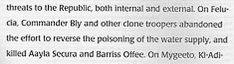

# Ki-Adi-Mundi

- **Aliases:** Ki-Adi, Mundi
- **Era:** Clone Wars
- **Continuity:** default Legends; entries present for: Canon, Legends
- **Research tier:** untiered (not listed as INTRO/DEEP/MASTERY in legends-feats.md)
- **Entries:** 218 (112 with quotations; 17 quotations extended to the full sentence/passage from the source text on file; 56 marked as fragments; 58 before the 2026-11-17 fragment fill). Rebuilt 2026-11-17 from 246 old entries; old file: `characters/_bak/ki-adi-mundi.md.bak-20261117`.
- **How to read:** each entry is the quotation in full (block quote), then its source and point of view. "Note" lines are summaries from our notes, not quotations. `[fragment — full passage not on file]` means the source text is not on the box, so only the words in our notes are shown. Debate and forum material is in the last section and is unverified.

# LEGENDS (Legends / EU — main focus)

## Dark Lord trilogy (Labyrinth of Evil, Revenge of the Sith, Dark Lord): novel notes from the other agent (reference copy)

> “Tiin, Koon, Ki-Adi-Mundi, and some of the others are on their way up the well,” Mace said. “I sent Stass Allie to assist Shaak Ti in guarding Chancellor Palpatine.”
— Source: Labyrinth of Evil (novel, read in full): feats, scaling, quotes and story notes; Ch39 L4263.
(Excerpt widened 2026-11-17 to the relevant passage, word for word from Labyrinth of Evil (James Luceno) (text copy `MEGA_Legend_The_Episode_Novelizations_Star_Wars_Revenge_of_the_Sith_01_Labyrinth_of_Evil_James_Luceno_epub`).)
Context: Complete quote register (7 lines: every sentence that names Saesee Tiin, verbatim, in book order):
Our notes: `notes/materials/022-dark-lord-trilogy/labyrinth-of-evil-notes.md:919`; `notes/materials/022-dark-lord-trilogy/labyrinth-of-evil-notes.md:935`

> A holorecording of Palpatine’s speech was running in the center of the room when Bail was admitted. Around the holoprojector table sat Council members Yoda, Mace Windu, Saesee Tiin, Ki-Adi-Mundi, Shaak Ti, Stass Allie, Plo Koon, and Kit Fisto.
— Source: Labyrinth of Evil (novel, read in full): feats, scaling, quotes and story notes; Ch27 L2567.
(Excerpt widened 2026-11-17 to the relevant passage, word for word from Labyrinth of Evil (James Luceno) (text copy `MEGA_Legend_The_Episode_Novelizations_Star_Wars_Revenge_of_the_Sith_01_Labyrinth_of_Evil_James_Luceno_epub`).)
Context: Complete quote register (8 lines: every sentence that names Other Council members, verbatim, in book order):
Our notes: `notes/materials/022-dark-lord-trilogy/labyrinth-of-evil-notes.md:932`

> Ki-Adi-Mundi’s elongated head made a subtle nod. “A ‘triad of evil,’ he labeled them.”
>
> “Separatist bastions, they are,” Yoda said. “But so remote, so insignificant.”
— Source: Labyrinth of Evil (novel, read in full): feats, scaling, quotes and story notes; Ch27 L2609.
(Excerpt widened 2026-11-17 to the relevant passage, word for word from Labyrinth of Evil (James Luceno) (text copy `MEGA_Legend_The_Episode_Novelizations_Star_Wars_Revenge_of_the_Sith_01_Labyrinth_of_Evil_James_Luceno_epub`).)
(Excerpt widened 2026-11-17 to the relevant passage, word for word from Labyrinth of Evil (James Luceno) (text copy `MEGA_Legend_The_Episode_Novelizations_Star_Wars_Revenge_of_the_Sith_01_Labyrinth_of_Evil_James_Luceno_epub`).)
Context: Complete quote register (8 lines: every sentence that names Other Council members, verbatim, in book order):
Our notes: `notes/materials/022-dark-lord-trilogy/labyrinth-of-evil-notes.md:934`

> Yoda nodded judiciously. “Agreed.” Agen Kolar assented as well, and Ki-Adi-Mundi.
>
> “This sounds like a good plan,” Obi-Wan said. “But what Master do you have in mind?”
— Source: Revenge of the Sith (Matthew Stover novelization): Power-Scaling Research Notes; Ch11 Politics L3853.
(Excerpt widened 2026-11-17 to the relevant passage, word for word from Revenge of the Sith (Matthew Stover) (text copy `MEGA_Legend_The_Episode_Novelizations_Star_Wars_Revenge_of_the_Sith_02_Episode_III_Revenge_of_the_Sith_Matthew_Stover_epub`).)
(Excerpt widened 2026-11-17 to the relevant passage, word for word from Revenge of the Sith (Matthew Stover) (text copy `MEGA_Legend_The_Episode_Novelizations_Star_Wars_Revenge_of_the_Sith_02_Episode_III_Revenge_of_the_Sith_Matthew_Stover_epub`).)
Context: Complete quote register (15 lines: every sentence that names Agen Kolar, verbatim, in book order):
Our notes: `notes/materials/022-dark-lord-trilogy/rots-novel-notes.md:577`; `notes/materials/022-dark-lord-trilogy/rots-novel-notes.md:645`

> Say what you will about the wisdom of ancient Master Yoda, or the deadly skill of grim Mace Windu, the courage of Ki-Adi-Mundi, or the subtle wiles of Shaak Ti; the greatness of all these Jedi is unquestioned, but it pales next to the legend that has grown around Kenobi and Skywalker. *(L817)*
— Source: L817 — Revenge of the Sith (Matthew Stover novelization): Power-Scaling Research Notes; Personality: pragmatic and politically shrewd. Introduced with.
(Full sentence/passage taken from the source text on file: `quick_tmp_rots_stover_epub`.)
Note (our notes, around the quote): Personality: pragmatic and politically shrewd. Introduced with «the courage of Ki-Adi-Mundi» (L817).
Also cited as: Revenge of the Sith (Matthew Stover novelization): Power-Scaling Research Notes; Ch1 Anakin And Obi-Wan L817.
Also noted as: Ch1 Anakin And Obi-Wan L817 «Say what you will about the wisdom of ancient Master Yoda, or the deadly skill of grim Mace Windu, the courage of Ki-Adi-Mundi, or the subtle wiles of Shaak Ti; the greatness of all these Jedi is unquestioned, but it pales next to the legend that has grown around Kenobi and Skywalker.»
Our notes: `notes/materials/022-dark-lord-trilogy/rots-novel-notes.md:635`; `notes/materials/022-dark-lord-trilogy/rots-novel-notes.md:642`; `notes/materials/022-dark-lord-trilogy/rots-novel-notes.md:667`

- Note (summary from our notes, not a quotation): Arc: attends Council by holoscan from Mygeeto (L4739, L5371) → backs the plan to use Anakin → raises the hardest political objection to removing Palpatine (Ch15) → dies in Order 66 off-page (the book does not narrate his death).
  — Source: Revenge of the Sith (Matthew Stover novelization): Power-Scaling Research Notes.
Our notes: `notes/materials/022-dark-lord-trilogy/rots-novel-notes.md:636`

- Note (summary from our notes, not a quotation): Relationships: Mace (he argues with him in Jedi Command); Council colleagues.
  — Source: Revenge of the Sith (Matthew Stover novelization): Power-Scaling Research Notes.
Our notes: `notes/materials/022-dark-lord-trilogy/rots-novel-notes.md:637`

> We have seen that young Skywalker has the power to battle a Sith Lord alone, if need be; he has proven that with Dooku. *(L3837)*
>
> "Have you considered," Ki-Adi-Mundi said carefully, from faraway Mygeeto, "that if Palpatine refuses to surrender power, removing him is only a first step?" *(L5397)*
>
> "But it will not be enough for the Republic," Ki-Adi-Mundi countered sadly. *(L5401)*
>
> The grim future inside Mace’s head turned even darker. The Cerean was right. *(L5403)*
— Source: L3837; L5397; L5401; L5403 — Revenge of the Sith (Matthew Stover novelization): Power-Scaling Research Notes; Key quotes (own lines).
(Full sentence/passage taken from the source text on file: `quick_tmp_rots_stover_epub`.)
Note (our notes, around the quote): Key quotes (own lines): «We have seen that young Skywalker has the power to battle a Sith Lord alone, if need be; he has proven that with Dooku.» (L3837); «"Have you considered," Ki-Adi-Mundi said carefully, from faraway Mygeeto, "that if Palpatine refuses to surrender power, removing him is only a first step?"» (L5397); «"But it will not be enough for the Republic," Ki-Adi-Mundi countered sadly.» (L5401). Mace concedes: «The Cerean was right.» (L5403).
Our notes: `notes/materials/022-dark-lord-trilogy/rots-novel-notes.md:638`; `notes/materials/022-dark-lord-trilogy/rots-novel-notes.md:653`; `notes/materials/022-dark-lord-trilogy/rots-novel-notes.md:654`

- Note (summary from our notes, not a quotation): Abilities and limits: no on-page feats. He is a voice on the Council.
  — Source: Revenge of the Sith (Matthew Stover novelization): Power-Scaling Research Notes.
Our notes: `notes/materials/022-dark-lord-trilogy/rots-novel-notes.md:639`

- Note (summary from our notes, not a quotation): Scaling implications: his line at L3837 is a Council-level statement that Anakin can solo a Sith Lord, based on the Dooku kill. Use it as a reputational STATEMENT for Anakin, grade C.
  — Source: Revenge of the Sith (Matthew Stover novelization): Power-Scaling Research Notes.
Our notes: `notes/materials/022-dark-lord-trilogy/rots-novel-notes.md:640`

- Note (summary from our notes, not a quotation): Complete quote register (13 lines: every sentence that names Ki-Adi-Mundi, verbatim, in book order):
  — Source: Revenge of the Sith (Matthew Stover novelization): Power-Scaling Research Notes.
Our notes: `notes/materials/022-dark-lord-trilogy/rots-novel-notes.md:641`

> He could see himself seated in one of the low, curving chairs, opposite Mace Windu. Opposite Yoda. He might sit next to Ki-Adi-Mundi, or Plo Koon—or even beside Obi-Wan! And he could not quite ignore the quiet whisper, from down within the furnace doors that sealed his heart, that he was about to become the youngest Master in the twenty-five-thousand-year history of the Jedi Order …
— Source: Revenge of the Sith (Matthew Stover novelization): Power-Scaling Research Notes; Ch10 Masters L3787.
(Excerpt widened 2026-11-17 to the relevant passage, word for word from Revenge of the Sith (Matthew Stover) (text copy `MEGA_Legend_The_Episode_Novelizations_Star_Wars_Revenge_of_the_Sith_02_Episode_III_Revenge_of_the_Sith_Matthew_Stover_epub`).)
Context: Complete quote register (13 lines: every sentence that names Ki-Adi-Mundi, verbatim, in book order):
Our notes: `notes/materials/022-dark-lord-trilogy/rots-novel-notes.md:643`; `notes/materials/022-dark-lord-trilogy/rots-novel-notes.md:680`

> The holopresence of Ki-Adi-Mundi flickered in and out of focus as the Cerean Master leaned forward, folding his hands. “I, too, have reservations on this matter, but it seems that in these desperate times, only desperate plans have hope of success. We have seen that young Skywalker has the power to battle a Sith Lord alone, if need be; he has proven that with Dooku. If he is indeed the chosen one, we must keep him in play against the Sith—keep him in a position to fulfill his destiny.”
— Source: Revenge of the Sith (Matthew Stover novelization): Power-Scaling Research Notes; Ch11 Politics L3837.
(Excerpt widened 2026-11-17 to the relevant passage, word for word from Revenge of the Sith (Matthew Stover) (text copy `MEGA_Legend_The_Episode_Novelizations_Star_Wars_Revenge_of_the_Sith_02_Episode_III_Revenge_of_the_Sith_Matthew_Stover_epub`).)
Context: Complete quote register (13 lines: every sentence that names Ki-Adi-Mundi, verbatim, in book order):
Our notes: `notes/materials/022-dark-lord-trilogy/rots-novel-notes.md:644`

> Ghost-images of Ki-Adi-Mundi and Plo Koon hovered a centimeter above their Council seats, maintained by the seats’ internal holoprojectors. Agen Kolar sat alone, between the empty chairs belonging to Shaak Ti and Stass Allie.
— Source: Revenge of the Sith (Matthew Stover novelization): Power-Scaling Research Notes; Ch11 Politics L3917.
(Excerpt widened 2026-11-17 to the relevant passage, word for word from Revenge of the Sith (Matthew Stover) (text copy `MEGA_Legend_The_Episode_Novelizations_Star_Wars_Revenge_of_the_Sith_02_Episode_III_Revenge_of_the_Sith_Matthew_Stover_epub`).)
Context: Complete quote register (13 lines: every sentence that names Ki-Adi-Mundi, verbatim, in book order):
Our notes: `notes/materials/022-dark-lord-trilogy/rots-novel-notes.md:646`; `notes/materials/022-dark-lord-trilogy/rots-novel-notes.md:683`

> The rest of the session passed in a haze; Ki-Adi-Mundi said something about no Republic world reporting any sign of Grievous, and Anakin felt a dull shock when the Council assigned the task of coordinating the search to Obi-Wan alone.
— Source: Revenge of the Sith (Matthew Stover novelization): Power-Scaling Research Notes; Ch11 Politics L3969.
Context: Complete quote register (13 lines: every sentence that names Ki-Adi-Mundi, verbatim, in book order):
Our notes: `notes/materials/022-dark-lord-trilogy/rots-novel-notes.md:647`

> “It is settled then,” Mace said. “May the Force be with us all.”
>
> And as the holopresences of Plo Koon and Ki-Adi-Mundi winked out, as Obi-Wan and Agen Kolar rose and spoke together in tones softly grave, as Yoda and Mace Windu walked from the room, Anakin could only sit, sick at heart, stunned with helplessness.
— Source: Revenge of the Sith (Matthew Stover novelization): Power-Scaling Research Notes; Ch11 Politics L3981.
(Excerpt widened 2026-11-17 to the relevant passage, word for word from Revenge of the Sith (Matthew Stover) (text copy `MEGA_Legend_The_Episode_Novelizations_Star_Wars_Revenge_of_the_Sith_02_Episode_III_Revenge_of_the_Sith_Matthew_Stover_epub`).)
(Excerpt widened 2026-11-17 to the relevant passage, word for word from Revenge of the Sith (Matthew Stover) (text copy `MEGA_Legend_The_Episode_Novelizations_Star_Wars_Revenge_of_the_Sith_02_Episode_III_Revenge_of_the_Sith_Matthew_Stover_epub`).)
Context: Complete quote register (13 lines: every sentence that names Ki-Adi-Mundi, verbatim, in book order):
Our notes: `notes/materials/022-dark-lord-trilogy/rots-novel-notes.md:648`

> The only Council members physically present, other than Obi-Wan and Anakin, were Mace Windu and Agen Kolar. The Council reached a quorum by the projected holopresences of Ki-Adi-Mundi, en route to Mygeeto, Plo Koon on Cato Neimoidia, and Yoda, who was about to make planetfall on Kashyyyk.
— Source: Revenge of the Sith (Matthew Stover novelization): Power-Scaling Research Notes; Ch13 The Will of the Force L4739.
(Excerpt widened 2026-11-17 to the relevant passage, word for word from Revenge of the Sith (Matthew Stover) (text copy `MEGA_Legend_The_Episode_Novelizations_Star_Wars_Revenge_of_the_Sith_02_Episode_III_Revenge_of_the_Sith_Matthew_Stover_epub`).)
Context: Complete quote register (13 lines: every sentence that names Ki-Adi-Mundi, verbatim, in book order):
Our notes: `notes/materials/022-dark-lord-trilogy/rots-novel-notes.md:649`; `notes/materials/022-dark-lord-trilogy/rots-novel-notes.md:685`

> Ki-Adi-Mundi’s frown wrinkled the whole length of his forehead. “Our agents on Utapau have made no report of this.”
— Source: Revenge of the Sith (Matthew Stover novelization): Power-Scaling Research Notes; Ch13 The Will of the Force L4743.
(Excerpt widened 2026-11-17 to the relevant passage, word for word from Revenge of the Sith (Matthew Stover) (text copy `MEGA_Legend_The_Episode_Novelizations_Star_Wars_Revenge_of_the_Sith_02_Episode_III_Revenge_of_the_Sith_Matthew_Stover_epub`).)
Context: Complete quote register (13 lines: every sentence that names Ki-Adi-Mundi, verbatim, in book order):
Our notes: `notes/materials/022-dark-lord-trilogy/rots-novel-notes.md:650`

> Ki-Adi-Mundi’s image nodded. “I concur. Let’s put it to a vote.”
>
> Mace Windu counted nods. “Six in favor.”
— Source: Revenge of the Sith (Matthew Stover novelization): Power-Scaling Research Notes; Ch13 The Will of the Force L4783.
(Excerpt widened 2026-11-17 to the relevant passage, word for word from Revenge of the Sith (Matthew Stover) (text copy `MEGA_Legend_The_Episode_Novelizations_Star_Wars_Revenge_of_the_Sith_02_Episode_III_Revenge_of_the_Sith_Matthew_Stover_epub`).)
(Excerpt widened 2026-11-17 to the relevant passage, word for word from Revenge of the Sith (Matthew Stover) (text copy `MEGA_Legend_The_Episode_Novelizations_Star_Wars_Revenge_of_the_Sith_02_Episode_III_Revenge_of_the_Sith_Matthew_Stover_epub`).)
Context: Complete quote register (13 lines: every sentence that names Ki-Adi-Mundi, verbatim, in book order):
Our notes: `notes/materials/022-dark-lord-trilogy/rots-novel-notes.md:651`

> The holoscan flickered to nothingness. Mace Windu turned brief but seemingly significant glances upon the other two Masters in attendance, both holoscans themselves: Ki-Adi-Mundi from the fortified command center on Mygeeto, and from a guerrilla outpost on Kashyyyk, Yoda.
— Source: Revenge of the Sith (Matthew Stover novelization): Power-Scaling Research Notes; Ch15 Death on Utapau L5371.
(Excerpt widened 2026-11-17 to the relevant passage, word for word from Revenge of the Sith (Matthew Stover) (text copy `MEGA_Legend_The_Episode_Novelizations_Star_Wars_Revenge_of_the_Sith_02_Episode_III_Revenge_of_the_Sith_Matthew_Stover_epub`).)
Context: Complete quote register (13 lines: every sentence that names Ki-Adi-Mundi, verbatim, in book order):
Our notes: `notes/materials/022-dark-lord-trilogy/rots-novel-notes.md:652`

## Star Wars: The New Essential Chronology (Del Rey, 2005): power-scaling and lore notes

> Sing killed Sharad Hett, and Ki-Adi-Mundi took A'Sharad back to Coruscant as his new apprentice.
— Source: Part Two: The Fall of the Republic; Aurra Sing kills Sharad Hett. POV: Aurra Sing kills Sharad Hett, about Ki-Adi-Mundi.
Note (our notes, around the quote): Aurra Sing kills Sharad Hett: "Sing killed Sharad Hett, and Ki-Adi-Mundi took A'Sharad back to Coruscant as his new apprentice." Source: The New Essential Chronology, p.45
Our notes: `notes/materials/027-new-essential-chronology/02-part-two-fall-of-the-republic.md:141`

> General Grievous chose a key moment to attack Republic forces and nearly killed the Jedi Masters Ki-Adi-Mundi, K'Kruhk, Shaak Ti, and Aayla Secura.
— Source: Part Two: The Fall of the Republic.
Note (our notes, around the quote): General Grievous; Ki-Adi-Mundi; K'Kruhk; Shaak Ti; Aayla Secura — Grievous on Hypori: "General Grievous chose a key moment to attack Republic forces and nearly killed the Jedi Masters Ki-Adi-Mundi, K'Kruhk, Shaak Ti, and Aayla Secura." Source: The New Essential Chronology, p.62
Our notes: `notes/materials/027-new-essential-chronology/02-part-two-fall-of-the-republic.md:284`

> On Felucia, Commander Bly and other clone troopers abandoned the effort to reverse the poisoning of the water supply, and killed Aayla Secura and Barriss Offee.
— Source: Part Two: The Fall of the Republic.
Note (our notes, around the quote): Aayla Secura; Barriss Offee; Ki-Adi-Mundi; Plo Koon; Stass Allie; Obi-Wan Kenobi; Yoda — Order 66: "On Felucia, Commander Bly and other clone troopers abandoned the effort to reverse the poisoning of the water supply, and killed Aayla Secura and Barriss Offee." Source: The New Essential Chronology, p.84

Our notes: `notes/materials/027-new-essential-chronology/02-part-two-fall-of-the-republic.md:518`

## The Complete Star Wars Encyclopedia, Vol. I (A–G)

> He in­ sisted that all he wanted was peace, but his eyes-the eyes of a fighter­ told a different story. Bln-Garda-Zon A Cerean ma­ rauder who led a group of bandits on his homeworld, Cerea. He was easily recognized by his mangled left hand, which was missing two fingers. He spent his life raiding Cerean home­ steads and villages, stealing food, livestock, and male children. Eventu­ ally, he was deposed by a female war­ rior, who took control of the raiders. Bin-Garda-Zon became an emaci- JarJar Binks at the Battle of Naboo ated shell, relegated to caring for the band's oorgs. After Ki-Adi-Mundi defeated the raider chief, Bin-Garda-Zon attempted to challenge the Jedi Knight, but he was easily defeated. Ki opted to spare his life. BiniA tall female pilot, she was a member of the Rock Workers on New Apsolon. She and her partners Yanci and Kevta accidentally at­ tacked the Jedi Obi-Wan Kenobi and Qui-Gon Jinn, mistaking them for their mortal enemies, the Absolutes. Bini died at the hands of the Absolutes a dozen years before the Battle of Naboo.
— Source: scan pages 81–120; Ki-Adi-Mundi. POV: Ki-Adi-Mundi.
(Excerpt widened 2026-11-17 to the relevant passage, word for word from research primary cse vol1 (text copy `research_primary_cse_vol1_pdf_45a954be6d`).)
(Excerpt widened 2026-11-17 to the relevant passage, word for word from research primary cse vol1 (text copy `research_primary_cse_vol1_pdf_45a954be6d`).)
Note (our notes, around the quote): Ki-Adi-Mundi: "After Ki-Adi-Mundi defeated the raider chief, Bin-Garda-Zon attempted to challenge the Jedi Knight, but he was easily defeated." Source: The Complete Star Wars Encyclopedia, Vol. I, p.75
Our notes: `notes/materials/030-complete-star-wars-encyclopedia-vol-1/02-v1-scan-081-120.md:73`

> Ki-Adi- Mundi was able to defeat FLTCH R-1l, and the droid was reprogrammed.
— Source: scan pages 281–320; Ki-Adi-Mundi. POV: Ki-Adi-Mundi.
Note (our notes, around the quote): Ki-Adi-Mundi: "Ki-Adi- Mundi was able to defeat FLTCH R-1l, and the droid was reprogrammed." Source: The Complete Star Wars Encyclopedia, Vol. I, p.282
Our notes: `notes/materials/030-complete-star-wars-encyclopedia-vol-1/07-v1-scan-281-320.md:130`

## The Complete Star Wars Encyclopedia, Vol. II (H–O)

> Fortunately, they were rescued by Ki-Adi-Mundi before they could be incinerated.
— Source: scan pages 81–120; Ki-Adi-Mundi. POV: Ki-Adi-Mundi.
Note (our notes, around the quote): Ki-Adi-Mundi: "Fortunately, they were rescued by Ki-Adi-Mundi before they could be incinerated." Source: The Complete Star Wars Encyclopedia, Vol. II, p.111
Our notes: `notes/materials/031-complete-star-wars-encyclopedia-vol-2/02-v2-scan-081-120.md:244`

- Note (summary from our notes, not a quotation): Page contents: 1101 words, 25 paragraphs | headings/entries: Kharys; Khetanna; Khim'bar; Khomm; Kho Nai; Khorda, General Ashaar; Khral'Nas; Khuiumin; Khurgee, Captain; Ki-Adi-Mundi
  — Source: scan pages 201–240.
Our notes: `notes/materials/031-complete-star-wars-encyclopedia-vol-2/05-v2-scan-201-240.md:214`

> He eventually escaped using the Force and defeated her.
— Source: scan pages 201–240; Ki-Adi-Mundi — entry/section: Ki-Adi-Mundi.
Note (our notes, around the quote): Ki-Adi-Mundi — entry/section: Ki-Adi-Mundi: "He eventually escaped using the Force and defeated her." Source: The Complete Star Wars Encyclopedia, Vol. II, p.215
Our notes: `notes/materials/031-complete-star-wars-encyclopedia-vol-2/05-v2-scan-201-240.md:220`

> Many Jedi died that day, though Ki-Adi-Mundi survived.
— Source: scan pages 201–240; Ki-Adi-Mundi — entry/section: Ki-Adi-Mundi.
Note (our notes, around the quote): Ki-Adi-Mundi — entry/section: Ki-Adi-Mundi: "Many Jedi died that day, though Ki-Adi-Mundi survived." Source: The Complete Star Wars Encyclopedia, Vol. II, p.216
Our notes: `notes/materials/031-complete-star-wars-encyclopedia-vol-2/05-v2-scan-201-240.md:229`

> While briefly involved with Sylvn, the daughter of Jedi Ki-Adi-Mundi, Maj stole the Jedi's lightsaber and accidentally killed another Cerean, then fled.
— Source: scan pages 281–320; Ki-Adi-Mundi. POV: Ki-Adi-Mundi.
Note (our notes, around the quote): Ki-Adi-Mundi: "While briefly involved with Sylvn, the daughter of Jedi Ki-Adi-Mundi, Maj stole the Jedi's lightsaber and accidentally killed another Cerean, then fled." Source: The Complete Star Wars Encyclopedia, Vol. II, p.277
Our notes: `notes/materials/031-complete-star-wars-encyclopedia-vol-2/07-v2-scan-281-320.md:24`

## Power of the Jedi Sourcebook (d20, 2002)

- Note (summary from our notes, not a quotation): Page contents: 682 words, 25 paragraphs | headings/entries: Ki-Adi-Mundi, Jedi Knight; Force Skills: Affect Mind +11, Battlemind +6,
  — Source: Chapter Six: Jedi traditions and famous Jedi.
Our notes: `notes/materials/033-power-of-the-jedi-sourcebook/06-ch6-jedi-traditions.md:205`

- Note (summary from our notes, not a quotation): Page contents: 977 words, 210 paragraphs | headings/entries: Kenzon, Ephaan 152, 153; Kerilt 64; Keto, Aleema 8; Keto, Satal 8; Khommite 67; Ki-Adi-Mundi 117, 119, 120; Kiffar 17, 123, 124; Kil'qiy, Surenit 32; Kirrek 7, 98; Koba system 112; Koon, Plo 113, 117, 124; Koros system 98, 99; Koros Major 103, 106; Korriban 102; Koth, Eeth 114; Krevaaki 68, 102; Kushiban 68, 129; Kut, Plovin 112; Lah, Tsavong 139; Lannik 69, 113, 117; Lowbacca 11; Madine, Crix 131; Malacia 13, 118; Malastare 113, 116, 117; Mandalore 102; Mar, Easal 132; Marspa, Master 33; Massassi 7, 8, 98, 138, 139; Maul, Darth 43; MedCorps worker 94; Meditative Canyon on Ambria 145-147; Mid Rim 76, 79, 132, 153; Miraluka 70, 107; Mirial 127, 128; Mon Calamari 130; Mon, Ephant 119; Morichro 16, 113; Mothma, Mon 11, 130, 131; Nadill, Memit 7, 99; Nam Chorios 78; Nam Priax 77; Nar Shaddaa 114, 123; Nautolan 71, 125; Nazzar 72; Nebulon Front 113, 114; Nebulon Ranger 59, 103, 104, 105; Neti
  — Source: Chapter Seven: Where the Force is strong; Index.
Our notes: `notes/materials/033-power-of-the-jedi-sourcebook/07-ch7-locations-index.md:181`

## The New Essential Guide to Characters (2002)

> Ki-Adi-Mundi opposed him again, and Jabba fought off a takeover attempt raised by his rival Gardulla.
— Source: scan pages 61–90; Ki-Adi-Mundi. POV: Ki-Adi-Mundi.
Note (our notes, around the quote): Ki-Adi-Mundi: "Ki-Adi-Mundi opposed him again, and Jabba fought off a takeover attempt raised by his rival Gardulla." Source: The New Essential Guide to Characters, p.88
Our notes: `notes/materials/034-new-essential-guide-to-characters/02-negc-scan-061-090.md:156`

- Note (summary from our notes, not a quotation): Page contents: 415 words, 20 paragraphs | headings/entries: Old Republic, the Jedi Council; Depa Billaba; Adi Gallia; Ki-Adi-Mundi (Ke-a-dé-miin'-dé); As a Jedi Master, Ki-Adi-Mundi
  — Source: scan pages 61–90.
Our notes: `notes/materials/034-new-essential-guide-to-characters/02-negc-scan-061-090.md:173`

> She killed Hett, but his son A'Sharad survived and became the Padawan learner of Ki-Adi-Mundi.
— Source: scan pages 121–150; Darth Krayt; Ki-Adi-Mundi.
Note (our notes, around the quote): Darth Krayt; Ki-Adi-Mundi: "She killed Hett, but his son A'Sharad survived and became the Padawan learner of Ki-Adi-Mundi." Source: The New Essential Guide to Characters, p.154
Our notes: `notes/materials/034-new-essential-guide-to-characters/04-negc-scan-121-150.md:158`

## Sourcebooks/Secrets of Tatooine.pdf [Star Wars Roleplaying Game (d20, 2000)] (scan pages 1–60)

> While unswervingly loyal to Jabba, Ephant Mon is hardly an exemplary individual. Throughout his long life, he has been a mercenary, a slaver, and has even tangled with the Jedi—once actually kidnapping the daughter of Cerean Jedi Master Ki-Adi-Mundi. The Chevin has survived for so long largely by betraying his business associates faster than they can betray him.
— Source: Sourcebooks/Secrets of Tatooine.pdf [Star Wars Roleplaying Game (d20, 200; Ephant Mon; Ki-Adi-Mundi — entry/section: Ephant Mon.
Note (our notes, around the quote): Ephant Mon; Ki-Adi-Mundi — entry/section: Ephant Mon: "While unswervingly loyal to Jabba, Ephant Mon is hardly an exemplary individual. Throughout his long life, he has been a mercenary, a slaver, and has even tangled with the Jedi—once actually kidnapping the daughter of Cerean Jedi Master Ki-Adi-Mundi. The Chevin has survived for so long largely by betraying his business associates faster than they can betray him." Source: *Secrets of Tatooine* (SWRPG d20), scan p.51
Our notes: `notes/materials/037-sw-d20-folder/045-secrets-of-tatooine-scan-001-060.md:318`

## Star Wars Gamer/Star Wars Gamer 02.pdf [Star Wars Roleplaying Game (d20, 2000)] (scan pages 61–89)

> many on the team feel Ki-Adi-Mundi has the most powerful lightsaber attacks in the game *(hand-read)*
> [fragment — full passage not on file]
— Source: Star Wars Gamer/Star Wars Gamer 02.pdf [Star Wars Roleplaying Game (d20,.
Note (our notes, around the quote): Page contents: Jedi Power Battles Dreamcast interview: Ki-Adi-Mundi unlockable (mesmerize, cloak, Force blasts); "many on the team feel Ki-Adi-Mundi has the most powerful lightsaber attacks in the game" (hand-read)
Our notes: `notes/materials/037-sw-d20-folder/051-star-wars-gamer-02-scan-061-089.md:122`

## Adventures/Geonosis Battle Arena Advanced Missions.pdf [Star Wars Roleplaying Game Revised Core (d20, 2002)]

- Note (summary from our notes, not a quotation): Page contents: 330 words, 52 paragraphs | headings/entries: Spry; TUS V 3SN; SqUI0q HH *M38VSLHSN L\; O00 0; SLNIOd LIH; Plo Koon™; SPECIAL POWER; SY3MOd 1WidadS; HIT POINTS; O90 0; DEFENSE ATTACK +3; USE A SKILL Climb; Heal; Ride; TINS V ISN; O00 0; SINIOd LIH; Ki-Adi-Mundi™; SPECIAL POWER; HIT POINTS; O90 0; DEFENSE; USE A SKILL Climb; Heal; Ride
  — Source: Adventures/Geonosis Battle Arena Advanced Missions.pdf [Star Wars Rolepla.
Our notes: `notes/materials/037-sw-d20-folder/064-geonosis-battle-arena-advanced-missions.md:55`

> Used under authorization. Permission granted to photocopy for personal use only. Plo Koon™ HIT POINTS DEFENSE 14 ATTACK +3 USE A SKILL Climb 11 Heal 11 Ride 11 USE THE FORCE Force Jump 9 Force Strike 9 Mind Trick 11 LIGHTSABER: 3 Hit Points SPECIAL POWER Deflect Blaster Bolt: Plo Koon can deflect any blaster bolt that misses him. He gets to make a free Attack roll to do 1 Hit Point of damage to the action figure that shot the blaster at him. This power works only if he has a lightsaber in his hand. Ki-Adi-Mundi™ HIT POINTS DEFENSE 14 ATTACK +3 USE A SKILL Climb 11 Heal 11 Ride 11 USE THE FORCE Force Jump 8 Force Strike 8 Mind Trick 8 LIGHTSABER: 3 Hit Points SPECIAL POWER Deflect Blaster Bolt: Ki-Adi-Mundi can deflect any blaster bolt that misses him. He gets to make a free Attack roll to do 1 Hit Point of damage to the action figure that shot the blaster at him. This power works only if he has a lightsaber in his hand. © 2002 Lucasfilm Ltd. ® or TM where indicated. All Rights Reserved. Used under authorization.
— Source: Adventures/Geonosis Battle Arena Advanced Missions.pdf [Star Wars Rolepla; Ki-Adi-Mundi. POV: Ki-Adi-Mundi.
(Excerpt widened 2026-11-17 to the relevant passage, word for word from imary sw d20 folder files Star Wars Roleplaying Game Revised Core Adventures Geonosis Battle Arena Advanced Missions (text copy `imary_sw_d20_folder_files_Star_Wars_Roleplaying_Game_Revised_Core_Adventures_Geonosis_Battle_Arena_Advanced_Missions_pdf_25d77adfe1`).)
(Excerpt widened 2026-11-17 to the relevant passage, word for word from imary sw d20 folder files Star Wars Roleplaying Game Revised Core Adventures Geonosis Battle Arena Advanced Missions (text copy `imary_sw_d20_folder_files_Star_Wars_Roleplaying_Game_Revised_Core_Adventures_Geonosis_Battle_Arena_Advanced_Missions_pdf_25d77adfe1`).)
Note (our notes, around the quote): Ki-Adi-Mundi: "Deflect Blaster Bolt: Ki-Adi-Mundi can deflect any blaster bolt that misses him." Source: *Geonosis Battle Arena Advanced Missions* (SWRPG d20 Revised Core), scan p.5
Our notes: `notes/materials/037-sw-d20-folder/064-geonosis-battle-arena-advanced-missions.md:59`

## Living Force Campaign/Adventures/Among the Stars/Year 4/402 - Jedi Code - The Way of the Force.pdf [Star Wars Roleplaying Game Revised Core (d20, 2002)]

- Note (summary from our notes, not a quotation): Page contents: Title and blurb; house rules; GM overview (Lanius' secret test of the heroes, Ki-Adi-Mundi's judgement, the Black Queen's tampering); encounter summaries; judges' notes; opening crawl (hand-read)
  — Source: Living Force Campaign/Adventures/Among the Stars/Year 4/402 - Jedi Code -.
Our notes: `notes/materials/037-sw-d20-folder/325-402-jedi-code-the-way-of-the.md:49`

- Note (summary from our notes, not a quotation): Page contents: E4 the energy cells and Alto Janss' smugglers; E5 the Rancor Riders; E6 debriefing, grading and The Lesson; E7 Ki-Adi-Mundi's verdict and the Black Queen mission (hand-read)
  — Source: Living Force Campaign/Adventures/Among the Stars/Year 4/402 - Jedi Code -.
Our notes: `notes/materials/037-sw-d20-folder/325-402-jedi-code-the-way-of-the.md:195`

- Note (summary from our notes, not a quotation): Page contents: 849 words, 26 paragraphs | headings/entries: Encounter 7: Setting Up the Board; Ki-Adi-Mundi turns to Lanius and says:; The Way of the Force; Conclusion; Page 18
  — Source: Living Force Campaign/Adventures/Among the Stars/Year 4/402 - Jedi Code -.
Our notes: `notes/materials/037-sw-d20-folder/325-402-jedi-code-the-way-of-the.md:200`

> As one, the young Jedi look past Lanius to all of you, bow to you, and say, “Thank you, Masters.” They file out, along with Snem Noonb, who is grinning happily, and Jag Murrock, who gives a respectful nod in your direction. Then Lanius beckons you to follow, and crosses the hall towards another doorway, which must lead into the room where that servant went, earlier. You enter a much smaller room. It is obviously a The Way of the Force Page 18 conference room, with a long table, comfortable chairs, a holoprojector, computer— and a wall-screen that displays a view of the chamber from which you just came. As you come in and the door slides shut behind you, a tall, elderly Cerean in the robes of a Jedi Master rises to greet you. Master Lanius moves to him and then turns to face your group. “<Insert hero names>, I have the honor to introduce to you Master Ki-Adi-Mundi, member of the Jedi Council, of the Jedi Temple on Coruscant.” The Jedi smiles, and whether sensitive to the Force or not, you can feel the restrained power radiating from him. “Please,” he says, “let us all sit. I have been observing your lesson with great interest, teachers. But talking is dry work, and there are refreshments here.”
— Source: Living Force Campaign/Adventures/Among the Stars/Year 4/402 - Jedi Code -; Ki-Adi-Mundi — entry/section: Lanius Qel-Bertok.
(Excerpt widened 2026-11-17 to the relevant passage, word for word from playing Game Revised Core Living Force Campaign Adventures Among the Stars Year 4 402 Jedi Code The Way of the Force (text copy `playing_Game_Revised_Core_Living_Force_Campaign_Adventures_Among_the_Stars_Year_4_402_Jedi_Code_The_Way_of_the_Force_pdf_0107300939`).)
(Excerpt widened 2026-11-17 to the relevant passage, word for word from playing Game Revised Core Living Force Campaign Adventures Among the Stars Year 4 402 Jedi Code The Way of the Force (text copy `playing_Game_Revised_Core_Living_Force_Campaign_Adventures_Among_the_Stars_Year_4_402_Jedi_Code_The_Way_of_the_Force_pdf_0107300939`).)
(Full sentence/passage taken from the source text on file: `playing_Game_Revised_Core_Living_Force_Campaign_Adventures_Among_the_Stars_Year_4_402_Jedi_Code_The_Way_of_the_Force_pdf`.)
Note (our notes, around the quote): Ki-Adi-Mundi — entry/section: Lanius Qel-Bertok: ""<Insert hero names>, I have the honor to introduce to you Master Ki-Adi-Mundi, member of the Jedi Council, of the Jedi Temple on Coruscant."" Source: *402 - Jedi Code - The Way of the Force* (SWRPG d20 Revised Core), p.18
Our notes: `notes/materials/037-sw-d20-folder/325-402-jedi-code-the-way-of-the.md:202`

> You enter a much smaller room. It is obviously a The Way of the Force Page 18 conference room, with a long table, comfortable chairs, a holoprojector, computer— and a wall-screen that displays a view of the chamber from which you just came. As you come in and the door slides shut behind you, a tall, elderly Cerean in the robes of a Jedi Master rises to greet you. Master Lanius moves to him and then turns to face your group. “<Insert hero names>, I have the honor to introduce to you Master Ki-Adi-Mundi, member of the Jedi Council, of the Jedi Temple on Coruscant.” The Jedi smiles, and whether sensitive to the Force or not, you can feel the restrained power radiating from him. “Please,” he says, “let us all sit. I have been observing your lesson with great interest, teachers. But talking is dry work, and there are refreshments here.” Encounter 7: Setting Up the Board Key ideas of this encounter: Ki-Adi-Mundi reveals his decision regarding the extension of Almas’ right to train Jedi as Master Lanius has been doing it. It is revealed that not all was as it seemed, during the tests. The heroes are asked to go after the Black Queen.
— Source: Living Force Campaign/Adventures/Among the Stars/Year 4/402 - Jedi Code -.
(Excerpt widened 2026-11-17 to the relevant passage, word for word from playing Game Revised Core Living Force Campaign Adventures Among the Stars Year 4 402 Jedi Code The Way of the Force (text copy `playing_Game_Revised_Core_Living_Force_Campaign_Adventures_Among_the_Stars_Year_4_402_Jedi_Code_The_Way_of_the_Force_pdf_0107300939`).)
(Excerpt widened 2026-11-17 to the relevant passage, word for word from playing Game Revised Core Living Force Campaign Adventures Among the Stars Year 4 402 Jedi Code The Way of the Force (text copy `playing_Game_Revised_Core_Living_Force_Campaign_Adventures_Among_the_Stars_Year_4_402_Jedi_Code_The_Way_of_the_Force_pdf_0107300939`).)
(Full sentence/passage taken from the source text on file: `playing_Game_Revised_Core_Living_Force_Campaign_Adventures_Among_the_Stars_Year_4_402_Jedi_Code_The_Way_of_the_Force_pdf`.)
Note (our notes, around the quote): Ki-Adi-Mundi — entry/section: Ki-Adi-Mundi: ""Please," he says, "let us all sit. I have been observing your lesson with great interest, teachers. But talking is dry work, and there are refreshments here."" Source: *402 - Jedi Code - The Way of the Force* (SWRPG d20 Revised Core), p.18
Our notes: `notes/materials/037-sw-d20-folder/325-402-jedi-code-the-way-of-the.md:204`

> No stats are provided for Ki-Adi-Mundi, although he can be found in Powers of the Jedi, p. 119. No stats are needed, really. He is wise, calm, powerful, authoritative and, here, friendly. Incidentally, he has several wives, but does not feel that he needs to discuss Jedi traditions right here and now. If pressed, he merely says, “As we Cereans are fond of saying, there are many sides to arguments, and many ways of accomplishing the same goal. As you yourselves have proven.” Ki-Adi-Mundi turns to Lanius and says: “I can now see why Master Yoda, when he sent me here, said that he wanted a Jedi who could carefully weigh both sides of an argument. It is as you have said, Master Qel-Bertok. The Jedi of Cularin, at least, can stand to benefit from the worldly wisdom afforded by those from outside the Order. They can also learn from those who have come late to join it.
— Source: Living Force Campaign/Adventures/Among the Stars/Year 4/402 - Jedi Code -; Ki-Adi-Mundi — entry/section: Ki-Adi-Mundi.
(Excerpt widened 2026-11-17 to the relevant passage, word for word from playing Game Revised Core Living Force Campaign Adventures Among the Stars Year 4 402 Jedi Code The Way of the Force (text copy `playing_Game_Revised_Core_Living_Force_Campaign_Adventures_Among_the_Stars_Year_4_402_Jedi_Code_The_Way_of_the_Force_pdf_0107300939`).)
(Excerpt widened 2026-11-17 to the relevant passage, word for word from playing Game Revised Core Living Force Campaign Adventures Among the Stars Year 4 402 Jedi Code The Way of the Force (text copy `playing_Game_Revised_Core_Living_Force_Campaign_Adventures_Among_the_Stars_Year_4_402_Jedi_Code_The_Way_of_the_Force_pdf_0107300939`).)
Note (our notes, around the quote): Ki-Adi-Mundi — entry/section: Ki-Adi-Mundi: ""As we Cereans are fond of saying, there are many sides to arguments, and many ways of accomplishing the same goal. As you yourselves have proven."" Source: *402 - Jedi Code - The Way of the Force* (SWRPG d20 Revised Core), p.18
Our notes: `notes/materials/037-sw-d20-folder/325-402-jedi-code-the-way-of-the.md:206`

> He is wise, calm, powerful, authoritative and, here, friendly. Incidentally, he has several wives, but does not feel that he needs to discuss Jedi traditions right here and now. If pressed, he merely says, “As we Cereans are fond of saying, there are many sides to arguments, and many ways of accomplishing the same goal. As you yourselves have proven.” Ki-Adi-Mundi turns to Lanius and says: “I can now see why Master Yoda, when he sent me here, said that he wanted a Jedi who could carefully weigh both sides of an argument. It is as you have said, Master Qel-Bertok. The Jedi of Cularin, at least, can stand to benefit from the worldly wisdom afforded by those from outside the Order. They can also learn from those who have come late to join it. I still perceive great dangers in your unorthodox methods, but I have decided that they are balanced by the benefits.” He glances at you. “So, Lanius, since you placed so much faith in these people, to put your own future and the future of this Academy in their hands, I do not think that you will mind them hearing the results of your Trial: your probationary period is at an end. You are confirmed as Master of this Academy, and its tenure is extended.
— Source: Living Force Campaign/Adventures/Among the Stars/Year 4/402 - Jedi Code -; Ki-Adi-Mundi; Yoda — entry/section: Ki-Adi-Mundi.
(Excerpt widened 2026-11-17 to the relevant passage, word for word from playing Game Revised Core Living Force Campaign Adventures Among the Stars Year 4 402 Jedi Code The Way of the Force (text copy `playing_Game_Revised_Core_Living_Force_Campaign_Adventures_Among_the_Stars_Year_4_402_Jedi_Code_The_Way_of_the_Force_pdf_0107300939`).)
(Excerpt widened 2026-11-17 to the relevant passage, word for word from playing Game Revised Core Living Force Campaign Adventures Among the Stars Year 4 402 Jedi Code The Way of the Force (text copy `playing_Game_Revised_Core_Living_Force_Campaign_Adventures_Among_the_Stars_Year_4_402_Jedi_Code_The_Way_of_the_Force_pdf_0107300939`).)
Note (our notes, around the quote): Ki-Adi-Mundi; Yoda — entry/section: Ki-Adi-Mundi: ""I can now see why Master Yoda, when he sent me here, said that he wanted a Jedi who could carefully weigh both sides of an argument. It is as you have said, Master Qel-Bertok. The Jedi of Cularin, at least, can stand to benefit from the worldly wisdom afforded by those from outside the Order. They can also learn from those who have come late to join it. I still perceive great dangers in your unorthodox methods, but I have decided that they are balanced by the benefits."" Source: *402 - Jedi Code - The Way of the Force* (SWRPG d20 Revised Core), p.18
Our notes: `notes/materials/037-sw-d20-folder/325-402-jedi-code-the-way-of-the.md:208`

- Note (summary from our notes, not a quotation): Ki-Adi-Mundi — entry/section: Ki-Adi-Mundi: ""So, Lanius, since you placed so much faith in these people, to put your own future and the future of this Academy in their hands, I do not think that you will mind them hearing the results of your Trial: your probationary period is at an end. You are confirmed as Master of this Academy, and its tenure is extended.
  — Source: Living Force Campaign/Adventures/Among the Stars/Year 4/402 - Jedi Code -.
Our notes: `notes/materials/037-sw-d20-folder/325-402-jedi-code-the-way-of-the.md:210`

> The final certificates have no game mechanic value, but are a nice souvenir for Jedi heroes. Complete success only, Jedi Only: For Jedi heroes levels 1-3 Commendation from Master Ki-Adi-Mundi: From Ki-Adi-Mundi to Master Yoda and the Jedi Council at Coruscant. As a result of events that occurred during the Jedi Trials on Almas, I would like to commend to your attention the individual named above, who has shown exceptional sensitivity and understanding of the way of the Force even at this early point in training. Signed: Ki- Adi-Mundi, Witnessed: Lanius Qel-Bertuk For Jedi heroes levels 4-6 Commendation from Master Ki-Adi-Mundi: From Ki-Adi-Mundi to Master Yoda and the Jedi Council at Coruscant. As a result of events that occurred during the Jedi Trials on Almas, I would like to commend to your attention the individual named above, who should be considered to have successfully completed the Jedi Trials, presuming that the level of Jedi Knight is attained and that this Padawan continues in such exemplary service. Signed: Ki-Adi-Mundi, Witnessed: Lanius Qel- Bertuk [Game Mechanic: This does not grant Knighthood before 7th Jedi level, but is a nice commendation nonetheless. If the Padawan accrues any Dark Side Points before 7th lvl, this certificate is voided.] For Jedi heroes who are already Knights: Commendation from Master Ki-Adi-Mundi: From Ki-Adi-Mundi to Master Yoda and the Jedi Council at Coruscant.
— Source: Living Force Campaign/Adventures/Among the Stars/Year 4/402 - Jedi Code -.
(Excerpt widened 2026-11-17 to the relevant passage, word for word from playing Game Revised Core Living Force Campaign Adventures Among the Stars Year 4 402 Jedi Code The Way of the Force (text copy `playing_Game_Revised_Core_Living_Force_Campaign_Adventures_Among_the_Stars_Year_4_402_Jedi_Code_The_Way_of_the_Force_pdf_0107300939`).)
(Excerpt widened 2026-11-17 to the relevant passage, word for word from playing Game Revised Core Living Force Campaign Adventures Among the Stars Year 4 402 Jedi Code The Way of the Force (text copy `playing_Game_Revised_Core_Living_Force_Campaign_Adventures_Among_the_Stars_Year_4_402_Jedi_Code_The_Way_of_the_Force_pdf_0107300939`).)
(Full sentence/passage taken from the source text on file: `playing_Game_Revised_Core_Living_Force_Campaign_Adventures_Among_the_Stars_Year_4_402_Jedi_Code_The_Way_of_the_Force_pdf`.)
Note (our notes, around the quote): Ki-Adi-Mundi; Yoda — entry/section: Commendation from Master Ki-Adi-Mundi: "From Ki-Adi-Mundi to Master Yoda and the Jedi Council at Coruscant. As a result of events that occurred during the Jedi Trials on Almas, I would like to commend to your attention the individual named above, who should be considered to have successfully completed the Jedi Trials, presuming that the level of Jedi Knight is attained and that this Padawan continues in such exemplary service. Signed: Ki-Adi-Mundi, Witnessed: Lanius Qel-Bertuk" Source: *402 - Jedi Code - The Way of the Force* (SWRPG d20 Revised Core), p.20
Our notes: `notes/materials/037-sw-d20-folder/325-402-jedi-code-the-way-of-the.md:233`

> Signed: Ki-Adi-Mundi, Witnessed: Lanius Qel- Bertuk [Game Mechanic: This does not grant Knighthood before 7th Jedi level, but is a nice commendation nonetheless. If the Padawan accrues any Dark Side Points before 7th lvl, this certificate is voided.] For Jedi heroes who are already Knights: Commendation from Master Ki-Adi-Mundi: From Ki-Adi-Mundi to Master Yoda and the Jedi Council at Coruscant. As a result of events that occurred during the Jedi Trials on Almas, I would like to commend to your attention the individual named above, who has shown exceptional sensitivity and understanding of the way of the Force. Should this Knight ever decide to retire to Coruscant the Jedi Temple would gain an excellent instructor. Signed: Ki-Adi-Mundi, Witnessed: Lanius Qel-Bertuk For a Jedi hero who gains enough experience in this scenario to make 7th level Commendation from Master Ki-Adi-Mundi: From Ki-Adi-Mundi to Master Yoda and the Jedi Council at Coruscant.As a result of events that occurred during the Jedi Trials on Almas, I would like to commend to your attention the individual named above, who has shown exceptional sensitivity and understanding of the way of the Force and has successfully completed the Jedi Trials, attaining the level of Jedi Knight. Signed: Ki-Adi- Mundi, Witnessed: Lanius Qel-Bertuk The Way of the Force Page 21 Player Handout 1: Seeker – Jedi Academy loaner ship Seeker, Corellian Engineering Corporation YT-1300 Transport.
— Source: Living Force Campaign/Adventures/Among the Stars/Year 4/402 - Jedi Code -.
(Excerpt widened 2026-11-17 to the relevant passage, word for word from playing Game Revised Core Living Force Campaign Adventures Among the Stars Year 4 402 Jedi Code The Way of the Force (text copy `playing_Game_Revised_Core_Living_Force_Campaign_Adventures_Among_the_Stars_Year_4_402_Jedi_Code_The_Way_of_the_Force_pdf_0107300939`).)
(Excerpt widened 2026-11-17 to the relevant passage, word for word from playing Game Revised Core Living Force Campaign Adventures Among the Stars Year 4 402 Jedi Code The Way of the Force (text copy `playing_Game_Revised_Core_Living_Force_Campaign_Adventures_Among_the_Stars_Year_4_402_Jedi_Code_The_Way_of_the_Force_pdf_0107300939`).)
(Full sentence/passage taken from the source text on file: `playing_Game_Revised_Core_Living_Force_Campaign_Adventures_Among_the_Stars_Year_4_402_Jedi_Code_The_Way_of_the_Force_pdf`.)
Note (our notes, around the quote): Ki-Adi-Mundi; Yoda — entry/section: Commendation from Master Ki-Adi-Mundi: "From Ki-Adi-Mundi to Master Yoda and the Jedi Council at Coruscant. As a result of events that occurred during the Jedi Trials on Almas, I would like to commend to your attention the individual named above, who has shown exceptional sensitivity and understanding of the way of the Force. Should this Knight ever decide to retire to Coruscant the Jedi Temple would gain an excellent instructor. Signed: Ki-Adi-Mundi, Witnessed: Lanius Qel-Bertuk" Source: *402 - Jedi Code - The Way of the Force* (SWRPG d20 Revised Core), p.20
Our notes: `notes/materials/037-sw-d20-folder/325-402-jedi-code-the-way-of-the.md:235`; `notes/materials/037-sw-d20-folder/325-402-jedi-code-the-way-of-the.md:237`; `notes/materials/037-sw-d20-folder/325-402-jedi-code-the-way-of-the.md:239`

## Living Force Campaign/Adventures/Among the Stars/Year 4/403 - Jedi Code - The Dark Side Beckons.pdf [Star Wars Roleplaying Game Revised Core (d20, 2002)]

What it shows (our notes): Ki-Adi-Mundi — entry/section: Ki-Adi-Mundi: ""These people," Ki-Adi-Mundi continues, indicating your group, "have been through grievous trials in the Academy's behalf. When confronted with violence and deception, they chose to offer reason and a chance to return to the light. For the present, that offer would seem to have been rejected by our lost sister."
> “The dark side has many tools, and many of them are unwitting of what they do. “Nevertheless: the Black Queen was a Jedi of the old school philosophy. So, while my report to the Council may fault Master Lanius for certain choices that he has made, and perhaps for his overestimation of the Almas Academy’s resources and support, the Council will not interfere in his chosen methods of instruction. Yet. “These people,” Ki-Adi-Mundi continues, indicating your group, “have been through grievous trials in the Academy’s behalf. When confronted with violence and deception, they chose to offer reason and a chance to return to the light. For the present, that offer would seem to have been rejected by our lost sister.” (GM: paraphrase the preceding if she was killed). “Every time life presents us with decisions, we have a chance to learn from them. There lies another path to the dark side: if we err and hide from the fact, or rationalize our error, or claim to have been unable to do anything else, then we reject the lessons which life offers us— and the dark side is waiting, to beckon once more.
— Source: Living Force Campaign/Adventures/Among the Stars/Year 4/403 - Jedi Code -.
(Excerpt widened 2026-11-17 to the relevant passage, word for word from laying Game Revised Core Living Force Campaign Adventures Among the Stars Year 4 403 Jedi Code The Dark Side Beckons (text copy `laying_Game_Revised_Core_Living_Force_Campaign_Adventures_Among_the_Stars_Year_4_403_Jedi_Code_The_Dark_Side_Beckons_pdf_5dc0060dc9`).)
(Excerpt widened 2026-11-17 to the relevant passage, word for word from laying Game Revised Core Living Force Campaign Adventures Among the Stars Year 4 403 Jedi Code The Dark Side Beckons (text copy `laying_Game_Revised_Core_Living_Force_Campaign_Adventures_Among_the_Stars_Year_4_403_Jedi_Code_The_Dark_Side_Beckons_pdf_5dc0060dc9`).)
(Full sentence/passage taken from the source text on file: `laying_Game_Revised_Core_Living_Force_Campaign_Adventures_Among_the_Stars_Year_4_403_Jedi_Code_The_Dark_Side_Beckons_pdf`.)
Our notes: `notes/materials/037-sw-d20-folder/326-403-jedi-code-the-dark-side-beckons.md:212`

- Note (summary from our notes, not a quotation): Ki-Adi-Mundi — entry/section: Ki-Adi-Mundi: "For a moment, the Cerean Master simply looks at Zelice. Then, he murmurs, "Welcome home."
  — Source: Living Force Campaign/Adventures/Among the Stars/Year 4/403 - Jedi Code -.
Our notes: `notes/materials/037-sw-d20-folder/326-403-jedi-code-the-dark-side-beckons.md:223`

- Note (summary from our notes, not a quotation): Zelice smiles, again, tears bright in her eyes, and then impulsively hugs the reserved-looking Cerean. Not everyone watching can restrain his or her amusement.
  — Source: Living Force Campaign/Adventures/Among the Stars/Year 4/403 - Jedi Code -.
("Well," says Ki-Adi-Mundi, somewhat breathless, "it seems that not only you Padawans and Knights have learned a lesson from the story, here, tonight.)
("In behalf of the Jedi Council, and for myself, I must thank Master Lanius and our special guests, for providing us with such a fine storyteller."" Source: *403 - Jedi Code - The Dark Side Beckons* (SWRPG d20 Revised Core), p.26)
Our notes: `notes/materials/037-sw-d20-folder/326-403-jedi-code-the-dark-side-beckons.md:224`

- Note (summary from our notes, not a quotation): Ki-Adi-Mundi — entry/section: Ki-Adi-Mundi: ""I must now return to Coruscant. There are many events in motion, and all of our abilities and service will be needed. To the Padawans, and to our new Knights, I give this admonition, from the Coruscant Temple: learn well the lessons of the light Side of the Force, lest the dark side beckon.
  — Source: Living Force Campaign/Adventures/Among the Stars/Year 4/403 - Jedi Code -.
Our notes: `notes/materials/037-sw-d20-folder/326-403-jedi-code-the-dark-side-beckons.md:228`

- Note (summary from our notes, not a quotation): Page contents: E5 the Dark Edge Dancetorium: the Black Queen's challenge, persuasion, the sacrifice and flash-forward; E6 three endings with Ki-Adi-Mundi; end credits (hand-read)
  — Source: Living Force Campaign/Adventures/Among the Stars/Year 4/403 - Jedi Code -.
Our notes: `notes/materials/037-sw-d20-folder/326-403-jedi-code-the-dark-side-beckons.md:237`

## Living Force Campaign/Adventures/Among the Stars/Year 4/418 - Decisions - Decision Cularin.pdf [Star Wars Roleplaying Game Revised Core (d20, 2002)]

> The remaining sections are optional. If your heroes are mainly “ground-pounders”, then this encounter will be the heroes’ main contribution to the entire war effort of this scenario. In that case, lengthen it and use as many of the sections as time allows. Encounters 4 can be shortened or skipped (see the note to the GM at the end of this encounter) and encounter 5 can also be more peripheral if the heroes do not include at least one really good pilot and a few competent gunners. Potential “helpers”: There are also a few “helpers” mentioned in GM Aid #2, who can make appearances if you feel that they are needed. They include Biko, Oora Gellandi, and Jedi Master Ki-Adi-Mundi, who once predicted that he would be proud to serve beside the heroes. The master may be wounded, if the dice fall that way, but may not die here. It is not yet his time. If Biko and/or Oora get involved, they do not have “script immunity” and, if they fall in battle, so be it. Do not involve any of them, unless the heroes get into serious trouble. Staging, Special effects: You could use recordings of the battle sounds from the movies, especially Episode 2.
— Source: Living Force Campaign/Adventures/Among the Stars/Year 4/418 - Decisions -; Ki-Adi-Mundi — entry/section: Ki-Adi-Mundi.
(Excerpt widened 2026-11-17 to the relevant passage, word for word from Roleplaying Game Revised Core Living Force Campaign Adventures Among the Stars Year 4 418 Decisions Decision Cularin (text copy `Roleplaying_Game_Revised_Core_Living_Force_Campaign_Adventures_Among_the_Stars_Year_4_418_Decisions_Decision_Cularin_pdf_672ac7f9f3`).)
(Excerpt widened 2026-11-17 to the relevant passage, word for word from Roleplaying Game Revised Core Living Force Campaign Adventures Among the Stars Year 4 418 Decisions Decision Cularin (text copy `Roleplaying_Game_Revised_Core_Living_Force_Campaign_Adventures_Among_the_Stars_Year_4_418_Decisions_Decision_Cularin_pdf_672ac7f9f3`).)
Note (our notes, around the quote): Ki-Adi-Mundi — entry/section: Ki-Adi-Mundi: "They include Biko, Oora Gellandi, and Jedi Master Ki-Adi-Mundi, who once predicted that he would be proud to serve beside the heroes. The master may be wounded, if the dice fall that way, but may not die here. It is not yet his time." Source: *418 - Decisions - Decision Cularin* (SWRPG d20 Revised Core), p.7
Our notes: `notes/materials/037-sw-d20-folder/340-418-decisions-decision-cularin.md:63`

> They are now proven to be in league with the Separatists. It is my hope that Cularin’s Armed Forces, now officially recognized by the Republic as a standing military force allied to the Republic Army, will continue its mission of liberation past the borders of Cularin and into Thaere. Let my people be freed, as you have been.” Whether your fate is to answer that plea or not, you know that Cularin will never be the same. A universe of opportunities and adventures lies ahead of you. As Senator Wren turns to look at you from the podium, and as she summons you up before the ecstatic throngs, you hear the voice of the representative of the Corsucant Jedi Temple, Master Ki-Adi-Mundi, murmur, “Well done, my friends. May the Force be with you— always.” GM NOTE: In case you or your players are wondering, the mission to oust the Thaereian Military Junta and free Thaere is the subject of an upcoming Battle Interactive named “Situation Room”. If approved for release, this interactive will be orderable by local conventions and game days. However, no hero needs to participate in it. By the commencement of the Year 5 story arc, that part of the plot will have been resolved.
— Source: Living Force Campaign/Adventures/Among the Stars/Year 4/418 - Decisions -.
(Excerpt widened 2026-11-17 to the relevant passage, word for word from Roleplaying Game Revised Core Living Force Campaign Adventures Among the Stars Year 4 418 Decisions Decision Cularin (text copy `Roleplaying_Game_Revised_Core_Living_Force_Campaign_Adventures_Among_the_Stars_Year_4_418_Decisions_Decision_Cularin_pdf_672ac7f9f3`).)
(Excerpt widened 2026-11-17 to the relevant passage, word for word from Roleplaying Game Revised Core Living Force Campaign Adventures Among the Stars Year 4 418 Decisions Decision Cularin (text copy `Roleplaying_Game_Revised_Core_Living_Force_Campaign_Adventures_Among_the_Stars_Year_4_418_Decisions_Decision_Cularin_pdf_672ac7f9f3`).)
Note (our notes, around the quote): Ki-Adi-Mundi — entry/section: Ki-Adi-Mundi: "you hear the voice of the representative of the Corsucant Jedi Temple, Master Ki-Adi-Mundi, murmur, "Well done, my friends. May the Force be with you— always."" Source: *418 - Decisions - Decision Cularin* (SWRPG d20 Revised Core), p.16
Our notes: `notes/materials/037-sw-d20-folder/340-418-decisions-decision-cularin.md:166`

> They run out of fuel after three rounds, not six. Any missile that misses has a flat 50% chance of impacting the ground or an obstruction and detonating. *Provides full cover to the pilot and crew Decision: Cularin Page 28 GM NOTE: This vehicle will not target the heroes unless they are in the tank and either attract its attention or fire upon it. It is headed for the LZ to blow up the Militia landing vehicles. Potential “helpers” (not tiered): Don’t use them all, if you use any. Select the appropriate helper(s) for the situation and your group. Jedi Master Ki-Adi-Mundi: He once said, at the Almas Academy, “I would be proud to serve with any of the beings here tonight. Who knows, perhaps one day I shall?” If he makes an appearance, that day has come. While stats for him exist in the PotJ sourcebook, they are not truly needed: he has “script immunity” and only appears to deflect a few blaster bolts, wave away some droids, affect the enemy’s minds so that they go away, or whatever is needed. A blaster bolt may wing him, for a little vitality loss, if you wish a medic hero to have a quick thrill by helping him. That’s as seriously as he can be hurt; this is not his time.
— Source: Living Force Campaign/Adventures/Among the Stars/Year 4/418 - Decisions -.
(Excerpt widened 2026-11-17 to the relevant passage, word for word from Roleplaying Game Revised Core Living Force Campaign Adventures Among the Stars Year 4 418 Decisions Decision Cularin (text copy `Roleplaying_Game_Revised_Core_Living_Force_Campaign_Adventures_Among_the_Stars_Year_4_418_Decisions_Decision_Cularin_pdf_672ac7f9f3`).)
(Excerpt widened 2026-11-17 to the relevant passage, word for word from Roleplaying Game Revised Core Living Force Campaign Adventures Among the Stars Year 4 418 Decisions Decision Cularin (text copy `Roleplaying_Game_Revised_Core_Living_Force_Campaign_Adventures_Among_the_Stars_Year_4_418_Decisions_Decision_Cularin_pdf_672ac7f9f3`).)
Note (our notes, around the quote): Ki-Adi-Mundi — entry/section: Ki-Adi-Mundi: "He once said, at the Almas Academy, "I would be proud to serve with any of the beings here tonight. Who knows, perhaps one day I shall?"" Source: *418 - Decisions - Decision Cularin* (SWRPG d20 Revised Core), p.28
Our notes: `notes/materials/037-sw-d20-folder/340-418-decisions-decision-cularin.md:241`

- Note (summary from our notes, not a quotation): Ki-Adi-Mundi — entry/section: Ki-Adi-Mundi: "he has "script immunity" and only appears to deflect a few blaster bolts, wave away some droids, affect the enemy's minds so that they go away, or whatever is needed." Source: *418 - Decisions - Decision Cularin* (SWRPG d20 Revised Core), p.28
  — Source: Living Force Campaign/Adventures/Among the Stars/Year 4/418 - Decisions -.
Our notes: `notes/materials/037-sw-d20-folder/340-418-decisions-decision-cularin.md:243`

## Living Force Campaign/Adventures/Among the Stars/Year 5/509 - Heart of Evil - Destruction.pdf [Star Wars Roleplaying Game Revised Core (d20, 2002)]

- Note (summary from our notes, not a quotation): Page contents: 764 words, 27 paragraphs | headings/entries: Destruction; Encounter 4: Mundi; Page 9
  — Source: Living Force Campaign/Adventures/Among the Stars/Year 5/509 - Heart of Ev.
Our notes: `notes/materials/037-sw-d20-folder/349-509-heart-of-evil-destruction.md:79`

> This conversation was, of course, recorded some time back, and the attack on Almas is already underway, but the heroes have no way of knowing that right now. The heroes may even misinterpret this message to mean that the heavy is on their way here to kill them, but that’s all right. The next encounter will set them straight. Either the engineering team, or a second team sent form the Vigilance, will free trapped heroes after 30 to 40 minutes, if they do not get away. The heroes then rejoin the Vigilance posthaste, as it is back in orbit. Encounter 4: Mundi Key ideas of this encounter: The heroes meet Ki-Adi-Mundi, the Council member with the most connection to the Almas Academy, for the last time. His information sends the heroes speeding back towards Almas. Judge: this is simply a bridge to the next scene, meant to heighten tension. It also reintroduces the Jedi Councilmember who has the most connection and empathy for Almas, Ki-Adi-Mundi. Some of the heroes may have met him. It is unlikely that they will get to do so again, and so, this farewell.
— Source: Living Force Campaign/Adventures/Among the Stars/Year 5/509 - Heart of Ev; Ki-Adi-Mundi — entry/section: Ki-Adi-Mundi.
(Excerpt widened 2026-11-17 to the relevant passage, word for word from  Roleplaying Game Revised Core Living Force Campaign Adventures Among the Stars Year 5 509 Heart of Evil Destruction (text copy `_Roleplaying_Game_Revised_Core_Living_Force_Campaign_Adventures_Among_the_Stars_Year_5_509_Heart_of_Evil_Destruction_pdf_317002fee0`).)
(Excerpt widened 2026-11-17 to the relevant passage, word for word from  Roleplaying Game Revised Core Living Force Campaign Adventures Among the Stars Year 5 509 Heart of Evil Destruction (text copy `_Roleplaying_Game_Revised_Core_Living_Force_Campaign_Adventures_Among_the_Stars_Year_5_509_Heart_of_Evil_Destruction_pdf_317002fee0`).)
Note (our notes, around the quote): Ki-Adi-Mundi — entry/section: Ki-Adi-Mundi: "The heroes meet Ki-Adi-Mundi, the Council member with the most connection to the Almas Academy, for the last time. His information sends the heroes speeding back towards Almas." Source: *509 - Heart of Evil - Destruction* (SWRPG d20 Revised Core), p.9
Our notes: `notes/materials/037-sw-d20-folder/349-509-heart-of-evil-destruction.md:93`

> Some of the heroes may have met him. It is unlikely that they will get to do so again, and so, this farewell. Your report of your findings on the planetoid has resulted in quite a few raised eyebrows, of the “Why the void would you be so special” sort. However, you are not the only ones with surprises to offer. “We caught up with that fighter,” Captain Suubrin informs you, “it was just the one, not an advance scout, as it turns out. I think that you may know the pilot; he’s just been Destruction Page 10 released from the Med Bay.” From the Captain’s conference room, of the main bridge, Ki-Adi-Mundi walks in. For once, his characteristic calm seems somewhat shaken. “My friends. We have no time. Since the Force has arranged for you to be here, this may work out. “I have been torn between two paths, and you may know that some Cereans can be almost immobilized by such paradoxes.
— Source: Living Force Campaign/Adventures/Among the Stars/Year 5/509 - Heart of Ev; Ki-Adi-Mundi — entry/section: Ki-Adi-Mundi.
(Excerpt widened 2026-11-17 to the relevant passage, word for word from  Roleplaying Game Revised Core Living Force Campaign Adventures Among the Stars Year 5 509 Heart of Evil Destruction (text copy `_Roleplaying_Game_Revised_Core_Living_Force_Campaign_Adventures_Among_the_Stars_Year_5_509_Heart_of_Evil_Destruction_pdf_317002fee0`).)
(Excerpt widened 2026-11-17 to the relevant passage, word for word from  Roleplaying Game Revised Core Living Force Campaign Adventures Among the Stars Year 5 509 Heart of Evil Destruction (text copy `_Roleplaying_Game_Revised_Core_Living_Force_Campaign_Adventures_Among_the_Stars_Year_5_509_Heart_of_Evil_Destruction_pdf_317002fee0`).)
Note (our notes, around the quote): Ki-Adi-Mundi — entry/section: Ki-Adi-Mundi: "From the Captain's conference room, of the main bridge, Ki-Adi-Mundi walks in. For once, his characteristic calm seems somewhat shaken." Source: *509 - Heart of Evil - Destruction* (SWRPG d20 Revised Core), p.10
Our notes: `notes/materials/037-sw-d20-folder/349-509-heart-of-evil-destruction.md:105`

> Your report of your findings on the planetoid has resulted in quite a few raised eyebrows, of the “Why the void would you be so special” sort. However, you are not the only ones with surprises to offer. “We caught up with that fighter,” Captain Suubrin informs you, “it was just the one, not an advance scout, as it turns out. I think that you may know the pilot; he’s just been Destruction Page 10 released from the Med Bay.” From the Captain’s conference room, of the main bridge, Ki-Adi-Mundi walks in. For once, his characteristic calm seems somewhat shaken. “My friends. We have no time. Since the Force has arranged for you to be here, this may work out. “I have been torn between two paths, and you may know that some Cereans can be almost immobilized by such paradoxes. I was not, but I came perilously close to having to put personal insight against that of the Council. “I have been on the trail of a being who is very strong with the Dark Side of the Force. I have discovered much that I must report back to the Council.
— Source: Living Force Campaign/Adventures/Among the Stars/Year 5/509 - Heart of Ev; Ki-Adi-Mundi — entry/section: Ki-Adi-Mundi.
(Excerpt widened 2026-11-17 to the relevant passage, word for word from  Roleplaying Game Revised Core Living Force Campaign Adventures Among the Stars Year 5 509 Heart of Evil Destruction (text copy `_Roleplaying_Game_Revised_Core_Living_Force_Campaign_Adventures_Among_the_Stars_Year_5_509_Heart_of_Evil_Destruction_pdf_317002fee0`).)
(Excerpt widened 2026-11-17 to the relevant passage, word for word from  Roleplaying Game Revised Core Living Force Campaign Adventures Among the Stars Year 5 509 Heart of Evil Destruction (text copy `_Roleplaying_Game_Revised_Core_Living_Force_Campaign_Adventures_Among_the_Stars_Year_5_509_Heart_of_Evil_Destruction_pdf_317002fee0`).)
Note (our notes, around the quote): Ki-Adi-Mundi — entry/section: Ki-Adi-Mundi: ""My friends. We have no time. Since the Force has arranged for you to be here, this may work out." Source: *509 - Heart of Evil - Destruction* (SWRPG d20 Revised Core), p.10
Our notes: `notes/materials/037-sw-d20-folder/349-509-heart-of-evil-destruction.md:107`

> I think that you may know the pilot; he’s just been Destruction Page 10 released from the Med Bay.” From the Captain’s conference room, of the main bridge, Ki-Adi-Mundi walks in. For once, his characteristic calm seems somewhat shaken. “My friends. We have no time. Since the Force has arranged for you to be here, this may work out. “I have been torn between two paths, and you may know that some Cereans can be almost immobilized by such paradoxes. I was not, but I came perilously close to having to put personal insight against that of the Council. “I have been on the trail of a being who is very strong with the Dark Side of the Force. I have discovered much that I must report back to the Council. But, as I made my way towards Coruscant, I had a premonition of such intensity, and of such—horror—that I felt the need to deviate towards the Cularin system. On the way, I was attacked, perhaps by that very being that I thought was the object of my hunt.
— Source: Living Force Campaign/Adventures/Among the Stars/Year 5/509 - Heart of Ev; Ki-Adi-Mundi — entry/section: Ki-Adi-Mundi.
(Excerpt widened 2026-11-17 to the relevant passage, word for word from  Roleplaying Game Revised Core Living Force Campaign Adventures Among the Stars Year 5 509 Heart of Evil Destruction (text copy `_Roleplaying_Game_Revised_Core_Living_Force_Campaign_Adventures_Among_the_Stars_Year_5_509_Heart_of_Evil_Destruction_pdf_317002fee0`).)
(Excerpt widened 2026-11-17 to the relevant passage, word for word from  Roleplaying Game Revised Core Living Force Campaign Adventures Among the Stars Year 5 509 Heart of Evil Destruction (text copy `_Roleplaying_Game_Revised_Core_Living_Force_Campaign_Adventures_Among_the_Stars_Year_5_509_Heart_of_Evil_Destruction_pdf_317002fee0`).)
Note (our notes, around the quote): Ki-Adi-Mundi — entry/section: Ki-Adi-Mundi: ""I have been torn between two paths, and you may know that some Cereans can be almost immobilized by such paradoxes. I was not, but I came perilously close to having to put personal insight against that of the Council." Source: *509 - Heart of Evil - Destruction* (SWRPG d20 Revised Core), p.10
Our notes: `notes/materials/037-sw-d20-folder/349-509-heart-of-evil-destruction.md:109`

> For once, his characteristic calm seems somewhat shaken. “My friends. We have no time. Since the Force has arranged for you to be here, this may work out. “I have been torn between two paths, and you may know that some Cereans can be almost immobilized by such paradoxes. I was not, but I came perilously close to having to put personal insight against that of the Council. “I have been on the trail of a being who is very strong with the Dark Side of the Force. I have discovered much that I must report back to the Council. But, as I made my way towards Coruscant, I had a premonition of such intensity, and of such—horror—that I felt the need to deviate towards the Cularin system. On the way, I was attacked, perhaps by that very being that I thought was the object of my hunt. I now begin to think that the hunter was not I. “He fled when your flotilla approached. Now, it is imperative that I return to Coruscant. But you—you must return to the Cularin system, to Almas. Please.
— Source: Living Force Campaign/Adventures/Among the Stars/Year 5/509 - Heart of Ev; Ki-Adi-Mundi — entry/section: Ki-Adi-Mundi.
(Excerpt widened 2026-11-17 to the relevant passage, word for word from  Roleplaying Game Revised Core Living Force Campaign Adventures Among the Stars Year 5 509 Heart of Evil Destruction (text copy `_Roleplaying_Game_Revised_Core_Living_Force_Campaign_Adventures_Among_the_Stars_Year_5_509_Heart_of_Evil_Destruction_pdf_317002fee0`).)
(Excerpt widened 2026-11-17 to the relevant passage, word for word from  Roleplaying Game Revised Core Living Force Campaign Adventures Among the Stars Year 5 509 Heart of Evil Destruction (text copy `_Roleplaying_Game_Revised_Core_Living_Force_Campaign_Adventures_Among_the_Stars_Year_5_509_Heart_of_Evil_Destruction_pdf_317002fee0`).)
Note (our notes, around the quote): Ki-Adi-Mundi — entry/section: Ki-Adi-Mundi: ""I have been on the trail of a being who is very strong with the Dark Side of the Force. I have discovered much that I must report back to the Council. But, as I made my way towards Coruscant, I had a premonition of such intensity, and of such—horror—that I felt the need to deviate towards the Cularin system. On the way, I was attacked, perhaps by that very being that I thought was the object of my hunt. I now begin to think that the hunter was not I." Source: *509 - Heart of Evil - Destruction* (SWRPG d20 Revised Core), p.10
Our notes: `notes/materials/037-sw-d20-folder/349-509-heart-of-evil-destruction.md:111`

> I was not, but I came perilously close to having to put personal insight against that of the Council. “I have been on the trail of a being who is very strong with the Dark Side of the Force. I have discovered much that I must report back to the Council. But, as I made my way towards Coruscant, I had a premonition of such intensity, and of such—horror—that I felt the need to deviate towards the Cularin system. On the way, I was attacked, perhaps by that very being that I thought was the object of my hunt. I now begin to think that the hunter was not I. “He fled when your flotilla approached. Now, it is imperative that I return to Coruscant. But you—you must return to the Cularin system, to Almas. Please. Hurry.” If the heroes press for details, Ki-Adi-Mundi will say, “It is too dark, too uncertain— and I do not wish to discourage you.” If they insist, he will say, with a distraught look on his face, “I saw Almas— burning.” That should really get them on their way. All he can tell them of his target, if asked, is that he is Human or a near Humanoid, large, heavyset, and very likely as powerful with the Force as a Jedi Councilmember.
— Source: Living Force Campaign/Adventures/Among the Stars/Year 5/509 - Heart of Ev; Ki-Adi-Mundi — entry/section: Ki-Adi-Mundi.
(Excerpt widened 2026-11-17 to the relevant passage, word for word from  Roleplaying Game Revised Core Living Force Campaign Adventures Among the Stars Year 5 509 Heart of Evil Destruction (text copy `_Roleplaying_Game_Revised_Core_Living_Force_Campaign_Adventures_Among_the_Stars_Year_5_509_Heart_of_Evil_Destruction_pdf_317002fee0`).)
(Excerpt widened 2026-11-17 to the relevant passage, word for word from  Roleplaying Game Revised Core Living Force Campaign Adventures Among the Stars Year 5 509 Heart of Evil Destruction (text copy `_Roleplaying_Game_Revised_Core_Living_Force_Campaign_Adventures_Among_the_Stars_Year_5_509_Heart_of_Evil_Destruction_pdf_317002fee0`).)
Note (our notes, around the quote): Ki-Adi-Mundi — entry/section: Ki-Adi-Mundi: ""He fled when your flotilla approached. Now, it is imperative that I return to Coruscant. But you—you must return to the Cularin system, to Almas. Please. Hurry."" Source: *509 - Heart of Evil - Destruction* (SWRPG d20 Revised Core), p.10
Our notes: `notes/materials/037-sw-d20-folder/349-509-heart-of-evil-destruction.md:113`

> “He fled when your flotilla approached. Now, it is imperative that I return to Coruscant. But you—you must return to the Cularin system, to Almas. Please. Hurry.” If the heroes press for details, Ki-Adi-Mundi will say, “It is too dark, too uncertain— and I do not wish to discourage you.” If they insist, he will say, with a distraught look on his face, “I saw Almas— burning.” That should really get them on their way. All he can tell them of his target, if asked, is that he is Human or a near Humanoid, large, heavyset, and very likely as powerful with the Force as a Jedi Councilmember. Ki-Adi-Mundi does not have a name.
— Source: Living Force Campaign/Adventures/Among the Stars/Year 5/509 - Heart of Ev.
(Excerpt widened 2026-11-17 to the relevant passage, word for word from  Roleplaying Game Revised Core Living Force Campaign Adventures Among the Stars Year 5 509 Heart of Evil Destruction (text copy `_Roleplaying_Game_Revised_Core_Living_Force_Campaign_Adventures_Among_the_Stars_Year_5_509_Heart_of_Evil_Destruction_pdf_317002fee0`).)
(Excerpt widened 2026-11-17 to the relevant passage, word for word from  Roleplaying Game Revised Core Living Force Campaign Adventures Among the Stars Year 5 509 Heart of Evil Destruction (text copy `_Roleplaying_Game_Revised_Core_Living_Force_Campaign_Adventures_Among_the_Stars_Year_5_509_Heart_of_Evil_Destruction_pdf_317002fee0`).)
Note (our notes, around the quote): Ki-Adi-Mundi — entry/section: Ki-Adi-Mundi: "If the heroes press for details, Ki-Adi-Mundi will say, "It is too dark, too uncertain— and I do not wish to discourage you."" Source: *509 - Heart of Evil - Destruction* (SWRPG d20 Revised Core), p.10
Our notes: `notes/materials/037-sw-d20-folder/349-509-heart-of-evil-destruction.md:115`

> “He fled when your flotilla approached. Now, it is imperative that I return to Coruscant. But you—you must return to the Cularin system, to Almas. Please. Hurry.” If the heroes press for details, Ki-Adi-Mundi will say, “It is too dark, too uncertain— and I do not wish to discourage you.” If they insist, he will say, with a distraught look on his face, “I saw Almas— burning.” That should really get them on their way. All he can tell them of his target, if asked, is that he is Human or a near Humanoid, large, heavyset, and very likely as powerful with the Force as a Jedi Councilmember. Ki-Adi-Mundi does not have a name. He will also describe a small, black starship of sleek and deadly appearance.
— Source: Living Force Campaign/Adventures/Among the Stars/Year 5/509 - Heart of Ev.
(Excerpt widened 2026-11-17 to the relevant passage, word for word from  Roleplaying Game Revised Core Living Force Campaign Adventures Among the Stars Year 5 509 Heart of Evil Destruction (text copy `_Roleplaying_Game_Revised_Core_Living_Force_Campaign_Adventures_Among_the_Stars_Year_5_509_Heart_of_Evil_Destruction_pdf_317002fee0`).)
(Excerpt widened 2026-11-17 to the relevant passage, word for word from  Roleplaying Game Revised Core Living Force Campaign Adventures Among the Stars Year 5 509 Heart of Evil Destruction (text copy `_Roleplaying_Game_Revised_Core_Living_Force_Campaign_Adventures_Among_the_Stars_Year_5_509_Heart_of_Evil_Destruction_pdf_317002fee0`).)
(Full sentence/passage taken from the source text on file: `_Roleplaying_Game_Revised_Core_Living_Force_Campaign_Adventures_Among_the_Stars_Year_5_509_Heart_of_Evil_Destruction_pdf`.)
Note (our notes, around the quote): Ki-Adi-Mundi — entry/section: Ki-Adi-Mundi: "If they insist, he will say, with a distraught look on his face, "I saw Almas— burning." That should really get them on their way." Source: *509 - Heart of Evil - Destruction* (SWRPG d20 Revised Core), p.10
Our notes: `notes/materials/037-sw-d20-folder/349-509-heart-of-evil-destruction.md:117`

> If the heroes press for details, Ki-Adi-Mundi will say, “It is too dark, too uncertain— and I do not wish to discourage you.” If they insist, he will say, with a distraught look on his face, “I saw Almas— burning.” That should really get them on their way. All he can tell them of his target, if asked, is that he is Human or a near Humanoid, large, heavyset, and very likely as powerful with the Force as a Jedi Councilmember. Ki-Adi-Mundi does not have a name. He will also describe a small, black starship of sleek and deadly appearance. Then, he leaves to go to the rest of the Coruscant Jedi, and to his destiny... There are two possible timeframes, as the heroes set out for Almas at top speed, wither in their own vessels or with the flotilla. Note that it is best that the heroes, who doubtless have a decent pilot or two, gain time on the flotilla, even if it is only a few minutes, so that they can have center stage in Encounter 5. Perhaps you can have them make a few open-ended Pilot rolls, whistle and comment that the flotilla cannot compete, and ask if they’d like to hang back safely or make all speed?
— Source: Living Force Campaign/Adventures/Among the Stars/Year 5/509 - Heart of Ev; Ki-Adi-Mundi — entry/section: Ki-Adi-Mundi.
(Excerpt widened 2026-11-17 to the relevant passage, word for word from  Roleplaying Game Revised Core Living Force Campaign Adventures Among the Stars Year 5 509 Heart of Evil Destruction (text copy `_Roleplaying_Game_Revised_Core_Living_Force_Campaign_Adventures_Among_the_Stars_Year_5_509_Heart_of_Evil_Destruction_pdf_317002fee0`).)
(Excerpt widened 2026-11-17 to the relevant passage, word for word from  Roleplaying Game Revised Core Living Force Campaign Adventures Among the Stars Year 5 509 Heart of Evil Destruction (text copy `_Roleplaying_Game_Revised_Core_Living_Force_Campaign_Adventures_Among_the_Stars_Year_5_509_Heart_of_Evil_Destruction_pdf_317002fee0`).)
(Full sentence/passage taken from the source text on file: `_Roleplaying_Game_Revised_Core_Living_Force_Campaign_Adventures_Among_the_Stars_Year_5_509_Heart_of_Evil_Destruction_pdf`.)
Note (our notes, around the quote): Ki-Adi-Mundi — entry/section: Ki-Adi-Mundi: "Then, he leaves to go to the rest of the Coruscant Jedi, and to his destiny..." Source: *509 - Heart of Evil - Destruction* (SWRPG d20 Revised Core), p.10
Our notes: `notes/materials/037-sw-d20-folder/349-509-heart-of-evil-destruction.md:119`

- Note (summary from our notes, not a quotation): Page contents: E4 Mundi; E5 Almas Burning (timeline, Devan and Zelice Sturm killed, Ezzar escapes) (hand-read)
  — Source: Living Force Campaign/Adventures/Among the Stars/Year 5/509 - Heart of Ev.
Our notes: `notes/materials/037-sw-d20-folder/349-509-heart-of-evil-destruction.md:172`

- Note (summary from our notes, not a quotation): Page contents: 610 words, 18 paragraphs | headings/entries: Description and Tactics: see below; Description and Tactics: see below; Encounter #4: Mundi; Encounter #5: Almas Burning; Tier 1 (levels 4-6); Destruction Page 24
  — Source: Living Force Campaign/Adventures/Among the Stars/Year 5/509 - Heart of Ev.
Our notes: `notes/materials/037-sw-d20-folder/349-509-heart-of-evil-destruction.md:247`

## Sourcebooks/Galactic Campaign Guide.pdf [Star Wars Roleplaying Game Revised Core (d20, 2002)] (scan pages 61–120)

- Note (summary from our notes, not a quotation): Page contents: Tables 4-12, 4-13 Cerean male and female names; Cerean naming conventions (Ki-Adi-Mundi example) (hand-read)
  — Source: Sourcebooks/Galactic Campaign Guide.pdf [Star Wars Roleplaying Game Revis.
Our notes: `notes/materials/037-sw-d20-folder/666-galactic-campaign-guide-scan-061-120.md:301`

- Note (summary from our notes, not a quotation): Page contents: Cerean name order (Ki-Adi-Mundi = vital, strong-willed spirit; Sen-Udo-Mal); Duros Names; Table 4-14 Duros male names (hand-read)
  — Source: Sourcebooks/Galactic Campaign Guide.pdf [Star Wars Roleplaying Game Revis.
Our notes: `notes/materials/037-sw-d20-folder/666-galactic-campaign-guide-scan-061-120.md:306`

## Sourcebooks/Legacy Era Campaign Guide.pdf [Star Wars Roleplaying Game Saga Edition (2007)] (scan pages 1–60)

- Note (summary from our notes, not a quotation): Page contents: Legacies: Koon, Koth, Mundi, Nadon, Nunb, Organa, Qel-Droma, Secura, Skywalker. (hand-read)
  — Source: Sourcebooks/Legacy Era Campaign Guide.pdf [Star Wars Roleplaying Game Sag.
Our notes: `notes/materials/037-sw-d20-folder/719-legacy-era-campaign-guide-scan-001-060.md:180`

## Sourcebooks/Saga Edition Core Rulebook.pdf [Star Wars Roleplaying Game Saga Edition (2007)] (scan pages 121–180)

- Note (summary from our notes, not a quotation): Page contents: 323 words, 18 paragraphs | headings/entries: Super Battle Droid; Anakin Skywalker; DIAGRAM @-4! FLANKING I; Ki-Adi-Mundi; Agen Kolar if; D4GRAM B-G: FLANKING II
  — Source: Sourcebooks/Saga Edition Core Rulebook.pdf [Star Wars Roleplaying Game Sa.
Our notes: `notes/materials/037-sw-d20-folder/723-saga-edition-core-rulebook-scan-121-180.md:245`

## Sourcebooks/The Clone Wars Campaign Guide.pdf [Star Wars Roleplaying Game Saga Edition (2007)] (scan pages 121–180)

- Note (summary from our notes, not a quotation): Page contents: Kit Fisto stat block cont. (Shii-Cho; Force Focus; breathe underwater). Nahdar Vebb (Padawan under Kit Fisto; healer; stat block CL 8, Mon Calamari Jedi 7/Force adept 1). Ki-Adi-Mundi (found at age four by the Dark Woman; Cerea's watchman; High Council seat before Master; captured with Plo Koon at Geonosis; fought General Grievous and survived; 21st Nova Corps). Art caption: Ki-Adi-Mundi. (hand-read)
  — Source: Sourcebooks/The Clone Wars Campaign Guide.pdf [Star Wars Roleplaying Game.
Our notes: `notes/materials/037-sw-d20-folder/728-the-clone-wars-campaign-guide-scan-121-180.md:105`

> A person always takes his home with him, wherever he goes. Worlds are so vast—yet they fit easily into one's heart.
— Source: Sourcebooks/The Clone Wars Campaign Guide.pdf [Star Wars Roleplaying Game.
Note (our notes, around the quote): Page contents: Ki-Adi-Mundi stat block (CL 13; Cerean Jedi 7/Jedi Knight 5/Jedi Master 1; Clear Mind). Epigraph: "A person always takes his home with him, wherever he goes. Worlds are so vast—yet they fit easily into one's heart." -Ki-Adi-Mundi. K'Kruhk (Whiphid Padawan of Lilit Twoseas; Yinchorri Uprising with Micah Giiett, Qui-Gon Jinn, Plo Koon; Geonosis rescue task force; 416th Star Corps on Teyr; disappears; rejoins with Mace Windu's help; Hypori, left for dead by General Grievous; protects Senator Viento). (hand-read)
Our notes: `notes/materials/037-sw-d20-folder/728-the-clone-wars-campaign-guide-scan-121-180.md:118`

- Note (summary from our notes, not a quotation): Page contents: K'Kruhk stat block (CL 13; Whiphid Jedi 7/Jedi Knight 5/Jedi Master 1; Extra Second Wind; conical straw hat). Plo Koon (Kel Dor; studied under Tyvokka; Padawans Bultar Swan and the Trandoshan Lissarkh; Stark Hyperspace Wars; High Council seat; captured with Ki-Adi-Mundi at Geonosis; Battles of Brentaal IV and Rendili); stat block (CL 15; Shien, Telekinetic Savant). (hand-read)
  — Source: Sourcebooks/The Clone Wars Campaign Guide.pdf [Star Wars Roleplaying Game.
Our notes: `notes/materials/037-sw-d20-folder/728-the-clone-wars-campaign-guide-scan-121-180.md:131`

- Note (summary from our notes, not a quotation): Page contents: An'ya Kuro (The Dark Woman) (finds Force-sensitive children incl. Ki-Adi-Mundi; harsh training methods; Aurva Sing leaves the Order; Geonosis starfighter battle; spy in the war); stat block (CL 16; Gauge Force Potential; black Jedi robes). Aayla Secura (found by Tholme and Quinlan Vos on Ryloth; Ataru; promoted after memory loss, rescuing Vos on Ord Mantell, freeing Tholme from the Morgukai; 327th Star Corps; Kamino, Saleucami, Hypori vs. General Grievous). (hand-read)
  — Source: Sourcebooks/The Clone Wars Campaign Guide.pdf [Star Wars Roleplaying Game.
Our notes: `notes/materials/037-sw-d20-folder/728-the-clone-wars-campaign-guide-scan-121-180.md:145`

- Note (summary from our notes, not a quotation): Page contents: Clone Subtrooper (aquatic; under Kit Fisto on Mon Calamari, Tibrin and others; CL 2). Galactic Marine (21st Nova Corps under Ki-Adi-Mundi with clone marshal Commander Bacara; CL 6; spacetrooper armor). Senate Commando (elite branch of the Senate Guard; bodyguards for Palpatine before the Royal Guards; rivalry with Republic commandos). (hand-read)
  — Source: Sourcebooks/The Clone Wars Campaign Guide.pdf [Star Wars Roleplaying Game.
Our notes: `notes/materials/037-sw-d20-folder/728-the-clone-wars-campaign-guide-scan-121-180.md:341`

> The Galactic Marines are created when the 21st Nova Corps are assigned to the command of Jedi General Ki-Adi-Mundi, who needs a fighting force capable of battling in a variety of environments (including space).
— Source: Sourcebooks/The Clone Wars Campaign Guide.pdf [Star Wars Roleplaying Game; Ki-Adi-Mundi. POV: Ki-Adi-Mundi.
Note (our notes, around the quote): Ki-Adi-Mundi: "The Galactic Marines are created when the 21st Nova Corps are assigned to the command of Jedi General Ki-Adi-Mundi, who needs a fighting force capable of battling in a variety of environments (including space)." Source: *The Clone Wars Campaign Guide* (SWRPG Saga Edition), scan p.155
Our notes: `notes/materials/037-sw-d20-folder/728-the-clone-wars-campaign-guide-scan-121-180.md:343`

## Star Wars Insider #41 (1998)

- Note (summary from our notes, not a quotation): Page contents: Contents departments (In the Star Wars Universe: General Madine; Prequel Profile: Gavin Bocquet; From the Horse's Mouth: Ki-Adi-Mundi comic); cover photo Keith Hamshere, illustration Javier Fernandez; Jon Bradley Snyder editorial recalling his 1992 zine "Report From the Star Wars Generation". Real-world. (hand-read)
  — Source: Star Wars Insider #41 (1998).
Our notes: `notes/materials/038-star-wars-insider/041-ins041.md:35`

- Note (summary from our notes, not a quotation): Page contents: Peet Janes, From the Horse's Mouth: "Introducing Ki-Adi-Mundi, Jedi at Large", printed p.76: Jan Strnad, Anthony Winn, Dark Horse ongoing series. Real-world. (hand-read)
  — Source: Star Wars Insider #41 (1998).
Our notes: `notes/materials/038-star-wars-insider/041-ins041.md:373`

- Note (summary from our notes, not a quotation): Page contents: Ki-Adi-Mundi article, printed p.77: Strnad background, Dalgoda. Real-world. (hand-read)
  — Source: Star Wars Insider #41 (1998).
Our notes: `notes/materials/038-star-wars-insider/041-ins041.md:378`

> A Jedi of long years and vast experience
> [fragment — full passage not on file]
— Source: Star Wars Insider #41 (1998).
Note (our notes, around the quote): Page contents: Ki-Adi-Mundi article, printed p.78 (crop-verified): Ki-Adi-Mundi of Cerea, "A Jedi of long years and vast experience". See T. (hand-read)
Our notes: `notes/materials/038-star-wars-insider/041-ins041.md:383`

- Note (summary from our notes, not a quotation): Page contents: Ki-Adi-Mundi article concluded, printed p.79: "Prelude to Rebellion" arc; Winn's influences. Real-world. (hand-read)
  — Source: Star Wars Insider #41 (1998).
Our notes: `notes/materials/038-star-wars-insider/041-ins041.md:392`

## Star Wars Insider #42 (1999)

> A planet torn by outsiders, a Jedi torn from within *(Ki-Adi-Mundi; Jan Strnad, Anthony Winn, Robert Jones)*
> [fragment — full passage not on file]
— Source: Star Wars Insider #42 (1999). POV: Ki-Adi-Mundi.
Note (our notes, around the quote): Page contents: Dark Horse ongoing Star Wars series ad (image-read): "A planet torn by outsiders, a Jedi torn from within" (Ki-Adi-Mundi; Jan Strnad, Anthony Winn, Robert Jones). Ad copy only. (hand-read)
Our notes: `notes/materials/038-star-wars-insider/042-ins042.md:50`

> two cloaked Jedi, ambassadors of goodwill
> [fragment — full passage not on file]
— Source: Star Wars Insider #42 (1999).
Note (our notes, around the quote): Page contents: Prequel Update (crop-verified captions): ILM pushing 35-50 shots a week (Muren, Knoll, Coleman, Squires, Farrar); "two cloaked Jedi, ambassadors of goodwill" approach Naboo; Darth Maul on Tatooine; Ki-Adi-Mundi with Yoda, Mace Windu, Plo Koon (The Jedi Council). See T. (hand-read)
Our notes: `notes/materials/038-star-wars-insider/042-ins042.md:85`

## Star Wars Insider #44 (1999)

- Note (summary from our notes, not a quotation): Page contents: Silas Carson interview cont. (Nute mechanical head, Ki-Adi prosthetics; skull extends ~12 inches above his face). Behind the scenes only. (hand-read)
  — Source: Star Wars Insider #44 (1999).
Our notes: `notes/materials/038-star-wars-insider/044-ins044.md:129`

- Note (summary from our notes, not a quotation): Page contents: Catalog: more figures (Ki-Adi-Mundi, Palpatine, Boss Nass, Gasgano). Merchandise only. (hand-read)
  — Source: Star Wars Insider #44 (1999).
Our notes: `notes/materials/038-star-wars-insider/044-ins044.md:173`

## Star Wars Insider #45 (1999)

> self-exiled Tusken Jedi
> [fragment — full passage not on file]
— Source: Star Wars Insider #45 (1999).
Note (our notes, around the quote): Page contents: Horse's Mouth cont.: "Outlander" arc, Ki-Adi-Mundi (new Council member) seeks exiled Jedi Sharad Hett, the "self-exiled Tusken Jedi"; Aurra wants Hett dead. Comics lore, no power statements. (hand-read)
Our notes: `notes/materials/038-star-wars-insider/045-ins045.md:467`

## Star Wars Insider #50 (2000)

> Ki-Adi-Mundi's homeworld of Cerea is low-tech by choice, but there is a growing faction that want to import advanced technology from offworlders.
— Source: Star Wars Insider #50 (2000).
Note (our notes, around the quote): Ki-Adi-Mundi — entry/section: Jawa Trader Prelude to Rebellion listing, printed p. 42: "Ki-Adi-Mundi's homeworld of Cerea is low-tech by choice, but there is a growing faction that want to import advanced technology from offworlders." Source: *Star Wars Insider #50* (2000), scan p.42
Our notes: `notes/materials/038-star-wars-insider/050-ins050.md:231`

## Star Wars Insider #52 (2000)

- Note (summary from our notes, not a quotation): Page contents: Gurland: voice casting (Lewis MacLeod as Sebulba sustains voice); CG actors on set; Silas Carson as Ki-Adi-Mundi and Nute Gunray. (hand-read)
  — Source: Star Wars Insider #52 (2000).
Our notes: `notes/materials/038-star-wars-insider/052-ins052.md:268`

## Star Wars Insider #55 (2001)

> Silas Carson: Ki-Adi-Mundi & Nute Gunray Strike Back!
>
> The Muppet Show: most sensational, inspirational, celebrational, muppetational
> [fragment — full passage not on file]
>
> Spectacular Episode II behind-the-scenes pix!
— Source: Star Wars Insider #55 (2001).
Note (our notes, around the quote): Page contents: Cover, Star Wars Insider #55 (Sept/Oct 2001): Samuel L. Jackson as Mace Windu ("Mace Windu Fights!"); "Silas Carson: Ki-Adi-Mundi & Nute Gunray Strike Back!"; "The Muppet Show: most sensational, inspirational, celebrational, muppetational"; Episode I DVD update p. 18; free Topps trading card; Plus: tribute to Brian Daley, Jim Luceno's Cloak of Deception, exploring Hoth's Echo Base, new games. Top banner "Spectacular Episode II behind-the-scenes pix!" with top-left corner photo. Read from page image. (hand-read)
Our notes: `notes/materials/038-star-wars-insider/055-ins055.md:10`

> Mace Windu was all talk in Episode I. In the next film, he has the bad guys shakin' in their boots
> [fragment — full passage not on file]
— Source: Star Wars Insider #55 (2001).
Note (our notes, around the quote): Page contents: Contents, features (read from page image): 26 Samuel Jackson interview by Scott Chernoff ("Mace Windu was all talk in Episode I. In the next film, he has the bad guys shakin' in their boots"); 36 Silas Carson interview (Ki-Adi-Mundi and Nute Gunray in Episode II); 42 Brian Daley Remembered by Michael G. Ryan; 52 The Muppet Show by Tim Harrod; 60 Jedi Knights TCG by Cory J. Herndon. Boxes: "From Topps to You" (exclusive Obi-Wan Kenobi trading card); "On the Cover" (Jedi Master Mace Windu returns in Episode II; Jackson on kicking butt and taking numbers). (hand-read)
Our notes: `notes/materials/038-star-wars-insider/055-ins055.md:15`

> it's always my pleasure
> [fragment — full passage not on file]
— Source: Star Wars Insider #55 (2001).
Note (our notes, around the quote): Page contents: McCallum interview concl. (prepping is his favorite part; "it's always my pleasure"); captions: actors Silas Carson (Ki-Adi-Mundi) and Samuel L. Jackson (Mace Windu) get ready for a scene in Chancellor Palpatine's office; a massive pleasure dome takes shape on an Australian soundstage. T below. (hand-read)
Our notes: `notes/materials/038-star-wars-insider/055-ins055.md:83`

- Note (summary from our notes, not a quotation): Page contents: Feature opener "Silas Carson: Hero with a Thousand Faces" by Scott Chernoff (A Phantom Menace fan returns to reprise two characters in Episode II: Jedi Ki-Adi-Mundi and Neimoidian Nute Gunray): Carson played four Episode I roles (Ki-Adi-Mundi, Nute Gunray, Lott Dod, Republic Cruiser pilot); UK TV work (Metrosexuality, A&E); voice-over career. T below. (hand-read)
  — Source: Star Wars Insider #55 (2001).
Our notes: `notes/materials/038-star-wars-insider/055-ins055.md:183`

- Note (summary from our notes, not a quotation): Page contents: Carson feature cont.: impressed Lucas, McCallum and Gurland; expanded Ki-Adi-Mundi role ventures out on a new mission; Nute Gunray back; got the Nute part after another actor couldn't take the claustrophobia of the Neimoidian costumes. Q below. (hand-read)
  — Source: Star Wars Insider #55 (2001).
Our notes: `notes/materials/038-star-wars-insider/055-ins055.md:192`

> You're just one of those cogs in a very mighty machine, and it doesn't always make sense at the time. You have to trust George.
— Source: Star Wars Insider #55 (2001).
Note (our notes, around the quote): Ki-Adi-Mundi; Nute Gunray — entry/section: Silas Carson pull quote (verified on crop): ""You're just one of those cogs in a very mighty machine, and it doesn't always make sense at the time. You have to trust George." —Silas Carson, Star Wars Insider 55, p. 37" Source: *Star Wars Insider #55* (2001), scan p.27
Our notes: `notes/materials/038-star-wars-insider/055-ins055.md:194`

- Note (summary from our notes, not a quotation): Page contents: Carson Q&A: fight scenes in thick wool costumes and latex, opponents painted in later; lightsaber work with Nick Gillard; playing Ki-Adi as a warrior; no days playing both roles this time. Captions: Carson as Republic Cruiser pilot destroyed by Nute; Carson breathing through a tube between shots; transformation into Viceroy Nute Gunray. Q below. (hand-read)
  — Source: Star Wars Insider #55 (2001).
Our notes: `notes/materials/038-star-wars-insider/055-ins055.md:199`

> It's a very difficult thing to do. I just told myself that he's a Jedi Knight, so he's going to be able to do anything physically that any young person could do. I had to remind myself of that, because obviously sitting in the chair, he looks like an old man, whereas when he gets up and he's wielding his lightsaber, he's going to be as quick as anybody else, because he's a Jedi.
— Source: Star Wars Insider #55 (2001).
Note (our notes, around the quote): Ki-Adi-Mundi — entry/section: Silas Carson on playing Ki-Adi-Mundi in a fight (verified on crop): ""It's a very difficult thing to do. I just told myself that he's a Jedi Knight, so he's going to be able to do anything physically that any young person could do. I had to remind myself of that, because obviously sitting in the chair, he looks like an old man, whereas when he gets up and he's wielding his lightsaber, he's going to be as quick as anybody else, because he's a Jedi." —Silas Carson, Star Wars Insider 55, p. 38" Source: *Star Wars Insider #55* (2001), scan p.28
Our notes: `notes/materials/038-star-wars-insider/055-ins055.md:201`

> You want to sound like an old man who's completely in control of his whole system and has 17 different lungs.
— Source: Star Wars Insider #55 (2001).
Note (our notes, around the quote): Ki-Adi-Mundi — entry/section: Silas Carson on Ki-Adi's voice mid-fight (verified on crop): ""You want to sound like an old man who's completely in control of his whole system and has 17 different lungs." —Silas Carson, Star Wars Insider 55, p. 38" Source: *Star Wars Insider #55* (2001), scan p.28
Our notes: `notes/materials/038-star-wars-insider/055-ins055.md:203`

- Note (summary from our notes, not a quotation): Page contents: Carson Q&A cont.: playing only two characters now; didn't know he'd return until a call in early 2000; heavy disguise makes Nute and Ki-Adi feel like two friends; Lucas kept his slower, older voice for Ki-Adi; has read the Dark Horse comics. Q and T below. (hand-read)
  — Source: Star Wars Insider #55 (2001).
Our notes: `notes/materials/038-star-wars-insider/055-ins055.md:208`

> With Ki-Adi, I enjoy playing this very wise man who is part of the great council. You get the feeling that he is kind of like your uncle, because he's this nice, kind, wise, protective master. I always think that way of him.
— Source: Star Wars Insider #55 (2001).
Note (our notes, around the quote): Ki-Adi-Mundi — entry/section: Silas Carson on Ki-Adi-Mundi (verified on crop): ""With Ki-Adi, I enjoy playing this very wise man who is part of the great council. You get the feeling that he is kind of like your uncle, because he's this nice, kind, wise, protective master. I always think that way of him." —Silas Carson, Star Wars Insider 55, p. 39" Source: *Star Wars Insider #55* (2001), scan p.29
Our notes: `notes/materials/038-star-wars-insider/055-ins055.md:210`

> To me, he looks part Native American and part European, and he's got a wonderful, wise face.
— Source: Star Wars Insider #55 (2001).
Note (our notes, around the quote): Ki-Adi-Mundi — entry/section: Silas Carson on Ki-Adi's design (verified on crop): ""To me, he looks part Native American and part European, and he's got a wonderful, wise face." —Silas Carson, Star Wars Insider 55, p. 39" Source: *Star Wars Insider #55* (2001), scan p.29
Our notes: `notes/materials/038-star-wars-insider/055-ins055.md:214`

- Note (summary from our notes, not a quotation): Page contents: Carson Q&A cont.: returning was like catching up with old mates; filming in Sydney during the Olympics build-up; less pressure than Episode I; Nute application 10-15 minutes, Ki-Adi nearly three hours; skin allergies from Australian glues; Ki-Adi make-up light, Nute costume hot and heavy. T below. (hand-read)
  — Source: Star Wars Insider #55 (2001).
Our notes: `notes/materials/038-star-wars-insider/055-ins055.md:223`

## Star Wars Insider #57 (2001)

> JEDI II: ELECTRIC BOOGALOO. Not only do your acrobatics save your hide, they look pretty darned cool. *(hand-read)*
— Source: Star Wars Insider #57 (2001).
Note (our notes, around the quote): Page contents: Obi-Wan game cont. (magazine p. 77): chapters on Coruscant, Obredaan (rescuing Eeth Koth and Plo Koon with Qui-Gon), Naboo, Theed and Tatooine, and the final confrontation with Darth Maul; Jedi duel levels against a training droid, Ki-Adi-Mundi, Saesee Tiin and Mace Windu; producer Mikhael Gallo. Pull quote on the full array of Force powers. Caption (verified on crop): "JEDI II: ELECTRIC BOOGALOO. Not only do your acrobatics save your hide, they look pretty darned cool." (hand-read)
Our notes: `notes/materials/038-star-wars-insider/057-ins057.md:447`

> After each chapter, you'll return to the Jedi Council for a non-lethal lightsaber duel. Your first battle is against a training droid, but subsequent battles pit you against Jedi Masters Ki-Adi-Mundi, Saesee Tin, and eventually Mace Windu.
— Source: Star Wars Insider #57 (2001).
Note (our notes, around the quote): Ki-Adi-Mundi; Saesee Tiin; Mace Windu — entry/section: Jedi Knight II game: "After each chapter, you'll return to the Jedi Council for a non-lethal lightsaber duel. Your first battle is against a training droid, but subsequent battles pit you against Jedi Masters Ki-Adi-Mundi, Saesee Tin, and eventually Mace Windu." Source: *Star Wars Insider #57* (2001), scan p.57
Our notes: `notes/materials/038-star-wars-insider/057-ins057.md:449`

## Star Wars Insider #60 (2002)

> kind of a bummer
> [fragment — full passage not on file]
— Source: Star Wars Insider #60 (2002).
Note (our notes, around the quote): Page contents: Lucas interview continued (magazine p. 58): Anakin's fall as a tragedy; thinking of the saga as six movies; Episode I setting up Anakin as a sweet kid; the prequels as "kind of a bummer"; the Coruscant nightclub as a reprise of the Mos Eisley Cantina; Anakin and Luke confronting the same things; the Lars homestead. Photo: Anakin, Padmé, Ki-Adi-Mundi and Jedi in the Geonosis arena. (hand-read)
Our notes: `notes/materials/038-star-wars-insider/060-ins060.md:425`

> I think of the film as The Special Edition
> [fragment — full passage not on file]
>
> I want it just so.
> [fragment — full passage not on file]
— Source: Star Wars Insider #60 (2002).
Note (our notes, around the quote): Page contents: Lucas interview concludes (magazine p. 61), section "Beyond the Clone Wars": possible fourth Indiana Jones film; no original theatrical versions on DVD ("I think of the film as The Special Edition"); television plans after Episode III. Caption strip identifies clone troopers and an SPHA-T on Geonosis, Lucas in Tunisia ("I want it just so."), and Ki-Adi-Mundi, Mace Windu and Yoda with clone troopers in a Republic gunship. (hand-read)
Our notes: `notes/materials/038-star-wars-insider/060-ins060.md:460`

## Star Wars Insider #62 (2002)

- Note (summary from our notes, not a quotation): Page contents: Who's Who in the Jedi Order: Obi-Wan Kenobi (with actor box "Ewan McGregor"), Anakin Skywalker (with actor box "Hayden Christensen" quoting Christensen on choices and Anakin's overconfidence), start of "The Jedi Council": Ki-Adi-Mundi. (hand-read)
  — Source: Star Wars Insider #62 (2002).
Our notes: `notes/materials/038-star-wars-insider/062-ins062.md:124`

- Note (summary from our notes, not a quotation): Page contents: Who's Who cont.: Ki-Adi-Mundi (actor box "Silas Carson": four roles in Episode I, stunt training with Nick Gillard), Plo Koon (boxes "Not Your Father's Walrus Man": name from Nick Dudman's son "Plonkoon"; "Alan Ruscoe & Matt Sloan"), Eeth Koth (box "From Sketch to Screen": originally the Zabrak leader of the Council, Iain McCaig, Hassani Shapi), Even Piell. (hand-read)
  — Source: Star Wars Insider #62 (2002).
Our notes: `notes/materials/038-star-wars-insider/062-ins062.md:145`

> Underneath that extra-large cranium is Silas Carson, Star Wars' Man With a Thousand Faces. In Episode I, Carson played no fewer than four roles: Ki-Adi-Mundi, Nute Gunray, Lott Dod, and the pilot of the Naboo Royal Cruiser destroyed at the beginning of the movie—your lone chance to see Carson without a heavy mask or extensive makeup.
— Source: Star Wars Insider #62 (2002).
Note (our notes, around the quote): Ki-Adi-Mundi; Nute Gunray — entry/section: Who's Who: Silas Carson's four Episode I roles: "Underneath that extra-large cranium is Silas Carson, Star Wars' Man With a Thousand Faces. In Episode I, Carson played no fewer than four roles: Ki-Adi-Mundi, Nute Gunray, Lott Dod, and the pilot of the Naboo Royal Cruiser destroyed at the beginning of the movie—your lone chance to see Carson without a heavy mask or extensive makeup." Source: *Star Wars Insider #62* (2002), scan p.23
Our notes: `notes/materials/038-star-wars-insider/062-ins062.md:147`

- Note (summary from our notes, not a quotation): Page contents: Jawa Trader cont.: Attack of the Clones one-sheet poster (Drew Struzan), Fan Club bobblehead set (Vader, Boba Fett, C-3PO with R2-D2), Ki-Adi-Mundi 12" figure, Princess Leia cookie jar, Hardware Wars DVD. (hand-read)
  — Source: Star Wars Insider #62 (2002).
Our notes: `notes/materials/038-star-wars-insider/062-ins062.md:495`

## Star Wars Insider #63 (2002)

- Note (summary from our notes, not a quotation): Page contents: Jawa Trader catalog (Fan Club online store): Queen Amidala figure, Fan Club exclusive Ki-Adi-Mundi figure. (hand-read)
  — Source: Star Wars Insider #63 (2002).
Our notes: `notes/materials/038-star-wars-insider/063-ins063.md:362`

## Star Wars Insider #64 (2002)

- Note (summary from our notes, not a quotation): Page contents: Fan Club Jawa Trader catalog: Episode II cap and T-shirt, Ki-Adi-Mundi 12" figure. (hand-read)
  — Source: Star Wars Insider #64 (2002).
Our notes: `notes/materials/038-star-wars-insider/064-ins064.md:372`

## Star Wars Insider #73 (2004)

- Note (summary from our notes, not a quotation): Page contents: First look at Episode III photos: Ki-Adi-Mundi's prosthetic make-up; an armored Neimoidian gunner; Mace Windu in the Jedi Council chamber; Hayden Christensen and Ian McDiarmid discussing a scene in the Chancellor's office with George Lucas. (hand-read)
  — Source: Star Wars Insider #73 (2004).
Our notes: `notes/materials/038-star-wars-insider/073-ins073.md:51`

- Note (summary from our notes, not a quotation): Page contents: Comics preview continued: Republic #61 by John Ostrander and Brandon Badeaux centers on Bail Organa, Mon Mothma and ex-chancellor Valorum amid a pirate attack and Palpatine's push for security measures; Republic #62 sends bounty hunters after Obi-Wan and clone trooper Alpha while Anakin, temporarily Ki-Adi-Mundi's Padawan, dreams of Obi-Wan in danger. (hand-read)
  — Source: Star Wars Insider #73 (2004).
Our notes: `notes/materials/038-star-wars-insider/073-ins073.md:433`

> Anakin is now the Padawan, at least temporarily, to Ki-Adi-Mundi … He's having dreams—visions—of Obi-Wan still being alive but in pain or danger. The last time he had that was when his mother died. We all know how he reacted to that. Will Anakin abandon his duty to look for his Master and friend? He wouldn't be Anakin if he didn't.
> [fragment — full passage not on file]
— Source: Star Wars Insider #73 (2004).
Note (our notes, around the quote): Darth Vader (Anakin Skywalker); Ki-Adi-Mundi; Obi-Wan Kenobi — entry/section: Ostrander on Anakin in Republic #62: ""Anakin is now the Padawan, at least temporarily, to Ki-Adi-Mundi … He's having dreams—visions—of Obi-Wan still being alive but in pain or danger. The last time he had that was when his mother died. We all know how he reacted to that. Will Anakin abandon his duty to look for his Master and friend? He wouldn't be Anakin if he didn't." —John Ostrander, Star Wars Insider 73, p. 73" Source: *Star Wars Insider #73* (2004), scan p.73
Our notes: `notes/materials/038-star-wars-insider/073-ins073.md:437`

- Note (summary from our notes, not a quotation): Page contents: Toy Box continued: Target-exclusive Clone Wars animated figures, a Red Leader X-wing, Toys "R" Us Jedi Council scene packs (Yoda, Qui-Gon Jinn, Ki-Adi-Mundi), glasses-style four-packs and the Skirmish at Carkoon set; reader Q&A (names omitted) on Expanded Universe figures such as Quinlan Vos, 12-inch vehicles, and "retread" figures. (hand-read)
  — Source: Star Wars Insider #73 (2004).
Our notes: `notes/materials/038-star-wars-insider/073-ins073.md:467`

## Star Wars Insider #78 (2004)

- Note (summary from our notes, not a quotation): Page contents: Prequel Update images: Ki-Adi-Mundi (Silas Carson) as a hologram at a Jedi Council meeting with Yoda and Obi-Wan; a battle over Coruscant; foreboding clouds over the Jedi Temple. (hand-read)
  — Source: Star Wars Insider #78 (2004).
Our notes: `notes/materials/038-star-wars-insider/078-ins078.md:105`

> As Ki-Adi-Mundi states in Episode I, the Sith have been extinct for a millennium; however, not all were wiped out.
— Source: Star Wars Insider #78 (2004).
Note (our notes, around the quote): Ki-Adi-Mundi — entry/section: Ask the Master: the Sith extinct for a millennium: "As Ki-Adi-Mundi states in Episode I, the Sith have been extinct for a millennium; however, not all were wiped out." Source: *Star Wars Insider #78* (2004), scan p.60
Our notes: `notes/materials/038-star-wars-insider/078-ins078.md:392`

## Star Wars Insider #79 (2005)

- Note (summary from our notes, not a quotation): Page contents: Full-page Episode III photo by Keith Hamshere: George Lucas directs Samuel L. Jackson (Mace Windu) and Silas Carson (Ki-Adi-Mundi). (hand-read)
  — Source: Star Wars Insider #79 (2005).
Our notes: `notes/materials/038-star-wars-insider/079-ins079.md:77`

## Star Wars Insider #80 (2005)

- Note (summary from our notes, not a quotation): Page contents: Interview concluded: 12-minute episodes allow character development; season two previews Ki-Adi-Mundi's rescue with ARC troopers, Mace flying, Yoda's lightsaber abilities, Anakin and Obi-Wan's friendship, Anakin and Padmé. (hand-read)
  — Source: Star Wars Insider #80 (2005).
Our notes: `notes/materials/038-star-wars-insider/080-ins080.md:250`

> We have the rescue of Ki-Adi-Mundi, so we start where we left off with him and Grievous. And it's a pretty cool rescue because it involves ARC Troopers, which is very reminiscent of the first episodes.
— Source: Star Wars Insider #80 (2005).
Note (our notes, around the quote): Ki-Adi-Mundi; General Grievous — entry/section: Season two opens with Ki-Adi-Mundi's rescue: ""We have the rescue of Ki-Adi-Mundi, so we start where we left off with him and Grievous. And it's a pretty cool rescue because it involves ARC Troopers, which is very reminiscent of the first episodes." —Genndy Tartakovsky, Star Wars Insider 80, p. 37" Source: *Star Wars Insider #80* (2005), scan p.37
Our notes: `notes/materials/038-star-wars-insider/080-ins080.md:252`

- Note (summary from our notes, not a quotation): Page contents: Jackson interview continued: meeting Silas Carson (Ki-Adi-Mundi) out of costume; Star Wars as his "everlasting" project; a satisfying death in RotS; learning some 97 moves from Nick Gillard in two or three days; how Mace got a purple lightsaber. (hand-read)
  — Source: Star Wars Insider #80 (2005).
Our notes: `notes/materials/038-star-wars-insider/080-ins080.md:306`

## Star Wars Insider #82 (2005)

> That comes later, in the big duel
> [fragment — full passage not on file]
— Source: Star Wars Insider #82 (2005).
Note (our notes, around the quote): Page contents: Score continued: pained "Force" theme during competing Force pushes; percussion to be recorded later; Lucas asks about "Duel of the Fates" ("That comes later, in the big duel"—Williams); extra cues "Another Happy Landing," "Yoda's Fall," "Revisiting Padmé." Webdocs "The Creatures of Episode III": quotes from Dave Elsey (Creature Shop creative supervisor), Lou Elsey (fabrication supervisor), Silas Carson (Nute Gunray, Ki-Adi-Mundi) and Bruce Spence (Tion Medon). (hand-read)
Our notes: `notes/materials/038-star-wars-insider/082-ins082.md:525`

> —Silas Carson, actor/Nute Gunray, Ki-Adi-Mundi, Star Wars Insider 82, p. 81
> [fragment — full passage not on file]
— Source: Star Wars Insider #82 (2005).
Note (our notes, around the quote): Nute Gunray — entry/section: Silas Carson on the Neimoidian masks: ""Now, they've changed the motoring, so ["the masks"] have even more facial expressions. The second time around, they actually computerized the movement of the mouth and then I prerecorded [my lines], and the mouth moved depending on what I already recorded. So the lip-synching was already done for us." —Silas Carson, actor/Nute Gunray, Ki-Adi-Mundi, Star Wars Insider 82, p. 81" Source: *Star Wars Insider #82* (2005), scan p.81
Our notes: `notes/materials/038-star-wars-insider/082-ins082.md:527`

## Star Wars Insider #83 (2005)

- Note (summary from our notes, not a quotation): Page contents: "Multiple Personality" (Brett Rector): Silas Carson interview — cast by Robin Gurland as a pilot, then Ki-Adi-Mundi and Nute Gunray via prosthetics tests. (hand-read)
  — Source: Star Wars Insider #83 (2005). POV: Page contents, about Ki-Adi-Mundi.
Our notes: `notes/materials/038-star-wars-insider/083-ins083.md:326`

- Note (summary from our notes, not a quotation): Page contents: Silas Carson interview continued: playing Lott Dodd, voicing Ki-Adi and Nute himself, the Nute mask (15–20 minutes) vs. Ki-Adi's foam latex prosthetics (2–3 hours), preferring the Jedi. (hand-read)
  — Source: Star Wars Insider #83 (2005).
Our notes: `notes/materials/038-star-wars-insider/083-ins083.md:331`

- Note (summary from our notes, not a quotation): Page contents: Silas Carson interview continued: Ki-Adi as gentle uncle vs. Nute as a cowardly parasite; voicing in costume; working with the same crew across three films; never seeing Star Wars before filming; Joseph Campbell; honor and mythology. (hand-read)
  — Source: Star Wars Insider #83 (2005).
Our notes: `notes/materials/038-star-wars-insider/083-ins083.md:336`

> He's kind of like the uncle you always wanted: he's very human, very warm. On the other hand there's Nute, who is just this cowardly, nasty piece of work—a real parasite. Being able to play both of them was great fun.
— Source: Star Wars Insider #83 (2005).
Note (our notes, around the quote): Nute Gunray; Ki-Adi-Mundi — entry/section: Silas Carson on his two roles: ""He's kind of like the uncle you always wanted: he's very human, very warm. On the other hand there's Nute, who is just this cowardly, nasty piece of work—a real parasite. Being able to play both of them was great fun." —Silas Carson, Star Wars Insider 83, p. 52" Source: *Star Wars Insider #83* (2005), scan p.52
Our notes: `notes/materials/038-star-wars-insider/083-ins083.md:338`

- Note (summary from our notes, not a quotation): Page contents: Silas Carson interview concluded: not being a fan beforehand; sad to see the saga end; photos of Carson and Ki-Adi-Mundi. (hand-read)
  — Source: Star Wars Insider #83 (2005).
Our notes: `notes/materials/038-star-wars-insider/083-ins083.md:343`

## Star Wars Insider #84 (2005)

- Note (summary from our notes, not a quotation): Page contents: Technical Readout cont.: Mace Windu's "Sam Jackson style", Christensen's month of training, the purple lightsaber, Silas Carson as both Ki-Adi-Mundi and Nute Gunray, Mace's hilt, gunship CG model, ILM motion capture for clones, DC-15 rifle built from Hasbro parts (hand-read)
  — Source: Star Wars Insider #84 (2005).
Our notes: `notes/materials/038-star-wars-insider/084-ins084.md:144`

- Note (summary from our notes, not a quotation): Page contents: Guide cont.: Special Forces structure table; Leadership (ARC commanders' kama and pauldrons, Cody, Gree); Special Units (Galactic Marines under Bacara and Ki-Adi-Mundi, 41st Elite, Squad Seven); Special Units: Divisions (327th Star Corps with Aayla Secura and Commander Bly; Galactic Marines' visor gear); Clone Commander Cody, Galactic Marine and Commander Bly art (hand-read)
  — Source: Star Wars Insider #84 (2005).
Our notes: `notes/materials/038-star-wars-insider/084-ins084.md:170`

- Note (summary from our notes, not a quotation): Page contents: Guide cont.: Bacara and Ki-Adi-Mundi's contentious relationship until Mygeeto; 41st Elite under Luminara Unduli and Gree; Lancer Battalion; Kit (DC-15, thermal dets, ECD grenades, medpacs); Logistics and Transport (Rothana Heavy Engineering, LAAT/c, CR20 and CR25 drop ships); Special Kit (DC-17 hand blaster, Bly's twin pistols, kama, jetpacks, 327th rocket troopers); Commander Gree art (hand-read)
  — Source: Star Wars Insider #84 (2005).
Our notes: `notes/materials/038-star-wars-insider/084-ins084.md:179`

- Note (summary from our notes, not a quotation): Page contents: Dactillion: Utapau flying mount, Utai/Pau'ans; Ki-Adi-Mundi concept model (hand-read)
  — Source: Star Wars Insider #84 (2005).
Our notes: `notes/materials/038-star-wars-insider/084-ins084.md:313`

## Star Wars Insider #85 (2006)

- Note (summary from our notes, not a quotation): Page contents: Battlefront II continued: 24 locales, playable Mace Windu, Ki-Adi-Mundi, Aayla Secura, space battles, Battles on the Go (PSP modes Rebel Raider, Rogue Assassin, Imperial Enforcer) (hand-read)
  — Source: Star Wars Insider #85 (2006).
Our notes: `notes/materials/038-star-wars-insider/085-ins085.md:202`

## Star Wars Insider #86 (2006)

- Note (summary from our notes, not a quotation): Page contents: Best of Hyperspace continued: scripted dialogue, deleted Grievous and Ki-Adi-Mundi details (hand-read)
  — Source: Star Wars Insider #86 (2006).
Our notes: `notes/materials/038-star-wars-insider/086-ins086.md:377`

## Star Wars Insider #87 (2006)

- Note (summary from our notes, not a quotation): Page contents: Set Piece (Chris Trevas) "Order 66: The Hammer Falls": Plo Koon, Ki-Adi-Mundi captions (hand-read)
  — Source: Star Wars Insider #87 (2006).
Our notes: `notes/materials/038-star-wars-insider/087-ins087.md:155`

- Note (summary from our notes, not a quotation): Page contents: Incident reports 890-C Ki-Adi-Mundi (Commander Bacara, Mygeeto) and 890-D Stass Allie (Commander Neyo, Saleucami) (hand-read)
  — Source: Star Wars Insider #87 (2006).
Our notes: `notes/materials/038-star-wars-insider/087-ins087.md:182`

## Star Wars Insider #100 (2008)

- Note (summary from our notes, not a quotation): Page contents: Top 100: 71 Dusty Duck; 70 Republic Assault Ship; 69 Wookiee; 68 Yaddle (photo); 67 Ki-Adi-Mundi (photo) (hand-read)
  — Source: Star Wars Insider #100 (2008).
Our notes: `notes/materials/038-star-wars-insider/100-ins100.md:278`

## Star Wars Insider #101 (2008)

- Note (summary from our notes, not a quotation): Page contents: Essential EU: Television (Must See: Clone Wars seasons 1 and 2; Don't Overlook: The Clone Wars CG series and live-action TV); Clone Wars micro-series art (Ahsoka Tano, Ki-Adi-Mundi, Grievous, Anakin); DVD covers: Caravan of Courage, Ewoks, Droids (hand-read)
  — Source: Star Wars Insider #101 (2008).
Our notes: `notes/materials/038-star-wars-insider/101-ins101.md:472`

## Star Wars Insider #107 (2009)

- Note (summary from our notes, not a quotation): Page contents: Omnibus contents: Aurorient Express (Qui-Gon and Obi-Wan save a luxury liner), Last Stand on Ord Mantell, "Aurra's Song" (Aurra Sing's origin), Jedi Council: Acts of War (Yinchorri uprising), Prelude to Rebellion (Ki-Adi-Mundi), Darth Maul. (hand-read)
  — Source: Star Wars Insider #107 (2009).
Our notes: `notes/materials/038-star-wars-insider/107-ins107.md:284`

## Star Wars Insider #109 (2009)

- Note (summary from our notes, not a quotation): Page contents: Expanded Menace: More Maul (Scholastic diary, Dark Horse Darth Maul vs. Black Sun, Reaves' Shadow Hunter, Maul paired with C-3PX); Jedi Apprentice/Jedi Quest/Last of the Jedi (Jude Watson ~50 books); Ki-Adi-Mundi comics. (hand-read)
  — Source: Star Wars Insider #109 (2009).
Our notes: `notes/materials/038-star-wars-insider/109-ins109.md:262`

## Star Wars Insider #115 (2010)

> fan appetite for all things Star Wars being temporarily sated
> [fragment — full passage not on file]
— Source: Star Wars Insider #115 (2010).
Note (our notes, around the quote): Page contents: Dark Horse history Phase Two (Dan Wallace): the 1999 prequel hype; Randy Stradley on the sales drop after The Phantom Menace until after Revenge of the Sith ("fan appetite for all things Star Wars being temporarily sated"); "Prelude to Rebellion" launched the ongoing Star Wars series and introduced Ki-Adi-Mundi. (hand-read)
Our notes: `notes/materials/038-star-wars-insider/115-ins115.md:195`

## Star Wars Insider #125 (2011)

- Note (summary from our notes, not a quotation): Page contents: Jedi Archive: Kit Fisto behind the scenes: Zach Jensen as Kit Fisto with Samuel L. Jackson; Silas Carson as Ki-Adi-Mundi. (hand-read)
  — Source: Star Wars Insider #125 (2011).
Our notes: `notes/materials/038-star-wars-insider/125-ins125.md:237`

## Star Wars Insider #131 (2012)

- Note (summary from our notes, not a quotation): Page contents: Incoming (Chris Spitale): Sideshow 12-inch Utapau Shadow Trooper and Commander Bacara (the copy says Bacara killed Ki-Adi-Mundi under "Order 44," a misprint for Order 66). (hand-read)
  — Source: Star Wars Insider #131 (2012).
Our notes: `notes/materials/038-star-wars-insider/131-ins131.md:473`

## Star Wars Visual Dictionaries, Episodes I–VI (DK, 1998–2005) + The Phantom Menace Expanded Visual Dictionary (DK, 2012)

> five permanent members who have accepted a lifetime commitment... four long-term members serve until they choose to step down and three limited-term members sit for specified terms.
> [fragment — full passage not on file]
>
> bears a scar across his eye as a grisly trophy of a victory against terrorists who made the mistake of underestimating the diminutive Jedi Master.
> [fragment — full passage not on file]
>
> the consummate master of Jedi mind tricks. He uses Force suggestions to bring conflicts to an abrupt end, turning combatants' own fears against themselves. *(robe hides second set of arms and chest with lower brain)*
> [fragment — full passage not on file]
>
> best able to focus while travelling at extremely high speeds
> [fragment — full passage not on file]
>
> his telepathic mind is always racing ahead to foresee possibilities. *(tough skin impervious to high winds of Iktotchon)*
> [fragment — full passage not on file]
>
> high-domed head holds a complex binary brain *(large brain supported by second heart)*
> [fragment — full passage not on file]
— Source: Star Wars Episode I: The Visual Dictionary (DK, 1999): hand-read notes.
Note (our notes, around the quote): p10 Jedi High Council: twelve members; "five permanent members who have accepted a lifetime commitment... four long-term members serve until they choose to step down and three limited-term members sit for specified terms." Chamber atop a spire of the Jedi Temple. Even Piell: "bears a scar across his eye as a grisly trophy of a victory against terrorists who made the mistake of underestimating the diminutive Jedi Master." Yarael Poof: "the consummate master of Jedi mind tricks. He uses Force suggestions to bring conflicts to an abrupt end, turning combatants' own fears against themselves." (robe hides second set of arms and chest with lower brain). Saesee Tiin: Iktotchi pilot, "best able to focus while travelling at extremely high speeds"; "his telepathic mind is always racing ahead to foresee possibilities." (tough skin impervious to high winds of Iktotchon). Ki-Adi-Mundi: Cerea, "high-domed head holds a complex binary brain" (large brain supported by second heart); recently added; no Padawan yet.
Our notes: `notes/materials/047-visual-dictionaries/vd1-ep1.md:20`

> the consummate master of Jedi mind tricks. He uses Force suggestions to bring conflicts to an abrupt end, turning combatants' own fears against themselves.
> [fragment — full passage not on file]
>
> Saber Master: Ki-Adi-Mundi is a master of the fast-paced Ataru form ... Watchman of the Semagi sector
> [fragment — full passage not on file]
>
> Unorthodox Jedi: Adi Gallia sometimes uses her specialized lightsaber to perform the combat style Shien (Form V). The form employs a reverse grip
> [fragment — full passage not on file]
— Source: Star Wars: The Phantom Menace — The Expanded Visual Dictionary (DK, 2012): hand-read notes (new and revised material only); p15 [NEW] Yarael Poof [KEY].
Note (our notes, around the quote): p15 [NEW] Yarael Poof [KEY]: "the consummate master of Jedi mind tricks. He uses Force suggestions to bring conflicts to an abrupt end, turning combatants' own fears against themselves." Ki-Adi-Mundi (binary brain; "Saber Master: Ki-Adi-Mundi is a master of the fast-paced Ataru form ... Watchman of the Semagi sector"). Adi Gallia (Valorum's intelligence source; teamed with Qui-Gon alongside Padawans Siri Tachi and Obi-Wan; "Unorthodox Jedi: Adi Gallia sometimes uses her specialized lightsaber to perform the combat style Shien (Form V). The form employs a reverse grip"). DATA FILE: Chamber floor motifs; council reflects hundreds of species.
Our notes: `notes/materials/047-visual-dictionaries/vd1x-expanded.md:19`

> Display can be keyed to scrambled Jedi transmissions
> [fragment — full passage not on file]
>
> Length 2.8 meters
> [fragment — full passage not on file]
— Source: Star Wars Attack of the Clones: The Visual Dictionary (DK, 2002): hand-read notes.
Note (our notes, around the quote): p02-03 title spread: Written by David West Reynolds; special fabrications Robert E. Barnes, Don Bies, John Goodson; new photography Alex Ivanov; DK Publishing Inc. Objects: Naboo crest (orichalc metal), comlink, backpack power generator, viewpad ("Display can be keyed to scrambled Jedi transmissions"), droid caller, stun gun, Naboo blaster, duracrete slug ("Length 2.8 meters"), Ki-Adi-Mundi's lightsaber, security monitor (body heat detector), Sistros statue, Defenders of Justice (Obi-Wan "Attack 5 position", Anakin "Parry 4 position", "Reversed attack stance"), stone mite.
Our notes: `notes/materials/047-visual-dictionaries/vd2-ep2.md:11`

- Note (summary from our notes, not a quotation): p65 The Author: Dr. David West Reynolds (Ph.D. archaeology, Univ. of Michigan; Phaeton Group). C-3PO; Ki-Adi-Mundi's lightsaber; viewpad.
  — Source: Star Wars Attack of the Clones: The Visual Dictionary (DK, 2002): hand-read notes.
Our notes: `notes/materials/047-visual-dictionaries/vd2-ep2.md:67`

## Star Wars: The Ultimate Visual Guide (Ryder Windham, DK 2005)

> Founded as a philosophical study group ... For 25,000 years, the Jedi served as peacemakers of the Galactic Republic
> [fragment — full passage not on file]
>
> rarely older than six months when they began their training
> [fragment — full passage not on file]
>
> Analyzing Anakin Skywalker's blood, Obi-Wan Kenobi discovered a count even higher than Master Yoda's.
>
> regarded the Jedi as baby snatchers
> [fragment — full passage not on file]
>
> the greatest library in the Galactic Republic
> [fragment — full passage not on file]
>
> The largest and most powerful Holocron is the dodecahedral Great Holocron
> [fragment — full passage not on file]
>
> In his duel with Count Dooku on Geonosis, Yoda (left) used the Force to halt the fall of heavy stones ... Jedi utilize this talent not only to push, pull, and lift objects, but also to redirect projectiles and guide their starships through combat.
> [fragment — full passage not on file]
>
> Aliens with highly organized mental facilities [sic], such as Hutts and Toydarians, are naturally immune to Jedi mind tricks.
>
> The Sith Lord Darth Plagueis discovered it was possible to merge with the Force and still retain individual consciousness, but was not interested in the nonmaterial world. Jedi Master Qui-Gon Jinn succeeded, and later returned from the netherworld to pass his knowledge on to Yoda and Obi-Wan Kenobi
> [fragment — full passage not on file]
>
> four-year-old Ki-Adi-Mundi
> [fragment — full passage not on file]
— Source: Star Wars: The Ultimate Visual Guide (DK, 2005): A Galaxy Far, Far Away and The Old Republic (cover to p. 49), hand-read notes; p18-19 The Jedi Order [KEY]. POV: Great Holocron; OBJECT MOVEMENT; JEDI SPIRITS; Dark Woman; about Ki-Adi-Mundi.
Note (our notes, around the quote): p18-19 The Jedi Order [KEY]: "Founded as a philosophical study group ... For 25,000 years, the Jedi served as peacemakers of the Galactic Republic"; initiates "rarely older than six months when they began their training". Will of the Force: "Analyzing Anakin Skywalker's blood, Obi-Wan Kenobi discovered a count even higher than Master Yoda's." Finding potential Jedi ("regarded the Jedi as baby snatchers"). Lightsaber training (safety-blade generators, helmets, remotes). Archives "the greatest library in the Galactic Republic". Great Holocron: "The largest and most powerful Holocron is the dodecahedral Great Holocron". OBJECT MOVEMENT: "In his duel with Count Dooku on Geonosis, Yoda (left) used the Force to halt the fall of heavy stones ... Jedi utilize this talent not only to push, pull, and lift objects, but also to redirect projectiles and guide their starships through combat." Mind tricks: "Aliens with highly organized mental facilities [sic], such as Hutts and Toydarians, are naturally immune to Jedi mind tricks." JEDI SPIRITS: "The Sith Lord Darth Plagueis discovered it was possible to merge with the Force and still retain individual consciousness, but was not interested in the nonmaterial world. Jedi Master Qui-Gon Jinn succeeded, and later returned from the netherworld to pass his knowledge on to Yoda and Obi-Wan Kenobi". Dark Woman: original name "An'ya Kuro"; discovered "four-year-old Ki-Adi-Mundi".
Our notes: `notes/materials/048-ultimate-visual-guide/uvg-01-galaxy-old-republic.md:17`

## Star Wars: Obsession #1–5 (Dark Horse, Nov 2004 – Apr 2005)

> Fortunately, we have some of the greatest minds in the Jedi Order at our disposal...
> [fragment — full passage not on file]
>
> And old friends, all. Though, it has been years since I stood in the same room as Soon Bayts.
>
> And I see you managed to pull Adi Gallia away from her pirate friends.
>
> I can't believe you're all here...
> [fragment — full passage not on file]
>
> Are you happy now? There aren't any Jedi left on Coruscant because of you.
— Source: Star Wars: Obsession #4 (Dark Horse, March 2005): hand-read notes.
Note (our notes, around the quote): p6 (file 006, double-page spread) [KEY, crop candidate: Jedi briefing around hologram]: Mace: "Fortunately, we have some of the greatest minds in the Jedi Order at our disposal..." Obi-Wan: "And old friends, all. Though, it has been years since I stood in the same room as Soon Bayts." "And I see you managed to pull Adi Gallia away from her pirate friends." Anakin: "I can't believe you're all here..." Ki-Adi-Mundi(?) [Cerean]: "Are you happy now? There aren't any Jedi left on Coruscant because of you." Present: Kit Fisto, Plo Koon, Ki-Adi-Mundi, Adi Gallia, Soon Baytes, clone ARC Alpha, Bail, others.
Our notes: `notes/materials/049-obsession/ob-04.md:12`

> You give your master too much credit, Skywalker --
> [fragment — full passage not on file]
>
> We're all assigned to the Outer Rim campaign. From my perspective, you're here to help us.
>
> Only we're not searching for Ventress. Our spies still believe that she is dead.
>
> But after you discovered that Durge had visited Boz Pity, Master Windu had me scout the system.
>
> Boz Pity is surrounded by a major blockade. Over a hundred warships.
>
> We plan to investigate -- if we can get past that blockade.
>
> The Intervention has a full complement of troops and fighters -- -- but that's not enough to take on a Separatist armada.
>
> Don't worry. If there's a hole in that blockade, Odd Ball here will find it.
>
> Odd Ball? You're naming your squad members?
>
> You started it, kid.
> [fragment — full passage not on file]
— Source: Star Wars: Obsession #4 (Dark Horse, March 2005): hand-read notes; p7: Ki-Adi-Mundi.
Note (our notes, around the quote): p7: Ki-Adi-Mundi: "You give your master too much credit, Skywalker --" Kit Fisto: "We're all assigned to the Outer Rim campaign. From my perspective, you're here to help us." "Only we're not searching for Ventress. Our spies still believe that she is dead." "But after you discovered that Durge had visited Boz Pity, Master Windu had me scout the system." Ki-Adi: "Boz Pity is surrounded by a major blockade. Over a hundred warships." "We plan to investigate -- if we can get past that blockade." Mace: "The Intervention has a full complement of troops and fighters -- -- but that's not enough to take on a Separatist armada." Clone (blue armor, Alpha): "Don't worry. If there's a hole in that blockade, Odd Ball here will find it." Anakin(?)/Obi: "Odd Ball? You're naming your squad members?" Alpha: "You started it, kid."
Our notes: `notes/materials/049-obsession/ob-04.md:13`

> If you don't mind, Alpha -- -- I think I have a better candidate for pilot.
>
> Master, this is crazy.
> [fragment — full passage not on file]
>
> You're putting everyone's life into my hands, and I'm still not sure why.
>
> You simply need to drop out of hyperspace between the blockade and Boz Pity.
>
> The blockade is likely focusing all of their scanners outward...
> [fragment — full passage not on file]
>
> Master Tiin's forces can attack the blockade from behind, while the rest of us will be able to land undetected.
>
> Anakin's concerns are well-founded. At the speed we're moving, his timing will need to be perfect. If he reacts too early, we'll be spotted and gunned down by the CIS ships. Too late --
> [fragment — full passage not on file]
>
> -- and we'll collide with the planet's mass shadow --
> [fragment — full passage not on file]
>
> -- we'll be instantly vaporized.
> [fragment — full passage not on file]
— Source: Star Wars: Obsession #4 (Dark Horse, March 2005): hand-read notes; p8 (file 008): Obi-Wan.
Note (our notes, around the quote): p8 (file 008): Obi-Wan: "If you don't mind, Alpha -- -- I think I have a better candidate for pilot." Ki-Adi: "Hmm..?" Intervention (Venator-type) in hyperspace [crop candidate]. Anakin: "Master, this is crazy." "You're putting everyone's life into my hands, and I'm still not sure why." Obi-Wan: "You simply need to drop out of hyperspace between the blockade and Boz Pity." "The blockade is likely focusing all of their scanners outward..." Mace: "Master Tiin's forces can attack the blockade from behind, while the rest of us will be able to land undetected." Ki-Adi(?): "Anakin's concerns are well-founded. At the speed we're moving, his timing will need to be perfect. If he reacts too early, we'll be spotted and gunned down by the CIS ships. Too late --" "-- and we'll collide with the planet's mass shadow --" Anakin: "-- we'll be instantly vaporized."
Our notes: `notes/materials/049-obsession/ob-04.md:14`

> has been years since I stood in the same room as Soon Bayts
> [fragment — full passage not on file]
>
> from her pirate friends
> [fragment — full passage not on file]
— Source: 049 Obsession: summary of strongest findings.
Note (our notes, around the quote): Jedi at Boz Pity: Mace Windu, Kit Fisto, Ki-Adi-Mundi, Plo Koon, Saesee Tiin (Gold Squadron), Adi Gallia, Soon Bayts (Ob#4 p6). Obi-Wan says it "has been years since I stood in the same room as Soon Bayts" and that Adi Gallia was pulled away "from her pirate friends".
Our notes: `notes/materials/049-obsession/summary.md:19`

## https://starwars.fandom.com/wiki/Grievous/Legends

- Note (summary from our notes, not a quotation): Grievous led a droid attack that the article says obliterated a Republic task force, cut down Jedi Master Daakman Barrek, then engaged trapped Jedi including Ki-Adi-Mundi, Shaak Ti, Aayla Secura, K’Kruhk, Tarr Seirr, and Padawan Sha’a Gi. [20]
  — Source: Wookieepedia extraction: Grievous (Legends) — https://starwars.fandom.com/wiki/Grievous/Legends.
Our notes: `external/mega-notes/grievous-legends-quotes.txt:26`

- Note (summary from our notes, not a quotation): He killed Sha’a Gi when the Padawan ran into the open; evaded Ki-Adi-Mundi’s Force-push; blasted the Jedi aside on impact; cut down K’Kruhk; picked up and slammed Tarr Seirr with a mechanical foot; threw Seirr and Aayla Secura; fought Mundi and Shaak Ti simultaneously; overwhelmed Shaak Ti and knocked away her lightsaber; trapped Mundi’s Force-retrieved lightsaber under a foot; and was preparing to kill Mundi when ARC troopers intervened. [20]
  — Source: Wookieepedia extraction: Grievous (Legends) — https://starwars.fandom.com/wiki/Grievous/Legends.
Our notes: `external/mega-notes/grievous-legends-quotes.txt:27`

## https://starwars.fandom.com/wiki/Darth_Krayt

> However, during the fight, A'Sharad used his anger to overcome Sing, and was able to knock her unconscious.
— Source: Star Wars: The Hunt for Aurra Sing [per Wookieepedia "Darth Krayt" rev 15688608, ref 11; exact text match]; per Wookieepedia "Darth Krayt" rev 15688608, ref 11; exact text match — Darth Krayt — feat/statement extraction from Wookieepedia — https://starwars.fandom.com/wiki/Darth_Krayt.
Note (our notes, around the quote): [Pre-rebirth feat] Section: Becoming a Knight. “However, during the fight, A'Sharad used his anger to overcome Sing, and was able to knock her unconscious.” Scaling/context: Sing was his father’s killer and the article calls the fight a deadly duel; Hett regained control and did not kill her, instead turning her over to Ki-Adi-Mundi and the other Jedi Masters.
(Source: Star Wars: The Hunt for Aurra Sing [per Wookieepedia "Darth Krayt" rev 15688608, ref 11; exact text match])
Our notes: `external/mega-notes/krayt-legends-quotes.txt:34`

> A'Sharad Hett possessed incredible skill in telekinesis, as shown when able to non-lethally repulse a mob of his fellow Tuskans who were harassing Mundi, a feat that impressed the Jedi Master, though was seen as possibly too violent for the situation.
— Source: Star Wars (1998) 11 [per Wookieepedia "Darth Krayt" rev 15688608, ref 57; exact text match]; per Wookieepedia "Darth Krayt" rev 15688608, ref 57; exact text match — Darth Krayt — feat/statement extraction from Wookieepedia — https://starwars.fandom.com/wiki/Darth_Krayt.
Note (our notes, around the quote): [Pre-rebirth feat] Section: Force Powers. “A'Sharad Hett possessed incredible skill in telekinesis, as shown when able to non-lethally repulse a mob of his fellow Tuskans who were harassing Mundi, a feat that impressed the Jedi Master, though was seen as possibly too violent for the situation.”
(Source: Star Wars (1998) 11 [per Wookieepedia "Darth Krayt" rev 15688608, ref 57; exact text match])
Our notes: `external/mega-notes/krayt-legends-quotes.txt:260`

## https://starwars.fandom.com/wiki/Asajj_Ventress/Legends

- Note (summary from our notes, not a quotation): Mortally wounded a senator, fought Ki-Adi-Mundi, destroyed the clone gunship, and fled. On the Mon Gazza Speedway, she fought Ahsoka Tano and was about to finish her when Anakin destroyed the datafile; Ventress cut a pod from San Maxus's racer, jumped to a vulture droid, and left Maxus for dead.
  — Source: The Clone Wars: Crash Course [per Wookieepedia "Asajj Ventress/Legends" rev 15683810, ref 42; per-sentence approximate match (3/3 sentences matched, min 0.73), verify]; per Wookieepedia "Asajj Ventress/Legends" rev 15683810, ref 42; per-sentence approximate match (3/3 sentences matched, min 0.73), verify — Asajj Ventress (Legends) — research extraction — https://starwars.fandom.com/wiki/Asajj_Ventress/Legends.
(Source: The Clone Wars: Crash Course [per Wookieepedia "Asajj Ventress/Legends" rev 15683810, ref 42; per-sentence approximate match (3/3 sentences matched, min 0.73), verify])
Our notes: `external/mega-notes/ventress-quotes.txt:74`

# CANON (Disney canon — kept separate)

## Star Wars Insider #120 (2010)

- Note (summary from our notes, not a quotation): Page contents: Incoming (Chris Spitale): Hasbro TCW wave (Kit Fisto, Mace Windu with Jango helmet "explosives", jungle ARF trooper, Ki-Adi-Mundi, battle droid commander, clone pilot Goji). (hand-read)
  — Source: Star Wars Insider #120 (2010).
Our notes: `notes/materials/038-star-wars-insider/120-ins120.md:343`

# Debate and forum claims (unverified)

Forum posts, Suspect Insight debates and Discord debates, respect threads, and verdicts. These are posters' arguments or quotations they typed; none is checked against the book here unless the entry says so.

## Dark Lord trilogy (Labyrinth of Evil, Revenge of the Sith, Dark Lord): novel notes from the other agent (reference copy)

> We have seen that young Skywalker has the power to battle a Sith Lord alone, if need be; he has proven that with Dooku. *(L3837, S40)*
>
> “Skywalker is arguably the most powerful Jedi alive, and he is still getting stronger. *(L2941, S39)*
— Source: Revenge of the Sith (Matthew Stover novelization): Power-Scaling Research Notes.
(Full sentence/passage taken from the source text on file: `quick_tmp_rots_stover_epub`.)
Note (our notes, around the quote): *New from the line-by-line pass:* the Council reads the result as legit. Ki-Adi-Mundi says Anakin «has the power to battle a Sith Lord alone, if need be; he has proven that with Dooku» (L3837, S40). Mace says he is «arguably the most powerful Jedi alive, and he is still getting stronger» (L2941, S39). On the other side, Sidious says Dooku «was sacrificed» (L3509, S51), which marks the duel as a rigged test rather than a neutral one.
Posted by: not named in our notes (see thread/notes link).
Our notes: `notes/materials/022-dark-lord-trilogy/rots-novel-notes.md:1188`

## "Dissecting Legacy #4: Darth Krayt vs Yoda" (Suspect Insight Forums)

> something comically [sic] significant awaits him there
> [fragment — full passage not on file]
>
> all Jedi are tested
> [fragment — full passage not on file]
— Source: Darth Krayt vs Yoda" (Suspect Insight Forums) — https://www.suspectinsightforums.com/t4461-dissecting-legacy-4-darth-krayt-vs-yoda.
Note (our notes, around the quote): Hett was surely tested. Ki-Adi-Mundi's midi-chlorian obsession and the Dark Woman's warning ("something comically [sic] significant awaits him there", which is Ant's paraphrase). "No one" exceeding 20,000 shows that "all Jedi are tested". Hett's career was "relatively unexceptional", and he was not on the Council by 38.
Posted by: not named in our notes (see thread/notes link).
Our notes: `notes/materials/017-dissecting-legacy-4-krayt-vs-yoda.md:34`

## https://comicvine.gamespot.com/profile/shootingnova/blog/respect-count-dooku-part-1/95276/ ; https://comicvine.gamespot.com/forums/battles-7/count-dookudarth-tyranus-respect-thread-part-2-1871928/

- Note (summary from our notes, not a quotation): Dooku is able to elude the senses of Ki-Adi Mundi and Aayla Secura: (issue unknown (source not named in thread)) [panel: panels/dooku/dooku-dooku-able-elude-senses-ki-adi-mundi-1.jpg]
  — Source: Dooku / Darth Tyranus: Comic Vine respect thread (ShootingNova), read 2026-10-17 — https://comicvine.gamespot.com/profile/shootingnova/blog/respect-count-dooku-part-1/95276/ ; https://comicvine.gamespot.com/forums/battles-7/count-dookudarth-tyranus-respect-thread-part-2-1871928/.
Posted by: not named in our notes (see thread/notes link).
Our notes: `external/mega-notes/dooku-comicvine-respect.txt:108`

## Verdicts and rankings (living file)

> was holding himself back *(Ch3, L1559)*
> [fragment — full passage not on file]
>
> Skywalker leapt for him again, and this time Dooku met the boy’s charge easily. They stood nearly toe-to-toe, blades flashing faster than the eye could see, but Skywalker had lost his edge: a simple taunt was all that had been required to shift the focus of his attention from winning the fight to controlling his own emotions. The angrier he got, the more afraid he became, and the fear fed his anger in turn; like the proverbial Corellian multipede, now that he had started thinking about what he was doing, he could no longer walk.
>
> Dooku's decades of combat experience are irrelevant. His mastery of swordplay is useless. *(Ch4, L1601; L1601–1631)*
>
> Today he felt every hour of his eighty-three years. *(Ch2, L1069; also Ch3, L1513–1517)*
>
> We have seen that young Skywalker has the power to battle a Sith Lord alone, if need be; he has proven that with Dooku. *(Ch11, L3837)*
>
> Skywalker is arguably the most powerful Jedi alive, and he is still getting stronger. *(Ch8, L2941)*
— Source: Ch3, L1559; Ch3, L1567; Ch4, L1601; L1601–1631; Ch2, L1069; also Ch3, L1513–1517 — Verdicts and rankings (living file); Evidence (ROTS novel): Dooku admits that Anakin, even now.
(Excerpt widened 2026-11-17 to the relevant passage, word for word from Revenge of the Sith (Matthew Stover) (text copy `MEGA_Legend_The_Episode_Novelizations_Star_Wars_Revenge_of_the_Sith_02_Episode_III_Revenge_of_the_Sith_Matthew_Stover_epub`).)
(Full sentence/passage taken from the source text on file: `quick_tmp_rots_stover_epub`.)
(Fragment completed 2026-11-17: full sentence/passage matched word for word in the source text on file: `MEGA_Legend_The_Episode_Novelizations_Star_Wars_Revenge_of_the_Sith_02_Episode_III_Revenge_of_the_Sith_Matthew_Stover_epub`.)
Note (our notes, around the quote): Evidence (ROTS novel): Dooku admits that Anakin, even now, «was holding himself back» (Ch3, L1559). Restrained Anakin is Dooku-level: «Dooku met the boy's charge easily» once taunted (Ch3, L1567). Rage-amped Anakin crushes an already exhausted Dooku: «Dooku's decades of combat experience are irrelevant. His mastery of swordplay is useless.» (Ch4, L1601; L1601–1631). Dooku's age and stamina are explicit liabilities: he «felt every hour of his eighty-three years» (Ch2, L1069; also Ch3, L1513–1517). The Council reads the result as legit: Ki-Adi-Mundi says «young Skywalker has the power to battle a Sith Lord alone, if need be; he has proven that with Dooku.» (Ch11, L3837). Mace: «Skywalker is arguably the most powerful Jedi alive, and he is still getting stronger.» (Ch8, L2941).
Posted by: ROTS novel.
Our notes: `external/mega-notes/verdicts.md:446`; `notes/materials/022-dark-lord-trilogy/rots-novel-notes.md:397`

## The Hero of Coruscant (RNGesus) vs Oppo Rancisis and Greedo (Cheth)

> However after Mace became Master of the Order, Rancisis still can be seen as a tertiary master or something to that effect, being one of the most outspoken members on the council, being one of two masters discussing the Yinchorri uprising with Yoda after Mace’s departure, and being one of three masters (Yoda and Mace being the others) called in when an entire sector threatens to leave the Republic:
— Source: The Hero of Coruscant (RNGesus) vs Oppo Rancisis and Greedo (Cheth) — https://www.suspectinsightforums.com/t4433-pt-tournament-prelim-round-rng-hero-of-coruscant-vs-cheth-oppo-rancisis-greedo.
(Full sentence/passage taken from the source text on file: `research_suspect_insight_raw_threads_037_txt`.)
Note (our notes, around the quote): Council hierarchy: Rancisis ranks high even within the council. After Mace became Master of the Order he "can be seen as a tertiary master". He was one of five lifetime council members, led Quinlan Vos's trial (with Mace, Plo, Ki-Adi and Tiin present), and Mace calls him the "senior" member on site. *Legacy of the Jedi* passages: Q6, Q7.
Posted by: not named in our notes (see thread/notes link).
Context: Opener (P6):
Our notes: `suspect-insight/debates/037-the-hero-of-coruscant-vs-oppo-rancisis-and-greedo.md:61`

## Adi Gallia (Ethanion) vs Ki-Adi-Mundi (Darth Durin’s Baneling)

> We may have been exhausted, but when was the last time someone stood up to five Jedi and held his own?
— Source: Clone Wars Chapter 21 — as cited by Sob of Dathomir — SI Discord debate 044 (Adi Gallia (Ethan) vs Ki-Adi-Mundi (Sob of Dathomir); site directory lists Ethanion vs Darth Durin’s Baneling (apparent correspondence, not treated as a sourced identity fact)) — Discord-debate-cited (unverified against the book in this pass).
Note (our notes, around the quote): “We may have been exhausted, but when was the last time someone stood up to five Jedi and held his own?” -Clone Wars Chapter 21 (said by Ki-Adi-Mundi)
Posted by: Sob of Dathomir.
Context: typed by Sob of Dathomir in SI Discord debate 044, 8/8/22, 10:07 PM, in the Mundi-side opener on the Hypori duel.
Our notes: `suspect-insight/debates/044-adi-gallia-vs-ki-adi-mundi.md:608`

> Ki-Adi’s really not sure what [Grievous]’s going to do here.
— Source: Clone Wars Vol. 1 Director Commentary by Genndy Tartakovsky — as cited by Sob of Dathomir — SI Discord debate 044 (Adi Gallia (Ethan) vs Ki-Adi-Mundi (Sob of Dathomir); site directory lists Ethanion vs Darth Durin’s Baneling (apparent correspondence, not treated as a sourced identity fact)) — Discord-debate-cited (unverified against the book in this pass).
Note (our notes, around the quote): “Ki-Adi’s really not sure what [Grievous]’s going to do here.” -Clone Wars Vol. 1 Director Commentary by Genndy Tartakovsky
Posted by: Sob of Dathomir.
Context: typed by Sob of Dathomir in SI Discord debate 044, 8/8/22, 10:07 PM, in the Mundi-side opener on Hypori (typography “Ki-Adi’s” as typed).
Our notes: `suspect-insight/debates/044-adi-gallia-vs-ki-adi-mundi.md:610`

## AotC Obi-Wan Kenobi (LordOfTheLight) vs Qui-Gon Jinn (Meatpants)

> disregard the Mundi bit, I changed my mind on that shortly after making the post.
> [fragment — full passage not on file]
— Source: AotC Obi-Wan Kenobi (LordOfTheLight) vs Qui-Gon Jinn (Meatpants) — https://www.suspectinsightforums.com/t126-ss-aotc-obi-wan-kenobi-lordofthelight-vs-qui-gon-jinn-meatpants; MP retraction (P13).
Posted by: P13.
Our notes: `suspect-insight/debates/053-aotc-obi-wan-kenobi-vs-qui-gon-jinn.md:22`

> Qui-Gon > RotS Fisto > AotC Fisto >(>) AotC Kenobi.
>
> Qui-Gon > Ki-Ad Mundi >(=) Early CW Asajj Ventress >(>) AotC Fisto >(>) AotC Kenobi.
— Source: AotC Obi-Wan Kenobi (LordOfTheLight) vs Qui-Gon Jinn (Meatpants) — https://www.suspectinsightforums.com/t126-ss-aotc-obi-wan-kenobi-lordofthelight-vs-qui-gon-jinn-meatpants; Chains (verbatim): **.
Note (our notes, around the quote): Chains (verbatim): "Qui-Gon > RotS Fisto > AotC Fisto >(>) AotC Kenobi." and "Qui-Gon > Ki-Ad Mundi >(=) Early CW Asajj Ventress >(>) AotC Fisto >(>) AotC Kenobi." The Mundi part was later retracted.
Posted by: not named in our notes (see thread/notes link).
Context: Scaling:
Our notes: `suspect-insight/debates/053-aotc-obi-wan-kenobi-vs-qui-gon-jinn.md:61`

## Mace Windu (Alz) vs Darth Tyranus (Darth Durin’s Baneling)

> Without pausing, Grievous drew two lightsabers from inside his billowing cloak. By the time they were ignited, Mace was already on and all over the cyborg, batting away at the two blades, swinging low at Grievous's artificial legs, thrusting at his skeletal face.
>
> The lightsabers thrummed and hissed, meeting one another in bursts of dazzling light. In a corner of Mace's mind he wondered to which Jedi Grievous's blades had belonged. Just as the Force was keeping Mace from being blown from the mag-lev's roof, magnetism of some sort was keeping the general fastened in place. For the cyborg, though, the coherence hindered as much as it helped, whereas Mace never remained in one place for very long. Again and again the three blades joined, in snarling attacks and parries.
>
> As Mace already knew from Ki-Adi-Mundi and Shaak Ti, Grievous was well trained in the Jedi arts. He could recognize the hand of Dooku in the general's training and technique. His strikes were as forceful as any Mace had ever had to counter, and his speed was astonishing.
>
> Grievous was well trained in the Jedi arts. Mace could recognize the hand of Dooku in the general’s training and technique. His strikes were as forceful as any Mace had ever had to counter, and his speed was astonishing.
>
> But he didn’t know Vaapad—the technique of dark flirtation in which Mace excelled.
>
> The loss of his confederates was noted by whatever computers were slaved to Grievous's organic brain, but the loss neither distracted nor slowed him. His sole setting was attack. Successful at analysing Mace's lightsaber style, those same computers suggested that Grievous alter his stance and posture, along with the angle of his parries, ripostes, and thrusts.
>
> The result wasn’t Vaapad, but it was close enough, and Mace wasn’t interested in prolonging the contest any longer than necessary.
>
> Crouching low, he angled the blade downward and slashed, guiding it through the roof of the car, perpendicular to Grievous’s stalwart advance. Mace saw by the surprised look in the cyborg’s reptilian eyes that, for all his strength, dexterity, and resolve, the living part of him wasn’t always in perfect sync with his alloy servos. Clearly, Grievous—onetime courageous commander of sentient troops—realized what Mace had done and wanted to sidestep, where General Grievous—current commander of droids and other war machines—wanted nothing more than to impale Mace with lunging thrusts of the paired blades.
— Source: Mace Windu (Alz) vs Darth Tyranus (Darth Durin’s Baneling) — https://www.suspectinsightforums.com/t4392-ss-mace-windu-knightfallvader-alex-s-vs-darth-tyranus-darth-dorin-s-baneling.
(Excerpt widened 2026-11-17 to the relevant passage, word for word from Labyrinth of Evil (James Luceno) (text copy `MEGA_Legend_The_Episode_Novelizations_Star_Wars_Revenge_of_the_Sith_01_Labyrinth_of_Evil_James_Luceno_epub`).)
(Excerpt widened 2026-11-17 to the relevant passage, word for word from Labyrinth of Evil (James Luceno) (text copy `MEGA_Legend_The_Episode_Novelizations_Star_Wars_Revenge_of_the_Sith_01_Labyrinth_of_Evil_James_Luceno_epub`).)
Context: Q5 — Source: Labyrinth of Evil
Posted by: not named in our notes (see thread/notes link).
Our notes: `suspect-insight/debates/092-mace-windu-vs-darth-tyranus.md:78`; `suspect-insight/respect-threads/general-grievous--grievous-general-unknown-author.md:455`; `suspect-insight/debates/076-darth-vader-vs-darth-tyranus.md:961`; `notes/materials/022-dark-lord-trilogy/labyrinth-of-evil-notes.md:926`; `notes/materials/022-dark-lord-trilogy/labyrinth-of-evil-notes.md:836`; `notes/materials/022-dark-lord-trilogy/labyrinth-of-evil-notes.md:937`

## Ki-Adi-Mundi (Rogue Emperor) vs Corran Horn (Corran Horn)

- Note (summary from our notes, not a quotation): Raw full-thread text (all pages): raw/threads/095.txt
  — Source: Ki-Adi-Mundi (Rogue Emperor) vs Corran Horn (Corran Horn) — https://www.suspectinsightforums.com/t4402-ki-adi-mundi-rogue-emperor-vs-corran-horn-admiral-ackbar.
Posted by: not named in our notes (see thread/notes link).
Our notes: `suspect-insight/debates/095-ki-adi-mundi-vs-corran-horn.md:6`

- Note (summary from our notes, not a quotation): Ki-Adi-Mundi (RotS), argued by Rogue Emperor, vs Corran Horn (Fate of the Jedi: Apocalypse), argued by the user "Corran Horn". Legends. Holocron/LFL policy.
  — Source: Ki-Adi-Mundi (Rogue Emperor) vs Corran Horn (Corran Horn) — https://www.suspectinsightforums.com/t4402-ki-adi-mundi-rogue-emperor-vs-corran-horn-admiral-ackbar.
Posted by: RotS.
Our notes: `suspect-insight/debates/095-ki-adi-mundi-vs-corran-horn.md:10`

> Should Mundi, say, throw a skiff at Corran, Corran could push the skiff out of the way just enough
> [fragment — full passage not on file]
— Source: Ki-Adi-Mundi (Rogue Emperor) vs Corran Horn (Corran Horn) — https://www.suspectinsightforums.com/t4402-ki-adi-mundi-rogue-emperor-vs-corran-horn-admiral-ackbar.
Posted by: not named in our notes (see thread/notes link).
Context: Halcyon TK limitation:
Our notes: `suspect-insight/debates/095-ki-adi-mundi-vs-corran-horn.md:32`

> While Corran is a very powerful and strong opponent for Mundi, Corran is outmatched.
— Source: Ki-Adi-Mundi (Rogue Emperor) vs Corran Horn (Corran Horn) — https://www.suspectinsightforums.com/t4402-ki-adi-mundi-rogue-emperor-vs-corran-horn-admiral-ackbar.
Posted by: not named in our notes (see thread/notes link).
Our notes: `suspect-insight/debates/095-ki-adi-mundi-vs-corran-horn.md:35`

> Mundi is able to lift a skiff while injured… Corran is struggling to lift a pebble.
> [fragment — full passage not on file]
— Source: Ki-Adi-Mundi (Rogue Emperor) vs Corran Horn (Corran Horn) — https://www.suspectinsightforums.com/t4402-ki-adi-mundi-rogue-emperor-vs-corran-horn-admiral-ackbar.
Posted by: not named in our notes (see thread/notes link).
Our notes: `suspect-insight/debates/095-ki-adi-mundi-vs-corran-horn.md:36`

> TP isn't a good way to gauge power. Tiin is the most powerful in TP.
— Source: Ki-Adi-Mundi (Rogue Emperor) vs Corran Horn (Corran Horn) — https://www.suspectinsightforums.com/t4402-ki-adi-mundi-rogue-emperor-vs-corran-horn-admiral-ackbar.
Posted by: not named in our notes (see thread/notes link).
Our notes: `suspect-insight/debates/095-ki-adi-mundi-vs-corran-horn.md:37`

> gives her an edge
> [fragment — full passage not on file]
— Source: Ki-Adi-Mundi (Rogue Emperor) vs Corran Horn (Corran Horn) — https://www.suspectinsightforums.com/t4402-ki-adi-mundi-rogue-emperor-vs-corran-horn-admiral-ackbar; Side points: Mara and Caedus traps; Lumiya's lightwhip.
Posted by: not named in our notes (see thread/notes link).
Our notes: `suspect-insight/debates/095-ki-adi-mundi-vs-corran-horn.md:38`

> Because we’d never seen real Jedi’s at work, we’d only seen, you know, old men and crippled, half-droid, half-men and young boys that had learned from these people.
— Source: Ki-Adi-Mundi (Rogue Emperor) vs Corran Horn (Corran Horn) — https://www.suspectinsightforums.com/t4402-ki-adi-mundi-rogue-emperor-vs-corran-horn-admiral-ackbar; Lucas PT-prime quote. POV: Lucas PT-prime quote.
(Full sentence/passage taken from the source text on file: `research_suspect_insight_raw_threads_082_txt`.)
Posted by: not named in our notes (see thread/notes link).
Our notes: `suspect-insight/debates/095-ki-adi-mundi-vs-corran-horn.md:39`

- Note (summary from our notes, not a quotation): In JA, Luke says Kyp could be the next Vader.
  — Source: Ki-Adi-Mundi (Rogue Emperor) vs Corran Horn (Corran Horn) — https://www.suspectinsightforums.com/t4402-ki-adi-mundi-rogue-emperor-vs-corran-horn-admiral-ackbar.
Posted by: not named in our notes (see thread/notes link).
Our notes: `suspect-insight/debates/095-ki-adi-mundi-vs-corran-horn.md:40`

- Note (summary from our notes, not a quotation): Chain as posted: "Corran Horn=Suited Vader". The surrounding chain is truncated in the post itself.
  — Source: Ki-Adi-Mundi (Rogue Emperor) vs Corran Horn (Corran Horn) — https://www.suspectinsightforums.com/t4402-ki-adi-mundi-rogue-emperor-vs-corran-horn-admiral-ackbar. POV: Chain as posted.
Posted by: not named in our notes (see thread/notes link).
Our notes: `suspect-insight/debates/095-ki-adi-mundi-vs-corran-horn.md:41`

- Note (summary from our notes, not a quotation): FotJ-era Corran has long experience and mental tricks; RotS Mundi is a PT council master with better TK.
  — Source: Ki-Adi-Mundi (Rogue Emperor) vs Corran Horn (Corran Horn) — https://www.suspectinsightforums.com/t4402-ki-adi-mundi-rogue-emperor-vs-corran-horn-admiral-ackbar.
Posted by: not named in our notes (see thread/notes link).
Our notes: `suspect-insight/debates/095-ki-adi-mundi-vs-corran-horn.md:44`

> Legacy Of The Force Sacrifice
> [fragment — full passage not on file]
— Source: Ki-Adi-Mundi (Rogue Emperor) vs Corran Horn (Corran Horn) — https://www.suspectinsightforums.com/t4402-ki-adi-mundi-rogue-emperor-vs-corran-horn-admiral-ackbar.
Context: Q18 — Source: Crunch . . . crunch . . . crunch. If she'd timed it right, he was close to stepping on that rusty plate. Clang. . . The rumbling began. She brought down both sections of tunnel, before and behind, with a massive exertion in the Force that made her breathless. She didn't hear him call out. Even in the damp conditions, clouds of fine debris filled the air and made her choke. Mara waited, one hand over her mouth and nose, shoto drawn, and listened in the Force. There was whimpering and the chunk-chunk sound of the last falling bricks. She didn't expect that weight of debris from a low ceiling to cause impact injury, but to engulf and immobilize him. He wouldn't be dead—yet. She waited in silence, a nonexistent presence herself, until she could hear no more movement. Okay. Let's see what I have to do to end this. An arm was all that protruded from the rubble. Through a fist-sized gap, she could see the wet, blinking glint of an eye and bloodstained face. A hand reached out to her, fingers splayed, bloody and shaking.
Posted by: not named in our notes (see thread/notes link).
Our notes: `suspect-insight/debates/095-ki-adi-mundi-vs-corran-horn.md:182`

> “After all the evidence I've shown whose to say Mundi can't do this?”
— Source: Ki-Adi-Mundi (Rogue Emperor) vs Corran Horn (Corran Horn) — https://www.suspectinsightforums.com/t4402-ki-adi-mundi-rogue-emperor-vs-corran-horn-admiral-ackbar.
Context: Q25 — Source: RogueEmperor
Posted by: not named in our notes (see thread/notes link).
Our notes: `suspect-insight/debates/095-ki-adi-mundi-vs-corran-horn.md:225`

## Kyle Katarn (RNGesus) vs Mace Windu (HelloThere)

> But it took a lifetime of training to resist the urge.
>
> Three more days in hyperspace, claustrophobically cocooned. Such a pity it wasn’t a faster ship. Organa buried himself in the work he’d brought with him, a virtual mountain of domestic and inter-system legislative business. Obi-Wan, observing this, found himself reluctantly admiring. Just like Padmé—and unlike so many other Senators the Jedi had observed—Organa was no pretender. He took his duties seriously.
>
> It was a curiously comforting discovery.
>
> For his own part, he turned captivity to his advantage, surrendering himself to the kind of deep meditations usually practiced by Jedi on retreat or committed to the contemplative life.
>
> For his own part, he turned captivity to his advantage, surrendering himself to the kind of deep meditations usually practiced by Jedi on retreat or committed to the contemplative life. To his relief, he could sense no lowering danger. No threat from Grievous to these distant hyperlanes. Which wasn’t surprising. There was little out here for the Republic to want. And if the Republic didn’t want it, neither did Dooku and his Separatists.
>
> There was little out here for the Republic to want. And if the Republic didn’t want it, neither did Dooku and his Separatists.
>
> What he did perceive, in glimpses, were some of the Jedi’s Outer Rim campaigns. Adi Gallia triumphant on Agomar. Ki-Adi-Mundi defeated almost to death on Barab I. Eeth Koth defending the besieged people of Korriban, surrounded by drifts of dead and dying clone troopers.
>
> What he did perceive, in glimpses, were some of the Jedi’s Outer Rim campaigns. Adi Gallia triumphant on Agomar. Ki-Adi-Mundi defeated almost to death on Barab I. Eeth Koth defending the besieged people of Korriban, surrounded by drifts of dead and dying clone troopers. Saesee Tiin in desperate straits closer to the Core, on Bimmisaari—but no. No, that was not now, that was then. A trade dispute of the past, long since peacefully settled.
>
> No, that was not now, that was then. A trade dispute of the past, long since peacefully settled.
>
> No, that was not now, that was then. A trade dispute of the past, long since peacefully settled.
>
> He caught a single impression of Anakin, more feeling than vision. Sorrow. Frustration.
>
> A crushing fear of failure. He couldn’t find that wretched droid.
>
> Well, try harder, Anakin. Did you think I was joking?
>
> Politicians.
>
> Then he closed his eyes and released a long, slow breath.
>
> Politicians.
>
> Practically always far more trouble than they were worth. And this one—this one was proving inconveniently stubborn. Uncomfortably astute. Because he was … afraid.
>
> No matter how hard he tried, how deeply he meditated, he could sense nothing about Zigoola. And he should be able to.
>
> No matter how hard he tried, how deeply he meditated, he could sense nothing about Zigoola. And he should be able to. It was one of his particular talents, the ability to sense the shape of things to come. It wasn’t an infallible gift—the droids on Geonosis had taken him completely by surprise—but it didn’t fail him often. It certainly hadn’t failed him at the space station.
>
> It was one of his particular talents, the ability to sense the shape of things to come. It wasn’t an infallible gift—the droids on Geonosis had taken him completely by surprise—but it didn’t fail him often. It certainly hadn’t failed him at the space station. This close to Zigoola he should be able to feel something. But all he’d achieved with his meditation was that one annihilating dream.
>
> This close to Zigoola he should be able to feel something. But all he’d achieved with his meditation was that one annihilating dream.
>
> His skin crawled, remembering: the excitement of a field trip. His eagerness to impress Qui-Gon. His blithe self-belief, that this exercise would be so easy. He was a Padawan at last: no Agricultural Corps for him.
>
> **Source: Wild Space**
> [fragment — full passage not on file]
— Source: Wild Space** — Kyle Katarn (RNGesus) vs Mace Windu (HelloThere) — https://www.suspectinsightforums.com/t4428-kyle-katarn-chris-cortosis-vs-mace-windu-hellothere.
(Excerpt widened 2026-11-17 to the relevant passage, word for word from Star Wars: The Clone Wars: Wild Space (Karen Miller) (text copy `MEGA_Legend_The_Clone_Wars_Series_Star_Wars_Star_Wars_The_Clone_Wars_02_Wild_Space_Karen_Miller_epub`).)
(Fragment completed 2026-11-17 with the full excerpt, word for word from Star Wars: The Clone Wars: Wild Space (Karen Miller) (text copy `MEGA_Legend_The_Clone_Wars_Series_Star_Wars_Star_Wars_The_Clone_Wars_02_Wild_Space_Karen_Miller_epub`).)
(Excerpt widened 2026-11-17 to the relevant passage, word for word from Star Wars: The Clone Wars: Wild Space (Karen Miller) (text copy `MEGA_Legend_The_Clone_Wars_Series_Star_Wars_Star_Wars_The_Clone_Wars_02_Wild_Space_Karen_Miller_epub`).)
(Full sentence/passage taken from the source text on file: `cw_novels_tmp_wild_space_epub`.)
(Fragment completed 2026-11-17: full sentence/passage matched word for word in the source text on file: `MEGA_Legend_The_Clone_Wars_Series_Star_Wars_Star_Wars_The_Clone_Wars_02_Wild_Space_Karen_Miller_epub`.)
Context: Q5 — Source: For his own part, he turned captivity to his advantage, surrendering himself to the kind of deep meditations usually practiced by Jedi on retreat or committed to the contemplative life. To his relief, he could sense no lowering danger. No threat from Grievous to these distant hyperlanes. Which wasn't surprising. There was little out here for the Republic to want. And if the Republic didn't want it, neither did Dooku and his Separatists. What he did perceive, in glimpses, were some of the Jedi's Outer Rim campaigns. Adi Gallia triumphant on Agomar. Ki-Adi-Mundi defeated almost to death on Barab I. Eeth Koth defending the besieged people of Korriban, surrounded by drifts of dead and dying clone troopers. Saesee Tiin in desperate straits closer to the Core, on Bimmisaari-but no. No, that was not now, that was then. A trade dispute of the past, long since peacefully settled. He caught a single impression of Anakin, more feeling than vision. Sorrow. Frustration. A crushing fear of failure. He couldn't find that wretched droid. Well, try harder, Anakin. Did you think I was joking? … No matter how hard he tried, how deeply he meditated, he could sense nothing about Zigoola. And he should be able to. It was one of his particular talents, the ability to sense the shape of things to come. This close to Zigoola he should be able to feel something. But all he'd achieved with his meditation was that one annihilating dream. - Wild Space
Posted by: not named in our notes (see thread/notes link).
Our notes: `suspect-insight/debates/107-kyle-katarn-vs-mace-windu.md:115`; `suspect-insight/debates/058-darth-caedus-vs-darth-tyranus.md:656`

> Without pausing, Grievous drew two lightsabers from inside his billowing cloak. By the time they were ignited, Mace was already on and all over the cyborg, batting away at the two blades, swinging low at Grievous's artificial legs, thrusting at his skeletal face. The lightsabers thrummed and hissed, meeting one another in bursts of dazzling light. In a corner of Mace's mind he wondered to which Jedi Grievous's blades had belonged. Just as the Force was keeping Mace from being blown from the mag-lev's roof, magnetism of some sort was keeping the general fastened in place. For the cyborg, though, the coherence hindered as much as it helped, whereas Mace never remained in one place for very long. Again and again the three blades joined, in snarling attacks and parries.
>
> As Mace already knew from Ki-Adi-Mundi and Shaak Ti, Grievous was well trained in the Jedi arts. He could recognize the hand of Dooku in the general's training and technique. His strikes were as forceful as any Mace had ever had to counter, and his speed was astonishing. But he didn't know Vaapad - - the technique of dark flirtation in which Mace excelled.
>
> **-Labyrinth of Evil**
> [fragment — full passage not on file]
— Source: Kyle Katarn (RNGesus) vs Mace Windu (HelloThere) — https://www.suspectinsightforums.com/t4428-kyle-katarn-chris-cortosis-vs-mace-windu-hellothere.
Context: Q36 — Source: [source not stated adjacent] (preceding line: "Disadvantage:")
Posted by: not named in our notes (see thread/notes link).
Our notes: `suspect-insight/debates/107-kyle-katarn-vs-mace-windu.md:282`

## Exar Kun (AncientPower) vs Darth Sidious (Darth Durin's Baneling)

> [Qui-Gon Jinn:] “He was trained in the Jedi arts. My only conclusion can be that it was a Sith Lord.”
>
> [Ki-Adi-Mundi:] “Impossible. The Sith have been extinct for a millennium!”
>
> [Mace Windu:] “I do not believe the Sith could have returned without us knowing.”
— Source: Exar Kun (AncientPower) vs Darth Sidious (Darth Durin's Baneling) — https://www.suspectinsightforums.com/t4488-ss-exar-kun-ancientpower-vs-darth-sidious-durin.
Context: Q55 — Source: The Phantom Menace (1999)
Posted by: not named in our notes (see thread/notes link).
Our notes: `suspect-insight/debates/123-exar-kun-vs-darth-sidious.md:361`

> [Ki-Adi-Mundi:] “The Force is strong with him.”
>
> [Qui-Gon Jinn:] “He is to be trained then?”
>
> [Mace Windu:] “No. He will not be trained.”
>
> With nothing to do but wait, Yoda automatically found a quiet room and sat down to meditate. The being who had been trying to contact him surely could not reach through the newly strengthened fog of the dark side, but the habit had become strong. And to his surprise, this time the contact succeeded.
>
> Qui-Gon Jinn! No wonder the presence had felt familiar. Still much to learn, there is.
>
> Patience, Qui-Gon responded. You will have the time I did not. With my help, you will be able to merge with the Force at will, and still retain your individual consciousness.
>
> [Mace Windu:] “He is too old.”
>
> [Qui-Gon Jinn:] “He is the Chosen One. You must see it.”
— Source: Exar Kun (AncientPower) vs Darth Sidious (Darth Durin's Baneling) — https://www.suspectinsightforums.com/t4488-ss-exar-kun-ancientpower-vs-darth-sidious-durin.
(Excerpt widened 2026-11-17 to the relevant passage, word for word from Star Wars®: Episode III: Revenge of the Sith™ (by Patricia C. Wrede, created by George Lucas) (text copy `quick_tmp_rots_junior_epub_bd3f666962`).)
(Excerpt widened 2026-11-17 to the relevant passage, word for word from Star Wars®: Episode III: Revenge of the Sith™ (by Patricia C. Wrede, created by George Lucas) (text copy `quick_tmp_rots_junior_epub_bd3f666962`).)
(Full sentence/passage taken from the source text on file: `research_suspect_insight_raw_threads_113_txt`.)
Context: Q57 — Source: The Phantom Menace (1999) | <<QUOTE Clone Wars Chapter 21 (2005) wrote:>>
Posted by: not named in our notes (see thread/notes link).
Our notes: `suspect-insight/debates/123-exar-kun-vs-darth-sidious.md:373`

> Anakin felt the resentment, doubt, and bewilderment start to bubble up again. He stretched out on the sofa, his head resting on Padmé’s lap, and thought of one member of the Jedi Council.
>
> Ki-Adi-Mundi’s got wives. Not just one. Five. And lots of daughters. Usual for a Cerean. But a Jedi?
>
> The Cerean didn’t look as if he’d been corrupted by attachment. Nobody mentioned it; Jedi did marry, then, and the galaxy didn’t implode. This fact was the bantha in the dining room, the huge, silent, looming thing that everyone could see but nobody talked about, as if it wasn’t there at all, and had to be ignored at all costs.
>
> Just because Cereans had a low birthrate, and too few males, they had to take wives. So Ki-Adi-Mundi could remain a Jedi, serve on the Council, and have a family. Suddenly none of this made sense to Anakin. The needs of Cerea had no bearing on it. Either attachment was a bad idea for Jedi, or it wasn’t.
>
> Fine. Have it your way, Master Yoda. I feel no guilt about bending the rules to fit my heart if you bend the rules on the basis of species. Or expedience. Or whatever.
>
> “They say love turns a Jedi to the dark side,” he said at last. “I can’t see how love can do that. But being forced to skulk around and lie—that’s a recipe for trouble. Now, look at Ki-Adi—”
— Source: Exar Kun (AncientPower) vs Darth Sidious (Darth Durin's Baneling) — https://www.suspectinsightforums.com/t4488-ss-exar-kun-ancientpower-vs-darth-sidious-durin.
Context: Q60 — Source: The Clone Wars: No Prisoners (2009, Karen Traviss)
Posted by: not named in our notes (see thread/notes link).
Our notes: `suspect-insight/debates/123-exar-kun-vs-darth-sidious.md:402`

## Sharad Hett Respect Thread — respect-thread notes

- Note (summary from our notes, not a quotation): Fights a Krayt Dragon alongside his son A'sharad and Ki Adi Mundi, he lets A'sharad finish it off
  — Source: SI respect-thread directory: Sharad Hett Respect Thread — https://www.suspectinsightforums.com/t4317-sharad-hett-respect-thread.
Posted by: not named in our notes (see thread/notes link).
Our notes: `suspect-insight/respect-threads/darth-krayt.md:54`

- Note (summary from our notes, not a quotation): [image: https://i.servimg.com/u/f77/20/26/17/18/rco00811.jpg]
  — Source: SI respect-thread directory: Sharad Hett Respect Thread — https://www.suspectinsightforums.com/t4317-sharad-hett-respect-thread.
Posted by: not named in our notes (see thread/notes link).
Context: Fights a Krayt Dragon alongside his son A'sharad and Ki Adi Mundi, he lets A'sharad finish it off
Our notes: `suspect-insight/respect-threads/darth-krayt.md:55`

- Note (summary from our notes, not a quotation): [image: https://i.servimg.com/u/f77/20/26/17/18/rco00910.jpg]
  — Source: SI respect-thread directory: Sharad Hett Respect Thread — https://www.suspectinsightforums.com/t4317-sharad-hett-respect-thread.
Posted by: not named in our notes (see thread/notes link).
Context: Fights a Krayt Dragon alongside his son A'sharad and Ki Adi Mundi, he lets A'sharad finish it off
Our notes: `suspect-insight/respect-threads/darth-krayt.md:56`

- Note (summary from our notes, not a quotation): [image: https://i.servimg.com/u/f77/20/26/17/18/rco01010.jpg]
  — Source: SI respect-thread directory: Sharad Hett Respect Thread — https://www.suspectinsightforums.com/t4317-sharad-hett-respect-thread.
Posted by: not named in our notes (see thread/notes link).
Context: Fights a Krayt Dragon alongside his son A'sharad and Ki Adi Mundi, he lets A'sharad finish it off
Our notes: `suspect-insight/respect-threads/darth-krayt.md:57`

## General Grievous Respect Thread - Gen. Discussion - Comic Vine — respect-thread notes

- Note (summary from our notes, not a quotation): Kicks Ki-Adi-Mundi with incredible force, slamming him into various debris.
  — Source: SI respect-thread directory: General Grievous Respect Thread - Gen. Discussion - Comic Vine — https://comicvine.gamespot.com/forums/gen-discussion-1/general-grievous-respect-thread-1620576/.
Posted by: not named in our notes (see thread/notes link).
Our notes: `suspect-insight/respect-threads/general-grievous--grievous-general-unknown-author.md:180`

- Note (summary from our notes, not a quotation): [image: data:image/gif;base64,R0lGODlhAQABAAAAACH5BAEKAAEALAAAAAABAAEAAAICTAEAOw==]
  — Source: SI respect-thread directory: General Grievous Respect Thread - Gen. Discussion - Comic Vine — https://comicvine.gamespot.com/forums/gen-discussion-1/general-grievous-respect-thread-1620576/.
Posted by: not named in our notes (see thread/notes link).
Context: Kicks Ki-Adi-Mundi with incredible force, slamming him into various debris.
Our notes: `suspect-insight/respect-threads/general-grievous--grievous-general-unknown-author.md:181`; `suspect-insight/respect-threads/general-grievous--grievous-general-unknown-author.md:296`

- Note (summary from our notes, not a quotation): Grievous dodges a telekinetic attack from Ki-Adi-Mundi by leaping an incredible distance, then rebounds off of the wall he landed on and slams back into the ground, creating a miniature shockwave and kicking up dust.
  — Source: SI respect-thread directory: General Grievous Respect Thread - Gen. Discussion - Comic Vine — https://comicvine.gamespot.com/forums/gen-discussion-1/general-grievous-respect-thread-1620576/.
Posted by: not named in our notes (see thread/notes link).
Our notes: `suspect-insight/respect-threads/general-grievous--grievous-general-unknown-author.md:295`

- Note (summary from our notes, not a quotation): Grievous bests a group of Jedi consisting of Ki-Adi-Mundi, Shaak Ti, Aayla Secura, K'Kruhk and Tarr Seirr.
  — Source: SI respect-thread directory: General Grievous Respect Thread - Gen. Discussion - Comic Vine — https://comicvine.gamespot.com/forums/gen-discussion-1/general-grievous-respect-thread-1620576/.
Posted by: not named in our notes (see thread/notes link).
Our notes: `suspect-insight/respect-threads/general-grievous--grievous-general-unknown-author.md:424`

## Respect Plo Koon — respect-thread notes

What it shows (our notes): Plo Koon is a great Jedi Master.
> His dearest friends, Bant and Garen. The imperious Jocasta Nu. The gentle Ali Alann and Barriss Offee. The warriors — Shaak Ti, Kit Fisto, Luminara Unduli. And the great Jedi Masters — Ki-Adi-Mundi, Adi Gallia, Plo Koon….
>
> There’s our alien fact page, a profile of mighty master Plo Koon….
— Source: SI respect-thread directory: Respect Plo Koon — https://www.suspectinsightforums.com/t4408-respect-plo-koon.
(Excerpt widened 2026-11-17 to the relevant passage, word for word from Star Wars®: The Last of the Jedi #1: The Desperate Mission (Jude Watson) (text copy `MEGA_The_Last_Jedi_Series_Star_Wars_Last_of_the_Jedi_01_The_Desperate_Mission_Jude_Watson_epub`).)
Posted by: not named in our notes (see thread/notes link).
(Source (as named in the post's quote header): The Last of the Jedi: The Desperate Mission wrote:)
(Source (as named in the post's quote header): Clone Wars UK Magazine 6.6 wrote:)
Our notes: `suspect-insight/respect-threads/plo-koon.md:151`

> At the same time, a group calling itself the People’s Inquest began enlisting support for a motion that would have forced the Jedi Order to be more accountable to government. Plo Koon himself used a Jedi mind trick to disperse a crowd of student protesters who had infiltrated the Jedi Temple.
>
> At one point, Master Plo even had to use a mind trick to deal with supporters of the People's Inquest who had managed to gain access to the Jedi Temple on Coruscant.
>
> JEDI TEMPLE, CORUSCANT - A mob of 20 university students attempted to infiltrate the Jedi Temple yesterday, managing to get as far as the Second Atrium Lobby before being handily contained by Jedi. Unharmed, the students shouted cries of "tyranny and oppression" and "free Baby Ludi" as they were delivered to Judicial holding pens.
>
> At 0700 yesterday morning, a sociology tour group from the University of Coruscant entered the Temple's public lobby. They then unleashed pre-programmed graffiti-bombs with such messages as "Broodsnatchers!", "Baby Ludi Wants Her Mom," "Justice, Peace & Kidnappings" and logos of the People's Inquest movement in the polished interior.
>
> Two younger Jedi Padawans attempted to contain the activists, but were unwilling to injure them with their brandished lightsabers. The unruly mob pushed into the Second Atrium when Jedi Masters Ki-Adi-Mundi and Plo Koon arrived.
>
> "Disperse immediately," commanded Koon. "You are likely to injure yourselves if you continue, and we do not want that to happen."
>
> "We will disperse immediately," repeated the crowd, uniformly, "We are likely to injure ourselves if we continue, and you do not want that to happen."
>
> Jedi Padawans then affixed the students with handbinders, by which time Judicial officials arrived with a transport speeder. The students were loaded into the speeder, by which time the Jedi trance had worn off, and they again became agitated.
— Source: SI respect-thread directory: Respect Plo Koon — https://www.suspectinsightforums.com/t4408-respect-plo-koon.
Context: Plo Koon puts a mob of 20 people into a trance.
Posted by: not named in our notes (see thread/notes link).
(Source (as named in the post's quote header): Fact File 123 wrote:)
(Source (as named in the post's quote header): Vehicles and Starships #66 wrote:)
(Source (as named in the post's quote header): Holonet News Vol 531 51 wrote:)
Our notes: `suspect-insight/respect-threads/plo-koon.md:858`

- Note (summary from our notes, not a quotation): Plo Koon, along with Ki-Adi-Mundi and several other Jedi, takes over a Lucrehulk-class Droid Control ship during the battle in a deleted scene, being the only Jedi besides Mundi to survive.
  — Source: SI respect-thread directory: Respect Plo Koon — https://www.suspectinsightforums.com/t4408-respect-plo-koon.
Posted by: not named in our notes (see thread/notes link).
Our notes: `suspect-insight/respect-threads/plo-koon.md:1563`

> During the Battle of Geonosis, Master Koon was among the Jedi forces that attacked the Droid Control Ship and was one of the few Council members to survive the battle.
>
> Plo Koon led a company of clone troopers into battle on Geonosis and was among the few Jedi, along with his Padawan Bultar Swan, to survive that conflict.
— Source: SI respect-thread directory: Respect Plo Koon — https://www.suspectinsightforums.com/t4408-respect-plo-koon.
Context: Plo Koon, along with Ki-Adi-Mundi and several other Jedi, takes over a Lucrehulk-class Droid Control ship. He is one of the few Jedi Councilors to survive the First Battle of Geonosis.
Posted by: not named in our notes (see thread/notes link).
(Source (as named in the post's quote header): Power of the Jedi Sourcebook wrote:)
(Source (as named in the post's quote header): Fandex Deluxe Edition (2008, Christopher Cerasi) wrote:)
Our notes: `suspect-insight/respect-threads/plo-koon.md:1715`

- Note (summary from our notes, not a quotation): Plo Koon, Ki-Adi-Mundi, Adi Gallia, and Anakin Skywalker defeat a pirate vessel.
  — Source: SI respect-thread directory: Respect Plo Koon — https://www.suspectinsightforums.com/t4408-respect-plo-koon.
Posted by: not named in our notes (see thread/notes link).
Our notes: `suspect-insight/respect-threads/plo-koon.md:2317`

- Note (summary from our notes, not a quotation): [image: https://qph.fs.quoracdn.net/main-qimg-c58d747f7ef48d5429b4148298bf70ea]
  — Source: SI respect-thread directory: Respect Plo Koon — https://www.suspectinsightforums.com/t4408-respect-plo-koon.
Posted by: not named in our notes (see thread/notes link).
Context: Plo Koon, Ki-Adi-Mundi, Adi Gallia, and Anakin Skywalker defeat a pirate vessel.
Our notes: `suspect-insight/respect-threads/plo-koon.md:2318`

- Note (summary from our notes, not a quotation): Plo Koon is one of the four Jedi Council Members to meet with Supreme Chancellor Palpatine, along with Yoda, Mace Windu, and Ki-Adi-Mundi. As shown later in the film, the rest of the Council was on-planet at the time. The other Jedi present, non-Councilors, stand and do not speak throughout the proceedings.
  — Source: SI respect-thread directory: Respect Plo Koon — https://www.suspectinsightforums.com/t4408-respect-plo-koon.
Posted by: not named in our notes (see thread/notes link).
Our notes: `suspect-insight/respect-threads/plo-koon.md:2379`

- Note (summary from our notes, not a quotation): Plo Koon, along with Ki-Adi-Mundi, leads a team of Jedi to take over a droid control ship during the battle of Geonosis.
  — Source: SI respect-thread directory: Respect Plo Koon — https://www.suspectinsightforums.com/t4408-respect-plo-koon.
Posted by: not named in our notes (see thread/notes link).
Our notes: `suspect-insight/respect-threads/plo-koon.md:2391`

> Plo Koon survives the Battle of Geonosis, although he and fellow Jedi Master Ki-Adi-Mundi are captured while trying to disable the droid control ship and escorted to the arena to be executed with the rest. After helping lead the Republic to victory that day, Plo Koon is given the rank of general, directing his troops through the battle of Brentaal IV and the Battle of Rendili.
— Source: SI respect-thread directory: Respect Plo Koon — https://www.suspectinsightforums.com/t4408-respect-plo-koon.
Context: [image: https://i.servimg.com/u/f10/20/30/30/36/2022-125.png]
Posted by: not named in our notes (see thread/notes link).
Context: Plo Koon is noted to lead his fellow Jedi to victory during the Battle of Geonosis.
(Source (as named in the post's quote header): The Clone Wars Campaign Guide (2009, J.D. Wiker, Patrick Stutzman, Rodney Thompson) wrote:)
Our notes: `suspect-insight/respect-threads/plo-koon.md:2490`

## Matchup Verdicts — Research Log

- Note (summary from our notes, not a quotation): Date compiled: 2026-10-20
  — Source: Matchup Verdicts — Research Log.
Posted by: verdict file (verdicts.md).
Our notes: `verdicts.md:1067`; `verdicts.md:1743`

- Note (summary from our notes, not a quotation): Versions/conditions: Unknown (Discord-only debate; directory metadata only)
  — Source: Matchup Verdicts — Research Log.
Posted by: verdict file (verdicts.md).
Our notes: `verdicts.md:1068`

- Note (summary from our notes, not a quotation): Forum result (FORUM OPINION): Victor: Darth Durin’s Baneling (Opponent Concession) [from directory; debate content inaccessible]
  — Source: Matchup Verdicts — Research Log.
Posted by: FORUM OPINION.
Our notes: `verdicts.md:1069`

- Note (summary from our notes, not a quotation): Key reasoning: Unavailable: private Discord channel.
  — Source: Matchup Verdicts — Research Log.
Posted by: verdict file (verdicts.md).
Our notes: `verdicts.md:1070`

- Note (summary from our notes, not a quotation): What could flip it: Unknown.
  — Source: Matchup Verdicts — Research Log.
Posted by: verdict file (verdicts.md).
Our notes: `verdicts.md:1072`

- Note (summary from our notes, not a quotation): Deep notes: suspect-insight/debates/044-adi-gallia-vs-ki-adi-mundi.md
  — Source: Matchup Verdicts — Research Log.
Posted by: verdict file (verdicts.md).
Our notes: `verdicts.md:1073`

- Note (summary from our notes, not a quotation): Versions/conditions: RotS Ki-Adi-Mundi vs FotJ Apocalypse Corran Horn
  — Source: Matchup Verdicts — Research Log.
Posted by: verdict file (verdicts.md).
Our notes: `verdicts.md:1744`

- Note (summary from our notes, not a quotation): Forum result (FORUM OPINION): Draw (Inconclusive): one round each.
  — Source: Matchup Verdicts — Research Log.
Posted by: FORUM OPINION.
Our notes: `verdicts.md:1745`

What it shows (our notes): Key reasoning: Corran: a master of mind manipulation (implanted visions in Dorsk 81 and Kyp from half a kilometer away); the Halcyon TK weakness is offset by his TK-absorption ability. Mundi: lifts a skiff while injured while Corran struggled with a pebble; PT Jedi prime (Lucas).
> In addition to working with Tionne to uncover more data about the Jedi, I got to spend more time with Kam learning how to use a lightsaber. We managed to expand my sphere of responsibility up to sixteen meters for fine control, which meant I could pretty much own a city block. If I focused in one direction I was good up to two hundred fifty meters for fine control on picking off blaster bolts, or line of sight for sensing presence. In one experiment, I implanted a vision of dinner being served in Dorsk 81’s mind, summoning him and Kyp back from one of their hikes though they were still half a kilometer away.
>
> "In a battle of pure telekinesis, Ki-Adi Mundi could win." — Corran Horn (debater)
> [fragment — full passage not on file]
— Source: Matchup Verdicts — Research Log.
(Excerpt widened 2026-11-17 to the relevant passage, word for word from Star Wars: I, Jedi (Michael A. Stackpole) (text copy `MEGA_Legend_Standalones_Star_Wars_I_Jedi_Michael_A_Stackpole_epub`).)
(Fragment completed 2026-11-17: full sentence/passage matched word for word in the source text on file: `MEGA_Legend_Standalones_Star_Wars_I_Jedi_Michael_A_Stackpole_epub`.)
Note text that was attached to the quote line: — I, Jedi (quoted by Corran Horn)
Posted by: verdict file (verdicts.md).
Our notes: `verdicts.md:1746`; `suspect-insight/debates/095-ki-adi-mundi-vs-corran-horn.md:30`

- Note (summary from our notes, not a quotation): What could flip it: A completed exchange on whether Corran's mind tricks work on a PT council master.
  — Source: Matchup Verdicts — Research Log.
Posted by: verdict file (verdicts.md).
Our notes: `verdicts.md:1752`

- Note (summary from our notes, not a quotation): Deep notes: suspect-insight/debates/095-ki-adi-mundi-vs-corran-horn.md
  — Source: Matchup Verdicts — Research Log.
Posted by: verdict file (verdicts.md).
Our notes: `verdicts.md:1753`

## Verdict pointers

- `verdicts.md:1066` — #44 — Adi Gallia (Ethanion) vs Ki-Adi-Mundi (Darth Durin’s Baneling)
- `verdicts.md:1742` — #95 — Ki-Adi-Mundi (Rogue Emperor) vs Corran Horn (user 'Corran Horn')
- `suspect-insight/debates/044-adi-gallia-vs-ki-adi-mundi.md` — SI debate #44: Adi Gallia (Ethanion) vs Ki-Adi-Mundi (Darth Durin’s Baneling) — Result (FORUM OPINION): 
- `suspect-insight/debates/095-ki-adi-mundi-vs-corran-horn.md` — SI debate #95: Ki-Adi-Mundi (Rogue Emperor) vs Corran Horn (Corran Horn) — Result (FORUM OPINION): **Directory: "Draw (Inconclusive)"** (Aug 12, 2021–).
