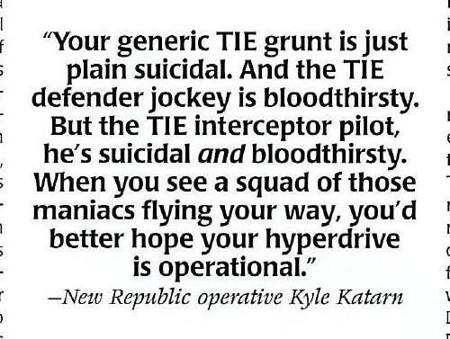

# Kyle Katarn

- **Aliases:** Katarn, Kyle
- **Era:** GCW–NR
- **Continuity:** default Legends; entries present for: Canon, Legends
- **Research tier:** DEEP
- **Entries:** 678 (413 with quotations; 287 marked as fragments; recounted after the public-release cleanup). Rebuilt 2026-11-17 from 816 old entries; old file: `characters/_bak/kyle-katarn.md.bak-20261117`.
- **How to read:** each entry is the quotation in full (block quote), then its source and point of view. "Note" lines are summaries from our notes, not quotations. `[fragment — full passage not on file]` means the source text is not on the box, so only the words in our notes are shown. Debate and forum material is in the last section and is unverified.

# LEGENDS (Legends / EU — main focus)

## Legacy of the Force 1–9: novel notes from the other agent (reference copy)

> Katarn looked down to see Caedus's lightsaber buried to its hilt in his chest. *(L1649)*
>
> The attack severed two ribs, penetrated his left lung, and exited through his left shoulder blade. A few centimeters off, and it would have gone clean through his heart. *(L2397)*
— Source: L1649; L2397 — Legacy of the Force 7: Fury (novel, read in full): feats, scaling and story notes.
Note (our notes, around the quote): L1641–1651 · Caedus: feints a push at Katarn and instead yanks a GAG speeder into Katarn's back, driving him onto his blade: «Katarn looked down to see Caedus's lightsaber buried to its hilt in his chest.» (L1649). Katarn survives. Cilghal on the wound: «The attack severed two ribs, penetrated his left lung, and exited through his left shoulder blade. A few centimeters off, and it would have gone clean through his heart.» (L2397).
Our notes: `notes/materials/021-legacy-of-the-force/lotf-7-fury-notes.md:53`; `notes/materials/021-legacy-of-the-force/lotf-7-fury-notes.md:301`

What it shows (our notes): L1719–1723 · Caedus: catches a bolt and Mithric's blade in one motion, deflects the bolt into Mithric's chest, then «Mithric's head fell from his shoulders.» *Caveat:* Caedus «wasn't yet recovered from his duel with Luke» (L1715). He is grazed by a bolt (L1685), and Mithric «was starting to beat down his parries» (L1713).
> Mithric’s head fell from his shoulders. His body toppled down half a second later.
>
> Caedus and Horn spun to face each other. An expression of sadness crossed Horn’s face, but his dismay did not distract him. He caught three more blaster bolts with his lightsaber blade without looking at their firers.
>
> wasn't yet recovered from his duel with Luke *(L1715)*
>
> And this madman of a Falleen Jedi was starting to beat down his parries. *(L1713)*
— Source: L1715; L1685; L1713 — Legacy of the Force 7: Fury (novel, read in full): feats, scaling and story notes.
(Excerpt widened 2026-11-17 to the relevant passage, word for word from Fury (Aaron Allston) (text copy `MEGA_Legend_The_Legacy_of_the_Force_Series_Star_Wars_Legacy_of_the_Force_07_Fury_Aaron_Allston_epub`).)
(Excerpt widened 2026-11-17 to the relevant passage, word for word from Fury (Aaron Allston) (text copy `MEGA_Legend_The_Legacy_of_the_Force_Series_Star_Wars_Legacy_of_the_Force_07_Fury_Aaron_Allston_epub`).)
(Full sentence/passage taken from the source text on file: `novels_tmp_fury_FULL_txt`.)
Our notes: `notes/materials/021-legacy-of-the-force/lotf-7-fury-notes.md:54`

> “Not to a traitor.” Caedus looked at the other three as their Force-augmented sprints came to an end, leaving them in a semicircle before him. Three Jedi Knights: the younger Horn, the Falleen Mithric, the Bothan Hu’lya. He resisted the urge to snort. Separately or collectively, these Jedi Knights were no match for him.
>
> Katarn, though, was a threat. Still, the Jedi had only moments before GA reinforcements would arrive. Their attack was already a failure.
— Source: Legacy of the Force 7: Fury (novel, read in full): feats, scaling and story notes; | S6 | L1569–1571 | Caedus (POV) |.
(Excerpt widened 2026-11-17 to the relevant passage, word for word from Fury (Aaron Allston), Chapter Ten (text copy `MEGA_Legend_The_Legacy_of_the_Force_Series_Star_Wars_Legacy_of_the_Force_07_Fury_Aaron_Allston_epub`).)
Note (our notes, around the quote): | S6 | L1569–1571 | Caedus (POV) | «Separately or collectively, these Jedi Knights were no match for him.» / «Katarn, though, was a threat.» | High. The duel bears it out. |
Context: | # | Line | Speaker / POV | Statement | Reliability |
Our notes: `notes/materials/021-legacy-of-the-force/lotf-7-fury-notes.md:109`

- Note (summary from our notes, not a quotation): | A | Caedus vs. Katarn, Valin, Mithric, Hu'lya | Ch10–11, L1545–1745 | about 20–30 s of fighting | Caedus (Katarn down, Mithric killed); the Jedi plant the tracer anyway | Caedus was still recovering from Luke (L1715) and grazed by a bolt (L1685). The Jedi used gas and dazzle grenades. Katarn was downed by a speeder trick, not swordplay. | Caedus beats a Master plus three Knights while hurt. Strong Master tier. |
  — Source: L1715; L1685 — Legacy of the Force 7: Fury (novel, read in full): feats, scaling and story notes.
Context: | # | Fight | Where (lines) | Length | Winner | Holding back / help / injuries | What it suggests |
Our notes: `notes/materials/021-legacy-of-the-force/lotf-7-fury-notes.md:135`

> Octa, trained by Kam and Tionne Solusar, both still recovering from their near-fatal wounds at the hands of Jacen Solo’s soldiers, was more subdued than the rest, her stillness in the Force clearly a consequence of rigid self-control rather than inner peace. *(L683)*
— Source: L683 — Legacy of the Force 7: Fury (novel, read in full): feats, scaling and story notes.
(Full sentence/passage taken from the source text on file: `novels_tmp_fury_FULL_txt`.)
Note (our notes, around the quote): Masters present: Luke, Kyle Katarn, Cilghal, Kyp, Corran, Saba, Octa Ramis (L683). Kam and Tionne «both still recovering from their near-fatal wounds» (L683) [Allston: Kam alive; contrast Inferno L3345–3355 where Kam appeared killed — continuity note].
Our notes: `notes/materials/021-legacy-of-the-force/lotf-7-fury-notes.md:245`

> A few meters away, Saba Sebatyne and Corran Horn dueled, each adopting a traditional, formalized lightsaber posture—Saba using a lightsaber in each hand, Corran with his own weapon adjusted to its second setting, its blade now three meters in length and a brilliant purple instead of its usual silver. *(L701)*
>
> It was like defending himself against Yuuzhan Vong thud bugs for the first time in years, but the old skill was undiminished—he calculated which objects had a chance of hitting him and incinerated only them with his blades, letting the others fly harmlessly past. *(L717)*
— Source: L701–717; L701; L711; L715 — Legacy of the Force 7: Fury (novel, read in full): feats, scaling and story notes.
(Full sentence/passage taken from the source text on file: `novels_tmp_fury_FULL_txt`.)
Note (our notes, around the quote): Masters' free-for-all (L701–717): Saba dual-wields; Corran's saber «adjusted to its second setting, its blade now three meters in length» (L701); Octa Ramis Force-hurls stones; Luke inverted back-flip block on Cilghal (L701), bends backward and disarms Cilghal by catching her hilt (L711), then fights Kyp two-bladed (L715). Luke vs Force-propelled bolt swarm: «he calculated which objects had a chance of hitting him and incinerated only them with his blades» (L717) — FEAT (casual, sparring). Cilghal Force-pulls Kyle's saber (L713).
Our notes: `notes/materials/021-legacy-of-the-force/lotf-7-fury-notes.md:247`

> If I lead this mission, I will strike at]acen with hatred. *(L837, sic OCR)*
>
> Luke had neither heard nor felt him coming. *(L823)*
— Source: L815–819; L839; L823 — Legacy of the Force 7: Fury (novel, read in full): feats, scaling and story notes.
(Full sentence/passage taken from the source text on file: `novels_tmp_fury_FULL_txt`.)
Note (our notes, around the quote): Luke feels the Force silent on the bigger picture since Mara's death (L815–819); refuses to lead: «If I lead this mission, I will strike at]acen with hatred.» (L837, sic OCR). Kyle Katarn leads (L839). Luke «had neither heard nor felt him coming» (L823) — Luke's senses dulled by grief.
Our notes: `notes/materials/021-legacy-of-the-force/lotf-7-fury-notes.md:252`

> She rolled over to see the whole room, and there he was—seated in a chair by the bed, tall and handsome, wearing his black uniform, his eyes so bright and intent they almost frightened her. *(L1221)*
— Source: L1221 — Legacy of the Force 7: Fury (novel, read in full): feats, scaling and story notes.
(Full sentence/passage taken from the source text on file: `novels_tmp_fury_FULL_txt`.)
Note (our notes, around the quote): Allana doesn't hear «the special words» from Jacen and grows suspicious (L1249, L1263); Jacen's eyes «so bright and intent they almost frightened her» (L1221).
Our notes: `notes/materials/021-legacy-of-the-force/lotf-7-fury-notes.md:265`

- Note (summary from our notes, not a quotation): Strike team: Kyle Katarn (former stormtrooper, L1273), Valin Horn, Thann Mithric (Falleen), Kolir Hu'lya (Bothan), Seha guide (L1273–1275). Katarn takes the position closest to Caedus's approach (L1319).
  — Source: L1273–1275; L1319 — Legacy of the Force 7: Fury (novel, read in full): feats, scaling and story notes.
Our notes: `notes/materials/021-legacy-of-the-force/lotf-7-fury-notes.md:266`

> Comlink transmissions might be detected, especially so close to the Senate Building, where security was so high. Exchanges of images or feelings through the Force might be detected by Jacen Solo. *(L1481)*
— Source: L1487–1491; L1481 — Legacy of the Force 7: Fury (novel, read in full): feats, scaling and story notes.
(Full sentence/passage taken from the source text on file: `novels_tmp_fury_FULL_txt`.)
Note (our notes, around the quote): HoloNet: Third Fleet dropped asteroids on Commenor population centers; commander acted on his own initiative (L1487–1491). Jedi avoid Force comms because «Exchanges of images or feelings through the Force might be detected by Jacen Solo» (L1481) — Caedus's sensing reputation.
Our notes: `notes/materials/021-legacy-of-the-force/lotf-7-fury-notes.md:270`

> wasn't yet recovered from his duel with Luke *(L1715)*
— Source: L1715; L1515 — Legacy of the Force 7: Fury (novel, read in full): feats, scaling and story notes.
Note (our notes, around the quote): Context: Jedi ambush with dazzle grenades and gas; Caedus escorting a crate with Allana inside (YVH-908 carries it, L1527, L1549). Caedus «wasn't yet recovered from his duel with Luke» (L1715). GAG troopers blinded at first, later firing. A YVH droid: Jedi Knight vs YVH «about even» (L1515).
Our notes: `notes/materials/021-legacy-of-the-force/lotf-7-fury-notes.md:273`

> Contemptuous, he flicked his hand toward the darkness and felt his own power turn the cylinders around. *(L1557)*
— Source: L1557; L1559–1561 — Legacy of the Force 7: Fury (novel, read in full): feats, scaling and story notes.
Note (our notes, around the quote): L1551–1557: Caedus senses falling and rolling grenade cylinders; «Contemptuous, he flicked his hand toward the darkness and felt his own power turn the cylinders around.» (L1557) — FEAT (TK vs multiple Force-propelled objects). Dazzle grenades still blind his troops (L1559–1561).
Our notes: `notes/materials/021-legacy-of-the-force/lotf-7-fury-notes.md:274`; `notes/materials/021-legacy-of-the-force/lotf-7-fury-notes.md:51`

> “Not to a traitor.” Caedus looked at the other three as their Force-augmented sprints came to an end, leaving them in a semicircle before him. Three Jedi Knights: the younger Horn, the Falleen Mithric, the Bothan Hu’lya. He resisted the urge to snort. Separately or collectively, these Jedi Knights were no match for him.
>
> Katarn, though, was a threat. Still, the Jedi had only moments before GA reinforcements would arrive. Their attack was already a failure.
— Source: Legacy of the Force 7: Fury (novel, read in full): feats, scaling and story notes; **L1569 Caedus POV STATEMENT. POV: L1569 Caedus POV STATEMENT, about Kyle Katarn.
(Excerpt widened 2026-11-17 to the relevant passage, word for word from Fury (Aaron Allston), Chapter Ten (text copy `MEGA_Legend_The_Legacy_of_the_Force_Series_Star_Wars_Legacy_of_the_Force_07_Fury_Aaron_Allston_epub`).)
Label in our notes: / L1571 **
Our notes: `notes/materials/021-legacy-of-the-force/lotf-7-fury-notes.md:275`

> Two seconds had passed since the attack began. *(L1577)*
— Source: L1577 — Legacy of the Force 7: Fury (novel, read in full): feats, scaling and story notes.
Note (our notes, around the quote): L1573–1577 (first two seconds): blocks Katarn by muscle memory; Force-hurls Hu'lya into Mithric; steps back from Katarn's spin; side kick to Valin's chin knocking him off his feet. «Two seconds had passed since the attack began.» (L1577) — FEAT.
Also noted as: L1573–1577 · Caedus: blocks Katarn, Force-hurls Hu'lya into Mithric, and kicks Valin off his feet. «Two seconds had passed since the attack began.» (L1577)
Our notes: `notes/materials/021-legacy-of-the-force/lotf-7-fury-notes.md:276`; `notes/materials/021-legacy-of-the-force/lotf-7-fury-notes.md:52`

> He kept his senses on Katarn’s lightsaber, and, when it vectored to fly toward him from the side, he negligently swatted it away with his own blade. *(Katarn's thrown saber, L1623)*
— Source: Legacy of the Force 7: Fury (novel, read in full): feats, scaling and story notes.
(Full sentence/passage taken from the source text on file: `novels_tmp_fury_FULL_txt`.)
Note (our notes, around the quote): L1619–1623: makes Valin flinch into Mithric; hurls Hu'lya at Katarn; «he negligently swatted it away with his own blade» (Katarn's thrown saber, L1623). L1635: TK-yanks Hu'lya into the path of Mithric's and Valin's Force attack.
Our notes: `notes/materials/021-legacy-of-the-force/lotf-7-fury-notes.md:278`

> exerted himself against the oncom-ing GAG speeder, yanking it down and toward all of them.
> [fragment — full passage not on file]
>
> Katarn looked down to see Caedus's lightsaber buried to its hilt in his chest. *(L1649)*
>
> Caedus felt a rush of satisfaction, enjoyment, as Katarn’s expression turned from one of surprise to pain. *(L1649)*
— Source: L1649 — Legacy of the Force 7: Fury (novel, read in full): feats, scaling and story notes; **L1641–1651: Caedus feints a Force push at Katarn, but.
(Full sentence/passage taken from the source text on file: `novels_tmp_fury_FULL_txt`.)
Note (our notes, around the quote): L1641–1651: Caedus feints a Force push at Katarn, but «exerted himself against the oncom-ing GAG speeder, yanking it down and toward all of them.» The speeder hits Katarn's back, hurling him onto Caedus's blade: «Katarn looked down to see Caedus's lightsaber buried to its hilt in his chest.» (L1649). «Caedus felt a rush of satisfaction, enjoyment» (L1649) — FEAT (Caedus kills/downs a Jedi Master via TK trick, ~15–20 s in). [Katarn survives: «"You're alive!"» L1693.]
Our notes: `notes/materials/021-legacy-of-the-force/lotf-7-fury-notes.md:279`

- Note (summary from our notes, not a quotation): Seha plants a tracking patch on Caedus's cloak hem (L1591–1599, L1671) — Katarn's real objective. Seha Force-drags Katarn's body away (L1675–1689).
  — Source: L1675–1689 — Legacy of the Force 7: Fury (novel, read in full): feats, scaling and story notes.
Our notes: `notes/materials/021-legacy-of-the-force/lotf-7-fury-notes.md:280`

> Seha saw the Jedi exchanging words. Valin spun away from the engagement with Jacen and moved toward the one sighted trooper. That man fired again and Valin deflected the bolt with his lightsaber—deflected it straight toward Jacen. The improvised attack evidently came as a surprise: The bolt grazed Jacen’s right leg, sending him to his knee. Mithric redoubled his attack, hammering away at Jacen’s defense like a toolsmith on a primitive world battering away at a stubborn harvester droid.
>
> Caedus hadn’t felt the blaster bolt coming. His concentration was slipping.
>
> And this madman of a Falleen Jedi was starting to beat down his parries. His strength was slipping.
>
> He wasn’t yet recovered from his duel with Luke. And now, as more of his troopers began firing, Horn began deflecting more bolts at him. The imprecise, barely aimed nature of the attacks worked in Horn’s favor. The shots were unpredictable and Caedus had to divide his attention between a mad swordsman and a growing number of half-blind snipers.
— Source: Legacy of the Force 7: Fury (novel, read in full): feats, scaling and story notes; L1685: Valin deflects a trooper's bolt into Caedus.
(Excerpt widened 2026-11-17 to the relevant passage, word for word from Fury (Aaron Allston) (text copy `MEGA_Legend_The_Legacy_of_the_Force_Series_Star_Wars_Legacy_of_the_Force_07_Fury_Aaron_Allston_epub`).)
(Excerpt widened 2026-11-17 to the relevant passage, word for word from Fury (Aaron Allston) (text copy `MEGA_Legend_The_Legacy_of_the_Force_Series_Star_Wars_Legacy_of_the_Force_07_Fury_Aaron_Allston_epub`).)
(Full sentence/passage taken from the source text on file: `novels_tmp_fury_FULL_txt`.)
Label in our notes: L1711: L1713: Mithric L1715
Our notes: `notes/materials/021-legacy-of-the-force/lotf-7-fury-notes.md:281`

What it shows (our notes): L1717 Caedus POV STATEMENT: «But he was still the best lightsaber swordsman around-excepting possibly Luke, perhaps the best there ever had been.» (self-assessment; note the Luke exception).
> But he was still the best lightsaber swordsman around—excepting possibly Luke, perhaps the best there ever had been.
>
> Caedus waited until the timing was perfect, waited until an incoming bolt arrived at the same moment as one of Mithric’s attacks so he could devote a single maneuver to both. He caught Mithric’s blow toward the hilt of his lightsaber. He caught the bolt near the tip, deflecting it up and straight into Mithric’s chest.
— Source: Legacy of the Force 7: Fury (novel, read in full): feats, scaling and story notes; **L1717 Caedus POV STATEMENT. POV: L1717 Caedus POV STATEMENT, about Kyle Katarn.
(Excerpt widened 2026-11-17 to the relevant passage, word for word from Fury (Aaron Allston) (text copy `MEGA_Legend_The_Legacy_of_the_Force_Series_Star_Wars_Legacy_of_the_Force_07_Fury_Aaron_Allston_epub`).)
(Excerpt widened 2026-11-17 to the relevant passage, word for word from Fury (Aaron Allston) (text copy `MEGA_Legend_The_Legacy_of_the_Force_Series_Star_Wars_Legacy_of_the_Force_07_Fury_Aaron_Allston_epub`).)
Our notes: `notes/materials/021-legacy-of-the-force/lotf-7-fury-notes.md:282`

What it shows (our notes): L1719–1723: times a blaster bolt with Mithric's blow, catches both in one move, deflects the bolt into Mithric's chest, then «a single, precise lateral blow. / Mithric's head fell from his shoulders.» — FEAT.
> Mithric staggered back, the center of his chest blackened, as the smell of burned skin and meat filled the air. Caedus leapt up and executed a single, precise lateral blow.
>
> Mithric’s head fell from his shoulders. His body toppled down half a second later.
>
> Caedus and Horn spun to face each other. An expression of sadness crossed Horn’s face, but his dismay did not distract him. He caught three more blaster bolts with his lightsaber blade without looking at their firers.
— Source: Legacy of the Force 7: Fury (novel, read in full): feats, scaling and story notes.
(Excerpt widened 2026-11-17 to the relevant passage, word for word from Fury (Aaron Allston) (text copy `MEGA_Legend_The_Legacy_of_the_Force_Series_Star_Wars_Legacy_of_the_Force_07_Fury_Aaron_Allston_epub`).)
(Excerpt widened 2026-11-17 to the relevant passage, word for word from Fury (Aaron Allston) (text copy `MEGA_Legend_The_Legacy_of_the_Force_Series_Star_Wars_Legacy_of_the_Force_07_Fury_Aaron_Allston_epub`).)
(Full sentence/passage taken from the source text on file: `novels_tmp_fury_FULL_txt`.)
Our notes: `notes/materials/021-legacy-of-the-force/lotf-7-fury-notes.md:283`

> Caedus smiled. “You’re a fraction of the man your father is.”
>
> “Funny. That’s what I was going to say to you.” Horn seemed to blur as he dashed toward the shuttle, his sprinting speed augmented by the Force.
>
> Funny. That's what I was going to say to you. *(L1733–1735)*
— Source: L1725; L1733–1735 — Legacy of the Force 7: Fury (novel, read in full): feats, scaling and story notes; Valin catches three bolts without looking (L1725). Caedus.
(Excerpt widened 2026-11-17 to the relevant passage, word for word from Fury (Aaron Allston) (text copy `MEGA_Legend_The_Legacy_of_the_Force_Series_Star_Wars_Legacy_of_the_Force_07_Fury_Aaron_Allston_epub`).)
(Excerpt widened 2026-11-17 to the relevant passage, word for word from Fury (Aaron Allston) (text copy `MEGA_Legend_The_Legacy_of_the_Force_Series_Star_Wars_Legacy_of_the_Force_07_Fury_Aaron_Allston_epub`).)
Label in our notes: Valin: (L1733–1735
Our notes: `notes/materials/021-legacy-of-the-force/lotf-7-fury-notes.md:284`

What it shows (our notes): Endor: Ben (narration, his POV): «He suspected-he knew, deep down-that it had been Jacen, not Alema Rar, who had killed his mother.» (L1803). Ben on Vader's isolation = what Jacen did to him (L1819–1823). Luke: «Ben, I would kill Jacen.» (L1861) — choosing Valin over Jacen; admits special treatment of Ben (L1865). Luke's condition: «you take your shot only if you can do it without hate» (L1881).
> He suspected-he knew, deep down-that it had been Jacen, not Alema Rar, who had killed his mother. *(L1803)*
>
> “Ben, I would kill Jacen.”
>
> “So you gave me special consideration you wouldn’t give Valin.”
>
> “Yes.” Luke lowered his gaze to his hands, which rested in his lap. “Speaking as the Grand Master … I shouldn’t have.”
>
> “If you’re ever in the same position you were on the Anakin Solo, with Jacen at your mercy, you take your shot only if you can do it without hate. *(L1881)*
— Source: L1803; L1819–1823; L1861; L1865 — Legacy of the Force 7: Fury (novel, read in full): feats, scaling and story notes; Endor: Ben (narration, his POV).
(Excerpt widened 2026-11-17 to the relevant passage, word for word from Fury (Aaron Allston) (text copy `MEGA_Legend_The_Legacy_of_the_Force_Series_Star_Wars_Legacy_of_the_Force_07_Fury_Aaron_Allston_epub`).)
(Excerpt widened 2026-11-17 to the relevant passage, word for word from Fury (Aaron Allston) (text copy `MEGA_Legend_The_Legacy_of_the_Force_Series_Star_Wars_Legacy_of_the_Force_07_Fury_Aaron_Allston_epub`).)
(Full sentence/passage taken from the source text on file: `novels_tmp_fury_FULL_txt`.)
Our notes: `notes/materials/021-legacy-of-the-force/lotf-7-fury-notes.md:287`

> Kyp’s voice became more sober. “The mission group reports partial success. *(L1905)*
>
> I was certain Kyle would be able to escape-or die before being broken. *(L1921)*
— Source: L1905; L1913–1921; L1921; L1927 — Legacy of the Force 7: Fury (novel, read in full): feats, scaling and story notes; Kyp. POV: Kyp, about Kyle Katarn.
(Full sentence/passage taken from the source text on file: `novels_tmp_fury_FULL_txt`.)
Note (our notes, around the quote): Kyp: «The mission group reports partial success» (L1905); Katarn badly injured, Mithric dead; the ambush was designed to fail; the tracer was the real goal (L1913–1921). Luke: «I was certain Kyle would be able to escape-or die before being broken.» (L1921). Luke calls in Wedge, Booster, Karrde (L1927); Kyp: «Welcome back.» (L1929).
Our notes: `notes/materials/021-legacy-of-the-force/lotf-7-fury-notes.md:288`

- Note (summary from our notes, not a quotation): Koyan offers secret talks with Caedus at a midpoint (L2341–2349). Caedus suspects a trap but accepts; his caution is about Allana (L2371).
  — Source: L2341–2349; L2371 — Legacy of the Force 7: Fury (novel, read in full): feats, scaling and story notes.
Our notes: `notes/materials/021-legacy-of-the-force/lotf-7-fury-notes.md:300`

> A YVH combat droid that was programmed to get its cargo out of harm’s way rather than help its master defend against four Jedi. *(L2403)*
— Source: L2403 — Legacy of the Force 7: Fury (novel, read in full): feats, scaling and story notes; Valin's report flags the YVH.
(Full sentence/passage taken from the source text on file: `novels_tmp_fury_FULL_txt`.)
Label in our notes: L2403) — clue about Allana
Our notes: `notes/materials/021-legacy-of-the-force/lotf-7-fury-notes.md:302`

> No, I was going to say, you’ve brought me in for military advice, you’re acquiring personnel and matériel, you have a base of operations and an agenda that involves interacting with two major galactic powers—has it occurred to you that you’re setting up a third government here?” *(L2457–2461)*
— Source: L2429–2449; L2451; L2457–2461 — Legacy of the Force 7: Fury (novel, read in full): feats, scaling and story notes.
(Full sentence/passage taken from the source text on file: `novels_tmp_fury_FULL_txt`.)
Note (our notes, around the quote): Wedge arrives; intel on the Corellian meeting (L2429–2449); Luke sends a StealthX to shadow the *Anakin Solo* (L2451). Wedge: the Jedi are «setting up a third government here» (L2457–2461).
Our notes: `notes/materials/021-legacy-of-the-force/lotf-7-fury-notes.md:303`

- Note (summary from our notes, not a quotation): Caedus is building a red-bladed lightsaber to announce himself as «Lord of the Sith» (L2477).
  — Source: L2477 — Legacy of the Force 7: Fury (novel, read in full): feats, scaling and story notes.
Our notes: `notes/materials/021-legacy-of-the-force/lotf-7-fury-notes.md:304`

- Note (summary from our notes, not a quotation): Leia boards the *Anakin Solo* from Lando's yacht to "talk" (L2489–2515); Caedus senses only her aboard (L2509–2511) and plans to imprison her and Han.
  — Source: L2489–2515; L2509–2511 — Legacy of the Force 7: Fury (novel, read in full): feats, scaling and story notes.
Our notes: `notes/materials/021-legacy-of-the-force/lotf-7-fury-notes.md:305`

> “Let me make this clear, though.” Luke fixed Tycho with his gaze. “We serve the Galactic Alliance. When Jacen Solo is no longer a factor, we will return our seat of authority to Coruscant. We retain trust in Admiral Niathal.”
>
> Luke began looking from face to face as he spoke. “Wedge, handpick a starfighter squadron. We’ll use it to chase the shuttle to safety aboard the Anakin Solo, then to support any operation against Centerpoint Station. I’ll lead a unit of Jedi to assault Jacen; our job will be to take him out if possible, and to distract him from the rescue operation in any case. Han, Leia, I want you to lead the expedition to rescue the Chume’da. Master Katarn, I want you in reserve for extraction of the assault and rescue teams. Doctor Seyah and our scientific staff will come up with the best ways to destroy Centerpoint Station. Ben, owing to your experience there, I want you on that mission.”
>
> Not revenge?
>
> Yes, Grand Master. *(L5351–5355)*
> [fragment — full passage not on file]
— Source: L5253–5381; L5253; L5271; L5273 — Legacy of the Force 7: Fury (novel, read in full): feats, scaling and story notes.
(Excerpt widened 2026-11-17 to the relevant passage, word for word from Fury (Aaron Allston), Chapter Twenty-Nine (text copy `MEGA_Legend_The_Legacy_of_the_Force_Series_Star_Wars_Legacy_of_the_Force_07_Fury_Aaron_Allston_epub`).)
(Full sentence/passage taken from the source text on file: `novels_tmp_fury_FULL_txt`.)
(Fragment completed 2026-11-17: full sentence/passage matched word for word in the source text on file: `MEGA_Legend_The_Legacy_of_the_Force_Series_Star_Wars_Legacy_of_the_Force_07_Fury_Aaron_Allston_epub`.)
Note text that was attached to the quote line: *(L5273)*
Note text that was attached to the quote line: *(L5345)*
Note (our notes, around the quote): Planning session under the Death Star hull (L5253–5381): Katarn up and «moving well» (L5253). Luke refuses Niathal's request to return the Order to the GA under Jacen (L5271); «We retain trust in Admiral Niathal.» (L5273). Plan: rescue Allana; destroy Centerpoint when Jacen moves to capture it (L5277–5291). Zekk had planted a full-power holocomm beacon on the *Anakin Solo* (L5305–5307). Infiltrate via Tycho's shuttle. Luke leads a Jedi unit to assault Jacen — «to take him out if possible, and to distract him from the rescue operation in any case» (L5345); Han & Leia lead the Allana rescue; Ben insists on coming as a diversion, «Not revenge? / Yes, Grand Master.» (L5351–5355). Syal named GA envoy to the Jedi (L5371).
Our notes: `notes/materials/021-legacy-of-the-force/lotf-7-fury-notes.md:378`

> That boy can fly
> [fragment — full passage not on file]
— Source: L6785–6809; L6831; L6811 — Legacy of the Force 7: Fury (novel, read in full): feats, scaling and story notes.
Note (our notes, around the quote): Caedus chases them; Jag flies the *Falcon* to the air lock (L6785–6809); Katarn: «Two-Injured-Men-and-a-Droid Shuttle Service» (L6831). Wedge: «That boy can fly» / «another Jagged Antilles» (L6811).
Our notes: `notes/materials/021-legacy-of-the-force/lotf-7-fury-notes.md:426`

> Centerpoint Station was a glowing ball, a perfect sphere of light perhaps five hundred kilometers in diameter. *(L6889)*
>
> “That was a massive loss of life. A cessation in the Force. *(L6899)*
— Source: L6883–6893; L6889; L6899; L6895 — Legacy of the Force 7: Fury (novel, read in full): feats, scaling and story notes.
(Full sentence/passage taken from the source text on file: `novels_tmp_fury_FULL_txt`.)
Note (our notes, around the quote): Centerpoint destroyed: Vibro fires on «Coruscant», but Seyah's data swap makes the station target itself (L6883–6893): «a perfect sphere of light perhaps five hundred kilometers in diameter» (L6889). Katarn: «A cessation in the Force.» (L6899). The *Anakin Solo* is unharmed (L6895).
Our notes: `notes/materials/021-legacy-of-the-force/lotf-7-fury-notes.md:428`

> He did have other special words, though. “I love you, Allana.” *(L1773)*
— Source: L1773 — Legacy of the Force 7: Fury (novel, read in full): feats, scaling and story notes.
(Full sentence/passage taken from the source text on file: `novels_tmp_fury_FULL_txt`.)
Note (our notes, around the quote): Role/arc: a father first. He kidnaps Allana, survives the Katarn ambush, loses Allana and Centerpoint, and kills Tebut. «I love you, Allana.» (L1773).
Also cited as: L1773; L1771 — Legacy of the Force 7: Fury (novel, read in full): feats, scaling and story notes; Caedus to Allana.
Also noted as: Caedus to Allana: «I love you, Allana.» (L1773); she still waits for «the special words» (L1771).
Our notes: `notes/materials/021-legacy-of-the-force/lotf-7-fury-notes.md:445`; `notes/materials/021-legacy-of-the-force/lotf-7-fury-notes.md:286`

> Two seconds had passed since the attack began. *(L1577)*
>
> Katarn looked down to see Caedus's lightsaber buried to its hilt in his chest. *(L1649)*
>
> Mithric's head fell from his shoulders. *(L1719–1723)*
>
> Luke felt the wave of hatred flow through him. It was so strong it felt like a kick in the gut, and he wondered for an instant if Jacen had perfected some new Force attack. *(Ch19, L3279)*
>
> The sound of Tebut’s neck breaking was startlingly loud over the hum of the bridge’s monitors and computer gear. *(L6957–6969)*
— Source: Ch10, L1557; Ch19, L3279; Ch36, L6629–6633; L1577 — Legacy of the Force 7: Fury (novel, read in full): feats, scaling and story notes.
(Full sentence/passage taken from the source text on file: `novels_tmp_fury_FULL_txt`.)
Note (our notes, around the quote): Key feats: turns back rolling grenades with a contemptuous flick (Ch10, L1557). Downs three Jedi: «Two seconds had passed since the attack began.» (L1577). Yanks a speeder into Katarn's back so «Katarn looked down to see Caedus's lightsaber buried to its hilt in his chest.» (L1649). Deflects a bolt into Mithric, then «Mithric's head fell from his shoulders.» (L1719–1723). Rage leaks through the Force; Luke: «It was so strong it felt like a kick in the gut» (Ch19, L3279). TK-slips Saba into a grenade pit (Ch36, L6629–6633). Chokes Tebut: «The sound of Tebut's neck breaking was startlingly loud» (L6957–6969).
Our notes: `notes/materials/021-legacy-of-the-force/lotf-7-fury-notes.md:446`

- Note (summary from our notes, not a quotation): Fights/results: beats Katarn, Valin, Mithric and Hu'lya while still hurt (L1715). Escapes Luke's flight in the Blur (Luke breaks off for Allana). The bridge fight has no result.
  — Source: L1715 — Legacy of the Force 7: Fury (novel, read in full): feats, scaling and story notes.
Our notes: `notes/materials/021-legacy-of-the-force/lotf-7-fury-notes.md:448`

> A few centimeters off, and it would have gone clean through his heart. *(L2397)*
— Source: L2397 — Legacy of the Force 7: Fury (novel, read in full): feats, scaling and story notes.
Note (our notes, around the quote): Feats/fight: leads the plaza ambush. Run through by the speeder trick. Cilghal: «A few centimeters off, and it would have gone clean through his heart.» (L2397).
Our notes: `notes/materials/021-legacy-of-the-force/lotf-7-fury-notes.md:491`

> Katarn, though, was a threat. *(L1571)*
— Source: L1571 — Legacy of the Force 7: Fury (novel, read in full): feats, scaling and story notes; Statement: Caedus.
Label in our notes: Statement: Caedus: (L1571
Our notes: `notes/materials/021-legacy-of-the-force/lotf-7-fury-notes.md:492`

- Note (summary from our notes, not a quotation): Scaling: a Master who loses to Caedus in seconds, though to a trick.
  — Source: Legacy of the Force 7: Fury (novel, read in full): feats, scaling and story notes.
Our notes: `notes/materials/021-legacy-of-the-force/lotf-7-fury-notes.md:493`

## Star Wars: The New Essential Chronology (Del Rey, 2005): power-scaling and lore notes

> Jerec planned to use the valley's power to topple Isard and rule a vast new Empire. Katarn single-handedly defeated Jerec and his minions before the Dark Jedi's grandiose plans could come to fruition.
— Source: Part Six: Birth of the New Republic; Jerec — Katarn defeats Jerec.
Note (our notes, around the quote): Jerec — Katarn defeats Jerec: "Jerec planned to use the valley's power to topple Isard and rule a vast new Empire. Katarn single-handedly defeated Jerec and his minions before the Dark Jedi's grandiose plans could come to fruition." Source: The New Essential Chronology, p.136

Our notes: `notes/materials/027-new-essential-chronology/06-part-six-birth-of-the-new-republic.md:57`

> He knew that his sister Leia, her three children, Kam Solusar, the Witches of Dathomir, Kyle Katarn, and Mara Jade had all exhibited an aptitude for the Force.
— Source: Part Eight: The Return of the Jedi Knights; Luke Skywalker — academy recruits. POV: speaker not named in our notes.
Note (our notes, around the quote): Luke Skywalker — academy recruits: "He knew that his sister Leia, her three children, Kam Solusar, the Witches of Dathomir, Kyle Katarn, and Mara Jade had all exhibited an aptitude for the Force." Source: The New Essential Chronology, p.162

Our notes: `notes/materials/027-new-essential-chronology/08-part-eight-return-of-the-jedi-knights.md:11`

- Note (summary from our notes, not a quotation): Katarn defeats Desann: "After reenergizing himself with a trip to Ruusan's Valley of the Jedi, Katarn proved to be more than a match for Desann's "Reborn" warriors. ... In a lightsaber duel on the jungle moon's surface, Katarn killed the power-mad Chistori." Source: The New Essential Chronology, p.173
  — Source: Part Eight: The Return of the Jedi Knights. POV: Katarn defeats Desann.

Our notes: `notes/materials/027-new-essential-chronology/08-part-eight-return-of-the-jedi-knights.md:124`

> New Republic agent Kyle Katarn
> [fragment — full passage not on file]
— Source: Part Nine: Uprisings and Insurgencies; art caption.
Note (our notes, around the quote): art caption: "New Republic agent Kyle Katarn" Source: The New Essential Chronology, p.178, caption

Our notes: `notes/materials/027-new-essential-chronology/09-part-nine-uprisings-and-insurgencies.md:22`

## Star Wars Saga Edition: Jedi Academy Training Manual (WotC, 2009): power-scaling and lore notes

> Katarn is born on a farm planet but has dreams of attending the Imperial Academy. He also has untapped potential in the Force. Kyle discov- ers his Force potential much later in life, long after becoming a disillusioned gun-for-hire. His involvement with the destruction of the Dark Trooper Initia- tive brings him to the attention of the Rebel Alliance, but his discovery of the legendary Valley of the Jedi is what brings him to the attention of Luke Skywalker. Katarn eventually agrees to be taught by Skywalker and goes on to be an instructor at the Jedi Academy.
>
> Kyle Katarn brings a different perspective on the Force, one that occasionally conflicts with the teachings of Master Skywalker. While Skywalker mastered the force through empathy and feeling, Katarn did so through discipline and will.
>
> Skywalker appreciates the difference and Katarn's counsel in matters affecting the Academy. While Luke's journey gives him much wisdom, Kyle's pragmatism and plain speaking offer Luke an alternate viewpoint to consider.
— Source: Chapter V: Instructors and Alumni; Luke Skywalker; Kyle Katarn — Kyle Katarn — contrast with Luke.
(Excerpt widened 2026-11-17 to the relevant passage, word for word from research primary jedi academy training manual jatm paged (text copy `research_primary_jedi_academy_training_manual_jatm_paged_txt_fea130719f`).)
(Excerpt widened 2026-11-17 to the relevant passage, word for word from research primary jedi academy training manual jatm paged (text copy `research_primary_jedi_academy_training_manual_jatm_paged_txt_fea130719f`).)
Note (our notes, around the quote): Luke Skywalker; Kyle Katarn — Kyle Katarn — contrast with Luke: "While Skywalker mastered the force through empathy and feeling, Katarn did so through discipline and will." Source: Jedi Academy Training Manual, p.102

Our notes: `notes/materials/028-jedi-academy-training-manual/05-ch5-instructors-and-alumni.md:66`; `suspect-insight/debates/111-darth-caedus-vs-kyle-katarn-and-mara-jade.md:319`

> After pushing Rillao and their unborn son out of his life, Hethrir develops his abilities and proves his commitment by destroying his own homeworld of Firrerre.
>
> Hethrir foresees the Empire's demise at Endor and develops a plan for its revival called the Empire Reborn, with him as the new Emperor. After cementing his power base in the Crseih system and gaining the assistance of an extradimensional being called Waru, Hethrir finances the Empire Reborn through a slave trade created using political prisoners and his own people, the Firrerreo, that are stored in sleeper ships. With the funds from the slave trade, he outfits the Empire Reborn with arms and ships.
>
> After establishing the armed forces for the Empire Reborn, Hethrir approaches a Chistori named Desann to create an army of Dark Jedi. By selecting only Humans with Force potential and cleansing them through Waru, Hethrir and Desann create the Reborn.
>
> After establishing the armed forces for the Empire Reborn, Hethrir approaches a Chistori named Desann to create an army of Dark Jedi. By selecting only Humans with Force potential and cleansing them through Waru, Hethrir and Desann create the Reborn. However, the Reborn are defeated by Luke Skywalker and Kyle Katarn.
>
> After his defeat, Hethrir has one chance to redeem himself to Waru and return to power. He abducts Jacen, Jaina, and Anakin Solo with the inten- tion of sacrificing them to Waru.
— Source: Chapter VI: Dangers of Study; Luke Skywalker; Kyle Katarn — Hethrir — the Reborn.
(Excerpt widened 2026-11-17 to the relevant passage, word for word from research primary jedi academy training manual jatm paged (text copy `research_primary_jedi_academy_training_manual_jatm_paged_txt_fea130719f`).)
(Excerpt widened 2026-11-17 to the relevant passage, word for word from research primary jedi academy training manual jatm paged (text copy `research_primary_jedi_academy_training_manual_jatm_paged_txt_fea130719f`).)
Note (our notes, around the quote): Luke Skywalker; Kyle Katarn — Hethrir — the Reborn: "However, the Reborn are defeated by Luke Skywalker and Kyle Katarn." Source: Jedi Academy Training Manual, p.120

Our notes: `notes/materials/028-jedi-academy-training-manual/06-ch6-dangers-of-study.md:62`

## The Complete Star Wars Encyclopedia, Vol. I (A–G)

> It was the duty of this squad of ARC-170s to keep the droid starfighter forces off the tails of the Jedi so that they could rescue the cap­ tive Chancellor Palpatine. ARC- 170s were stationed all over the Republic during the Clone Wars, including the aerial cam­ paigns over Cato Neimoidia led by Jedi Master Plo Koon. AreaSee Jeth, Area. 39 eAreaCompany Area Company A group of clone com­ mandos stationed on Coruscant during the Clone Wars. Arcaslte, Mol A ruthless bounty hunter, she was hired by Granta Omega to capture Obi-Wan Kenobi and Anakin Skywalker. Arc HammerA titanic starship that served as both a construction facility and a launch platform for dark troopers shortly after the Battle of Yavin. The Arc Hammer was General Rom Mohc's flagship until it was destroyed by Rebel agent Kyle Katarn. Arch Canyon An expanse of wind-carved stone arches that filled an expanse of canyon on Tatooine and became a key obstacle in the Boonta Eve Podrace course. Archlmar,Dr.The surgeon aboard the In­ trepid, the flagship of the New Republic's Fifth Fleet. ArchitectsThe name applied to an ancient, vanished alien culture that possessed incred­ ible power and created some remarkable feats ofstellar engineering, like the Corellian system and the Maw cluster. A wide range of conflict­ ing theories persists as to whatever became of this prehistoric species.
— Source: scan pages 41–80; Kyle Katarn. POV: Kyle Katarn.
(Excerpt widened 2026-11-17 to the relevant passage, word for word from research primary cse vol1 (text copy `research_primary_cse_vol1_pdf_45a954be6d`).)
(Excerpt widened 2026-11-17 to the relevant passage, word for word from research primary cse vol1 (text copy `research_primary_cse_vol1_pdf_45a954be6d`).)
Note (our notes, around the quote): Kyle Katarn: "The Arc Hammer was General Rom Mohc's flagship until it was destroyed by Rebel agent Kyle Katarn." Source: The Complete Star Wars Encyclopedia, Vol. I, p.40

Our notes: `notes/materials/030-complete-star-wars-encyclopedia-vol-1/01-v1-scan-041-080.md:122`

> With theriseofthe Empire, Aseca was enslaved, serving as manservant to Admiral Screed. His Force sensitivity was again discovered, and he was trained by the Dark Jedi Jerec. Aseca was a cunning and brash individual. Crude and loud, he was a playful joker. When he drew upon the Force to do battle, however, he overcame his otherwise brutish, clumsy nature to become a formidable opponent. Aseca carried two lightsabers, making him 44 an uncommon and dangerous opponent. Kyle Katarn defeated him in the Valley of the Jedi. A-series assassin droid See Pollux as­ sassin droid. Asha The long-lost older sister of the Ewok PrincessKneesaa,she was attacked by a terrifying hanadak when she, her sister, and their mother Ra-Lee were on an outing on Endor. By the time Kneesaa ran to the village and got help, Asha was missing and Ra-Lee had been slain. Years later, Kneesaa's best friend, Wicket W.
— Source: scan pages 41–80; Kyle Katarn. POV: Kyle Katarn.
(Excerpt widened 2026-11-17 to the relevant passage, word for word from research primary cse vol1 (text copy `research_primary_cse_vol1_pdf_45a954be6d`).)
(Excerpt widened 2026-11-17 to the relevant passage, word for word from research primary cse vol1 (text copy `research_primary_cse_vol1_pdf_45a954be6d`).)
Note (our notes, around the quote): Kyle Katarn: "Kyle Katarn defeated him in the Valley of the Jedi." Source: The Complete Star Wars Encyclopedia, Vol. I, p.44

Our notes: `notes/materials/030-complete-star-wars-encyclopedia-vol-1/01-v1-scan-041-080.md:154`

> The lightweight RZ-1 A-wing, co-designed by General Jan Dodonna and Alliance engineer Walex Blissex to outrun any ship in the Im­ perial Navy, had especially strong avionics, including a powerful jamming system that disrupted sensor readings and let pilots blind enemy targets prior to attack. Originally de­ signed for escort duty, the A-wing proved more suited to hit-and-run missions, blasting enemy sites and spacecraft with twin wing­ mounted pivoting laser cannons and concus­ sion missiles. The downside of the A-wing's speed and agility was its relatively high vulner­ ability in dogfights; the position ofthe cockpit left pilots exposed to enemy fire, making the craft's speed even more important. Awmetth,Veedaaz A Senator from the Vensensor sector who attended the funeral of Padme Amidala. Axmis,TavionAn apprentice of the Dark Jedi Desann who challenged Luke Skywalk­ er's Jedi academy after the Battle of Endor. Kyle Katarn defeated her in a lightsaber duel but chose to spare her life, demonstrating his adherence to the light side of the Force. Shamed by her defeat, she went into hiding and emerged some time later as part of the Disciples ofRagnos. The Twi'lek Alora served as her student. Jedi student Jaden Korr con­ fronted Axmis on Korriban, where she had used an ancient Sith artifact to reawaken the spirit of Marka Ragnos.
— Source: scan pages 41–80; Kyle Katarn. POV: Kyle Katarn.
(Excerpt widened 2026-11-17 to the relevant passage, word for word from research primary cse vol1 (text copy `research_primary_cse_vol1_pdf_45a954be6d`).)
(Excerpt widened 2026-11-17 to the relevant passage, word for word from research primary cse vol1 (text copy `research_primary_cse_vol1_pdf_45a954be6d`).)
Note (our notes, around the quote): Kyle Katarn: "Kyle Katarn defeated her in a lightsaber duel but chose to spare her life, demonstrating his adherence to the light side of the Force." Source: The Complete Star Wars Encyclopedia, Vol. I, p.50

Our notes: `notes/materials/030-complete-star-wars-encyclopedia-vol-1/01-v1-scan-041-080.md:194`

> Desann eventually was slain by Kyle Katarn.
— Source: scan pages 161–200; Kyle Katarn. POV: Kyle Katarn.
Note (our notes, around the quote): Kyle Katarn: "Desann eventually was slain by Kyle Katarn." Source: The Complete Star Wars Encyclopedia, Vol. I, p.185

Our notes: `notes/materials/030-complete-star-wars-encyclopedia-vol-1/04-v1-scan-161-200.md:345`

> Donar ill, Nathan A rival of Kyle Katarn's at the Imperial Academy on Carida, he and his father Governor Dol Donar II were killed when the captured Rebel droid A- Cee self-destructed.
— Source: scan pages 201–240; Kyle Katarn. POV: Kyle Katarn.
Note (our notes, around the quote): Kyle Katarn: "Donar ill, Nathan A rival of Kyle Katarn's at the Imperial Academy on Carida, he and his father Governor Dol Donar II were killed when the captured Rebel droid A- Cee self-destructed." Source: The Complete Star Wars Encyclopedia, Vol. I, p.197

Our notes: `notes/materials/030-complete-star-wars-encyclopedia-vol-1/05-v1-scan-201-240.md:89`

> Kyle Katarn infiltrated the ship during its assault of Luke Skywalker's Jedi praxeum on Yavin 4, disabling its shield generators, which allowed Rogue Squadron to destroy the vessel.
— Source: scan pages 201–240; Kyle Katarn; Luke Skywalker.
Note (our notes, around the quote): Kyle Katarn; Luke Skywalker: "Kyle Katarn infiltrated the ship during its assault of Luke Skywalker's Jedi praxeum on Yavin 4, disabling its shield generators, which allowed Rogue Squadron to destroy the vessel." Source: The Complete Star Wars Encyclopedia, Vol. I, p.199

Our notes: `notes/materials/030-complete-star-wars-encyclopedia-vol-1/05-v1-scan-201-240.md:119`

> Eredenn The fourth planet in the Erediss system, this partially frozen world featured huge areas of snowy fields and ice lakes. In the warm season, the snow melted away to reveal a fertile land that blossomed. Eredenn had three moons, none of which was habit­ able. The Galactic Republic was believed to have had a secret base of operations there, from which several military projects were run during the Clone Wars, including a powerful weapon called the Decimator. Erg Es 992 A star in the Meridian sector, it was orbited by the planet Cybloc and its in­ habited moon, Cybloc XII. Ergo An Imperial fuel station. Kyle Katarn boarded a smuggler's ship at Ergo in order to sneak his way onto the Super Star Destroyer Executor. ErladuA polluted factory planet and capital of the Seswenna sector, this world was a trad­ ing and governmental hub in the Outer Rim. The Eriaduans were some of the finest weapons developers in the known galaxy. They de­ veloped new blasters, armor, and helmets. The seat ofpower for the influential Tarkin fam­ ily, Eriadu became a major front in the Clone Wars when members proved their loyalty to the Chancellor by defending their borders from Separatist attack.
— Source: scan pages 241–280; Kyle Katarn. POV: Kyle Katarn.
(Excerpt widened 2026-11-17 to the relevant passage, word for word from research primary cse vol1 (text copy `research_primary_cse_vol1_pdf_45a954be6d`).)
(Excerpt widened 2026-11-17 to the relevant passage, word for word from research primary cse vol1 (text copy `research_primary_cse_vol1_pdf_45a954be6d`).)
Note (our notes, around the quote): Kyle Katarn: "Kyle Katarn boarded a smuggler's ship at Ergo in order to sneak his way onto the Super Star Destroyer Executor." Source: The Complete Star Wars Encyclopedia, Vol. I, p.239

Our notes: `notes/materials/030-complete-star-wars-encyclopedia-vol-1/06-v1-scan-241-280.md:91`

> Lieutenant Grenn imprisoned the Exile and Jedi Master Kreia, and confiscated the Ebon Hawk, when the for­ mer Jedi arrived on Telos in search of answers about Darth Sian. Grenn arrested them after learning of the destruction of the Peragus Mining Colony, but freed them after learning the truth. He then asked for the Exile's assistance in bringing several criminals to justice. Grenna Base An Alliance base, it was used by Daino Hyk as a treatment center for res­ cued Ylesian slaves. 368 Ottegru Grey Grentho A muscular man, he was one of 8t88'sbodyguards at the height ofthe Galactic Civil War. Grentho was killed on Nar Shaddaa when 8t88 tried to eliminate Kyle Katarn. GrenwlckAn Imperial corporal, he was se­ nior tactical adviser to Sergeant Major Enfield aboard the first Death Star. Assigned to secu­ rity duties in Detention Block AA-23, Gren­ wick was a witness to the interrogation of Leia Organa by Darth Vader. Grey, Ottegru In a galaxy engulfed by a terrible civil war rife with spies and assas­ sins, politicians began to rightly fear for their lives. After several close calls involving venge­ ful Aqualish Separatists hiding in Coruscant's underlevels, Chairman Tannon Praji of the Ministry of Ingress (CMoi) turned to Ottegru Grey, a trusted friend of the Praji family and special agent for the Bank of the Core.
— Source: scan pages 361–398; Kyle Katarn. POV: Kyle Katarn.
(Excerpt widened 2026-11-17 to the relevant passage, word for word from research primary cse vol1 (text copy `research_primary_cse_vol1_pdf_45a954be6d`).)
(Excerpt widened 2026-11-17 to the relevant passage, word for word from research primary cse vol1 (text copy `research_primary_cse_vol1_pdf_45a954be6d`).)
Note (our notes, around the quote): Kyle Katarn: "Grentho was killed on Nar Shaddaa when 8t88 tried to eliminate Kyle Katarn." Source: The Complete Star Wars Encyclopedia, Vol. I, p.368

Our notes: `notes/materials/030-complete-star-wars-encyclopedia-vol-1/09-v1-scan-361-398.md:184`

## The Complete Star Wars Encyclopedia, Vol. II (H–O)

> Hontho and his companions were killed by Kyle Katarn in his effort to capture 8t88.
— Source: scan pages 41–80; Kyle Katarn. POV: Kyle Katarn.
Note (our notes, around the quote): Kyle Katarn: "Hontho and his companions were killed by Kyle Katarn in his effort to capture 8t88." Source: The Complete Star Wars Encyclopedia, Vol. II, p.55

Our notes: `notes/materials/031-complete-star-wars-encyclopedia-vol-2/01-v2-scan-041-080.md:136`

> Valin recovered just as Solo drove his lightsaber into Master Katarn's chest, and he rushed Solo alongside Kolir Hu'lya and Thann Mithric, However, the three Jedi were no match for Solo's control of the dark side of the Force.
— Source: scan pages 41–80; Kyle Katarn. POV: Kyle Katarn.
Note (our notes, around the quote): Kyle Katarn: "Valin recovered just as Solo drove his lightsaber into Master Katarn's chest, and he rushed Solo alongside Kolir Hu'lya and Thann Mithric, However, the three Jedi were no match for Solo's control of the dark side of the Force." Source: The Complete Star Wars Encyclopedia, Vol. II, p.60

Our notes: `notes/materials/031-complete-star-wars-encyclopedia-vol-2/01-v2-scan-041-080.md:175`

> She was injured when Solo used the Force to deflect a passing speeder into Katarn.
— Source: scan pages 41–80; Kyle Katarn. POV: Kyle Katarn.
Note (our notes, around the quote): Kyle Katarn: "She was injured when Solo used the Force to deflect a passing speeder into Katarn." Source: The Complete Star Wars Encyclopedia, Vol. II, p.66

Our notes: `notes/materials/031-complete-star-wars-encyclopedia-vol-2/01-v2-scan-041-080.md:223`

> Hu'lya shrugged off the injury and confronted Solo after he defeated Katarn in a lightsaber duel.
— Source: scan pages 41–80; Kyle Katarn. POV: Kyle Katarn.
Note (our notes, around the quote): Kyle Katarn: "Hu'lya shrugged off the injury and confronted Solo after he defeated Katarn in a lightsaber duel." Source: The Complete Star Wars Encyclopedia, Vol. II, p.66

Our notes: `notes/materials/031-complete-star-wars-encyclopedia-vol-2/01-v2-scan-041-080.md:225`

> Jerec himself briefly experienced the true power of the Valley, but his rapturous connection was severed by Katarn.
— Source: scan pages 161–200; Jerec; Kyle Katarn — entry/section: Jerec.
Note (our notes, around the quote): Jerec; Kyle Katarn — entry/section: Jerec: "Jerec himself briefly experienced the true power of the Valley, but his rapturous connection was severed by Katarn." Source: The Complete Star Wars Encyclopedia, Vol. II, p.157

Our notes: `notes/materials/031-complete-star-wars-encyclopedia-vol-2/04-v2-scan-161-200.md:30`

- Note (summary from our notes, not a quotation): Page contents: 1121 words, 24 paragraphs | headings/entries: Kas'im; Kaskutal; Kassa, Ossk; Kast, Jodo; Katarkus, Ludwin; Katarn, Kyle
  — Source: scan pages 201–240.
Our notes: `notes/materials/031-complete-star-wars-encyclopedia-vol-2/05-v2-scan-201-240.md:63`

> While Kyle was at the Academy, his father was killed.
— Source: scan pages 201–240; Kyle Katarn — entry/section: Katarn, Kyle.
Note (our notes, around the quote): Kyle Katarn — entry/section: Katarn, Kyle: "While Kyle was at the Academy, his father was killed." Source: The Complete Star Wars Encyclopedia, Vol. II, p.202

Our notes: `notes/materials/031-complete-star-wars-encyclopedia-vol-2/05-v2-scan-201-240.md:65`

> Kyle learned the truth, however, from a Rebel agent named Jan Ors: His father had been captured by the Empire for treason, and killed by the Dark JediJerec.
— Source: scan pages 201–240; Kyle Katarn — entry/section: Katarn, Kyle.
Note (our notes, around the quote): Kyle Katarn — entry/section: Katarn, Kyle: "Kyle learned the truth, however, from a Rebel agent named Jan Ors: His father had been captured by the Empire for treason, and killed by the Dark JediJerec." Source: The Complete Star Wars Encyclopedia, Vol. II, p.202

Our notes: `notes/materials/031-complete-star-wars-encyclopedia-vol-2/05-v2-scan-201-240.md:67`

- Note (summary from our notes, not a quotation): Page contents: 1146 words, 29 paragraphs | headings/entries: Katarn, Morgan; Katarn Clan; Katarra; Katharsis; Kathol Republic; Kattada
  — Source: scan pages 201–240.
Our notes: `notes/materials/031-complete-star-wars-encyclopedia-vol-2/05-v2-scan-201-240.md:72`

> Deep in the Valley of the Jedi, Kyle confronted Jerec, the very man who had killed his father.
— Source: scan pages 201–240; Kyle Katarn; Jerec — entry/section: Katarn, Kyle.
Note (our notes, around the quote): Kyle Katarn; Jerec — entry/section: Katarn, Kyle: "Deep in the Valley of the Jedi, Kyle confronted Jerec, the very man who had killed his father." Source: The Complete Star Wars Encyclopedia, Vol. II, p.203

Our notes: `notes/materials/031-complete-star-wars-encyclopedia-vol-2/05-v2-scan-201-240.md:74`

> The two battled, and when Katarn slew Jerec, he fulfilled an ancient prophecy.
— Source: scan pages 201–240; Kyle Katarn; Jerec — entry/section: Katarn, Kyle.
Note (our notes, around the quote): Kyle Katarn; Jerec — entry/section: Katarn, Kyle: "The two battled, and when Katarn slew Jerec, he fulfilled an ancient prophecy." Source: The Complete Star Wars Encyclopedia, Vol. II, p.203

Our notes: `notes/materials/031-complete-star-wars-encyclopedia-vol-2/05-v2-scan-201-240.md:76`

> He also traveled to Sarm with Master Skywalker, on the mission to eliminate Lomi Plo and force UnuThul to sever his contact with the Colony.
— Source: scan pages 201–240; Kyle Katarn; Plo Koon — entry/section: Katarn, Kyle.
Note (our notes, around the quote): Kyle Katarn; Plo Koon — entry/section: Katarn, Kyle: "He also traveled to Sarm with Master Skywalker, on the mission to eliminate Lomi Plo and force UnuThul to sever his contact with the Colony." Source: The Complete Star Wars Encyclopedia, Vol. II, p.203

Our notes: `notes/materials/031-complete-star-wars-encyclopedia-vol-2/05-v2-scan-201-240.md:78`

> Katarn survived the attack, although he spent many weeks on the Forest Moon of Endor recovering.
— Source: scan pages 201–240; Kyle Katarn — entry/section: Katarn, Kyle.
Note (our notes, around the quote): Kyle Katarn — entry/section: Katarn, Kyle: "Katarn survived the attack, although he spent many weeks on the Forest Moon of Endor recovering." Source: The Complete Star Wars Encyclopedia, Vol. II, p.203

Our notes: `notes/materials/031-complete-star-wars-encyclopedia-vol-2/05-v2-scan-201-240.md:80`

> For all his power, though, Maw was defeated in combat by Kyle Katarn during the search for the Valley of the Jedi.
— Source: scan pages 281–320; Kyle Katarn. POV: Kyle Katarn.
Note (our notes, around the quote): Kyle Katarn: "For all his power, though, Maw was defeated in combat by Kyle Katarn during the search for the Valley of the Jedi." Source: The Complete Star Wars Encyclopedia, Vol. II, p.295

Our notes: `notes/materials/031-complete-star-wars-encyclopedia-vol-2/07-v2-scan-281-320.md:186`

> Mohc himself wore the phase-three dark trooper exoskeleton into battle against Katarn, but was killed by the Alliance agent.
— Source: scan pages 321–360; Kyle Katarn. POV: Kyle Katarn.
Note (our notes, around the quote): Kyle Katarn: "Mohc himself wore the phase-three dark trooper exoskeleton into battle against Katarn, but was killed by the Alliance agent." Source: The Complete Star Wars Encyclopedia, Vol. II, p.323

Our notes: `notes/materials/031-complete-star-wars-encyclopedia-vol-2/08-v2-scan-321-360.md:64`

> Katarn used the ship for many years, until the Moldy Crow was destroyed during a mission to defeat Jerec.
— Source: scan pages 321–360; Kyle Katarn; Jerec.
Note (our notes, around the quote): Kyle Katarn; Jerec: "Katarn used the ship for many years, until the Moldy Crow was destroyed during a mission to defeat Jerec." Source: The Complete Star Wars Encyclopedia, Vol. II, p.324

Our notes: `notes/materials/031-complete-star-wars-encyclopedia-vol-2/08-v2-scan-321-360.md:71`

## The Complete Star Wars Encyclopedia, Vol. III (P–Z)

> Gorc and Pic were defeated by Kyle Katarn during the search for the Valley of the Jedi, when they tried to apprehend him aboard the Sulon Star.
— Source: scan pages 1–40; Gorc and Pic; Kyle Katarn.
Note (our notes, around the quote): Gorc and Pic; Kyle Katarn: "Gorc and Pic were defeated by Kyle Katarn during the search for the Valley of the Jedi, when they tried to apprehend him aboard the Sulon Star." Source: The Complete Star Wars Encyclopedia, Vol. III, p.25

Our notes: `notes/materials/032-complete-star-wars-encyclopedia-vol-3/00-v3-scan-001-040.md:220`

> In a three-way firefight, Porg was shot and killed by an Aqualish bounty hunter, who was later killed by Katarn.
— Source: scan pages 41–80; Kyle Katarn. POV: Kyle Katarn.
Note (our notes, around the quote): Kyle Katarn: "In a three-way firefight, Porg was shot and killed by an Aqualish bounty hunter, who was later killed by Katarn." Source: The Complete Star Wars Encyclopedia, Vol. III, p.37

Our notes: `notes/materials/032-complete-star-wars-encyclopedia-vol-3/01-v3-scan-041-080.md:30`

> In a fierce battle with Kyle Katarn, Sariss accidentally struck down Yun, and Katarn stabbed Yun's own lightsaber through Sariss's chest.
— Source: scan pages 121–160; Sariss; Kyle Katarn; Yun (Dark Jedi) — entry/section: Sariss.
Note (our notes, around the quote): Sariss; Kyle Katarn; Yun (Dark Jedi) — entry/section: Sariss: "In a fierce battle with Kyle Katarn, Sariss accidentally struck down Yun, and Katarn stabbed Yun's own lightsaber through Sariss's chest." Source: The Complete Star Wars Encyclopedia, Vol. III, p.127

Our notes: `notes/materials/032-complete-star-wars-encyclopedia-vol-3/03-v3-scan-121-160.md:98`

> While Katarn was at the Academy, Imperials raided Sulon and killed his family, though they claimed the deaths were the result of Rebel terrorists.
— Source: scan pages 201–240; Kyle Katarn. POV: Kyle Katarn.
Note (our notes, around the quote): Kyle Katarn: "While Katarn was at the Academy, Imperials raided Sulon and killed his family, though they claimed the deaths were the result of Rebel terrorists." Source: The Complete Star Wars Encyclopedia, Vol. III, p.196

Our notes: `notes/materials/032-complete-star-wars-encyclopedia-vol-3/05-v3-scan-201-240.md:17`

> After Kyle defeated Jerec and returned to the New Republic, he took WeeGee with him, and the droid gladly accepted a position on a naval maintenance team.
— Source: scan pages 321–360; Kyle Katarn; Jerec.
Note (our notes, around the quote): Kyle Katarn; Jerec: "After Kyle defeated Jerec and returned to the New Republic, he took WeeGee with him, and the droid gladly accepted a position on a naval maintenance team." Source: The Complete Star Wars Encyclopedia, Vol. III, p.324

Our notes: `notes/materials/032-complete-star-wars-encyclopedia-vol-3/08-v3-scan-321-360.md:69`

> Later, during the search for the Valley of the Jedi, Yun attempted to kill Kyle Katarn at Baron's Hed, but was defeated.
— Source: scan pages 361–385; Yun (Dark Jedi); Kyle Katarn — entry/section: Yun.
Note (our notes, around the quote): Yun (Dark Jedi); Kyle Katarn — entry/section: Yun: "Later, during the search for the Valley of the Jedi, Yun attempted to kill Kyle Katarn at Baron's Hed, but was defeated." Source: The Complete Star Wars Encyclopedia, Vol. III, p.360

Our notes: `notes/materials/032-complete-star-wars-encyclopedia-vol-3/09-v3-scan-361-385.md:65`

> Yun stepped in to prevent Sariss from killing Katarn, but she showed no such mercy and killed Yun.
— Source: scan pages 361–385; Yun (Dark Jedi); Sariss; Kyle Katarn — entry/section: Yun.
Note (our notes, around the quote): Yun (Dark Jedi); Sariss; Kyle Katarn — entry/section: Yun: "Yun stepped in to prevent Sariss from killing Katarn, but she showed no such mercy and killed Yun." Source: The Complete Star Wars Encyclopedia, Vol. III, p.360

Our notes: `notes/materials/032-complete-star-wars-encyclopedia-vol-3/09-v3-scan-361-385.md:67`

## Power of the Jedi Sourcebook (d20, 2002)

- Note (summary from our notes, not a quotation): Page contents: 764 words, 16 paragraphs | headings/entries: Kyle Katarn, Combat Instructor; Kyle Katarn: Male Human Scoundrel 5/Soldier 6/
  — Source: Chapter Six: Jedi traditions and famous Jedi.
Our notes: `notes/materials/033-power-of-the-jedi-sourcebook/06-ch6-jedi-traditions.md:283`

> Before reporting to his first post, he was shown irrefutable evidence that the Empire, not the Rebellion, killed Morgan Katarn.
— Source: Chapter Six: Jedi traditions and famous Jedi; Kyle Katarn — entry/section: Kyle Katarn, Combat Instructor.
Note (our notes, around the quote): Kyle Katarn — entry/section: Kyle Katarn, Combat Instructor: "Before reporting to his first post, he was shown irrefutable evidence that the Empire, not the Rebellion, killed Morgan Katarn." Source: Power of the Jedi Sourcebook, p.131

Our notes: `notes/materials/033-power-of-the-jedi-sourcebook/06-ch6-jedi-traditions.md:285`

> Kyle easily defeated Jerec's minions and sought out the Dark Jedi for revenge.
— Source: Chapter Six: Jedi traditions and famous Jedi; Kyle Katarn; Jerec — entry/section: Kyle Katarn, Combat Instructor.
Note (our notes, around the quote): Kyle Katarn; Jerec — entry/section: Kyle Katarn, Combat Instructor: "Kyle easily defeated Jerec's minions and sought out the Dark Jedi for revenge." Source: Power of the Jedi Sourcebook, p.131

Our notes: `notes/materials/033-power-of-the-jedi-sourcebook/06-ch6-jedi-traditions.md:287`

> Kyle's yearning for revenge was nearly his undoing, but he ultimately prevailed, defeating Jerec without giving into hatred and thus fulfilling a thousand-year-old prophecy.
— Source: Chapter Six: Jedi traditions and famous Jedi; Kyle Katarn; Jerec — entry/section: Kyle Katarn, Combat Instructor.
Note (our notes, around the quote): Kyle Katarn; Jerec — entry/section: Kyle Katarn, Combat Instructor: "Kyle's yearning for revenge was nearly his undoing, but he ultimately prevailed, defeating Jerec without giving into hatred and thus fulfilling a thousand-year-old prophecy." Source: Power of the Jedi Sourcebook, p.131

Our notes: `notes/materials/033-power-of-the-jedi-sourcebook/06-ch6-jedi-traditions.md:289`

> During the Emperor's resurrection, Kyle was lured to a long-forgotten Sith world and seduced by the dark side.
— Source: Chapter Six: Jedi traditions and famous Jedi; Kyle Katarn — entry/section: Kyle Katarn, Combat Instructor.
Note (our notes, around the quote): Kyle Katarn — entry/section: Kyle Katarn, Combat Instructor: "During the Emperor's resurrection, Kyle was lured to a long-forgotten Sith world and seduced by the dark side." Source: Power of the Jedi Sourcebook, p.131

Our notes: `notes/materials/033-power-of-the-jedi-sourcebook/06-ch6-jedi-traditions.md:291`

## The New Essential Guide to Characters (2002)

> Kyle Katarn leads the mission to destroy the Empire's dark troopers.
— Source: scan pages 1–30; Kyle Katarn. POV: Kyle Katarn.
Note (our notes, around the quote): Kyle Katarn: "Kyle Katarn leads the mission to destroy the Empire's dark troopers." Source: The New Essential Guide to Characters, p.14

Our notes: `notes/materials/034-new-essential-guide-to-characters/00-negc-scan-001-030.md:48`

> Jerec tries to unlock the power of Ruusan's Valley of the Jedi but is defeated by Kyle Katarn.
— Source: scan pages 1–30; Jerec; Kyle Katarn.
Note (our notes, around the quote): Jerec; Kyle Katarn: "Jerec tries to unlock the power of Ruusan's Valley of the Jedi but is defeated by Kyle Katarn." Source: The New Essential Guide to Characters, p.14

Our notes: `notes/materials/034-new-essential-guide-to-characters/00-negc-scan-001-030.md:52`

> He tracked Katarn to Coruscant but botched the kill, and Katarn went on to destroy Mohc's Dark Trooper Project.
— Source: scan pages 31–60; Kyle Katarn. POV: Kyle Katarn.
Note (our notes, around the quote): Kyle Katarn: "He tracked Katarn to Coruscant but botched the kill, and Katarn went on to destroy Mohc's Dark Trooper Project." Source: The New Essential Guide to Characters, p.67

Our notes: `notes/materials/034-new-essential-guide-to-characters/01-negc-scan-031-060.md:203`

> He killed Morgan Katarn, father to Imperial Cadet Kyle Katarn, then a short time later Jerec decorated Kyle at the Caridan Academy's graduation ceremony.
— Source: scan pages 61–90; Kyle Katarn; Jerec.
Note (our notes, around the quote): Kyle Katarn; Jerec: "He killed Morgan Katarn, father to Imperial Cadet Kyle Katarn, then a short time later Jerec decorated Kyle at the Caridan Academy's graduation ceremony." Source: The New Essential Guide to Characters, p.95

Our notes: `notes/materials/034-new-essential-guide-to-characters/02-negc-scan-061-090.md:197`

> Katarn had already defeated three of Jerec's allies, Yun, Gore, and Pic, and Jerec set a trap for the Jedi initiate at the Ruusan tower, threatening the life of Katarn's partner in the hope of luring Katarn to the dark side.
— Source: scan pages 61–90; Kyle Katarn; Jerec; Yun (Dark Jedi).
Note (our notes, around the quote): Kyle Katarn; Jerec; Yun (Dark Jedi): "Katarn had already defeated three of Jerec's allies, Yun, Gore, and Pic, and Jerec set a trap for the Jedi initiate at the Ruusan tower, threatening the life of Katarn's partner in the hope of luring Katarn to the dark side." Source: The New Essential Guide to Characters, p.96

Our notes: `notes/materials/034-new-essential-guide-to-characters/02-negc-scan-061-090.md:208`

- Note (summary from our notes, not a quotation): Page contents: 464 words, 21 paragraphs | headings/entries: ARYLE Katarn; Si AAD bah abt reeeebore ae
  — Source: scan pages 91–120.
Our notes: `notes/materials/034-new-essential-guide-to-characters/03-negc-scan-091-120.md:44`

> Jerec's six underlings—Yun, Gore, Pic, Maw, Sariss, and Boc the Crude— proved no match for Katarn, inexperienced though he was.
— Source: scan pages 91–120; Jerec; Yun (Dark Jedi); Sariss; Boc Aseca; Kyle Katarn.
Note (our notes, around the quote): Jerec; Yun (Dark Jedi); Sariss; Boc Aseca; Kyle Katarn: "Jerec's six underlings—Yun, Gore, Pic, Maw, Sariss, and Boc the Crude— proved no match for Katarn, inexperienced though he was." Source: The New Essential Guide to Characters, p.103

Our notes: `notes/materials/034-new-essential-guide-to-characters/03-negc-scan-091-120.md:55`

> During the resurrected Emperor's campaign, Captain Katarn helped defend a New Republic outpost on Altyr 5.
— Source: scan pages 91–120; Kyle Katarn. POV: Kyle Katarn.
Note (our notes, around the quote): Kyle Katarn: "During the resurrected Emperor's campaign, Captain Katarn helped defend a New Republic outpost on Altyr 5." Source: The New Essential Guide to Characters, p.103

Our notes: `notes/materials/034-new-essential-guide-to-characters/03-negc-scan-091-120.md:59`

## Dark Side Sourcebook (d20, 2001)

> The Emperor charged Jerec with a task similar to the one the Jedi Council assigned him: locate artifacts of the Jedi-and the Sith-and bring them to Imperial Center. Jerec and his Dark Jedi pursued the task with fanatical devotion, but when the Emperor died at the Battle of Endor, Jerec decided to apply his work toward expanding his own power. He researched the existence of the legendary Valley of the Jedi, which he believed to be the repository of vast power, just waiting to be claimed by someone brave enough to unlock it and strong enough to control it. Jerec learned that a Jedi named Qu Rahn was also seeking the Valley of the Jedi, and that Qu Rahn learned which planet it was on from a Rebel named Morgan Katarn. Jerec slew Rahn and Katarn and eventually discovered the location of the Valley of the Jedi on Ruusan. Pursued by Katarn's vengeful son, Kyle Katarn, Jerec and his Dark Jedi hurried to Ruusan. JereC'S followers held Kyle off long enough for Jerec to access the Valley's secrets and gain phenomenal Force powers. But even with his increased might, Jerec was unable to defeat Kyle or to prevent him from freeing the Valley's trapped Jedi spirits.
— Source: Chapter Five: Dark Side Traditions (Sith Empire, Set Harth, prophets, Brakiss…); Jerec; Kyle Katarn.
(Excerpt widened 2026-11-17 to the relevant passage, word for word from research primary dark side sourcebook dss (text copy `research_primary_dark_side_sourcebook_dss_pdf_9cd3453f4a`).)
(Excerpt widened 2026-11-17 to the relevant passage, word for word from research primary dark side sourcebook dss (text copy `research_primary_dark_side_sourcebook_dss_pdf_9cd3453f4a`).)
Note (our notes, around the quote): Jerec; Kyle Katarn: "Jerec slew Rahn and Katarn and eventually discovered the location of the Valley of the Jedi on Ruusan." Source: Dark Side Sourcebook, p.102

Our notes: `notes/materials/035-dark-side-sourcebook/05-ch5-traditions.md:293`

> He researched the existence of the legendary Valley of the Jedi, which he believed to be the repository of vast power, just waiting to be claimed by someone brave enough to unlock it and strong enough to control it. Jerec learned that a Jedi named Qu Rahn was also seeking the Valley of the Jedi, and that Qu Rahn learned which planet it was on from a Rebel named Morgan Katarn. Jerec slew Rahn and Katarn and eventually discovered the location of the Valley of the Jedi on Ruusan. Pursued by Katarn's vengeful son, Kyle Katarn, Jerec and his Dark Jedi hurried to Ruusan. JereC'S followers held Kyle off long enough for Jerec to access the Valley's secrets and gain phenomenal Force powers. But even with his increased might, Jerec was unable to defeat Kyle or to prevent him from freeing the Valley's trapped Jedi spirits. Jerec: Male Human, Jedi Guardian 15; lnit +2; Defense 23 (+11 class, +2 Dex); Spd l0m; VP/WP 108/15; Atk +17/+12/+7 melee (5d8+2/19-20, lightsaber) or +17/+12/+7 ranged; SV Fort +11, Ref +11, Will +8; SZ M; FP 7; DSP 15; Rep 8; Str 14, Dex 15, Con 15, lnt 14, Wis 13, Cha 14. Challenge Code: G. Equipment: Lightsaber.
— Source: Chapter Five: Dark Side Traditions (Sith Empire, Set Harth, prophets, Brakiss…); Jerec; Kyle Katarn.
(Excerpt widened 2026-11-17 to the relevant passage, word for word from research primary dark side sourcebook dss (text copy `research_primary_dark_side_sourcebook_dss_pdf_9cd3453f4a`).)
(Excerpt widened 2026-11-17 to the relevant passage, word for word from research primary dark side sourcebook dss (text copy `research_primary_dark_side_sourcebook_dss_pdf_9cd3453f4a`).)
Note (our notes, around the quote): Jerec; Kyle Katarn: "But even with his increased might, Jerec was unable to defeat Kyle or to prevent him from freeing the Valley's trapped Jedi spirits." Source: Dark Side Sourcebook, p.102

Our notes: `notes/materials/035-dark-side-sourcebook/05-ch5-traditions.md:295`

## Sourcebooks/Rebellion Era Sourcebook.pdf [Star Wars Roleplaying Game (d20, 2000)] (scan pages 61–120)

- Note (summary from our notes, not a quotation): Page contents: Dark Trooper Project (General Rom Mohc): prototypes destroyed a Rebel base on Talay in 'a brutal massacre'; 'The Emperor and Darth Vader were impressed'; Phase Three (Soldier 8/Elite Trooper 4, VP/WP 96/19, CC E) only one made; project ended when Kyle Katarn destroyed Arc Hammer; phrik alloy (hand-read)
  — Source: Sourcebooks/Rebellion Era Sourcebook.pdf [Star Wars Roleplaying Game (d20.
Our notes: `notes/materials/037-sw-d20-folder/043-rebellion-era-sourcebook-scan-061-120.md:303`

## Star Wars Gamer/Star Wars Gamer 06.pdf [Star Wars Roleplaying Game (d20, 2000)] (scan pages 61–95)

- Note (summary from our notes, not a quotation): Page contents: Jedi Outcast: Jedi Knight II (PC, Raven Software, Quake III engine): Kyle Katarn redeemed by Mara Jade after Mysteries of the Sith, set 13-14 years after Yavin, smarter stormtroopers, saber 'limbing'; Starfighter Special Edition (Xbox, Secret Level; Rhys Dallows, Vana Sage, Nym) (hand-read)
  — Source: Star Wars Gamer/Star Wars Gamer 06.pdf [Star Wars Roleplaying Game (d20,.
Our notes: `notes/materials/037-sw-d20-folder/055-star-wars-gamer-06-scan-061-095.md:167`

## Star Wars Gamer/Star Wars Gamer 09.pdf [Star Wars Roleplaying Game (d20, 2000)] (scan pages 61–104)

- Note (summary from our notes, not a quotation): Page contents: Jedi Knight II: Jedi Outcast preview (Elliott Chin, PC): Kyle Katarn as a reluctant Jedi like Mara Jade; Desann's Reborn (Force-endowed servants he dupes Kyle into helping create), stormtroopers who flee when their leader falls, Gran and Rodian bounty hunters, and a mine monster (hand-read)
  — Source: Star Wars Gamer/Star Wars Gamer 09.pdf [Star Wars Roleplaying Game (d20,.
Our notes: `notes/materials/037-sw-d20-folder/058-star-wars-gamer-09-scan-061-104.md:237`

- Note (summary from our notes, not a quotation): Page contents: Jedi Outcast: a 3D lightsaber that blocks sabers, with location-based kills; Kyle gave up the Force nine years after Mysteries of the Sith, where Mara Jade saved him from the dark side; he flies missions for Mon Mothma with Jan Ors; it opens at an Imperial listening post on Kejim, taken over by the Dark Jedi Desann (hand-read)
  — Source: Star Wars Gamer/Star Wars Gamer 09.pdf [Star Wars Roleplaying Game (d20,.
Our notes: `notes/materials/037-sw-d20-folder/058-star-wars-gamer-09-scan-061-104.md:242`

> Although he defeated Jerec, he ultimately decided that the way of the Jedi was not for him.
— Source: Star Wars Gamer/Star Wars Gamer 09.pdf [Star Wars Roleplaying Game (d20,; Kyle Katarn; Jerec — entry/section: Star Wars Gamer 09.
Note (our notes, around the quote): Kyle Katarn; Jerec — entry/section: Star Wars Gamer 09: "Although he defeated Jerec, he ultimately decided that the way of the Jedi was not for him." Source: *Star Wars Gamer 09* (SWRPG d20), scan p.92

Our notes: `notes/materials/037-sw-d20-folder/058-star-wars-gamer-09-scan-061-104.md:244`

## Star Wars Gamer/Star Wars Gamer 10.pdf [Star Wars Roleplaying Game (d20, 2000)] (scan pages 1–60)

- Note (summary from our notes, not a quotation): Page contents: Letters: revised starship rules (Gamer #8) preview Chapter 11 of the revised rulebook; Ramming Speed stays; diagonal move cost resets each round; establish pursuit needs ships in the same square; a reader asks for Dark Forces characters (Kyle, Jan Ors, 8t88, Jerec) (hand-read)
  — Source: Star Wars Gamer/Star Wars Gamer 10.pdf [Star Wars Roleplaying Game (d20,.
Our notes: `notes/materials/037-sw-d20-folder/059-star-wars-gamer-10-scan-001-060.md:50`

- Note (summary from our notes, not a quotation): Page contents: Letters: Kyle Katarn (as he appears in The New Jedi Order) will be statted in the Power of the Jedi Sourcebook; the promised 'Custom Lightsaber' article was dropped; Christopher Perkins explains the 384-page revised core rulebook (corrections, feedback, Episode II content in one book) (hand-read)
  — Source: Star Wars Gamer/Star Wars Gamer 10.pdf [Star Wars Roleplaying Game (d20,.
Our notes: `notes/materials/037-sw-d20-folder/059-star-wars-gamer-10-scan-001-060.md:55`

- Note (summary from our notes, not a quotation): Page contents: Rogues Gallery: City Slickers (Kyle Stanley Hunter, the only staffer since issue #1; his comic Swerve) (hand-read)
  — Source: Star Wars Gamer/Star Wars Gamer 10.pdf [Star Wars Roleplaying Game (d20,.
Our notes: `notes/materials/037-sw-d20-folder/059-star-wars-gamer-10-scan-001-060.md:64`

## Characters/Hutts/Groodo and Ka'Pa.pdf [Star Wars Roleplaying Game Revised Core (d20, 2002)]

- Note (summary from our notes, not a quotation): Page contents: Ka'Pa background, Kyle Katarn quote; Ka'Pa stats (contacts Kyle Katarn, Mara Jade); Wurrek teaser (hand-read)
  — Source: Characters/Hutts/Groodo and Ka'Pa.pdf [Star Wars Roleplaying Game Revised.
Our notes: `notes/materials/037-sw-d20-folder/086-groodo-and-kapa.md:23`

> I trust Ka'Pa exactly as far as I can throw him. And I can't.
— Source: Characters/Hutts/Groodo and Ka'Pa.pdf [Star Wars Roleplaying Game Revised.
Note (our notes, around the quote): Kyle Katarn — entry/section: Kyle Katarn on Ka'Pa: "As Kyle Katarn, one of Ka'Pa's frequent NR contacts, often said, "I trust Ka'Pa exactly as far as I can throw him. And I can't."" Source: *Groodo and Ka'Pa* (SWRPG d20 Revised Core), scan p.2

Our notes: `notes/materials/037-sw-d20-folder/086-groodo-and-kapa.md:27`

## Characters/Miniatures/Champions of the Force Preview 4.pdf [Star Wars Roleplaying Game Revised Core (d20, 2002)]

- Note (summary from our notes, not a quotation): Page contents: Intro; Dark Trooper Project (General Rom Mohc, Arc Hammer, Kyle Katarn); Phase I; tactics; card; RPG stats (soldier 4) (hand-read)
  — Source: Characters/Miniatures/Champions of the Force Preview 4.pdf [Star Wars Rol.
Our notes: `notes/materials/037-sw-d20-folder/103-champions-of-the-force-preview-4.md:10`

- Note (summary from our notes, not a quotation): Kyle Katarn — entry/section: Kyle Katarn destroys the Dark Trooper Project: "After the destruction of the original Death Star, Imperial General Rom Mohc received permission to pursue his Dark Trooper Project. Dark Troopers were droids designed and built as "super stormtroopers." The secret project was developed aboard a manufacturing ship called the Arc Hammer. Ultimately, Rebel operative and future Jedi Kyle Katarn discovered and destroyed the Dark Trooper Project before it saw widespread deployment." Source: *Champions of the Force Preview 4* (SWRPG d20 Revised Core), scan p.1
  — Source: Characters/Miniatures/Champions of the Force Preview 4.pdf [Star Wars Rol.

Our notes: `notes/materials/037-sw-d20-folder/103-champions-of-the-force-preview-4.md:12`

## Characters/The Dark Forces Saga/The Dark Forces Saga, Part 1.pdf [Star Wars Roleplaying Game Revised Core (d20, 2002)]

- Note (summary from our notes, not a quotation): Page contents: Intro on Dark Forces (1994) and Kyle's games; Kyle Katarn, Jedi Knight: Sulon upbringing, mother's death, Carida, Jerec kills Morgan, Death Star plans, Dark Trooper project, Ruusan/Valley prophecy, Mara Jade reciprocal apprenticeship, Drommund Kaas (hand-read)
  — Source: Characters/The Dark Forces Saga/The Dark Forces Saga, Part 1.pdf [Star Wa.
Our notes: `notes/materials/037-sw-d20-folder/128-the-dark-forces-saga-part-1.md:10`

> No one said fulfilling a Jedi prophecy is easy -- just ask the Skywalkers. For Kyle Katarn, it stole his innocence, took his parents, and nearly plunged him into the dark side.
— Source: Characters/The Dark Forces Saga/The Dark Forces Saga, Part 1.pdf [Star Wa; Kyle Katarn — entry/section: Kyle Katarn and the Jedi prophecy.
Note (our notes, around the quote): Kyle Katarn — entry/section: Kyle Katarn and the Jedi prophecy: "No one said fulfilling a Jedi prophecy is easy -- just ask the Skywalkers. For Kyle Katarn, it stole his innocence, took his parents, and nearly plunged him into the dark side." Source: *The Dark Forces Saga, Part 1* (SWRPG d20 Revised Core), scan p.1

Our notes: `notes/materials/037-sw-d20-folder/128-the-dark-forces-saga-part-1.md:12`

> Thus, Kyle joined the Academy on Carida as soon as he turned 18, hoping to alleviate some of the burden on his father while getting a first-rate free education. At the Academy, Kyle excelled at cybernetics systems theory and information engineering. Tragedy struck again, however, when the Dark Jedi Jerec discovered Morgan Katarn's Rebel ties and personally beheaded him. When Kyle discovered the treachery of his Imperial masters, he went rogue, working as a mercenary, pirate, and loose Rebel operative with his close friend Jan Ors to undermine the Imperial war machine.
— Source: Characters/The Dark Forces Saga/The Dark Forces Saga, Part 1.pdf [Star Wa.
Note (our notes, around the quote): Kyle Katarn; Jerec; Morgan Katarn; Jan Ors — entry/section: Kyle goes rogue: "Thus, Kyle joined the Academy on Carida as soon as he turned 18, hoping to alleviate some of the burden on his father while getting a first-rate free education. At the Academy, Kyle excelled at cybernetics systems theory and information engineering. Tragedy struck again, however, when the Dark Jedi Jerec discovered Morgan Katarn's Rebel ties and personally beheaded him. When Kyle discovered the treachery of his Imperial masters, he went rogue, working as a mercenary, pirate, and loose Rebel operative with his close friend Jan Ors to undermine the Imperial war machine." Source: *The Dark Forces Saga, Part 1* (SWRPG d20 Revised Core), scan p.1

Our notes: `notes/materials/037-sw-d20-folder/128-the-dark-forces-saga-part-1.md:14`

> One year after the destruction of that battle station at Endor, Kyle fulfilled the ancient prophecy that set free the Jedi spirits on Ruusan -- originally trapped during the Light and Dark War by Sith Lord Kaan -- by defeating no fewer than seven Dark Jedi. But the cost was great. Kyle often found himself relying on the dark side in order to defeat his powerful opponents. Only the combination of the Jedi Master Rahn's guidance, Kyle's love for Jan, and the memory of his father kept him from succumbing completely to the dark side in his final confrontation with the Dark Jedi Jerec.
— Source: Characters/The Dark Forces Saga/The Dark Forces Saga, Part 1.pdf [Star Wa.
Note (our notes, around the quote): Kyle Katarn; Jerec; Qu Rahn; Jan Ors; Morgan Katarn; Lord Kaan — entry/section: Kyle on Ruusan: "One year after the destruction of that battle station at Endor, Kyle fulfilled the ancient prophecy that set free the Jedi spirits on Ruusan -- originally trapped during the Light and Dark War by Sith Lord Kaan -- by defeating no fewer than seven Dark Jedi. But the cost was great. Kyle often found himself relying on the dark side in order to defeat his powerful opponents. Only the combination of the Jedi Master Rahn's guidance, Kyle's love for Jan, and the memory of his father kept him from succumbing completely to the dark side in his final confrontation with the Dark Jedi Jerec." Source: *The Dark Forces Saga, Part 1* (SWRPG d20 Revised Core), scan p.1

Our notes: `notes/materials/037-sw-d20-folder/128-the-dark-forces-saga-part-1.md:16`

> During this time, Luke Skywalker offered to further Kyle's Force training, but Kyle's fears of the darkness within him kept him from accepting. One person who understood Kyle's reluctance was Mara Jade, the former Emperor's Hand. She and Kyle took up the rare bond of reciprocal apprenticeship, a facet of the Jedi Concordance of Fealty little practiced since the Cleansing of the Nine Houses. When Kyle fell to the dark side on Drommund Kaas, Mara was able to turn him back, if only temporarily.
— Source: Characters/The Dark Forces Saga/The Dark Forces Saga, Part 1.pdf [Star Wa.
Note (our notes, around the quote): Kyle Katarn; Mara Jade Skywalker; Luke Skywalker — entry/section: Kyle and Mara Jade: "During this time, Luke Skywalker offered to further Kyle's Force training, but Kyle's fears of the darkness within him kept him from accepting. One person who understood Kyle's reluctance was Mara Jade, the former Emperor's Hand. She and Kyle took up the rare bond of reciprocal apprenticeship, a facet of the Jedi Concordance of Fealty little practiced since the Cleansing of the Nine Houses. When Kyle fell to the dark side on Drommund Kaas, Mara was able to turn him back, if only temporarily." Source: *The Dark Forces Saga, Part 1* (SWRPG d20 Revised Core), scan p.1

Our notes: `notes/materials/037-sw-d20-folder/128-the-dark-forces-saga-part-1.md:18`

> Kyle also took part in a SpecForce mission put together by Rebel operative Corwin Shelvay, in which he teamed up with Force-sensitives Shira Brie and Erling Tredway to render inoperative the superlaser of the second Death Star en route to D'rinba IV.
— Source: Characters/The Dark Forces Saga/The Dark Forces Saga, Part 1.pdf [Star Wa; Kyle Katarn; Lumiya — entry/section: Kyle Katarn, Jedi Knight.
Note (our notes, around the quote): Kyle Katarn; Lumiya — entry/section: Kyle Katarn, Jedi Knight: "Kyle also took part in a SpecForce mission put together by Rebel operative Corwin Shelvay, in which he teamed up with Force-sensitives Shira Brie and Erling Tredway to render inoperative the superlaser of the second Death Star en route to D'rinba IV." Source: *The Dark Forces Saga, Part 1* (SWRPG d20 Revised Core), scan p.1

Our notes: `notes/materials/037-sw-d20-folder/128-the-dark-forces-saga-part-1.md:20`

- Note (summary from our notes, not a quotation): Page contents: Kyle exiles himself, Desann, battlemaster (Jaden Korr, Jeng Droga), Yuuzhan Vong war, Cloak of the Sith; Kyle Katarn (NJO) stats; Bryar pistol (3d4/3d6, 20/50 m); Rom Mohc, Soldier for the Empire: Clone Wars hero (hand-read)
  — Source: Characters/The Dark Forces Saga/The Dark Forces Saga, Part 1.pdf [Star Wa.
Our notes: `notes/materials/037-sw-d20-folder/128-the-dark-forces-saga-part-1.md:25`

> Nearly eight years after Kyle defeated Jerec on Ruusan, the valley was threatened once again, this time by a former student of Master Skywalker called Desann, forcing Kyle to work alongside Luke to protect the galaxy. After defeating the Dark Jedi, Kyle returned to the Jedi academy with renewed confidence.
— Source: Characters/The Dark Forces Saga/The Dark Forces Saga, Part 1.pdf [Star Wa; Kyle Katarn; Luke Skywalker; Desann — entry/section: Kyle and Desann.
Note (our notes, around the quote): Kyle Katarn; Luke Skywalker; Desann — entry/section: Kyle and Desann: "Nearly eight years after Kyle defeated Jerec on Ruusan, the valley was threatened once again, this time by a former student of Master Skywalker called Desann, forcing Kyle to work alongside Luke to protect the galaxy. After defeating the Dark Jedi, Kyle returned to the Jedi academy with renewed confidence." Source: *The Dark Forces Saga, Part 1* (SWRPG d20 Revised Core), scan p.2

Our notes: `notes/materials/037-sw-d20-folder/128-the-dark-forces-saga-part-1.md:27`

> Kyle became the academy's foremost battlemaster, honing the skills of countless Jedi students like Jaden Korr, and stopping the dark side berserker Jeng Droga. During the Yuuzhan Vong invasion, Kyle helped develop strategies against the invaders, freed the human captives of the Imperial Remnant world Ord Sedra, and flew a living Sekotan starship in the final battle for the planet Zonama Sekot.
— Source: Characters/The Dark Forces Saga/The Dark Forces Saga, Part 1.pdf [Star Wa.
Note (our notes, around the quote): Kyle Katarn; Jaden Korr; Jeng Droga — entry/section: Kyle the battlemaster: "Kyle became the academy's foremost battlemaster, honing the skills of countless Jedi students like Jaden Korr, and stopping the dark side berserker Jeng Droga. During the Yuuzhan Vong invasion, Kyle helped develop strategies against the invaders, freed the human captives of the Imperial Remnant world Ord Sedra, and flew a living Sekotan starship in the final battle for the planet Zonama Sekot." Source: *The Dark Forces Saga, Part 1* (SWRPG d20 Revised Core), scan p.2

Our notes: `notes/materials/037-sw-d20-folder/128-the-dark-forces-saga-part-1.md:29`

> Like outdated battle mausers, Bryar rifles were popular during the waning days of the Old Republic and are now highly sought after by blaster aficionados. Kyle's father gave him a Bryar rifle as a parting gift on the eve of his attending the Academy, but Morgan Katarn sawed it down so that it wouldn't appear quite so old-fashioned. The Bryar is incredibly accurate at long distances. Unlike most Jedi, Kyle has never given up the use of his blaster.
— Source: Characters/The Dark Forces Saga/The Dark Forces Saga, Part 1.pdf [Star Wa; Kyle Katarn; Morgan Katarn — entry/section: Kyle's Bryar.
Note (our notes, around the quote): Kyle Katarn; Morgan Katarn — entry/section: Kyle's Bryar: "Like outdated battle mausers, Bryar rifles were popular during the waning days of the Old Republic and are now highly sought after by blaster aficionados. Kyle's father gave him a Bryar rifle as a parting gift on the eve of his attending the Academy, but Morgan Katarn sawed it down so that it wouldn't appear quite so old-fashioned. The Bryar is incredibly accurate at long distances. Unlike most Jedi, Kyle has never given up the use of his blaster." Source: *The Dark Forces Saga, Part 1* (SWRPG d20 Revised Core), scan p.2

Our notes: `notes/materials/037-sw-d20-folder/128-the-dark-forces-saga-part-1.md:31`

> While in Imperial Remnant space, Kyle heard a rumor that the Sith had possibly survived all these years after Endor.
— Source: Characters/The Dark Forces Saga/The Dark Forces Saga, Part 1.pdf [Star Wa; Kyle Katarn — entry/section: Kyle Katarn, Jedi Knight.
Note (our notes, around the quote): Kyle Katarn — entry/section: Kyle Katarn, Jedi Knight: "While in Imperial Remnant space, Kyle heard a rumor that the Sith had possibly survived all these years after Endor." Source: *The Dark Forces Saga, Part 1* (SWRPG d20 Revised Core), scan p.2

Our notes: `notes/materials/037-sw-d20-folder/128-the-dark-forces-saga-part-1.md:35`

> Mohc at last met his match when the Imperial traitor Kyle Katarn, whom Mohc had last seen receiving the prized Medal of Valor, confronted him on the Arc Hammer. Despite donning one of the only Phase Three Dark Trooper exosuits produced aboard the massive craft, Mohc was defeated by the Rebel in handto-hand combat. The general was atomized along with the rest of the Dark Trooper project when Kyle destroyed the mobile production facility.
— Source: Characters/The Dark Forces Saga/The Dark Forces Saga, Part 1.pdf [Star Wa.
Note (our notes, around the quote): General Rom Mohc; Kyle Katarn — entry/section: Mohc meets his match: "Mohc at last met his match when the Imperial traitor Kyle Katarn, whom Mohc had last seen receiving the prized Medal of Valor, confronted him on the Arc Hammer. Despite donning one of the only Phase Three Dark Trooper exosuits produced aboard the massive craft, Mohc was defeated by the Rebel in handto-hand combat. The general was atomized along with the rest of the Dark Trooper project when Kyle destroyed the mobile production facility." Source: *The Dark Forces Saga, Part 1* (SWRPG d20 Revised Core), scan p.3

Our notes: `notes/materials/037-sw-d20-folder/128-the-dark-forces-saga-part-1.md:46`

## Characters/The Dark Forces Saga/The Dark Forces Saga, Part 2.pdf [Star Wars Roleplaying Game Revised Core (d20, 2002)]

- Note (summary from our notes, not a quotation): Page contents: Intro; Jan Ors, Rebel Agent: Alderaanian parents, Justice Action Network, Jan Strange in Imperial Intelligence, AX-456, Moldy Crow missions, love for Kyle, Alpha Blue, Alpha Red, search for Kyle with Jaden Korr; Jan Ors (NJO) stats begin (hand-read)
  — Source: Characters/The Dark Forces Saga/The Dark Forces Saga, Part 2.pdf [Star Wa.
Our notes: `notes/materials/037-sw-d20-folder/129-the-dark-forces-saga-part-2.md:10`

> Why Jan Ors left the extremist group for the Alliance is one of the operative's many mysteries, though it's suspected that the close relationship her parents shared with Mon Mothma years before had something to do with it. Jan had already infiltrated Imperial Intelligence under the name Jan Strange when she contacted the Alliance, providing priceless counter-intelligence. Within Intell, she and Imperial cadet Kyle Katarn had their first brief interactions, though the two remained largely oblivious to each other.
— Source: Characters/The Dark Forces Saga/The Dark Forces Saga, Part 2.pdf [Star Wa.
Note (our notes, around the quote): Jan Ors; Mon Mothma; Kyle Katarn — entry/section: Jan Ors infiltrates Imperial Intelligence: "Why Jan Ors left the extremist group for the Alliance is one of the operative's many mysteries, though it's suspected that the close relationship her parents shared with Mon Mothma years before had something to do with it. Jan had already infiltrated Imperial Intelligence under the name Jan Strange when she contacted the Alliance, providing priceless counter-intelligence. Within Intell, she and Imperial cadet Kyle Katarn had their first brief interactions, though the two remained largely oblivious to each other." Source: *The Dark Forces Saga, Part 2* (SWRPG d20 Revised Core), scan p.1

Our notes: `notes/materials/037-sw-d20-folder/129-the-dark-forces-saga-part-2.md:12`

> Yet the stage was set. When Jan crossed paths with Kyle again during a wild and bloody Imperial raid on the asteroid AX-456, the extreme circumstances, including Kyle's newfound self-confidence (not to mention facial hair), along with Jan's Rebel fatigues, combined to create a surreal encounter. Locking eyes for the first time, Jan and Kyle shared a heartstopping moment of vague recognition, as if they'd once met in a dream. Their destinies henceforth became permanently intertwined.
— Source: Characters/The Dark Forces Saga/The Dark Forces Saga, Part 2.pdf [Star Wa.
Note (our notes, around the quote): Jan Ors; Kyle Katarn — entry/section: Jan and Kyle lock eyes: "Yet the stage was set. When Jan crossed paths with Kyle again during a wild and bloody Imperial raid on the asteroid AX-456, the extreme circumstances, including Kyle's newfound self-confidence (not to mention facial hair), along with Jan's Rebel fatigues, combined to create a surreal encounter. Locking eyes for the first time, Jan and Kyle shared a heartstopping moment of vague recognition, as if they'd once met in a dream. Their destinies henceforth became permanently intertwined." Source: *The Dark Forces Saga, Part 2* (SWRPG d20 Revised Core), scan p.1

Our notes: `notes/materials/037-sw-d20-folder/129-the-dark-forces-saga-part-2.md:14`

- Note (summary from our notes, not a quotation): Jan Ors; Kyle Katarn; Mara Jade Skywalker; Mon Mothma; Admiral Hiram Drayson — entry/section: Jan and Kyle declare their love: "Her attitude changed, however, during the race for the Valley of the Jedi, during which Jan and Kyle declared their love. As freedom fighters, Jan and Kyle's relationship was far from ideal, particularly with Kyle's dark mood swings and the close bond he formed with the former Emperor's Hand Mara Jade, but the pair pulled through. On Mon Mothma's recommendation, Jan joined Admiral Hiram Drayson's secretive Alpha Blue intelligence agency, where she helped expose the Yevethan hypocrisy. She also kept a vigilant eye on ambiguous threats like the socialites of the Order of the Canted Circle and the Azurite Society of Lords, and the "retired" Grand Admiral Grant. In her new capacity, Jan was able to assign Kyle and accompany him on off-the-record missions against the Imperial Remnant." Source: *The Dark Forces Saga, Part 2* (SWRPG d20 Revised Core), scan p.1
  — Source: Characters/The Dark Forces Saga/The Dark Forces Saga, Part 2.pdf [Star Wa.

Our notes: `notes/materials/037-sw-d20-folder/129-the-dark-forces-saga-part-2.md:16`

> Eventually, Admiral Drayson retired from Alpha Blue and Jan took over his position -- just in time for the Yuuzhan Vong invasion. During the crisis, she enlisted the aid of Lurrian genetic engineers and the Chiss, among others, for a way to defeat the enemy, ultimately resulting in the genocidal concoction codenamed Alpha Red. More recently, she has spent every spare moment working with Kyle's one-time Jedi apprentice Jaden Korr, zealously searching for any leads to Kyle's whereabouts.
— Source: Characters/The Dark Forces Saga/The Dark Forces Saga, Part 2.pdf [Star Wa.
Note (our notes, around the quote): Jan Ors; Admiral Hiram Drayson; Jaden Korr; Kyle Katarn — entry/section: Jan heads Alpha Blue: "Eventually, Admiral Drayson retired from Alpha Blue and Jan took over his position -- just in time for the Yuuzhan Vong invasion. During the crisis, she enlisted the aid of Lurrian genetic engineers and the Chiss, among others, for a way to defeat the enemy, ultimately resulting in the genocidal concoction codenamed Alpha Red. More recently, she has spent every spare moment working with Kyle's one-time Jedi apprentice Jaden Korr, zealously searching for any leads to Kyle's whereabouts." Source: *The Dark Forces Saga, Part 2* (SWRPG d20 Revised Core), scan p.1

Our notes: `notes/materials/037-sw-d20-folder/129-the-dark-forces-saga-part-2.md:18`

- Note (summary from our notes, not a quotation): Page contents: Jan stats end; Adventure Seed: Jedi Search (Daye Azur-Jamin, Force-strong Yuuzhan Vong); Qu Rahn, Jedi Master: Katarn Clan, Yoda's gold lightsaber, Valley search, Morgan Katarn, capture and death at Jerec's hands, vision of Anakin and Ventor; Qu Rahn stats (hand-read)
  — Source: Characters/The Dark Forces Saga/The Dark Forces Saga, Part 2.pdf [Star Wa.
Our notes: `notes/materials/037-sw-d20-folder/129-the-dark-forces-saga-part-2.md:27`

> valley of Jedi souls,
> [fragment — full passage not on file]
— Source: Characters/The Dark Forces Saga/The Dark Forces Saga, Part 2.pdf [Star Wa.
Note (our notes, around the quote): Qu Rahn; Yoda; Halagad Ventor; Darth Vader (Anakin Skywalker); Jerec — entry/section: Rahn and Yoda's gold lightsaber: "One of the survivors of the Jedi Purge, Master Qu Rahn had been trained by Master Yoda years earlier while a Jedi youngling in the Katarn Clan, so named for a deadly Kashyyyk predator. A passionately loyal Jedi, Rahn was among the Jedi hidden at the location betrayed by the Jedi Halagad Ventor to Darth Vader. Deeply sickened by the actions of Jedi traitors like Vader, Ventor, and Jerec, Rahn made a risky visit to Yoda on Dagobah to soothe his troubled mind. Instead, Yoda digressed cryptically about a "valley of Jedi souls," handed Rahn a gold lightsaber, and elevated him to the rank of Jedi Master, promising Rahn that one day he would understand. Puzzled, Rahn accepted the gift, vowing to protect the lightsaber as it would him." Source: *The Dark Forces Saga, Part 2* (SWRPG d20 Revised Core), scan p.2

Our notes: `notes/materials/037-sw-d20-folder/129-the-dark-forces-saga-part-2.md:29`

> And a Knight shall come, a battle will be fought, and the prisoners go free. Rahn, having also foreseen his own capture in the vision that brought him to Morgan, told the mystified farmer to give the coordinates to his son Kyle, along with Rahn's personal lightsaber.
— Source: Characters/The Dark Forces Saga/The Dark Forces Saga, Part 2.pdf [Star Wa.
Note (our notes, around the quote): Qu Rahn; Morgan Katarn; Kyle Katarn — entry/section: Rahn and the prophecy: "After long years of fruitless investigation, Rahn nearly gave into despair, but then a vision led him to a man tellingly named Morgan Katarn. Morgan knew the coordinates of the Valley of the Jedi on Rusaan, and he told Rahn of the natives' thousand-year-old prophecy: "And a Knight shall come, a battle will be fought, and the prisoners go free. Rahn, having also foreseen his own capture in the vision that brought him to Morgan, told the mystified farmer to give the coordinates to his son Kyle, along with Rahn's personal lightsaber." Source: *The Dark Forces Saga, Part 2* (SWRPG d20 Revised Core), scan p.2

Our notes: `notes/materials/037-sw-d20-folder/129-the-dark-forces-saga-part-2.md:33`

> The Moldy Crow was produced approximately a decade after the last Old Republic Battle of Coruscant as part of the Corellian Engineering Corporation's Hawk series of transports. One of the ship's earliest owners was the smuggler Roark Garnet, who, after inheriting the Dorion Discus from his dead gunslinging sister Neena, used it as payment for debts incurred to Grappa the Hutt. Filched from Grappa by Dace Bonearm and IG-72, the Moldy Crow was subsequently dumped on the planet Teth after the two hunters used it as a decoy to capture Rebel commander Winfrid Dagore and claim the Imperial bounty on her. The Crow then fell into the hands of Lieutenant Palob Godalhi, who gave up the beat-up freighter to the Rebel dreadnaught New Hope. There it was refitted and later requisitioned by Kyle Katarn, though Jan Ors more frequently piloted the ship. The Crow was demolished during Kyle and Jan's mission to the Valley of the Jedi, and eventually replaced by the ship Raven's Claw.
— Source: Characters/The Dark Forces Saga/The Dark Forces Saga, Part 2.pdf [Star Wa; Kyle Katarn; Jan Ors — entry/section: The Moldy Crow.
Note (our notes, around the quote): Kyle Katarn; Jan Ors — entry/section: The Moldy Crow: "The Moldy Crow was produced approximately a decade after the last Old Republic Battle of Coruscant as part of the Corellian Engineering Corporation's Hawk series of transports. One of the ship's earliest owners was the smuggler Roark Garnet, who, after inheriting the Dorion Discus from his dead gunslinging sister Neena, used it as payment for debts incurred to Grappa the Hutt. Filched from Grappa by Dace Bonearm and IG-72, the Moldy Crow was subsequently dumped on the planet Teth after the two hunters used it as a decoy to capture Rebel commander Winfrid Dagore and claim the Imperial bounty on her. The Crow then fell into the hands of Lieutenant Palob Godalhi, who gave up the beat-up freighter to the Rebel dreadnaught New Hope. There it was refitted and later requisitioned by Kyle Katarn, though Jan Ors more frequently piloted the ship. The Crow was demolished during Kyle and Jan's mission to the Valley of the Jedi, and eventually replaced by the ship Raven's Claw." Source: *The Dark Forces Saga, Part 2* (SWRPG d20 Revised Core), scan p.3

Our notes: `notes/materials/037-sw-d20-folder/129-the-dark-forces-saga-part-2.md:48`

## Characters/The Dark Forces Saga/The Dark Forces Saga, Part 3.pdf [Star Wars Roleplaying Game Revised Core (d20, 2002)]

- Note (summary from our notes, not a quotation): Jerec; Palpatine (Darth Sidious); Kyle Katarn; Morgan Katarn — entry/section: Jerec's Dark Side Elite: "One man who took the title of Dark Jedi with pride was Jerec -- the enigmatic Force-user who murdered Kyle Katarn's father -- but he did not do so alone. Inspired by glimpses into the Emperor's Dark Side Compendium, Jerec intended to bring to fruition an experiment Palpatine had spoken of in his malignant tome: the creation of a unit of seven Dark Jedi perfectly absorbed into the Emperor's will, a "Dark Side Elite." Unfortunately for Jerec, the Emperor readily recognized the darksider's ambition and denied Jerec further access to the Compendium, ending the audacious experiment. Nonetheless, Jerec at least managed to assemble a cabal of Dark Jedi willing to do his bidding." Source: *The Dark Forces Saga, Part 3* (SWRPG d20 Revised Core), scan p.1
  — Source: Characters/The Dark Forces Saga/The Dark Forces Saga, Part 3.pdf [Star Wa.

Our notes: `notes/materials/037-sw-d20-folder/130-the-dark-forces-saga-part-3.md:12`; `suspect-insight/debates/102-darth-tyranus-vs-marka-ragnos.md:291`

> Physical indulgence and death became common for Yun in Sariss's company, and eventually the young man found both wanting. He could feel that Sariss didn't truly love him, not as he did her, and he wondered if she'd been worth his father's murder . . . or that of his Palawan masters . . . or any of a number of other senseless slayings. Sariss had taught Yun how to suppress his guilt by the time he participated in Rahn's execution, for which he felt little remorse. But when he was bested and spared by Kyle Katarn, who'd also lost his father thanks to Jerec, Yun's feelings of guilt resurfaced. The spirit of Jedi Master Rahn further encouraged Yun to seek redemption. The young Jedi did so by betraying his mentor Sariss and saving Kyle from the blade of her lightsaber. Yun was surprised when Sariss reflexively dealt him a killing blow, but felt only a mixture of pity for his teacher and rapture when the light of the Force engulfed him. Yun: Male Epicanthix* Noble 2/Force Adept 3/Jedi Guardian 1; Init +2; Defense 18 (+2 Dex, +6 class); Spd 10 m; VP/WP 30/11; Atk +6/+1 melee (2d8+1/19–20, lightsaber) or +6/+1 ranged; SQ call in a favor +1, deflect (defense +1), inspire confidence; SV Fort +5, Ref +8, Will +7; FP 3; DSP 6; Str 12, Dex 14, Con 11, Int 12, Wis 10, Cha 12.
— Source: Characters/The Dark Forces Saga/The Dark Forces Saga, Part 3.pdf [Star Wa.
(Excerpt widened 2026-11-17 to the relevant passage, word for word from d20 folder files Star Wars Roleplaying Game Revised Core Characters The Dark Forces Saga The Dark Forces Saga Part 3 (text copy `d20_folder_files_Star_Wars_Roleplaying_Game_Revised_Core_Characters_The_Dark_Forces_Saga_The_Dark_Forces_Saga_Part_3_pdf_5322bc99a6`).)
(Excerpt widened 2026-11-17 to the relevant passage, word for word from d20 folder files Star Wars Roleplaying Game Revised Core Characters The Dark Forces Saga The Dark Forces Saga Part 3 (text copy `d20_folder_files_Star_Wars_Roleplaying_Game_Revised_Core_Characters_The_Dark_Forces_Saga_The_Dark_Forces_Saga_Part_3_pdf_5322bc99a6`).)
Note (our notes, around the quote): Yun (Dark Jedi); Sariss; Kyle Katarn; Qu Rahn — entry/section: Yun's redemption: "Sariss had taught Yun how to suppress his guilt by the time he participated in Rahn's execution, for which he felt little remorse. But when he was bested and spared by Kyle Katarn, who'd also lost his father thanks to Jerec, Yun's feelings of guilt resurfaced. The spirit of Jedi Master Rahn further encouraged Yun to seek redemption. The young Jedi did so by betraying his mentor Sariss and saving Kyle from the blade of her lightsaber. Yun was surprised when Sariss reflexively dealt him a killing blow, but felt only a mixture of pity for his teacher and rapture when the light of the Force engulfed him." Source: *The Dark Forces Saga, Part 3* (SWRPG d20 Revised Core), scan p.1

Our notes: `notes/materials/037-sw-d20-folder/130-the-dark-forces-saga-part-3.md:20`

> In the process, she recruited Yun, an inexperienced boy whom she derived pleasure in manipulating as the prophets had her. Sariss knew that her actions were cruel, but felt she needed to educate the boy in more than merely the dark side, preparing him for the wretched place the galaxy truly was. She likened Yun to a son, though having never known the appropriate bond between a parent and child, she couldn't say for sure. In a fierce battle with Kyle Katarn, the prophetess accidentally struck down Yun, and Katarn stabbed Yun's own lightsaber through Sariss's chest, melting her heart. Yun's dying words -- "Sariss, can you see the light?" -- reverberated in her mind, cutting more deeply than any lightsaber wound. In her final moments, Sariss saw only darkness. Sariss: Female Human Jedi Consular 5/Dark Side Devotee 3/Dark Side Marauder 4; Init + 3; Defense 23 (+3 Dex, +10 class); Spd 10 m; VP/WP 88/14; Atk +12/+7/+2 melee (3d8+1/19–20, lightsaber) or +12/+7/+2 ranged; SQ Dark Side talisman +2, deflect (defense +1, attack –4, extend defense and attack); SV Fort +11, Ref +12, Will +9; SZ M; FP 4; DSP 12; Rep 5; Str 12, Dex 16, Con 14, Int 15, Wis 13, Cha 15. Challenge Code D. Equipment: Lightsaber*, comlink.
— Source: Characters/The Dark Forces Saga/The Dark Forces Saga, Part 3.pdf [Star Wa.
(Excerpt widened 2026-11-17 to the relevant passage, word for word from d20 folder files Star Wars Roleplaying Game Revised Core Characters The Dark Forces Saga The Dark Forces Saga Part 3 (text copy `d20_folder_files_Star_Wars_Roleplaying_Game_Revised_Core_Characters_The_Dark_Forces_Saga_The_Dark_Forces_Saga_Part_3_pdf_5322bc99a6`).)
(Excerpt widened 2026-11-17 to the relevant passage, word for word from d20 folder files Star Wars Roleplaying Game Revised Core Characters The Dark Forces Saga The Dark Forces Saga Part 3 (text copy `d20_folder_files_Star_Wars_Roleplaying_Game_Revised_Core_Characters_The_Dark_Forces_Saga_The_Dark_Forces_Saga_Part_3_pdf_5322bc99a6`).)
Note (our notes, around the quote): Sariss; Yun (Dark Jedi); Kyle Katarn — entry/section: Sariss's death: "In a fierce battle with Kyle Katarn, the prophetess accidentally struck down Yun, and Katarn stabbed Yun's own lightsaber through Sariss's chest, melting her heart. Yun's dying words -- "Sariss, can you see the light?” -- reverberated in her mind, cutting more deeply than any lightsaber wound. In her final moments, Sariss saw only darkness." Source: *The Dark Forces Saga, Part 3* (SWRPG d20 Revised Core), scan p.2

Our notes: `notes/materials/037-sw-d20-folder/130-the-dark-forces-saga-part-3.md:37`

## Characters/The Dark Forces Saga/The Dark Forces Saga, Part 4.pdf [Star Wars Roleplaying Game Revised Core (d20, 2002)]

- Note (summary from our notes, not a quotation): Page contents: Intro (luminous beings vs crude matter); Maw, the Half-Man: Boltrunian, legs severed by Qu Rahn, Force flight, Jedi Shadow turned by Jerec, Morgan Katarn's head, killed by Kyle; Maw stats (Jedi Guardian 7/Jedi Investigator 4/Dark Side Devotee 3, CC F); Permanent Hover special quality (hand-read)
  — Source: Characters/The Dark Forces Saga/The Dark Forces Saga, Part 4.pdf [Star Wa.
Our notes: `notes/materials/037-sw-d20-folder/131-the-dark-forces-saga-part-4.md:10`

- Note (summary from our notes, not a quotation): Maw (Dark Jedi); Jerec; Boc Aseca; Morgan Katarn; Kyle Katarn — entry/section: Maw's end: "Maw took Morgan Katarn's head after Jerec severed it with his Jengardin double-bladed vibroblade and, along with the Dark Jedi Boc, used it and the heads of Morgan's fellow Rebel conspirators to "decorate" the walls of the Sulon spaceport. Maw's tyranny came to an end, however, when he taunted Kyle with details of his participation in Morgan's death. Kyle sunk his lightsaber into Maw's deltoid, through the chest, and out the latissimus dorsi -- a blow the already once-halved Boltrunian could not survive. The last thing Maw sensed before dying was the delicious gush of loathing from his killer." Source: *The Dark Forces Saga, Part 4* (SWRPG d20 Revised Core), scan p.1
  — Source: Characters/The Dark Forces Saga/The Dark Forces Saga, Part 4.pdf [Star Wa.

Our notes: `notes/materials/037-sw-d20-folder/131-the-dark-forces-saga-part-4.md:18`

> The copycat tactic ultimately didn't help him, however. Upon meeting Kyle Katarn, Boc smashed the lightsaber Master Qu Rahn had given to Kyle. But Kyle later used Yun's lightsaber to end Boc's Jedi dreams, cutting the Twi'lek down at the foot of a statue honoring Newar Forrth in the Valley of the Jedi.
— Source: Characters/The Dark Forces Saga/The Dark Forces Saga, Part 4.pdf [Star Wa.
Note (our notes, around the quote): Boc Aseca; Kyle Katarn; Qu Rahn; Yun (Dark Jedi); Newar Forrth — entry/section: Boc's end: "The copycat tactic ultimately didn't help him, however. Upon meeting Kyle Katarn, Boc smashed the lightsaber Master Qu Rahn had given to Kyle. But Kyle later used Yun's lightsaber to end Boc's Jedi dreams, cutting the Twi'lek down at the foot of a statue honoring Newar Forrth in the Valley of the Jedi." Source: *The Dark Forces Saga, Part 4* (SWRPG d20 Revised Core), scan p.2

Our notes: `notes/materials/037-sw-d20-folder/131-the-dark-forces-saga-part-4.md:39`

- Note (summary from our notes, not a quotation): Boc Aseca; Jeng Droga; Kyle Katarn; Luke Skywalker; Lumiya; Mace Windu — entry/section: Jar'Kai stylists: "Though Jedi and Sith since those early times have taken to substituting laser swords in place of steel ones, the ancient Jedi Awdrysta Pina favored dual Jedi Katana, while the Dark Underlord insisted on using twin Sith Swords despite being outmoded by the time of the New Sith Wars. The Jedi Kyle Katarn has faced and exterminated two Jar’Kai stylists: the Dark Jedi Boc and the Emperor's Hand Jeng Droga.
  — Source: Characters/The Dark Forces Saga/The Dark Forces Saga, Part 4.pdf [Star Wa.
Our notes: `notes/materials/037-sw-d20-folder/131-the-dark-forces-saga-part-4.md:59`

## Characters/The Dark Forces Saga/The Dark Forces Saga, Part 5.pdf [Star Wars Roleplaying Game Revised Core (d20, 2002)]

- Note (summary from our notes, not a quotation): Page contents: Intro (Dark Force, Prophets of the Dark Side, Blackhole/Lord Cronal); Gorc and Pic, the Twins: Blackhole's Sith alchemy, Picaroon C. Boodle and Az-Iban, Thok betrays Gorc, Project Chubar, life-bond, M'uhk'gfa armor, deaths at Kyle's hands aboard Sulon Star; Pic stats (Scoundrel 3/Jedi Consular 3/Dark Side Marauder 2, CC D) (hand-read)
  — Source: Characters/The Dark Forces Saga/The Dark Forces Saga, Part 5.pdf [Star Wa.
Our notes: `notes/materials/037-sw-d20-folder/132-the-dark-forces-saga-part-5.md:10`

> In his confrontation with Kyle Katarn aboard the ship Sulon Star, Gorc overestimated the ease with which he'd be able to squash his opponent. Kyle blasted the ogre in the face, obliterating his brain. Pic, who felt as if half of him had died, proceeded to assault Kyle in an untamed frenzy, stabbing him repeatedly with his Sith dagger. Katarn brought an end to the battle by taking the severed head of the droid 8t88 and using it to cave in the mutant monkey-lizard's skull.
— Source: Characters/The Dark Forces Saga/The Dark Forces Saga, Part 5.pdf [Star Wa.
Note (our notes, around the quote): Gorc and Pic; Kyle Katarn — entry/section: Deaths of Gorc and Pic: "In his confrontation with Kyle Katarn aboard the ship Sulon Star, Gorc overestimated the ease with which he'd be able to squash his opponent. Kyle blasted the ogre in the face, obliterating his brain. Pic, who felt as if half of him had died, proceeded to assault Kyle in an untamed frenzy, stabbing him repeatedly with his Sith dagger. Katarn brought an end to the battle by taking the severed head of the droid 8t88 and using it to cave in the mutant monkey-lizard's skull." Source: *The Dark Forces Saga, Part 5* (SWRPG d20 Revised Core), scan p.1

Our notes: `notes/materials/037-sw-d20-folder/132-the-dark-forces-saga-part-5.md:21`

- Note (summary from our notes, not a quotation): Page contents: Pic SQ Abominable Presence and Darkness Shared; Gorc stats from image (Soldier 3/Jedi Guardian 2/Dark Side Marauder 3, Init -1, CC D) and SQs; Adventure Seed: Jedi Search II (Yoda's lightsaber on Sulon Star); Adventure Seed: Kyle Katarn, Meet Mara Jade (Byss, Blackhole, Senex sector); Dromund Kaas header (hand-read)
  — Source: Characters/The Dark Forces Saga/The Dark Forces Saga, Part 5.pdf [Star Wa.
Our notes: `notes/materials/037-sw-d20-folder/132-the-dark-forces-saga-part-5.md:30`

- Note (summary from our notes, not a quotation): Kyle Katarn; Gorc and Pic; Luke Skywalker; Yoda — entry/section: Adventure seed: Jedi Search II: "When he battled the Dark Jedi Pic, Kyle Katarn couldn't have known that the impish darksider wielded one of the revered Master Yoda's lightsabers. Thus, upon killing the monkey-lizard, Kyle simply left the priceless weapon behind. Only years later, in conversation with Luke Skywalker, did Kyle realize the truth.
  — Source: Characters/The Dark Forces Saga/The Dark Forces Saga, Part 5.pdf [Star Wa.
Our notes: `notes/materials/037-sw-d20-folder/132-the-dark-forces-saga-part-5.md:34`

- Note (summary from our notes, not a quotation): Mara Jade Skywalker; Palpatine (Darth Sidious); Luke Skywalker; Grand Admiral Thrawn; Jan Ors; Kyle Katarn; Blackhole (Emperor's Hand) — entry/section: Adventure seed: Kyle Katarn, Meet Mara Jade: "Over the years convalescing on the planet Byss after his "death" at the Battle of Endor, the resurrected Emperor has been slowly rebuilding his telepathic bond with his Force-servant Mara Jade, incessantly commanding that she destroy Luke Skywalker. However, when Mara killed Luke's evil clone during the campaign against Grand Admiral Thrawn, the telepathic connection she and the Emperor shared was suddenly severed.
  — Source: Characters/The Dark Forces Saga/The Dark Forces Saga, Part 5.pdf [Star Wa.
Our notes: `notes/materials/037-sw-d20-folder/132-the-dark-forces-saga-part-5.md:37`

- Note (summary from our notes, not a quotation): To punish her, Palpatine has sent his minions to intercept Mara during her trip to the Senex sector as a representative of the Smugglers' Alliance. Though Luke is busy along with the rest of the New Republic dealing with an Imperial Mutiny taking place in the Core Worlds, he calls in a favor to Jan Ors at New Republic Intelligence. Ors has dispatched a ragtag group of heroes led by the equally maverick Jedi Kyle Katarn.
  — Source: Characters/The Dark Forces Saga/The Dark Forces Saga, Part 5.pdf [Star Wa.
(The heroes will have to help free Mara from the clutches of one of the Emperor's powerful dark side adepts, the former Prophet of the Dark Side Blackhole, and report to Kyle and Luke about clues they've discovered concerning a Sith temple." Source: *The Dark Forces Saga, Part 5* (SWRPG d20 Revised Core), scan p.2)

Our notes: `notes/materials/037-sw-d20-folder/132-the-dark-forces-saga-part-5.md:38`

- Note (summary from our notes, not a quotation): Page contents: Dromund Kaas planet stats (Dromund system planets); history (deleted from Jedi archives, Kyle's fall, Darth Sidious, Grand Admiral Declann, Luke's decision); The Dark Force Temple; Using the Dark Force Temple in Your Campaign (Darth Millennial, Lord Kaan, Darth Bane) (hand-read)
  — Source: Characters/The Dark Forces Saga/The Dark Forces Saga, Part 5.pdf [Star Wa.
Our notes: `notes/materials/037-sw-d20-folder/132-the-dark-forces-saga-part-5.md:48`

> Kyle Katarn traveled there after learning of the witchworld in ancient inscriptions, battling a host of Sith abominations in the planet's seemingly endless bogs before succumbing to the spell of the dark side of the Force. After his rescue by Mara Jade, Kyle, Luke Skywalker, and other Jedi heroes were able to piece together parts of the fabled system's history. Dromund Kaas had been founded by a Sith apostate who rejected the Rule of Two, and was ruled over by a succession of prophets until its discovery by Darth Sidious. Sidious turned the Prophets of the Dark Side to his service. Emperor Palpatine kept Dromund Kaas' location a secret, but he used the planet as a testing ground for his dark side adepts, including the Force-sensitive Grand Admiral Declann.
— Source: Characters/The Dark Forces Saga/The Dark Forces Saga, Part 5.pdf [Star Wa.
Note (our notes, around the quote): Kyle Katarn; Mara Jade Skywalker; Luke Skywalker; Palpatine (Darth Sidious) — entry/section: Kyle on Dromund Kaas: "Kyle Katarn traveled there after learning of the witchworld in ancient inscriptions, battling a host of Sith abominations in the planet's seemingly endless bogs before succumbing to the spell of the dark side of the Force. After his rescue by Mara Jade, Kyle, Luke Skywalker, and other Jedi heroes were able to piece together parts of the fabled system's history. Dromund Kaas had been founded by a Sith apostate who rejected the Rule of Two, and was ruled over by a succession of prophets until its discovery by Darth Sidious. Sidious turned the Prophets of the Dark Side to his service. Emperor Palpatine kept Dromund Kaas' location a secret, but he used the planet as a testing ground for his dark side adepts, including the Force-sensitive Grand Admiral Declann." Source: *The Dark Forces Saga, Part 5* (SWRPG d20 Revised Core), scan p.3

Our notes: `notes/materials/037-sw-d20-folder/132-the-dark-forces-saga-part-5.md:50`

## Characters/The Dark Forces Saga/The Dark Forces Saga, Part 6.pdf [Star Wars Roleplaying Game Revised Core (d20, 2002)]

> Jerec remained very busy in the time leading up to the Battle of Endor. For a time, he became governor of Kyle Katarn's homeworld Sulon, having an extravagant palace built in honor of himself. Jerec's ambition also drove him to seek out a mind-controlling monster called Spore in order to create an army of slaves, though the beast instead destroyed Jerec's Imperial Star Destroyer Vengeance. Jerec had the ship's computer core salvaged from the wreckage and transferred to a new Star Destroyer called the Vengeance II, though with its predecessor destroyed, the numerical amendment was infrequently applied. Jerec eventually ordered the ship's captain to join Admiral Ozzel's Death Squadron, as the Dark Jedi already had a Super Star Destroyer being built to accommodate his unceasingly swelling ego.
— Source: Characters/The Dark Forces Saga/The Dark Forces Saga, Part 6.pdf [Star Wa; Jerec; Kyle Katarn — entry/section: Jerec's ambition.
Note (our notes, around the quote): Jerec; Kyle Katarn — entry/section: Jerec's ambition: "Jerec remained very busy in the time leading up to the Battle of Endor. For a time, he became governor of Kyle Katarn's homeworld Sulon, having an extravagant palace built in honor of himself. Jerec's ambition also drove him to seek out a mind-controlling monster called Spore in order to create an army of slaves, though the beast instead destroyed Jerec's Imperial Star Destroyer Vengeance. Jerec had the ship's computer core salvaged from the wreckage and transferred to a new Star Destroyer called the Vengeance II, though with its predecessor destroyed, the numerical amendment was infrequently applied. Jerec eventually ordered the ship's captain to join Admiral Ozzel's Death Squadron, as the Dark Jedi already had a Super Star Destroyer being built to accommodate his unceasingly swelling ego." Source: *The Dark Forces Saga, Part 6* (SWRPG d20 Revised Core), scan p.1

Our notes: `notes/materials/037-sw-d20-folder/133-the-dark-forces-saga-part-6.md:18`

> Ultimately, all of Jerec's pupils were killed by the Jedi Kyle Katarn, but the price was worth the reward. Jerec at last gained access to the valley, and for one lucid moment, absolute omniscience was his. The will of the Force, Chaos, the ancient civilizations of the Rakata and
> [fragment — full passage not on file]
— Source: Characters/The Dark Forces Saga/The Dark Forces Saga, Part 6.pdf [Star Wa.
Note (our notes, around the quote): Jerec; Kyle Katarn — entry/section: Jerec's omniscience (part 1 of 2, continues next page): "Ultimately, all of Jerec's pupils were killed by the Jedi Kyle Katarn, but the price was worth the reward. Jerec at last gained access to the valley, and for one lucid moment, absolute omniscience was his. The will of the Force, Chaos, the ancient civilizations of the Rakata and" Source: *The Dark Forces Saga, Part 6* (SWRPG d20 Revised Core), scan p.1

Our notes: `notes/materials/037-sw-d20-folder/133-the-dark-forces-saga-part-6.md:24`

> Xim, what lay beyond the galactic barrier, and the origins of the universe -- Jerec understood them all, and endowed with Force powers beyond imagination, he would have ruled accordingly.
— Source: Characters/The Dark Forces Saga/The Dark Forces Saga, Part 6.pdf [Star Wa.
Note (our notes, around the quote): Jerec; Kyle Katarn — entry/section: Jerec's omniscience (part 2 of 2, continued from previous page): "Xim, what lay beyond the galactic barrier, and the origins of the universe -- Jerec understood them all, and endowed with Force powers beyond imagination, he would have ruled accordingly." Source: *The Dark Forces Saga, Part 6* (SWRPG d20 Revised Core), scan p.2

Our notes: `notes/materials/037-sw-d20-folder/133-the-dark-forces-saga-part-6.md:31`

> However, during this rapturous illumination, Kyle used an ancient Force technique to sever Jerec's connection to the Force with a wall of pure light. Kyle then proceeded to cut the Dark Jedi down, sending Jerec's soul screaming toward Chaos alongside the Sith spirits of a thousand years hence. Thanks to his enlightenment, Jerec was well aware of the torture without respite that awaited him there.
— Source: Characters/The Dark Forces Saga/The Dark Forces Saga, Part 6.pdf [Star Wa; Jerec; Kyle Katarn — entry/section: Jerec's end.
Note (our notes, around the quote): Jerec; Kyle Katarn — entry/section: Jerec's end: "However, during this rapturous illumination, Kyle used an ancient Force technique to sever Jerec's connection to the Force with a wall of pure light. Kyle then proceeded to cut the Dark Jedi down, sending Jerec's soul screaming toward Chaos alongside the Sith spirits of a thousand years hence. Thanks to his enlightenment, Jerec was well aware of the torture without respite that awaited him there." Source: *The Dark Forces Saga, Part 6* (SWRPG d20 Revised Core), scan p.2

Our notes: `notes/materials/037-sw-d20-folder/133-the-dark-forces-saga-part-6.md:33`

> Lastly, Hethrir tasked Desann with finding a fabled Jedi valley made known to him by his ally, Inquisitor Tremayne. Tricking the Jedi Kyle Katarn into revealing the location of the Valley of the Jedi, Desann led his band of trainees to the Force nexus on Ruusan, quadrupling their innate powers with the residue of the ancient Jedi sprits. To these specially empowered Empire Youths Desann gave the name the Reborn.
— Source: Characters/The Dark Forces Saga/The Dark Forces Saga, Part 6.pdf [Star Wa.
Note (our notes, around the quote): Desann; Lord Hethrir; Antinnis Tremayne; Kyle Katarn — entry/section: The Reborn: "Lastly, Hethrir tasked Desann with finding a fabled Jedi valley made known to him by his ally, Inquisitor Tremayne. Tricking the Jedi Kyle Katarn into revealing the location of the Valley of the Jedi, Desann led his band of trainees to the Force nexus on Ruusan, quadrupling their innate powers with the residue of the ancient Jedi sprits. To these specially empowered Empire Youths Desann gave the name the Reborn." Source: *The Dark Forces Saga, Part 6* (SWRPG d20 Revised Core), scan p.2

Our notes: `notes/materials/037-sw-d20-folder/133-the-dark-forces-saga-part-6.md:41`

> Desann and Kyle had multiple hazardous confrontations, during which each combatant attempted to persuade the other to join his cause. In the end, Kyle chased the Dark Jedi to the temples of Luke's Jedi academy on Yavin 4, where he and Desann engaged in furious lightsaber battle for a final time. Only Kyle emerged alive from the conflict.
— Source: Characters/The Dark Forces Saga/The Dark Forces Saga, Part 6.pdf [Star Wa; Desann; Kyle Katarn — entry/section: Desann's end.
Note (our notes, around the quote): Desann; Kyle Katarn — entry/section: Desann's end: "Desann and Kyle had multiple hazardous confrontations, during which each combatant attempted to persuade the other to join his cause. In the end, Kyle chased the Dark Jedi to the temples of Luke's Jedi academy on Yavin 4, where he and Desann engaged in furious lightsaber battle for a final time. Only Kyle emerged alive from the conflict." Source: *The Dark Forces Saga, Part 6* (SWRPG d20 Revised Core), scan p.2

Our notes: `notes/materials/037-sw-d20-folder/133-the-dark-forces-saga-part-6.md:43`

- Note (summary from our notes, not a quotation): Lord Kaan; Lord Hoth; Exar Kun; Kyle Katarn — entry/section: The Valley of the Jedi: "Sith Lord Kaan's Brotherhood of Darkness carved rooms within the valley, which were used to store their war resources -- everything from exotic weapons and technology to plain old food. The valley became the final resting place of Lord Hoth's Army of Light and Kaan's Brotherhood of Darkness when Kaan detonated a dark side "Thought Bomb," annihilating both armies and trapping their spirits in a Sith globe, similar to that used by the Dark Lord Exar Kun to trap the spirits of Massassi children. It would be a more than a thousand years before the Jedi Kyle Katarn would find and release them." Source: *The Dark Forces Saga, Part 6* (SWRPG d20 Revised Core), scan p.3
  — Source: Characters/The Dark Forces Saga/The Dark Forces Saga, Part 6.pdf [Star Wa.

Our notes: `notes/materials/037-sw-d20-folder/133-the-dark-forces-saga-part-6.md:54`

> After defeating Jerec, Kyle kept the location of the valley to himself, fearing it would be misused.
— Source: Characters/The Dark Forces Saga/The Dark Forces Saga, Part 6.pdf [Star Wa; Jerec; Kyle Katarn.
Note (our notes, around the quote): Jerec; Kyle Katarn: "After defeating Jerec, Kyle kept the location of the valley to himself, fearing it would be misused." Source: *The Dark Forces Saga, Part 6* (SWRPG d20 Revised Core), scan p.3

Our notes: `notes/materials/037-sw-d20-folder/133-the-dark-forces-saga-part-6.md:58`

## Characters/Cydon Prax.pdf [Star Wars Roleplaying Game Revised Core (d20, 2002)]

> Little is known about the reptilian Chistori. They resemble bipedal lizards, with prominent snouts, mouthfuls of teeth, and beady eyes, and they have a fiercely independent warrior society. The Chistori are a secretive people, and even the Jedi Archives have no record of their homeworld. Like many reptilian species, they are coldblooded, and like the Trandoshans, they gain a natural armor bonus to Defense. Other than Cydon Prax, the only widely known Chistori is the Dark Jedi Desann, a failed student of the Yavin 4 academy who would make life extremely difficult for Luke Skywalker and Kyle Katarn decades after the Clone Wars. Many lesser-known Chistori have found work as bounty hunters.
— Source: Characters/Cydon Prax.pdf [Star Wars Roleplaying Game Revised Core (d20,.
Note (our notes, around the quote): Cydon Prax; Desann; Luke Skywalker; Kyle Katarn — entry/section: The Chistori: "Little is known about the reptilian Chistori. They resemble bipedal lizards, with prominent snouts, mouthfuls of teeth, and beady eyes, and they have a fiercely independent warrior society. The Chistori are a secretive people, and even the Jedi Archives have no record of their homeworld. Like many reptilian species, they are coldblooded, and like the Trandoshans, they gain a natural armor bonus to Defense. Other than Cydon Prax, the only widely known Chistori is the Dark Jedi Desann, a failed student of the Yavin 4 academy who would make life extremely difficult for Luke Skywalker and Kyle Katarn decades after the Clone Wars. Many lesser-known Chistori have found work as bounty hunters." Source: *Cydon Prax* (SWRPG d20 Revised Core), scan p.1

Our notes: `notes/materials/037-sw-d20-folder/136-cydon-prax.md:16`

## Jedi Counselling/Jedi Counseling 55 - Ship Squadrons.pdf [Star Wars Roleplaying Game Revised Core (d20, 2002)]

- Note (summary from our notes, not a quotation): Page contents: Table notes, Quick Draw holster, cortosis alloys (Kyle Katarn), illusory light; R2-D2 Override (hand-read)
  — Source: Jedi Counselling/Jedi Counseling 55 - Ship Squadrons.pdf [Star Wars Rolep.
Our notes: `notes/materials/037-sw-d20-folder/222-jedi-counseling-55-ship-squadrons.md:15`

> That said, a cinematic character concept can be worth a house rule. A blasterslinger who draws, fires, and holsters his weapon in the blink of an eye fits the Star Wars universe very well, so I think that allowing such a character to holster as a free action is a perfectly acceptable variant. If you don't want to simply give away a new ability for the same feat, you could require that the character also have the appropriate Weapon Focus feat to be able to holster a weapon as a free action. Q: Having read many of your rulings, I've learned that when a lightsaber strikes something with a cortosis weave, it immediately shuts off. But from what I've seen in other Star Wars games such as Knights of the Old Republic and Jedi Knight II: Jedi Outcast, the main character fights opponents who use cortosis swords or armor. In Jedi Knight II, Kyle Katarn fights numerous dark Jedi who are wearing whole suits of cortosis armor, and his saber never shuts off. Should I use your rules for cortosis or theirs? A: Actually, a better interpretation would be that there are different types of cortosis weave ­­ perhaps made using different cortosis alloys ­­ that are resistant to a lightsaber's damage instead of simply shutting it off. Such armor obviously exists, given our previous ruling on Jedi battle armor (from the Power of the Jedi Sourcebook) keeping its DR vs. lightsabers.
— Source: Jedi Counselling/Jedi Counseling 55 - Ship Squadrons.pdf [Star Wars Rolep.
(Excerpt widened 2026-11-17 to the relevant passage, word for word from imary sw d20 folder files Star Wars Roleplaying Game Revised Core Jedi Counselling Jedi Counseling 55 Ship Squadrons (text copy `imary_sw_d20_folder_files_Star_Wars_Roleplaying_Game_Revised_Core_Jedi_Counselling_Jedi_Counseling_55_Ship_Squadrons_pdf_c6cc5448cc`).)
(Excerpt widened 2026-11-17 to the relevant passage, word for word from imary sw d20 folder files Star Wars Roleplaying Game Revised Core Jedi Counselling Jedi Counseling 55 Ship Squadrons (text copy `imary_sw_d20_folder_files_Star_Wars_Roleplaying_Game_Revised_Core_Jedi_Counselling_Jedi_Counseling_55_Ship_Squadrons_pdf_c6cc5448cc`).)
Note (our notes, around the quote): Kyle Katarn — entry/section: Kyle Katarn's saber vs cortosis armor in Jedi Outcast: "Q: Having read many of your rulings, I've learned that when a lightsaber strikes something with a cortosis weave, it immediately shuts off. But from what I've seen in other Star Wars games such as Knights of the Old Republic and Jedi Knight II: Jedi Outcast, the main character fights opponents who use cortosis swords or armor. In Jedi Knight II, Kyle Katarn fights numerous dark Jedi who are wearing whole suits of cortosis armor, and his saber never shuts off. Should I use your rules for cortosis or theirs?" Source: *Jedi Counseling 55 - Ship Squadrons* (SWRPG d20 Revised Core), scan p.2

Our notes: `notes/materials/037-sw-d20-folder/222-jedi-counseling-55-ship-squadrons.md:17`

## Living Force Campaign/Adventures/Among the Stars/Year 2/210 - Shadows in Green.pdf [Star Wars Roleplaying Game Revised Core (d20, 2002)]

- Note (summary from our notes, not a quotation): Page contents: 271 words, 20 paragraphs | headings/entries: Appendix 7: Nenmo's Curios Store Stock; Darkvision Goggles; Silorna Force Crystal; Katarn Tooth Necklace Cerean Puzzle Cube; Wroshyr Tree Sappling; Shadows in Green; Page 18
  — Source: Living Force Campaign/Adventures/Among the Stars/Year 2/210 - Shadows in.
Our notes: `notes/materials/037-sw-d20-folder/296-210-shadows-in-green.md:180`

## Locations/Planet Hoppers/Hoth - Under the Ice/Part 4 - A Brief Thaw.pdf [Star Wars Roleplaying Game Revised Core (d20, 2002)]

- Note (summary from our notes, not a quotation): Page contents: Katarn's transmission: Force disturbance; tauntaun ride; Imperial tunnel under a downed AT-AT; wampas; the command-center core left exposed by Wedge's jury-rig; Sith cult searching for Dagobah; GM notes: Secret Entrance (DC 12 Search, 2d4 hours), the Tunnel (hand-read)
  — Source: Locations/Planet Hoppers/Hoth - Under the Ice/Part 4 - A Brief Thaw.pdf [.
Our notes: `notes/materials/037-sw-d20-folder/601-part-4-a-brief-thaw.md:10`

> They were looking for the planet that you trained on. They were looking for Dagobah, and somewhere in the computer core, I think they found it.
— Source: Locations/Planet Hoppers/Hoth - Under the Ice/Part 4 - A Brief Thaw.pdf [.
Note (our notes, around the quote): No single roster character (rules/setting/general) — entry/section: Kyle Katarn to Luke Skywalker: "They were looking for the planet that you trained on. They were looking for Dagobah, and somewhere in the computer core, I think they found it." Source: *Part 4 - A Brief Thaw* (SWRPG d20 Revised Core), scan p.1

Our notes: `notes/materials/037-sw-d20-folder/601-part-4-a-brief-thaw.md:12`

## Sourcebooks/Hero's Guide.pdf [Star Wars Roleplaying Game Revised Core (d20, 2002)] (scan pages 1–60)

- Note (summary from our notes, not a quotation): Page contents: Table 4-1 Chief Engineer; Efficiency, Structural Analysis, Resource Access, Solid Construction; Infiltrator description (Katarn Commandos, Red Moons, Storm Commandos). (hand-read)
  — Source: Sourcebooks/Hero's Guide.pdf [Star Wars Roleplaying Game Revised Core (d2.
Our notes: `notes/materials/037-sw-d20-folder/668-heros-guide-scan-001-060.md:294`

## Sourcebooks/Ultimate Adversaries.pdf [Star Wars Roleplaying Game Revised Core (d20, 2002)] (scan pages 61–120)

- Note (summary from our notes, not a quotation): Page contents: Ithorian Dragon scent/stats; Katarn (Kashyyyk). (hand-read)
  — Source: Sourcebooks/Ultimate Adversaries.pdf [Star Wars Roleplaying Game Revised.
Our notes: `notes/materials/037-sw-d20-folder/672-ultimate-adversaries-scan-061-120.md:175`

> Katarn are capable of moving very quietly, often managing to get close to their prey before attacking.
— Source: Sourcebooks/Ultimate Adversaries.pdf [Star Wars Roleplaying Game Revised; Kyle Katarn — entry/section: Katarn.
Note (our notes, around the quote): Kyle Katarn — entry/section: Katarn: "Katarn are capable of moving very quietly, often managing to get close to their prey before attacking." Source: *Ultimate Adversaries* (SWRPG d20 Revised Core), scan p.94

Our notes: `notes/materials/037-sw-d20-folder/672-ultimate-adversaries-scan-061-120.md:177`

- Note (summary from our notes, not a quotation): Page contents: Katarn traits/stats; Kilassin; Kkekkrrg Rro (shadow keepers, Kashyyyk). (hand-read)
  — Source: Sourcebooks/Ultimate Adversaries.pdf [Star Wars Roleplaying Game Revised.
Our notes: `notes/materials/037-sw-d20-folder/672-ultimate-adversaries-scan-061-120.md:182`

## Sourcebooks/Galaxy at War.pdf [Star Wars Roleplaying Game Saga Edition (2007)] (scan pages 1–60)

- Note (summary from our notes, not a quotation): Page contents: Contents: Intro; Ch I Military Heroes; Ch II Hardware; Ch III Military Campaigns; Ch IV Military Units (Ailon Nova Guard, Churhee's Riflemen, Hapan Royal Guard, Kaleesh Kolkpravis, Katarn Commandos, Lightning Squadron, Mandalorian Protectors, Mistryl Shadow Guard, Nimbus Commandos, Onderon Beast Riders, Republic Rocket-Jumpers, Senate Guard/Commandos, Sun Guards of Thyrsus, Trianii Rangers, Wraith Squadron); Ch V Bases and Battlestations; Ch VI Military Encounters (7 mini-adventures); Ch VII Operation: First Breach; Index. (hand-read)
  — Source: Sourcebooks/Galaxy at War.pdf [Star Wars Roleplaying Game Saga Edition (2.
Our notes: `notes/materials/037-sw-d20-folder/715-galaxy-at-war-scan-001-060.md:25`

## Sourcebooks/Galaxy at War.pdf [Star Wars Roleplaying Game Saga Edition (2007)] (scan pages 61–120)

- Note (summary from our notes, not a quotation): Page contents: Military Units intro: fifteen units from the Great Sith War to the Yuuzhan Vong; Katarn Commandos and Wraith Squadron answer to New Republic/Galactic Alliance superiors but choose their own missions; the Mistryl Shadow Guard is beholden to the Eleven Elders of the People. (hand-read)
  — Source: Sourcebooks/Galaxy at War.pdf [Star Wars Roleplaying Game Saga Edition (2.
Our notes: `notes/materials/037-sw-d20-folder/715-galaxy-at-war-scan-061-120.md:263`

- Note (summary from our notes, not a quotation): Page contents: Katarn Commandos history: SpecForce 32nd under Bren Derlin; held at Hoth; General Crix Madine recommended them to protect High Command under Mon Mothma; part of General Han Solo's Endor strike team; Lt. Judder Page took over, refused promotion; "Page's Commandos"; Basilisk (Governor Nistola surrendered; General Garret took the capital); Kyle Katarn joined; name tribute to Katarn (or per Wookiee Frorral the predator); Page in the capture of Coruscant and the war against Thrawn; later captain. Methods; General Rieekan quote. (hand-read)
  — Source: Sourcebooks/Galaxy at War.pdf [Star Wars Roleplaying Game Saga Edition (2.
Our notes: `notes/materials/037-sw-d20-folder/715-galaxy-at-war-scan-061-120.md:336`

> KATARN COMMANDOS HisToORY The Katarn Commandos are the most celebrated black ops unit of the New Republic—the ones who get the call when impregnable strongholds need breaching or invincible superweapons need destroying.
— Source: Sourcebooks/Galaxy at War.pdf [Star Wars Roleplaying Game Saga Edition (2; Kyle Katarn — entry/section: Galaxy at War (Saga).
Note (our notes, around the quote): Kyle Katarn — entry/section: Galaxy at War (Saga): "KATARN COMMANDOS HisToORY The Katarn Commandos are the most celebrated black ops unit of the New Republic—the ones who get the call when impregnable strongholds need breaching or invincible superweapons need destroying." Source: *Galaxy at War* (SWRPG Saga Edition), scan p.115

Our notes: `notes/materials/037-sw-d20-folder/715-galaxy-at-war-scan-061-120.md:338`

> tossing a nest of fire wasps into a bursa's lair and seeing what happens next.
> [fragment — full passage not on file]
— Source: Sourcebooks/Galaxy at War.pdf [Star Wars Roleplaying Game Saga Edition (2; Carlist Rieekan — entry/section: Rieekan on the Katarn Commandos.
Note (our notes, around the quote): Carlist Rieekan — entry/section: Rieekan on the Katarn Commandos: ""tossing a nest of fire wasps into a bursa's lair and seeing what happens next."" Source: *Galaxy at War* (SWRPG Saga Edition), scan p.115

Our notes: `notes/materials/037-sw-d20-folder/715-galaxy-at-war-scan-061-120.md:340`

> Kyle Katarn sometimes led the team, but more often, he served as its heavy-weapons specialist under Page's direction
> [fragment — full passage not on file]
— Source: Sourcebooks/Galaxy at War.pdf [Star Wars Roleplaying Game Saga Edition (2.
Note (our notes, around the quote): Page contents: Katarn Commandos missions; rank structure (12 members: specialists listed; "Kyle Katarn sometimes led the team, but more often, he served as its heavy-weapons specialist under Page's direction"; leaping katarn emblem). (hand-read)
Our notes: `notes/materials/037-sw-d20-folder/715-galaxy-at-war-scan-061-120.md:350`

- Note (summary from our notes, not a quotation): Kyle Katarn; Judder Page — entry/section: Sidebar memo: Klavisor to Moff Heedra on the Katarn Commandos: "To: Moff Heedra From: Commander Klavisor, Elliirad Platform Subject: Summary of losses sustained in Rebel attack (attributed to "Katarn Commandos") Body of Message: 2,400 metric tons cargo; 5 exterior fuel modules (S-type); 1 Class-H hypermatter reactor core; 2 Strike-class medium cruisers . . . <MORE>" Source: *Galaxy at War* (SWRPG Saga Edition), scan p.116
  — Source: Sourcebooks/Galaxy at War.pdf [Star Wars Roleplaying Game Saga Edition (2.

Our notes: `notes/materials/037-sw-d20-folder/715-galaxy-at-war-scan-061-120.md:352`

> A perfect mission relies solely on stealth, with enemy forces realizing that the Katarn Commandos has paid a visit only when their ion cannon explodes.
— Source: Sourcebooks/Galaxy at War.pdf [Star Wars Roleplaying Game Saga Edition (2; Kyle Katarn. POV: Kyle Katarn.
Note (our notes, around the quote): Kyle Katarn: "A perfect mission relies solely on stealth, with enemy forces realizing that the Katarn Commandos has paid a visit only when their ion cannon explodes." Source: *Galaxy at War* (SWRPG Saga Edition), scan p.116

Our notes: `notes/materials/037-sw-d20-folder/715-galaxy-at-war-scan-061-120.md:354`

## Sourcebooks/Scavenger's Guide to Droids.pdf [Star Wars Roleplaying Game Saga Edition (2007)] (scan pages 121–161)

> Model 88-Series administration droid. *(hand-read)*
> [fragment — full passage not on file]
— Source: Sourcebooks/Scavenger's Guide to Droids.pdf [Star Wars Roleplaying Game S.
Note (our notes, around the quote): Page contents: Model 88: thin bipedal office droid valued by banks; playable. Modifications: Gambler's Friend; Industrial Spy (hidden core). Sidebars: "Playing a Model 88" (service chassis as 1st-degree, noble); "Junk Droids" (crop-verified; Jawa dealer's intact Model 88 head wanted by information broker 8t88 on Nar Shaddaa, who once tangled with Kyle Katarn). Caption: "Model 88-Series administration droid." (hand-read)
Our notes: `notes/materials/037-sw-d20-folder/724-scavengers-guide-to-droids-scan-121-161.md:15`

## Sourcebooks/Scum and Villany.pdf [Star Wars Roleplaying Game Saga Edition (2007)] (scan pages 61–120)

> A typical docking bay. *(hand-read)*
> [fragment — full passage not on file]
— Source: Sourcebooks/Scum and Villany.pdf [Star Wars Roleplaying Game Saga Edition.
Note (our notes, around the quote): Page contents: Orbital Service Shuttle (Gallofree Yards 23K, CL 5 stat block). Docking Bay Generator. Sample Docking Bay: example GM Kyle generating Kro La's Starship Storage on Nar Shaddaa using Tables 3-8 to 3-12. Caption: "A typical docking bay." (hand-read)
Our notes: `notes/materials/037-sw-d20-folder/725-scum-and-villany-scan-061-120.md:220`

## Sourcebooks/The Force Unleashed Campaign Guide.pdf [Star Wars Roleplaying Game Saga Edition (2007)] (scan pages 1–60)

- Note (summary from our notes, not a quotation): Page contents: Saboteur description (radical anti-Imperial saboteurs pursued by the ISB). Examples (Kell Tainer, Kyle Katarn (pre-Jedi Knight), Wes Janson, Zann Consortium Defilers). Requirements; Table 3-7. (hand-read)
  — Source: Sourcebooks/The Force Unleashed Campaign Guide.pdf [Star Wars Roleplaying.
Our notes: `notes/materials/037-sw-d20-folder/729-the-force-unleashed-campaign-guide-scan-001-060.md:344`

## Sourcebooks/The Force Unleashed Campaign Guide.pdf [Star Wars Roleplaying Game Saga Edition (2007)] (scan pages 61–120)

- Note (summary from our notes, not a quotation): Page contents: Zebra stat block. Space Transports (converted Clone Wars ships; pocket warships). CEC HWK-290 (Hawk series; Moldy Crow used by Kyle Katarn) stat block. (hand-read)
  — Source: Sourcebooks/The Force Unleashed Campaign Guide.pdf [Star Wars Roleplaying.
Our notes: `notes/materials/037-sw-d20-folder/729-the-force-unleashed-campaign-guide-scan-061-120.md:386`

## Sourcebooks/Threats of the Galaxy.pdf [Star Wars Roleplaying Game Saga Edition (2007)] (scan pages 1–60)

> By deceiving Kyle Katarn into giving away the location of the Valley of the Jedi and the Force nexus located there, Hethrir increased his powers fourfold by absorbing energy from ancient Jedi and Sith spirits.
— Source: Sourcebooks/Threats of the Galaxy.pdf [Star Wars Roleplaying Game Saga Ed; Kyle Katarn. POV: Kyle Katarn.
Note (our notes, around the quote): Kyle Katarn: "By deceiving Kyle Katarn into giving away the location of the Valley of the Jedi and the Force nexus located there, Hethrir increased his powers fourfold by absorbing energy from ancient Jedi and Sith spirits." Source: *Threats of the Galaxy* (SWRPG Saga Edition), scan p.30

Our notes: `notes/materials/037-sw-d20-folder/731-threats-of-the-galaxy-scan-001-060.md:216`

## Sourcebooks/Threats of the Galaxy.pdf [Star Wars Roleplaying Game Saga Edition (2007)] (scan pages 61–120)

- Note (summary from our notes, not a quotation): Page contents: Katarn CL 8 stat block (medium beast 8; maternal rage: +2 melee attack and damage, +2 Fortitude and Will, -2 Reflex, lasts 5 + Con modifier rounds, then -1 persistent step); description (predator of Kashyyyk; lizardlike quadruped with leg spurs for tree climbing; females deliver pups in the canopy; important in Wookiee mythology: once hunted the Wookiees, now the hunted); Katarn Encounters (intelligent stalkers; ambush; tales of katarn befriending other beings). (hand-read)
  — Source: Sourcebooks/Threats of the Galaxy.pdf [Star Wars Roleplaying Game Saga Ed.
Our notes: `notes/materials/037-sw-d20-folder/731-threats-of-the-galaxy-scan-061-120.md:357`

## Web Articles.pdf [Star Wars Roleplaying Game Saga Edition (2007)] (scan pages 181–240)

- Note (summary from our notes, not a quotation): Page contents: Music from Beyond the Outer Rim cont.: Other Tracks: analysis of the Dragonheart soundtrack (Randy Edelman) by category with time references: celebrations (None; word dropped by text layer, restored from OCR), chases (Einon; A Refreshing Swim), ground battles (Bowen's Decoy; Kyle, The Wheat Boy; Flight To Avalon), lightsaber duels (Bowen's Ride), starship battles (Flight to Avalon), aliens (The Last Dragon Slayer), enemies (Einon; Bowen's Decoy; The Connection; Finale), establishments (Mexican Standoff), landscapes (Wonders Of An Ancient Glory; Re-Baptism). The "archive box below" is not on the page. (hand-read)
  — Source: Web Articles.pdf [Star Wars Roleplaying Game Saga Edition (2007)] (scan p.
Our notes: `notes/materials/037-sw-d20-folder/732-web-articles-scan-181-240.md:367`

## Web Articles.pdf [Star Wars Roleplaying Game Saga Edition (2007)] (scan pages 301–360)

- Note (summary from our notes, not a quotation): Page contents: Legacy of the Force Preview 5: Darth Krayt and Kyle Katarn, Jedi Battlemaster by Sterling Hershey and Gary M. Sarli (title "S&S" in text layer and heading "Darth Kra"/"Darth carrie" garbled; "5", "Darth Krayt", "Darth Krayt is" verified on page image) - T records for title, background (new Emperor, abandoned Rule of Two, ailment, pursuit of Cade Skywalker), miniatures tactics and spoiler note; stat card (Sith; cost 76; HP 130; Def 21; Atk +14; Dmg 20; Unique, Pilot, Melee Attack, Deadly Attack, Triple Attack, Vonduun Crab Armor 6; Force 2, Force Renewal 1, Force Lightning 2, Lightsaber Sweep; commander effect followers within 6 gain Extra Attack); Saga stats Darth Krayt CL 18 Medium Human Jedi 7/Jedi Knight 4/Sith Apprentice 4/Sith Lord 3 (Destiny 3; Force 8; Dark Side 19; Init +11; Basic, Bocce, Sith, Tusken; Ref 24, Fort 30, Will 26; hp 124; lightsaber +20 (2d8+9/x3) with Dual Weapon Mastery II/Double Attack options; Force lightning (2), dark rage; Devastating Power, Quicken Power; Jar'Kai, Niman, Visions; Triple Crit (lightsabers); possessions Vonduun Crab Armor, two self-built lightsabers, Yuuzhan Vong bioengineered replacement arm, Yuuzhan Vong creature eye ["eye" dropped by text layer, restored from OCR]). (hand-read)
  — Source: Web Articles.pdf [Star Wars Roleplaying Game Saga Edition (2007)] (scan p.
Our notes: `notes/materials/037-sw-d20-folder/732-web-articles-scan-301-360.md:165`

- Note (summary from our notes, not a quotation): Page contents: Kyle Katarn, Jedi Battlemaster (LotF Preview 5 cont.): background (Death Star plans, Arc Hammer dark troopers, Valley of the Jedi, Jerec, Luke's praxeum, battlemaster on the High Council) and miniatures tactics (compared with Luke Skywalker, Jedi Master, Universe set; Force Grip, Force Lightning, Grenades 40) - T records; stat card (New Republic; cost 54; HP 140; Def 20; Atk +14; Dmg 20; Unique, Disruptive, Grenades 40, Lightsaber Duelist, Melee Attack, Triple Attack; Force 4, Force Grip 1, Force Lightning 1, Lightsaber Assault, Lightsaber Riposte); Saga stats Kyle Katarn CL 19 Medium Human soldier 5/scoundrel 1/Jedi 3/Jedi Knight 7/Jedi Master 3 (Destiny 4; Force 8; Dark Side 4; Init +17; Basic, Binary; Ref 35, Fort 33, Will 34; hp 146; lightsaber +23 (2d8+17, Devastating Attack) with Double/Triple Attack; blaster rifle +21 (3d8+9); thermal detonator +21 (8d6+9); Ataru, Djem So, Shii-Cho, Tough as Nails; fearless; possessions self-built lightsaber, blaster rifle (rarely carried), thermal detonator, utility belt, Jedi robes, encrypted comlink). (hand-read)
  — Source: Web Articles.pdf [Star Wars Roleplaying Game Saga Edition (2007)] (scan p.
Our notes: `notes/materials/037-sw-d20-folder/732-web-articles-scan-301-360.md:179`

> Later, he discovered his Force sensitivity and learned the ways of the Jedi, protecting the Lost Valley of the Jedi from falling into Imperial hands by defeating the Dark Jedi Jerec and his minions. Over the decades, Kyle Katarn joined Luke Skywalker's Jedi praxeum, eventually becoming a legendary Jedi battlemaster and member of the High Council of the New Jedi Order. In the Star Wars Miniatures Game, Kyle Katarn, Jedi Battlemaster is definitely one of the best "beatsticks" for the New Republic faction. His Defense and Attack are second only to Luke Skywalker, Jedi Master (from the Universe set), and he has more Hit Points than any other New Republic character.
— Source: Web Articles.pdf [Star Wars Roleplaying Game Saga Edition (2007)] (scan p; Luke Skywalker; Kyle Katarn — entry/section: Saga Edition Web Articles.
(Excerpt widened 2026-11-17 to the relevant passage, word for word from research primary sw d20 folder files Star Wars Roleplaying Game Saga Edition Web Articles (text copy `research_primary_sw_d20_folder_files_Star_Wars_Roleplaying_Game_Saga_Edition_Web_Articles_pdf_6187a774ab`).)
(Excerpt widened 2026-11-17 to the relevant passage, word for word from research primary sw d20 folder files Star Wars Roleplaying Game Saga Edition Web Articles (text copy `research_primary_sw_d20_folder_files_Star_Wars_Roleplaying_Game_Saga_Edition_Web_Articles_pdf_6187a774ab`).)
Note (our notes, around the quote): Luke Skywalker; Kyle Katarn — entry/section: Saga Edition Web Articles: "Over the decades, Kyle Katarn joined Luke Skywalker's Jedi praxeum, eventually becoming a legendary Jedi battlemaster and member of the High Council of the New Jedi Order." Source: *Web Articles* (SWRPG Saga Edition), scan p.317

Our notes: `notes/materials/037-sw-d20-folder/732-web-articles-scan-301-360.md:181`

## Star Wars Insider #30 (1996)

- Note (summary from our notes, not a quotation): Page contents: 1045 words, 48 paragraphs | headings/entries: Dylan Brown; Kyle Franklin; Narth Hudson, Wisconsin; Dear Scouting:; Andy Horvath; Nappanee, Incliama; Dear Scouting:; Andrew Dorman; Galivants Ferry, South Carolina; Dear Scouting:; Orrin Bostek; Eagle River, Alaska; Dear Scouting:; Mike Lunde; Waukesha, Wisconsin; Dear Scouting:; Robert Coffeen; Sherwood, Arkansas; CLUB CLASSIFIEDS
  — Source: Star Wars Insider #30 (1996).
Our notes: `notes/materials/038-star-wars-insider/030-ins030.md:376`

## Star Wars Insider #32 (1997)

- Note (summary from our notes, not a quotation): Page contents: 561 words, 62 paragraphs | headings/entries: Meco Star Wars Music Back in Print; Star news; Finalists Name; Kevin Ching Gacoma Fedele lain Reid; Mark Certa; Jeff Jewell; Kyle Hever; James Floyd; Tom Lixhke; Alex Van Tubergen Kevin Reitzel; Carl Hardly; Greg Helmer Mikhael Mikeclian Joe Alread; City; Long Beach Baton Rouge Plano; Owasso Simpsorwille Santa Barbara San Diego; State Country; Quebec Canada; Ontario Canada; BC Canada Selgium Belgium; Victoria Australia Avastralia italy; Aberdeen Scotland Germany Spain Crech Republic Noeway; NY USA; VA USA; OH USA; KS USA; VT USA; CA USA; NY USA; A USA; TX USA; OK USA; CA USA; CA USA; MO USA; CA USA; CA USA; CH USA; NC USA; AK USA; FL USA; KY USA,; NY USA
  — Source: Star Wars Insider #32 (1997).
Our notes: `notes/materials/038-star-wars-insider/032-ins032.md:70`

## Star Wars Insider #34 (1997)

- Note (summary from our notes, not a quotation): Page contents: 886 words, 88 paragraphs | headings/entries: Pos apart toon fedi Enighthood, of coureec,; PaseP Dinre> in ondon's wondzous Ken; Vesy genexsous (Chinese; Ray Amov how to spell the; ALV@ive Vay Lo go IB!; PPP Pp Roe dows that end?; You Write; Kyle Clark N/F/A; Eileen Jones Minneapolis MN; G Bridwall, Normal IL; Veronica . Edinburg TX; CANTINA GUIGINE CABARET PRESENTS; LANDO; AND HIS JUGGLING NACHOS; APOLOGY SOON SPECIAL!; Ewoks are Tough; The Kosmic; PULL OUT SUPPLEMENT; Salacionas Crumb; Ve regret any urfortunate implications
  — Source: Star Wars Insider #34 (1997).
Our notes: `notes/materials/038-star-wars-insider/034-ins034.md:133`

## Star Wars Insider #36 (1998)

- Note (summary from our notes, not a quotation): Page contents: Unseen Planets (printed 48): Taanab battle under Thrawn with C'baoth taking the Bellicose's turbolasers (T); Dark Lords of the Sith pirate skirmish (Kestrel Nova); Dantooine radicals incl. Kyp Durron sent to Kessel; Anoat system (Kyle Katarn vs. Moff Rebus; Ugnaughts of Gentes leaving for Cloud City). In-universe summary. (hand-read)
  — Source: Star Wars Insider #36 (1998).
Our notes: `notes/materials/038-star-wars-insider/036-ins036.md:287`

- Note (summary from our notes, not a quotation): Page contents: Jedi Knight section: Kyle Katarn, Force powers from the films, light/dark choice, Rebel Agent book. Game mechanics only; S only. (hand-read)
  — Source: Star Wars Insider #36 (1998).
Our notes: `notes/materials/038-star-wars-insider/036-ins036.md:347`

## Star Wars Insider #40 (1998)

> a grizzled mercenary using his significant talents and abilities to aid the Rebellion
> [fragment — full passage not on file]
>
> a sinister robotic stormtrooper
> [fragment — full passage not on file]
>
> the sinister crime lord, Prince Xizor
> [fragment — full passage not on file]
— Source: Star Wars Insider #40 (1998); Page contents: Game history (crop-verified): Dark Forces — Kyle Katarn.
Note (our notes, around the quote): Page contents: Game history (crop-verified): Dark Forces — Kyle Katarn "a grizzled mercenary using his significant talents and abilities to aid the Rebellion"; the Dark Trooper "a sinister robotic stormtrooper"; Shadows of the Empire — Dash Rendar, "the sinister crime lord, Prince Xizor". Game list sidebar. See T. (hand-read)
Our notes: `notes/materials/038-star-wars-insider/040-ins040.md:347`

- Note (summary from our notes, not a quotation): Page contents: Peet Janes, graphic story albums / Dark Forces: Jedi Knight (pp78-81): Dave Dorman, William Dietz; Kyle Katarn an Imperial cadet who joins the Rebel Alliance and eventually becomes a Jedi Knight. Real-world. (hand-read)
  — Source: Star Wars Insider #40 (1998).
Our notes: `notes/materials/038-star-wars-insider/040-ins040.md:417`

- Note (summary from our notes, not a quotation): Page contents: Dark Forces GSA (crop-verified): Kyle awakens to the Force and must confront dark Jedi Jerec and his cadre of dark Jedi adepts; trilogy spans just before ANH to after ROTJ. See T. (hand-read)
  — Source: Star Wars Insider #40 (1998).
Our notes: `notes/materials/038-star-wars-insider/040-ins040.md:427`

## Star Wars Insider #41 (1998)

- Note (summary from our notes, not a quotation): Page contents: Kenner 1998 Expanded Universe / Power of the Force figure ad (Clone Emperor Palpatine, Thrawn, Kyle Katarn, Mara Jade, Spacetrooper etc.). Ad copy only. (hand-read)
  — Source: Star Wars Insider #41 (1998).
Our notes: `notes/materials/038-star-wars-insider/041-ins041.md:118`

## Star Wars Insider #49 (2000)

- Note (summary from our notes, not a quotation): Page contents: Jawa Trader: Kyle Katarn & Mara Jade, Dark Trooper sets, stands. (hand-read)
  — Source: Star Wars Insider #49 (2000).
Our notes: `notes/materials/038-star-wars-insider/049-ins049.md:253`

## Star Wars Insider #50 (2000)

- Note (summary from our notes, not a quotation): Page contents: Jawa Trader catalog (12" Valorum/Coruscant guard, Celebration passes, posters, mini-movie cards, books, calendars, helmets, lightsabers, exclusive figures incl. Kyle Katarn & Mara Jade). Ad copy only. (hand-read)
  — Source: Star Wars Insider #50 (2000).
Our notes: `notes/materials/038-star-wars-insider/050-ins050.md:214`

## Star Wars Insider #51 (2000)

> The Emperor's Hand and the Rebel agent
> [fragment — full passage not on file]
— Source: Star Wars Insider #51 (2000).
Note (our notes, around the quote): Page contents: Jawa Trader: Boba Fett, Kyle Katarn & Mara Jade figure set ("The Emperor's Hand and the Rebel agent"), international figures. (hand-read)
Our notes: `notes/materials/038-star-wars-insider/051-ins051.md:230`

## Star Wars Insider #52 (2000)

- Note (summary from our notes, not a quotation): Page contents: Jawa Trader: Pote Snitkin, Kyle Katarn, Watto, Death Star trooper, Epic Force Obi-Wan/Maul figures. (hand-read)
  — Source: Star Wars Insider #52 (2000).
Our notes: `notes/materials/038-star-wars-insider/052-ins052.md:199`

## Star Wars Insider #54 (2001)

- Note (summary from our notes, not a quotation): Page contents: Jawa Trader specials cont.: classic figures (Lando Calrissian, Han Solo (Cantina/Bespin), Luke Skywalker, Endor Rebel Soldier, Princess Leia (prisoner), Greedo, Death Star Trooper, Luke as Stormtrooper, Luke & T-16 Skyhopper, Jawa & Gonk Droid, Kyle Katarn); Cantina Band Member figure "officially retired". Product listing only. (hand-read)
  — Source: Star Wars Insider #54 (2001).
Our notes: `notes/materials/038-star-wars-insider/054-ins054.md:257`

## Star Wars Insider #70 (2003)

- Note (summary from our notes, not a quotation): Page contents: Jedi Academy preview: Raven/LucasArts game, custom apprentice under Kyle Katarn, Force powers. (hand-read)
  — Source: Star Wars Insider #70 (2003).
Our notes: `notes/materials/038-star-wars-insider/070-ins070.md:306`

## Star Wars Insider #71 (2003)

- Note (summary from our notes, not a quotation): Page contents: Collecting column Q&A: expanded universe figures (Shadows of the Empire line, Mara Jade, Thrawn, Kyle Katarn); the Mara Jade comic trade paperback; Koosh "ages 3-137"; Kenner's 1981 Survival Kit mail-away (reader names omitted). (hand-read)
  — Source: Star Wars Insider #71 (2003).
Our notes: `notes/materials/038-star-wars-insider/071-ins071.md:369`

## Star Wars Insider #74 (2004)

- Note (summary from our notes, not a quotation): Page contents: Set Piece, Attack of the Clones Geonosis hangar: built on Stage 2 at Fox Studios Australia, earlier used as the arena entrance; the 70-foot solar sailer took eight weeks to build; Christopher Lee on swordfights and on imagining Yoda; stunt double Kyle Rowling. (hand-read)
  — Source: Star Wars Insider #74 (2004).
Our notes: `notes/materials/038-star-wars-insider/074-ins074.md:418`

## Star Wars Insider #78 (2004)

- Note (summary from our notes, not a quotation): Page contents: Star Wars Tales continued: "Black Eight," about the formation of a feared TIE squadron (Shane McCarthy, Thomas Andrews, Michel Lacombe, Serge LaPointe); a Kyle Katarn story set late in the New Jedi Order (Nathan Butler); Barlow says Tales will fit seamlessly into the rest of the line. (hand-read)
  — Source: Star Wars Insider #78 (2004).
Our notes: `notes/materials/038-star-wars-insider/078-ins078.md:205`

## Star Wars Insider #82 (2005)

- Note (summary from our notes, not a quotation): Page contents: Last Set Diary continued: 8:24 a.m. start (2nd AD Sue Wood); Padmé on the Naboo yacht bunk with a single new line to Obi-Wan (extra as Kenobi double; VFX Supervisor Roger Guyett); one HD camera; Portman finished by 10 a.m.; crew watches the full Episode III trailer; Dooku–Anakin rematch pickup (Kyle Rowling as Dooku's double); Mustafar run across crumbling architecture; Gavin Bocquet returns; the last shot; "That's lunch, everyone." (hand-read)
  — Source: Star Wars Insider #82 (2005).
Our notes: `notes/materials/038-star-wars-insider/082-ins082.md:499`

## Star Wars Insider #84 (2005)

- Note (summary from our notes, not a quotation): Page contents: Scouting the Galaxy: That '70s Show green-saber Vader; 1998 Expanded Universe figures (Kyle Katarn, Dark Trooper); StarWarsShop.com online-only ordering (hand-read)
  — Source: Star Wars Insider #84 (2005).
Our notes: `notes/materials/038-star-wars-insider/084-ins084.md:371`

## Star Wars Insider #85 (2006)

- Note (summary from our notes, not a quotation): Page contents: "In Case of Emergency, Break Glass": the Invisible Hand bridge set, Stage 1 Fox Studios Sydney, filming from August 2003; stuntmen Ben Cooke and Kyle Rowling as Grievous and MagnaGuards in blue suits; Neimoidian masks; caption on MagnaGuard electrostaffs conceived by Lucas (hand-read)
  — Source: Star Wars Insider #85 (2006). POV: Page contents, about Kyle Katarn.
Our notes: `notes/materials/038-star-wars-insider/085-ins085.md:119`

## Star Wars Insider #90 (2006)

- Note (summary from our notes, not a quotation): Page contents: Bantha Tracks Editorial "It's Just a Movie" (Mary Franklin): Comic-Con Spectacular, SIGGRAPH, Rose Parade with 200+ 501st marchers planned, Celebration IV moved to Los Angeles Convention Center, Kyle Newman's Fanboys sneak peek; Tracking Ahead Halloween photo call; submission guidelines (reader names omitted) (hand-read)
  — Source: Star Wars Insider #90 (2006).
Our notes: `notes/materials/038-star-wars-insider/090-ins090.md:449`

## Star Wars Insider #96 (2007)

> Read All About It! *(Iron Will feed)*
> [fragment — full passage not on file]
— Source: Star Wars Insider #96 (2007).
Note (our notes, around the quote): Page contents: Field Guide: "Bounty Alerts" — Wanted: Traitors of the Empire (Crix Madine, Kyle Katarn, Biggs Darklighter, Han Solo); Tech Reports: 74-Z speeder bikes, grappling hook and reel; Alerts: Attention Imperial Chefs (dianoga pie, dewback ribs); COMPNOR Members: "Read All About It!" (Iron Will feed) (hand-read)
Our notes: `notes/materials/038-star-wars-insider/096-ins096.md:204`

## Star Wars Insider #100 (2008)

- Note (summary from our notes, not a quotation): Page contents: Top 100: 87 Astromech Droid (R2-series photo); 84 P-38 Starfighter; 86 Wes Janson; 85 Kyle Katarn (comic panel) (hand-read)
  — Source: Star Wars Insider #100 (2008).
Our notes: `notes/materials/038-star-wars-insider/100-ins100.md:201`

- Note (summary from our notes, not a quotation): Page contents: Ad: The Force Among Us documentary DVD (directed by Cristan and Cortney Macht; filmed by Frank Yario and Rick Thomas); filmed on location in Finse, Norway (Hoth) and Tunisia (Tatooine); interviews incl. Dan Madsen, Dick Staub (author of Christian Wisdom of the Jedi Masters), members of the 501st, a fan-site webmaster [name omitted]; blurbs incl. Kyle Newman (Director of Fanboys) and two fan-community blurbs [names omitted]; limited edition DVD $19.77 plus shipping; www.theforceamongus.com; not authorized or affiliated with Lucasfilm (hand-read)
  — Source: Star Wars Insider #100 (2008).
Our notes: `notes/materials/038-star-wars-insider/100-ins100.md:565`

## Star Wars Insider #101 (2008)

- Note (summary from our notes, not a quotation): Page contents: Essential EU: Games (Must Play: Knights of the Old Republic; Don't Overlook: Dark Forces II: Jedi Knight); box art: Jedi Knight, Knights of the Old Republic; art: Republic Commando clones, KOTOR characters, Kyle Katarn (hand-read)
  — Source: Star Wars Insider #101 (2008).
Our notes: `notes/materials/038-star-wars-insider/101-ins101.md:461`

## Star Wars Insider #107 (2009)

- Note (summary from our notes, not a quotation): Page contents: Making the A List: waves, refreshes and carry-forwards; A/B/C grading (only 12 A characters; Luke in Jedi or pilot gear, Boba and Jango, clone troopers and stormtroopers; R2-D2 but not C-3PO, Han or Leia). Captions: Yuuzhan Vong warrior, Anakin pieces, Kyle Katarn. Out-of-universe. (hand-read)
  — Source: Star Wars Insider #107 (2009).
Our notes: `notes/materials/038-star-wars-insider/107-ins107.md:70`

## Star Wars Insider #110 (2009)

- Note (summary from our notes, not a quotation): Page contents: Incoming (words: Chris Spitale): Hasbro EU comic two-packs — Luke vs. Lumiya (with lightwhip), Darth Krayt & Sigel Dare (Legacy #22), Kyle Katarn & Yuuzhan Vong warrior (Tales #21). Out-of-universe merchandise. (hand-read)
  — Source: Star Wars Insider #110 (2009).
Our notes: `notes/materials/038-star-wars-insider/110-ins110.md:377`

## Star Wars Insider #113 (2009)

- Note (summary from our notes, not a quotation): Page contents: Ad: Hasbro Comic Packs coming soon—Sigel Dare/Darth Krayt (Star Wars Legacy), Lumiya/Luke Skywalker and Yuuzhan Vong/Kyle Katarn (Star Wars Tales). Out-of-universe. Note: the Ask Lobot continuation flagged on p85 ("continues next page") is not in this scan; no further Ask Lobot text is available to read. (hand-read)
  — Source: Star Wars Insider #113 (2009).
Our notes: `notes/materials/038-star-wars-insider/113-ins113.md:629`

## Star Wars Insider #115 (2010)

- Note (summary from our notes, not a quotation): Page contents: Launch Pad: Clone Wars Season Two episodes "The Mandalore Plot" (dir. Kyle Dunlevy), "Voyage of Temptation" and "Duchess of Mandalore" (dir. Brian Kalin O'Connell): Obi-Wan investigates conspiracy around Duchess Satine of Mandalore; Anakin discovers Obi-Wan and the Duchess share a history; Satine framed on Coruscant for creating a Mandalorian terrorist group. Episode guide, out-of-universe. (hand-read)
  — Source: Star Wars Insider #115 (2010).
Our notes: `notes/materials/038-star-wars-insider/115-ins115.md:39`

> As a boy, he crafted his own lightsaber. As a young man, he received training from Kyle Katarn, who dabbled in powers typically associated with the dark side such as Force lightning. In Kyle, this represented a broad understanding of the Force. But to Jaden, looking in from the outside, it represented ambiguity. In my mind, this created in Jaden the potential to achieve the kind of understanding embodied by Kyle, but also, perhaps, a greater propensity for a fall.
— Source: Star Wars Insider #115 (2010).
Note (our notes, around the quote): Jaden Korr; Kyle Katarn — entry/section: Kemp on Jaden Korr and Kyle Katarn's influence: ""As a boy, he crafted his own lightsaber. As a young man, he received training from Kyle Katarn, who dabbled in powers typically associated with the dark side such as Force lightning. In Kyle, this represented a broad understanding of the Force. But to Jaden, looking in from the outside, it represented ambiguity. In my mind, this created in Jaden the potential to achieve the kind of understanding embodied by Kyle, but also, perhaps, a greater propensity for a fall." —Paul S. Kemp, Star Wars Insider 115, p. 56" Source: *Star Wars Insider #115* (2010), scan p.56

Our notes: `notes/materials/038-star-wars-insider/115-ins115.md:322`

## Star Wars Insider #116 (2010)

- Note (summary from our notes, not a quotation): Page contents: Launch Pad: The Clone Wars "Cat and Mouse" (dir. Kyle Dunlevy): Bail Organa trapped on Separatist-held Christophsis; Anakin and Obi-Wan face Admiral Trench. (hand-read)
  — Source: Star Wars Insider #116 (2010).
Our notes: `notes/materials/038-star-wars-insider/116-ins116.md:39`

## Star Wars Insider #117 (2010)

- Note (summary from our notes, not a quotation): Page contents: Cover making: lighting by Kyle Long; credits; masthead. (hand-read)
  — Source: Star Wars Insider #117 (2010).
Our notes: `notes/materials/038-star-wars-insider/117-ins117.md:50`

## Star Wars Insider #119 (2010)

- Note (summary from our notes, not a quotation): Page contents: Contents: departments (Launchpad, My Star Wars Milo Ventimiglia, Retro AT-ATs, Jedi Archive Echo Base, Classic Moment, Books, Ask Lobot, Comics, Incoming, Bantha Tracks, Bounty Hunters, Red Five Kyle Newman and Jaime King). (hand-read)
  — Source: Star Wars Insider #119 (2010).
Our notes: `notes/materials/038-star-wars-insider/119-ins119.md:30`

- Note (summary from our notes, not a quotation): Page contents: Red Five: Kyle Newman (Fanboys) and Jaime King (Aurra Sing voice) pick five films for ESB fans: It Happened One Night; Body Heat (Kasdan, Lucas secretly exec-produced). (hand-read)
  — Source: Star Wars Insider #119 (2010).
Our notes: `notes/materials/038-star-wars-insider/119-ins119.md:502`

## Star Wars Insider #121 (2010)

- Note (summary from our notes, not a quotation): Page contents: Game On: Super Star Wars: Return of the Jedi (EV-9D9 attacks the Ewok village; Jabba boss spitting frogs); Jedi Knight: Dark Forces II (Kyle Katarn gets a lightsaber; moral choices). (hand-read)
  — Source: Star Wars Insider #121 (2010).
Our notes: `notes/materials/038-star-wars-insider/121-ins121.md:273`

## Star Wars Insider #123 (2011)

- Note (summary from our notes, not a quotation): Page contents: Secrets of the Force: In the Beginning (Ashla and Bogan, Jedi Bendu, the 12 children of Skywalker, Lucas on Yoda and the lasersword); Force Jump (Luke leaving the carbon-freeze chamber; Kyle Katarn in the Jedi Knight games); Do You Have What It Takes? (midi-chlorians, age, the cyborg limit). (hand-read)
  — Source: Star Wars Insider #123 (2011).
Our notes: `notes/materials/038-star-wars-insider/123-ins123.md:99`

## Star Wars Insider #126 (2011)

- Note (summary from our notes, not a quotation): Page contents: Buyer's Market: Lando calls Lt. Judder Page of the Katarn Commandos; the "big shot" deal is glitterstim; Cravel's gang gets the AT-AT working in two days. (hand-read)
  — Source: Star Wars Insider #126 (2011).
Our notes: `notes/materials/038-star-wars-insider/126-ins126.md:236`

## Star Wars Insider #128 (2011)

- Note (summary from our notes, not a quotation): Page contents: Cover (Blu-ray collector's cover): Kyle Newman on The Phantom Menace; Clone Wars new season; new fiction; radio plays; prototype toys. (hand-read)
  — Source: Star Wars Insider #128 (2011).
Our notes: `notes/materials/038-star-wars-insider/128-ins128.md:10`

> drafts—was going to be one of the few to survive: “Chewie: ‘Here we go again … *(C-3PO, ROTJ)*
— Source: Star Wars Insider #128 (2011); Page contents: Editor's Welcome (Jonathan Wilkins): masthead quote. POV: C-3PO, about Kyle Katarn.
(Full sentence/passage taken from the source text on file: `novels_tmp_lucas_bts_rinzler_making_of_star_wars_2007_epub`.)
Note (our notes, around the quote): Page contents: Editor's Welcome (Jonathan Wilkins): masthead quote "Here we go again!" (C-3PO, ROTJ); Blu-ray marathon; Kyle Newman's Certain Point of View; Dash Rendar story by Michael Reaves and Maya Kaathryn Bohnhoff; Dave Filoni on Clone Wars season four. (hand-read)
Our notes: `notes/materials/038-star-wars-insider/128-ins128.md:20`

- Note (summary from our notes, not a quotation): Page contents: A Certain Point of View: Kyle Newman (director of Fanboys) on the summer of 1999 and The Phantom Menace (title spread). (hand-read)
  — Source: Star Wars Insider #128 (2011).
Our notes: `notes/materials/038-star-wars-insider/128-ins128.md:273`

## Star Wars Insider #135 (2012)

> over sixty man-years
> [fragment — full passage not on file]
— Source: Star Wars Insider #135 (2012); Page contents: Videogames: The Old Republic (2011).
Note (our notes, around the quote): Page contents: Videogames: The Old Republic (2011), "over sixty man-years" of writing. Beyond the Joypad breakout stars: Kyle Katarn, Darth Malak, Delta Squad, Dash Rendar, Dark Troopers. (hand-read)
Our notes: `notes/materials/038-star-wars-insider/135-ins135.md:109`

## Star Wars Insider #139 (2013)

- Note (summary from our notes, not a quotation): Page contents: Feature: "The Making of Smuggler's Gambit: A Han Solo Adventure" by director Kyle Newman: a live audio drama at Celebration VI (art Paul Bateman, photos Sheldon Norton). (hand-read)
  — Source: Star Wars Insider #139 (2013).
Our notes: `notes/materials/038-star-wars-insider/139-ins139.md:135`

## Star Wars Insider #142 (2013)

- Note (summary from our notes, not a quotation): Page contents: LucasArts, continued: Rebel Assault, Dark Forces (Kyle Katarn), Jedi Knight, Republic Commando, ROTS game, Battlefront II, The Force Unleashed (Galen Marek "Starkiller"; summary only), the cancelled 1313. (hand-read)
  — Source: Star Wars Insider #142 (2013).
Our notes: `notes/materials/038-star-wars-insider/142-ins142.md:50`

## Star Wars Insider #143 (2013)

- Note (summary from our notes, not a quotation): Page contents: Launch Pad: Star Wars Reads Day 2013 (October 5); Kyle Newman's documentary The Return of Return of the Jedi: 30 Years and Counting (interviewee's family details left out). (hand-read)
  — Source: Star Wars Insider #143 (2013).
Our notes: `notes/materials/038-star-wars-insider/143-ins143.md:45`

- Note (summary from our notes, not a quotation): Page contents: Incoming: FFG X-Wing Miniatures expansions (HWK-290 with Kyle Katarn, Lambda shuttle, B-wing, TIE bomber). Game product copy, no feats. (hand-read)
  — Source: Star Wars Insider #143 (2013).
Our notes: `notes/materials/038-star-wars-insider/143-ins143.md:443`

## Star Wars Insider Special Edition (2010)

- Note (summary from our notes, not a quotation): Page contents: Field Guide: Tech Report 74-Z speeder bikes; bounty alert (Crix Madine, Kyle Katarn, Biggs Darklighter, Han Solo); COMPNOR items. (hand-read)
  — Source: Star Wars Insider Special Edition (2010).
Our notes: `notes/materials/038-star-wars-insider/157-insspecial2010.md:374`

- Note (summary from our notes, not a quotation): Page contents: 50 EU facts 14-23 (viewed): Dark Forces 2, Rebel Assault 2, Droids, Blackthorne 3-D, West End Games, Zahn clone idea, X-Wing, Kyle Katarn. (hand-read)
  — Source: Star Wars Insider Special Edition (2010).
Our notes: `notes/materials/038-star-wars-insider/157-insspecial2010.md:832`

## Star Wars Insider Special Edition (2013)

- Note (summary from our notes, not a quotation): Page contents: Secrets of the Force: Lucas's early drafts (Ashla, Bogan); Force jump (Kyle Katarn). (hand-read)
  — Source: Star Wars Insider Special Edition (2013).
Our notes: `notes/materials/038-star-wars-insider/159-insspecial2013.md:322`

## The Thrawn Trilogy Sourcebook (West End Games, 1996; WEG 40131)

What it shows (our notes): Page's Katarn Commandos: 12 members, named by Frorral after the katarn of Kashyyyk ("invisible until they wanted to be seen"). Roster roles: pathfinder Lilla Dade; urban specialists Gottu and Idow; Wookiee wilderness fighter Frorral (continues).
> These uniforms bear the insignia of the unit, an insignia that reflects the pride, dedication and unique character of the beings under Page's command. The insignia consists of the New Republic seal — the blue Alliance shield set in a gold-trimmed circle of stars — with a prominent addition. A stylized creature springs across the blue shield, stalking prey with the same precision and unswerving tenacity as the unit which has adopted it as its mascot. The creature is a katarn, a predator from the Wookiee home world of Kashyyyk. The katarn stalks the middle levels of the layered ecology, leaping from tree branch to tree branch as it hunts its chosen prey. The story about the origin of the unit's name and insignia relates that Frorral the Wookiee commented that the commandos were like the katarn of her world. The commandos were invisible until they wanted to be seen. They were silent until they wanted to be heard. And they were deadly when they had to be, striking like a katarn from the shadows and disappearing again once thejob was done. When Page heard her description, he decided that the katarn was indeed a kindred spirit of his commando unit. He had the emblem made and declared it the symbol of his team of special forces operatives.
— Source: Thrawn Trilogy Sourcebook, notes part 3: PDF pp. 32–41 (book pp. 35–44), Ch. 2 (cont.): NR military.
(Excerpt widened 2026-11-17 to the relevant passage, word for word from WEG40131 Star Wars The Thrawn Trilogy Sourcebook pdf x.txt (text copy `MEGA_WEG40131_Star_Wars_The_Thrawn_Trilogy_Sourcebook_pdf_x`).)
(Excerpt widened 2026-11-17 to the relevant passage, word for word from WEG40131 Star Wars The Thrawn Trilogy Sourcebook pdf x.txt (text copy `MEGA_WEG40131_Star_Wars_The_Thrawn_Trilogy_Sourcebook_pdf_x`).)
(Fragment completed 2026-11-17: full sentence/passage matched word for word in the source text on file: `MEGA_WEG40131_Star_Wars_The_Thrawn_Trilogy_Sourcebook_pdf_x`.)
Our notes: `notes/materials/045-thrawn-trilogy-sourcebook/tts-03.md:14`

- Note (summary from our notes, not a quotation): Katarn Commandos (cont.): techs Mian Hoob (Sullustan) and Korren of Alderaan; Bothan infiltrator Kasck; heavy weapons Vandro; pilot/comm Syla Tors (ex-Corellian pirate); medic Jortan; scrounger Bri'vin.
  — Source: Thrawn Trilogy Sourcebook, notes part 4: PDF pp. 42–53 (book pp. 45–56), Ch. 2 end; Ch. 3 The Force: Luke, C'baoth, powers (start).
Our notes: `notes/materials/045-thrawn-trilogy-sourcebook/tts-04.md:4`

> silent, shadowy and deadly
> [fragment — full passage not on file]
— Source: Thrawn Trilogy Sourcebook, notes part 14: PDF pp. 146–163 (book pp. 149–160), Ch. 7 end; Ch. 8 Creatures; Katarn (Kashyyyk). POV: Katarn.
Note (our notes, around the quote): Katarn (Kashyyyk): "silent, shadowy and deadly", the mascot of Page's commandos.
Our notes: `notes/materials/045-thrawn-trilogy-sourcebook/tts-14.md:21`

## Star Wars Visual Dictionaries, Episodes I–VI (DK, 1998–2005) + The Phantom Menace Expanded Visual Dictionary (DK, 2012)

> Recruited from mercenary groups and crime cartels
> [fragment — full passage not on file]
>
> in which many clones die
> [fragment — full passage not on file]
>
> Sheathed in Katarn armor and trained by Mandalorian instructors
> [fragment — full passage not on file]
>
> On Kashyyyk, the commandos of Delta Squad free Tarfful from Trandoshan captivity.
— Source: Star Wars Revenge of the Sith: The Visual Dictionary (DK, 2005): hand-read notes.
Note (our notes, around the quote): p42 Clone Specialists: trained in reconnoitering, assassination, underwater demolition, slicing; instructors "Recruited from mercenary groups and crime cartels" subject troopers to live-fire exercises "in which many clones die"; Clone Pilot (ARC-170, V-wing; Clone Commander Odd Ball at Battle of Coruscant); AT-AP pod walker. DATA FILE: Republic commandos "Sheathed in Katarn armor and trained by Mandalorian instructors"; "On Kashyyyk, the commandos of Delta Squad free Tarfful from Trandoshan captivity."
Our notes: `notes/materials/047-visual-dictionaries/vd3-ep3.md:43`

## Star Wars: The Ultimate Visual Guide (Ryder Windham, DK 2005)

> on a mercy mission to the planet Ralltiir
> [fragment — full passage not on file]
>
> Despite their powers, the Sith Lords do not sense anything unusual about Leia, who is unaware of her true heritage.
>
> As he orbits the world that was once his home, long-suppressed memories fill him with silent rage.
>
> infiltrates a top-secret Imperial complex on the planet Danuta to steal technical readouts for the Death Star, then transmits the plans to Princess Leia's ship. In the years that follow, Katarn wins many battles against the Empire, and discovers that he is Force-sensitive.
> [fragment — full passage not on file]
>
> The planet has no weapons or military force, but this was not always the case.
>
> an expert shot with a blaster
> [fragment — full passage not on file]
— Source: Star Wars: The Ultimate Visual Guide (DK, 2005): The Civil War and A New Era (pp. 72–111), hand-read notes.
Note (our notes, around the quote): p74-75 Leia's Mission (0 BBY): Leia learns of the superweapon "on a mercy mission to the planet Ralltiir". Blockade runner (Tantive IV vs Devastator). DARK ENCOUNTER: on her first visit to Coruscant Leia meets the Emperor and Vader; "Despite their powers, the Sith Lords do not sense anything unusual about Leia, who is unaware of her true heritage." Enter the Dark Lord: "As he orbits the world that was once his home, long-suppressed memories fill him with silent rage." KYLE KATARN: "infiltrates a top-secret Imperial complex on the planet Danuta to steal technical readouts for the Death Star, then transmits the plans to Princess Leia's ship. In the years that follow, Katarn wins many battles against the Empire, and discovers that he is Force-sensitive." Alderaan: "The planet has no weapons or military force, but this was not always the case." Rebel Princess: "an expert shot with a blaster". Leia's denial; Vader fakes distress signal; escape pod.
Our notes: `notes/materials/048-ultimate-visual-guide/uvg-03-civil-war-new-era.md:7`

## Star Wars: Yoda: Dark Rendezvous (Sean Stewart, Del Rey 2004)

What it shows (our notes): Clone doctrine: "A clone didn’t need to. Clones knew. They had been perfected for their role". The DC-17 is "Ion pulse blaster, RPG anti-armor, and sniper", in "enhanced Katarn armor".
> It was stupid to ask. Darman should have known better. Clone troopers—and especially Republic commandos—just got on with the job. That was their sole purpose. And they were lucky, their training sergeant had told them; outside, in the ordinary world, every being from every species in the galaxy fretted about their purpose in life, searching for meaning. A clone didn’t need to. Clones knew. They had been perfected for their role, and doubt need never trouble them.
>
> “Nice Deece,” the trooper said enviously. He was looking at the DC-17: troopers were issued the heavier, lower-spec rifle, the DC-15. “Ion pulse blaster, RPG anti-armor, and sniper?”
— Source: Yoda: Dark Rendezvous: notes part 5, Del Rey back matter (text lines 2526–3870); Clone doctrine. POV: Clone doctrine, about Kyle Katarn.
(Excerpt widened 2026-11-17 to the relevant passage, word for word from Yoda (Sean Stewart), Chapter 1 (text copy `MEGA_Legend_The_Clone_Wars_Series_Star_Wars_Clone_Wars_20_Yoda_Dark_Rendezvous_Sean_Stewart_epub`).)
(Full sentence/passage taken from the source text on file: `cw_novels_tmp_clone_wars_traviss_epub`.)
Our notes: `notes/materials/050-yoda-dark-rendezvous/yda-05.md:30`

## The Dark Nest Trilogy (Troy Denning, Del Rey 2005): FULL consecutive re-read (2026-11-16 CST)

What it shows (our notes): Qoribu: the Hapan fleet is at the north pole, the Chiss at the south. About 150,000 methane dartships plus "four KDY orbital defense platforms" ("Smugglers", per Tarfang). Alema's skiff heads for the ice moon Kr. Jedi aboard: Kyp, Saba, Octa Ramis and Kyle Katarn, with Luke and Mara in StealthXs.
> “Closer to a hundred and fifty thousand, Captain,” Juun said from behind him. “Plus a handful of freighters, blastboats, and four KDY orbital defense platforms.”
— Source: Dark Nest I: The Joiner King: notes part 4 (end of ch. 29 onward).
(Excerpt widened 2026-11-17 to the relevant passage, word for word from The Joiner King (Troy Denning) (text copy `MEGA_Legend_The_Dark_Nest_Trilogy_Star_Wars_Dark_Nest_01_The_Joiner_King_Troy_Denning_epub`).)
(Fragment completed 2026-11-17: full sentence/passage matched word for word in the source text on file: `MEGA_Legend_The_Dark_Nest_Trilogy_Star_Wars_Dark_Nest_01_The_Joiner_King_Troy_Denning_epub`.)
Note text that was attached to the quote line: *("Smugglers", per Tarfang)*
Our notes: `notes/materials/051-dark-nest-trilogy/jk-04.md:42`

> He lowered his aim and began to blast Killik legs. “… did I ever tell you how much I hate bugs?”
— Source: Dark Nest I: The Joiner King: notes part 4 (end of ch. 29 onward).
(Full sentence/passage taken from the source text on file: `dn_tmp_jk_epub`.)
Note (our notes, around the quote): The rescue party: four YVH "bugcruncher" war droids on loan from Tendrando Arms; Kyp, Saba, Octa Ramis and Kyle Katarn; Han and Leia. Han: "did I ever tell you how much I hate bugs?"
Our notes: `notes/materials/051-dark-nest-trilogy/jk-04.md:59`

- Note (summary from our notes, not a quotation): Juun quotes "Spy Primer" by Kyle Katarn. Han: "Keep up". Saba and Leia drop clawcraft from the gantries.
  — Source: *The Swarm War* notes part 3: ch. 20 (cont.)–25, epilogue, end matter.
Our notes: `notes/materials/051-dark-nest-trilogy/sw-03.md:14`

What it shows (our notes): The masters' position. Hamner: "We can’t allow the Jedi to become a tool of office ... We are guardians as well as servants". Kyp: "What’s good for the Galactic Alliance isn’t always what serves the Force." Kyp and Cilghal walk out. Omas installs Corran Horn as temporary leader, choosing someone "incapable of uniting the Jedi". Kyle Katarn and Tresina Lobi (a Chev) are present.
> “We can’t allow the Jedi to become a tool of office,” Hamner explained. “We are guardians as well as servants, and we cannot make ourselves beholden to the same authority we are pledged to watch.”
>
> “Right,” Kyp said. “The point is, we have more to worry about. What’s good for the Galactic Alliance isn’t always what serves the Force.”
>
> “Of course not.” Omas smiled. Now that he had brought the Masters in line, he needed a temporary leader who was incapable of uniting the Jedi in support of the Killiks—and who would have no choice but to yield the position once Luke Skywalker was allowed to return. After all, Omas was not trying to destroy the Jedi, merely keep them out of the way while the Chiss dealt with the Killiks. “Perhaps you would care to be the one who nominates Master Horn as the temporary leader of the order?”
— Source: The Unseen Queen: notes part 2, ch. 10–; The masters' position. Hamner. POV: The masters' position. Hamner, about Kyle Katarn.
(Excerpt widened 2026-11-17 to the relevant passage, word for word from The Unseen Queen (Troy Denning) (text copy `MEGA_Legend_The_Dark_Nest_Trilogy_Star_Wars_Dark_Nest_02_The_Unseen_Queen_Troy_Denning_epub`).)
(Excerpt widened 2026-11-17 to the relevant passage, word for word from The Unseen Queen (Troy Denning) (text copy `MEGA_Legend_The_Dark_Nest_Trilogy_Star_Wars_Dark_Nest_02_The_Unseen_Queen_Troy_Denning_epub`).)
(Full sentence/passage taken from the source text on file: `dn_tmp_uq_epub`.)
(Fragment completed 2026-11-17: full sentence/passage matched word for word in the source text on file: `MEGA_Legend_The_Dark_Nest_Trilogy_Star_Wars_Dark_Nest_02_The_Unseen_Queen_Troy_Denning_epub`.)
Our notes: `notes/materials/051-dark-nest-trilogy/uq-02.md:21`

## *Dark Forces Official Player's Guide* (1995), filed in MEGA's "Prima Guides" folder but not a Prima book

- Note (summary from our notes, not a quotation): Chapter openers: Chapter 1 (PDF p. 7) has a pencil concept sketch of Kyle Katarn. Chapter 2 (PDF p. 19) has a pencil sketch of Jan Ors in a flight jacket.
  — Source: *Dark Forces Official Player's Guide* (1995): part 1, front matter, Strategy Briefing and the 14-mission shoot-through.
Our notes: `notes/materials/056-prima-dark-forces/df-01.md:21`

> created by Matt Tateishi, Ingar Shu, Jim Current, and Brett Tosti as they were designing the levels
> [fragment — full passage not on file]
— Source: *Dark Forces Official Player's Guide* (1995): part 1, front matter, Strategy Briefing and the 14-mission shoot-through.
Note (our notes, around the quote): Each mission opens with a briefing box (location, objectives, weapons) and a short first-person monologue by Kyle. The step-by-step captions follow, then black-and-white level maps. The 16-page color "Mission Maps" insert (PDF pp. 51–66) says the blueprints were "created by Matt Tateishi, Ingar Shu, Jim Current, and Brett Tosti as they were designing the levels".
Our notes: `notes/materials/056-prima-dark-forces/df-01.md:54`

- Note (summary from our notes, not a quotation): Kyle's mission monologues (in-universe flavor text written for the guide):
  — Source: *Dark Forces Official Player's Guide* (1995): part 1, front matter, Strategy Briefing and the 14-mission shoot-through.
Our notes: `notes/materials/056-prima-dark-forces/df-01.md:56`

> Somewhere inside is the only thing that can save the Rebel Alliance from total annihilation.
>
> Kyle be nimble, Kyle be quick...
> [fragment — full passage not on file]
— Source: *Dark Forces Official Player's Guide* (1995): part 1, front matter, Strategy Briefing and the 14-mission shoot-through; I, Secret Base, Danuta (PDF p. 21).
Our notes: `notes/materials/056-prima-dark-forces/df-01.md:57`

> Whoa, Kyle. One mission at a time, one mission at a time.
— Source: *Dark Forces Official Player's Guide* (1995): part 1, front matter, Strategy Briefing and the 14-mission shoot-through; XII, Fuel Station Ergo (PDF p. 183).
Our notes: `notes/materials/056-prima-dark-forces/df-01.md:68`

> When you take them, a Kyle voice-over confirms your success. Time to make your escape — the princess is waiting for your booty.
— Source: *Dark Forces Official Player's Guide* (1995): part 1, front matter, Strategy Briefing and the 14-mission shoot-through; Mission I (PDF p. 27).
Our notes: `notes/materials/056-prima-dark-forces/df-01.md:73`

> “Here we go,” Kyle says. A man of few words, our Kyle.
— Source: *Dark Forces Official Player's Guide* (1995): part 1, front matter, Strategy Briefing and the 14-mission shoot-through; Mission XIII (PDF p. 200).
Our notes: `notes/materials/056-prima-dark-forces/df-01.md:82`

> has solicited the help of an underworld kingpin, unknown to us at this time *(PDF p. 248)*
> [fragment — full passage not on file]
>
> the one that has been a thorn in Mohc's side *(PDF p. 251)*
> [fragment — full passage not on file]
— Source: *Dark Forces Official Player's Guide* (1995): part 1, front matter, Strategy Briefing and the 14-mission shoot-through.
Note (our notes, around the quote): The underworld link: in the script (part 2) Madine reports that Mohc "has solicited the help of an underworld kingpin, unknown to us at this time" (PDF p. 248). Later Jabba calls Kyle "the one that has been a thorn in Mohc's side" (PDF p. 251). The guide never names Jabba as the kingpin outright.
Our notes: `notes/materials/056-prima-dark-forces/df-01.md:89`

> Dark Forces’ early story ideas revolved around Luke Skywalker and the original Star Wars plot, but the designers quickly felt the limitations of that idea. Luke did what he did in two hours, and LucasArts needed a 40-hour playing experience full of surprises.
>
> The next idea was a new character called Kyle Katarn, but he was still moving around in the existing Star Wars chain of events, which was still too constraining.
— Source: *Dark Forces Official Player's Guide* (1995): part 2, Chapter 3 "The Making of Dark Forces" (printed pp. 201–212, PDF pp. 223–234); Luke came first, then Kyle.
Label in our notes: After that
Our notes: `notes/materials/056-prima-dark-forces/df-02.md:25`

> Chin started writing on a Thursday and produced the first design document the following Tuesday. It contained background sketches of major characters, including Katarn and General Mohc (the bad-guy creator of the dark troopers), as well as descriptions for 32 missions.
>
> cut from the original 32 to 14 because of time and space constraints.
> [fragment — full passage not on file]
— Source: *Dark Forces Official Player's Guide* (1995): part 2, Chapter 3 "The Making of Dark Forces" (printed pp. 201–212, PDF pp. 223–234); A design document written in five days.
Note (our notes, around the quote): A design document written in five days: "Chin started writing on a Thursday and produced the first design document the following Tuesday. It contained background sketches of major characters, including Katarn and General Mohc (the bad-guy creator of the dark troopers), as well as descriptions for 32 missions." The OCR reads "Mohe". The 32 missions were later "cut from the original 32 to 14 because of time and space constraints."
Our notes: `notes/materials/056-prima-dark-forces/df-02.md:27`

> Suddenly, when the game was about 60 percent finished, we figured things out
> [fragment — full passage not on file]
>
> out of the game engine and putting them into their own engine
> [fragment — full passage not on file]
>
> This last change led to the creation of the Jan Ors character, who serves as the story mouthpiece for players as well as Kyle Katarn. *(PDF p. 229)*
— Source: *Dark Forces Official Player's Guide* (1995): part 2, Chapter 3 "The Making of Dark Forces" (printed pp. 201–212, PDF pp. 223–234); Jan Ors was created by an engine change.
Note (our notes, around the quote): Jan Ors was created by an engine change: "Suddenly, when the game was about 60 percent finished, we figured things out". Cut scenes were taken "out of the game engine and putting them into their own engine". "This last change led to the creation of the Jan Ors character, who serves as the story mouthpiece for players as well as Kyle Katarn." (PDF p. 229)
Our notes: `notes/materials/056-prima-dark-forces/df-02.md:33`

> Bajakian wrote two new musical themes for the game. The first is called The General Mohc theme.
>
> is almost a mirror opposite. “It’s a heroic, upbeat slant to Mohc’s badness,” *(PDF p. 233)*
> [fragment — full passage not on file]
— Source: *Dark Forces Official Player's Guide* (1995): part 2, Chapter 3 "The Making of Dark Forces" (printed pp. 201–212, PDF pp. 223–234); Themes.
Label in our notes: Kyle's theme (PDF p. 233
Our notes: `notes/materials/056-prima-dark-forces/df-02.md:49`

- Note (summary from our notes, not a quotation): Voice cast: Kyle Katarn / Imperial V/O, Nick Jameson; Jan Ors, Julie Eccles; Rom Mohc, Jack Angel; Mon Mothma, Peggy Roberts-Hope; Darth Vader, Scott Lawrence; Stormtrooper, Dying Rebel and Narrator, Denny Delk.
  — Source: *Dark Forces Official Player's Guide* (1995): part 2, Chapter 3 "The Making of Dark Forces" (printed pp. 201–212, PDF pp. 223–234).
Our notes: `notes/materials/056-prima-dark-forces/df-02.md:58`

> Kyle delivers the plans to the Rebel Alliance. Soon afterwards, the Death Star is destroyed.... But even as the Alliance celebrates this victory, another sinister plot is set in motion
> [fragment — full passage not on file]
— Source: *Dark Forces Official Player's Guide* (1995): part 3, Chapter 4 "Dark Forces Script & Conceptual Art" and the back matter (printed pp. 213–234, PDF pp. 235–259); The narrator ties it to the film. POV: The narrator ties it, about Kyle Katarn.
Label in our notes: PDF p. 238
Our notes: `notes/materials/056-prima-dark-forces/df-03.md:13`

> Very impressive, General. The Emperor will be most pleased. Continue with your project. *(PDF p. 239)*
— Source: *Dark Forces Official Player's Guide* (1995): part 3, Chapter 4 "Dark Forces Script & Conceptual Art" and the back matter (printed pp. 213–234, PDF pp. 235–259). POV: The launch sequence, about Kyle Katarn.
Note (our notes, around the quote): The launch sequence: "INT. ARC HAMMER — DARK TROOPER LAUNCH TUBES". Vader: "Very impressive, General. The Emperor will be most pleased. Continue with your project." (PDF p. 239)
Our notes: `notes/materials/056-prima-dark-forces/df-03.md:17`

> Five days ago the Empire attacked one of our secret bases in the city of Talay.
>
> This is Tak Base to anybody out there ... please ... we're under Imperial attack
> [fragment — full passage not on file]
>
> Tak Base was destroyed in minutes. *(PDF p. 240)*
— Source: *Dark Forces Official Player's Guide* (1995): part 3, Chapter 4 "Dark Forces Script & Conceptual Art" and the back matter (printed pp. 213–234, PDF pp. 235–259); Mon Mothma. POV: Mon Mothma, about Kyle Katarn.
Note (our notes, around the quote): Mon Mothma: "Five days ago the Empire attacked one of our secret bases in the city of Talay." The Rebel on the hologram: "This is Tak Base to anybody out there ... please ... we're under Imperial attack". Then: "Tak Base was destroyed in minutes." (PDF p. 240)
Our notes: `notes/materials/056-prima-dark-forces/df-03.md:18`

> This Imperial officer, Crix Madine, wishes to defect to the Alliance. He has supplied us with information on the development of a new Imperial weapon.
>
> a new type of stormtrooper, the dark trooper. *(PDF p. 240)*
> [fragment — full passage not on file]
— Source: *Dark Forces Official Player's Guide* (1995): part 3, Chapter 4 "Dark Forces Script & Conceptual Art" and the back matter (printed pp. 213–234, PDF pp. 235–259); Madine as a defector.
Note (our notes, around the quote): Madine as a defector: "This Imperial officer, Crix Madine, wishes to defect to the Alliance. He has supplied us with information on the development of a new Imperial weapon." The weapon is "a new type of stormtrooper, the dark trooper." (PDF p. 240)
Our notes: `notes/materials/056-prima-dark-forces/df-03.md:19`

> I should've kept working for the Empire.
>
> All right, I'm in. But I think I'll need some help on this one. I want Jan Ors as my mission officer.
>
> story descriptions for each of the 13 missions
> [fragment — full passage not on file]
— Source: *Dark Forces Official Player's Guide* (1995): part 3, Chapter 4 "Dark Forces Script & Conceptual Art" and the back matter (printed pp. 213–234, PDF pp. 235–259); Kyle's two best lines (PDF p. 241).
Note (our notes, around the quote): Kyle's two best lines (PDF p. 241): "I should've kept working for the Empire." and "All right, I'm in. But I think I'll need some help on this one. I want Jan Ors as my mission officer." Hoff's link says the script holds "story descriptions for each of the 13 missions" that follow.
Our notes: `notes/materials/056-prima-dark-forces/df-03.md:20`

> Katarn will not be as easy to deal with. He is very
> [fragment — full passage not on file]
>
> resourceful — more resourceful, it seems, than
> [fragment — full passage not on file]
— Source: *Dark Forces Official Player's Guide* (1995): part 3, Chapter 4 "Dark Forces Script & Conceptual Art" and the back matter (printed pp. 213–234, PDF pp. 235–259); Vader. POV: Vader, about Kyle Katarn.
Note (our notes, around the quote): Vader: "Katarn will not be as easy to deal with. He is very" "resourceful — more resourceful, it seems, than" "your dark troopers." Part of the line is overprinted by a sketch.
Our notes: `notes/materials/056-prima-dark-forces/df-03.md:30`

> Katarn was once an impressive Imperial officer, but he was weak and gave up on the struggle for our new order.
>
> My new hire will see to that...
> [fragment — full passage not on file]
>
> From the darkness behind Madine emerges BOBA FETT, Jabba the Hutt's hired gun, looking silent and deadly. *(PDF p. 246)*
— Source: *Dark Forces Official Player's Guide* (1995): part 3, Chapter 4 "Dark Forces Script & Conceptual Art" and the back matter (printed pp. 213–234, PDF pp. 235–259); Mohc confirms Kyle's backstory.
Label in our notes: Then: . (PDF p. 246
Our notes: `notes/materials/056-prima-dark-forces/df-03.md:31`

> So this is Katarn, the one that has been a thorn in Mohc's side. Your reputation has traveled far. Too bad you have interfered with my affairs.
>
> There's nothing like roast Kell dragon.
— Source: *Dark Forces Official Player's Guide* (1995): part 3, Chapter 4 "Dark Forces Script & Conceptual Art" and the back matter (printed pp. 213–234, PDF pp. 235–259); Mission X, Jabba.
Note (our notes, around the quote): Mission X, Jabba: "So this is Katarn, the one that has been a thorn in Mohc's side. Your reputation has traveled far. Too bad you have interfered with my affairs." Kyle: "There's nothing like roast Kell dragon." The OCR garbles the speaker tag and the start of Kyle's line. Jabba: "Throw him in!" (PDF p. 251)
Our notes: `notes/materials/056-prima-dark-forces/df-03.md:42`

> This is an unfortunate setback. The Force is strong with Katarn.
>
> MON MOTHMA stands before KYLE and JAN. Mon Mothma hands them a MEDAL.
>
> What's next for our reluctant hero? *(PDF p. 256)*
— Source: *Dark Forces Official Player's Guide* (1995): part 3, Chapter 4 "Dark Forces Script & Conceptual Art" and the back matter (printed pp. 213–234, PDF pp. 235–259); Ending: Vader watches the Arc Hammer explode.
Note (our notes, around the quote): Ending: Vader watches the Arc Hammer explode: "This is an unfortunate setback. The Force is strong with Katarn." Then "MON MOTHMA stands before KYLE and JAN. Mon Mothma hands them a MEDAL." The last line is "What's next for our reluctant hero?" (PDF p. 256)
Our notes: `notes/materials/056-prima-dark-forces/df-03.md:50`

## Prima *Jedi Knight: Dark Forces II, The Official Strategy Guide* (1997)

- Note (summary from our notes, not a quotation): | 4 The Jedi's Lightsaber | 142 | 6 | Kyle gets the saber |
  — Source: 057 / jk-02: Jedi Walkthrough, Missions 1–8 (PDF 73–224).
Context: | Mission | PDF start | Secrets | Notes |
Our notes: `notes/materials/057-prima-jedi-knight/jk-02.md:10`

> the most barbarous scavengers in the galaxy
> [fragment — full passage not on file]
>
> an ungainly homemade droid named WeeGee is Kyle’s key to decoding the data disk *(p122)*
> [fragment — full passage not on file]
— Source: 057 / jk-02: Jedi Walkthrough, Missions 1–8 (PDF 73–224); The Grave Tuskens are.
Label in our notes: Also: (p122
Our notes: `notes/materials/057-prima-jedi-knight/jk-02.md:29`

> Let’s see what this saber … can do.
> [fragment — full passage not on file]
>
> Didn’t you spend your childhood waiting for this moment? *(p146)*
— Source: 057 / jk-02: Jedi Walkthrough, Missions 1–8 (PDF 73–224); Kyle. POV: Kyle.
Label in our notes: The guide: (p146
Our notes: `notes/materials/057-prima-jedi-knight/jk-02.md:34`

> The Empire sure knows how to ruin a perfectly good city. *(p164)*
>
> back alley sentiment for the Rebellion runs strong *(p164)*
> [fragment — full passage not on file]
— Source: 057 / jk-02: Jedi Walkthrough, Missions 1–8 (PDF 73–224); Kyle. POV: Kyle.
Note (our notes, around the quote): Kyle: “The Empire sure knows how to ruin a perfectly good city.” (p164). The guide adds that "back alley sentiment for the Rebellion runs strong" (p164).
Our notes: `notes/materials/057-prima-jedi-knight/jk-02.md:38`

> There’s gotta be a better way to make a living. *(p214)*
— Source: 057 / jk-02: Jedi Walkthrough, Missions 1–8 (PDF 73–224); Kyle. POV: Kyle.
Label in our notes: p214
Our notes: `notes/materials/057-prima-jedi-knight/jk-02.md:57`

> They must have unearthed the entrance to the valley down there. *(p381)*
— Source: 057 / jk-03: Jedi Walkthrough, Missions 9–21 (PDF 225–398); Kyle. POV: Kyle.
Label in our notes: p381
Our notes: `notes/materials/057-prima-jedi-knight/jk-03.md:69`

> gives Morgan the lightsaber to pass on
> [fragment — full passage not on file]
— Source: 057 / jk-04: Appendix, the Design Team, the Justin Chin interview, and back matter (PDF 399–426); Rahn.
Label in our notes: "to Kyle"
Context: Rahn and Morgan (p415):
Our notes: `notes/materials/057-prima-jedi-knight/jk-04.md:46`

> It’s about my own childhood, growing up with my father,
> [fragment — full passage not on file]
>
> then losing my father.
> [fragment — full passage not on file]
>
> a very complicated, troubled childhood himself
> [fragment — full passage not on file]
— Source: 057 / jk-04: Appendix, the Design Team, the Justin Chin interview, and back matter (PDF 399–426); Personal story (p416).
Note (our notes, around the quote): Personal story (p416): "It’s about my own childhood, growing up with my father," "then losing my father." Jason Court, who plays Kyle, "had" "a very complicated, troubled childhood himself".
Our notes: `notes/materials/057-prima-jedi-knight/jk-04.md:47`

## "My Problems with Caedus Wank: Why I find Caedus = Maul more believable than Caedus = Yoda" (Master Azronger)

- Note (summary from our notes, not a quotation): Katarn's team is not above Kit Fisto or Plo Koon.
  — Source: Why I find Caedus = Maul more believable than Caedus = Yoda" (Master Azronger) — https://www.suspectinsightforums.com/t4493-my-problems-with-caedus-wank-why-i-find-caedus-maul-more-believable-than-caedus-yoda.
Our notes: `notes/materials/008-caedus-wank-problems-caedus-maul-vs-yoda.md:37`

What it shows (our notes): (3) vs Katarn, Horn, Mithric and Hu'lya (*Fury*): the team matched him as equals: "They're coordinating. Good for them. Bad for me." He only wins by blindsiding Katarn with a speeder. Supplementary material says dueling Katarn "taxed" him.
> They’re coordinating. Good for them. Bad for me.
>
> Caedus heard a siren—an oncoming GAG vehicle. No, two—maybe three.
— Source: Why I find Caedus = Maul more believable than Caedus = Yoda" (Master Azronger) — https://www.suspectinsightforums.com/t4493-my-problems-with-caedus-wank-why-i-find-caedus-maul-more-believable-than-caedus-yoda.
(Excerpt widened 2026-11-17 to the relevant passage, word for word from Fury (Aaron Allston) (text copy `MEGA_Legend_The_Legacy_of_the_Force_Series_Star_Wars_Legacy_of_the_Force_07_Fury_Aaron_Allston_epub`).)
(Excerpt widened 2026-11-17 to the relevant passage, word for word from Fury (Aaron Allston) (text copy `MEGA_Legend_The_Legacy_of_the_Force_Series_Star_Wars_Legacy_of_the_Force_07_Fury_Aaron_Allston_epub`).)
Our notes: `notes/materials/008-caedus-wank-problems-caedus-maul-vs-yoda.md:44`

> Likely several dozen more saying Caedus's injuries don't amp him but these should suffice. Try again
> [fragment — full passage not on file]
— Source: Why I find Caedus = Maul more believable than Caedus = Yoda" (Master Azronger) — https://www.suspectinsightforums.com/t4493-my-problems-with-caedus-wank-why-i-find-caedus-maul-more-believable-than-caedus-yoda; He closed with.
Note (our notes, around the quote): He closed with "Likely several dozen more saying Caedus's injuries don't amp him but these should suffice. Try again". This is a direct counter to the injury-amp excuse, and it supports Azronger's reading of the Katarn fight.
Our notes: `notes/materials/008-caedus-wank-problems-caedus-maul-vs-yoda.md:124`

> fights Kyle Katarn and three Jedi…
> [fragment — full passage not on file]
— Source: (debate #111) — Owner Material 008 — "My Problems with Caedus Wank: Why I find Caedus = Maul more believable than Caedus = Yoda" (Master Azronger) — https://www.suspectinsightforums.com/t4493-my-problems-with-caedus-wank-why-i-find-caedus-maul-more-believable-than-caedus-yoda; Agrees with `legends-feats.md` § Darth Caedus (debate #111).
Note (our notes, around the quote): Agrees with `legends-feats.md` § Darth Caedus (debate #111): "fights Kyle Katarn and three Jedi…". It is the same feat, and the forum result there (Fated Xtasy beat HelloThere's Caedus, FORUM OPINION) fits 008's low-ish Caedus. Note that HelloThere argued *for* Caedus in #111 but rebuts the injury-amp claim here.
Our notes: `notes/materials/008-caedus-wank-problems-caedus-maul-vs-yoda.md:148`

> Finally he detected more than just telekinetic pushes; he felt presences as his enemies drew on Force abilities. He felt them rush toward him, caught sight of them as they entered the glow of lights from the front of the Senate Building - four Jedi, Master Kyle Katarn foremost among them.
>
> Katarn ignited his lightsaber as he came to a stop a few meters away. "Care to surrender, Colonel Solo?"
>
> "Not to a traitor." Caedus looked at the other three as their Force-augmented sprints came to an end, leaving them in a semicircle before him. Three Jedi Knights: the younger Horn, the Falleen Mithric, [… truncated here for length; full passage in raw thread.txt from line 697]
> [fragment — full passage not on file]
— Source: Why I find Caedus = Maul more believable than Caedus = Yoda" (Master Azronger) — https://www.suspectinsightforums.com/t4493-my-problems-with-caedus-wank-why-i-find-caedus-maul-more-believable-than-caedus-yoda.
Context: A13. Source as labelled by blogger: Star Wars: Legacy of the Force - Fury (raw thread.txt line 697)
Our notes: `notes/materials/008-caedus-wank-problems-caedus-maul-vs-yoda.md:275`

> "Not to a traitor." Caedus looked at the other three as their Force-augmented sprints came to an end, leaving them in a semicircle before him. Three Jedi Knights: the younger Horn, the Falleen Mithric, the Bothan Hu'lya. He resisted the urge to snort. Separately or collectively, these Jedi Knights were no match for him.
>
> Katarn, though, was a threat. Still, the Jedi had only moments before GA reinforcements would arrive. Their attack was already a failure.
— Source: Why I find Caedus = Maul more believable than Caedus = Yoda" (Master Azronger) — https://www.suspectinsightforums.com/t4493-my-problems-with-caedus-wank-why-i-find-caedus-maul-more-believable-than-caedus-yoda.
Context: A36. Source as labelled by blogger: Star Wars: Legacy of the Force - Fury (raw thread.txt line 2033)
Our notes: `notes/materials/008-caedus-wank-problems-caedus-maul-vs-yoda.md:453`

> @Master Azronger
> [fragment — full passage not on file]
>
> Caedus injuries against the Katarn strike team amped him until the consistent strain of keeping up with them outweighed the influx of power from the amp
> [fragment — full passage not on file]
>
> Of course he had refused. And, of course, he had battered his way out of the encirclement, leading the remnants of the Fifth Fleet back to the safety of Coruscant.
>
> So when Niathal said he did not look well, she was correct. He keenly felt his worst injury. Not the vibroblade wound, not the scalp tear, not the kidney damage—all three were healing. All three were the kind of pain that strengthened him.
>
> -LotF Fury**
> [fragment — full passage not on file]
— Source: Why I find Caedus = Maul more believable than Caedus = Yoda" (Master Azronger) — https://www.suspectinsightforums.com/t4493-my-problems-with-caedus-wank-why-i-find-caedus-maul-more-believable-than-caedus-yoda.
(Excerpt widened 2026-11-17 to the relevant passage, word for word from Fury (Aaron Allston), Chapter Two (text copy `MEGA_Legend_The_Legacy_of_the_Force_Series_Star_Wars_Legacy_of_the_Force_07_Fury_Aaron_Allston_epub`).)
(Fragment completed 2026-11-17: full sentence/passage matched word for word in the source text on file: `MEGA_Legend_The_Legacy_of_the_Force_Series_Star_Wars_Legacy_of_the_Force_07_Fury_Aaron_Allston_epub`.)
Context: A163. Source as labelled by blogger: HeartoftheForce (raw thread.txt line 7172)
Our notes: `notes/materials/008-caedus-wank-problems-caedus-maul-vs-yoda.md:1467`; `notes/materials/008-caedus-wank-problems-caedus-maul-vs-yoda.md:118`

## https://starwars.fandom.com/wiki/Darth_Caedus

- Note (summary from our notes, not a quotation): [FEAT] Section: Dark Lord of the Sith — Standing alone
  — Source: Legacy of the Force: Fury [per Wookieepedia "Darth Caedus" rev 15733922, ref 92; exact text match; agrees with the entry's own ref marker]; per Wookieepedia "Darth Caedus" rev 15733922, ref 92; exact text match; agrees with the entry's own ref marker — Darth Caedus (Jacen Solo) — article extraction — https://starwars.fandom.com/wiki/Darth_Caedus.
(“Battling the four Jedi, Caedus pulled a GAG speeder from the air, slamming it into Katarn and Hu'lya. As Katarn was launched into him, Caedus ran the Jedi Master through, nearly killing him.” [92])
(Scaling: The opponents were Jedi Master Kyle Katarn and Jedi Knights Valin Horn, Thann Mithric, and Kolir Hu’lya; the guards had already been disabled by dazzle-grenades.)
(Source: Legacy of the Force: Fury [per Wookieepedia "Darth Caedus" rev 15733922, ref 92; exact text match; agrees with the entry's own ref marker])
Our notes: `external/mega-notes/caedus-legends-quotes.txt:291`

- Note (summary from our notes, not a quotation): [FEAT] Section: Powers and abilities — Lightsaber skills
  — Source: Legacy of the Force: Fury [per Wookieepedia "Darth Caedus" rev 15733922, ref 92; exact text match; agrees with the entry's own ref marker]; per Wookieepedia "Darth Caedus" rev 15733922, ref 92; exact text match; agrees with the entry's own ref marker — Darth Caedus (Jacen Solo) — article extraction — https://starwars.fandom.com/wiki/Darth_Caedus.
(“By the time he was a Sith Lord, he was a deadly duelist, able to engage multiple Jedi at a time and even battle against Jedi Battlemaster Kyle Katarn with little effort.” [92])
(Scaling: The article directly compares him with Kyle Katarn and multiple Jedi.)
(Source: Legacy of the Force: Fury [per Wookieepedia "Darth Caedus" rev 15733922, ref 92; exact text match; agrees with the entry's own ref marker])
Our notes: `external/mega-notes/caedus-legends-quotes.txt:301`

- Note (summary from our notes, not a quotation): [FEAT] Section: Dark Lord of the Sith — Standing alone
  — Source: Legacy of the Force: Fury [per Wookieepedia "Darth Caedus" rev 15733922, ref 92; exact text match; agrees with the entry's own ref marker]; per Wookieepedia "Darth Caedus" rev 15733922, ref 92; exact text match; agrees with the entry's own ref marker — Darth Caedus (Jacen Solo) — article extraction — https://starwars.fandom.com/wiki/Darth_Caedus.
(“Attacked by Jedi Master Kyle Katarn and Jedi Knights Valin Horn, Thann Mithric, and Kolir Hu'lya, Caedus had to defend himself with a spare lightsaber.” [92])
(Scaling: See the following article sentence quoted above: he used a GAG speeder against Katarn and Hu’lya and nearly killed Katarn, then decapitated Mithric.)
(Source: Legacy of the Force: Fury [per Wookieepedia "Darth Caedus" rev 15733922, ref 92; exact text match; agrees with the entry's own ref marker])
Our notes: `external/mega-notes/caedus-legends-quotes.txt:326`

## https://starwars.fandom.com/wiki/Darth_Krayt

> By the year 41 ABY, Darth Krayt tried to undermine the Jedi with a clone of Jaden Korr, apprentice of Jedi Master Kyle Katarn: but this would ultimately fail.
— Source: Riptide [per Wookieepedia "Darth Krayt" rev 15688608, ref 27; exact text match]; per Wookieepedia "Darth Krayt" rev 15688608, ref 27; exact text match — Darth Krayt — feat/statement extraction from Wookieepedia — https://starwars.fandom.com/wiki/Darth_Krayt.
Note (our notes, around the quote): [Achievement] Section: The rise of Darth Krayt. “By the year 41 ABY, Darth Krayt tried to undermine the Jedi with a clone of Jaden Korr, apprentice of Jedi Master Kyle Katarn: but this would ultimately fail.” Marked as an attempted operation, not a successful feat.
(Source: Riptide [per Wookieepedia "Darth Krayt" rev 15688608, ref 27; exact text match])
Our notes: `external/mega-notes/krayt-legends-quotes.txt:79`

## https://starwars.fandom.com/wiki/Kyle_Katarn

- Note (summary from our notes, not a quotation): Kyle Katarn — Wookieepedia extraction
  — Source: Kyle Katarn — Wookieepedia extraction — https://starwars.fandom.com/wiki/Kyle_Katarn.
(URL opened: https://starwars.fandom.com/wiki/Kyle_Katarn)
(Final URL: https://starwars.fandom.com/wiki/Kyle_Katarn (no redirect observed))
(Scope: article text, especially Biography and Powers and abilities; Notes and references was scrolled through. Bracket numbers below are the article’s own citations.)
Our notes: `external/mega-notes/kyle-katarn-quotes.txt:1`

- Note (summary from our notes, not a quotation): Early life; Graduation; Change of heart; Defection; Escape; Mission to Danuta; Fighting the dark troopers
  — Source: UNRESOLVED (sentence not found in current Wookieepedia article revision; primary source not identified) — Kyle Katarn — Wookieepedia extraction — https://starwars.fandom.com/wiki/Kyle_Katarn.
Context: Biography
(Source: UNRESOLVED (sentence not found in current Wookieepedia article revision; primary source not identified))
Our notes: `external/mega-notes/kyle-katarn-quotes.txt:8`

- Note (summary from our notes, not a quotation): New Republic: Trap on Nar Shaddaa; Recovery; Homecoming; The way to Ruusan; Race to the Valley; Choosing sides; Bringing of justice; Fall to the dark side
  — Source: UNRESOLVED (sentence not found in current Wookieepedia article revision; primary source not identified) — Kyle Katarn — Wookieepedia extraction — https://starwars.fandom.com/wiki/Kyle_Katarn.
Context: Biography
(Source: UNRESOLVED (sentence not found in current Wookieepedia article revision; primary source not identified))
Our notes: `external/mega-notes/kyle-katarn-quotes.txt:10`

- Note (summary from our notes, not a quotation): Training under Luke Skywalker; Missions for the New Republic; The Empire Reborn (Kejim; Artus Prime; Returning to the Valley of the Jedi and reobtaining his lightsaber; Nar Shaddaa and Bespin; Infiltrating the Doomgiver); Other adventures
  — Source: The New Essential Guide to Characters ; Star Wars: Jedi Knight: Mysteries of the Sith ; Star Wars: Jedi Knight II: Jedi Outcast [per Wookieepedia "Kyle Katarn" rev 15676057, ref 4,8,6; per-sentence approximate match (1/1 sentences matched, min 0.60), verify]; per Wookieepedia "Kyle Katarn" rev 15676057, ref 4,8,6; per-sentence approximate match (1/1 sentences matched, min 0.60), verify — Kyle Katarn — Wookieepedia extraction — https://starwars.fandom.com/wiki/Kyle_Katarn.
Context: Biography
(Source: The New Essential Guide to Characters ; Star Wars: Jedi Knight: Mysteries of the Sith ; Star Wars: Jedi Knight II: Jedi Outcast [per Wookieepedia "Kyle Katarn" rev 15676057, ref 4,8,6; per-sentence approximate match (1/1 sentences matched, min 0.60), verify])
Our notes: `external/mega-notes/kyle-katarn-quotes.txt:12`

- Note (summary from our notes, not a quotation): The New Jedi Order: Instructor; Yuuzhan Vong War; Jedi Council Member; Second Galactic Civil War; Confrontation with a Sith Lord; Crisis with the Galactic Alliance
  — Source: UNSOURCED on Wookieepedia (sentence found in "Kyle Katarn" rev 15676057 but it has no inline citation in its paragraph; approximate match 0.76, verify) — Kyle Katarn — Wookieepedia extraction — https://starwars.fandom.com/wiki/Kyle_Katarn.
Context: Biography
(Source: UNSOURCED on Wookieepedia (sentence found in "Kyle Katarn" rev 15676057 but it has no inline citation in its paragraph; approximate match 0.76, verify))
Our notes: `external/mega-notes/kyle-katarn-quotes.txt:14`

- Note (summary from our notes, not a quotation): Behind the scenes (including Alternative endings)
  — Source: Kyle Katarn — Wookieepedia extraction — https://starwars.fandom.com/wiki/Kyle_Katarn.
Our notes: `external/mega-notes/kyle-katarn-quotes.txt:20`

- Note (summary from our notes, not a quotation): Appearances; Sources; Notes and references; External links
  — Source: Kyle Katarn — Wookieepedia extraction — https://starwars.fandom.com/wiki/Kyle_Katarn.
Our notes: `external/mega-notes/kyle-katarn-quotes.txt:21`

- Note (summary from our notes, not a quotation): CONCRETE FEATS — JEREC AND HIS DARK JEDI (article narrative)
  — Source: Kyle Katarn — Wookieepedia extraction — https://starwars.fandom.com/wiki/Kyle_Katarn.
Our notes: `external/mega-notes/kyle-katarn-quotes.txt:23`

> The way to Ruusan,
> [fragment — full passage not on file]
— Source: Kyle Katarn — Wookieepedia extraction — https://starwars.fandom.com/wiki/Kyle_Katarn; In.
Note (our notes, around the quote): In “The way to Ruusan,” Katarn defeated Yun, but spared him after disarming him. He then defeated the symbiotic Dark Jedi “twins” Gorc and Pic. [14]
Our notes: `external/mega-notes/kyle-katarn-quotes.txt:24`

- Note (summary from our notes, not a quotation): In “Choosing sides,” Katarn fought Maw, a Dark Jedi whose torso was kept alive by the Force. Katarn injured him, then killed him after Maw taunted him about Morgan’s death; the article explicitly says Kyle felt dark energy around him afterward. [12][16]
  — Source: Kyle Katarn — Wookieepedia extraction — https://starwars.fandom.com/wiki/Kyle_Katarn.
Our notes: `external/mega-notes/kyle-katarn-quotes.txt:25`

- Note (summary from our notes, not a quotation): In the same section, Yun intervened to block Sariss’s death blow against Kyle and was mortally wounded. Katarn then dueled Sariss, used Tal’s Flowing Water Cut, and killed her. The article identifies Sariss as the best lightsaber duelist among Jerec’s Dark Jedi. [11][12]
  — Source: Kyle Katarn — Wookieepedia extraction — https://starwars.fandom.com/wiki/Kyle_Katarn.
Our notes: `external/mega-notes/kyle-katarn-quotes.txt:26`

- Note (summary from our notes, not a quotation): In “Bringing of justice,” Boc attacked with two lightsabers. Katarn was initially immobilized, then used the dark-side technique Spear of Midnight Black to kill Boc. The article frames this as a moment when Kyle feared he had fallen to darkness, but he returned to the light. [12]
  — Source: Kyle Katarn — Wookieepedia extraction — https://starwars.fandom.com/wiki/Kyle_Katarn.
Our notes: `external/mega-notes/kyle-katarn-quotes.txt:27`

> an amazing accomplishment for the neophyte he was at the time.
> [fragment — full passage not on file]
— Source: Kyle Katarn — Wookieepedia extraction — https://starwars.fandom.com/wiki/Kyle_Katarn.
Note (our notes, around the quote): The article’s Powers and abilities section summarizes the above as Katarn defeating seven trained Dark Jedi: Yun, Gorc, Pic, Maw, Sariss, Boc, and finally Jerec. It calls this “an amazing accomplishment for the neophyte he was at the time.” This is an article statement; the narrative details above are the concrete events. [4][8][6]
Our notes: `external/mega-notes/kyle-katarn-quotes.txt:28`

- Note (summary from our notes, not a quotation): In “Bringing of justice,” Jerec had begun drawing power from the Valley of the Jedi and used that power to heal himself. Katarn defeated him with a light-side technique that disrupted Jerec’s connection to the Force. Jerec rejected Kyle’s mercy and attacked again; Katarn’s counterstrike killed him. The article says this freed the souls trapped by Lord Skere Kaan for over a thousand years. [12][4]
  — Source: Kyle Katarn — Wookieepedia extraction — https://starwars.fandom.com/wiki/Kyle_Katarn.
Our notes: `external/mega-notes/kyle-katarn-quotes.txt:29`

- Note (summary from our notes, not a quotation): In “Artus Prime,” Katarn infiltrated and shut down the Empire Reborn outpost experimenting with crystals, the Force, and infusing non-Force-sensitives with Force potential. Ors was then captured and apparently killed by the Dark Jedi Desann and his student Tavion Axmis. [6]
  — Source: Kyle Katarn — Wookieepedia extraction — https://starwars.fandom.com/wiki/Kyle_Katarn.
Our notes: `external/mega-notes/kyle-katarn-quotes.txt:32`

> Returning to the Valley of the Jedi and reobtaining his lightsaber,
> [fragment — full passage not on file]
— Source: Kyle Katarn — Wookieepedia extraction — https://starwars.fandom.com/wiki/Kyle_Katarn; In.
Note (our notes, around the quote): In “Returning to the Valley of the Jedi and reobtaining his lightsaber,” Katarn used the Valley’s power to regain his Force abilities; the Powers and abilities section says this also increased his raw Force potential as a side-effect. The article notes his motive began as revenge but changed toward justice. [6]
Our notes: `external/mega-notes/kyle-katarn-quotes.txt:33`

> Nar Shaddaa and Bespin,
> [fragment — full passage not on file]
— Source: Kyle Katarn — Wookieepedia extraction — https://starwars.fandom.com/wiki/Kyle_Katarn; In.
Note (our notes, around the quote): In “Nar Shaddaa and Bespin,” Katarn defeated Tavion Axmis in lightsaber combat, used Force grip to lift/hold her over a Cloud City platform, learned Ors was alive, and spared Tavion. [6][13]
Our notes: `external/mega-notes/kyle-katarn-quotes.txt:34`

> Emperor Galak Fyyar the first.
> [fragment — full passage not on file]
— Source: Kyle Katarn — Wookieepedia extraction — https://starwars.fandom.com/wiki/Kyle_Katarn.
Note (our notes, around the quote): In “Infiltrating the Doomgiver,” Katarn infiltrated the vessel, rescued Ors, shut down its shield generator with her help so Rogue Squadron could destroy it, and prevented Galak Fyyar from taking the title “Emperor Galak Fyyar the first.” [6]
Our notes: `external/mega-notes/kyle-katarn-quotes.txt:35`

- Note (summary from our notes, not a quotation): On Yavin IV, he fought through jungles and the Academy against dozens of Reborn and Shadowtroopers, rescuing Jedi. He then faced Desann; after Desann attacked, Katarn defeated the Dark Jedi and ended his plan for domination. [6]
  — Source: Kyle Katarn — Wookieepedia extraction — https://starwars.fandom.com/wiki/Kyle_Katarn.
Our notes: `external/mega-notes/kyle-katarn-quotes.txt:36`

- Note (summary from our notes, not a quotation): The Powers and abilities section specifically says Katarn resisted Desann’s taunts and mind tricks in the Yavin temple and repeatedly pulled himself back from the brink of the dark side. [6][12][8]
  — Source: Kyle Katarn — Wookieepedia extraction — https://starwars.fandom.com/wiki/Kyle_Katarn.
Our notes: `external/mega-notes/kyle-katarn-quotes.txt:37`

- Note (summary from our notes, not a quotation): Later, on Alzoc III, Katarn killed two Reborn who survived Desann’s defeat. [32 in article text]
  — Source: Star Wars: Jedi Knight II: Jedi Outcast demo [per Wookieepedia "Kyle Katarn" rev 15676057, ref 32; approximate match 0.62, verify]; per Wookieepedia "Kyle Katarn" rev 15676057, ref 32; approximate match 0.62, verify — Kyle Katarn — Wookieepedia extraction — https://starwars.fandom.com/wiki/Kyle_Katarn.
(Source: Star Wars: Jedi Knight II: Jedi Outcast demo [per Wookieepedia "Kyle Katarn" rev 15676057, ref 32; approximate match 0.62, verify])
Our notes: `external/mega-notes/kyle-katarn-quotes.txt:38`

- Note (summary from our notes, not a quotation): During the Omega Exercise, precognitive visions momentarily saved members of Katarn’s team. [20]
  — Source: Kyle Katarn — Wookieepedia extraction — https://starwars.fandom.com/wiki/Kyle_Katarn.
Our notes: `external/mega-notes/kyle-katarn-quotes.txt:42`

- Note (summary from our notes, not a quotation): After the Dark Trooper campaign, he used telekinesis to pull a weapon to himself (“gun trick”) and learned to slow time around himself while wounded and surrounded by thugs. [14]
  — Source: Kyle Katarn — Wookieepedia extraction — https://starwars.fandom.com/wiki/Kyle_Katarn.
Our notes: `external/mega-notes/kyle-katarn-quotes.txt:43`

- Note (summary from our notes, not a quotation): The article states he was adept at deflecting and reflecting blaster bolts. [4][8][6]
  — Source: Kyle Katarn — Wookieepedia extraction — https://starwars.fandom.com/wiki/Kyle_Katarn.
Our notes: `external/mega-notes/kyle-katarn-quotes.txt:44`

- Note (summary from our notes, not a quotation): It says he killed Kell Dragons with his bare hands aboard the Star Jewel. [5]
  — Source: Kyle Katarn — Wookieepedia extraction — https://starwars.fandom.com/wiki/Kyle_Katarn.
Our notes: `external/mega-notes/kyle-katarn-quotes.txt:45`

- Note (summary from our notes, not a quotation): As a Jedi Battlemaster, he stopped and killed the rampaging former Emperor’s Hand Jeng Droga at the Third Battle of Yavin. [15]
  — Source: Kyle Katarn — Wookieepedia extraction — https://starwars.fandom.com/wiki/Kyle_Katarn.
Our notes: `external/mega-notes/kyle-katarn-quotes.txt:46`

- Note (summary from our notes, not a quotation): As an instructor, he trained Jaden Korr and Rosh Penin; he also telepathically urged Jaden to spare the fallen Penin, leading to Penin’s rescue rather than execution. [13]
  — Source: Kyle Katarn — Wookieepedia extraction — https://starwars.fandom.com/wiki/Kyle_Katarn.
Our notes: `external/mega-notes/kyle-katarn-quotes.txt:47`

- Note (summary from our notes, not a quotation): CITED POWER STATEMENTS / ABILITIES (article’s “Powers and abilities” section)
  — Source: Kyle Katarn — Wookieepedia extraction — https://starwars.fandom.com/wiki/Kyle_Katarn.
Our notes: `external/mega-notes/kyle-katarn-quotes.txt:49`

- Note (summary from our notes, not a quotation): The article says Katarn was strong in Force absorb and Force protection, and later used Force grip and Force lightning even as a Jedi Master. [13]
  — Source: Kyle Katarn — Wookieepedia extraction — https://starwars.fandom.com/wiki/Kyle_Katarn.
Our notes: `external/mega-notes/kyle-katarn-quotes.txt:50`

- Note (summary from our notes, not a quotation): It says he mastered light- and dark-side powers again in a relatively short time after restoring his connection through the Valley, and describes his will as strong enough to resist Desann’s taunts and mind tricks. [6][12][8]
  — Source: Kyle Katarn — Wookieepedia extraction — https://starwars.fandom.com/wiki/Kyle_Katarn.
Our notes: `external/mega-notes/kyle-katarn-quotes.txt:51`

- Note (summary from our notes, not a quotation): Listed Force abilities: Force Jump, Force Speed, Force Seeing, Force Pull, Force Push, Force Healing, Force Persuasion, Force Blinding, Force Absorb, Force Protection, Force Throw, Force Grip, Force Lightning, Force Destruction, Force Deadly Sight, Force Projection, Doppelgänger, Saber Throw, Far sight, Force Defense, Jedi Mind Trick, Force sense, Force Resistance, Telepathy, Force Drain, Force Rage, and Force Rebuke. The article also says he used the arcane dark-side Spear of Midnight Black once. [12][8][13][6][48]
  — Source: Kyle Katarn — Wookieepedia extraction — https://starwars.fandom.com/wiki/Kyle_Katarn.
Our notes: `external/mega-notes/kyle-katarn-quotes.txt:52`

> Considering that he was Battlemaster,
> [fragment — full passage not on file]
— Source: Kyle Katarn — Wookieepedia extraction — https://starwars.fandom.com/wiki/Kyle_Katarn.
Note (our notes, around the quote): Lightsaber training/style statements: Djem So, plus Shii-Cho and Ataru; ambidextrous; later mixed several forms into a personal style. The article says that, “Considering that he was Battlemaster,” he likely had mastery of all seven classical forms and the three Rings of Defense. The “likely” wording is an article inference, not a directly narrated feat. [6][13][48][49]
Our notes: `external/mega-notes/kyle-katarn-quotes.txt:53`

> one of the strongest swordsmen in the New Jedi Order,
> [fragment — full passage not on file]
>
> surpassed all but the strongest Jedi Masters.
> [fragment — full passage not on file]
— Source: Kyle Katarn — Wookieepedia extraction — https://starwars.fandom.com/wiki/Kyle_Katarn; The article calls Katarn.
Note (our notes, around the quote): The article calls Katarn “one of the strongest swordsmen in the New Jedi Order,” the Order’s “foremost Battlemaster,” and says his general mastery of the Force “surpassed all but the strongest Jedi Masters.” [13]
Our notes: `external/mega-notes/kyle-katarn-quotes.txt:56`

- Note (summary from our notes, not a quotation): It says even Darth Caedus acknowledged Katarn’s abilities. This is a cited character/opinion statement, not a demonstrated fight or feat. [39]
  — Source: Kyle Katarn — Wookieepedia extraction — https://starwars.fandom.com/wiki/Kyle_Katarn.
Our notes: `external/mega-notes/kyle-katarn-quotes.txt:57`

- Note (summary from our notes, not a quotation): The article calls defeating the seven trained Dark Jedi an “amazing accomplishment” for a neophyte. This is editorial characterization of the feat, not an additional feat. [4][8][6]
  — Source: Kyle Katarn — Wookieepedia extraction — https://starwars.fandom.com/wiki/Kyle_Katarn.
Our notes: `external/mega-notes/kyle-katarn-quotes.txt:58`

- Note (summary from our notes, not a quotation): The infobox/lead calls him a “famous” Force-sensitive and the lead says he became a Jedi Master and later a Jedi High Council member. These are status/description statements, not combat feats. [6][7]
  — Source: UNRESOLVED (sentence not found in current Wookieepedia article revision; primary source not identified) — Kyle Katarn — Wookieepedia extraction — https://starwars.fandom.com/wiki/Kyle_Katarn.
(Source: UNRESOLVED (sentence not found in current Wookieepedia article revision; primary source not identified))
Our notes: `external/mega-notes/kyle-katarn-quotes.txt:59`

> I’m no Jedi; I’m just a guy with a lightsaber and a few questions,
> [fragment — full passage not on file]
— Source: Star Wars: Jedi Knight II: Jedi Outcast [per Wookieepedia "Kyle Katarn" rev 15676057, ref 6; exact text match; agrees with the entry's own ref marker]; per Wookieepedia "Kyle Katarn" rev 15676057, ref 6; exact text match; agrees with the entry's own ref marker — Kyle Katarn — Wookieepedia extraction — https://starwars.fandom.com/wiki/Kyle_Katarn; Quotes such as Kyle’s.
Note (our notes, around the quote): Quotes such as Kyle’s “I’m no Jedi; I’m just a guy with a lightsaber and a few questions,” Rom Mohc’s Medal of Valor citation, and Luke’s statement that Kyle succumbed to the dark side are character statements/context, not feats. [6][3][25]
(Source: Star Wars: Jedi Knight II: Jedi Outcast [per Wookieepedia "Kyle Katarn" rev 15676057, ref 6; exact text match; agrees with the entry's own ref marker])
Our notes: `external/mega-notes/kyle-katarn-quotes.txt:61`

- Note (summary from our notes, not a quotation): [3] Dark Forces: Soldier for the Empire.
  — Source: Kyle Katarn — Wookieepedia extraction — https://starwars.fandom.com/wiki/Kyle_Katarn.
Our notes: `external/mega-notes/kyle-katarn-quotes.txt:71`

- Note (summary from our notes, not a quotation): [4] The New Essential Guide to Characters.
  — Source: Kyle Katarn — Wookieepedia extraction — https://starwars.fandom.com/wiki/Kyle_Katarn.
Our notes: `external/mega-notes/kyle-katarn-quotes.txt:72`

- Note (summary from our notes, not a quotation): [5] Star Wars: Dark Forces.
  — Source: Kyle Katarn — Wookieepedia extraction — https://starwars.fandom.com/wiki/Kyle_Katarn.
Our notes: `external/mega-notes/kyle-katarn-quotes.txt:73`

- Note (summary from our notes, not a quotation): [6] Star Wars: Jedi Knight II: Jedi Outcast.
  — Source: Kyle Katarn — Wookieepedia extraction — https://starwars.fandom.com/wiki/Kyle_Katarn.
Our notes: `external/mega-notes/kyle-katarn-quotes.txt:74`

- Note (summary from our notes, not a quotation): [8] Star Wars: Jedi Knight: Mysteries of the Sith.
  — Source: Kyle Katarn — Wookieepedia extraction — https://starwars.fandom.com/wiki/Kyle_Katarn.
Our notes: `external/mega-notes/kyle-katarn-quotes.txt:75`

- Note (summary from our notes, not a quotation): [11] Dark Forces: Jedi Knight.
  — Source: Kyle Katarn — Wookieepedia extraction — https://starwars.fandom.com/wiki/Kyle_Katarn.
Our notes: `external/mega-notes/kyle-katarn-quotes.txt:76`

- Note (summary from our notes, not a quotation): [12] Star Wars: Jedi Knight: Dark Forces II.
  — Source: Kyle Katarn — Wookieepedia extraction — https://starwars.fandom.com/wiki/Kyle_Katarn.
Our notes: `external/mega-notes/kyle-katarn-quotes.txt:77`

- Note (summary from our notes, not a quotation): [13] Star Wars: Jedi Knight: Jedi Academy.
  — Source: Kyle Katarn — Wookieepedia extraction — https://starwars.fandom.com/wiki/Kyle_Katarn.
Our notes: `external/mega-notes/kyle-katarn-quotes.txt:78`

- Note (summary from our notes, not a quotation): [14] Dark Forces: Rebel Agent.
  — Source: Kyle Katarn — Wookieepedia extraction — https://starwars.fandom.com/wiki/Kyle_Katarn.
Our notes: `external/mega-notes/kyle-katarn-quotes.txt:79`

- Note (summary from our notes, not a quotation): [15] “The Dark Forces Saga: Part 1” (Wizards.com, original site noted as defunct).
  — Source: Kyle Katarn — Wookieepedia extraction — https://starwars.fandom.com/wiki/Kyle_Katarn.
Our notes: `external/mega-notes/kyle-katarn-quotes.txt:80`

- Note (summary from our notes, not a quotation): [16] Dark Forces: Jedi Knight audio drama.
  — Source: Kyle Katarn — Wookieepedia extraction — https://starwars.fandom.com/wiki/Kyle_Katarn.
Our notes: `external/mega-notes/kyle-katarn-quotes.txt:81`

- Note (summary from our notes, not a quotation): [20] Dark Forces: Soldier for the Empire audio drama.
  — Source: Kyle Katarn — Wookieepedia extraction — https://starwars.fandom.com/wiki/Kyle_Katarn.
Our notes: `external/mega-notes/kyle-katarn-quotes.txt:82`

- Note (summary from our notes, not a quotation): [24] Dark Forces: Rebel Agent audio drama.
  — Source: Kyle Katarn — Wookieepedia extraction — https://starwars.fandom.com/wiki/Kyle_Katarn.
Our notes: `external/mega-notes/kyle-katarn-quotes.txt:83`

- Note (summary from our notes, not a quotation): [39] Legacy of the Force: Fury / related Legacy of the Force entries listed by the article.
  — Source: Kyle Katarn — Wookieepedia extraction — https://starwars.fandom.com/wiki/Kyle_Katarn.
Our notes: `external/mega-notes/kyle-katarn-quotes.txt:84`

> Darth Krayt and Kyle Katarn, Jedi Battlemaster.
— Source: Kyle Katarn — Wookieepedia extraction — https://starwars.fandom.com/wiki/Kyle_Katarn; [48] Legacy of the Force Preview 5.
Our notes: `external/mega-notes/kyle-katarn-quotes.txt:85`

- Note (summary from our notes, not a quotation): [49] Jedi Academy Training Manual.
  — Source: Kyle Katarn — Wookieepedia extraction — https://starwars.fandom.com/wiki/Kyle_Katarn.
Our notes: `external/mega-notes/kyle-katarn-quotes.txt:86`

## https://starwars.fandom.com/wiki/Mara_Jade_Skywalker

- Note (summary from our notes, not a quotation): On Dromund Kaas she defeated native creatures and her own doppelganger. While Kyle Katarn was immersed in the dark side, she fended him off in repeated encounters; in the final encounter she shut off her lightsaber and surrendered, prompting Katarn to turn back. This is not a clean “defeat” of Katarn. [11]
  — Source: Mara Jade Skywalker — research extraction — https://starwars.fandom.com/wiki/Mara_Jade_Skywalker.
Our notes: `external/mega-notes/mara-jade-quotes.txt:72`

## https://starwars.fandom.com/wiki/Marka_Ragnos/Legends ; https://starwars.fandom.com/wiki/Marka_Ragnos

> Ragnos? What can a dead Sith Lord give you?
>
> Everything I have ever wanted.
> [fragment — full passage not on file]
— Source: Marka Ragnos research extraction — https://starwars.fandom.com/wiki/Marka_Ragnos/Legends ; https://starwars.fandom.com/wiki/Marka_Ragnos; Tavion’s exchange with Kyle Katarn is quoted as.
Note (our notes, around the quote): Tavion’s exchange with Kyle Katarn is quoted as: “Ragnos? What can a dead Sith Lord give you?” / “Everything I have ever wanted.”[4] This expresses Tavion’s belief/goal, not proof of capacity.
Our notes: `external/mega-notes/marka-ragnos-quotes.txt:60`

## Legends Feats & Quotes (Star Wars Legends / EU)

- Note (summary from our notes, not a quotation): In the Valley, Boc held off an empowered Kyle until Jan's intervention; lost quickly to Qu Rahn earlier (Dark Forces/Jedi Knight, per thread) (debate #16)
  — Source: (debate #16) — Legends Feats & Quotes (Star Wars Legends / EU).
(Summarized from debaters' arguments; no verbatim lore quote extracted)
Our notes: `legends-feats.md:585`

- Note (summary from our notes, not a quotation): LotF Fury: fights Kyle Katarn and three Jedi, tracks four vehicles, yanks down a GAG speeder and stabs Kyle (debate #111)
  — Source: (debate #111) — Legends Feats & Quotes (Star Wars Legends / EU).
Our notes: `legends-feats.md:762`

- Note (summary from our notes, not a quotation): LotF Fury: chosen by Luke to lead the strike team against Caedus; Jedi Academy: tanks Tavion's lightning on Vjun (debate #63)
  — Source: (debate #63) — Legends Feats & Quotes (Star Wars Legends / EU).
Our notes: `legends-feats.md:1636`

- Note (summary from our notes, not a quotation): Jedi Academy (game): defeats Desann, who briefly breaks Luke's passive barrier (debate #107)
  — Source: (debate #107) — Legends Feats & Quotes (Star Wars Legends / EU).
Our notes: `legends-feats.md:1638`

## The New Essential Guide to Vehicles and Vessels (2003)

> Your generic TIE grunt is just plain suicidal. And the TIE defender jockey is bloodthirsty. But the TIE interceptor pilot, he's suicidal *and* bloodthirsty. When you see a squad of those maniacs flying your way, you'd better hope your hyperdrive is operational.
— Source: The New Essential Guide to Vehicles and Vessels (W. Haden Blackman, Del Rey, 2003), printed p.159, scan p.181. The word "and" is italic in the print..
Note (our notes, around the quote): "Your generic TIE grunt is just plain suicidal. And the TIE defender jockey is bloodthirsty. But the TIE interceptor pilot, he's suicidal *and* bloodthirsty. When you see a squad of those maniacs flying your way, you'd better hope your hyperdrive is operational." —New Republic operative Kyle Katarn.
Our notes: `notes/materials/154-new-essential-guide-to-vehicles-vessels-2003/quotes/QUOTES-INDEX.md`

# CANON (Disney canon — kept separate)

## The New Essential Guide to Characters (2002)

- Note (summary from our notes, not a quotation): Kyle Katarn — entry/section: ARYLE Katarn: "Moments after graduation, Kyle learned that his father was dead—"killed by Rebels," as the official Imperial report stated." Source: The New Essential Guide to Characters, p.102
  — Source: scan pages 91–120.

Our notes: `notes/materials/034-new-essential-guide-to-characters/03-negc-scan-091-120.md:46`

## *Dark Forces Official Player's Guide* (1995), filed in MEGA's "Prima Guides" folder but not a Prima book

> the Rebels have employed the skills of Kyle Katarn. Known to most as a mercenary for hire, Katarn is a rogue figure who has a partial alliance with the Rebels. Armed only with a blaster pistol and an intimate knowledge of Imperial methods, Katarn prepares to infiltrate the Imperial base in which the plans are kept
> [fragment — full passage not on file]
— Source: *Dark Forces Official Player's Guide* (1995): part 3, Chapter 4 "Dark Forces Script & Conceptual Art" and the back matter (printed pp. 213–234, PDF pp. 235–259); The opening crawl introduces Kyle.
Note (our notes, around the quote): The opening crawl introduces Kyle: "the Rebels have employed the skills of Kyle Katarn. Known to most as a mercenary for hire, Katarn is a rogue figure who has a partial alliance with the Rebels. Armed only with a blaster pistol and an intimate knowledge of Imperial methods, Katarn prepares to infiltrate the Imperial base in which the plans are kept". The planet is "Danuta".
Our notes: `notes/materials/056-prima-dark-forces/df-03.md:11`

## Prima *Jedi Knight: Dark Forces II, The Official Strategy Guide* (1997)

> was an Imperial soldier, and in fact became one because he thought his
> [fragment — full passage not on file]
>
> father was killed by Rebels.
> [fragment — full passage not on file]
— Source: 057 / jk-04: Appendix, the Design Team, the Justin Chin interview, and back matter (PDF 399–426); Kyle's backstory (p414): "Originally, he.
Note (our notes, around the quote): Kyle's backstory (p414): "Originally, he" "was an Imperial soldier, and in fact became one because he thought his" "father was killed by Rebels." He was at the Imperial Academy when Morgan Katarn was murdered.
Our notes: `notes/materials/057-prima-jedi-knight/jk-04.md:37`

## https://starwars.fandom.com/wiki/Kyle_Katarn

> Behind the scenes > Alternative endings
> [fragment — full passage not on file]
— Source: UNRESOLVED (sentence not found in current Wookieepedia article revision; primary source not identified) — Kyle Katarn — Wookieepedia extraction — https://starwars.fandom.com/wiki/Kyle_Katarn; The article has a.
Note (our notes, around the quote): The article has a “Behind the scenes > Alternative endings” section. It explicitly identifies the dark-side game ending as non-canon; it has Katarn kill Jan, defeat Jerec, absorb the Valley’s power, and become Emperor. Those events are excluded from the feats above.
(Source: UNRESOLVED (sentence not found in current Wookieepedia article revision; primary source not identified))
Our notes: `external/mega-notes/kyle-katarn-quotes.txt:65`

- Note (summary from our notes, not a quotation): The page itself displays an editorial notice that the article has multiple issues and needs major additions/work.
  — Source: UNRESOLVED (sentence not found in current Wookieepedia article revision; primary source not identified) — Kyle Katarn — Wookieepedia extraction — https://starwars.fandom.com/wiki/Kyle_Katarn.
(Source: UNRESOLVED (sentence not found in current Wookieepedia article revision; primary source not identified))
Our notes: `external/mega-notes/kyle-katarn-quotes.txt:67`

# Debate and forum claims (unverified)

Forum posts, Suspect Insight debates and Discord debates, respect threads, and verdicts. These are posters' arguments or quotations they typed; none is checked against the book here unless the entry says so.

## Legacy of the Force 1–9: novel notes from the other agent (reference copy)

- Note (summary from our notes, not a quotation): Masters: Saba (Caedus: beatable only «with difficulty», S16) ≥ Katarn (lost to Caedus in Fight A) ≈ Kyp and Corran.
  — Source: Legacy of the Force 7: Fury (novel, read in full): feats, scaling and story notes.
Posted by: not named in our notes (see thread/notes link).
Our notes: `notes/materials/021-legacy-of-the-force/lotf-7-fury-notes.md:153`

- Note (summary from our notes, not a quotation): RESULT: Caedus wins (Katarn down, Mithric killed) while wounded; the Jedi achieve their hidden aim (tracker). Caveat: Katarn defeated via a speeder trick, not swordplay; Caedus still recovering from Luke.
  — Source: Legacy of the Force 7: Fury (novel, read in full): feats, scaling and story notes.
Posted by: not named in our notes (see thread/notes link).
Our notes: `notes/materials/021-legacy-of-the-force/lotf-7-fury-notes.md:285`

## "My Problems with Caedus Wank: Why I find Caedus = Maul more believable than Caedus = Yoda" (Master Azronger)

- Note (summary from our notes, not a quotation): Aurra Sing, Mara, Jaina, Katarn, Horn: below the Council or around Council level.
  — Source: Why I find Caedus = Maul more believable than Caedus = Yoda" (Master Azronger) — https://www.suspectinsightforums.com/t4493-my-problems-with-caedus-wank-why-i-find-caedus-maul-more-believable-than-caedus-yoda.
Posted by: not named in our notes (see thread/notes link).
Our notes: `notes/materials/008-caedus-wank-problems-caedus-maul-vs-yoda.md:142`

## Legends feat notes

- Note (summary from our notes, not a quotation): URL: https://starwars.fandom.com/wiki/Kyle_Katarn
  — Source: Legends feat notes — https://starwars.fandom.com/wiki/Palpatine/Legends ; https://comicvine.gamespot.com/emperor-palpatine/4005-16164/ ; https://www.suspectinsightforums.com/t1921-darth-krayt-versus-darth-sidious.
Posted by: not named in our notes (see thread/notes link).
(Quote extraction is in [local path] (79 lines). Named fights and the article's own scaling are in the file. Hype is marked as statements.)
Our notes: `external/mega-notes/legends-feats.md:363`

- Note (summary from our notes, not a quotation): Caedus vs. Katarn + Valin + Mithric + Hu'lya at the Senate plaza (L1545-1745): Caedus runs Katarn through with a speeder trick (Katarn survives) and beheads Mithric, while still not recovered from Luke.
  — Source: L1545-1745 — Legends feat notes — https://starwars.fandom.com/wiki/Palpatine/Legends ; https://comicvine.gamespot.com/emperor-palpatine/4005-16164/ ; https://www.suspectinsightforums.com/t1921-darth-krayt-versus-darth-sidious.
Posted by: not named in our notes (see thread/notes link).
Our notes: `external/mega-notes/legends-feats.md:604`

## Verdicts and rankings (living file)

- Note (summary from our notes, not a quotation): Verdict: Caedus, quickly.
  — Source: Verdicts and rankings (living file).
Posted by: verdict file (verdicts.md).
Our notes: `external/mega-notes/verdicts.md:213`

What it shows (our notes): Reasoning: Fury Ch10–11. Katarn led a four-Jedi ambush with gas and dazzle grenades. Caedus, still recovering from Inferno (L1715), downed three Knights in «Two seconds» (L1577) and ran Katarn through with a speeder-yank feint (L1649), then beheaded Mithric (L1723). Caedus's private read was «Katarn, though, was a threat.» (L1571), so Katarn was respected.
> Katarn, though, was a threat. Still, the Jedi had only moments before GA reinforcements would arrive. Their attack was already a failure.
— Source: L1715; L1577; L1649; L1723 — Verdicts and rankings (living file).
(Excerpt widened 2026-11-17 to the relevant passage, word for word from Fury (Aaron Allston), Chapter Ten (text copy `MEGA_Legend_The_Legacy_of_the_Force_Series_Star_Wars_Legacy_of_the_Force_07_Fury_Aaron_Allston_epub`).)
(Fragment completed 2026-11-17: full sentence/passage matched word for word in the source text on file: `MEGA_Legend_The_Legacy_of_the_Force_Series_Star_Wars_Legacy_of_the_Force_07_Fury_Aaron_Allston_epub`.)
Note text that was attached to the quote line: *(L1571)*
Posted by: verdict file (verdicts.md).
Our notes: `external/mega-notes/verdicts.md:214`

- Note (summary from our notes, not a quotation): Caveat: Katarn went down to a trick, not a saber exchange. Katarn himself is still INTRO tier in the tracker beyond this book.
  — Source: Verdicts and rankings (living file).
Posted by: verdict file (verdicts.md).
Our notes: `external/mega-notes/verdicts.md:215`

## Darth Caedus (DC77) vs RotJ Darth Vader (Ethanion)

> From then on, he wasn’t as strong as the Emperor – he was like Darth Maul or Count Dooku.
— Source: Darth Caedus (DC77) vs RotJ Darth Vader (Ethanion) — https://www.suspectinsightforums.com/t13-ss-the-tyrannical-ten-darth-caedus-dc77-vs-darth-vader-ethanion; Caedus side (DC77): Vader post-Mustafar is.
(Full sentence/passage taken from the source text on file: `research_suspect_insight_raw_threads_008_txt`.)
Note (our notes, around the quote): Caedus side (DC77): Vader post-Mustafar is "like Darth Maul or Count Dooku" in power per George Lucas; Caedus performed far better vs. a stronger opponent (Grandmaster Luke) than Maul did vs. Sidious, so Caedus > Maul ≈ Vader. Caedus also has superior Force feats (illusions on Luke, Force barrier vs. cruiser fire, TK). Backup scaling: Jerec rivals Vader → untrained Kyle survives Jerec → Kyle (later) is Vader-level → Caedus beat Kyle + strike team while injured.
Posted by: DC77.
Our notes: `suspect-insight/debates/001-darth-caedus-vs-rotj-darth-vader.md:23`

> His embrace of the Force's dark side gives him powers that rival Vader's. *(Jedi Knight: Dark Forces II game manual, quoted inline)*
>
> The blast threw the Rebel backward onto the loading ramp… a second, more powerful explosion hurled him back into the cargo ship… The ramp disintegrated.
> [fragment — full passage not on file]
— Source: Darth Caedus (DC77) vs RotJ Darth Vader (Ethanion) — https://www.suspectinsightforums.com/t13-ss-the-tyrannical-ten-darth-caedus-dc77-vs-darth-vader-ethanion; Backup scaling via Kyle Katarn/Jerec. Jerec.
(Full sentence/passage taken from the source text on file: `research_suspect_insight_raw_threads_101_txt`.)
Note (our notes, around the quote): Backup scaling via Kyle Katarn/Jerec. Jerec "gives him powers that rival Vader's" (Jedi Knight: Dark Forces II game manual, quoted inline). Barely-trained Kyle survives two Jerec blasts (*Dark Forces: Jedi Knight*, quoted inline: "The blast threw the Rebel backward onto the loading ramp… a second, more powerful explosion hurled him back into the cargo ship… The ramp disintegrated."). So experienced Kyle ≈ Vader/Jerec level; Caedus defeated Kyle with a strike team backing him, while still recovering from the Luke duel (stamina gone within ~40 s, "fodder Jedi" giving him headaches, tagged by blaster fire).
Posted by: not named in our notes (see thread/notes link).
Our notes: `suspect-insight/debates/001-darth-caedus-vs-rotj-darth-vader.md:36`

## Arcann (XSupremeSkillzX) vs Darth Maul (i_like_swords)

> For a moment, no one spoke. Finally Luke said, “The similarities between the history of Dromund Kaas and the Lost Tribe’s own might make it appealing to them. They might see those commonalities as destiny. Fortunately for us, there are a very few places on this planet with solid ground, so it will narrow our search. Unfortunately, that works both ways—if the Tribe is hiding out here, we’ll be fairly easy to spot. We need to watch one another closely. If Master Katarn could be swayed, then any of us could. Not just Vestara.”
— Source: Arcann (XSupremeSkillzX) vs Darth Maul (i_like_swords) — https://www.suspectinsightforums.com/t15-ss-the-tyrannical-ten-arcann-xsupremeskillz-vs-darth-maul-ils.
(Excerpt widened 2026-11-17 to the relevant passage, word for word from Ascension (Christie Golden) (text copy `MEGA_Legend_The_Fate_of_the_Jedi_Series_Star_Wars_Fate_of_the_Jedi_08_Ascension_Christie_Golden_epub`).)
Context: Q187 — Source: [source not stated adjacent] (preceding line: "s is potent enough during FOTJ to drive Kyle Katarn to the dark side, completely block the senses of Vestara, Ben Skywalker and Jaina Solo, and clog the reflexes of Grandmaster Luke and Jaina to the point where they were unsure if they could defeat 1")
Posted by: not named in our notes (see thread/notes link).
Our notes: `suspect-insight/debates/004-arcann-vs-darth-maul.md:1173`

## Darth Caedus (DC77) vs Kyp Durron (Sith Archaeologist)

> It seared into his knee. The third took him in the shoulder; the fourth, in the throat.
>
> The second Sith female leapt toward Dyon. He retreated, an expert dodge that caused her to miss his left arm with her lightsaber; the blow cleaved through his left-hand blaster instead.
>
> The woman who’d supported Gaalan now ran at Ben.
>
> Gaalan struck at Luke, high, low, a series of subtle and sophisticated blows that would have bewildered any lesser duelist.
>
> Gaalan struck at Luke, high, low, a series of subtle and sophisticated blows that would have bewildered any lesser duelist. He was good; Luke gave him that. He might have been a match for an expert swordsmaster such as Kyp or Kyle Katarn. He would have been too much for a comparatively diffident duelist such as Cilghal, or even Luke as he had been back at Sinkhole Station, at low ebb in physical and mental strength.
>
> He might have been a match for an expert swordsmaster such as Kyp or Kyle Katarn. He would have been too much for a comparatively diffident duelist such as Cilghal, or even Luke as he had been back at Sinkhole Station, at low ebb in physical and mental strength.
>
> But Luke, despite recent exertions, had had time to recover. He parried each of Gaalan’s blows, and his ripostes—his blade skittering off Gaalan’s and thrusting now at the Sith Lord’s face, now at shoulder or knee or torso—came increasingly close to touching flesh.
>
> Luke smiled at the man.
— Source: Darth Caedus (DC77) vs Kyp Durron (Sith Archaeologist) — https://www.suspectinsightforums.com/t241-ss-the-tyrannical-ten-darth-caedus-dc77-vs-kyp-durron-sitharchaeologist.
(Excerpt widened 2026-11-17 to the relevant passage, word for word from Star Wars: Fate of the Jedi: Backlash (Aaron Allston) (text copy `MEGA_Legend_The_Fate_of_the_Jedi_Series_Star_Wars_Fate_of_the_Jedi_04_Backlash_Aaron_Allston_epub`).)
(Excerpt widened 2026-11-17 to the relevant passage, word for word from Star Wars: Fate of the Jedi: Backlash (Aaron Allston) (text copy `MEGA_Legend_The_Fate_of_the_Jedi_Series_Star_Wars_Fate_of_the_Jedi_04_Backlash_Aaron_Allston_epub`).)
(Fragment completed 2026-11-17: full sentence/passage matched word for word in the source text on file: `MEGA_Legend_The_Fate_of_the_Jedi_Series_Star_Wars_Fate_of_the_Jedi_04_Backlash_Aaron_Allston_epub`.)
Note (our notes, around the quote): Caedus (DC77): (1) Jacen's Force mastery "leagues ahead" of Kyp's (versatility, esoteric disciplines, Leia/Luke/Jaina statements); (2) specific abilities — illusions, pain tolerance; (3) Jacen at least Kyp's equal in Force power; (4) combat — Luke's *Backlash* musing puts Kyp in Kyle Katarn's swordsmanship class ("He might have been a match for an expert swordsmaster such as Kyp or Kyle Katarn"), and Caedus tooled Kyle + a Jedi strike team in *Fury*; (5) late argument: superior power doesn't win unless it's enough to pierce Force barriers (Maul vs Sidious; TK needs a big gap).
Posted by: DC77.
Our notes: `suspect-insight/debates/005-darth-caedus-vs-kyp-durron.md:25`

> In fact, less than half of them do. Knowledge and mastery are not the same thing at all.
>
> -You claim Jacen could win by “superior bladework” without providing any evidence to suggest it exists. Your example quote said, “both players were equally skilled,” a phrase not found in any form in the Kyp and Kyle quote.
>
> It cannot be used to overrule clear-cut chasms of power. Kyp has demonstrated power several orders of magnitude beyond Caedus.
— Source: Darth Caedus (DC77) vs Kyp Durron (Sith Archaeologist) — https://www.suspectinsightforums.com/t241-ss-the-tyrannical-ten-darth-caedus-dc77-vs-kyp-durron-sitharchaeologist.
(Full sentence/passage taken from the source text on file: `research_suspect_insight_raw_threads_005_txt`.)
Note (our notes, around the quote): P70 rebuttal ("Q.E.D."): over half of DC's quotes don't compare Jacen's mastery to others; "knowledge and mastery are not the same"; pain tolerance not fundamentally different; illusions: fooling Luke took "all" Jacen's strength (Bloodlines) and no proof he grew enough to do it mid-combat vs Kyp; "Your example quote said 'both players were equally skilled,' a phrase not found in any form in the Kyp and Kyle quote"; authorial intent < feats: "Kyp has demonstrated power several orders of magnitude beyond Caedus"; list of "Kyp Durron's Best Feats" (incl. *Exile* TK quote, I21: offering to lift a ship).
Posted by: not named in our notes (see thread/notes link).
Our notes: `suspect-insight/debates/005-darth-caedus-vs-kyp-durron.md:30`

> “A few reasons. First, unlike most Jedi, you’ve been there. Second, because of who raised you, you can put on an authentic Corellian accent when you want to—that, and the fact that you’ve inherited a bit of the Corellian look from your father, will make it easier for you to move unobtrusively through the installation. Third, your specialized training in alternative philosophies of the Force makes you more versatile than many other Jedi—than some Jedi Masters, in fact—making it harder to stop you.”
>
> “Try Jacen. He might be able to do just about anything these days.”
>
> “So what happened exactly?”
>
> She shrugged. “No idea. It was like getting a Force booster pack from nowhere.”
>
> “So what happened exactly?”
>
> This time Vatok didn’t look back, leaving Jaina alone with her fears, wondering not only whether he and Mirta and the rest of the Mandalorians were headed to their deaths, but whether she might be, as well. Even Luke did not know the full of extent of Caedus’s powers, and Jaina had no illusions about being her brother’s equal in terms of Force strength. If it came down to a straight Force battle, she would die. It was that simple.
>
> But pain was an old friend of Jacen's.
>
> “Exactly.” Luke’s gaze slid away from the table. “Every future that begins with me going after Caedus ends in darkness. I know I’m the only one who can be sure of stopping him, but no matter how I envision it, it always leads to darkness.”
— Source: Darth Caedus (DC77) vs Kyp Durron (Sith Archaeologist) — https://www.suspectinsightforums.com/t241-ss-the-tyrannical-ten-darth-caedus-dc77-vs-kyp-durron-sitharchaeologist; P17 opener (sections 1–5): mastery/versatility (Betrayal Q6.
(Excerpt widened 2026-11-17 to the relevant passage, word for word from Bloodlines (Karen Traviss) (text copy `MEGA_Legend_The_Legacy_of_the_Force_Series_Star_Wars_Legacy_of_the_Force_02_Bloodlines_Karen_Traviss_epub`).)
(Excerpt widened 2026-11-17 to the relevant passage, word for word from Betrayal (Aaron Allston), Chapter Four (text copy `MEGA_Legend_The_Legacy_of_the_Force_Series_Star_Wars_Legacy_of_the_Force_01_Betrayal_Aaron_Allston_epub`).)
(Excerpt widened 2026-11-17 to the relevant passage, word for word from Bloodlines (Karen Traviss) (text copy `MEGA_Legend_The_Legacy_of_the_Force_Series_Star_Wars_Legacy_of_the_Force_02_Bloodlines_Karen_Traviss_epub`).)
(Excerpt widened 2026-11-17 to the relevant passage, word for word from Invincible (Troy Denning) (text copy `MEGA_Legend_The_Legacy_of_the_Force_Series_Star_Wars_Legacy_of_the_Force_09_Invincible_Troy_Denning_epub`).)
(Full sentence/passage taken from the source text on file: `research_suspect_insight_raw_threads_005_txt`.)
Note (our notes, around the quote): P17 opener (sections 1–5): mastery/versatility (Betrayal Q6 "more versatile than many other Jedi—than some Jedi Masters"; Bloodlines Q7 "Try Jacen. He might be able to do just about anything these days."; Betrayal Q8; Invincible Q9 "Even Luke did not know the full of extent of Caedus's powers"); pain tolerance (Tempest Q10 Sing fight "pain was an old friend of Jacen's"; Betrayal Q12 sonic attack); illusions; supremacy quotes (Invincible Q19: "I know I'm the only one who can be sure of stopping him"); Kyle fight (Fury Q22: blocking Kyle by muscle memory while TK-hurling a Bothan Jedi); Gaalan/Kyp~Kyle (Backlash Q21).
Posted by: sections 1–5.
Our notes: `suspect-insight/debates/005-darth-caedus-vs-kyp-durron.md:34`

> Kyp's other feats — not countered
>
> Dueling prowess would weigh in more than a disparity in raw power unless if the latter were astronomical. Authorial intent favors Jacen.
>
> If Kyle is a 50, Kyp is a 100 and Gaalan is a 75, it's plausible for him to be a match for both of them without Kyp being in Kyle's tier
— Source: Darth Caedus (DC77) vs Kyp Durron (Sith Archaeologist) — https://www.suspectinsightforums.com/t241-ss-the-tyrannical-ten-darth-caedus-dc77-vs-kyp-durron-sitharchaeologist.
Note (our notes, around the quote): Ellimist: illusions not established vs Kyp; Kyp ≈ Kyle as a duelist and Caedus >> Kyle; pain tolerance a wash; Luke "sure" quote doesn't place Jacen > Kyp; Kyp > Luke feat stands; "Kyp's other feats — not countered"; DC's Maul-vs-Sidious / Force-barrier point "basically ignored" → "Dueling prowess would weigh in more than a disparity in raw power unless if the latter were astronomical. Authorial intent favors Jacen." Suggested Kyp counters: power is maybe the single biggest factor; "If Kyle is a 50, Kyp is a 100 and Gaalan is a 75, it's plausible for him to be a match for both of them without Kyp being in Kyle's tier"; Sidious was toying with Maul; Caedus-vs-Kyle situational.
Posted by: not named in our notes (see thread/notes link).
Our notes: `suspect-insight/debates/005-darth-caedus-vs-kyp-durron.md:39`

> He was stronger in the Force than Luke Skywalker.
— Source: Darth Caedus (DC77) vs Kyp Durron (Sith Archaeologist) — https://www.suspectinsightforums.com/t241-ss-the-tyrannical-ten-darth-caedus-dc77-vs-kyp-durron-sitharchaeologist; Pro-Kyp: dovin basal +.
(Full sentence/passage taken from the source text on file: `novels_tmp_rebel_dream_rebel_dream_epub`.)
Note (our notes, around the quote): Pro-Kyp: dovin basal + "stronger in the Force than Luke Skywalker"; Kyp's durability; Gaalan quote vagueness (Kyp could be well above Kyle).
Posted by: not named in our notes (see thread/notes link).
Our notes: `suspect-insight/debates/005-darth-caedus-vs-kyp-durron.md:44`

> only one sure of stopping him
> [fragment — full passage not on file]
— Source: Darth Caedus (DC77) vs Kyp Durron (Sith Archaeologist) — https://www.suspectinsightforums.com/t241-ss-the-tyrannical-ten-darth-caedus-dc77-vs-kyp-durron-sitharchaeologist.
Note (our notes, around the quote): Pro-Caedus: Kyp's raw power doesn't translate into 1v1 dueling feats; Luke holds back so the dovin comparison is weak; Caedus's documented dueling vs Kyle/Luke/Jaina; Luke's "only one sure of stopping him".
Posted by: not named in our notes (see thread/notes link).
Our notes: `suspect-insight/debates/005-darth-caedus-vs-kyp-durron.md:45`

> is superior power necessary?
— Source: Darth Caedus (DC77) vs Kyp Durron (Sith Archaeologist) — https://www.suspectinsightforums.com/t241-ss-the-tyrannical-ten-darth-caedus-dc77-vs-kyp-durron-sitharchaeologist.
Note (our notes, around the quote): Caedus strongest: Kyle comparison + the *Fury* fight; illusion/pain-tolerance toolkit; "is superior power necessary?" barrier argument.
Posted by: not named in our notes (see thread/notes link).
Our notes: `suspect-insight/debates/005-darth-caedus-vs-kyp-durron.md:49`

> Here's the quote in question once again:
>
> The phrasing in this quote is key. "He might have been a match for an expert swordsmaster such as Kyp or Kyle Katarn." Luke is estimating that Gaalan might have been a match for an "expert swordsmaster." He then lists Kyp and Kyle as examples of expert swordsmasters. The language is in this quote is not nearly as binding you're making it out to be. Not only is there a massive qualifier sitting right in the middle of it, but it doesn't even require Kyp and Kyle to be on the same level as duelists for the quote to make sense. Luke is making a rough estimation of Gaalan's skill mid-fight and he's throwing out names that Gaalan might be skilled enough to match. Nothing more.
— Source: Darth Caedus (DC77) vs Kyp Durron (Sith Archaeologist) — https://www.suspectinsightforums.com/t241-ss-the-tyrannical-ten-darth-caedus-dc77-vs-kyp-durron-sitharchaeologist.
Context: Q36 — Source: (inline bold passage)
Posted by: not named in our notes (see thread/notes link).
Our notes: `suspect-insight/debates/005-darth-caedus-vs-kyp-durron.md:283`

> **Kyp's parity with Kyle** - It's doubtful that Luke would think that Gaalan would be a match for either Maul or Sidious (since if he's a "match" for Maul he'd get stomped by Sidious); in his last post before conclusions, DC more or less makes this point, and I agree. Kyp's dueling ability is therefore likely to be on Kyle's tier, and DC demonstrated Caedus's massive superiority to Kyle as a duelist. I guess SithArcheologist noted that this was just Luke's qualified musing in the middle of a fight, but that wasn't expanded on well enough to beat the massive gap between Caedus and Kyle.
— Source: Darth Caedus (DC77) vs Kyp Durron (Sith Archaeologist) — https://www.suspectinsightforums.com/t241-ss-the-tyrannical-ten-darth-caedus-dc77-vs-kyp-durron-sitharchaeologist.
(Full sentence/passage taken from the source text on file: `research_suspect_insight_raw_threads_005_txt`.)
Context: Q42 — Source: (inline bold passage)
Posted by: not named in our notes (see thread/notes link).
Our notes: `suspect-insight/debates/005-darth-caedus-vs-kyp-durron.md:317`

> - Countering the argument about TK and Force barriers - noting that power actually plays a **huge **factor (maybe the single biggest) in fights, that even without ragdolling-gaps TK is very frequently a deciding factor in fights, that if Kyp really > DE Sidious he may be able to dominate Caedus outright. Oh, and it can easily be argued that Sidious was toying with Maul that fight, given that he actually had him and Savage pinned against the wall and casually let them go. TK certainly mattered in Dooku vs. Obi Wan, for example.
>
> - If Kyle is a 50, Kyp is a 100 and Gaalan is a 75, it's plausible for him to be a match for both of them without Kyp being in Kyle's tier.
>
> - Do more comparing between the **astronomical **gap alleged between Kyp and Caedus in Force power vs.
— Source: Darth Caedus (DC77) vs Kyp Durron (Sith Archaeologist) — https://www.suspectinsightforums.com/t241-ss-the-tyrannical-ten-darth-caedus-dc77-vs-kyp-durron-sitharchaeologist.
(Full sentence/passage taken from the source text on file: `research_suspect_insight_raw_threads_005_txt`.)
Context: Q47 — Source: (inline bold passage)
Posted by: not named in our notes (see thread/notes link).
Our notes: `suspect-insight/debates/005-darth-caedus-vs-kyp-durron.md:346`

> **Lightsaber combat** - SA managed to somewhat lower this thing by very good claims about the Gaalan quote. It makes the reader understand that, like Elm said, Gaalan can be 75, Kyle 50 and Kyp 100, but the fight against Kyle was nowhere disputed and I was just left with what I could see - hindered Caedus, fighting against Kyle&team, tooled Kyle hard and is on a completely different league, no matter if we go with the Kyle=50;Gaalan=70;Kyp=100 route. It really cemented this debate, imo.
>
> In the end, I am left with Caedus being established as the easily superior combatant. At the same time, I am totally convinced that Kyp is just clearly more powerful. DC convinces me that they are only remotely close, with nothing more than that. I am also convinced Caedus has tons of knowledge and vague mastery higher than Kyp, but nothing seems to imply it really matters. I am left with the Kyp>Luke feat being rather uncertain, but the event itself still being a fact; DC put some shadow over it, but didn’t really follow through with it. I can also see Force power of Kyp mattering less than Caedus’s lightsaber combat - if not for that, I would go with Kyp.
>
> In the end Caedus is demonstrated superior.
— Source: Darth Caedus (DC77) vs Kyp Durron (Sith Archaeologist) — https://www.suspectinsightforums.com/t241-ss-the-tyrannical-ten-darth-caedus-dc77-vs-kyp-durron-sitharchaeologist.
(Full sentence/passage taken from the source text on file: `research_suspect_insight_raw_threads_005_txt`.)
Context: Q51 — Source: (inline bold passage)
Posted by: not named in our notes (see thread/notes link).
Our notes: `suspect-insight/debates/005-darth-caedus-vs-kyp-durron.md:364`

## Darth Caedus (DC77) vs Darth Tenebrous (The Ellimist)

> Here is Lord Kaan’s telepathy:
> [fragment — full passage not on file]
>
> Bane suspects that Kaan has some sort of telepathic hold over the Brotherhood’s minds, a view supported by quotes like this:
> [fragment — full passage not on file]
>
> And this:
> [fragment — full passage not on file]
>
> Kaan’s telepathic might allows him to telepathically control dozens of Sith Lords in a ritual, telepathically compel thousands, and telepathically call (with a strong tinge of coercion) tens of thousands from across the galaxy.
>
> Maybe these Sith are just scrubs? Not according to Kyle Katarn:
> [fragment — full passage not on file]
>
> Even one of the strongest, Githany, was a bug next to Kaan:
> [fragment — full passage not on file]
>
> And yet when Kaan tries to manipulate Bane:
> [fragment — full passage not on file]
>
> It does nothing. Mind you, this is Darth Bane with the equivalent of about a Jedi youngling’s duration of training, far from how powerful he would later become.
>
> Let’s compare this to Caedus:
> [fragment — full passage not on file]
>
> So Caedus:
> [fragment — full passage not on file]
>
> 1. Is going off an external amp from the rage of his commanders.
>
> 2. Does some mental manipulation on a team of non-Force sensitive shield room operators.
>
> 3. Is utterly exhausted after doing so, to the point where he could barely even move.
>
> So while it takes all of Caedus’s energy to TP a team of non-Force sensitive shield room operators, Kaan can do this to tens of thousands of Sith across the galaxy, and then even more violently to dozens while in the middle of an intricate ritual, without any apparent fatigue. Yet he is unable to do anything with his TP to a novice Bane.
— Source: Darth Caedus (DC77) vs Darth Tenebrous (The Ellimist) — https://www.suspectinsightforums.com/t1353-ss-the-tyrannical-ten-darth-caedus-dc77-vs-darth-tenebrous-the-ellimist.
Context: Q5 — Source: (inline bold passage)
Posted by: not named in our notes (see thread/notes link).
Our notes: `suspect-insight/debates/007-darth-caedus-vs-darth-tenebrous.md:60`

> **Kyle was a novice compared to those around him** and might have been killed if it hadn't been for LaTor and the other Jedi's strength. For LaTor was strong, very strong, and Kyle was impressed by the power resident in the dark side. The power and the relative ease of access... a temptation for anyone with the necessary talent. https://www.writeurl.com/publish/a873m6tq5zsntebh0sbk
> [fragment — full passage not on file]
— Source: Darth Caedus (DC77) vs Darth Tenebrous (The Ellimist) — https://www.suspectinsightforums.com/t1353-ss-the-tyrannical-ten-darth-caedus-dc77-vs-darth-tenebrous-the-ellimist.
Context: Q9 — Source: [source not stated adjacent] (preceding line: "Maybe these Sith are just scrubs? Not according to Kyle Katarn:")
Posted by: not named in our notes (see thread/notes link).
Our notes: `suspect-insight/debates/007-darth-caedus-vs-darth-tenebrous.md:123`

## Darth Plagueis (The Ellimist) vs Valkorion (Azronger)

> They all felt it, down to the last Jedi Knight. Luke could sense the dark side here more strongly than anywhere else he could recall. And even he found his stomach clenching and his skin erupting in goose-flesh; he, who had looked into the face of the dark side and defeated it more times than he could recall.
>
> The evil was not merely ancient. It was- "Distilled," Jaina said, stepping beside him as they looked at the ruins of the city before them. Directly above the city and the dormant volcano a mere three kilometers away roiled an ugly black cloud. No simple storm, this; it did not drift from its site, and its gray-black depths occasionally flashed with blue Force lightning. Wind blew from the city, strong and foul smelling and cold. The storm, and the dark-side energies, were here.
>
> Just here.
> [fragment — full passage not on file]
>
> “A good word,” said Kyle Katarn. “It’s … coalesced here, somehow.”
>
> “Well, Natua did say that this was the main city, and the cave system their primary ritual site,” Jaina offered.
— Source: Darth Plagueis (The Ellimist) vs Valkorion (Azronger) — https://www.suspectinsightforums.com/t3640-ss-the-tyrannical-ten-darth-plagueis-the-ellimist-vs-valkorion-azronger.
(Excerpt widened 2026-11-17 to the relevant passage, word for word from Ascension (Christie Golden) (text copy `MEGA_Legend_The_Fate_of_the_Jedi_Series_Star_Wars_Fate_of_the_Jedi_08_Ascension_Christie_Golden_epub`).)
(Excerpt widened 2026-11-17 to the relevant passage, word for word from Ascension (Christie Golden) (text copy `MEGA_Legend_The_Fate_of_the_Jedi_Series_Star_Wars_Fate_of_the_Jedi_08_Ascension_Christie_Golden_epub`).)
Context: Q23 — Source: Star Wars: Fate of the Jedi - Ascension
Posted by: not named in our notes (see thread/notes link).
Our notes: `suspect-insight/debates/009-darth-plagueis-vs-valkorion.md:283`; `suspect-insight/debates/123-exar-kun-vs-darth-sidious.md:610`

## Boc Aseca (Ghost of Grievous) vs Tholme (AthaPrime)

> beat up multiple giant lizards with his bare hands
> [fragment — full passage not on file]
>
> the greatest bounty hunter in history
> [fragment — full passage not on file]
>
> start to fall apart
> [fragment — full passage not on file]
— Source: Boc Aseca (Ghost of Grievous) vs Tholme (AthaPrime) — https://www.suspectinsightforums.com/t4374-stomper-showdown-r2-7-boc-aseca-ghost-of-grievous-vs-tholme-athaprime; Opener (P2, "Boc the crude"): Boc matched Kyle Katarn (who.
Note (our notes, around the quote): Opener (P2, "Boc the crude"): Boc matched Kyle Katarn (who "beat up multiple giant lizards with his bare hands" and matched/beat Boba Fett, "the greatest bounty hunter in history") — Tholme's showings "start to fall apart" in comparison.
Posted by: P2.
Our notes: `suspect-insight/debates/016-boc-aseca-vs-tholme.md:20`

> A worthless ability in a 1v1 combat
> [fragment — full passage not on file]
>
> Grievous attacks with a flurry of 4 lightsabers… boc h[as]…
> [fragment — full passage not on file]
>
> glad we agree on tholme dying to force destruction
> [fragment — full passage not on file]
— Source: Boc Aseca (Ghost of Grievous) vs Tholme (AthaPrime) — https://www.suspectinsightforums.com/t4374-stomper-showdown-r2-7-boc-aseca-ghost-of-grievous-vs-tholme-athaprime; R1 "FACTS>FANFIC" (P5): Force concealment is.
Note (our notes, around the quote): R1 "FACTS>FANFIC" (P5): Force concealment is "A worthless ability in a 1v1 combat"; Boc ≠ Grievous ("Grievous attacks with a flurry of 4 lightsabers… boc h[as]…"); Dooku praised Tholme for old-style dueling, not Makashi mastery; "glad we agree on tholme dying to force destruction"; novice Kyle has better dueling feats than Tholme; rejects 90s game-mechanic limits on Boc; Boc's Force Destruction is a unique, hard-to-dodge projectile; writes a counter-"fanfic" where Boc's surprise second saber overwhelms Tholme.
Posted by: P5.
Our notes: `suspect-insight/debates/016-boc-aseca-vs-tholme.md:21`

> Saying "Uhhh what" and then reiterating what I already debunked is not a debunk, I did not say it was not still and extremely huge Dark Side nexus, I said the power of the ritual and the residue energy it scared the planet with are disconnected, and not the same level of power, given that you did not address this and said uhh but its still a huge dark side nexus, Ill take that as a concession.
>
> each one more powerful then the last
> [fragment — full passage not on file]
>
> struggle[d] with boc only for jan to intervene with a rocke[t]
> [fragment — full passage not on file]
>
> stated to be one of the best in the jedi order at combat. Accolades>no[ne]
> [fragment — full passage not on file]
>
> Blocking attacks =/= master of soresu
> [fragment — full passage not on file]
>
> amp boc~healed kyle + jans>injured kyle>~sariss>>DF1 kyle>~ boba fett>teen boba>cad bane> vos>tholme
> [fragment — full passage not on file]
— Source: Boc Aseca (Ghost of Grievous) vs Tholme (AthaPrime) — https://www.suspectinsightforums.com/t4374-stomper-showdown-r2-7-boc-aseca-ghost-of-grievous-vs-tholme-athaprime.
(Full sentence/passage taken from the source text on file: `research_suspect_insight_raw_threads_121_txt`.)
Note (our notes, around the quote): R2 "RPGS, MEDIUM DIFFERENCE, AND SURPRISES" (P7): Tholme's crippled leg hinders mobility; Vos > Tholme comparisons uncontested ("ill take that as a concession"); RPG stat sheets: Sariss and Vos share identical Force/Use-the-Force; Dark Jedi "each one more powerful then the last" → amped Valley Boc > Sariss; novel: injured Kyle beat a lesser-injured Sariss using Tal's memories, but healthy, empowered Kyle in the Valley "struggle[d] with boc only for jan to intervene with a rocke[t]"; Qui-Gon is an Ataru specialist "stated to be one of the best in the jedi order at combat. Accolades>no[ne]"; surprise dual-saber split throws noted masters off; "EXAGGERATED MEDIUMS" (game showings exaggerated); "Blocking attacks =/= master of soresu"; Anzati/Morgukai claw knives "Probably 6 inches" — not comparable to lightsabers. Chain: "amp boc~healed kyle + jans>injured kyle>~sariss>>DF1 kyle>~ boba fett>teen boba>cad bane> vos>tholme".
Posted by: P7.
Our notes: `suspect-insight/debates/016-boc-aseca-vs-tholme.md:22`

- Note (summary from our notes, not a quotation): Boc's strongest: the chain to amped Boc vs Kyle and Kyle's Fett/Sariss feats; Force Destruction. Tholme's strongest: the "non-amped Boc" version question and Qu Rahn's quick defeat of Boc; defensive forms. Version ambiguity unresolved.
  — Source: Boc Aseca (Ghost of Grievous) vs Tholme (AthaPrime) — https://www.suspectinsightforums.com/t4374-stomper-showdown-r2-7-boc-aseca-ghost-of-grievous-vs-tholme-athaprime.
Posted by: not named in our notes (see thread/notes link).
Our notes: `suspect-insight/debates/016-boc-aseca-vs-tholme.md:34`

## Darth Angral (Darth Plagueis the Wise) vs RotJ Mara Jade (LT Page)

> “Still, in her efforts to master her talents, she came across Kyle Katarn, another self-trained Jedi who had ignored Skywalker's invitation. The two trained together for a while, but the dark side crossed their paths.”
— Source: Darth Angral (Darth Plagueis the Wise) vs RotJ Mara Jade (LT Page) — https://www.suspectinsightforums.com/t4368-stomper-showdown-r2-1-darth-angral-darth-plagueis-the-wise-vs-rotj-mara-jade-lt-page.
Context: Q7 — Source: Star Wars Databank: Mara Jade
Posted by: not named in our notes (see thread/notes link).
Our notes: `suspect-insight/debates/020-darth-angral-vs-rotj-mara-jade.md:77`

## Boc Aseca (Ghost of Grievous) vs TUF Jacen Solo (RNGesus)

> The copycat tactic ultimately didn't help him, however. Upon meeting Kyle Katarn, Boc smashed the lightsaber M[...]
> [fragment — full passage not on file]
>
> only really pushes Kyle back
> [fragment — full passage not on file]
— Source: Boc Aseca (Ghost of Grievous) vs TUF Jacen Solo (RNGesus) — https://www.suspectinsightforums.com/t4390-stomper-showdown-r3-4-boc-aseca-ghost-of-grievous-vs-tuf-jacen-solo-rngesus4.
Note (our notes, around the quote): Boc was beaten by Dark Forces Kyle, who was early in his career. Source quote (Q2): "The copycat tactic ultimately didn't help him, however. Upon meeting Kyle Katarn, Boc smashed the lightsaber M[...]". Even in the novellas Boc "only really pushes Kyle back".
Posted by: Q2.
Context: Opener: "Why does Jacen beat Boc? He has more impressive feats than Boc. He has defeated more impressive foes than Boc has. And he simply scales higher than Boc."
Our notes: `suspect-insight/debates/026-boc-aseca-vs-tuf-jacen-solo.md:20`

> So Boc <~ DF Kyle < JA Kyle <<< Combat Instructor Kyle/NJO Kyle
> [fragment — full passage not on file]
— Source: Boc Aseca (Ghost of Grievous) vs TUF Jacen Solo (RNGesus) — https://www.suspectinsightforums.com/t4390-stomper-showdown-r3-4-boc-aseca-ghost-of-grievous-vs-tuf-jacen-solo-rngesus4; Kyle grows across MotS and JA.
Posted by: not named in our notes (see thread/notes link).
Context: Opener: "Why does Jacen beat Boc? He has more impressive feats than Boc. He has defeated more impressive foes than Boc has. And he simply scales higher than Boc."
Our notes: `suspect-insight/debates/026-boc-aseca-vs-tuf-jacen-solo.md:21`

> So Boc ~< DF Kyle < JA Kyle <<< Combat Instructor Kyle/NJO Kyle < Kyp < Wounded Slayer < Full strength Slayer < Jacen
> [fragment — full passage not on file]
— Source: Boc Aseca (Ghost of Grievous) vs TUF Jacen Solo (RNGesus) — https://www.suspectinsightforums.com/t4390-stomper-showdown-r3-4-boc-aseca-ghost-of-grievous-vs-tuf-jacen-solo-rngesus4; Chain: **.
Posted by: not named in our notes (see thread/notes link).
Context: Opener: "Why does Jacen beat Boc? He has more impressive feats than Boc. He has defeated more impressive foes than Boc has. And he simply scales higher than Boc."
Our notes: `suspect-insight/debates/026-boc-aseca-vs-tuf-jacen-solo.md:24`

- Note (summary from our notes, not a quotation): Kyle used the dark side only to create the Darkshear (Jerec notes it was his second use), not while fighting Boc.
  — Source: Boc Aseca (Ghost of Grievous) vs TUF Jacen Solo (RNGesus) — https://www.suspectinsightforums.com/t4390-stomper-showdown-r3-4-boc-aseca-ghost-of-grievous-vs-tuf-jacen-solo-rngesus4.
Posted by: not named in our notes (see thread/notes link).
Context: R1 (P5):
Our notes: `suspect-insight/debates/026-boc-aseca-vs-tuf-jacen-solo.md:27`

- Note (summary from our notes, not a quotation): In the Valley, Kyle drew on the memories of the dead Jedi and on the dark side, yet that knowledge didn't stop Boc taking the edge. Kyle beat Sariss (whom Qu Rahn feared) the same way.
  — Source: Boc Aseca (Ghost of Grievous) vs TUF Jacen Solo (RNGesus) — https://www.suspectinsightforums.com/t4390-stomper-showdown-r3-4-boc-aseca-ghost-of-grievous-vs-tuf-jacen-solo-rngesus4.
Posted by: not named in our notes (see thread/notes link).
Our notes: `suspect-insight/debates/026-boc-aseca-vs-tuf-jacen-solo.md:37`

- Note (summary from our notes, not a quotation): Jacen's strongest points: the Leia "unmatched" quote, the slayer comparison, and Kyle's growth after DF. Boc's strongest: the Valley-amped context and the miniature stat comparison, which SL discounts. GoG conceded.
  — Source: Boc Aseca (Ghost of Grievous) vs TUF Jacen Solo (RNGesus) — https://www.suspectinsightforums.com/t4390-stomper-showdown-r3-4-boc-aseca-ghost-of-grievous-vs-tuf-jacen-solo-rngesus4.
Posted by: not named in our notes (see thread/notes link).
Our notes: `suspect-insight/debates/026-boc-aseca-vs-tuf-jacen-solo.md:48`

> Aseca carried two lightsabers, making him an uncommon and dangerous opponent. Kyle Katarn defeated him in the Valley of the Jedi.
>
> **-Databank, Aseca, Boc**
> [fragment — full passage not on file]
— Source: Boc Aseca (Ghost of Grievous) vs TUF Jacen Solo (RNGesus) — https://www.suspectinsightforums.com/t4390-stomper-showdown-r3-4-boc-aseca-ghost-of-grievous-vs-tuf-jacen-solo-rngesus4.
Context: Q1 — Source: [source not stated adjacent]
Posted by: not named in our notes (see thread/notes link).
Our notes: `suspect-insight/debates/026-boc-aseca-vs-tuf-jacen-solo.md:58`

> Long used to operating independently, Katarn at first refused Luke Skywalker's offer to become a Jedi apprentice. Instead, he continued to serve the Alliance, now the New Republic, on many important missions. After a troubling run-in with the dark side on the forgotten Sith world of Dromund Kaas, Katarn conceded that he would benefit from Skywalker's tutelage, and joined the Jedi Master's fledgling Jedi academy.
>
> **-Databank, Katarn, Kyle**
> [fragment — full passage not on file]
— Source: Boc Aseca (Ghost of Grievous) vs TUF Jacen Solo (RNGesus) — https://www.suspectinsightforums.com/t4390-stomper-showdown-r3-4-boc-aseca-ghost-of-grievous-vs-tuf-jacen-solo-rngesus4.
Context: Q5 — Source: [source not stated adjacent]
Posted by: not named in our notes (see thread/notes link).
Our notes: `suspect-insight/debates/026-boc-aseca-vs-tuf-jacen-solo.md:78`

> Kyle Katarn also danced on the edges of Jedi greatness for years before fully joining Luke Skywalker's New Jedi Order.
>
> **-Kyle Katarn, Jedi Outcast Wizards.com**
> [fragment — full passage not on file]
— Source: Boc Aseca (Ghost of Grievous) vs TUF Jacen Solo (RNGesus) — https://www.suspectinsightforums.com/t4390-stomper-showdown-r3-4-boc-aseca-ghost-of-grievous-vs-tuf-jacen-solo-rngesus4.
Context: Q6 — Source: [source not stated adjacent]
Posted by: not named in our notes (see thread/notes link).
Our notes: `suspect-insight/debates/026-boc-aseca-vs-tuf-jacen-solo.md:83`

> So where does Jacen figure into this?
>
> Leia notes Jacen's power as unmatched by those of any other Jedi. (As of NJO) Solidly putting him above all other NJO Jedi (save for Luke of course)
> [fragment — full passage not on file]
>
> To support this further, let's compare Kyp, Leia, Han, and some other dudes' fight against the lightsaber resistant Yuuzhan Vong Slayers to Jacen's:
> [fragment — full passage not on file]
>
> Kyp Durron, Han, Leia, and some commandos couldn't beat 4 slayers who were hindered by Alpha Red before the fight
> [fragment — full passage not on file]
>
> And note: We have sources that put Kyp Durron above Kyle:
> [fragment — full passage not on file]
>
> Now compare the performance of Kyp, Leia, Han, and co to Jacen, Luke, and Jaina. They're able to kill 15 Slayers. And these Slayers weren't weakened by Alpha Red either.
>
> Jacen's able to hold his own for the most part and take out some of the Slayers too. He did far better than Kyp did. I think this is solid enough evidence to justify the Millennium Falcon quote of Jacen being > Most of the NJO as of that point.
— Source: Boc Aseca (Ghost of Grievous) vs TUF Jacen Solo (RNGesus) — https://www.suspectinsightforums.com/t4390-stomper-showdown-r3-4-boc-aseca-ghost-of-grievous-vs-tuf-jacen-solo-rngesus4.
Context: Q8 — Source: (inline bold passage)
Posted by: not named in our notes (see thread/notes link).
Our notes: `suspect-insight/debates/026-boc-aseca-vs-tuf-jacen-solo.md:92`

## Darth Angral (Darth Plagueis the Wise) vs K’Kruhk (AaylaSecuraFan)

> ”That doesn’t explain the focus on Ben,’ Kyle said, ‘if it was just a matter of being a Force-user, Abeloth could have taken Valin or Jysella—or one of her Sith servants—just as easily. It’s something else . . . something that makes Ben special.
>
> In fact, Tahiri said the only reason she and Fett survived was because Abeloth didn’t want to kill Tahiri. She wanted to trade Pagorski’s body for Tahiri’s.”
>
> “Of course,” Cilghal said. “Pagorski and Kem weren’t Force-users. Their bodies would not tolerate so much Force energy.”
>
> “That doesn’t explain the focus on Ben,” Kyle said. “If it was just a matter of being a Force-user, Abeloth could have taken Valin or Jysella—or one of her Sith servants—just as easily.
>
> “That doesn’t explain the focus on Ben,” Kyle said. “If it was just a matter of being a Force-user, Abeloth could have taken Valin or Jysella—or one of her Sith servants—just as easily. It’s something else … something that makes Ben special.”
>
> “Well, he is a Skywalker,” Kyp Durron pointed out. “The grandson of the Chosen One.”
>
> “Well, he is a Skywalker,” Kyp Durron pointed out. “The grandson of the Chosen One.”
>
> “Well, he is a Skywalker,” Kyp Durron pointed out. “The grandson of the Chosen One.”
>
> “And Jaina is a granddaughter of the Chosen One,” Luke countered. “I’m more inclined to think it has something to do with Shelter. Maybe Abeloth just wants him because he withdrew from her touch when he was a toddler.”
>
> Kyp shook his head.
>
> Kyp shook his head. ‘Sorry, but no,’ he said. ‘Jaina is Han’s daughter just as much as Leia’s, and that means only one parent is a Force-user. Ben is the son of two parents who were very strong in the Force. No offense to Jaina, but Ben has Special Destiny written all over him.’
>
> Ben is the son of two parents who were both very strong in the Force. No offense to Jaina, but Ben has Special Destiny written all over him.”
>
> Ben is the son of two parents who were both very strong in the Force. No offense to Jaina, but Ben has Special Destiny written all over him.”
>
> Ben is the son of two parents who were both very strong in the Force. No offense to Jaina, but Ben has Special Destiny written all over him.”
>
> Luke’s face fell, and Jaina could tell by the silence that followed that he saw the wisdom of Kyp’s suggestion—as did everyone else at the table. Abeloth had gone after Ben because of what Ben was … and that meant she had something special in mind for him.
>
> “Okay,” Luke said at last. “Abeloth wants Ben for a reason.
>
> -- Fate of the Jedi: Apocalypse (Jaina lesser than Ben -> reason that Ben was born from two Force users -> Anakin Solo was born from only one Force user)
> [fragment — full passage not on file]
>
> As his Jedi uncle Luke Skywalker watches his growth, Anakin doesn’t realise he may have the strongest Force powers of his lineage.
>
> -- Star Wars: 1996 Finest #41 Anakin Solo
>
> Anakin's bold stance and daring nature made him into a popular figure among the Jedi and New Republic. Many privately whispered that he would someday take Luke Skywalker's place as the most powerful Jedi. The bloody events of the ongoing war would indisputably provide an answer to that speculation.
>
> -- Anakin Solo Databank
> [fragment — full passage not on file]
>
> The youngest of Han and Leia Solo’s children. All three Solo offspring are strong in the ways of the Force, although Anakin is especially gifted and may one day become the most powerful Jedi the galaxy has ever known.
>
> -- Star Wars: Behind the Magic
>
> Inheriting his mother’s and his grandfather’s Force abilities, Anakin Solo had the potential to become the greatest Jedi of his generation.
>
> -- Star Wars Fact File #114
> [fragment — full passage not on file]
— Source: Darth Angral (Darth Plagueis the Wise) vs K’Kruhk (AaylaSecuraFan) — https://www.suspectinsightforums.com/t4395-stomper-showdown-r4-2-darth-angral-darth-plagueis-the-wise-vs-k-kruhk-aaylasecurafan.
(Excerpt widened 2026-11-17 to the relevant passage, word for word from Star Wars: Fate of the Jedi: Apocalypse (Troy Denning) (text copy `MEGA_Legend_The_Fate_of_the_Jedi_Series_Star_Wars_Fate_of_the_Jedi_09_Apocalypse_Troy_Denning_epub`).)
(Fragment completed 2026-11-17 with the full excerpt, word for word from Star Wars: Fate of the Jedi: Apocalypse (Troy Denning) (text copy `MEGA_Legend_The_Fate_of_the_Jedi_Series_Star_Wars_Fate_of_the_Jedi_09_Apocalypse_Troy_Denning_epub`), which is not the work named in the citation above; check the citation.)
(Excerpt widened 2026-11-17 to the relevant passage, word for word from Star Wars: Fate of the Jedi: Apocalypse (Troy Denning) (text copy `MEGA_Legend_The_Fate_of_the_Jedi_Series_Star_Wars_Fate_of_the_Jedi_09_Apocalypse_Troy_Denning_epub`).)
Context: Q76 — Source: Galactic Files
Posted by: not named in our notes (see thread/notes link).
> [IMG: https://media.discordapp.net/attachments/779039162992820254/865589221728976916/Cade_Skywalker.png]
Our notes: `suspect-insight/debates/028-darth-angral-vs-k-kruhk.md:509`

> But Dromund Kaas was real. Darkly, frighteningly, dangerously real, and they were about to land on it.
>
> The discussion—argument was too strong a word—he had been having with Ben was about whether Vestara should be permitted to join them on its soggy surface. The young Jedi Knight had raised a point—a good one, one Luke could find no argument with. Vestara indeed could have set the hounds on them, buying at least enough time to flee back to the Shadow and escape with it. Instead she had protected them all, possibly putting herself in danger to do so.
>
> It wasn't a very Sith-like thing to do.
>
> It was more of a Jedi thing to do. And she had done it spontaneously, swiftly, with no hesitation.
>
> Luke didn't like it.
>
> He leaned back, stretching a little in his chair. Vestara emerged from the refresher, where she'd taken a quick sanisteam. She looked around at the three pairs of eyes on her and said, "Okay, what now?"
>
> "Noth..." Ben started to say, but Luke interrupted him.
>
> “I was considering whether it would be wise to take you with us when we visit Dromund Kaas.”
>
> Vestara cocked her head. “Oh? I thought it was acceptable for me to accompany you. What made you change your mind?” She didn’t seem offended, merely curious.
>
> "I didn't say I had changed it. I was simply reconsidering." Luke nodded at the image of the planet. "That's an extremely dangerous place. And very, very strong with the dark side."
>
> Vestara folded her slender arms and leaned against the bulkhead. She kept her gaze locked with Luke's as she quirked an eyebrow.
>
> “I fail to see how it’s different from Korriban, or any of the other places on Jaina and Natua’s list.”
>
> “There are some interesting historical aspects to this world,” Luke said. “Things that perhaps only you and I know, depending on what you’ve learned from Ship. Such as the fact that this world was a colony of the Sith Empire, but faded into obscurity until after the Great Hyperspace War. It was rediscovered by a Sith armada wandering for two decades. Sound familiar?”
>
> A muscle in Vestara’s jaw clenched, but she remained silent. Ben’s agitation in the Force increased.
>
> Luke continued. “They rebuilt this world. It became the capital of the next Sith Empire. Until that fell. Its next round of rediscovery came by someone who rejected the Rule of Two, who thought that there was more than enough of the dark side to go around.”
>
> "Dad..." Ben started to say.
>
> Luke held up a hand. "He founded a religion that would become known as the Dark Force. There's an ancient temple there still. It was serviced for centuries by the Dark Prophets. It's so steeped in the dark side that it formed its own nexus-one so powerful it interferes with all weaponry and technology except for lightsabers."
>
> “Well,” drawled Vestara, “it’s good that everyone here can handle one then, isn’t it?”
>
> “I think you see my point.”
>
> “I think you see my point.”
>
> "I think you see my point."
>
> "That there are similarities between the origins of this culture and my own? Beings are beings, Master Skywalker. The galaxy is old, and there are only so many stories in it."
>
> "And Sith are Sith."
>
> “Meaning that I’ll be irrevocably drawn to this dark-side nexus.”
>
> “Master Kyle Katarn succumbed to it,” Luke said, and he felt Jaina and Ben’s shock. “He was brought back to the light side of the Force only by his pupil. Ben’s mother.”
>
> “Ironic,” said Vestara, “that a Jedi Master was saved from the dark side by a woman who used to be the Emperor’s Hand.”
>
> “Mara was never a Sith,” Luke replied.
>
> “Mara was never a Sith,” Luke replied.
>
> "Mara was never a Sith," Luke replied.
>
> "So what's your solution?" Coldness emanated from her. But mixed in with the anger, which Luke had expected, was something else. Hurt. "Here are your options as I see them. One: kill me. End of problem. Two: leave either Ben or Jaina behind to watch me, reducing your group to two Jedi instead of three Jedi and me. Three: take me with you. It's your ship, your mission, and your call. But if you honestly believe I'm going to be tempted to turn on all of you by simply being on a Sith planet after all you've seen from me, you should start thinking about Option Number One. Because anything else is going to either hamper you or distract you. And frankly, I'm tired of it."
>
> Luke was surprised. So was Jaina. Ben wasn't, and Luke felt his pride and pleasure like a sun in the Force.
>
> For a moment, no one spoke. Finally Luke said, "The similarities between the history of Dromund Kaas and the Lost Tribe's own might make it appealing to them. They might see those commonalities as destiny. Fortunately for us, there are a very few places on this planet with solid ground, so it will narrow our search. Unfortunately, that works both ways-if the Tribe is hiding out here, we'll be fairly easy to spot. We need to watch one another closely. If Master Katarn could be swayed, then any of us could. Not just Vestara."
>
> “Probably not you, Dad,” Ben said. His voice was still sullen, but mitigated by Luke’s decision.
>
> “Probably not. I’ve been there and back. I like it here better. Let’s go, and remember … it’s going to be soggy down there.”
>
> Vestara alone appeared to be unaffected by the stench. She smirked a little and said, "You can block it with the Force."
>
> Ben was about to chide Vestara on her too-casual use of the Force when he realized he'd done the same thing more than once on this strange odyssey on which he and his father had embarked. His stomach heaved again, and he took her advice. Sometimes "casual usage of the Force" was more a necessity than a whim. He'd do none of them any good if he got sick.
>
> Luke stood for a moment, his eyes and other senses searching the landscape. “Anyone sense anything?”
>
> Ben extended himself in the Force, both opening himself to the vile sensation of the dark side and utilizing his senses—even smell, temporarily at least—to gather what information he could.
>
> “Other than the obvious, which is a metric ton of dark-side energy, I can’t sense anything,” Jaina said.
>
> Vestara, too, shook her head. “I can’t feel the presence of anyone familiar here.”
>
> Luke's gaze fell on Ben. "Nope," Ben replied."
— Source: Darth Angral (Darth Plagueis the Wise) vs K’Kruhk (AaylaSecuraFan) — https://www.suspectinsightforums.com/t4395-stomper-showdown-r4-2-darth-angral-darth-plagueis-the-wise-vs-k-kruhk-aaylasecurafan.
(Excerpt widened 2026-11-17 to the relevant passage, word for word from Ascension (Christie Golden) (text copy `MEGA_Legend_The_Fate_of_the_Jedi_Series_Star_Wars_Fate_of_the_Jedi_08_Ascension_Christie_Golden_epub`).)
(Excerpt widened 2026-11-17 to the relevant passage, word for word from Ascension (Christie Golden) (text copy `MEGA_Legend_The_Fate_of_the_Jedi_Series_Star_Wars_Fate_of_the_Jedi_08_Ascension_Christie_Golden_epub`).)
Context: Q263 — Source: Star Wars: Fate of the Jedi: Ascencion
Posted by: not named in our notes (see thread/notes link).
Our notes: `suspect-insight/debates/028-darth-angral-vs-k-kruhk.md:1428`

## The Hero of Coruscant (RNGesus) vs Oppo Rancisis and Greedo (Cheth)

> “As you train you’ll learn additional fighting styles, changing styles during combat can surprise your opponent allowing you to get the upper hand.”
>
> **-Jedi Academy (Kyle Katarn)**
> [fragment — full passage not on file]
— Source: The Hero of Coruscant (RNGesus) vs Oppo Rancisis and Greedo (Cheth) — https://www.suspectinsightforums.com/t4433-pt-tournament-prelim-round-rng-hero-of-coruscant-vs-cheth-oppo-rancisis-greedo.
Context: Q13 — Source: [source not stated adjacent] (preceding line: "Chuck Norris:")
Posted by: not named in our notes (see thread/notes link).
Our notes: `suspect-insight/debates/037-the-hero-of-coruscant-vs-oppo-rancisis-and-greedo.md:168`; `suspect-insight/debates/110-jaden-korr-vs-kam-solusar.md:91`; `suspect-insight/debates/110-jaden-korr-vs-kam-solusar.md:47`

## Cin Drallig (XanNotZan) vs Jaina Solo (hellothere)

What it shows (our notes): Jaina > Mara: Caedus views Katarn as "a threat" ("Separately or collectively, these Jedi Knights were no match for him. Katarn, though, was a threat." — LotF: Fury), but Mara's "Force skills were crude compared to his" (LotF: Sacrifice). Jaina is ≥ Kyle as of FotJ.
> “Not to a traitor.” Caedus looked at the other three as their Force-augmented sprints came to an end, leaving them in a semicircle before him. Three Jedi Knights: the younger Horn, the Falleen Mithric, the Bothan Hu’lya. He resisted the urge to snort. Separately or collectively, these Jedi Knights were no match for him.
>
> Katarn, though, was a threat. Still, the Jedi had only moments before GA reinforcements would arrive. Their attack was already a failure.
>
> She was a superb assassin, but her Force skills were crude compared to his. *(LotF: Sacrifice)*
— Source: Cin Drallig (XanNotZan) vs Jaina Solo (hellothere) — https://www.suspectinsightforums.com/t4500-ss-arena-of-the-unknowns-cin-drallig-xan-vs-jaina-solo-hellothere; Jaina > Mara: Caedus views Katarn as "a threat" (.
(Excerpt widened 2026-11-17 to the relevant passage, word for word from Fury (Aaron Allston), Chapter Ten (text copy `MEGA_Legend_The_Legacy_of_the_Force_Series_Star_Wars_Legacy_of_the_Force_07_Fury_Aaron_Allston_epub`).)
(Full sentence/passage taken from the source text on file: `novels_tmp_sacrifice_sacrifice_epub`.)
Posted by: not named in our notes (see thread/notes link).
Context: P4 "The Sword of the Jedi": Xan's case is "generic wide ranging claims… so you can avoid them [sic]".
Our notes: `suspect-insight/debates/050-cin-drallig-vs-jaina-solo.md:41`

## Darth Traya (MasterCilghal) vs Jaina Solo (Xolthol)

> However, there’s no need for a third judge now.
>
> One of MasterCilghal's main pillars of demonstrating Traya's power, her victory over the three Jedi Masters on Dantooine, was mitigated by Xolthol's rebuttals through the insufficiently proven capabilities of the Jedi and particularities of the feat itself. MasterCilghal dropped the ball in defending the feat, especially with the abandoned Enclave-building point, and so I felt that that weakened his overall case of Traya's Force powers being beyond Jaina's capabilities.
>
> Nonetheless, I believe Xolthol successfully proved Jaina was indeed one of the top Jedi in the Order through comparisons with Jaden Korr and Kyle Katarn, and even despite the potential implications of that (in)famous quote so intensely discussed.
— Source: Darth Traya (MasterCilghal) vs Jaina Solo (Xolthol) — https://www.suspectinsightforums.com/t110-ss-darth-traya-mastercilghal-vs-jaina-solo-xolthol.
(Full sentence/passage taken from the source text on file: `research_suspect_insight_raw_threads_055_txt`.)
(Fragment completed 2026-11-17 from the forum thread text on file, not from the book itself: `research_suspect_insight_raw_threads_055_txt_c8380c30d8`.)
Note (our notes, around the quote): King Joker (P159), vote xolthol, cast after the 2-0 was set. Cilghal (P158): "there’s no need for a third judge now". KJ's view: "MasterCilghal dropped the ball in defending the feat, especially with the abandoned Enclave-building point". "Xolthol successfully proved Jaina was indeed one of the top Jedi in the Order through comparisons with Jaden Korr and Kyle Katarn". Traya's saber case was "modest".
Posted by: P158.
Our notes: `suspect-insight/debates/055-darth-traya-vs-jaina-solo.md:23`

> Jaina Solo, who, as Sword of the Jedi, had proven time and again that she was the combat equal of anyone in the Order
— Source: Darth Traya (MasterCilghal) vs Jaina Solo (Xolthol) — https://www.suspectinsightforums.com/t110-ss-darth-traya-mastercilghal-vs-jaina-solo-xolthol; Key accolade, FotJ: Apocalypse.
Note (our notes, around the quote): Key accolade, FotJ: Apocalypse: "Jaina Solo, who, as Sword of the Jedi, had proven time and again that she was the combat equal of anyone in the Order". xolthol reads this as equal to Kyp, Saba and Kyle. He first argued Luke was in exile and so outside the Order. After MP's context, he flipped: the quote includes Luke, and Jaina ~ Luke.
Posted by: not named in our notes (see thread/notes link).
Our notes: `suspect-insight/debates/055-darth-traya-vs-jaina-solo.md:47`

- Note (summary from our notes, not a quotation): Runner (Kyle clone) TK-pushes a speeder into a building, which half-collapses.
  — Source: Darth Traya (MasterCilghal) vs Jaina Solo (Xolthol) — https://www.suspectinsightforums.com/t110-ss-darth-traya-mastercilghal-vs-jaina-solo-xolthol.
Posted by: not named in our notes (see thread/notes link).
Context: Community clones scaling (Crosscurrent/Riptide):
Our notes: `suspect-insight/debates/055-darth-traya-vs-jaina-solo.md:49`

> Despite this, Jaina put clearly a better fight than Kyle.
— Source: Darth Traya (MasterCilghal) vs Jaina Solo (Xolthol) — https://www.suspectinsightforums.com/t110-ss-darth-traya-mastercilghal-vs-jaina-solo-xolthol; Jaina vs Caedus compared with Kyle's fight against him.
(Full sentence/passage taken from the source text on file: `research_suspect_insight_raw_threads_055_txt`.)
Posted by: not named in our notes (see thread/notes link).
Context: Finisher (P96):
Our notes: `suspect-insight/debates/055-darth-traya-vs-jaina-solo.md:60`

> Runner is the clone of Kyle and even though he has a wide array of capacities, one of his most devastating was his telekinesis. I will just take a single feats in order to show you just how powerful Runner is.
>
> This feat can be seen as not really impressive but when you look cautionly, it is really insane. First of all, Runner didn't push the speeder all the time, he just give it the first (and only) impulse. Then the speeder wasn't flying at all, he was sliding on the ground so the physical friction must had take a important part of the initial energy. Last but clearly not least the speeder hit a building and because of this the building half collapsed. And this wasn't because of some explosion:** Metal shrieked and bent.
— Source: Darth Traya (MasterCilghal) vs Jaina Solo (Xolthol) — https://www.suspectinsightforums.com/t110-ss-darth-traya-mastercilghal-vs-jaina-solo-xolthol.
(Full sentence/passage taken from the source text on file: `research_suspect_insight_raw_threads_055_txt`.)
Context: Q25 — Source: (inline bold passage)
Posted by: not named in our notes (see thread/notes link).
Our notes: `suspect-insight/debates/055-darth-traya-vs-jaina-solo.md:194`

> Runner made a sweeping gesture with one hand, and the Weequay’s speeder looked as if it had been hit broadside with an enormous wave. It teetered on its side and slid across the street, onto the sidewalk, crushing several pedestrians, and into an adjacent building. Metal shrieked and bent. Glass shattered. The building half-collapsed with an angry rumble. One of the Weequay’s speeder’s engines sputtered and burst into flames. Black smoke poured into the air.
>
> Star Wars: Riptide
> [fragment — full passage not on file]
— Source: Darth Traya (MasterCilghal) vs Jaina Solo (Xolthol) — https://www.suspectinsightforums.com/t110-ss-darth-traya-mastercilghal-vs-jaina-solo-xolthol.
(Excerpt widened 2026-11-17 to the relevant passage, word for word from Riptide (Paul S. Kemp) (text copy `MEGA_Legend_Standalones_Star_Wars_Riptide_Paul_S_Kemp_epub`).)
Context: Q26 — Source: [source not stated adjacent] (preceding line: "Runner is the clone of Kyle and even though he has a wide array of capacities, one of his most devastating was his telekinesis. I will just take a single feats in order to show you just how powerful Runner is.")
Posted by: not named in our notes (see thread/notes link).
Our notes: `suspect-insight/debates/055-darth-traya-vs-jaina-solo.md:201`

> "On the stairway above him and to his left, Jaden saw the clone he had dazed rise to his feet and shake his head, growling. His angry eyes fixed on Jaden. He gestured with both hands, and sent a burst of power at the Jedi.
>
> Jaden held out his left hand—his maimed hand—at the last moment, intercepted the blast, and answered with his own power. **The clone’s push caused him to stagger, but he nested himself in the Force and stood his ground against both clones**. He held his hands out, the clones’ power pressing at him from right angles. The yellow line of his lightsaber, which he still held in his left had, sizzled before his eyes. The effort squeezed sweat from him, taxed mind and body. He took a step back, another, and found himself pressed against the wall. He could not hold out for long.
>
> As one, the two male clones took a step toward Jaden, their power pressing against him. He fell to one knee, grunting against their onslaught, barely holding on.
>
> They took another step and he fell to both knees.
>
> The larger of the two grinned. Jaden recognized him now, behind the beard and hair. He was a clone of Jaden’s Master, Kyle Katarn. Anger poured off both clones, anger born of years of frustration and mistreatment. It hit Jaden like a hailstorm. His elbows bent. He was failing, failing.
>
> But he refused to give in.
>
> He grunted, summoned a reserve of strength, extended his arms fully, pushed back against the clones, stood up, and held his ground.
>
> “I won’t let you pass,” he grunted. “I can’t.”
>
> His words erased the smile on the Lumiya-clone’s face. She shrieked, her calm façade shattering under the sudden expression of her rage. Power went forth from her, joined that of the other two clones, and slammed him against the wall.
>
> Star Wars: Riptide
> [fragment — full passage not on file]
— Source: Darth Traya (MasterCilghal) vs Jaina Solo (Xolthol) — https://www.suspectinsightforums.com/t110-ss-darth-traya-mastercilghal-vs-jaina-solo-xolthol.
(Excerpt widened 2026-11-17 to the relevant passage, word for word from Riptide (Paul S. Kemp) (text copy `MEGA_Legend_Standalones_Star_Wars_Riptide_Paul_S_Kemp_epub`).)
(Excerpt widened 2026-11-17 to the relevant passage, word for word from Riptide (Paul S. Kemp) (text copy `MEGA_Legend_Standalones_Star_Wars_Riptide_Paul_S_Kemp_epub`).)
Context: Q30 — Source: [source not stated adjacent] (preceding line: "Now lets see a TK confrontation between Jaden and the two clones:")
Posted by: not named in our notes (see thread/notes link).
Our notes: `suspect-insight/debates/055-darth-traya-vs-jaina-solo.md:232`

> 3°) JADEN SKILLS
> [fragment — full passage not on file]
>
> I didn't feel any need to adress what you say about the Vader fight, because I mostly agree on this. Nonetheless, being able to stalemate someone like Vader is still interresting.
>
> In addition to this we have also the fight of Boba against the StarKiller clone and his fight against  Rahm Kota.
>
> Both of them show how impressive is Boba as a fighter and that defeating him require way more than just force power: it require skills.
>
> Yes,  Boba was far older than the version of him that challenged Vader, but just remember that an even older version of Boba with the help of Tahiri Veil (not what we can define as an insanely powerful jedi) was able to destroy one of Abeloth avatar, something really impressive even taken into account the context.
>
> Boba vs Abeloth:
> [fragment — full passage not on file]
>
> Did I not say? Abeloth replied. We are going to be together. The lieutenant’s body is weak. Yours will be strong.
>
> Yours has felt the Force—
>
> The explanation was cut short by the sharp crackle of a mini rocket, its roar rising in pitch as it approached. Tahiri glanced toward the shattered viewing panel and saw Fett standing there, the arm with the launcher still pointed down into the lab.
>
> Then Abeloth twisted away, ripping herself open on Tahiri’s lightsaber blade, and was gone. The mini rocket arrived an eyeblink later, striking the floor in front of Tahiri … and failing to explode. Fett dipped his helmet—as though to say you’re welcome—then spun away and disappeared about two breaths ahead of Abeloth. She sprang through the hole after him, an oily dark fume pouring from the wound in her side.
>
> Then Abeloth twisted away, ripping herself open on Tahiri's lightsaber blade, and was gone. The mini rocket arrived an eyeblink later, striking the floor in front of Tahiri and failing to explode. Fett dipped his helmet-as though to say you're welcome-then spun away and disappeared about two breaths ahead of Abeloth. She sprang through the hole after him, an oily dark fume pouring from the wound in her side.
>
> Fett dipped his helmet—as though to say you’re welcome—then spun away and disappeared about two breaths ahead of Abeloth. She sprang through the hole after him, an oily dark fume pouring from the wound in her side.
>
> Fett dipped his helmet—as though to say you’re welcome—then spun away and disappeared about two breaths ahead of Abeloth. She sprang through the hole after him, an oily dark fume pouring from the wound in her side.
>
> It took a couple of heartbeats for Tahiri to believe she hadn’t lost her mind. It seemed impossible, but Fett had just risked his life to save hers. And he was using himself as bait, when he could have just taken his scientists and fled. Maybe he wasn’t such a bad guy after all—or maybe he just valued his word more than his life.
>
> Either way, Tahiri was not going to waste the time he had just bought her—quite possibly with his life. She pulled two more thermal detonators from her vac suit pockets and armed them both, then set one fuse for twenty seconds and secured this detonator inside a thigh pocket.
>
> Either way, Tahiri was not going to waste the time he had just bought her-quite possibly with his life. She pulled two more thermal detonators from her vac suit pockets and armed them both, then set one fuse for twenty seconds and secured this detonator inside a thigh pocket. The other detonator she kept in her hand, setting the fuse for ten seconds.
>
> By the time Tahiri finished her preparations, brilliant bursts of orange and blue were flashing in the workroom as Fett unloaded his full arsenal into Abeloth. Keeping a silent count in her head, Tahiri Force-leapt through the shattered viewing panel and turned toward the far end of the room, where the two nanotech scientists-Tarm and Yu-were still shackled and cowering in their chairs.
>
> By the time Tahiri finished her preparations, brilliant bursts of orange and blue were flashing in the workroom as Fett unloaded his full arsenal into Abeloth. Keeping a silent count in her head, Tahiri Force-leapt through the shattered viewing panel and turned toward the far end of the room, where the two nanotech scientists—Tarm and Yu—were still shackled and cowering in their chairs.
>
> By the time Tahiri finished her preparations, brilliant bursts of orange and blue were flashing in the workroom as Fett unloaded his full arsenal into Abeloth. Keeping a silent count in her head, Tahiri Force-leapt through the shattered viewing panel and turned toward the far end of the room, where the two nanotech scientists—Tarm and Yu—were still shackled and cowering in their chairs.
>
> Fett was in front of the two scientists, crouching behind the large lab table that filled the middle of the room, firing everything he had at Abeloth. The blasterfire she simply took, her wounded body barely flinching as bolt after bolt burned through.
>
> The flames she stopped with a shield of Force energy that sent tongues of crimson fire licking in every direction but toward her. And the mini rockets she simply Force-nudged off-course, sending them streaking past to explode harmlessly against the wall.
>
> Tahiri’s count reached five. Abeloth was facing away from her.
>
> Tahiri's count reached five. Abeloth was facing away from her. She had leapt up on the table and was walking across it toward Fett.
>
> Abeloth was facing away from her. She had leapt up on the table and was walking across it toward Fett.
>
> Tahiri raised the thermal detonator so Fett would have at least some chance of grasping her plan, then opened her hand and used the Force to float it gently toward Abeloth.
>
> The detonator had traveled barely half the distance when Abeloth pivoted sideways so that she could see both of her enemies, and extended a tentacle. The orb tore free of Tahiri’s Force grasp and went sailing toward Fett.
>
> With only a few seconds left before the first detonator exploded, Tahiri went straight to Plan B, activating her lightsaber and Force-leaping to the attack. She was on Abeloth by the count of eight, hacking through a trio of tentacles—which dropped to the tabletop and promptly slithered around her ankles.
>
> With only a few seconds left before the first detonator exploded, Tahiri went straight to Plan B, activating her lightsaber and Force-leaping to the attack. She was on Abeloth by the count of eight, hacking through a trio of tentacles—which dropped to the tabletop and promptly slithered around her ankles.
>
> A tremendous roar filled the room as Fett activated his jetpack and came streaking toward them, one hand grasping the detonator Abeloth had sent flying toward him—which he had nabbed from the air. He jammed the detonator into the fume-oozing wound in the same instant Tahiri’s count reached nine.
>
> She turned to leap away—then something strong clamped her biceps, and her arm nearly came out of its socket as she was jerked into the air. By the time she realized Fett had politely snagged her on the way past, they were crashing into the front corner of the workroom.
>
> She turned to leap away—then something strong clamped her biceps, and her arm nearly came out of its socket as she was jerked into the air. By the time she realized Fett had politely snagged her on the way past, they were crashing into the front corner of the workroom. Everything went white and loud, and Tahiri feared they had failed to escape the detonator’s blast radius.
>
> That fear vanished an instant later as she hit the floor in an aching heap. Fett came down on top of her, all hard metal and sharp edges, and Tahiri realized that she had actually survived.
>
> Had Abeloth?
> [fragment — full passage not on file]
>
> Being able to defeat Boba Fett, being able to fight the Community is to my point the proof of him being a good fighter.
>
> The fight with master Relin that you put on the table as a low showing is clearly a huge logical error.
>
> We have no information about master Relin (except the fact that he is a jedi master). What you deduce is that Master Relin is a poor fighter so Jaden isn't consistent as a fighter.
>
> I prefer a more logical approach and knowing that Jaden is a good fighter, understand that master Relin, in addition to his fighting style advantage (that he should have because of the fact that he certainly know more figthing style than Korr), must be a good fighter.
>
> CONCLUSION:
> [fragment — full passage not on file]
>
> The Jaden Korr scaling chain still stand perfectly and is far above anything that Traya have demonstrated.
— Source: Darth Traya (MasterCilghal) vs Jaina Solo (Xolthol) — https://www.suspectinsightforums.com/t110-ss-darth-traya-mastercilghal-vs-jaina-solo-xolthol.
(Excerpt widened 2026-11-17 to the relevant passage, word for word from Star Wars: Fate of the Jedi: Apocalypse (Troy Denning) (text copy `MEGA_Legend_The_Fate_of_the_Jedi_Series_Star_Wars_Fate_of_the_Jedi_09_Apocalypse_Troy_Denning_epub`).)
(Fragment completed 2026-11-17 with the full excerpt, word for word from Star Wars: Fate of the Jedi: Apocalypse (Troy Denning) (text copy `MEGA_Legend_The_Fate_of_the_Jedi_Series_Star_Wars_Fate_of_the_Jedi_09_Apocalypse_Troy_Denning_epub`), which is not the work named in the citation above; check the citation.)
(Excerpt widened 2026-11-17 to the relevant passage, word for word from Star Wars: Fate of the Jedi: Apocalypse (Troy Denning) (text copy `MEGA_Legend_The_Fate_of_the_Jedi_Series_Star_Wars_Fate_of_the_Jedi_09_Apocalypse_Troy_Denning_epub`).)
Context: Q80 — Source: (inline bold passage) | ~Clear superiority over Kyle Katarn~**
Posted by: not named in our notes (see thread/notes link).
>  [IMG: https://static.comicvine.com/uploads/square_avatar/11111/111114474/3954639-killing%20starkiller%20clone.jpg]   [IMG: https://static.comicvine.com/uploads/square_avatar/11111/111114474/3954640-killing%20starkiller%20clone2.jpg]   [IMG: https://static.comicvine.com/uploads/square_avatar/11111/111114474/3954641-killing%20starkiller%20clone3.jpg]
>  [IMG: https://static.comicvine.com/uploads/square_avatar/11111/111114474/3954646-vs%20kota.jpg]   [IMG: https://static.comicvine.com/uploads/square_avatar/11111/111114474/3954647-vs%20kota2.jpg]   [IMG: https://static.comicvine.com/uploads/square_avatar/11111/111114474/3954648-vs%20kota3.jpg]   [IMG: https://static.comicvine.com/uploads/square_avatar/11111/111114474/3954649-vs%20kota4.jpg]   [IMG: https://static.comicvine.com/uploads/square_avatar/11111/111114474/3954650-vs%20kota5.jpg]   [IMG: https://static.comicvine.com/uploads/square_avatar/11111/111114474/3954651-vs%20kota6.jpg]
Our notes: `suspect-insight/debates/055-darth-traya-vs-jaina-solo.md:537`

> He watched the blade flash harmlessly past him" **Caedus didn't even seems to care about this attack."Caedus r**olled out of Katarn's kick** to his head, catching a scrape along his cheek" and "He kept his senses on Katarn's light-saber, and, when it vectored to fly toward him from the side, **he negligently swatted it away** with his own blade."
— Source: Darth Traya (MasterCilghal) vs Jaina Solo (Xolthol) — https://www.suspectinsightforums.com/t110-ss-darth-traya-mastercilghal-vs-jaina-solo-xolthol.
(Full sentence/passage taken from the source text on file: `research_suspect_insight_raw_threads_055_txt`.)
Context: Q81 — Source: (inline bold passage)
Posted by: not named in our notes (see thread/notes link).
Our notes: `suspect-insight/debates/055-darth-traya-vs-jaina-solo.md:580`

> He watched the blade flash harmlessly past him" **Caedus didn't even seems to care about this attack."Caedus r**olled out of Katarn's kick** to his head, catching a scrape along his cheek" and "He kept his senses on Katarn's light-saber, and, when it vectored to fly toward him from the side, **he negligently swatted it away** with his own blade." Here once again he didn't care about Katarn attack). In opposite, during his fight with Jaina, hurt him really badly too ("She saw a fan of crimson light arcing toward her out of the dark side of the pit and spun toward it, blocking and kicking in the same move. Caedus grunted as **her boot caught him somewhere above the waist**" landing physical strike on Caedus "Jaina countered with a **driving knee to the thigh**" another physical strike "The kick snapped Caedus's head back and sent him tumbling over the conveyor belt" physical strike again "Jaina's blade tapped Caedus behind the boot, touching just long enough to sever the crucial tendon running up the back of the ankle" lightsaber strike "It would not be enough, Jaina knew.
— Source: Darth Traya (MasterCilghal) vs Jaina Solo (Xolthol) — https://www.suspectinsightforums.com/t110-ss-darth-traya-mastercilghal-vs-jaina-solo-xolthol.
(Full sentence/passage taken from the source text on file: `research_suspect_insight_raw_threads_055_txt`.)
Context: Q82 — Source: (inline bold passage)
Posted by: not named in our notes (see thread/notes link).
Our notes: `suspect-insight/debates/055-darth-traya-vs-jaina-solo.md:583`

> “If the invitation’s open.”
>
> “You know it is.”
>
> JEDI TEMPLE, CORUSCANT Kyp Durron swept into the Masters’ Council Chamber, moving so fast that his robes gapped open at the front and swirled around his feet like a cloak. He didn’t hate being late, but he did hate people thinking he was lazy. At such times, speed was called for.
>
> As he entered the Chamber and began to make his way toward his designated chair, he saw that a hologram of Jaden Korr, a live hypercomm transmission, was in the process of addressing the assembly. Korr, a man of Coruscant and onetime apprentice of Kyle Katarn, was far too serious for Kyp’s taste, but had conducted a long and impressive career as a Jedi Knight.
>
> Korr was saying, “… evidence is not overwhelming, but it is growing, and continues to point to a resurgence by the Black Sun. And there are odd elements to it, such as graffiti found in garbage dumped by the hijacked ships, graffiti that suggests the existence of some sort of cult … one that venerates Xizor.”
— Source: Darth Traya (MasterCilghal) vs Jaina Solo (Xolthol) — https://www.suspectinsightforums.com/t110-ss-darth-traya-mastercilghal-vs-jaina-solo-xolthol.
(Excerpt widened 2026-11-17 to the relevant passage, word for word from Star Wars: Fate of the Jedi: Backlash (Aaron Allston) (text copy `MEGA_Legend_The_Fate_of_the_Jedi_Series_Star_Wars_Fate_of_the_Jedi_04_Backlash_Aaron_Allston_epub`).)
(Excerpt widened 2026-11-17 to the relevant passage, word for word from Star Wars: Fate of the Jedi: Backlash (Aaron Allston) (text copy `MEGA_Legend_The_Fate_of_the_Jedi_Series_Star_Wars_Fate_of_the_Jedi_04_Backlash_Aaron_Allston_epub`).)
Context: Q96 — Source: Backlash
Posted by: not named in our notes (see thread/notes link).
Our notes: `suspect-insight/debates/055-darth-traya-vs-jaina-solo.md:692`; `suspect-insight/debates/110-jaden-korr-vs-kam-solusar.md:288`

> Here once again he didn't care about Katarn attack). In opposite, during his fight with Jaina, hurt him really badly too ("She saw a fan of crimson light arcing toward her out of the dark side of the pit and spun toward it, blocking and kicking in the same move.
— Source: Darth Traya (MasterCilghal) vs Jaina Solo (Xolthol) — https://www.suspectinsightforums.com/t110-ss-darth-traya-mastercilghal-vs-jaina-solo-xolthol.
(Full sentence/passage taken from the source text on file: `research_suspect_insight_raw_threads_055_txt`.)
Context: Q100 — Source: [source not stated adjacent] (preceding line: "e you bring up the injuries he suffered against Luke, please note that, as I will expand upon very soon, the relevance of those injuries was relatively minor. At the end of the day, In stark contrast to what you are asserting, I believe Katarn was ab")
Posted by: not named in our notes (see thread/notes link).
Our notes: `suspect-insight/debates/055-darth-traya-vs-jaina-solo.md:709`

> Already busted in the previous part...
>
> Indeed, Jacen know perfectly the moove to counter Kyle attack. But even though he perfectly know a counter, the fact that he use the right one at the right moment is clearly a proof of him perfectly viewing what Kyle was doing and being able to counter it. In contrast, he fail to counter Jaina attack fast enough not to be hurt.
>
> If he can just "stepped back", "rolled out"  when Katarn attacked him this prooved that he is perfectly able to anticipated his ennemy moove up to the point that he is able to dodge most of his strike, showing that he is clearly not under the pressing of an ennemy around his level. If Katarn was not so dominated, he should have been able to put some pression on Caedus, forcing him to block his strike more than just like this: "he negligently swatted it away". Clearly Caedus dominate the fight.
>
> This extract only show that this seems to be a choregraphic fight, which seems logic when you see how easily Caedus block or dodge Katarn strikes while stomping the jedi helping Katarn ("His boot heel caught the Jedi Knight on the point of his chin, knocking Horn backward off his feet").
>
> I think that you are forgetting the word "somehow" just before even. This show that this fight was even **in a way** (definition of somehow from The Cambridge Dictionary).
— Source: Darth Traya (MasterCilghal) vs Jaina Solo (Xolthol) — https://www.suspectinsightforums.com/t110-ss-darth-traya-mastercilghal-vs-jaina-solo-xolthol.
(Full sentence/passage taken from the source text on file: `research_suspect_insight_raw_threads_055_txt`.)
Context: Q133 — Source: (inline bold passage)
Posted by: not named in our notes (see thread/notes link).
Our notes: `suspect-insight/debates/055-darth-traya-vs-jaina-solo.md:961`

> ~Clear superiority over Kyle Katarn~
>
> (snip)
> [fragment — full passage not on file]
— Source: Darth Traya (MasterCilghal) vs Jaina Solo (Xolthol) — https://www.suspectinsightforums.com/t110-ss-darth-traya-mastercilghal-vs-jaina-solo-xolthol.
Context: Q150 — Source: [source not stated adjacent] (preceding line: "This seems to salvage the building scaling. I don’t see any overt flaws with the argumentation here. Xolthol successfully appealed to the laws of physics to refute Cilghal’s claim that the speeder collapsing the building can’t be attributed to Runner")
Posted by: not named in our notes (see thread/notes link).
Our notes: `suspect-insight/debates/055-darth-traya-vs-jaina-solo.md:1188`

## Darth Caedus (DC77) vs Darth Tyranus (Meatpants and greysentinel365)

> Jacen fight prior to this SS and I came out of it convinced that Caedus is clearly superior. *(to Aurra)*
>
> Kyle is significantly inferior to Caedus.
— Source: Darth Caedus (DC77) vs Darth Tyranus (Meatpants and greysentinel365) — https://www.suspectinsightforums.com/t532-ss-darth-caedus-dc77-vs-darth-tyranus-greysentinel365.
(Full sentence/passage taken from the source text on file: `research_suspect_insight_raw_threads_058_txt`.)
Label in our notes: to Aurra) and
Posted by: not named in our notes (see thread/notes link).
Context: Praxis (P51, Jul 7, 2021): vote DC (Caedus).
Our notes: `suspect-insight/debates/058-darth-caedus-vs-darth-tyranus.md:27`

- Note (summary from our notes, not a quotation): Caedus shot first rather than use the Force on a post-prime Aurra (Tempest). His mind attack worked only by surprise and needed his full concentration. He couldn't comfortably ragdoll Kyle.
  — Source: Darth Caedus (DC77) vs Darth Tyranus (Meatpants and greysentinel365) — https://www.suspectinsightforums.com/t532-ss-darth-caedus-dc77-vs-darth-tyranus-greysentinel365.
Posted by: not named in our notes (see thread/notes link).
Context: MP opener:
Our notes: `suspect-insight/debates/058-darth-caedus-vs-darth-tyranus.md:39`

- Note (summary from our notes, not a quotation): Kyle Katarn (Encyclopedia).
  — Source: Darth Caedus (DC77) vs Darth Tyranus (Meatpants and greysentinel365) — https://www.suspectinsightforums.com/t532-ss-darth-caedus-dc77-vs-darth-tyranus-greysentinel365.
Posted by: not named in our notes (see thread/notes link).
Context: Grey P29:
Our notes: `suspect-insight/debates/058-darth-caedus-vs-darth-tyranus.md:42`

> RotS Dooku > TCW Dooku >> TCWS2 Kenobi+Fisto > Wild Space!Kenobi >/= DN Luke > Skyewalkers! Kenobi > Enraged Skyewalkers! Anakin > TNDA Enraged Anakin >/= Geonosis Dooku > Korriban Dooku (throwing 215m cruisers) > Korriban > Dromund Kaas = Turning Kyle Katarn and hampering FotJ Luke
— Source: Darth Caedus (DC77) vs Darth Tyranus (Meatpants and greysentinel365) — https://www.suspectinsightforums.com/t532-ss-darth-caedus-dc77-vs-darth-tyranus-greysentinel365; Grey P31 chain (verbatim): **.
Label in our notes: Grey P31 chain (verbatim
Posted by: not named in our notes (see thread/notes link).
Our notes: `suspect-insight/debates/058-darth-caedus-vs-darth-tyranus.md:44`

> Jacen being taxed is attributed to his injuries in the text, not Kyle’s ability.
— Source: Darth Caedus (DC77) vs Darth Tyranus (Meatpants and greysentinel365) — https://www.suspectinsightforums.com/t532-ss-darth-caedus-dc77-vs-darth-tyranus-greysentinel365.
Note (our notes, around the quote): P49 (Apr 2021): "The House That Cards Built" attacks the Aurra premise. "Jacen being taxed is attributed to his injuries in the text, not Kyle’s ability." Ends with "Duel of the Fates" (Obi-Wan, Krayt).
Posted by: Apr 2021.
Our notes: `suspect-insight/debates/058-darth-caedus-vs-darth-tyranus.md:59`

- Note (summary from our notes, not a quotation): How large Caedus's power growth is (Mara, Kyle).
  — Source: Darth Caedus (DC77) vs Darth Tyranus (Meatpants and greysentinel365) — https://www.suspectinsightforums.com/t532-ss-darth-caedus-dc77-vs-darth-tyranus-greysentinel365.
Posted by: not named in our notes (see thread/notes link).
Context: A genuinely close debate, split 1–1. The central fault lines:
Our notes: `suspect-insight/debates/058-darth-caedus-vs-darth-tyranus.md:65`

> “Why is there some doubt as to who is going to lead it?” Kyp hesitated a moment. “Masters Horn and Katarn have volunteered. I am also willing to lead it. But I haven’t assigned a mission leader yet … because I think you should lead it.”
>
> He thought about it a long moment. “Here’s my decision. Master Katarn will lead this mission.”
>
> Kyp’s face fell. “Yes, Grand Master.”
— Source: Darth Caedus (DC77) vs Darth Tyranus (Meatpants and greysentinel365) — https://www.suspectinsightforums.com/t532-ss-darth-caedus-dc77-vs-darth-tyranus-greysentinel365.
(Excerpt widened 2026-11-17 to the relevant passage, word for word from Fury (Aaron Allston) (text copy `MEGA_Legend_The_Legacy_of_the_Force_Series_Star_Wars_Legacy_of_the_Force_07_Fury_Aaron_Allston_epub`).)
(Excerpt widened 2026-11-17 to the relevant passage, word for word from Fury (Aaron Allston) (text copy `MEGA_Legend_The_Legacy_of_the_Force_Series_Star_Wars_Legacy_of_the_Force_07_Fury_Aaron_Allston_epub`).)
Context: Q20 — Source: Legacy Of The Force: Fury
Posted by: not named in our notes (see thread/notes link).
Our notes: `suspect-insight/debates/058-darth-caedus-vs-darth-tyranus.md:223`; `suspect-insight/debates/059-darth-caedus-vs-exar-kun.md:222`; `suspect-insight/debates/063-corran-horn-vs-kyle-katarn.md:65`; `suspect-insight/debates/063-corran-horn-vs-kyle-katarn.md:68`

> He sensed Katarn’s attack, threw up his blade in a block so well practiced that his muscle memory could have performed it while he slept. With his free hand, he gestured at the Bothan Jedi. She was suddenly airborne, hurtling sideways to slam into the Falleen, knocking them both down.
>
> Katarn's blade struck his, rebounded with a snap-hiss. and came around from the other side as the Jedi Master executed a lightning-fast spin. Caedus stepped back from it. not engaging the blade. He watched the blade flash harmlessly past him.
>
> He stepped forward again into a side kick, aimed not at Katarn but at the onrushing Valin Horn. His boot heel caught the Jedi Knight on the point of his chin, knocking Horn backward off his feet. Two seconds had passed since the attack began.
>
> In one sense, it was a beautiful and brilliant thing to see. The five combatants moved as though they’d been choreographing this event for years and had planned, all along, that the two sides would somehow be even. Each time the lightsabers came together, the resulting flash of light, slightly greater than two glows by themselves, cast the five combatants into relief. Around them, blinded GAG troopers withdrew, finding one another by touch, keeping their blasters up and at the ready, waiting for the moment when their sight would return and allow them to open fire. Above, though at a distance from the Senate Building, the trails of airspeeder lights glimmered in their passage.
>
> Ten seconds.
> [fragment — full passage not on file]
>
> Caedus rolled out of Katarn's kick to his head, catching a scrape along his cheek, and swung at the Master's leg, but Kolir's blade intercepted his before it bit into flesh. His strength batted her weapon away, but she had deflected his blow and spared Katarn an amputation.
>
> They’re coordinating. Good for them. Bad for me.
>
> Caedus heard a siren—an oncoming GAG vehicle. No, two—maybe three.
>
> He allowed himself a certain satisfaction at their speed of response. He hadn't expected anything of the sort for another half minute.
>
> Then, from the corner of his eye, he saw the first oncoming vehicle, an aging Sentinel-class armored shuttle. It was yellow, with spots of rust. He could not make out its markings without looking at it, but he knew it was not in GAG or Alliance colors. Entering airspace above the plaza, it began a dangerously steep and fast repulsorlift descent. Behind it came three GAG airspeeders, one of them firing a top-mounted laser at the shuttle.
>
> Ah. So they were not responding with brilliant speed to an alarm. They were chasing the Jedi escape vehicle. Caedus swung at Horn, a blow meant not to connect but to cause the young Jedi to flinch away into the path of the Falleen, which he did. While they were interfering with each other, Caedus gestured at the Bothan Jedi, hurling her toward Katarn.
>
> Katarn hurled his lightsaber off to the side and caught Hu'lya with both hands, preventing her from falling, prepared to pull her out of harm's way if Caedus followed through.
>
> Caedus did not. He kept his senses on Katarn's light-saber, and, when it vectored to fly toward him from the side, he negligently swatted it away with his own blade.
>
> Fifteen seconds.
> [fragment — full passage not on file]
>
> Caedus gave Katarn and Hu'lya a little smile. "You could save yourselves a lot of pain by telling me now where Luke has set up the new Jedi headquarters. I swear, when you are in my hands, you will answer that question."
>
> The Bothan got her feet back under her and stood at the ready.
>
> Katarn caught his returning lightsaber. “Meaning you will torture us to death. Are you listening to yourself, Jacen? Do you even know who you are anymore?”
>
> “I do. It’s you who have no idea who I am.”
>
> He felt Force energy growing within Mithric and Horn. He gestured, telekinetically yanking the Bothan forward, positioning her between him and them. He felt their Force exertion as it was suddenly cut off.
>
> Katarn advanced, lightsaber at the ready. Caedus withdrew before him. With part of his awareness, he was keeping track of the four inbound vehicles, plotting their trajectories. . .
>
> One of the GAG vehicles was circling ahead and to starboard of the descending shuttle. Its arc, intended to put it toward the bow of the shuttle so it could fire on the cockpit, would bring it near the combatants, just a few meters above them. The pilot's maneuver was smooth, the vehicle clearly under control. Caedus could see the Jedi barely registering its presence, since it did not figure into the combat.
>
> Caedus reached out a hand as if intending to hurl Katarn away from him. The Master raised his own hand, a deflecting gesture. But Caedus exerted himself against the oncoming GAG speeder, yanking it down and toward all of them.
>
> A moment's inattention or focus elsewhere. That's all it ever took. By the time Katarn felt the speeder coming toward him-spinning, its stern a mere two meters from his back-it was already too late for him to send a command even to Force-augmented nerves and muscles. His face changed with the awareness of danger.
>
> Then the speeder's port quarter hit his back, hurling him forward to slam into Caedus. The speeder, continuing its out-of-control motion, slid through the location of the other Jedi, knocking Hu'lya to the permacrete, causing Horn and Mithric to leap to safety.
>
> Katarn now stood so close to Caedus that every facial feature was visible, every scar and line in his weathered face, every hair on his brow, mustache, and beard.
>
> Caedus felt a rush of satisfaction, enjoyment, as Katarn’s expression turned from one of surprise to pain. Katarn looked down to see Caedus’s lightsaber buried to its hilt in his chest.
>
> A noise, something halfway between a groan and a death rattle, emerged from Katarn's lips. Smiling, Caedus yanked his lightsaber free and let the stricken Jedi Master fall face-first on the pavement.**
— Source: Darth Caedus (DC77) vs Darth Tyranus (Meatpants and greysentinel365) — https://www.suspectinsightforums.com/t532-ss-darth-caedus-dc77-vs-darth-tyranus-greysentinel365.
(Excerpt widened 2026-11-17 to the relevant passage, word for word from Fury (Aaron Allston) (text copy `MEGA_Legend_The_Legacy_of_the_Force_Series_Star_Wars_Legacy_of_the_Force_07_Fury_Aaron_Allston_epub`).)
(Excerpt widened 2026-11-17 to the relevant passage, word for word from Fury (Aaron Allston) (text copy `MEGA_Legend_The_Legacy_of_the_Force_Series_Star_Wars_Legacy_of_the_Force_07_Fury_Aaron_Allston_epub`).)
(Fragment completed 2026-11-17: full sentence/passage matched word for word in the source text on file: `MEGA_Legend_The_Legacy_of_the_Force_Series_Star_Wars_Legacy_of_the_Force_07_Fury_Aaron_Allston_epub`.)
Context: Q21 — Source: Legacy Of The Force: Fury
Posted by: not named in our notes (see thread/notes link).
Our notes: `suspect-insight/debates/058-darth-caedus-vs-darth-tyranus.md:228`; `suspect-insight/debates/059-darth-caedus-vs-exar-kun.md:163`; `suspect-insight/respect-threads/darth-caedus.md:408`; `suspect-insight/respect-threads/darth-caedus.md:434`

> **[size=13]"A tracer." Luke outlined a square about five centimeters across on the table surface. "About so big. Black cloth. As long as it remains on Jacen, we can accurately plot where he is, get a better sense of his movements."
>
> Ben considered that. “So … you were sure that the mission you sent Valin on would fail.”
>
> Kyp nodded. “The ambush portion of it, yes. Once I realized that we couldn’t mount a successful grab-or-terminate mission against Jacen without being able to control the place and the time, I decided that it should be as realistic as possible … but also that it would serve chiefly to set up future operations. Ones that have a chance of succeeding.”
>
> “Did the team members know?”
>
> Luke shook his head. “Only Master Katarn. We couldn’t risk any of the others being captured and tortured into confessing. I was certain Kyle would be able to escape—or die before being broken.”
>
> Luke shook his head. “Only Master Katarn. We couldn’t risk any of the others being captured and tortured into confessing. I was certain Kyle would be able to escape—or die before being broken.”
>
> Luke shook his head. “Only Master Katarn. We couldn’t risk any of the others being captured and tortured into confessing. I was certain Kyle would be able to escape—or die before being broken.”
>
> **Luke shook his head. "Only Master Katarn. We couldn't risk any of the others being captured and tortured into confessing. I was certain Kyle would be able to escape-or die before being broken."
>
> **-LotF Fury**[/size]
> [fragment — full passage not on file]
— Source: Darth Caedus (DC77) vs Darth Tyranus (Meatpants and greysentinel365) — https://www.suspectinsightforums.com/t532-ss-darth-caedus-dc77-vs-darth-tyranus-greysentinel365.
(Excerpt widened 2026-11-17 to the relevant passage, word for word from Fury (Aaron Allston) (text copy `MEGA_Legend_The_Legacy_of_the_Force_Series_Star_Wars_Legacy_of_the_Force_07_Fury_Aaron_Allston_epub`).)
(Fragment completed 2026-11-17 with the full excerpt, word for word from Fury (Aaron Allston) (text copy `MEGA_Legend_The_Legacy_of_the_Force_Series_Star_Wars_Legacy_of_the_Force_07_Fury_Aaron_Allston_epub`).)
(Excerpt widened 2026-11-17 to the relevant passage, word for word from Fury (Aaron Allston) (text copy `MEGA_Legend_The_Legacy_of_the_Force_Series_Star_Wars_Legacy_of_the_Force_07_Fury_Aaron_Allston_epub`).)
(Fragment completed 2026-11-17: full sentence/passage matched word for word in the source text on file: `MEGA_Legend_The_Legacy_of_the_Force_Series_Star_Wars_Legacy_of_the_Force_07_Fury_Aaron_Allston_epub`.)
Context: Q38 — Source: [source not stated adjacent] (preceding line: "Except if we follow this logic we’re going to be sent in a few circles given that Saba Sebytyne was also at this council meeting and was passed over. It was down to who volunteered. And even then it wasn’t based on power. The mission was never even a")
Posted by: not named in our notes (see thread/notes link).
Our notes: `suspect-insight/debates/058-darth-caedus-vs-darth-tyranus.md:403`

> **[size=13]Luke began looking from face to face as he spoke. "Wedge, handpick a starfighter squadron. We'll use it to chase the shuttle to safety aboard the Anakin Solo, then to support any operation against Centerpoint Station. I'll lead a unit of Jedi to assault Jacen; our job will be to take him out if possible, and to distract him from the rescue operation in any case. Han, Leia, I want you to lead the expedition to rescue the Chume'da. Master Katarn, I want you in reserve for extraction of the assault and rescue teams. Doctor Seyah and our scientific staff will come up with the best ways to destroy Centerpoint Station. Ben, owing to your experience there, I want you on that mission."
>
> **-LotF Fury**[/size]
> [fragment — full passage not on file]
— Source: Darth Caedus (DC77) vs Darth Tyranus (Meatpants and greysentinel365) — https://www.suspectinsightforums.com/t532-ss-darth-caedus-dc77-vs-darth-tyranus-greysentinel365.
Context: Q39 — Source: [source not stated adjacent] (preceding line: "Nevermind later.")
Posted by: not named in our notes (see thread/notes link).
Our notes: `suspect-insight/debates/058-darth-caedus-vs-darth-tyranus.md:416`

> **[size=13]Caedus hadn't felt the blaster bolt coming. His concentration was slipping.**
>
> Caedus hadn’t felt the blaster bolt coming. His concentration was slipping.
>
> And this madman of a Falleen Jedi was starting to beat down his parries. His strength was slipping.
>
> He wasn’t yet recovered from his duel with Luke. And now, as more of his troopers began firing, Horn began deflecting more bolts at him. The imprecise, barely aimed nature of the attacks worked in Horn’s favor. The shots were unpredictable and Caedus had to divide his attention between a mad swordsman and a growing number of half-blind snipers.
>
> **-LotF Fury**[/size]
> [fragment — full passage not on file]
— Source: Darth Caedus (DC77) vs Darth Tyranus (Meatpants and greysentinel365) — https://www.suspectinsightforums.com/t532-ss-darth-caedus-dc77-vs-darth-tyranus-greysentinel365.
(Excerpt widened 2026-11-17 to the relevant passage, word for word from Fury (Aaron Allston) (text copy `MEGA_Legend_The_Legacy_of_the_Force_Series_Star_Wars_Legacy_of_the_Force_07_Fury_Aaron_Allston_epub`).)
(Excerpt widened 2026-11-17 to the relevant passage, word for word from Fury (Aaron Allston) (text copy `MEGA_Legend_The_Legacy_of_the_Force_Series_Star_Wars_Legacy_of_the_Force_07_Fury_Aaron_Allston_epub`).)
(Fragment completed 2026-11-17: full sentence/passage matched word for word in the source text on file: `MEGA_Legend_The_Legacy_of_the_Force_Series_Star_Wars_Legacy_of_the_Force_07_Fury_Aaron_Allston_epub`.)
Context: Q42 — Source: [source not stated adjacent] (preceding line: "Despite this amp he is only able to duel Kyle and the others for around 15 seconds before his stamina begins to drain heavily. To the point where Mithric, who was near irrelevant to him before, well")
Posted by: not named in our notes (see thread/notes link).
Our notes: `suspect-insight/debates/058-darth-caedus-vs-darth-tyranus.md:431`

> **[size=13]The second B-wing gave up trying to hold Kyle and his companions at bay and dropped its tail to bring its torpedo launcher to bear. Luke started to Force-grab the fighter again, but Jacen had already caught it and was holding it in place while cannon bolts pounded its shields from above.
>
> This B-wing did not even try to break free. The pilot simply launched the proton torpedo in the direction it was pointed. Suddenly the electronics in Luke’s cockpit were popping and spewing acrid smoke, and the spitcrete ceiling was crashing down on his StealthX, and Mara was touching him through their Force-bond, surprised and worried but somehow confident they were not going to die—not yet.
>
> **-DN III**[/size]
> [fragment — full passage not on file]
— Source: Darth Caedus (DC77) vs Darth Tyranus (Meatpants and greysentinel365) — https://www.suspectinsightforums.com/t532-ss-darth-caedus-dc77-vs-darth-tyranus-greysentinel365.
(Excerpt widened 2026-11-17 to the relevant passage, word for word from The Swarm War (Troy Denning) (text copy `MEGA_Legend_The_Dark_Nest_Trilogy_Star_Wars_Dark_Nest_03_The_Swarm_War_Troy_Denning_epub`).)
(Fragment completed 2026-11-17: full sentence/passage matched word for word in `MEGA_Legend_The_Dark_Nest_Trilogy_Star_Wars_Dark_Nest_03_The_Swarm_War_Troy_Denning_epub`, which is not the work named in the citation above; check the citation.)
Context: Q44 — Source: [source not stated adjacent] (preceding line: "Wasn’t accelerating. Wasn't even moving. Only was bringing it’s tail down (B-Wing operate on a gimble. The fighters move around the cockpit) In fact it didn’t even resist.")
Posted by: not named in our notes (see thread/notes link).
Our notes: `suspect-insight/debates/058-darth-caedus-vs-darth-tyranus.md:445`; `suspect-insight/debates/058-darth-caedus-vs-darth-tyranus.md:297`; `suspect-insight/debates/059-darth-caedus-vs-exar-kun.md:124`

> For a moment, no one spoke. Finally Luke said, “The similarities between the history of Dromund Kaas and the Lost Tribe’s own might make it appealing to them. They might see those commonalities as destiny. Fortunately for us, there are a very few places on this planet with solid ground, so it will narrow our search. Unfortunately, that works both ways—if the Tribe is hiding out here, we’ll be fairly easy to spot. We need to watch one another closely. If Master Katarn could be swayed, then any of us could. Not just Vestara.”
>
> **-FotJ Ascension**
> [fragment — full passage not on file]
— Source: Darth Caedus (DC77) vs Darth Tyranus (Meatpants and greysentinel365) — https://www.suspectinsightforums.com/t532-ss-darth-caedus-dc77-vs-darth-tyranus-greysentinel365.
(Fragment completed 2026-11-17: full sentence/passage matched word for word in `MEGA_Legend_The_Fate_of_the_Jedi_Series_Star_Wars_Fate_of_the_Jedi_08_Ascension_Christie_Golden_epub`.)
Context: Q54 — Source: [source not stated adjacent] (preceding line: "[IMG: https://i.servimg.com/u/f98/20/06/74/52/screen13.png] [LINK: https://servimg.com/r/9820067452/screen13.png]")
Posted by: not named in our notes (see thread/notes link).
Our notes: `suspect-insight/debates/058-darth-caedus-vs-darth-tyranus.md:556`

> **[size=13]Luke began looking from face to face as he spoke. "Wedge, handpick a starfighter squadron. We'll use it to chase the shuttle to safety aboard the Anakin Solo, then to support any operation against Centerpoint Station. I'll lead a unit of Jedi to assault Jacen; our job will be to take him out if possible, and to distract him from the rescue operation in any case. Han, Leia, I want you to lead the expedition to rescue the Chume'da. Master Katarn, I want you in reserve for extraction of the assault and rescue teams.
>
> **-        Fury**
> [fragment — full passage not on file]
— Source: Darth Caedus (DC77) vs Darth Tyranus (Meatpants and greysentinel365) — https://www.suspectinsightforums.com/t532-ss-darth-caedus-dc77-vs-darth-tyranus-greysentinel365.
(Full sentence/passage taken from the source text on file: `research_suspect_insight_raw_threads_058_txt`.)
Context: Q90 — Source: [source not stated adjacent] (preceding line: "Subsequently Saba is chosen over Katarn for the actual kill team")
Posted by: not named in our notes (see thread/notes link).
Our notes: `suspect-insight/debates/058-darth-caedus-vs-darth-tyranus.md:1056`

> **[size=13]So when Niathal said he did not look well, she was correct. He keenly felt his worst injury. Not the vibroblade wound, not the scalp tear, not the kidney damage-all three were healing. All three were the kind of pain that strengthened him.**
>
> -LotF Fury**
> [fragment — full passage not on file]
— Source: Darth Caedus (DC77) vs Darth Tyranus (Meatpants and greysentinel365) — https://www.suspectinsightforums.com/t532-ss-darth-caedus-dc77-vs-darth-tyranus-greysentinel365.
(Full sentence/passage taken from the source text on file: `research_suspect_insight_raw_threads_058_txt`.)
Context: Q93 — Source: [source not stated adjacent] (preceding line: "The duel is noted to tax Caedus before Kyle’s elimination. Jacen’s injuries were noted to amp him.")
Posted by: not named in our notes (see thread/notes link).
Our notes: `suspect-insight/debates/058-darth-caedus-vs-darth-tyranus.md:1074`

> Caedus rolled out of Katarn’s kick to his head, catching a scrape along his cheek, and swung at the Master’s leg, but Kolir’s blade intercepted his before it bit into flesh. His strength batted her weapon away, but she had deflected his blow and spared Katarn an amputation.
>
> **- Fury**
> [fragment — full passage not on file]
— Source: Darth Caedus (DC77) vs Darth Tyranus (Meatpants and greysentinel365) — https://www.suspectinsightforums.com/t532-ss-darth-caedus-dc77-vs-darth-tyranus-greysentinel365.
(Excerpt widened 2026-11-17 to the relevant passage, word for word from Fury (Aaron Allston), Chapter Ten (text copy `MEGA_Legend_The_Legacy_of_the_Force_Series_Star_Wars_Legacy_of_the_Force_07_Fury_Aaron_Allston_epub`).)
(Fragment completed 2026-11-17: full sentence/passage matched word for word in the source text on file: `MEGA_Legend_The_Legacy_of_the_Force_Series_Star_Wars_Legacy_of_the_Force_07_Fury_Aaron_Allston_epub`.)
Context: Q94 — Source: [source not stated adjacent] (preceding line: "Nowhere does Jacen show massively superior aug to Kyle. And his deflection of a Kyle’s first attack ( which Kyle wasn’t implied to be putting any particular effort into anyway) is set aside by Kyle landing physical hits on him later.")
Posted by: not named in our notes (see thread/notes link).
Our notes: `suspect-insight/debates/058-darth-caedus-vs-darth-tyranus.md:1079`

> **Jacen vs Caedus**: The argument of Caedus's growth. A bit harder to clarify. First of I want to address the sources that would prove either side, the Mara greatest student/ally quotes for Grey, and Caedus's superiority to Vol. Grey's quotes were countered by DC saying that the quotes don't cap Saba from growing later. Issue is that the same logic would befall to Caedus/Vol. However it should be noted that Jade's DE quote is not specific to a specific time, so it could still cap Saba.
>
> If we look at the Kyle vs Caedus arguments, its also a bit difficult to make a clear assesment, as there's some uncertainity of how much Caedus was amped/hindered by his injuries. From the arguments it looks both like Caedus is superior (as he did manage to gain the advantage), but also that Kyle is somewhat of a challenge for Caedus (as the duel is specified to tax Caedus). The off-set between amp and hindrance from injuries seem like they should roughly balance each other out.
>
> So overall Caedus growing is clear, but the degree to which doesn't seem as massive as DC wants it to be.
— Source: Darth Caedus (DC77) vs Darth Tyranus (Meatpants and greysentinel365) — https://www.suspectinsightforums.com/t532-ss-darth-caedus-dc77-vs-darth-tyranus-greysentinel365.
(Full sentence/passage taken from the source text on file: `research_suspect_insight_raw_threads_058_txt`.)
Context: Q133 — Source: (inline bold passage)
Posted by: not named in our notes (see thread/notes link).
Our notes: `suspect-insight/debates/058-darth-caedus-vs-darth-tyranus.md:1340`

## Corran Horn (greysentinel365) vs Kyle Katarn (MasterCilghal)

- Note (summary from our notes, not a quotation): Raw full-thread text (all pages): raw/threads/063.txt
  — Source: Corran Horn (greysentinel365) vs Kyle Katarn (MasterCilghal) — https://www.suspectinsightforums.com/t841-ss-corran-horn-greysentinel365-vs-kyle-katarn-mastercilghal.
Posted by: not named in our notes (see thread/notes link).
Our notes: `suspect-insight/debates/063-corran-horn-vs-kyle-katarn.md:6`

- Note (summary from our notes, not a quotation): Corran Horn vs Kyle Katarn. Legends, Miscellaneous.
  — Source: Corran Horn (greysentinel365) vs Kyle Katarn (MasterCilghal) — https://www.suspectinsightforums.com/t841-ss-corran-horn-greysentinel365-vs-kyle-katarn-mastercilghal.
Posted by: not named in our notes (see thread/notes link).
Our notes: `suspect-insight/debates/063-corran-horn-vs-kyle-katarn.md:10`

- Note (summary from our notes, not a quotation): Corran was argued by greysentinel365, posting as "HeartoftheForce" ("Grey"). Kyle was argued by MasterCilghal.
  — Source: Corran Horn (greysentinel365) vs Kyle Katarn (MasterCilghal) — https://www.suspectinsightforums.com/t841-ss-corran-horn-greysentinel365-vs-kyle-katarn-mastercilghal.
Posted by: not named in our notes (see thread/notes link).
Our notes: `suspect-insight/debates/063-corran-horn-vs-kyle-katarn.md:11`

> Both Katarn and Horn are taken around the time of fate of the Jedi Apocalypse at peak combative state.
— Source: Corran Horn (greysentinel365) vs Kyle Katarn (MasterCilghal) — https://www.suspectinsightforums.com/t841-ss-corran-horn-greysentinel365-vs-kyle-katarn-mastercilghal; OP (P1).
Posted by: P1.
Our notes: `suspect-insight/debates/063-corran-horn-vs-kyle-katarn.md:12`

- Note (summary from our notes, not a quotation): Three posts per side (10k / 17.5k / 25k) plus a 2,500-character finisher. Panel of judges. Standard Guidelines rules.
  — Source: Corran Horn (greysentinel365) vs Kyle Katarn (MasterCilghal) — https://www.suspectinsightforums.com/t841-ss-corran-horn-greysentinel365-vs-kyle-katarn-mastercilghal.
Posted by: not named in our notes (see thread/notes link).
Context: OP (P1): "Both Katarn and Horn are taken around the time of fate of the Jedi Apocalypse at peak combative state."
Our notes: `suspect-insight/debates/063-corran-horn-vs-kyle-katarn.md:13`

> **THIS DEBATE HAS CONCLUDED. @MasterCilghal IS THE VICTOR BY CONCESSION**
> [fragment — full passage not on file]
— Source: Corran Horn (greysentinel365) vs Kyle Katarn (MasterCilghal) — https://www.suspectinsightforums.com/t841-ss-corran-horn-greysentinel365-vs-kyle-katarn-mastercilghal; The header was later edited to.
Posted by: not named in our notes (see thread/notes link).
Context: OP (P1): "Both Katarn and Horn are taken around the time of fate of the Jedi Apocalypse at peak combative state."
Our notes: `suspect-insight/debates/063-corran-horn-vs-kyle-katarn.md:14`

> Master Katarn will lead this mis[sion]
> [fragment — full passage not on file]
>
> an overall superior combatant to Horn and Kyp
> [fragment — full passage not on file]
— Source: Corran Horn (greysentinel365) vs Kyle Katarn (MasterCilghal) — https://www.suspectinsightforums.com/t841-ss-corran-horn-greysentinel365-vs-kyle-katarn-mastercilghal.
Note (our notes, around the quote): "Canonical superiority": in LotF: Fury, Kyp, Corran and Kyle volunteer to lead the strike team against Caedus, and Luke decides: "Master Katarn will lead this mis[sion]". Cilghal reads this as Luke judging Kyle "an overall superior combatant to Horn and Kyp".
Posted by: not named in our notes (see thread/notes link).
Our notes: `suspect-insight/debates/063-corran-horn-vs-kyle-katarn.md:23`

- Note (summary from our notes, not a quotation): Versatility: Kyle mixes all styles (Jedi Academy Training Manual). He has the accolade of being one of the most skilled Jedi. Feats include holding his own against Caedus, beating Jerec's Dark Jedi untrained, and beating Desann.
  — Source: Corran Horn (greysentinel365) vs Kyle Katarn (MasterCilghal) — https://www.suspectinsightforums.com/t841-ss-corran-horn-greysentinel365-vs-kyle-katarn-mastercilghal.
Posted by: not named in our notes (see thread/notes link).
Our notes: `suspect-insight/debates/063-corran-horn-vs-kyle-katarn.md:24`

> blocked the mental strike…
> [fragment — full passage not on file]
— Source: Corran Horn (greysentinel365) vs Kyle Katarn (MasterCilghal) — https://www.suspectinsightforums.com/t841-ss-corran-horn-greysentinel365-vs-kyle-katarn-mastercilghal.
Note (our notes, around the quote): Corran's tricks: Kyle won't use lightning, since Corran absorbs it. His experience blocking mental strikes (Dark Forces: Jedi Knight: "blocked the mental strike…", Desann, Sariss) prepares him for Corran's illusions.
Posted by: not named in our notes (see thread/notes link).
Our notes: `suspect-insight/debates/063-corran-horn-vs-kyle-katarn.md:25`

> purely a piloting one
> [fragment — full passage not on file]
— Source: Corran Horn (greysentinel365) vs Kyle Katarn (MasterCilghal) — https://www.suspectinsightforums.com/t841-ss-corran-horn-greysentinel365-vs-kyle-katarn-mastercilghal.
Note (our notes, around the quote): Luke's choice: the mission objective never changed. Corran's support in the later sequence was "purely a piloting one". Luke calls Kyp and Kyle comparable duelists.
Posted by: not named in our notes (see thread/notes link).
Our notes: `suspect-insight/debates/063-corran-horn-vs-kyle-katarn.md:28`

> cutting down fodder, even for an extended period
> [fragment — full passage not on file]
— Source: Corran Horn (greysentinel365) vs Kyle Katarn (MasterCilghal) — https://www.suspectinsightforums.com/t841-ss-corran-horn-greysentinel365-vs-kyle-katarn-mastercilghal.
Note (our notes, around the quote): Apocalypse: Corran "never" fought Abeloth. "cutting down fodder, even for an extended period" ≠ facing a single powerful opponent.
Posted by: not named in our notes (see thread/notes link).
Our notes: `suspect-insight/debates/063-corran-horn-vs-kyle-katarn.md:29`

- Note (summary from our notes, not a quotation): Jedi Outcast: Desann duel described as "furious".
  — Source: Corran Horn (greysentinel365) vs Kyle Katarn (MasterCilghal) — https://www.suspectinsightforums.com/t841-ss-corran-horn-greysentinel365-vs-kyle-katarn-mastercilghal.
Posted by: not named in our notes (see thread/notes link).
Context: Kyle's own feats:
Our notes: `suspect-insight/debates/063-corran-horn-vs-kyle-katarn.md:31`

- Note (summary from our notes, not a quotation): Jedi Academy: on the Vjun nexus he tanks Tavion's lightning.
  — Source: Corran Horn (greysentinel365) vs Kyle Katarn (MasterCilghal) — https://www.suspectinsightforums.com/t841-ss-corran-horn-greysentinel365-vs-kyle-katarn-mastercilghal.
Posted by: not named in our notes (see thread/notes link).
Context: Kyle's own feats:
Our notes: `suspect-insight/debates/063-corran-horn-vs-kyle-katarn.md:32`

- Note (summary from our notes, not a quotation): On Galen and the Shadow Guards: the saber portions were short, Galen doesn't use full power on every foe, and a guard is far weaker than Marek.
  — Source: Corran Horn (greysentinel365) vs Kyle Katarn (MasterCilghal) — https://www.suspectinsightforums.com/t841-ss-corran-horn-greysentinel365-vs-kyle-katarn-mastercilghal.
Posted by: not named in our notes (see thread/notes link).
Our notes: `suspect-insight/debates/063-corran-horn-vs-kyle-katarn.md:33`

> If I could purge something from existence it would be that quote.
— Source: Corran Horn (greysentinel365) vs Kyle Katarn (MasterCilghal) — https://www.suspectinsightforums.com/t841-ss-corran-horn-greysentinel365-vs-kyle-katarn-mastercilghal; Of the "deadliest agent" statement.
Note (our notes, around the quote): Of the "deadliest agent" statement: "If I could purge something from existence it would be that quote." He says it is about power, not sabers.
Posted by: not named in our notes (see thread/notes link).
Context: On Galen and the Shadow Guards: the saber portions were short, Galen doesn't use full power on every foe, and a guard is far weaker than Marek.
Our notes: `suspect-insight/debates/063-corran-horn-vs-kyle-katarn.md:34`

- Note (summary from our notes, not a quotation): Kam vs Luke (DE audio drama): Luke says Kam "cannot defeat him" and was trying to redeem him, not best him. Sparring ≠ real duels.
  — Source: Corran Horn (greysentinel365) vs Kyle Katarn (MasterCilghal) — https://www.suspectinsightforums.com/t841-ss-corran-horn-greysentinel365-vs-kyle-katarn-mastercilghal.
Posted by: DE audio drama.
Our notes: `suspect-insight/debates/063-corran-horn-vs-kyle-katarn.md:35`

> Katarn~Viun Galaan>>Sinkhole station Luke( beginning of the fight)>>Near death Luke>Olaris Rhea>>Xal>Gavar Khai>/~Apocalypse!Vestara Khai( 'exceptionally strong')>>>>Sith sabers
> [fragment — full passage not on file]
— Source: Corran Horn (greysentinel365) vs Kyle Katarn (MasterCilghal) — https://www.suspectinsightforums.com/t841-ss-corran-horn-greysentinel365-vs-kyle-katarn-mastercilghal; New chain (verbatim): **.
Label in our notes: New chain (verbatim
Posted by: not named in our notes (see thread/notes link).
Our notes: `suspect-insight/debates/063-corran-horn-vs-kyle-katarn.md:36`

> Kyle wasn't chosen because he stood the best chance against Caedus… He was sent as a sacrificial lamb
> [fragment — full passage not on file]
— Source: Corran Horn (greysentinel365) vs Kyle Katarn (MasterCilghal) — https://www.suspectinsightforums.com/t841-ss-corran-horn-greysentinel365-vs-kyle-katarn-mastercilghal; On Luke's choice.
Note (our notes, around the quote): On Luke's choice: "Kyle wasn't chosen because he stood the best chance against Caedus… He was sent as a sacrificial lamb". When it came to actually taking Caedus down, Luke wanted Corran and Kyp with him.
Posted by: not named in our notes (see thread/notes link).
Our notes: `suspect-insight/debates/063-corran-horn-vs-kyle-katarn.md:39`

> a prolonged battle against a slew of Sith forces and Abeloth
> [fragment — full passage not on file]
>
> glowing from force energy
> [fragment — full passage not on file]
>
> Kyle got punked easily by injured Caedus.
— Source: Corran Horn (greysentinel365) vs Kyle Katarn (MasterCilghal) — https://www.suspectinsightforums.com/t841-ss-corran-horn-greysentinel365-vs-kyle-katarn-mastercilghal.
Note (our notes, around the quote): Apocalypse: Luke chose Corran over Katarn for the shield-generator strike. Corran matched Luke against the Sith sabers and fought "a prolonged battle against a slew of Sith forces and Abeloth" until they were "glowing from force energy". "Kyle got punked easily by injured Caedus."
Posted by: not named in our notes (see thread/notes link).
Our notes: `suspect-insight/debates/063-corran-horn-vs-kyle-katarn.md:40`

- Note (summary from our notes, not a quotation): A section titled "Kyle gets TP'd" argues Corran's illusions and telepathy.
  — Source: Corran Horn (greysentinel365) vs Kyle Katarn (MasterCilghal) — https://www.suspectinsightforums.com/t841-ss-corran-horn-greysentinel365-vs-kyle-katarn-mastercilghal.
Posted by: not named in our notes (see thread/notes link).
Our notes: `suspect-insight/debates/063-corran-horn-vs-kyle-katarn.md:51`

> Kyle Katarn, thanks to his experience as an imperial stormtrooper, a rebel agent and a Jedi Knight (during which he defeated several opponents who employed extremely unorthodox styles of combat, such as Jerec’s dark jedi) is an extremely versatile duelist, who employs all lightsaber styles and creates a unique fighting style by mixing them:
> [fragment — full passage not on file]
>
> -Jedi academy training manual
> [fragment — full passage not on file]
>
> This will make him into an even more dangerous threat, as Horn will have to deal with his unpredictability and experience.
>
> Having said that, Kyle has also some interesting accolades, such as being one of the Jedi’s most skilled members:
> [fragment — full passage not on file]
>
> Furthermore he has a good amount of feats, such as somewhat holding his own against Caedus, defeating a group of dark jedi without any formal training, and beating Desann, feats I will analyze in my next post.
— Source: Corran Horn (greysentinel365) vs Kyle Katarn (MasterCilghal) — https://www.suspectinsightforums.com/t841-ss-corran-horn-greysentinel365-vs-kyle-katarn-mastercilghal.
Context: Q3 — Source: (inline bold passage)
Posted by: not named in our notes (see thread/notes link).
>  [IMG: https://lh5.googleusercontent.com/RLF6i58JlqAhTRq9YnYg6UndfrhZ0PPQqRAYWCr1ZxjM1lR8iQcX2tnrIc-K9_bssvSF6Nl2E9ZFqKAkofYlUsna8kwRXOi4xHqLY9vg6A3TK6x00Ejlb0oEf5O7JqYVVDSSms8F]
Our notes: `suspect-insight/debates/063-corran-horn-vs-kyle-katarn.md:71`; `suspect-insight/debates/063-corran-horn-vs-kyle-katarn.md:450`

> "What about these impulses?" Kyle Katarn asked. With brown hair, brown eyes, and a tan shirt tucked into brown breeches, he looked like a farmer about to return to his fields instead of one of the Jedi order's most famous and skilled members. "Are you talking about Force impulses?"
>
> Source: Dark Nest I: The Joiner King
> [fragment — full passage not on file]
— Source: Dark Nest I: The Joiner King — Corran Horn (greysentinel365) vs Kyle Katarn (MasterCilghal) — https://www.suspectinsightforums.com/t841-ss-corran-horn-greysentinel365-vs-kyle-katarn-mastercilghal.
Context: Q4 — Source: [source not stated adjacent]
Posted by: not named in our notes (see thread/notes link).
Our notes: `suspect-insight/debates/063-corran-horn-vs-kyle-katarn.md:84`

> The Jedi accessed the knowledge gained from the long-dead Tal, blocked the mental strike and answered with an attack of his own. He launched a head cut from the third position, flexed his wrist, and extended his arm. Though a good deal lighter than its metal counterpart, the Jedi energy weapon possessed similar characteristics. It could penetrate like a rapier and cut like a saber. A double-edged saber.
>
> Sariss blocked the mental blow, wondered where Katarn had garnered such knowledge, and found herself under attack.
— Source: Corran Horn (greysentinel365) vs Kyle Katarn (MasterCilghal) — https://www.suspectinsightforums.com/t841-ss-corran-horn-greysentinel365-vs-kyle-katarn-mastercilghal.
Context: Q5 — Source: Dark forces: Jedi Knight
Posted by: not named in our notes (see thread/notes link).
Our notes: `suspect-insight/debates/063-corran-horn-vs-kyle-katarn.md:88`

> Kyp’s voice became more sober. “The mission group reports partial success. Colonel Solo remains at large. Master Katarn was badly injured but has been successfully taken to a safe house. Jedi Mithric lost his life. The others are with Katarn. The droid-piloted shuttle did not get off the ground after its landing. The surviving team members did successfully evacuate through it into the undercity, but since it never got airborne, traces of their escape route were detected. We can anticipate that the undercity will not be a viable approach in the future.”
>
> Luke took in the news, shaking his head over Mithric’s death. “And the package?”
>
> “The package is on Colonel Solo.”
>
> Ben frowned, puzzled. “What’s the package?”
>
> “A tracer.” Luke outlined a square about five centimeters across on the table surface. “About so big. Black cloth. As long as it remains on Jacen, we can accurately plot where he is, get a better sense of his movements.”
>
> **[size=13]"A tracer." Luke outlined a square about five centimeters across on the table surface. "About so big. Black cloth. As long as it remains on Jacen, we can accurately plot where he is, get a better sense of his movements."
>
> Ben considered that. “So … you were sure that the mission you sent Valin on would fail.”
>
> Kyp nodded. “The ambush portion of it, yes. Once I realized that we couldn’t mount a successful grab-or-terminate mission against Jacen without being able to control the place and the time, I decided that it should be as realistic as possible … but also that it would serve chiefly to set up future operations. Ones that have a chance of succeeding.”
>
> - LotF Fury
> [fragment — full passage not on file]
— Source: Corran Horn (greysentinel365) vs Kyle Katarn (MasterCilghal) — https://www.suspectinsightforums.com/t841-ss-corran-horn-greysentinel365-vs-kyle-katarn-mastercilghal.
(Excerpt widened 2026-11-17 to the relevant passage, word for word from Fury (Aaron Allston) (text copy `MEGA_Legend_The_Legacy_of_the_Force_Series_Star_Wars_Legacy_of_the_Force_07_Fury_Aaron_Allston_epub`).)
(Fragment completed 2026-11-17 with the full excerpt, word for word from Fury (Aaron Allston) (text copy `MEGA_Legend_The_Legacy_of_the_Force_Series_Star_Wars_Legacy_of_the_Force_07_Fury_Aaron_Allston_epub`).)
(Excerpt widened 2026-11-17 to the relevant passage, word for word from Fury (Aaron Allston) (text copy `MEGA_Legend_The_Legacy_of_the_Force_Series_Star_Wars_Legacy_of_the_Force_07_Fury_Aaron_Allston_epub`).)
(Full sentence/passage taken from the source text on file: `research_suspect_insight_raw_threads_058_txt`.)
(Fragment completed 2026-11-17: full sentence/passage matched word for word in the source text on file: `MEGA_Legend_The_Legacy_of_the_Force_Series_Star_Wars_Legacy_of_the_Force_07_Fury_Aaron_Allston_epub`.)
Context: Q6 — Source: [source not stated adjacent] (preceding line: "Kyle wasn't chosen because he stood the best chance against Caedus.")
Posted by: not named in our notes (see thread/notes link).
Our notes: `suspect-insight/debates/063-corran-horn-vs-kyle-katarn.md:95`

> **He could begin to make out the identity of his ambush-ers now. Luke, the shining presence. Kyp Durron. Corran Horn. Two or three others he didn't know well enough to recognize.**
> [fragment — full passage not on file]
>
> Three Masters this time. They’d learned their lesson at the Senate Building when he’d finished off Kyle Katarn.
>
> - LotF Fury**
> [fragment — full passage not on file]
— Source: Corran Horn (greysentinel365) vs Kyle Katarn (MasterCilghal) — https://www.suspectinsightforums.com/t841-ss-corran-horn-greysentinel365-vs-kyle-katarn-mastercilghal.
(Fragment completed 2026-11-17: full sentence/passage matched word for word in the source text on file: `MEGA_Legend_The_Legacy_of_the_Force_Series_Star_Wars_Legacy_of_the_Force_07_Fury_Aaron_Allston_epub`.)
Context: Q7 — Source: [source not stated adjacent] (preceding line: "He was sent as a sacrificial lamb to give the NJO a better shot a Jacen later. And when it came time to take that shot, guess who Luke wants with him?")
Posted by: not named in our notes (see thread/notes link).
Our notes: `suspect-insight/debates/063-corran-horn-vs-kyle-katarn.md:112`

> **The Apprentice’s training was harsh and unforgiving: Vader subject the boy to rigorous physical tests bordering on torture. He first controlled the boy through fear, and then taught him to embrace hatred and other base emotions. As the boy grew older, Vader promised him greater power - through the dark side. Under Vader’s relentless tutelage, the Apprentice all but perfected the fine art of lightsaber combat and learned to wield many fearsome dark side powers.**
>
> - The Complete Star Wars Encyclopedia**
> [fragment — full passage not on file]
— Source: Corran Horn (greysentinel365) vs Kyle Katarn (MasterCilghal) — https://www.suspectinsightforums.com/t841-ss-corran-horn-greysentinel365-vs-kyle-katarn-mastercilghal.
(Full sentence/passage taken from the source text on file: `research_suspect_insight_raw_threads_066_txt`.)
(Fragment completed 2026-11-17 from the forum thread text on file, not from the book itself: research suspect insight raw threads 066 (text copy `research_suspect_insight_raw_threads_066_txt_f53dec46bb`).)
(Fragment completed 2026-11-17 from the forum thread text on file, not from the book itself: `research_suspect_insight_raw_threads_066_txt_f53dec46bb`.)
Context: Q10 — Source: [source not stated adjacent] (preceding line: "Jerec's dark jedi are basically featless except for a few generic accolades and dying to Katarn. With many of them being matched in skill by Kyle with nothing but basic sword training. If you want to play the accolade games fine. Let's start with per")
Posted by: not named in our notes (see thread/notes link).
Our notes: `suspect-insight/debates/063-corran-horn-vs-kyle-katarn.md:135`

> **Kyle swallowed, knowing his opponent was more experienced than he, and then suddenly reeled under the impact of a mental attack.
> [fragment — full passage not on file]
>
> **- Dark Forces: Jedi Knight**
> [fragment — full passage not on file]
— Source: Corran Horn (greysentinel365) vs Kyle Katarn (MasterCilghal) — https://www.suspectinsightforums.com/t841-ss-corran-horn-greysentinel365-vs-kyle-katarn-mastercilghal.
Context: Q20 — Source: [source not stated adjacent] (preceding line: "Kyle's mental attack did nothing. And if you had bothered to read one, just one line up")
Posted by: not named in our notes (see thread/notes link).
Our notes: `suspect-insight/debates/063-corran-horn-vs-kyle-katarn.md:221`

> Corran squared off with him, presenting his left flank for attack. He held the lightsaber’s hilt up near his right ear, with the blade pointing straight forward. He leveled it at the Vong’s eyes, then gave the alien a nod. “You want me, come get me.”
>
> The Yuuzhan Vong took a step forward, and Corran cranked his right wrist around. The throttle assembly twisted, swapping a diamond for an emerald in the lightsaber’s interior assembly. The energy beam narrowed and went from silver to purple, then more than doubled in length. The blade’s tip stabbed deep through the younger Vong’s left eye socket.
>
> **- Dark Tide Onslaught**
> [fragment — full passage not on file]
— Source: Corran Horn (greysentinel365) vs Kyle Katarn (MasterCilghal) — https://www.suspectinsightforums.com/t841-ss-corran-horn-greysentinel365-vs-kyle-katarn-mastercilghal.
(Excerpt widened 2026-11-17 to the relevant passage, word for word from Onslaught: Dark Tide I (Michael A. Stackpole), Chapter Thirty-One (text copy `MEGA_Legend_The_New_Jedi_Order_Series_Star_Wars_New_Jedi_Order_02_Dark_Tide_01_Onslaught_Michael_A_Stackpole_epub`).)
(Fragment completed 2026-11-17: full sentence/passage matched word for word in the source text on file: `MEGA_Legend_The_New_Jedi_Order_Series_Star_Wars_New_Jedi_Order_02_Dark_Tide_01_Onslaught_Michael_A_Stackpole_epub`.)
Context: Q21 — Source: [source not stated adjacent] (preceding line: "Corran flanks around and TP's Kyle whether by illusion or lurching him violently with a TP attack. Then without moving uses his dual phase saber to extend his blade into his skull as such.")
Posted by: not named in our notes (see thread/notes link).
Our notes: `suspect-insight/debates/063-corran-horn-vs-kyle-katarn.md:226`

> Looking at your post I actually thought I might have been wrong with my initial assessment of the situation, but reading the book carefully I realized you’re actually wrong here, or, to be more specific, you’re not entirely right, and in a way that benefits my initial argument. First of all, when Kyp comes up with the idea of a mission to take down Caedus he specifically notes it’s meant to capture or, should the situation require it, kill the Sith Lord:
> [fragment — full passage not on file]
>
> After this, not once is it mentioned that the main objective of the mission changes. This leads into my original point. Luke chooses Kyle with still in mind the idea of he mission being a “capture-or-neutralize” one. Afterwards, the book cuts (after the Fel part) to Katarn and the other Jedi approaching Caedus’s location on Coruscant. Only After the mission’s failure, Kyp explains he already knew it would have failed, as you correctly argued. At this point, you have two options:
> [fragment — full passage not on file]
>
> 1- Luke and Kyp had already planned the mission even before Kyp brought up the idea.
>
> 2- the objective of the mission changed off-panel after Luke chose Kyle.
>
> Now, the first one simply cannot be true, as there is no mention of it  in either the previous book, inferno, or in Fury. As such, this means that, when it comes to choosing a Jedi with the intent of killing Caedus, Katarn is a better team leader than either Corran or Kyp and is likely to perform better than either of them. The fact that the goal of the mission later changes is irrelevant to this debate.
>
> Reading the whole sequence carefully I found out that Corran’s support was purely a piloting one and not in a possible confrontation with Caedus. In fact, the book states that only Luke and Kyp were the ones supposed to board the Anakin Solo and engage Caedus in a duel:
> [fragment — full passage not on file]
>
> Furthermore, and interestingly enough, Katarn and Kyp are noted by none other than Luke himself to be comparable as duelists:
> [fragment — full passage not on file]
>
> So, if anything, the sequence you brought up further establishes Kyle as Corran’s superior rather than the contrary, considering that Luke chose Kyp to accompany him rather than Corran. So yeah, my original argument, contrary to my initial belief, still stands.
— Source: Corran Horn (greysentinel365) vs Kyle Katarn (MasterCilghal) — https://www.suspectinsightforums.com/t841-ss-corran-horn-greysentinel365-vs-kyle-katarn-mastercilghal.
Context: Q22 — Source: (inline bold passage)
Posted by: not named in our notes (see thread/notes link).
Our notes: `suspect-insight/debates/063-corran-horn-vs-kyle-katarn.md:235`

> Kyp threw a succession of fast blows at Luke’s shoulders, occupying him while Cilghal recovered. “Actually, it’s a plan for a mission against Jacen. A capture-or-neutralize,” he said, his lightsaber flashing at Luke.
>
> “Neutralize.” Luke frowned. He circled Kyp, trying to put him in the middle of their three-way exchange, but Cilghal paced him so that Luke remained in the center. “Meaning ‘kill.’”
>
> Kyp nodded, not repentant. “This isn’t a mission of assassination, Luke. But if the capture isn’t clean, if the choice is to run away and leave him in charge of the Alliance or finish him then and there…”
— Source: Corran Horn (greysentinel365) vs Kyle Katarn (MasterCilghal) — https://www.suspectinsightforums.com/t841-ss-corran-horn-greysentinel365-vs-kyle-katarn-mastercilghal.
(Excerpt widened 2026-11-17 to the relevant passage, word for word from Fury (Aaron Allston), Chapter Four (text copy `MEGA_Legend_The_Legacy_of_the_Force_Series_Star_Wars_Legacy_of_the_Force_07_Fury_Aaron_Allston_epub`).)
Context: Q23 — Source: Fury
Posted by: not named in our notes (see thread/notes link).
Our notes: `suspect-insight/debates/063-corran-horn-vs-kyle-katarn.md:258`

> Luke felt, and quickly attempted to quell, a sense of excitement, even celebration. If Jacen was out on some sort of joyride, perhaps observing the capital ship engagement from a safe distance, then the Jedi might be able to ignore several levels of Jacen’s defenses that they had prepared for. The cargo compartments of their StealthXs were loaded with equipment especially chosen and crafted for this mission—which originally entailed having the squadron creep up close to the Anakin Solo as it waited in space, then launching a salvo of engine-crippling proton torpedoes and having most of the Jedi divert retaliatory attacks and starfighters while Luke and Kyp, laden with equipment, secretly boarded and tried to reach Jacen.
— Source: Corran Horn (greysentinel365) vs Kyle Katarn (MasterCilghal) — https://www.suspectinsightforums.com/t841-ss-corran-horn-greysentinel365-vs-kyle-katarn-mastercilghal.
(Excerpt widened 2026-11-17 to the relevant passage, word for word from Fury (Aaron Allston), Chapter Eighteen (text copy `MEGA_Legend_The_Legacy_of_the_Force_Series_Star_Wars_Legacy_of_the_Force_07_Fury_Aaron_Allston_epub`).)
Context: Q24 — Source: Fury
Posted by: not named in our notes (see thread/notes link).
Our notes: `suspect-insight/debates/063-corran-horn-vs-kyle-katarn.md:263`

> There are a number of factors to consider:
> [fragment — full passage not on file]
>
> - To my knowledge, the book never mentions that Luke chose Corran personally or, for example, that Corran volunteered for the mission, which is possible considering that it was an extremely high-risk one.
> [fragment — full passage not on file]
>
> - Jaina, a fighter who, in the past, you have repeatedly labeled as relatively unimpressive and below Luminara Unduli was also part of that mission.
> [fragment — full passage not on file]
>
> - From what I can understand, it wasn’t just Corran and Luke who were supposed to infiltrate the temple and lower the shield generator, rather it was the goal of the entire jedi strike team, which included several knights.
> [fragment — full passage not on file]
>
> I don’t see why this is particularly impressive. Honestly, I can very well envision Katarn replicating this, given his parity with Galaan, as I will explain later. Furthermore, the sequence is told from an external point of view, we don’t know whether he was actually besting sith sabers with the same ease as Luke.
>
> Corran’s feat here is impressive, however you’re wrong in saying that Corran fought Abeloth. It never happened. In fact, as soon as Corran defeated the last sith before reaching the shield generator Abeloth (note that this is just an avatar of her, whose power is comparable to that of an extremely weakened Luke Skywalker, as we see Luke defeating her later) is able to knock out Corran with a single bolt of force lightning:
> [fragment — full passage not on file]
>
> The Caedus example will be addressed in the next post, for now I can say that cutting down fodder, even for an extended period, and facing a single, powerful opponent are feats completely different in nature. Furthermore, I disagree that Kyle can’t replicate that. Let’s look at some of his  stamina/durability feats, some of which do come close to Corran’s one:
> [fragment — full passage not on file]
>
> In jedi outcast, Kyle defeated groups of reborn force users and stormtroopers before engaging Desann in a duel that is described as “furious”:
> [fragment — full passage not on file]
>
> [EMBED: https://www.youtube.com/embed/p8bFOf7GhCQ]
> [fragment — full passage not on file]
>
> In jedi academy, he he participated in a mission with Jaden Korr on Vjun, a particularly powerful DS nexus, and still menaged to tank Tavion’s lightning, and hold several tons or debris with the force after cutting down cultists and recieving injuries:
> [fragment — full passage not on file]
>
> [EMBED: https://www.youtube.com/embed/PKbUncPlq_g]
> [fragment — full passage not on file]
>
> (From databank: Vjun)
> [fragment — full passage not on file]
>
> Note that the nexus of Vjun is noted as a particularly potent one in YDR:
> [fragment — full passage not on file]
— Source: Corran Horn (greysentinel365) vs Kyle Katarn (MasterCilghal) — https://www.suspectinsightforums.com/t841-ss-corran-horn-greysentinel365-vs-kyle-katarn-mastercilghal.
Context: Q26 — Source: (inline bold passage)
Posted by: not named in our notes (see thread/notes link).
>  [IMG: https://lh4.googleusercontent.com/E9D9YfheH-DiT9BAq68xrpIiwglc0vhUVwgSs7JPhT_wpx-jfYs5hYek_F-oPzyyM_t168Olh9qISxC9aTs5cF2cIusJy6TEXvCrnqpl-Nyy7EQ8CJiW9hZRwzKnD-7BpFXpHq8l]
Our notes: `suspect-insight/debates/063-corran-horn-vs-kyle-katarn.md:269`

> Korelei was no more a “normal” Keshiri female than was Luke. She was some other kind of creature.
>
> And she was halfway to Jaina, who was kneeling in the middle of the duct, slumped over and so motionless that Luke thought she might be dead.
>
> A cry of anguish echoed down the duct as Corran cut down the last Sith between him and the shield generator.
>
> Korelei—or whoever, whatever she was—raised an arm, and a powerful bolt of Force lightning crackled down the run.
>
> Korelei—or whoever, whatever she was—raised an arm, and a powerful bolt of Force lightning crackled down the run. Taken by surprise, Corran screamed and went down, then lay on the duct floor convulsing and shaking, swaddled in dancing forks of blue energy and unable to free himself.
>
> Luke opened fire with his blaster, managing to burn several bolts into the Korelei-thing even at a distance of over thirty meters. Of course, they barely slowed her down.
— Source: Corran Horn (greysentinel365) vs Kyle Katarn (MasterCilghal) — https://www.suspectinsightforums.com/t841-ss-corran-horn-greysentinel365-vs-kyle-katarn-mastercilghal.
(Excerpt widened 2026-11-17 to the relevant passage, word for word from Star Wars: Fate of the Jedi: Apocalypse (Troy Denning) (text copy `MEGA_Legend_The_Fate_of_the_Jedi_Series_Star_Wars_Fate_of_the_Jedi_09_Apocalypse_Troy_Denning_epub`).)
(Excerpt widened 2026-11-17 to the relevant passage, word for word from Star Wars: Fate of the Jedi: Apocalypse (Troy Denning) (text copy `MEGA_Legend_The_Fate_of_the_Jedi_Series_Star_Wars_Fate_of_the_Jedi_09_Apocalypse_Troy_Denning_epub`).)
Context: Q27 — Source: Apocalypse
Posted by: not named in our notes (see thread/notes link).
Our notes: `suspect-insight/debates/063-corran-horn-vs-kyle-katarn.md:307`

> In the end, Kyle chased the Dark Jedi to the temples of Luke's Jedi academy on Yavin 4, where he and Desann engaged in furious lightsaber battle for a final time. Only Kyle emerged alive from the conflict.
>
> -D20 Desann (credit to @Goat)
> [fragment — full passage not on file]
— Source: Corran Horn (greysentinel365) vs Kyle Katarn (MasterCilghal) — https://www.suspectinsightforums.com/t841-ss-corran-horn-greysentinel365-vs-kyle-katarn-mastercilghal.
Context: Q28 — Source: [source not stated adjacent] (preceding line: "[EMBED: https://www.youtube.com/embed/p8bFOf7GhCQ]")
Posted by: not named in our notes (see thread/notes link).
Our notes: `suspect-insight/debates/063-corran-horn-vs-kyle-katarn.md:310`

> “ Yoda had the dragon’s eyes again: half closed, gleaming under heavy leads. “Strong, strong in the dark side is in this place,” he murmured. “Touch it you can, like a serpent’s belly sliding under your hand.”
>
> “But on Vjun, the force was bent mighty to the dark side.”
— Source: Corran Horn (greysentinel365) vs Kyle Katarn (MasterCilghal) — https://www.suspectinsightforums.com/t841-ss-corran-horn-greysentinel365-vs-kyle-katarn-mastercilghal.
Context: Q29 — Source: Yoda: Dark Rendevouz
Posted by: not named in our notes (see thread/notes link).
Our notes: `suspect-insight/debates/063-corran-horn-vs-kyle-katarn.md:314`

> "What happens if he recognizes you?" Juno had asked him with concern before he left the Rogue Shadow.
>
> "He won't," he had said, remembering the general's burned eyes and the absent scars on his own hands. His body had changed in subtle ways, thanks to Lord Vader. The Force-signature he had possessed over Nar Shaddaa, in the midst of his murderous mission, would be very different from the one he projected now.
— Source: Corran Horn (greysentinel365) vs Kyle Katarn (MasterCilghal) — https://www.suspectinsightforums.com/t841-ss-corran-horn-greysentinel365-vs-kyle-katarn-mastercilghal.
Context: Q30 — Source: Force unleashed novel | <<QUOTE Force unleashed novel wrote:>>
Posted by: not named in our notes (see thread/notes link).
Our notes: `suspect-insight/debates/063-corran-horn-vs-kyle-katarn.md:319`

> Calm. Reassurance. Hope.
> [fragment — full passage not on file]
>
> He turned his back on Kota, hoping the old man recovered a sufficient sense of self-preservation to look after himself. Not only did his would-be rescuer have to take out the Imperials, but he had to do it without harming any innocent bystanders. That wouldn't look good to anyone schooled in the Jedi ways.
— Source: Corran Horn (greysentinel365) vs Kyle Katarn (MasterCilghal) — https://www.suspectinsightforums.com/t841-ss-corran-horn-greysentinel365-vs-kyle-katarn-mastercilghal.
Context: Q31 — Source: Force unleashed novel
Posted by: not named in our notes (see thread/notes link).
Our notes: `suspect-insight/debates/063-corran-horn-vs-kyle-katarn.md:324`

> Implying he’s sure about the outcome of the duel.
>
> 2- At several points it is noted that Luke was fighting defensively.
>
> 3- Most importantly, Luke’s intention, which can be seen in several of his statements, was to redeem him, not best him in combat.
>
> Overall, there is no way a fighter inferior to Vader, per the quote that you posted earlier, could challenge Luke, who at this point is significantly superior to Vader, so my interpretation is supported by the lore as well. Having said that, it is true Kam underwent a massive, KENOBIAN style, growth after his redemption, which allowed him to one-shot Goir, but by the time of the duel with Luke it doesn’t apply.
>
> Can you provide an example? Regardless of the fact that sparring sessions and real combat are not the same thing, the only sparring session between them i have any knowledge of is the one in SW Union, in which Kam and Corran were more or less stalemating until Kam used TK to swiftly end the fight, but even if there were another he definitely didn’t “hold the edge consistently”  :
> [fragment — full passage not on file]
>
> Again, as I already said, sparring matches and actual duels are different in nature and are a rather ineffective way to establish parity between two characters. Furthermore, Mara was weakened by the Vong comb spores, so that is a factor to consider as well.
>
> The fact that she couldn’t learn anything new from the NJO doesn’t preclude the quote from referring to her assassination abilities, as it doesn’t state the most powerful or the most skilled but rather deadly, which could refer to a wide variety of abilities and skills that make her what she is. Also, I find it quite ironic that you posted a quote which states that Mara is no threat to Vader and then, all of a sudden, argue she’s deadlier than him.
>
> Overall, your scaling fails as it based on 2 wrong assumptions :
> [fragment — full passage not on file]
>
> 1- That lightsaber combat and force abilities are interchangeable.
>
> 2- That sparring sessions and live combat are the same thing.
>
> Spoiler:
> [fragment — full passage not on file]
>
> Good fight
> [fragment — full passage not on file]
— Source: Corran Horn (greysentinel365) vs Kyle Katarn (MasterCilghal) — https://www.suspectinsightforums.com/t841-ss-corran-horn-greysentinel365-vs-kyle-katarn-mastercilghal.
Context: Q32 — Source: (inline bold passage)
Posted by: not named in our notes (see thread/notes link).
>  [IMG: https://lh3.googleusercontent.com/cwXoaGxtFUd75T2ITUKvrLHcUMlNApUWVWmIYzNDO6O0kqae2eCuSdQhozhfQZCKEMq6pByGLQOc9nflALRaFRUuC9MubNzhR3lOxjVhcdmCQlrfYAfQJQjLC6QxP1Tp0yM2w6I-]
Our notes: `suspect-insight/debates/063-corran-horn-vs-kyle-katarn.md:329`

> You’ve arguably done this more times than I did: once with Kyp, once with Corran/Abeloth, twice with with Kam.
>
> I will admit that was not the strongest of arguments, however my point was not that Kyle resisted said illusions but rather:
> [fragment — full passage not on file]
>
> Essentially what I argued is that he will be expecting the illusions, unlike against Desann, and that it is the experience that he has obtained that will be helpful. Also, is there any evidence that  Corran’s illusions are stronger than Desann’s?
>
> The fact that novice!Katarn menages to defend from a telepathic attack, even if only partially, as you correctly pointed out, is sufficient proof to me that, in his prime, he should be even less susceptible to such an attack, given he still didn’t have any formal jedi training (jedi training deals with developing your mind defenses as well). It is also worth noting that Sariss is noted as being particularly strong in the mental parts of the force:
> [fragment — full passage not on file]
>
> So, we’ve essentially got Galen defending against energies massively more potent than those Plagueis can unleash - even if I agree Sidious’s biological Force Potential is capped - and you think he has a shot against Galen? That’s some suspect insight.
>
> I disagree. I already explained the nature of Kyle’s tecnique in that it is quite varied and makes him extremely adaptable. In fact he was able to counter an extremely erratic fighting style as a novice, when dueling Boc:
> [fragment — full passage not on file]
>
> This is without including the other 6 dark jedi, all of whom employed different fighting styles, all fairly uncommon. I doubt Corran’s dual phase lightsaber is going to be all that effective, especially considering that Kyle and Corran likely sparred countless times by this point.
— Source: Corran Horn (greysentinel365) vs Kyle Katarn (MasterCilghal) — https://www.suspectinsightforums.com/t841-ss-corran-horn-greysentinel365-vs-kyle-katarn-mastercilghal.
(Full sentence/passage taken from the source text on file: `research_suspect_insight_raw_threads_066_txt`.)
Context: Q33 — Source: (inline bold passage)
Posted by: not named in our notes (see thread/notes link).
>  [IMG: https://lh4.googleusercontent.com/vhAx-V-Wc6Gn79yodjWF1PzgEYOMN9CqPo8TEimwE0zi46V3_lNLqJWNFRvJuX_EkmneP9SVllJ6LDujo1_H3TxorPaqPjKfsOCCwiLJw5BF8otGlsybp3X7iHXJhrH_hDDRxzqU]
Our notes: `suspect-insight/debates/063-corran-horn-vs-kyle-katarn.md:356`

> She is one of the most powerful of the seven Dark Jedi, strong in both the physical and mental Force powers.
>
> Jedi Knight: Dark Forces II Game Manual
> [fragment — full passage not on file]
— Source: Corran Horn (greysentinel365) vs Kyle Katarn (MasterCilghal) — https://www.suspectinsightforums.com/t841-ss-corran-horn-greysentinel365-vs-kyle-katarn-mastercilghal.
Context: Q34 — Source: [source not stated adjacent]
Posted by: not named in our notes (see thread/notes link).
Our notes: `suspect-insight/debates/063-corran-horn-vs-kyle-katarn.md:387`

> As I already posted in the earlier quote, Katarn is noted as an equal of Viun Galaan and Kyp Durron in the novel FOTJ: backlash. Now, first of all, Luke is impressed by Galaan’s skill (“he was good. Luke gave him that”).
>
> However, what is important about the statement is that Galaan is implied to be capable of beating solidly Luke as he was on sinkhole station ( “he would have been too much for…).Now, that version of Luke dones have a fairly impressive feat: He was able to defeat the strike team lead by Olaris Rhea. Before we get into the power level of said character, I would like to point out how well Luke actually faired while at his absolute weakest, towards the end of the fight, during which, in addition to his exhaustion, he had sustained several injuries.
> [fragment — full passage not on file]
>
> we see him blitzing sith sabers:
> [fragment — full passage not on file]
>
> And holding the upper hand against Rhea:
> [fragment — full passage not on file]
>
> Rhea was a fairly powerful Sith Lord. In fact, she was chosen to take down Luke (despite them describing him as “very powerful in the force) and retrieve Ship, a clear testament to her skill:
> [fragment — full passage not on file]
>
> She is also superior to sith master Xal, who is implied to be capable of taking down Vestara with a single exertion of TK:
> [fragment — full passage not on file]
>
> Now, based on the ranking system of the lost tribe, which values strength in the force above all, both Xal and Rhea should be above Gavar Khai. Khai is kept in high regard by Lord Taalon for his power and chosen as part of a mission to the maw:
> [fragment — full passage not on file]
>
> Around a year later, in the novel ascension, he faces Vestara and is defeated after a good fight. On his own admission, Vestara had grown significantly since the last time he had see her, yet she later admits the only reason she performed as well as she did was because of his mental state at the time, a result of Abeloth’s grasp on him:
> [fragment — full passage not on file]
>
> Note that Vestara is noted, on multiple occasions, even by Luke Skywalker himself, as an extremely powerful force user and the most promising student of the lost tribe. By Apocalypse her feats include easily besting sith sabers and giving trouble to Jaina Solo.
>
> Ultimately, this is the scaling: Katarn~Viun Galaan>>Sinkhole station Luke( beginning of the fight)>>Near death Luke>Olaris Rhea>>Xal>Gavar Khai>/~Apocalypse!Vestara Khai( “exceptionally strong”)>>>>Sith sabers
> [fragment — full passage not on file]
>
> If you want to play the accolades game then Rhea herself is easily comparable to Corran. Regardless, this scaling does put Katarn on a pretty high level in both lightsaber combat and force abilities. I’ll wait for something for Corran.
— Source: Corran Horn (greysentinel365) vs Kyle Katarn (MasterCilghal) — https://www.suspectinsightforums.com/t841-ss-corran-horn-greysentinel365-vs-kyle-katarn-mastercilghal.
Context: Q35 — Source: (inline bold passage)
Posted by: not named in our notes (see thread/notes link).
Our notes: `suspect-insight/debates/063-corran-horn-vs-kyle-katarn.md:391`

> As Luke spoke, the panel slid shut, and he felt the floor rising back toward the access level. He sent Ben a reassuring Force nudge, then drew his blaster and stepped close to the exit, hiding in the Force so that the enemy—the Sith—would not sense him coming. There was still a lot that Luke did not understand about their sudden appearance here—a lot that did not feel quite on—but there was enough that did seem right to convince him that Ben might be on target. The intruders were resourceful, well trained in the Force, utterly ruthless, and deadly even to their own. Whether or not he had ever encountered this particular strain before, they were Sith—and that was all that mattered.
>
> The exit panel opened. Luke found himself standing faceplate-to-faceplate with four surprised enemies.
>
> The exit panel opened. Luke found himself standing faceplate-to-faceplate with four surprised enemies. Two were small and female, and two were large and male. He put a trio of blaster bolts through the largest male’s chest and ignited his lightsaber in the faceplate of the other male, then retreated to the rear of the lift and used the Force to depress the activation lever.
>
> Two were small and female, and two were large and male. He put a trio of blaster bolts through the largest male’s chest and ignited his lightsaber in the faceplate of the other male, then retreated to the rear of the lift and used the Force to depress the activation lever.
>
> Luke had expected the female survivors to be so shocked by his attack that they would leap for cover and take a moment to regroup before coming after him. He should have known better. These were Sith, and they reacted with all the killing instinct that implied. Even before the exit panel had begun to drop back into place, they were diving into the lift with him, each going to a different corner so they could attack from two different directions.
— Source: Corran Horn (greysentinel365) vs Kyle Katarn (MasterCilghal) — https://www.suspectinsightforums.com/t841-ss-corran-horn-greysentinel365-vs-kyle-katarn-mastercilghal.
(Excerpt widened 2026-11-17 to the relevant passage, word for word from Star Wars: Fate of the Jedi: Abyss (Troy Denning) (text copy `MEGA_Legend_The_Fate_of_the_Jedi_Series_Star_Wars_Fate_of_the_Jedi_03_Abyss_Troy_Denning_epub`).)
(Excerpt widened 2026-11-17 to the relevant passage, word for word from Star Wars: Fate of the Jedi: Abyss (Troy Denning) (text copy `MEGA_Legend_The_Fate_of_the_Jedi_Series_Star_Wars_Fate_of_the_Jedi_03_Abyss_Troy_Denning_epub`).)
Context: Q36 — Source: Abyss
Posted by: not named in our notes (see thread/notes link).
Our notes: `suspect-insight/debates/063-corran-horn-vs-kyle-katarn.md:424`

> He turned his blaster pistol on the girl, driving her back with a flurry of bolts aimed low-then-high-then-low, too fast for her to block. One bolt skimmed off her helmet, then another burned through her boot, leaving her hopping as she vented smoke and vapor.
>
> Then the older woman was on him again, slashing first from one side, then the other with her scarlet blade, driving in close to pummel him from thigh to throat with knee, elbow, and helmet. Luke dropped his blaster pistol to wield his lightsaber with both hands, blocking left and parrying right, kicking at her knees and slamming at her throat with both forearms.
>
> Through their vac suit armor, neither of them was taking much damage—but it would not be long before someone slipped, and when that happened, the end would come quickly.
>
> Luke continued to strike and counterstrike, his head starting to spin as his air scrubbers strained to keep pace with his exertions and the atmosphere bleeding from his gashed suit.
>
> Luke continued to strike and counterstrike, his head starting to spin as his air scrubbers strained to keep pace with his exertions and the atmosphere bleeding from his gashed suit. The Sith woman fought like a shenbit, never letting up, never hesitating, never pausing. It was all Luke could do to stay between her and the wall, and he used the Force to keep her trapped in front of him, using her like a shield to keep the girl from slipping around to attack his flanks.
>
> The Sith woman fought like a shenbit, never letting up, never hesitating, never pausing. It was all Luke could do to stay between her and the wall, and he used the Force to keep her trapped in front of him, using her like a shield to keep the girl from slipping around to attack his flanks.
>
> How long ago the exit panel had opened beside him, Luke had no idea. All he knew was that over his helmet speaker, he heard Ben warning him that the Jade Shadow was opening fire on Ship. As the lift filled with bright blue strobing, he glanced toward the wall to keep his faceplate’s blast-tinting from being activated by the Shadow’s big laser cannons. The Sith instinctively turned toward the light to see what was happening.
— Source: Corran Horn (greysentinel365) vs Kyle Katarn (MasterCilghal) — https://www.suspectinsightforums.com/t841-ss-corran-horn-greysentinel365-vs-kyle-katarn-mastercilghal.
(Excerpt widened 2026-11-17 to the relevant passage, word for word from Star Wars: Fate of the Jedi: Abyss (Troy Denning) (text copy `MEGA_Legend_The_Fate_of_the_Jedi_Series_Star_Wars_Fate_of_the_Jedi_03_Abyss_Troy_Denning_epub`).)
(Excerpt widened 2026-11-17 to the relevant passage, word for word from Star Wars: Fate of the Jedi: Abyss (Troy Denning) (text copy `MEGA_Legend_The_Fate_of_the_Jedi_Series_Star_Wars_Fate_of_the_Jedi_03_Abyss_Troy_Denning_epub`).)
Context: Q37 — Source: Abyss
Posted by: not named in our notes (see thread/notes link).
Our notes: `suspect-insight/debates/063-corran-horn-vs-kyle-katarn.md:427`

> Luke Skywalker has done much to fight the Sith, the dark side. He was at one point the last Jedi, and now he has re-created the Order with hundreds of them.” She was so disgusted by this she was almost spitting the words. “And now, somehow, he has broadcast his presence into the Force. And we can take him down.
>
> “Lord Vol and I have handpicked a single strike team to bring against this Skywalker.
>
> He—”
>
> “A moment,” said Yuvar Xal, Ahri’s Master.
>
> He—”
>
> “A moment,” said Yuvar Xal, Ahri’s Master. “The Grand Master of the Jedi cannot possibly be simply wandering off alone.
>
> He—”
>
> Vestara glanced at her in concern, then left her station to go to her Master and kneel beside her.
>
> “Lady Rhea—what it is?”
>
> For another moment, Lady Rhea simply stared, wide-eyed, at nothing. Then she blinked and seemed to come to her senses.
>
> “I—felt someone very powerful in the Force,” she said, her voice slightly shaky and laced with an uncertainty that Vestara had never before heard from her. It made her stomach clench.
>
> “I—felt someone very powerful in the Force,” she said, her voice slightly shaky and laced with an uncertainty that Vestara had never before heard from her. It made her stomach clench. “Strong in the power of the light side. A Jedi … a great Master.”
>
> “Strong in the power of the light side. A Jedi … a great Master.”
>
> And Vestara felt a surge from Ship and a name was placed in her head: Skywalker.
>
> “Dad?”
>
> Ben’s voice seemed to come to Luke from far away, floating to reach him.
>
> “Dad?”
— Source: Corran Horn (greysentinel365) vs Kyle Katarn (MasterCilghal) — https://www.suspectinsightforums.com/t841-ss-corran-horn-greysentinel365-vs-kyle-katarn-mastercilghal.
(Excerpt widened 2026-11-17 to the relevant passage, word for word from Star Wars: Fate of the Jedi: Omen (Christie Golden) (text copy `MEGA_Legend_The_Fate_of_the_Jedi_Series_Star_Wars_Fate_of_the_Jedi_02_Omen_Christie_Golden_epub`).)
(Excerpt widened 2026-11-17 to the relevant passage, word for word from Star Wars: Fate of the Jedi: Omen (Christie Golden) (text copy `MEGA_Legend_The_Fate_of_the_Jedi_Series_Star_Wars_Fate_of_the_Jedi_02_Omen_Christie_Golden_epub`).)
(Fragment completed 2026-11-17: full sentence/passage matched word for word in the source text on file: `MEGA_Legend_The_Fate_of_the_Jedi_Series_Star_Wars_Fate_of_the_Jedi_02_Omen_Christie_Golden_epub`.)
Context: Q38 — Source: Omen
Posted by: not named in our notes (see thread/notes link).
Our notes: `suspect-insight/debates/063-corran-horn-vs-kyle-katarn.md:430`

> It was a terrible affront for a mere apprentice to face a Master in such a manner. And that affront would suggest to the entire crew that Lady Rhea’s power was so great that even her charges felt secure in challenging Xal.
>
> “I know Ship’s presence as well as anyone does,” Vestara said. “And it is Ship I’ve been sensing.”
>
> Xal’s eyes flashed emerald with rage, and the already quiet bridge fell absolutely still as shocked Sabers awaited his response. Had Lady Rhea not been standing there, Vestara was quite sure that response would have been a Force spike through her own heart.
>
> Xal’s eyes flashed emerald with rage, and the already quiet bridge fell absolutely still as shocked Sabers awaited his response. Had Lady Rhea not been standing there, Vestara was quite sure that response would have been a Force spike through her own heart. But Xal could not attack her in public without it being construed as an attack on Lady Rhea herself, and he could not yet have gathered the kind of support he would need for such a thing. The imperfections of his appearance simply did not permit him to work that fast.
>
> “Taking her lead from Lady Rhea, Vestara leaned slightly forward and turned to lock gazes with Xal. It was a terrible affront for a mere apprentice to face a Master in such a manner. And that affront would suggest to the entire crew that Lady Rhea’s power was so great that even her charges felt secure in challenging Xal.”
— Source: Corran Horn (greysentinel365) vs Kyle Katarn (MasterCilghal) — https://www.suspectinsightforums.com/t841-ss-corran-horn-greysentinel365-vs-kyle-katarn-mastercilghal.
(Excerpt widened 2026-11-17 to the relevant passage, word for word from Star Wars: Fate of the Jedi: Abyss (Troy Denning) (text copy `MEGA_Legend_The_Fate_of_the_Jedi_Series_Star_Wars_Fate_of_the_Jedi_03_Abyss_Troy_Denning_epub`).)
(Excerpt widened 2026-11-17 to the relevant passage, word for word from Star Wars: Fate of the Jedi: Abyss (Troy Denning) (text copy `MEGA_Legend_The_Fate_of_the_Jedi_Series_Star_Wars_Fate_of_the_Jedi_03_Abyss_Troy_Denning_epub`).)
Context: Q39 — Source: Abyss
Posted by: not named in our notes (see thread/notes link).
Our notes: `suspect-insight/debates/063-corran-horn-vs-kyle-katarn.md:435`

> Abeloth was powerful, and she was dangerous. They might need everyone they could get.
>
> “Do not worry, Commander,” said Khai. “You have selected only the strongest and most powerful Sith for this mission. No one will fail you.”
>
> “And I select only the strongest and most powerful Sith to accompany me now,” said Taalon. “Khai.
>
> “And I select only the strongest and most powerful Sith to accompany me now,” said Taalon. “Khai. You and Faal will accompany me.”
>
> Luke didn’t miss the flicker of worry that crossed Vestara’s face … or the smile of vindication that curved Khai’s lips into a triumphant smile. He turned to his son, who looked resigned.
— Source: Corran Horn (greysentinel365) vs Kyle Katarn (MasterCilghal) — https://www.suspectinsightforums.com/t841-ss-corran-horn-greysentinel365-vs-kyle-katarn-mastercilghal.
(Excerpt widened 2026-11-17 to the relevant passage, word for word from Star Wars: Fate of the Jedi: Allies (Christie Golden) (text copy `MEGA_Legend_The_Fate_of_the_Jedi_Series_Star_Wars_Fate_of_the_Jedi_05_Allies_Christie_Golden_epub`).)
(Excerpt widened 2026-11-17 to the relevant passage, word for word from Star Wars: Fate of the Jedi: Allies (Christie Golden) (text copy `MEGA_Legend_The_Fate_of_the_Jedi_Series_Star_Wars_Fate_of_the_Jedi_05_Allies_Christie_Golden_epub`).)
Context: Q40 — Source: Allies
Posted by: not named in our notes (see thread/notes link).
Our notes: `suspect-insight/debates/063-corran-horn-vs-kyle-katarn.md:439`

> “Not that dramatic,” she said. “But … mentally. His mind—he wasn’t the way he used to be. I think that’s why I was able to win against him at all—because he wasn’t as focused. He was so proud of being Sith, so proud of what the Lost Tribe had accomplished. Now he’s—he was—blindly following Abeloth. And if my father succumbed, then I am certain the others did.” She looked away again, swallowing hard. “He was a strong man.”
— Source: Corran Horn (greysentinel365) vs Kyle Katarn (MasterCilghal) — https://www.suspectinsightforums.com/t841-ss-corran-horn-greysentinel365-vs-kyle-katarn-mastercilghal.
(Excerpt widened 2026-11-17 to the relevant passage, word for word from Ascension (Christie Golden) (text copy `MEGA_Legend_The_Fate_of_the_Jedi_Series_Star_Wars_Fate_of_the_Jedi_08_Ascension_Christie_Golden_epub`).)
Context: Q41 — Source: Ascension
Posted by: not named in our notes (see thread/notes link).
Our notes: `suspect-insight/debates/063-corran-horn-vs-kyle-katarn.md:442`

- Note (summary from our notes, not a quotation): (25 blockquotes that merely re-quote an opponent's earlier post were omitted from this appendix.)
  — Source: Corran Horn (greysentinel365) vs Kyle Katarn (MasterCilghal) — https://www.suspectinsightforums.com/t841-ss-corran-horn-greysentinel365-vs-kyle-katarn-mastercilghal.
Posted by: not named in our notes (see thread/notes link).
Our notes: `suspect-insight/debates/063-corran-horn-vs-kyle-katarn.md:454`

## TUF Kyp Durron (MasterCilghal) vs the Outlander (Praxis)

> Katarn and the brotherhood of losers
>
> JA Kyp (1 week of training)>>>Jedi Katarn>Valley Desann>>>>base Desann>DF Katarn.
— Source: TUF Kyp Durron (MasterCilghal) vs the Outlander (Praxis) — https://www.suspectinsightforums.com/t2563-ss-kyp-durron-mastercilghal-vs-the-outlander-praxis; **1).
Posted by: not named in our notes (see thread/notes link).
Our notes: `suspect-insight/debates/077-tuf-kyp-durron-vs-the-outlander.md:37`

> >Kyp and Katarn are not in the same tier.
>
> >Kyp is also far more powerful than Tenebrous, and that at the very beginning of his jedi career.
>
> >Luke scales above Yoda, while Callista is hardly on par with an average knight.
>
> >Kyp is in the same ballpark as early Vong war Luke.
— Source: TUF Kyp Durron (MasterCilghal) vs the Outlander (Praxis) — https://www.suspectinsightforums.com/t2563-ss-kyp-durron-mastercilghal-vs-the-outlander-praxis; Sum-up.
(Full sentence/passage taken from the source text on file: `research_suspect_insight_raw_threads_077_txt`.)
Posted by: not named in our notes (see thread/notes link).
Our notes: `suspect-insight/debates/077-tuf-kyp-durron-vs-the-outlander.md:40`

> Tenebrous > ... > DoE Bane > Orbalisk Bane > non-orbalisk RoT Bane > PoD Bane >>> Qordis >> Githany >> Korriban student >>> Dark Lord >> Sith Adept >>> 5 ABY Kyle Katarn < ? < 43 ABY Kyle Katarn ~ 43 ABY Kyp Durron > ? > 29 ABY Kyp Durron
— Source: TUF Kyp Durron (MasterCilghal) vs the Outlander (Praxis) — https://www.suspectinsightforums.com/t2563-ss-kyp-durron-mastercilghal-vs-the-outlander-praxis.
Posted by: not named in our notes (see thread/notes link).
Our notes: `suspect-insight/debates/077-tuf-kyp-durron-vs-the-outlander.md:44`

- Note (summary from our notes, not a quotation): Katarn is used as a proxy for Kyp.
  — Source: TUF Kyp Durron (MasterCilghal) vs the Outlander (Praxis) — https://www.suspectinsightforums.com/t2563-ss-kyp-durron-mastercilghal-vs-the-outlander-praxis.
Posted by: not named in our notes (see thread/notes link).
Our notes: `suspect-insight/debates/077-tuf-kyp-durron-vs-the-outlander.md:45`

- Note (summary from our notes, not a quotation): No massive growth: Katarn moving from "vastly sub-Bane" to above the Outlander is unsupported.
  — Source: TUF Kyp Durron (MasterCilghal) vs the Outlander (Praxis) — https://www.suspectinsightforums.com/t2563-ss-kyp-durron-mastercilghal-vs-the-outlander-praxis.
Posted by: not named in our notes (see thread/notes link).
Our notes: `suspect-insight/debates/077-tuf-kyp-durron-vs-the-outlander.md:52`

> Once assembled, the Dark Army was woefully small. Less than two thousand Jedi compared to ten times that number that had followed Kaan into the first few battles. Still, though small they were in number, these were the smartest, strongest, and most powerful of the lot, for the rest were dead, having been overpowered by Hoth and the Army of Light. The air hummed with barely controlled energy. Kaan stood and the chambers fell silent. His eyes roamed the audience, found those he knew to be leaders, and claimed their minds.
>
> "Greetings, brethren… and welcome to darkness. Our great and noble cause has come to an end. The forces who favor anarchy over structure have won. For what is this 'democracy' they speak of if not the absence of order? Of reason? Surely the strong should rule - for that is nature's way.
>
> "But we must forget what could have been - and focus on what is. Defeat looms only hours away and with it, the loss of all we had hoped for. I ask that you join me in one last task. The creation of a weapon so powerful that when it is detonated, the victors shall become the vanquished and be swept from the pages of history."
>
> Kaan was a skilled orator and knew when to stop. The chambers fell silent. LaTor allowed the silence to build… and broke it with the traditional salute. "Kaan rules!"
>
> The answer came like a thunder and echoed off the chamber walls. "Kaan rules!"
>
> And so the decision was made to place death before life. More than a thousand highly trained minds were focused on a single task. First came the creation of a mental construct that was analogous to a bomb casting. A container in which energy could be stored. Then came the process of turning the Force inside out, of tapping the darkness within and channeling that energy into the newly created vessel.
>
> Time hung suspended, the air crackled with barely suppressed energy, and three of the Jedi died, their minds overcome by the violence of the process. Others went insane, rose with weapons drawn, and were executed by the master-at-arms.
>
> Kyle was a novice compared to those around him and might have been killed if it hadn't been for LaTor and the other Jedi's strength. For LaTor was strong, very strong, and Kyle was impressed by the power resident in the dark side. The power and relative ease of access… a temptation for anyone with the necessary talent.
>
> Finally, their robes soaked with sweat and their hearts beating like trip hammers, the Brotherhood was done. The thought bomb was complete. The time had come to venture out into the sunlight, to embrace the victors and drag them into hell.
— Source: TUF Kyp Durron (MasterCilghal) vs the Outlander (Praxis) — https://www.suspectinsightforums.com/t2563-ss-kyp-durron-mastercilghal-vs-the-outlander-praxis.
Context: Q13 — Source: (inline bold passage)
Posted by: not named in our notes (see thread/notes link).
Our notes: `suspect-insight/debates/077-tuf-kyp-durron-vs-the-outlander.md:117`

> Each of the Imperial ships had its own fire-control center, and all of those centers had been slaved to a computer aboard the Destroyer. While this strategy made maximum use of the Task Force’s weaponry, it also created a pattern that Luke could feel.
>
> The trick was to direct his mind toward understanding the individual subpatterns that contributed to the whole but to do so without conscious thought, because conscious thought took time and led to doubt. That being the case, Luke "sensed" where to direct his ship, fired when instinct told him to do so, and wove his way through a maze of outgoing laser fire. The Moldy Crow, still in one piece and still on Luke’s tail, followed behind.
>
> Jan, her hands dancing between controls, spoke from the side of her mouth. “Did you see that? It’s as if he knows which way to go.”
>
> Kyle, who had made a good deal of progress where his own talents were concerned, nodded admiringly. “That’s because he does know which way to go. Stay on his tail.
— Source: TUF Kyp Durron (MasterCilghal) vs the Outlander (Praxis) — https://www.suspectinsightforums.com/t2563-ss-kyp-durron-mastercilghal-vs-the-outlander-praxis.
Context: Q33 — Source: [source not stated adjacent] (preceding line: "the force was at the time of Dark forces. Earlier in the novella, not long before the duel with Jerec and the vision, Katarn is amazed by a showing of basic precognition from Luke Skywalker, and it’s heavily implied he could not replicate it, conside")
Posted by: not named in our notes (see thread/notes link).
Our notes: `suspect-insight/debates/077-tuf-kyp-durron-vs-the-outlander.md:238`

> Of course, my best was nothing compared to Kyp Durron’s best. Kyp’s growth in the Force was nothing shy of incredible. In just over a week he surpassed anything the rest of us were doing by light-years. Master Skywalker didn’t know what to do with him, he was so good. Kyp gave us hope that reestablishing the Jedi Order could be and would be done.
>
> **I, Jedi **
> [fragment — full passage not on file]
— Source: TUF Kyp Durron (MasterCilghal) vs the Outlander (Praxis) — https://www.suspectinsightforums.com/t2563-ss-kyp-durron-mastercilghal-vs-the-outlander-praxis.
(Excerpt widened 2026-11-17 to the relevant passage, word for word from Star Wars: I, Jedi (Michael A. Stackpole) (text copy `MEGA_Legend_Standalones_Star_Wars_I_Jedi_Michael_A_Stackpole_epub`).)
Context: Q35 — Source: [source not stated adjacent] (preceding line: "espite all of this, Kyp surpasses all of them, including Katarn “by light-years” in about a week of training. And Kyp still has several years to grow afterwards. Having said that, I won’t go further in detail on Kyp’s growth, as later rebuttals will ")
Posted by: not named in our notes (see thread/notes link).
Our notes: `suspect-insight/debates/077-tuf-kyp-durron-vs-the-outlander.md:248`

## Ki-Adi-Mundi (Rogue Emperor) vs Corran Horn (Corran Horn)

> Cighal caught it [Kyle's lightsaber] out of the air, called "Thank you" and dashed towards Corran.
— Source: Ki-Adi-Mundi (Rogue Emperor) vs Corran Horn (Corran Horn) — https://www.suspectinsightforums.com/t4402-ki-adi-mundi-rogue-emperor-vs-corran-horn-admiral-ackbar.
Context: Q28 — Source: Legacy of the Force: Fury.
Posted by: not named in our notes (see thread/notes link).
Our notes: `suspect-insight/debates/095-ki-adi-mundi-vs-corran-horn.md:234`

> Corran and Kyle's voices rose simultaneously: "Me."
— Source: Ki-Adi-Mundi (Rogue Emperor) vs Corran Horn (Corran Horn) — https://www.suspectinsightforums.com/t4402-ki-adi-mundi-rogue-emperor-vs-corran-horn-admiral-ackbar.
Context: Q29 — Source: Legacy of the Force: Fury.
Posted by: not named in our notes (see thread/notes link).
Our notes: `suspect-insight/debates/095-ki-adi-mundi-vs-corran-horn.md:237`

## Exar Kun (AncientPower) vs Darth Plagueis (Vaelias)

- Note (summary from our notes, not a quotation): Kyle beats Jerec, and a dark Kyle would be "almost Palpatine-like".
  — Source: Exar Kun (AncientPower) vs Darth Plagueis (Vaelias) — https://www.suspectinsightforums.com/t4421-ss-exar-kun-ladykulvax-vs-darth-plagueis-vaelias.
Posted by: not named in our notes (see thread/notes link).
Context: NR chain:
Our notes: `suspect-insight/debates/101-exar-kun-vs-darth-plagueis.md:55`

- Note (summary from our notes, not a quotation): Kyp surpassed Kyle within a week, and Kun augmented Kyp.
  — Source: Exar Kun (AncientPower) vs Darth Plagueis (Vaelias) — https://www.suspectinsightforums.com/t4421-ss-exar-kun-ladykulvax-vs-darth-plagueis-vaelias.
Posted by: not named in our notes (see thread/notes link).
Context: NR chain:
Our notes: `suspect-insight/debates/101-exar-kun-vs-darth-plagueis.md:56`

> Among Kyle's fellow students was Kyp Durron, who within a week was far more powerful than Kyle Katarn and the rest of the students
— Source: Exar Kun (AncientPower) vs Darth Plagueis (Vaelias) — https://www.suspectinsightforums.com/t4421-ss-exar-kun-ladykulvax-vs-darth-plagueis-vaelias.
Context: Q117 — Source: AP
Posted by: not named in our notes (see thread/notes link).
Our notes: `suspect-insight/debates/101-exar-kun-vs-darth-plagueis.md:516`

## Darth Tyranus (Alz) vs Marka Ragnos (Rootmeister)

- Note (summary from our notes, not a quotation): Jerec's Valley power and Dark Side Compendium. Kyle exceeds him.
  — Source: Darth Tyranus (Alz) vs Marka Ragnos (Rootmeister) — https://www.suspectinsightforums.com/t4410-ss-darth-tyranus-alz-vs-marka-ragnos-rootmeister.
Posted by: not named in our notes (see thread/notes link).
Context: JA era:
Our notes: `suspect-insight/debates/102-darth-tyranus-vs-marka-ragnos.md:50`

> and essentially everyone else
> [fragment — full passage not on file]
— Source: Darth Tyranus (Alz) vs Marka Ragnos (Rootmeister) — https://www.suspectinsightforums.com/t4410-ss-darth-tyranus-alz-vs-marka-ragnos-rootmeister.
Note (our notes, around the quote): Ragnos's resurrection (Jedi Academy game) is "inextricably" linked to Kun's return. Luke, Kyp, Kyle "and essentially everyone else" were needed to stop Ragnos.
Posted by: not named in our notes (see thread/notes link).
Context: JA era:
Our notes: `suspect-insight/debates/102-darth-tyranus-vs-marka-ragnos.md:53`

> He located other candidates, including the clone Dorsk 81, the warrior woman Kirana Ti from Dathomir, and Corran Horn from Rogue Squadron. New Republic Commander Kyle Katarn also joined the first batch of students...
— Source: Darth Tyranus (Alz) vs Marka Ragnos (Rootmeister) — https://www.suspectinsightforums.com/t4410-ss-darth-tyranus-alz-vs-marka-ragnos-rootmeister.
Context: Q56 — Source: New Essential Chronology
Posted by: not named in our notes (see thread/notes link).
Our notes: `suspect-insight/debates/102-darth-tyranus-vs-marka-ragnos.md:302`

## Kyle Katarn (RNGesus) vs Mace Windu (HelloThere)

- Note (summary from our notes, not a quotation): Raw full-thread text (all pages): raw/threads/107.txt
  — Source: Kyle Katarn (RNGesus) vs Mace Windu (HelloThere) — https://www.suspectinsightforums.com/t4428-kyle-katarn-chris-cortosis-vs-mace-windu-hellothere.
Posted by: not named in our notes (see thread/notes link).
Our notes: `suspect-insight/debates/107-kyle-katarn-vs-mace-windu.md:6`

> Finally, Mace's inferiority to Anakin as of the beginning of Revenge of the Sith, who you agreed was below Dooku under normal circumstances.
— Source: Kyle Katarn (RNGesus) vs Mace Windu (HelloThere) — https://www.suspectinsightforums.com/t4428-kyle-katarn-chris-cortosis-vs-mace-windu-hellothere.
(Fragment completed 2026-11-17 from the forum thread text on file, not from the book itself: `research_suspect_insight_raw_threads_092_txt_28cb468c8d`.)
Note text that was attached to the quote line: (Not Office Mace)
Note (our notes, around the quote): Kyle Katarn (as of Fate of the Jedi) vs Mace Windu ("as of the beginning of Revenge of the Sith (Not Office Mace)"). OP by Nute_Chethray (Cheth). Legends.
Posted by: as of Fate of the Jedi.
Our notes: `suspect-insight/debates/107-kyle-katarn-vs-mace-windu.md:10`

- Note (summary from our notes, not a quotation): The directory lists Kyle as RNGesus. In the thread, the Kyle side is posted by Chris Cortosis, presumably the same user (UNCLEAR).
  — Source: Kyle Katarn (RNGesus) vs Mace Windu (HelloThere) — https://www.suspectinsightforums.com/t4428-kyle-katarn-chris-cortosis-vs-mace-windu-hellothere.
Posted by: not named in our notes (see thread/notes link).
Context: Debaters:
Our notes: `suspect-insight/debates/107-kyle-katarn-vs-mace-windu.md:12`

> HelloThere concedes. Kyle Katarn wins.
> [fragment — full passage not on file]
— Source: Kyle Katarn (RNGesus) vs Mace Windu (HelloThere) — https://www.suspectinsightforums.com/t4428-kyle-katarn-chris-cortosis-vs-mace-windu-hellothere; P10, DarthAnt66 (Mar 29, 2022): **.
Posted by: Mar 29.
Our notes: `suspect-insight/debates/107-kyle-katarn-vs-mace-windu.md:22`

> this feat rivals anything you can dish out for Kyle
> [fragment — full passage not on file]
— Source: Kyle Katarn (RNGesus) vs Mace Windu (HelloThere) — https://www.suspectinsightforums.com/t4428-kyle-katarn-chris-cortosis-vs-mace-windu-hellothere.
Note (our notes, around the quote): Post-AotC Anakin moves a "gargantuan" Separatist Dreadnought into the path of missiles: "this feat rivals anything you can dish out for Kyle".
Posted by: not named in our notes (see thread/notes link).
Our notes: `suspect-insight/debates/107-kyle-katarn-vs-mace-windu.md:32`

> was able to briefly break through Luke's passive force barrier and push him back
> [fragment — full passage not on file]
— Source: Kyle Katarn (RNGesus) vs Mace Windu (HelloThere) — https://www.suspectinsightforums.com/t4428-kyle-katarn-chris-cortosis-vs-mace-windu-hellothere; Kyle beat Desann, who.
Posted by: not named in our notes (see thread/notes link).
Our notes: `suspect-insight/debates/107-kyle-katarn-vs-mace-windu.md:48`

> It was said only two opponents ever bested him -- Yoda, and Dooku.
— Source: web.archive.org snapshot of the starwars.com Mace databank. — Kyle Katarn (RNGesus) vs Mace Windu (HelloThere) — https://www.suspectinsightforums.com/t4428-kyle-katarn-chris-cortosis-vs-mace-windu-hellothere; Databank 2010.
Note (our notes, around the quote): Databank 2010: "It was said only two opponents ever bested him -- Yoda, and Dooku." Source: web.archive.org snapshot of the starwars.com Mace databank.
Posted by: not named in our notes (see thread/notes link).
Our notes: `suspect-insight/debates/107-kyle-katarn-vs-mace-windu.md:49`

- Note (summary from our notes, not a quotation): Lucas, AotC alt commentary, and the 2010 databank: Dooku ~ Yoda.
  — Source: Kyle Katarn (RNGesus) vs Mace Windu (HelloThere) — https://www.suspectinsightforums.com/t4428-kyle-katarn-chris-cortosis-vs-mace-windu-hellothere.
Posted by: not named in our notes (see thread/notes link).
Our notes: `suspect-insight/debates/107-kyle-katarn-vs-mace-windu.md:50`

> “Master Yoda is many things, and I am not his equal in peace or war,” Mace said.
>
> “That’s too bad,” the Chancellor said, “because right now you are all I have. I expect your best service.”
— Source: Kyle Katarn (RNGesus) vs Mace Windu (HelloThere) — https://www.suspectinsightforums.com/t4428-kyle-katarn-chris-cortosis-vs-mace-windu-hellothere; Mace (*Yoda: Dark Rendezvous*): **.
(Excerpt widened 2026-11-17 to the relevant passage, word for word from Yoda (Sean Stewart) (text copy `MEGA_Legend_The_Clone_Wars_Series_Star_Wars_Clone_Wars_20_Yoda_Dark_Rendezvous_Sean_Stewart_epub`).)
(Excerpt widened 2026-11-17 to the relevant passage, word for word from Yoda (Sean Stewart) (text copy `MEGA_Legend_The_Clone_Wars_Series_Star_Wars_Clone_Wars_20_Yoda_Dark_Rendezvous_Sean_Stewart_epub`).)
(Full sentence/passage taken from the source text on file: `research_suspect_insight_raw_threads_037_txt`.)
Posted by: not named in our notes (see thread/notes link).
Our notes: `suspect-insight/debates/107-kyle-katarn-vs-mace-windu.md:51`

- Note (summary from our notes, not a quotation): *Republic Heroes:* Kenobi and Windu vs Dooku ends in a near-stalemate.
  — Source: Kyle Katarn (RNGesus) vs Mace Windu (HelloThere) — https://www.suspectinsightforums.com/t4428-kyle-katarn-chris-cortosis-vs-mace-windu-hellothere.
Posted by: not named in our notes (see thread/notes link).
Our notes: `suspect-insight/debates/107-kyle-katarn-vs-mace-windu.md:52`

- Note (summary from our notes, not a quotation): Troy Denning ("Builds a Dark Nest") on post-NJO growth.
  — Source: Kyle Katarn (RNGesus) vs Mace Windu (HelloThere) — https://www.suspectinsightforums.com/t4428-kyle-katarn-chris-cortosis-vs-mace-windu-hellothere.
Posted by: not named in our notes (see thread/notes link).
Our notes: `suspect-insight/debates/107-kyle-katarn-vs-mace-windu.md:53`

> FOTJ Kyle > > > > > DF2 Kyle ~ Early War Ventress < < Early War Mace < ~ BoROTS Mace
> [fragment — full passage not on file]
— Source: Kyle Katarn (RNGesus) vs Mace Windu (HelloThere) — https://www.suspectinsightforums.com/t4428-kyle-katarn-chris-cortosis-vs-mace-windu-hellothere.
Posted by: not named in our notes (see thread/notes link).
Our notes: `suspect-insight/debates/107-kyle-katarn-vs-mace-windu.md:56`

> FOTJ Kyle > > > Pre 35 ABY Kyle ~ CW Mace < ~ BoROTS Mace
> [fragment — full passage not on file]
— Source: Kyle Katarn (RNGesus) vs Mace Windu (HelloThere) — https://www.suspectinsightforums.com/t4428-kyle-katarn-chris-cortosis-vs-mace-windu-hellothere.
Posted by: not named in our notes (see thread/notes link).
Our notes: `suspect-insight/debates/107-kyle-katarn-vs-mace-windu.md:58`

- Note (summary from our notes, not a quotation): D20: Windu level 18, and End-of-NJO Kyle also level 18 (Power of the Jedi; Dark Forces Saga Pt 1).
  — Source: Kyle Katarn (RNGesus) vs Mace Windu (HelloThere) — https://www.suspectinsightforums.com/t4428-kyle-katarn-chris-cortosis-vs-mace-windu-hellothere.
Posted by: not named in our notes (see thread/notes link).
Our notes: `suspect-insight/debates/107-kyle-katarn-vs-mace-windu.md:61`

- Note (summary from our notes, not a quotation): SAGA: Windu CL 19 (Clone Wars Campaign Guide) and pre-35 ABY Kyle CL 19 (LotF Preview 5).
  — Source: Kyle Katarn (RNGesus) vs Mace Windu (HelloThere) — https://www.suspectinsightforums.com/t4428-kyle-katarn-chris-cortosis-vs-mace-windu-hellothere.
Posted by: not named in our notes (see thread/notes link).
Our notes: `suspect-insight/debates/107-kyle-katarn-vs-mace-windu.md:62`

- Note (summary from our notes, not a quotation): Jedi Counseling 80: the two Mace stat blocks are not necessarily pre- and post-war.
  — Source: Kyle Katarn (RNGesus) vs Mace Windu (HelloThere) — https://www.suspectinsightforums.com/t4428-kyle-katarn-chris-cortosis-vs-mace-windu-hellothere.
Posted by: not named in our notes (see thread/notes link).
Our notes: `suspect-insight/debates/107-kyle-katarn-vs-mace-windu.md:63`

- Note (summary from our notes, not a quotation): Obi-Wan's hit on Anakin was a "sucker punch".
  — Source: Kyle Katarn (RNGesus) vs Mace Windu (HelloThere) — https://www.suspectinsightforums.com/t4428-kyle-katarn-chris-cortosis-vs-mace-windu-hellothere.
Posted by: not named in our notes (see thread/notes link).
Our notes: `suspect-insight/debates/107-kyle-katarn-vs-mace-windu.md:66`

> Dooku grows massively due to the dark side. What exactly does Mace have that would skyrocket him to the same degree?
— Source: Kyle Katarn (RNGesus) vs Mace Windu (HelloThere) — https://www.suspectinsightforums.com/t4428-kyle-katarn-chris-cortosis-vs-mace-windu-hellothere.
Label in our notes: Spars show Mace was bested
Posted by: not named in our notes (see thread/notes link).
Our notes: `suspect-insight/debates/107-kyle-katarn-vs-mace-windu.md:67`

- Note (summary from our notes, not a quotation): Gives a timestamped play-by-play of the Ventress clip (2:22–3:28) to argue she got tagged and needed a rage amp.
  — Source: Kyle Katarn (RNGesus) vs Mace Windu (HelloThere) — https://www.suspectinsightforums.com/t4428-kyle-katarn-chris-cortosis-vs-mace-windu-hellothere.
Posted by: not named in our notes (see thread/notes link).
Our notes: `suspect-insight/debates/107-kyle-katarn-vs-mace-windu.md:68`

- Note (summary from our notes, not a quotation): Boz Pity favors Dooku: he shrugs off Windu's Force wave.
  — Source: Kyle Katarn (RNGesus) vs Mace Windu (HelloThere) — https://www.suspectinsightforums.com/t4428-kyle-katarn-chris-cortosis-vs-mace-windu-hellothere.
Posted by: not named in our notes (see thread/notes link).
Our notes: `suspect-insight/debates/107-kyle-katarn-vs-mace-windu.md:69`

- Note (summary from our notes, not a quotation): Jaden beating Boba shows Katarn's better combat record against similar opponents.
  — Source: Kyle Katarn (RNGesus) vs Mace Windu (HelloThere) — https://www.suspectinsightforums.com/t4428-kyle-katarn-chris-cortosis-vs-mace-windu-hellothere.
Posted by: not named in our notes (see thread/notes link).
Our notes: `suspect-insight/debates/107-kyle-katarn-vs-mace-windu.md:70`

> The Death Star was named after Kyle Katarn's right testicle *(non-evidence)*
> [fragment — full passage not on file]
— Source: Kyle Katarn (RNGesus) vs Mace Windu (HelloThere) — https://www.suspectinsightforums.com/t4428-kyle-katarn-chris-cortosis-vs-mace-windu-hellothere; Joke sign-off. POV: Joke sign-off, about Kyle Katarn.
Label in our notes: non-evidence
Posted by: not named in our notes (see thread/notes link).
Our notes: `suspect-insight/debates/107-kyle-katarn-vs-mace-windu.md:71`

- Note (summary from our notes, not a quotation): Kyle's case rests on matching D20/SAGA stats plus FotJ growth, and Dooku > Mace evidence.
  — Source: Kyle Katarn (RNGesus) vs Mace Windu (HelloThere) — https://www.suspectinsightforums.com/t4428-kyle-katarn-chris-cortosis-vs-mace-windu-hellothere.
Posted by: not named in our notes (see thread/notes link).
Our notes: `suspect-insight/debates/107-kyle-katarn-vs-mace-windu.md:74`

> The greatest master of lightsaber combat in the Jedi Order was known as the Battlemaster. This Jedi was the head instructor of lightsaber combat and sometimes lived at the temple training full time. Some well-known battlemasters are Cin Drallig, Kam Solusar and Kyle Katarn, who was the last to use the title.
>
> **-Jedi Academy Miniatures Preview 3**
— Source: Kyle Katarn (RNGesus) vs Mace Windu (HelloThere) — https://www.suspectinsightforums.com/t4428-kyle-katarn-chris-cortosis-vs-mace-windu-hellothere.
Context: Q20 — Source: [source not stated adjacent] (preceding line: "Battlemaster:")
Posted by: not named in our notes (see thread/notes link).
Our notes: `suspect-insight/debates/107-kyle-katarn-vs-mace-windu.md:195`

> He researched the existence of the legendary Valley of the Jedi, which he believed to be the repository of vast power, just waiting to be claimed by someone brave enough to unlock it and strong enough to control it. Jerec learned that a Jedi named Qu Rahn was also seeking the Valley of the Jedi, and that Qu Rahn learned which planet it was on from a Rebel named Morgan Katarn. Jerec slew Rahn and Katarn and eventually discovered the location of the Valley of the Jedi on Ruusan. Pursued by Katarn's vengeful son, Kyle Katarn, Jerec and his Dark Jedi hurried to Ruusan. JereC'S followers held Kyle off long enough for Jerec to access the Valley's secrets and gain phenomenal Force powers. But even with his increased might, Jerec was unable to defeat Kyle or to prevent him from freeing the Valley's trapped Jedi spirits. Jerec: Male Human, Jedi Guardian 15; lnit +2; Defense 23 (+11 class, +2 Dex); Spd l0m; VP/WP 108/15; Atk +17/+12/+7 melee (5d8+2/19-20, lightsaber) or +17/+12/+7 ranged; SV Fort +11, Ref +11, Will +8; SZ M; FP 7; DSP 15; Rep 8; Str 14, Dex 15, Con 15, lnt 14, Wis 13, Cha 14. Challenge Code: G. Equipment: Lightsaber.
>
> **-Dark Side Sourcebook**
> [fragment — full passage not on file]
— Source: Kyle Katarn (RNGesus) vs Mace Windu (HelloThere) — https://www.suspectinsightforums.com/t4428-kyle-katarn-chris-cortosis-vs-mace-windu-hellothere.
(Excerpt widened 2026-11-17 to the relevant passage, word for word from research primary dark side sourcebook dss (text copy `research_primary_dark_side_sourcebook_dss_pdf_9cd3453f4a`).)
(Excerpt widened 2026-11-17 to the relevant passage, word for word from research primary dark side sourcebook dss (text copy `research_primary_dark_side_sourcebook_dss_pdf_9cd3453f4a`).)
Context: Q24 — Source: [source not stated adjacent] (preceding line: "Valley Jerec:")
Posted by: not named in our notes (see thread/notes link).
Our notes: `suspect-insight/debates/107-kyle-katarn-vs-mace-windu.md:215`; `suspect-insight/debates/123-exar-kun-vs-darth-sidious.md:1222`; `suspect-insight/debates/101-exar-kun-vs-darth-plagueis.md:314`; `suspect-insight/debates/102-darth-tyranus-vs-marka-ragnos.md:282`; `suspect-insight/debates/121-lord-hoth-vs-odan-urr.md:363`

> **-Light and Dark: Kyle Katarn's Tale, Mission 5: Endgame on Ruusan - By Abel G. Peña and Jason Fry** https://web.archive.org/web/20100608150740/http://wizards.com/default.asp?x=swminis/article/kylekatarnstale5
> [fragment — full passage not on file]
— Source: Kyle Katarn (RNGesus) vs Mace Windu (HelloThere) — https://www.suspectinsightforums.com/t4428-kyle-katarn-chris-cortosis-vs-mace-windu-hellothere.
Context: Q26 — Source: [source not stated adjacent] (preceding line: "Kyle~Ventress:")
Posted by: not named in our notes (see thread/notes link).
> [IMG: https://cdn.discordapp.com/attachments/935557658038124555/936878544552857640/unknown.png]
Our notes: `suspect-insight/debates/107-kyle-katarn-vs-mace-windu.md:227`

> Now lets move onto your points regarding Katarn:
> [fragment — full passage not on file]
>
> I know. I just wanted to establish Katarn's hype. However...... now that you bring this up.....
> [fragment — full passage not on file]
>
> Gank:
> [fragment — full passage not on file]
— Source: Kyle Katarn (RNGesus) vs Mace Windu (HelloThere) — https://www.suspectinsightforums.com/t4428-kyle-katarn-chris-cortosis-vs-mace-windu-hellothere.
Context: Q40 — Source: (inline bold passage) | -New Essential Guide to Characters**
Posted by: not named in our notes (see thread/notes link).
>  [IMG: https://media.discordapp.net/attachments/772464330787651636/949359137253359636/unknown.png]
Our notes: `suspect-insight/debates/107-kyle-katarn-vs-mace-windu.md:311`

> Lets contrast that with how the same source depicts Katarn (all before he even picked up a saber):
> [fragment — full passage not on file]
>
> Hype:
> [fragment — full passage not on file]
— Source: Kyle Katarn (RNGesus) vs Mace Windu (HelloThere) — https://www.suspectinsightforums.com/t4428-kyle-katarn-chris-cortosis-vs-mace-windu-hellothere.
Context: Q41 — Source: (inline bold passage) | -New Essential Guide to Characters**
Posted by: not named in our notes (see thread/notes link).
>  [IMG: https://media.discordapp.net/attachments/772464330787651636/949359774397513748/unknown.png]
>  [IMG: https://media.discordapp.net/attachments/772464330787651636/949359774619807795/unknown.png]
Our notes: `suspect-insight/debates/107-kyle-katarn-vs-mace-windu.md:321`

> This is unimportant to either of our main arguments, but.... just thought I oughta bring it up anyway.
> [fragment — full passage not on file]
>
> If Windu as per your own words had parity with Ventress in the early war, why exactly would he skyrocket from that tier to being close to DR Dooku? We really don't really have any lore reason for such a thing. Sure he could grow in the war, but that drastically? I don't see any reason to believe that.
>
> The problem with using Windu's accolade from DR and his fight in Boz Pity (even if we were to grant that it gives him parity with Dooku) is that far more recent sources support him being significantly below Dooku. One of which includes a straight up fight between the two. (Republic Heroes)
> [fragment — full passage not on file]
>
> I mean, going off of intuition, what's greater? Windu's ~3 years or Katarn's ~30 years?
>
> Bear in mind, it's not just ~30 years of normal or linear growth. As per the quote from Troy Denning Builds a Dark Nest I've sent, the entire NJO has a massive jump after The Unifying Force. Which is ~15 years before Fate of the Jedi. And it's not like Katarn hasn't seen war or action in those ~30 years. Fighting is basically a constant for him.
>
> Even if we're to be generous and go with your chain, Katarn's ceiling is still far higher.
>
> The intent is that he didn't really grow. I'm willing to grant that he did. However, there is really nothing to support that it's by a large margin. Nothing we've seen indicates that he's grown to be Dooku level.
>
> For one, the ones I've cited are far more recent. The SAGA one is from 2008. Whereas the Windu and Katarn you've sent is from 2005. And the Kyle you've sent is massively pre prime.
>
> While impressive, "unmatched" is a rather generic accolade. Doesn't even extend to or factor in Kyle.
>
> Mace is an inferior to Yoda. No real way around that. As per the sources I've provided (DR included). And given that you're repping Base Windu here and not Office Mace, you can't really use the duel against Palpatine as evidence.
>
> My point never exactly was that Mace~Ventress. Merely that he's closer to her than Dooku. To an extent that I can use them for my scaling.
>
> Now that I've finished responding to your points, allow me to bring a couple other pieces of evidence to the table.
— Source: Kyle Katarn (RNGesus) vs Mace Windu (HelloThere) — https://www.suspectinsightforums.com/t4428-kyle-katarn-chris-cortosis-vs-mace-windu-hellothere.
Context: Q42 — Source: (inline bold passage)
Posted by: not named in our notes (see thread/notes link).
Our notes: `suspect-insight/debates/107-kyle-katarn-vs-mace-windu.md:329`

> Lets take a look at a common foe both Mace and Katarn had. The one, the only, the man of Cheth's fantasies: Notable Jedi Killer Boba Fett.
>
> In 19 BBY, at a very young age, Fett and Windu fought. Now Fett ultimately lost but not before putting up a rather good fight. Mace struggled with him. And Boba was able to tag him a couple times:
> [fragment — full passage not on file]
>
> Boba vs Mace:
> [fragment — full passage not on file]
>
> Boba fired. The flechette's missile tore through the air. A nanosecond later it burst open. Hundreds of deadly projectiles spun out.
>
> Faster than thought, Mace Windu leaped aside. The missiles exploded against the wall.
>
> “Who are you?” Mace Windu shouted.
>
> Boba fired again. Another starburst of flechettes exploded through the room.
>
> Again, the Jedi was too fast.
>
> “On Geonosis, you murdered a warrior named Jango Fett,” Boba said.
>
> A flechette smashed against Mace’s shoulder. The Jedi reeled backward. His hand reached for his lightsaber. But before he could touch it Boba struck again, this time the other shoulder. And again!
>
> Before he could strike, Boba drew his dagger with his free hand and charged.
>
> The dagger ripped through Mace’s robes. The Jedi twisted, avoiding the blade.
>
> But Boba's fist followed, smashing into the Jedi's ribs.
>
> "Ah - !"
> [fragment — full passage not on file]
>
> Mace staggered to one side. Before he could dodge, Boba was on him!
>
> BAM!
> [fragment — full passage not on file]
— Source: Kyle Katarn (RNGesus) vs Mace Windu (HelloThere) — https://www.suspectinsightforums.com/t4428-kyle-katarn-chris-cortosis-vs-mace-windu-hellothere.
(Excerpt widened 2026-11-17 to the relevant passage, word for word from Star Wars®: Boba Fett #6: Pursuit (Elizabeth Hand) (text copy `MEGA_Boba_Fett_Series_Star_Wars_Clone_Wars_06_Boba_Fett_06_Pursuit_Elizabeth_Hand_epub`).)
(Fragment completed 2026-11-17 with the full excerpt, word for word from Star Wars®: Boba Fett #6: Pursuit (Elizabeth Hand) (text copy `MEGA_Boba_Fett_Series_Star_Wars_Clone_Wars_06_Boba_Fett_06_Pursuit_Elizabeth_Hand_epub`), which is not the work named in the citation above; check the citation.)
Context: Q43 — Source: (inline bold passage) | -Boba Fett: Pursuit**
Posted by: not named in our notes (see thread/notes link).
Our notes: `suspect-insight/debates/107-kyle-katarn-vs-mace-windu.md:361`

> This isn't exactly an isolated notion. A Clone Wars Infinities story had much similar results. Now again, Boba would have lost ultimately, but it was still described as a "brutal fight"
> [fragment — full passage not on file]
>
> Infinities:
> [fragment — full passage not on file]
>
> Even at the highest level, G canon, the idea of Boba killing Mace was entertained (again it's a bit circumstantial in the artwork depicted here, however the point is the idea was still entertained):
> [fragment — full passage not on file]
>
> Unused Concept:
> [fragment — full passage not on file]
>
> How about Kyle? Well he fought a much better and older Fett to a standstill at one point. And this was before he became a Jedi.
>
> New Essential Guide to Characters:
> [fragment — full passage not on file]
>
> Kyle's own words regarding this encounter:
> [fragment — full passage not on file]
>
> Jedi Academy:
> [fragment — full passage not on file]
>
> Because of the encounter, Boba is more hesitant to cross paths with Kyle:
> [fragment — full passage not on file]
>
> Rebel Agent:
> [fragment — full passage not on file]
>
> Now you may be thinking: "Boba would obviously use different weapons and tactics against Jedi than he would conventional dudes so it's not really a comparable feat."
>
> That is an understandable assessment, however:
> [fragment — full passage not on file]
>
> 1: No matter how you look at it, force users are far more dangerous opponents than non force users. So it's not like he was at some disproportionate advantage against Windu, nor does that mean he had an easier time against him than Kyle. Both Katarn and Windu really pressed Boba. Yet one grows far, far, far, far more after the encounter.
>
> 2: If we were to go with the above explanation, that makes Mace look bad. Shows he can't handle unconventional tactics. (Something which Katarn is more than capable of).
>
> 3: If we want a cleaner comparison, a young Jaden Korr defeats Boba on Ord Mantell. In an environment that's far more favorable to Fett due to its openness. And of course, Jaden as of this point is laughably below Kyle. Remember, it takes DS Jaden in the DS ending for Academy to match/beat Katarn.
>
> To emphasize once again: I am not saying Mace is sub Boba as that is a gross misrepresentation of lore and wrong. However, I am saying that Boba can put up a good fight, even if he'd still definitely lose. And Katarn benefits from this due to his own + Jaden's performance. At the very least, this shows us Katarn's conventional combat skills are extremely impressive.
— Source: Kyle Katarn (RNGesus) vs Mace Windu (HelloThere) — https://www.suspectinsightforums.com/t4428-kyle-katarn-chris-cortosis-vs-mace-windu-hellothere.
Context: Q44 — Source: (inline bold passage)
Posted by: not named in our notes (see thread/notes link).
Our notes: `suspect-insight/debates/107-kyle-katarn-vs-mace-windu.md:392`

> And this is a pre prime Kyle as well. Before he became a member of the New Jedi Order High Council. Note that the NJO High Council was founded in 35 ABY during the Dark Nest Crisis. So this stat block portrays pre 35 ABY Kyle. And it outright says the best to come for him.
>
> Pre Prime:
> [fragment — full passage not on file]
>
> So the scaling chains would look something like:
> [fragment — full passage not on file]
— Source: Kyle Katarn (RNGesus) vs Mace Windu (HelloThere) — https://www.suspectinsightforums.com/t4428-kyle-katarn-chris-cortosis-vs-mace-windu-hellothere.
Context: I1 — Source line: -FOTJ Kyle > > > End of NJO Kyle ~ AOTC Mace < < BoROTS Mace
Posted by: not named in our notes (see thread/notes link).
> [IMG: https://cdn.discordapp.com/attachments/935557658038124555/936910821693468692/unknown.png]
Our notes: `suspect-insight/debates/107-kyle-katarn-vs-mace-windu.md:470`; `suspect-insight/debates/107-kyle-katarn-vs-mace-windu.md:57`

> There are many more showings from the Count to dish out but I think the point stands. Katarn is simply outclassed here. Note, Dooku's showings in AOTC occurred when he was significantly pre-prime, as he increased significantly during the war. Making Mace's parity with Dooku all the more impressive.
>
> Conclusion
> [fragment — full passage not on file]
>
> - Refuted my opponents arguments against my original scaling chain.
> [fragment — full passage not on file]
>
> - Mace is a peer of Dooku.
> [fragment — full passage not on file]
>
> - Mace in no way scales to Ventress.
> [fragment — full passage not on file]
>
> - Mace has stats placing him over Katarn.
> [fragment — full passage not on file]
>
> - Mace's overall lightsaber prowess surpasses Katarn.
> [fragment — full passage not on file]
— Source: Kyle Katarn (RNGesus) vs Mace Windu (HelloThere) — https://www.suspectinsightforums.com/t4428-kyle-katarn-chris-cortosis-vs-mace-windu-hellothere.
Context: I4 — Source line: - Mace takes this more often than not
Posted by: not named in our notes (see thread/notes link).
> [IMG: https://comicvine1.cbsistatic.com/uploads/original/11133/111339372/6617426-6503048-0451794804-3sgzl.jpg]
Our notes: `suspect-insight/debates/107-kyle-katarn-vs-mace-windu.md:484`

## Jaden Korr (Fated Xtasy) vs Kam Solusar (RNGesus)

- Note (summary from our notes, not a quotation): | Kyle lineage (Jaden trained by Kyle) | "lackluster at best". Not shown to make Jaden > Kam. |
  — Source: Jaden Korr (Fated Xtasy) vs Kam Solusar (RNGesus) — https://www.suspectinsightforums.com/t4437-jaden-korr-fatedxtasy-vs-kam-solusar-chris-cortosis-rng.
Posted by: not named in our notes (see thread/notes link).
Context: | Point | Verdict |
Our notes: `suspect-insight/debates/110-jaden-korr-vs-kam-solusar.md:20`

> Work#4 (RNG): RNG's counters on the Kyle lineage are super solid and I think they really seal the deal. The argument itself was kinda weak from the beginning and I feel like at this point any further debate on that would be nearly pointless. I cringe at underselling voxyn though - they were insanely immense in power and to NJO reader singular voxyn would probably kill random solid Jedi Knight from Prequel era lol. Hate the stats, but they're used correctly.
— Source: Jaden Korr (Fated Xtasy) vs Kam Solusar (RNGesus) — https://www.suspectinsightforums.com/t4437-jaden-korr-fatedxtasy-vs-kam-solusar-chris-cortosis-rng; | RNG #4 |.
(Full sentence/passage taken from the source text on file: `research_suspect_insight_raw_threads_110_txt`.)
Posted by: not named in our notes (see thread/notes link).
Context: | Post | Bart's assessment |
Our notes: `suspect-insight/debates/110-jaden-korr-vs-kam-solusar.md:36`

> That was not the intended subject of any of my arguments. Kyle>Kam and Kam>Jaden are by no means mutually exclusive (as I've proved multiple times.)
— Source: Jaden Korr (Fated Xtasy) vs Kam Solusar (RNGesus) — https://www.suspectinsightforums.com/t4437-jaden-korr-fatedxtasy-vs-kam-solusar-chris-cortosis-rng; Rebuts the Kyle lineage. POV: Rebuts the Kyle lineage.
(Full sentence/passage taken from the source text on file: `research_suspect_insight_raw_threads_110_txt`.)
Posted by: not named in our notes (see thread/notes link).
Our notes: `suspect-insight/debates/110-jaden-korr-vs-kam-solusar.md:73`

> "Kyle's right, there still missions for you to undertake, and we can't neglect the training of one of our most promising students."
— Source: Jaden Korr (Fated Xtasy) vs Kam Solusar (RNGesus) — https://www.suspectinsightforums.com/t4437-jaden-korr-fatedxtasy-vs-kam-solusar-chris-cortosis-rng.
Context: Q4 — Source: Jedi Academy: Luke Skywalker
Posted by: not named in our notes (see thread/notes link).
Our notes: `suspect-insight/debates/110-jaden-korr-vs-kam-solusar.md:100`; `suspect-insight/debates/110-jaden-korr-vs-kam-solusar.md:291`

> "The female clone stared at him, a strange smile on her face. Her strong jaw and almond-shaped eyes clicked in Jaden’s memory and he recognized her as a clone of the Dark Jedi Lumiya. Her baldness had thrown him at first. The child, her face dirty, her long red hair matted, did not move at all.
>
> “What do you want?” Jaden asked through gritted teeth.
>
> “To go home,” the Lumiya-clone said.
>
> “I can’t allow that,” Jaden said.
>
> Her smile deepened. “You cannot stop us. No one can. Mother has called.”
>
> As one, the two male clones took a step toward Jaden, their power pressing against him. He fell to one knee, grunting against their onslaught, barely holding on.
>
> They took another step and he fell to both knees.
>
> The larger of the two grinned. Jaden recognized him now, behind the beard and hair. He was a clone of Jaden’s Master, Kyle Katarn. Anger poured off both clones, anger born of years of frustration and mistreatment. It hit Jaden like a hailstorm. His elbows bent. He was failing, failing.
>
> But he refused to give in.
>
> He grunted, summoned a reserve of strength, extended his arms fully, pushed back against the clones, stood up, and held his ground.
>
> “I won’t let you pass,” he grunted. “I can’t.”
>
> His words erased the smile on the Lumiya-clone’s face. She shrieked, her calm façade shattering under the sudden expression of her rage. Power went forth from her, joined that of the other two clones, and slammed him against the wall.
— Source: Jaden Korr (Fated Xtasy) vs Kam Solusar (RNGesus) — https://www.suspectinsightforums.com/t4437-jaden-korr-fatedxtasy-vs-kam-solusar-chris-cortosis-rng.
(Excerpt widened 2026-11-17 to the relevant passage, word for word from Riptide (Paul S. Kemp) (text copy `MEGA_Legend_Standalones_Star_Wars_Riptide_Paul_S_Kemp_epub`).)
(Excerpt widened 2026-11-17 to the relevant passage, word for word from Riptide (Paul S. Kemp) (text copy `MEGA_Legend_Standalones_Star_Wars_Riptide_Paul_S_Kemp_epub`).)
Context: Q14 — Source: Star Wars: Riptide
Posted by: not named in our notes (see thread/notes link).
Our notes: `suspect-insight/debates/110-jaden-korr-vs-kam-solusar.md:130`; `suspect-insight/debates/055-darth-traya-vs-jaina-solo.md:528`

> Kyle again went rogue, working loosely with Jan on unofficial New Republic missions. Nearly eight years after Kyle defeated Jerec on Ruusan, the valley was threatened once again, this time by a former student of Master Skywalker called Desann, forcing Kyle to work alongside Luke to protect the galaxy. After defeating the Dark Jedi, Kyle returned to the Jedi academy with renewed confidence.
>
> Kyle became the academy's foremost battlemaster, honing the skills of countless Jedi students like Jaden Korr, and stopping the dark side berserker Jeng Droga
— Source: Jaden Korr (Fated Xtasy) vs Kam Solusar (RNGesus) — https://www.suspectinsightforums.com/t4437-jaden-korr-fatedxtasy-vs-kam-solusar-chris-cortosis-rng.
Context: Q30 — Source: The Dark Forces Saga
Posted by: not named in our notes (see thread/notes link).
Our notes: `suspect-insight/debates/110-jaden-korr-vs-kam-solusar.md:284`

> Master Katarn had tried indirectly to teach him as much, but Jaden hadn't fully learned the lesson until he'd traveled to an uncharted moon in the Unknown Regions and faced Force-using clones born of Sith and Jedi genes.
— Source: Jaden Korr (Fated Xtasy) vs Kam Solusar (RNGesus) — https://www.suspectinsightforums.com/t4437-jaden-korr-fatedxtasy-vs-kam-solusar-chris-cortosis-rng.
Context: Q59 — Source: Riptide
Posted by: not named in our notes (see thread/notes link).
Our notes: `suspect-insight/debates/110-jaden-korr-vs-kam-solusar.md:379`

> In time, Grand Master Skywalker's soft but commanding voice, disembodied and ghostly, reached across the light-years. "Jaden. We had begun to worry. Are you all right?"
>
> "I am now, Master Skywalker."
>
> "I can feel that, Jaden. Something in you has changed, and changed for the better. There is a calmness in you that I haven't sensed for a very long time. Master Katarn, especially, will be glad to know that."
>
> The words pleased Jaden. "Will you tell Master Katarn that I understand now, that I looked for dragons but found none?"
>
> "Should I know what that means?"
>
> Jaden smiled. "No, but I think he will."
>
> "I'll tell him."
> [fragment — full passage not on file]
— Source: Jaden Korr (Fated Xtasy) vs Kam Solusar (RNGesus) — https://www.suspectinsightforums.com/t4437-jaden-korr-fatedxtasy-vs-kam-solusar-chris-cortosis-rng.
Context: Q63 — Source: Riptide
Posted by: not named in our notes (see thread/notes link).
Our notes: `suspect-insight/debates/110-jaden-korr-vs-kam-solusar.md:393`

> **-The Dark Forces Saga, Part 1 https://web.archive.org/web/20100501063232/http://wizards.com/default.asp?x=starwars/article/sw20050407a**
— Source: Jaden Korr (Fated Xtasy) vs Kam Solusar (RNGesus) — https://www.suspectinsightforums.com/t4437-jaden-korr-fatedxtasy-vs-kam-solusar-chris-cortosis-rng.
Context: Q73 — Source: [source not stated adjacent] (preceding line: "Kyle Dueling Stats:")
Posted by: not named in our notes (see thread/notes link).
> [IMG: https://cdn.discordapp.com/attachments/956001049624330261/971612605850468392/unknown.png]
Our notes: `suspect-insight/debates/110-jaden-korr-vs-kam-solusar.md:451`

> "You're the best student I've ever trained and a terrific Jedi."
— Source: Jaden Korr (Fated Xtasy) vs Kam Solusar (RNGesus) — https://www.suspectinsightforums.com/t4437-jaden-korr-fatedxtasy-vs-kam-solusar-chris-cortosis-rng.
Context: Q101 — Source: Jedi Academy: Katarn
Posted by: not named in our notes (see thread/notes link).
Our notes: `suspect-insight/debates/110-jaden-korr-vs-kam-solusar.md:651`

> I conceptualized Jaden as leaning heavily on Katarn's teachings (as he remembered them) while he went through his crisis of faith
— Source: Jaden Korr (Fated Xtasy) vs Kam Solusar (RNGesus) — https://www.suspectinsightforums.com/t4437-jaden-korr-fatedxtasy-vs-kam-solusar-chris-cortosis-rng.
Context: Q102 — Source: Crosscurent Q&A: JediCouncilForums
Posted by: not named in our notes (see thread/notes link).
Our notes: `suspect-insight/debates/110-jaden-korr-vs-kam-solusar.md:654`

> Kell ignored the praise. “Once I enter the Unknown Regions, I will be out of contact except via subspace burst. If I need to report to you, I will do so on the following subspace frequency.” He tapped in the frequency and sent it.
>
> “Received. Name the Jedi you have encountered.”
>
> "Jaden Korr."
> [fragment — full passage not on file]
>
> “We know of him. He was apprenticed to Katarn and is, therefore, dangerous.”
>
> “I want him,” Kell said.
— Source: Jaden Korr (Fated Xtasy) vs Kam Solusar (RNGesus) — https://www.suspectinsightforums.com/t4437-jaden-korr-fatedxtasy-vs-kam-solusar-chris-cortosis-rng.
(Excerpt widened 2026-11-17 to the relevant passage, word for word from Crosscurrent (Paul Kemp) (text copy `MEGA_Legend_Standalones_Star_Wars_Crosscurrent_Paul_S_Kemp_epub`).)
(Excerpt widened 2026-11-17 to the relevant passage, word for word from Crosscurrent (Paul Kemp) (text copy `MEGA_Legend_Standalones_Star_Wars_Crosscurrent_Paul_S_Kemp_epub`).)
Context: Q103 — Source: Crosscurent
Posted by: not named in our notes (see thread/notes link).
Our notes: `suspect-insight/debates/110-jaden-korr-vs-kam-solusar.md:657`

> The realization summoned something from deep within the dark crevices of his mind where he kept secrets even from himself. Force lightning exploded from his hand, squeezed out by the exigency of his circumstances. The blue lines spiraled around the clone's hand and lightsaber.
>
> The clone gasped with surprise, loosened his grip, disengaged. Jaden gulped a lungful of air while the darkness within him swelled and the outburst of Force lightning intensified. Jaden knew that fear had unlocked the darkest part of himself, knew, too, that he could free that part, surrender to it, and save his body while destroying himself.
>
> But he thought of Kyle, of his training, of Relin, and denied the impulse. The Force lightning died.
— Source: Jaden Korr (Fated Xtasy) vs Kam Solusar (RNGesus) — https://www.suspectinsightforums.com/t4437-jaden-korr-fatedxtasy-vs-kam-solusar-chris-cortosis-rng.
Context: Q106 — Source: Crosscurrent
Posted by: not named in our notes (see thread/notes link).
Our notes: `suspect-insight/debates/110-jaden-korr-vs-kam-solusar.md:668`

> “If that droid was set to Luke’s training regiment, it would have killed Jaden, it would have killed Jaden, what were you thinking?”
— Source: Jaden Korr (Fated Xtasy) vs Kam Solusar (RNGesus) — https://www.suspectinsightforums.com/t4437-jaden-korr-fatedxtasy-vs-kam-solusar-chris-cortosis-rng.
Context: Q107 — Source: Katarn: Jedi Academy
Posted by: not named in our notes (see thread/notes link).
Our notes: `suspect-insight/debates/110-jaden-korr-vs-kam-solusar.md:673`

> After killing Tavion, Kyle tries to stop you. Kyle is much more difficult than Marka Ragnos.
>
> <<QUOTE —Star Wars: Jedi Knight: Jedi Academy: Prima’s Official Strategy Guide.
— Source: Jaden Korr (Fated Xtasy) vs Kam Solusar (RNGesus) — https://www.suspectinsightforums.com/t4437-jaden-korr-fatedxtasy-vs-kam-solusar-chris-cortosis-rng.
(Full sentence/passage taken from the source text on file: `research_suspect_insight_raw_threads_110_txt`.)
Context: Q138 — Source: [source not stated adjacent] (preceding line: "Much more difficult than Ragnos:")
Posted by: not named in our notes (see thread/notes link).
Our notes: `suspect-insight/debates/110-jaden-korr-vs-kam-solusar.md:883`

> **-Power of the Jedi**
> [fragment — full passage not on file]
>
> -- **-NJO Sourcebook**
> [fragment — full passage not on file]
— Source: Jaden Korr (Fated Xtasy) vs Kam Solusar (RNGesus) — https://www.suspectinsightforums.com/t4437-jaden-korr-fatedxtasy-vs-kam-solusar-chris-cortosis-rng.
Context: Q139 — Source: [source not stated adjacent] (preceding line: "Kam and Kyle:")
Posted by: not named in our notes (see thread/notes link).
> [IMG: https://cdn.discordapp.com/attachments/956001049624330261/995209632857473054/unknown.png]
>  [IMG: https://cdn.discordapp.com/attachments/956001049624330261/995211227326337024/unknown.png]
Our notes: `suspect-insight/debates/110-jaden-korr-vs-kam-solusar.md:888`

> “If the invitation’s open.”
>
> “You know it is.”
>
> JEDI TEMPLE, CORUSCANT Kyp Durron swept into the Masters’ Council Chamber, moving so fast that his robes gapped open at the front and swirled around his feet like a cloak. He didn’t hate being late, but he did hate people thinking he was lazy. At such times, speed was called for.
>
> As he entered the Chamber and began to make his way toward his designated chair, he saw that a hologram of Jaden Korr, a live hypercomm transmission, was in the process of addressing the assembly. Korr, a man of Coruscant and onetime apprentice of Kyle Katarn, was far too serious for Kyp’s taste, but had conducted a long and impressive career as a Jedi Knight.
>
> Korr was saying, “… evidence is not overwhelming, but it is growing, and continues to point to a resurgence by the Black Sun. And there are odd elements to it, such as graffiti found in garbage dumped by the hijacked ships, graffiti that suggests the existence of some sort of cult … one that venerates Xizor.”
>
> Korr was saying, “… evidence is not overwhelming, but it is growing, and continues to point to a resurgence by the Black Sun. And there are odd elements to it, such as graffiti found in garbage dumped by the hijacked ships, graffiti that suggests the existence of some sort of cult … one that venerates Xizor.”
>
> That drew some murmurs from the assembled Jedi. Prince Xizor, a member of the Falleen species and head of the Black Sun criminal organization forty years earlier, was long dead … or, at least, long believed dead.
>
> Master Kenth Hamner asked the question that leapt to everyone’s mind. “Is there any chance that Prince Xizor is still alive?”
>
> **-Backlash**
> [fragment — full passage not on file]
— Source: Jaden Korr (Fated Xtasy) vs Kam Solusar (RNGesus) — https://www.suspectinsightforums.com/t4437-jaden-korr-fatedxtasy-vs-kam-solusar-chris-cortosis-rng.
(Excerpt widened 2026-11-17 to the relevant passage, word for word from Star Wars: Fate of the Jedi: Backlash (Aaron Allston) (text copy `MEGA_Legend_The_Fate_of_the_Jedi_Series_Star_Wars_Fate_of_the_Jedi_04_Backlash_Aaron_Allston_epub`).)
(Fragment completed 2026-11-17 with the full excerpt, word for word from Star Wars: Fate of the Jedi: Backlash (Aaron Allston) (text copy `MEGA_Legend_The_Fate_of_the_Jedi_Series_Star_Wars_Fate_of_the_Jedi_04_Backlash_Aaron_Allston_epub`), which is not the work named in the citation above; check the citation.)
(Excerpt widened 2026-11-17 to the relevant passage, word for word from Star Wars: Fate of the Jedi: Backlash (Aaron Allston) (text copy `MEGA_Legend_The_Fate_of_the_Jedi_Series_Star_Wars_Fate_of_the_Jedi_04_Backlash_Aaron_Allston_epub`).)
Context: Q141 — Source: [source not stated adjacent] (preceding line: "Cool but I'll repeat myself. It means literally nothing. It's not something that can be used in comparison to Solusar. You'd have to do some Mister Fantastic levels of stretching and reaching to read this and think "yeah Kyp holds Jaden above Kam":")
Posted by: not named in our notes (see thread/notes link).
Our notes: `suspect-insight/debates/110-jaden-korr-vs-kam-solusar.md:898`

> Kyle vs Jaden/Kam: This entire argument seemed off for me from both sides for most of the debate. Fated's arguments that Jaden learned from Kyle superior knowledge vs Kam seemed lackluster at best, with it amounting to Kyle's padawans being dangerous, Jaden having learned different fighting styles from what Kam taught, and him being Kyle's best padawan. The former wasn't explained why it makes him superior to Kam. The second was disputed by RNG, but neither really do any noticable effort to explain why their scans prove that they're different (Fated) or the same (RNG). The latter, Jaden being Kyle's greatest padawan, is once again left in the open as to why it puts him > Kam. RNG's point that Fated explicitly is not arguing that Jaden is comparable to Kyle is noted, which again brings into question what this point from Fated proves (besides giving general hype for Jaden, which it does, but it alone won't be game-changing for my judgement).
>
> Stats: RNG in turn makes arguments that Kam is comparable to Kyle, who both seem to be in agreement is > Jaden, or even outright superior to certain versions of Kyle. Feel like he could have better explained what the scans exactly show for casual readers who might not know what the different numbers mean and what puts one character over another in them. However Fated's counter (scaling Ragnos to Palpatine and Mara scaling) was debunked
>
> Jaden vs Soldier vs Alpha vs Kam: This one was a lot of back and forth, and i don't really think either debater could claim a solid lead on one another. Fated's arguments that Soldier > Alpha and that the clones are > their templates were lackluster, but so were RNG's counters. Fated: "He's named prime", RNG: "He's named Alpha". So overall I don't think the debate provides a satisfactory resolution to whether Alpha or Soldier is superior. As for Alpha vs Kam, I do not think that RNG's counters to Alpha having a strength advantage were as strong as they could be, and I don't think he at all debunked physical strength having an effect on the overall performance of a fighter. Feel like for RNG to claim a proper win in that he'd have to have pointed out that Savage and Anakin are extraordinarily strong people, but I digress. However I do think that RNG sufficiently argued that strength is a lesser factor than other things. Similarily, I do not think that Fated at all made sufficient case for why Kam's skill, experience, knowledge, etc wouldn't allow him to bridge that gap.
>
> Jaden vs Reborn/Alora vs Kam vs DS elite/Ossus: This seemed like a really empty and wasteful back and forth. The only actual development in this point was in RNG's conclusion, in which he made a clear argument for why the DS elite > the reborn. Until then these arguments may as well not have existed. I do frown upon the fact that this argument was only presented after Fated could no longer respond (although I do not think that was willfull intent on RNG's part), but since its the only argument presented here that actually carries weight I will consider this category a weak win for RNG.
>
> Hype battle/accolade battle/rank battle: Again at certain points the back and forth seemed poorly thought out. RNG's argument is clear; Kam "leveled" up quicker, and has held the position of master for far longer, and master > non-master, so Kam > Jaden. Fated gave many examples of people who were not masters > masters, but then kind of dropped that point in favour of going with kyp and wedge thinking he's impressive, and Kam not having control, neither case really being notable. RNG's side could have been strong, with for example comparing Kam to jedi who could just "force clamp" jaden's mouth shut, but how he presented it was kind of odd and unconvincing. Overall advantage RNG, but this point seems clumsy on both sides.
>
> Force feats/mastery: Extremely low-effort. Fated says Kam can only dent a TIE, doesn't post any source. Fated says that Jaden has tutaminis, RNG tells him to prove kam doesn't; RNG should prove he does. RNG dismisses balancing force crystals as non-combat applicable, Fated presented it as a mastery point. RNG says Kam has access to Great Holocron knowledge, doesn't at all elaborate on what that contains/means (perhaps mention that tutaminis is part of its lessons?). Fated's counter is essentially "Its not that impressive", and posts a quote about it's contents without elaborating. And so on it goes. The only real arguments that I take from this as valid are:
— Source: Jaden Korr (Fated Xtasy) vs Kam Solusar (RNGesus) — https://www.suspectinsightforums.com/t4437-jaden-korr-fatedxtasy-vs-kam-solusar-chris-cortosis-rng.
Context: I3 — Source line: - Jaden has a mastery ability only Kreia does
Posted by: not named in our notes (see thread/notes link).
Our notes: `suspect-insight/debates/110-jaden-korr-vs-kam-solusar.md:1127`; `suspect-insight/debates/110-jaden-korr-vs-kam-solusar.md:21`

## Darth Caedus (HelloThere) vs Kyle Katarn and Mara Jade (Fated Xtasy)

- Note (summary from our notes, not a quotation): Raw full-thread text (all pages): raw/threads/111.txt
  — Source: Darth Caedus (HelloThere) vs Kyle Katarn and Mara Jade (Fated Xtasy) — https://www.suspectinsightforums.com/t4441-darth-caedus-hellothere-vs-kyle-katarn-and-mara-jade-fated-xtasy.
Posted by: not named in our notes (see thread/notes link).
Our notes: `suspect-insight/debates/111-darth-caedus-vs-kyle-katarn-and-mara-jade.md:6`

- Note (summary from our notes, not a quotation): Darth Caedus (LotF: *Invincible*), argued by hellothere5432, vs Kyle Katarn (FotJ) and Mara Jade (LotF: *Sacrifice*), argued by Fated Xtasy. A 1v2. Legends.
  — Source: Darth Caedus (HelloThere) vs Kyle Katarn and Mara Jade (Fated Xtasy) — https://www.suspectinsightforums.com/t4441-darth-caedus-hellothere-vs-kyle-katarn-and-mara-jade-fated-xtasy.
Posted by: LotF: *Invincible*.
Our notes: `suspect-insight/debates/111-darth-caedus-vs-kyle-katarn-and-mara-jade.md:10`

- Note (summary from our notes, not a quotation): Caedus considered Kyle a greater threat than Mara, yet Kyle and three other Jedi were "no match" for him.
  — Source: Darth Caedus (HelloThere) vs Kyle Katarn and Mara Jade (Fated Xtasy) — https://www.suspectinsightforums.com/t4441-darth-caedus-hellothere-vs-kyle-katarn-and-mara-jade-fated-xtasy.
Posted by: not named in our notes (see thread/notes link).
Our notes: `suspect-insight/debates/111-darth-caedus-vs-kyle-katarn-and-mara-jade.md:29`

> Caedus muses he could of blocked Kyle's opening attack in his sleep.
— Source: Darth Caedus (HelloThere) vs Kyle Katarn and Mara Jade (Fated Xtasy) — https://www.suspectinsightforums.com/t4441-darth-caedus-hellothere-vs-kyle-katarn-and-mara-jade-fated-xtasy.
Posted by: not named in our notes (see thread/notes link).
Our notes: `suspect-insight/debates/111-darth-caedus-vs-kyle-katarn-and-mara-jade.md:30`

> almost amputates Kyle, only being stopped by Kolir
> [fragment — full passage not on file]
— Source: Darth Caedus (HelloThere) vs Kyle Katarn and Mara Jade (Fated Xtasy) — https://www.suspectinsightforums.com/t4441-darth-caedus-hellothere-vs-kyle-katarn-and-mara-jade-fated-xtasy.
Note (our notes, around the quote): He "almost amputates Kyle, only being stopped by Kolir" and tracks four vehicles while dueling.
Posted by: not named in our notes (see thread/notes link).
Our notes: `suspect-insight/debates/111-darth-caedus-vs-kyle-katarn-and-mara-jade.md:31`

> Mara had managed it [Force-hiding] for critical moments and nearly killed him.
— Source: Darth Caedus (HelloThere) vs Kyle Katarn and Mara Jade (Fated Xtasy) — https://www.suspectinsightforums.com/t4441-darth-caedus-hellothere-vs-kyle-katarn-and-mara-jade-fated-xtasy.
Posted by: not named in our notes (see thread/notes link).
Our notes: `suspect-insight/debates/111-darth-caedus-vs-kyle-katarn-and-mara-jade.md:39`

- Note (summary from our notes, not a quotation): Jacen feared the vengeance of "Luke or Mara".
  — Source: Darth Caedus (HelloThere) vs Kyle Katarn and Mara Jade (Fated Xtasy) — https://www.suspectinsightforums.com/t4441-darth-caedus-hellothere-vs-kyle-katarn-and-mara-jade-fated-xtasy.
Posted by: not named in our notes (see thread/notes link).
Our notes: `suspect-insight/debates/111-darth-caedus-vs-kyle-katarn-and-mara-jade.md:40`

- Note (summary from our notes, not a quotation): "Crude" (Jacen's view of Mara's Force skills) refers to mastery, not power.
  — Source: Darth Caedus (HelloThere) vs Kyle Katarn and Mara Jade (Fated Xtasy) — https://www.suspectinsightforums.com/t4441-darth-caedus-hellothere-vs-kyle-katarn-and-mara-jade-fated-xtasy.
Posted by: not named in our notes (see thread/notes link).
Our notes: `suspect-insight/debates/111-darth-caedus-vs-kyle-katarn-and-mara-jade.md:41`

> bait, kick and dip
> [fragment — full passage not on file]
— Source: Darth Caedus (HelloThere) vs Kyle Katarn and Mara Jade (Fated Xtasy) — https://www.suspectinsightforums.com/t4441-darth-caedus-hellothere-vs-kyle-katarn-and-mara-jade-fated-xtasy.
Note (our notes, around the quote): Jedi use the Force in close quarters. Jacen fell for Mara's "bait, kick and dip".
Posted by: not named in our notes (see thread/notes link).
Our notes: `suspect-insight/debates/111-darth-caedus-vs-kyle-katarn-and-mara-jade.md:42`

> Mara as of LOTJ > I,Jedi/Jedi Academy Trilogy Mara
> [fragment — full passage not on file]
— Source: Darth Caedus (HelloThere) vs Kyle Katarn and Mara Jade (Fated Xtasy) — https://www.suspectinsightforums.com/t4441-darth-caedus-hellothere-vs-kyle-katarn-and-mara-jade-fated-xtasy.
Note (our notes, around the quote): HT's evidence includes Mara as of 11 BBY, which Fated disputes: "Mara as of LOTJ > I,Jedi/Jedi Academy Trilogy Mara".
Posted by: not named in our notes (see thread/notes link).
Our notes: `suspect-insight/debates/111-darth-caedus-vs-kyle-katarn-and-mara-jade.md:43`

> Gaalan struck at Luke, high, low, a series of subtle and sophisticated blows that would have bewildered any lesser duellist.
— Source: Darth Caedus (HelloThere) vs Kyle Katarn and Mara Jade (Fated Xtasy) — https://www.suspectinsightforums.com/t4441-darth-caedus-hellothere-vs-kyle-katarn-and-mara-jade-fated-xtasy.
(Full sentence/passage taken from the source text on file: `research_suspect_insight_raw_threads_005_txt`.)
Note (our notes, around the quote): Kyle (FotJ): "Luke ~> Katarn" and "FOtJLuke ~> Gaalan = FOTJ Katarn/Kyp". The P7 addendum supplies the missing Gaalan–Luke duel quote: "Gaalan struck at Luke, high, low, a series of subtle and sophisticated blows…"
Posted by: FotJ.
Our notes: `suspect-insight/debates/111-darth-caedus-vs-kyle-katarn-and-mara-jade.md:44`

> coordinating effectively against Caedus
> [fragment — full passage not on file]
— Source: Darth Caedus (HelloThere) vs Kyle Katarn and Mara Jade (Fated Xtasy) — https://www.suspectinsightforums.com/t4441-darth-caedus-hellothere-vs-kyle-katarn-and-mara-jade-fated-xtasy; The Invincible strike team was.
Posted by: not named in our notes (see thread/notes link).
Our notes: `suspect-insight/debates/111-darth-caedus-vs-kyle-katarn-and-mara-jade.md:45`

- Note (summary from our notes, not a quotation): 1v2 with FotJ Kyle (~ FotJ Luke) plus Sacrifice Mara is a strong combo on paper.
  — Source: Darth Caedus (HelloThere) vs Kyle Katarn and Mara Jade (Fated Xtasy) — https://www.suspectinsightforums.com/t4441-darth-caedus-hellothere-vs-kyle-katarn-and-mara-jade-fated-xtasy.
Posted by: not named in our notes (see thread/notes link).
Our notes: `suspect-insight/debates/111-darth-caedus-vs-kyle-katarn-and-mara-jade.md:48`

> One of the GAG vehicles was circling ahead and to starboard of the descending shuttle. Its arc, intended to put it toward the bow of the shuttle so it could fire on the cockpit, would bring it near the combatants, just a few meters above them. The pilot's maneuver was smooth, the vehicle clearly under control. Caedus could see the Jedi barely registering its presence, since it did not figure into the combat.
>
> <<QUOTE “Caedus flexed his injured leg experimentally and decided it was not too bad. It would take his weight and allow him some footwork.” Source: Legacy of the Force: Fury wrote:>>
>
> Which rather explicitly illustrates the disparity between the two. If Kyle was in any way close to Caedus then he should of been able to cut down Caedus swiftly whilst the latter was distracted by the four vehicles. This is on top of Caedus keeping focus on the three other Jedi present as well.
>
> Following swiftly, Caedus pulls down the oncoming GAG speeder at them all, which knocks Kyle towards Caedus, and disperses the other three Jedi present. Caedus then stabs Kyle in the chest:
> [fragment — full passage not on file]
>
> Caedus reached out a hand as if intending to hurl Katarn away from him. The Master raised his own hand, a deflecting gesture. But Caedus exerted himself against the oncoming GAG speeder, yanking it down and toward all of them. A moment's inattention or focus elsewhere. That's all it ever took. By the time Katarn felt the speeder coming toward him-spinning, its stern a mere two meters from his back-it was already too late for him to send a command even to Force-augmented nerves and muscles. His face changed with the awareness of danger. Then the speeder's port quarter hit his back, hurling him forward to slam into Caedus. The speeder, continuing its out-of-control motion, slid through the location of the other Jedi, knocking Hu'lya to the permacrete, causing Horn and Mithric to leap to safety. Katarn now stood so close to Caedus that every facial feature was visible, every scar and line in his weathered face, every hair on his brow, mustache, and beard. Caedus felt a rush of satisfaction, enjoyment, as Katarn's expression turned from one of surprise to pain. Katarn looked down to see Caedus's lightsaber buried to its hilt in his chest. A noise, something halfway between a groan and a death rattle, emerged from Katarn's lips. Smiling, Caedus yanked his lightsaber free and let the stricken Jedi Master fall face-first on the pavement.
>
> <<QUOTE “Caedus flexed his injured leg experimentally and decided it was not too bad. It would take his weight and allow him some footwork.” Source: Legacy of the Force: Fury wrote:>>
>
> At this point Caedus's stamina has begun to diminish, due to it already being weakened from his prior fight with Luke. Allowing one of the Jedi, Mithric to pressure him along with Corran deflecting a volley of blaster bolts towards him. Despite this he still manages to adapt the the new situation and kills Mithric shortly afterward.
>
> Let's summarise this fight:
> [fragment — full passage not on file]
>
> >Caedus is already exhausted from the onset of the duel.
> [fragment — full passage not on file]
>
> >Caedus didn't want to kill the Jedi for a significant portion of the duel, which inherently leads to him not following through with potentially fatal attacks.
> [fragment — full passage not on file]
>
> >Despite these circumstances, Caedus casually blocks Katarn's initial attack.
> [fragment — full passage not on file]
>
> >And mere moments later, Caedus almost amputates Kyle with the latter only surviving due to one of the other Jedi blocking the attack.
> [fragment — full passage not on file]
>
> >Caedus manages to keep track of the trajectories of four vehicles while simultaneously duelling the Jedi. Speaking volumes about his superiority.
> [fragment — full passage not on file]
>
> >Caedus then pulls one of the vehicles down onto the Jedi and manages to disperse the Jedi and hit Katarn. Allowing Caedus to stab him shortly afterwards.
> [fragment — full passage not on file]
>
> > Caedus's stamina then begins to diminish and as a result he struggles momentarily against Mithric and the blaster bolts deflected at him by Horn.
> [fragment — full passage not on file]
>
> > Despite this he still succeeds in killing Mithric shortly afterward.
> [fragment — full passage not on file]
>
> While Katarn certainly wasn't fodder to Caedus, he wasn't exactly close either. With Mara locked decently beneath Katarn nevermind Caedus, it's not looking great to them right now. But let's put the final nail in the coffin and address how Caedus as of his prime compares with Caedus here.
>
> Caedus's Growth:
> [fragment — full passage not on file]
>
> In Inferno, a stronger version of Caedus than the one who fought Katarn is casually dominated by Luke:
> [fragment — full passage not on file]
>
> In the next instant, Caedus found himself flying across the cabin toward his observation bubble.[b:2172:
> [fragment — full passage not on file]
>
> In the next instant, Caedus found himself flying across the cabin toward his observation bubble. Luke had not gestured, had not flinched, had not even shifted his gaze; he had simply grabbed Caedus in the Force and hurled him five meters into his chair.
>
> “Don’t lie.” Luke started across the cabin. “I’m getting tired of it.”
>
> Caedus sprang out of the chair … or attempted to. Instead, he found himself struggling against an invisible weight. He felt as if he were accelerating to lightspeed with a faulty inertial compensator.
— Source: Darth Caedus (HelloThere) vs Kyle Katarn and Mara Jade (Fated Xtasy) — https://www.suspectinsightforums.com/t4441-darth-caedus-hellothere-vs-kyle-katarn-and-mara-jade-fated-xtasy.
(Excerpt widened 2026-11-17 to the relevant passage, word for word from Inferno (Troy Denning) (text copy `MEGA_Legend_The_Legacy_of_the_Force_Series_Star_Wars_Legacy_of_the_Force_06_Inferno_Troy_Denning_epub`).)
(Fragment completed 2026-11-17 from the forum thread text on file, not from the book itself: research materials raw 008 caedus wank problems caedus maul vs yoda thread (text copy `research_materials_raw_008_caedus_wank_problems_caedus_maul_vs_yoda_thread_txt_f40a4c895c`).)
(Excerpt widened 2026-11-17 to the relevant passage, word for word from Inferno (Troy Denning) (text copy `MEGA_Legend_The_Legacy_of_the_Force_Series_Star_Wars_Legacy_of_the_Force_06_Inferno_Troy_Denning_epub`).)
(Fragment completed 2026-11-17 from the forum thread text on file, not from the book itself: `research_materials_raw_008_caedus_wank_problems_caedus_maul_vs_yoda_thread_txt_f40a4c895c`.)
Context: Q1 — Source: (inline bold passage)
Posted by: not named in our notes (see thread/notes link).
Our notes: `suspect-insight/debates/111-darth-caedus-vs-kyle-katarn-and-mara-jade.md:60`

> Once I kill Ben Skywalker, once Mara and Luke find out that it's me—and that day will have to come—then they'll hunt me down. I'll bring down the whole Jedi order on my head.
— Source: Darth Caedus (HelloThere) vs Kyle Katarn and Mara Jade (Fated Xtasy) — https://www.suspectinsightforums.com/t4441-darth-caedus-hellothere-vs-kyle-katarn-and-mara-jade-fated-xtasy.
Context: Q10 — Source: Sacrifice
Posted by: not named in our notes (see thread/notes link).
Our notes: `suspect-insight/debates/111-darth-caedus-vs-kyle-katarn-and-mara-jade.md:200`

> "I think I'll play up the maternal grief and do something emotional, too. What are you going to do when Mara and Luke come after you—when they find out about Ben in due course?"
>
> "I'll deal with that when I have to."
>
> “It might be sooner than you think. I suggest you make sure you’re properly armed.”
>
> “I have quite an armory,” said Jacen. “And I’ll be ready when the time comes.”
— Source: Darth Caedus (HelloThere) vs Kyle Katarn and Mara Jade (Fated Xtasy) — https://www.suspectinsightforums.com/t4441-darth-caedus-hellothere-vs-kyle-katarn-and-mara-jade-fated-xtasy.
(Excerpt widened 2026-11-17 to the relevant passage, word for word from Sacrifice (Karen Traviss) (text copy `MEGA_Legend_The_Legacy_of_the_Force_Series_Star_Wars_Legacy_of_the_Force_05_Sacrifice_Karen_Traviss_epub`).)
(Excerpt widened 2026-11-17 to the relevant passage, word for word from Sacrifice (Karen Traviss) (text copy `MEGA_Legend_The_Legacy_of_the_Force_Series_Star_Wars_Legacy_of_the_Force_05_Sacrifice_Karen_Traviss_epub`).)
Context: Q11 — Source: Sacrifice
Posted by: not named in our notes (see thread/notes link).
Our notes: `suspect-insight/debates/111-darth-caedus-vs-kyle-katarn-and-mara-jade.md:203`

> Jacen was now more afraid of the Skywalkers discovering Allana's parentage than of the Hapan nobles. He could probably protect her from the Hapans if he had to, but it would be far harder to protect her from the vengeance of Luke or Mara. Allana was his weak point.
— Source: Darth Caedus (HelloThere) vs Kyle Katarn and Mara Jade (Fated Xtasy) — https://www.suspectinsightforums.com/t4441-darth-caedus-hellothere-vs-kyle-katarn-and-mara-jade-fated-xtasy.
Context: Q12 — Source: Sacrifice
Posted by: not named in our notes (see thread/notes link).
Our notes: `suspect-insight/debates/111-darth-caedus-vs-kyle-katarn-and-mara-jade.md:209`

> Caedus hadn't felt anyone. Luke-he could always sense Luke. But Ben had taken to Force hiding instantly. Mara had managed it for critical moments and nearly killed him, but this smacked of Ben.
— Source: Darth Caedus (HelloThere) vs Kyle Katarn and Mara Jade (Fated Xtasy) — https://www.suspectinsightforums.com/t4441-darth-caedus-hellothere-vs-kyle-katarn-and-mara-jade-fated-xtasy.
Context: Q13 — Source: Revelation
Posted by: not named in our notes (see thread/notes link).
Our notes: `suspect-insight/debates/111-darth-caedus-vs-kyle-katarn-and-mara-jade.md:212`

> Lightsaber wounds hurt a lot more than he ever imagined. Jacen screamed. He summoned his own weapon back to his hand and Mara crashed into him, knocking him flat again and pinning him down. Her vibroblade stopped a hand span from his throat as he managed to grab her hair and drag her face nearer and nearer to his lightsaber. She struggled to pull back, hacking at him with the shoto but blocked by his dwindling Force power each time.
— Source: Darth Caedus (HelloThere) vs Kyle Katarn and Mara Jade (Fated Xtasy) — https://www.suspectinsightforums.com/t4441-darth-caedus-hellothere-vs-kyle-katarn-and-mara-jade-fated-xtasy.
(Excerpt widened 2026-11-17 to the relevant passage, word for word from Sacrifice (Karen Traviss), Chapter Twenty-One (text copy `MEGA_Legend_The_Legacy_of_the_Force_Series_Star_Wars_Legacy_of_the_Force_05_Sacrifice_Karen_Traviss_epub`).)
Context: Q14 — Source: Sacrifice
Posted by: not named in our notes (see thread/notes link).
Our notes: `suspect-insight/debates/111-darth-caedus-vs-kyle-katarn-and-mara-jade.md:215`

> Bearing dozens of minor and major wounds, including the vibroblade puncture, a lightsaber-scored kidney, and a fierce scalp wound, Caedus had been treated and resumed command of the Anakin Solo, only to experience more injury—emotional injury, this time. In Kashyyyk space, his Fifth Fleet had been surrounded by Confederation forces. Late-arriving Hapan forces could have rescued him … but the Hapan Queen Mother, Tenel Ka, his comrade and lover, had betrayed him. Swayed by the treacherous persuasion of Caedus’s own parents, Han and Leia Solo, she had demanded a price for her continued military support of the Alliance, and that price had been his surrender.
— Source: Darth Caedus (HelloThere) vs Kyle Katarn and Mara Jade (Fated Xtasy) — https://www.suspectinsightforums.com/t4441-darth-caedus-hellothere-vs-kyle-katarn-and-mara-jade-fated-xtasy.
(Excerpt widened 2026-11-17 to the relevant passage, word for word from Fury (Aaron Allston), Chapter Two (text copy `MEGA_Legend_The_Legacy_of_the_Force_Series_Star_Wars_Legacy_of_the_Force_07_Fury_Aaron_Allston_epub`).)
(Full sentence/passage taken from the source text on file: `novels_tmp_fury_fury_epub`.)
Context: Q15 — Source: Fury
Posted by: not named in our notes (see thread/notes link).
Our notes: `suspect-insight/debates/111-darth-caedus-vs-kyle-katarn-and-mara-jade.md:218`

> He slammed into the next row and dropped to the floor foot-to-foot with the big Mandalorian he had killed earlier-the one in the black armor and red helmet. Caedus's head was spinning and his chest was more than aching-it was throbbing, burning, clenching so tightly he could hardly breathe.
>
> But he still had his lightsaber-and he needed it. He thumbed the activation switch and brought the weapon up just as Luke's blue blade came slicing down toward him. Caedus caught it on his own crimson blade, then straightened his arm, simultaneously parrying and pointing the dart thrower on his wrist into his attacker's face.
>
> "Release!" he commanded.
> [fragment — full passage not on file]
>
> A faint puff of air tickled Caedus's forearm as the thrower launched its darts, but Luke was already whirling out of the way. The slivers streaked past in a harmless black flash and vanished; then Luke was spinning into the row where Caedus lay, positioning himself above Caedus's head for the coup de grace.
>
> There was no time to leap up or loose a bolt of Force lightning, and the angle was particularly poor for blocking and parrying. Caedus's only hope lay at his feet, and he seized that hope with the Force, using it to pull the dead Mandalorian up over him, then hurling the corpse headlong into Luke.
>
> Two bodies collided with the sharp crack of metal impacting bone. When Caedus did not die in the next instant, he realized he had finally driven his uncle onto the defensive. He rolled to a knee, his lightsaber ignited and raised between them.
— Source: Darth Caedus (HelloThere) vs Kyle Katarn and Mara Jade (Fated Xtasy) — https://www.suspectinsightforums.com/t4441-darth-caedus-hellothere-vs-kyle-katarn-and-mara-jade-fated-xtasy.
(Excerpt widened 2026-11-17 to the relevant passage, word for word from Invincible (Troy Denning) (text copy `MEGA_Legend_The_Legacy_of_the_Force_Series_Star_Wars_Legacy_of_the_Force_09_Invincible_Troy_Denning_epub`).)
Context: Q16 — Source: Invincible
Posted by: not named in our notes (see thread/notes link).
Our notes: `suspect-insight/debates/111-darth-caedus-vs-kyle-katarn-and-mara-jade.md:221`

> A bony elbow slammed up under his chin, rocking him onto his heels. Then, finally, Caedus felt a familiar tingle in the back of his mind, and he saw the image of a violet blade slashing at his vulnerable side. He swept his own lightsaber down across the front of his body in a desperate reverse block that barely caught the attack in time to prevent it from slicing him in two, then whirled into a spinning back kick that landed squarely in his foe's stomach and drove him back:a mere two steps.
— Source: Darth Caedus (HelloThere) vs Kyle Katarn and Mara Jade (Fated Xtasy) — https://www.suspectinsightforums.com/t4441-darth-caedus-hellothere-vs-kyle-katarn-and-mara-jade-fated-xtasy.
Context: Q17 — Source: Invincible
Posted by: not named in our notes (see thread/notes link).
Our notes: `suspect-insight/debates/111-darth-caedus-vs-kyle-katarn-and-mara-jade.md:229`

> There was flash of blackness in the cockpit as the pursu-ing vessel blocked the sun for a moment. Luke's presence faded back into the Force like a sunrise. "If I wanted to kill you, I could have done it several times over by now."
>
> “You think a stern talking-to, deprogramming, and the love of a good family will put me right again?”
>
> “I’m prepared to try. You’d be amazed.”
>
> “I’m prepared to try. You’d be amazed.”
— Source: Darth Caedus (HelloThere) vs Kyle Katarn and Mara Jade (Fated Xtasy) — https://www.suspectinsightforums.com/t4441-darth-caedus-hellothere-vs-kyle-katarn-and-mara-jade-fated-xtasy.
(Excerpt widened 2026-11-17 to the relevant passage, word for word from Revelation (Karen Traviss) (text copy `MEGA_Legend_The_Legacy_of_the_Force_Series_Star_Wars_Legacy_of_the_Force_08_Revelation_Karen_Traviss_epub`).)
(Excerpt widened 2026-11-17 to the relevant passage, word for word from Revelation (Karen Traviss) (text copy `MEGA_Legend_The_Legacy_of_the_Force_Series_Star_Wars_Legacy_of_the_Force_08_Revelation_Karen_Traviss_epub`).)
Context: Q18 — Source: Inferno
Posted by: not named in our notes (see thread/notes link).
Our notes: `suspect-insight/debates/111-darth-caedus-vs-kyle-katarn-and-mara-jade.md:232`

> Luke's StealthX nudged him again from behind-how? Caedus couldn't see. Force push? Something metallic inside the fuselage shrieked. He had a sense of someone rummag-ing furiously in the drives as if looking for a dropped hydrospanner, throwing fragments into the coils. He's ripping the thing apart...
>
> Caedus tried to block Luke in the Force and suddenly got an idea of just how much power Luke could muster. His seat shot forward, sheared off the runners, tipped to one side, and he hit the console at an angle before he could buffer the collision with the Force. Something cracked in his chest. Pain flared, stopping his breathing. Then he was aware of brilliant white light coming right at him. In the moments before he managed to veer off to starboard, almost blinded, he got a glimpse of a StealthX’s uneven outline with two grappling arms extended, and the sense of a Jedi other than Luke.
— Source: Darth Caedus (HelloThere) vs Kyle Katarn and Mara Jade (Fated Xtasy) — https://www.suspectinsightforums.com/t4441-darth-caedus-hellothere-vs-kyle-katarn-and-mara-jade-fated-xtasy.
(Excerpt widened 2026-11-17 to the relevant passage, word for word from Revelation (Karen Traviss), Chapter Twelve (text copy `MEGA_Legend_The_Legacy_of_the_Force_Series_Star_Wars_Legacy_of_the_Force_08_Revelation_Karen_Traviss_epub`).)
Context: Q19 — Source: Inferno
Posted by: not named in our notes (see thread/notes link).
Our notes: `suspect-insight/debates/111-darth-caedus-vs-kyle-katarn-and-mara-jade.md:236`

> Luke Skywalker.
> [fragment — full passage not on file]
>
> Just a few minutes earlier, Caedus had sensed his uncle's presence far above Nickel One, in the same blastboat as his mother, father, and Saba Sebatyne. And now here Luke was, inside the asteroid. Even Jedi Grand Masters could not be in two places at once-Caedus knew that-but he did not waste time being confused.
— Source: Darth Caedus (HelloThere) vs Kyle Katarn and Mara Jade (Fated Xtasy) — https://www.suspectinsightforums.com/t4441-darth-caedus-hellothere-vs-kyle-katarn-and-mara-jade-fated-xtasy.
Context: Q20 — Source: Invincible
Posted by: not named in our notes (see thread/notes link).
Our notes: `suspect-insight/debates/111-darth-caedus-vs-kyle-katarn-and-mara-jade.md:240`

> A brash, impulsive, and powerful Jedi, Bastila Shan was gifted with the rare art of Battle Meditation. By concentrating on the lives around her, she could bolster the resolve of her allies while disheartening her enemies. The technique is exhausting and difficult, but Bastila proved invaluable in several critical battles against Darth Revan and Darth Malak. In fact, she led the attack on Revan's flagship that resulted in the Sith Lord's capture and memory wipe.
— Source: Darth Caedus (HelloThere) vs Kyle Katarn and Mara Jade (Fated Xtasy) — https://www.suspectinsightforums.com/t4441-darth-caedus-hellothere-vs-kyle-katarn-and-mara-jade-fated-xtasy.
Context: Q21 — Source: Champions of The Force | <<QUOTE Databank: Bastila Shan wrote:>>
Posted by: not named in our notes (see thread/notes link).
Our notes: `suspect-insight/debates/111-darth-caedus-vs-kyle-katarn-and-mara-jade.md:244`

> Shan was gifted in art of Jedi Battle Meditation, a rare ability usually only accessible to the most skilled and wizened Jedi Masters. Through sheer force of will, she could influence the course of massive battles. She could bolster the courage of one side of a battle, while draining the resolve of another. It is an exhausting feat, but Bastila proved extremely valuable in crucial engagements during Darth Malak's campaigns against the Republic.
— Source: Darth Caedus (HelloThere) vs Kyle Katarn and Mara Jade (Fated Xtasy) — https://www.suspectinsightforums.com/t4441-darth-caedus-hellothere-vs-kyle-katarn-and-mara-jade-fated-xtasy.
Context: Q22 — Source: Databank: Bastila Shan | <<QUOTE Databank: Oppo Rancisiss wrote:>>
Posted by: not named in our notes (see thread/notes link).
Our notes: `suspect-insight/debates/111-darth-caedus-vs-kyle-katarn-and-mara-jade.md:247`

> Rancisis was trained in the ancient art of Jedi Battle Meditation, and was soon deep in contemplation, subtly altering the will of the fighting forces to coax victory for the Republic.
— Source: Darth Caedus (HelloThere) vs Kyle Katarn and Mara Jade (Fated Xtasy) — https://www.suspectinsightforums.com/t4441-darth-caedus-hellothere-vs-kyle-katarn-and-mara-jade-fated-xtasy.
Context: Q23 — Source: Databank: Oppo Rancisiss | <<QUOTE Databank: Ulic Qel Droma wrote:>>
Posted by: not named in our notes (see thread/notes link).
Our notes: `suspect-insight/debates/111-darth-caedus-vs-kyle-katarn-and-mara-jade.md:250`

> The battle was turned by the timely arrival of Arca Jeth, who used Jedi Battle Meditation to turn the tide of the conflict, boosting the Beast Warriors' morale and letting them defeat the better-armed forces of Iziz.
— Source: Darth Caedus (HelloThere) vs Kyle Katarn and Mara Jade (Fated Xtasy) — https://www.suspectinsightforums.com/t4441-darth-caedus-hellothere-vs-kyle-katarn-and-mara-jade-fated-xtasy.
Context: Q24 — Source: Databank: Ulic Qel Droma
Posted by: not named in our notes (see thread/notes link).
Our notes: `suspect-insight/debates/111-darth-caedus-vs-kyle-katarn-and-mara-jade.md:253`

> ]We have evidence stating that Jacen’s pain often strengthens him rather than hinders him as you’re suggesting.
> [fragment — full passage not on file]
>
> So, the inference here is that Caedus is more empowered rather than hindered which renders your points about Caedus’ struggling due to previous injuries rather moot when they’re consistently stated to give him an advantage. Simply put, Caedus feeds off his pain.
>
> [b]Kyle Katarn: Growth Over Time
> [fragment — full passage not on file]
>
> While Mara may be capped at her Sacrifice Level, and Jacen at his Legacy of the Jedi: Invincible level. Katarn is not.
>
> It’s established that Katarn achieved mastery similar to Luke early on in his career.
>
> This is further supported by Darth Vader praising Katarn
> [fragment — full passage not on file]
>
> Darth Vader: "This is an unfortunate setback. The Force is strong with Katarn."
>
> And Luke as well.
> [fragment — full passage not on file]
>
> Considering their Levels of Mastery let’s go ahead and say that Luke ~> Katarn
> [fragment — full passage not on file]
>
> Indeed, eventually, Katarn would come face to face with Desann, who at his base level was already destroying structures with mere hand gestures, and at his Valley amp level was beating Luke Skywalker while laughing. Luke even says that Desann may be more of a threat than the Emperor, in fact Desann was a genuine threat to Outcast Luke.
>
> Desann: Threat to Skywalker:
> [fragment — full passage not on file]
>
> Yet Katarn puts down the heavily amped Desann, solidifying Katarn as a peer to Luke at this time based on their performances with Desann alone.
>
> So we see that Katarn is operating on Luke’s level this we can safely establish the following chain of JO Katarn = JO Luke
> [fragment — full passage not on file]
>
> Thus far we have Katarn and Luke as equals at this point in time. What about later? Obviously, Katarn doesn’t perform as well as Luke. By that I mean that Katarn doesn’t utterly dominate and outclass Caedus-does against Caedus so my argument falls short here, right?
>
> Not quite, one of the biggest show of growth for Katarn is his comparison to Gaalan, a Sith capable of matching FOTJ Luke blow for blow, redirect Luke’s TK. who is considered by Luke to be a match for both Durron and Katarn. Suggesting that, in this case Katarn, would be able to similarly match FOtJ Luke . Moreover, Katarn is held to the same pedestal as Luke’s strongest apprentice, the inference here is that Kyle and Kyp are equals. So in short.
>
> FOtJLuke ~> Gaalan = FOTJ Katarn/Kyp
> [fragment — full passage not on file]
>
> This is the third time Katarn’s shown to be close to Luke if not an equal to the Grandmaster. Given that the comment Luke made is in regards to FOTJ Katarn, we can correctly assume that Katarn has grown exponentially since his last meeting with Caedus and thus is not going to be so easily dismissed by Caedus in this scenario. .
— Source: Darth Caedus (HelloThere) vs Kyle Katarn and Mara Jade (Fated Xtasy) — https://www.suspectinsightforums.com/t4441-darth-caedus-hellothere-vs-kyle-katarn-and-mara-jade-fated-xtasy.
Context: Q25 — Source: (inline bold passage)
Posted by: not named in our notes (see thread/notes link).
>  [IMG: https://imgur.com/UbpefpF]
Our notes: `suspect-insight/debates/111-darth-caedus-vs-kyle-katarn-and-mara-jade.md:256`

> "No painkillers - I need a clear head." Actually, Caedus was feeding on the pain, burning it like fuel to keep his hormone levels high and his mind alert. "And I need my aide!"
— Source: Darth Caedus (HelloThere) vs Kyle Katarn and Mara Jade (Fated Xtasy) — https://www.suspectinsightforums.com/t4441-darth-caedus-hellothere-vs-kyle-katarn-and-mara-jade-fated-xtasy.
Context: Q26 — Source: Inferno
Posted by: not named in our notes (see thread/notes link).
Our notes: `suspect-insight/debates/111-darth-caedus-vs-kyle-katarn-and-mara-jade.md:305`

> Sing kicked again, this time catching him near a kidney A wave of fiery anguish rolled through his body, stealinig his breath, so hot he could not even scream. The pain would have paralyzed anyone else, left him on the floor praying to die before he drew his next breath.
>
> The tip of a small, wedgeshaped blade scraped against his ribs and sent a blazing bolt of pain shooting into his body.
>
> “Never—” She kicked him again, sending another bolt of pain deep into his stomach.
>
> “—violate—”
>
> She kicked again.
>
> “—my—” Another kick, more pain. “—mind!”
>
> Sing kicked again, this time catching him near a kidney. A wave of fiery anguish rolled through his body, stealing his breath, so hot he could not even scream. The pain would have paralyzed anyone else, left him on the floor praying to die before he drew his next breath.
>
> But pain was an old friend of Jacen’s. He had learned to embrace it during his imprisonment among the Yuuzhan Vong, and now it no longer troubled him.
>
> But pain was an old friend of Jacen’s. He had learned to embrace it during his imprisonment among the Yuuzhan Vong, and now it no longer troubled him. Now it served him.
>
> He turned the palm of his bracing hand toward Sing and pushed with the Force.
>
> Now it served him.
>
> He turned the palm of his bracing hand toward Sing and pushed with the Force.
>
> The move did not surprise her as much as he had hoped. As she flew away, Sing rolled the tip of her blade over his, and his lightsaber went flying. He held his Force shove until he heard her thud into the wall opposite, then sprang to his feet.
— Source: Darth Caedus (HelloThere) vs Kyle Katarn and Mara Jade (Fated Xtasy) — https://www.suspectinsightforums.com/t4441-darth-caedus-hellothere-vs-kyle-katarn-and-mara-jade-fated-xtasy.
(Excerpt widened 2026-11-17 to the relevant passage, word for word from Star Wars: Legacy of the Force: Tempest (Troy Denning) (text copy `MEGA_Legend_The_Legacy_of_the_Force_Series_Star_Wars_Legacy_of_the_Force_03_Tempest_Troy_Denning_epub`).)
(Excerpt widened 2026-11-17 to the relevant passage, word for word from Star Wars: Legacy of the Force: Tempest (Troy Denning) (text copy `MEGA_Legend_The_Legacy_of_the_Force_Series_Star_Wars_Legacy_of_the_Force_03_Tempest_Troy_Denning_epub`).)
Context: Q27 — Source: Tempest
Posted by: not named in our notes (see thread/notes link).
Our notes: `suspect-insight/debates/111-darth-caedus-vs-kyle-katarn-and-mara-jade.md:308`

> The sniper was not surprised. The weapon simply spun free as it was abruptly released, and the snap-hiss of an igniting lightsaber sounded from inside the projection booth. Despite the pellet wound his shoulder had suffered earlier, Caedus did not hesitate to activate his own blade. His pain would only fuel his power, and if he did not attack the sniper, he knew the sniper would attack him. He Force-leapt up through the hole into the smoky, flashing interior of the booth and pivoted around to block the fan of blue light that came slicing toward his neck even before he could sense who he was fighting.
— Source: Darth Caedus (HelloThere) vs Kyle Katarn and Mara Jade (Fated Xtasy) — https://www.suspectinsightforums.com/t4441-darth-caedus-hellothere-vs-kyle-katarn-and-mara-jade-fated-xtasy.
(Excerpt widened 2026-11-17 to the relevant passage, word for word from Invincible (Troy Denning) (text copy `MEGA_Legend_The_Legacy_of_the_Force_Series_Star_Wars_Legacy_of_the_Force_09_Invincible_Troy_Denning_epub`).)
(Full sentence/passage taken from the source text on file: `research_materials_raw_008_caedus_wank_problems_caedus_maul_vs_yoda_thread_txt`.)
Context: Q28 — Source: Invincible
Posted by: not named in our notes (see thread/notes link).
Our notes: `suspect-insight/debates/111-darth-caedus-vs-kyle-katarn-and-mara-jade.md:313`

> Caedus's hand shot up on the other side of the conveyor belt and caught the hilt; then the rest of his body slowly rose into view. His flesh was bulging around the scorch hole in his abdomen, and there were half a dozen syringes planted in his face almost to the barrels. He was in obvious pain-and he was feeding on it. His eyes were bulging and maniacal, his nostrils red and flaring, his lips drawn back so far it almost appeared that he didn't have any.
— Source: Darth Caedus (HelloThere) vs Kyle Katarn and Mara Jade (Fated Xtasy) — https://www.suspectinsightforums.com/t4441-darth-caedus-hellothere-vs-kyle-katarn-and-mara-jade-fated-xtasy.
Context: Q29 — Source: Invincible
Posted by: not named in our notes (see thread/notes link).
Our notes: `suspect-insight/debates/111-darth-caedus-vs-kyle-katarn-and-mara-jade.md:316`

> When Jedi Master Luke Skywalker began his study into how to train the new generation of Jedi Knights, the histories of two men, both very strong in the Force, did much to confuse issues. One of those men was Corran Horn, a fromer Correlian Security operative and Rogue Squadron pilot. The other was Kyle Katarn.
— Source: Darth Caedus (HelloThere) vs Kyle Katarn and Mara Jade (Fated Xtasy) — https://www.suspectinsightforums.com/t4441-darth-caedus-hellothere-vs-kyle-katarn-and-mara-jade-fated-xtasy.
Context: Q31 — Source: The Official Star Wars Fact File #124
Posted by: not named in our notes (see thread/notes link).
Our notes: `suspect-insight/debates/111-darth-caedus-vs-kyle-katarn-and-mara-jade.md:322`

> With help from Luke Skywalker, and Lando Calrissian, Katarn defeated Admiral Fyyar and destroyed Desann's flagship Doomgiver in the skies above Yavin 4. In a lightsaber duel on the jungle moon's surface, Katarn killed the power-mad Chistori.
— Source: Darth Caedus (HelloThere) vs Kyle Katarn and Mara Jade (Fated Xtasy) — https://www.suspectinsightforums.com/t4441-darth-caedus-hellothere-vs-kyle-katarn-and-mara-jade-fated-xtasy.
Context: Q32 — Source: New Essential Chronology
Posted by: not named in our notes (see thread/notes link).
Our notes: `suspect-insight/debates/111-darth-caedus-vs-kyle-katarn-and-mara-jade.md:325`

> [b:2172:
> [fragment — full passage not on file]
>
> Caedus heard a siren-an oncoming GAG vehicle. No, two-maybe three. He allowed himself a certain satisfaction at their speed of response. He hadn't expected anything of the sort for another half minute. Then, from the corner of his eye, he saw the first oncoming vehicle, an aging Sentinel-class armored shuttle. It was yellow, with spots of rust. He could not make out its markings without looking at it, but he knew it was not in GAG or Alliance colors. Entering airspace above the plaza, it began a dangerously steep and fast repulsorlift descent. Behind it came three GAG airspeeders, one of them firing a top-mounted laser at the shuttle. Ah. So they were not responding with brilliant speed to an alarm. They were chasing the Jedi escape vehicle. Caedus swung at Horn, a blow meant not to connect but to cause the young Jedi to flinch away into the path of the Falleen, which he did. While they were interfering with each other, Caedus gestured at the Bothan Jedi, hurling her toward Katarn. Katarn hurled his lightsaber off the side and caught Hu'lya with both hands, preventing her from falling, prepared to pull her out of harm's way if Caedus followed through. Caedus did not. He kept his senses on Katarn's light-saber, and, when it vectored to fly toward him from the side, he negligently swatted it away with his own blade.
>
> Fifteen seconds. Caedus gave Katarn and Hu'lya a little smile. "You could save yourselves a lot of pain by telling me now where Luke has set up the new Jedi headquarters. I swear, when you are in my hands, you will answer that question." The Bothan got her feet back under her and stood at the ready. Katarn caught his returning lightsaber. "Meaning you will torture us to death. Are you listening to yourself, Jacen? Do you even know who you are anymore?" "I do. It's you who have no idea who I am." He felt Force energy growing within Mithric and Horn. He gestured, telekinetically yanking the Bothan forward, positioning her between him and them. He felt their Force exertion as it was suddenly cut off. Katarn advanced, lightsaber at the ready. Caedus withdrew before him. **With part of his awareness, he was keeping track of the four inbound vehicles, plotting their trajectories**. . .
>
> One of the GAG vehicles was circling ahead and to starboard of the descending shuttle. Its arc, intended to put it toward the bow of the shuttle so it could fire on the cockpit, would bring it near the combatants, just a few meters above them. The pilot's maneuver was smooth, the vehicle clearly under control. Caedus could see the Jedi barely registering its presence, since it did not figure into the combat.
— Source: Darth Caedus (HelloThere) vs Kyle Katarn and Mara Jade (Fated Xtasy) — https://www.suspectinsightforums.com/t4441-darth-caedus-hellothere-vs-kyle-katarn-and-mara-jade-fated-xtasy.
Context: I1 — Source line: Source: Legacy of the Force: Fury"]
Posted by: not named in our notes (see thread/notes link).
Our notes: `suspect-insight/debates/111-darth-caedus-vs-kyle-katarn-and-mara-jade.md:333`

## Lord Hoth (Vaelias) vs Odan-Urr (Darthor)

> It was Lord Hoth, his eyes focused on something Kyle couldn't see, a hand on his light saber. **The Jedi looked so real, so powerful**, that the Rebel halfexpected him to speak. And there, just to the Jedi Master's right, stood another familiar figure. The man stood tall in spite of the years that weighed on his shoulders. He wore a long, white beard, and even though a hood concealed most of the Jedi's face, Kyle knew who it was. Still loyal, still at his master's side, Tal waited through the years.** Hoth, and the manner in which he towered over the figures around him**, gave Kyle an idea -Dark Forces: Jedi Knight
— Source: Lord Hoth (Vaelias) vs Odan-Urr (Darthor) — https://www.suspectinsightforums.com/t4487-ss-lord-hoth-vaelias-vs-odan-urr-darthor.
Context: Q68 — Source: [source not stated adjacent] (preceding line: "y of Hoth's commanding presence towering over the others, there's also the implication there that Hoth is the most powerful thing Kyle has ever seen, and he is only a statue , idk about you but this description of Hoth really gives a feel for his pla")
Posted by: not named in our notes (see thread/notes link).
Our notes: `suspect-insight/debates/121-lord-hoth-vs-odan-urr.md:351`

> but Kyle Katarn! But wait - **the boy had changed, had grown into more than an annoyance:a Jedi Knight!** Not entirely unexpected, since Jerec had been aware of **the boy's potential **before he had, but surprising nonetheless. A self-taught Jedi was nearly unheard of- unless! -Dark Forces: Jedi Knight
— Source: Lord Hoth (Vaelias) vs Odan-Urr (Darthor) — https://www.suspectinsightforums.com/t4487-ss-lord-hoth-vaelias-vs-odan-urr-darthor.
Context: Q71 — Source: -
Posted by: not named in our notes (see thread/notes link).
Our notes: `suspect-insight/debates/121-lord-hoth-vs-odan-urr.md:360`

> **Kyle was a novice compared to those around him **and might have been killed if it hadn't been for LaTor and the other Jedi's strength.** For LaTor was strong, very strong,** and Kyle was impressed by the power resident in the dark side. -Dark Forces: Jedi Knight
— Source: Lord Hoth (Vaelias) vs Odan-Urr (Darthor) — https://www.suspectinsightforums.com/t4487-ss-lord-hoth-vaelias-vs-odan-urr-darthor.
Context: Q73 — Source: [source not stated adjacent]
Posted by: not named in our notes (see thread/notes link).
Our notes: `suspect-insight/debates/121-lord-hoth-vs-odan-urr.md:366`

> Vaelias said but is still a complete novice compared to Tal, LaToR and the rest of the Brotherhood of Darkness who created the Thought Bomb, there's also the implication that Kyle would have to go to the dark side to surpass LaToR, Kaan's 5th strongest guy
>
> So there is a pretty big gap there between Kyle and any of the Brotherhood Sith of whom's power is made up of portions of Lord Kaan's, in fact they simply cant resist Kaan's calling the calling which Kaan can casually do on a whim through his connection to all the Brotherhood etc
— Source: Lord Hoth (Vaelias) vs Odan-Urr (Darthor) — https://www.suspectinsightforums.com/t4487-ss-lord-hoth-vaelias-vs-odan-urr-darthor.
Context: Q149 — Source: [source not stated adjacent]
Posted by: not named in our notes (see thread/notes link).
Our notes: `suspect-insight/debates/121-lord-hoth-vs-odan-urr.md:678`

> “Come - let's find Jerec."
>
> "That shouldn't be too hard," Jan replied. "Look! "
>
> Kyle looked and saw shafts of light shoot upward to play across the ceiling.
>
> They ran in that direction. Jan ducked as a screamer howled by her head.
>
> Cosinga took a step in Palpatine’s direction, only to be hurled back against the bulkhead separating the communications room from the main cabin. A female voice from behind the closed hatch asked in distress, “What was that?”
> [fragment — full passage not on file]
>
> "Don't worry about it," Kyle responded. "It can't hurt you."
>
> "Can't hurt you, can't hurt you, can't hurt you," a chorus of voices echoed, only to be supplanted by a tidal wave of incomprehensible babble that closed around them. Many of the spirits were insane, having lost track of reality during eons of imprisonment, but some were not. They offered conflicting advice.
>
> "Refuse the dark side, boy."
>
> "Leave us! Flee while you can!"
>
> "Fight him, son, for there is no alternative."
>
> There were other voices as well - some of which spoke alien tongues - but none as clear as the one from within.
>
> "To know where evil grows and permit it to flourish is to accept responsibility for all that follows."
>
> A mound appeared in front of them. It marked the center of the Valley and the point from which the rays of light emanated. Someone had left footprints in the soft soil, and Kyle followed them up onto the mound. Jan followed. The light, which had grown more intense, strobed upward and splashed across the rocky ceiling.
>
> Kyle could "feel" the power gathering around him and knew time was running out.
>
> "Stop him!" a disembodied voice begged. "Stop him before he enslaves the billions we fought to defend! Even now he strengthens the bonds that hold us here!
>
> He plans to feed on us, to take our power, to use it for evil!”
>
> Taken from: Dark Forces: Jedi Knights
— Source: Lord Hoth (Vaelias) vs Odan-Urr (Darthor) — https://www.suspectinsightforums.com/t4487-ss-lord-hoth-vaelias-vs-odan-urr-darthor.
(Fragment completed 2026-11-17 with the full excerpt, word for word from Darth Plagueis (James Luceno) (text copy `MEGA_Legend_Standalones_Star_Wars_Darth_Plagueis_James_Luceno_epub`).)
(Fragment completed 2026-11-17 with the full excerpt, word for word from Darth Plagueis (James Luceno) (text copy `MEGA_Legend_Standalones_Star_Wars_Darth_Plagueis_James_Luceno_epub`).)
(Fragment completed 2026-11-17 with the full excerpt, word for word from Darth Plagueis (James Luceno) (text copy `MEGA_Legend_Standalones_Star_Wars_Darth_Plagueis_James_Luceno_epub`).)
(Fragment completed 2026-11-17: full sentence/passage matched word for word in the source text on file: `MEGA_Legend_Standalones_Star_Wars_Darth_Plagueis_James_Luceno_epub`.)
Context: Q156 — Source: [source not stated adjacent]
Posted by: not named in our notes (see thread/notes link).
Our notes: `suspect-insight/debates/121-lord-hoth-vs-odan-urr.md:723`

> Vaelias said:
> [fragment — full passage not on file]
>
> We see some nice imagery of Hoth's commanding presence towering over the others, there's also the implication there that Hoth is the most powerful thing Kyle has ever seen, and he is only a statue , idk about you but this description of Hoth really gives a feel for his place in the AoL and just makes him look so supreme
— Source: Lord Hoth (Vaelias) vs Odan-Urr (Darthor) — https://www.suspectinsightforums.com/t4487-ss-lord-hoth-vaelias-vs-odan-urr-darthor.
Context: Q171 — Source: [source not stated adjacent]
Posted by: not named in our notes (see thread/notes link).
Our notes: `suspect-insight/debates/121-lord-hoth-vs-odan-urr.md:839`

> Not only is the theory that Lord Hoth is "all the Jedi" and Lord Kaan is "all the Sith" in of itself based on nothing, but the Jedi > the Sith is also false given the quotes you talked about was either addressing infighting or about the Jedi during the age where the Sith are LITERALLY IN HIDING. So no Lord Hoth DOESNT scale above Kaan in any shape or form, and neither is Lord Kaan the source of the BoD power. I will however be willing to accept that Lord Hoth is superior to the average BoD member but the gap is far from what you make it be.
>
> 2. BoD Members > Kyle Katarn
>
> The problem here is that being a "novice" doesn't mean less power. As I explained before. Also noting that since I already established that the Ancients are FAR FAR more powerful than the brotherhood, then the Ancients will also scale massively above Kyle Katarn
>
> 3. Kyle > Jerec > Vader
> [fragment — full passage not on file]
>
> The issue here is your equalization of Kyle drawing on the valley's power to sever the force of Jerec as his base self defeating amped Jerec. Here's their fight as explained in the novel:
>
> So no the brotherhood don't scale above Jerec.
>
> Note also that Jerec rivaling Vader doesn't necessarily mean he is close in any meaningful capacity. Royal guards are stated to rival him in skills but then got stomped by him later. Jerec is capped below Sedriss who is capped below Ossus!Ood Bnar who while drawing on a far far far more powerful source (Ossus before the life force getting destroyed by Cron Supernova) can at best hope for a stalemate with Kun. This line of scaling goes nowhere.
>
> 4. Galen Marek > Desolus > Odan Urr
>
> Oh yeah Desolus' fight vs the Jedi Council was stated to be a fight between armies...
>
> Probably the funniest of all though is the idea that Desolus is above Urr because it took the entire council to kill him while Urr is just one man, then SO IS HOTH!!! Lord Hoth is also only ONE JEDI BATTLEMASTER!!! So why exactly will this bind Urr but not Hoth??? Don't give me some bullshit about Hoth being the entire Army of Light because then so can Urr be. This connection between Desolus and Urr will **LOGICALLY BIND HOTH TOO**
— Source: Lord Hoth (Vaelias) vs Odan-Urr (Darthor) — https://www.suspectinsightforums.com/t4487-ss-lord-hoth-vaelias-vs-odan-urr-darthor.
(Full sentence/passage taken from the source text on file: `research_suspect_insight_raw_threads_121_txt`.)
Context: Q182 — Source: (inline bold passage)
Posted by: not named in our notes (see thread/notes link).
Our notes: `suspect-insight/debates/121-lord-hoth-vs-odan-urr.md:892`; `suspect-insight/debates/121-lord-hoth-vs-odan-urr.md:1741`; `suspect-insight/debates/121-lord-hoth-vs-odan-urr.md:1797`

> “Suddenly, Kyle knew that the number didn't matter - that the light side offered more than enough power for any task he would be called upon to do, and that knowledge was the key.
>
> The Jedi closed his eyes, resisted the temptation to look at the light that strobed against his eyelids, and sent a series of commands. **He gathered the Force around him, shaped it into a protective cocoon,** and sealed Jerec within.
>
> Jerec felt a sense of warmth and peace as the cocoon of light formed around him.
>
> It was a wonderful sensation - and one he enjoyed, until something went wrong. The Jedi fell, struggled to stay aloft, and fell again. Something, or someone, had cut his access to the dark side of the Force...
>
> Who? How? The Dark Jedi fought to break through and knew it was too late.”
>
> Dark Forces-Jedi Knights
> [fragment — full passage not on file]
— Source: Lord Hoth (Vaelias) vs Odan-Urr (Darthor) — https://www.suspectinsightforums.com/t4487-ss-lord-hoth-vaelias-vs-odan-urr-darthor.
Context: Q183 — Source: [source not stated adjacent]
Posted by: not named in our notes (see thread/notes link).
Our notes: `suspect-insight/debates/121-lord-hoth-vs-odan-urr.md:913`

> b) Because it ignores context. Several part of you post is true when taken at face value but fails utterly when you read into the larger context and narrative of the story, or sometimes, even the context of the passage
>
> Show me examples of this, because I don't believe any larger concepts preclude any of these points c) Because when you try to connect multiple different sources together, you often ignore that the sources are mutually contradictory. I.e. when you try to use the Bane novel coupled with the DF novel to scale Hoth and the BoD astronomically above Kyle Katarn and TOTJ, you then ignore the fact that the brotherhood inferiority is LITERALLY WRITTEN INTO THE NARRATIVE OF THE BANE NOVEL ITSELF as I will expand on later.
— Source: Lord Hoth (Vaelias) vs Odan-Urr (Darthor) — https://www.suspectinsightforums.com/t4487-ss-lord-hoth-vaelias-vs-odan-urr-darthor.
Context: Q237 — Source: Darthor
Posted by: not named in our notes (see thread/notes link).
Our notes: `suspect-insight/debates/121-lord-hoth-vs-odan-urr.md:1296`

> Kyle was a **novice** compared to those around him and might have been killed if it hadn't been for LaTor and the other **Jedi's strength**. For LaTor was **strong, very strong**, and Kyle was** impressed by the power resident in the dark side.** The power and the relative ease of access... a temptation for anyone with the necessary talent. Finally, their robes soaked with sweat and their hearts beating like trip hammers, the Brotherhood was done. The thought bomb was complete. -Dark Forces: Jedi Knight
— Source: Lord Hoth (Vaelias) vs Odan-Urr (Darthor) — https://www.suspectinsightforums.com/t4487-ss-lord-hoth-vaelias-vs-odan-urr-darthor.
Context: Q270 — Source: [source not stated adjacent] (preceding line: "st less masterful, Isn't your basis for Odan being stronger specifically about knowledge, Kyle is a novice force user these guys are not, does the whole knowledge = power thing go out the window here? just like the millennia of combat progression? Bu")
Posted by: not named in our notes (see thread/notes link).
Our notes: `suspect-insight/debates/121-lord-hoth-vs-odan-urr.md:1420`

> Time hung suspended, the air crackled with barely suppressed energy, and **three of the Jedi died**, their minds overcome by the violence of the process. Others went insane, rose with weapons drawn, and were executed by the master- at-arms. Kyle was a novice compared to those around him and **might have been killed if it hadn't been for LaTor and the other Jedi's strength.** -Dark Forces: Jedi Knight
— Source: Lord Hoth (Vaelias) vs Odan-Urr (Darthor) — https://www.suspectinsightforums.com/t4487-ss-lord-hoth-vaelias-vs-odan-urr-darthor.
Context: Q272 — Source: [source not stated adjacent] (preceding line: "usand Sith there, and only three died in the vicinity, and they died actively taking part in the ritual, Kyle would have just died from the vicinity, Kyle is below all the guys there, LaTor is Kaans's top 5 Kyle is in the bottom 1000 of these guys. g")
Posted by: not named in our notes (see thread/notes link).
Our notes: `suspect-insight/debates/121-lord-hoth-vs-odan-urr.md:1426`

> As we fleshed the idea out, we discovered two problems. **The first was that Kyle ended Jedi Outcast as a pretty powerful Jedi**. If he were to take these missions, wouldn't he just **breeze through everything** as a Jedi superhero? The second problem was that stand-alone missions felt a little disjointed in terms of any kind of plot progression. Fortunately, we had solutions to both. For the first,** we decided you would play as a student, new to the Jedi Academy**. In keeping with the idea of letting players customize their gameplay experience, we then also wanted to allow players to customize their own characters! You may already know this, but to reiterate, you can choose your species, appearance, and clothing style. Then, to keep building on the story of the Jedi Knight series, **we made Kyle Katarn integral to the game by making him your teacher at the Jedi Academy!** -Jedi Knight: Jedi Academy Designer Diary #1
— Source: Lord Hoth (Vaelias) vs Odan-Urr (Darthor) — https://www.suspectinsightforums.com/t4487-ss-lord-hoth-vaelias-vs-odan-urr-darthor.
Context: Q376 — Source: [source not stated adjacent]
Posted by: not named in our notes (see thread/notes link).
Our notes: `suspect-insight/debates/121-lord-hoth-vs-odan-urr.md:1744`

> And in the dark side ending Korr grows way more powerful after turning, then gets pressured to retreat by Kyle, pulling out a cheap move to get the fuck out, that cheap move by the way being to blast Kyle with Ragnos' sceptre, which Kyle just tanks and seems unfazed by, he just gets up again an is like hey Luke yeahhh ummm Jaden went bad [EMBED: https://www.youtube.com/embed/UMdcrUjHZ2k] Kyle is a **much** harder threat for a more powerful character than Ragnos is
>
> You are left with Kyle Katarn >> Jaden Korr > Marka Ragnos > Sadow, Ludo, Nadd, Odan Urr all those TOTJ guys. Add that to what we already established and we have Kaan >>>>>> LaTor >>>> Kyle >> Jaden > Ragnos > pretty much all of TOTJ
>
> So no the Ancients are not far more powerful than Kyle Katarn and these direct comparisons are more accurate than anything you can muster up from feat scaling like you tried to do! Clearly something is wrong there if you scaling yields Ancients above Kyle but when the strongest Ancient literally comes back he is below Kyles new student, then something clearly doesn’t add up with the scaling.  So all this still holds.
>
> That is no issue at all, here is another case of your misunderstanding of the power mechanics at play, your presence in the valley amps you, right, so take both Jerec and Kyle and throw em in the Valley their base levels are amped to the same degree from their surroundings, then on top of that Jerec is drawing on the leakage of the Thought Bomb aka the power of all the spirits trapped in there, that is where all the power is coming from. Kyle is not drawing on that energy, in fact the very scan you provided mentions that Kyle need not use that power for the Light Side of the Force will give him all he needs So you have Jerec's base level with Vader's and you have Kyle's so far above that, that when their base levels are both amped, Kyle is close to Jerec even with the power of the spirits on top of the amped base level,
>
> - - So this all still holds too
>
> ]Note also that Jerec rivaling Vader doesn't necessarily mean he is close in any meaningful capacity. Royal guards are stated to rival him in skills but then got stomped by him later. Jerec is capped below Sedriss who is capped below Ossus!Ood Bnar who while drawing on a far far far more powerful source (Ossus before the life force getting destroyed by Cron Supernova) can at best hope for a stalemate with Kun. This line of scaling goes nowhere. Uh, lets look at the quote again, the capacity in which Jerec rivals Vader in, is specifically the Dark Side of the Force, so yeah I would say that is indeed a meaningful capacity
>
> What about the other quote I posted ? Well it straight up says Jerec isnt as powerful as Vader, the use of the word quite there emphasises Jerec's proximity to Vader, so yeah that is what rivaling means, and it is power in the Dark Side
>
> And on top of that the stuff I mentioned about Jerec also being deserving of Vader's role as The Emperor's apprentice, seems you missed that, so no, you cannot sweep these aside on the basis that it "doesn't necessarily mean he is close in any meaningful capacity" because in this case it absolutely could not be more clear that it is indeed, in a meaningful capacity. This also still holds.
>
> Oh yeah Desolus' fight vs the Jedi Council was stated to be a fight between armies.. Uhhh, ok, a Jedi fleet cornered him and prevented his retreat, so what? what here says that it didn't take the whole council to kill him, this quote does not preclude my claim in any sense. in fact the wording fits perfectly, as it should ofc, the army was destroyed **and** Desolous **finally struck down**,are you trying to claim that it was the fleet that killed Desolous?
— Source: Lord Hoth (Vaelias) vs Odan-Urr (Darthor) — https://www.suspectinsightforums.com/t4487-ss-lord-hoth-vaelias-vs-odan-urr-darthor.
(Full sentence/passage taken from the source text on file: `research_suspect_insight_raw_threads_121_txt`.)
Context: Q381 — Source: (inline bold passage)
Posted by: not named in our notes (see thread/notes link).
Our notes: `suspect-insight/debates/121-lord-hoth-vs-odan-urr.md:1760`; `suspect-insight/debates/121-lord-hoth-vs-odan-urr.md:2347`

> After killing Tavion, Kyle tries to stop you. **Kyle is much more difficult than Marka Ragnos.** - **Do not try** to go toe to toe with the Jedi Master by crossing sabers with him, or** you will die!** protect is also crucial as it will help you take less damage. Heal as often as you can and keep coming back for more. If you are **getting crushed by his Force powers** you may want to alternate protect with absorb. -Jedi Knight: Jedi Academy: Prima's Official Strategy Guide
— Source: Lord Hoth (Vaelias) vs Odan-Urr (Darthor) — https://www.suspectinsightforums.com/t4487-ss-lord-hoth-vaelias-vs-odan-urr-darthor.
Context: Q382 — Source: [source not stated adjacent] (preceding line: "ove by the way being to blast Kyle with Ragnos' sceptre, which Kyle just tanks and seems unfazed by, he just gets up again an is like hey Luke yeahhh ummm Jaden went bad [EMBED: https://www.youtube.com/embed/UMdcrUjHZ2k] Kyle is a much harder thr")
Posted by: not named in our notes (see thread/notes link).
Our notes: `suspect-insight/debates/121-lord-hoth-vs-odan-urr.md:1794`

> Suddenly, Kyle knew that the number didn't matter - that **the light side offered more than enough power for any task he would be called upon to do**, and that knowledge was the key. The Jedi closed his eyes, resisted the temptation to look at the light that strobed against his eyelids, and sent a series of commands. He gathered the Force around him, shaped it into a protective cocoon, and sealed Jerec within. -Dark Forces: Jedi Knight
— Source: Lord Hoth (Vaelias) vs Odan-Urr (Darthor) — https://www.suspectinsightforums.com/t4487-ss-lord-hoth-vaelias-vs-odan-urr-darthor.
Context: Q386 — Source: [source not stated adjacent]
Posted by: not named in our notes (see thread/notes link).
Our notes: `suspect-insight/debates/121-lord-hoth-vs-odan-urr.md:1806`

> Vaelias wrote:
> [fragment — full passage not on file]
>
> So your counter to this argument is that Kyle is actually more powerful but just less masterful?, Isn't your basis for Odan being stronger specifically about knowledge, Kyle is a novice force user these guys are not, does the whole knowledge = power thing go out the window here? just like the millennia of combat progression? But anyways lets take a look at the quote again...
— Source: Lord Hoth (Vaelias) vs Odan-Urr (Darthor) — https://www.suspectinsightforums.com/t4487-ss-lord-hoth-vaelias-vs-odan-urr-darthor.
Context: Q497 — Source: [source not stated adjacent] (preceding line: "A): Kyle vs Brotherhood:")
Posted by: not named in our notes (see thread/notes link).
Our notes: `suspect-insight/debates/121-lord-hoth-vs-odan-urr.md:2261`

> Vaelias wrote:
> [fragment — full passage not on file]
>
> Are you seriously going to claim that LaTor and the other Lords are not way above Kyle, if you ask me the quote makes it pretty obvious the Dark One's are all far stronger than Kyle here, Kyle is a novice force user compared to the BoD, Id say novice here is all encompassing for the entirety of Kyle's skill set which includes his Force power, given the very next line says Kyle is not as strong as them, that they are very strong in comparison, and Kyle is like 'wow they are so powerful' they are just all round superior to Kyle and I don't think that's even debatable.
— Source: Lord Hoth (Vaelias) vs Odan-Urr (Darthor) — https://www.suspectinsightforums.com/t4487-ss-lord-hoth-vaelias-vs-odan-urr-darthor.
Context: Q498 — Source: [source not stated adjacent] (preceding line: "-")
Posted by: not named in our notes (see thread/notes link).
Our notes: `suspect-insight/debates/121-lord-hoth-vs-odan-urr.md:2265`

> Given that he has enough raw power to not only survive but also replicate the thought bomb **by himself**, he's clearly not less powerful than them.
>
> The Brotherhood were made of "highly trained minds", while Kyle is a prodigy lacking virtually any trainings in the force. Here's him admiring a basic showing of precog from Luke:
— Source: Lord Hoth (Vaelias) vs Odan-Urr (Darthor) — https://www.suspectinsightforums.com/t4487-ss-lord-hoth-vaelias-vs-odan-urr-darthor.
(Full sentence/passage taken from the source text on file: `research_suspect_insight_raw_threads_121_txt`.)
Context: Q499 — Source: (inline bold passage)
Posted by: not named in our notes (see thread/notes link).
Our notes: `suspect-insight/debates/121-lord-hoth-vs-odan-urr.md:2269`

> Dark Forces II
> [fragment — full passage not on file]
>
> So yes, Kyle is a "novice" at this point lacking any trainings, but his insane raw power and connection to the force more than make up for it. Here's him fighting Boba to a land still  prior to any trainings:
— Source: Lord Hoth (Vaelias) vs Odan-Urr (Darthor) — https://www.suspectinsightforums.com/t4487-ss-lord-hoth-vaelias-vs-odan-urr-darthor.
Context: Q500 — Source: (inline bold passage)
Posted by: not named in our notes (see thread/notes link).
Our notes: `suspect-insight/debates/121-lord-hoth-vs-odan-urr.md:2274`

> The New Essential Guide to Characters
> [fragment — full passage not on file]
>
> The same Boba who was fighting with top-tiers like Mace Kenobi or Durge while vastly pre-prime. It is incredibly unlikely to me personally that Boba would ever be written to lose to random brotherhood members, and Kyle matched him prior to growing significantly. He's objectively a novice at this point but he's also a super-prodigy with insane raw power.
>
> Now let's look at what being a "novice" mean:
>
> Novice refers to explicitly “a person new to or inexperienced in a field or situation”.
— Source: Lord Hoth (Vaelias) vs Odan-Urr (Darthor) — https://www.suspectinsightforums.com/t4487-ss-lord-hoth-vaelias-vs-odan-urr-darthor.
(Full sentence/passage taken from the source text on file: `research_suspect_insight_raw_threads_121_txt`.)
Context: Q501 — Source: (inline bold passage)
Posted by: not named in our notes (see thread/notes link).
Our notes: `suspect-insight/debates/121-lord-hoth-vs-odan-urr.md:2279`

> Novice refers to explicitly “a person new to or inexperienced in a field or situation”.
>
> Experience means "practical contact with and observation of facts or events.". So being a "novice" doesn't necessarily have anything to do with skill, just the lack of experience, which might be why he doesn't know the technique to survive the thought bomb, even though he has the raw power to do so. Kyle is certainly a novice, much like AOTC Anakin and Prologue Hero are novices.
>
> I get that this analysis isn't definitive, but it's the best IU reconcile to a person who matched Boba while pre-prime being sub random brotherhood fodder. The OOU reconcile would just be Drew having a vastly different conception of the brotherhood than Dietz (who wrote DF).
>
> --- B) Marka Ragnos:
> [fragment — full passage not on file]
>
> This argument is a blatant omission of context*. Jaden Korr never fought the full power of Marka, he fought a Marka weakened by the limited physical restrains of Tavion who is **significantly** weaker than his true form, and even then he won the battle under heavy context.
— Source: Lord Hoth (Vaelias) vs Odan-Urr (Darthor) — https://www.suspectinsightforums.com/t4487-ss-lord-hoth-vaelias-vs-odan-urr-darthor.
(Full sentence/passage taken from the source text on file: `research_suspect_insight_raw_threads_121_txt`.)
Context: Q502 — Source: (inline bold passage) | significantly** weaker than his true form, and even then he won the battle under heavy context. The following scans are credited to Rembo.
Posted by: not named in our notes (see thread/notes link).
Our notes: `suspect-insight/debates/121-lord-hoth-vs-odan-urr.md:2288`

> Vaelias wrote:
> [fragment — full passage not on file]
>
> So Kyle having grown into his power, already a Knight finished his trials etc, is far stronger than Jaden Korr, who is a student new to the order, who is stronger than Marka Ragnos
— Source: Lord Hoth (Vaelias) vs Odan-Urr (Darthor) — https://www.suspectinsightforums.com/t4487-ss-lord-hoth-vaelias-vs-odan-urr-darthor.
Context: Q503 — Source: [source not stated adjacent]
Posted by: not named in our notes (see thread/notes link).
Our notes: `suspect-insight/debates/121-lord-hoth-vs-odan-urr.md:2302`

> Even if Marka is below this Kyle, that has **no** bearings on Marka vs DF!Kyle.
>
> --- C) Kyle vs Desolus vs Odan
>
> Out of the many issues with this logic, a prevalent one is the baseless idea that the nexus amps everybody to the same degree*. Here's a quote from Sean Stewart about Vjun:
— Source: Lord Hoth (Vaelias) vs Odan-Urr (Darthor) — https://www.suspectinsightforums.com/t4487-ss-lord-hoth-vaelias-vs-odan-urr-darthor.
(Full sentence/passage taken from the source text on file: `research_suspect_insight_raw_threads_121_txt`.)
Context: Q509 — Source: (inline bold passage)
Posted by: not named in our notes (see thread/notes link).
Our notes: `suspect-insight/debates/121-lord-hoth-vs-odan-urr.md:2337`

> BoD members are (allegedly) above **base** Kyle, so when you scaling chain reads "BoD Member >>> Kyle > Valley Jerec >>>> Normal Jerec", that means you think base!Kyle is ">>>>>" Normal!Jerec. If Kyle is a way better surfer, then he can do **much more** with the power of the valley, so he is still amped relative to Jerec.
— Source: Lord Hoth (Vaelias) vs Odan-Urr (Darthor) — https://www.suspectinsightforums.com/t4487-ss-lord-hoth-vaelias-vs-odan-urr-darthor.
(Full sentence/passage taken from the source text on file: `research_suspect_insight_raw_threads_121_txt`.)
Context: Q511 — Source: (inline bold passage)
Posted by: not named in our notes (see thread/notes link).
Our notes: `suspect-insight/debates/121-lord-hoth-vs-odan-urr.md:2351`

> Moreover, you also ignore the growth Kyle experiences through-out Dark Forces*. The entire game/novel is a process of him regaining his force powers and growing stronger in the force, and given his prodigious potential, Kyle as of his confrontation with Jerec would be significantly stronger than the one your brotherhood comparison is discussing. I have already discussed his growth above.
— Source: Lord Hoth (Vaelias) vs Odan-Urr (Darthor) — https://www.suspectinsightforums.com/t4487-ss-lord-hoth-vaelias-vs-odan-urr-darthor.
Context: Q512 — Source: (inline bold passage)
Posted by: not named in our notes (see thread/notes link).
Our notes: `suspect-insight/debates/121-lord-hoth-vs-odan-urr.md:2354`

> At the very worst, you have at least conceded Kyle > amped!Jerec*. Your argument is now instead amped!Kyle > amped!Jerec > normal!Kyle > base!Jerec. So the basis of your scaling, which was normal!Kyle > amped!Jerec is conceded.
— Source: Lord Hoth (Vaelias) vs Odan-Urr (Darthor) — https://www.suspectinsightforums.com/t4487-ss-lord-hoth-vaelias-vs-odan-urr-darthor.
Context: Q513 — Source: (inline bold passage)
Posted by: not named in our notes (see thread/notes link).
Our notes: `suspect-insight/debates/121-lord-hoth-vs-odan-urr.md:2357`

> So even buying all of your arguments, what we get is something like:
>
> BoD > Early DF!Kyle < Late DF!Kyle > Jerec < Vader. The gaps here are unquantifiable and you can't definitively say they are above Vader.
>
> --- I also want to make a quick appeal to intuition and narrative aesthetics here. Vader and Exar Kun are main characters who are Dark Lords of the Sith with an impressive belt of feats and accolades.
— Source: Lord Hoth (Vaelias) vs Odan-Urr (Darthor) — https://www.suspectinsightforums.com/t4487-ss-lord-hoth-vaelias-vs-odan-urr-darthor.
Context: Q516 — Source: (inline bold passage)
Posted by: not named in our notes (see thread/notes link).
Our notes: `suspect-insight/debates/121-lord-hoth-vs-odan-urr.md:2375`

> Vaelias wrote:
> [fragment — full passage not on file]
>
> So we have proven Vader is more powerful, TOTJ itself setting up Kun's power passing down to Vader, so Vader has all this power, and obviously it is not in this power in which he is rivalled by Jerec, as Jerec is does not posses the mantle of Dark Lord, nor is he the Chosen One, which can only mean that Jerec's rivalling of Vader is in regards to the part of Vader that is sub TPM Kenobi, which is Vader's Living Force connection, the power that was hampered when he was cut up. and the power that is still superior to Exar Kun's, in large part due to Vader being more deadly in a combative context then Kun, despite that being the very thing that is emphasised to make Vader suck and the very thing that Kun gets all his hype for
>
> So there’s a well of power, that’s growing overtime so linearly the characters in that well of power are going to have access to more power as time goes on first we have Kun then we have Kaan and then we have Vader, Vader has the biggest well of power Kun has the smallest, smallest well of power Now, Exar Kun can make more use of his smaller well of power than Vader can make out of his bigger well of power, because Vader suffered his injuries he is unable to make full use of that well However, the total amount of power made use of is still greater for Vader given that he is more combatively deadly than Exar Kun, because to be deadly, is to convert force power through yourself, It is Living Force Ability, since Darth Vader has greater Living Force Power than Exar Kun, what this means is that the portion of power form the larger well that Vader has is greater than Exar Kun's entire well, In other words If we have 1000 (Vader's well) and we take 50%(Vaders ability) of it, we get 500. If we have 500(Kun's well) and we take 80%(Kuns ability) of it, we get 400. Therefore, in this case, 50% of 1000 (500) is indeed greater than 80% of 500 (400). The Value of the 50% is greater than the 80%, so Vader drawing 50% from his well - he is still getting more power than Kun drawing on 80% of his. Vader just has greater power at his disposal, and Jerec rivals that power, and Katarn exceeds it. which of course perfectly fits with Katarn being far more powerful than Marka Ragnos etc etc. What I am getting at here is that Vader's power is far greater than both Kun and Kaan, but there is a clear disconnect in Vader's power as we all know, and that level lies between Kun and Kaan. So in summary of (1) The Dark Side waxing and waning does not preclude anything I said and neither does the Force being timeless which was not refuted, I think it is, but there is obviously a constantly growing well of energy within that structure, an element which does increase over time, which still stands because you did not address it, we can get more into that after you do address it. if you want, can just concede too.
>
> It is also important to note that Kun is one shotting Odan Urr before most of his growth even happens, getting the Dark Holocron which he acquired AFTER he one shot Odan Urr was the main thing attributed to his rise to power
— Source: Lord Hoth (Vaelias) vs Odan-Urr (Darthor) — https://www.suspectinsightforums.com/t4487-ss-lord-hoth-vaelias-vs-odan-urr-darthor.
Context: Q531 — Source: [source not stated adjacent] (preceding line: "There's so much shit I can bring up here, but I really don't want to argue a point that debunks your entire case.")
Posted by: not named in our notes (see thread/notes link).
Our notes: `suspect-insight/debates/121-lord-hoth-vs-odan-urr.md:2448`

> I don't believe that this necessarily includes a spiritual progression of power, and Vaelias clearly doesn't either considering **he doesn't seem to be so keen on getting behind Darth Wredd >>> Darth Krayt/Sidious on the virtue of inheriting their mantle**. More importantly, I pointed out earlier how Jedi fires progressing spiritually would yield Kyle Katarn > Lord Hoth on the basis of inheriting his spiritual powers and his mantle as the Battlemaster. Vaelias' response is that "Hoth is better at using powers", but then based on the same methodology Kun can still be superior to Vader even if the latter inherits his mantle due to being better at manipulating the force. Ultimately, Vaelias entire take on force mechanics is wildly inconsistent and can end up conceding his own arguments*.
— Source: Lord Hoth (Vaelias) vs Odan-Urr (Darthor) — https://www.suspectinsightforums.com/t4487-ss-lord-hoth-vaelias-vs-odan-urr-darthor.
(Full sentence/passage taken from the source text on file: `research_suspect_insight_raw_threads_121_txt`.)
Context: Q553 — Source: (inline bold passage)
Posted by: not named in our notes (see thread/notes link).
Our notes: `suspect-insight/debates/121-lord-hoth-vs-odan-urr.md:2582`

> a) Because authors, in the vast vast majority of cases, don’t think in the same way that Star Wars debaters do. When Drew wrote the Path of Destruction he likely wasn’t thinking about how his words when describing Lord Hoth are similar to the way Yoda was written.
>
> b) Because it ignores context. Several part of you post is true when taken at face value but fails utterly when you read into the larger context and narrative of the story, or sometimes, even the context of the passage c) Because when you try to connect multiple different sources together, you often ignore that the sources are mutually contradictory. I.e. when you try to use the Bane novel coupled with the DF novel to scale Hoth and the BoD astronomically above Kyle Katarn and TOTJ, you then ignore the fact that the brotherhood inferiority is LITERALLY WRITTEN INTO THE NARRATIVE OF THE BANE NOVEL ITSELF as I will expand on later.
>
> So unless Vaelias can prove all the above is false, and his evidence and theories are actually woven into the very narrative of the text, he would then have to engage with the evidence in support of Odan Urr.
>
> Table of Contents
> [fragment — full passage not on file]
>
> Introitus:
> [fragment — full passage not on file]
>
> Section 1: Era Comparison
> [fragment — full passage not on file]
— Source: Lord Hoth (Vaelias) vs Odan-Urr (Darthor) — https://www.suspectinsightforums.com/t4487-ss-lord-hoth-vaelias-vs-odan-urr-darthor.
Context: I7 — Source line: - Jedi Lords vs TOTJ Jedi Order
Posted by: not named in our notes (see thread/notes link).
Our notes: `suspect-insight/debates/121-lord-hoth-vs-odan-urr.md:2743`

> Alright several things to talk about here
>
> 1. Novice =/= less powerful. Novice refers to explicitly “a person new to or inexperienced in a field or situation”. (google translate). Inexperienced refers to “having little knowledge or experience of a particular thing.” So if we take this interpretation in as meaning power then KFV is a novice compared to Odan Urr too.
>
> 2. Nothing in the quote you posted instigates that he has to go to the Dark Side to surpass LaTor
>
> 3. This quote in of itself fundamentally contradicts your own argument. If the DS powers that have a “large resident” is enough to kill Kyle Katarn if not for the Jedi presence, that means that the DS forces are still very very relevant in the valley. So either you have to accept that:
— Source: Lord Hoth (Vaelias) vs Odan-Urr (Darthor) — https://www.suspectinsightforums.com/t4487-ss-lord-hoth-vaelias-vs-odan-urr-darthor.
Context: I10 — Source line: -Kaan didn’t escape the thought bomb rendering that feat useless
Posted by: not named in our notes (see thread/notes link).
Our notes: `suspect-insight/debates/121-lord-hoth-vs-odan-urr.md:2759`; `suspect-insight/debates/121-lord-hoth-vs-odan-urr.md:1984`

> 1. Narrative. My arguments, and I've repeatedly shown this, is very very ingrained into the very narrative of the stories themself. I have repeatedly shown not only that my quotes support my argumentation, but that the plot in of itself supports it. For this simple reason I should win. I showed you not only dozens of instances in the text when the Ancients are above the Brotherhood but also how that it is supported in the plot. This frankly should outweigh any scaling chain because when Drew wrote the Bane novels he might not be thinking of how in Dark Forces Two the Brotherhood scales above Kyle Katarn who scales above the Ancients, but he CONSCIOUSLY put in Ancient superiority.
>
> 2. Layers. For virtually all of my arguments are multi-layered. I gave you 4 layers of responses against the Lord Hoth all the Jedi theory, I gave you 1 scaling chain and one conservative one if you don't buy it, etc. By this reason alone, my case is far more intricate and is based on far more solid ground than Vaelias. Think of Vaelias' case as standing on a thin thread, for example the all Jedi theory. If that line breaks his entire case falls, but mine doesn't.
>
> 3. Branches out more.
>
> I ranged my argument to the following ways:
— Source: Lord Hoth (Vaelias) vs Odan-Urr (Darthor) — https://www.suspectinsightforums.com/t4487-ss-lord-hoth-vaelias-vs-odan-urr-darthor.
Context: I15 — Source line: -Era Comparison
Posted by: not named in our notes (see thread/notes link).
Our notes: `suspect-insight/debates/121-lord-hoth-vs-odan-urr.md:2793`

> The Brotherhood of Darkness being inferior in power in the force is not written into the narrative, the issue is Bane's disagreement with Kaan, the terrible system in where there is no motivation to progress, terrible circumstances for power to be focused with so many Sith and Kaan's whole equality thing, his order is a dark reflection of the Jedi Order, and they are more like Dark Jedi anyways being called 'self proclaimed Sith" all the old glory is gone, the good ol days have passed and Bane is grumpy with Kaan, the issue is not about force power, (past the dilution stuff and the loss of some powers n neat ancient tricks etc but that isn't relevant for their of these guys), in fact that's such a versus debater thing to think, the philosophy being the actual main issue here, Kaan is treating the Sith Order like the Jedi Order trying to make it function the same, but its a means to no end.
>
> And this doesn't retcon or contradict anything I have written about these guys being powerhouses, nothing in Path of Destruction explicitly contradicts what's written in Dark Forces 2 in terms of power, no way is any author going out of their way to retcon someone's 'power level' they don't give a fuck about that shit, and these contradictions are taken on a case by case Drew keeps very close to the events in both Jedi vs Sith and DF2, the wording even mirrors eachothers at some points, so I don't think there is anything wrong with combining both sources here, the power of the Brotherhood was clearly not retconned as they didn't nerf the power in the Valley of the Jedi did they? and that's their power, that's why its such a strong nexus cos its made up of all these OP guys who are well above Kyle and Jerec at the time, while not direct evidence or anything I think Vader and DE Palpatine using Kaan's amulet to boost their power and make up for physical handicaps is a nice nod to the Dark One's being super powerful ancient warriors, who unfortunately were locked away forever, can go more into this quote later if need be
>
> The supposed mystic proclaimed that only the one who obtained the enchanted gauntlet would rule the Empire. What neither the public, nor SPIN, could know was that Vader’s right glove was fashioned around an indestructible Sith amulet of unimaginable power once belonging to Lord Skere Kaan during the New Sith Wars.
— Source: Lord Hoth (Vaelias) vs Odan-Urr (Darthor) — https://www.suspectinsightforums.com/t4487-ss-lord-hoth-vaelias-vs-odan-urr-darthor.
Context: I17 — Source line: -THE STAR WARS SPY GAME: SPIN DECLASSIFIED
Posted by: not named in our notes (see thread/notes link).
Our notes: `suspect-insight/debates/121-lord-hoth-vs-odan-urr.md:2809`

## Exar Kun (AncientPower) vs Darth Sidious (Darth Durin's Baneling)

> But what a task! At the end of Jedi Knight, the player (as Kyle) is either a consummately powerful warrior, having vanquished the evil Dark Jedi Jerec in face-to-face combat...
— Source: Exar Kun (AncientPower) vs Darth Sidious (Darth Durin's Baneling) — https://www.suspectinsightforums.com/t4488-ss-exar-kun-ancientpower-vs-darth-sidious-durin.
Context: Q172 — Source: LucasArts Continuity Supervisor Ryan Kaufman, starwars.com
Posted by: not named in our notes (see thread/notes link).
Our notes: `suspect-insight/debates/123-exar-kun-vs-darth-sidious.md:1228`; `suspect-insight/debates/101-exar-kun-vs-darth-plagueis.md:320`; `suspect-insight/debates/102-darth-tyranus-vs-marka-ragnos.md:288`

> It has been more than five years since Jerec was defeated at the Valley of the Jedi. Kyle Katarn, continuing his pursuit of the light side of the Force, has joined the fragile New Republic in the struggle against the remnants of the Empire.
— Source: Exar Kun (AncientPower) vs Darth Sidious (Darth Durin's Baneling) — https://www.suspectinsightforums.com/t4488-ss-exar-kun-ancientpower-vs-darth-sidious-durin.
Context: Q174 — Source: Dark Forces II: Mysteries of the Sith
Posted by: not named in our notes (see thread/notes link).
Our notes: `suspect-insight/debates/123-exar-kun-vs-darth-sidious.md:1234`; `suspect-insight/debates/101-exar-kun-vs-darth-plagueis.md:326`

> “I found a greater source of power than I had ever known.”
— Source: Exar Kun (AncientPower) vs Darth Sidious (Darth Durin's Baneling) — https://www.suspectinsightforums.com/t4488-ss-exar-kun-ancientpower-vs-darth-sidious-durin.
Context: Q177 — Source: Kyle Katarn, Dark Forces II: Mysteries of the Sith
Posted by: not named in our notes (see thread/notes link).
Also cited as: Darth Tyranus (Alz) vs Marka Ragnos (Rootmeister) — https://www.suspectinsightforums.com/t4410-ss-darth-tyranus-alz-vs-marka-ragnos-rootmeister.
Also noted as: Q55 — Source: Kyle Katarn, Dark Forces II: Mysteries of the Sith wrote
Our notes: `suspect-insight/debates/123-exar-kun-vs-darth-sidious.md:1243`; `suspect-insight/debates/101-exar-kun-vs-darth-plagueis.md:335`; `suspect-insight/debates/102-darth-tyranus-vs-marka-ragnos.md:299`

> "Feel the power embrace you as your Jedi powers fail you!"
— Source: Exar Kun (AncientPower) vs Darth Sidious (Darth Durin's Baneling) — https://www.suspectinsightforums.com/t4488-ss-exar-kun-ancientpower-vs-darth-sidious-durin.
Context: Q178 — Source: Kyle Katarn, Mysteries of the Sith
Posted by: not named in our notes (see thread/notes link).
Our notes: `suspect-insight/debates/123-exar-kun-vs-darth-sidious.md:1246`; `suspect-insight/debates/101-exar-kun-vs-darth-plagueis.md:338`

> Kyle realized he still carried the taint of the dark side from his conflict with Jerec. When Master Skywalker made a second offer to train him, Kyle immediately took him up on it, believing it would help him tame his dark feelings. Kyle developed a friendship with fellow Jedi trainee Corran Horn, but when two of Luke's students fell to the dark side, the anxiety Kyle felt about his earlier brush with darkness multiplied.
— Source: Exar Kun (AncientPower) vs Darth Sidious (Darth Durin's Baneling) — https://www.suspectinsightforums.com/t4488-ss-exar-kun-ancientpower-vs-darth-sidious-durin.
Context: Q180 — Source: Dark Forces Saga Part 1, wizards.com
Posted by: not named in our notes (see thread/notes link).
Our notes: `suspect-insight/debates/123-exar-kun-vs-darth-sidious.md:1252`; `suspect-insight/debates/101-exar-kun-vs-darth-plagueis.md:344`; `suspect-insight/debates/102-darth-tyranus-vs-marka-ragnos.md:305`

> "I don't think Kyle was tied up doing something else during that series, he just wasn't mentioned by the writers of most of those books, same way Streen, Kirana Ti, and a bunch of others weren't. Even KJA didn't put the spotlight on all of his original Jedi-dozen in the Jedi Academy trilogy. Kyle's just in the background of the NJO like he was in the JA3."
— Source: Exar Kun (AncientPower) vs Darth Sidious (Darth Durin's Baneling) — https://www.suspectinsightforums.com/t4488-ss-exar-kun-ancientpower-vs-darth-sidious-durin.
Context: Q181 — Source: Abel G. Pena
Posted by: not named in our notes (see thread/notes link).
Our notes: `suspect-insight/debates/123-exar-kun-vs-darth-sidious.md:1255`; `suspect-insight/debates/101-exar-kun-vs-darth-plagueis.md:347`; `suspect-insight/debates/102-darth-tyranus-vs-marka-ragnos.md:308`

## Cilghal respect thread (in progress) — respect-thread notes

> He[Viun Gaalan] was good; Luke gave him that. He might have been a match for an expert swordsmaster such as Kyp or Kyle Katarn. He would have been too much for a comparatively diffident duelist such as Cilghal, or even Luke as he had been back at Sinkhole Station, at low ebb in physical and mental strength.
>
> Source: Fate of the Jedi: Backlash *(credit to wollfmyth209)*
> [fragment — full passage not on file]
— Source: Fate of the Jedi: Backlash (credit to wollfmyth209) — SI respect-thread directory: Cilghal respect thread (in progress) — https://www.suspectinsightforums.com/t356-cilghal-respect-thread-in-progress.
Context: her skill is compared to that of a weakened luke skywalker:
Posted by: not named in our notes (see thread/notes link).
Our notes: `suspect-insight/respect-threads/cilghal.md:46`

> "he shook his head, pained by his failure. "Basic medical training isn't sufficient for a situation like that." Luke padded his shoulder. "You did remarkably well. The fact that he's here alive is proof of that, and if anyone can heal him, it's Cilghal."
> [fragment — full passage not on file]
>
> source: legacy of the force fury
> [fragment — full passage not on file]
— Source: SI respect-thread directory: Cilghal respect thread (in progress) — https://www.suspectinsightforums.com/t356-cilghal-respect-thread-in-progress.
Context: she heals Kyle Katarn, whom was heavily injured after his duel with Caedus:
Posted by: not named in our notes (see thread/notes link).
Our notes: `suspect-insight/respect-threads/cilghal.md:94`

## Cin Drallig Respect Thread — respect-thread notes

> **The greatest master of lightsaber combat in the Jedi Order was known as the Battlemaster. This Jedi was the head instructor of lightsaber combat and sometimes live at the temple training full time. Some well-known battlemasters are Cin Drallig, Kam Solusar, and Kyle Katarn who was the last to use the title**
> [fragment — full passage not on file]
— Source: SI respect-thread directory: Cin Drallig Respect Thread — https://www.suspectinsightforums.com/t3863-cin-drallig-respect-thread.
Context: Battlemasters have a reputation of being the greatest masters of lightsaber combat
Posted by: not named in our notes (see thread/notes link).
Our notes: `suspect-insight/respect-threads/cin-drallig.md:48`

## Darth Bane Respect Thread: Part 2 — respect-thread notes

> Approaching the globe, he reached out with his bare hand and pressed it firmly against the surface. It seared his palm with cold fire, but he was oblivious to the pain, enthralled by the object's mesmerizing call. Beneath his touch the dark swirling shadows within coalesced into a single mass. The thoughts of those trapped inside rushed up to meet him: faint whispers in the dark recesses of his mind, the words unintelligible but full of hate and despair.
>
> Instinctively Bane's consciousness recoiled. He resisted, fighting the urge to pull his hand back. Instead he thrust his awareness forward, penetrating the surface of the orb to plunge into the unfathomable depths of its black heart. The hateful whispers erupted into shrieks of torment. But these were not the screams of sentient beings: they were bestial howls of primal, mindless fury. The identities of those the thought bomb had consumed-Lord Kaan, General Hoth, all their Sith and Jedi followers-had been destroyed, ripped apart by the thought bomb's explosion. Only torn bits remained, broken pieces of what once had been spirits, no longer capable of conscious thought, wailing in the shared suffering of their eternal madness.
>
> They swarmed over Bane's consciousness, cleaving to his still-whole identity like parasites attaching themselves to a fresh host. The keening spirits enveloped him, clutching and clawing at his sanity as they tried to drag him down with them into their dark abyss.
>
> Bane tore free with contemptuous ease, shredding the already frail and tattered spirits as he cast them aside, and let his mind drift back to the surface. An instant later he was free, leaving behind the prison from which the others would never escape.
— Source: SI respect-thread directory: Darth Bane Respect Thread: Part 2 — https://comicvine.gamespot.com/profile/emperordmb/blog/darth-bane-respect-thread-part-2/124285/.
Context: Darth Bane plunged his hand into the thought bomb and easily resisted the efforts of the spirits within to drag him into their prison. Brief contact with the thought bomb was enough to almost drive Darovit mad and left him rolling on the ground for a few hours, and one of these spirits later on was able to send Kyle Katarn into a vision of the past.
Posted by: not named in our notes (see thread/notes link).
(Source (as named in the post's quote header): Darth Bane: Rule of Two)
Our notes: `suspect-insight/respect-threads/darth-bane--bane-darth-part-2.md:355`

## Darth Caedus Respect Thread — respect-thread notes

- Note (summary from our notes, not a quotation): Darth Caedus fought Kyle Katatn and some jedi knights. He easily defeated jedi knights. Then, he would injure Kyle Katarn unless Kolit saved Kyle Katarn.
  — Source: SI respect-thread directory: Darth Caedus Respect Thread — https://www.suspectinsightforums.com/t3840-darth-caedus-respect-thread.
Posted by: not named in our notes (see thread/notes link).
Our notes: `suspect-insight/respect-threads/darth-caedus.md:404`

## Darth Vader: A comprehensive respect thread — respect-thread notes

- Note (summary from our notes, not a quotation): Master Skywalker has dispatched the Jedi to locations of heavy Force activity in the hopes of catching up with the Disciples of Ragnos. Travel with Master Kyle Katarn to Darth Vader's castle on Vjun to stop the cult from draining its Force energy.
  — Source: SI respect-thread directory: Darth Vader: A comprehensive respect thread — https://www.suspectinsightforums.com/t1923-darth-vader-a-comprehensive-respect-thread.
Posted by: not named in our notes (see thread/notes link).
Our notes: `suspect-insight/respect-threads/darth-vader--vader-darth-suit-legends.md:163`

## Kam Solusar respect thread — respect-thread notes

> The greatest master of lightsaber combat in the Jedi Order was known as the Battlemaster. This Jedi was the head instructor of lightsaber combat and sometimes lived at the temple training full time. Some well-known battlemasters are Cin Drallig, Kam Solusar and Kyle Katarn, who was the last to use the title. It is possible that Anoon Bondara and Sora Bulq were also Battlemasters, but there is not enough evidence to know for sure.
— Source: SI respect-thread directory: Kam Solusar respect thread — https://www.suspectinsightforums.com/t2330-kam-solusar-respect-thread.
Context: Moving to lightsaber skill, Kam has been stated to be arguably the greatest lightsaber master in the entire jedi order, along with the likes of Cin Drallig and Kyle Katarn:
Posted by: not named in our notes (see thread/notes link).
(Source (as named in the post's quote header): Wizards of the coast wrote:)
Our notes: `suspect-insight/respect-threads/kam-solusar.md:59`

## Kyle Katarn Respect Thread - Updated and Expanded — respect-thread notes

- Note (summary from our notes, not a quotation): Continuity (from the thread title/directory label): Legends unless the post says otherwise
  — Source: SI respect-thread directory: Kyle Katarn Respect Thread - Updated and Expanded — https://www.suspectinsightforums.com/t3044-kyle-katarn-respect-thread-updated-and-expanded.
Posted by: not named in our notes (see thread/notes link).
Our notes: `suspect-insight/respect-threads/kyle-katarn.md:6`

- Note (summary from our notes, not a quotation): For the past few months we've been working with @Fated Xtasy on a major upgrade to the already existing Kyle Katarn Respect Thread by WolfMyth209. Unfortunately due to technical difficulties (spontaneous changes of fonts size, vanishing line breakes, static gifs et. cet.) I was unable to successfully convert the thread to Suspect Insight format. Either I have two left hands (which is completely possible), or there's something wrong with the editor. Apparently Fated Xtasy had similar difficulties when trying to convert one of his own threads to this format.
  — Source: SI respect-thread directory: Kyle Katarn Respect Thread - Updated and Expanded — https://www.suspectinsightforums.com/t3044-kyle-katarn-respect-thread-updated-and-expanded.
Posted by: not named in our notes (see thread/notes link).
Our notes: `suspect-insight/respect-threads/kyle-katarn.md:15`

- Note (summary from our notes, not a quotation): Regardless, the thread is finished and has been posted on Comic Vine. The link is below:
  — Source: SI respect-thread directory: Kyle Katarn Respect Thread - Updated and Expanded — https://www.suspectinsightforums.com/t3044-kyle-katarn-respect-thread-updated-and-expanded.
Posted by: not named in our notes (see thread/notes link).
Our notes: `suspect-insight/respect-threads/kyle-katarn.md:17`

- Note (summary from our notes, not a quotation): https://comicvine.gamespot.com/forums/gen-discussion-1/kyle-katarn-respect-thread-updated-and-expanded-2075921/
  — Source: SI respect-thread directory: Kyle Katarn Respect Thread - Updated and Expanded — https://www.suspectinsightforums.com/t3044-kyle-katarn-respect-thread-updated-and-expanded.
Posted by: not named in our notes (see thread/notes link).
Our notes: `suspect-insight/respect-threads/kyle-katarn.md:19`

- Note (summary from our notes, not a quotation): If you're interested, consider sharing your thoughts either here or on Comic Vine. Me and Fated will both appreciate it.
  — Source: SI respect-thread directory: Kyle Katarn Respect Thread - Updated and Expanded — https://www.suspectinsightforums.com/t3044-kyle-katarn-respect-thread-updated-and-expanded.
Posted by: not named in our notes (see thread/notes link).
Our notes: `suspect-insight/respect-threads/kyle-katarn.md:21`

- Note (summary from our notes, not a quotation): There's a lot of fat to be thinned out but a good thread
  — Source: SI respect-thread directory: Kyle Katarn Respect Thread - Updated and Expanded — https://www.suspectinsightforums.com/t3044-kyle-katarn-respect-thread-updated-and-expanded.
Posted by: not named in our notes (see thread/notes link).
Our notes: `suspect-insight/respect-threads/kyle-katarn.md:33`

- Note (summary from our notes, not a quotation): Great work! There were several quotes I had never seen before, mainly the ones addressing the Boba Fett duel.
  — Source: SI respect-thread directory: Kyle Katarn Respect Thread - Updated and Expanded — https://www.suspectinsightforums.com/t3044-kyle-katarn-respect-thread-updated-and-expanded.
Posted by: not named in our notes (see thread/notes link).
Our notes: `suspect-insight/respect-threads/kyle-katarn.md:37`

## Mara Jade Skywalker Respect Thread (2022) — respect-thread notes

- Note (summary from our notes, not a quotation): Under Kyle Katarn's guidance, Mara Jade can become one of the most formidable Jedi in history:
  — Source: SI respect-thread directory: Mara Jade Skywalker Respect Thread (2022) — https://www.suspectinsightforums.com/t4439-mara-jade-skywalker-respect-thread-2022.
Posted by: not named in our notes (see thread/notes link).
Our notes: `suspect-insight/respect-threads/mara-jade.md:131`

- Note (summary from our notes, not a quotation): [image: https://i.servimg.com/u/f21/20/06/49/72/scree120.jpg]
  — Source: SI respect-thread directory: Mara Jade Skywalker Respect Thread (2022) — https://www.suspectinsightforums.com/t4439-mara-jade-skywalker-respect-thread-2022.
Posted by: not named in our notes (see thread/notes link).
Context: Under Kyle Katarn's guidance, Mara Jade can become one of the most formidable Jedi in history:
Our notes: `suspect-insight/respect-threads/mara-jade.md:132`

> But what a task! At the end of Jedi Knight, the player (as Kyle) is either a consummately powerful warrior, having vanquished the evil Dark Jedi Jerec in face-to-face combat or is a figure of almost Palpatine-like power, as a Dark Jedi in charge of the Imperial Remnant.
>
> Kyle Katarn travelled there after learning of the witch world in ancient inscriptions, battling a host of Sith abominations in the planet's seemingly endless bogs before succumbing to the spell of the dark side of the Force.
>
> As he grew in knowledge and power, he realized they were Sith ruins. But some part of him was drawn to their dark call. So, without telling Mara why, he went off to investigate.
>
> “I found a greater source of power than I had ever known.”
— Source: SI respect-thread directory: Mara Jade Skywalker Respect Thread (2022) — https://www.suspectinsightforums.com/t4439-mara-jade-skywalker-respect-thread-2022.
Context: Mara tracks down Kyle Katarn on Dromund Kaas, now powered by something more powerful in the Force than the Valley of the Jedi, which granted almost Emperor Palpatine levels of power to Kyle Katarn, in the non-canon ending of Jedi Knight II:
Posted by: not named in our notes (see thread/notes link).
(Source (as named in the post's quote header): LucasArts Continuity Supervisor Ryan Kaufman wrote:)
(Source (as named in the post's quote header): Wizards of the Coast: The Dark Forces Saga 5 wrote:)
(Source (as named in the post's quote header): LucasArts Continuity Supervisor Ryan Kaufman wrote:)
(Source (as named in the post's quote header): Kyle Katarn, Dark Forces II: Mysteries of the Sith wrote:)
Our notes: `suspect-insight/respect-threads/mara-jade.md:134`; `suspect-insight/debates/123-exar-kun-vs-darth-sidious.md:1237`; `suspect-insight/debates/101-exar-kun-vs-darth-plagueis.md:329`

- Note (summary from our notes, not a quotation): Mara Jade was able to resist the dark side of the Force on Dromund Kaas and in the Dark Force Temple, where Kyle Katarn could not:
  — Source: SI respect-thread directory: Mara Jade Skywalker Respect Thread (2022) — https://www.suspectinsightforums.com/t4439-mara-jade-skywalker-respect-thread-2022.
Posted by: not named in our notes (see thread/notes link).
Our notes: `suspect-insight/respect-threads/mara-jade.md:144`

- Note (summary from our notes, not a quotation): [image: https://i.servimg.com/u/f21/20/06/49/72/scree121.jpg]
  — Source: SI respect-thread directory: Mara Jade Skywalker Respect Thread (2022) — https://www.suspectinsightforums.com/t4439-mara-jade-skywalker-respect-thread-2022.
Posted by: not named in our notes (see thread/notes link).
Context: Mara Jade was able to resist the dark side of the Force on Dromund Kaas and in the Dark Force Temple, where Kyle Katarn could not:
Our notes: `suspect-insight/respect-threads/mara-jade.md:145`

- Note (summary from our notes, not a quotation): Mara faces this now Palpatine-level Kyle Katarn himself in several duels and wins each time:
  — Source: SI respect-thread directory: Mara Jade Skywalker Respect Thread (2022) — https://www.suspectinsightforums.com/t4439-mara-jade-skywalker-respect-thread-2022.
Posted by: not named in our notes (see thread/notes link).
Our notes: `suspect-insight/respect-threads/mara-jade.md:157`

- Note (summary from our notes, not a quotation): Mara faces Kyle a final time but decides to take the path of sacrifice to save him from himself:
  — Source: SI respect-thread directory: Mara Jade Skywalker Respect Thread (2022) — https://www.suspectinsightforums.com/t4439-mara-jade-skywalker-respect-thread-2022.
Posted by: not named in our notes (see thread/notes link).
Our notes: `suspect-insight/respect-threads/mara-jade.md:164`

- Note (summary from our notes, not a quotation): [image: https://i.servimg.com/u/f21/20/06/49/72/scree122.jpg]
  — Source: SI respect-thread directory: Mara Jade Skywalker Respect Thread (2022) — https://www.suspectinsightforums.com/t4439-mara-jade-skywalker-respect-thread-2022.
Posted by: not named in our notes (see thread/notes link).
Context: Mara faces Kyle a final time but decides to take the path of sacrifice to save him from himself:
Our notes: `suspect-insight/respect-threads/mara-jade.md:165`

- Note (summary from our notes, not a quotation): Kyp Durron was the present star pupil though, who far surpassed Kyle Katarn:
  — Source: SI respect-thread directory: Mara Jade Skywalker Respect Thread (2022) — https://www.suspectinsightforums.com/t4439-mara-jade-skywalker-respect-thread-2022.
Posted by: not named in our notes (see thread/notes link).
Our notes: `suspect-insight/respect-threads/mara-jade.md:176`

- Note (summary from our notes, not a quotation): [image: https://i.servimg.com/u/f21/20/06/49/72/20210813.jpg]
  — Source: SI respect-thread directory: Mara Jade Skywalker Respect Thread (2022) — https://www.suspectinsightforums.com/t4439-mara-jade-skywalker-respect-thread-2022.
Posted by: not named in our notes (see thread/notes link).
Context: Kyp Durron was the present star pupil though, who far surpassed Kyle Katarn:
Our notes: `suspect-insight/respect-threads/mara-jade.md:177`

- Note (summary from our notes, not a quotation): [image: https://i.servimg.com/u/f21/20/06/49/72/20210814.jpg]
  — Source: SI respect-thread directory: Mara Jade Skywalker Respect Thread (2022) — https://www.suspectinsightforums.com/t4439-mara-jade-skywalker-respect-thread-2022.
Posted by: not named in our notes (see thread/notes link).
Context: Kyp Durron was the present star pupil though, who far surpassed Kyle Katarn:
Our notes: `suspect-insight/respect-threads/mara-jade.md:178`

## Marka Ragnos Respect Thread — respect-thread notes

- Note (summary from our notes, not a quotation): Casually oneshotting Kyle Katarn:
  — Source: SI respect-thread directory: Marka Ragnos Respect Thread — https://www.suspectinsightforums.com/t4117-marka-ragnos-respect-thread.
Posted by: not named in our notes (see thread/notes link).
Our notes: `suspect-insight/respect-threads/marka-ragnos.md:117`

- Note (summary from our notes, not a quotation): [image: https://comicvine1.cbsistatic.com/uploads/original/12/124590/4511249-scepterkillskyle.gif]
  — Source: SI respect-thread directory: Marka Ragnos Respect Thread — https://www.suspectinsightforums.com/t4117-marka-ragnos-respect-thread.
Posted by: not named in our notes (see thread/notes link).
Context: Casually oneshotting Kyle Katarn:
Our notes: `suspect-insight/respect-threads/marka-ragnos.md:118`

- Note (summary from our notes, not a quotation): Ragnos is OP, yeah. People wanna try and read too much into Lukes statement about him, but we know that Luke and Katarn arrived seconds after Jaden defeated Tavion, implying they were rushing to Korriban as soon as they heard about Ragnos nearly coming back. Presumably if Jaden wasn't there then Tavion woukd have succeeded and Luke/Kyle vs. Ragnos indeed might have occurred.
  — Source: SI respect-thread directory: Marka Ragnos Respect Thread — https://www.suspectinsightforums.com/t4117-marka-ragnos-respect-thread.
Posted by: not named in our notes (see thread/notes link).
Our notes: `suspect-insight/respect-threads/marka-ragnos.md:804`

## Darish Vol / Ivaar Workan / Viun Gaalan Respect Thread — respect-thread notes

What it shows (our notes): Viun Gaalan ranked among the thirteen Lords and dueled Luke Skywalker on Dathomir. Open the spoiler tag to read their full fight.
> Much admiration will be accorded me for killing Luke Skywalker. Especially by the family of Lady Rhea, whom you slew.”
>
> Luke shook his head. “No, you aren’t, and no, it won’t.”
>
> Lord Gaalan ignited his lightsaber; the clover-like growth on the meadow glowed red in its light. The other three Sith and the Jedi ignited theirs a split second afterward.
>
> Dyon drew his twin blaster pistols.
>
> Luke and Gaalan hurtled together, green lightsaber blade crashing on red, a blow that would have thrown any two lesser Force-users back half a dozen meters, but the two of them were unmoved. The female Sith beside Gaalan struck at Luke, but he merely adjusted the angle of his blade against Gaalan’s to catch her attack.
>
> Luke and Gaalan hurtled together, green lightsaber blade crashing on red, a blow that would have thrown any two lesser Force-users back half a dozen meters, but the two of them were unmoved. **(1)** The female Sith beside Gaalan struck at Luke, but he merely adjusted the angle of his blade against Gaalan's to catch her attack. Luke kicked, forcing the woman back; she fell, rolling into a backward somersault and coming up on her feet.
>
> The female Sith beside Gaalan struck at Luke, but he merely adjusted the angle of his blade against Gaalan’s to catch her attack. Luke kicked, forcing the woman back; she fell, rolling into a backward somersault and coming up on her feet.
>
> Ben hurtled toward the other Sith male. Luke, in his peripheral vision, saw his son stop short and reverse direction. The Sith man, lunging toward him, slipped off-balance, and his lightsaber flew from his hand.
>
> Blasterfire flashed from Dyon at the disarmed Sith. The Sith man caught the first bolt with his open hand, but, still off-balance, could not catch the second.
>
> Blasterfire flashed from Dyon at the disarmed Sith. The Sith man caught the first bolt with his open hand, but, still off-balance, could not catch the second. It seared into his knee. The third took him in the shoulder; the fourth, in the throat.
>
> It seared into his knee. The third took him in the shoulder; the fourth, in the throat.
>
> The second Sith female leapt toward Dyon. He retreated, an expert dodge that caused her to miss his left arm with her lightsaber; the blow cleaved through his left-hand blaster instead.
>
> The woman who’d supported Gaalan now ran at Ben.
>
> Gaalan struck at Luke, high, low, a series of subtle and sophisticated blows that would have bewildered any lesser duelist.
>
> Gaalan struck at Luke, high, low, a series of subtle and sophisticated blows that would have bewildered any lesser duelist. He was good; Luke gave him that. He might have been a match for an expert swordsmaster such as Kyp or Kyle Katarn. **(2)** He would have been too much for a comparatively diffident duelist such as Cilghal, or even Luke as he had been back at Sinkhole Station, at low ebb in physical and mental strength.
>
> He might have been a match for an expert swordsmaster such as Kyp or Kyle Katarn. He would have been too much for a comparatively diffident duelist such as Cilghal, or even Luke as he had been back at Sinkhole Station, at low ebb in physical and mental strength.
>
> He might have been a match for an expert swordsmaster such as Kyp or Kyle Katarn. He would have been too much for a comparatively diffident duelist such as Cilghal, or even Luke as he had been back at Sinkhole Station, at low ebb in physical and mental strength.
>
> But Luke, despite recent exertions, had had time to recover. He parried each of Gaalan’s blows, and his ripostes—his blade skittering off Gaalan’s and thrusting now at the Sith Lord’s face, now at shoulder or knee or torso—came increasingly close to touching flesh.
>
> Luke smiled at the man.
>
> Vestara took her lightsaber in hand and ran, her speed boosted by the Force.
>
> One Sith Saber was down, dead. This still should have been a lopsided match, Gaalan matching Luke, the first female Saber matching Ben, the second Saber overmatching Dyon and almost killing the Jedi washout instantly.
>
> One Sith Saber was down, dead. This still should have been a lopsided match, Gaalan matching Luke, the first female Saber matching Ben, the second Saber overmatching Dyon and almost killing the Jedi washout instantly.
>
> One Sith Saber was down, dead. This still should have been a lopsided match, Gaalan matching Luke, the first female Saber matching Ben, the second Saber overmatching Dyon and almost killing the Jedi washout instantly.
>
> But Dyon was proving hard to kill. He bobbed and weaved, backflipped and somersaulted, keeping just above or below the Saber’s blows, firing at his foe in the midst of his acrobatic maneuvers. His blaster shots went wild or were caught on the woman’s lightsaber blade, but they had to be reckoned with, countered.
>
> He dived for the dead Saber’s lightsaber, the hand that had held his now severed blaster empty, reaching for the weapon. He hit the ground, rolled—and came up with nothing in his clenched fist, having missed the lightsaber hilt.
>
> He looked stricken. The female Saber advancing on him smiled.
>
> He looked stricken. The female Saber advancing on him smiled.
>
> He looked stricken. The female Saber advancing on him smiled.
>
> Dyon backflipped away from her, his free arm flailing in the air—
>
> No, his clenched fist was not empty. It opened as he flailed and the handful of clover and dirt he held flew, spattering into the face of Ben’s opponent. She staggered back, taken momentarily by surprise.
>
> Ben cut her in half at the waist. Dyon landed, no longer looking stricken.
>
> Ben cut her in half at the waist. Dyon landed, no longer looking stricken.
>
> Vestara grimaced. That was Firen’s ploy, used only semi-successfully in her last bout with Luke. Now it had changed the odds as intended, tilting them against the Sith.
>
> Ben charged against Dyon’s enemy. Dyon returned to the dropped lightsaber and picked it up with his free hand, all the while maintaining blasterfire against Ben’s new opponent.
>
> Ben charged against Dyon’s enemy. Dyon returned to the dropped lightsaber and picked it up with his free hand, all the while maintaining blasterfire against Ben’s new opponent. That Saber used her lightsaber to bat his blasterfire toward Ben, but the boy, with reflexes like lightning, batted the bolt straight back at her. It caught her on her sword wrist. She staggered back, pain crossing her features. Dyon’s next bolt and Ben’s next strike, launched reflexively, before they could even assess her condition or offer her surrender, both caught her, the bolt in her gut and the lightsaber across her neck. Her head flew free, straight up into the air, as her body was propelled straight back into the side of the shuttle.
>
> Dyon’s next bolt and Ben’s next strike, launched reflexively, before they could even assess her condition or offer her surrender, both caught her, the bolt in her gut and the lightsaber across her neck. Her head flew free, straight up into the air, as her body was propelled straight back into the side of the shuttle.
>
> Vestara slowed, dropping the Force boost to her running speed.
>
> The others sensed her presence. Luke shifted rightward, not abandoning his concentration on Gaalan but putting Vestara’s angle of approach in his peripheral vision.
>
> The others sensed her presence. Luke shifted rightward, not abandoning his concentration on Gaalan but putting Vestara's angle of approach in his peripheral vision. Ben turned toward Vestara and-seeing Ben's shift-Dyon did as well.
>
> Luke shifted rightward, not abandoning his concentration on Gaalan but putting Vestara’s angle of approach in his peripheral vision. Ben turned toward Vestara and—seeing Ben’s shift—Dyon did as well.
>
> Gaalan took that moment of adjustment to act. He backflipped—straight through the open boarding hatch of the shuttle. The hatch rose. Luke hurtled forward, got his lightsaber blade into the hatchway before it entirely closed, and began burning a narrow furrow around the periphery of the hatch.
>
> The hatch rose. Luke hurtled forward, got his lightsaber blade into the hatchway before it entirely closed, and began burning a narrow furrow around the periphery of the hatch.
>
> But the shuttle thrusters fired. Lord Gaalan could be seen in the cockpit, features beautiful and impassive as ever, in control of the vehicle. It skidded forward, leaving a meters-wide trench in the ground. Its nose lifted before it had traveled thirty meters, and it went airborne.
>
> Luke reached after it, a clear exertion of telekinetic Force power, then dropped his hand. He looked rueful. “He’s countering my power.”
>
> He looked rueful. “He’s countering my power.”
>
> Ben pointed his blade at Vestara. “Come to help your boss, I suppose.”
>
> Vestara left her lightsaber unlit for the moment. “He’s not my ‘boss,’ as you put it.
— Source: SI respect-thread directory: Darish Vol / Ivaar Workan / Viun Gaalan Respect Thread — https://www.suspectinsightforums.com/t587-darish-vol-ivaar-workan-viun-gaalan-respect-thread.
(Excerpt widened 2026-11-17 to the relevant passage, word for word from Star Wars: Fate of the Jedi: Backlash (Aaron Allston) (text copy `MEGA_Legend_The_Fate_of_the_Jedi_Series_Star_Wars_Fate_of_the_Jedi_04_Backlash_Aaron_Allston_epub`).)
(Excerpt widened 2026-11-17 to the relevant passage, word for word from Star Wars: Fate of the Jedi: Backlash (Aaron Allston) (text copy `MEGA_Legend_The_Fate_of_the_Jedi_Series_Star_Wars_Fate_of_the_Jedi_04_Backlash_Aaron_Allston_epub`).)
(Fragment completed 2026-11-17: full sentence/passage matched word for word in the source text on file: `MEGA_Legend_The_Fate_of_the_Jedi_Series_Star_Wars_Fate_of_the_Jedi_04_Backlash_Aaron_Allston_epub`.)
Note text that was attached to the quote line: **(3)**
Posted by: not named in our notes (see thread/notes link).
Our notes: `suspect-insight/respect-threads/thread-darish-vol-ivaar-workan-viun-gaalan-respect-thread.md:17`; `suspect-insight/debates/058-darth-caedus-vs-darth-tyranus.md:1316`

What it shows (our notes): (2) Gaalan "might have been a match" for Kyp Durron or Kyle Katarn, two of the era's most skilled Jedi. Jacen Solo in 29 ABY, who killed four Yuuzhan Vong Slayers, believed he was "nowhere near as skilled" as Durron. In his prime, Darth Caedus noted Katarn to be "a threat" in combat, though Caedus still decisively defeated him.
> The second Sith female leapt toward Dyon. He retreated, an expert dodge that caused her to miss his left arm with her lightsaber; the blow cleaved through his left-hand blaster instead.
>
> The woman who’d supported Gaalan now ran at Ben.
>
> Gaalan struck at Luke, high, low, a series of subtle and sophisticated blows that would have bewildered any lesser duelist. He was good; Luke gave him that.
>
> Gaalan struck at Luke, high, low, a series of subtle and sophisticated blows that would have bewildered any lesser duelist. He was good; Luke gave him that. He might have been a match for an expert swordsmaster such as Kyp or Kyle Katarn. He would have been too much for a comparatively diffident duelist such as Cilghal, or even Luke as he had been back at Sinkhole Station, at low ebb in physical and mental strength.
>
> He might have been a match for an expert swordsmaster such as Kyp or Kyle Katarn. He would have been too much for a comparatively diffident duelist such as Cilghal, or even Luke as he had been back at Sinkhole Station, at low ebb in physical and mental strength.
>
> But Luke, despite recent exertions, had had time to recover. He parried each of Gaalan’s blows, and his ripostes—his blade skittering off Gaalan’s and thrusting now at the Sith Lord’s face, now at shoulder or knee or torso—came increasingly close to touching flesh.
>
> Luke smiled at the man.
>
> nowhere near as skilled
> [fragment — full passage not on file]
— Source: SI respect-thread directory: Darish Vol / Ivaar Workan / Viun Gaalan Respect Thread — https://www.suspectinsightforums.com/t587-darish-vol-ivaar-workan-viun-gaalan-respect-thread; (2) Gaalan.
(Excerpt widened 2026-11-17 to the relevant passage, word for word from Star Wars: Fate of the Jedi: Backlash (Aaron Allston) (text copy `MEGA_Legend_The_Fate_of_the_Jedi_Series_Star_Wars_Fate_of_the_Jedi_04_Backlash_Aaron_Allston_epub`).)
(Excerpt widened 2026-11-17 to the relevant passage, word for word from Star Wars: Fate of the Jedi: Backlash (Aaron Allston) (text copy `MEGA_Legend_The_Fate_of_the_Jedi_Series_Star_Wars_Fate_of_the_Jedi_04_Backlash_Aaron_Allston_epub`).)
(Fragment completed 2026-11-17: full sentence/passage matched word for word in the source text on file: `MEGA_Legend_The_Fate_of_the_Jedi_Series_Star_Wars_Fate_of_the_Jedi_04_Backlash_Aaron_Allston_epub`.)
Posted by: not named in our notes (see thread/notes link).
Our notes: `suspect-insight/respect-threads/thread-darish-vol-ivaar-workan-viun-gaalan-respect-thread.md:48`

## Imperial Storm Commandos(Legends) respect thread. — respect-thread notes

> Throughout the galaxy, special operatives devote their lives to the science of stealth. Special Forces groups such as the New Republic's Katarn Commandos, the independant Red Moons and the Empire's Storm Commandos often employ infiltrators within their units.
>
> An Infiltrator is expected to be a master of himself and his environment, silent and invisible even under the most extreme conditions.
>
> - Taken from Hero's Guide
> [fragment — full passage not on file]
— Source: SI respect-thread directory: Imperial Storm Commandos(Legends) respect thread. — https://www.suspectinsightforums.com/t1499-imperial-storm-commandoslegends-respect-thread.
Context: They are virtually invisible to the naked eye or sensors.
Posted by: not named in our notes (see thread/notes link).
Our notes: `suspect-insight/respect-threads/thread-imperial-storm-commandos-legends-respect-thread.md:67`

## Imperial Stormtrooper(Legends) respect thread. — respect-thread notes

> Of course that's what the Omega Exercise was for - to test cadets in battle and see what they were made of. Those who completed their missions with a satisfactory score would receive their commissions and graduate from the Imperial Military Academy at Cliffside on Carida.
>
> The inner charges exploded with a flash of light. Morley jumped up, shoved the heavily damaged slab of metal to one side, and swore as a blaster bolt bounced off his reflective armor. An ambush? Kyle's worst fears had been realized. A wave of self-pity swept over him. He had joined to get an education, not die on some asteroid. It wasn't fair. Or was it? After all, no one had forced him to attend the Academy, he had chosen to do so - and the men were waiting for an order. Four years of hard, rigorous training kicked in. "Contact! Two grenades - one concussion - one high-explosive."
>
> The words were no more than out of Kyle's mouth than two grenades sailed through the door, exploded, and threw shrapnel in every direction. Morley passed through the hole first, followed by Kyle, Hong, and the members of squad two. Suddenly, Kyle was faced with the harsh reality of what war does to people.
>
> The battle raged on. The Rebs were a diverse bunch. Kyle saw men, women, and a scattering of aliens, some of which he recognized and some he didn't. They came in all colors, shapes, and sizes and fought with weapons as varied as they were. Kyle saw blasters old and new, plus some low-velocity projectile weapons, and at least one pre-Empire vibroaxe of the sort used to board enemy starships. It was an ugly weapon and cut through Imperial armor as if it were constructed from paper. Hong shot the axeman through the head, shot him a second time just to make sure, and led the charge that secured the room and fifty feet of passageway.
>
> With that accomplished, Kyle took a moment to assess the situation. A quick count revealed that the platoon had suffered thirty percent casualties, with the second squad being nearly all killed, the third having lost two men, and the first, which had passed through the locks last, almost untouched. So much for the walkover theory. If this was the Academy's idea of easy, it was a wonder that anyone survived to graduate.
>
> - Taken from Dark Forces: Soldier of the Empire
> [fragment — full passage not on file]
— Source: SI respect-thread directory: Imperial Stormtrooper(Legends) respect thread. — https://www.suspectinsightforums.com/t1475-imperial-stormtrooperlegends-respect-thread.
Context: (quoted passage)
Posted by: not named in our notes (see thread/notes link).
Our notes: `suspect-insight/respect-threads/thread-imperial-stormtrooper-legends-respect-thread.md:135`

> The firing range was deserted when LaRone arrived. Deserted, that was, except for Grave, standing in the booth at the far end with his T-28 propped against his armored shoulder. "Grave," LaRone greeted the other solemnly. "How are you doing?"
>
> For a minute Grave didn't answer. He kept firing, coolly and methodically, completing the pattern the range had set up for him. LaRone watched the monitor as Grave hit crossmark after crossmark with the kind of accuracy expected of stormtrooper snipers.
>
> - Taken from Allegiance
> [fragment — full passage not on file]
— Source: SI respect-thread directory: Imperial Stormtrooper(Legends) respect thread. — https://www.suspectinsightforums.com/t1475-imperial-stormtrooperlegends-respect-thread.
Context: Now this is more for Stormtroopers who are becoming Stormtrooper Officers(IE: Kyle Katarn for example) they undergo the Omega Exercise which puts them in a real battle with commanding Stormtroopers. It's not easy.
Posted by: not named in our notes (see thread/notes link).
Our notes: `suspect-insight/respect-threads/thread-imperial-stormtrooper-legends-respect-thread.md:143`

> Kyle surprised himself by having the presence of mind to scan the bulletins with the tiny battle holocam built into his helmet.
>
> Dark Forces: Soldier of the Empire
> [fragment — full passage not on file]
— Source: SI respect-thread directory: Imperial Stormtrooper(Legends) respect thread. — https://www.suspectinsightforums.com/t1475-imperial-stormtrooperlegends-respect-thread.
Context: Magnified vision, able to see at night.
Posted by: not named in our notes (see thread/notes link).
Our notes: `suspect-insight/respect-threads/thread-imperial-stormtrooper-legends-respect-thread.md:288`

## Jerec And The Deadly Six Respect Thread — respect-thread notes

- Note (summary from our notes, not a quotation): The seven dark Jedi, lead by Jerec, are a team of antagonists from the 1997 game Dark Forces II, the sequel and successor to Dark Forces. developed by Lucas Arts for Microsoft windows and then re released on steam in 2009 stars Kyle Katarn in a race to the valley of the jedi, said to house the spirits of thousands of sith and jedi who died on the planet ruusan to Kaans thought bomb.
  — Source: SI respect-thread directory: Jerec And The Deadly Six Respect Thread — https://www.suspectinsightforums.com/t4413-jerec-and-the-deadly-six-respect-thread.
Posted by: not named in our notes (see thread/notes link).
Our notes: `suspect-insight/respect-threads/thread-jerec-and-the-deadly-six-respect-thread.md:19`

- Note (summary from our notes, not a quotation): 5ABY when Kyle faces Gorc and Pic they are more powerful then Yun (with Yun later surpassing them by his rematch or death)
  — Source: SI respect-thread directory: Jerec And The Deadly Six Respect Thread — https://www.suspectinsightforums.com/t4413-jerec-and-the-deadly-six-respect-thread.
Posted by: not named in our notes (see thread/notes link).
Our notes: `suspect-insight/respect-threads/thread-jerec-and-the-deadly-six-respect-thread.md:89`

- Note (summary from our notes, not a quotation): [image: https://i.servimg.com/u/f90/20/30/86/34/each_d14.jpg]
  — Source: SI respect-thread directory: Jerec And The Deadly Six Respect Thread — https://www.suspectinsightforums.com/t4413-jerec-and-the-deadly-six-respect-thread.
Posted by: not named in our notes (see thread/notes link).
Context: 5ABY when Kyle faces Gorc and Pic they are more powerful then Yun (with Yun later surpassing them by his rematch or death)
Our notes: `suspect-insight/respect-threads/thread-jerec-and-the-deadly-six-respect-thread.md:90`

- Note (summary from our notes, not a quotation): 5ABY Gorc is able to grip Kyle with the force mid combat
  — Source: SI respect-thread directory: Jerec And The Deadly Six Respect Thread — https://www.suspectinsightforums.com/t4413-jerec-and-the-deadly-six-respect-thread.
Posted by: not named in our notes (see thread/notes link).
Our notes: `suspect-insight/respect-threads/thread-jerec-and-the-deadly-six-respect-thread.md:127`

- Note (summary from our notes, not a quotation): 5ABY Pic while not being listed as knowing force lightning can be seen shooting bolts at Kyle (take with grain of salt)
  — Source: SI respect-thread directory: Jerec And The Deadly Six Respect Thread — https://www.suspectinsightforums.com/t4413-jerec-and-the-deadly-six-respect-thread.
Posted by: not named in our notes (see thread/notes link).
Our notes: `suspect-insight/respect-threads/thread-jerec-and-the-deadly-six-respect-thread.md:135`

- Note (summary from our notes, not a quotation): 5ABY fought with Kyle while also assaulting him mentally
  — Source: SI respect-thread directory: Jerec And The Deadly Six Respect Thread — https://www.suspectinsightforums.com/t4413-jerec-and-the-deadly-six-respect-thread.
Posted by: not named in our notes (see thread/notes link).
Our notes: `suspect-insight/respect-threads/thread-jerec-and-the-deadly-six-respect-thread.md:252`

- Note (summary from our notes, not a quotation): [image: https://i.servimg.com/u/f90/20/30/86/34/battle10.png]
  — Source: SI respect-thread directory: Jerec And The Deadly Six Respect Thread — https://www.suspectinsightforums.com/t4413-jerec-and-the-deadly-six-respect-thread.
Posted by: not named in our notes (see thread/notes link).
Context: 5ABY fought with Kyle while also assaulting him mentally
Our notes: `suspect-insight/respect-threads/thread-jerec-and-the-deadly-six-respect-thread.md:253`

- Note (summary from our notes, not a quotation): 5ABY Sariss nicks Kyle while they fight
  — Source: SI respect-thread directory: Jerec And The Deadly Six Respect Thread — https://www.suspectinsightforums.com/t4413-jerec-and-the-deadly-six-respect-thread.
Posted by: not named in our notes (see thread/notes link).
Our notes: `suspect-insight/respect-threads/thread-jerec-and-the-deadly-six-respect-thread.md:255`

- Note (summary from our notes, not a quotation): [image: https://i.servimg.com/u/f90/20/30/86/34/sariss13.png]
  — Source: SI respect-thread directory: Jerec And The Deadly Six Respect Thread — https://www.suspectinsightforums.com/t4413-jerec-and-the-deadly-six-respect-thread.
Posted by: not named in our notes (see thread/notes link).
Context: 5ABY Sariss nicks Kyle while they fight
Our notes: `suspect-insight/respect-threads/thread-jerec-and-the-deadly-six-respect-thread.md:256`

- Note (summary from our notes, not a quotation): 5ABY Kyle struggles to resist Bocs offense
  — Source: SI respect-thread directory: Jerec And The Deadly Six Respect Thread — https://www.suspectinsightforums.com/t4413-jerec-and-the-deadly-six-respect-thread.
Posted by: not named in our notes (see thread/notes link).
Our notes: `suspect-insight/respect-threads/thread-jerec-and-the-deadly-six-respect-thread.md:315`

- Note (summary from our notes, not a quotation): [image: https://i.servimg.com/u/f90/20/30/86/34/kyle_s11.jpg]
  — Source: SI respect-thread directory: Jerec And The Deadly Six Respect Thread — https://www.suspectinsightforums.com/t4413-jerec-and-the-deadly-six-respect-thread.
Posted by: not named in our notes (see thread/notes link).
Context: 5ABY Kyle struggles to resist Bocs offense
Our notes: `suspect-insight/respect-threads/thread-jerec-and-the-deadly-six-respect-thread.md:316`

- Note (summary from our notes, not a quotation): 5ABY Kyle needed help against boc, having likely would have died had he not been reminded of his second saber
  — Source: SI respect-thread directory: Jerec And The Deadly Six Respect Thread — https://www.suspectinsightforums.com/t4413-jerec-and-the-deadly-six-respect-thread.
Posted by: not named in our notes (see thread/notes link).
Our notes: `suspect-insight/respect-threads/thread-jerec-and-the-deadly-six-respect-thread.md:318`

- Note (summary from our notes, not a quotation): [image: https://i.servimg.com/u/f90/20/30/86/34/help_w12.jpg]
  — Source: SI respect-thread directory: Jerec And The Deadly Six Respect Thread — https://www.suspectinsightforums.com/t4413-jerec-and-the-deadly-six-respect-thread.
Posted by: not named in our notes (see thread/notes link).
Context: 5ABY Kyle needed help against boc, having likely would have died had he not been reminded of his second saber
Our notes: `suspect-insight/respect-threads/thread-jerec-and-the-deadly-six-respect-thread.md:319`

- Note (summary from our notes, not a quotation): 5ABY Jerec's Force destruction sends Kyle flying and brings down his ship
  — Source: SI respect-thread directory: Jerec And The Deadly Six Respect Thread — https://www.suspectinsightforums.com/t4413-jerec-and-the-deadly-six-respect-thread.
Posted by: not named in our notes (see thread/notes link).
Our notes: `suspect-insight/respect-threads/thread-jerec-and-the-deadly-six-respect-thread.md:417`

- Note (summary from our notes, not a quotation): 5ABY Jerec feeds off of Kyle
  — Source: SI respect-thread directory: Jerec And The Deadly Six Respect Thread — https://www.suspectinsightforums.com/t4413-jerec-and-the-deadly-six-respect-thread.
Posted by: not named in our notes (see thread/notes link).
Our notes: `suspect-insight/respect-threads/thread-jerec-and-the-deadly-six-respect-thread.md:450`

- Note (summary from our notes, not a quotation): [image: https://i.servimg.com/u/f90/20/30/86/34/jerec_33.png]
  — Source: SI respect-thread directory: Jerec And The Deadly Six Respect Thread — https://www.suspectinsightforums.com/t4413-jerec-and-the-deadly-six-respect-thread.
Posted by: not named in our notes (see thread/notes link).
Context: 5ABY Jerec feeds off of Kyle
Our notes: `suspect-insight/respect-threads/thread-jerec-and-the-deadly-six-respect-thread.md:451`

## Sorcerers of Rhand respect thread — respect-thread notes

> Kyle took advantage of the opportunity by summoning the Force, forging a spear of midnight black, and hurling it toward his opponent's chest.
>
> Boc staggered, dropped the lightsabers, and grabbed the invisible shaft. Kyle watched, fascinated as the other Jedi struggled to remove the weapon and failed to do so. He tripped, fell, and collapsed.
>
> - Taken from Dark Forces: Jedi Knight**
— Source: SI respect-thread directory: Sorcerers of Rhand respect thread — https://www.suspectinsightforums.com/t1558-sorcerers-of-rhand-respect-thread.
Context: Even Luke Skywalker, the fully trained Jedi and having an understanding of The Force(by this point he has shown quite the variety of Force Powers and skills) spends aeons within the Dark and knows of its awful power.
Posted by: not named in our notes (see thread/notes link).
Our notes: `suspect-insight/respect-threads/thread-sorcerers-of-rhand-respect-thread.md:77`

- Note (summary from our notes, not a quotation): Kyle Katarn uses the Darkshear ability to kill Boc, the spear being invisible. This is merely just showing that the attack is invisible and Kyle who isn't even a master, one shotted Boc, a powerful Dark Jedi serving under Inquisitor Jerec. Boc was distracted yes, but not really the point in this case.
  — Source: SI respect-thread directory: Sorcerers of Rhand respect thread — https://www.suspectinsightforums.com/t1558-sorcerers-of-rhand-respect-thread.
Posted by: not named in our notes (see thread/notes link).
Our notes: `suspect-insight/respect-threads/thread-sorcerers-of-rhand-respect-thread.md:83`

## Matchup Verdicts — Research Log

- Note (summary from our notes, not a quotation): Key reasoning: Judges agreed Kyp was shown more powerful in raw Force terms (dovin basal: Kyp less drained than Luke; 'He was stronger in the Force than Luke Skywalker'), but Caedus was established as the far superior duelist: Luke's Backlash musing puts Kyp in Kyle Katarn's swordsmanship class and Caedus tooled Kyle + a strike team in Fury. DC's late argument that raw power must be enough to pierce Force barriers (Maul vs Sidious) went unanswered.
  — Source: Matchup Verdicts — Research Log.
Posted by: verdict file (verdicts.md).
Our notes: `verdicts.md:247`

> "Luke Skywalker had done this once, a couple of years ago. He'd mentioned it to the other Jedi. No one else had tried it because it had exhausted Luke to the point of collapse, and Jedi were seldom in a position to survive a technique that tired them so completely.
>
> And he didn't think he'd be as terribly drained as Luke by the technique. He was stronger in the Force than Luke Skywalker.
>
> He'd known that almost since they'd met - that he had more pure power than the legendary Jedi Master. But this was, perhaps, the first time he'd been able to say it to himself without a little thrill of pride. He was just stronger, and that was all. It usually didn't matter. Now it did."
>
> — ~New Jedi Order: Enemy Lines I: Rebel Dreams (cited by PeraltaEagle45 *(May 27th 2019, 10:59 pmMessage reputation : 100% in debate #5)*
> [fragment — full passage not on file]
>
> Gaalan struck at Luke, high, low, a series of subtle and sophisticated blows that would have bewildered any lesser duellist. He was good; Luke gave him that. He might have been a match for an expert swordsmaster such as Kyp or Kyle Katarn.
>
> — -Backlash (cited by NevesYtneves (DC77) *(June 1st 2019, 12:31 pmMessage reputation : 100% in debate #5)*
> [fragment — full passage not on file]
>
> He sensed Katarn's attack, threw up his blade in a block so well practiced that his muscle memory could have performed it while he slept. With his free hand, he gestured at the Bothan Jedi. She was suddenly airborne, hurtling sideways to slam into the Falleen, knocking them both down.
>
> Katarn's blade struck his, rebounded with a snap-hiss, and came around from the other side as the Jedi Master executed a lightning-fast spin. Caedus stepped back from it, not engaging the blade. He watched the blade flash harmlessly past him.
>
> He stepped forward again into a side kick, aimed not at Katarn but at the onrushing Valin Horn. His boot heel caught the Jedi Knight on the point of his chin, knocking Horn backward off his feet. Two seconds had passed since the attack began.
>
> Only Seha's head protruded from the pavement hatch as she watched her four companions assault Colonel Solo.
>
> In one sense, it was a beautiful and brilliant thing to see. The five combatants moved as though they’d been choreographing this event for years and had planned, all along, that the two sides would somehow be even. Each time the lightsabers came together, the resulting flash of light, slightly greater than two glows by themselves, cast the five combatants into relief. Around them, blinded GAG troopers withdrew, finding one another by touch, keeping their blasters up and at the ready, waiting for the moment when their sight would return and allow them to open fire. Above, though at a distance from the Senate Building, the trails of airspeeder lights glimmered in their passage.
>
> Ten seconds.
> [fragment — full passage not on file]
>
> Caedus rolled out of Katarn's kick to his head, catching a scrape along his cheek, and swung at the Master's leg, but Kolir's blade intercepted his before it bit into flesh. His strength batted her weapon away, but she had deflected his blow and spared Katarn an amputation.
>
> They’re coordinating. Good for them. Bad for me.
>
> Caedus heard a siren—an oncoming GAG vehicle. No, two—maybe three.
>
> He allowed himself a certain satisfaction at their speed of response. He hadn't expected anything of the sort for another half minute.
>
> Then, from the corner of his eye, he saw the first oncoming vehicle, an aging Sentinel-class armored shuttle. It was yellow, with spots of rust. He could not make out its markings without looking at it, but he knew it was not in GAG or Alliance colors. Entering airspace above the plaza, it began a dangerously steep and fast repulsorlift descent. Behind it came three GAG airspeeders, one of them firing a top-mounted laser at the shuttle.
>
> Ah. So they were not responding with brilliant speed to an alarm. They were chasing the Jedi escape vehicle. Caedus swung at Horn, a blow meant not to connect but to cause the young Jedi to flinch away into the path of the Falleen, which he did. While they were interfering with each other, Caedus gestured at the Bothan Jedi, hurling her toward Katarn.
>
> Katarn hurled his lightsaber off to the side and caught Hu'lya with both hands, preventing her from falling, prepared to pull her out of harm's way if Caedus followed through.
>
> Caedus did not. He kept his senses on Katarn's lightsaber, and, when it vectored to fly toward him from the side, he negligently swatted it away with his own blade.
>
> Fifteen seconds.
> [fragment — full passage not on file]
>
> Caedus gave Katarn and Hu'lya a little smile. "You could save yourselves a lot of pain by telling me now where Luke has set up the new Jedi headquarters. I swear, when you are in my hands, you will answer that question."
>
> The Bothan got her feet back under her and stood at the ready.
>
> Katarn caught his returning lightsaber. “Meaning you will torture us to death. Are you listening to yourself, Jacen? Do you even know who you are anymore?”
>
> “I do. It’s you who have no idea who I am.”
>
> He felt Force energy growing within Mithric and Horn. He gestured, telekinetically yanking the Bothan forward, positioning her between him and them. He felt their Force exertion as it was suddenly cut off.
>
> Katarn advanced, lightsaber at the ready. Caedus withdrew before him. With part of his awareness, he was keeping track of the four inbound vehicles, plotting their trajectories. . .
>
> One of the GAG vehicles was circling ahead and to starboard of the descending shuttle. Its arc, intended to put it toward the bow of the shuttle so it could fire on the cockpit, would bring it near the combatants, just a few meters above them. The pilot's maneuver was smooth, the vehicle clearly under control. Caedus could see the Jedi barely registering its presence, since it did not figure into the combat.
>
> Caedus reached out a hand as if intending to hurl Katarn away from him. The Master raised his own hand, a deflecting gesture. But Caedus exerted himself against the oncoming GAG speeder, yanking it down and toward all of them.
>
> A moment's inattention or focus elsewhere. That's all it ever took. By the time Katarn felt the speeder coming toward him-spinning, its stern a mere two meters from his back-it was already too late for him to send a command even to Force-augmented nerves and muscles. His face changed with the awareness of danger.
>
> Then the speeder's port quarter hit his back, hurling him forward to slam into Caedus. The speeder, continuing its out-of-control motion, slid through the location of the other Jedi, knocking Hu'lya to the permacrete, causing Horn and Mithric to leap to safety.
>
> Katarn now stood so close to Caedus that every facial feature was visible, every scar and line in his weathered face, every hair on his brow, mustache, and beard.
>
> Caedus felt a rush of satisfaction, enjoyment, as Katarn’s expression turned from one of surprise to pain. Katarn looked down to see Caedus’s lightsaber buried to its hilt in his chest.
>
> A noise, something halfway between a groan and a death rattle, emerged from Katarn's lips. Smiling, Caedus yanked his lightsaber free and let the stricken Jedi Master fall face-first on the pavement.
>
> — -Fury (cited by NevesYtneves (DC77) *(June 1st 2019, 12:31 pmMessage reputation : 100% in debate #5)*
> [fragment — full passage not on file]
>
> "Exactly." Luke's gaze slid away from the table. "Every future that begins with me going after Caedus ends in darkness. I know I'm the only one who can be sure of stopping him, but no matter how I envision it, it always leads to darkness."
>
> — -Invincible (cited by NevesYtneves (DC77) *(June 1st 2019, 12:31 pmMessage reputation : 100% in debate #5)*
> [fragment — full passage not on file]
— Source: (cited by PeraltaEagle45 (May 27th 2019, 10:59 pmMessage reputation : 100% in debate #5); (cited by NevesYtneves (DC77) — Matchup Verdicts — Research Log.
(Excerpt widened 2026-11-17 to the relevant passage, word for word from Fury (Aaron Allston) (text copy `MEGA_Legend_The_Legacy_of_the_Force_Series_Star_Wars_Legacy_of_the_Force_07_Fury_Aaron_Allston_epub`).)
(Excerpt widened 2026-11-17 to the relevant passage, word for word from Fury (Aaron Allston) (text copy `MEGA_Legend_The_Legacy_of_the_Force_Series_Star_Wars_Legacy_of_the_Force_07_Fury_Aaron_Allston_epub`).)
(Fragment completed 2026-11-17: full sentence/passage matched word for word in the source text on file: `MEGA_Legend_The_Legacy_of_the_Force_Series_Star_Wars_Legacy_of_the_Force_07_Fury_Aaron_Allston_epub`.)
Context: Key quotes:
Posted by: verdict file (verdicts.md).
Our notes: `verdicts.md:248`; `legends-feats.md:875`; `suspect-insight/debates/005-darth-caedus-vs-kyp-durron.md:160`; `suspect-insight/debates/111-darth-caedus-vs-kyle-katarn-and-mara-jade.md:340`; `suspect-insight/debates/055-darth-traya-vs-jaina-solo.md:717`; `legends-feats.md:1668`; `suspect-insight/debates/110-jaden-korr-vs-kam-solusar.md:924`; `suspect-insight/respect-threads/darth-caedus.md:483`; `suspect-insight/respect-threads/darth-caedus.md:430`; `suspect-insight/respect-threads/darth-caedus.md:454`; `suspect-insight/respect-threads/darth-caedus.md:406`; `suspect-insight/respect-threads/darth-caedus.md:420`; `suspect-insight/debates/005-darth-caedus-vs-kyp-durron.md:157`; `notes/materials/021-legacy-of-the-force/lotf-7-fury-notes.md:277`; `suspect-insight/respect-threads/darth-caedus.md:410`; `suspect-insight/respect-threads/darth-caedus.md:452`; `suspect-insight/respect-threads/darth-caedus.md:438`; `suspect-insight/debates/055-darth-traya-vs-jaina-solo.md:999`; `suspect-insight/respect-threads/darth-caedus.md:462`; `suspect-insight/respect-threads/darth-caedus.md:460`; `suspect-insight/respect-threads/darth-caedus.md:448`; `suspect-insight/respect-threads/darth-caedus.md:432`; `suspect-insight/respect-threads/darth-caedus.md:458`; `suspect-insight/respect-threads/darth-caedus.md:442`; `suspect-insight/debates/111-darth-caedus-vs-kyle-katarn-and-mara-jade.md:32`; `legends-feats.md:764`; `suspect-insight/debates/063-corran-horn-vs-kyle-katarn.md:266`

- Note (summary from our notes, not a quotation): What could flip it: Kyp side arguing that raw power is the single biggest factor and that Kyp could be well above Kyle (Gaalan 75 / Kyle 50 / Kyp 100), plus contesting the Fury Kyle fight as situational; or emphasising Kyp > DE Sidious ramifications.
  — Source: Matchup Verdicts — Research Log.
Posted by: verdict file (verdicts.md).
Our notes: `verdicts.md:293`

> The copycat tactic ultimately didn't help him, however. Upon meeting Kyle Katarn, Boc smashed the lightsaber Master Qu Rahn had given to Kyle. But Kyle later used Yun's lightsaber to end Boc's Jedi dreams, cutting the Twi'lek down at the foot of a statue honoring Newar Forrth in the Valley of the Jedi.
>
> **-The Dark Forces Saga, Part 4**
> [fragment — full passage not on file]
>
> — Even if you want to make a case for Boc's performance in the novellas, he only really pushes Kyle back. It doesn't really put Boc above Kyle. Especially with other sources (including the ones above) not implying that it was a pressing fight. (cited by Chris Cortosis *(June 23rd 2021, 1:11 amMessage reputation : 100% in debate #26)*
> [fragment — full passage not on file]
>
> “Child, listen to me,” she shouted to Allana. “Your father understood the beings who transformed this world. Long before you were born we were at war with them, but your father was a force for peace, and his powers were unmatched by those of any other Jedi. He wanted you to grow up in a galaxy free of war. He wanted to protect you at all costs. I want you to reach deep into yourself and find him. As painful as it is, you need to find your father. Stretch out with your feelings. Use the Force!”
— Source: (cited by Chris Cortosis (June 23rd 2021, 1:11 amMessage reputation : 100% in debate #26) — Matchup Verdicts — Research Log.
(Excerpt widened 2026-11-17 to the relevant passage, word for word from Millennium Falcon (James Luceno) (text copy `MEGA_Legend_Standalones_Star_Wars_Millennium_Falcon_James_Luceno_epub`).)
(Fragment completed 2026-11-17: full sentence/passage matched word for word in the source text on file: `MEGA_Legend_Standalones_Star_Wars_Millennium_Falcon_James_Luceno_epub`.)
Note text that was attached to the quote line: — Leia, Millennium Falcon (as quoted by RNGesus)
Context: Key quotes:
Posted by: verdict file (verdicts.md).
Our notes: `verdicts.md:840`; `legends-feats.md:589`; `suspect-insight/debates/026-boc-aseca-vs-tuf-jacen-solo.md:63`

- Note (summary from our notes, not a quotation): What could flip it: Getting RPG/miniature stats accepted as primary evidence, or showing Boc ≥ Valley Kyle on equal terms.
  — Source: Matchup Verdicts — Research Log.
Posted by: verdict file (verdicts.md).
Our notes: `verdicts.md:849`

- Note (summary from our notes, not a quotation): Date compiled: 2026-10-20
  — Source: Matchup Verdicts — Research Log.
Posted by: verdict file (verdicts.md).
Our notes: `verdicts.md:1307`; `verdicts.md:1877`; `verdicts.md:1937`

- Note (summary from our notes, not a quotation): Versions/conditions: Both at FotJ: Apocalypse, peak combative state
  — Source: Matchup Verdicts — Research Log.
Posted by: verdict file (verdicts.md).
Our notes: `verdicts.md:1308`

- Note (summary from our notes, not a quotation): Forum result (FORUM OPINION): MasterCilghal won by opponent concession (Grey conceded for lack of time and interest).
  — Source: Matchup Verdicts — Research Log.
Posted by: FORUM OPINION.
Our notes: `verdicts.md:1309`

> "LotF Corran > NJO Corran >> In training Corran >/= Mara(Empire deadliest agent) > Kam >>>>> Goir >> Shadow Guard > Galen Marek (Perfected Lightsaber Combat) > Shaak Ti > Kyle's generic lightsaber acolades." — greysentinel365
> [fragment — full passage not on file]
>
> "Katarn~Viun Galaan>>Sinkhole station Luke( beginning of the fight)>>Near death Luke>Olaris Rhea>>Xal>Gavar Khai>/~Apocalypse!Vestara Khai" — MasterCilghal
> [fragment — full passage not on file]
— Source: Matchup Verdicts — Research Log.
Context: Key reasoning: Cilghal: Luke chose Katarn to lead the Caedus strike in Fury; Kyle's versatility and mental-attack experience; chain Katarn ~ Viun Galaan >> Luke (Sinkhole) > ... > Vestara. Grey: Kyle was a 'sacrificial lamb'; Luke chose Corran in Apocalypse; chain LotF Corran > ... > Mara > Kam > Goir > Shadow Guard > Galen > Shaak Ti. Grey never answered Cilghal's P25.
Posted by: verdict file (verdicts.md).
Our notes: `verdicts.md:1310`; `suspect-insight/debates/063-corran-horn-vs-kyle-katarn.md:50`

- Note (summary from our notes, not a quotation): What could flip it: Settling which of Luke's mission choices signals combat ranking.
  — Source: Matchup Verdicts — Research Log.
Posted by: verdict file (verdicts.md).
Our notes: `verdicts.md:1316`

- Note (summary from our notes, not a quotation): Deep notes: suspect-insight/debates/063-corran-horn-vs-kyle-katarn.md
  — Source: Matchup Verdicts — Research Log.
Posted by: verdict file (verdicts.md).
Our notes: `verdicts.md:1317`

- Note (summary from our notes, not a quotation): Versions/conditions: FotJ Kyle vs start-of-RotS Mace (not the office scene)
  — Source: Matchup Verdicts — Research Log.
Posted by: verdict file (verdicts.md).
Our notes: `verdicts.md:1878`

- Note (summary from our notes, not a quotation): Forum result (FORUM OPINION): Kyle side won by opponent concession (Mar 2022): 'HelloThere concedes. Kyle Katarn wins.'
  — Source: Matchup Verdicts — Research Log.
Posted by: FORUM OPINION.
Our notes: `verdicts.md:1879`

What it shows (our notes): Key reasoning: Kyle: matching D20 (L18) and SAGA (CL19) stats for pre-prime Kyle and Mace, plus big FotJ growth; the 2010 databank says only Yoda and Dooku bested Mace; Mace admits he is 'not [Yoda's] equal'; Dooku's dark-side growth > Mace's. Mace: TCW scaling (Anakin's Dreadnought TK; Kenobi > Anakin); late-war Mace ~ Dooku (DR and Boz Pity); Mace is unmatched in skill.
> "It was said only two opponents ever bested him -- Yoda, and Dooku." — starwars.com Databank (2010), Mace Windu (quoted by Chris Cortosis)
> [fragment — full passage not on file]
>
> "FOTJ Kyle > > > End of NJO Kyle ~ AOTC Mace < < BoROTS Mace" — Chris Cortosis
> [fragment — full passage not on file]
>
> “Master Yoda is many things, and I am not his equal in peace or war,” Mace said.
>
> “That’s too bad,” the Chancellor said, “because right now you are all I have. I expect your best service.”
— Source: L18 — Matchup Verdicts — Research Log.
(Excerpt widened 2026-11-17 to the relevant passage, word for word from Yoda (Sean Stewart) (text copy `MEGA_Legend_The_Clone_Wars_Series_Star_Wars_Clone_Wars_20_Yoda_Dark_Rendezvous_Sean_Stewart_epub`).)
(Excerpt widened 2026-11-17 to the relevant passage, word for word from Yoda (Sean Stewart) (text copy `MEGA_Legend_The_Clone_Wars_Series_Star_Wars_Clone_Wars_20_Yoda_Dark_Rendezvous_Sean_Stewart_epub`).)
(Fragment completed 2026-11-17: full sentence/passage matched word for word in `MEGA_Legend_The_Clone_Wars_Series_Star_Wars_Clone_Wars_20_Yoda_Dark_Rendezvous_Sean_Stewart_epub`.)
Note text that was attached to the quote line: — Mace Windu, Yoda: Dark Rendezvous (quoted by Chris Cortosis)
Posted by: verdict file (verdicts.md).
Our notes: `verdicts.md:1880`

- Note (summary from our notes, not a quotation): What could flip it: Strong evidence that RotS Mace ~ late-war Dooku, or a large growth gap for Mace.
  — Source: Matchup Verdicts — Research Log.
Posted by: verdict file (verdicts.md).
Our notes: `verdicts.md:1888`

- Note (summary from our notes, not a quotation): Deep notes: suspect-insight/debates/107-kyle-katarn-vs-mace-windu.md
  — Source: Matchup Verdicts — Research Log.
Posted by: verdict file (verdicts.md).
Our notes: `verdicts.md:1889`

> The greatest master of lightsaber combat in the Jedi Order was known as the Battlemaster -Jedi Academy Miniatures Preview 3
>
> "Jaden Korr > PTSD Jaden < < Alpha < ~ > Kam Solusar" — Chris Cortosis
> [fragment — full passage not on file]
>
> "Jaden=Soldier>Clones>Benighted! Jaden>Kam" — Fated Xtasy
> [fragment — full passage not on file]
>
> Conclusion: Overall RNG had more convincing arguments and points, but I could imagine another judge leaning the other way.
— Source: Matchup Verdicts — Research Log.
(Fragment completed 2026-11-17 from the forum thread text on file, not from the book itself: `research_suspect_insight_raw_threads_121_txt_320613aa35`.)
Note text that was attached to the quote line: — Legends source (quoted by Chris Cortosis)
(Fragment completed 2026-11-17 from the forum thread text on file, not from the book itself: `research_suspect_insight_raw_threads_110_txt_bc236f567c`.)
Note text that was attached to the quote line: — Nute_Chethray (judge)
Context: Key reasoning: Judges: Fated's 'Jaden learned from Kyle' argument was unconvincing; RNG's stats (Kam ~ Kyle), rank/accolades (former Battlemaster; Council; quicker mastery) and final post won it. Bart: 'My final vote will go to RNG really mostly based on his final post.' Both called it close.
Posted by: verdict file (verdicts.md).
Our notes: `verdicts.md:1923`

- Note (summary from our notes, not a quotation): Versions/conditions: LotF Invincible Caedus vs FotJ Kyle + LotF Sacrifice Mara
  — Source: Matchup Verdicts — Research Log.
Posted by: verdict file (verdicts.md).
Our notes: `verdicts.md:1938`

- Note (summary from our notes, not a quotation): Forum result (FORUM OPINION): Fated Xtasy won by administrator decision (DarthAnt66, Jul 2022) after one round per side; HT did not post again.
  — Source: Matchup Verdicts — Research Log.
Posted by: FORUM OPINION.
Our notes: `verdicts.md:1939`

What it shows (our notes): Key reasoning: HT: Caedus beat Mara despite a crippled knee, a cave-in and an unfavorable tunnel; he dominated Kyle plus three Jedi in Fury. Fated: the ERC calls the Mara duel 'no-limits' and Mara nearly killed him; FotJ Kyle ~ FotJ Luke (Gaalan comparison); two-on-one.
> Recognizing that his journey is at a turning point, Jacen travels to Hapes to visit with Tenel Ka and his daughter, possibly for the last time. Lumiya shadows Jacen to the throneworld aboard the Sith meditation sphere, unwittingly also drawing Mara (via her tracking device) and Ben (via his attunement to Ship). Jacen senses Lumiya’s presence and fears that his child’s safety is endangered. As he tries to track down his Sith mentor, he instead tangles with Mara in a confrontation in the caves of Kavan. As Mara and Jacen duel, Ben forces the meditation sphere to land to apprehend Lumiya.
>
> The duel between Jacen and Mara is an exhausting, no-limits display of acrobatics and Force power. Mara comes to truly comprehend how far Jacen has fallen to the dark side.
>
> The duel between Jacen and Mara is an exhausting, no-limits display of acrobatics and Force power. Mara comes to truly comprehend how far Jacen has fallen to the dark side. Jacen uses the Force to distract Mara with a vision of Ben before closing in to stab her with a poison dart.
>
> "FOtJLuke ~> Gaalan = FOTJ Katarn/Kyp" — Fated Xtasy
> [fragment — full passage not on file]
>
> "Fated Xtasy wins by administrator decision." — DarthAnt66
> [fragment — full passage not on file]
— Source: Matchup Verdicts — Research Log.
(Excerpt widened 2026-11-17 to the relevant passage, word for word from The Essential Reader’s Companion: Star Wars (Pablo Hidalgo) (text copy `primary_essential_guides_eg_readers_companion_2012_Star_Wars_The_Essential_Readers_Companion_Pablo_Hidalgo_8O9y2bib_epub_e20384df21`).)
(Excerpt widened 2026-11-17 to the relevant passage, word for word from The Essential Reader’s Companion: Star Wars (Pablo Hidalgo) (text copy `primary_essential_guides_eg_readers_companion_2012_Star_Wars_The_Essential_Readers_Companion_Pablo_Hidalgo_8O9y2bib_epub_e20384df21`).)
(Fragment completed 2026-11-17: full sentence/passage matched word for word in `primary_essential_guides_eg_readers_companion_2012_Star_Wars_The_Essential_Readers_Companion_Pablo_Hidalgo_8O9y2bib_epub_e20384df21`, which is not the work named in the citation above; check the citation.)
Note text that was attached to the quote line: — Essential Reader's Companion (quoted by Fated Xtasy)
Posted by: verdict file (verdicts.md).
Our notes: `verdicts.md:1940`; `suspect-insight/debates/111-darth-caedus-vs-kyle-katarn-and-mara-jade.md:38`

- Note (summary from our notes, not a quotation): What could flip it: HT completing his rounds with the Fury domination of Kyle and the 'no match' quote.
  — Source: Matchup Verdicts — Research Log.
Posted by: verdict file (verdicts.md).
Our notes: `verdicts.md:1948`

- Note (summary from our notes, not a quotation): Deep notes: suspect-insight/debates/111-darth-caedus-vs-kyle-katarn-and-mara-jade.md
  — Source: Matchup Verdicts — Research Log.
Posted by: verdict file (verdicts.md).
Our notes: `verdicts.md:1949`

## Verdict pointers

- `verdicts.md:945` — #34 — Satele Shan, Lucien Draay, and Jolee Bindo (Darth Plagueis the Wise) vs Freedon Nadd and Kyle Katarn (Rootmeister)
- `verdicts.md:1306` — #63 — Corran Horn (greysentinel365/HeartoftheForce) vs Kyle Katarn (MasterCilghal)
- `verdicts.md:1876` — #107 — Kyle Katarn (RNGesus / posted as Chris Cortosis) vs Mace Windu (HelloThere / hellothere5432)
- `verdicts.md:1936` — #111 — Darth Caedus (HelloThere) vs Kyle Katarn & Mara Jade (Fated Xtasy)
- `suspect-insight/debates/034-satele-shan-lucien-draay-and-jolee-bindo-vs-freedon-nadd-and-kyle-katarn.md` — SI debate #34: Satele Shan, Lucien Draay, and Jolee Bindo (Darth Plagueis the Wise) vs Freedon Nadd and Kyle Katarn (Rootmeister) — Result (FORUM OPINION): 
- `suspect-insight/debates/063-corran-horn-vs-kyle-katarn.md` — SI debate #63: Corran Horn (greysentinel365) vs Kyle Katarn (MasterCilghal) — Result (FORUM OPINION): **Directory: "Victor: MasterCilghal (Opponent Concession)"** (Sep 10, 2019 – Mar 7, 2020).
- `suspect-insight/debates/107-kyle-katarn-vs-mace-windu.md` — SI debate #107: Kyle Katarn (RNGesus) vs Mace Windu (HelloThere) — Result (FORUM OPINION): **Directory: "Victor: RNGesus (Opponent Concession)"**, 2022.
- `suspect-insight/debates/111-darth-caedus-vs-kyle-katarn-and-mara-jade.md` — SI debate #111: Darth Caedus (HelloThere) vs Kyle Katarn and Mara Jade (Fated Xtasy) — Result (FORUM OPINION): **Directory: "Victor: Fated Xtasy (Judge Decision)"**.
