# Kyp Durron — part 1 of 2

[All parts](README.md) · [Next](02-debate-darth-caedus-dc77-vs-darth-tyranus-meatpant.md)

# Kyp Durron

- **Aliases:** Kyp
- **Era:** NR–LotF
- **Continuity:** default Legends; entries present for: Legends
- **Research tier:** MASTERY (Jedi Academy trilogy 026 version only: Jedi Search, Dark Apprentice, Champions of the Force; primary read 2026-10-28); DEEP
- **Entries:** 800 (588 with quotations; 101 quotations extended to the full sentence/passage from the source text on file; 170 marked as fragments; 274 before the 2026-11-17 fragment fill). Rebuilt 2026-11-17 from 880 old entries; old file: `characters/_bak/kyp-durron.md.bak-20261117`.
- **How to read:** each entry is the quotation in full (block quote), then its source and point of view. "Note" lines are summaries from our notes, not quotations. `[fragment — full passage not on file]` means the source text is not on the box, so only the words in our notes are shown. Debate and forum material is in the last section and is unverified.

# LEGENDS (Legends / EU — main focus)

## Legacy of the Force 1–9: novel notes from the other agent (reference copy)

What it shows (our notes): S8 · L5127 · Kyp: «It's time he became a Master. We all know what he can do.» *The Council's consensus on Jacen's power.*
> “It’s time he became a Master. We all know what he can do.”
>
> Luke had a sudden image of his father. His sense of déjà vu was both comforting, because his father had been redeemed, and terrifying—terrifying because Vader had once been a Jedi prodigy, too, a decent young man, but the dark side had claimed him nonetheless. And it might well claim Jacen. Luke could taste it.
— Source: Legacy of the Force 2: Bloodlines (novel), feats and scaling notes; S8 · L5127 · Kyp.
(Excerpt widened 2026-11-17 to the relevant passage, word for word from Bloodlines (Karen Traviss) (text copy `MEGA_Legend_The_Legacy_of_the_Force_Series_Star_Wars_Legacy_of_the_Force_02_Bloodlines_Karen_Traviss_epub`).)
(Excerpt widened 2026-11-17 to the relevant passage, word for word from Bloodlines (Karen Traviss) (text copy `MEGA_Legend_The_Legacy_of_the_Force_Series_Star_Wars_Legacy_of_the_Force_02_Bloodlines_Karen_Traviss_epub`).)
Our notes: `notes/materials/021-legacy-of-the-force/lotf-2-bloodlines-notes.md:119`

What it shows (our notes): S11 · L2708 · Lumiya: «Kyp Durron is too stubborn and unpredictable, Mara too committed to her attachments, your sister too ruled by emotion». Luke is «too bound by Jedi dogma» (L2712). *She names the Jedi she considered as candidates.*
> “And that is how I know you won’t fall to the temptations that undid them.” Lumiya paused to think, then added, “Vergere certainly didn’t think so, either … or you wouldn’t have been the one she chose.”
>
> Jacen raised his brow. “There were other candidates?”
>
> “Of course,” Lumiya said. “Do you think we would select someone for such an important role without considering all our options?
>
> “Of course,” Lumiya said. “Do you think we would select someone for such an important role without considering all our options? Kyp Durron is too stubborn and unpredictable, Mara too committed to her attachments, your sister too ruled by emotion—”
>
> “You considered Mara?” Jacen gasped. “And Jaina?”
>
> He was too bound by Jedi dogma.” *(L2712)*
— Source: L2712 — Legacy of the Force 3: Tempest (novel), feats and scaling notes; S11 · L2708 · Lumiya.
(Excerpt widened 2026-11-17 to the relevant passage, word for word from Star Wars: Legacy of the Force: Tempest (Troy Denning) (text copy `MEGA_Legend_The_Legacy_of_the_Force_Series_Star_Wars_Legacy_of_the_Force_03_Tempest_Troy_Denning_epub`).)
(Excerpt widened 2026-11-17 to the relevant passage, word for word from Star Wars: Legacy of the Force: Tempest (Troy Denning) (text copy `MEGA_Legend_The_Legacy_of_the_Force_Series_Star_Wars_Legacy_of_the_Force_03_Tempest_Troy_Denning_epub`).)
(Full sentence/passage taken from the source text on file: `novels_tmp_tempest_tempest_epub`.)
Our notes: `notes/materials/021-legacy-of-the-force/lotf-3-tempest-notes.md:98`

What it shows (our notes): Ch1 · L175 · Kyp (FEAT, minor TK): jokingly moves the *Jade Shadow*: «the Jade Shadow vibrated for a moment, moving under the pressure he exerted with the Force.»
> “No.” He glanced to the left, where the nearby Jedi Temple was clearly visible just past the Jade Shadow’s stern. “Unless you’d like to save your engines—I can just pick you up and set you down over there.” He reached out with his hand, palm up, an overly dramatic gesture, and the Jade Shadow vibrated for a moment, moving under the pressure he exerted with the Force.
— Source: Ch1 · L175 — Legacy of the Force 4: Exile (novel), feats and scaling notes.
(Excerpt widened 2026-11-17 to the relevant passage, word for word from Exile (Aaron Allston) (text copy `MEGA_Legend_The_Legacy_of_the_Force_Series_Star_Wars_Legacy_of_the_Force_04_Exile_Aaron_Allston_epub`).)
(Full sentence/passage taken from the source text on file: `novels_tmp_exile_exile_epub`.)
Our notes: `notes/materials/021-legacy-of-the-force/lotf-4-exile-notes.md:38`

What it shows (our notes): S4 · L633 · Kyp: as a teenager he could «reach into the gravity well of a gas giant and pull a spacecraft out of it», and today «I'm no weaker in the Force, and I'm a lot more skilled». *Self-report; his Sun Crusher feat.*
> Kyp gave her a quizzical look. “I support the decisions of the Master of the order, Admiral. And let me give you a little example of how power and skill with the Jedi arts do not correspond to mastery.
>
> “When I was still a teenager, I was able to reach into the gravity well of a gas giant and pull a spacecraft out of it. That’s something that not many Masters could accomplish. I could do it because I was strong in the Force … and because I had absolute faith in my right, my need to use that craft for a specific purpose. But I doubt I could do it today. I’m no weaker in the Force, and I’m a lot more skilled … but today I’d know that my intended purpose was not a good one, and this knowledge would deny me the focus I needed then to perform that task. So was I a Master then, or am I a Master now?”
— Source: Legacy of the Force 4: Exile (novel), feats and scaling notes; S4 · L633 · Kyp: as a teenager he could.
(Excerpt widened 2026-11-17 to the relevant passage, word for word from Exile (Aaron Allston), Chapter Three (text copy `MEGA_Legend_The_Legacy_of_the_Force_Series_Star_Wars_Legacy_of_the_Force_04_Exile_Aaron_Allston_epub`).)
(Full sentence/passage taken from the source text on file: `novels_tmp_exile_exile_epub`.)
Our notes: `notes/materials/021-legacy-of-the-force/lotf-4-exile-notes.md:76`; `notes/materials/021-legacy-of-the-force/lotf-4-exile-notes.md:242`

- Note (summary from our notes, not a quotation): Scaling: a solid Master-level combat Jedi with good reactions. Placed ≈ Kyp.
  — Source: Legacy of the Force 4: Exile (novel), feats and scaling notes.
Our notes: `notes/materials/021-legacy-of-the-force/lotf-4-exile-notes.md:238`

- Note (summary from our notes, not a quotation): Feats: jokingly rocks the *Jade Shadow* with TK (Ch1, L175).
  — Source: Ch1, L175 — Legacy of the Force 4: Exile (novel), feats and scaling notes.
Our notes: `notes/materials/021-legacy-of-the-force/lotf-4-exile-notes.md:241`

- Note (summary from our notes, not a quotation): Scaling: high raw TK on statements only. No fights here.
  — Source: Legacy of the Force 4: Exile (novel), feats and scaling notes.
Our notes: `notes/materials/021-legacy-of-the-force/lotf-4-exile-notes.md:243`

> “What took you so long? The old cyborg must be running low on lube oil by now. You could take her anytime.”
>
> “Luke tends to favor taking people alive and trying to talk them around.” She couldn’t bring herself to tell Kyp that Luke had had a civilized chat with Lumiya on the resort satellite. Touched her—even when she had her lightwhip in the other hand. He said her intentions felt peaceful. What was he thinking? “But she’s not so decrepit, believe me. I won’t have an easy time of it.”
— Source: Legacy of the Force 5: Sacrifice (novel, read in full): feats, scaling and story notes; | S17 | L1115 / L1117 | Kyp / Mara | Kyp.
(Excerpt widened 2026-11-17 to the relevant passage, word for word from Sacrifice (Karen Traviss), Chapter Two (text copy `MEGA_Legend_The_Legacy_of_the_Force_Series_Star_Wars_Legacy_of_the_Force_05_Sacrifice_Karen_Traviss_epub`).)
(Full sentence/passage taken from the source text on file: `novels_tmp_sacrifice_FULL_txt`.)
Note (our notes, around the quote): | S17 | L1115 / L1117 | Kyp / Mara | Kyp: «You could take her anytime.» Mara: «But she's not so decrepit, believe me. I won't have an easy time of it.» | Kyp low; Mara's caution is the better read. |
Context: | # | Line | Speaker / POV | Statement | Reliability |
Our notes: `notes/materials/021-legacy-of-the-force/lotf-5-sacrifice-notes.md:128`

- Note (summary from our notes, not a quotation): Callbacks: Anakin and Tahiri on Myrkr (Prologue); Kyp and Carida (L4175); Onimi (L5135).
  — Source: L4175; L5135 — Legacy of the Force 6: Inferno (novel, read in full): feats, scaling and story notes.
Our notes: `notes/materials/021-legacy-of-the-force/lotf-6-inferno-notes.md:224`

> Caedus returned to his bubble, but made no attempt to resume his battle meditation. The technique—at least as Lumiya had taught it to him—was Sith, and he did not want to risk using it while what felt like half the Jedi Order was attempting to draw him into a meld. *(L2037)*
>
> The Sith way was one of deep sacrifice, and only now was Caedus coming to understand that he had not sacrificed the ability to love—only the ability to be loved in return. *(L2041)*
— Source: L2021–2023; L2045; L2037; L2041 — Legacy of the Force 6: Inferno (novel, read in full): feats, scaling and story notes.
(Full sentence/passage taken from the source text on file: `novels_tmp_inferno_FULL_txt`.)
Note (our notes, around the quote): Jedi battle-meld (Saba, Kyp, Corran, Tesar, Lowbacca etc.) invites Caedus in (L2021–2023); ~70+ StealthXs (L2045). Caedus avoids Sith battle meditation in the meld: «The technique-at least as Lumiya had taught it to him-was Sith» (L2037). Caedus: he had «not sacrificed the ability to love-only the ability to be loved in return.» (L2041).
Our notes: `notes/materials/021-legacy-of-the-force/lotf-6-inferno-notes.md:298`

- Note (summary from our notes, not a quotation): Bwua'tu's plan: Hapan Home Fleet ambush from Ronay's sensor shadow (L2387). Saba: Bwua'tu is «prey-sensitive» (L2375). Jedi squadrons: Shadow Saber (Kyp), Night Blades (Saba), Dark Sword (Kenth) (L2373–2383). Tahiri present (L2369). Mission: shadow bombs vs Bothan cruisers, rearm at *Megador* Hangar 51, then through the Corellian fleet (L2399–2407).
  — Source: L2387; L2375; L2373–2383; L2369 — Legacy of the Force 6: Inferno (novel, read in full): feats, scaling and story notes.
Our notes: `notes/materials/021-legacy-of-the-force/lotf-6-inferno-notes.md:307`

> Does it bother anyone else that we're delivering the galaxy to Jacen on an aurodium platter? *(L2413)*
>
> Given the choice between a despot and utter lawlessness, I think we have to go with the despot. For now. *(L2451)*
>
> Finally, Saba half turned in her chair, looking away. “You are the longfang, Master Skywalker. We draw the line where you say to draw it.” *(L2465)*
>
> We won't let Jacen push us much farther, I promise. *(L2471)*
— Source: L2413; L2451; L2465; L2471 — Legacy of the Force 6: Inferno (novel, read in full): feats, scaling and story notes; Council consensus: Kyp.
(Full sentence/passage taken from the source text on file: `novels_tmp_inferno_FULL_txt`.)
Note (our notes, around the quote): Council consensus: Kyp: «Does it bother anyone else that we're delivering the galaxy to Jacen on an aurodium platter?» (L2413); Kenth: «Given the choice between a despot and utter lawlessness, I think we have to go with the despot. For now.» (L2451); Saba: «You are the longfang ... We draw the line where you say to draw it.» (L2465). Luke: «We won't let Jacen push us much farther, I promise.» (L2471). Cilghal: Omas murdered, Ben was there (L2475).
Our notes: `notes/materials/021-legacy-of-the-force/lotf-6-inferno-notes.md:308`

> It was like defending himself against Yuuzhan Vong thud bugs for the first time in years, but the old skill was undiminished—he calculated which objects had a chance of hitting him and incinerated only them with his blades, letting the others fly harmlessly past. *(L717)*
— Source: Ch4 · L693; L693; L711; L717 — Legacy of the Force 7: Fury (novel, read in full): feats, scaling and story notes.
(Full sentence/passage taken from the source text on file: `novels_tmp_fury_FULL_txt`.)
Note (our notes, around the quote): Ch4 · L693, L711, L717 · Luke (Masters' sparring): pulls a tree branch onto Kyp (L693), disarms Cilghal by catching her hilt (L711), and against a swarm of Force-thrown bolts «he calculated which objects had a chance of hitting him and incinerated only them with his blades» (L717). *Shows:* casual Master-tier control, even while depressed.
Our notes: `notes/materials/021-legacy-of-the-force/lotf-7-fury-notes.md:44`

> There was, in fact, a little girl in the cockpit with Jacen. *(L3343)*
— Source: L3343 — Legacy of the Force 7: Fury (novel, read in full): feats, scaling and story notes.
Note (our notes, around the quote): L3283 · Caedus (piloting): survives Luke, Kyp and Corran by «brilliant evasive flying». Luke breaks off on sensing Allana: «There was, in fact, a little girl in the cockpit with Jacen.» (L3343).
Our notes: `notes/materials/021-legacy-of-the-force/lotf-7-fury-notes.md:68`

> Octa, trained by Kam and Tionne Solusar, both still recovering from their near-fatal wounds at the hands of Jacen Solo’s soldiers, was more subdued than the rest, her stillness in the Force clearly a consequence of rigid self-control rather than inner peace. *(L683)*
— Source: L683 — Legacy of the Force 7: Fury (novel, read in full): feats, scaling and story notes.
(Full sentence/passage taken from the source text on file: `novels_tmp_fury_FULL_txt`.)
Note (our notes, around the quote): Masters present: Luke, Kyle Katarn, Cilghal, Kyp, Corran, Saba, Octa Ramis (L683). Kam and Tionne «both still recovering from their near-fatal wounds» (L683) [Allston: Kam alive; contrast Inferno L3345–3355 where Kam appeared killed — continuity note].
Our notes: `notes/materials/021-legacy-of-the-force/lotf-7-fury-notes.md:245`

> Luke heard snap-hisses as the other Masters lit their weapons. This friendly exercise would be horribly dangerous to anyone but a Jedi Master, but all of those present were so in tune with the Force and one another that the odds of a mishap were, as usual, almost nil. *(L691)*
>
> Tactical superiority is never fair. *(L697)*
— Source: L685; L691; L693; L697 — Legacy of the Force 7: Fury (novel, read in full): feats, scaling and story notes.
(Full sentence/passage taken from the source text on file: `novels_tmp_fury_FULL_txt`.)
Note (our notes, around the quote): Kyp Force-hurls a wheel at Luke (L685); «This friendly exercise would be horribly dangerous to anyone but a Jedi Master» (L691). Luke Force-yanks a tree branch down onto Kyp (L693) — «Tactical superiority is never fair.» (L697).
Our notes: `notes/materials/021-legacy-of-the-force/lotf-7-fury-notes.md:246`

> A few meters away, Saba Sebatyne and Corran Horn dueled, each adopting a traditional, formalized lightsaber posture—Saba using a lightsaber in each hand, Corran with his own weapon adjusted to its second setting, its blade now three meters in length and a brilliant purple instead of its usual silver. *(L701)*
>
> It was like defending himself against Yuuzhan Vong thud bugs for the first time in years, but the old skill was undiminished—he calculated which objects had a chance of hitting him and incinerated only them with his blades, letting the others fly harmlessly past. *(L717)*
— Source: L701–717; L701; L711; L715 — Legacy of the Force 7: Fury (novel, read in full): feats, scaling and story notes.
(Full sentence/passage taken from the source text on file: `novels_tmp_fury_FULL_txt`.)
Note (our notes, around the quote): Masters' free-for-all (L701–717): Saba dual-wields; Corran's saber «adjusted to its second setting, its blade now three meters in length» (L701); Octa Ramis Force-hurls stones; Luke inverted back-flip block on Cilghal (L701), bends backward and disarms Cilghal by catching her hilt (L711), then fights Kyp two-bladed (L715). Luke vs Force-propelled bolt swarm: «he calculated which objects had a chance of hitting him and incinerated only them with his blades» (L717) — FEAT (casual, sparring). Cilghal Force-pulls Kyle's saber (L713).
Our notes: `notes/materials/021-legacy-of-the-force/lotf-7-fury-notes.md:247`

> Horn, you can't throw anybody any distance. With the Force, anyway. *(L735)*
— Source: L705–721; L735 — Legacy of the Force 7: Fury (novel, read in full): feats, scaling and story notes.
Note (our notes, around the quote): Kyp's capture-or-neutralize mission plan vs Jacen at the Senate Building via the undercity (L705–721). Kyp: «Horn, you can't throw anybody any distance. With the Force, anyway.» (L735) — Corran's TK weakness.
Our notes: `notes/materials/021-legacy-of-the-force/lotf-7-fury-notes.md:248`

> Kyp’s voice became more sober. “The mission group reports partial success. *(L1905)*
>
> I was certain Kyle would be able to escape-or die before being broken. *(L1921)*
— Source: L1905; L1913–1921; L1921; L1927 — Legacy of the Force 7: Fury (novel, read in full): feats, scaling and story notes; Kyp. POV: Kyp.
(Full sentence/passage taken from the source text on file: `novels_tmp_fury_FULL_txt`.)
Note (our notes, around the quote): Kyp: «The mission group reports partial success» (L1905); Katarn badly injured, Mithric dead; the ambush was designed to fail; the tracer was the real goal (L1913–1921). Luke: «I was certain Kyle would be able to escape-or die before being broken.» (L1921). Luke calls in Wedge, Booster, Karrde (L1927); Kyp: «Welcome back.» (L1929).
Our notes: `notes/materials/021-legacy-of-the-force/lotf-7-fury-notes.md:288`

- Note (summary from our notes, not a quotation): Red Sword Flight: Luke, Kyp, Corran, Tyria Tainer, Twool (sensor StealthX tracking Caedus's tracer), Sanola Ti (L3177–3185).
  — Source: L3177–3185 — Legacy of the Force 7: Fury (novel, read in full): feats, scaling and story notes.
Our notes: `notes/materials/021-legacy-of-the-force/lotf-7-fury-notes.md:321`

> Simultaneously, not bothering to work with targeting computers, blips, and brackets, he swung his snubfighter’s nose a trifle to starboard, located his target by feel, and fired. *(L3215)*
— Source: L3215 — Legacy of the Force 7: Fury (novel, read in full): feats, scaling and story notes.
(Full sentence/passage taken from the source text on file: `novels_tmp_fury_FULL_txt`.)
Note (our notes, around the quote): Luke locates Jacen via Twool's tracer sensors; initiates the battle-meld at the moment of firing: «not bothering to work with targeting computers, blips, and brackets, he swung his snubfighter's nose a trifle to starboard, located his target by feel, and fired» (L3215) — FEAT (Luke Force-aimed first-shot hit on a stealth fighter).
Our notes: `notes/materials/021-legacy-of-the-force/lotf-7-fury-notes.md:324`

> made himself smaller in the Force, reducing his presence to nothingness *(L3241)*
— Source: L3223–3229; L3241; L3247–3249 — Legacy of the Force 7: Fury (novel, read in full): feats, scaling and story notes.
Note (our notes, around the quote): Caedus feels the meld, flees; Blur hit from behind (L3223–3229). Caedus «made himself smaller in the Force, reducing his presence to nothingness» (L3241); the Jedi still track him — he believes via Allana's presence (L3247–3249).
Our notes: `notes/materials/021-legacy-of-the-force/lotf-7-fury-notes.md:325`

> So great it was that he could no longer contain his presence in the Force-his anger flowed through him, through Allana, through his pursuers, through everything in tune with him or the Force. *(L3251)*
>
> Leia, seated in the captain’s chair, grew more restless … and then was hit by a wave of hatred. Redness and heat swamped her—hatred for the Jedi, hatred for Luke, for the Confederation, for lasers and explosives and chaos. *(L3261)*
>
> I've never felt him like this. *(L3265)*
— Source: L3251; L3261; L3265 — Legacy of the Force 7: Fury (novel, read in full): feats, scaling and story notes; Caedus's rage overwhelms his concealment. POV: Caedus's rage overwhelms his concealment, about Kyp Durron.
(Full sentence/passage taken from the source text on file: `novels_tmp_fury_FULL_txt`.)
Note (our notes, around the quote): Caedus's rage overwhelms his concealment: «So great it was that he could no longer contain his presence in the Force-his anger flowed through him, through Allana, through his pursuers, through everything in tune with him or the Force.» (L3251). Leia far away is hit: «Redness and heat swamped her» (L3261); «I've never felt him like this.» (L3265).
Our notes: `notes/materials/021-legacy-of-the-force/lotf-7-fury-notes.md:326`

> Luke felt the wave of hatred flow through him. It was so strong it felt like a kick in the gut, and he wondered for an instant if Jacen had perfected some new Force attack.
>
> But no, the undercurrent was of frustration, helplessness, even fear. It was no attack. It was like a man in his last seconds of life, recognizing that fact.
>
> And Luke. ... did not hate.
> [fragment — full passage not on file]
>
> He could not comfort her. To comfort her now would be to die.
>
> Juking and jinking, his own skills and Force insights making him an unpredictable target, he moved away from the Alliance formation, driven by his pursuers, his maneuvers eating up so much of his speed that he had no chance of outdistancing them. Luke’s lasers, sometimes joined by Kyp’s or Corran’s, came perilously close to him, occasionally brightening his shields and rattling his Blur.
>
> lost in his rage *(L3311)*
> [fragment — full passage not on file]
— Source: L3279; L3281; L3283; L3301–3303 — Legacy of the Force 7: Fury (novel, read in full): feats, scaling and story notes; **Luke POV. POV: Luke POV, about Kyp Durron.
(Excerpt widened 2026-11-17 to the relevant passage, word for word from Fury (Aaron Allston) (text copy `MEGA_Legend_The_Legacy_of_the_Force_Series_Star_Wars_Legacy_of_the_Force_07_Fury_Aaron_Allston_epub`).)
(Excerpt widened 2026-11-17 to the relevant passage, word for word from Fury (Aaron Allston) (text copy `MEGA_Legend_The_Legacy_of_the_Force_Series_Star_Wars_Legacy_of_the_Force_07_Fury_Aaron_Allston_epub`).)
(Full sentence/passage taken from the source text on file: `novels_tmp_fury_FULL_txt`.)
(Fragment completed 2026-11-17: full sentence/passage matched word for word in the source text on file: `MEGA_Legend_The_Legacy_of_the_Force_Series_Star_Wars_Legacy_of_the_Force_07_Fury_Aaron_Allston_epub`.)
Note text that was attached to the quote line: *(L3281)*
Note text that was attached to the quote line: *(L3307)*
Note (our notes, around the quote): Luke POV: «It was so strong it felt like a kick in the gut, and he wondered for an instant if Jacen had perfected some new Force attack.» (L3279) — but reads it as «frustration, helplessness, even fear ... like a man in his last seconds of life» (L3281). «And Luke. ... did not hate.» (L3283) — Luke keeps his promise (cf. L1881). Caedus survives by «brilliant evasive flying» (L3283) — FEAT (Caedus pilot); Kyp and Corran herd him (L3301–3303). Caedus: «To comfort her now would be to die.» (L3307); «lost in his rage» (L3311).
Our notes: `notes/materials/021-legacy-of-the-force/lotf-7-fury-notes.md:327`

What it shows (our notes): Luke breaks off when he senses Allana: «There was, in fact, a little girl in the cockpit with Jacen.» (L3343); «Kill Jacen. ... kill an innocent.» (L3347). He withdraws the Jedi (L3349–3351). Syal Antilles's Aleph had grazed him (L3345).
> There was, in fact, a little girl in the cockpit with Jacen. Her presence had been washed out by the hatred Jacen was pouring into the Force, but now Jacen was calming, and the little girl’s distress made her a brighter presence.
>
> Kill Jacen. ... kill an innocent. *(L3347)*
> [fragment — full passage not on file]
— Source: L3343; L3347; L3349–3351; L3345 — Legacy of the Force 7: Fury (novel, read in full): feats, scaling and story notes; Luke breaks off when he senses Allana.
(Excerpt widened 2026-11-17 to the relevant passage, word for word from Fury (Aaron Allston), Chapter Nineteen (text copy `MEGA_Legend_The_Legacy_of_the_Force_Series_Star_Wars_Legacy_of_the_Force_07_Fury_Aaron_Allston_epub`).)
(Fragment completed 2026-11-17: full sentence/passage matched word for word in the source text on file: `MEGA_Legend_The_Legacy_of_the_Force_Series_Star_Wars_Legacy_of_the_Force_07_Fury_Aaron_Allston_epub`.)
Note text that was attached to the quote line: *(L3343)*
Our notes: `notes/materials/021-legacy-of-the-force/lotf-7-fury-notes.md:328`

> Antilles, you just sent Luke Skywalker into retreat. *(L3377)*
— Source: L3377 — Legacy of the Force 7: Fury (novel, read in full): feats, scaling and story notes; Caedus. POV: Caedus, about Kyp Durron.
Note (our notes, around the quote): Caedus: «Antilles, you just sent Luke Skywalker into retreat.» (L3377) — Caedus's spin; real cause = Allana. RESULT: no result; Luke withdraws by choice.
Our notes: `notes/materials/021-legacy-of-the-force/lotf-7-fury-notes.md:329`

- Note (summary from our notes, not a quotation): Centerpoint fires (L3379–3393): a kilometers-wide twisting beam erases both task forces (GA and Corellian); Allana faints from the death-shock (L3391). Luke feels it (L3401). Leia compares it to Alderaan (L3419). The Corellians sacrificed their own old ships as bait (L3317).
  — Source: L3379–3393; L3391; L3401; L3419 — Legacy of the Force 7: Fury (novel, read in full): feats, scaling and story notes.
Our notes: `notes/materials/021-legacy-of-the-force/lotf-7-fury-notes.md:330`

- Note (summary from our notes, not a quotation): The *Broadside* fake GAG team (Kyp, Seyah) boards Centerpoint under fire (L6183–6201).
  — Source: L6183–6201 — Legacy of the Force 7: Fury (novel, read in full): feats, scaling and story notes.
Our notes: `notes/materials/021-legacy-of-the-force/lotf-7-fury-notes.md:402`

- Note (summary from our notes, not a quotation): The Commenor reinforcements arrive (L6497). Vibro, a secret widower who hates Coruscant, targets Coruscant and powers the weapon (L6517–6539). Kyp and Seyah hear the power-up and abandon the third plan (L6565–6575).
  — Source: L6497; L6517–6539; L6565–6575 — Legacy of the Force 7: Fury (novel, read in full): feats, scaling and story notes.
Our notes: `notes/materials/021-legacy-of-the-force/lotf-7-fury-notes.md:412`

## Jedi Academy Trilogy (Kevin J. Anderson, 1994): Jedi Search, Dark Apprentice, Champions of the Force (power-scaling notes)

> For two Jedi, finding a safe path through the labyrinth of gravity wells proved simple enough. Working together, Luke and Kyp reinforced each other’s perceptions, flying the Sun Crusher in tandem, like linked navicomputers.
— Source: Champions of the Force, ch.33, PDF p.203 — Owner Material 026 — Jedi Academy Trilogy: Champions of the Force (Kevin J. Anderson).
Note (our notes, around the quote): Luke and Kyp navigate the Maw together (also: Kyp Durron, Sun Crusher (superweapon)): "For two Jedi, finding a safe path through the labyrinth of gravity wells proved simple enough. Working together, Luke and Kyp reinforced each other’s perceptions, flying the Sun Crusher in tandem, like linked navicomputers." Source: Champions of the Force, ch.33, PDF p.203
Our notes: `notes/materials/026-jedi-academy-trilogy/champions-of-the-force.md:14`

> The rest of the chamber fell into a deep hush as she began to talk. “Kyp Durron,” she said, “you have the blood of millions, perhaps billions, on your hands. We are a governing body here, not a judicial council. We have no right to decide your fate. You—” She gasped as if using most of her energy just to fill her lungs. “You must be judged by the Jedi Master. We are not qualified to judge your crimes.”
— Source: Champions of the Force, ch.21, PDF p.143 — Owner Material 026 — Jedi Academy Trilogy: Champions of the Force (Kevin J. Anderson); Mon Mothma’s verdict (also: Kyp Durron).
(Full sentence/passage taken from the source text on file: `research_primary_jedi_academy_trilogy_champions_of_the_force_pdf`.)
Note (our notes, around the quote): Mon Mothma’s verdict (also: Kyp Durron): "“Kyp Durron,” she said, “you have the blood of millions, perhaps billions, on your hands. We are a governing body here, not a judicial council. We have no right to decide your fate. You—” … “You must be judged by the Jedi Master. We are not qualified to judge your crimes.”" Source: Champions of the Force, ch.21, PDF p.143
Our notes: `notes/materials/026-jedi-academy-trilogy/champions-of-the-force.md:28`

> “I did not plan these things, but each time I passed through the fire of an ordeal such as those, I emerged a more powerful Jedi. You, Kyp, have been thrown into the flames. I must determine whether you have been consumed—or tempered into a great Jedi. Can you forsake the dark side?”
— Source: Champions of the Force, ch.23, PDF p.152 — Owner Material 026 — Jedi Academy Trilogy: Champions of the Force (Kevin J. Anderson); Luke to Kyp (also: Kyp Durron). POV: Luke, about Kyp Durron.
Note (our notes, around the quote): Luke to Kyp (also: Kyp Durron): "“I did not plan these things, but each time I passed through the fire of an ordeal such as those, I emerged a more powerful Jedi. You, Kyp, have been thrown into the flames. I must determine whether you have been consumed—or tempered into a great Jedi. Can you forsake the dark side?”" Source: Champions of the Force, ch.23, PDF p.152
Our notes: `notes/materials/026-jedi-academy-trilogy/champions-of-the-force.md:29`

> “No!” Luke shouted with the first glimmering of anger that Han had heard in his voice. “There is no try. You must believe you will do it, or you will fail.”
— Source: Champions of the Force, ch.23, PDF p.152-153 — Owner Material 026 — Jedi Academy Trilogy: Champions of the Force (Kevin J. Anderson); Luke (also: Kyp Durron). POV: Luke, about Kyp Durron.
Note (our notes, around the quote): Luke (also: Kyp Durron): "“No!” Luke shouted with the first glimmering of anger that Han had heard in his voice. “There is no try. You must believe you will do it, or you will fail.”" Source: Champions of the Force, ch.23, PDF p.152-153
Our notes: `notes/materials/026-jedi-academy-trilogy/champions-of-the-force.md:30`

> “Come back and join us, Kyp,” Master Skywalker called. His voice echoed across the flat surface of the still water. “Welcome home, Jedi Knight.”
— Source: Champions of the Force, ch.27, PDF p.173 — Owner Material 026 — Jedi Academy Trilogy: Champions of the Force (Kevin J. Anderson); Kyp’s trial ends (also: Kyp Durron). POV: Kyp’s trial ends, about Kyp Durron.
Note (our notes, around the quote): Kyp’s trial ends (also: Kyp Durron): "“Come back and join us, Kyp,” Master Skywalker called. His voice echoed across the flat surface of the still water. “Welcome home, Jedi Knight.”" Source: Champions of the Force, ch.27, PDF p.173
Our notes: `notes/materials/026-jedi-academy-trilogy/champions-of-the-force.md:32`

> “Yeah, I figured that out,” Leia answered with a touch of irony. “I’ll do everything I can, of course. What do you need?”
>
> “Kyp and I have … made our peace. He has the potential to be the greatest of the Jedi I am training, but there’s one thing he must do before I can consider him completely absolved.”
>
> Leia swallowed, already afraid of what he might say. “And what is this ‘one thing’?”
>
> Luke did not flinch. “The Sun Crusher must be destroyed. Everyone in the New Republic knows that. But Kyp must do it himself.”
— Source: Champions of the Force, ch.31, PDF p.192 — Owner Material 026 — Jedi Academy Trilogy: Champions of the Force (Kevin J. Anderson); Luke on Kyp (also: Kyp Durron, Sun Crusher (superweapon)).
(Excerpt widened 2026-11-17 to the relevant passage, word for word from Champions of the Force (Kevin Anderson) (text copy `MEGA_Legend_The_Jedi_Academy_Trilogy_Star_Wars_Jedi_Academy_03_Champions_of_the_Force_Kevin_J_Anderson_epub`).)
(Excerpt widened 2026-11-17 to the relevant passage, word for word from Champions of the Force (Kevin Anderson) (text copy `MEGA_Legend_The_Jedi_Academy_Trilogy_Star_Wars_Jedi_Academy_03_Champions_of_the_Force_Kevin_J_Anderson_epub`).)
(Full sentence/passage taken from the source text on file: `research_primary_jedi_academy_trilogy_champions_of_the_force_pdf`.)
Note (our notes, around the quote): Luke on Kyp (also: Kyp Durron, Sun Crusher (superweapon)): "“Kyp and I have … made our peace. He has the potential to be the greatest of the Jedi I am training, but there’s one thing he must do before I can consider him completely absolved.” … “The Sun Crusher must be destroyed. Everyone in the New Republic knows that. But Kyp must do it himself.”" Source: Champions of the Force, ch.31, PDF p.192
Our notes: `notes/materials/026-jedi-academy-trilogy/champions-of-the-force.md:33`

> “Leia, just as I had to face our father, this is a test Kyp must complete. Tell the Council that if he passes this test successfully, Kyp Durron could become the most powerful Jedi Knight of this generation.”
— Source: Champions of the Force, ch.31, PDF p.193 — Owner Material 026 — Jedi Academy Trilogy: Champions of the Force (Kevin J. Anderson); Luke on Kyp’s potential (also: Kyp Durron). POV: Luke, about Kyp Durron.
Note (our notes, around the quote): Luke on Kyp’s potential (also: Kyp Durron): "“Leia, just as I had to face our father, this is a test Kyp must complete. Tell the Council that if he passes this test successfully, Kyp Durron could become the most powerful Jedi Knight of this generation.”" Source: Champions of the Force, ch.31, PDF p.193
Our notes: `notes/materials/026-jedi-academy-trilogy/champions-of-the-force.md:34`

> “Yoda made me take a test of my own,” Luke told him. “I had to go into a cave in the swamps of Dagobah, where I confronted a vision of Darth Vader. I attacked and defeated him, only to find that I was fighting myself. I failed my test, but you succeeded.”
— Source: Champions of the Force, ch.33, PDF p.202 — Owner Material 026 — Jedi Academy Trilogy: Champions of the Force (Kevin J. Anderson); Luke on Dagobah cave (also: Kyp Durron, Darth Vader). POV: Luke, about Kyp Durron.
Note (our notes, around the quote): Luke on Dagobah cave (also: Kyp Durron, Darth Vader): "“Yoda made me take a test of my own,” Luke told him. “I had to go into a cave in the swamps of Dagobah, where I confronted a vision of Darth Vader. I attacked and defeated him, only to find that I was fighting myself. I failed my test, but you succeeded.”" Source: Champions of the Force, ch.33, PDF p.202
Our notes: `notes/materials/026-jedi-academy-trilogy/champions-of-the-force.md:35`

> “No!” Streen whirled at her. “The Dark Man. A dark man, a shadow. He talked to Gantoris. He talked to Kyp Durron. You shine the light, but the shadow always stays, whispering, talking.” Streen placed his hands against his ears and pressed his temples.
— Source: Champions of the Force, ch.2, PDF p.30 — Owner Material 026 — Jedi Academy Trilogy: Champions of the Force (Kevin J. Anderson); Streen hears the Dark Man (also: Streen).
(Excerpt widened 2026-11-17 to the relevant passage, word for word from Champions of the Force (Kevin Anderson), Chapter 2 (text copy `MEGA_Legend_The_Jedi_Academy_Trilogy_Star_Wars_Jedi_Academy_03_Champions_of_the_Force_Kevin_J_Anderson_epub`).)
Note (our notes, around the quote): Streen hears the Dark Man (also: Streen): "“No!” Streen whirled at her. “The Dark Man. A dark man, a shadow. He talked to Gantoris. He talked to Kyp Durron. You shine the light, but the shadow always stays, whispering, talking.”" Source: Champions of the Force, ch.2, PDF p.30
Our notes: `notes/materials/026-jedi-academy-trilogy/champions-of-the-force.md:60`

> Exar Kun stood black and wavering. “Gantoris was mine, and he is destroyed. Kyp Durron remains under my tutelage. Streen is already mine. The others will also begin to hear my voice.” He raised his spectral arms. “It is all falling into place. “I shall resurrect the Brotherhood of the Sith, and with your Jedi trainees I shall form the core of an invincible Force-wielding army.”
— Source: Champions of the Force, ch.11, PDF p.86 — Owner Material 026 — Jedi Academy Trilogy: Champions of the Force (Kevin J. Anderson); Exar Kun’s plan. POV: Exar Kun’s plan, about Kyp Durron.
(Full sentence/passage taken from the source text on file: `research_primary_jedi_academy_trilogy_champions_of_the_force_pdf`.)
Note (our notes, around the quote): Exar Kun’s plan: "“Gantoris was mine, and he is destroyed. Kyp Durron remains under my tutelage. Streen is already mine. The others will also begin to hear my voice.” … “I shall resurrect the Brotherhood of the Sith, and with your Jedi trainees I shall form the core of an invincible Force-wielding army.”" Source: Champions of the Force, ch.11, PDF p.86
Our notes: `notes/materials/026-jedi-academy-trilogy/champions-of-the-force.md:61`

> Exar Kun had also been betrayed by his supposed partner, the warlord Ulic Qel-Droma. Now Han had betrayed Kyp. Master Skywalker had also betrayed him by failing to teach the appropriate lessons … appropriate defenses against Exar Kun. In his head the voice of the Sith Lord shouted for him to kill Han Solo, to destroy the enemy. To let his anger flow through and be strong.
— Source: Champions of the Force, ch.16, PDF p.117 — Owner Material 026 — Jedi Academy Trilogy: Champions of the Force (Kevin J. Anderson); Kyp’s reasoning under Kun (also: Kyp Durron, Ulic Qel-Droma). POV: Kyp’s reasoning under Kun, about Kyp Durron.
(Excerpt widened 2026-11-17 to the relevant passage, word for word from Champions of the Force (Kevin Anderson), Chapter 16 (text copy `MEGA_Legend_The_Jedi_Academy_Trilogy_Star_Wars_Jedi_Academy_03_Champions_of_the_Force_Kevin_J_Anderson_epub`).)
Note (our notes, around the quote): Kyp’s reasoning under Kun (also: Kyp Durron, Ulic Qel-Droma): "Exar Kun had also been betrayed by his supposed partner, the warlord Ulic Qel-Droma. Now Han had betrayed Kyp." Source: Champions of the Force, ch.16, PDF p.117
Our notes: `notes/materials/026-jedi-academy-trilogy/champions-of-the-force.md:72`

> His alarm consoles flashed as the Caridans attempted to lock on to the Sun Crusher with a tractor beam, but Kyp worked the controls with Jedi-enhanced speed, oscillating his orbit at random so they could never get a positive lock.
— Source: Champions of the Force, ch.1, PDF p.13 — Owner Material 026 — Jedi Academy Trilogy: Champions of the Force (Kevin J. Anderson); Kyp dodges Carida’s tractor beams with Jedi-enhanced speed.
Note (our notes, around the quote): Kyp dodges Carida’s tractor beams with Jedi-enhanced speed: "His alarm consoles flashed as the Caridans attempted to lock on to the Sun Crusher with a tractor beam, but Kyp worked the controls with Jedi-enhanced speed, oscillating his orbit at random so they could never get a positive lock." Source: Champions of the Force, ch.1, PDF p.13
Our notes: `notes/materials/026-jedi-academy-trilogy/champions-of-the-force.md:80`

> The TIE fighters continued to fire, missing more often than not. Laser bolts spanged off his armor, causing no damage. The pilots did not seem to know how to target and shoot properly. They had probably spent all their time practicing in simulation chambers, without ever fighting an actual space battle. Kyp relied instead on the Force.
— Source: Champions of the Force, ch.1, PDF p.16-17 — Owner Material 026 — Jedi Academy Trilogy: Champions of the Force (Kevin J. Anderson); Kyp vs sixty TIEs (Force-guided gunnery). POV: Kyp vs sixty TIEs, about Kyp Durron.
Note (our notes, around the quote): Kyp vs sixty TIEs (Force-guided gunnery): "The TIE fighters continued to fire, missing more often than not. Laser bolts spanged off his armor, causing no damage. The pilots did not seem to know how to target and shoot properly. They had probably spent all their time practicing in simulation chambers, without ever fighting an actual space battle. Kyp relied instead on the Force." Source: Champions of the Force, ch.1, PDF p.16-17
Our notes: `notes/materials/026-jedi-academy-trilogy/champions-of-the-force.md:81`

> Fail-safe warning systems flashed in front of Kyp, but he disregarded them. When the control system winked green, he depressed the firing buttons and shot a sizzling green-blue ellipsoid deep into Carida’s sun. Its targeting mechanisms would find the core and set up an irrevocable instability.
— Source: Champions of the Force, ch.1, PDF p.17 — Owner Material 026 — Jedi Academy Trilogy: Champions of the Force (Kevin J. Anderson).
(Excerpt widened 2026-11-17 to the relevant passage, word for word from Dark Apprentice (Kevin Anderson), Chapter 1 (text copy `MEGA_Legend_The_Jedi_Academy_Trilogy_Star_Wars_Jedi_Academy_02_Dark_Apprentice_Kevin_J_Anderson_epub`).)
Note (our notes, around the quote): Kyp fires a resonance torpedo into Carida’s sun (also: Sun Crusher (superweapon)): "When the control system winked green, he depressed the firing buttons and shot a sizzling green-blue ellipsoid deep into Carida’s sun. Its targeting mechanisms would find the core and set up an irrevocable instability." Source: Champions of the Force, ch.1, PDF p.17
Our notes: `notes/materials/026-jedi-academy-trilogy/champions-of-the-force.md:82`

> And then Carida’s sun exploded. The shock wave roared through the atmosphere, bringing instant incinerating fire. The entire citadel turned into a storm of flames.
— Source: Champions of the Force, ch.1, PDF p.23-24 — Owner Material 026 — Jedi Academy Trilogy: Champions of the Force (Kevin J. Anderson).
Note (our notes, around the quote): Carida’s sun explodes; Zeth dies; Sun Crusher escapes (also: Sun Crusher (superweapon)): "And then Carida’s sun exploded. The shock wave roared through the atmosphere, bringing instant incinerating fire. The entire citadel turned into a storm of flames." Source: Champions of the Force, ch.1, PDF p.23-24
Our notes: `notes/materials/026-jedi-academy-trilogy/champions-of-the-force.md:83`

> Her heart pounding, her stomach watery, Leia slowly sat down. The twins stared at their mother in amazement, and Han gripped her hand in admiration. She breathed deeply, began to let herself relax—
>
> When suddenly a strangling outcry of death shattered her soul. It sounded like an avalanche within the Force, an outcry of thousands upon thousands of lives wiped out in an instant. Around the table the other Jedi candidates, all those sensitive to the Force, clutched at their chests or their ears.
— Source: Champions of the Force, ch.2, PDF p.31 — Owner Material 026 — Jedi Academy Trilogy: Champions of the Force (Kevin J. Anderson); Carida’s destruction felt through the Force (also: Leia Organa Solo).
(Excerpt widened 2026-11-17 to the relevant passage, word for word from Champions of the Force (Kevin Anderson), Chapter 2 (text copy `MEGA_Legend_The_Jedi_Academy_Trilogy_Star_Wars_Jedi_Academy_03_Champions_of_the_Force_Kevin_J_Anderson_epub`).)
Note (our notes, around the quote): Carida’s destruction felt through the Force (also: Leia Organa Solo): "When suddenly a strangling outcry of death shattered her soul. It sounded like an avalanche within the Force, an outcry of thousands upon thousands of lives wiped out in an instant. Around the table the other Jedi candidates, all those sensitive to the Force, clutched at their chests or their ears." Source: Champions of the Force, ch.2, PDF p.31
Our notes: `notes/materials/026-jedi-academy-trilogy/champions-of-the-force.md:84`

> Han looked out the viewport and saw that the small star had exploded in a less-spectacular fashion than Carida’s sun, a fizzle without enough mass to generate a significant chain reaction. But the shock fronts had still pulverized and incinerated the closely orbiting planets.
— Source: Champions of the Force, ch.10, PDF p.82 — Owner Material 026 — Jedi Academy Trilogy: Champions of the Force (Kevin J. Anderson).
Note (our notes, around the quote): Kyp destroys a red-dwarf Imperial shipyard system (also: Sun Crusher (superweapon)): "Han looked out the viewport and saw that the small star had exploded in a less-spectacular fashion than Carida’s sun, a fizzle without enough mass to generate a significant chain reaction. But the shock fronts had still pulverized and incinerated the closely orbiting planets." Source: Champions of the Force, ch.10, PDF p.82
Our notes: `notes/materials/026-jedi-academy-trilogy/champions-of-the-force.md:85`

> The black net of anger fell over him, smothering his kind intentions. In outrage Kyp found the power to send a burst of controlling thought through the integrated circuits in the Sun Crusher’s computer. He flushed the alien programming, wiping pathways clean and rebuilding them in an instant. He remapped the functions with a sudden mental pinpoint that made the Sun Crusher whole again. The systems hummed as they returned to life, charging up.
— Source: Champions of the Force, ch.16, PDF p.117 — Owner Material 026 — Jedi Academy Trilogy: Champions of the Force (Kevin J. Anderson).
(Excerpt widened 2026-11-17 to the relevant passage, word for word from Champions of the Force (Kevin Anderson), Chapter 16 (text copy `MEGA_Legend_The_Jedi_Academy_Trilogy_Star_Wars_Jedi_Academy_03_Champions_of_the_Force_Kevin_J_Anderson_epub`).)
Note (our notes, around the quote): Kyp rewrites the Sun Crusher’s computer with the Force (also: Sun Crusher (superweapon)): "In outrage Kyp found the power to send a burst of controlling thought through the integrated circuits in the Sun Crusher’s computer. He flushed the alien programming, wiping pathways clean and rebuilding them in an instant. He remapped the functions with a sudden mental pinpoint that made the Sun Crusher whole again." Source: Champions of the Force, ch.16, PDF p.117
Our notes: `notes/materials/026-jedi-academy-trilogy/champions-of-the-force.md:86`

> Once, when he had gone on a jungle sojourn with Dorsk 81, Kyp had brashly used a Sith technique to generate an unappetizing aura around himself, driving away gnats and bloodsucking pests. Now, though, Kyp tolerated the misery as Master Skywalker led him far from the Great Temple.
— Source: Champions of the Force, ch.27, PDF p.168 — Owner Material 026 — Jedi Academy Trilogy: Champions of the Force (Kevin J. Anderson); Kyp’s Sith aura (recalled). POV: Kyp’s Sith aura, about Kyp Durron.
(Excerpt widened 2026-11-17 to the relevant passage, word for word from Champions of the Force (Kevin Anderson), Chapter 27 (text copy `MEGA_Legend_The_Jedi_Academy_Trilogy_Star_Wars_Jedi_Academy_03_Champions_of_the_Force_Kevin_J_Anderson_epub`).)
Note (our notes, around the quote): Kyp’s Sith aura (recalled): "Once, when he had gone on a jungle sojourn with Dorsk 81, Kyp had brashly used a Sith technique to generate an unappetizing aura around himself, driving away gnats and bloodsucking pests." Source: Champions of the Force, ch.27, PDF p.168
Our notes: `notes/materials/026-jedi-academy-trilogy/champions-of-the-force.md:87`

> “No, I’ll destroy you,” Kyp said. In his hand he felt the black power crackling, the ebony lightning he had used to strike Master Skywalker: the power of fanged serpents, the dark teachings of the Sith. How ironic it would be to use Exar Kun’s own power against him! The energy grew stronger, begging to be unleashed, demanding that he give himself over to it so he could eradicate the black shadow for all time.
— Source: Champions of the Force, ch.27, PDF p.172 — Owner Material 026 — Jedi Academy Trilogy: Champions of the Force (Kevin J. Anderson); Kyp summons, then rejects, Sith lightning.
(Excerpt widened 2026-11-17 to the relevant passage, word for word from Champions of the Force (Kevin Anderson), Chapter 27 (text copy `MEGA_Legend_The_Jedi_Academy_Trilogy_Star_Wars_Jedi_Academy_03_Champions_of_the_Force_Kevin_J_Anderson_epub`).)
Note (our notes, around the quote): Kyp summons, then rejects, Sith lightning: "In his hand he felt the black power crackling, the ebony lightning he had used to strike Master Skywalker: the power of fanged serpents, the dark teachings of the Sith." Source: Champions of the Force, ch.27, PDF p.172
Our notes: `notes/materials/026-jedi-academy-trilogy/champions-of-the-force.md:88`

> Leia simply blinked, unable to say anything. “But … how can he destroy it?” she finally said. “As far as we know, it’s indestructible. We already dropped it into a gas planet’s core, but Kyp”—she turned her exaggerated gaze on the young man—“managed to retrieve it. I don’t suppose even dropping it into a sun would have made much difference.”
>
> Kyp shook his head. “No, I could have recovered it just as easily.”
>
> Leia looked helplessly at Luke, spreading her hands. “So what else—?”
— Source: Champions of the Force, ch.31, PDF p.192 — Owner Material 026 — Jedi Academy Trilogy: Champions of the Force (Kevin J. Anderson).
(Excerpt widened 2026-11-17 to the relevant passage, word for word from Champions of the Force (Kevin Anderson) (text copy `MEGA_Legend_The_Jedi_Academy_Trilogy_Star_Wars_Jedi_Academy_03_Champions_of_the_Force_Kevin_J_Anderson_epub`).)
(Excerpt widened 2026-11-17 to the relevant passage, word for word from Champions of the Force (Kevin Anderson) (text copy `MEGA_Legend_The_Jedi_Academy_Trilogy_Star_Wars_Jedi_Academy_03_Champions_of_the_Force_Kevin_J_Anderson_epub`).)
Note (our notes, around the quote): Kyp could recover the Sun Crusher even from a sun (also: Sun Crusher (superweapon)): "“As far as we know, it’s indestructible. We already dropped it into a gas planet’s core, but Kyp”—she turned her exaggerated gaze on the young man—“managed to retrieve it. I don’t suppose even dropping it into a sun would have made much difference.” Kyp shook his head. “No, I could have recovered it just as easily.”" Source: Champions of the Force, ch.31, PDF p.192
Our notes: `notes/materials/026-jedi-academy-trilogy/champions-of-the-force.md:89`

> The two of them ate rations and shared a warm silence. When they finished, Kyp fell into a deep rejuvenation trance, a form of deathlike hibernation that Luke taught all his students; the young Jedi awoke after only an hour, looking greatly refreshed.
— Source: Champions of the Force, ch.33, PDF p.202 — Owner Material 026 — Jedi Academy Trilogy: Champions of the Force (Kevin J. Anderson); Kyp’s rejuvenation trance. POV: Kyp’s rejuvenation trance, about Kyp Durron.
(Excerpt widened 2026-11-17 to the relevant passage, word for word from Champions of the Force (Kevin Anderson), Chapter 33 (text copy `MEGA_Legend_The_Jedi_Academy_Trilogy_Star_Wars_Jedi_Academy_03_Champions_of_the_Force_Kevin_J_Anderson_epub`).)
Note (our notes, around the quote): Kyp’s rejuvenation trance: "When they finished, Kyp fell into a deep rejuvenation trance, a form of deathlike hibernation that Luke taught all his students; the young Jedi awoke after only an hour, looking greatly refreshed." Source: Champions of the Force, ch.33, PDF p.202
Our notes: `notes/materials/026-jedi-academy-trilogy/champions-of-the-force.md:90`

> Kyp let his eyes fall half-closed, reaching out with the Force, searching. He jerked his head to the left, toward the swirling mass of the Maw. “Han’s there—he’s over there.”
— Source: Champions of the Force, ch.33, PDF p.203 — Owner Material 026 — Jedi Academy Trilogy: Champions of the Force (Kevin J. Anderson); Kyp senses Han inside the Maw (also: Han Solo).
Note (our notes, around the quote): Kyp senses Han inside the Maw (also: Han Solo): "Kyp let his eyes fall half-closed, reaching out with the Force, searching. He jerked his head to the left, toward the swirling mass of the Maw. “Han’s there—he’s over there.”" Source: Champions of the Force, ch.33, PDF p.203
Our notes: `notes/materials/026-jedi-academy-trilogy/champions-of-the-force.md:91`

> The tumult of alarms and the external attack rattled the Installation. New Republic soldiers ran across corridors, grabbing equipment and rushing back to their transports.
>
> No one stopped to look at Kyp; if anyone had bothered to question him, he would have used a simple Jedi trick to distract them, blur their memories, making them believe they had never seen him.
>
> Kyp was pleased that Master Skywalker had not noticed his departure. With the sudden appearance of the Death Star prototype and the continued pounding from the Gorgon, Kyp had known what he must do.
>
> He also knew Master Skywalker would try to stop him, and Kyp had no time for that.
>
> He had used his own powers—light-side powers, he fervently hoped—to distract everyone while he slipped out into the corridor. He had blanked his thoughts, his keyed-up emotions; unless Master Skywalker made a directed effort to pinpoint him, Kyp would go unnoticed in the chaos.
— Source: Champions of the Force, ch.37, PDF p.219 — Owner Material 026 — Jedi Academy Trilogy: Champions of the Force (Kevin J. Anderson); Kyp’s mind tricks / masking himself.
(Excerpt widened 2026-11-17 to the relevant passage, word for word from Champions of the Force (Kevin Anderson) (text copy `MEGA_Legend_The_Jedi_Academy_Trilogy_Star_Wars_Jedi_Academy_03_Champions_of_the_Force_Kevin_J_Anderson_epub`).)
(Excerpt widened 2026-11-17 to the relevant passage, word for word from Champions of the Force (Kevin Anderson) (text copy `MEGA_Legend_The_Jedi_Academy_Trilogy_Star_Wars_Jedi_Academy_03_Champions_of_the_Force_Kevin_J_Anderson_epub`).)
(Full sentence/passage taken from the source text on file: `research_primary_jedi_academy_trilogy_champions_of_the_force_pdf`.)
Note (our notes, around the quote): Kyp’s mind tricks / masking himself: "No one stopped to look at Kyp; if anyone had bothered to question him, he would have used a simple Jedi trick to distract them, blur their memories, making them believe they had never seen him. … He had blanked his thoughts, his keyed-up emotions; unless Master Skywalker made a directed effort to pinpoint him, Kyp would go unnoticed in the chaos." Source: Champions of the Force, ch.37, PDF p.219
Our notes: `notes/materials/026-jedi-academy-trilogy/champions-of-the-force.md:92`

> The resonance torpedo vaporized girders as it tunneled deeper and deeper, until it finally struck heavier primary struts that foamed as they disintegrated. The torpedo dumped its energy in a shower that triggered a small chain reaction within the solid superstructure, splitting atomic nuclei and causing an arc of spreading dissolution. Girders vaporized in a widening hole that ate its way farther and farther through the heavy framework. But Kyp’s elation faded as the chain reaction slowed, and then stopped. The skeletal Death Star had insufficient mass to continue its own disintegration.
— Source: Champions of the Force, ch.39, PDF p.230-231 — Owner Material 026 — Jedi Academy Trilogy: Champions of the Force (Kevin J. Anderson).
(Full sentence/passage taken from the source text on file: `research_primary_jedi_academy_trilogy_champions_of_the_force_pdf`.)
Note (our notes, around the quote): Resonance torpedo into the Death Star prototype (also: Sun Crusher (superweapon)): "The torpedo dumped its energy in a shower that triggered a small chain reaction within the solid superstructure, splitting atomic nuclei and causing an arc of spreading dissolution. … The skeletal Death Star had insufficient mass to continue its own disintegration." Source: Champions of the Force, ch.39, PDF p.230-231
Our notes: `notes/materials/026-jedi-academy-trilogy/champions-of-the-force.md:93`

> “Kyp,” Han shouted. His voice cracked with astonished joy, yet he tried to hold back his hope. “Kyp!”
>
> Somehow Kyp had crammed himself inside the small volume of the message cylinder, a vessel barely large enough to hold a child. But Kyp had managed to crush his legs, fold his arms until the bones snapped, pressed down on his rib cage until ribs cracked, compacting himself.
>
> Han leaned closer to the ashen face. “Is he alive? He’s in some kind of Jedi trance.” In his final desperation Kyp had somehow found the strength to use his Jedi pain-blocking techniques, his determination, and all the knowledge Luke had taught him … to do this to himself, as his only chance for survival.
— Source: Champions of the Force, ch.40, PDF p.237 — Owner Material 026 — Jedi Academy Trilogy: Champions of the Force (Kevin J. Anderson).
(Excerpt widened 2026-11-17 to the relevant passage, word for word from Champions of the Force (Kevin Anderson), Chapter 40 (text copy `MEGA_Legend_The_Jedi_Academy_Trilogy_Star_Wars_Jedi_Academy_03_Champions_of_the_Force_Kevin_J_Anderson_epub`).)
(Full sentence/passage taken from the source text on file: `research_primary_jedi_academy_trilogy_champions_of_the_force_pdf`.)
Note (our notes, around the quote): Kyp crushes himself into the message cylinder and survives in a Jedi trance: "Somehow Kyp had crammed himself inside the small volume of the message cylinder, a vessel barely large enough to hold a child. But Kyp had managed to crush his legs, fold his arms until the bones snapped, pressed down on his rib cage until ribs cracked, compacting himself. … In his final desperation Kyp had somehow found the strength to use his Jedi pain-blocking techniques, his determination, and all the knowledge Luke had taught him … to do this to himself, as his only chance for survival." Source: Champions of the Force, ch.40, PDF p.237
Our notes: `notes/materials/026-jedi-academy-trilogy/champions-of-the-force.md:94`

> A final streak of light shot away from the Sun Crusher, and then it was too late for the tiny superweapon. The Death Star prototype plunged into the thickening cascades of superhot gases that shrieked down into nothingness. The spherical prototype elongated like a great egg under the uneven gravitational stresses. The curved girders ripped apart, then were crushed into a cone that stretched into the black hole’s funnel. With a wink of brilliance the tiny Sun Crusher followed its nemesis down into the black hole.
— Source: Champions of the Force, ch.39, PDF p.235 — Owner Material 026 — Jedi Academy Trilogy: Champions of the Force (Kevin J. Anderson).
(Full sentence/passage taken from the source text on file: `research_primary_jedi_academy_trilogy_champions_of_the_force_pdf`.)
Note (our notes, around the quote): FIGHT: Kyp lures the Death Star prototype into a black hole (also: Tol Sivron, Sun Crusher (superweapon)): "The Death Star prototype plunged into the thickening cascades of superhot gases that shrieked down into nothingness. … With a wink of brilliance the tiny Sun Crusher followed its nemesis down into the black hole." Source: Champions of the Force, ch.39, PDF p.235
Our notes: `notes/materials/026-jedi-academy-trilogy/champions-of-the-force.md:98`

> “You don’t seem to understand what’s going on here,” Kyp said before he bothered to stop laughing. “Let me talk to Ambassador Furgan now or your planetary system is going to be the galaxy’s newest bright spot. I’ve already blown up a nebula to wipe out a pair of Imperial battle cruisers—don’t you think I’d destroy one minor star to get rid of a planet full of stormtroopers? Get Furgan, and give me a visual.”
— Source: Champions of the Force, ch.1, PDF p.13 — Owner Material 026 — Jedi Academy Trilogy: Champions of the Force (Kevin J. Anderson); Kyp’s threat to Carida (also: Sun Crusher (superweapon)).
(Excerpt widened 2026-11-17 to the relevant passage, word for word from Dark Apprentice (Kevin Anderson), Chapter 1 (text copy `MEGA_Legend_The_Jedi_Academy_Trilogy_Star_Wars_Jedi_Academy_02_Dark_Apprentice_Kevin_J_Anderson_epub`).)
Note (our notes, around the quote): Kyp’s threat to Carida (also: Sun Crusher (superweapon)): "“Let me talk to Ambassador Furgan now or your planetary system is going to be the galaxy’s newest bright spot. I’ve already blown up a nebula to wipe out a pair of Imperial battle cruisers—don’t you think I’d destroy one minor star to get rid of a planet full of stormtroopers? Get Furgan, and give me a visual.”" Source: Champions of the Force, ch.1, PDF p.13
Our notes: `notes/materials/026-jedi-academy-trilogy/champions-of-the-force.md:102`

> Dauren screamed, “If you don’t, we’re all going to die!”
>
> “Then you’re going to die,” Kyp said. “You all deserve it. Except for Zeth. I’m going to come for him.”
— Source: Champions of the Force, ch.1, PDF p.21 — Owner Material 026 — Jedi Academy Trilogy: Champions of the Force (Kevin J. Anderson); Kyp to Dauren. POV: Kyp.
(Excerpt widened 2026-11-17 to the relevant passage, word for word from Dark Apprentice (Kevin Anderson) (text copy `MEGA_Legend_The_Jedi_Academy_Trilogy_Star_Wars_Jedi_Academy_02_Dark_Apprentice_Kevin_J_Anderson_epub`).)
(Excerpt widened 2026-11-17 to the relevant passage, word for word from Dark Apprentice (Kevin Anderson) (text copy `MEGA_Legend_The_Jedi_Academy_Trilogy_Star_Wars_Jedi_Academy_02_Dark_Apprentice_Kevin_J_Anderson_epub`).)
Note (our notes, around the quote): Kyp to Dauren: "“Then you’re going to die,” Kyp said. “You all deserve it. Except for Zeth. I’m going to come for him.”" Source: Champions of the Force, ch.1, PDF p.21
Our notes: `notes/materials/026-jedi-academy-trilogy/champions-of-the-force.md:103`

> “This slaughter must stop. It goes beyond even the Emperor’s atrocities,” the aging tactician, General Jan Dodonna, said. “The New Republic does not employ such barbarous tactics.”
— Source: Champions of the Force, ch.6, PDF p.54 — Owner Material 026 — Jedi Academy Trilogy: Champions of the Force (Kevin J. Anderson); Dodonna (also: Palpatine (the Emperor)).
Note (our notes, around the quote): Dodonna (also: Palpatine (the Emperor)): "“This slaughter must stop. It goes beyond even the Emperor’s atrocities,” the aging tactician, General Jan Dodonna, said. “The New Republic does not employ such barbarous tactics.”" Source: Champions of the Force, ch.6, PDF p.54
Our notes: `notes/materials/026-jedi-academy-trilogy/champions-of-the-force.md:105`

> “Well, he does!” interrupted Garm Bel-Iblis. “And he has obliterated two crucial Imperial targets. While we may not agree with Durron’s methods, his success rate is nothing short of astonishing.”
— Source: Champions of the Force, ch.6, PDF p.54 — Owner Material 026 — Jedi Academy Trilogy: Champions of the Force (Kevin J. Anderson); Bel-Iblis. POV: Bel-Iblis, about Kyp Durron.
Note (our notes, around the quote): Bel-Iblis: "“Well, he does!” interrupted Garm Bel-Iblis. “And he has obliterated two crucial Imperial targets. While we may not agree with Durron’s methods, his success rate is nothing short of astonishing.”" Source: Champions of the Force, ch.6, PDF p.54
Our notes: `notes/materials/026-jedi-academy-trilogy/champions-of-the-force.md:106`

> “One of these resonance torpedoes is enough to make a whole star blow up. I’m sure it’ll make short work of a piece of junk like the Falcon.”
— Source: Champions of the Force, ch.10, PDF p.83 — Owner Material 026 — Jedi Academy Trilogy: Champions of the Force (Kevin J. Anderson); Kyp threatens the Falcon (also: Han Solo).
Note (our notes, around the quote): Kyp threatens the Falcon (also: Han Solo): "“One of these resonance torpedoes is enough to make a whole star blow up. I’m sure it’ll make short work of a piece of junk like the Falcon.”" Source: Champions of the Force, ch.10, PDF p.83
Our notes: `notes/materials/026-jedi-academy-trilogy/champions-of-the-force.md:107`

> “It had nothing to do with Luke Skywalker,” Kyp snapped so defensively that Han knew it wasn’t true. “There in the temples I learned things Master Skywalker would never teach. I learned how to be strong. I learned how to fight the Empire, to turn my own anger into a weapon.”
— Source: Champions of the Force, ch.14, PDF p.107 — Owner Material 026 — Jedi Academy Trilogy: Champions of the Force (Kevin J. Anderson); Kyp (also: Sun Crusher (superweapon)).
(Excerpt widened 2026-11-17 to the relevant passage, word for word from Champions of the Force (Kevin Anderson), Chapter 14 (text copy `MEGA_Legend_The_Jedi_Academy_Trilogy_Star_Wars_Jedi_Academy_03_Champions_of_the_Force_Kevin_J_Anderson_epub`).)
Note (our notes, around the quote): Kyp (also: Sun Crusher (superweapon)): "“There in the temples I learned things Master Skywalker would never teach. I learned how to be strong. I learned how to fight the Empire, to turn my own anger into a weapon.”" Source: Champions of the Force, ch.14, PDF p.107
Our notes: `notes/materials/026-jedi-academy-trilogy/champions-of-the-force.md:108`

> “Kyp can do things with the Force that you and I can’t understand,” Han said.
>
> The energy torpedo launcher fired up with a flare of intense plasma, brighter than before, ready to launch at the Falcon.
— Source: Champions of the Force, ch.14, PDF p.107 — Owner Material 026 — Jedi Academy Trilogy: Champions of the Force (Kevin J. Anderson); Han (also: Han Solo). POV: Han, about Kyp Durron.
(Excerpt widened 2026-11-17 to the relevant passage, word for word from Champions of the Force (Kevin Anderson) (text copy `MEGA_Legend_The_Jedi_Academy_Trilogy_Star_Wars_Jedi_Academy_03_Champions_of_the_Force_Kevin_J_Anderson_epub`).)
(Excerpt widened 2026-11-17 to the relevant passage, word for word from Champions of the Force (Kevin Anderson) (text copy `MEGA_Legend_The_Jedi_Academy_Trilogy_Star_Wars_Jedi_Academy_03_Champions_of_the_Force_Kevin_J_Anderson_epub`).)
Note (our notes, around the quote): Han (also: Han Solo): "“Kyp can do things with the Force that you and I can’t understand,” Han said." Source: Champions of the Force, ch.14, PDF p.107
Our notes: `notes/materials/026-jedi-academy-trilogy/champions-of-the-force.md:109`

> “Han,” he croaked, and said louder, “Han, this is Kyp! I …” He paused, not knowing what next to say—what else he could say.
>
> He hung his head and finally finished, “I surrender.”
— Source: Champions of the Force, ch.16, PDF p.118 — Owner Material 026 — Jedi Academy Trilogy: Champions of the Force (Kevin J. Anderson); Kyp surrenders. POV: Kyp surrenders, about Kyp Durron.
(Excerpt widened 2026-11-17 to the relevant passage, word for word from Champions of the Force (Kevin Anderson), Chapter 16 (text copy `MEGA_Legend_The_Jedi_Academy_Trilogy_Star_Wars_Jedi_Academy_03_Champions_of_the_Force_Kevin_J_Anderson_epub`).)
Note (our notes, around the quote): Kyp surrenders: "He hung his head and finally finished, “I surrender.”" Source: Champions of the Force, ch.16, PDF p.118
Our notes: `notes/materials/026-jedi-academy-trilogy/champions-of-the-force.md:110`

> “Kyp Durron,” Dodonna said, “you stole the Sun Crusher. You attacked and temporarily incapacitated the Jedi Master Luke Skywalker. You blew up the Cauldron Nebula and obliterated two other inhabited star systems. I will not debate the tactical significance of your actions—but we cannot tolerate juggernauts who make up their own orders and cause wholesale destruction on a whim!”
— Source: Champions of the Force, ch.21, PDF p.142 — Owner Material 026 — Jedi Academy Trilogy: Champions of the Force (Kevin J. Anderson); Dodonna’s charge. POV: Dodonna’s charge, about Kyp Durron.
(Excerpt widened 2026-11-17 to the relevant passage, word for word from Champions of the Force (Kevin Anderson), Chapter 21 (text copy `MEGA_Legend_The_Jedi_Academy_Trilogy_Star_Wars_Jedi_Academy_03_Champions_of_the_Force_Kevin_J_Anderson_epub`).)
Note (our notes, around the quote): Dodonna’s charge: "“Kyp Durron,” Dodonna said, “you stole the Sun Crusher. You attacked and temporarily incapacitated the Jedi Master Luke Skywalker. You blew up the Cauldron Nebula and obliterated two other inhabited star systems.”" Source: Champions of the Force, ch.21, PDF p.142
Our notes: `notes/materials/026-jedi-academy-trilogy/champions-of-the-force.md:111`

> “He’s slowed his functions almost to the point of suspended animation,” Mara said. “He’s in so deep that he might as well be dead.”
— Source: Champions of the Force, ch.40, PDF p.237 — Owner Material 026 — Jedi Academy Trilogy: Champions of the Force (Kevin J. Anderson); Mara (also: Mara Jade). POV: Mara, about Kyp Durron.
Note (our notes, around the quote): Mara (also: Mara Jade): "“He’s slowed his functions almost to the point of suspended animation,” Mara said. “He’s in so deep that he might as well be dead.”" Source: Champions of the Force, ch.40, PDF p.237
Our notes: `notes/materials/026-jedi-academy-trilogy/champions-of-the-force.md:112`

> The Sun Crusher blasted out of the atmosphere and entered hyperspace. As starlines formed around him and the supernova made one last grab with hands of flame, Kyp let out a long anguished cry of despair at what he had done.
— Source: Champions of the Force, ch.1, PDF p.24 — Owner Material 026 — Jedi Academy Trilogy: Champions of the Force (Kevin J. Anderson); Kyp’s despair. POV: Kyp’s despair, about Kyp Durron.
(Excerpt widened 2026-11-17 to the relevant passage, word for word from Dark Apprentice (Kevin Anderson), Chapter 1 (text copy `MEGA_Legend_The_Jedi_Academy_Trilogy_Star_Wars_Jedi_Academy_02_Dark_Apprentice_Kevin_J_Anderson_epub`).)
Note (our notes, around the quote): Kyp’s despair: "As starlines formed around him and the supernova made one last grab with hands of flame, Kyp let out a long anguished cry of despair at what he had done." Source: Champions of the Force, ch.1, PDF p.24
Our notes: `notes/materials/026-jedi-academy-trilogy/champions-of-the-force.md:116`

> Now, after her time of healing, after she had returned to Maw Installation and walked along the old corridors, set foot in her former laboratory—Qwi no longer chose to mourn those lost memories.
>
> When the misguided Kyp Durron had erased her thoughts, it had been a violent act. But, in hindsight, she thought he might have inadvertently done her a great favor. She did not wish to remember her devastating weapons work. She felt as if she had been reborn, given a new chance to start a life with Wedge, unencumbered by dark thoughts of the deadly inventions she had helped to create.
— Source: Champions of the Force, ch.43, PDF p.254 — Owner Material 026 — Jedi Academy Trilogy: Champions of the Force (Kevin J. Anderson); Qwi on her mind-wipe (also: Qwi Xux). POV: Qwi, about Kyp Durron.
(Excerpt widened 2026-11-17 to the relevant passage, word for word from Champions of the Force (Kevin Anderson), Chapter 43 (text copy `MEGA_Legend_The_Jedi_Academy_Trilogy_Star_Wars_Jedi_Academy_03_Champions_of_the_Force_Kevin_J_Anderson_epub`).)
Note (our notes, around the quote): Qwi on her mind-wipe (also: Qwi Xux): "When the misguided Kyp Durron had erased her thoughts, it had been a violent act. But, in hindsight, she thought he might have inadvertently done her a great favor." Source: Champions of the Force, ch.43, PDF p.254
Our notes: `notes/materials/026-jedi-academy-trilogy/champions-of-the-force.md:117`

> As the jungle moon continued in its headlong orbit, Luke Skywalker took his position in front of the procession to greet the coming dawn. Beside him walked young Kyp Durron, still limping slightly from his newly healed injuries, but moving with an enormous inner strength. His entire attitude had changed in such a short time. But while Kyp had been through the greatest ordeal of the new Jedi, Luke’s other students had also proved themselves to be greater than he had foreseen, greater than he had hoped.
— Source: Champions of the Force, ch.44, PDF p.256 — Owner Material 026 — Jedi Academy Trilogy: Champions of the Force (Kevin J. Anderson); Kyp after his ordeal. POV: Kyp after his ordeal, about Kyp Durron.
(Full sentence/passage taken from the source text on file: `research_primary_jedi_academy_trilogy_champions_of_the_force_pdf`.)
Note (our notes, around the quote): Kyp after his ordeal: "Beside him walked young Kyp Durron, still limping slightly from his newly healed injuries, but moving with an enormous inner strength. … But while Kyp had been through the greatest ordeal of the new Jedi" Source: Champions of the Force, ch.44, PDF p.256
Our notes: `notes/materials/026-jedi-academy-trilogy/champions-of-the-force.md:118`

> Much of her basic scientific knowledge remained intact, but certain things were completely gone: insights she had gained, new weapons designs and new ideas she had developed. It seemed that when Kyp had rummaged around in her brain, yanking out anything that had to do with the Sun Crusher, he had erased whatever he found questionable.
— Source: Champions of the Force, ch.4, PDF p.40-41 — Owner Material 026 — Jedi Academy Trilogy: Champions of the Force (Kevin J. Anderson); Effect of Kyp’s mind-wipe (also: Qwi Xux). POV: Effect of Kyp’s mind-wipe, about Kyp Durron.
Note (our notes, around the quote): Effect of Kyp’s mind-wipe (also: Qwi Xux): "Much of her basic scientific knowledge remained intact, but certain things were completely gone: insights she had gained, new weapons designs and new ideas she had developed. It seemed that when Kyp had rummaged around in her brain, yanking out anything that had to do with the Sun Crusher, he had erased whatever he found questionable." Source: Champions of the Force, ch.4, PDF p.40-41
Our notes: `notes/materials/026-jedi-academy-trilogy/champions-of-the-force.md:122`

> The windowports dimmed, but still Daala did not close her emerald eyes. Presumably only she knew the detailed route, but young Kyp Durron had found his way, and she assumed that other Jedi Knights could perform the same feat.
— Source: Champions of the Force, ch.26, PDF p.166 — Owner Material 026 — Jedi Academy Trilogy: Champions of the Force (Kevin J. Anderson); Daala on Jedi navigating the Maw (also: Admiral Daala). POV: Daala, about Kyp Durron.
(Excerpt widened 2026-11-17 to the relevant passage, word for word from Champions of the Force (Kevin Anderson), Chapter 26 (text copy `MEGA_Legend_The_Jedi_Academy_Trilogy_Star_Wars_Jedi_Academy_03_Champions_of_the_Force_Kevin_J_Anderson_epub`).)
Note (our notes, around the quote): Daala on Jedi navigating the Maw (also: Admiral Daala): "Presumably only she knew the detailed route, but young Kyp Durron had found his way, and she assumed that other Jedi Knights could perform the same feat." Source: Champions of the Force, ch.26, PDF p.166
Our notes: `notes/materials/026-jedi-academy-trilogy/champions-of-the-force.md:123`

> The TIE fighters came in, firing what must have been intended as crippling laser blasts. Kyp felt the thumps of their impacts against the Sun Crusher, but his special quantum-layered armor could withstand even a turbolaser blast from a Star Destroyer.
— Source: Champions of the Force, ch.1, PDF p.16 — Owner Material 026 — Jedi Academy Trilogy: Champions of the Force (Kevin J. Anderson); Sun Crusher armor vs TIE fire.
(Excerpt widened 2026-11-17 to the relevant passage, word for word from Dark Apprentice (Kevin Anderson), Chapter 1 (text copy `MEGA_Legend_The_Jedi_Academy_Trilogy_Star_Wars_Jedi_Academy_02_Dark_Apprentice_Kevin_J_Anderson_epub`).)
Note (our notes, around the quote): Sun Crusher armor vs TIE fire: "Kyp felt the thumps of their impacts against the Sun Crusher, but his special quantum-layered armor could withstand even a turbolaser blast from a Star Destroyer." Source: Champions of the Force, ch.1, PDF p.16
Our notes: `notes/materials/026-jedi-academy-trilogy/champions-of-the-force.md:211`

> He approached the giant framework sphere of the Death Star. Kyp had seen the effectiveness of the Sun Crusher’s ultrastrong armor when Han Solo had flown at full speed through the bridge tower of the Hydra—but even the quantum armor could not possibly withstand a blast from the Death Star’s superlaser.
— Source: Champions of the Force, ch.37, PDF p.220 — Owner Material 026 — Jedi Academy Trilogy: Champions of the Force (Kevin J. Anderson); Sun Crusher armor vs superlaser. POV: Sun Crusher armor vs superlaser, about Kyp Durron.
(Excerpt widened 2026-11-17 to the relevant passage, word for word from Champions of the Force (Kevin Anderson), Chapter 37 (text copy `MEGA_Legend_The_Jedi_Academy_Trilogy_Star_Wars_Jedi_Academy_03_Champions_of_the_Force_Kevin_J_Anderson_epub`).)
Note (our notes, around the quote): Sun Crusher armor vs superlaser: "Kyp had seen the effectiveness of the Sun Crusher’s ultrastrong armor when Han Solo had flown at full speed through the bridge tower of the Hydra—but even the quantum armor could not possibly withstand a blast from the Death Star’s superlaser." Source: Champions of the Force, ch.37, PDF p.220
Our notes: `notes/materials/026-jedi-academy-trilogy/champions-of-the-force.md:221`

> Luke smiled at his old friend. “I’d be honored to have him join us, Han. I’ve been waiting for him. He has the strongest potential of all the trainees I’ve seen so far.”
— Source: Dark Apprentice, ch.10, PDF p.92 — Owner Material 026 — Jedi Academy Trilogy: Dark Apprentice (Kevin J. Anderson); Luke on Kyp (also: Kyp Durron). POV: Luke, about Kyp Durron.
(Excerpt widened 2026-11-17 to the relevant passage, word for word from Dark Apprentice (Kevin Anderson), Chapter 10 (text copy `MEGA_Legend_The_Jedi_Academy_Trilogy_Star_Wars_Jedi_Academy_02_Dark_Apprentice_Kevin_J_Anderson_epub`).)
Note (our notes, around the quote): Luke on Kyp (also: Kyp Durron): "“I’d be honored to have him join us, Han. I’ve been waiting for him. He has the strongest potential of all the trainees I’ve seen so far.”" Source: Dark Apprentice, ch.10, PDF p.92
Our notes: `notes/materials/026-jedi-academy-trilogy/dark-apprentice.md:36`

> Kyp stepped down the landing platform, averting his eyes at first; but then he paused and looked up to stare into Luke’s eyes. Luke saw an intelligence, a quick wit, and a quick temper, survival instincts born from years of struggle—but he also saw unshakable determination. That was the most important factor in a Jedi trainee.
>
> “Welcome, Kyp Durron,” Luke said.
>
> “I’m ready, Master Skywalker,” Kyp answered. “Teach me the Jedi ways.”
— Source: Dark Apprentice, ch.14, PDF p.113 — Owner Material 026 — Jedi Academy Trilogy: Dark Apprentice (Kevin J. Anderson); Kyp arrives (also: Kyp Durron). POV: Kyp arrives, about Kyp Durron.
(Excerpt widened 2026-11-17 to the relevant passage, word for word from Dark Apprentice (Kevin Anderson), Chapter 14 (text copy `MEGA_Legend_The_Jedi_Academy_Trilogy_Star_Wars_Jedi_Academy_02_Dark_Apprentice_Kevin_J_Anderson_epub`).)
Note (our notes, around the quote): Kyp arrives (also: Kyp Durron): "“Welcome, Kyp Durron,” Luke said. “I’m ready, Master Skywalker,” Kyp answered. “Teach me the Jedi ways.”" Source: Dark Apprentice, ch.14, PDF p.113
Our notes: `notes/materials/026-jedi-academy-trilogy/dark-apprentice.md:37`

> “Very good, Kyp,” Master Skywalker said. “In fact, it’s incredible. I’m not sure even Obi-Wan or Yoda would know what to do with you.”
— Source: Dark Apprentice, ch.18, PDF p.143 — Owner Material 026 — Jedi Academy Trilogy: Dark Apprentice (Kevin J. Anderson); Luke on Kyp (also: Kyp Durron). POV: Luke, about Kyp Durron.
Note (our notes, around the quote): Luke on Kyp (also: Kyp Durron): "“Very good, Kyp,” Master Skywalker said. “In fact, it’s incredible. I’m not sure even Obi-Wan or Yoda would know what to do with you.”" Source: Dark Apprentice, ch.18, PDF p.143
Our notes: `notes/materials/026-jedi-academy-trilogy/dark-apprentice.md:38`

> “I could show you techniques that were lost thousands of years ago, secret rites and hidden doorways of power that no weak Jedi Master like Skywalker dares to touch. But you are strong, Kyp Durron. Do you dare to learn?”
— Source: Dark Apprentice, ch.18, PDF p.145 — Owner Material 026 — Jedi Academy Trilogy: Dark Apprentice (Kevin J. Anderson); Exar Kun approaches Kyp (also: Exar Kun (spirit), Kyp Durron).
Note (our notes, around the quote): Exar Kun approaches Kyp (also: Exar Kun (spirit), Kyp Durron): "“I could show you techniques that were lost thousands of years ago, secret rites and hidden doorways of power that no weak Jedi Master like Skywalker dares to touch. But you are strong, Kyp Durron. Do you dare to learn?”" Source: Dark Apprentice, ch.18, PDF p.145
Our notes: `notes/materials/026-jedi-academy-trilogy/dark-apprentice.md:39`

> “Skywalker has taught you everything he knows. He makes excuses, but he can go no further because he has denied himself other options. He cannot grow as a Jedi by blocking out possibilities, by wearing blinders to what can be and what should be.” … “You have already learned more than Skywalker will ever know, my student.”
> [fragment — full passage not on file]
— Source: Dark Apprentice, ch.20, PDF p.159 — Owner Material 026 — Jedi Academy Trilogy: Dark Apprentice (Kevin J. Anderson); Exar Kun on Luke (also: Exar Kun (spirit), Kyp Durron).
Note (our notes, around the quote): Exar Kun on Luke (also: Exar Kun (spirit), Kyp Durron): "“Skywalker has taught you everything he knows. He makes excuses, but he can go no further because he has denied himself other options. He cannot grow as a Jedi by blocking out possibilities, by wearing blinders to what can be and what should be.” … “You have already learned more than Skywalker will ever know, my student.”" Source: Dark Apprentice, ch.20, PDF p.159
Our notes: `notes/materials/026-jedi-academy-trilogy/dark-apprentice.md:40`

> “He’s been practicing certain techniques that I fear may lead him to the dark side. I’m very concerned, Han. He’s the most powerful of all the students I’ve had here.” … “Kyp has a great deal of power, and a great deal of anger and ambition—but little understanding or patience. That’s a dangerous combination.”
> [fragment — full passage not on file]
— Source: Dark Apprentice, ch.30, PDF p.221 — Owner Material 026 — Jedi Academy Trilogy: Dark Apprentice (Kevin J. Anderson); Luke to Han on Kyp (also: Kyp Durron). POV: Luke, about Kyp Durron.
Note (our notes, around the quote): Luke to Han on Kyp (also: Kyp Durron): "“He’s been practicing certain techniques that I fear may lead him to the dark side. I’m very concerned, Han. He’s the most powerful of all the students I’ve had here.” … “Kyp has a great deal of power, and a great deal of anger and ambition—but little understanding or patience. That’s a dangerous combination.”" Source: Dark Apprentice, ch.30, PDF p.221
Our notes: `notes/materials/026-jedi-academy-trilogy/dark-apprentice.md:41`

> Kyp laughed at him. “You haven’t taught me very much, Master Skywalker. I’ve learned a great deal beyond your feeble teachings. You pretend to be a great instructor, but you’re afraid to learn for yourself.”
— Source: Dark Apprentice, ch.32, PDF p.233 — Owner Material 026 — Jedi Academy Trilogy: Dark Apprentice (Kevin J. Anderson); Kyp to Luke (also: Kyp Durron). POV: Kyp.
(Excerpt widened 2026-11-17 to the relevant passage, word for word from Dark Apprentice (Kevin Anderson), Chapter 32 (text copy `MEGA_Legend_The_Jedi_Academy_Trilogy_Star_Wars_Jedi_Academy_02_Dark_Apprentice_Kevin_J_Anderson_epub`).)
Note (our notes, around the quote): Kyp to Luke (also: Kyp Durron): "“You haven’t taught me very much, Master Skywalker. I’ve learned a great deal beyond your feeble teachings. You pretend to be a great instructor, but you’re afraid to learn for yourself.”" Source: Dark Apprentice, ch.32, PDF p.233
Our notes: `notes/materials/026-jedi-academy-trilogy/dark-apprentice.md:42`

> Kyp laughed in disbelief. “Skywalker, it’s embarrassing for me to listen to you talk. You are afraid to risk anything yourself, yet you want to call yourself a Jedi Master. It doesn’t work that way. You’ve stunted the training of your other Jedi candidates because of your own narrow-mindedness. Perhaps I should just defeat you here and now, and then I can take over their training.”
— Source: Dark Apprentice, ch.32, PDF p.234 — Owner Material 026 — Jedi Academy Trilogy: Dark Apprentice (Kevin J. Anderson); Kyp (also: Kyp Durron). POV: Kyp.
(Excerpt widened 2026-11-17 to the relevant passage, word for word from Dark Apprentice (Kevin Anderson), Chapter 32 (text copy `MEGA_Legend_The_Jedi_Academy_Trilogy_Star_Wars_Jedi_Academy_02_Dark_Apprentice_Kevin_J_Anderson_epub`).)
Note (our notes, around the quote): Kyp (also: Kyp Durron): "“Skywalker, it’s embarrassing for me to listen to you talk. You are afraid to risk anything yourself, yet you want to call yourself a Jedi Master. It doesn’t work that way. You’ve stunted the training of your other Jedi candidates because of your own narrow-mindedness. Perhaps I should just defeat you here and now, and then I can take over their training.”" Source: Dark Apprentice, ch.32, PDF p.234
Our notes: `notes/materials/026-jedi-academy-trilogy/dark-apprentice.md:43`

> He thrashed, but felt helpless. To lose control to anger and desperation would be as great a failure as if he did nothing at all. Luke called upon the powers that Yoda and Obi-Wan had taught him—but everything he did, every skillful technique, failed utterly.
>
> Against the full might of Kyp Durron and the forbidden weapons of the long-dead spirit of Exar Kun, even a Jedi Master such as Luke Skywalker could not prevail.
— Source: Dark Apprentice, ch.32, PDF p.235 — Owner Material 026 — Jedi Academy Trilogy: Dark Apprentice (Kevin J. Anderson); Narration on the outcome (also: Kyp Durron, Exar Kun (spirit)).
(Excerpt widened 2026-11-17 to the relevant passage, word for word from Dark Apprentice (Kevin Anderson), Chapter 32 (text copy `MEGA_Legend_The_Jedi_Academy_Trilogy_Star_Wars_Jedi_Academy_02_Dark_Apprentice_Kevin_J_Anderson_epub`).)
Note (our notes, around the quote): Narration on the outcome (also: Kyp Durron, Exar Kun (spirit)): "Luke called upon the powers that Yoda and Obi-Wan had taught him—but everything he did, every skillful technique, failed utterly. Against the full might of Kyp Durron and the forbidden weapons of the long-dead spirit of Exar Kun, even a Jedi Master such as Luke Skywalker could not prevail." Source: Dark Apprentice, ch.32, PDF p.235
Our notes: `notes/materials/026-jedi-academy-trilogy/dark-apprentice.md:44`; `suspect-insight/respect-threads/exar-kun--exar-kun-i-like-swords.md:220`

> He heard them stirring, not speaking to each other, each one no doubt wrapped up in thoughts of touching the Force, finding new pathways to inner strength and windows to the universe that only Jedi teachings could open for them. Their collective talent amazed him, but he hoped for even more trainees. Soon Han Solo would send his young friend, Kyp Durron; and Luke had strongly hinted for his former opponent Mara Jade to join them, since they had struck an uneasy truce during the battle against Joruus C’baoth.
— Source: Dark Apprentice, ch.5, PDF p.53 — Owner Material 026 — Jedi Academy Trilogy: Dark Apprentice (Kevin J. Anderson); Luke hopes Mara will join (also: Mara Jade, Joruus C'baoth). POV: Luke hopes Mara will join, about Kyp Durron.
(Excerpt widened 2026-11-17 to the relevant passage, word for word from Dark Apprentice (Kevin Anderson), Chapter 5 (text copy `MEGA_Legend_The_Jedi_Academy_Trilogy_Star_Wars_Jedi_Academy_02_Dark_Apprentice_Kevin_J_Anderson_epub`).)
Note (our notes, around the quote): Luke hopes Mara will join (also: Mara Jade, Joruus C'baoth): "Soon Han Solo would send his young friend, Kyp Durron; and Luke had strongly hinted for his former opponent Mara Jade to join them, since they had struck an uneasy truce during the battle against Joruus C’baoth." Source: Dark Apprentice, ch.5, PDF p.53
Our notes: `notes/materials/026-jedi-academy-trilogy/dark-apprentice.md:49`

> Insects and small biting creatures buzzed and scuttled around them, but none bothered Kyp. He consciously exuded a shadow of uneasiness around him so that lower creatures had no incentive to come nearer. Exar Kun had taught him that trick too.
— Source: Dark Apprentice, ch.20, PDF p.154 — Owner Material 026 — Jedi Academy Trilogy: Dark Apprentice (Kevin J. Anderson).
Note (our notes, around the quote): Kyp repels insects with a Force aura (taught by Exar Kun) (also: Kyp Durron): "Insects and small biting creatures buzzed and scuttled around them, but none bothered Kyp. He consciously exuded a shadow of uneasiness around him so that lower creatures had no incentive to come nearer. Exar Kun had taught him that trick too." Source: Dark Apprentice, ch.20, PDF p.154
Our notes: `notes/materials/026-jedi-academy-trilogy/dark-apprentice.md:59`

> Kyp swallowed, then made his voice strong, because this was what he really wanted. “Tell me how to use these new powers so I can crush the Empire once and for all.”
— Source: Dark Apprentice, ch.20, PDF p.160 — Owner Material 026 — Jedi Academy Trilogy: Dark Apprentice (Kevin J. Anderson); Kyp (also: Kyp Durron). POV: Kyp.
(Excerpt widened 2026-11-17 to the relevant passage, word for word from Dark Apprentice (Kevin Anderson), Chapter 20 (text copy `MEGA_Legend_The_Jedi_Academy_Trilogy_Star_Wars_Jedi_Academy_02_Dark_Apprentice_Kevin_J_Anderson_epub`).)
Note (our notes, around the quote): Kyp (also: Kyp Durron): "“Tell me how to use these new powers so I can crush the Empire once and for all.”" Source: Dark Apprentice, ch.20, PDF p.160
Our notes: `notes/materials/026-jedi-academy-trilogy/dark-apprentice.md:79`

> “I wish you wouldn’t perpetuate that ridiculous story,” Kyp said. “Nomi Sunrider was a victim. She fought in the Sith Wars without ever understanding what the battles were about. She listened blindly to her Jedi Masters, who were afraid because Exar Kun had discovered a way for the Jedi to increase their power.”
— Source: Dark Apprentice, ch.23, PDF p.177-178 — Owner Material 026 — Jedi Academy Trilogy: Dark Apprentice (Kevin J. Anderson); Kyp interrupts Tionne’s ballad (also: Kyp Durron). POV: Kyp interrupts Tionne’s ballad, about Kyp Durron.
Note (our notes, around the quote): Kyp interrupts Tionne’s ballad (also: Kyp Durron): "“I wish you wouldn’t perpetuate that ridiculous story,” Kyp said. “Nomi Sunrider was a victim. She fought in the Sith Wars without ever understanding what the battles were about. She listened blindly to her Jedi Masters, who were afraid because Exar Kun had discovered a way for the Jedi to increase their power.”" Source: Dark Apprentice, ch.23, PDF p.177-178
Our notes: `notes/materials/026-jedi-academy-trilogy/dark-apprentice.md:80`

> Exar Kun’s temples had been erected across Yavin 4—the last archaeological resting place of the incredibly ancient Sith race—as focal points for his power. Kun had ruled here on the jungle moon, controlling forces that had nearly defeated the Old Republic. But the warlord Jedi Ulic Qel-Droma had betrayed him; and all the united Jedi had swept down in a final battle on Yavin 4, exterminating the Massassi natives, leveling most of the Sith temples, razing most of the rain forest in a holocaust from the skies. But Exar Kun had managed to encyst his spirit here, waiting four thousand years until other Jedi came to awaken him.…
— Source: Dark Apprentice, ch.23, PDF p.176 — Owner Material 026 — Jedi Academy Trilogy: Dark Apprentice (Kevin J. Anderson); Kyp recalls Exar Kun’s history (also: Ulic Qel-Droma). POV: Kyp recalls Exar Kun’s history, about Kyp Durron.
(Fragment completed 2026-11-17: full sentence/passage matched word for word in the source text on file: `MEGA_Legend_The_Jedi_Academy_Trilogy_Star_Wars_Jedi_Academy_02_Dark_Apprentice_Kevin_J_Anderson_epub`.)
Note (our notes, around the quote): Kyp recalls Exar Kun’s history (also: Ulic Qel-Droma): "Kun had ruled here on the jungle moon, controlling forces that had nearly defeated the Old Republic. But the warlord Jedi Ulic Qel-Droma had betrayed him; and all the united Jedi had swept down in a final battle on Yavin 4, exterminating the Massassi natives, leveling most of the Sith temples, razing most of the rain forest in a holocaust from the skies. But Exar Kun had managed to encyst his spirit here, waiting four thousand years until other Jedi came to awaken him.…" Source: Dark Apprentice, ch.23, PDF p.176
Our notes: `notes/materials/026-jedi-academy-trilogy/dark-apprentice.md:88`

> Kyp bent low, as if he had simply become another component of his turbo-skis. He tucked his deflector poles close to his sides, then fired up the rear jets of his skis. He rocketed over the edge of the cliff, arcing down in a long smooth curve to the resumption of the trail.
— Source: Dark Apprentice, ch.3, PDF p.27 — Owner Material 026 — Jedi Academy Trilogy: Dark Apprentice (Kevin J. Anderson); Kyp on the turbo-ski run. POV: Kyp.
Note (our notes, around the quote): Kyp on the turbo-ski run: "Kyp bent low, as if he had simply become another component of his turbo-skis. He tucked his deflector poles close to his sides, then fired up the rear jets of his skis. He rocketed over the edge of the cliff, arcing down in a long smooth curve to the resumption of the trail." Source: Dark Apprentice, ch.3, PDF p.27
Our notes: `notes/materials/026-jedi-academy-trilogy/dark-apprentice.md:94`

> With his free hand Kyp supported a moss-covered boulder he had uprooted from the ground. Clumps of dirt pattered to the grass. He held the rock in the air with only a small effort, using the Force to do most of the work.
— Source: Dark Apprentice, ch.18, PDF p.142 — Owner Material 026 — Jedi Academy Trilogy: Dark Apprentice (Kevin J. Anderson).
Note (our notes, around the quote): Kyp’s one-handed balance while levitating a boulder, a limb and Artoo: "With his free hand Kyp supported a moss-covered boulder he had uprooted from the ground. Clumps of dirt pattered to the grass. He held the rock in the air with only a small effort, using the Force to do most of the work." Source: Dark Apprentice, ch.18, PDF p.142
Our notes: `notes/materials/026-jedi-academy-trilogy/dark-apprentice.md:95`

> He felt the tidal vibrations of the gas giant Yavin and its other moons as he extended his thoughts outward to space. He felt at peace, a part of the cosmos. He pondered what difficulties he could add to his balancing act. But before he could decide, Kyp sensed Artoo-Detoo being lifted from his perch high in the Massassi trees and lowered gently to the ground. The little droid made relieved beeping sounds.
— Source: Dark Apprentice, ch.18, PDF p.143 — Owner Material 026 — Jedi Academy Trilogy: Dark Apprentice (Kevin J. Anderson); Kyp senses Yavin’s tides. POV: Kyp senses Yavin’s tides, about Kyp Durron.
(Excerpt widened 2026-11-17 to the relevant passage, word for word from Dark Apprentice (Kevin Anderson), Chapter 18 (text copy `MEGA_Legend_The_Jedi_Academy_Trilogy_Star_Wars_Jedi_Academy_02_Dark_Apprentice_Kevin_J_Anderson_epub`).)
Note (our notes, around the quote): Kyp senses Yavin’s tides: "He felt the tidal vibrations of the gas giant Yavin and its other moons as he extended his thoughts outward to space." Source: Dark Apprentice, ch.18, PDF p.143
Our notes: `notes/materials/026-jedi-academy-trilogy/dark-apprentice.md:97`

> Alarmed, Kyp lost control of his anger for an instant and let fly a searing blast of power that followed the two rodents down their narrow tunnels and incinerated them as they ran. Blackened bones tumbled forward with the momentum, then slumped to dust in the stone tunnel.
— Source: Dark Apprentice, ch.23, PDF p.182 — Owner Material 026 — Jedi Academy Trilogy: Dark Apprentice (Kevin J. Anderson); Kyp incinerates two rodents through the tunnels.
Note (our notes, around the quote): Kyp incinerates two rodents through the tunnels: "Alarmed, Kyp lost control of his anger for an instant and let fly a searing blast of power that followed the two rodents down their narrow tunnels and incinerated them as they ran. Blackened bones tumbled forward with the momentum, then slumped to dust in the stone tunnel." Source: Dark Apprentice, ch.23, PDF p.182
Our notes: `notes/materials/026-jedi-academy-trilogy/dark-apprentice.md:99`

> Ignoring the sensors on board his stolen Z-95 Headhunter, he let his eyes fall closed. He reached out with his sense ability, seeking across the entire landscape for shadows or ripples in the Force. He had to find the last resting place of the only other Dark Lord of the Sith he knew of.
— Source: Dark Apprentice, ch.27, PDF p.204 — Owner Material 026 — Jedi Academy Trilogy: Dark Apprentice (Kevin J. Anderson); Kyp scans the whole Endor landscape.
(Excerpt widened 2026-11-17 to the relevant passage, word for word from Dark Apprentice (Kevin Anderson), Chapter 27 (text copy `MEGA_Legend_The_Jedi_Academy_Trilogy_Star_Wars_Jedi_Academy_02_Dark_Apprentice_Kevin_J_Anderson_epub`).)
Note (our notes, around the quote): Kyp scans the whole Endor landscape: "He reached out with his sense ability, seeking across the entire landscape for shadows or ripples in the Force." Source: Dark Apprentice, ch.27, PDF p.204
Our notes: `notes/materials/026-jedi-academy-trilogy/dark-apprentice.md:100`

> She tried to shout for help, but her voice locked in her throat as if an invisible hand had stilled her vocal cords. She whirled for the door and hung in midstride, yanked back by unseen spiderwebs.
— Source: Dark Apprentice, ch.31, PDF p.228 — Owner Material 026 — Jedi Academy Trilogy: Dark Apprentice (Kevin J. Anderson); Kyp Force-paralyzes Qwi (also: Qwi Xux). POV: Kyp Force-paralyzes Qwi, about Kyp Durron.
Note (our notes, around the quote): Kyp Force-paralyzes Qwi (also: Qwi Xux): "She tried to shout for help, but her voice locked in her throat as if an invisible hand had stilled her vocal cords. She whirled for the door and hung in midstride, yanked back by unseen spiderwebs." Source: Dark Apprentice, ch.31, PDF p.228
Our notes: `notes/materials/026-jedi-academy-trilogy/dark-apprentice.md:102`

> He spoke in a freezing voice. “I have found you, Dr. Xux. You hold too much dangerous knowledge,” he said. “I must make certain no one can ever again create the weapons you’ve been responsible for. There must be no more Death Stars. No more Sun Crushers.” His fingers clamped down harder on her forehead, on her face. Her skull seemed ready to shatter. Waves of pain plunged through her brain like the claws of a nightmare monster. She felt the sharp points of metal talons scraping through her mind, digging, prying up, and ripping out memories and scientific knowledge she had accumulated over the course of many years.
— Source: Dark Apprentice, ch.31, PDF p.228 — Owner Material 026 — Jedi Academy Trilogy: Dark Apprentice (Kevin J. Anderson).
Note (our notes, around the quote): Kyp rips the weapons knowledge from Qwi’s mind (also: Qwi Xux, Sun Crusher (superweapon)): "He spoke in a freezing voice. “I have found you, Dr. Xux. You hold too much dangerous knowledge,” he said. “I must make certain no one can ever again create the weapons you’ve been responsible for. There must be no more Death Stars. No more Sun Crushers.” His fingers clamped down harder on her forehead, on her face. Her skull seemed ready to shatter. Waves of pain plunged through her brain like the claws of a nightmare monster. She felt the sharp points of metal talons scraping through her mind, digging, prying up, and ripping out memories and scientific knowledge she had accumulated over the course of many years." Source: Dark Apprentice, ch.31, PDF p.228
Our notes: `notes/materials/026-jedi-academy-trilogy/dark-apprentice.md:103`

> Leaving the Headhunter fighter behind him, he approached the monolithic ziggurat of the Great Temple. Rust-colored vermiform vines writhed out of his way, avoiding Kyp’s footsteps, as if his entire body exuded a deadly heat.
— Source: Dark Apprentice, ch.32, PDF p.230 — Owner Material 026 — Jedi Academy Trilogy: Dark Apprentice (Kevin J. Anderson); Jungle recoils from Kyp. POV: Jungle recoils from Kyp, about Kyp Durron.
(Excerpt widened 2026-11-17 to the relevant passage, word for word from Dark Apprentice (Kevin Anderson), Chapter 32 (text copy `MEGA_Legend_The_Jedi_Academy_Trilogy_Star_Wars_Jedi_Academy_02_Dark_Apprentice_Kevin_J_Anderson_epub`).)
Note (our notes, around the quote): Jungle recoils from Kyp: "Rust-colored vermiform vines writhed out of his way, avoiding Kyp’s footsteps, as if his entire body exuded a deadly heat." Source: Dark Apprentice, ch.32, PDF p.230
Our notes: `notes/materials/026-jedi-academy-trilogy/dark-apprentice.md:104`

> Kyp stretched out with the Force, dropping his inhibitions and letting the power burst from him like compressed gas. After the effort of yanking the Sun Crusher from the core of Yavin, finding a few Star Destroyers seemed a simple exercise.
— Source: Dark Apprentice, ch.33, PDF p.237 — Owner Material 026 — Jedi Academy Trilogy: Dark Apprentice (Kevin J. Anderson).
Note (our notes, around the quote): Kyp locates Daala’s fleet in the Cauldron Nebula with the Force (also: Admiral Daala): "Kyp stretched out with the Force, dropping his inhibitions and letting the power burst from him like compressed gas. After the effort of yanking the Sun Crusher from the core of Yavin, finding a few Star Destroyers seemed a simple exercise." Source: Dark Apprentice, ch.33, PDF p.237
Our notes: `notes/materials/026-jedi-academy-trilogy/dark-apprentice.md:106`

> He pushed the activation buttons. The Sun Crusher shuddered as the superweapon launched seven high-power resonance torpedoes.
— Source: Dark Apprentice, ch.33, PDF p.238 — Owner Material 026 — Jedi Academy Trilogy: Dark Apprentice (Kevin J. Anderson).
Note (our notes, around the quote): Kyp fires seven resonance torpedoes into the Cauldron’s blue giants (also: Sun Crusher (superweapon)): "He pushed the activation buttons. The Sun Crusher shuddered as the superweapon launched seven high-power resonance torpedoes." Source: Dark Apprentice, ch.33, PDF p.238
Our notes: `notes/materials/026-jedi-academy-trilogy/dark-apprentice.md:107`

> Curtains of fire overtook the Basilisk, washing over the Star Destroyer and igniting it like another tiny nova erupting in the nebula, as the firestorm front swept on. The viewscreen blackened, but where the Gorgon had been Kyp saw another flash—and then the firestorm obliterated all detail.
— Source: Dark Apprentice, ch.33, PDF p.242 — Owner Material 026 — Jedi Academy Trilogy: Dark Apprentice (Kevin J. Anderson).
Note (our notes, around the quote): Cauldron supernovae destroy the Basilisk and engulf the Gorgon (also: Admiral Daala, Sun Crusher (superweapon)): "Curtains of fire overtook the Basilisk, washing over the Star Destroyer and igniting it like another tiny nova erupting in the nebula, as the firestorm front swept on. The viewscreen blackened, but where the Gorgon had been Kyp saw another flash—and then the firestorm obliterated all detail." Source: Dark Apprentice, ch.33, PDF p.242
Our notes: `notes/materials/026-jedi-academy-trilogy/dark-apprentice.md:108`

> Kyp ignored the rest of the TIE fighters and punched his engines to twice the Sun Crusher’s maximum-rated capacity, shooting straight up and out the plane of the nebular cloud.
— Source: Dark Apprentice, ch.33, PDF p.242 — Owner Material 026 — Jedi Academy Trilogy: Dark Apprentice (Kevin J. Anderson).
Note (our notes, around the quote): Sun Crusher outruns the supernova at twice rated power (also: Sun Crusher (superweapon)): "Kyp ignored the rest of the TIE fighters and punched his engines to twice the Sun Crusher’s maximum-rated capacity, shooting straight up and out the plane of the nebular cloud." Source: Dark Apprentice, ch.33, PDF p.242
Our notes: `notes/materials/026-jedi-academy-trilogy/dark-apprentice.md:109`

> Kyp didn’t seem to hear. “I’ve been thinking about what Luke Skywalker said when he found my ability to use the Force. I only know a little bit about it, but it seems to be calling me. I could do a huge service to the New Republic. The Empire ruined my life and destroyed my family—I wouldn’t mind getting a chance to strike back.”
— Source: Dark Apprentice, ch.3, PDF p.29 — Owner Material 026 — Jedi Academy Trilogy: Dark Apprentice (Kevin J. Anderson); Kyp decides to go to Yavin 4. POV: Kyp decides, about Kyp Durron.
(Excerpt widened 2026-11-17 to the relevant passage, word for word from Dark Apprentice (Kevin Anderson), Chapter 3 (text copy `MEGA_Legend_The_Jedi_Academy_Trilogy_Star_Wars_Jedi_Academy_02_Dark_Apprentice_Kevin_J_Anderson_epub`).)
Note (our notes, around the quote): Kyp decides to go to Yavin 4: "“I’ve been thinking about what Luke Skywalker said when he found my ability to use the Force. I only know a little bit about it, but it seems to be calling me. I could do a huge service to the New Republic. The Empire ruined my life and destroyed my family—I wouldn’t mind getting a chance to strike back.”" Source: Dark Apprentice, ch.3, PDF p.29
Our notes: `notes/materials/026-jedi-academy-trilogy/dark-apprentice.md:113`

> Han said in a soft voice, “You deserve it, you know.”
>
> But Kyp shook his head. “I think it’s time I start taking myself seriously. If I do have this gift of using the Force, I can’t let it go to waste.”
— Source: Dark Apprentice, ch.3, PDF p.29 — Owner Material 026 — Jedi Academy Trilogy: Dark Apprentice (Kevin J. Anderson); Kyp continues. POV: Kyp continues, about Kyp Durron.
(Excerpt widened 2026-11-17 to the relevant passage, word for word from Dark Apprentice (Kevin Anderson) (text copy `MEGA_Legend_The_Jedi_Academy_Trilogy_Star_Wars_Jedi_Academy_02_Dark_Apprentice_Kevin_J_Anderson_epub`).)
(Excerpt widened 2026-11-17 to the relevant passage, word for word from Dark Apprentice (Kevin Anderson) (text copy `MEGA_Legend_The_Jedi_Academy_Trilogy_Star_Wars_Jedi_Academy_02_Dark_Apprentice_Kevin_J_Anderson_epub`).)
Note (our notes, around the quote): Kyp continues: "“I think it’s time I start taking myself seriously. If I do have this gift of using the Force, I can’t let it go to waste.”" Source: Dark Apprentice, ch.3, PDF p.29
Our notes: `notes/materials/026-jedi-academy-trilogy/dark-apprentice.md:114`

> “The Imperial threat is not going to go away!” he said. “If we pool our Jedi powers, we can resurrect the Sun Crusher, tear it out from the core of Yavin. We can take it and go hunt the Imperials. What could be a clearer mission for us? Why are we just hiding here on this backwater moon?”
— Source: Dark Apprentice, ch.23, PDF p.180 — Owner Material 026 — Jedi Academy Trilogy: Dark Apprentice (Kevin J. Anderson).
Note (our notes, around the quote): Kyp wants to raise the Sun Crusher (also: Sun Crusher (superweapon)): "“The Imperial threat is not going to go away!” he said. “If we pool our Jedi powers, we can resurrect the Sun Crusher, tear it out from the core of Yavin. We can take it and go hunt the Imperials. What could be a clearer mission for us? Why are we just hiding here on this backwater moon?”" Source: Dark Apprentice, ch.23, PDF p.180
Our notes: `notes/materials/026-jedi-academy-trilogy/dark-apprentice.md:115`

> With a crackle the thin voice of a mere boy echoed through the Gorgon’s command center. “Admiral Daala, I’m Kyp Durron—remember me? I hope so. You put me under a death sentence. That made quite an impression on me. I hope it made some sort of impression on you.”
— Source: Dark Apprentice, ch.33, PDF p.241 — Owner Material 026 — Jedi Academy Trilogy: Dark Apprentice (Kevin J. Anderson); Kyp taunts Daala (also: Admiral Daala). POV: Kyp taunts Daala, about Kyp Durron.
(Excerpt widened 2026-11-17 to the relevant passage, word for word from Dark Apprentice (Kevin Anderson), Chapter 33 (text copy `MEGA_Legend_The_Jedi_Academy_Trilogy_Star_Wars_Jedi_Academy_02_Dark_Apprentice_Kevin_J_Anderson_epub`).)
Note (our notes, around the quote): Kyp taunts Daala (also: Admiral Daala): "“Admiral Daala, I’m Kyp Durron—remember me? I hope so. You put me under a death sentence. That made quite an impression on me. I hope it made some sort of impression on you.”" Source: Dark Apprentice, ch.33, PDF p.241
Our notes: `notes/materials/026-jedi-academy-trilogy/dark-apprentice.md:116`

> Kyp fingered the controls, feeling a chill of reluctance. The Sun Crusher was such a perfect weapon, well designed, able to withstand any onslaught. Kyp felt a strange attachment to the splinter-shaped craft that had brought him and Han Solo to freedom. But he also knew that Qwi Xux was right in that the temptation to use such power would eventually corrupt anyone. Qwi kept the knowledge in her head, vowing to share it with no one. But the functional superweapon itself had to be taken out of everyone’s grasp.
— Source: Dark Apprentice, ch.14, PDF p.110 — Owner Material 026 — Jedi Academy Trilogy: Dark Apprentice (Kevin J. Anderson); Kyp’s attachment to the Sun Crusher (also: Sun Crusher (superweapon)).
(Excerpt widened 2026-11-17 to the relevant passage, word for word from Dark Apprentice (Kevin Anderson), Chapter 14 (text copy `MEGA_Legend_The_Jedi_Academy_Trilogy_Star_Wars_Jedi_Academy_02_Dark_Apprentice_Kevin_J_Anderson_epub`).)
Note (our notes, around the quote): Kyp’s attachment to the Sun Crusher (also: Sun Crusher (superweapon)): "The Sun Crusher was such a perfect weapon, well designed, able to withstand any onslaught. Kyp felt a strange attachment to the splinter-shaped craft that had brought him and Han Solo to freedom." Source: Dark Apprentice, ch.14, PDF p.110
Our notes: `notes/materials/026-jedi-academy-trilogy/dark-apprentice.md:120`

> Leaving the galactic inferno behind him, and awed by the power of the Sun Crusher, Kyp moved off to seek out those remaining worlds that still swore allegiance to the Empire.
>
> Now, without doubt, he had all the power he needed.
— Source: Dark Apprentice, ch.33, PDF p.243 — Owner Material 026 — Jedi Academy Trilogy: Dark Apprentice (Kevin J. Anderson); Kyp afterward. POV: Kyp afterward, about Kyp Durron.
(Excerpt widened 2026-11-17 to the relevant passage, word for word from Dark Apprentice (Kevin Anderson), Chapter 33 (text copy `MEGA_Legend_The_Jedi_Academy_Trilogy_Star_Wars_Jedi_Academy_02_Dark_Apprentice_Kevin_J_Anderson_epub`).)
Note (our notes, around the quote): Kyp afterward: "Now, without doubt, he had all the power he needed." Source: Dark Apprentice, ch.33, PDF p.243
Our notes: `notes/materials/026-jedi-academy-trilogy/dark-apprentice.md:121`

> He saw the shape plunge into the upper atmosphere, plowing down on its unalterable course toward the planetary core. He imagined the Sun Crusher streaking deeper and deeper into the dense atmosphere. Scorching heat generated by atmospheric friction would throw off ripples and sonic booms as the Sun Crusher went down, down to the gas giant’s diamond-thick core.
— Source: Dark Apprentice, ch.14, PDF p.111 — Owner Material 026 — Jedi Academy Trilogy: Dark Apprentice (Kevin J. Anderson); Sun Crusher dumped into Yavin (also: Sun Crusher (superweapon)).
(Excerpt widened 2026-11-17 to the relevant passage, word for word from Dark Apprentice (Kevin Anderson), Chapter 14 (text copy `MEGA_Legend_The_Jedi_Academy_Trilogy_Star_Wars_Jedi_Academy_02_Dark_Apprentice_Kevin_J_Anderson_epub`).)
Note (our notes, around the quote): Sun Crusher dumped into Yavin (also: Sun Crusher (superweapon)): "He saw the shape plunge into the upper atmosphere, plowing down on its unalterable course toward the planetary core." Source: Dark Apprentice, ch.14, PDF p.111
Our notes: `notes/materials/026-jedi-academy-trilogy/dark-apprentice.md:125`

> “He’s stealing my ship!” Mara Jade shouted. The Headhunter’s sublight engines kicked in, burning white-hot behind the craft as it shot into the sky.
— Source: Dark Apprentice, ch.23, PDF p.182 — Owner Material 026 — Jedi Academy Trilogy: Dark Apprentice (Kevin J. Anderson); Kyp steals Mara’s Z-95 (also: Mara Jade). POV: Kyp steals Mara’s Z-95, about Kyp Durron.
(Excerpt widened 2026-11-17 to the relevant passage, word for word from Dark Apprentice (Kevin Anderson), Chapter 23 (text copy `MEGA_Legend_The_Jedi_Academy_Trilogy_Star_Wars_Jedi_Academy_02_Dark_Apprentice_Kevin_J_Anderson_epub`).)
Note (our notes, around the quote): Kyp steals Mara’s Z-95 (also: Mara Jade): "“He’s stealing my ship!” Mara Jade shouted." Source: Dark Apprentice, ch.23, PDF p.182
Our notes: `notes/materials/026-jedi-academy-trilogy/dark-apprentice.md:126`

> Instead Palpatine had crushed the “dissidents” on Deyer, overrunning the entire colony, scattering the people to various penal centers, and taking Zeth away forever.…
>
> Kyp found his hands clenched tight, and he thought again of the powers that Exar Kun had shown him, the dark secrets that Master Skywalker refused to consider. He frowned and took a deep breath. The cool night air bit into his lungs, and he let it out slowly.
— Source: Dark Apprentice, ch.27, PDF p.206-207 — Owner Material 026 — Jedi Academy Trilogy: Dark Apprentice (Kevin J. Anderson); Deyer (also: Palpatine (the Emperor)).
(Excerpt widened 2026-11-17 to the relevant passage, word for word from Dark Apprentice (Kevin Anderson) (text copy `MEGA_Legend_The_Jedi_Academy_Trilogy_Star_Wars_Jedi_Academy_02_Dark_Apprentice_Kevin_J_Anderson_epub`).)
(Excerpt widened 2026-11-17 to the relevant passage, word for word from Dark Apprentice (Kevin Anderson) (text copy `MEGA_Legend_The_Jedi_Academy_Trilogy_Star_Wars_Jedi_Academy_02_Dark_Apprentice_Kevin_J_Anderson_epub`).)
(Fragment completed 2026-11-17: full sentence/passage matched word for word in the source text on file: `MEGA_Legend_The_Jedi_Academy_Trilogy_Star_Wars_Jedi_Academy_02_Dark_Apprentice_Kevin_J_Anderson_epub`.)
Note (our notes, around the quote): Deyer (also: Palpatine (the Emperor)): "Instead Palpatine had crushed the “dissidents” on Deyer, overrunning the entire colony, scattering the people to various penal centers, and taking Zeth away forever.…" Source: Dark Apprentice, ch.27, PDF p.206-207
Our notes: `notes/materials/026-jedi-academy-trilogy/dark-apprentice.md:127`

> Kyp’s face was a grim mask as he flicked a row of red activator switches. He knew exactly how the Sun Crusher worked; he had stolen those memories from Qwi Xux.
— Source: Dark Apprentice, ch.33, PDF p.238 — Owner Material 026 — Jedi Academy Trilogy: Dark Apprentice (Kevin J. Anderson).
Note (our notes, around the quote): Kyp knows the Sun Crusher from Qwi’s stolen memories (also: Qwi Xux, Sun Crusher (superweapon)): "Kyp’s face was a grim mask as he flicked a row of red activator switches. He knew exactly how the Sun Crusher worked; he had stolen those memories from Qwi Xux." Source: Dark Apprentice, ch.33, PDF p.238
Our notes: `notes/materials/026-jedi-academy-trilogy/dark-apprentice.md:128`

> He pushed — and
>
> —and suddenly found himself hurled backward, tossed aside like a piece of fluff in a Bespin wind storm. He landed flat on his back on the other side of the room, gasping.
>
> room, gasping, ”
— Source: Jedi Search, ch.29, PDF p.271-272 — Owner Material 026 — Jedi Academy Trilogy: Jedi Search (Kevin J. Anderson).
(Excerpt widened 2026-11-17 to the relevant passage, word for word from Jedi Search (Kevin Anderson), Chapter 29 (text copy `MEGA_Legend_The_Jedi_Academy_Trilogy_Star_Wars_Jedi_Academy_01_Jedi_Search_Kevin_J_Anderson_epub`).)
(Full sentence/passage taken from the source text on file: `research_primary_jedi_academy_sourcebook_jas_clean_txt`.)
Note (our notes, around the quote): Kyp’s reflex nub hurls Luke across the room (also: Kyp Durron): "—and suddenly found himself hurled backward, tossed aside like a piece of fluff in a Bespin wind storm. He landed flat on his back on the other side of the room, gasping." Source: Jedi Search, ch.29, PDF p.271-272
Our notes: `notes/materials/026-jedi-academy-trilogy/jedi-search.md:33`

> “Just checking,” Han said. “The code phrase is—” He looked to Kyp, desperately hoping that the young man would be able to pull the code out of the air, but even Luke Skywalker was unlikely to do something like that. Kyp could only shrug.
— Source: Jedi Search, ch.17, PDF p.176 — Owner Material 026 — Jedi Academy Trilogy: Jedi Search (Kevin J. Anderson).
(Excerpt widened 2026-11-17 to the relevant passage, word for word from Jedi Search (Kevin Anderson), Chapter 17 (text copy `MEGA_Legend_The_Jedi_Academy_Trilogy_Star_Wars_Jedi_Academy_01_Jedi_Search_Kevin_J_Anderson_epub`).)
Note (our notes, around the quote): Narration on pulling a code out of the air (also: Kyp Durron): "He looked to Kyp, desperately hoping that the young man would be able to pull the code out of the air, but even Luke Skywalker was unlikely to do something like that." Source: Jedi Search, ch.17, PDF p.176
Our notes: `notes/materials/026-jedi-academy-trilogy/jedi-search.md:55`

> Luke nodded. “I was about to do that trick in the Maw myself. I know how difficult it must have been.”
— Source: Jedi Search, ch.29, PDF p.271 — Owner Material 026 — Jedi Academy Trilogy: Jedi Search (Kevin J. Anderson); Luke on Kyp’s Maw run (also: Kyp Durron). POV: Luke, about Kyp Durron.
Note (our notes, around the quote): Luke on Kyp’s Maw run (also: Kyp Durron): "Luke nodded. “I was about to do that trick in the Maw myself. I know how difficult it must have been.”" Source: Jedi Search, ch.29, PDF p.271
Our notes: `notes/materials/026-jedi-academy-trilogy/jedi-search.md:57`

> “I see a lot of power there. A lot,” Luke said, and Kyp sighed at the reassurance. “Let me try one other test.”
— Source: Jedi Search, ch.29, PDF p.271 — Owner Material 026 — Jedi Academy Trilogy: Jedi Search (Kevin J. Anderson); Luke on Kyp’s aura. POV: Luke, about Kyp Durron.
(Excerpt widened 2026-11-17 to the relevant passage, word for word from Jedi Search (Kevin Anderson), Chapter 29 (text copy `MEGA_Legend_The_Jedi_Academy_Trilogy_Star_Wars_Jedi_Academy_01_Jedi_Search_Kevin_J_Anderson_epub`).)
Note (our notes, around the quote): Luke on Kyp’s aura: "“I see a lot of power there. A lot,” Luke said, and Kyp sighed at the reassurance." Source: Jedi Search, ch.29, PDF p.271
Our notes: `notes/materials/026-jedi-academy-trilogy/jedi-search.md:58`

> Luke blinked, then smiled at the others. “Don’t worry about me. I triggered that myself.” He shook his head. “Kyp, you have amazing power!”
>
> Luke stood up and gripped the young man’s hand. “You’re definitely welcome to train at my academy. I just hope I know how to handle it when you come into full control of your abilities!”
— Source: Jedi Search, ch.29, PDF p.272 — Owner Material 026 — Jedi Academy Trilogy: Jedi Search (Kevin J. Anderson); Luke’s verdict on Kyp (also: Kyp Durron).
(Excerpt widened 2026-11-17 to the relevant passage, word for word from Jedi Search (Kevin Anderson), Chapter 29 (text copy `MEGA_Legend_The_Jedi_Academy_Trilogy_Star_Wars_Jedi_Academy_01_Jedi_Search_Kevin_J_Anderson_epub`).)
Note (our notes, around the quote): Luke’s verdict on Kyp (also: Kyp Durron): "“Kyp, you have amazing power!” Luke stood up and gripped the young man’s hand. “You’re definitely welcome to train at my academy. I just hope I know how to handle it when you come into full control of your abilities!”" Source: Jedi Search, ch.29, PDF p.272
Our notes: `notes/materials/026-jedi-academy-trilogy/jedi-search.md:59`

> Kyp reminded him of the brash and wide-eyed young Luke Skywalker Han had first met in the Mos Eisley cantina. But Kyp seemed tougher than Luke had been, not quite so naive. With the rough life Kyp had had, growing up on Kessel and locked in the spice mines without anyone to watch over him, it was no wonder the kid had a hard streak in him.
— Source: Jedi Search, ch.7, PDF p.85 — Owner Material 026 — Jedi Academy Trilogy: Jedi Search (Kevin J. Anderson); Han first sees Kyp (also: Kyp Durron, Han Solo). POV: Han first sees Kyp, about Kyp Durron.
Note (our notes, around the quote): Han first sees Kyp (also: Kyp Durron, Han Solo): "Kyp reminded him of the brash and wide-eyed young Luke Skywalker Han had first met in the Mos Eisley cantina. But Kyp seemed tougher than Luke had been, not quite so naive. With the rough life Kyp had had, growing up on Kessel and locked in the spice mines without anyone to watch over him, it was no wonder the kid had a hard streak in him." Source: Jedi Search, ch.7, PDF p.85
Our notes: `notes/materials/026-jedi-academy-trilogy/jedi-search.md:64`

> Luke intended to bring together everyone he could, immediately—not just Gantoris and Streen, but also Kyp Durron, Mara Jade, several of the witches of Dathomir, Kam Solusar, and others he had encountered since the Battle of Endor. And the search for new people with Jedi potential would have to be intensified. He needed candidates, as many as possible.
— Source: Jedi Search, Epilogue, PDF p.273 — Owner Material 026 — Jedi Academy Trilogy: Jedi Search (Kevin J. Anderson).
(Excerpt widened 2026-11-17 to the relevant passage, word for word from Jedi Search (Kevin Anderson), Epilogue (text copy `MEGA_Legend_The_Jedi_Academy_Trilogy_Star_Wars_Jedi_Academy_01_Jedi_Search_Kevin_J_Anderson_epub`).)
Note (our notes, around the quote): Luke’s planned first class on Yavin 4 (Kam Solusar named) (also: Kyp Durron, Mara Jade, Kam Solusar, Gantoris, Streen): "Luke intended to bring together everyone he could, immediately—not just Gantoris and Streen, but also Kyp Durron, Mara Jade, several of the witches of Dathomir, Kam Solusar, and others he had encountered since the Battle of Endor." Source: Jedi Search, Epilogue, PDF p.273
Our notes: `notes/materials/026-jedi-academy-trilogy/jedi-search.md:70`

> “This is my new seat,” a voice said. “That’s your new seat!” the guard said, strangely repeating the words before he fell silent.
— Source: Jedi Search, ch.7, PDF p.79 — Owner Material 026 — Jedi Academy Trilogy: Jedi Search (Kevin J. Anderson); Kyp’s untrained mind trick on a mine guard.
Note (our notes, around the quote): Kyp’s untrained mind trick on a mine guard: "“This is my new seat,” a voice said. “That’s your new seat!” the guard said, strangely repeating the words before he fell silent." Source: Jedi Search, ch.7, PDF p.79
Our notes: `notes/materials/026-jedi-academy-trilogy/jedi-search.md:77`

> The phased double beam poured out, striking the ceiling of the tunnel ahead of Han. The explosion of heat and light blinded him through the infrared goggles. Somehow Kyp reacted with molten speed and yanked the floating car sideways. Miraculously, they swerved around the debris that fell from above, struck only by the patter of small pebbles.
— Source: Jedi Search, ch.13, PDF p.147 — Owner Material 026 — Jedi Academy Trilogy: Jedi Search (Kevin J. Anderson); Kyp dodges Skynxnex’s double-blaster shot in the tunnels.
Note (our notes, around the quote): Kyp dodges Skynxnex’s double-blaster shot in the tunnels: "The phased double beam poured out, striking the ceiling of the tunnel ahead of Han. The explosion of heat and light blinded him through the infrared goggles. Somehow Kyp reacted with molten speed and yanked the floating car sideways. Miraculously, they swerved around the debris that fell from above, struck only by the patter of small pebbles." Source: Jedi Search, ch.13, PDF p.147
Our notes: `notes/materials/026-jedi-academy-trilogy/jedi-search.md:78`

> As if he could sense the blast coming, Kyp rocked the car to one side as the intense pulsed bolt shot down the tube, passed through the bogey without harming it, and struck a distant wall. The impact blew open a huge aperture into another grotto.
— Source: Jedi Search, ch.13, PDF p.149 — Owner Material 026 — Jedi Academy Trilogy: Jedi Search (Kevin J. Anderson); Kyp anticipates the next blast.
(Excerpt widened 2026-11-17 to the relevant passage, word for word from Jedi Search (Kevin Anderson), Chapter 13 (text copy `MEGA_Legend_The_Jedi_Academy_Trilogy_Star_Wars_Jedi_Academy_01_Jedi_Search_Kevin_J_Anderson_epub`).)
Note (our notes, around the quote): Kyp anticipates the next blast: "As if he could sense the blast coming, Kyp rocked the car to one side as the intense pulsed bolt shot down the tube, passed through the bogey without harming it, and struck a distant wall." Source: Jedi Search, ch.13, PDF p.149
Our notes: `notes/materials/026-jedi-academy-trilogy/jedi-search.md:79`

> “What did you do that for?” Han demanded, glaring at Kyp.
>
> But Chewbacca made an alarmed noise and dragged Han back to the console. Just below them the atmosphere shimmered and crinkled as an impenetrable ionized screen appeared, blanketing the planet.
>
> “They’ve got their energy shield operational!” Han said. The workers on Kessel’s moonbase had repaired the protective screen that blocked off the prison planet. If Kyp hadn’t punched their acceleration exactly when he did, they would have been sizzled in the bath of power or trapped beneath the shield, unable to escape.
— Source: Jedi Search, ch.15, PDF p.159 — Owner Material 026 — Jedi Academy Trilogy: Jedi Search (Kevin J. Anderson).
(Excerpt widened 2026-11-17 to the relevant passage, word for word from Jedi Search (Kevin Anderson) (text copy `MEGA_Legend_The_Jedi_Academy_Trilogy_Star_Wars_Jedi_Academy_01_Jedi_Search_Kevin_J_Anderson_epub`).)
(Excerpt widened 2026-11-17 to the relevant passage, word for word from Jedi Search (Kevin Anderson) (text copy `MEGA_Legend_The_Jedi_Academy_Trilogy_Star_Wars_Jedi_Academy_01_Jedi_Search_Kevin_J_Anderson_epub`).)
Note (our notes, around the quote): Kyp senses the Kessel energy shield coming on and punches the thrusters: "Just below them the atmosphere shimmered and crinkled as an impenetrable ionized screen appeared, blanketing the planet. “They’ve got their energy shield operational!” Han said. The workers on Kessel’s moonbase had repaired the protective screen that blocked off the prison planet. If Kyp hadn’t punched their acceleration exactly when he did, they would have been sizzled in the bath of power or trapped beneath the shield, unable to escape." Source: Jedi Search, ch.15, PDF p.159
Our notes: `notes/materials/026-jedi-academy-trilogy/jedi-search.md:80`

> Kyp struggled with the controls, guiding the shuttle through some of the most delicate, most difficult maneuvers Han had ever seen—and Kyp kept his eyes closed! The young man seemed to be seeing through a different set of eyes, looking at some path not apparent with normal vision. Staring at the deadly black holes all around the shuttle, Han wanted to close his own eyes, too.
— Source: Jedi Search, ch.17, PDF p.173-174 — Owner Material 026 — Jedi Academy Trilogy: Jedi Search (Kevin J. Anderson); Kyp pilots through the Maw with his eyes closed.
(Excerpt widened 2026-11-17 to the relevant passage, word for word from Jedi Search (Kevin Anderson), Chapter 17 (text copy `MEGA_Legend_The_Jedi_Academy_Trilogy_Star_Wars_Jedi_Academy_01_Jedi_Search_Kevin_J_Anderson_epub`).)
Note (our notes, around the quote): Kyp pilots through the Maw with his eyes closed: "Kyp struggled with the controls, guiding the shuttle through some of the most delicate, most difficult maneuvers Han had ever seen—and Kyp kept his eyes closed! The young man seemed to be seeing through a different set of eyes, looking at some path not apparent with normal vision." Source: Jedi Search, ch.17, PDF p.173-174
Our notes: `notes/materials/026-jedi-academy-trilogy/jedi-search.md:81`

> Kyp continued to negotiate the implacable obstacle course intuitively, threading through fragile points of stability. Chewbacca sat frozen with his own tension, afraid to disturb the young man’s concentration.
— Source: Jedi Search, ch.17, PDF p.174 — Owner Material 026 — Jedi Academy Trilogy: Jedi Search (Kevin J. Anderson); Same passage. POV: Same passage, about Kyp Durron.
(Excerpt widened 2026-11-17 to the relevant passage, word for word from Jedi Search (Kevin Anderson), Chapter 17 (text copy `MEGA_Legend_The_Jedi_Academy_Trilogy_Star_Wars_Jedi_Academy_01_Jedi_Search_Kevin_J_Anderson_epub`).)
Note (our notes, around the quote): Same passage: "Kyp continued to negotiate the implacable obstacle course intuitively, threading through fragile points of stability." Source: Jedi Search, ch.17, PDF p.174
Our notes: `notes/materials/026-jedi-academy-trilogy/jedi-search.md:82`

> Kyp’s anger focused into a projectile, and he tried again to use his ability on the meal tray. He pushed, and a drop of sweat fell into his eyes, blurring his vision. Had the tray moved, jerked a little? He saw a small dent in the textured protein patty that formed the main course. Had he done that? Perhaps anger was the key to focusing his latent energies.
— Source: Jedi Search, ch.21, PDF p.214 — Owner Material 026 — Jedi Academy Trilogy: Jedi Search (Kevin J. Anderson); Kyp’s first telekinesis, through anger.
Note (our notes, around the quote): Kyp’s first telekinesis, through anger: "Kyp’s anger focused into a projectile, and he tried again to use his ability on the meal tray. He pushed, and a drop of sweat fell into his eyes, blurring his vision. Had the tray moved, jerked a little? He saw a small dent in the textured protein patty that formed the main course. Had he done that? Perhaps anger was the key to focusing his latent energies." Source: Jedi Search, ch.21, PDF p.214
Our notes: `notes/materials/026-jedi-academy-trilogy/jedi-search.md:83`

> Stretching his mind through invisible webs of the Force, Kyp could feel a surge from the guards when they walked past his cell. He could sense a twinge each time someone dispensed the food tray through the door. But their attitudes had changed. Over the whole ship he could catch faint ripples of activity, tension, growing anxiety.
— Source: Jedi Search, ch.25, PDF p.241 — Owner Material 026 — Jedi Academy Trilogy: Jedi Search (Kevin J. Anderson); Kyp’s Force senses sharpen in the Gorgon cell.
Note (our notes, around the quote): Kyp’s Force senses sharpen in the Gorgon cell: "Stretching his mind through invisible webs of the Force, Kyp could feel a surge from the guards when they walked past his cell. He could sense a twinge each time someone dispensed the food tray through the door. But their attitudes had changed. Over the whole ship he could catch faint ripples of activity, tension, growing anxiety." Source: Jedi Search, ch.25, PDF p.241
Our notes: `notes/materials/026-jedi-academy-trilogy/jedi-search.md:84`

> Kyp half closed his eyes as he looked through a mental vision of the perilous maze to safety. He jerked the ship to starboard, then plunged down, frantically avoiding unseen obstacles. Han kept a firm, reassuring pressure on the kid’s shoulder. Hot gas blazed around them like hell’s furnace.
— Source: Jedi Search, ch.28, PDF p.261-262 — Owner Material 026 — Jedi Academy Trilogy: Jedi Search (Kevin J. Anderson); Kyp pilots the Sun Crusher out of the Maw.
(Excerpt widened 2026-11-17 to the relevant passage, word for word from Jedi Search (Kevin Anderson), Chapter 28 (text copy `MEGA_Legend_The_Jedi_Academy_Trilogy_Star_Wars_Jedi_Academy_01_Jedi_Search_Kevin_J_Anderson_epub`).)
Note (our notes, around the quote): Kyp pilots the Sun Crusher out of the Maw: "Kyp half closed his eyes as he looked through a mental vision of the perilous maze to safety. He jerked the ship to starboard, then plunged down, frantically avoiding unseen obstacles." Source: Jedi Search, ch.28, PDF p.261-262
Our notes: `notes/materials/026-jedi-academy-trilogy/jedi-search.md:85`

> Young Kyp Durron bent low and dove into the knees of the closest armed guard, knocking him to the floor. Kyp scrambled out of the way, yanking at boots and legs, tripping two more men.
— Source: Jedi Search, ch.11, PDF p.125 — Owner Material 026 — Jedi Academy Trilogy: Jedi Search (Kevin J. Anderson).
Note (our notes, around the quote): Han’s brawl in the muster room; Kyp joins in (also: Han Solo, Chewbacca): "Young Kyp Durron bent low and dove into the knees of the closest armed guard, knocking him to the floor. Kyp scrambled out of the way, yanking at boots and legs, tripping two more men." Source: Jedi Search, ch.11, PDF p.125
Our notes: `notes/materials/026-jedi-academy-trilogy/jedi-search.md:89`

> Kyp made a sound that must have been a bitter laugh. “People say I have good luck in all sorts of things, but my luck has never been good enough to let me have a normal life.” He paused, as if gathering hope. In that moment Han wished he could see the stranger’s face. “Is it really true the Empire has fallen?”
— Source: Jedi Search, ch.7, PDF p.80 — Owner Material 026 — Jedi Academy Trilogy: Jedi Search (Kevin J. Anderson); Kyp on his luck. POV: Kyp.
(Excerpt widened 2026-11-17 to the relevant passage, word for word from Jedi Search (Kevin Anderson), Chapter 7 (text copy `MEGA_Legend_The_Jedi_Academy_Trilogy_Star_Wars_Jedi_Academy_01_Jedi_Search_Kevin_J_Anderson_epub`).)
Note (our notes, around the quote): Kyp on his luck: "“People say I have good luck in all sorts of things, but my luck has never been good enough to let me have a normal life.”" Source: Jedi Search, ch.7, PDF p.80
Our notes: `notes/materials/026-jedi-academy-trilogy/jedi-search.md:93`

> Kyp wore an embarrassed expression for a moment; then he spoke quickly. “This is going to sound like a hokey old religion—but it works! An old woman who spent part of her sentence in the spice tunnels told me I had some sort of tremendous potential. She showed me how to use something called ‘the power’ or ‘the strength’ or something.”
— Source: Jedi Search, ch.15, PDF p.162 — Owner Material 026 — Jedi Academy Trilogy: Jedi Search (Kevin J. Anderson).
(Excerpt widened 2026-11-17 to the relevant passage, word for word from Jedi Search (Kevin Anderson), Chapter 15 (text copy `MEGA_Legend_The_Jedi_Academy_Trilogy_Star_Wars_Jedi_Academy_01_Jedi_Search_Kevin_J_Anderson_epub`).)
Note (our notes, around the quote): Kyp reveals Vima-Da-Boda taught him (also: Vima-Da-Boda): "“This is going to sound like a hokey old religion—but it works! An old woman who spent part of her sentence in the spice tunnels told me I had some sort of tremendous potential. She showed me how to use something called ‘the power’ or ‘the strength’ or something.”" Source: Jedi Search, ch.15, PDF p.162
Our notes: `notes/materials/026-jedi-academy-trilogy/jedi-search.md:94`

> “Her name was Vima-Da-Boda. Down in the spice mines she taught me only a few things before the guards hauled her away. I never saw her again, but I’ve been practicing what she taught me. It’s helped a few times, but I don’t really understand how.”
— Source: Jedi Search, ch.15, PDF p.162 — Owner Material 026 — Jedi Academy Trilogy: Jedi Search (Kevin J. Anderson); Kyp continues (also: Vima-Da-Boda). POV: Kyp continues, about Kyp Durron.
Note (our notes, around the quote): Kyp continues (also: Vima-Da-Boda): "“Her name was Vima-Da-Boda. Down in the spice mines she taught me only a few things before the guards hauled her away. I never saw her again, but I’ve been practicing what she taught me. It’s helped a few times, but I don’t really understand how.”" Source: Jedi Search, ch.15, PDF p.162
Our notes: `notes/materials/026-jedi-academy-trilogy/jedi-search.md:95`

> “I helped you navigate through the dark spice tunnels when we were running from Skynxnex, didn’t I?” Kyp said. “I knew when Doole was going to switch on the energy shield! I can find the right path into the Maw.”
— Source: Jedi Search, ch.15, PDF p.162 — Owner Material 026 — Jedi Academy Trilogy: Jedi Search (Kevin J. Anderson); Kyp’s offer to navigate the Maw. POV: Kyp’s offer, about Kyp Durron.
Note (our notes, around the quote): Kyp’s offer to navigate the Maw: "“I helped you navigate through the dark spice tunnels when we were running from Skynxnex, didn’t I?” Kyp said. “I knew when Doole was going to switch on the energy shield! I can find the right path into the Maw.”" Source: Jedi Search, ch.15, PDF p.162
Our notes: `notes/materials/026-jedi-academy-trilogy/jedi-search.md:96`

> Han felt relief rush through him. “We’d better hide there for a while, recharge the power sources and make a few quick-and-dirty repairs.” Chewbacca grunted his agreement.
>
> “And take a good long rest,” Kyp said. Han noticed a sheen of perspiration on his forehead. Despite his outward calm Kyp seemed to be concentrating enormously, straining his fledgling abilities. “We still have to find our way back out, you know.”
— Source: Jedi Search, ch.17, PDF p.174 — Owner Material 026 — Jedi Academy Trilogy: Jedi Search (Kevin J. Anderson); Strain of the Maw passage.
(Excerpt widened 2026-11-17 to the relevant passage, word for word from Jedi Search (Kevin Anderson), Chapter 17 (text copy `MEGA_Legend_The_Jedi_Academy_Trilogy_Star_Wars_Jedi_Academy_01_Jedi_Search_Kevin_J_Anderson_epub`).)
Note (our notes, around the quote): Strain of the Maw passage: "Despite his outward calm Kyp seemed to be concentrating enormously, straining his fledgling abilities." Source: Jedi Search, ch.17, PDF p.174
Our notes: `notes/materials/026-jedi-academy-trilogy/jedi-search.md:97`

> He remembered Vima-Da-Boda’s face as shrunken and leprous; and she had a habit of huddling in corners, of pulling shadows around herself as if to hide from immense prying eyes. The fallen Jedi had a guilty conscience that suffocated her like a blanket, but she had taken the time to teach Kyp a few things before the Imperials whisked her away. “You have great potential,” she had told him in one of her last brief lessons.
— Source: Jedi Search, ch.21, PDF p.212-213 — Owner Material 026 — Jedi Academy Trilogy: Jedi Search (Kevin J. Anderson); Vima-Da-Boda’s verdict on Kyp (also: Vima-Da-Boda).
(Excerpt widened 2026-11-17 to the relevant passage, word for word from Jedi Search (Kevin Anderson), Chapter 21 (text copy `MEGA_Legend_The_Jedi_Academy_Trilogy_Star_Wars_Jedi_Academy_01_Jedi_Search_Kevin_J_Anderson_epub`).)
Note (our notes, around the quote): Vima-Da-Boda’s verdict on Kyp (also: Vima-Da-Boda): "The fallen Jedi had a guilty conscience that suffocated her like a blanket, but she had taken the time to teach Kyp a few things before the Imperials whisked her away. “You have great potential,” she had told him in one of her last brief lessons." Source: Jedi Search, ch.21, PDF p.212-213
Our notes: `notes/materials/026-jedi-academy-trilogy/jedi-search.md:98`

> “You’ll get to know everybody here. That’s just the way of it. I’ve lived most of my life on Kessel. My parents were political prisoners, exiled on this planet when the Emperor started cracking down on civil unrest. My brother Zeth was taken off to the Imperial military training center on Carida, and we never heard another word from him. I got stuck here in the spice mines. I always thought they’d come back and haul me to Carida too, but I guess they forgot.”
— Source: Jedi Search, ch.7, PDF p.80 — Owner Material 026 — Jedi Academy Trilogy: Jedi Search (Kevin J. Anderson); Kyp introduces himself in the spice mines.
Note (our notes, around the quote): Kyp introduces himself in the spice mines: "“You’ll get to know everybody here. That’s just the way of it. I’ve lived most of my life on Kessel. My parents were political prisoners, exiled on this planet when the Emperor started cracking down on civil unrest. My brother Zeth was taken off to the Imperial military training center on Carida, and we never heard another word from him. I got stuck here in the spice mines. I always thought they’d come back and haul me to Carida too, but I guess they forgot.”" Source: Jedi Search, ch.7, PDF p.80
Our notes: `notes/materials/026-jedi-academy-trilogy/jedi-search.md:102`

> Piloting the stolen shuttle, Kyp had used his fledgling powers to steer them safely through the black hole cluster. In the years since the withered Vima-Da-Boda had taught him the fundamentals of her Jedi skills, Kyp had made little use of his own affinity for the Force.
— Source: Jedi Search, ch.21, PDF p.213 — Owner Material 026 — Jedi Academy Trilogy: Jedi Search (Kevin J. Anderson).
Note (our notes, around the quote): Kyp in the Gorgon cell on his Maw piloting (also: Vima-Da-Boda): "Piloting the stolen shuttle, Kyp had used his fledgling powers to steer them safely through the black hole cluster. In the years since the withered Vima-Da-Boda had taught him the fundamentals of her Jedi skills, Kyp had made little use of his own affinity for the Force." Source: Jedi Search, ch.21, PDF p.213
Our notes: `notes/materials/026-jedi-academy-trilogy/jedi-search.md:103`

> Kyp vowed that if he did manage to get away, he would find someone to teach him how to use these mysterious powers. He never wanted to be left so helpless again.
— Source: Jedi Search, ch.21, PDF p.214 — Owner Material 026 — Jedi Academy Trilogy: Jedi Search (Kevin J. Anderson); Kyp’s vow. POV: Kyp’s vow, about Kyp Durron.
Note (our notes, around the quote): Kyp’s vow: "Kyp vowed that if he did manage to get away, he would find someone to teach him how to use these mysterious powers. He never wanted to be left so helpless again." Source: Jedi Search, ch.21, PDF p.214
Our notes: `notes/materials/026-jedi-academy-trilogy/jedi-search.md:104`

> He heard Kyp panting beside him. “Nobody knows. It’s about the fifteenth one I’ve seen over the years. We call them bogeys. They’ve never hurt anybody, or so we think, but nobody knows what’s grabbing those people down in the deep mines.”
— Source: Jedi Search, ch.7, PDF p.84 — Owner Material 026 — Jedi Academy Trilogy: Jedi Search (Kevin J. Anderson).
(Excerpt widened 2026-11-17 to the relevant passage, word for word from Jedi Search (Kevin Anderson), Chapter 7 (text copy `MEGA_Legend_The_Jedi_Academy_Trilogy_Star_Wars_Jedi_Academy_01_Jedi_Search_Kevin_J_Anderson_epub`).)
Note (our notes, around the quote): The energy spider’s “bogey” light passes the miners (also: Han Solo): "“Nobody knows. It’s about the fifteenth one I’ve seen over the years. We call them bogeys. They’ve never hurt anybody, or so we think, but nobody knows what’s grabbing those people down in the deep mines.”" Source: Jedi Search, ch.7, PDF p.84
Our notes: `notes/materials/026-jedi-academy-trilogy/jedi-search.md:108`

> Kyp’s reproduction hung in the air, bathed with the pale-blue corona Luke had found on the others with genuine Jedi potential. But the aura waxed and waned, knotting itself, turning darker, growing brighter, streaked with red, then becoming tangled.
— Source: Jedi Search, ch.29, PDF p.271 — Owner Material 026 — Jedi Academy Trilogy: Jedi Search (Kevin J. Anderson); Kyp’s tangled aura on the Imperial detector.
Note (our notes, around the quote): Kyp’s tangled aura on the Imperial detector: "Kyp’s reproduction hung in the air, bathed with the pale-blue corona Luke had found on the others with genuine Jedi potential. But the aura waxed and waned, knotting itself, turning darker, growing brighter, streaked with red, then becoming tangled." Source: Jedi Search, ch.29, PDF p.271
Our notes: `notes/materials/026-jedi-academy-trilogy/jedi-search.md:109`

## Star Wars: The New Essential Chronology (Del Rey, 2005): power-scaling and lore notes

> New Republic Commander Kyle Katam also joined the first batch of students, having spent the previous year battling Palpatine's Imperials and in- vestigating a Sith temple on Oromund Kaas with Mara Jade, where he nearly fell to the dark side. Luke chose the aban: doned Rebel base on Yavin 4 for his “praxeum,’ a place for the leaming of action. In the tempie ruins left by the ancient Massassi, Luke began to Instruct his candidates In the ways of the Force, Maw INstattation 11 ABLY.
>
> } nan attempt to open a diplomatic dialogue with the I sitterstim spice miners of Kessel, General Han Solo and Chewbacca visited the planet in Millennium Falcon. Since the fall of the Empire, freed Inmates from Kesser's Imperial correctional facility had been running the operations; Solo hoped to convince the planet to join the New Republic.
>
> Moruth Doole, a fat Rybet who had set himself up as Kessel's planetary governor, took Han and his Wooklee capilat prisoner. Doole sent his two captives to work in the spice mines, where they met fellow prisoner Kyp Durron.
>
> Moruth Doole, a fat Rybet who had set himself up as Kessel's planetary governor, took Han and his Wooklee capilat prisoner. Doole sent his two captives to work in the spice mines, where they met fellow prisoner Kyp Durron. The ; young man had a strong affinity for the Force, having been trained by Vima-Da-Boda during her stay in the mines. Dur- ron helped the two escape from Kessel, under hot pursuit by Doole’s space navy.
>
> The ; young man had a strong affinity for the Force, having been trained by Vima-Da-Boda during her stay in the mines. Dur- ron helped the two escape from Kessel, under hot pursuit by Doole’s space navy.
>
> In a desperate move, their vessel plunged Into the navi- gational nightmare of the Maw black-hole cluster, where enormous gravity wells made a maze of hyperspace paths.
>
> Only Kyp’s intuitive use of the Force allowed them to reach the gravitational stability at the center—a site that housed Maw Installation, Grand Moff Tarkin’s secret weapons re- search facility. The skeleton of the Empire's prototype Dest Luke Skywalker and several members of his starting clsss a8 the Yavin 4 Jedi acadeeny, (rer vv towns Lis Coweneed === PDF p.173 === === PDF p.174 === Star still orbited the asteroid laboratories, guarded by four Imperial Star Destroyers under the command of Tarkin’s for- mer lover, Admiral Daala.
— Source: Part Eight: The Return of the Jedi Knights; Kyp Durron — Kyp's Force affinity. POV: speaker not named in our notes.
(Excerpt widened 2026-11-17 to the relevant passage, word for word from research primary new essential chronology nec paged (text copy `research_primary_new_essential_chronology_nec_paged_txt_88b808b5bc`).)
(Excerpt widened 2026-11-17 to the relevant passage, word for word from research primary new essential chronology nec paged (text copy `research_primary_new_essential_chronology_nec_paged_txt_88b808b5bc`).)
Note (our notes, around the quote): Kyp Durron — Kyp's Force affinity: "The young man had a strong affinity for the Force, having been trained by Vima-Da-Boda during her stay in the mines." Source: The New Essential Chronology, p.162
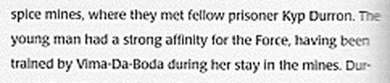
Our notes: `notes/materials/027-new-essential-chronology/08-part-eight-return-of-the-jedi-knights.md:15`

> Moruth Doole, a fat Rybet who had set himself up as Kessel's planetary governor, took Han and his Wooklee capilat prisoner. Doole sent his two captives to work in the spice mines, where they met fellow prisoner Kyp Durron. The ; young man had a strong affinity for the Force, having been trained by Vima-Da-Boda during her stay in the mines. Dur- ron helped the two escape from Kessel, under hot pursuit by Doole’s space navy.
>
> In a desperate move, their vessel plunged Into the navi- gational nightmare of the Maw black-hole cluster, where enormous gravity wells made a maze of hyperspace paths.
>
> Only Kyp’s intuitive use of the Force allowed them to reach the gravitational stability at the center—a site that housed Maw Installation, Grand Moff Tarkin’s secret weapons re- search facility.
>
> Only Kyp’s intuitive use of the Force allowed them to reach the gravitational stability at the center—a site that housed Maw Installation, Grand Moff Tarkin’s secret weapons re- search facility. The skeleton of the Empire's prototype Dest Luke Skywalker and several members of his starting clsss a8 the Yavin 4 Jedi acadeeny, (rer vv towns Lis Coweneed === PDF p.173 === === PDF p.174 === Star still orbited the asteroid laboratories, guarded by four Imperial Star Destroyers under the command of Tarkin’s for- mer lover, Admiral Daala.
>
> Han Solo and his companions found themselves cap- tured again, this time by an Imperial commander who had no inkling that the war was over and the Emperor dead.
— Source: Part Eight: The Return of the Jedi Knights; Kyp Durron — Kyp navigates the Maw. POV: speaker not named in our notes.
(Excerpt widened 2026-11-17 to the relevant passage, word for word from research primary new essential chronology nec paged (text copy `research_primary_new_essential_chronology_nec_paged_txt_88b808b5bc`).)
(Excerpt widened 2026-11-17 to the relevant passage, word for word from research primary new essential chronology nec paged (text copy `research_primary_new_essential_chronology_nec_paged_txt_88b808b5bc`).)
(Full sentence/passage taken from the source text on file: `research_primary_new_essential_chronology_nec_paged_txt`.)
Note (our notes, around the quote): Kyp Durron — Kyp navigates the Maw: "Only Kyp's intuitive use of the Force allowed them to reach the gravitational stability at the center" Source: The New Essential Chronology, p.162
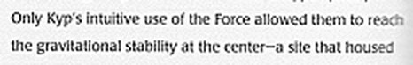
Our notes: `notes/materials/027-new-essential-chronology/08-part-eight-return-of-the-jedi-knights.md:17`

> Kyp Durron proved to be a phenomenal student who rapidly surpassed the other trainees.
— Source: Part Eight: The Return of the Jedi Knights; Kyp Durron; Exar Kun — Kyp surpasses the others. POV: speaker not named in our notes.
Note (our notes, around the quote): Kyp Durron; Exar Kun — Kyp surpasses the others: "Kyp Durron proved to be a phenomenal student who rapidly surpassed the other trainees." Source: The New Essential Chronology, p.164
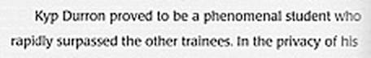
Our notes: `notes/materials/027-new-essential-chronology/08-part-eight-return-of-the-jedi-knights.md:37`

> Restricted to his ethereal form, Kun increased Kyp's hatred of the Empire, brainwashing him to believe that he was the best hope for the salvation of the New Republic.
— Source: Part Eight: The Return of the Jedi Knights; Exar Kun; Kyp Durron — Exar Kun's manipulation. POV: speaker not named in our notes.
Note (our notes, around the quote): Exar Kun; Kyp Durron — Exar Kun's manipulation: "Restricted to his ethereal form, Kun increased Kyp's hatred of the Empire, brainwashing him to believe that he was the best hope for the salvation of the New Republic." Source: The New Essential Chronology, p.164
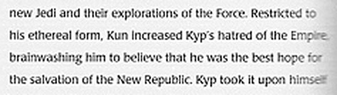
Our notes: `notes/materials/027-new-essential-chronology/08-part-eight-return-of-the-jedi-knights.md:39`

> But Kyp Durron tracked down Xux on Ithor, using his newfound dark side powers to wipe clean the weapons knowledge from her memory.
— Source: Part Eight: The Return of the Jedi Knights; Kyp Durron — Kyp wipes Qwi's memory. POV: speaker not named in our notes.
Note (our notes, around the quote): Kyp Durron — Kyp wipes Qwi's memory: "But Kyp Durron tracked down Xux on Ithor, using his newfound dark side powers to wipe clean the weapons knowledge from her memory." Source: The New Essential Chronology, p.165
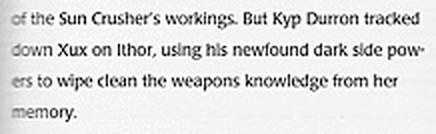
Our notes: `notes/materials/027-new-essential-chronology/08-part-eight-return-of-the-jedi-knights.md:46`

> Kyp took it upon himset to wipe out Admiral Daala’s renegade fleet. Still manipulates by Exar Kun, Durron stole a ship and flew off alone.
>
> The New Republic Senate had agreed to destroy the Sam === PDF p.175 === Crusher superweapon that they had recovered from Mew Installation, Their plan called for someone to de- posit the quantumarmored ship in the high-pressure heart of the gas giant Yavin. Wedge Antilles and Qui Xux sent the Sun Crusher into the swirling maelstrom, eaving Qui as the only person alive with knowledge of the Sun Crusher’s workings. But Kyp Durron tracked sown Xux on Ithor, using his newfound dark side pow: ers to wipe clean the weapons knowledge from her memory.
>
> Now set on his course of action, Kyp returned to Yavin 4. Standing alone atop the academy's Great Temple, he summoned the Sun Crusher from the mists of Yavin.
>
> Now set on his course of action, Kyp returned to Yavin 4. Standing alone atop the academy's Great Temple, he summoned the Sun Crusher from the mists of Yavin. Luke Skywalker confronted him in a titanic duel of Jedi powers, but the spirit of Exar Kun joined with Kyp to overwhelm Master Skywalker, leaving him for dead. The Jedi students found thelr Master's mo- Sonless body, showing no breathing, no heartbeat, and no response.
>
> Luke Skywalker confronted him in a titanic duel of Jedi powers, but the spirit of Exar Kun joined with Kyp to overwhelm Master Skywalker, leaving him for dead. The Jedi students found thelr Master's mo- Sonless body, showing no breathing, no heartbeat, and no response.
>
> Fleeing the scene, Kyp Durron piloted the Sun Crusher to the Cauldron Nebula, where Admiral Daala’s feet had hidden inside an ocean of coalescing gas. when Kyp triggered the supenweapon, a cluster of stars went supemova, obliterating the third ship from Daala’s original quartet of Star Destroyers. Kyp then reached Carida, the stormtrooper training center represented by Ambassador Furgan, Kyp issued an ultimatum: renounce the Empire or face complete destruction. When the planetary defenses mobilized instead of capitulating, Ourron fired at Carida’s sun, starting a chain reaction.
— Source: Part Eight: The Return of the Jedi Knights. POV: speaker not named in our notes.
(Excerpt widened 2026-11-17 to the relevant passage, word for word from research primary new essential chronology nec paged (text copy `research_primary_new_essential_chronology_nec_paged_txt_88b808b5bc`).)
(Excerpt widened 2026-11-17 to the relevant passage, word for word from research primary new essential chronology nec paged (text copy `research_primary_new_essential_chronology_nec_paged_txt_88b808b5bc`).)
Note (our notes, around the quote): Kyp Durron; Exar Kun; Luke Skywalker; Sun Crusher — Great Temple duel: "Standing alone atop the academy's Great Temple, he summoned the Sun Crusher from the mists of Yavin. Luke Skywalker confronted him in a titanic duel of Jedi powers, but the spirit of Exar Kun joined with Kyp to overwhelm Master Skywalker, leaving him for dead." Source: The New Essential Chronology, p.165
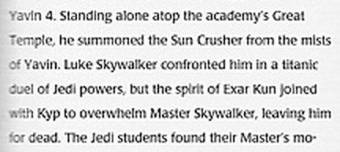
Our notes: `notes/materials/027-new-essential-chronology/08-part-eight-return-of-the-jedi-knights.md:48`

> When the planetary defenses mobilized instead of capitulating, Durron fired at Carida's sun, starting a chain reaction. The sun exploded, and its shock wave wiped out every living thing in the system.
— Source: Part Eight: The Return of the Jedi Knights; Kyp Durron; Sun Crusher — Carida destroyed. POV: speaker not named in our notes.
Note (our notes, around the quote): Kyp Durron; Sun Crusher — Carida destroyed: "When the planetary defenses mobilized instead of capitulating, Durron fired at Carida's sun, starting a chain reaction. The sun exploded, and its shock wave wiped out every living thing in the system." Source: The New Essential Chronology, p.165
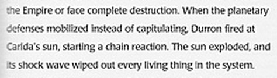
Our notes: `notes/materials/027-new-essential-chronology/08-part-eight-return-of-the-jedi-knights.md:50`

> You have the blood of billions on your hands, Jedi Knight, but I am not the one to judge you. Go to Yavin Four. Let the Jedi Master decide your punishment.
— Source: Part Eight: The Return of the Jedi Knights; Kyp Durron — Mon Mothma's verdict. POV: speaker not named in our notes.
Note (our notes, around the quote): Kyp Durron — Mon Mothma's verdict: ""You have the blood of billions on your hands, Jedi Knight, but I am not the one to judge you. Go to Yavin Four. Let the Jedi Master decide your punishment."" Source: The New Essential Chronology, p.166
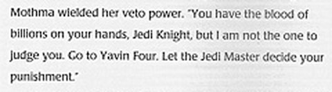
Our notes: `notes/materials/027-new-essential-chronology/08-part-eight-return-of-the-jedi-knights.md:61`

> The Sun Crusher and the Death Star both plunged into the event horizon of a black hole, and both craft fell to their doom—though Kyp escaped the gravitational pull inside a tiny message pod.
— Source: Part Eight: The Return of the Jedi Knights; Kyp Durron; Sun Crusher — Sun Crusher destroyed. POV: speaker not named in our notes.
Note (our notes, around the quote): Kyp Durron; Sun Crusher — Sun Crusher destroyed: "The Sun Crusher and the Death Star both plunged into the event horizon of a black hole, and both craft fell to their doom—though Kyp escaped the gravitational pull inside a tiny message pod." Source: The New Essential Chronology, p.166
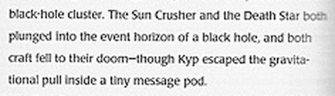
Our notes: `notes/materials/027-new-essential-chronology/08-part-eight-return-of-the-jedi-knights.md:65`

> On his first official mission, Dorsk 82 teamed with Kyp Durron to investigate the mining planet Corbos. They ran across two monstrous Leviathans, still alive after the devastation of Corbos during the Hundred-Year Darkness, and freed dozens of trapped spirits.
— Source: Part Eight: The Return of the Jedi Knights; Kyp Durron — Kyp and Dorsk 82 at Corbos. POV: speaker not named in our notes.
Note (our notes, around the quote): Kyp Durron — Kyp and Dorsk 82 at Corbos: "On his first official mission, Dorsk 82 teamed with Kyp Durron to investigate the mining planet Corbos. They ran across two monstrous Leviathans, still alive after the devastation of Corbos during the Hundred-Year Darkness, and freed dozens of trapped spirits." Source: The New Essential Chronology, p.173
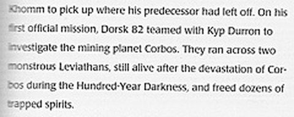
Our notes: `notes/materials/027-new-essential-chronology/08-part-eight-return-of-the-jedi-knights.md:122`

> Other, more proactive Jedi Knights followed the lead of Kyp Durron and found new targets for their aggression. ... Jaina Solo found herself increasingly attracted to Kyp's aggressive faction; Anakin Solo remained loyal to his Uncle Luke. Jacen Solo found himself wondering if he could follow the Force without having to pick sides.
> [fragment — full passage not on file]
— Source: Part Twelve: The New Jedi Order; Kyp Durron; Jaina Solo; Anakin Solo; Jacen Solo — Jedi factions.
Note (our notes, around the quote): Kyp Durron; Jaina Solo; Anakin Solo; Jacen Solo — Jedi factions: "Other, more proactive Jedi Knights followed the lead of Kyp Durron and found new targets for their aggression. ... Jaina Solo found herself increasingly attracted to Kyp's aggressive faction; Anakin Solo remained loyal to his Uncle Luke. Jacen Solo found himself wondering if he could follow the Force without having to pick sides." Source: The New Essential Chronology, p.203
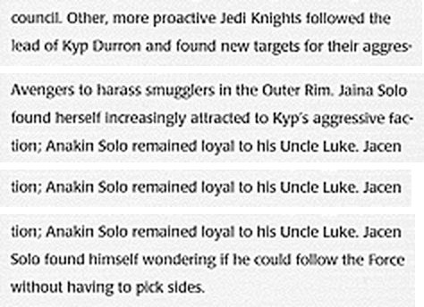
Our notes: `notes/materials/027-new-essential-chronology/12-part-twelve-new-jedi-order.md:11`

> The Yuuzhan Vong's acid-secreting grutchin insects made short work of both groups. Only Kyp Durron escaped.
— Source: Part Twelve: The New Jedi Order; Kyp Durron — Kyp escapes Helska.
Note (our notes, around the quote): Kyp Durron — Kyp escapes Helska: "The Yuuzhan Vong's acid-secreting grutchin insects made short work of both groups. Only Kyp Durron escaped." Source: The New Essential Chronology, p.204
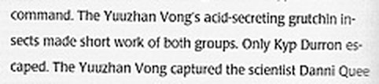
Our notes: `notes/materials/027-new-essential-chronology/12-part-twelve-new-jedi-order.md:22`

> Durron, who knew that the Yuuzhan Vong were building a new worldship from the broken fragments of Sernpidal, deceived Jaina into believing that the construction site housed a new Yuuzhan Vong superweapon. The Jedi squadron attacked and destroyed the worldship, killing thousands of enemy noncombatants.
— Source: Part Twelve: The New Jedi Order; Kyp Durron; Jaina Solo — Kyp deceives Jaina.
Note (our notes, around the quote): Kyp Durron; Jaina Solo — Kyp deceives Jaina: "Durron, who knew that the Yuuzhan Vong were building a new worldship from the broken fragments of Sernpidal, deceived Jaina into believing that the construction site housed a new Yuuzhan Vong superweapon. The Jedi squadron attacked and destroyed the worldship, killing thousands of enemy noncombatants." Source: The New Essential Chronology, p.213
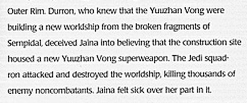
Our notes: `notes/materials/027-new-essential-chronology/12-part-twelve-new-jedi-order.md:101`

> Those with seats on the new council included Skywalker, Kyp Durron, and the Barabel Saba Sebatyne
> [fragment — full passage not on file]
— Source: Part Twelve: The New Jedi Order; Luke Skywalker; Kyp Durron — new Jedi Council.
Note (our notes, around the quote): Luke Skywalker; Kyp Durron — new Jedi Council: "Those with seats on the new council included Skywalker, Kyp Durron, and the Barabel Saba Sebatyne" Source: The New Essential Chronology, p.221
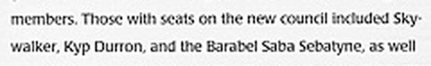
Our notes: `notes/materials/027-new-essential-chronology/12-part-twelve-new-jedi-order.md:177`

## Star Wars Saga Edition: Jedi Academy Training Manual (WotC, 2009): power-scaling and lore notes

- Note (summary from our notes, not a quotation): Not in this book: Kyp Durron, Gantoris, Streen, Kam Solusar, Admiral Daala, the Sun Crusher and Tionne are not named anywhere in it (both OCR passes searched, fuzzy matching).
  — Source: Front matter and Introduction.
Our notes: `notes/materials/028-jedi-academy-training-manual/00-front-matter-introduction.md:6`; `notes/materials/028-jedi-academy-training-manual/01-ch1-power-of-the-force.md:6`; `notes/materials/028-jedi-academy-training-manual/02-ch2-philosophy.md:6`; `notes/materials/028-jedi-academy-training-manual/03-ch3-equipment-and-artifacts.md:6`; `notes/materials/028-jedi-academy-training-manual/04-ch4-affiliated-programs.md:6`; `notes/materials/028-jedi-academy-training-manual/05-ch5-instructors-and-alumni.md:6`; `notes/materials/028-jedi-academy-training-manual/06-ch6-dangers-of-study.md:6`; `notes/materials/028-jedi-academy-training-manual/07-ch7-studying-abroad-back-cover.md:6`

## The Jedi Academy Sourcebook (WEG, 1996): power-scaling and lore notes

> When the Sith-maddened young man begins his one-man crusade against the Empire with the Sun Crusher, Han successfully uses his bond with him to bring Kyp back from the edge of the abyss. m Han Solo Type: Smuggler DEXTERITY 3D+1 Blaster 8D+2, blaster: blaster rifle 5D+1, blaster: heavy blaster pistol L0D+1, blaster artillery 6D+1, brawling parry 8D, dodge 8D+2, dodge: energy weapons 9D+2, grenade 6D+1, melee combat 6D+1, melee parry 5D+1. missile weapons 6D-1, pick pocket 5D+2, running 5D+2, thrown weapons 5D-+1, vehicle blasters 6D-1 KNOWLEDGE 2D Alien species 7D, bureaucracy 7D, business 6D, busi- ness; smugglers 7D+2, cultures 6D-1, intimidation 8D, (BREE G, languages 6D, law enforcement 6D, planetary systems 8D, streetwise 9D, streetwise: Jabba the Hutt's organiza- tion L0D+1, survival 8D, value 6D, willpower 6D+2 MECHANICAL 3D+2 Astrogation 9D, beast riding 5D+2, beast riding: Tauntaun 6D, capital ship gunnery 6D-+2, capital ship piloting 8D-2, capital ship shields 6D+2, communications 5D-2, ground vehicle operation 5D+2, repulsorlift operation 8D.
— Source: Chapter One: The New Republic.
(Excerpt widened 2026-11-17 to the relevant passage, word for word from research primary jedi academy sourcebook jas clean, Chapter One (text copy `research_primary_jedi_academy_sourcebook_jas_clean_txt_04b8ab0d44`).)
Note (our notes, around the quote): Han Solo; Kyp Durron; Sun Crusher — Han Solo — bringing Kyp back: "When the Sith-maddened young man begins his one-man crusade against the Empire with the Sun Crusher, Han successfully uses his bond with him to bring Kyp back from the edge of the abyss." Source: The Jedi Academy Sourcebook, p.11
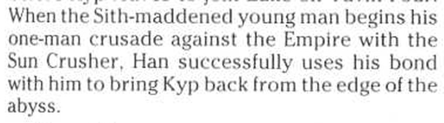
Our notes: `notes/materials/029-jedi-academy-sourcebook/01-ch1-the-new-republic.md:47`

> When he travels to Kessel as a representative of the New Republic, he runs afoul of one of these old acquaintances, an amphibian named Moruth Doole. Doole once betrayed Han to the Imperials, which forced Han to dump an entire shipment of spice, and subsequently led to his falling out with Jabba the Hutt. Doole, who has his own reasons not to love Han, imprisons Solo and Chewbacca in the spice mines of Kessel, While in the mines, Han encounters a young man named Kyp Durron. As Roa took Han under his wing, Han in turn befriends Kyp and forges.a mentor-like bond with the young man. He is determined to see that Kyp gets a taste of the life that has been denied him up until now, and the two spend a lot of time together on Coruscant before Kyp leaves to join Luke on Yavin Four.
— Source: Chapter One: The New Republic; Han Solo; Kyp Durron — Han Solo — meeting Kyp on Kessel.
(Excerpt widened 2026-11-17 to the relevant passage, word for word from research primary jedi academy sourcebook jas clean (text copy `research_primary_jedi_academy_sourcebook_jas_clean_txt_04b8ab0d44`).)
(Excerpt widened 2026-11-17 to the relevant passage, word for word from research primary jedi academy sourcebook jas clean (text copy `research_primary_jedi_academy_sourcebook_jas_clean_txt_04b8ab0d44`).)
Note (our notes, around the quote): Han Solo; Kyp Durron — Han Solo — meeting Kyp on Kessel: "While in the mines, Han encounters a young man named Kyp Durron. As Roa took Han under his wing, Han in turn befriends Kyp and forges a mentor-like bond with the young man." Source: The Jedi Academy Sourcebook, p.11
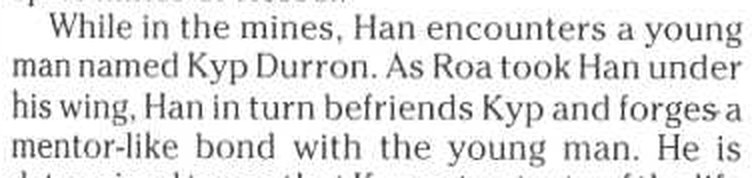
Our notes: `notes/materials/029-jedi-academy-sourcebook/01-ch1-the-new-republic.md:49`

> Small wonder, then, that he decided that a quiet week or so in the relatively sedate environs of the Imperial database center would do him some good. At Luke's behest, he combs the Imperial databases in search of potential candidates for Luke’s Jedi academy, while Luke goes on to check a few leads of his own.
>
> He and Threepio accompany Lando ona trip to Umgul to check on one lead that he turns up, The lead turned out to be a dead end, but Artoo does help Lando land a million credit reward, for which Lando is no doubt grateful.
>
> When Luke returns from his journeys, Artoo resumes his duties of keeping a watchful eye on his master. He accompanies Luke and Lando to Kessel, and guards Luke's defenseless body on Yavin Four after Kyp places him in a Sith coma.
>
> === sp15 Chapter One: The New Re | Ls Chapter One: The New Repub TAR A Change of Command “The Admiral will see you now.”
>
> When Luke returns from his journeys, Artoo resumes his duties of keeping a watchful eye on his master. He accompanies Luke and Lando to Kessel, and guards Luke's defenseless body on Yavin Four after Kyp places him in a Sith coma.
>
> === sp15 Chapter One: The New Re | Ls Chapter One: The New Repub TAR A Change of Command “The Admiral will see you now.”
>
> Wedge nodded to the young ensign. She looked tired. He looked around the central corridor of the Headquarters Frigate. Every- one looked tired.
— Source: Chapter One: The New Republic; Luke Skywalker; Kyp Durron — Artoo-Detoo — guarding Luke.
(Excerpt widened 2026-11-17 to the relevant passage, word for word from research primary jedi academy sourcebook jas clean (text copy `research_primary_jedi_academy_sourcebook_jas_clean_txt_04b8ab0d44`).)
(Excerpt widened 2026-11-17 to the relevant passage, word for word from research primary jedi academy sourcebook jas clean (text copy `research_primary_jedi_academy_sourcebook_jas_clean_txt_04b8ab0d44`).)
Note (our notes, around the quote): Luke Skywalker; Kyp Durron — Artoo-Detoo — guarding Luke: "He accompanies Luke and Lando to Kessel, and guards Luke's defenseless body on Yavin Four after Kyp places him in a Sith coma." Source: The Jedi Academy Sourcebook, p.13
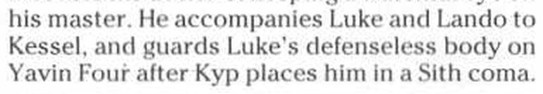
Our notes: `notes/materials/029-jedi-academy-sourcebook/01-ch1-the-new-republic.md:67`

> Together, they join the disaster relief crews on Vortex, and work to help the Vors clear away the ruins of their Cathedral of Winds.
>
> For a long while, Wedge holds himself re- sponsible for Qwi's memory loss. If she had had areal professional rather than a lovesick fighter pilot for a bodyguard, she wouldn't have fallen prey to Kyp. Only later can he accept Luke's gentle argument that if he, a Jedi Master, could not stand up to Kyp's Sith-augmented powers, Wedge could not be expected to do so when Kyp came for Qwi Xux.
>
> The emergence of Admiral Daala’s forces ends Wedge’s period of introspection and personal exploration.
— Source: Chapter One: The New Republic.
(Excerpt widened 2026-11-17 to the relevant passage, word for word from research primary jedi academy sourcebook jas clean (text copy `research_primary_jedi_academy_sourcebook_jas_clean_txt_04b8ab0d44`).)
(Excerpt widened 2026-11-17 to the relevant passage, word for word from research primary jedi academy sourcebook jas clean (text copy `research_primary_jedi_academy_sourcebook_jas_clean_txt_04b8ab0d44`).)
Note (our notes, around the quote): Kyp Durron; Luke Skywalker; Qwi Xux — General Wedge Antilles — Kyp and Qwi Xux: "Only later can he accept Luke's gentle argument that if he, a Jedi Master, could not stand up to Kyp's Sith-augmented powers, Wedge could not be expected to do so when Kyp came for Qwi Xux." Source: The Jedi Academy Sourcebook, p.16
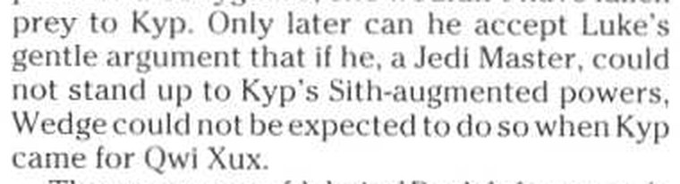
Our notes: `notes/materials/029-jedi-academy-sourcebook/01-ch1-the-new-republic.md:84`

- Note (summary from our notes, not a quotation): Luke Skywalker; Gantoris; Kyp Durron — The Dangers of Training Jedi — missed warning signs: "He misses the warning signs that Gantoris and Kyp, impatient with Luke's apparent reluctance to teach them the "true" Jedi secrets, are moving into dangerous orbits." Source: The Jedi Academy Sourcebook, p.32
  — Source: Chapter Three: The Jedi Academy.
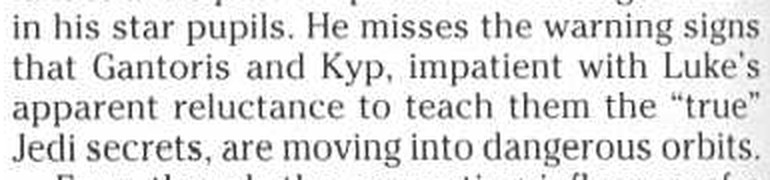
Our notes: `notes/materials/029-jedi-academy-sourcebook/03-ch3-the-jedi-academy.md:33`

> It seems that the more Jedi knowledge they acquire, the more volatile they become. Anger and ambition begin to domi- nate their actions — dangerous traits in a Jedi student.
>
> Ultimately, Luke comes to realize that there is an evil entity at work on Yavin Four, corrupt- ing his students with the dark teachings of the Sith religion and its promises of easy power. By the time Kyp returns to the Yavin moon to recover the Sun Crusher, Luke knows that some- thing has gone seriously wrong in the remote academy.
>
> By augmenting his power with that of Kun, Kyp places Luke in a deep coma from which even the best New Republic doctors cannot awaken him. Force probes by his students and Leia reveal only a great empty void within him.
>
> Until they can figure out what to do with him, they place Luke’s body on a raised dais in the grand audience chamber.
— Source: Chapter Three: The Jedi Academy; Kyp Durron; Exar Kun; Luke Skywalker — Luke Skywalker — the coma.
(Excerpt widened 2026-11-17 to the relevant passage, word for word from research primary jedi academy sourcebook jas clean (text copy `research_primary_jedi_academy_sourcebook_jas_clean_txt_04b8ab0d44`).)
(Excerpt widened 2026-11-17 to the relevant passage, word for word from research primary jedi academy sourcebook jas clean (text copy `research_primary_jedi_academy_sourcebook_jas_clean_txt_04b8ab0d44`).)
Note (our notes, around the quote): Kyp Durron; Exar Kun; Luke Skywalker — Luke Skywalker — the coma: "By augmenting his power with that of Kun, Kyp places Luke in a deep coma from which even the best New Republic doctors cannot awaken him." Source: The Jedi Academy Sourcebook, p.34
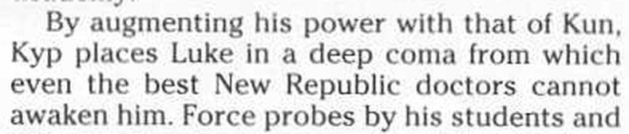
Our notes: `notes/materials/029-jedi-academy-sourcebook/03-ch3-the-jedi-academy.md:49`

> Luke forgives Kyp for his actions, and accepts him back as a student, but requires of him a penance —Kyp must cast the Sun Crusher into the Maw.
— Source: Chapter Three: The Jedi Academy; Luke Skywalker; Kyp Durron; Sun Crusher — Luke Skywalker — Kyp's penance.
Note (our notes, around the quote): Luke Skywalker; Kyp Durron; Sun Crusher — Luke Skywalker — Kyp's penance: "Luke forgives Kyp for his actions, and accepts him back as a student, but requires of him a penance —Kyp must cast the Sun Crusher into the Maw." Source: The Jedi Academy Sourcebook, p.34
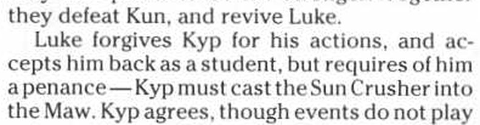
Our notes: `notes/materials/029-jedi-academy-sourcebook/03-ch3-the-jedi-academy.md:53`

> For eight years, Kyp labored in the darkness of the tun- nels, alone, surviving by coping with the rules and not calling attention to himself.
>
> Kyp’s life is forever changed by the arrival of two new prisoners, Han Solo and Chewbacca.
>
> Starved for news from the outside, and sensing that Han is not like most of the other men he has known, Kyp arranges to share a work shift with the two ex-smugglers. Han and Kyp find much to like in each other, and immediately hit it off.
>
> Kyp knows he has a talent for the Force, thanks to a provident encounter with a strange old woman named Vima-Da-Boda. He knows a few tricks thanks'to her, but yearns for someone to teach him how to truly manipulate the Force.
>
> === sp37 Han, recognizing his potential, resolves to take Kyp to Luke for training.
>
> After a few weeks on Coruscant (recuperat- ing from his ordeals with Han), Kyp travels to Yavin Four to join Luke's Jedi academy.
— Source: Chapter Three: The Jedi Academy; Kyp Durron — Kyp Durron — Vima-Da-Boda.
(Excerpt widened 2026-11-17 to the relevant passage, word for word from research primary jedi academy sourcebook jas clean (text copy `research_primary_jedi_academy_sourcebook_jas_clean_txt_04b8ab0d44`).)
(Excerpt widened 2026-11-17 to the relevant passage, word for word from research primary jedi academy sourcebook jas clean (text copy `research_primary_jedi_academy_sourcebook_jas_clean_txt_04b8ab0d44`).)
Note (our notes, around the quote): Kyp Durron — Kyp Durron — Vima-Da-Boda: "Kyp knows he has a talent for the Force, thanks to a provident encounter with a strange old woman named Vima-Da-Boda." Source: The Jedi Academy Sourcebook, p.35
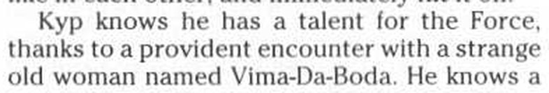
Our notes: `notes/materials/029-jedi-academy-sourcebook/03-ch3-the-jedi-academy.md:80`

> Starved for news from the outside, and sensing that Han is not like most of the other men he has known, Kyp arranges to share a work shift with the two ex-smugglers. Han and Kyp find much to like in each other, and immediately hit it off.
>
> Kyp knows he has a talent for the Force, thanks to a provident encounter with a strange old woman named Vima-Da-Boda. He knows a few tricks thanks'to her, but yearns for someone to teach him how to truly manipulate the Force.
>
> === sp37 Han, recognizing his potential, resolves to take Kyp to Luke for training.
>
> After a few weeks on Coruscant (recuperat- ing from his ordeals with Han), Kyp travels to Yavin Four to join Luke's Jedi academy. There, he immerses himself in work, and within days has surpassed the achievements of the other Jedi students.
>
> After a few weeks on Coruscant (recuperat- ing from his ordeals with Han), Kyp travels to Yavin Four to join Luke's Jedi academy. There, he immerses himself in work, and within days has surpassed the achievements of the other Jedi students. He doesn’t socialize with the others, preferring to concentrate on honing his Jecli skills.
>
> He is only there a week when Exar Kun ap- pears before him, and offers to teach him secret knowledge that Luke Skywalker knows nothing about.
— Source: Chapter Three: The Jedi Academy; Kyp Durron — Kyp Durron — at the academy.
(Excerpt widened 2026-11-17 to the relevant passage, word for word from research primary jedi academy sourcebook jas clean (text copy `research_primary_jedi_academy_sourcebook_jas_clean_txt_04b8ab0d44`).)
(Excerpt widened 2026-11-17 to the relevant passage, word for word from research primary jedi academy sourcebook jas clean (text copy `research_primary_jedi_academy_sourcebook_jas_clean_txt_04b8ab0d44`).)
Note (our notes, around the quote): Kyp Durron — Kyp Durron — at the academy: "There, he immerses himself in work, and within days has surpassed the achievements of the other Jedi students." Source: The Jedi Academy Sourcebook, p.36
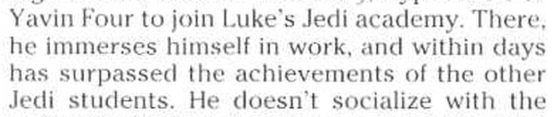
Our notes: `notes/materials/029-jedi-academy-sourcebook/03-ch3-the-jedi-academy.md:87`

> Kyp believes that the powers of the Sith, as revealed by Exar Kun, is the source of a greater power.
— Source: Chapter Three: The Jedi Academy.
Note (our notes, around the quote): Kyp Durron; Exar Kun — Kyp Durron — the Sith as a greater power: "Kyp believes that the powers of the Sith, as revealed by Exar Kun, is the source of a greater power." Source: The Jedi Academy Sourcebook, p.36
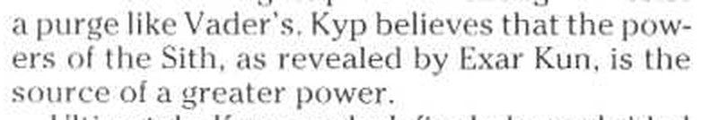
Our notes: `notes/materials/029-jedi-academy-sourcebook/03-ch3-the-jedi-academy.md:89`

> In his pride, Kyp believes that he has the strength of character to walk the path of the dark side and not be touched by it; that he can use the power of the dark side for the benefit of the New Republic.
>
> As his tutorials with Exar Kun advance, his respect for Luke decreases. He feels that Luke's emphasis on the model of the ancient Jedi order is erroneous — the Jedi Knights, for all their power, still fell victim to Palpatine and Vader. In Kyp’s view, Luke refuses to learn from that failure. To bring the new Jedi Knights to greater power, he should recognize new abilities, to make his Jedi Knights powerful enough to resist a purge like Vader's, Kyp believes that the pow- ers of the Sith, as revealed by Exar Kun, is the source of a greater power.
>
> Ultimately, Kyp openly defies Luke, and aided by Exar Kun's power, places the Jedi Master in a deep trance. He steals the Sun Crusher, which had been cast into the heart of the Yavin gas giant.
>
> Armed with the dread superweapon, Kyp begins a rampage of destruction aimed at crip- pling the remaining Imperial forces. He destroys one of Daala’s Star Destroyers, destroys Carida in a failed attempt to rescue his brother, and goes on to destroy a major Imperial depot in a peripheral Imperial Core system.
— Source: Chapter Three: The Jedi Academy.
(Excerpt widened 2026-11-17 to the relevant passage, word for word from research primary jedi academy sourcebook jas clean (text copy `research_primary_jedi_academy_sourcebook_jas_clean_txt_04b8ab0d44`).)
(Excerpt widened 2026-11-17 to the relevant passage, word for word from research primary jedi academy sourcebook jas clean (text copy `research_primary_jedi_academy_sourcebook_jas_clean_txt_04b8ab0d44`).)
Note (our notes, around the quote): Kyp Durron; Exar Kun; Luke Skywalker; Sun Crusher — Kyp Durron — defying Luke: "Ultimately, Kyp openly defies Luke, and aided by Exar Kun's power, places the Jedi Master in a deep trance. He steals the Sun Crusher, which had been cast into the heart of the Yavin gas giant." Source: The Jedi Academy Sourcebook, p.36
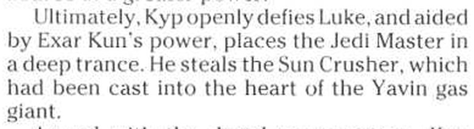
Our notes: `notes/materials/029-jedi-academy-sourcebook/03-ch3-the-jedi-academy.md:91`

> In Kyp’s view, Luke refuses to learn from that failure. To bring the new Jedi Knights to greater power, he should recognize new abilities, to make his Jedi Knights powerful enough to resist a purge like Vader's, Kyp believes that the pow- ers of the Sith, as revealed by Exar Kun, is the source of a greater power.
>
> Ultimately, Kyp openly defies Luke, and aided by Exar Kun's power, places the Jedi Master in a deep trance. He steals the Sun Crusher, which had been cast into the heart of the Yavin gas giant.
>
> Armed with the dread superweapon, Kyp begins a rampage of destruction aimed at crip- pling the remaining Imperial forces. He destroys one of Daala’s Star Destroyers, destroys Carida in a failed attempt to rescue his brother, and goes on to destroy a major Imperial depot in a peripheral Imperial Core system.
>
> Armed with the dread superweapon, Kyp begins a rampage of destruction aimed at crip- pling the remaining Imperial forces. He destroys one of Daala’s Star Destroyers, destroys Carida in a failed attempt to rescue his brother, and goes on to destroy a major Imperial depot in a peripheral Imperial Core system. Along the way, he stops by Ithor to wipe Qwi Xux’s memory of the Sun Crusher and all knowledge she used to invent it. Only the death of Exar Kun breaks the spell that holds Kyp in thrall to the shade of the ancient Sith Lord.
— Source: Chapter Three: The Jedi Academy.
(Excerpt widened 2026-11-17 to the relevant passage, word for word from research primary jedi academy sourcebook jas clean (text copy `research_primary_jedi_academy_sourcebook_jas_clean_txt_04b8ab0d44`).)
(Excerpt widened 2026-11-17 to the relevant passage, word for word from research primary jedi academy sourcebook jas clean (text copy `research_primary_jedi_academy_sourcebook_jas_clean_txt_04b8ab0d44`).)
Note (our notes, around the quote): Kyp Durron; Sun Crusher; Admiral Daala — Kyp Durron — the Sun Crusher rampage: "He destroys one of Daala's Star Destroyers, destroys Carida in a failed attempt to rescue his brother, and goes on to destroy a major Imperial depot in a peripheral Imperial Core system." Source: The Jedi Academy Sourcebook, p.36
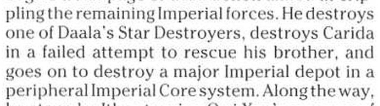
Our notes: `notes/materials/029-jedi-academy-sourcebook/03-ch3-the-jedi-academy.md:93`

> In Kyp’s view, Luke refuses to learn from that failure. To bring the new Jedi Knights to greater power, he should recognize new abilities, to make his Jedi Knights powerful enough to resist a purge like Vader's, Kyp believes that the pow- ers of the Sith, as revealed by Exar Kun, is the source of a greater power.
>
> Ultimately, Kyp openly defies Luke, and aided by Exar Kun's power, places the Jedi Master in a deep trance. He steals the Sun Crusher, which had been cast into the heart of the Yavin gas giant.
>
> Armed with the dread superweapon, Kyp begins a rampage of destruction aimed at crip- pling the remaining Imperial forces. He destroys one of Daala’s Star Destroyers, destroys Carida in a failed attempt to rescue his brother, and goes on to destroy a major Imperial depot in a peripheral Imperial Core system.
>
> Armed with the dread superweapon, Kyp begins a rampage of destruction aimed at crip- pling the remaining Imperial forces. He destroys one of Daala’s Star Destroyers, destroys Carida in a failed attempt to rescue his brother, and goes on to destroy a major Imperial depot in a peripheral Imperial Core system. Along the way, he stops by Ithor to wipe Qwi Xux’s memory of the Sun Crusher and all knowledge she used to invent it. Only the death of Exar Kun breaks the spell that holds Kyp in thrall to the shade of the ancient Sith Lord.
>
> Along the way, he stops by Ithor to wipe Qwi Xux’s memory of the Sun Crusher and all knowledge she used to invent it. Only the death of Exar Kun breaks the spell that holds Kyp in thrall to the shade of the ancient Sith Lord.
>
> After facing the High Council, Kyp must face Luke. Luke tells him that he has been tested by his journey into the dark side, and may have emerged a stronger Jedi for it. For the first time realizing the awesome responsibility of being a Jedi, Kyp fears the possibility he may again use his powers for evil.
— Source: Chapter Three: The Jedi Academy.
(Excerpt widened 2026-11-17 to the relevant passage, word for word from research primary jedi academy sourcebook jas clean (text copy `research_primary_jedi_academy_sourcebook_jas_clean_txt_04b8ab0d44`).)
(Excerpt widened 2026-11-17 to the relevant passage, word for word from research primary jedi academy sourcebook jas clean (text copy `research_primary_jedi_academy_sourcebook_jas_clean_txt_04b8ab0d44`).)
Note (our notes, around the quote): Kyp Durron; Qwi Xux; Sun Crusher — Kyp Durron — Qwi Xux's memory: "Along the way, he stops by Ithor to wipe Qwi Xux's memory of the Sun Crusher and all knowledge she used to invent it." Source: The Jedi Academy Sourcebook, p.36
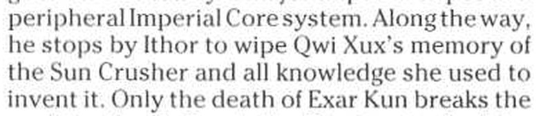
Our notes: `notes/materials/029-jedi-academy-sourcebook/03-ch3-the-jedi-academy.md:95`

> Ultimately, Kyp openly defies Luke, and aided by Exar Kun's power, places the Jedi Master in a deep trance. He steals the Sun Crusher, which had been cast into the heart of the Yavin gas giant.
>
> Armed with the dread superweapon, Kyp begins a rampage of destruction aimed at crip- pling the remaining Imperial forces. He destroys one of Daala’s Star Destroyers, destroys Carida in a failed attempt to rescue his brother, and goes on to destroy a major Imperial depot in a peripheral Imperial Core system. Along the way, he stops by Ithor to wipe Qwi Xux’s memory of the Sun Crusher and all knowledge she used to invent it. Only the death of Exar Kun breaks the spell that holds Kyp in thrall to the shade of the ancient Sith Lord.
>
> After facing the High Council, Kyp must face Luke. Luke tells him that he has been tested by his journey into the dark side, and may have emerged a stronger Jedi for it.
— Source: Chapter Three: The Jedi Academy; Kyp Durron; Exar Kun — Kyp Durron — freed by Kun's death.
(Excerpt widened 2026-11-17 to the relevant passage, word for word from research primary jedi academy sourcebook jas clean (text copy `research_primary_jedi_academy_sourcebook_jas_clean_txt_04b8ab0d44`).)
(Excerpt widened 2026-11-17 to the relevant passage, word for word from research primary jedi academy sourcebook jas clean (text copy `research_primary_jedi_academy_sourcebook_jas_clean_txt_04b8ab0d44`).)
Note (our notes, around the quote): Kyp Durron; Exar Kun — Kyp Durron — freed by Kun's death: "Only the death of Exar Kun breaks the spell that holds Kyp in thrall to the shade of the ancient Sith Lord." Source: The Jedi Academy Sourcebook, p.36
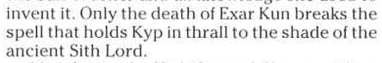
Our notes: `notes/materials/029-jedi-academy-sourcebook/03-ch3-the-jedi-academy.md:97`

> He steals the Sun Crusher, which had been cast into the heart of the Yavin gas giant.
>
> Armed with the dread superweapon, Kyp begins a rampage of destruction aimed at crip- pling the remaining Imperial forces. He destroys one of Daala’s Star Destroyers, destroys Carida in a failed attempt to rescue his brother, and goes on to destroy a major Imperial depot in a peripheral Imperial Core system. Along the way, he stops by Ithor to wipe Qwi Xux’s memory of the Sun Crusher and all knowledge she used to invent it. Only the death of Exar Kun breaks the spell that holds Kyp in thrall to the shade of the ancient Sith Lord.
>
> After facing the High Council, Kyp must face Luke. Luke tells him that he has been tested by his journey into the dark side, and may have emerged a stronger Jedi for it.
>
> After facing the High Council, Kyp must face Luke. Luke tells him that he has been tested by his journey into the dark side, and may have emerged a stronger Jedi for it. For the first time realizing the awesome responsibility of being a Jedi, Kyp fears the possibility he may again use his powers for evil.
>
> As penance, Luke requires Kyp to face the dark side in Kun’s temple.
— Source: Chapter Three: The Jedi Academy.
(Excerpt widened 2026-11-17 to the relevant passage, word for word from research primary jedi academy sourcebook jas clean (text copy `research_primary_jedi_academy_sourcebook_jas_clean_txt_04b8ab0d44`).)
(Excerpt widened 2026-11-17 to the relevant passage, word for word from research primary jedi academy sourcebook jas clean (text copy `research_primary_jedi_academy_sourcebook_jas_clean_txt_04b8ab0d44`).)
Note (our notes, around the quote): Kyp Durron; Luke Skywalker — Kyp Durron — tested by the dark side: "Luke tells him that he has been tested by his journey into the dark side, and may have emerged a stronger Jedi for it." Source: The Jedi Academy Sourcebook, p.36
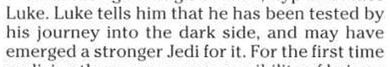
Our notes: `notes/materials/029-jedi-academy-sourcebook/03-ch3-the-jedi-academy.md:99`

> When he re-emerges from the temple, Luke welcomes him as a Jedi Knight.
— Source: Chapter Three: The Jedi Academy; Kyp Durron; Luke Skywalker — Kyp Durron — Jedi Knight.
Note (our notes, around the quote): Kyp Durron; Luke Skywalker — Kyp Durron — Jedi Knight: "When he re-emerges from the temple, Luke welcomes him as a Jedi Knight." Source: The Jedi Academy Sourcebook, p.36
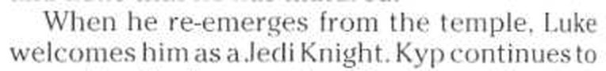
Our notes: `notes/materials/029-jedi-academy-sourcebook/03-ch3-the-jedi-academy.md:101`

> His ordeal is behind him, but Kyp’s brush with the clark side has taken its toll on him. His face and eyes look far older than his 18 years. mi Kyp Durron Type: Kessel Miner DEXTERITY 3D Blaster 3D+2, dodge 4D-+2, lightsaber 5D, melee parry 4D, pick pocket 4Di1, running 5D+1 KNOWLEDGE 2D Alien species 3D, bureaucracy: Kessel mining installa- tion 3D+2, intimidation 3D, languages 2D+2, survival 3D, survival: Kessel 4D-2, survival: Yavin Four 3D+2, value 3D+1, willpower 4) MECHANICAL 4D Astrogation 4D+1, repulsorlift operation 5D, space trans- ports 4D+2, starfighter piloting 4D+1, starfighter pilot- ing: Sun Crusher 4D+2, starship gunnery 41)+2, starship shields 4D+1 PERCEPTION 3D Bargain 4D, con 4D+1, hide 5D-1, persuasion 5D, search 4D, sneak 4D+1 STRENGTH 4D Brawling 4D-2, climbing/jumping 4D-+-1, lifting 4D-1, stamina dD+2 TECHNICAL 2D Blaster repair 2D+2, computer programming/repair 3D, first aid 2D+2, lightsaber repair 3D Special Abilities:
>
> Force Skills: Control 5D+2, sense 5D. alter 3D+2 These are only some of the powers that Kyp has demon- strated, His abilities were unnaturally augmented by Exar Kun.
— Source: Chapter Three: The Jedi Academy.
(Excerpt widened 2026-11-17 to the relevant passage, word for word from research primary jedi academy sourcebook jas clean (text copy `research_primary_jedi_academy_sourcebook_jas_clean_txt_04b8ab0d44`).)
(Excerpt widened 2026-11-17 to the relevant passage, word for word from research primary jedi academy sourcebook jas clean (text copy `research_primary_jedi_academy_sourcebook_jas_clean_txt_04b8ab0d44`).)
Note (our notes, around the quote): Kyp Durron — Kyp Durron — stat block, combat skills (RPG mechanics) — RPG mechanics (weaker source): "Blaster 3D+2, dodge 4D+2, lightsaber 5D, melee parry 4D," Source: The Jedi Academy Sourcebook, p.36, stat block
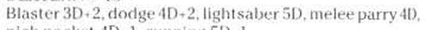
Our notes: `notes/materials/029-jedi-academy-sourcebook/03-ch3-the-jedi-academy.md:103`

> starfighter piloting 4D+1, starfighter piloting: Sun Crusher 4D+2,
> [fragment — full passage not on file]
— Source: Chapter Three: The Jedi Academy.
Note (our notes, around the quote): Kyp Durron; Sun Crusher — Kyp Durron — stat block, Sun Crusher piloting (RPG mechanics) — RPG mechanics (weaker source): "starfighter piloting 4D+1, starfighter piloting: Sun Crusher 4D+2," Source: The Jedi Academy Sourcebook, p.36, stat block
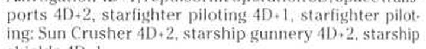
Our notes: `notes/materials/029-jedi-academy-sourcebook/03-ch3-the-jedi-academy.md:105`

> Force Skills: Control 5D+2, sense 5D, alter 3D+2 These are only some of the powers that Kyp has demonstrated. His abilities were unnaturally augmented by Exar Kun.
— Source: Chapter Three: The Jedi Academy.
Note (our notes, around the quote): Kyp Durron; Exar Kun — Kyp Durron — stat block, Force skills (RPG mechanics) — RPG mechanics (weaker source): "Force Skills: Control 5D+2, sense 5D, alter 3D+2 These are only some of the powers that Kyp has demonstrated. His abilities were unnaturally augmented by Exar Kun." Source: The Jedi Academy Sourcebook, p.36, stat block
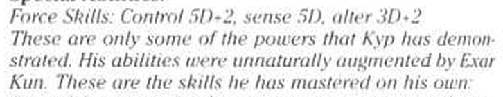
Our notes: `notes/materials/029-jedi-academy-sourcebook/03-ch3-the-jedi-academy.md:107`

> His face and eyes look far older than his 18 years. mi Kyp Durron Type: Kessel Miner DEXTERITY 3D Blaster 3D+2, dodge 4D-+2, lightsaber 5D, melee parry 4D, pick pocket 4Di1, running 5D+1 KNOWLEDGE 2D Alien species 3D, bureaucracy: Kessel mining installa- tion 3D+2, intimidation 3D, languages 2D+2, survival 3D, survival: Kessel 4D-2, survival: Yavin Four 3D+2, value 3D+1, willpower 4) MECHANICAL 4D Astrogation 4D+1, repulsorlift operation 5D, space trans- ports 4D+2, starfighter piloting 4D+1, starfighter pilot- ing: Sun Crusher 4D+2, starship gunnery 41)+2, starship shields 4D+1 PERCEPTION 3D Bargain 4D, con 4D+1, hide 5D-1, persuasion 5D, search 4D, sneak 4D+1 STRENGTH 4D Brawling 4D-2, climbing/jumping 4D-+-1, lifting 4D-1, stamina dD+2 TECHNICAL 2D Blaster repair 2D+2, computer programming/repair 3D, first aid 2D+2, lightsaber repair 3D Special Abilities:
>
> Force Skills: Control 5D+2, sense 5D. alter 3D+2 These are only some of the powers that Kyp has demon- strated, His abilities were unnaturally augmented by Exar Kun. These are the skills he has mastered on his own Control Accelerate healing, contort/escape, control pain, hibernation trance, rage**, receptive telepathy, reduce injury, remain conscious, remove fatigue Sense: Combat sense*, danver sense*, instinctive astrogation**”* life detection, lifesense, magnify senses, sense Force Alter’ Telekinesis Control and Alter: Aura of uneasiness, Force lightning"
>
> Control and Sense: Farseeing”, lightsaber combat, pro- jective telepathy Control, Sense and Alter’ Affect mind, control mind*, drain life energy, telekinetic kill* Sense and Alter; Dim other's senses* “Described in The Thrawn Trilogy Sourcebook **Described in the Dark Empire Sourcebook ***Described in GG 9 Fragments From The Rim This character is Force-sensitive Force Points: 2 Dark Side Points: 3 Character Points: 15 Move: 1() Equipment: Jedi robes, black cape, datapad, lightsaber (5D), blaster pistol (4D).
>
> The Jedi Academy Sourcebook === sp38 Streen Streen is an elderly man who spent many years as a reclusive gas prospector on Bespin.
— Source: Chapter Three: The Jedi Academy.
(Excerpt widened 2026-11-17 to the relevant passage, word for word from research primary jedi academy sourcebook jas clean (text copy `research_primary_jedi_academy_sourcebook_jas_clean_txt_04b8ab0d44`).)
(Excerpt widened 2026-11-17 to the relevant passage, word for word from research primary jedi academy sourcebook jas clean (text copy `research_primary_jedi_academy_sourcebook_jas_clean_txt_04b8ab0d44`).)
Note (our notes, around the quote): Kyp Durron — Kyp Durron — stat block, Force powers (RPG mechanics) — RPG mechanics (weaker source): "Control and Alter: Aura of uneasiness, Force lightning" Source: The Jedi Academy Sourcebook, p.36, stat block
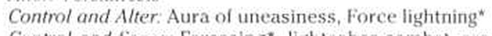
Our notes: `notes/materials/029-jedi-academy-sourcebook/03-ch3-the-jedi-academy.md:109`

> His face and eyes look far older than his 18 years. mi Kyp Durron Type: Kessel Miner DEXTERITY 3D Blaster 3D+2, dodge 4D-+2, lightsaber 5D, melee parry 4D, pick pocket 4Di1, running 5D+1 KNOWLEDGE 2D Alien species 3D, bureaucracy: Kessel mining installa- tion 3D+2, intimidation 3D, languages 2D+2, survival 3D, survival: Kessel 4D-2, survival: Yavin Four 3D+2, value 3D+1, willpower 4) MECHANICAL 4D Astrogation 4D+1, repulsorlift operation 5D, space trans- ports 4D+2, starfighter piloting 4D+1, starfighter pilot- ing: Sun Crusher 4D+2, starship gunnery 41)+2, starship shields 4D+1 PERCEPTION 3D Bargain 4D, con 4D+1, hide 5D-1, persuasion 5D, search 4D, sneak 4D+1 STRENGTH 4D Brawling 4D-2, climbing/jumping 4D-+-1, lifting 4D-1, stamina dD+2 TECHNICAL 2D Blaster repair 2D+2, computer programming/repair 3D, first aid 2D+2, lightsaber repair 3D Special Abilities:
>
> Force Skills: Control 5D+2, sense 5D. alter 3D+2 These are only some of the powers that Kyp has demon- strated, His abilities were unnaturally augmented by Exar Kun. These are the skills he has mastered on his own Control Accelerate healing, contort/escape, control pain, hibernation trance, rage**, receptive telepathy, reduce injury, remain conscious, remove fatigue Sense: Combat sense*, danver sense*, instinctive astrogation**”* life detection, lifesense, magnify senses, sense Force Alter’ Telekinesis Control and Alter: Aura of uneasiness, Force lightning"
>
> Control and Sense: Farseeing”, lightsaber combat, pro- jective telepathy Control, Sense and Alter’ Affect mind, control mind*, drain life energy, telekinetic kill* Sense and Alter; Dim other's senses* “Described in The Thrawn Trilogy Sourcebook **Described in the Dark Empire Sourcebook ***Described in GG 9 Fragments From The Rim This character is Force-sensitive Force Points: 2 Dark Side Points: 3 Character Points: 15 Move: 1() Equipment: Jedi robes, black cape, datapad, lightsaber (5D), blaster pistol (4D).
>
> The Jedi Academy Sourcebook === sp38 Streen Streen is an elderly man who spent many years as a reclusive gas prospector on Bespin.
— Source: Chapter Three: The Jedi Academy.
(Excerpt widened 2026-11-17 to the relevant passage, word for word from research primary jedi academy sourcebook jas clean (text copy `research_primary_jedi_academy_sourcebook_jas_clean_txt_04b8ab0d44`).)
(Excerpt widened 2026-11-17 to the relevant passage, word for word from research primary jedi academy sourcebook jas clean (text copy `research_primary_jedi_academy_sourcebook_jas_clean_txt_04b8ab0d44`).)
Note (our notes, around the quote): Kyp Durron — Kyp Durron — stat block, Force powers, all three skills (RPG mechanics) — RPG mechanics (weaker source): "Control, Sense and Alter: Affect mind, control mind*, drain life energy, telekinetic kill*" Source: The Jedi Academy Sourcebook, p.36, stat block
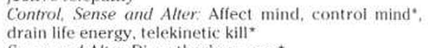
Our notes: `notes/materials/029-jedi-academy-sourcebook/03-ch3-the-jedi-academy.md:111`

> The Force runs strong in his family, and Kam's father, Ranik Solusar, was a great Jedi master.
>
> Kam studied under his father for a number of years before the Imperial Jedi purges drove his family apart. Ranik fell at the hands of Lord Darth Vader, and Kam himself barely escaped the Imperial inquisition. He went into hiding in the isolated regions of the Outer Rim.
>
> Like Luke and Kyp, Kam has had his brush with the dark side of the Force. While in exile, he was captured and tortured by evil Jedi, and twisted to serve the dark side.
>
> Like Luke and Kyp, Kam has had his brush with the dark side of the Force. While in exile, he was captured and tortured by evil Jedi, and twisted to serve the dark side. Luke won him back over to the light side, and brought him back to the Core to serve as his apprentice.
>
> Kam's grasp of the Force is astounding in some areas, and remarkably weak in others, because he was forced to leave his master be- fore he could complete his training.
— Source: Chapter Three: The Jedi Academy.
(Excerpt widened 2026-11-17 to the relevant passage, word for word from research primary jedi academy sourcebook jas clean (text copy `research_primary_jedi_academy_sourcebook_jas_clean_txt_04b8ab0d44`).)
(Excerpt widened 2026-11-17 to the relevant passage, word for word from research primary jedi academy sourcebook jas clean (text copy `research_primary_jedi_academy_sourcebook_jas_clean_txt_04b8ab0d44`).)
Note (our notes, around the quote): Kam Solusar; Luke Skywalker; Kyp Durron — Kam Solusar — brush with the dark side: "Like Luke and Kyp, Kam has had his brush with the dark side of the Force. While in exile, he was captured and tortured by evil Jedi, and twisted to serve the dark side. Luke won him back over to the light side, and brought him back to the Core to serve as his apprentice." Source: The Jedi Academy Sourcebook, p.39
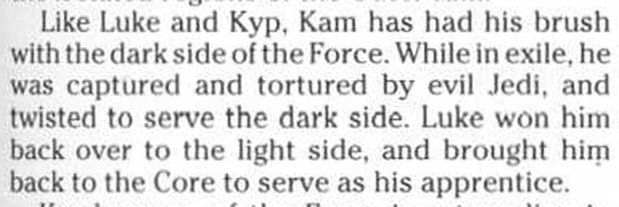
Our notes: `notes/materials/029-jedi-academy-sourcebook/03-ch3-the-jedi-academy.md:142`

> Like weather sense, this power does not lend itself to quick predictions. It customarily takes weeks for a Jedi to acclimate to local weather patterns and topography.
>
> The prediction is effective for 12 hours. The difficulty increases by one level for each addi- tional 12-hour period by which the Jedi wishes to extend the prediction.
>
> Sense Force Potential “Luke closed his eyes and sent a tendril of thought to the back of Kyp’s mind where the deep primal memories hid, leaving little room for con- scious thought. Luke touched inward to the iso- lated nub in his subconscious.
>
> Sense Force Potential “Luke closed his eyes and sent a tendril of thought to the back of Kyp’s mind where the deep primal memories hid, leaving little room for con- scious thought. Luke touched inward to the iso- lated nub in his subconscious. He pushed — and suddenly found himself hurled backward, tossed aside like a piece of fluff in a Bespin wind storm.
>
> —and suddenly found himself hurled backward, tossed aside like a piece of fluff in a Bespin wind storm. He landed flat on his back on the other side of the room, gasping.
>
> Sense Difficulty: Moderate for friendly, non- resisting targets. Moderate plus target's Percep- tion or control roll (whichever is higher) to determine the difficulty of the probe on an unwilling subject.
>
> room, gasping, ”
— Source: Chapter Three: The Jedi Academy; Luke Skywalker; Kyp Durron — Sense Force Potential — quoted novel excerpt.
(Excerpt widened 2026-11-17 to the relevant passage, word for word from research primary jedi academy sourcebook jas clean (text copy `research_primary_jedi_academy_sourcebook_jas_clean_txt_04b8ab0d44`).)
(Excerpt widened 2026-11-17 to the relevant passage, word for word from Jedi Search (Kevin Anderson) (text copy `MEGA_Legend_The_Jedi_Academy_Trilogy_Star_Wars_Jedi_Academy_01_Jedi_Search_Kevin_J_Anderson_epub`).)
(Excerpt widened 2026-11-17 to the relevant passage, word for word from research primary jedi academy sourcebook jas clean (text copy `research_primary_jedi_academy_sourcebook_jas_clean_txt_04b8ab0d44`).)
(Excerpt widened 2026-11-17 to the relevant passage, word for word from Jedi Search (Kevin Anderson) (text copy `MEGA_Legend_The_Jedi_Academy_Trilogy_Star_Wars_Jedi_Academy_01_Jedi_Search_Kevin_J_Anderson_epub`).)
(Full sentence/passage taken from the source text on file: `research_primary_jedi_academy_sourcebook_jas_clean_txt`.)
Note (our notes, around the quote): Luke Skywalker; Kyp Durron — Sense Force Potential — quoted novel excerpt: "He pushed — and suddenly found himself hurled backward, tossed aside like a piece of fluff in a Bespin wind storm. He landed flat on his back on the other side of the room, gasping," Source: The Jedi Academy Sourcebook, p.45, sidebar/caption
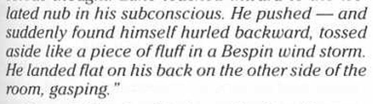
Our notes: `notes/materials/029-jedi-academy-sourcebook/03-ch3-the-jedi-academy.md:200`

> Gantoris is pushed too far, however, and turns on his Sith The Jedi Academy Sourcebook master. Realizing that Gantoris is no longer his, Kun utterly drains him to provide himself a reserve of energy to last until he can subvert more students.
>
> Kun has just begun edging in on Streen when Kyp Durron arrives at the Jedi academy. Kun immediately senses in the young man his ideal subject. Like Gantoris, Kyp is strong-willed and impatient to learn. Moreover, he is far more powerful than the Eol Sha leader, and young enough to be overconfident and naive.
>
> Over a number of weeks, Kun slowly bends Kyp to his will, and begins to augment his power.
>
> He grows very powerful on Kyp’s hate, and soon his hold on Kyp is so complete that he can send Kyp beyond the planet to do his will and still retain control over his subject.
— Source: Chapter Four: Echoes of the Sith.
(Excerpt widened 2026-11-17 to the relevant passage, word for word from research primary jedi academy sourcebook jas clean (text copy `research_primary_jedi_academy_sourcebook_jas_clean_txt_04b8ab0d44`).)
(Excerpt widened 2026-11-17 to the relevant passage, word for word from research primary jedi academy sourcebook jas clean (text copy `research_primary_jedi_academy_sourcebook_jas_clean_txt_04b8ab0d44`).)
Note (our notes, around the quote): Kyp Durron; Gantoris; Exar Kun — The Return of Exar Kun — Kyp the ideal subject: "Moreover, he is far more powerful than the Eol Sha leader, and young enough to be overconfident and naive." Source: The Jedi Academy Sourcebook, p.49
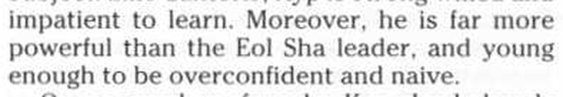
Our notes: `notes/materials/029-jedi-academy-sourcebook/04-ch4-echoes-of-the-sith.md:32`

> Kun has just begun edging in on Streen when Kyp Durron arrives at the Jedi academy. Kun immediately senses in the young man his ideal subject. Like Gantoris, Kyp is strong-willed and impatient to learn. Moreover, he is far more powerful than the Eol Sha leader, and young enough to be overconfident and naive.
>
> Over a number of weeks, Kun slowly bends Kyp to his will, and begins to augment his power.
>
> He grows very powerful on Kyp’s hate, and soon his hold on Kyp is so complete that he can send Kyp beyond the planet to do his will and still retain control over his subject.
>
> Ultimately, he has Kyp return to Yavin Four and helps him reclaim the Sun Crusher. He also bolsters Kyp’s talents to allow him to defeat Luke and place him in a coma.
— Source: Chapter Four: Echoes of the Sith.
(Excerpt widened 2026-11-17 to the relevant passage, word for word from research primary jedi academy sourcebook jas clean (text copy `research_primary_jedi_academy_sourcebook_jas_clean_txt_04b8ab0d44`).)
(Excerpt widened 2026-11-17 to the relevant passage, word for word from research primary jedi academy sourcebook jas clean (text copy `research_primary_jedi_academy_sourcebook_jas_clean_txt_04b8ab0d44`).)
Note (our notes, around the quote): Exar Kun; Kyp Durron — The Return of Exar Kun — control over Kyp: "He grows very powerful on Kyp's hate, and soon his hold on Kyp is so complete that he can send Kyp beyond the planet to do his will and still retain control over his subject." Source: The Jedi Academy Sourcebook, p.49
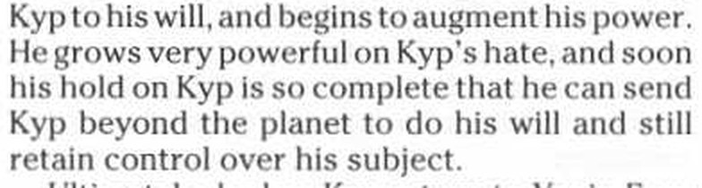
Our notes: `notes/materials/029-jedi-academy-sourcebook/04-ch4-echoes-of-the-sith.md:34`

> Like Gantoris, Kyp is strong-willed and impatient to learn. Moreover, he is far more powerful than the Eol Sha leader, and young enough to be overconfident and naive.
>
> Over a number of weeks, Kun slowly bends Kyp to his will, and begins to augment his power.
>
> He grows very powerful on Kyp’s hate, and soon his hold on Kyp is so complete that he can send Kyp beyond the planet to do his will and still retain control over his subject.
>
> Ultimately, he has Kyp return to Yavin Four and helps him reclaim the Sun Crusher.
>
> Ultimately, he has Kyp return to Yavin Four and helps him reclaim the Sun Crusher. He also bolsters Kyp’s talents to allow him to defeat Luke and place him in a coma.
>
> He reveals himself to Luke in his coma-like state, to taunt him. He tells Luke of his plans to revive the Lords of the Sith, using his disciples as his first generation of students.
— Source: Chapter Four: Echoes of the Sith.
(Excerpt widened 2026-11-17 to the relevant passage, word for word from research primary jedi academy sourcebook jas clean (text copy `research_primary_jedi_academy_sourcebook_jas_clean_txt_04b8ab0d44`).)
(Excerpt widened 2026-11-17 to the relevant passage, word for word from research primary jedi academy sourcebook jas clean (text copy `research_primary_jedi_academy_sourcebook_jas_clean_txt_04b8ab0d44`).)
Note (our notes, around the quote): Exar Kun; Kyp Durron; Luke Skywalker; Sun Crusher — The Return of Exar Kun — bolstering Kyp against Luke: "Ultimately, he has Kyp return to Yavin Four and helps him reclaim the Sun Crusher. He also bolsters Kyp's talents to allow him to defeat Luke and place him in a coma." Source: The Jedi Academy Sourcebook, p.49
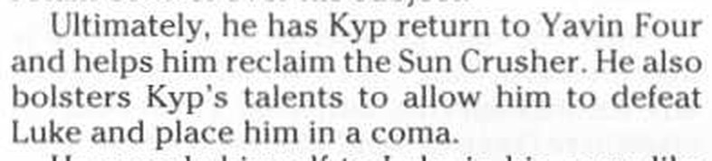
Our notes: `notes/materials/029-jedi-academy-sourcebook/04-ch4-echoes-of-the-sith.md:36`

> He boasts that he already owns Kyp and Streen, and destroyed Gantoris.
— Source: Chapter Four: Echoes of the Sith.
Note (our notes, around the quote): Exar Kun; Kyp Durron; Streen; Gantoris — The Return of Exar Kun — Kun's boast: "He boasts that he already owns Kyp and Streen, and destroyed Gantoris." Source: The Jedi Academy Sourcebook, p.49
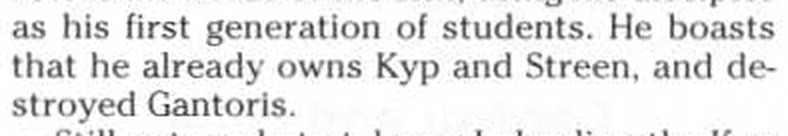
Our notes: `notes/materials/029-jedi-academy-sourcebook/04-ch4-echoes-of-the-sith.md:38`

> scuttled around them, but none bothered Kyp. He
>
> Insects and small biting creatures buzzed and scuttled around them, but none bothered Kyp. He consciously exuded a shadow of uneasiness around him so that lower creatures had no incentive to come nearer. Exar Kun had taught him that trick too.
— Source: Chapter Four: Echoes of the Sith; Kyp Durron; Exar Kun — Aura of Uneasiness — quoted novel excerpt.
(Excerpt widened 2026-11-17 to the relevant passage, word for word from Dark Apprentice (Kevin Anderson), Chapter 20 (text copy `MEGA_Legend_The_Jedi_Academy_Trilogy_Star_Wars_Jedi_Academy_02_Dark_Apprentice_Kevin_J_Anderson_epub`).)
(Full sentence/passage taken from the source text on file: `research_primary_jedi_academy_sourcebook_jas_clean_txt`.)
Note (our notes, around the quote): Kyp Durron; Exar Kun — Aura of Uneasiness — quoted novel excerpt: "He consciously exuded a shadow of uneasiness around him so that lower creatures had no incentive to come nearer. Exar Kun had taught him that trick" Source: The Jedi Academy Sourcebook, p.50, sidebar/caption
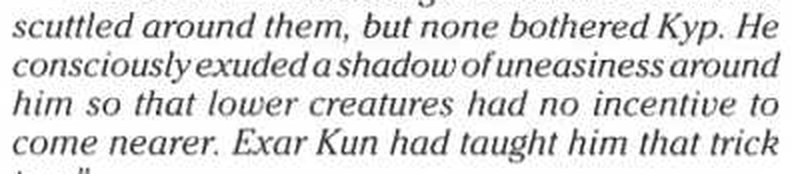
Our notes: `notes/materials/029-jedi-academy-sourcebook/04-ch4-echoes-of-the-sith.md:53`

> The black net of anger fell over him, smothering his kind intentions. In outrage Kyp found the power to send a burst of controlling thought through the integrated circuits in the Sun Crusher’s computer. He flushed the alien programming, wiping pathways clean and rebuilding them in an instant. He remapped the functions with a sudden mental pinpoint that made the Sun Crusher whole again. The systems hummed as they returned to life, charging up.
— Source: Chapter Four: Echoes of the Sith; Kyp Durron; Sun Crusher — Electronic Manipulation — quoted novel excerpt.
(Excerpt widened 2026-11-17 to the relevant passage, word for word from Champions of the Force (Kevin Anderson), Chapter 16 (text copy `MEGA_Legend_The_Jedi_Academy_Trilogy_Star_Wars_Jedi_Academy_03_Champions_of_the_Force_Kevin_J_Anderson_epub`).)
Note (our notes, around the quote): Kyp Durron; Sun Crusher — Electronic Manipulation — quoted novel excerpt: "In outrage Kyp found the power to send a burst of controlling thought through the integrated circuits in the Sun Crusher's computer." Source: The Jedi Academy Sourcebook, p.50, sidebar/caption
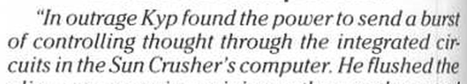
Our notes: `notes/materials/029-jedi-academy-sourcebook/04-ch4-echoes-of-the-sith.md:55`

> Alter Difficulty: Target’s willpower, Percep- tion or control roll. Modified by relationship.
>
> Required Powers: Control pain, hibernation trance, life detection, life sense, magnify senses, receptive telepathy, sense Force, telekinesis, far- seeing, projective telepathy, affect mind, control mind, dim other's senses Warning: A character who uses this power immediately gets a Dark Side Point.
>
> Time to use: Five minutes.
>
> Effect: This dreadful power allows a Sith to sift through another person’s mind, and destroy all knowledge of specific events or learned skills.
>
> Use of the skill requires direct contact with the target, and only one specified objective can be pursued per session.
>
> The Jedi Academy Sourcebook === sp53 Chapter Five: Forces of the Empire E@i Chapter Five Forces of the Empire The Imperial Core Systems Though many Core worlds readily embraced the New Republic when the provisional govern- ment established itself on Coruscant, the vast majority resisted integration into the new gov- ernment, primarily because they feared the con- sequences ofallying themselves with the former Rebellion when there was stilla very good chance that the Empire might rise again to eclipse the New Republic.
— Source: Chapter Four: Echoes of the Sith; Kyp Durron; Qwi Xux — Memory Wipe — Sith power effect.
(Excerpt widened 2026-11-17 to the relevant passage, word for word from research primary jedi academy sourcebook jas clean (text copy `research_primary_jedi_academy_sourcebook_jas_clean_txt_04b8ab0d44`).)
(Excerpt widened 2026-11-17 to the relevant passage, word for word from research primary jedi academy sourcebook jas clean (text copy `research_primary_jedi_academy_sourcebook_jas_clean_txt_04b8ab0d44`).)
Note (our notes, around the quote): Kyp Durron; Qwi Xux — Memory Wipe — Sith power effect: "This dreadful power allows a Sith to sift through another person's mind, and destroy all knowledge of specific events or learned skills." Source: The Jedi Academy Sourcebook, p.51
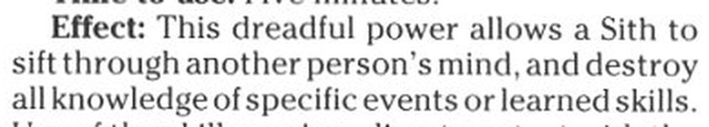
Our notes: `notes/materials/029-jedi-academy-sourcebook/04-ch4-echoes-of-the-sith.md:64`

> Chapter Five: Forces of the Empire a eee aa...
>
> The Jedi Academy Sourcebook 53 === sp55 No matter that the two older twins are no longer on the planetoid —all Furgan needs is one token Jedi, and Anakin Solo will do just as well as his older brother and sister.
>
> Furgan plans the operation to kidnap Anakin with extreme care. He selects the best stormtroopers on Carida to form his assault force, and incorporates the new Mountain Ter- rain Armored Transport (MT-AT) into the at- tack. He entrusts the mission to the best ship in his meager fleet, the Vendetta, His plans are almost ruined at the last mo- ment by the appearance of Kyp Durron in the Sun Crusher. In attempting to capture the Sun Crusher, Furgan goads Kyp into launching one of his system-destroying torpedoes into the Caridan sun. When it becomes obvious that Furgan cannot save Carida, he gives the evacu- ation orders, and barely escapes with only his attack ship Vendetta and its crew.
>
> Eager to claim Anakin at the earliest possible moment, Furgan accompanies the eight spider walkers which raid Anoth. Furgan successfully captures Anakin, but is forced to sacrifice all his men to do so.
— Source: Chapter Five: Forces of the Empire.
(Excerpt widened 2026-11-17 to the relevant passage, word for word from research primary jedi academy sourcebook jas clean (text copy `research_primary_jedi_academy_sourcebook_jas_clean_txt_04b8ab0d44`).)
(Excerpt widened 2026-11-17 to the relevant passage, word for word from research primary jedi academy sourcebook jas clean (text copy `research_primary_jedi_academy_sourcebook_jas_clean_txt_04b8ab0d44`).)
Note (our notes, around the quote): Ambassador Furgan; Kyp Durron; Sun Crusher — Ambassador Furgan — the destruction of Carida: "In attempting to capture the Sun Crusher, Furgan goads Kyp into launching one of his system-destroying torpedoes into the Caridan sun." Source: The Jedi Academy Sourcebook, p.54
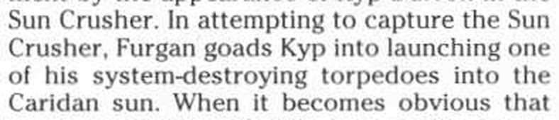
Our notes: `notes/materials/029-jedi-academy-sourcebook/05-ch5-forces-of-the-empire.md:31`

> Kyp grabs him with the tractor beam, and is on the verge of opening the cockpit and getting Zeth himself, when the sun explodes, destroying Carida and Zeth.
— Source: Chapter Five: Forces of the Empire; Kyp Durron; Sun Crusher — Trooper 2112 (Zeth Durron) — Carida.
Note (our notes, around the quote): Kyp Durron; Sun Crusher — Trooper 2112 (Zeth Durron) — Carida: "Kyp grabs him with the tractor beam, and is on the verge of opening the cockpit and getting Zeth himself, when the sun explodes, destroying Carida and Zeth." Source: The Jedi Academy Sourcebook, p.55
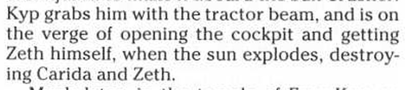
Our notes: `notes/materials/029-jedi-academy-sourcebook/05-ch5-forces-of-the-empire.md:42`

> He manages to shoot Dauren, but is too injured to make it aboard the Sun Crusher.
>
> Kyp grabs him with the tractor beam, and is on the verge of opening the cockpit and getting Zeth himself, when the sun explodes, destroy- ing Carida and Zeth.
>
> Much later, in the temple of Exar Kun on Yavin IV, Zeth appears before Kyp to thank his brother for freeing him from the Imperials. mw Zeth Durron Type: Imperial Stormtrooper DEXTERITY 2D Blaster 5D, blaster artillery 4D, dodge 4D+2, grenade 3D+2, melee combat 4D, melee parry 4D, vehicle blasters KNOWLEDGE 2D Intimidation 3D, survival 5D, tactics 3D+1 MECHANICAL 2D+2 Repulsorlift operation 4D, walker operation 4D The Jedi Academy Sourcebook === sp57 PERCEPTION 2D Command 30-2, hide 3D, investigation 2D=+1. search 3D, sneak 4D-+1 STRENGTH 2D Brawling 4D, climbing/jumping 3D-+ 1, lifting3D+2, stamina TECHNICAL 2D Armor repair 20+2, blaster repair 2D-1, demolitions 2D» 2, first aid 3D, security 4D, walker repair 2D+2 Character Points: 6 Move: 10) Equipment: Stormtrooper armor (-2D physical, +!1D energy, -1D to Dexterity and related skills), blaster rifle (5D), blaster pistol (4D) Admiral Daala Admiral Daala has spent her entire life mov- ing at full speed. As a cadet, she pushed herself to her physical and mental limits, and occasion- ally beyond.
>
> Much later, in the temple of Exar Kun on Yavin IV, Zeth appears before Kyp to thank his brother for freeing him from the Imperials. mw Zeth Durron Type: Imperial Stormtrooper DEXTERITY 2D Blaster 5D, blaster artillery 4D, dodge 4D+2, grenade 3D+2, melee combat 4D, melee parry 4D, vehicle blasters KNOWLEDGE 2D Intimidation 3D, survival 5D, tactics 3D+1 MECHANICAL 2D+2 Repulsorlift operation 4D, walker operation 4D The Jedi Academy Sourcebook === sp57 PERCEPTION 2D Command 30-2, hide 3D, investigation 2D=+1. search 3D, sneak 4D-+1 STRENGTH 2D Brawling 4D, climbing/jumping 3D-+ 1, lifting3D+2, stamina TECHNICAL 2D Armor repair 20+2, blaster repair 2D-1, demolitions 2D» 2, first aid 3D, security 4D, walker repair 2D+2 Character Points: 6 Move: 10) Equipment: Stormtrooper armor (-2D physical, +!1D energy, -1D to Dexterity and related skills), blaster rifle (5D), blaster pistol (4D) Admiral Daala Admiral Daala has spent her entire life mov- ing at full speed. As a cadet, she pushed herself to her physical and mental limits, and occasion- ally beyond. She excelled in every curriculum, and used her strategic skills to wipe out entire navies in wargames.
— Source: Chapter Five: Forces of the Empire.
(Excerpt widened 2026-11-17 to the relevant passage, word for word from research primary jedi academy sourcebook jas clean (text copy `research_primary_jedi_academy_sourcebook_jas_clean_txt_04b8ab0d44`).)
(Excerpt widened 2026-11-17 to the relevant passage, word for word from research primary jedi academy sourcebook jas clean (text copy `research_primary_jedi_academy_sourcebook_jas_clean_txt_04b8ab0d44`).)
Note (our notes, around the quote): Kyp Durron; Exar Kun — Trooper 2112 (Zeth Durron) — in Kun's temple: "Much later, in the temple of Exar Kun on Yavin IV, Zeth appears before Kyp to thank his brother for freeing him from the Imperials." Source: The Jedi Academy Sourcebook, p.55
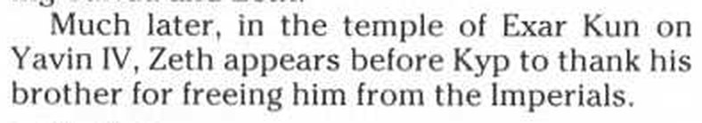
Our notes: `notes/materials/029-jedi-academy-sourcebook/05-ch5-forces-of-the-empire.md:44`

> The news that the Empire lies broken, along with Tarkin and his mighty Death Star. shakes her to her core. She resolves to hit the New Republic as hard as she can, with her arsenal of experimental weapons.
>
> Unfortunately, things go wrong for her al- most immediately. Daala soon learns that an aptitude for theory is no substitute for experi- ence. Her inability to alter her plans to take into account the unexpected is instrumental in her eventual downfall. Han Solo, Kyp, and Chewbacca escape with her prize superweapon, the Sun Crusher, and destroy the Hydra, one of her four Star Destroyers.
>
> After battling Moruth Doole’s forces at Kessel, Daala retreats to the Cauldron Nebula to re- cover and plot her next step. Refusing to submit to any of the warlords in the Imperial Core, she settles on a hit-and-run strategy designed to strike terror in the New Republic.
— Source: Chapter Five: Forces of the Empire.
(Excerpt widened 2026-11-17 to the relevant passage, word for word from research primary jedi academy sourcebook jas clean (text copy `research_primary_jedi_academy_sourcebook_jas_clean_txt_04b8ab0d44`).)
(Excerpt widened 2026-11-17 to the relevant passage, word for word from research primary jedi academy sourcebook jas clean (text copy `research_primary_jedi_academy_sourcebook_jas_clean_txt_04b8ab0d44`).)
Note (our notes, around the quote): Admiral Daala; Han Solo; Kyp Durron; Chewbacca; Sun Crusher — Admiral Daala — loss of the Sun Crusher: "Han Solo, Kyp, and Chewbacca escape with her prize superweapon, the Sun Crusher, and destroy the Hydra, one of her four Star Destroyers." Source: The Jedi Academy Sourcebook, p.56
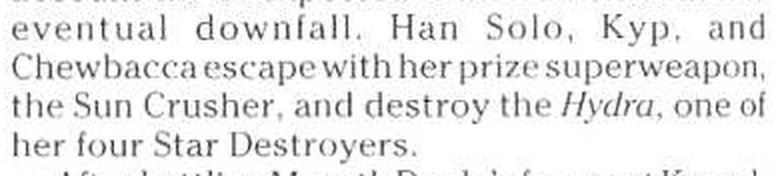
Our notes: `notes/materials/029-jedi-academy-sourcebook/05-ch5-forces-of-the-empire.md:59`

> She uses one of Tarkin's classic maneuvers which is rec- ognized by Ackbar, who is also familiar with Tarkin’'s tactics. He recognizes her feint for what it is, and counter-strikes in a brilliant move which results in the loss of Daala’s second de- stroyer, the Manticore.
>
> Daala again reassesses her goals, and deter- mines that she has not been doing much dam- age to the New Republic. After briefly detaining (and then destroying) a Sullustan trader and learning from his records that the shield genera- tors on Coruscant have not yet been repaired, Daala forms a new attack plan. She resolves to strike at Coruscant itself, ramming the stripped- down Star Destroyer Basilisk into Imperial City at full speed, leveling buildings for thousands of kilometers, and causing drastic damage to the crust of the planet.
>
> Alas, her plan is disrupted before it can even get underway — Kyp appears in the staging area piloting the Sun Crusher, and uses it to detonate the nebula her fleet is hiding in. She barely escapes, and the Basilisk is vaporized by the expanding explosion.
>
> Alas, her plan is disrupted before it can even get underway — Kyp appears in the staging area piloting the Sun Crusher, and uses it to detonate the nebula her fleet is hiding in. She barely escapes, and the Basilisk is vaporized by the expanding explosion. Daala is down to her last ship.
>
> While repairing her ship, she has time to reflect on her mistakes and actions, and realizes that her priorities have been off kilter — her The Jedi Academy Sourcebook === sp58 cee A Rms ( Hapter Five: Forces of the Empire mn WA Admiral Daala’s Fleet Four Star Destroyers are stationed at Maw Installation, guarding the research facilities.
— Source: Chapter Five: Forces of the Empire.
(Excerpt widened 2026-11-17 to the relevant passage, word for word from research primary jedi academy sourcebook jas clean (text copy `research_primary_jedi_academy_sourcebook_jas_clean_txt_04b8ab0d44`).)
(Excerpt widened 2026-11-17 to the relevant passage, word for word from research primary jedi academy sourcebook jas clean (text copy `research_primary_jedi_academy_sourcebook_jas_clean_txt_04b8ab0d44`).)
Note (our notes, around the quote): Admiral Daala; Kyp Durron; Sun Crusher — Admiral Daala — the Cauldron Nebula: "Kyp appears in the staging area piloting the Sun Crusher, and uses it to detonate the nebula her fleet is hiding in. She barely escapes, and the Basilisk is vaporized by the expanding explosion." Source: The Jedi Academy Sourcebook, p.56
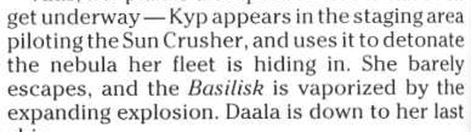
Our notes: `notes/materials/029-jedi-academy-sourcebook/05-ch5-forces-of-the-empire.md:65`

> In pursuing Kyp in the Sun Crusher, he is lured beyond the event horizon, and is slain along with most of his remaining scientists when the Death Star is sucked down into the black hole.
— Source: Chapter Six: Maw Installation; Tol Sivron; Kyp Durron; Sun Crusher — Tol Sivron — death.
Note (our notes, around the quote): Tol Sivron; Kyp Durron; Sun Crusher — Tol Sivron — death: "In pursuing Kyp in the Sun Crusher, he is lured beyond the event horizon, and is slain along with most of his remaining scientists when the Death Star is sucked down into the black hole." Source: The Jedi Academy Sourcebook, p.72
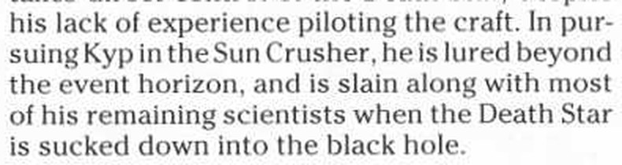
Our notes: `notes/materials/029-jedi-academy-sourcebook/06-ch6-maw-installation.md:83`

> Only upon meeting Wedge does she realize how empty her life has been, how devoid of personal relationships. Her only joys have come from completing a project or proving her designs and theories correct.
>
> After her address, she and Wedge leave Coruscant for Vortex, to help in the disaster relief efforts. During the trip, Wedge’s interest in Qwi grows, and she shyly encourages him. On the return trip, they stop by Ithor to take in the sights. Kyp Durron finds her there, and using Sith powers, drains her mind of all she knew of the Sun Crusher.
>
> The purge is not extremely focused, how- ever, and many other memories are destroyed as well. Fortunately, most of her basic scientific knowledge is intact, but she has lost a lot of her advanced knowledge.
— Source: Chapter Six: Maw Installation.
(Excerpt widened 2026-11-17 to the relevant passage, word for word from research primary jedi academy sourcebook jas clean (text copy `research_primary_jedi_academy_sourcebook_jas_clean_txt_04b8ab0d44`).)
(Excerpt widened 2026-11-17 to the relevant passage, word for word from research primary jedi academy sourcebook jas clean (text copy `research_primary_jedi_academy_sourcebook_jas_clean_txt_04b8ab0d44`).)
Note (our notes, around the quote): Kyp Durron; Qwi Xux; Sun Crusher — Qwi Xux — Kyp's memory wipe: "Kyp Durron finds her there, and using Sith powers, drains her mind of all she knew of the Sun Crusher." Source: The Jedi Academy Sourcebook, p.75

Our notes: `notes/materials/029-jedi-academy-sourcebook/06-ch6-maw-installation.md:106`

> This works reasonably well until Kyp Durron taunts Sivron past rational thought and lures the Death Star and its passengers to their doom.
— Source: Chapter Six: Maw Installation.
Note (our notes, around the quote): Kyp Durron; Tol Sivron — Captain Fredja — Kyp lures the Death Star: "This works reasonably well until Kyp Durron taunts Sivron past rational thought and lures the Death Star and its passengers to their doom." Source: The Jedi Academy Sourcebook, p.77

Our notes: `notes/materials/029-jedi-academy-sourcebook/06-ch6-maw-installation.md:118`

> Mara Jade When she was appointed by the Smugglers’
>
> Alliance as an SA representative, Mara Jade thought she'd found a job that would employ her skills as a negotiator and businesswoman rather than as some sort of armed trouble- shooter. However, it seems that Mara is des- tined to keep in the thick of things one way or another.
>
> She travels to Coruscant to warn the New Republic through Han Solo that Admiral Daala has been putting out feelers in the fringe, trying to hire spies and saboteurs. While there, she catches Lando’s eye.
>
> Mara attends Luke's Jedi academy for a time, but does not stay long; Kyp’s stealing of her ship sours her on the experience, and she begins to worry how the SA is getting on without her. She asks Lando to come pick her up.
>
> When Lando returns her to Coruscant, he fills her in on a plan he’s devised to take over the Kessel mining program if she can assure him that the SA can pick up distribution of the glitterstim.
— Source: Chapter Seven: The Fringe.
(Excerpt widened 2026-11-17 to the relevant passage, word for word from research primary jedi academy sourcebook jas clean (text copy `research_primary_jedi_academy_sourcebook_jas_clean_txt_04b8ab0d44`).)
(Excerpt widened 2026-11-17 to the relevant passage, word for word from research primary jedi academy sourcebook jas clean (text copy `research_primary_jedi_academy_sourcebook_jas_clean_txt_04b8ab0d44`).)
(Full sentence/passage taken from the source text on file: `research_primary_jedi_academy_sourcebook_jas_clean_txt`.)
Note (our notes, around the quote): Mara Jade Skywalker; Luke Skywalker; Kyp Durron — Mara Jade — at the Jedi academy: "Mara attends Luke's Jedi academy for a time, but does not stay long; Kyp's stealing of her ship sours her on the experience," Source: The Jedi Academy Sourcebook, p.80

Our notes: `notes/materials/029-jedi-academy-sourcebook/07-ch7-the-fringe.md:13`

> Alas, none of his defenses can save Carida from an exploding sun, as Furgan learns when Kyp destroys the system with the Sun Crusher.
— Source: Chapter Ten: Planets; Kyp Durron; Sun Crusher; Ambassador Furgan — Carida — destroyed.
Note (our notes, around the quote): Kyp Durron; Sun Crusher; Ambassador Furgan — Carida — destroyed: "Alas, none of his defenses can save Carida from an exploding sun, as Furgan learns when Kyp destroys the system with the Sun Crusher." Source: The Jedi Academy Sourcebook, p.109

Our notes: `notes/materials/029-jedi-academy-sourcebook/10-ch10-planets.md:64`

## The Complete Star Wars Encyclopedia, Vol. I (A–G)

> The Basilisk was destroyed when Kyp Durron detonated the Cauldron Nebula with the Sun Crusher superweapon.
— Source: scan pages 41–80; Kyp Durron; Sun Crusher (superweapon).
Note (our notes, around the quote): Kyp Durron; Sun Crusher (superweapon): "The Basilisk was destroyed when Kyp Durron detonated the Cauldron Nebula with the Sun Crusher superweapon." Source: The Complete Star Wars Encyclopedia, Vol. I, p.63

Our notes: `notes/materials/030-complete-star-wars-encyclopedia-vol-1/01-v1-scan-041-080.md:301`

> The planet's varied surface, rocky mountains, frozen ice fields, jungles filled with carnivo­ rous plants, and arid deserts provided perfect training for combat in harsh environments. Admiral Daala attended the Caridan Academy before her appointment to the staffof Grand Moff Tarkin. After the annihilation of Alderaan, sev­ eral ofthe Death Star'sdesign­ ers were transferred from the battle station to Carida. Dash Rendar attended the Acad­ emy until he was dishonor­ ably discharged after his older brother crashed a freighter into the Emperor's private museum on Imperial Center. Later, Ambassador Furgan was the Caridan representa­ tive to the New Republic and oversaw the development of Xandel Carivus the MT-AT "spider walker:' Alliance Admiral Ackbar's aide Terpfen under­ went torture and reconditioning on the planet to turn him into an Imperial puppet. Carida was destroyed when Jedi Kyp Durron caused its star to go nova through the use of an Imperial superweapon, the Sun Crusher. Nova Station was located in the remnants of the Carida system. It floated just inside the supernova's expanding gas shell, moving along behind the edge at a matching 3 kilometers per second. Carida NebulaThe collection of crimson dust and space gases marked the remains of the Carida system, which was destroyed when Kyp Durron used the Sun Crusher to cause its primary star to achieve supernova.
— Source: scan pages 121–160; Kyp Durron; Sun Crusher (superweapon).
(Excerpt widened 2026-11-17 to the relevant passage, word for word from research primary cse vol1 (text copy `research_primary_cse_vol1_pdf_45a954be6d`).)
(Excerpt widened 2026-11-17 to the relevant passage, word for word from research primary cse vol1 (text copy `research_primary_cse_vol1_pdf_45a954be6d`).)
Note (our notes, around the quote): Kyp Durron; Sun Crusher (superweapon): "Carida was destroyed when Jedi Kyp Durron caused its star to go nova through the use of an Imperial superweapon, the Sun Crusher." Source: The Complete Star Wars Encyclopedia, Vol. I, p.109

Our notes: `notes/materials/030-complete-star-wars-encyclopedia-vol-1/03-v1-scan-121-160.md:31`

> Dash Rendar attended the Acad­ emy until he was dishonor­ ably discharged after his older brother crashed a freighter into the Emperor's private museum on Imperial Center. Later, Ambassador Furgan was the Caridan representa­ tive to the New Republic and oversaw the development of Xandel Carivus the MT-AT "spider walker:' Alliance Admiral Ackbar's aide Terpfen under­ went torture and reconditioning on the planet to turn him into an Imperial puppet. Carida was destroyed when Jedi Kyp Durron caused its star to go nova through the use of an Imperial superweapon, the Sun Crusher. Nova Station was located in the remnants of the Carida system. It floated just inside the supernova's expanding gas shell, moving along behind the edge at a matching 3 kilometers per second. Carida NebulaThe collection of crimson dust and space gases marked the remains of the Carida system, which was destroyed when Kyp Durron used the Sun Crusher to cause its primary star to achieve supernova. Popu- Jar lore attributed the color of the nebula to the vaporized blood of every being that was killed in the cataclysm.
>
> Nova Station was located in the remnants of the Carida system. It floated just inside the supernova's expanding gas shell, moving along behind the edge at a matching 3 kilometers per second.
>
> Carida Nebula The collection of crimson dust and space gases marked the remains of the Carida system, which was destroyed when Kyp Durron used the Sun Crusher to cause its primary star to achieve supernova. Popu- Jar lore attributed the color of the nebula to the vaporized blood of every being that was killed in the cataclysm.
>
> Caridan Members of this hu­ manoid species native to Carida had thin limbs and heavy, bar­ rel chests. Caridans evolved in a high-gravity environment and had surprising physical strength con­ sidering their lanky frames.
>
> Caridan Members of this hu­ manoid species native to Carida had thin limbs and heavy, bar­ rel chests.
— Source: scan pages 121–160; Kyp Durron; Sun Crusher (superweapon).
(Excerpt widened 2026-11-17 to the relevant passage, word for word from research primary cse vol1 (text copy `research_primary_cse_vol1_pdf_45a954be6d`).)
(Excerpt widened 2026-11-17 to the relevant passage, word for word from research audit work src m030 (text copy `research_audit_work_src_m030_txt_69ea9f4a41`).)
(Excerpt widened 2026-11-17 to the relevant passage, word for word from research audit work src m030 (text copy `research_audit_work_src_m030_txt_69ea9f4a41`).)
Note (our notes, around the quote): Kyp Durron; Sun Crusher (superweapon): "Carida Nebula The collection of crimson dust and space gases marked the remains of the Carida system, which was destroyed when Kyp Durron used the Sun Crusher to cause its primary star to achieve supernova." Source: The Complete Star Wars Encyclopedia, Vol. I, p.109

Our notes: `notes/materials/030-complete-star-wars-encyclopedia-vol-1/03-v1-scan-121-160.md:33`

> The gas clouds and electromagnetic radiation in the nebula made an ideal hiding place for Admiral Daala's Star Destroyers, until Jedi student Kyp Durron caused all seven stars to go nova through his use of the Empire's own secret superweapon, the Sun Crusher.
— Source: scan pages 121–160; Admiral Daala; Kyp Durron; Sun Crusher (superweapon).
Note (our notes, around the quote): Admiral Daala; Kyp Durron; Sun Crusher (superweapon): "The gas clouds and electromagnetic radiation in the nebula made an ideal hiding place for Admiral Daala's Star Destroyers, until Jedi student Kyp Durron caused all seven stars to go nova through his use of the Empire's own secret superweapon, the Sun Crusher." Source: The Complete Star Wars Encyclopedia, Vol. I, p.112

Our notes: `notes/materials/030-complete-star-wars-encyclopedia-vol-1/03-v1-scan-121-160.md:56`

> Cheklev eventually made his way back to the safety ofhis Jedi peers through the un­ derground GreatRiver safe route. CheUk A member of the Hapan royal family, niece of Queen Mother Ta'a Chume and older sister to Alyssia. Chelik's daughter was caught by Tenet Ka attempting to assassinate Prince Isol­ der during the war against the Yuuzhan Vong. Chell, Benwick A soldier in the Hapan Royal Navy during the time of the Yuuzhan Vong invasion, he hated that Tenet Ka had in­ volved their people in the conflict, particularly after the Battle ofFondor, where three-quarters of the Hapan forces were destroyed. Chell con­ spired with the Yuuzhan Vong to capture Jaina Solo and deliver her to the invaders. Chevin Chem This young pilot, a member of Kyp's Dozen, was killed during the Yuuzhan Vong invasion of Coruscant. Chempat Engineered Defenses This corporation specialized in deflector shield and sensor equipment. It was jointly owned by the Corellian Engineering Corporation and Kuat Drive Yards. Chenatl, Tarrence A former Galactic Republic operative who worked for the Sen­ ate as a spy and investigator. Records listed him as having died some 30 years before the Battle of Naboo.
— Source: scan pages 121–160; Kyp Durron. POV: Kyp Durron.
(Excerpt widened 2026-11-17 to the relevant passage, word for word from research primary cse vol1 (text copy `research_primary_cse_vol1_pdf_45a954be6d`).)
(Excerpt widened 2026-11-17 to the relevant passage, word for word from research primary cse vol1 (text copy `research_primary_cse_vol1_pdf_45a954be6d`).)
Note (our notes, around the quote): Kyp Durron: "Chem This young pilot, a member of Kyp's Dozen, was killed during the Yuuzhan Vong invasion of Coruscant." Source: The Complete Star Wars Encyclopedia, Vol. I, p.121

Our notes: `notes/materials/030-complete-star-wars-encyclopedia-vol-1/03-v1-scan-121-160.md:133`

> The Créche was attacked at Kalarba by Kyp Durron's squadron, and Chine-kal was forced to flee to Fondor, where his ship was obliterated by a blast from Centerpoint Station.
— Source: scan pages 121–160; Kyp Durron. POV: Kyp Durron.
Note (our notes, around the quote): Kyp Durron: "The Créche was attacked at Kalarba by Kyp Durron's squadron, and Chine-kal was forced to flee to Fondor, where his ship was obliterated by a blast from Centerpoint Station." Source: The Complete Star Wars Encyclopedia, Vol. I, p.123

Our notes: `notes/materials/030-complete-star-wars-encyclopedia-vol-1/03-v1-scan-121-160.md:153`

> Ganner Rhysode, rescued by Kyp, slew the yammosk with his lightsaber, leading to the death of the ship.
— Source: scan pages 161–200; Kyp Durron. POV: Kyp Durron.
Note (our notes, around the quote): Kyp Durron: "Ganner Rhysode, rescued by Kyp, slew the yammosk with his lightsaber, leading to the death of the ship." Source: The Complete Star Wars Encyclopedia, Vol. I, p.151

Our notes: `notes/materials/030-complete-star-wars-encyclopedia-vol-1/04-v1-scan-161-200.md:57`

> The prototype finally was destroyed when Kyp Durron, piloting the Sun Crusher, lured the Imperial weapon into one of the Maw's black holes, where it was smashed by gravitational forces.
— Source: scan pages 161–200; Kyp Durron; Sun Crusher (superweapon).
Note (our notes, around the quote): Kyp Durron; Sun Crusher (superweapon): "The prototype finally was destroyed when Kyp Durron, piloting the Sun Crusher, lured the Imperial weapon into one of the Maw's black holes, where it was smashed by gravitational forces." Source: The Complete Star Wars Encyclopedia, Vol. I, p.177

Our notes: `notes/materials/030-complete-star-wars-encyclopedia-vol-1/04-v1-scan-161-200.md:283`

> But his im­ Kyp Durron (left) wos instrumental in many heroic missions, such as killing a Sith-bioengineered leviathan on Corbos. patience and anger made him a target for the dark side in the form of the long-dead Sith Lord Exar Kun, whose still-strong spirit was trapped in a Yavin temple. Kyp started training in secret with Kun but believed he could control the dark side. Still, in an act ofvengeance, he removed the memoriesfromthe mind ofreformed Imperial weapons developer Qwi Xux. He then joined Exar Kun to raise a major Imperial weapon, the Sun Crusher, from its burial grounds in the heart of the gas giant Yavin. When Luke Skywalker tried to intervene, Kyp and Kun trapped Luke's spirit outside his body, placing the Jedi in a state near death. Kyp tracked down his most hated enemy, Admiral Daala, as she was about to attack Coruscant, and nearly destroyed her. Next, he tried to find his brother on Carida, but the rescue attempt failed when he accidentally incinerated his brother along with the planet. Later, as Kyp was about to destroy the Millennium Falcon with Han Solo and Lando Calrissian aboard, he was freed from Exar Kun's influence when the other Jedi trainees succeeded in destroying Kun's spirit. A recov- Kyp Durron ered Luke offered to continue Kyp's training if he forever renounced the dark side.
— Source: scan pages 201–240; Kyp Durron; Admiral Daala.
(Excerpt widened 2026-11-17 to the relevant passage, word for word from research primary cse vol1 (text copy `research_primary_cse_vol1_pdf_45a954be6d`).)
(Excerpt widened 2026-11-17 to the relevant passage, word for word from research primary cse vol1 (text copy `research_primary_cse_vol1_pdf_45a954be6d`).)
Note (our notes, around the quote): Kyp Durron; Admiral Daala: "Kyp tracked down his most hated enemy, Admiral Daala, as she was about to attack Coruscant, and nearly destroyed her." Source: The Complete Star Wars Encyclopedia, Vol. I, p.218

Our notes: `notes/materials/030-complete-star-wars-encyclopedia-vol-1/05-v1-scan-201-240.md:256`

> Still, in an act ofvengeance, he removed the memoriesfromthe mind ofreformed Imperial weapons developer Qwi Xux. He then joined Exar Kun to raise a major Imperial weapon, the Sun Crusher, from its burial grounds in the heart of the gas giant Yavin. When Luke Skywalker tried to intervene, Kyp and Kun trapped Luke's spirit outside his body, placing the Jedi in a state near death. Kyp tracked down his most hated enemy, Admiral Daala, as she was about to attack Coruscant, and nearly destroyed her. Next, he tried to find his brother on Carida, but the rescue attempt failed when he accidentally incinerated his brother along with the planet. Later, as Kyp was about to destroy the Millennium Falcon with Han Solo and Lando Calrissian aboard, he was freed from Exar Kun's influence when the other Jedi trainees succeeded in destroying Kun's spirit. A recov- Kyp Durron ered Luke offered to continue Kyp's training if he forever renounced the dark side. On their way to destroy the Sun Crusher once and for all, Luke and Kyp ran into another battle with Admiral Daala. Kyp managed to destroy both the Sun Crusher and a prototype Death Star, barely escaping with his life. Kyp grappled with the guilt ofhis transgres­ sion for years, dedicating himself to the Jedi Order.
— Source: scan pages 201–240; Kyp Durron; Han Solo; Lando Calrissian; Exar Kun.
(Excerpt widened 2026-11-17 to the relevant passage, word for word from research primary cse vol1 (text copy `research_primary_cse_vol1_pdf_45a954be6d`).)
(Excerpt widened 2026-11-17 to the relevant passage, word for word from research primary cse vol1 (text copy `research_primary_cse_vol1_pdf_45a954be6d`).)
Note (our notes, around the quote): Kyp Durron; Han Solo; Lando Calrissian; Exar Kun: "Later, as Kyp was about to destroy the Millennium Falcon with Han Solo and Lando Calrissian aboard, he was freed from Exar Kun's influence when the other Jedi trainees succeeded in destroying Kun's spirit." Source: The Complete Star Wars Encyclopedia, Vol. I, p.218

Our notes: `notes/materials/030-complete-star-wars-encyclopedia-vol-1/05-v1-scan-201-240.md:258`

> When Luke Skywalker tried to intervene, Kyp and Kun trapped Luke's spirit outside his body, placing the Jedi in a state near death. Kyp tracked down his most hated enemy, Admiral Daala, as she was about to attack Coruscant, and nearly destroyed her. Next, he tried to find his brother on Carida, but the rescue attempt failed when he accidentally incinerated his brother along with the planet. Later, as Kyp was about to destroy the Millennium Falcon with Han Solo and Lando Calrissian aboard, he was freed from Exar Kun's influence when the other Jedi trainees succeeded in destroying Kun's spirit. A recov- Kyp Durron ered Luke offered to continue Kyp's training if he forever renounced the dark side. On their way to destroy the Sun Crusher once and for all, Luke and Kyp ran into another battle with Admiral Daala. Kyp managed to destroy both the Sun Crusher and a prototype Death Star, barely escaping with his life. Kyp grappled with the guilt ofhis transgres­ sion for years, dedicating himself to the Jedi Order. He was instrumental in many heroic missions, and eventually grew to mentor sev­ eral younger Jedi Knights. His exploits became legends to the younger students, who admired Kyp for his bold actions.
— Source: scan pages 201–240; Sun Crusher (superweapon); Luke Skywalker; Kyp Durron; Admiral Daala.
(Excerpt widened 2026-11-17 to the relevant passage, word for word from research primary cse vol1 (text copy `research_primary_cse_vol1_pdf_45a954be6d`).)
(Excerpt widened 2026-11-17 to the relevant passage, word for word from research primary cse vol1 (text copy `research_primary_cse_vol1_pdf_45a954be6d`).)
Note (our notes, around the quote): Sun Crusher (superweapon); Luke Skywalker; Kyp Durron; Admiral Daala: "On their way to destroy the Sun Crusher once and for | all, Luke and Kyp ran into another battle with Admiral Daala." Source: The Complete Star Wars Encyclopedia, Vol. I, p.218

Our notes: `notes/materials/030-complete-star-wars-encyclopedia-vol-1/05-v1-scan-201-240.md:260`

> When Luke Skywalker tried to intervene, Kyp and Kun trapped Luke's spirit outside his body, placing the Jedi in a state near death. Kyp tracked down his most hated enemy, Admiral Daala, as she was about to attack Coruscant, and nearly destroyed her. Next, he tried to find his brother on Carida, but the rescue attempt failed when he accidentally incinerated his brother along with the planet. Later, as Kyp was about to destroy the Millennium Falcon with Han Solo and Lando Calrissian aboard, he was freed from Exar Kun's influence when the other Jedi trainees succeeded in destroying Kun's spirit. A recov- Kyp Durron ered Luke offered to continue Kyp's training if he forever renounced the dark side. On their way to destroy the Sun Crusher once and for all, Luke and Kyp ran into another battle with Admiral Daala. Kyp managed to destroy both the Sun Crusher and a prototype Death Star, barely escaping with his life. Kyp grappled with the guilt ofhis transgres­ sion for years, dedicating himself to the Jedi Order. He was instrumental in many heroic missions, and eventually grew to mentor sev­ eral younger Jedi Knights. His exploits became legends to the younger students, who admired Kyp for his bold actions. Kyp took a Jedi appren­ tice, Miko Reglia, and became one of the first Jedi Masters of the new Order.
— Source: scan pages 201–240; Kyp Durron; Sun Crusher (superweapon).
(Excerpt widened 2026-11-17 to the relevant passage, word for word from research primary cse vol1 (text copy `research_primary_cse_vol1_pdf_45a954be6d`).)
(Excerpt widened 2026-11-17 to the relevant passage, word for word from research primary cse vol1 (text copy `research_primary_cse_vol1_pdf_45a954be6d`).)
Note (our notes, around the quote): Kyp Durron; Sun Crusher (superweapon): "Kyp managed to destroy both the Sun Crusher and a prototype Death Star, barely escaping with his life." Source: The Complete Star Wars Encyclopedia, Vol. I, p.218

Our notes: `notes/materials/030-complete-star-wars-encyclopedia-vol-1/05-v1-scan-201-240.md:262`

> Years later, after the defeat of the Yuuzhan Vong and during the Swarm War, Kyp was one of the many Jedi who pledged their full support to Master Skywalker's new Jedi Order, despite the continued strife among the various Jedi Masters.
— Source: scan pages 201–240; Kyp Durron. POV: Kyp Durron.
Note (our notes, around the quote): Kyp Durron: "Years later, after the defeat of the Yuuzhan Vong and during the Swarm War, Kyp was one of the many Jedi who pledged their full support to Master Skywalker's new Jedi Order, despite the continued strife among the various Jedi Masters." Source: The Complete Star Wars Encyclopedia, Vol. I, p.219

Our notes: `notes/materials/030-complete-star-wars-encyclopedia-vol-1/05-v1-scan-201-240.md:271`

## The Complete Star Wars Encyclopedia, Vol. II (H–O)

> After a brief respite at a temporary Jedi base on the Forest Moon of Endor, Valin accompanied Kyp Durron on the successful mission to infiltrate and destroy Centerpoint Station.
— Source: scan pages 41–80; Kyp Durron. POV: Kyp Durron.
Note (our notes, around the quote): Kyp Durron: "After a brief respite at a temporary Jedi base on the Forest Moon of Endor, Valin accompanied Kyp Durron on the successful mission to infiltrate and destroy Centerpoint Station." Source: The Complete Star Wars Encyclopedia, Vol. II, p.60

Our notes: `notes/materials/031-complete-star-wars-encyclopedia-vol-2/01-v2-scan-041-080.md:177`

> Hydra One of Admiral Daala's four Star Destroyers protecting the Maw Installation, it was demolished when Han Solo, Kyp Durron, and Qwi Xux escaped the secret facility in the Sun Crusher seven years after the Battle of Endor.
— Source: scan pages 41–80.
Note (our notes, around the quote): Admiral Daala; Han Solo; Kyp Durron; Qwi Xux; Sun Crusher (superweapon): "Hydra One of Admiral Daala's four Star Destroyers protecting the Maw Installation, it was demolished when Han Solo, Kyp Durron, and Qwi Xux escaped the secret facility in the Sun Crusher seven years after the Battle of Endor." Source: The Complete Star Wars Encyclopedia, Vol. II, p.69

Our notes: `notes/materials/031-complete-star-wars-encyclopedia-vol-2/01-v2-scan-041-080.md:248`

> This philosophy didn't provide the New Republic's government with a good sense of security, especially after Kyp Durron destroyed the Carida system.
— Source: scan pages 121–160; Kyp Durron. POV: Kyp Durron.
Note (our notes, around the quote): Kyp Durron: "This philosophy didn't provide the New Republic's government with a good sense of security, especially after Kyp Durron destroyed the Carida system." Source: The Complete Star Wars Encyclopedia, Vol. II, p.151

Our notes: `notes/materials/031-complete-star-wars-encyclopedia-vol-2/03-v2-scan-121-160.md:288`

> It was Kithra who intercepted Luke Skywalker and Kyp Durron when they arrived at the Maw on a mission to destroy the Sun Crusher.
— Source: scan pages 201–240; Luke Skywalker; Kyp Durron; Sun Crusher (superweapon).
Note (our notes, around the quote): Luke Skywalker; Kyp Durron; Sun Crusher (superweapon): "It was Kithra who intercepted Luke Skywalker and Kyp Durron when they arrived at the Maw on a mission to destroy the Sun Crusher." Source: The Complete Star Wars Encyclopedia, Vol. II, p.220

Our notes: `notes/materials/031-complete-star-wars-encyclopedia-vol-2/05-v2-scan-201-240.md:263`

## The Complete Star Wars Encyclopedia, Vol. III (P–Z)

> Rim, tan A lieutenant in the Kyp's Dozen starfighter squadron during the Yuuzhan Vong invasion, he was killed in battle against the alien invaders over Coruscant as the Dozen provided protection for Danni Quee's ship.
— Source: scan pages 81–120; Kyp Durron. POV: Kyp Durron.
Note (our notes, around the quote): Kyp Durron: "Rim, tan A lieutenant in the Kyp's Dozen starfighter squadron during the Yuuzhan Vong invasion, he was killed in battle against the alien invaders over Coruscant as the Dozen provided protection for Danni Quee's ship." Source: The Complete Star Wars Encyclopedia, Vol. III, p.101

Our notes: `notes/materials/032-complete-star-wars-encyclopedia-vol-3/02-v3-scan-081-120.md:216`

> Kyp Durron convinced Jaina Solo to help attack Sernpidal, destroying the enemy shipwomb and the worldship being constructed there.
— Source: scan pages 121–160; Kyp Durron; Jaina Solo.
Note (our notes, around the quote): Kyp Durron; Jaina Solo: "Kyp Durron convinced Jaina Solo to help attack Sernpidal, destroying the enemy shipwomb and the worldship being constructed there." Source: The Complete Star Wars Encyclopedia, Vol. III, p.140

Our notes: `notes/materials/032-complete-star-wars-encyclopedia-vol-3/03-v3-scan-121-160.md:203`

> The Yuuzhan Vong constructed a shipwomb at Sernpidal to grow a new worldship, which was ultimately destroyed by Kyp Durron and Jaina Solo.
— Source: scan pages 121–160; Kyp Durron; Jaina Solo.
Note (our notes, around the quote): Kyp Durron; Jaina Solo: "The Yuuzhan Vong constructed a shipwomb at Sernpidal to grow a new worldship, which was ultimately destroyed by Kyp Durron and Jaina Solo." Source: The Complete Star Wars Encyclopedia, Vol. III, p.147

Our notes: `notes/materials/032-complete-star-wars-encyclopedia-vol-3/03-v3-scan-121-160.md:278`

## Power of the Jedi Sourcebook (d20, 2002)

> The dark side spirit of Exar Kun managed to destroy Gantoris and seduce Kyp Durron, placing Master Skywalker into a coma in the process.
— Source: Chapter One: History of the Jedi; Exar Kun; Gantoris; Kyp Durron.
Note (our notes, around the quote): Exar Kun; Gantoris; Kyp Durron: "The dark side spirit of Exar Kun managed to destroy Gantoris and seduce Kyp Durron, placing Master Skywalker into a coma in the process." Source: Power of the Jedi Sourcebook, p.10

Our notes: `notes/materials/033-power-of-the-jedi-sourcebook/01-ch1-history.md:71`

## The New Essential Guide to Characters (2002)

> With the invasion of the Yuuzhan Vong, Antilles returned, helping Kyp Durron destroy a supposed enemy superweapon created from the remains of the planet Sernpidal.
— Source: scan pages 1–30; Kyp Durron. POV: Kyp Durron.
Note (our notes, around the quote): Kyp Durron: "With the invasion of the Yuuzhan Vong, Antilles returned, helping Kyp Durron destroy a supposed enemy superweapon created from the remains of the planet Sernpidal." Source: The New Essential Guide to Characters, p.24

Our notes: `notes/materials/034-new-essential-guide-to-characters/00-negc-scan-001-030.md:128`

> He teamed with Jaina, Kyp Durron, and the legendary Wedge Antilles to destroy a supposed Yuuzhan Vong superweapon created from the remains of the shattered planet Sernpidal.
— Source: scan pages 31–60.
Note (our notes, around the quote): Luke Skywalker; Jaina Solo; Kyp Durron — entry/section: Biggs fought alongside Luke Sky-: "He teamed with Jaina, Kyp Durron, and the legendary Wedge Antilles to destroy a supposed Yuuzhan Vong superweapon created from the remains of the shattered planet Sernpidal." Source: The New Essential Guide to Characters, p.52

Our notes: `notes/materials/034-new-essential-guide-to-characters/01-negc-scan-031-060.md:106`

> Carida's sun exploded, annihilating the planet and killing billions, including Kyp's brother.
— Source: scan pages 31–60; Kyp Durron. POV: Kyp Durron.
Note (our notes, around the quote): Kyp Durron: "Carida's sun exploded, annihilating the planet and killing billions, including Kyp's brother." Source: The New Essential Guide to Characters, p.61

Our notes: `notes/materials/034-new-essential-guide-to-characters/01-negc-scan-031-060.md:165`

> Kyp Durron and Miko Reglia grew into a formidable team.
— Source: scan pages 31–60; Kyp Durron. POV: Kyp Durron.
Note (our notes, around the quote): Kyp Durron: "Kyp Durron and Miko Reglia grew into a formidable team." Source: The New Essential Guide to Characters, p.62

Our notes: `notes/materials/034-new-essential-guide-to-characters/01-negc-scan-031-060.md:172`

> When Luke Skywalker's Jedi academy set up shop in the same Massassi temples, Exar Kun took possession of Luke's most powerful student, Kyp Durron, driving Skywalker into a state of near death.
— Source: scan pages 91–120; Luke Skywalker; Exar Kun; Kyp Durron.
Note (our notes, around the quote): Luke Skywalker; Exar Kun; Kyp Durron: "When Luke Skywalker's Jedi academy set up shop in the same Massassi temples, Exar Kun took possession of Luke's most powerful student, Kyp Durron, driving Skywalker into a state of near death." Source: The New Essential Guide to Characters, p.108

Our notes: `notes/materials/034-new-essential-guide-to-characters/03-negc-scan-091-120.md:96`

## Dark Side Sourcebook (d20, 2001)

> If the character fails Chapter Two: Playing the Dark Side this check, the "dark side" template automatically replaces the "tainted" template. The "dark side" template is automatically added to any Force-Sensitive character with a number of Dark Side Points equal to or greater than her Wisdom score. The character continues to use all statistics and special abilities from her existing class, except as noted here. made in a selfless manner, and provide a significant benefit to the galactic balance. This act of dramatic heroism does not gain the character a Force Point. (Death Vader performed such an act at the end of Return of the Jedi when he sacrificed his own life to save his son and destroy the Emperor. Kyp Durron performed a similar act of heroism by destroying the Sun Crusher, a prototype Death Star.) If the GM accepts the act as being appropriately heroic, dramatic, and selfless, the character's Dark Side Point total is automatically reduced to one less than half the character's Wisdom score, rounded down. In addition, the dark side exacts a final toll by removing all of the character's remaining Force Points. Now, with no Force Points and a dangerous number of Dark Side Points remaining, the character must strive to follow the path of the light side and atone to remove any remaining Dark Side Points.
— Source: Chapter Two: Playing the Dark Side; Kyp Durron; Sun Crusher (superweapon).
(Excerpt widened 2026-11-17 to the relevant passage, word for word from research primary dark side sourcebook dss (text copy `research_primary_dark_side_sourcebook_dss_pdf_9cd3453f4a`).)
(Excerpt widened 2026-11-17 to the relevant passage, word for word from research primary dark side sourcebook dss (text copy `research_primary_dark_side_sourcebook_dss_pdf_9cd3453f4a`).)
Note (our notes, around the quote): Kyp Durron; Sun Crusher (superweapon): "Kyp Durron performed a similar act of heroism by destroying the Sun Crusher, a prototype Death Star.)" Source: Dark Side Sourcebook, p.12

Our notes: `notes/materials/035-dark-side-sourcebook/02-ch2-playing-the-dark-side.md:19`

- Note (summary from our notes, not a quotation): Page contents: 888 words, 24 paragraphs | headings/entries: Equipment: Hold-out blaster pistol, dark side; The Shadow Academy; Kyp Durron, Fallen Jedi
  — Source: Chapter Five: Dark Side Traditions (Sith Empire, Set Harth, prophets, Brakiss…).
Our notes: `notes/materials/035-dark-side-sourcebook/05-ch5-traditions.md:307`

> He returned after having torn the technical information on the Sun Crusher, an Imperial superweapon, from the mind of its designer, an alien researcher named Qwi Xux. Again with Exar Kun's help, Kyp recovered the Sun Crusher from its resting place in the gassy core of Yavin, then set out to use its power to punish the Empire, In the process, he joined with Exar Kun to defeat his erstwhile master, Luke Skywalker, sundering Luke's spirit frorn his physical form and leaving him an immaterial, invisible ghost. Aboard the Sun Crusher, Kyp Durron destroyed system after system, seeking his vengeance. Armed with nova-inducing resonance torpedoes and covered with impenetrable armor, the Sun Crusher was invincible, and only when Han Solo and Lando Calrissian sought him out to appeal to his better nature did he finally relent. Even then, it took the defeat of Exar Kun, back on Yavin 4, before Kyp could bring himself to surrender the Sun Crusher. Returning to the new Jedi academy, Kyp swore to Master Skywalker that-despite the majority of the New Republic crying out for his blood-he would try to atone for his misdeeds. Skywalker, having been The Shadow Academy seduced by the dark side once or twice himself, agreed to give Kyp a second chance.
— Source: Chapter Five: Dark Side Traditions (Sith Empire, Set Harth, prophets, Brakiss…); Exar Kun; Kyp Durron; Sun Crusher (superweapon).
(Excerpt widened 2026-11-17 to the relevant passage, word for word from research primary dark side sourcebook dss (text copy `research_primary_dark_side_sourcebook_dss_pdf_9cd3453f4a`).)
(Excerpt widened 2026-11-17 to the relevant passage, word for word from research primary dark side sourcebook dss (text copy `research_primary_dark_side_sourcebook_dss_pdf_9cd3453f4a`).)
Note (our notes, around the quote): Exar Kun; Kyp Durron; Sun Crusher (superweapon): "Even then, it took the defeat of Exar Kun, back on Yavin 4, before Kyp could bring himself to surrender the Sun Crusher." Source: Dark Side Sourcebook, p.104

Our notes: `notes/materials/035-dark-side-sourcebook/05-ch5-traditions.md:311`

> Convincing Kyp that he would be able to study the dark side without being tainted by it, Exar Kun drew the young Jedi apprentice farther and farther away from the light. He tempted Kyp into leaving the new Jedi academy and taking his revenge on Imperial Admiral Daala, who had imprisoned and tortured Kyp after he escaped the Kessel spice mines. For the best revenge-to ensure that Daala's evil was eradicated from the galaxy-Kyp used her own superweapon against her: the Sun Crusher, a ship capable of launching nova-triggering resonance torpedoes and destroying entire systems with one shot. Meanwhile, Exar Kun ensured that Luke Skywalker would be unable to oppose him. In acquiring the Sun Crusher, Kyp returned to Yavin 4, where he faced Skywalker in a duel that left the Jedi Master comatose, his spirit forced out of his body. So while Kyp Durron embarked on a reign of terror with the Sun Crusher, Exar Kun continued to launch attacks against Skywalker, sending dark side creatures to attack the Jedi's helpless body or possessing his students and using their powers to attack Skywalker somewhat more directly. Exar Kun might have ultimately succeeded, had Skywalker's students not eventually realized that their true enemy was a malevolent, nonphysical spirit.
— Source: Chapter Five: Dark Side Traditions (Sith Empire, Set Harth, prophets, Brakiss…); Sun Crusher (superweapon); Kyp Durron.
(Excerpt widened 2026-11-17 to the relevant passage, word for word from research primary dark side sourcebook dss (text copy `research_primary_dark_side_sourcebook_dss_pdf_9cd3453f4a`).)
(Excerpt widened 2026-11-17 to the relevant passage, word for word from research primary dark side sourcebook dss (text copy `research_primary_dark_side_sourcebook_dss_pdf_9cd3453f4a`).)
Note (our notes, around the quote): Sun Crusher (superweapon); Kyp Durron: "In acquiring the Sun Crusher, Kyp returned to Yavin 4, where he faced Skywalker in a duel that left the Jedi Master comatose, his spirit forced out of his body." Source: Dark Side Sourcebook, p.105

Our notes: `notes/materials/035-dark-side-sourcebook/05-ch5-traditions.md:322`

- Note (summary from our notes, not a quotation): Page contents: 1258 words, 121 paragraphs | headings/entries: Index; Drain Energy 14, 17; Drain Force 17; Drain Knowledge 15, 17, 40; Durron, Kyp 12, 104, 105; Dxun tomb beast 112; Emperor Reborn 120, 126; Empress Teta system 8, 74, 75, 76; Endor 10, 91, 92, 94, 110; Force, the 6, 7, 40, 55; Force illusions 16; Force Points, gaining 40; Force-based skills 13, 17; Gepta, Rokur 80; Gethzerion 81, 82, 108, 134; Great Hyperspace War, the 7,; Harth, Set 83; Hatred (feat) 18; Hethrir, Lord 92, 93; Illusion (feat) 15, 17; Imperial campaign 51; Imperial Sentinel 99; Imperial Sovereign Protector 92, 99; Interrogator droid 63; Ismaren, trek 106; Jade, Mara 26, 53, 99; Jedgar 94, 96; Jedi characters 20; Jedi consular 158; Jedi, corrupted 31; Jedi guardian 157; Jedi, history of 7; Jedi hunters 87; Jerec 101; Kadanm 94, 96, 97 Kai,; Tamith 108, 109; Kalgrath 116; Sedriss, Executor 99, 102; Sense (feat) 54; Sing, Aurra 87, 88; Sith acolyte 31, 74; Skywalker, Luk
  — Source: Chapter Seven: Dark Side Campaigns; back matter.
Our notes: `notes/materials/035-dark-side-sourcebook/07-ch7-campaigns.md:117`

## Adventures/Last Call at Leatherback's.pdf [Star Wars Roleplaying Game (d20, 2000)]

- Note (summary from our notes, not a quotation): Page contents: Jedi heroes on Sriluur 'probably with Kyp Durron's faction'; epilogue: join Kyp Durron's Dozen or Master Skywalker. (hand-read)
  — Source: Adventures/Last Call at Leatherback's.pdf [Star Wars Roleplaying Game (d2.
Our notes: `notes/materials/037-sw-d20-folder/029-last-call-at-leatherbacks.md:15`

## Sourcebooks/Star Wars Roleplaying Game Core Rulebook.pdf [Star Wars Roleplaying Game (d20, 2000)] (scan pages 121–180)

> Darth Vader performed such an act at the end of Return of the Jedi when he sacrificed his own life to save his son and destroy the Emperor. Kyp Durron (in The New Jedi Order era) performed a similar act of heroism by destroying the Sun Crusher, a prototype Death Star.
— Source: Sourcebooks/Star Wars Roleplaying Game Core Rulebook.pdf [Star Wars Rolep.
Note (our notes, around the quote): Darth Vader (Anakin Skywalker); Palpatine (Darth Sidious); Kyp Durron — entry/section: Dark Side Characters: "Darth Vader performed such an act at the end of Return of the Jedi when he sacrificed his own life to save his son and destroy the Emperor. Kyp Durron (in The New Jedi Order era) performed a similar act of heroism by destroying the Sun Crusher, a prototype Death Star." Source: *Star Wars Roleplaying Game Core Rulebook* (SWRPG d20), scan p.160

Our notes: `notes/materials/037-sw-d20-folder/046-star-wars-roleplaying-game-core-rulebook-scan-121-180.md:215`

## Sourcebooks/The New Jedi Order Sourcebook.pdf [Star Wars Roleplaying Game (d20, 2000)] (scan pages 1–60)

> the first to fall so deeply to the dark side
> [fragment — full passage not on file]
>
> creating a new Darth Vader
> [fragment — full passage not on file]
— Source: Sourcebooks/The New Jedi Order Sourcebook.pdf [Star Wars Roleplaying Game; Page contents: Kyp Durron's Radicals: Kyp.
Note (our notes, around the quote): Page contents: Kyp Durron's Radicals: Kyp "the first to fall so deeply to the dark side"; Luke came close to "creating a new Darth Vader"; Radical followers Ganner Rhysode, Wurth Skidder, Saba Sebatyne, Daeshara'cor. (hand-read)
Our notes: `notes/materials/037-sw-d20-folder/049-the-new-jedi-order-sourcebook-scan-001-060.md:109`

- Note (summary from our notes, not a quotation): Page contents: 913 words, 23 paragraphs | headings/entries: Kyp Durron, Jedi Master
  — Source: Sourcebooks/The New Jedi Order Sourcebook.pdf [Star Wars Roleplaying Game.
Our notes: `notes/materials/037-sw-d20-folder/049-the-new-jedi-order-sourcebook-scan-001-060.md:224`

## Sourcebooks/The New Jedi Order Sourcebook.pdf [Star Wars Roleplaying Game (d20, 2000)] (scan pages 61–120)

> Soon, Horn is vilified as the most recent in a line of “world-killing Jedi” that includes Darth Vader and Kyp Durron.
— Source: Sourcebooks/The New Jedi Order Sourcebook.pdf [Star Wars Roleplaying Game.
Note (our notes, around the quote): Corran Horn; Darth Vader (Anakin Skywalker); Kyp Durron — entry/section: Duel, Betrayal, and Blame (The New Jedi Order Sourcebook, Ch3): "Soon, Horn is vilified as the most recent in a line of “world-killing Jedi” that includes Darth Vader and Kyp Durron." Source: *The New Jedi Order Sourcebook* (SWRPG d20), scan p.69

Our notes: `notes/materials/037-sw-d20-folder/049-the-new-jedi-order-sourcebook-scan-061-120.md:70`

> They don't need exterminating, as Kyp Durron plainly believed; they simply need to be stopped—without anger, and without hatred—before their religious fervor wipes out or enslaves the entire galaxy.
— Source: Sourcebooks/The New Jedi Order Sourcebook.pdf [Star Wars Roleplaying Game; Kyp Durron. POV: Kyp Durron.
Note (our notes, around the quote): Kyp Durron: "They don't need exterminating, as Kyp Durron plainly believed; they simply need to be stopped—without anger, and without hatred—before their religious fervor wipes out or enslaves the entire galaxy." Source: *The New Jedi Order Sourcebook* (SWRPG d20), scan p.115

Our notes: `notes/materials/037-sw-d20-folder/049-the-new-jedi-order-sourcebook-scan-061-120.md:348`

## Sourcebooks/The New Jedi Order Sourcebook.pdf [Star Wars Roleplaying Game (d20, 2000)] (scan pages 121–162)

- Note (summary from our notes, not a quotation): Page contents: 875 words, 25 paragraphs | headings/entries: Numa Rar, Twi'lek Jedi; Opeli Mors, War Profiteer; Kyp Durron's Dozen
  — Source: Sourcebooks/The New Jedi Order Sourcebook.pdf [Star Wars Roleplaying Game.
Our notes: `notes/materials/037-sw-d20-folder/049-the-new-jedi-order-sourcebook-scan-121-162.md:10`

> The ship being grown at Sernpidal is bigger than the Death Star— and capable of pulling solar energy to itself from the surface of Sernpidal's sun across 115,000 kilometers.
— Source: Sourcebooks/The New Jedi Order Sourcebook.pdf [Star Wars Roleplaying Game; Kyp Durron — entry/section: Kyp Durron's Dozen.
Note (our notes, around the quote): Kyp Durron — entry/section: Kyp Durron's Dozen: "The ship being grown at Sernpidal is bigger than the Death Star— and capable of pulling solar energy to itself from the surface of Sernpidal's sun across 115,000 kilometers." Source: *The New Jedi Order Sourcebook* (SWRPG d20), scan p.122

Our notes: `notes/materials/037-sw-d20-folder/049-the-new-jedi-order-sourcebook-scan-121-162.md:17`

> Shadow Bomb Realizing that Yuuzhan Vong pilots can detect and avoid standard torpedoes by their bright propellant trails, Kyp Durron develops a new way of delivering missiles to their targets: the Force.
— Source: Sourcebooks/The New Jedi Order Sourcebook.pdf [Star Wars Roleplaying Game.
Note (our notes, around the quote): Kyp Durron — entry/section: Shadow Bomb (The New Jedi Order Sourcebook, Ch7): "Shadow Bomb Realizing that Yuuzhan Vong pilots can detect and avoid standard torpedoes by their bright propellant trails, Kyp Durron develops a new way of delivering missiles to their targets: the Force." Source: *The New Jedi Order Sourcebook* (SWRPG d20), scan p.141

Our notes: `notes/materials/037-sw-d20-folder/049-the-new-jedi-order-sourcebook-scan-121-162.md:142`

## Star Wars Gamer/Star Wars Gamer 08.pdf [Star Wars Roleplaying Game (d20, 2000)] (scan pages 1–60)

> Her gaze shifted to the man in the pilot seat. Kyp Durron could add about a dozen years to her eighteen. The long, careless waves of brown hair were threaded with silver, and faint lines collected at the corners of his green eyes -- lines that suggested easy smiles and shared laughter. Kyp had the sort of face that inspired camaraderie and confidence, and probably would have even without the added charisma of his formidable Jedi powers. One thing was certain: People followed Kyp. Jaina intended to figure out why.
— Source: Star Wars Gamer/Star Wars Gamer 08.pdf [Star Wars Roleplaying Game (d20,; Kyp Durron. POV: Kyp Durron.
(Excerpt widened 2026-11-17 to the relevant passage, word for word from The Apprentice pdf x.txt (text copy `MEGA_The_Apprentice_pdf_x`).)
Note (our notes, around the quote): Kyp Durron: "Kyp had the sort of face that inspired camaraderie and confidence, and probably would have even without the added charisma of his formidable Jedi powers." Source: *Star Wars Gamer 08* (SWRPG d20), scan p.20

Our notes: `notes/materials/037-sw-d20-folder/057-star-wars-gamer-08-scan-001-060.md:130`

- Note (summary from our notes, not a quotation): Page contents: The Apprentice: Tenel Ka distrusts Kyp after Sernpidal, where he used the Force to make Jaina believe the Vong were building superweapons and used her name to bring Rogue Squadron into attacking a civilian target, the new worldship; Lowbacca defends Chewbacca's honor and his life debt (hand-read)
  — Source: Star Wars Gamer/Star Wars Gamer 08.pdf [Star Wars Roleplaying Game (d20,.
Our notes: `notes/materials/037-sw-d20-folder/057-star-wars-gamer-08-scan-001-060.md:135`

> Kyp is an exceptionally powerful Jedi
> [fragment — full passage not on file]
— Source: Star Wars Gamer/Star Wars Gamer 08.pdf [Star Wars Roleplaying Game (d20,; Kyp Durron; Jaina Solo — entry/section: Star Wars Gamer 08.
Note (our notes, around the quote): Kyp Durron; Jaina Solo — entry/section: Star Wars Gamer 08: "Kyp is an exceptionally powerful Jedi" Jaina paused for a brief, humorless smile." Source: *Star Wars Gamer 08* (SWRPG d20), scan p.21

Our notes: `notes/materials/037-sw-d20-folder/057-star-wars-gamer-08-scan-001-060.md:137`

- Note (summary from our notes, not a quotation): Page contents: The Apprentice: Jaina and Kyp secretly hold a Hapan Vong collaborator, who attacked Tenel Ka, in a Force trance in the hold; Jaina wants his coral slave implant removed and modified 'to hit the Yuuzhan Vong with their own weapons'; Kyp's rumored practice at removing memories (hand-read)
  — Source: Star Wars Gamer/Star Wars Gamer 08.pdf [Star Wars Roleplaying Game (d20,.
Our notes: `notes/materials/037-sw-d20-folder/057-star-wars-gamer-08-scan-001-060.md:142`

> That's a capital crime on Hapes. If we hadn't helped him escape, he would have been executed." Kyp shifted one shoulder in a negligent shrug. "Jedi are sworn to protect all living things, yet I find myself strangely unable to shed tears on his behalf," "The Vong gave him a coral slave implant," she went on. "This is a communication and control device. I want to have it removed, tested, and modified.
— Source: Star Wars Gamer/Star Wars Gamer 08.pdf [Star Wars Roleplaying Game (d20,; Kyp Durron — entry/section: Kyp Durron.
(Excerpt widened 2026-11-17 to the relevant passage, word for word from The Apprentice pdf x.txt (text copy `MEGA_The_Apprentice_pdf_x`).)
Note (our notes, around the quote): Kyp Durron — entry/section: Kyp Durron: "“Jedi are sworn to protect all living things, yet I find myself strangely unable to shed tears on his behalf.”" Source: *Star Wars Gamer 08* (SWRPG d20), scan p.22

Our notes: `notes/materials/037-sw-d20-folder/057-star-wars-gamer-08-scan-001-060.md:144`

- Note (summary from our notes, not a quotation): Page contents: The Apprentice: 'You asked me to be your apprentice. This is where it starts.' Kyp agrees ('You know we could never speak of this'); Jaina deceives the prisoner with a false conditional pardon plus Jedi persuasion; Kyp lowers their body temperature with the Force to sneak through the heat-sensitive ventilation tunnels (hand-read)
  — Source: Star Wars Gamer/Star Wars Gamer 08.pdf [Star Wars Roleplaying Game (d20,.
Our notes: `notes/materials/037-sw-d20-folder/057-star-wars-gamer-08-scan-001-060.md:149`

> Do you want me or not?”
— Source: Star Wars Gamer/Star Wars Gamer 08.pdf [Star Wars Roleplaying Game (d20,.
Note (our notes, around the quote): Jaina Solo; Kyp Durron — entry/section: Jaina Solo: ""That's the asking price.” Jaina spread both hands and gave him her best imitation of her father's trademark smirk. "Do you want me or not?”" Source: *Star Wars Gamer 08* (SWRPG d20), scan p.23

Our notes: `notes/materials/037-sw-d20-folder/057-star-wars-gamer-08-scan-001-060.md:151`

- Note (summary from our notes, not a quotation): Page contents: The Apprentice: coolant floods the sealed tunnel; Kyp keeps the prisoner afloat in a rescuer's hold and uses a Force shove and his lightsaber to free Jaina from a drain grate (hand-read)
  — Source: Star Wars Gamer/Star Wars Gamer 08.pdf [Star Wars Roleplaying Game (d20,.
Our notes: `notes/materials/037-sw-d20-folder/057-star-wars-gamer-08-scan-001-060.md:156`

> She made out the regular shape of a metal grate, and then a heartbeat later she slammed headlong into it. Coolant continued to surge through the narrow tunnel, pinning her to the grate like a mynock stuck to an accelerating starfighter. She struggled to free herself, but the force of the rushing fluid was too great. She felt Kyp's touch through the Force and then she was sliding to one side of the grate, moved by a psychic shove more powerful than the swift-flowing stream. The flare of Kyp's lightsaber darted toward the hatch, and the lock gave way. The three of them tumbled out, falling into a wide, shallow tank.
— Source: Star Wars Gamer/Star Wars Gamer 08.pdf [Star Wars Roleplaying Game (d20,; Kyp Durron. POV: Kyp Durron.
(Excerpt widened 2026-11-17 to the relevant passage, word for word from The Apprentice pdf x.txt (text copy `MEGA_The_Apprentice_pdf_x`).)
Note (our notes, around the quote): Kyp Durron: "She felt Kyp's touch through the Force, and then she was sliding to one side of the grate, moved by a psychic shove more powerful than the swift-flowing stream." Source: *Star Wars Gamer 08* (SWRPG d20), scan p.24

Our notes: `notes/materials/037-sw-d20-folder/057-star-wars-gamer-08-scan-001-060.md:162`

> ‘An apprentice should learn from a Master, not repeat his mistakes.”
>
> ‘This is no different from the little Jedi mind tricks that every Jedi uses withouta twinge of guilt,” she argued. ‘You’re just better at it than most. If I’d wanted to become a singer of ballads, I’d be traveling with Tionne.You want to win the war against theYuuzhanVong . That’s why we’re here. Show me.”
— Source: Star Wars Gamer/Star Wars Gamer 08.pdf [Star Wars Roleplaying Game (d20,; Kyp Durron — entry/section: Kyp Durron.
(Excerpt widened 2026-11-17 to the relevant passage, word for word from Star Wars - Gamer Magazine 08 (The Apprentice # Elaine Cunningham) (text copy `novels_tmp_the_apprentice_the_apprentice_epub_b80bc68c33`).)
(Excerpt widened 2026-11-17 to the relevant passage, word for word from Star Wars - Gamer Magazine 08 (The Apprentice # Elaine Cunningham) (text copy `novels_tmp_the_apprentice_the_apprentice_epub_b80bc68c33`).)
Note (our notes, around the quote): Kyp Durron — entry/section: Kyp Durron: "“An apprentice should learn from a Master, not repeat his mistakes.”" Source: *Star Wars Gamer 08* (SWRPG d20), scan p.25

Our notes: `notes/materials/037-sw-d20-folder/057-star-wars-gamer-08-scan-001-060.md:169`

> She made out the regular shape of a metal grate, and then a heartbeat later she slammed headlong into it. Coolant continued to surge through the narrow tunnel, pinning her to the grate like a mynock stuck to an accelerating starfighter. She struggled to free herself, but the force of the rushing fluid was too great. She felt Kyp's touch through the Force and then she was sliding to one side of the grate, moved by a psychic shove more powerful than the swift-flowing stream. The flare of Kyp's lightsaber darted toward the hatch, and the lock gave way. The three of them tumbled out, falling into a wide, shallow tank. Jaina struggled to the side and hauled herself over.
— Source: Star Wars Gamer/Star Wars Gamer 08.pdf [Star Wars Roleplaying Game (d20,; Kyp Durron. POV: Kyp Durron.
(Excerpt widened 2026-11-17 to the relevant passage, word for word from The Apprentice pdf x.txt (text copy `MEGA_The_Apprentice_pdf_x`).)
Note (our notes, around the quote): Kyp Durron: "She felt Kyp's touch through the Force, and then she was sliding to one side of the grate, moved by a psychic shove more powerful than the swift-flowing stream, The flare of Kyp's lightsaber darted toward the hatch, and the lock gave way." Source: *Star Wars Gamer 08* (SWRPG d20), scan p.26

Our notes: `notes/materials/037-sw-d20-folder/057-star-wars-gamer-08-scan-001-060.md:178`

## Star Wars Gamer/Star Wars Gamer 08.pdf [Star Wars Roleplaying Game (d20, 2000)] (scan pages 61–112)

- Note (summary from our notes, not a quotation): Page contents: Galaxy's Most Wanted: Luke Skywalker, Jedi Master (Bill Slavicsek with Michael Mikaelian, art by Ashley Wood): after Endor, Luke realized that completing his own understanding of the Force was a selfish task; the Yavin 4 academy survived Exar Kun; self-appointed Jedi police acting as judge, jury and executioner were seen as a threat; he reached out to Kyp Durron's rogue Jedi (hand-read)
  — Source: Star Wars Gamer/Star Wars Gamer 08.pdf [Star Wars Roleplaying Game (d20,.
Our notes: `notes/materials/037-sw-d20-folder/057-star-wars-gamer-08-scan-061-112.md:192`

## Star Wars Gamer/Star Wars Gamer 09.pdf [Star Wars Roleplaying Game (d20, 2000)] (scan pages 1–60)

- Note (summary from our notes, not a quotation): Page contents: Squadron campaigns: Plourr Ilo, Rogue Squadron's 'warrior princess'; class roles (scoundrel supply officers, scout recon, soldier aces, Jedi pilots in the tradition of Luke, Corran Horn, Kyp Durron and Jaina Solo); GMs may grant 1–4 free Pilot points; Colonel Alask Vrei, a former Twi'lek baron ruined in a clan power struggle, who calls his crew his 'subjects' and commands 'harsh but fair' (hand-read)
  — Source: Star Wars Gamer/Star Wars Gamer 09.pdf [Star Wars Roleplaying Game (d20,.
Our notes: `notes/materials/037-sw-d20-folder/058-star-wars-gamer-09-scan-001-060.md:241`

> Force adepts and Jedi guardians can uti lize thelr uncanny abilities with The Force to make them formidable fighter pilots unmatched by most normal beings. in the tradition of Jedi pilots like Luke Skywalker Corran Horn, Kyp Durron, and Jaina Solo, adepts and guardians can take on piloting skills, but only as an addendum to their Force abilities.
— Source: Star Wars Gamer/Star Wars Gamer 09.pdf [Star Wars Roleplaying Game (d20,; Luke Skywalker; Corran Horn; Kyp Durron; Jaina Solo.
Note (our notes, around the quote): Luke Skywalker; Corran Horn; Kyp Durron; Jaina Solo: "Force adepts and Jedi guardians can uti lize thelr uncanny abilities with The Force to make them formidable fighter pilots unmatched by most normal beings. in the tradition of Jedi pilots like Luke Skywalker Corran Horn, Kyp Durron, and Jaina Solo, adepts and guardians can take on piloting skills, but only as an addendum to their Force abilities." Source: *Star Wars Gamer 09* (SWRPG d20), scan p.37

Our notes: `notes/materials/037-sw-d20-folder/058-star-wars-gamer-09-scan-001-060.md:243`

- Note (summary from our notes, not a quotation): Page contents: Squadron campaigns: planetary defense forces such as the Naboo Starfighter Corps, CorSec, Hapes, the CSA and the Tapani Sector; in the NJO, Jedi starfighters return, like Kyp Durron's Dozen-and-Two Avengers flying XJ X-wings (hand-read)
  — Source: Star Wars Gamer/Star Wars Gamer 09.pdf [Star Wars Roleplaying Game (d20,.
Our notes: `notes/materials/037-sw-d20-folder/058-star-wars-gamer-09-scan-001-060.md:275`

## Adventures/Rebel Jedi.pdf [Star Wars Roleplaying Game Revised Core (d20, 2002)]

- Note (summary from our notes, not a quotation): Page contents: Yavin 4: Kyp Durron lays out refreshments; Luke's briefing (Dal's gift for clouding minds, plan to strike the Moff Council, possible dark side spirit from Sith temples); Luke cannot follow because Dal would sense him; Peckhum mind-tricked to Ord Mantell (hand-read)
  — Source: Adventures/Rebel Jedi.pdf [Star Wars Roleplaying Game Revised Core (d20,.
Our notes: `notes/materials/037-sw-d20-folder/072-rebel-jedi.md:22`

## Jedi Counselling/Jedi Counseling 1 - Drain Energy.pdf [Star Wars Roleplaying Game Revised Core (d20, 2002)]

> wave of dark ripples,
> [fragment — full passage not on file]
— Source: Jedi Counselling/Jedi Counseling 1 - Drain Energy.pdf [Star Wars Roleplay.
Note (our notes, around the quote): Kyp Durron; Luke Skywalker — entry/section: Why Drain Energy is a dark side skill (Kyp Durron drains Luke's lightsaber): "A: Drain Energy is a dark side skill because it was based on a scene from Kevin J. Anderson's Dark Apprentice. On page 338 of that book, Kyp Durron drains the energy from Luke Skywalker's lightsaber, using an effect that speaks of a "wave of dark ripples," a "shadow" appearing at the core of the blade, and "a black taint." To us, that said "dark side." Now, that might not have been Kevin Anderson's intention, but since no other character in the Star Wars novels have used that power, Anderson's text is the only information we have on this ability." Source: *Jedi Counseling 1 - Drain Energy* (SWRPG d20 Revised Core), scan p.2

Our notes: `notes/materials/037-sw-d20-folder/172-jedi-counseling-1-drain-energy.md:17`

## Jedi Counselling/Jedi Counseling 22 - Sever Force.pdf [Star Wars Roleplaying Game Revised Core (d20, 2002)]

> Q: One of my players wanted to pull his lightsaber to him from a walkway 30 meters away. The problem is that the revised core rulebook states that an object to be lifted must be within 10 meters. My player reasoned that because he could see it, because it was lightweight, and because he had a connection to it through the Force, he should be able to pull the lightsaber to him. I have read in some of the books that Jedi have moved objects to them from vast distances; one example is Kyp Durron pulling the Sun Crusher from the center of the gas giant Yavin. Is there a house rule I can make, or should I just stick to the rules?
— Source: Jedi Counselling/Jedi Counseling 22 - Sever Force.pdf [Star Wars Roleplay.
Note (our notes, around the quote): Kyp Durron — entry/section: Pulling a lightsaber from 30 meters (question): "Q: One of my players wanted to pull his lightsaber to him from a walkway 30 meters away. The problem is that the revised core rulebook states that an object to be lifted must be within 10 meters. My player reasoned that because he could see it, because it was lightweight, and because he had a connection to it through the Force, he should be able to pull the lightsaber to him. I have read in some of the books that Jedi have moved objects to them from vast distances; one example is Kyp Durron pulling the Sun Crusher from the center of the gas giant Yavin. Is there a house rule I can make, or should I just stick to the rules?" Source: *Jedi Counseling 22 - Sever Force* (SWRPG d20 Revised Core), scan p.2

Our notes: `notes/materials/037-sw-d20-folder/186-jedi-counseling-22-sever-force.md:19`

## Jedi Counselling/Jedi Counseling 82.pdf [Star Wars Roleplaying Game Revised Core (d20, 2002)]

- Note (summary from our notes, not a quotation): Page contents: Force Grip at range (Vader/Ozzel); Move Object range (Kyp Durron); variant Long-Range Force Use and table (hand-read)
  — Source: Jedi Counselling/Jedi Counseling 82.pdf [Star Wars Roleplaying Game Revis.
Our notes: `notes/materials/037-sw-d20-folder/252-jedi-counseling-82.md:10`

- Note (summary from our notes, not a quotation): Kyp Durron — entry/section: Kyp Durron lifting the Sun Crusher: "Now, why does Move Object have a range limit when Force Grip doesn't? That's an excellent question. In terms of "in-universe" logic, the difference doesn't make much sense. Force powers usually have strict range limits for game balance, and powers that don't have limits usually have a documented case (such as in the movies or the Expanded Universe) in which they worked at much longer range. Of course, there actually are some cases where Move Object was used at an absurd range (for example, Kyp Durron lifting the Sun Crusher out of the center of Yavin, hundreds of thousands of kilometers away), but these sources are often considered to be a little "over-the-top" in terms of game balance." Source: *Jedi Counseling 82* (SWRPG d20 Revised Core), scan p.1
  — Source: Jedi Counselling/Jedi Counseling 82.pdf [Star Wars Roleplaying Game Revis.

Our notes: `notes/materials/037-sw-d20-folder/252-jedi-counseling-82.md:15`

## Sourcebooks/Revised Core Rulebook.pdf [Star Wars Roleplaying Game Revised Core (d20, 2002)] (scan pages 181–240)

> Kyp Durron {in he expanded Star Wars universe) performed a similar act if dramatic heroism by destroying the Sun Crusher, a super Hweapon prototype.
— Source: Sourcebooks/Revised Core Rulebook.pdf [Star Wars Roleplaying Game Revised; Kyp Durron; Sun Crusher (superweapon).
Note (our notes, around the quote): Kyp Durron; Sun Crusher (superweapon): "Kyp Durron {in he expanded Star Wars universe) performed a similar act if dramatic heroism by destroying the Sun Crusher, a super Hweapon prototype." Source: *Revised Core Rulebook* (SWRPG d20 Revised Core), scan p.185

Our notes: `notes/materials/037-sw-d20-folder/671-revised-core-rulebook-scan-181-240.md:40`

## Sourcebooks/Saga Edition Core Rulebook.pdf [Star Wars Roleplaying Game Saga Edition (2007)] (scan pages 61–120)

- Note (summary from our notes, not a quotation): Page contents: Dramatic heroism examples: Vader's sacrifice at Endor; Kyp Durron destroying the Sun Crusher; Bastila Shan turning the Republic fleet against Darth Malak with Battle Meditation. (hand-read)
  — Source: Sourcebooks/Saga Edition Core Rulebook.pdf [Star Wars Roleplaying Game Sa.
Our notes: `notes/materials/037-sw-d20-folder/723-saga-edition-core-rulebook-scan-061-120.md:222`

> Kyp Durron (in the expanded Star Wors universe) performed act of dramatic heroism by destroying the Sun Crusher, a super ote Additionally, Jedi history tells of a Jedi named Bastila n Knights of the Old Republic) falling to the dark side, but in an amatic heroism she turned the Republic fleet against Darth Malak ful form of Battie Meditation. accepts the act as being appropriately heroic, dramatic, and Cheracter's Dark Side Score drops to 1, and he clears all but on his Dark Side Score tracker (so that he has a number equal to one less than his Wisdom score).
— Source: Sourcebooks/Saga Edition Core Rulebook.pdf [Star Wars Roleplaying Game Sa; Kyp Durron; Sun Crusher (superweapon); Bastila Shan; Darth Malak.
Note (our notes, around the quote): Kyp Durron; Sun Crusher (superweapon); Bastila Shan; Darth Malak: "Kyp Durron (in the expanded Star Wors universe) performed act of dramatic heroism by destroying the Sun Crusher, a super ote Additionally, Jedi history tells of a Jedi named Bastila n Knights of the Old Republic) falling to the dark side, but in an amatic heroism she turned the Republic fleet against Darth Malak ful form of Battie Meditation. accepts the act as being appropriately heroic, dramatic, and Cheracter's Dark Side Score drops to 1, and he clears all but on his Dark Side Score tracker (so that he has a number equal to one less than his Wisdom score)." Source: *Saga Edition Core Rulebook* (SWRPG Saga Edition), scan p.103

Our notes: `notes/materials/037-sw-d20-folder/723-saga-edition-core-rulebook-scan-061-120.md:224`

## Star Wars Insider #36 (1998)

- Note (summary from our notes, not a quotation): Page contents: Unseen Planets (printed 48): Taanab battle under Thrawn with C'baoth taking the Bellicose's turbolasers (T); Dark Lords of the Sith pirate skirmish (Kestrel Nova); Dantooine radicals incl. Kyp Durron sent to Kessel; Anoat system (Kyle Katarn vs. Moff Rebus; Ugnaughts of Gentes leaving for Cloud City). In-universe summary. (hand-read)
  — Source: Star Wars Insider #36 (1998).
Our notes: `notes/materials/038-star-wars-insider/036-ins036.md:287`

## Star Wars Insider #57 (2001)

- Note (summary from our notes, not a quotation): Page contents: Who's Who (magazine p. 55): Jedi Masters Cilghal, Kyp Durron, Ikrit (died), Kenth Hamner, Tresina Lobi, Kam Solusar, Streen; "Jedi Knights" begins with Daye Azur-Jamin (cyborg prosthetics; Kathy Tyers' Adventure Journal stories; investigating Nal Hutta). Key: a dot indicates the character has died. (hand-read)
  — Source: Star Wars Insider #57 (2001).
Our notes: `notes/materials/038-star-wars-insider/057-ins057.md:317`

> Kyp's own experience in overcoming the spiritual influence of a dead Sith Lord has led him to believe that Yoda's advice was wrong—you can start down the dark path without having it dominate your destiny.
— Source: Star Wars Insider #57 (2001); Kyp Durron — entry/section: Kyp Durron.
Note (our notes, around the quote): Kyp Durron — entry/section: Kyp Durron: "Kyp's own experience in overcoming the spiritual influence of a dead Sith Lord has led him to believe that Yoda's advice was wrong—you can start down the dark path without having it dominate your destiny." Source: *Star Wars Insider #57* (2001), scan p.45

Our notes: `notes/materials/038-star-wars-insider/057-ins057.md:319`

## Star Wars Insider #58 (2002)

- Note (summary from our notes, not a quotation): Page contents: Bookshelf: "Flirting with the Dark Side - Jaina Solo's New Master" by Daniel Wallace, special thanks to Jason Fry (magazine p. 78): interview with Elaine Cunningham on the New Jedi Order novel Dark Journey (standalone softcover following Star by Star); story picks up with Jaina fleeing in a stolen Yuuzhan Vong ship; Hapes and Ta'a Chume; Cunningham's father's WWII story as a parallel; Jaina's romantic situation (Zekk, Jag Fel, Kyp Durron). (hand-read)
  — Source: Star Wars Insider #58 (2002).
Our notes: `notes/materials/038-star-wars-insider/058-ins058.md:384`

- Note (summary from our notes, not a quotation): Jaina Solo; Jagged Fel; Han Solo; Leia Organa Solo; Kyp Durron — entry/section: Elaine Cunningham on Jaina, Jag, and Kyp: "Jag Fel intrigues her. I see their interaction as very similar to that between a young Han and Leia—only the roles are flipped. Jag is about honor and duty, and Jaina, at least to a by-the-books guy like Jag, falls closer to the "scruffy scoundrel" mark. —Elaine Cunningham, Star Wars Insider 58, p. 79" Source: *Star Wars Insider #58* (2002), scan p.62
  — Source: Star Wars Insider #58 (2002).

Our notes: `notes/materials/038-star-wars-insider/058-ins058.md:393`

## Legacy of the Force, own full read (Betrayal, Revelation, Invincible)

- Note (summary from our notes, not a quotation): Not in this book: Alema Rar, Tahiri, Kyp and Fett do not appear in Betrayal.
  — Source: Legacy of the Force 1: Betrayal (Aaron Allston, 2006) — own full read.
Our notes: `notes/materials/040-lotf-own-read/lotf-1-betrayal.md:91`

- Note (summary from our notes, not a quotation): Lumiya and Alema are dead before this book and appear only in Caedus's memories [c18 ¶197]. Kyp does not appear.
  — Source: Legacy of the Force 8: Revelation (Karen Traviss, 2008) — own full read.
Our notes: `notes/materials/040-lotf-own-read/lotf-8-revelation.md:95`

> Luke and the other Masters led the way toward the back of the hangar. The driving tip of the Jedi wedge, they were Force-hurling and Force-blasting any GAG trooper foolish enough to send a bolt their way. A squad of sharpshooters began to lay fire from the smoking ruins of the control booth; Saba Sebatyne raked a taloned hand through the air, and they came flying down to the deck headfirst. A late-arriving E-Web opened fire from inside a ventilation grate; Kyp Durron made a tapping motion with his finger, and the barrel sagged, causing the weapon to misfire and explode. A platoon of black-armored GAG commandos rushed through a hatchway, streaming fire from T-21 repeating blasters; Luke glanced at a nearby shuttle and sent it tumbling into their line.
— Source: Legacy of the Force 9: Invincible (Troy Denning, 2008) — own full read.
(Excerpt widened 2026-11-17 to the relevant passage, word for word from Invincible (Troy Denning) (text copy `MEGA_Legend_The_Legacy_of_the_Force_Series_Star_Wars_Legacy_of_the_Force_09_Invincible_Troy_Denning_epub`).)
(Full sentence/passage taken from the source text on file: `lotf_tmp_b9_epub`.)
Note (our notes, around the quote): | F38 | c20 ¶7 | Saba, Kyp, Luke | Saba rakes snipers down from a booth; Kyp makes "a tapping motion with his finger, and the barrel sagged"; "Luke glanced at a nearby shuttle and sent it tumbling into their line" | Masters' casual TK |
Context: | # | Ref | Character | Feat | Quote / note |
Our notes: `notes/materials/040-lotf-own-read/lotf-9-invincible.md:54`

- Note (summary from our notes, not a quotation): Kyp, Saba: cameo TK (F38). Saba frames the strategy (S19, S23).
  — Source: Legacy of the Force 9: Invincible (Troy Denning, 2008) — own full read.
Our notes: `notes/materials/040-lotf-own-read/lotf-9-invincible.md:121`

## The Dark Nest Trilogy (Troy Denning, Del Rey 2005): FULL consecutive re-read (2026-11-16 CST)

What it shows (our notes): The Jedi are overstretched
> the newest Jedi Masters
> [fragment — full passage not on file]
>
> No one rushed to answer. The Jedi were spread too thin already, with most Jedi Knights—and even some apprentices—already assigned three tasks. And as the ranks of the greedy and the selfish grew ever more adept at manipulating the Galactic Alliance Senate, the situation seemed increasingly desperate.
— Source: Dark Nest I: The Joiner King (Troy Denning, Del Rey 2005): notes part 1; The council meets: Corran, Mara, Kyp, Saba (one of.
(Excerpt widened 2026-11-17 to the relevant passage, word for word from The Joiner King (Troy Denning) (text copy `MEGA_Legend_The_Dark_Nest_Trilogy_Star_Wars_Dark_Nest_01_The_Joiner_King_Troy_Denning_epub`).)
(Full sentence/passage taken from the source text on file: `dn_tmp_jk_epub`.)
Our notes: `notes/materials/051-dark-nest-trilogy/jk-01.md:21`

What it shows (our notes): Kyp asks them to take over hunting the pirate Three-Eye in the Maltorian belt. They refuse in order to follow Jaina; Leia also senses Jacen on the move. "Han wished he had gone after Anakin to Myrkr."
> “You know what I’m thinking,” Han said. Though he would never have said so, Han wished he had gone after Anakin to Myrkr. He knew it would have made no difference and maybe even gotten them both killed, but he still wished he had tried. “You’re thinking the same thing.”
— Source: Dark Nest I: The Joiner King (Troy Denning, Del Rey 2005): notes part 1.
(Excerpt widened 2026-11-17 to the relevant passage, word for word from The Joiner King (Troy Denning) (text copy `MEGA_Legend_The_Dark_Nest_Trilogy_Star_Wars_Dark_Nest_01_The_Joiner_King_Troy_Denning_epub`).)
Our notes: `notes/materials/051-dark-nest-trilogy/jk-01.md:31`

> “Perhaps,” Tekli said. “But our mistakes shouldn’t condemn the Qoribu nests.”
>
> “And they shouldn’t commit the Jedi to any action the Masters haven’t authorized.” Corran turned away from the trio and addressed the other Masters. “Our first concern must be the stability of the Galactic Alliance.”
>
> “No.” Kyp Durron surprised everyone by stepping to Tahiri’s side. “The Jedi are no one’s mercenaries—not even the Galactic Alliance’s. Our first concern, our only concern, is our own conscience. We must follow it wherever it leads.”
— Source: Dark Nest I: The Joiner King: notes part 3 (ch. 18 onward); The council splits. Corran. POV: The council splits. Corran, about Kyp Durron.
(Excerpt widened 2026-11-17 to the relevant passage, word for word from The Joiner King (Troy Denning) (text copy `MEGA_Legend_The_Dark_Nest_Trilogy_Star_Wars_Dark_Nest_01_The_Joiner_King_Troy_Denning_epub`).)
(Excerpt widened 2026-11-17 to the relevant passage, word for word from The Joiner King (Troy Denning) (text copy `MEGA_Legend_The_Dark_Nest_Trilogy_Star_Wars_Dark_Nest_01_The_Joiner_King_Troy_Denning_epub`).)
(Full sentence/passage taken from the source text on file: `dn_tmp_jk_epub`.)
Label in our notes: Kyp
Our notes: `notes/materials/051-dark-nest-trilogy/jk-03.md:28`

What it shows (our notes): The council splits: Corran and Kenth for the Galactic Alliance, Kyp and Mara for conscience. Omas: "Then let the rest of the galaxy pay your bills". He threatens to "slash the Jedi budget". Kyp: "Are we mercenaries, or are we Jedi?" Omas: "a quaint morality no one else understands."
> “Even if it means war in another part of the galaxy?” Mara retorted. “Because Jacen’s right about this. The Force extends beyond the Galactic Alliance—and so does our responsibility.”
>
> “Then let the rest of the galaxy pay your bills,” Omas snapped. “Until that happens, I expect the Jedi to put Galactic Alliance interests first.”
>
> slash the Jedi budget
> [fragment — full passage not on file]
>
> Kyp planted his elbows on a wedge of black tabletop and ran his gaze around the circle of Masters. “Well, at least the question is out in the open now. Are we mercenaries, or are we Jedi?”
>
> “Master Skywalker, I quite simply do not care,” he said. “The Chiss’s trouble with the Colony is no concern of ours. We can’t put Galactic Alliance lives at risk just because a few Jedi feel bound by a quaint morality no one else understands.”
— Source: Dark Nest I: The Joiner King: notes part 4 (end of ch. 29 onward).
(Excerpt widened 2026-11-17 to the relevant passage, word for word from The Joiner King (Troy Denning) (text copy `MEGA_Legend_The_Dark_Nest_Trilogy_Star_Wars_Dark_Nest_01_The_Joiner_King_Troy_Denning_epub`).)
(Full sentence/passage taken from the source text on file: `dn_tmp_jk_epub`.)
Our notes: `notes/materials/051-dark-nest-trilogy/jk-04.md:17`

What it shows (our notes): Qoribu: the Hapan fleet is at the north pole, the Chiss at the south. About 150,000 methane dartships plus "four KDY orbital defense platforms" ("Smugglers", per Tarfang). Alema's skiff heads for the ice moon Kr. Jedi aboard: Kyp, Saba, Octa Ramis and Kyle Katarn, with Luke and Mara in StealthXs.
> “Closer to a hundred and fifty thousand, Captain,” Juun said from behind him. “Plus a handful of freighters, blastboats, and four KDY orbital defense platforms.”
— Source: Dark Nest I: The Joiner King: notes part 4 (end of ch. 29 onward).
(Excerpt widened 2026-11-17 to the relevant passage, word for word from The Joiner King (Troy Denning) (text copy `MEGA_Legend_The_Dark_Nest_Trilogy_Star_Wars_Dark_Nest_01_The_Joiner_King_Troy_Denning_epub`).)
(Fragment completed 2026-11-17: full sentence/passage matched word for word in the source text on file: `MEGA_Legend_The_Dark_Nest_Trilogy_Star_Wars_Dark_Nest_01_The_Joiner_King_Troy_Denning_epub`.)
Note text that was attached to the quote line: *("Smugglers", per Tarfang)*
Our notes: `notes/materials/051-dark-nest-trilogy/jk-04.md:42`

> He lowered his aim and began to blast Killik legs. “… did I ever tell you how much I hate bugs?”
— Source: Dark Nest I: The Joiner King: notes part 4 (end of ch. 29 onward).
(Full sentence/passage taken from the source text on file: `dn_tmp_jk_epub`.)
Note (our notes, around the quote): The rescue party: four YVH "bugcruncher" war droids on loan from Tendrando Arms; Kyp, Saba, Octa Ramis and Kyle Katarn; Han and Leia. Han: "did I ever tell you how much I hate bugs?"
Our notes: `notes/materials/051-dark-nest-trilogy/jk-04.md:59`

What it shows (our notes): Kyp proposes destroying the collaborationist capital as a "penalty". Kre'fey plans orbital obliteration ("What we’re doing is merciful by comparison"). Tahiri: "What about civilian casualties?" Jacen: "Let’s capture the government instead". Kyp agrees: "if we put the traitors on trial, that would be on the HoloNet for weeks."
> Kre’fey nodded, then stepped toward her and looked at her with what seemed to be great respect. “I esteem the Jedi traditions of compassion for the innocent, and of precise personal combat with an enemy,” he said. “But my own people don’t have your training. It would be too great a danger to send them to the planet to sort out the innocent from the guilty, and I don’t want to lose good troops in a ground fight when I could accomplish the mission from orbit in safety.” Kre’fey turned to Kyp. “All that shelter would require is increased firepower, and then we get all of them in one go.” His eyes traveled from one Jedi to the next. “Remember who we’re dealing with. They destroyed entire worlds by seeding alien life-forms from orbit. Just think what they did to Ithor. What we’re doing is merciful by comparison.” He shook his head sadly. “And those slaves would be dead anyway, within a year or two, just from overwork.”
>
> Tahiri’s voice piped up instantly. “What about civilian casualties?”
>
> Kre’fey made a deprecatory gesture. “The population of Ylesia is very scattered,” he said. “The civilians were slaves of the Hutts, working in glitterstim packing plants scattered over the countryside, and now they’re slaves of the Vong—or of the Peace Brigade, it’s hard to say which. The town the Peace Brigaders are using as their capital used to be called Colony One, but now it’s Peace City, and there are few slaves there. Most of the city’s inhabitants are collaborators, and they’re guilty by definition.”
>
> “Let’s capture the government instead,” Jacen said, the idea occurring to him even as he spoke it aloud.
>
> Kre’fey looked at him in surprise. “Jacen?” he said.
>
> “Jacen has a point,” Kyp said, from over Kre’fey’s shoulder. “If we destroy Peace City, we make an announcement and then it’s forgotten. But if we put the traitors on trial, that would be on the HoloNet for weeks. Anyone thinking of switching sides would have to think twice, and any collaborators would be shaking in their boots.”
— Source: Bundled e-book: *Star Wars: The New Jedi Order: Ylesia* (Walter Jon Williams, 2002), as included in the Joiner King epub.
(Excerpt widened 2026-11-17 to the relevant passage, word for word from The Joiner King (Troy Denning) (text copy `MEGA_Legend_The_Dark_Nest_Trilogy_Star_Wars_Dark_Nest_01_The_Joiner_King_Troy_Denning_epub`).)
(Excerpt widened 2026-11-17 to the relevant passage, word for word from The Joiner King (Troy Denning) (text copy `MEGA_Legend_The_Dark_Nest_Trilogy_Star_Wars_Dark_Nest_01_The_Joiner_King_Troy_Denning_epub`).)
(Full sentence/passage taken from the source text on file: `novels_tmp_ylesia_ylesia_epub`.)
Our notes: `notes/materials/051-dark-nest-trilogy/jk-05-ylesia.md:16`

What it shows (our notes): Kyp and Jaina: "Kyp’s been feeling a little … sentimental … toward me lately." Jag ambushes her with a kiss in her cabin ("Conducting an experiment"). She skins him at sabacc: "you’ve also paid in advance for others."
> Jaina felt herself flush. “Kyp’s been feeling a little … sentimental … toward me lately.”
>
> Jacen looked at her in solemn surprise. It was that solemnity, Jaina decided, that she disliked most about him.
>
> “Yes. But you’ve also paid in advance for others.”
>
> Jag raised his scarred eyebrow. “That’s a good thing to know. When might I collect?”
— Source: Bundled e-book: *Star Wars: The New Jedi Order: Ylesia* (Walter Jon Williams, 2002), as included in the Joiner King epub; Kyp and Jaina. POV: Kyp and Jaina, about Kyp Durron.
(Excerpt widened 2026-11-17 to the relevant passage, word for word from The Joiner King (Troy Denning) (text copy `MEGA_Legend_The_Dark_Nest_Trilogy_Star_Wars_Dark_Nest_01_The_Joiner_King_Troy_Denning_epub`).)
(Excerpt widened 2026-11-17 to the relevant passage, word for word from The Joiner King (Troy Denning) (text copy `MEGA_Legend_The_Dark_Nest_Trilogy_Star_Wars_Dark_Nest_01_The_Joiner_King_Troy_Denning_epub`).)
(Full sentence/passage taken from the source text on file: `novels_tmp_ylesia_ylesia_epub`.)
Our notes: `notes/materials/051-dark-nest-trilogy/jk-05-ylesia.md:17`

> “Actually, that’s what I do want,” Luke said. “Our problem now is that everybody puts the order last. Corran thinks we exist to serve the Alliance, and Kyp is convinced we should follow nothing but our own consciences. Meanwhile, Jaina and her team believe our first duty is to protect the weak from aggression.”
— Source: Dark Nest III: *The Swarm War* (Troy Denning, 2006), notes part 1: front matter, prologue, ch. 1–; Luke's diagnosis. POV: Luke's diagnosis, about Kyp Durron.
(Excerpt widened 2026-11-17 to the relevant passage, word for word from The Swarm War (Troy Denning) (text copy `MEGA_Legend_The_Dark_Nest_Trilogy_Star_Wars_Dark_Nest_03_The_Swarm_War_Troy_Denning_epub`).)
(Full sentence/passage taken from the source text on file: `dn_tmp_sw_epub`.)
Our notes: `notes/materials/051-dark-nest-trilogy/sw-01.md:22`

What it shows (our notes): Han: "I always liked Kyp Durron better anyway." Leia: "Jagged was raised by Chiss. They don’t know how to bluff." Han dives into the gravity well with the No. 4 nacelle out.
> “Do what you have to, kid.” Han pushed the three functioning throttles back past their overload stops. “I always liked Kyp Durron better anyway.”
>
> “Han, Jagged was raised by Chiss. They don’t know how to bluff.”
>
> “Must be why they’re so bad at it.” Han winked at her. “Send Meewalh and Cakhmaim to help Saba and Tarfang with that vector plate. I don’t think we’re going to need them in the turrets much longer, but it would be nice to have control of this tub again.”
— Source: *The Swarm War* notes part 2: ch. 10–; Han. POV: Han, about Kyp Durron.
(Excerpt widened 2026-11-17 to the relevant passage, word for word from The Swarm War (Troy Denning) (text copy `MEGA_Legend_The_Dark_Nest_Trilogy_Star_Wars_Dark_Nest_03_The_Swarm_War_Troy_Denning_epub`).)
(Excerpt widened 2026-11-17 to the relevant passage, word for word from The Swarm War (Troy Denning) (text copy `MEGA_Legend_The_Dark_Nest_Trilogy_Star_Wars_Dark_Nest_03_The_Swarm_War_Troy_Denning_epub`).)
Our notes: `notes/materials/051-dark-nest-trilogy/sw-02.md:43`

What it shows (our notes): The assassination debate. Kyp: "We just take out Raynar and the Unu" / "Raynar is a Jedi, and now he’s becoming a threat to the galaxy. He’s our responsibility". Corran: "taking out Raynar is murder." Zekk to Leia: "Because you’re afraid you’ll lose us the way you lost Anakin?" Saba on Gorog: "There is too much methane in them. They taste like a—".
> “Of course,” Kyp said. “We just take out Raynar and the Unu.”
>
> “Kill them?” Corran’s tone was shocked.
>
> “It doesn’t matter,” Kyp said. “You guys are really overthinking this. It’s simple: Raynar is a Jedi, and now he’s becoming a threat to the galaxy. He’s our responsibility, and we have to stop him. How we do that matters a lot less than whether we still can.”
>
> Corran Horn, as usual in matters of conscience, came to his answer more quickly than most. “War is one thing, but taking out Raynar is murder.”
>
> “Why?” Zekk demanded. “Because you’re afraid you’ll lose us the way you lost Anakin?”
>
> Coming from Zekk’s mouth instead of Jaina’s, the question felt just bizarre enough that the dagger of loss it drove into Leia’s chest did not find her heart. She retained her composure and studied her daughter’s image in silence, but Jaina was too tough to be stared down over the HoloNet. She simply accepted Leia’s glare with the unblinking eyes of a Joiner, then spoke in an even voice.
>
> “Good?” Saba sissed in amused disbelief. “You spent too much of your life in the spice minez, Kyp Durron. There is too much methane in them. They taste like a—”
— Source: Dark Nest II: *The Unseen Queen* (Troy Denning, 2005), notes part 1: front matter, prologue, ch. 1–5; The assassination debate. Kyp. POV: The assassination debate. Kyp, about Kyp Durron.
(Excerpt widened 2026-11-17 to the relevant passage, word for word from The Unseen Queen (Troy Denning) (text copy `MEGA_Legend_The_Dark_Nest_Trilogy_Star_Wars_Dark_Nest_02_The_Unseen_Queen_Troy_Denning_epub`).)
(Excerpt widened 2026-11-17 to the relevant passage, word for word from The Unseen Queen (Troy Denning) (text copy `MEGA_Legend_The_Dark_Nest_Trilogy_Star_Wars_Dark_Nest_02_The_Unseen_Queen_Troy_Denning_epub`).)
(Full sentence/passage taken from the source text on file: `dn_tmp_uq_epub`.)
(Fragment completed 2026-11-17: full sentence/passage matched word for word in the source text on file: `MEGA_Legend_The_Dark_Nest_Trilogy_Star_Wars_Dark_Nest_02_The_Unseen_Queen_Troy_Denning_epub`.)
Our notes: `notes/materials/051-dark-nest-trilogy/uq-01.md:53`

What it shows (our notes): Kyp proposes taking out Raynar: "at least if he's as powerful as everyone says"
> “Of course,” Kyp said. “We just take out Raynar and the Unu.”
>
> “Kill them?” Corran’s tone was shocked.
>
> Kyp grew thoughtful. “That would work, too, and it would be a lot easier than bringing Raynar back here alive—at least if he’s as powerful as everyone says.”
>
> “You can’t!” Zekk objected. “It would destroy the Colony!”
>
> “Actually, it would only return the Killiks to their natural state,” Mara corrected. “There was no Colony until Raynar came along.”
>
> “That’s like saying there was no Jedi order until Uncle Luke came along,” Jaina countered.
>
> “You can’t destroy an interstellar civilization just because it didn’t exist ten years ago,” Zekk added.
>
> “Probably not,” Kenth replied. “But when that civilization refuses to honor its agreements and live in peace with its neighbors, we may find ourselves duty-bound to try.”
>
> “I might argue with that,” Corran said. “War is one thing. But assassination … that’s not something Jedi do.”
— Source: The Unseen Queen (Troy Denning, Del Rey 2005), UQ ch. 8 — 051 Dark Nest trilogy notes (re-read 2026-11-16).
(Excerpt widened 2026-11-17 to the relevant passage, word for word from The Unseen Queen (Troy Denning) (text copy `MEGA_Legend_The_Dark_Nest_Trilogy_Star_Wars_Dark_Nest_02_The_Unseen_Queen_Troy_Denning_epub`).)
(Excerpt widened 2026-11-17 to the relevant passage, word for word from The Unseen Queen (Troy Denning) (text copy `MEGA_Legend_The_Dark_Nest_Trilogy_Star_Wars_Dark_Nest_02_The_Unseen_Queen_Troy_Denning_epub`).)
(Fragment completed 2026-11-17: full sentence/passage matched word for word in the source text on file: `MEGA_Legend_The_Dark_Nest_Trilogy_Star_Wars_Dark_Nest_02_The_Unseen_Queen_Troy_Denning_epub`.)
Note text that was attached to the quote line: (UQ ch. 8) — **Kyp proposes taking out Raynar: "at least if he's as powerful as everyone says"**
Our notes: `notes/materials/051-dark-nest-trilogy/uq-01.md:86`

What it shows (our notes): The masters' position. Hamner: "We can’t allow the Jedi to become a tool of office ... We are guardians as well as servants". Kyp: "What’s good for the Galactic Alliance isn’t always what serves the Force." Kyp and Cilghal walk out. Omas installs Corran Horn as temporary leader, choosing someone "incapable of uniting the Jedi". Kyle Katarn and Tresina Lobi (a Chev) are present.
> “We can’t allow the Jedi to become a tool of office,” Hamner explained. “We are guardians as well as servants, and we cannot make ourselves beholden to the same authority we are pledged to watch.”
>
> “Right,” Kyp said. “The point is, we have more to worry about. What’s good for the Galactic Alliance isn’t always what serves the Force.”
>
> “Of course not.” Omas smiled. Now that he had brought the Masters in line, he needed a temporary leader who was incapable of uniting the Jedi in support of the Killiks—and who would have no choice but to yield the position once Luke Skywalker was allowed to return. After all, Omas was not trying to destroy the Jedi, merely keep them out of the way while the Chiss dealt with the Killiks. “Perhaps you would care to be the one who nominates Master Horn as the temporary leader of the order?”
— Source: The Unseen Queen: notes part 2, ch. 10–; The masters' position. Hamner. POV: The masters' position. Hamner, about Kyp Durron.
(Excerpt widened 2026-11-17 to the relevant passage, word for word from The Unseen Queen (Troy Denning) (text copy `MEGA_Legend_The_Dark_Nest_Trilogy_Star_Wars_Dark_Nest_02_The_Unseen_Queen_Troy_Denning_epub`).)
(Excerpt widened 2026-11-17 to the relevant passage, word for word from The Unseen Queen (Troy Denning) (text copy `MEGA_Legend_The_Dark_Nest_Trilogy_Star_Wars_Dark_Nest_02_The_Unseen_Queen_Troy_Denning_epub`).)
(Full sentence/passage taken from the source text on file: `dn_tmp_uq_epub`.)
(Fragment completed 2026-11-17: full sentence/passage matched word for word in the source text on file: `MEGA_Legend_The_Dark_Nest_Trilogy_Star_Wars_Dark_Nest_02_The_Unseen_Queen_Troy_Denning_epub`.)
Our notes: `notes/materials/051-dark-nest-trilogy/uq-02.md:21`

What it shows (our notes): Kyp Force-flicks Corran across the hangar ("Corran could not respond in kind, having never been able to master the skill of Force telekinesis"); Kenth pins Kyp to his StealthX
> Kyp looked up. “I authorized it.”
>
> He flicked his wrist, and Corran went sailing across the hangar back toward Kenth and the other Jedi. It was a particularly insulting dismissal, since Corran could not respond in kind, having never been able to master the skill of Force telekinesis.
>
> The same was not true of Kenth Hamner. He extended his arm, and Kyp flew back against the hull of his StealthX and remained there, pinned.
>
> “You were not appointed the leader of the Jedi order,” Kenth said, leading Corran and the rest of the Jedi back toward Kyp. “Master Horn was.”
— Source: The Unseen Queen (Troy Denning, Del Rey 2005), UQ ch. 14 — 051 Dark Nest trilogy notes (re-read 2026-11-16).
(Excerpt widened 2026-11-17 to the relevant passage, word for word from The Unseen Queen (Troy Denning) (text copy `MEGA_Legend_The_Dark_Nest_Trilogy_Star_Wars_Dark_Nest_02_The_Unseen_Queen_Troy_Denning_epub`).)
(Excerpt widened 2026-11-17 to the relevant passage, word for word from The Unseen Queen (Troy Denning) (text copy `MEGA_Legend_The_Dark_Nest_Trilogy_Star_Wars_Dark_Nest_02_The_Unseen_Queen_Troy_Denning_epub`).)
(Fragment completed 2026-11-17: full sentence/passage matched word for word in the source text on file: `MEGA_Legend_The_Dark_Nest_Trilogy_Star_Wars_Dark_Nest_02_The_Unseen_Queen_Troy_Denning_epub`.)
Note text that was attached to the quote line: (UQ ch. 14) — **Kyp Force-flicks Corran across the hangar ("Corran could not respond in kind, having never been able to master the skill of Force telekinesis"); Kenth pins Kyp to his StealthX**
Our notes: `notes/materials/051-dark-nest-trilogy/uq-02.md:22`

What it shows (our notes): Corran cuts Kyp's StealthX hydraulic line with a lightsaber. Kyp sends Corran flying; Kenth pins Kyp. Corran "having never been able to master the skill of Force telekinesis". Izal Waz, Wonetun, Kirana Ti and Tam Azur-Jamin appear.
> He flicked his wrist, and Corran went sailing across the hangar back toward Kenth and the other Jedi. It was a particularly insulting dismissal, since Corran could not respond in kind, having never been able to master the skill of Force telekinesis.
— Source: The Unseen Queen: notes part 2, ch. 10–.
(Excerpt widened 2026-11-17 to the relevant passage, word for word from The Unseen Queen (Troy Denning) (text copy `MEGA_Legend_The_Dark_Nest_Trilogy_Star_Wars_Dark_Nest_02_The_Unseen_Queen_Troy_Denning_epub`).)
(Full sentence/passage taken from the source text on file: `dn_tmp_uq_epub`.)
Our notes: `notes/materials/051-dark-nest-trilogy/uq-02.md:24`

What it shows (our notes): Bwua'tu: "The Jedi may be idealistic fools, but they are not traitors" / "She was never your prisoner, son. She was just being polite." He puts the StealthXs under his command. Leia relays "respect" through the Force to Mara and Kyp.
> Bwua’tu raised a hand to stop her. “The Jedi may be idealistic fools, but they are not traitors—as you have already proven.”
>
> “Prisoner?” Bwua’tu snorted. “She was never your prisoner, son. She was just being polite.”
>
> “Thank you, Admiral,” Leia said. “I don’t know what the Killiks are up to, but I hope you understand that the Jedi aren’t—”
— Source: The Unseen Queen: notes part 2, ch. 10–; Bwua'tu. POV: Bwua'tu, about Kyp Durron.
(Excerpt widened 2026-11-17 to the relevant passage, word for word from The Unseen Queen (Troy Denning) (text copy `MEGA_Legend_The_Dark_Nest_Trilogy_Star_Wars_Dark_Nest_02_The_Unseen_Queen_Troy_Denning_epub`).)
(Excerpt widened 2026-11-17 to the relevant passage, word for word from The Unseen Queen (Troy Denning) (text copy `MEGA_Legend_The_Dark_Nest_Trilogy_Star_Wars_Dark_Nest_02_The_Unseen_Queen_Troy_Denning_epub`).)
(Full sentence/passage taken from the source text on file: `dn_tmp_uq_epub`.)
Our notes: `notes/materials/051-dark-nest-trilogy/uq-02.md:51`

## NJO 1, *Vector Prime* (R. A. Salvatore, Del Rey 1999): FULL consecutive re-read (2026-11-16 CST)

> Kyp turned about, trying to figure out what to do with the one on the wings, but he stopped, stunned, for the creature on the back of his fuselage remained, back four legs clasping the X-wing, front two waving in the air. It was bent up at the back, head up, pincers stuck through the ejected canopy. Hardly thinking, reacting out of sheer horror, Kyp sprang to his knees, pulled the lightsaber off of his belt, and brought forth the glowing blade. A single clean swipe took the closest two grasping legs, and the backhand severed the last two, and the monstrous insect, and the canopy, flew away.
— Source: Vector Prime (R. A. Salvatore, Del Rey 1999), VP ch. 14 — 113 NJO 1 Vector Prime notes (re-read 2026-11-16).
(Fragment completed 2026-11-17: full sentence/passage matched word for word in the source text on file: `MEGA_Legend_The_New_Jedi_Order_Series_Star_Wars_New_Jedi_Order_01_Vector_Prime_R_A_Salvatore_epub`.)
Note text that was attached to the quote line: (VP ch. 14) — **Kyp kills the grutchin**
Context: Kyp kills the grutchin
Our notes: `notes/materials/113-njo-01-vector-prime/summary.md:30`

> Kyp thrust his lightsaber right between them, the energy blade cutting deep into the creature’s head. The insect went into a fury; the X-wing spun even faster, and looped head over tail, as well. For an instant, Kyp lost his grip, tumbling, tumbling, right off the back. His lightsaber fell from his grasp, but he reached out to it instinctively with the Force, needing the security of the crafted weapon though it would hardly help him in this situation.
>
> Likewise, as soon as he had the lightsaber in hand, Kyp mentally grabbed at the spinning X-wing, putting a hold on it as secure as his strong arms ever could. Closer and closer he inched, until it was in his reach, spinning about, and he grabbed on to the tail and pulled himself to the fuselage.
— Source: Vector Prime (R. A. Salvatore, Del Rey 1999), VP ch. 14 — 113 NJO 1 Vector Prime notes (re-read 2026-11-16).
(Fragment completed 2026-11-17: full sentence/passage matched word for word in the source text on file: `MEGA_Legend_The_New_Jedi_Order_Series_Star_Wars_New_Jedi_Order_01_Vector_Prime_R_A_Salvatore_epub`.)
Note text that was attached to the quote line: (VP ch. 14) — **Kyp Force-grabs his lightsaber and his spinning X-wing**
Context: Kyp Force-grabs his lightsaber and his spinning X-wing
Our notes: `notes/materials/113-njo-01-vector-prime/summary.md:31`

What it shows (our notes): KEY FEAT: Jaina's run, 27:27 ("The Force mounted within Jaina, a tangible pressure … time seemed irrelevant, a concept lost in the deepest trance"); Luke: "Kyp's going to lose"
> The name reminded Luke that they had other business to attend to out here. But not now, he told himself. He studied Jaina’s flight pattern, then glanced back up at the timer clock. “Kyp’s going to lose,” he stated evenly.
>
> The Force mounted within Jaina, a tangible pressure growing from second to second. It was all an incomprehensible blur, seemingly unguided movements that brought her within a hairbreadth of some asteroids, into wild turns and stoops, straight climbs and clever angles cutting the one open line between rocks.
>
> On and on it went, though time seemed irrelevant, a concept lost in the deepest trance.
>
> But the pressure built, surely, tangibly, and as Jaina became aware of it, that only stemmed her concentration further.
>
> Her eyes popped open wide as she came around one spinning boulder to nick a tiny one, hardly a hit, but enough to push her out so that she clipped another, larger asteroid.
>
> Around and around she careened, and she tensed coming out of one spin, to see a wall of stone looming before her.
>
> Then she was spinning too fast to even register the movement, too fast to make any sense of the myriad images flashing before her. She collided with another asteroid—she felt that impact clearly—and then …
>
> She was clear of the belt, and as her rattled senses settled, she worked the controls feverishly to stop the spin. She didn’t know how much time had elapsed, hardly remembered her run at all.
>
> In the control room, there was … silence.
>
> Stunned silence. The timer clock had stopped the moment Jaina’s TIE had exited the belt.
>
> Twenty-seven minutes, twenty-seven seconds.
>
> “The kid can fly,” Han said again.
>
> Only six enemies remained, four men and two women, to oppose Yomin Carr. One of them was up on the tower now, wearing a full enviro-suit and trying to reattach the disconnected junction box.
— Source: Vector Prime (R. A. Salvatore, Del Rey 1999), VP ch. 10 — 113 NJO 1 Vector Prime notes (re-read 2026-11-16).
(Excerpt widened 2026-11-17 to the relevant passage, word for word from Vector Prime (R.A. Salvatore) (text copy `MEGA_Legend_The_New_Jedi_Order_Series_Star_Wars_New_Jedi_Order_01_Vector_Prime_R_A_Salvatore_epub`).)
(Excerpt widened 2026-11-17 to the relevant passage, word for word from Vector Prime (R.A. Salvatore) (text copy `MEGA_Legend_The_New_Jedi_Order_Series_Star_Wars_New_Jedi_Order_01_Vector_Prime_R_A_Salvatore_epub`).)
(Fragment completed 2026-11-17: full sentence/passage matched word for word in the source text on file: `MEGA_Legend_The_New_Jedi_Order_Series_Star_Wars_New_Jedi_Order_01_Vector_Prime_R_A_Salvatore_epub`.)
Note text that was attached to the quote line: (VP ch. 10) — **KEY FEAT: Jaina's run, 27:27 ("The Force mounted within Jaina, a tangible pressure … time seemed irrelevant, a concept lost in the deepest trance"); Luke: "Kyp's going to lose"**
Our notes: `notes/materials/113-njo-01-vector-prime/vp-03.md:20`

What it shows (our notes): FIGHT: the Dozen-and-Two Avengers vs the coralskippers at Helska. The skippers absorb hits; "A tremendous energy bubble surrounded the frozen fourth planet"; dovin basals strip shields ("Gravity well! I felt a tug, like a dozen g's"); B-wing and Headhunter destroyed; Kyp's laser-and-torpedo kills
> They came out of hyperspace and into the Helska system in a rolling, living formation, the Dozen-and-Two Avengers alternating their respective places in the wedge with coordinated barrel rolls and tight loops, brilliant precision flying that kept them on the edge of disaster—and also made their signal on any watching scanners much harder to decipher. Kyp Durron kept the lead at all times, though, with Miko Reglia on his right wing.
>
> The system wasn’t large, with only seven planets, and none of them too widely spaced. R5-L4 kept the data streaming across Kyp’s viewscreen, detailing all the knowledge about the planets and the system, as the squadron cruised past the seventh planet, and then the sixth.
>
> The fifth was a gas giant, an uninhabitable ball of roiling fury, so Kyp rolled past it with hardly a thought, focusing on the fourth planet, an intriguing ball of ice.
>
> “I’m getting some readings from the fourth,” Miko called in a moment later.
>
> Following Kyp’s lead, the squadron slowed. What had they stumbled upon? he wondered. A smuggler’s den? Another scientific outpost—and if so, then why wasn’t it on the charts, as required by New Republic law? It made no sense to him, and yet, he knew that the Spacecaster-class shuttle hadn’t exited the system—if it had, the buoy would surely have detected it.
>
> “Shields up and torpedoes ready,” Kyp called on the open frequency to all the others. “Offset the wedge, two to my right.”
>
> The speedy A-wing on Kyp’s left did a snap roll that put it right in line behind the trailing ship on the right-hand line of the wedge.
>
> “Off-planet movement,” came Miko’s call, and Kyp’s astromech confirmed it even as his wingman cried out. Indeed, he soon confirmed visually, there was movement, dozens and dozens of …
>
> Of what? Asteroids?
>
> Kyp’s instruments revealed little at first, bringing in a jumble of signals that seemed to indicate some sort of life energy. “Hold back and cover my tail,” he instructed the others, and he swooped away. His next impression was that these were indeed asteroids, albeit spectacular ones, showing many different colors. But as he drew even nearer, a chill ran up Kyp’s spine.
>
> R5-L4 issued a stream of protests, flashed signals on Kyp’s screen that showed that there were some life-forms ahead, and then another, even more urgent signal brought Kyp’s attention to his instruments. A tremendous energy bubble surrounded the frozen fourth planet.
>
> Kyp looked back to the multicolored asteroids, noted the specific geometric shapes. Not one of the things looked exactly like another, but they all shared some features, the tapered nose, the aerodynamic sides.
>
> These were craft, starfighters!
>
> Kyp throttled up to full and yanked back, turning his nose up in a sharp loop. As he hit the top, he rolled about to upright and leveled off, shooting back the way he had come.
>
> And on came the pursuit—“a swarm” was the only way Kyp could describe it.
>
> “They’re enemies!” he cried, and even as the words left his mouth, R5-L4 screeched and his X-wing lurched, slammed by something.
>
> Kyp went through a series of evasive maneuvers, spinning down and out to the right, snap-rolling back to the left, and with full throttle the whole time. He took some comfort as he neared the rest of his squadron, screaming ahead in tight formation, laser cannons firing, torpedos flashing away.
>
> “Meet me left, Miko,” he cried, and he hook-turned to his right and continued the turn until he was facing back the other way, with Miko obediently on his wing.
>
> Miko was firing, and so, too, was Kyp as he came out of the turn, blindly, desperately. He scored a solid hit on the nearest enemy, and that rocklike starfighter spun away, but the second zoomed past him, and in that close encounter, he saw that these were piloted ships. There was a canopy, resembling mica more than transparisteel, and behind it he saw the pilot, a barbaric-looking humanoid, its face a lump of pulsating flesh.
>
> He shook off the disturbing sight and led Miko back to the right, back toward the rest of the squadron.
>
> And they were into it thick, with enemy fighters swooping all about them, firing projectiles out of forward and side cannons that looked more like strange, miniature volcanoes. To their credit, the Dozen-and-Two were handing out most of the hits, many taking chunks off enemy vessels. But those vessels usually went into a spin and then came back out of it, leveling and heading fast to rejoin the battle.
>
> “They can take a beating,” Miko remarked.
>
> “But they can’t hand one out,” Kyp noted, seeing several projectiles slam against a B-wing’s shields, only to be repelled. “All right, Dozen-and-Two,” he called. “Our shields’ll beat them. Let’s get organized and knock them off one at a time.” He turned back to his droid. “Elfour, try to call them, all channels. Let’s see if they’ll surrender.”
>
> Even as he finished, a cry came back, from the B-wing. “My shields are down!”
>
> Before Kyp could even respond, a host of enemy fighters soared into position and let fly swarms of volcano missiles, and that B-wing was halved again and again in rapid sequence, until a thousand little pieces littered the dark sky.
>
> And then another cry of lost shields, and a Headhunter swiftly suffered the same fate.
>
> Still, the remaining Avengers held their formations and hammered at the enemy fighters. Several were blasted into little pieces with concentrated laser fire, drilling chunk after chunk in the same spot until the whole of the ship cracked apart. But for every one lost, another dozen replaced it, and more and more were swarming up from the planet.
>
> “No shield!” Miko cried.
>
> Kyp looked at his wingman, perplexed. How was that possible? Miko hadn’t even been hit, for he and Kyp weren’t in the thick of it yet.
>
> “Gravity well! I felt a tug, like a dozen g’s pulling me out of my seat,” Miko tried to quickly explain. “And then a hole in the shield, and then, nothing. My droid’s babbling about magnetic fields, but I don’t know!”
>
> “Get out! Get out!” Kyp cried, to Miko and to all the others, and he pointed his own nose toward the main battle, thinking to cover the retreat. He came in spinning and firing, hitting one with a laser blast and then neatly tucking a torpedo into the cavity the laser had caused, blowing the enemy fighter to bits. He swerved between two more, taking a couple of inconsequential hits, then reversed throttle, with R5-L4 howling all the while, and flipped his X-wing about, a vicious maneuver that nearly stole his consciousness despite the fact that his inertial compensator was running at 97 percent. Kyp kept his cool and came out firing and had both the enemy fighters he had just passed spinning away, with pieces of them flying.
— Source: Vector Prime (R. A. Salvatore, Del Rey 1999), VP ch. 13 — 113 NJO 1 Vector Prime notes (re-read 2026-11-16).
(Excerpt widened 2026-11-17 to the relevant passage, word for word from Vector Prime (R.A. Salvatore) (text copy `MEGA_Legend_The_New_Jedi_Order_Series_Star_Wars_New_Jedi_Order_01_Vector_Prime_R_A_Salvatore_epub`).)
(Excerpt widened 2026-11-17 to the relevant passage, word for word from Vector Prime (R.A. Salvatore) (text copy `MEGA_Legend_The_New_Jedi_Order_Series_Star_Wars_New_Jedi_Order_01_Vector_Prime_R_A_Salvatore_epub`).)
(Fragment completed 2026-11-17: full sentence/passage matched word for word in the source text on file: `MEGA_Legend_The_New_Jedi_Order_Series_Star_Wars_New_Jedi_Order_01_Vector_Prime_R_A_Salvatore_epub`.)
(Fragment completed 2026-11-17: full sentence/passage matched word for word in the source text on file: `novels_tmp_vector_prime_FULL_txt_cc85478760`.)
Note text that was attached to the quote line: (VP ch. 13) — **FIGHT: the Dozen-and-Two Avengers vs the coralskippers at Helska. The skippers absorb hits; "A tremendous energy bubble surrounded the frozen fourth planet"; dovin basals strip shields ("Gravity well! I felt a tug, like a dozen g's"); B-wing and Headhunter destroyed; Kyp's laser-and-torpedo kills**
Our notes: `notes/materials/113-njo-01-vector-prime/vp-04.md:8`

What it shows (our notes): the dovin basal: torpedoes "stopped in midflight, as if they were pressing their noses against an impenetrable barrier, and then just crushed in on themselves"; Miko captured; the squadron annihilated; the acid-secreting insect weapons; Kyp escapes into hyperspace
> An A-wing flew past him, the pilot frantic, taking hits, with some of them thudding against the side and latching on, like molten goo.
>
> “Oh, no,” Kyp moaned, seeing those missiles melting right through the hull, one going right into the ion-drive connectors.
>
> The A-wing blew apart.
>
> Kyp spun about to meet the pursuing swarm, got a few shots off and took a few hits, but got past them.
>
> He went in close enough to the bow of one enemy ship to spot another facet of it, or perhaps an added piece, for this looked more like a breathing, pulsing creature, a disembodied heart, and the readings coming from it were very different from anything Kyp had ever seen.
>
> He felt a sudden tug and knew that his shields had dropped, and knew that this ship, or creature, or whatever it was, had just ripped them away with some type of magnetic or supergravity field. He focused his wrath on that notion, on this thing that had brought death so quickly to several of his friends.
>
> Torpedoes away!
>
> But they didn’t get near the thing, seemed to stop in midflight, as if they were pressing their noses against an impenetrable barrier, and then just crushed in on themselves and blew apart.
>
> “What?” Kyp cried, not daring to slow and inspect things further, for he was naked now, without shields, and with a host of enemy ships in pursuit.
>
> “I’m hit!” Miko cried.
>
> Kyp turned and turned, dived and spun, trying to find his friend, firing his laser cannons all the while, though he couldn’t even slow enough to locate a target.
>
> “My drives are down!” came Miko’s voice. “No power! No power!”
>
> Then silence.
>
> Kyp saw another of his squadron, an older X-wing, disintegrate under a barrage of missiles, and he pointed his nose out of the system and took off at full throttle. He felt the pursuit at his back and worked hard to fix the coordinates so that he could make the jump to lightspeed. No time for heroics now; survival was the key, survival to return and report!
>
> An A-wing appeared on his wing, the speedy craft pacing him.
>
> “They’re right behind!” the pilot cried.
>
> “Keep it straight and fast!” Kyp called back, for these strange craft had not shown any ability to outrun them.
>
> “But we’re the only ones left!” the pilot cried.
>
> “Steady and straight!”
>
> And indeed, the enemy fighters couldn’t catch them, but that surely did not end the pursuit, for another craft, a roughly oval-shaped rocky vessel, burst open a forward chamber, and a host of half-meter-long black winged creatures that somewhat resembled armored turfhoppers poured forth.
>
> Kyp saw them and saw that they closed easily.
>
> “Hyperdrive!” he cried to his new wingman.
>
> “No coordinates!”
>
> “Now!” Kyp ordered, and he engaged, and so did the A-wing, but the A-wing had a trio of the vicious insectoids already on it, secreting a substance that melted through the hull, allowing the creatures to burrow in.
>
> Kyp lost sight of the A-wing as the starlight elongated in that momentary freeze of reality that was initial hyperspace, but he understood, somewhere in his subconscious, that the other had not survived the jump, that the engagement of the powerful hyperdrive had blown the damaged A-wing to pieces.
>
> Kyp came out of lightspeed almost immediately, fearing he would collide with a planet or zip through a sun. Before he could begin to try and calculate where he was, though, he saw that he, too, had not escaped unscathed, that he, too, carried a couple of unwanted passengers.
>
> And one was coming through the canopy right at him, wicked pincers chopping excitedly.
>
> “Sernpidal?” Han echoed incredulously. “You want me to go to Sernpidal?”
>
> “A favor,” Lando innocently replied. “Hey, I let you run the belt for free—” He stopped as Han frowned, reminding him that bringing up the belt incident might not be a wise thing to do when begging a favor.
> [fragment — full passage not on file]
— Source: Vector Prime (R. A. Salvatore, Del Rey 1999), VP ch. 13 — 113 NJO 1 Vector Prime notes (re-read 2026-11-16).
(Fragment completed 2026-11-17 with the full excerpt, word for word from Vector Prime (R.A. Salvatore) (text copy `MEGA_Legend_The_New_Jedi_Order_Series_Star_Wars_New_Jedi_Order_01_Vector_Prime_R_A_Salvatore_epub`).)
(Excerpt widened 2026-11-17 to the relevant passage, word for word from Vector Prime (R.A. Salvatore) (text copy `MEGA_Legend_The_New_Jedi_Order_Series_Star_Wars_New_Jedi_Order_01_Vector_Prime_R_A_Salvatore_epub`).)
(Fragment completed 2026-11-17 with the full excerpt, word for word from Vector Prime (R.A. Salvatore) (text copy `MEGA_Legend_The_New_Jedi_Order_Series_Star_Wars_New_Jedi_Order_01_Vector_Prime_R_A_Salvatore_epub`).)
(Fragment completed 2026-11-17 with the full excerpt, word for word from Vector Prime (R.A. Salvatore) (text copy `MEGA_Legend_The_New_Jedi_Order_Series_Star_Wars_New_Jedi_Order_01_Vector_Prime_R_A_Salvatore_epub`).)
(Fragment completed 2026-11-17 with the full excerpt, word for word from novels tmp vector prime FULL (text copy `novels_tmp_vector_prime_FULL_txt_cc85478760`).)
(Excerpt widened 2026-11-17 to the relevant passage, word for word from Vector Prime (R.A. Salvatore) (text copy `MEGA_Legend_The_New_Jedi_Order_Series_Star_Wars_New_Jedi_Order_01_Vector_Prime_R_A_Salvatore_epub`).)
(Fragment completed 2026-11-17: full sentence/passage matched word for word in the source text on file: `MEGA_Legend_The_New_Jedi_Order_Series_Star_Wars_New_Jedi_Order_01_Vector_Prime_R_A_Salvatore_epub`.)
(Fragment completed 2026-11-17: full sentence/passage matched word for word in the source text on file: `novels_tmp_vector_prime_FULL_txt_cc85478760`.)
Note text that was attached to the quote line: (VP ch. 13) — **the dovin basal: torpedoes "stopped in midflight, as if they were pressing their noses against an impenetrable barrier, and then just crushed in on themselves"; Miko captured; the squadron annihilated; the acid-secreting insect weapons; Kyp escapes into hyperspace**
Our notes: `notes/materials/113-njo-01-vector-prime/vp-04.md:9`

What it shows (our notes): FEAT: Kyp in vacuum without a canopy. Two lightsaber swipes take the insect's legs; he Force-grabs the lightsaber, then the spinning X-wing ("Kyp mentally grabbed at the spinning X-wing, putting a hold on it as secure as his strong arms ever could")
> In front of the doomed droid, Kyp worked furiously to get his lifesuit secured before the final breach of his hull sucked all of his atmosphere away. He heard the cries of R5-L4, and they cut into his heart as deeply as if he was losing a dear friend, but he could do nothing until the suit was in place.
>
> Sparks continued to fly, bouncing off the back of Kyp’s canopy. A small burst of flame erupted from the droid, only to wash out instantly for lack of oxygen. But that was it for R5-L4; the screeching stopped.
>
> Kyp was on his own.
>
> He unstrapped and turned himself about, to see the insectlike creature feasting on the wires and boards that were the droid’s guts, and to see another insect creature clinging to the lower wing on the right, gaining a foothold, it seemed, and intent on the ion drive.
>
> Thinking quickly, Kyp shut down the drive and pulled the lever, closing the S-foils. The whole of the craft groaned as they came together, trapping the insect between them, but not crushing it. Kyp rocked the lever back and forth, opening and closing the foils, trying to dislodge the thing, or squish it flat. It held its ground stubbornly, so Kyp just kept the foils as tight as they would get.
>
> The insectoid monstrosity on the back of his fuselage was finished with its meal, and now those acid pincers came at the back of Kyp’s canopy.
>
> The Jedi waited, waited, hand on the button.
>
> The pincers drove through; Kyp pressed and fell into his seat, grabbing a belt with all his strength. The canopy blew away with a tremendous shock that rocked the X-wing violently, knocking its nose down so that it was flying forward in a diagonal posture.
>
> Kyp turned about, trying to figure out what to do with the one on the wings, but he stopped, stunned, for the creature on the back of his fuselage remained, back four legs clasping the X-wing, front two waving in the air. It was bent up at the back, head up, pincers stuck through the ejected canopy. Hardly thinking, reacting out of sheer horror, Kyp sprang to his knees, pulled the lightsaber off of his belt, and brought forth the glowing blade. A single clean swipe took the closest two grasping legs, and the backhand severed the last two, and the monstrous insect, and the canopy, flew away.
>
> Anger welled in Kyp as he composed himself, as he thought about the losses this day, as he looked at the tattered remains of R5-L4. He knew the score, that none of his promising Dozen-and-Two Avengers had escaped beside him—and when a sudden explosion rocked the side of his X-wing, and that stubborn creature pinned between the wings somehow extended its pincers enough to breach the ion drive, he doubted that he would get away, either.
>
> He crawled out of his cockpit, grasping tightly, understanding that he had no lifeline here, that one slip would send him floating helplessly in deep space. The X-wing was spinning now, over and over—Kyp couldn’t really feel the movement in the zero gravity, but he could see the changing placement of the stars. He held on tightly, recognizing that the spin would likely soon exert centrifugal force and toss him away.
>
> He had never known such desperation, a castaway on a life raft in the middle of the most vast ocean of all. But he was a Jedi, trained and proven. He dismissed his anger now, refused to give in to it, and approached logically, carefully.
>
> The insect looked at him; the pincers snapped hungrily.
>
> Kyp thrust his lightsaber right between them, the energy blade cutting deep into the creature’s head. The insect went into a fury; the X-wing spun even faster, and looped head over tail, as well. For an instant, Kyp lost his grip, tumbling, tumbling, right off the back. His lightsaber fell from his grasp, but he reached out to it instinctively with the Force, needing the security of the crafted weapon though it would hardly help him in this situation.
>
> Likewise, as soon as he had the lightsaber in hand, Kyp mentally grabbed at the spinning X-wing, putting a hold on it as secure as his strong arms ever could. Closer and closer he inched, until it was in his reach, spinning about, and he grabbed on to the tail and pulled himself to the fuselage.
>
> Still trapped between the wings, the monstrous insect lay very still.
>
> Kyp put his lightsaber away and used this vantage point to try and examine the damaged drive, to try to think of some way he might begin repairs. What could he do?
— Source: Vector Prime (R. A. Salvatore, Del Rey 1999), VP ch. 14 — 113 NJO 1 Vector Prime notes (re-read 2026-11-16).
(Excerpt widened 2026-11-17 to the relevant passage, word for word from Vector Prime (R.A. Salvatore) (text copy `MEGA_Legend_The_New_Jedi_Order_Series_Star_Wars_New_Jedi_Order_01_Vector_Prime_R_A_Salvatore_epub`).)
(Excerpt widened 2026-11-17 to the relevant passage, word for word from Vector Prime (R.A. Salvatore) (text copy `MEGA_Legend_The_New_Jedi_Order_Series_Star_Wars_New_Jedi_Order_01_Vector_Prime_R_A_Salvatore_epub`).)
(Fragment completed 2026-11-17: full sentence/passage matched word for word in the source text on file: `MEGA_Legend_The_New_Jedi_Order_Series_Star_Wars_New_Jedi_Order_01_Vector_Prime_R_A_Salvatore_epub`.)
Note text that was attached to the quote line: (VP ch. 14) — **FEAT: Kyp in vacuum without a canopy. Two lightsaber swipes take the insect's legs; he Force-grabs the lightsaber, then the spinning X-wing ("Kyp mentally grabbed at the spinning X-wing, putting a hold on it as secure as his strong arms ever could")**
Our notes: `notes/materials/113-njo-01-vector-prime/vp-04.md:13`

> The disturbing notion echoed over and over in his thoughts. He sat back and forced himself to relax, relax, moving past a state of consciousness, into the flow of the Force. Envisioning his ship, he moved his thoughts beyond the mechanics of the vehicle, into the realm of the philosophical, the true purpose of the various components that comprised his X-wing. And then it hit him—not the perfect solution, but one that had a chance, at least.
>
> Working on his own, with no astromech and only a basic engineering manual to guide him, Kyp altered the power grids of the ion drive, bringing them more completely to his shielding power. Then, holding his breath, he eased it back on-line. It offered no thrust this time, but, rather, created a bubblelike shield about him, one that he hoped might allow him to survive hyperspace. He laid in a course for Dubrillion. He kept searching the records as he went, though, and soon determined that there was another possibility, a remote planet named Sernpidal.
>
> Torn, for he knew that he would find help at Lando’s, Kyp finally decided, after yet another warning sputter and flutter of power from the wounded drive, to try for the closer Sernpidal. He altered the course accordingly and engaged the hyperdrive, focusing his consciousness on that tentative ion powerplant, attentive to its every sound and pulse.
>
> He came out of hyperspace almost immediately, just an instant before the ion drive fluctuated, dropping his shielding canopy. It came up again almost immediately, and Kyp shook his head as he considered the daunting task ahead of him. He’d have to hop and skip in short hyperspace bursts all the way to Sernpidal. And all the time, he’d have to simply hope that the ion drive didn’t die altogether.
>
> He engaged the hyperdrive again, closing his eyes and feeling the vibrations behind him, easing as he needed to, not letting those sputtering jolts of the ion drive reach a critical level. His breathing slowed, his heart pumped even slower, preserving his oxygen, but he kept enough of his consciousness to feel those vibrations, to jump out of hyperspace and then, when the ion drive was ready, jump back in, playing the controls as one might rock a tired baby.
— Source: Vector Prime (R. A. Salvatore, Del Rey 1999), VP ch. 14 — 113 NJO 1 Vector Prime notes (re-read 2026-11-16).
(Fragment completed 2026-11-17: full sentence/passage matched word for word in the source text on file: `MEGA_Legend_The_New_Jedi_Order_Series_Star_Wars_New_Jedi_Order_01_Vector_Prime_R_A_Salvatore_epub`.)
Note text that was attached to the quote line: (VP ch. 14) — **FEAT: Kyp, through the Force, reworks the ion drive into a shield bubble and hops through hyperspace in a Jedi trance**
Context: FEAT: Kyp, through the Force, reworks the ion drive into a shield bubble and hops through hyperspace in a Jedi trance
Our notes: `notes/materials/113-njo-01-vector-prime/vp-04.md:14`

What it shows (our notes): Han and Anakin rescue Kyp from the grutchins; Anakin's quad-laser shooting and the electrified hull; "Dammit, Chewie … How am I gonna get that thing in tow without you?"; "Nice move, kid"
> “It is Kyp,” Han noted as the familiar, and obviously wounded, XJ X-wing came into clearer view. “Oh, no,” he added, for the instruments were screaming at them, and a glance to the side told him why.
>
> A swarm of insects, zooming in for the X-wing and for the Falcon.
>
> “They baited us,” Han insisted. “They used Kyp to lure us in.”
>
> “You think they’re intelligent?” Anakin asked skeptically.
>
> “I think it worked,” was all that Han replied. “Get ready for some hot flying, kid!”
>
> Anakin set to work with his instruments.
>
> “Get to the top guns,” Han instructed, referring to the pod of quad laser cannons atop the Millennium Falcon. The old ship had two such pods, one above and one below, along with a single gun on the front that could be controlled from the cockpit.
>
> As he started to rise, Anakin heard his father quietly add, “Be alive, Kyp.”
>
> Anakin rushed out into the hall, around the corner. He had to push several people out of the way to get to the gunnery seat—he thought of asking if anyone else knew how to operate cannons, so he could send them to the second pod down below. But he quickly reversed his thinking. If his father wanted someone else on the other guns, his father would make the request.
>
> He scrambled up the ladder and squeezed in, settling and strapping into the swiveling chair, feeling the trigger and stick in each hand. Anakin loved this place, considering the fast swiveling chair and the thumping guns as a test of his reaction and skill, and even more than that, given the speed of targets, a test of his intuition, his bond with the Force. Now he had a chance to use the guns in a real setting, and despite the very real danger, he could not deny his excitement.
>
> That feeling didn’t last long, though, not with the events of Sernpidal so pressing on his thoughts.
>
> “Don’t let these things get anywhere near us,” Han warned gravely, his tone bringing Anakin back to the situation at hand, making him rub his sweaty palms across the ridged sticks. He looked at the situation unfolding in front of him, and at the wounded X-wing, hoping, as had Han, that Kyp was somehow still alive.
>
> “And don’t blow Kyp out of the universe!” Han added suddenly, and Anakin winced, as if that had been a direct reference to his other recent failure. He heard his father mumbling then, and perked up his ears.
>
> “Dammit, Chewie,” Han was saying quietly. “How am I gonna get that thing in tow without you?”
>
> Anakin pulled back, feeling as if he had intruded in a place where he did not belong, and tried to regain his focus on the situation at hand, though Han’s plea to his dead friend stung the boy profoundly. He took a deep breath, his wounded expression solidifying into a determined scowl. He swung the rotating cockpit around, sighted a group of incoming insectlike creatures, and locked on. Then he waited, waited, holding his shot, keeping his calm.
>
> “Trying to hit them as they pass?” his father cried out to him.
>
> Anakin ignored the sarcasm and kept his cool, waiting, waiting. They were almost on the Falcon now—Anakin could see their bulbous eyes and the absolute ferocity reflected in them.
>
> He let them fire, all four laser cannons, the long barrels retracting as each burst blazed out. Insect parts and flashes of light filled his screen, a wave of devastation, and the young Jedi quickly rocked the cannons about, triggers held down and barrels blasting, sweeping the insect parts away.
>
> But more were coming, many more, and fast! Anakin swiveled and let fly a volley, then spun back and powered off another, and then another, and when one insect zipped out of harm’s way, he followed it down and to the side, catching up and just ahead, and—whump!—blew it to little pieces.
>
> It wasn’t enough.
>
> “They’re on the hull!” Han cried.
>
> Anakin dropped back down the ladder into the main deck and rushed out, pushing through the crowd, then diving into the lower storage area and readying the tow cable. He heard his father call out for him, repeatedly, heard something about the shields hardly slowing them down, but he kept his calm, and as the Falcon came over the drifting X-wing, he fired the grapnel out, hooking it about one of the wings.
>
> Then he ran, hearing his father’s cry that the Falcon was about to be breached. Anakin didn’t go right to the bridge, though, but to the main power transfer alcove. He had been working in here after his disastrous descent to Coruscant, working with … Chewbacca, and he knew the layout pretty well.
>
> He flipped the main, shutting down all but the Falcon’s essential life-support systems. He heard the cries of fear from the many passengers, but put them away, locked them out of his thoughts. The insects were on the hull, his father had said, and so he pulled free the main cable and juiced the power back on, then climbed with the sparking thing in hand, up, up, to the top hatch. Gently, so gently, Anakin fed it through the tool release, more and more until it looped back down. And then he held his breath.
>
> The main cable touched the outer hull and sent a burst of electricity across it, firing up the Falcon like a holiday candle.
>
> “What’re you doing?” came Han’s cry from below. “We got no power!”
>
> “Just washing off the hull,” Anakin replied, and he slid back down into the alcove. “Go and see if it’s clear.”
>
> Han looked at him sternly, but then did go back to the bridge, and sure enough, all of his readings indicated that the insectoids had been zapped from the hull. Many floated by, not charred or blasted, but stunned at the least.
>
> The lights flickered; all the power came back on-line.
>
> “Nice move, kid,” Han whispered under his breath.
>
> A moment later, the laser cannons roared to life above the bridge, plucking the floating monsters out of the sky.
>
> Han smiled in spite of himself, checked the tow line to make sure they had Kyp’s X-wing firmly in their grasp, then headed back for the convoy, for a freighter where they could bring the X-wing aboard and see if the Jedi was alive or dead.
— Source: Vector Prime (R. A. Salvatore, Del Rey 1999), VP ch. 18 — 113 NJO 1 Vector Prime notes (re-read 2026-11-16).
(Excerpt widened 2026-11-17 to the relevant passage, word for word from Vector Prime (R.A. Salvatore) (text copy `MEGA_Legend_The_New_Jedi_Order_Series_Star_Wars_New_Jedi_Order_01_Vector_Prime_R_A_Salvatore_epub`).)
(Excerpt widened 2026-11-17 to the relevant passage, word for word from Vector Prime (R.A. Salvatore) (text copy `MEGA_Legend_The_New_Jedi_Order_Series_Star_Wars_New_Jedi_Order_01_Vector_Prime_R_A_Salvatore_epub`).)
(Fragment completed 2026-11-17: full sentence/passage matched word for word in the source text on file: `novels_tmp_vector_prime_FULL_txt_cc85478760`.)
(Fragment completed 2026-11-17: full sentence/passage matched word for word in the source text on file: `MEGA_Legend_The_New_Jedi_Order_Series_Star_Wars_New_Jedi_Order_01_Vector_Prime_R_A_Salvatore_epub`.)
Note text that was attached to the quote line: (VP ch. 18) — **Han and Anakin rescue Kyp from the grutchins; Anakin's quad-laser shooting and the electrified hull; "Dammit, Chewie … How am I gonna get that thing in tow without you?"; "Nice move, kid"**
Our notes: `notes/materials/113-njo-01-vector-prime/vp-05.md:20`

## NJO 2, *Dark Tide I: Onslaught* (Michael A. Stackpole, Del Rey 2000): FULL consecutive re-read (2026-11-16 CST)

> Oddly enough, while Corran had let go of his arrogance, Kyp and others were being dangerously misguided by their pride in being Jedi. Luke easily recognized how it could happen. When one was attuned to the Force, life and reality became rendered much more sharply. Options others could not see or fathom became painfully clear. While when solving a problem Luke and other Jedi took care to explain what they were doing and why, Kyp and his followers tended just to act, confident that they knew the best solution for whatever problem it was they were facing.
>
> Luke didn’t doubt that the Jedi probably did find the best solution available in most situations, but the consequences of that solution might be hard for others to take. Ultimately it would be others who had to live with those results, not the Jedi who caused them, and resentment at high-handed Jedi actions was really inevitable.
— Source: The New Jedi Order: Dark Tide I: Onslaught (Michael A. Stackpole, Del Rey 2000), DTO ch. 3 — 115 Dark Tide I notes (re-read 2026-11-16).
(Fragment completed 2026-11-17: full sentence/passage matched word for word in the source text on file: `MEGA_Legend_The_New_Jedi_Order_Series_Star_Wars_New_Jedi_Order_02_Dark_Tide_01_Onslaught_Michael_A_Stackpole_epub`.)
Note text that was attached to the quote line: (DTO ch. 3) — **Luke on Kyp's pride: "When one was attuned to the Force, life and reality became rendered much more sharply"**
Context: Luke on Kyp's pride: "When one was attuned to the Force, life and reality became rendered much more sharply"
Our notes: `notes/materials/115-njo-02-dark-tide-onslaught/dto-01.md:36`

What it shows (our notes): Kyp: "The ships can collapse the shields on an X-wing, or cause laser shots to be sucked into a small black hole"; "I didn't even sense them through the Force"; Luke: "They seem disconnected or shielded from it"
> Luke held a hand out, palm down. “We face two very grave problems. Either one of them could destroy the Jedi. Together, they most certainly will unless we put aside any differences and work together. Kyp, perhaps you would share what you know of the Yuuzhan Vong.”
>
> The request clearly surprised the dark-haired Jedi. Kyp had come to the Jedi academy as a gangling youth of sixteen. At thirty-two he had grown into a strong, slender man with sharp features and angry eyes. He had been the first among the Jedi to encounter the Yuuzhan Vong, and his escape from their clutches spoke volumes about his skill as a pilot and with the Force.
>
> “As you wish it, my Master.” Kyp’s low voice filled the hall. “My Avengers and I were ambushed by these Yuuzhan Vong. They fly living ships, made of something like coral. The ships can collapse the shields on an X-wing, or cause laser shots to be sucked into a small black hole. We can kill them, of course, but it is not easy. They wiped out my Avengers, capturing and later killing Miko. I barely escaped with my life.”
>
> “What was the most important thing you learned about the Yuuzhan Vong?”
>
> The younger man frowned. “I don’t understand the question.”
>
> “You said you were ambushed by the Yuuzhan Vong. How is it that a Jedi Knight is ambushed?”
>
> “They looked like rocks in their fighters—pieces of asteroids, really …” Kyp’s voice trailed off as his face closed. “I registered no hostile intent from them. I didn’t even sense them through the Force.”
>
> His admission started conversation buzzing through the room. Luke let it go, permitting the surprise and anxiety to replace the sense of impending confrontation before he spoke. “Yes, exactly. I engaged the Yuuzhan Vong, as well, and could not sense them in the Force. They seem disconnected or shielded from it.”
>
> Streen, the old Bespin miner, frowned. “If they are not connected with the Force, how can they be alive?”
>
> “That’s an excellent question, Streen. I have no answer for you. I just don’t know.” Luke folded his arms across his chest. “The New Republic is of the opinion that the Yuuzhan Vong threat has been eliminated, but I believe they have come from outside our galaxy, and therefore, all we’ve dealt with so far is a strong probe. They will continue to come.”
— Source: The New Jedi Order: Dark Tide I: Onslaught (Michael A. Stackpole, Del Rey 2000), DTO ch. 3 — 115 Dark Tide I notes (re-read 2026-11-16).
(Excerpt widened 2026-11-17 to the relevant passage, word for word from Onslaught: Dark Tide I (Michael A. Stackpole) (text copy `MEGA_Legend_The_New_Jedi_Order_Series_Star_Wars_New_Jedi_Order_02_Dark_Tide_01_Onslaught_Michael_A_Stackpole_epub`).)
(Excerpt widened 2026-11-17 to the relevant passage, word for word from Onslaught: Dark Tide I (Michael A. Stackpole) (text copy `MEGA_Legend_The_New_Jedi_Order_Series_Star_Wars_New_Jedi_Order_02_Dark_Tide_01_Onslaught_Michael_A_Stackpole_epub`).)
(Fragment completed 2026-11-17: full sentence/passage matched word for word in the source text on file: `MEGA_Legend_The_New_Jedi_Order_Series_Star_Wars_New_Jedi_Order_02_Dark_Tide_01_Onslaught_Michael_A_Stackpole_epub`.)
Note text that was attached to the quote line: (DTO ch. 3) — **Kyp: "The ships can collapse the shields on an X-wing, or cause laser shots to be sucked into a small black hole"; "I didn't even sense them through the Force"; Luke: "They seem disconnected or shielded from it"**
Our notes: `notes/materials/115-njo-02-dark-tide-onslaught/dto-01.md:39`

What it shows (our notes): Kyp: "With the Force as our ally and lightsabers as our tools, we'll destroy the Yuuzhan Vong"; Jacen: "armor and weapons that a lightsaber can't cut instantly … Even if each of us stands against a thousand of them, we will be too few"
> Kyp snorted. “Once again the New Republic remains blind to a threat, leaving us to deal with it.”
>
> Corran narrowed his eyes. “But this is a threat we may not be able to handle without help from the New Republic. If we say we can handle the problem and they’re right, that none exists, then we look to be fools. If it does exist, and we fail, that could be the end of the order.”
>
> “We won’t fail.” Kyp looked around, and numerous heads bobbed in agreement with his statement. “With the Force as our ally and lightsabers as our tools, we’ll destroy the Yuuzhan Vong.”
>
> Jacen Solo stepped forward, coming down along the carpet. “Listen to yourself, Kyp, and think about what you’re saying. The Yuuzhan Vong are camouflaged against the senses we rely on. They’ve got armor and weapons that a lightsaber can’t cut instantly, and they’re trained warriors. More importantly, if Master Skywalker’s thinking is correct, they will be coming in numbers suitable for conquering a galaxy. Even if each of us stands against a thousand of them, we will be too few.”
>
> Kyp’s head came up. “Then what do you suggest, Jacen?”
>
> Before his nephew could answer, Luke raised a hand to stop the discussion. “Our situation is this: We’ve got a foe who is able to blindside us coming forward in unknown numbers, at unknown sites, for reasons unknown, and a galactic government that has decided to do nothing about it. That government also does not trust us. I think, no matter which way this turns out, we will be in for a lot of blame.”
— Source: The New Jedi Order: Dark Tide I: Onslaught (Michael A. Stackpole, Del Rey 2000), DTO ch. 3 — 115 Dark Tide I notes (re-read 2026-11-16).
(Excerpt widened 2026-11-17 to the relevant passage, word for word from Onslaught: Dark Tide I (Michael A. Stackpole) (text copy `MEGA_Legend_The_New_Jedi_Order_Series_Star_Wars_New_Jedi_Order_02_Dark_Tide_01_Onslaught_Michael_A_Stackpole_epub`).)
(Excerpt widened 2026-11-17 to the relevant passage, word for word from Onslaught: Dark Tide I (Michael A. Stackpole) (text copy `MEGA_Legend_The_New_Jedi_Order_Series_Star_Wars_New_Jedi_Order_02_Dark_Tide_01_Onslaught_Michael_A_Stackpole_epub`).)
(Fragment completed 2026-11-17: full sentence/passage matched word for word in the source text on file: `MEGA_Legend_The_New_Jedi_Order_Series_Star_Wars_New_Jedi_Order_02_Dark_Tide_01_Onslaught_Michael_A_Stackpole_epub`.)
Note text that was attached to the quote line: (DTO ch. 3) — **Kyp: "With the Force as our ally and lightsabers as our tools, we'll destroy the Yuuzhan Vong"; Jacen: "armor and weapons that a lightsaber can't cut instantly … Even if each of us stands against a thousand of them, we will be too few"**
Our notes: `notes/materials/115-njo-02-dark-tide-onslaught/dto-01.md:40`

> Before his nephew could answer, Luke raised a hand to stop the discussion. “Our situation is this: We’ve got a foe who is able to blindside us coming forward in unknown numbers, at unknown sites, for reasons unknown, and a galactic government that has decided to do nothing about it. That government also does not trust us. I think, no matter which way this turns out, we will be in for a lot of blame.”
>
> “All the more reason we shouldn’t care what the government thinks.” Wurth Skidder tucked his thumbs in his belt. “They’re clearly not interested in what’s best for the galaxy.”
>
> “Meaning we are?” Streen fixed the younger Jedi with a hard stare. “That’s what you’re saying, isn’t it?”
>
> “What he is saying, Streen, is that disaster has struck the galaxy whenever the Jedi order has been weakened.” Kyp pointed a hand toward Luke. “If we will be blamed for what happens, I would rather be blamed for being zealous in attacking this problem, than timid in waiting for developments.”
>
> Luke closed his eyes for a moment and studied the danger in Kyp’s comment. The Jedi Knights were always meant to be defenders of peace, but Kyp encouraged offensive action, proactive and preemptive strikes. He’d called his squadron the Dozen-and-Two Avengers, instead of something more suitable like the Defenders. Now he spoke of attacking the problem. To some it might be word games, but the words he uses to express his ideas and communicate them to others show me how close to the edge he is.
>
> The closeness to the edge did not surprise Luke, for he’d seen it develop in Kyp over the years. While still an apprentice, Kyp had been influenced by the spirit of a dead Sith Lord. He’d stolen a superweapon and destroyed the planet Carida, killing billions. Kyp had worked tirelessly to atone for what he had done, but had chosen more difficult and visible campaigns as time went on, so more people could see that he was making amends. This invasion must seem to Kyp as a grand crusade through which he can win the acceptance of even his most harsh critics.
— Source: The New Jedi Order: Dark Tide I: Onslaught (Michael A. Stackpole, Del Rey 2000), DTO ch. 3 — 115 Dark Tide I notes (re-read 2026-11-16).
(Fragment completed 2026-11-17: full sentence/passage matched word for word in the source text on file: `MEGA_Legend_The_New_Jedi_Order_Series_Star_Wars_New_Jedi_Order_02_Dark_Tide_01_Onslaught_Michael_A_Stackpole_epub`.)
Note text that was attached to the quote line: (DTO ch. 3) — **Kyp: "disaster has struck the galaxy whenever the Jedi order has been weakened"; Luke on Kyp's past: the destruction of Carida, "killing billions"**
Context: Kyp: "disaster has struck the galaxy whenever the Jedi order has been weakened"; Luke on Kyp's past: the destruction of Carida, "killing billions"
Our notes: `notes/materials/115-njo-02-dark-tide-onslaught/dto-01.md:41`

What it shows (our notes): Mara: "You've spent your whole life involved with the Force. It's made you weak"; her early training without the Force; "This is why Kyp and his followers are so stiff and cold"
> “I agree.” She glanced down at the ground. “But using the Force isn’t the only answer, you know. Chewbacca didn’t use it, and he saved your life, your father’s life, and countless other lives.”
>
> His expression soured. “Don’t be trying to tell me Chewie’s death isn’t my fault.”
>
> “I suspect you’ve heard that a lot, haven’t you?”
>
> “Yes, and don’t try reversing things around and talking me into defending myself, either. I may still be young, but I’m not stupid.”
>
> “I know that. You’re not stupid, but you are naive.” Mara looked at him and let out a quick chuckle. “That expression of outrage, very becoming.”
>
> Anakin scowled. “I’m not naive. I’ve been in the thick of things since I was born. I’ve grown up on Coruscant and then at the academy. I’ve been around, you know.”
>
> “Not my point, Anakin.” Mara gave him the hint of a smile that he found a little bit intriguing and very frustrating. “You’ve spent your whole life involved with the Force. It’s made you weak.”
>
> “But Yoda said—”
>
> Mara held a hand up. “You don’t know what you, Anakin Solo, are capable of without the Force. You don’t know if you could have humped all those crates up here. You don’t know how much you would ache or sweat in doing it. You don’t know how long it would take for you to pitch the tents. The fire pit, did you scoop that out with a shovel? Did you place the rocks by hand?”
>
> “No, but—”
>
> “You know, I was taught a long time ago that whenever someone uses the word but it means he’s stopped listening. It also means those he’s speaking with tend to stop listening. I know what I’m telling you isn’t easy to hear. There’s probably a reason for that, don’t you think?”
>
> Anakin squirmed in his chair a bit. “I ’spose.”
>
> “And why do you think that is?”
>
> “I don’t know. Maybe …” He fell silent as he thought. “I guess part of it is that you’re making it sound like I’m not a good Jedi Knight, that I’m doing things wrong. It means I’m a failure.” And that maybe Chewie would be alive if I’d not failed.
>
> “You may not realize that my early training consisted of much more than learning to harness the Force.” Mara clasped her hands together and pressed them flat against her belly. “Running, climbing, fighting, learning to move silently, swimming, zero-g fighting and movement; everything could have been made easier by using the Force. I didn’t allow that, though. Why not? What value was there in my learning to rely upon myself?”
>
> “You learn your limits.”
>
> “Yes, and?”
>
> Anakin closed his eyes and thought hard. The answer to her question blossomed full-blown in his mind and dropped his jaw with its simplicity. “You also learn what others are capable of, others who don’t have the Force.”
>
> “Right, which means you can gauge how much you need to help them.” Mara nodded at him, and Anakin smiled proudly. “Too many Jedi Knights become wrapped up in the fact that they can use the Force, and they employ it as if it were the solution to every single problem there is. This is why Kyp and his followers are so stiff and cold. They come into situations without having an appreciation of what the people can do. They come in and impose a solution. It might be quick, it might work very well, but is it the best solution?”
> [fragment — full passage not on file]
— Source: The New Jedi Order: Dark Tide I: Onslaught (Michael A. Stackpole, Del Rey 2000), DTO ch. 12 — 115 Dark Tide I notes (re-read 2026-11-16).
(Fragment completed 2026-11-17 with the full excerpt, word for word from Onslaught: Dark Tide I (Michael A. Stackpole) (text copy `MEGA_Legend_The_New_Jedi_Order_Series_Star_Wars_New_Jedi_Order_02_Dark_Tide_01_Onslaught_Michael_A_Stackpole_epub`).)
(Excerpt widened 2026-11-17 to the relevant passage, word for word from Onslaught: Dark Tide I (Michael A. Stackpole) (text copy `MEGA_Legend_The_New_Jedi_Order_Series_Star_Wars_New_Jedi_Order_02_Dark_Tide_01_Onslaught_Michael_A_Stackpole_epub`).)
(Fragment completed 2026-11-17 with the full excerpt, word for word from Onslaught: Dark Tide I (Michael A. Stackpole) (text copy `MEGA_Legend_The_New_Jedi_Order_Series_Star_Wars_New_Jedi_Order_02_Dark_Tide_01_Onslaught_Michael_A_Stackpole_epub`).)
(Fragment completed 2026-11-17 with the full excerpt, word for word from novels tmp dark tide onslaught FULL, Chapter Twelve (text copy `novels_tmp_dark_tide_onslaught_FULL_txt_feaa5c2a1b`).)
(Fragment completed 2026-11-17 with the full excerpt, word for word from Onslaught: Dark Tide I (Michael A. Stackpole) (text copy `MEGA_Legend_The_New_Jedi_Order_Series_Star_Wars_New_Jedi_Order_02_Dark_Tide_01_Onslaught_Michael_A_Stackpole_epub`).)
(Excerpt widened 2026-11-17 to the relevant passage, word for word from Onslaught: Dark Tide I (Michael A. Stackpole) (text copy `MEGA_Legend_The_New_Jedi_Order_Series_Star_Wars_New_Jedi_Order_02_Dark_Tide_01_Onslaught_Michael_A_Stackpole_epub`).)
(Fragment completed 2026-11-17: full sentence/passage matched word for word in the source text on file: `novels_tmp_dark_tide_onslaught_FULL_txt_feaa5c2a1b`.)
(Fragment completed 2026-11-17: full sentence/passage matched word for word in the source text on file: `MEGA_Legend_The_New_Jedi_Order_Series_Star_Wars_New_Jedi_Order_02_Dark_Tide_01_Onslaught_Michael_A_Stackpole_epub`.)
Note text that was attached to the quote line: (DTO ch. 12) — **Mara: "You've spent your whole life involved with the Force. It's made you weak"; her early training without the Force; "This is why Kyp and his followers are so stiff and cold"**
Our notes: `notes/materials/115-njo-02-dark-tide-onslaught/dto-02.md:27`

What it shows (our notes): thefts of Jedi artifacts and memory wipes; Corran's abilities: "adept at projecting thoughts and images into the minds of others … dump people's short-term memories"; Kyp's memory wipe of Qwi Xux
> “I remember a lot of men in uniform.” She offered him her hand. “I’m Anki Pace. I’m running this archaeological survey of Bimmiel for the University of Agamar.”
>
> Corran noted stiffness in her grip and tension in her voice. “Why is it you think we’re here, Dr. Pace?”
>
> “Various sites, archaeologically significant sites, have suffered thefts. The items, though they’ve not been studied enough for us to be certain, have been suggested to be related to the Jedi Knights, before the purge. They’re priceless, of course, since the Empire tried to destroy as much of that material as they could. More importantly, though, they can tell us much of how the Jedi used to be.”
>
> “And you think Jedi Knights have been coming to these sites and taking these things?”
>
> One of the young men snarled. “I have a friend who was on a dig. They left another student at the site to watch over it at night. When they came back, stuff was gone, and she couldn’t remember anything.”
>
> Corran’s head came up. “The thief had induced amnesia so she couldn’t remember who had taken the items that were missing?”
>
> “No,” the man spat, “she couldn’t remember anything. All she’d learned that year and the year before was all gone. It was as if she’d missed two years of life. The Jedi can do that. They can blank your memories or make you remember things you didn’t see.”
>
> Corran shivered. He had no talent for telekinesis, but he was adept at projecting thoughts and images into the minds of others. He’d even used that ability to dump people’s short-term memories—the last ten seconds of what they had seen—to blind them to covert entries and escapes. And I know Kyp used that ability to wipe the memory of Qwi Xux, the architect of the Death Star and the Sun Crusher. He broke her, left her shattered. It was years before she was able to put her life back together and move on after that tragedy.
— Source: The New Jedi Order: Dark Tide I: Onslaught (Michael A. Stackpole, Del Rey 2000), DTO ch. 13 — 115 Dark Tide I notes (re-read 2026-11-16).
(Excerpt widened 2026-11-17 to the relevant passage, word for word from Onslaught: Dark Tide I (Michael A. Stackpole) (text copy `MEGA_Legend_The_New_Jedi_Order_Series_Star_Wars_New_Jedi_Order_02_Dark_Tide_01_Onslaught_Michael_A_Stackpole_epub`).)
(Excerpt widened 2026-11-17 to the relevant passage, word for word from Onslaught: Dark Tide I (Michael A. Stackpole) (text copy `MEGA_Legend_The_New_Jedi_Order_Series_Star_Wars_New_Jedi_Order_02_Dark_Tide_01_Onslaught_Michael_A_Stackpole_epub`).)
(Fragment completed 2026-11-17: full sentence/passage matched word for word in the source text on file: `MEGA_Legend_The_New_Jedi_Order_Series_Star_Wars_New_Jedi_Order_02_Dark_Tide_01_Onslaught_Michael_A_Stackpole_epub`.)
Note text that was attached to the quote line: (DTO ch. 13) — **thefts of Jedi artifacts and memory wipes; Corran's abilities: "adept at projecting thoughts and images into the minds of others … dump people's short-term memories"; Kyp's memory wipe of Qwi Xux**
Our notes: `notes/materials/115-njo-02-dark-tide-onslaught/dto-02.md:33`

> “They looked like rocks in their fighters—pieces of asteroids, really …” Kyp’s voice trailed off as his face closed. “I registered no hostile intent from them. I didn’t even sense them through the Force.”
>
> His admission started conversation buzzing through the room. Luke let it go, permitting the surprise and anxiety to replace the sense of impending confrontation before he spoke. “Yes, exactly. I engaged the Yuuzhan Vong, as well, and could not sense them in the Force. They seem disconnected or shielded from it.”
— Source: The New Jedi Order: Dark Tide I: Onslaught (Michael A. Stackpole, Del Rey 2000), DTO ch. 3 — 115 Dark Tide I notes (re-read 2026-11-16).
(Fragment completed 2026-11-17: full sentence/passage matched word for word in the source text on file: `MEGA_Legend_The_New_Jedi_Order_Series_Star_Wars_New_Jedi_Order_02_Dark_Tide_01_Onslaught_Michael_A_Stackpole_epub`.)
Note text that was attached to the quote line: (DTO ch. 3) — **Kyp and Luke: the Vong cannot be sensed in the Force**
Context: Kyp and Luke: the Vong cannot be sensed in the Force
Our notes: `notes/materials/115-njo-02-dark-tide-onslaught/summary.md:29`

## NJO 3, *Dark Tide II: Ruin* (Michael A. Stackpole, Del Rey 2000): FULL consecutive re-read (2026-11-16 CST)

What it shows (our notes): Kyp Durron arrives: "We're ready to convene the council of war"; Luke: "The Jedi do not go to war"
> The Jedi Master smiled and opened his hands as he walked to the center of the training floor. Above and around him, through a great transparisteel dome, he could see the orderly flow of airspeeders and hovertrucks moving through Coruscant’s sky. Everything seemed so natural and normal when he looked at the outside world, yet beneath the dome, in the Jedi headquarters on Coruscant, things boiled like storm clouds on the horizon.
>
> “Both of you did very well, all things considered.”
>
> Mara forced herself to her feet. “We can do better. We have to do better. C’mon.”
>
> Corran shook his head, spraying sweat from his brown hair and beard. “I’ve got at least one more go-around in me, I think.”
>
> Luke frowned. “No, right now, this was enough for you both.”
>
> Beyond the two of them, striding boldly through an archway, came a Jedi with a black cloak billowing behind him. Slender and sharp featured, the Jedi had an incendiary gaze. His upper lip curled with a hint of contempt, then he smiled carefully. And coldly. “Good afternoon, Master Skywalker.” The way he spoke the word Master made it a simple title, draining it of any sense of respect.
>
> “Good afternoon to you, Kyp Durron.” Luke kept his voice even, despite his dislike of Kyp’s tone. “I thought you’d be here later.”
>
> Kyp stopped on the other side of the sweating combatants. “I convinced the others to speed their arrangements.” He waved a gloved hand back toward the archway. “We’re ready to convene the council of war right now.”
>
> Luke raised his chin slowly. “This is not a council of war. The Jedi do not go to war. We are protectors and defenders, not aggressors.”
>
> “With all due respect, Master Skywalker, the difference is a mere semantic one.” Kyp clasped his hands together at the small of his back. “The Yuuzhan Vong are here and are intent on conquering at least some, if not all, of our galaxy. As defenders we have already failed, and yet, as aggressors we knew success. Ganner Rhysode and Corran attacked on Bimmiel and came away with their prize. We defended at Dantooine and were driven away.”
>
> Corran sighed. “Bimmiel belongs to the Vong now, too, Kyp, in case you hadn’t noticed. And Ganner and I did what we did to protect some people taken prisoner. It was that simple.”
>
> Kyp frowned at Corran, allowing annoyance to ripple off him. “Semantics again. You attacked the Yuuzhan Vong and slew them, which is the only way you succeeded in getting your charges freed. Regardless, I have the others here with me. They are waiting below in the auditorium. What shall I tell them, Master?”
>
> Luke closed his eyes for a moment, then nodded once, wearily. “Tell them I appreciate their coming here so quickly. I wish them to relax. They should spend this evening in contemplation of the Force. Their input will be treated with respect and considered fully. We will meet with them tomorrow.”
>
> “Tomorrow? I understand and obey, Master.” Kyp bowed once, quickly and shallow, then spun on his heel and marched out very precisely. Luke noticed Corran watching the other man’s departure, his thumb caressing the black ignition button on the lightsaber’s grip. Mara spared no glance for Kyp, but flashes of fury came off her like bursts of radiation from a pulsar.
— Source: The New Jedi Order: Dark Tide II: Ruin (Michael A. Stackpole, Del Rey 2000), RU ch. 2 — 116 Dark Tide II notes (re-read 2026-11-16).
(Excerpt widened 2026-11-17 to the relevant passage, word for word from Ruin: Dark Tide II (Michael A. Stackpole) (text copy `MEGA_Legend_The_New_Jedi_Order_Series_Star_Wars_New_Jedi_Order_03_Dark_Tide_02_Ruin_Michael_A_Stackpole_epub`).)
(Excerpt widened 2026-11-17 to the relevant passage, word for word from Ruin: Dark Tide II (Michael A. Stackpole) (text copy `MEGA_Legend_The_New_Jedi_Order_Series_Star_Wars_New_Jedi_Order_03_Dark_Tide_02_Ruin_Michael_A_Stackpole_epub`).)
(Fragment completed 2026-11-17: full sentence/passage matched word for word in the source text on file: `MEGA_Legend_The_New_Jedi_Order_Series_Star_Wars_New_Jedi_Order_03_Dark_Tide_02_Ruin_Michael_A_Stackpole_epub`.)
Note text that was attached to the quote line: (RU ch. 2) — **Kyp Durron arrives: "We're ready to convene the council of war"; Luke: "The Jedi do not go to war"**
Our notes: `notes/materials/116-njo-03-dark-tide-ruin/ru-01.md:17`

What it shows (our notes): Luke: "I emerged from the Rebellion cast as a warrior who had destroyed Death Stars, Darth Vader, and the Emperor himself"; Daeshara'cor: "Three times you engaged Darth Vader, and you survived or defeated him"; Kam: "Kyp almost died … Miko Reglia did die"
> The green-fleshed Twi’lek’s head-tails twitched. “Then you are saying that until we detect this focus, we can do nothing?”
>
> Luke held his hands up. “Not what I’m saying at all. We do have things to do. We need to be out there, on the front, so we can be ready to react when a focus is detected. We have to be out there helping calm the refugees, inspiring them to take heart.”
>
> Kyp frowned. “But, Master, if we are not out there fighting the Yuuzhan Vong directly, how can we inspire? Will we not be seen as weaklings who are just as afraid of the enemy as the refugees are?”
>
> “Those very questions, Kyp, go back to a wrong way of looking at the Jedi.” Luke sighed. “It is my fault, because I emerged from the Rebellion cast as a warrior who had destroyed Death Stars, Darth Vader, and the Emperor himself. Later missions kept that myth alive. Given a choice between calling upon a bounty hunter or a Jedi, folks turned to the Jedi because we worked for free and are concerned about collateral damage.”
>
> “Master, you have not been alone in creating that impression.”
>
> “No, Kyp, but it was up to me to see the error of it and take steps to counter it. Again, the failure to do that has been mine. Now, better than any other time, we must project the correct image of the Jedi. We have to inspire hope for the people.”
>
> Daeshara’cor launched herself from the stage and landed in an agile crouch. She straightened up slowly, then bowed her head to Luke. “With all due respect, Master, I think you are wrong.”
>
> The Jedi Master kept his voice even. “Please, Daeshara’cor, explain.”
>
> The black-eyed female began slowly, her voice low enough to demand the attention of everyone in the room. “So much was lost during the dark time of the Empire, Master, that we do not know a lot about the Jedi; yet what we do know flies in the face of what you are saying. You were trained by Obi-Wan Kenobi and Master Yoda to be a warrior. Three times you engaged Darth Vader, and you survived or defeated him. For you to say now that Jedi are not warriors is to deny your success and the freedom of billions that your efforts won.”
>
> She glanced at the white-haired woman seated in the third row. “Tionne has been tireless in collecting all the Jedi history she can, and what do we find: ballads and tales that celebrate great victories by Jedi. The martial aspect of our tradition can’t be denied, Master, and I think it is to this tradition we need to look again to defeat the Yuuzhan Vong.”
>
> Kam Solusar, his white hair cut short, folded his arms across his chest. “You’ve got a huge flaw in your logic there, Daeshara’cor. You say we’ve lost so much, then you build a whole based on the parts we do have. Fact is that for every grand battle a Jedi might have had, there could have been thousands of little victories. Victories just like the ones the Master is saying we’ll need to deal with the Yuuzhan Vong.
>
> “More importantly, his point about focus is critical. It’s obvious to everyone here. Kyp almost died fighting the Yuuzhan Vong. Miko Reglia did die fighting them. Why? Because they engaged the Yuuzhan Vong when they didn’t know who or what they were.”
>
> Kyp snarled. “But Corran had the benefit of my knowledge and his own scouting of the Yuuzhan Vong, and he came far closer to death than I did.”
>
> Corran nodded. “Yes. On Bimmiel the danger was very focused, and still I almost ended up dead. When we know enough to launch good missions, we’ll have a much better chance of success. Much better than with a series of amorphous efforts to attack and defeat the Vong.”
>
> Luke held a hand out. “We need to cool down here for a bit. We don’t want emotions flaring and things getting out of control. Regardless of beliefs in offensive or defensive postures, we all can see the wisdom of dealing with the Yuuzhan Vong when danger focuses itself, right? As Corran said, once we have a focus, we can plan and use our abilities to the best in dealing with the danger. Agreed?”
>
> Most of the Jedi nodded their heads, Kyp included—which made Luke feel a bit better. He may not agree with the course of action we will take, but he has agreed that his course requires limits, and that is a victory I’ll gladly take. Daeshara’cor was the only notable holdout, but she’d always been reasonable in the past.
— Source: The New Jedi Order: Dark Tide II: Ruin (Michael A. Stackpole, Del Rey 2000), RU ch. 5 — 116 Dark Tide II notes (re-read 2026-11-16).
(Excerpt widened 2026-11-17 to the relevant passage, word for word from Ruin: Dark Tide II (Michael A. Stackpole) (text copy `MEGA_Legend_The_New_Jedi_Order_Series_Star_Wars_New_Jedi_Order_03_Dark_Tide_02_Ruin_Michael_A_Stackpole_epub`).)
(Excerpt widened 2026-11-17 to the relevant passage, word for word from Ruin: Dark Tide II (Michael A. Stackpole) (text copy `MEGA_Legend_The_New_Jedi_Order_Series_Star_Wars_New_Jedi_Order_03_Dark_Tide_02_Ruin_Michael_A_Stackpole_epub`).)
(Fragment completed 2026-11-17: full sentence/passage matched word for word in the source text on file: `MEGA_Legend_The_New_Jedi_Order_Series_Star_Wars_New_Jedi_Order_03_Dark_Tide_02_Ruin_Michael_A_Stackpole_epub`.)
Note text that was attached to the quote line: (RU ch. 5) — **Luke: "I emerged from the Rebellion cast as a warrior who had destroyed Death Stars, Darth Vader, and the Emperor himself"; Daeshara'cor: "Three times you engaged Darth Vader, and you survived or defeated him"; Kam: "Kyp almost died … Miko Reglia did die"**
Our notes: `notes/materials/116-njo-03-dark-tide-ruin/ru-01.md:38`

What it shows (our notes): Daeshara'cor asked Qwi about superweapons; Luke: "the first Super Star Destroyer, the Executor, had had a twin … the Lusankya"; the Eye of Palpatine; Qwi's memories destroyed by Kyp
> Mara brushed her red-gold hair back over her shoulders. “Why is it you think we’re here?”
>
> “You are after the Twi’lek Jedi. She was here.” Qwi’s voice tightened. “She came to me to ask after superweapons. She knew of the third partial Death Star at the Maw. She wanted to know if there was yet one more, or another Sun Crusher, or perhaps other abominations that no one knew of save me. She noted the Emperor seldom had only one of anything produced.”
>
> Luke nodded. Even the first Super Star Destroyer, the Executor, had had a twin being produced at the same time. It had become the Lusankya and was given over to Ysanne Isard as her personal playground while the first one was presented to Darth Vader. I’ve always assumed there are more of his vicious little toys waiting to be discovered out there.
>
> Mara frowned. “So, was there a second Sun Crusher?”
>
> Qwi shook her head. “Not to my knowledge. The armor was a breakthrough. Some of the quantum crystalline technology was used here, to rebuild the Cathedral. Unless the Emperor had a parallel facility matching the Maw’s work, he could not have produced another. Had such a facility existed, its lethal harvest would have already been seen. As it was, the Maw produced enough terror weapons that he must not have felt a need for another facility.”
>
> Luke’s head came up. “There was nothing else?”
>
> Qwi thought for a moment. “Well, there was the Eye of Palpatine. Its mission failure caused the Emperor to support the Maw. Perhaps the Eye has a twin. Daeshara’cor seemed to think it might have.”
>
> “Did she ask you if you knew of plans for other things that had not yet been produced?” Luke asked.
>
> “Or for knowledge of scaled-down prototypes or anything else that could be used as a weapon?” Mara added.
>
> “She asked and I told her that all the memories from that time were gone, destroyed by Kyp Durron.”
>
> The Jedi Master’s eyes narrowed. “But you just said you used the Sun Crusher’s armor technology in the Cathedral. She would have picked up on a lie.”
— Source: The New Jedi Order: Dark Tide II: Ruin (Michael A. Stackpole, Del Rey 2000), RU ch. 11 — 116 Dark Tide II notes (re-read 2026-11-16).
(Excerpt widened 2026-11-17 to the relevant passage, word for word from Ruin: Dark Tide II (Michael A. Stackpole) (text copy `MEGA_Legend_The_New_Jedi_Order_Series_Star_Wars_New_Jedi_Order_03_Dark_Tide_02_Ruin_Michael_A_Stackpole_epub`).)
(Excerpt widened 2026-11-17 to the relevant passage, word for word from Ruin: Dark Tide II (Michael A. Stackpole) (text copy `MEGA_Legend_The_New_Jedi_Order_Series_Star_Wars_New_Jedi_Order_03_Dark_Tide_02_Ruin_Michael_A_Stackpole_epub`).)
(Fragment completed 2026-11-17: full sentence/passage matched word for word in the source text on file: `MEGA_Legend_The_New_Jedi_Order_Series_Star_Wars_New_Jedi_Order_03_Dark_Tide_02_Ruin_Michael_A_Stackpole_epub`.)
Note text that was attached to the quote line: (RU ch. 11) — **Daeshara'cor asked Qwi about superweapons; Luke: "the first Super Star Destroyer, the Executor, had had a twin … the Lusankya"; the Eye of Palpatine; Qwi's memories destroyed by Kyp**
Our notes: `notes/materials/116-njo-03-dark-tide-ruin/ru-02.md:17`

What it shows (our notes): Wurth (weakness) and Kyp (pride) are transparent; Luke cedes to the military "what we will do"; "the jungle is no place for children"
> The Jedi all went through their declarations. Wurth renounced weakness with a vehemence meant to hide his insecurities. Kyp rejected pride, using words meant to suggest that the glory of one was the glory of all. He clearly was trying to bring all the Jedi together, as Luke had done, but from Jacen’s new perspective the effort just seemed transparent.
>
> Somehow Jacen knew that the high priest must have seen past the blinds Wurth, Kyp, and a few others raised, but the Ithorian gave no sign of it. “You Jedi, through your link with the Force, understand how life is woven together with life. You know how one thing touches another. Here, today, you are woven together with the Mother Jungle and the Ithorian people. Our fates are ever intertwined. We welcome your strength and sincerity. We offer you our support and love. As fibers woven are stronger than those alone, so shall we all be strong together, facing this threat.”
>
> The Ithorian lowered his hands, then shook hands with the Jedi Master. Luke remained at the front of the room as Relal Tawron made for the egress hatchway. The Ithorian paused only once, to rest his hands on Daeshara’cor’s shoulders and whisper in her ear, then he exited the room.
>
> Luke waited for the hatch to close behind the high priest, then stood there, shrouded in his cloak. “So you all know, our exact role in the fight has not been decided. From the computer system here you can pull an abstract of the various plans that have been floated for us. You can pretty much ignore any that were not initiated by Admirals Pellaeon or Kre’fey or by me. I will have assignments for us all.”
>
> Kyp frowned. “You cede us responsibility, but we have no part in deciding how we will be used?”
>
> The Jedi Master smiled easily. “To you, I ceded responsibility for your own actions. To the military, I have ceded responsibility for what we will do. How we accomplish their goals, this we will all have input on. They will decide what must be done, and we will decide how Jedi can best accomplish those tasks.”
>
> He looked around the room. “That’s all for now. May the Force be with you.”
>
> The Jedi broke down into little groups and slowly started to filter from the enclosed grove. Luke walked directly over toward Jacen and Anakin and opened his arms. He rested a hand on each of his nephews’ shoulders. “I’m very proud of the two of you. The things you said, well, as the high priest has said, the jungle is no place for children. What you said shows you’re not children.”
>
> Jacen rested his right hand on his uncle’s mechanical one. “Thank you, Master.”
>
> “Me, too, Uncle Luke, thanks.” Anakin smiled broadly at first, then composed his face much more solemnly. “I’m ready to do whatever you need me to do, no matter what.”
>
> Ganner chuckled quietly. “Given your experience fighting the Yuuzhan Vong, perhaps you should be given command of our contingent.”
>
> Luke arched an eyebrow. “I’m not sure that much responsibility should be placed on his shoulders just yet but someday.”
>
> Daeshara’cor cut through the crowd of other Jedi and paused a couple of meters shy of the group. “Master, if I could have a moment.”
>
> Luke turned toward her. “Please, join us.”
>
> “Yes, Master.” The woman approached, then looked down at her hands. Her lekku twitched ever so slightly, betraying her nervousness. “I just wanted to thank you for trusting me, inviting me here, allowing me to participate in this ceremony. I have been doing a lot of thinking—self-examination. Until asked to articulate things here, I had not understood exactly why I had done what I did, or what that was doing to me. I had allowed my hatred to make as much of a slave of me as my mother had been. I don’t regret opposing slavery, or opposing the Yuuzhan Vong, but I can’t do it for the wrong reasons. Winning or preserving freedom is good; seeking retribution is not.”
— Source: The New Jedi Order: Dark Tide II: Ruin (Michael A. Stackpole, Del Rey 2000), RU ch. 25 — 116 Dark Tide II notes (re-read 2026-11-16).
(Excerpt widened 2026-11-17 to the relevant passage, word for word from Ruin: Dark Tide II (Michael A. Stackpole) (text copy `MEGA_Legend_The_New_Jedi_Order_Series_Star_Wars_New_Jedi_Order_03_Dark_Tide_02_Ruin_Michael_A_Stackpole_epub`).)
(Excerpt widened 2026-11-17 to the relevant passage, word for word from Ruin: Dark Tide II (Michael A. Stackpole) (text copy `MEGA_Legend_The_New_Jedi_Order_Series_Star_Wars_New_Jedi_Order_03_Dark_Tide_02_Ruin_Michael_A_Stackpole_epub`).)
(Fragment completed 2026-11-17: full sentence/passage matched word for word in the source text on file: `MEGA_Legend_The_New_Jedi_Order_Series_Star_Wars_New_Jedi_Order_03_Dark_Tide_02_Ruin_Michael_A_Stackpole_epub`.)
Note text that was attached to the quote line: (RU ch. 25) — **Wurth (weakness) and Kyp (pride) are transparent; Luke cedes to the military "what we will do"; "the jungle is no place for children"**
Our notes: `notes/materials/116-njo-03-dark-tide-ruin/ru-03.md:64`

> Mara heard Anakin’s call and the order he’d been given to head to the opal grove. She reached out with her senses and picked him up, then got flashes of trouble in the vicinity. She keyed her comlink. “Jade moving to intercept Twelve.”
>
> Mara felt the Force flood through her. She’d been waiting deep in the Jedi formation, across the green strip from where Anakin had been stationed. The fighting on her side had not been fierce, so she’d not been asked to move up. As she raced along a walkway, then vaulted the balustrade to drop to the next level below, she found out why.
>
> The Yuuzhan Vong had made a solid drive at the center of the Jedi formation. Kyp Durron and Wurth Skidder, both bleeding from numerous cuts, faced four of the warriors. Beyond them, coming down the walkway, Anakin had stopped at the top of a small rise. He’d set Daeshara’cor down and, with two lightsabers, was holding off a knot of the reptoids.
>
> The idiots should have called for help! Mara thumbed her lightsaber to life, splashing a cold blue glow over the Yuuzhan Vong. She launched herself into a long, flying somersault, then ducked beneath the slash meant to open her from hip to hip. She stabbed her blade through the space between the Yuuzhan Vong’s legs, then cocked her wrist and stroked the blade against the back of his left knee. Tugging, she came up and through the limb, severing it completely.
>
> Snarling, the warrior began to go down. Mara leapt above the weak return slash, then came down with a heel hard on the fallen Yuuzhan Vong’s wrist. Bones crunched and the amphistaff rolled free. Mara batted aside the warrior’s other hand, scattering fingers, then stabbed her blade through his throat.
>
> Mara spun as Wurth shrieked. The man reeled back, his right forearm bent where no elbow existed, and bent in a direction that no elbow could take it. His lightsaber was nowhere to be seen. His Yuuzhan Vong foe whirled the amphistaff, sending a hum through the air, and pressed his attack. With the flick of a finger, Mara send a handful of dirt from a planter flying into the warrior’s face. The Yuuzhan Vong clawed at his eyes to clear them, giving Kyp Durron a chance to slash him across the belly.
>
> That Yuuzhan Vong warrior sighed all too peacefully as he collapsed. Another warrior arced his amphistaff at Mara, opening a cut in her left shoulder. Mara parried the return slash, then spun and kicked the warrior in the chest. He pitched back, then caught his heels on his dead comrade’s body. As he went down, Mara disarmed him with a cut through the wrist, then stabbed him through the chest and melted his heart.
— Source: The New Jedi Order: Dark Tide II: Ruin (Michael A. Stackpole, Del Rey 2000), RU ch. 33 — 116 Dark Tide II notes (re-read 2026-11-16).
(Fragment completed 2026-11-17: full sentence/passage matched word for word in the source text on file: `MEGA_Legend_The_New_Jedi_Order_Series_Star_Wars_New_Jedi_Order_03_Dark_Tide_02_Ruin_Michael_A_Stackpole_epub`.)
Note text that was attached to the quote line: (RU ch. 33) — **Mara on the Tafanda Bay ("felt the Force flood through her"): a flying somersault, a leg severed, a throat stab; Wurth's arm broken; Mara flicks dirt into a warrior's eyes for Kyp's kill; "stabbed him through the chest and melted his heart"**
Context: Mara on the Tafanda Bay ("felt the Force flood through her"): a flying somersault, a leg severed, a throat stab; Wurth's arm broken; Mara flicks dirt into a warrior's eyes for Kyp's kill; "stabbed him through the chest and melted his heart"
Our notes: `notes/materials/116-njo-03-dark-tide-ruin/ru-04.md:44`

What it shows (our notes): Kyp's "mighty cut … from right hip to left shoulder"; Mara sends Kyp and Wurth off
> Kyp’s violet and white blade swept up in a mighty cut that sliced through the Yuuzhan Vong’s chest from right hip to left shoulder. The Yuuzhan Vong spun away from the blow and staggered several steps, clutching at his ruined middle. He held the cleaved breastplate closed as if that would save him, then sat back against a wall and slid to the ground in a pool of his own blood.
>
> Mara jabbed her lightsaber toward Wurth. “Get him out of here. I see blood—it’s a compound fracture. Cauterize it with your lightsaber if you have to.”
>
> Kyp’s eyes narrowed. “He’ll survive. I’m not going to leave you here.”
>
> “I don’t need your help, Kyp. He does. Just go on while there’s still time. Do it.”
>
> He stared at her through a mask of blood flowing from a scalp wound. “I know my duty.”
>
> “Then do your duty toward your friend.” She snarled as she ran toward Anakin. “Get him clear!”
— Source: The New Jedi Order: Dark Tide II: Ruin (Michael A. Stackpole, Del Rey 2000), RU ch. 33 — 116 Dark Tide II notes (re-read 2026-11-16).
(Excerpt widened 2026-11-17 to the relevant passage, word for word from Ruin: Dark Tide II (Michael A. Stackpole) (text copy `MEGA_Legend_The_New_Jedi_Order_Series_Star_Wars_New_Jedi_Order_03_Dark_Tide_02_Ruin_Michael_A_Stackpole_epub`).)
(Excerpt widened 2026-11-17 to the relevant passage, word for word from Ruin: Dark Tide II (Michael A. Stackpole) (text copy `MEGA_Legend_The_New_Jedi_Order_Series_Star_Wars_New_Jedi_Order_03_Dark_Tide_02_Ruin_Michael_A_Stackpole_epub`).)
(Fragment completed 2026-11-17: full sentence/passage matched word for word in the source text on file: `MEGA_Legend_The_New_Jedi_Order_Series_Star_Wars_New_Jedi_Order_03_Dark_Tide_02_Ruin_Michael_A_Stackpole_epub`.)
Note text that was attached to the quote line: (RU ch. 33) — **Kyp's "mighty cut … from right hip to left shoulder"; Mara sends Kyp and Wurth off**
Our notes: `notes/materials/116-njo-03-dark-tide-ruin/ru-04.md:45`

What it shows (our notes): Corran asks Luke to repudiate him: "Vader to Kyp to Corran"; "now is a sister world to Alderaan"; Jacen: "You're letting the ends justify the means."
> Jacen Solo studied Corran Horn as the elder Jedi sat gathered into a tight ball in a chair. Bacta had healed the physical wound the Corellian had suffered, but a certain amount of psychic agony still poured from him. As far as Jacen could see, Corran had done everything right, hadn’t been out of control or acting like a rogue Jedi, and yet that was how he was being portrayed in the news reports about Ithor.
>
> Ganner paced impatiently. “I just can’t believe it. Corran puts his own life on the line, nearly dies to save Ithor, and has been transformed into ‘yet another world-killing Jedi.’ Vader to Kyp to Corran. I’m surprised they didn’t build a link to Caamas in there.”
>
> Luke pressed his hands together. “People are giving in to their fear. They’re not thinking clearly at all. We need calm.”
>
> “Calm isn’t all we need, Master. You will need something more.” Corran blinked slowly and looked up. “You have to disassociate the Jedi from me.”
>
> Ganner’s surprise pulsed out. “Abandon you?”
>
> Corran nodded slowly. “Borsk Fey’lya has already managed to point out a number of things. I was not an officer in the New Republic Armed Forces when on my rogue mission to Ithor. He’s noted my presence there was counter to Ithorian custom and law. He has made me complicit in desecrating Ithor because I invited Shedao Shai to meet me there.”
>
> Ganner frowned. “I’ve seen one report that suggests you should have known that a fallen Yuuzhan Vong leader is always immolated, so that by killing Shedao Shai there, you guaranteed the death of the world.”
>
> Mara snorted disgustedly. “That little bit of Vong cultural lore, that’s from that supposed holojournal of Elegos A’Kla? The one he was supposed to have recorded while with the Vong, even though they would have smashed every bit of technology he took with him?”
>
> The Jedi Master held a hand up. “We know that is a fraud. Someone did it and is publishing it to make money.”
>
> Jacen snarled. “And is making a bunch of it, too. That thing is selling wildly. It’s because people are afraid.”
>
> “And morbidly curious.” Ganner shook his head. “There is no doubt about it, the death of Ithor is a serious shock. Dubrillion, Belkadan, even Sernpidal—hardly anyone recognized those worlds. Ithor, on the other hand, is as well known as Coruscant.”
>
> Corran sighed. “And now is a sister world to Alderaan.”
>
> “Which takes us back to Uncle Luke’s first point. People are giving in to their fear. We can’t do that. If we abandon you, Corran, that’s what the Jedi will be doing.”
>
> The Corellian Jedi managed a weak smile. “Thank you, Jacen, but it’s not really a question of giving in to the fear of others, it’s a question of being overwhelmed by it. Master, you must repudiate me. Borsk Fey’lya is looking to avert a disaster. He can do it only by laying the blame on someone else. Right now he’s playing off memories of Carida and Alderaan. He’s dropping the blame on the Jedi. You have to let it land on me.”
>
> Luke shook his head adamantly. “The Jedi are not going to abandon you to political maneuvering.”
>
> “Luke.” Mara leaned toward her husband from her chair and rested a hand on his shoulder. “I love you dearly, but this is a fight we can’t win.”
>
> “Yes, we can, Mara.”
>
> “Okay, perhaps we can, but the effort we expend in doing it is going to detract from our ability to help people.” She sighed. “If we’re waging public opinion wars when we should be fighting the Yuuzhan Vong, we will lose horribly. Right now Borsk Fey’lya has given us a way out of this mess, and that’s to let Corran shoulder the blame for the loss of Ithor. All it will take is for you to issue a statement saying Corran’s actions were undertaken without your consultation or consent.”
>
> Luke’s face closed up. “That’s not true.”
>
> Corran sighed. “From a certain point of view it is. You had reservations all along about the duel. You had concerns over what fighting the duel would do to me. In fact, you noted many times that the Jedi are not warriors.”
>
> “Corran, I was your second in that fight.”
>
> “You chose to support me despite my errors because the opportunity offered through the duel was one that protected many.”
>
> A sense of resignation rolled off Luke Skywalker and surprised Jacen. “Uncle Luke, are you going to agree to this?”
>
> The Jedi Master looked up. “I can’t fault their logic.”
>
> “I can! They’re saying that lies told by Borsk Fey’lya and others are enough to destroy the reputation of a Jedi Knight. For the sake of making our lives a little easier, you’re going to pitch Corran aside. It isn’t right. I won’t stand for it.”
>
> “Yes, you will, Jacen.” Corran nodded wearily. “This is what has to be done.”
>
> “You’re letting the ends justify the means.” Jacen blinked his eyes in amazement. “Can’t you see that? To save us some pain, you become as evil as Darth Vader or Thrawn.”
— Source: The New Jedi Order: Dark Tide II: Ruin (Michael A. Stackpole, Del Rey 2000), RU ch. 37 — 116 Dark Tide II notes (re-read 2026-11-16).
(Excerpt widened 2026-11-17 to the relevant passage, word for word from Ruin: Dark Tide II (Michael A. Stackpole) (text copy `MEGA_Legend_The_New_Jedi_Order_Series_Star_Wars_New_Jedi_Order_03_Dark_Tide_02_Ruin_Michael_A_Stackpole_epub`).)
(Excerpt widened 2026-11-17 to the relevant passage, word for word from Ruin: Dark Tide II (Michael A. Stackpole) (text copy `MEGA_Legend_The_New_Jedi_Order_Series_Star_Wars_New_Jedi_Order_03_Dark_Tide_02_Ruin_Michael_A_Stackpole_epub`).)
(Fragment completed 2026-11-17: full sentence/passage matched word for word in the source text on file: `MEGA_Legend_The_New_Jedi_Order_Series_Star_Wars_New_Jedi_Order_03_Dark_Tide_02_Ruin_Michael_A_Stackpole_epub`.)
Note text that was attached to the quote line: (RU ch. 37) — **Corran asks Luke to repudiate him: "Vader to Kyp to Corran"; "now is a sister world to Alderaan"; Jacen: "You're letting the ends justify the means."**
Our notes: `notes/materials/116-njo-03-dark-tide-ruin/ru-04.md:74`

## NJO 4, *Agents of Chaos I: Hero's Trial* (James Luceno, Del Rey 2000): FULL consecutive re-read (2026-11-16 CST)

What it shows (our notes): Luke tells twenty Jedi Knights about the defectors; Kyp: "Now we're getting somewhere"; "With all my heart I want to believe it's the illness Mara has been suffering"
> His back to the room, Luke was standing at the wraparound transparisteel window when Kyp Durron, Wurth Skidder, Cilghal, and the other Jedi he had asked to come to Coruscant filed in. The chamber occupied the top floor of the Ministry of Justice building, which while far from the tallest tower in the vicinity, nevertheless enjoyed majestic, panoramic views of the cityscape in all directions. Against the light of the sinking sun, the windows were darkly tinted, but not so impenetrable that the chamber wasn’t bathed in the same reds and oranges that painted the sky.
>
> Luke was seemingly absorbed in watching Coruscant’s ceaseless traffic flow. By the time he turned from the window, all twenty Jedi Knights had entered and were taking seats at the round table or simply standing about, hoods lowered, waiting for Luke to explain why he’d asked them to come nearly halfway across the galaxy.
>
> “The New Republic has two enemy defectors in custody,” he announced without preamble. “One is a priestess, the other is apparently her mascot or companion. As a result of their supplying military intelligence that was at least in part responsible for the recent victory at Ord Mantell, the defectors are being brought to Coruscant for further debriefing.”
>
> “Now we’re getting somewhere,” Kyp Durron said above outpourings of surprise and excitement. “I knew there had to be some disaffected among the Yuuzhan Vong.” He showed Luke an eager, thin-lipped smile. “When do we get a shot at debriefing them?”
>
> “But it has to be subterfuge, doesn’t it?” Cilghal said before Luke could respond. “Notwithstanding the alleged military intelligence.” Her webbed hands were concealed in the opposite sleeves of her Jedi robe, and her bulbous eyes took in Luke and Kyp simultaneously.
>
> Luke nodded as he moved to the table. “The New Republic is being cautious. If the defectors continue to supply intelligence that holds up, they’ll be given more credence.”
>
> “They’ve agreed to provide more?” Wurth Skidder asked. He was the only one who wasn’t wearing Jedi robes, though from the tousled look of his blond hair he might have passed the entire journey from Yavin 4 with the hood of his cloak raised.
>
> “Conditionally.”
>
> Many of the Jedi traded glances, but no one spoke. Luke perched himself on the edge of the table, with one booted foot extended to the floor.
>
> “They’ve requested a meeting with us.”
>
> The gray-haired and bearded Streen uttered a short laugh. “Exactly the sort of thing I expected.” He regarded Luke. “Did they happen to say why they want to meet with us?”
>
> Luke stood up and took a few steps toward the former Bespin miner. “They claim to have information about an illness Yuuzhan Vong agents introduced, long before the first worldships landed on Helska 4.”
>
> A shocked silence fell over the room.
>
> “I won’t try to fool any of you,” Luke said after a moment. “With all my heart I want to believe it’s the illness Mara has been suffering, but that remains to be seen.”
— Source: The New Jedi Order: Agents of Chaos I: Hero’s Trial (James Luceno, Del Rey 2000), HT ch. 20 — 117 Hero’s Trial notes (re-read 2026-11-16).
(Excerpt widened 2026-11-17 to the relevant passage, word for word from Hero's Trial: Agents of Chaos I (James Luceno) (text copy `MEGA_Legend_The_New_Jedi_Order_Series_Star_Wars_New_Jedi_Order_04_Agents_of_Chaos_01_Hero_s_Trial_James_Luceno_epub`).)
(A fragment line was removed 2026-11-17: its words appear word for word inside the full excerpt in this entry.)
(Fragment completed 2026-11-17 with the full excerpt, word for word from Hero's Trial: Agents of Chaos I (James Luceno) (text copy `MEGA_Legend_The_New_Jedi_Order_Series_Star_Wars_New_Jedi_Order_04_Agents_of_Chaos_01_Hero_s_Trial_James_Luceno_epub`).)
(Excerpt widened 2026-11-17 to the relevant passage, word for word from Hero's Trial: Agents of Chaos I (James Luceno) (text copy `MEGA_Legend_The_New_Jedi_Order_Series_Star_Wars_New_Jedi_Order_04_Agents_of_Chaos_01_Hero_s_Trial_James_Luceno_epub`).)
(Fragment completed 2026-11-17: full sentence/passage matched word for word in the source text on file: `MEGA_Legend_The_New_Jedi_Order_Series_Star_Wars_New_Jedi_Order_04_Agents_of_Chaos_01_Hero_s_Trial_James_Luceno_epub`.)
Note text that was attached to the quote line: (HT ch. 20) — **Luke tells twenty Jedi Knights about the defectors; Kyp: "Now we're getting somewhere"; "With all my heart I want to believe it's the illness Mara has been suffering"**
Our notes: `notes/materials/117-njo-04-heros-trial/ht-03.md:35`

What it shows (our notes): Wurth: "they're using Mara to get to us"; Ganner: "let's do it for Mara and not for the New Republic"; Luke proposes meeting them with Mara alone; Kyp: "I'd like nothing better than a few moments alone with a Yuuzhan Vong"
> “If it is the same,” Cilghal said, still a bit stunned by the revelation, “dare we surmise that the Yuuzhan Vong know that Mara is ill?”
>
> Luke tightened his lips and shook his head. “I don’t think we should leap to that conclusion.”
>
> “Of course they know,” Wurth said firmly. “What’s more, I say they’re using Mara to get to us the same way they got to her.”
>
> “You don’t know that,” Anakin said sharply. “The defectors have been scanned for just that sort of thing, and they’ll be scanned again before we meet with them.”
>
> Nonplussed, Wurth sat back in his chair and stared at Luke. “Then you’ve already made up your mind to meet with them?”
>
> Luke nodded once. “As an accommodation to the New Republic as much as anything else—a way of demonstrating to them that we can work together.”
>
> Several meaningful glances were exchanged.
>
> “We can all appreciate that, Master,” Ganner Rhysode said, “but if we’re going to do this, let’s do it for Mara and not for the New Republic. Personally, I couldn’t care less about accommodating the military or the senate after all that’s happened.”
>
> Murmurs of agreement filled the room. Luke waited for everyone to settle down, then said, “I’m going to propose that the defectors meet with Mara and me alone.”
>
> Jacen shot to his feet. “You do think it’s a trap!”
>
> Luke turned to him. “I don’t know that it is or it isn’t.”
>
> “Then let them meet with me or Streen or Kam Solusar,” Jacen said. “Any one of us would be willing to risk our lives to help Mara.”
>
> Cilghal looked at Jacen and Luke, her broad slash of mouth slightly ajar. “Your nephew is correct, Master. If there is some risk, you and Mara are the last ones who should assume it.”
>
> Luke glanced around the room. “What are you suggesting, that all of us meet with them?”
>
> “You can count me in,” Kyp said. “I’d like nothing better than a few moments alone with a Yuuzhan Vong.”
>
> “Kyp speaks for me, as well,” Wurth said.
>
> Lowbacca brayed forcefully. Em Teedee, the miniaturized translator droid hovering near Lowie’s shoulder on his own repulsorlift jets, supplied, “We’re all for one. Together, we are stronger than the sum of our individual powers.” Built by Chewbacca and programmed by C-3PO, Em Teedee spoke in the voice of the protocol droid, but absent his sometimes prissy inflection.
— Source: The New Jedi Order: Agents of Chaos I: Hero’s Trial (James Luceno, Del Rey 2000), HT ch. 20 — 117 Hero’s Trial notes (re-read 2026-11-16).
(Excerpt widened 2026-11-17 to the relevant passage, word for word from Hero's Trial: Agents of Chaos I (James Luceno) (text copy `MEGA_Legend_The_New_Jedi_Order_Series_Star_Wars_New_Jedi_Order_04_Agents_of_Chaos_01_Hero_s_Trial_James_Luceno_epub`).)
(Excerpt widened 2026-11-17 to the relevant passage, word for word from Hero's Trial: Agents of Chaos I (James Luceno) (text copy `MEGA_Legend_The_New_Jedi_Order_Series_Star_Wars_New_Jedi_Order_04_Agents_of_Chaos_01_Hero_s_Trial_James_Luceno_epub`).)
(Fragment completed 2026-11-17: full sentence/passage matched word for word in the source text on file: `MEGA_Legend_The_New_Jedi_Order_Series_Star_Wars_New_Jedi_Order_04_Agents_of_Chaos_01_Hero_s_Trial_James_Luceno_epub`.)
Note text that was attached to the quote line: (HT ch. 20) — **Wurth: "they're using Mara to get to us"; Ganner: "let's do it for Mara and not for the New Republic"; Luke proposes meeting them with Mara alone; Kyp: "I'd like nothing better than a few moments alone with a Yuuzhan Vong"**
Our notes: `notes/materials/117-njo-04-heros-trial/ht-03.md:36`

## NJO 5, *Agents of Chaos II: Jedi Eclipse* (James Luceno, Del Rey 2000): FULL consecutive re-read (2026-11-16 CST)

What it shows (our notes): Karrde: "follow the spice"; Hutt deliveries stopped only to Tynna, Bothawui and Corellia; Kyp's needling; Karrde: Intelligence "has been infiltrated"
> The debate decided for the moment, the teens settled down and everyone gradually formed a loose circle around Luke and Karrde.
>
> “Talon has a proposition for us,” Luke said. “I haven’t heard it yet, but knowing him as I do, I’m sure it will be interesting.”
>
> “Or at least entertaining,” Kyp Durron mumbled, drawing laughs.
>
> Karrde took the jesting in stride. “As I’m sure you know, the Hutts have struck some sort of bargain with the Yuuzhan Vong. By bargain, I mean just that, since the Hutts would sooner go to war than roll over for an enemy, no matter how commanding. So it stands to reason that in exchange for allowing the Yuuzhan Vong into their space, the Hutts asked for and got something in return. To figure out what that is, all anyone needs to do is follow the spice.”
>
> Karrde paused briefly. “I’ve been doing just that, and I haven’t noticed any signs of interruption in the flow of spice—except in three systems: Tynna, Bothawui, and Corellia.”
>
> He waited until the murmuring died down before continuing. “The Hutts wouldn’t suddenly cease deliveries to three profitable sectors unless there was good reason to avoid them. I’m willing to bet that the reason has to do with intelligence the Yuuzhan Vong provided as their part of the deal. Namely, that those systems have been targeted for invasion.
>
> “The fact that no one has moved in to pick up the slack suggests that the Hutts have advised all their partners and subcontractors to steer a wide berth around Tynna, Bothawui, and Corellia. But even this doesn’t add up to a case good enough to present to the New Republic. To do that would require proof positive that avoiding those worlds isn’t just the result of the Hutts speculating about where the Yuuzhan Vong will strike.”
>
> “Why not approach the Hutts and ask them directly?” Kenth Hamner asked. Tall and wellborn, Hamner had been a Defense Force colonel before resigning from military life to follow the Jedi way.
>
> “Easier said than done,” Karrde said, “and in fact, the New Republic is trying to do just that. But if someone outside the military could furnish corroborating evidence, the Defense Force would have what they need to catch the Yuuzhan Vong completely by surprise.”
>
> “Why do you come to us with this?” Streen asked. “You’ve been liaison between the Imperial Remnant and the New Republic since the peace accord. You certainly don’t need us to get the attention of Admiral Sovv.”
>
> “I know why he’s come to us,” Kyp Durron said, keeping his eyes on Karrde. “Because the New Republic left him out of the loop when they asked Leia to approach the Imperial Remnant about joining the fight.”
>
> Karrde snorted. “It wasn’t my place to approach the Remnant assembly. I’m a broker, Kyp, not an ambassador.”
>
> “Then what makes you think it’s your place to approach us?” Kyp retorted.
>
> “The fact is, I don’t know who else to trust with this. Judging by the way New Republic Intelligence handled that bogus Yuuzhan Vong defector, I’d venture to say that the Intelligence division, maybe even the Advisory Council itself, has been infiltrated. What’s more, the Defense Force can’t act without the approval of the senate, and the Security and Intelligence Council isn’t likely to back Admiral Sovv on the word of an ex-smuggler.”
>
> “You still haven’t clarified why you need us,” Ulaha said. A Bith, she was delicate-looking and musically gifted. “After Ithor, we’re hardly in good stead with the senate ourselves.”
>
> “That’s the point: you need to get them listening to you again. You’d think they would have learned their lesson from Ithor, but old habits die hard and they’re still reluctant to trust you. They don’t want to be perceived as indebted to the Jedi. It smacks of Old Republic thinking.”
>
> Ganner grimaced, wrinkling the facial scar he had incurred at Garqi. “It warms my heart to see that you’re thinking about us, Karrde, but the Jedi don’t need a public relations person.”
— Source: The New Jedi Order: Agents of Chaos II: Jedi Eclipse (James Luceno, Del Rey 2000), JE ch. 6 — 118 Jedi Eclipse notes (re-read 2026-11-16).
(Excerpt widened 2026-11-17 to the relevant passage, word for word from Jedi Eclipse (James Luceno) (text copy `MEGA_Legend_The_New_Jedi_Order_Series_Star_Wars_New_Jedi_Order_05_Agents_of_Chaos_02_Jedi_Eclipse_James_Luceno_epub`).)
(Excerpt widened 2026-11-17 to the relevant passage, word for word from Jedi Eclipse (James Luceno) (text copy `MEGA_Legend_The_New_Jedi_Order_Series_Star_Wars_New_Jedi_Order_05_Agents_of_Chaos_02_Jedi_Eclipse_James_Luceno_epub`).)
(Fragment completed 2026-11-17: full sentence/passage matched word for word in the source text on file: `MEGA_Legend_The_New_Jedi_Order_Series_Star_Wars_New_Jedi_Order_05_Agents_of_Chaos_02_Jedi_Eclipse_James_Luceno_epub`.)
Note text that was attached to the quote line: (JE ch. 6) — **Karrde: "follow the spice"; Hutt deliveries stopped only to Tynna, Bothawui and Corellia; Kyp's needling; Karrde: Intelligence "has been infiltrated"**
Our notes: `notes/materials/118-njo-05-jedi-eclipse/je-01.md:63`

What it shows (our notes): Luke: "if we can help provide information that will prevent the fall of another world, the choice is clear"; Jaina, Kyp and Ganner volunteer; "Cheer up, kid. Things are bad all over."
> Everyone looked to Luke.
>
> Images came to him of insects disguising themselves as leaves, twigs, and flower blossoms, and of small animals mimicking the variegated litter of the forest floor. The Force whispered to him once more: Deception, stealth, misdirection …
>
> He realized that he needed to tread carefully, for fear of dividing the Jedi further. Where many lauded Corran Horn’s individual actions at Ithor, others favored Kyp Durron’s stance that aggression should be answered by aggression. What’s more, at Ithor Luke had renounced responsibility for spearheading the Jedi Knights.
>
> “I’m not interested in repairing our tarnished image,” he said at last. “The New Republic isn’t eager to sanction our actions, in any case. But if we can help provide information that will prevent the fall of another world, the choice is clear.”
>
> “I’m willing to go with Talon,” Jaina said.
>
> Kyp made a face. “A seventeen-year-old spice buyer? I doubt the Hutts’ people will buy it.” He looked back at Karrde. “I’ll go. You’ll need someone to sort the truth from the lies.”
>
> “Unlikely,” Karrde said, “but I appreciate the offer.”
>
> “Then count me in, as well,” Ganner said. He glanced at Kyp. “Just to be certain we’re getting the full truth.”
>
> Karrde glanced around him. “It’s settled then?”
>
> Only Jacen remained unconvinced. “Centerpoint, enlistment, espionage … I never thought we’d come to this.”
>
> Kyp Durron grinned and clapped him hard on the shoulder. “Cheer up, kid. Things are bad all over.”
— Source: The New Jedi Order: Agents of Chaos II: Jedi Eclipse (James Luceno, Del Rey 2000), JE ch. 6 — 118 Jedi Eclipse notes (re-read 2026-11-16).
(Excerpt widened 2026-11-17 to the relevant passage, word for word from Jedi Eclipse (James Luceno) (text copy `MEGA_Legend_The_New_Jedi_Order_Series_Star_Wars_New_Jedi_Order_05_Agents_of_Chaos_02_Jedi_Eclipse_James_Luceno_epub`).)
(Excerpt widened 2026-11-17 to the relevant passage, word for word from Jedi Eclipse (James Luceno) (text copy `MEGA_Legend_The_New_Jedi_Order_Series_Star_Wars_New_Jedi_Order_05_Agents_of_Chaos_02_Jedi_Eclipse_James_Luceno_epub`).)
(Fragment completed 2026-11-17: full sentence/passage matched word for word in the source text on file: `MEGA_Legend_The_New_Jedi_Order_Series_Star_Wars_New_Jedi_Order_05_Agents_of_Chaos_02_Jedi_Eclipse_James_Luceno_epub`.)
Note text that was attached to the quote line: (JE ch. 6) — **Luke: "if we can help provide information that will prevent the fall of another world, the choice is clear"; Jaina, Kyp and Ganner volunteer; "Cheer up, kid. Things are bad all over."**
Our notes: `notes/materials/118-njo-05-jedi-eclipse/je-01.md:65`

What it shows (our notes): Crev Bombaasa appears; the debt to Mara Jade; "it gave Kyp Durron something else to do besides prey on smugglers"; "Did someone here make me say that?"
> He was about to say more when the hatch opened to reveal the stout laboratory technician filling the portal. Karrde’s accomplices reacted swiftly, but Karrde was just as quick to interpose himself between them and the grinning intruder.
>
> “Crev Bombaasa,” he said in genuine surprise. “You’re a long way from home.”
>
> “As are you, Talon.” Bombaasa looked at Shada. “And the always enchanting Shada D’ukal. As for my being far from home, even life in the Pembric system can grow boring.”
>
> With an explicit nod, Bombaasa dismissed Rol’Waran and the Rodians, then lowered himself into a chair at the console and deactivated the room’s security systems.
>
> “If I recall correctly,” he said to Karrde, “the last time we crossed paths was in the ThrusterBurn tapcaf in Erwithat. In search of Jorj Car’das, you and Shada required safe passage through the Kathol sector, which I provided to offset an earlier debt I owed to your former partner, Mara Jade. I mention all this by way of stating at the onset that if you’re expecting favors—such as product delivery into the star systems you mentioned—be forewarned that I figure we’re already even.”
>
> He glanced at Kyp Durron and Ganner Rhysode, then smiled at Karrde. “So why have you come, Talon? And don’t tell me you’re serious about going into the spice trade.”
>
> Karrde looked him in the eye. “I appreciate your frankness, Crev. The fact is the Yuuzhan Vong have changed the way everyone is doing business. Many of the players remain the same, but the field has been rearranged. In the Rim, former Imperials are fighting alongside New Republic forces. Adversaries of long standing are putting aside their differences for a common cause. Even the Hutts have been forced to relinquish part of their space as a means of avoiding all-out war.”
>
> Again, Bombaasa glanced at the Jedi. “Yes, the only good thing to come of the war is that it gave Kyp Durron something else to do besides prey on smugglers.” He paused briefly to glance knowingly at Karrde’s confederates, then sighed. “I thought for certain that would draw a reaction, but I can see that this clearly isn’t a moment for levity.”
>
> “Laugh all you want,” Kyp told him.
>
> “I can laugh all I want,” Bombaasa repeated in monotone, then touched his head theatrically. “Did someone here make me say that?”
>
> Ganner placed a calming hand on Kyp’s arm.
>
> Bombaasa watched the two Jedi, then nodded at Karrde. “You’re right, Talon, the lines have certainly been redrawn. Just where that leaves people like you and me has yet to be determined.”
— Source: The New Jedi Order: Agents of Chaos II: Jedi Eclipse (James Luceno, Del Rey 2000), JE ch. 10 — 118 Jedi Eclipse notes (re-read 2026-11-16).
(Excerpt widened 2026-11-17 to the relevant passage, word for word from Jedi Eclipse (James Luceno) (text copy `MEGA_Legend_The_New_Jedi_Order_Series_Star_Wars_New_Jedi_Order_05_Agents_of_Chaos_02_Jedi_Eclipse_James_Luceno_epub`).)
(Excerpt widened 2026-11-17 to the relevant passage, word for word from Jedi Eclipse (James Luceno) (text copy `MEGA_Legend_The_New_Jedi_Order_Series_Star_Wars_New_Jedi_Order_05_Agents_of_Chaos_02_Jedi_Eclipse_James_Luceno_epub`).)
(Fragment completed 2026-11-17: full sentence/passage matched word for word in the source text on file: `MEGA_Legend_The_New_Jedi_Order_Series_Star_Wars_New_Jedi_Order_05_Agents_of_Chaos_02_Jedi_Eclipse_James_Luceno_epub`.)
Note text that was attached to the quote line: (JE ch. 10) — **Crev Bombaasa appears; the debt to Mara Jade; "it gave Kyp Durron something else to do besides prey on smugglers"; "Did someone here make me say that?"**
Our notes: `notes/materials/118-njo-05-jedi-eclipse/je-02.md:23`

What it shows (our notes): Shada and Karrde watch Kyp's squadron land; the history of the Dozen-and-Two Avengers, Miko Reglia, Helska; now "Kyp's Dozen"
> “Talk about ragtag outfits,” Shada D’ukal said as thirteen X-wings, A-wings, and modified Y-wings—many of them as patched up as a pirate craft—pierced the magcon field of Kothlis II orbital station’s aft docking bay. The starfighters had surely been scanned on arrival in Bothan space, but no sooner did they settle down to the deck than a Bothan military unit moved in to execute a thorough search and documents check.
>
> Talon Karrde and the former Mistryl Shadow Guard from Emberlene watched from an observation gallery that overlooked the bay, Shada wearing a form-hugging outfit of black elastex, and Karrde, in a tailored suit, looking more like her booking agent than her employer.
>
> “A pity you never got to see Kyp’s squadron a year ago,” Karrde said. “Back then they had two XJs fresh from Incom, along with a couple of B-wings in near immaculate condition.”
>
> Shada kept her eyes on the starfighters. “So I’ve heard.”
>
> “Kyp had named them the Dozen-and-Two Avengers—much to Skywalker’s dismay. Kyp sicced them on the Outer Rim, detaining pirates and smugglers, and generally sticking his nose whenever he wanted, all without Coruscant batting an eye.”
>
> “The Dozen-and-Two?” Shada said.
>
> “Kyp and Miko Reglia—his Jedi apprentice at the time.”
>
> “I should have known.”
>
> I didn’t know. I should have known. I … Jaina covered her eyes with her left hand. Tears leaked out between her fingers. A sense of guilt compounded the loss. Intellectually she knew that there was nothing she could have done to save Anni, but that didn’t stop her from feeling that she should have found a way to keep her friend alive. Now I know how Anakin feels about Chewie.
>
> “They liked to frequent Dubrillion. Several members of the squadron were recordholders on those modified TIEs Calrissian bought for his asteroid obstacle course—or at least until Jaina Solo showed everyone how Lando’s Folly should be run.” Karrde laughed, mostly to himself. “But I have to credit Kyp for showmanship. Launching or landing, he’d lead the Avengers through flashy maneuvers, sometimes to amplified orchestral music. Then Helska happened.”
>
> Shada turned slightly in Karrde’s direction. “Kyp lost everyone?”
>
> “It was the first engagement between starfighters and Yuuzhan Vong coralskippers—the first substantiated one, at any rate. The Avengers didn’t have a clue what they were up against. Reglia was captured alive, but apparently died later during an escape attempt.”
>
> Shada returned her gaze to the docking bay. “So where do you suppose Kyp found replacements?”
>
> “Most of them are combat veterans from one conflict or another. Several were flying relief missions to threatened, even occupied worlds, earning New Republic credits for authenticated Yuuzhan Vong kills. Kyp proposed that everyone would do better if they formed an actual unit, and at the same time he’d have his Avengers back.”
>
> “But they’re not sanctioned by the military.”
>
> Karrde shook his head. “They’re classified as a support unit. As an appeasement to Skywalker and the military, Kyp dropped the name Avengers. Now they’re just Kyp’s Dozen.” He looked at Shada. “Let’s go say hello.”
— Source: The New Jedi Order: Agents of Chaos II: Jedi Eclipse (James Luceno, Del Rey 2000), JE ch. 21 — 118 Jedi Eclipse notes (re-read 2026-11-16).
(Excerpt widened 2026-11-17 to the relevant passage, word for word from Jedi Eclipse (James Luceno) (text copy `MEGA_Legend_The_New_Jedi_Order_Series_Star_Wars_New_Jedi_Order_05_Agents_of_Chaos_02_Jedi_Eclipse_James_Luceno_epub`).)
(Excerpt widened 2026-11-17 to the relevant passage, word for word from Ruin: Dark Tide II (Michael A. Stackpole) (text copy `MEGA_Legend_The_New_Jedi_Order_Series_Star_Wars_New_Jedi_Order_03_Dark_Tide_02_Ruin_Michael_A_Stackpole_epub`).)
(Excerpt widened 2026-11-17 to the relevant passage, word for word from Jedi Eclipse (James Luceno) (text copy `MEGA_Legend_The_New_Jedi_Order_Series_Star_Wars_New_Jedi_Order_05_Agents_of_Chaos_02_Jedi_Eclipse_James_Luceno_epub`).)
(Excerpt widened 2026-11-17 to the relevant passage, word for word from Ruin: Dark Tide II (Michael A. Stackpole) (text copy `MEGA_Legend_The_New_Jedi_Order_Series_Star_Wars_New_Jedi_Order_03_Dark_Tide_02_Ruin_Michael_A_Stackpole_epub`).)
(Fragment completed 2026-11-17: full sentence/passage matched word for word in the source text on file: `MEGA_Legend_The_New_Jedi_Order_Series_Star_Wars_New_Jedi_Order_03_Dark_Tide_02_Ruin_Michael_A_Stackpole_epub`.)
(Fragment completed 2026-11-17: full sentence/passage matched word for word in the source text on file: `MEGA_Legend_The_New_Jedi_Order_Series_Star_Wars_New_Jedi_Order_05_Agents_of_Chaos_02_Jedi_Eclipse_James_Luceno_epub`.)
Note text that was attached to the quote line: (JE ch. 21) — **Shada and Karrde watch Kyp's squadron land; the history of the Dozen-and-Two Avengers, Miko Reglia, Helska; now "Kyp's Dozen"**
Our notes: `notes/materials/118-njo-05-jedi-eclipse/je-03.md:57`

What it shows (our notes): Karrde to Kyp and Ganner: spice resumed to Bothawui; Kyp: "There is no rift … He approved my coming here"; Bombaasa's tip that a Jedi is on a war-coordinator ship bound for Kalarba; "Rescue is our mandate."
> By the time Karrde and Shada arrived in the hold, Kyp, Ganner Rhysode, and the twelve members of Kyp’s squadron were huddled near the modified Y-wing copiloted by Ganner. The noses of some of the other starfighters were emboldened by meteor storms of laser-engraved coralskippers.
>
> Seeing Karrde and Shada, the two Jedi walked toward them.
>
> “One heck of a place for a rendezvous, Karrde,” Kyp said. “Half the Fifth Fleet is parked between here and Bothawui. We’re lucky we were even cleared for Kothlis, never mind this place.”
>
> “I didn’t want to trust what I have to say to normal channels,” Karrde explained. “As for the fleet, the Bothans aren’t taking any chances—even though conditions have changed since our visit to Ryloth.”
>
> “Changed how?” Kyp asked conspiratorially.
>
> Karrde nodded his head toward the observation gallery. “Step into my office for a moment.”
>
> Kyp signaled his fliers to remain with the ships; then he and Ganner followed Karrde and Shada to a turbolift that accessed the overlook. No one spoke until they arrived on the gallery, where they pulled four chairs together and sat down.
>
> “The Hutts have resumed shipping spice to Bothawui and Kothlis,” Karrde began. “With all the patrols, not much is getting through, but that’s irrelevant.”
>
> “Are they shipping to Corellia?” Ganner asked.
>
> “Not yet.”
>
> Kyp frowned in bewilderment. “Then why is the fleet here and not at Corellia? From what I hear, the Corellian sector’s about to revolt.”
>
> Karrde shook his head. “I don’t know why. It would appear that not everyone accepts the significance of the intelligence we provided.”
>
> “Fey’lya,” Kyp said.
>
> “And others on the Advisory Council. But spice has nothing to do with what I have for you.” Karrde paused briefly. “Are rescue missions off-limits to Jedi? I ask only because I don’t want to be responsible for widening the rift between you and Skywalker.”
>
> “There is no rift,” Kyp said firmly. “We don’t see eye to eye on some things, but there’s no rift. He approved my coming here.”
>
> “That’s good, because I’m reluctant to take this information to Rogue Squadron. Even with Jaina Solo flying with them, I’d have a lot of explaining to do.” Karrde’s eyes narrowed as he assessed the two Jedi. “Is Wurth Skidder still missing?”
>
> Ganner suddenly leaned forward. “Yes.”
>
> “No other Jedi?”
>
> “What have you heard, Karrde?” Kyp demanded.
>
> “This comes direct from Crev Bombaasa, so I’m trusting that it’s reliable information. Yuuzhan Vong forces are holding a Jedi aboard a ship headed for Kalarba. The ship is carrying a war coordinator, so there’s a good chance it’s either well armed or traveling under escort.”
>
> “Kalarba,” Kyp said with a nod. “That’s why you chose to meet here. We’re only a jump away.”
>
> “You’ll have to move fast regardless. Skidder’s slated to be transferred to another ship and handed over to some top commander. Once that happens, your chances of getting near him are probably next to none.”
>
> Ganner tightened his lips and nodded. “Thanks for bringing this to us, Karrde.”
>
> Karrde got to his feet. “You’re certain Skywalker won’t object.”
>
> Kyp gave his head a shake. “Rescue is our mandate.”
>
> Several thousand demonstrators—most of them Drall and humans but with some Selonians mixed in—railed from behind the majestic gates that had once allowed Governor-General Marcha of Mastigophorous to maintain a tranquil enclave for herself on that part of Drall. Squads of Public Safety Service guards reinforced the fence that encircled the compound, though in fact any determined Drall could simply have burrowed their way onto the grounds.
>
— Source: The New Jedi Order: Agents of Chaos II: Jedi Eclipse (James Luceno, Del Rey 2000), JE ch. 21 — 118 Jedi Eclipse notes (re-read 2026-11-16).
(A fragment line was removed 2026-11-17: its words appear word for word inside the full excerpt in this entry.)
(Excerpt widened 2026-11-17 to the relevant passage, word for word from Jedi Eclipse (James Luceno) (text copy `MEGA_Legend_The_New_Jedi_Order_Series_Star_Wars_New_Jedi_Order_05_Agents_of_Chaos_02_Jedi_Eclipse_James_Luceno_epub`).)
(Fragment completed 2026-11-17 with the full excerpt, word for word from Jedi Eclipse (James Luceno) (text copy `MEGA_Legend_The_New_Jedi_Order_Series_Star_Wars_New_Jedi_Order_05_Agents_of_Chaos_02_Jedi_Eclipse_James_Luceno_epub`).)
(Fragment completed 2026-11-17 with the full excerpt, word for word from Jedi Eclipse (James Luceno) (text copy `MEGA_Legend_The_New_Jedi_Order_Series_Star_Wars_New_Jedi_Order_05_Agents_of_Chaos_02_Jedi_Eclipse_James_Luceno_epub`).)
(Excerpt widened 2026-11-17 to the relevant passage, word for word from Jedi Eclipse (James Luceno) (text copy `MEGA_Legend_The_New_Jedi_Order_Series_Star_Wars_New_Jedi_Order_05_Agents_of_Chaos_02_Jedi_Eclipse_James_Luceno_epub`).)
(Fragment completed 2026-11-17: full sentence/passage matched word for word in the source text on file: `MEGA_Legend_The_New_Jedi_Order_Series_Star_Wars_New_Jedi_Order_05_Agents_of_Chaos_02_Jedi_Eclipse_James_Luceno_epub`.)
Note text that was attached to the quote line: (JE ch. 21) — **Karrde to Kyp and Ganner: spice resumed to Bothawui; Kyp: "There is no rift … He approved my coming here"; Bombaasa's tip that a Jedi is on a war-coordinator ship bound for Kalarba; "Rescue is our mandate."**
Our notes: `notes/materials/118-njo-05-jedi-eclipse/je-03.md:58`

What it shows (our notes): Kyp's Dozen ambush the Crèche from behind Kalarba's second moon (eight coralskippers destroyed); they target the dovin basal drivers; "The Hutts divulged our location"; Chine-kal jumps for the target system; Randa confined
> Chine-kal turned to one of his junior officers. But before he could utter another word, the hull suddenly returned to its opaque state and the ship was jolted strongly enough to send everyone but the jelly-secured Jedi to the deck. A subaltern staggered into the hold while Chine-kal and the guards were struggling to regain their footing.
>
> “Commander, we are under attack!”
>
> Chine-kal blanched. “Attack? There was no sign of New Republic warships when we entered this system.”
>
> “The aggressors are starfighters, Commander. They were lying in wait behind the second of Kalarba’s moons.”
>
> “Then why aren’t our escort ships repelling them?”
>
> “With eight coralskippers already destroyed, some of the starfighters are succeeding in reaching the ship.”
>
> “Where is the vessel Supreme Commander Choka dispatched?”
>
> “It has not yet arrived.”
>
> Another powerful explosion rocked the ship. Hurrying to Chine-kal’s side, the subaltern barely managed to keep him from stumbling to the deck.
>
> “The pilots are targeting our dovin basal drivers, Commander.”
>
> “Our drivers?”
>
> “Their intent is to cripple us.”
>
> Chine-kal swung to Skidder, who was deep in contemplation. “They’ve come for you. But how could they know we were here? Unless, of course, they are Jedi.” He stared at Skidder, then shook his head. “No, not even you have the ability to call across space to your confederates.” He glanced at his subaltern. “But this sneak attack is no accident.”
>
> “Commander,” the junior officer said cautiously, “Supreme Commander Choka’s villip communication originated on Nal Hutta.”
>
> Chine-kal took a moment to consider it, then scowled in revelation. “The Hutts divulged our location.” He squared his shoulders and adjusted the fall of his cloak. “Ready the ship for lightspeed. We’ll rendezvous with the fleet in the target system.”
>
> The subaltern’s hands flew to his shoulders, but he remained where he was. “Commander, is it advisable to show ourselves in advance of the fleet?”
>
> Chine-kal glowered at him. “Would you risk allowing the yammosk to sustain damage here, at the hands of a group of would-be rescuers?”
>
> The subaltern offered a second, chastened salute. “No, Commander.”
>
> “Then do as I say. And one more thing: See to it that Randa and his bodyguards are confined to their chambers. We’ll deal with him once we have the protection of the fleet.”
— Source: The New Jedi Order: Agents of Chaos II: Jedi Eclipse (James Luceno, Del Rey 2000), JE ch. 24 — 118 Jedi Eclipse notes (re-read 2026-11-16).
(Excerpt widened 2026-11-17 to the relevant passage, word for word from Jedi Eclipse (James Luceno) (text copy `MEGA_Legend_The_New_Jedi_Order_Series_Star_Wars_New_Jedi_Order_05_Agents_of_Chaos_02_Jedi_Eclipse_James_Luceno_epub`).)
(A fragment line was removed 2026-11-17: its words appear word for word inside the full excerpt in this entry.)
(Fragment completed 2026-11-17 with the full excerpt, word for word from Jedi Eclipse (James Luceno) (text copy `MEGA_Legend_The_New_Jedi_Order_Series_Star_Wars_New_Jedi_Order_05_Agents_of_Chaos_02_Jedi_Eclipse_James_Luceno_epub`).)
(Excerpt widened 2026-11-17 to the relevant passage, word for word from Jedi Eclipse (James Luceno) (text copy `MEGA_Legend_The_New_Jedi_Order_Series_Star_Wars_New_Jedi_Order_05_Agents_of_Chaos_02_Jedi_Eclipse_James_Luceno_epub`).)
(Fragment completed 2026-11-17: full sentence/passage matched word for word in the source text on file: `MEGA_Legend_The_New_Jedi_Order_Series_Star_Wars_New_Jedi_Order_05_Agents_of_Chaos_02_Jedi_Eclipse_James_Luceno_epub`.)
Note text that was attached to the quote line: (JE ch. 24) — **Kyp's Dozen ambush the Crèche from behind Kalarba's second moon (eight coralskippers destroyed); they target the dovin basal drivers; "The Hutts divulged our location"; Chine-kal jumps for the target system; Randa confined**
Our notes: `notes/materials/118-njo-05-jedi-eclipse/je-04.md:34`

What it shows (our notes): Kyp's pilots plot the vanishing vector: "Fondor," five voices said in unison; Choka learns that the Crèche "fled … To the target, Supreme Commander. To Fondor."
> Close to Hosk, Kyp Durron urged his X-wing on, even though he knew that he would not be able to overtake the accelerating Yuuzhan Vong clustership.
>
> “It’s going to jump,” Ganner told him over the net.
>
> “My droid’s telling me the same thing,” Kyp responded. He opened the net to the rest of the Dozen. “Listen up, everyone. Set your navicomputers to record vanishing bearings and calculate possible course projections. Deak, see if you can’t tag that ship with a hyperspace beacon before it gets away.”
>
> “I’m on it, Kyp.”
>
> Not a moment later the enemy vessel vanished. Kyp fixed his eyes on the cockpit display screen while the craft’s astromech unit went to work on plotting the vessel’s possible destinations. Shortly, a list of star systems resolved on-screen, the most probable one highlighted in blue and flashing.
>
> “I’ve got a high-confidence objective,” Ganner reported.
>
> “Likewise,” Deak and a couple of the others added.
>
> “Let’s hear it,” Kyp told them.
>
> “Fondor,” five voices said in unison.
>
> In Hutt space, Nas Choka, Malik Carr, and Nom Anor stood on the bridge of the supreme commander’s helix battleship watching a villip-choir feed of the fleet mobilization.
>
> A subaltern interrupted their captivation.
>
> “Supreme Commander,” he began, saluting, “a message from the commander of the craft sent to collect the captured Jedi. Coralskipper pilots encountered at Kalarba report that the Crèche fell under attack by a battle group of New Republic starfighters. Endangered, Commander Chine-kal’s vessel fled the fray.”
>
> Nas Choka stared at him uncomprehendingly. “Fled to where?”
>
> “To the target, Supreme Commander. To Fondor.”
>
> Nas Choka whirled in alarm to Malik Carr. “How soon before our advance elements reach Fondor?”
— Source: The New Jedi Order: Agents of Chaos II: Jedi Eclipse (James Luceno, Del Rey 2000), JE ch. 24 — 118 Jedi Eclipse notes (re-read 2026-11-16).
(Excerpt widened 2026-11-17 to the relevant passage, word for word from Jedi Eclipse (James Luceno) (text copy `MEGA_Legend_The_New_Jedi_Order_Series_Star_Wars_New_Jedi_Order_05_Agents_of_Chaos_02_Jedi_Eclipse_James_Luceno_epub`).)
(Excerpt widened 2026-11-17 to the relevant passage, word for word from Jedi Eclipse (James Luceno) (text copy `MEGA_Legend_The_New_Jedi_Order_Series_Star_Wars_New_Jedi_Order_05_Agents_of_Chaos_02_Jedi_Eclipse_James_Luceno_epub`).)
(Fragment completed 2026-11-17: full sentence/passage matched word for word in the source text on file: `MEGA_Legend_The_New_Jedi_Order_Series_Star_Wars_New_Jedi_Order_05_Agents_of_Chaos_02_Jedi_Eclipse_James_Luceno_epub`.)
Note text that was attached to the quote line: (JE ch. 24) — **Kyp's pilots plot the vanishing vector: "Fondor," five voices said in unison; Choka learns that the Crèche "fled … To the target, Supreme Commander. To Fondor."**
Our notes: `notes/materials/118-njo-05-jedi-eclipse/je-04.md:35`

What it shows (our notes): "Kyp's Dozen"; Kyp: "The Yuuzhan Vong have captives aboard, Wurth Skidder among them … Go aboard and rescue them"; Han: "Leave it to a Jedi to take on the impossible"; "It's our mandate"; two pilots assigned to Han
> “Thanks for the assist, YT-1300,” someone said over the hailing channel.
>
> “The pilot of the lead X-wing,” Droma clarified.
>
> “That’s no military squadron,” Han said.
>
> “When did the fighting start, YT?”
>
> Han opened a channel to the fighters. “The enemy checked in just ahead of you. The shipyards are already under bombardment. Who are you guys?”
>
> “Kyp’s Dozen,” the pilot said.
>
> “Kyp Durron! What in blazes are you doing out here?”
>
> Put off his guard, Kyp fell silent for a moment. “Han, is that you?” he asked tentatively.
>
> “None other.”
>
> “Is that a new paint job, or did you accidentally bring the Falcon too close to a star?”
>
> “Long story.”
>
> “So is ours. We’ve been chasing that bubble ship since Kalarba. The Yuuzhan Vong have captives aboard, Wurth Skidder among them. What about you?”
>
> “The freighter at your starboard marooned a group of refugees somewhere in this system. I figure we can convince them to show us where they made the drop.”
>
> “If you’re headed back into that fray, you could do with some support. I’ll assign two of my people to fly with you.”
>
> “I’ll take them. But what are you planning to do about the captives?”
>
> “Go aboard and rescue them.”
>
> Han uttered a laugh. “Leave it to a Jedi to take on the impossible.”
>
> “It’s our mandate,” Kyp said.
>
> “We’ll be back to help out as soon as we can,” Han promised.
>
> “May the Force be with you, Han.”
>
> “Yeah, you too.”
>
> At Orbital Shipyard 1321, the Star Destroyer Amerce was nearing completion—one of thirty such massive warships being readied at Fondor, in addition to hundreds of smaller vessels. Owing to having had to retrofit a flotilla of ships with hyperwave inertial momentum sustainers, several of the major yards had fallen behind schedule, but confidence was high at 1321 that work on the Amerce would conclude within a local month. The launch would finally mean leave for the tens of thousands of shipfitters who had spent the better part of a standard year working on the great ship, shoulder to shoulder with droids and other machines, frequently for back-to-back shifts, and sometimes in zero-g for days on end.
>
— Source: The New Jedi Order: Agents of Chaos II: Jedi Eclipse (James Luceno, Del Rey 2000), JE ch. 25 — 118 Jedi Eclipse notes (re-read 2026-11-16).
(A fragment line was removed 2026-11-17: its words appear word for word inside the full excerpt in this entry.)
(Excerpt widened 2026-11-17 to the relevant passage, word for word from Jedi Eclipse (James Luceno) (text copy `MEGA_Legend_The_New_Jedi_Order_Series_Star_Wars_New_Jedi_Order_05_Agents_of_Chaos_02_Jedi_Eclipse_James_Luceno_epub`).)
(Fragment completed 2026-11-17 with the full excerpt, word for word from Jedi Eclipse (James Luceno) (text copy `MEGA_Legend_The_New_Jedi_Order_Series_Star_Wars_New_Jedi_Order_05_Agents_of_Chaos_02_Jedi_Eclipse_James_Luceno_epub`).)
(Fragment completed 2026-11-17 with the full excerpt, word for word from Jedi Eclipse (James Luceno) (text copy `MEGA_Legend_The_New_Jedi_Order_Series_Star_Wars_New_Jedi_Order_05_Agents_of_Chaos_02_Jedi_Eclipse_James_Luceno_epub`).)
(Excerpt widened 2026-11-17 to the relevant passage, word for word from Jedi Eclipse (James Luceno) (text copy `MEGA_Legend_The_New_Jedi_Order_Series_Star_Wars_New_Jedi_Order_05_Agents_of_Chaos_02_Jedi_Eclipse_James_Luceno_epub`).)
(Fragment completed 2026-11-17: full sentence/passage matched word for word in the source text on file: `MEGA_Legend_The_New_Jedi_Order_Series_Star_Wars_New_Jedi_Order_05_Agents_of_Chaos_02_Jedi_Eclipse_James_Luceno_epub`.)
Note text that was attached to the quote line: (JE ch. 25) — **"Kyp's Dozen"; Kyp: "The Yuuzhan Vong have captives aboard, Wurth Skidder among them … Go aboard and rescue them"; Han: "Leave it to a Jedi to take on the impossible"; "It's our mandate"; two pilots assigned to Han**
Our notes: `notes/materials/118-njo-05-jedi-eclipse/je-04.md:47`

What it shows (our notes): Kyp's torpedoes open the ruined sphere; nine fighters land inside; Kyp cuts through the bulkhead with his lightsaber; the airlock
> As near as anyone had been able to determine, coralskippers didn’t dock inside their carriers. Instead they were launched from and recovered by the carriers’ elongated and branchlike projections. These facts passed briefly through Kyp Durron’s mind as his X-wing loosed two proton torpedoes straight at the sphere the Millennium Falcon’s quad lasers had perforated and collapsed. The torpedoes did little more than blow a hole in what remained of the deflated globe, but one large and gaping enough to accommodate any of the disparate fighters that made up the Dozen.
>
> “Eleven and Twelve, you have rear guard,” Kyp said over the tactical net. “The rest of you form up on me. We’re going inside.”
>
> Kyp urged his craft on, ignoring the strident protests of its astromech droid, which was clearly baffled by whatever readings the enemy ship was giving off. The Yuuzhan Vong were oxygen breathers, he reminded himself, which meant that their ships somehow manufactured atmosphere. He was less certain about gravity, though he surmised that the same dovin basals responsible for propulsion and protection provided gravity. As for places to land, he was willing to make do with any parcel of level deck, even if he had to pilot the X-wing to the heart of the ship to find that.
>
> Ganner’s modified Y-wing and seven other starfighters followed him through the breach opened by the torpedoes. The pair left behind would have to deal with anything that flew to the cluster ship’s aid, at least until the Falcon and the remaining two fighters returned.
>
> Kyp’s determination took a quantum leap as soon as the X-wing entered the ruined sphere. Vacuum had bled the module of atmosphere, but gravity was close to human standard and there was ample room for all nine fighters to settle down on a deck that wasn’t much different from the pitted hulls of the enemy warships. The Falcon’s powerful guns had made a mess of things, but even without the damage it would have been difficult to discern just what they were looking at. Kyp suspected that the hivelike structure at the rear of the space was a neuroengine of some sort, and that if he popped it open, he might find a couple of stunned dovin basals curled up inside.
>
> “Breathers and blasters,” he said over the net as the X-wing’s canopy was opening.
>
> Recalling his first contact with the Yuuzhan Vong in the Outer Rim, and the grotesque creature whose secretions had burned through the transparisteel of his XJ, Kyp had expected to find similar monstrosities waiting, but in fact, the hold was deserted. Ganner had obviously been thinking the same thing. Jumping agilely from the cockpit of the Y-wing, he said over the rebreather comm, “They’ve probably withdrawn to protect the yammosk.”
>
> “Then they’ve already simplified our mission,” Kyp told him.
>
> They unhooked their lightsabers from the belts of their flightsuits and thumbed them on, the sibilant hiss of the energy blades loud in the deserted chamber. Everyone else carried either a sidearm or a blaster rifle.
>
> “Watch your step,” Kyp advised. “The Yuuzhan Vong have been known to make use of an immobilizing living jelly.”
>
> Warily they advanced on the wall of the adjacent sphere, ignorant as to whether they were moving forward or aft. Like the walls of the collapsed module, the curving bulkhead had an organic, membranous appearance. They searched futilely for anything analogous to a hatch release.
>
> “There has to be a way of opening a portal from one sphere to the next,” Deak said. “Maybe they’re separated by hydrostatic fields.” But while resilient, the bulkhead did not admit him when he pressed himself to it.
>
> “Maybe it recognizes only Yuuzhan Vong,” Ganner suggested.
>
> “Now isn’t the time to debate it,” Kyp said. “We’re not on a scientific survey.”
>
> He thrust his lightsaber straight into the curve. When the tip had sizzled through, Kyp rolled his wrists, gradually opening a circular hole large enough for them to step through. The hold on the far side of the bulkhead was no different from the one they had left.
>
> “No oxygen,” Ganner reported after glancing at an indicator strapped to his wrist.
>
> They moved in single file into a passageway that might have been the gullet of an outsize creature. Colonies of microorganisms attached to the walls and ceiling provided a faint green bioluminescence. Eventually they came to another curving bulkhead, but this was equipped with an iris portal that admitted them into a sealed antechamber. The fact that the chamber served as an airlock didn’t become evident until they stepped from it into a spacious hold that held breathable air.
— Source: The New Jedi Order: Agents of Chaos II: Jedi Eclipse (James Luceno, Del Rey 2000), JE ch. 26 — 118 Jedi Eclipse notes (re-read 2026-11-16).
(Excerpt widened 2026-11-17 to the relevant passage, word for word from Jedi Eclipse (James Luceno) (text copy `MEGA_Legend_The_New_Jedi_Order_Series_Star_Wars_New_Jedi_Order_05_Agents_of_Chaos_02_Jedi_Eclipse_James_Luceno_epub`).)
(Excerpt widened 2026-11-17 to the relevant passage, word for word from Jedi Eclipse (James Luceno) (text copy `MEGA_Legend_The_New_Jedi_Order_Series_Star_Wars_New_Jedi_Order_05_Agents_of_Chaos_02_Jedi_Eclipse_James_Luceno_epub`).)
(Fragment completed 2026-11-17: full sentence/passage matched word for word in the source text on file: `MEGA_Legend_The_New_Jedi_Order_Series_Star_Wars_New_Jedi_Order_05_Agents_of_Chaos_02_Jedi_Eclipse_James_Luceno_epub`.)
Note text that was attached to the quote line: (JE ch. 26) — **Kyp's torpedoes open the ruined sphere; nine fighters land inside; Kyp cuts through the bulkhead with his lightsaber; the airlock**
Our notes: `notes/materials/118-njo-05-jedi-eclipse/je-04.md:54`

What it shows (our notes): thirty warriors charge; "Kyp and Ganner glided into the press of survivors … telekinetically disarming some of their opponents even in the midst of parrying"; slashes below the armpits; two of the Dozen killed
> There also were the Yuuzhan Vong warriors Kyp and Ganner had expected to encounter earlier on.
>
> They were thirty strong, some sporting chitinous armor, some without, but all of them armed with double-edged blades or the living staffs Kyp knew were capable of being employed as whips, clubs, swords, or spears. For a moment the two groups stood still, studying each other, then one warrior stepped forward and bellowed a phrase in his own language.
>
> He made it sound like a statement, but the charge that immediately followed confirmed it as a war cry. Deak and the other non-Jedi opened fire with their blasters, dropping ten or more of the unarmored warriors before they had made it halfway across the hold. Kyp and Ganner glided into the press of survivors, their feet barely leaving the deck, telekinetically disarming some of their opponents even in the midst of parrying blows from stiffened amphistaffs or crosscuts by coufee blades and deflecting spears. One by one the Yuuzhan Vong succumbed to vertical slashes to the head or horizontal thrusts that found the only vulnerable places in the living armor, just below the armpits.
>
> The two Jedi worked as a team whenever possible, back to back, or alongside each other, refusing to surrender any gained ground and minimizing the movements of their blades. Their relatively easy victories told them that the warriors were a different breed than the seasoned fighters they had battled on the Ithorian herd ship Tafanda Bay. Even so, some of the non-Jedi weren’t faring as well. Two of Kyp’s Dozen died—one beheaded by a coufee, the other pierced by a thrown amphistaff.
— Source: The New Jedi Order: Agents of Chaos II: Jedi Eclipse (James Luceno, Del Rey 2000), JE ch. 26 — 118 Jedi Eclipse notes (re-read 2026-11-16).
(Excerpt widened 2026-11-17 to the relevant passage, word for word from Jedi Eclipse (James Luceno) (text copy `MEGA_Legend_The_New_Jedi_Order_Series_Star_Wars_New_Jedi_Order_05_Agents_of_Chaos_02_Jedi_Eclipse_James_Luceno_epub`).)
(Excerpt widened 2026-11-17 to the relevant passage, word for word from Jedi Eclipse (James Luceno) (text copy `MEGA_Legend_The_New_Jedi_Order_Series_Star_Wars_New_Jedi_Order_05_Agents_of_Chaos_02_Jedi_Eclipse_James_Luceno_epub`).)
(Fragment completed 2026-11-17: full sentence/passage matched word for word in the source text on file: `MEGA_Legend_The_New_Jedi_Order_Series_Star_Wars_New_Jedi_Order_05_Agents_of_Chaos_02_Jedi_Eclipse_James_Luceno_epub`.)
Note text that was attached to the quote line: (JE ch. 26) — **thirty warriors charge; "Kyp and Ganner glided into the press of survivors … telekinetically disarming some of their opponents even in the midst of parrying"; slashes below the armpits; two of the Dozen killed**
Our notes: `notes/materials/118-njo-05-jedi-eclipse/je-04.md:55`

What it shows (our notes): Ganner's "Force-summoned telekinetic burst"; Kyp vs the tall warrior: the amphistaff turns from sword to serpent; Kyp flings it away, severs the hand, then kills him with a thrust to the armpit
> When Kyp and Ganner had thinned the throng, they separated to engage the last of the warriors one on one, Kyp entering into a savage battle with an opponent a head taller than him and as deft with his staff as Kyp was with his lightsaber; Ganner using a Force-summoned telekinetic burst to hurl his adversary into a trio of Yuuzhan Vong who had ganged up on Deak. Two of the three dropped to the deck, giving Deak the time he needed to raise his blaster rifle and kill the third, along with the one Ganner had thrown.
>
> Kyp perceived the events peripherally. With his feet planted right foot forward, he held the lightsaber at waist level, its blade elevated acutely, gyrating his wrists to answer and divert the sweeping slashes and overhead blows of the Yuuzhan Vong’s stiffened amphistaff. That Kyp remained rooted in place provoked the warrior to greater ferocity. Lunging, he thrust the vital weapon at Kyp’s midsection, at once ordering it to lengthen and strike with its fangs. The amphistaff’s abrupt transformation from sword to serpent caught Kyp by surprise, but only for a moment. Twisting the lightsaber around the pliable staff, he suddenly snapped the energy blade upward, flinging the staff from the warrior’s grip and severing the Yuuzhan Vong’s hand, just at the gap where his forearm guards met his gauntlets.
>
> The dismembered fist fell to the deck, dark blood oozing from the warrior’s truncated limb. The Yuuzhan Vong looked at Kyp in startled disbelief, then lowered his head and rushed forward, intent on ramming Kyp off his feet. A side step sabotaged the effort. As the weakened warrior stumbled past him, Kyp brought the lightsaber to shoulder height, then drove it into his foe’s armpit, killing him instantly.
>
> He stood over the fallen Yuuzhan Vong for a moment, then glanced around the hold at the carnage he and the others had wrought. Ganner and Deak were kneeling by their dead comrades.
>
> “We’ll remember them later,” Kyp said, motioning everyone onward with the ignited lightsaber.
>
> They moved deeper into the ship, crossing the threshold into yet another sphere without encountering any opposition. Since entering the vessel, Kyp had been struck by the fact that the Force was mute: not stifled, but silent. His Jedi skills hadn’t been affected or compromised in any way, but it was as if he had entered a blank space on a map. All at once, though, he felt something through the Force, and a bit farther along they came to a sealed portal, similar to many they had passed, save for the feelings it roused.
— Source: The New Jedi Order: Agents of Chaos II: Jedi Eclipse (James Luceno, Del Rey 2000), JE ch. 26 — 118 Jedi Eclipse notes (re-read 2026-11-16).
(Excerpt widened 2026-11-17 to the relevant passage, word for word from Jedi Eclipse (James Luceno) (text copy `MEGA_Legend_The_New_Jedi_Order_Series_Star_Wars_New_Jedi_Order_05_Agents_of_Chaos_02_Jedi_Eclipse_James_Luceno_epub`).)
(Excerpt widened 2026-11-17 to the relevant passage, word for word from Jedi Eclipse (James Luceno) (text copy `MEGA_Legend_The_New_Jedi_Order_Series_Star_Wars_New_Jedi_Order_05_Agents_of_Chaos_02_Jedi_Eclipse_James_Luceno_epub`).)
(Fragment completed 2026-11-17: full sentence/passage matched word for word in the source text on file: `MEGA_Legend_The_New_Jedi_Order_Series_Star_Wars_New_Jedi_Order_05_Agents_of_Chaos_02_Jedi_Eclipse_James_Luceno_epub`.)
Note text that was attached to the quote line: (JE ch. 26) — **Ganner's "Force-summoned telekinetic burst"; Kyp vs the tall warrior: the amphistaff turns from sword to serpent; Kyp flings it away, severs the hand, then kills him with a thrust to the armpit**
Our notes: `notes/materials/118-njo-05-jedi-eclipse/je-04.md:56`

What it shows (our notes): Skidder found pinned to the deck by cartilaginous growths from crablike creatures; Kyp and Ganner cut them apart
> Lightsabers clenched in two-handed grips, Kyp and Ganner approached the chamber in which Wurth Skidder was apparently being held. The absence of guards in the dark and humid corridor had Kyp thinking otherwise, but no sooner had his lightsaber coaxed the chamber’s portal to open than he caught sight of Skidder. And immediately he grasped what the captive—Roa—had meant by saying that Skidder wasn’t likely to be his old self.
>
> Stripped naked, he was lying faceup on the floor with his legs bent backward at the knees and his arms extended beyond his head. Surrounding him—and plainly responsible for the cartilaginous growths that wedded him to the deck at knees, insteps, shoulders, elbows, and wrists—were a dozen or so crablike creatures, a few of whom managed to skitter to safety before Kyp’s and Ganner’s lightsabers could be brought to bear on them. The screeching others were cleaved and dismembered, their legs and pincers flung to all quarters of the hold.
>
> Kneeling, Kyp wedged his hand under Wurth’s neck and gently lifted his head. Skidder groaned in agony, but his eyes fluttered open.
>
> “You’re the last person I expected to see here,” he rasped.
>
> Kyp made himself smile. “You think we’d let you execute this mission on your own?”
>
> Skidder licked his lips to wet them. “How did you find me?”
>
> “The Hutts got a message to us through one of their smugglers.”
— Source: The New Jedi Order: Agents of Chaos II: Jedi Eclipse (James Luceno, Del Rey 2000), JE ch. 27 — 118 Jedi Eclipse notes (re-read 2026-11-16).
(Excerpt widened 2026-11-17 to the relevant passage, word for word from Jedi Eclipse (James Luceno) (text copy `MEGA_Legend_The_New_Jedi_Order_Series_Star_Wars_New_Jedi_Order_05_Agents_of_Chaos_02_Jedi_Eclipse_James_Luceno_epub`).)
(Excerpt widened 2026-11-17 to the relevant passage, word for word from Jedi Eclipse (James Luceno) (text copy `MEGA_Legend_The_New_Jedi_Order_Series_Star_Wars_New_Jedi_Order_05_Agents_of_Chaos_02_Jedi_Eclipse_James_Luceno_epub`).)
(Fragment completed 2026-11-17: full sentence/passage matched word for word in the source text on file: `MEGA_Legend_The_New_Jedi_Order_Series_Star_Wars_New_Jedi_Order_05_Agents_of_Chaos_02_Jedi_Eclipse_James_Luceno_epub`.)
Note text that was attached to the quote line: (JE ch. 27) — **Skidder found pinned to the deck by cartilaginous growths from crablike creatures; Kyp and Ganner cut them apart**
Our notes: `notes/materials/118-njo-05-jedi-eclipse/je-04.md:63`

What it shows (our notes): "The Hutts got a message to us"; "Fondor was always the target"; Skidder: "Chine-kal promised to break me, and he has … Look at me through the Force. I'm dying, Kyp. You can't help me … Randa and Chine-kal. Find them."
> “The Hutts got a message to us through one of their smugglers.”
>
> Skidder’s eyebrows beetled in puzzlement. “I thought they’d joined the opposition.”
>
> “I guess they’ve seen the light.”
>
> “That’s good to hear,” Skidder said in genuine relief. He glanced at Ganner, then added, “I sensed you when you attacked the ship before it jumped.”
>
> “That was at Kalarba,” Ganner said.
>
> “Where are we now?”
>
> “Fondor.”
>
> Skidder showed them a startled look. “Why—”
>
> “Fondor was always the target,” Kyp said. “The fleet has been caught by surprise.”
>
> Skidder shut his eyes and nodded. “I tried to learn our destination—the yammosk’s destination.”
>
> Kyp compressed his lips before replying. “We managed to cripple the ship before it made planetfall, but the Yuuzhan Vong are prevailing even without the war coordinator.”
>
> “There are captives aboard,” Skidder said, as if suddenly remembering. “The plan was to familiarize the yammosk with our thought patterns—”
>
> “We’ve got them,” Ganner cut him off. “Deak and some of the others are with them. Now we just have to see about freeing you.”
>
> Wurth laughed, shortly and bitterly. “Chine-kal promised to break me, and he has.”
>
> “Chine-kal?”
>
> “The ship’s commander.” Skidder’s face contorted and he moaned in pain.
>
> Concealing his hopelessness, Kyp took a closer look at the surge-coral protrusions that anchored Wurth to the pliant deck. “Our lightsabers should make short work of these,” he started to say, when Wurth shook his head violently.
>
> “There isn’t time. You have to leave.”
>
> Kyp looked hard into his comrade’s eyes. “I won’t leave you, Wurth. We’ll find a way to help you. The Force—”
>
> “Look at me,” Skidder interrupted firmly. “Look at me through the Force. I’m dying, Kyp. You can’t help me.”
>
> Kyp opened his mouth to reply, but instead loosed a resigned sigh.
>
> Skidder smiled with his eyes. “I’m prepared, Kyp. I’m ready to die. But there are two things I need you to do before you leave this ship.”
>
> Kyp nodded grimly and leaned his ear closer to his friend’s mouth.
>
> “Randa and Chine-kal,” Wurth managed to say. “Find them.”
>
> Alone in the Falcon’s cockpit, Han had one hand gripped on the yoke and the other on the servo that operated the dorsal quad laser. Triggering staccato bursts from the weapon, he blew away two approaching coralskippers. From somewhere behind the Falcon a third skip vectored in on a strafing run against the shipyard, but before Han could even swivel the gun turret, the enemy craft was pulverized by fire from one of the battered X-wings that flew with Kyp’s Dozen.
> [fragment — full passage not on file]
— Source: The New Jedi Order: Agents of Chaos II: Jedi Eclipse (James Luceno, Del Rey 2000), JE ch. 27 — 118 Jedi Eclipse notes (re-read 2026-11-16).
(Fragment completed 2026-11-17 with the full excerpt, word for word from Jedi Eclipse (James Luceno) (text copy `MEGA_Legend_The_New_Jedi_Order_Series_Star_Wars_New_Jedi_Order_05_Agents_of_Chaos_02_Jedi_Eclipse_James_Luceno_epub`).)
(Excerpt widened 2026-11-17 to the relevant passage, word for word from Jedi Eclipse (James Luceno) (text copy `MEGA_Legend_The_New_Jedi_Order_Series_Star_Wars_New_Jedi_Order_05_Agents_of_Chaos_02_Jedi_Eclipse_James_Luceno_epub`).)
(Fragment completed 2026-11-17 with the full excerpt, word for word from Jedi Eclipse (James Luceno) (text copy `MEGA_Legend_The_New_Jedi_Order_Series_Star_Wars_New_Jedi_Order_05_Agents_of_Chaos_02_Jedi_Eclipse_James_Luceno_epub`).)
(Fragment completed 2026-11-17 with the full excerpt, word for word from Jedi Eclipse (James Luceno) (text copy `MEGA_Legend_The_New_Jedi_Order_Series_Star_Wars_New_Jedi_Order_05_Agents_of_Chaos_02_Jedi_Eclipse_James_Luceno_epub`).)
(Excerpt widened 2026-11-17 to the relevant passage, word for word from Jedi Eclipse (James Luceno) (text copy `MEGA_Legend_The_New_Jedi_Order_Series_Star_Wars_New_Jedi_Order_05_Agents_of_Chaos_02_Jedi_Eclipse_James_Luceno_epub`).)
(Fragment completed 2026-11-17: full sentence/passage matched word for word in the source text on file: `MEGA_Legend_The_New_Jedi_Order_Series_Star_Wars_New_Jedi_Order_05_Agents_of_Chaos_02_Jedi_Eclipse_James_Luceno_epub`.)
Note text that was attached to the quote line: (JE ch. 27) — **"The Hutts got a message to us"; "Fondor was always the target"; Skidder: "Chine-kal promised to break me, and he has … Look at me through the Force. I'm dying, Kyp. You can't help me … Randa and Chine-kal. Find them."**
Our notes: `notes/materials/118-njo-05-jedi-eclipse/je-04.md:64`

> “You have my word that I will devote the remainder of my days to repaying the debt I have this day incurred,” Randa bellowed in Basic as he trailed Kyp and Ganner through the clustership, the slapping sounds of his muscular tail loud in the passageway.
>
> “Thank Skidder, Randa,” Kyp said over his shoulder. “If it’d been up to me, I would have left you with your dead toadies.”
>
> “Then I will repay the debt in honor of Skidder,” Randa said, unfazed. “You will see.”
>
> As it happened, the two Jedi didn’t have long to wait. Rounding a corner in the passageway, they found themselves faced with a phalanx of Yuuzhan Vong warriors, into whose midst Randa charged, knocking half a dozen aside before any of those left standing could land blows against the Hutt’s mostly impervious hide. Kyp and Ganner followed up the brash offensive, felling their opponents with precise strikes to susceptible spots in the warriors’ armor.
>
> The three of them fought their way toward an enormous maw in the bulkhead, from beyond which emanated a stench even more pungent than that given off by Randa. Inside the vast chamber, encircled by attendants who clearly had meager familiarity with the coufees they brandished, stood a Yuuzhan Vong commander, a long cloak hanging from his transmogrified shoulders and a villip communicator in his hands. Behind them, raised up on tensed tentacles in a circular tank of foul-smelling liquid, was a maturing yammosk, a large tooth glistening in its rictus of a mouth and its massive black eyes riveted on the intruders.
>
> Again Randa rushed forward, flattening several of the attendants and whipping his tail around to whack the villip out of the commander’s hands. The attendants began what would have been a fruitless defense, but the commander ordered them to lower their weapons.
— Source: The New Jedi Order: Agents of Chaos II: Jedi Eclipse (James Luceno, Del Rey 2000), JE ch. 27 — 118 Jedi Eclipse notes (re-read 2026-11-16).
(Fragment completed 2026-11-17: full sentence/passage matched word for word in the source text on file: `MEGA_Legend_The_New_Jedi_Order_Series_Star_Wars_New_Jedi_Order_05_Agents_of_Chaos_02_Jedi_Eclipse_James_Luceno_epub`.)
Note text that was attached to the quote line: (JE ch. 27) — **Randa joins Kyp and Ganner in honor of Skidder and charges a phalanx of warriors (his "mostly impervious hide"); Randa knocks the villip from Chine-kal's hands**
Context: Randa joins Kyp and Ganner in honor of Skidder and charges a phalanx of warriors (his "mostly impervious hide"); Randa knocks the villip from Chine-kal's hands
Our notes: `notes/materials/118-njo-05-jedi-eclipse/je-04.md:66`

What it shows (our notes): Han and Kyp plan to dock the Falcon and take about a hundred captives, plus a Hutt; "one of the captives asked me to send his regards … Roa."
> They had just entered an adjacent module when Kyp’s comlink toned.
>
> “What’s your situation, Kyp?”
>
> Kyp recognized Han Solo’s voice. “We’re outward bound. The ship’s destroying itself.”
>
> “A splinter group of Yuuzhan Vong warships are on their way. Not much chance of our holding them off.”
>
> “Then don’t risk it.”
>
> “Somehow I knew you’d say that. Where are the captives?”
>
> “They’re being moved to the module we punched through.”
>
> “How many?”
>
> “One hundred, give or take a few.”
>
> Solo muttered something. “The Trevee is defenseless. We’ll have to cram everyone aboard the Falcon.”
>
> “Can you bring the Falcon close enough to extend a cofferdam?”
>
> Han snorted. “That’s the least of our problems.”
>
> “There’s an airlock in the central module, but from the outside you probably won’t be able to identify it. Look for our signal flare. Otherwise, I’ll have Deak or someone lead you to it.”
>
> “Don’t worry, I’ll find it.”
>
> “Somehow I knew you’d say that,” Kyp said. “By the way, can you accommodate a Hutt?”
>
> Solo launched a surprised laugh. “A Hutt? Sure, the more the merrier.”
>
> “Then you’ll be glad to hear that one of the captives asked me to send his regards.”
>
> “Who?”
>
> “Roa.” (JE ch. 27) — **Han and Kyp plan to dock the Falcon and take about a hundred captives, plus a Hutt; "one of the captives asked me to send his regards … Roa."**
> [fragment — full passage not on file]
— Source: The New Jedi Order: Agents of Chaos II: Jedi Eclipse (James Luceno, Del Rey 2000), JE ch. 27 — 118 Jedi Eclipse notes (re-read 2026-11-16).
(Excerpt widened 2026-11-17 to the relevant passage, word for word from Jedi Eclipse (James Luceno) (text copy `MEGA_Legend_The_New_Jedi_Order_Series_Star_Wars_New_Jedi_Order_05_Agents_of_Chaos_02_Jedi_Eclipse_James_Luceno_epub`).)
(Fragment completed 2026-11-17 with the full excerpt, word for word from Jedi Eclipse (James Luceno) (text copy `MEGA_Legend_The_New_Jedi_Order_Series_Star_Wars_New_Jedi_Order_05_Agents_of_Chaos_02_Jedi_Eclipse_James_Luceno_epub`).)
(Excerpt widened 2026-11-17 to the relevant passage, word for word from Jedi Eclipse (James Luceno) (text copy `MEGA_Legend_The_New_Jedi_Order_Series_Star_Wars_New_Jedi_Order_05_Agents_of_Chaos_02_Jedi_Eclipse_James_Luceno_epub`).)
(Fragment completed 2026-11-17: full sentence/passage matched word for word in the source text on file: `MEGA_Legend_The_New_Jedi_Order_Series_Star_Wars_New_Jedi_Order_05_Agents_of_Chaos_02_Jedi_Eclipse_James_Luceno_epub`.)
Our notes: `notes/materials/118-njo-05-jedi-eclipse/je-04.md:68`

What it shows (our notes): Luke and Karrde: "We're partners in the outcome"; Luke felt "betrayed … by the Force," then realized "it was the Yuuzhan Vong rather than the Jedi who were employing deception, stealth, and misdirection"; does the Vong presence "mute the clarity of the Force"?; "Wurth made his choice on Gyndine"; Kyp's faction now has Skidder's death to avenge
> As they had done on Karrde’s previous visit to Yavin 4, Luke and Talon followed the winding path to the Great Temple.
>
> “All I managed to do was place the Jedi in a worse position with the New Republic Senate and military,” Karrde was saying. “That’s why I felt I had to apologize in person.”
>
> “No one is expecting an apology,” Luke told him. “If actions were always judged by their consequence, we’d spend half our lives making amends. You came to us with a plan, and we went along with it. We’re partners in the outcome.”
>
> Karrde looked skeptical. “Unfortunately, that kind of reasoning doesn’t go far with Borsk Fey’lya and his allies. As happened after Ithor, they need someone to blame for what happened at Fondor, and I’ve set the Jedi up as the perfect fall guys.”
>
> Luke took a moment to respond. When he had first learned of the events at Fondor, he had felt betrayed—not by Karrde so much as by the Force. Almost as betrayed as he’d felt when Obi-Wan Kenobi and Yoda had conspired to keep secret the real identity of his father. But the sense of betrayal had passed through him in an instant. The Force hadn’t concealed anything from him; he had simply misunderstood that it was the Yuuzhan Vong rather than the Jedi who were employing deception, stealth, and misdirection. What continued to bother him, though, was the possibility that the mere presence of the Yuuzhan Vong was enough to mute the clarity of the Force.
>
> “Success and failure are sometimes intertwined,” Luke said finally. “Inadvertently or not, the Hutts misled us. But it was their information that allowed Kyp and Ganner to rescue those held captive aboard the yammosk vessel.”
>
> Karrde allowed a nod. “Everyone is too busy assigning blame to note the rescue of the captives or the destruction of the yammosk vessel. I’m only sorry that Kyp didn’t arrive in time to save Skidder.”
>
> “Wurth made his choice on Gyndine.”
>
> Luke left it at that, choosing not to add that Skidder’s sacrifice had widened the gulf between Kyp’s faction and some of the other Jedi. Where Skidder had sought to avenge the deaths of Miko Reglia and Daeshara’cor, Kyp and those who stood by him now had Skidder’s death to avenge.
— Source: The New Jedi Order: Agents of Chaos II: Jedi Eclipse (James Luceno, Del Rey 2000), JE ch. 28 — 118 Jedi Eclipse notes (re-read 2026-11-16).
(Excerpt widened 2026-11-17 to the relevant passage, word for word from Jedi Eclipse (James Luceno) (text copy `MEGA_Legend_The_New_Jedi_Order_Series_Star_Wars_New_Jedi_Order_05_Agents_of_Chaos_02_Jedi_Eclipse_James_Luceno_epub`).)
(Excerpt widened 2026-11-17 to the relevant passage, word for word from Jedi Eclipse (James Luceno) (text copy `MEGA_Legend_The_New_Jedi_Order_Series_Star_Wars_New_Jedi_Order_05_Agents_of_Chaos_02_Jedi_Eclipse_James_Luceno_epub`).)
(Fragment completed 2026-11-17: full sentence/passage matched word for word in the source text on file: `MEGA_Legend_The_New_Jedi_Order_Series_Star_Wars_New_Jedi_Order_05_Agents_of_Chaos_02_Jedi_Eclipse_James_Luceno_epub`.)
Note text that was attached to the quote line: (JE ch. 28) — **Luke and Karrde: "We're partners in the outcome"; Luke felt "betrayed … by the Force," then realized "it was the Yuuzhan Vong rather than the Jedi who were employing deception, stealth, and misdirection"; does the Vong presence "mute the clarity of the Force"?; "Wurth made his choice on Gyndine"; Kyp's faction now has Skidder's death to avenge**
Our notes: `notes/materials/118-njo-05-jedi-eclipse/je-04.md:83`

> With the Falcon up on its side once more, Han and Droma assailed the clustership with sustained bursts from the dorsal and ventral quad lasers. Most of the bolts were engulfed by gravitic anomalies long before they reached the ship, but a surprising few got through. The reason became clear when Han realized that the vessel was taking rear fire from a motley group of New Republic fighters. Overtaxed and distracted, the dovin basals that shielded the Yuuzhan Vong vessel were obviously failing.
>
> Caution forgotten, Han at once sharpened the angle of their attack and shed velocity so that the clustership would come across the Falcon’s vector. When it did, he and Droma opened up with both guns, hammering the enemy with massive outpourings of energy. Gas and flame belched from the ship, then one of the spherical components imploded, deflating as if pricked by a pin. Slowing, the ship began to list to port, then rolled completely over, like a defeated creature showing its belly to an aggressor.
— Source: The New Jedi Order: Agents of Chaos II: Jedi Eclipse (James Luceno, Del Rey 2000), JE ch. 25 — 118 Jedi Eclipse notes (re-read 2026-11-16).
(Fragment completed 2026-11-17: full sentence/passage matched word for word in the source text on file: `MEGA_Legend_The_New_Jedi_Order_Series_Star_Wars_New_Jedi_Order_05_Agents_of_Chaos_02_Jedi_Eclipse_James_Luceno_epub`.)
Note text that was attached to the quote line: (JE ch. 25) — **the Falcon and Kyp's Dozen bring down the clustership's dovin basal shields**
Context: the Falcon and Kyp's Dozen bring down the clustership's dovin basal shields
Our notes: `notes/materials/118-njo-05-jedi-eclipse/summary.md:15`

> He made it sound like a statement, but the charge that immediately followed confirmed it as a war cry. Deak and the other non-Jedi opened fire with their blasters, dropping ten or more of the unarmored warriors before they had made it halfway across the hold. Kyp and Ganner glided into the press of survivors, their feet barely leaving the deck, telekinetically disarming some of their opponents even in the midst of parrying blows from stiffened amphistaffs or crosscuts by coufee blades and deflecting spears. One by one the Yuuzhan Vong succumbed to vertical slashes to the head or horizontal thrusts that found the only vulnerable places in the living armor, just below the armpits.
>
> The two Jedi worked as a team whenever possible, back to back, or alongside each other, refusing to surrender any gained ground and minimizing the movements of their blades. Their relatively easy victories told them that the warriors were a different breed than the seasoned fighters they had battled on the Ithorian herd ship Tafanda Bay. Even so, some of the non-Jedi weren’t faring as well. Two of Kyp’s Dozen died—one beheaded by a coufee, the other pierced by a thrown amphistaff.
— Source: The New Jedi Order: Agents of Chaos II: Jedi Eclipse (James Luceno, Del Rey 2000), JE ch. 26 — 118 Jedi Eclipse notes (re-read 2026-11-16).
(Fragment completed 2026-11-17: full sentence/passage matched word for word in the source text on file: `MEGA_Legend_The_New_Jedi_Order_Series_Star_Wars_New_Jedi_Order_05_Agents_of_Chaos_02_Jedi_Eclipse_James_Luceno_epub`.)
Note text that was attached to the quote line: (JE ch. 26) — **Kyp and Ganner cut down thirty warriors, disarming some telekinetically mid-parry**
Context: Kyp and Ganner cut down thirty warriors, disarming some telekinetically mid-parry
Our notes: `notes/materials/118-njo-05-jedi-eclipse/summary.md:16`

> Kyp perceived the events peripherally. With his feet planted right foot forward, he held the lightsaber at waist level, its blade elevated acutely, gyrating his wrists to answer and divert the sweeping slashes and overhead blows of the Yuuzhan Vong’s stiffened amphistaff. That Kyp remained rooted in place provoked the warrior to greater ferocity. Lunging, he thrust the vital weapon at Kyp’s midsection, at once ordering it to lengthen and strike with its fangs. The amphistaff’s abrupt transformation from sword to serpent caught Kyp by surprise, but only for a moment. Twisting the lightsaber around the pliable staff, he suddenly snapped the energy blade upward, flinging the staff from the warrior’s grip and severing the Yuuzhan Vong’s hand, just at the gap where his forearm guards met his gauntlets.
>
> The dismembered fist fell to the deck, dark blood oozing from the warrior’s truncated limb. The Yuuzhan Vong looked at Kyp in startled disbelief, then lowered his head and rushed forward, intent on ramming Kyp off his feet. A side step sabotaged the effort. As the weakened warrior stumbled past him, Kyp brought the lightsaber to shoulder height, then drove it into his foe’s armpit, killing him instantly.
— Source: The New Jedi Order: Agents of Chaos II: Jedi Eclipse (James Luceno, Del Rey 2000), JE ch. 26 — 118 Jedi Eclipse notes (re-read 2026-11-16).
(Fragment completed 2026-11-17: full sentence/passage matched word for word in the source text on file: `MEGA_Legend_The_New_Jedi_Order_Series_Star_Wars_New_Jedi_Order_05_Agents_of_Chaos_02_Jedi_Eclipse_James_Luceno_epub`.)
Note text that was attached to the quote line: (JE ch. 26) — **Kyp vs the amphistaff that turns from sword to serpent: hand severed, then an armpit thrust**
Context: Kyp vs the amphistaff that turns from sword to serpent: hand severed, then an armpit thrust
Our notes: `notes/materials/118-njo-05-jedi-eclipse/summary.md:18`

> “Look at me,” Skidder interrupted firmly. “Look at me through the Force. I’m dying, Kyp. You can’t help me.”
— Source: The New Jedi Order: Agents of Chaos II: Jedi Eclipse (James Luceno, Del Rey 2000), JE ch. 27 — 118 Jedi Eclipse notes (re-read 2026-11-16).
(Fragment completed 2026-11-17: full sentence/passage matched word for word in the source text on file: `MEGA_Legend_The_New_Jedi_Order_Series_Star_Wars_New_Jedi_Order_05_Agents_of_Chaos_02_Jedi_Eclipse_James_Luceno_epub`.)
Note text that was attached to the quote line: (JE ch. 27) — **Skidder: "Look at me through the Force. I'm dying, Kyp."**
Context: Skidder: "Look at me through the Force. I'm dying, Kyp."
Our notes: `notes/materials/118-njo-05-jedi-eclipse/summary.md:42`

## NJO 6, *Balance Point* (Kathy Tyers, Del Rey 2000): FULL consecutive re-read (2026-11-16 CST)

What it shows (our notes): Nal Hutta bombarded; Kyp's Dozen at Kubindi; "He killed millions."; Randa's Skidder story
> “It isn’t coming,” a deep voice rumbled.
>
> Randa had positioned his belly in front of the control board. Two older humans sat cross-legged on the floor, playing a tile game. Beyond them, the viewbubble looked out on the landing zone’s blast crater.
>
> “Any word out of Nal Hutta?” Jacen asked gently.
>
> “The Glorious Jewel,” Randa fumed, “is under remote bombardment. Missiles are bursting in her atmosphere. They are causing no damage my people’s sensors can pick up from remote stations, but we know what the enemy did to Ithor.”
>
> Jacen frowned. “Did your people evacuate?”
>
> “Many of my kajidic had already left for Gamorr and Tatooine. Rodia, too.” Randa’s broad slash of a mouth pulled aside. “But now Rodia’s under attack.”
>
> Jacen shook his head. “Get the whole chamber. And while you’re doing it, figure out what we’re supposed to do next.”
>
> “Noble news out of Kubindi, though. Tragic, but noble.”
>
> “Oh?” Jacen leaned one arm against the comm board. News from outsystem was getting rare enough to tolerate listening to Randa relay it.
>
> “Word is out that Kyp’s Dozen—”
>
> Jacen clenched a hand at that name, but he didn’t interrupt.
>
> “—held off a Yuuzhan Vong attack force long enough that the Kubaz got every spaceworthy ship offplanet. You cannot call that anything less than heroic.”
>
> Grandstanding came to mind, but Jacen held his peace. “I thought he was over at Bothawui.”
>
> “Exactly. Anticipating their attack, he made the long trek—”
>
> “Listen, Randa.” Jacen frowned. “I just don’t admire Kyp the way you do.” And Kyp has no patience with Hutts—but Jacen didn’t say that. “He killed millions.”
>
> Randa waved a stubby arm. “Long ago. He was young—”
>
> “Well, I’m young now. And I don’t approve.”
>
> “Tragic,” Randa said softly. “The way the Jedi are dividing. Supposedly, Jedi protect others. I see none of that from you, Jedi Solo. Take Wurth Skidder. He was a warrior.” He recited the story again: Skidder’s bravery on board the Yuuzhan Vong clustership; Skidder’s attempt to communicate with the hideous yammosk war coordinator; Skidder dying in bitter agony, sending the rescue crew off without him. Randa had vowed to avenge himself on the Yuuzhan Vong, honoring Wurth Skidder.
>
> Jacen wondered what the young Hutt really wanted.
>
> “As far as I can see,” Randa concluded, “Durron is the only Jedi who truly is carrying the fight to the Yuuzhan Vong.”
— Source: The New Jedi Order: Balance Point (Kathy Tyers, Del Rey 2000), BP ch. 8 — 119 Balance Point notes (re-read 2026-11-16).
(Excerpt widened 2026-11-17 to the relevant passage, word for word from Balance Point (Kathy Tyers) (text copy `MEGA_Legend_The_New_Jedi_Order_Series_Star_Wars_New_Jedi_Order_06_Balance_Point_Kathy_Tyers_epub`).)
(Excerpt widened 2026-11-17 to the relevant passage, word for word from Balance Point (Kathy Tyers) (text copy `MEGA_Legend_The_New_Jedi_Order_Series_Star_Wars_New_Jedi_Order_06_Balance_Point_Kathy_Tyers_epub`).)
(Excerpt widened 2026-11-17 to the relevant passage, word for word from The Truce at Bakura (Kathy Tyers), Chapter One (text copy `MEGA_Legend_Standalones_Star_Wars_Truce_at_Bakura_Kathy_Tyers_epub`).)
(Fragment completed 2026-11-17: full sentence/passage matched word for word in the source text on file: `MEGA_Legend_Standalones_Star_Wars_Truce_at_Bakura_Kathy_Tyers_epub`.)
(Fragment completed 2026-11-17: full sentence/passage matched word for word in the source text on file: `MEGA_Legend_The_New_Jedi_Order_Series_Star_Wars_New_Jedi_Order_06_Balance_Point_Kathy_Tyers_epub`.)
Note text that was attached to the quote line: (BP ch. 8) — **Nal Hutta bombarded; Kyp's Dozen at Kubindi; "He killed millions."; Randa's Skidder story**
Our notes: `notes/materials/119-njo-06-balance-point/bp-02.md:5`

## NJO 7, *Edge of Victory I: Conquest* (Greg Keyes, Del Rey 2001): FULL consecutive re-read (2026-11-16 CST)

What it shows (our notes): Kyp Durron at the opposite "pole": "you hide your feelings from us"; Luke: "anger is not the answer. Attack is not the answer … We are Jedi. We defend, we support."
> “Kyp,” Master Skywalker was saying, “I understand how you feel.”
>
> Kyp Durron was more honest than Master Skywalker, in some ways. The anger in his heart was no stranger to the expression on his face. If the Jedi were a planet, Master Skywalker stood at one pole, radiating calm. Kyp Durron stood at the other, fists clenched in fury.
>
> Somewhere near the equator the planet was starting to pull apart.
>
> Kyp took a step forward, running his hand through dark hair shot with silver. “Master Skywalker,” he said, “I submit that you do not know how I feel. If you did, I would sense it in the Force. We all could. Instead, you hide your feelings from us.”
>
> “I never said I felt as you do,” Luke said gently, “only that I understand.”
>
> “Ah.” Kyp nodded, raising one finger and shaking it at Skywalker as if suddenly comprehending his point. “You mean you understand intellectually, but not with your heart! The Jedi you trained and inspired are hunted and killed throughout the galaxy, and you ‘understand’ it the way you might an equation? Your blood doesn’t burn to do something about it?”
>
> “Of course I want to do something about it,” Luke said. “That’s why I’ve called this meeting. But anger is not the answer. Attack is not the answer, and retribution most certainly is not. We are Jedi. We defend, we support.”
— Source: The New Jedi Order: Edge of Victory I: Conquest (Greg Keyes, Del Rey 2001), CQ ch. 1 — 121 Conquest notes (re-read 2026-11-16).
(Excerpt widened 2026-11-17 to the relevant passage, word for word from Conquest: Edge of Victory I (Greg Keyes) (text copy `MEGA_Legend_The_New_Jedi_Order_Series_Star_Wars_New_Jedi_Order_08_Edge_of_Victory_01_Conquest_Greg_Keyes_epub`).)
(Excerpt widened 2026-11-17 to the relevant passage, word for word from Conquest: Edge of Victory I (Greg Keyes) (text copy `MEGA_Legend_The_New_Jedi_Order_Series_Star_Wars_New_Jedi_Order_08_Edge_of_Victory_01_Conquest_Greg_Keyes_epub`).)
(Fragment completed 2026-11-17: full sentence/passage matched word for word in the source text on file: `MEGA_Legend_The_New_Jedi_Order_Series_Star_Wars_New_Jedi_Order_08_Edge_of_Victory_01_Conquest_Greg_Keyes_epub`.)
Note text that was attached to the quote line: (CQ ch. 1) — **Kyp Durron at the opposite "pole": "you hide your feelings from us"; Luke: "anger is not the answer. Attack is not the answer … We are Jedi. We defend, we support."**
Our notes: `notes/materials/121-njo-08-conquest/cq-01.md:21`

> “Defend who? Support what? Defend those beings you rescued from the atrocities of Palpatine? Support the New Republic and its good people? Shield the ones we have all shed blood for, time and again in the cause of peace and the greater good? These same cowardly beings who now defame us, deride us, and sacrifice us to their new Yuuzhan Vong masters? No one wants our help. They want us dead and forgotten. I say it’s time we defend ourselves. Jedi for the Jedi!”
>
> Applause smacked around the chamber—not deafening, but not trivial either. Anakin had to admit, Kyp made a certain amount of sense. Who could the Jedi trust now? Only other Jedi, it seemed.
— Source: The New Jedi Order: Edge of Victory I: Conquest (Greg Keyes, Del Rey 2001), CQ ch. 1 — 121 Conquest notes (re-read 2026-11-16).
(Fragment completed 2026-11-17: full sentence/passage matched word for word in the source text on file: `MEGA_Legend_The_New_Jedi_Order_Series_Star_Wars_New_Jedi_Order_08_Edge_of_Victory_01_Conquest_Greg_Keyes_epub`.)
Note text that was attached to the quote line: (CQ ch. 1) — **Kyp: "No one wants our help. They want us dead and forgotten … Jedi for the Jedi!"**
Context: Kyp: "No one wants our help. They want us dead and forgotten … Jedi for the Jedi!"
Our notes: `notes/materials/121-njo-08-conquest/cq-01.md:22`

What it shows (our notes): "Offense against evil is defense."; Luke: "Aggression is the way of the dark side."; "We both … thought we were wise enough and nimble enough to walk on the laser beam and not get burned."; Kyp: "the line between dark and light isn't as sharp as you're trying to make it"; "sometimes the only defense is an attack"
> “What would you have us do, then, Kyp?” Luke asked mildly.
>
> “I told you. Defend ourselves. Fight evil, in whatever guise it takes. And we don’t let the fight come to us, to catch us in our homes, asleep, with our children. We go out and find the enemy. Offense against evil is defense.”
>
> “In other words, you would have us all emulate what you and your dozen have been doing.”
>
> “I would have us emulate you, Master Skywalker—when you were battling the Empire.”
>
> Luke sighed. “I was young, then,” he pointed out. “There was much I did not understand. Aggression is the way of the dark side.”
>
> Kyp rubbed his jaw, then smiled briefly. “And who should know better, Master Skywalker, than one who did turn to the dark side.”
>
> “Exactly,” Luke replied. “I fell, though I knew better. Like you, Kyp. We both, in our own way, thought we were wise enough and nimble enough to walk on the laser beam and not get burned. We were both wrong.”
>
> “And yet we returned.”
>
> “Barely. With much help and love.”
>
> “Granted. But there were others. Kam Solusar, for instance, not to forget your own father—”
>
> “What are you saying, Kyp? That it is easy to return from the dark side, and that justifies the risk?”
>
> Kyp shrugged. “I’m saying the line between dark and light isn’t as sharp as you’re trying to make it, or exactly where you want to put it.” He steepled his fingers beneath his chin, then shook them with an air of contemplation. “Master Skywalker, if a man attacks me with a lightsaber, may I defend with my own blade, that he not take my head off? Is that too aggressive?”
>
> “Of course you may.”
>
> “And after I defend, may I press my attack? May I return the blow? If not, why are we Jedi taught lightsaber battle techniques? Why don’t we learn only how to defend, and back off until the enemy has us in a corner and our arms grow tired, until an attack finally slips through our guard? Master Skywalker, sometimes the only defense is an attack. You know this as well as anyone.”
>
> “That’s true, Kyp. I do.”
>
> “But you back down from the fight, Master Skywalker. You block and defend and never return the blow. Meanwhile the blades directed against you multiply. And you have begun to lose, Master Skywalker. One opportunity lost! And there lies Daeshara’cor, dead. Another slip in your defense, and Corran Horn is slandered as the destroyer of Ithor and driven to seclusion. Again an attack is neglected, and Wurth Skidder joins Daeshara’cor in death. And now a flurry of failures as a million blades swing at you, and there go Dorsk 82, and Seyyerin Itoklo, and Swilja Fenn, and who can count those we do not know of yet, or who will die tomorrow? When will you attack, Master Skywalker?”
— Source: The New Jedi Order: Edge of Victory I: Conquest (Greg Keyes, Del Rey 2001), CQ ch. 1 — 121 Conquest notes (re-read 2026-11-16).
(Excerpt widened 2026-11-17 to the relevant passage, word for word from Conquest: Edge of Victory I (Greg Keyes) (text copy `MEGA_Legend_The_New_Jedi_Order_Series_Star_Wars_New_Jedi_Order_08_Edge_of_Victory_01_Conquest_Greg_Keyes_epub`).)
(Excerpt widened 2026-11-17 to the relevant passage, word for word from Conquest: Edge of Victory I (Greg Keyes) (text copy `MEGA_Legend_The_New_Jedi_Order_Series_Star_Wars_New_Jedi_Order_08_Edge_of_Victory_01_Conquest_Greg_Keyes_epub`).)
(Fragment completed 2026-11-17: full sentence/passage matched word for word in the source text on file: `MEGA_Legend_The_New_Jedi_Order_Series_Star_Wars_New_Jedi_Order_08_Edge_of_Victory_01_Conquest_Greg_Keyes_epub`.)
Note text that was attached to the quote line: (CQ ch. 1) — **"Offense against evil is defense."; Luke: "Aggression is the way of the dark side."; "We both … thought we were wise enough and nimble enough to walk on the laser beam and not get burned."; Kyp: "the line between dark and light isn't as sharp as you're trying to make it"; "sometimes the only defense is an attack"**
Our notes: `notes/materials/121-njo-08-conquest/cq-01.md:23`

What it shows (our notes): Kyp's litany: Daeshara'cor, Corran Horn "slandered as the destroyer of Ithor", Wurth Skidder, Dorsk 82, Seyyerin Itoklo, Swilja Fenn: "When will you attack, Master Skywalker?"
> “That’s true, Kyp. I do.”
>
> “But you back down from the fight, Master Skywalker. You block and defend and never return the blow. Meanwhile the blades directed against you multiply. And you have begun to lose, Master Skywalker. One opportunity lost! And there lies Daeshara’cor, dead. Another slip in your defense, and Corran Horn is slandered as the destroyer of Ithor and driven to seclusion. Again an attack is neglected, and Wurth Skidder joins Daeshara’cor in death. And now a flurry of failures as a million blades swing at you, and there go Dorsk 82, and Seyyerin Itoklo, and Swilja Fenn, and who can count those we do not know of yet, or who will die tomorrow? When will you attack, Master Skywalker?”
— Source: The New Jedi Order: Edge of Victory I: Conquest (Greg Keyes, Del Rey 2001), CQ ch. 1 — 121 Conquest notes (re-read 2026-11-16).
(Excerpt widened 2026-11-17 to the relevant passage, word for word from Conquest: Edge of Victory I (Greg Keyes) (text copy `MEGA_Legend_The_New_Jedi_Order_Series_Star_Wars_New_Jedi_Order_08_Edge_of_Victory_01_Conquest_Greg_Keyes_epub`).)
(Excerpt widened 2026-11-17 to the relevant passage, word for word from Conquest: Edge of Victory I (Greg Keyes) (text copy `MEGA_Legend_The_New_Jedi_Order_Series_Star_Wars_New_Jedi_Order_08_Edge_of_Victory_01_Conquest_Greg_Keyes_epub`).)
(Fragment completed 2026-11-17: full sentence/passage matched word for word in the source text on file: `MEGA_Legend_The_New_Jedi_Order_Series_Star_Wars_New_Jedi_Order_08_Edge_of_Victory_01_Conquest_Greg_Keyes_epub`.)
Note text that was attached to the quote line: (CQ ch. 1) — **Kyp's litany: Daeshara'cor, Corran Horn "slandered as the destroyer of Ithor", Wurth Skidder, Dorsk 82, Seyyerin Itoklo, Swilja Fenn: "When will you attack, Master Skywalker?"**
Our notes: `notes/materials/121-njo-08-conquest/cq-01.md:24`

What it shows (our notes): Jaina defends Luke; Kyp on Duro and Jacen's refusal to use the Force; Octa Ramis: "Jedi for Jedi!"; Luke: "If we win the fight against the Yuuzhan Vong at the price of using dark-side powers, it will be no victory."
> “This is ridiculous!” a female voice exploded half a meter from Anakin’s ear. It was his sister, Jaina, her face gone red with internal heat. “Maybe you don’t hear all the news, running around playing hero with your squadron, Kyp. Maybe you’ve started feeling so self-important that you think your way is the only way. While you’ve been out there blazing your guns, Master Skywalker has been working quietly and hard to make sure things don’t fall apart.”
>
> “Yes, and see how well that’s gone,” Kyp said. “Duro, for instance. How many Jedi were involved there? Five? Six? And yet not one of you—Master Skywalker included—smelled the rank treachery of the situation until it was too late. Why didn’t the Force guide you?” He paused and then smacked a fist into his palm for emphasis. “Because you were acting like nursemaids, not Jedi warriors! I’ve heard one of you even refused to use the Force.” He looked significantly at Jaina’s twin, who sat stone-faced halfway around the hall.
>
> “You leave Jacen out of this,” Jaina snarled.
>
> “At least your brother was honest in his refusal to use his power,” Kyp said. “Wrong, but honest, and in the end when he had to use it, he did. The rest of this group has no excuse for its ambivalence. If saving our galaxy from the Yuuzhan Vong is not a good enough cause to flex our true might, let self-preservation be!”
>
> “Jedi for Jedi!” Octa Ramis shouted, still in the clutches of renewed grief over losing Daeshara’cor.
>
> “It’s both ourselves and the galaxy I’m trying to preserve,” Luke said. “If we win the fight against the Yuuzhan Vong at the price of using dark-side powers, it will be no victory.”
— Source: The New Jedi Order: Edge of Victory I: Conquest (Greg Keyes, Del Rey 2001), CQ ch. 1 — 121 Conquest notes (re-read 2026-11-16).
(Excerpt widened 2026-11-17 to the relevant passage, word for word from Conquest: Edge of Victory I (Greg Keyes) (text copy `MEGA_Legend_The_New_Jedi_Order_Series_Star_Wars_New_Jedi_Order_08_Edge_of_Victory_01_Conquest_Greg_Keyes_epub`).)
(Excerpt widened 2026-11-17 to the relevant passage, word for word from Conquest: Edge of Victory I (Greg Keyes) (text copy `MEGA_Legend_The_New_Jedi_Order_Series_Star_Wars_New_Jedi_Order_08_Edge_of_Victory_01_Conquest_Greg_Keyes_epub`).)
(Fragment completed 2026-11-17: full sentence/passage matched word for word in the source text on file: `MEGA_Legend_The_New_Jedi_Order_Series_Star_Wars_New_Jedi_Order_08_Edge_of_Victory_01_Conquest_Greg_Keyes_epub`.)
Note text that was attached to the quote line: (CQ ch. 1) — **Jaina defends Luke; Kyp on Duro and Jacen's refusal to use the Force; Octa Ramis: "Jedi for Jedi!"; Luke: "If we win the fight against the Yuuzhan Vong at the price of using dark-side powers, it will be no victory."**
Our notes: `notes/materials/121-njo-08-conquest/cq-01.md:25`

What it shows (our notes): "This isn't a crisis … It's a massacre."; the people "feed the dream monsters whatever they ask for. Droids. Cities. Planets. Refugees. Now Jedi."; Jacen and Kyp clash; Cilghal: "We still have many allies"; Kyp walks out
> Kyp rolled his eyes and crossed his arms. “I knew it was a mistake to come here,” he said. “Every second I waste talking with you is a torpedo I might be firing at the Yuuzhan Vong.”
>
> “If you knew that, why did you come?”
>
> “Because I thought even you must see the pattern on the Huj mat by now, Master Skywalker. After months of doing nothing, of watching our numbers dwindle, of listening to the lies circulating about the Jedi from the Rim to the Core, I thought now, at last, you had decided it was time to act. I came, Master Skywalker, to hear you say enough is enough, to lead the Jedi, united, in a just cause. Instead I hear only the same vacillating I’ve grown tired of.”
>
> “On the contrary, Kyp. I called this meeting to make some real decisions about how we should face this crisis.”
>
> “This isn’t a crisis,” Kyp sputtered. “It’s a massacre. And I already know what to do. I’ve been doing it.”
>
> “The people are frightened, Kyp. They’re living in a nightmare, just as we are. They only want to wake up.”
>
> “Yes. And in hopes of waking up, they feed the dream monsters whatever they ask for. Droids. Cities. Planets. Refugees. Now Jedi. By refusing to act against this treachery, Master Skywalker, you come dangerously near condoning it.”
>
> “Bantha fodder!” Jacen snapped, finally breaking his silence. “Master Skywalker hasn’t been complacent. None of us has. But the sort of naked aggression you condone is—”
>
> “Effective?” Kyp sneered.
>
> “Is it?” Jacen challenged. “What have you and your squadron really accomplished? Harried a few Yuuzhan Vong supply ships? Meanwhile we’ve saved tens of thousands—”
>
> “Saved them for what? So they can flee from planet to planet until there’s nowhere else to go? Jacen Solo, who denied the Force, are you lecturing me on what is and isn’t effective?”
>
> “What isn’t effective is this argument,” Luke interjected. “We need calm. We need to think rationally.”
>
> “I’m not sure that’s what we need at all,” Kyp shot back. “Look where your rational policies have gotten us. We’re alone, now, don’t you all see that? Everyone has turned against us.”
>
> “You’re overstating.”
>
> Anakin switched his gaze to the new speaker, Cilghal. The Mon Calamari’s fishlike head bobbed as her bulbous eyes searched around the chamber.
>
> “We still have many allies,” Cilghal said, “in the senate and among the peoples of the New Republic.”
>
> “If by allies you mean people without the guts to actually turn us in, yes,” Kyp said. “But wait a bit. More Jedi will be killed or captured. Stay here, meditate, and wait for them. I won’t. I know what the fight is and where it is.” With that he turned on his heel and started from the chamber.
— Source: The New Jedi Order: Edge of Victory I: Conquest (Greg Keyes, Del Rey 2001), CQ ch. 1 — 121 Conquest notes (re-read 2026-11-16).
(Excerpt widened 2026-11-17 to the relevant passage, word for word from Conquest: Edge of Victory I (Greg Keyes) (text copy `MEGA_Legend_The_New_Jedi_Order_Series_Star_Wars_New_Jedi_Order_08_Edge_of_Victory_01_Conquest_Greg_Keyes_epub`).)
(A fragment line was removed 2026-11-17: its words appear word for word inside the full excerpt in this entry.)
(Fragment completed 2026-11-17 with the full excerpt, word for word from Conquest: Edge of Victory I (Greg Keyes) (text copy `MEGA_Legend_The_New_Jedi_Order_Series_Star_Wars_New_Jedi_Order_08_Edge_of_Victory_01_Conquest_Greg_Keyes_epub`).)
(Excerpt widened 2026-11-17 to the relevant passage, word for word from Conquest: Edge of Victory I (Greg Keyes) (text copy `MEGA_Legend_The_New_Jedi_Order_Series_Star_Wars_New_Jedi_Order_08_Edge_of_Victory_01_Conquest_Greg_Keyes_epub`).)
(Fragment completed 2026-11-17: full sentence/passage matched word for word in the source text on file: `MEGA_Legend_The_New_Jedi_Order_Series_Star_Wars_New_Jedi_Order_08_Edge_of_Victory_01_Conquest_Greg_Keyes_epub`.)
Note text that was attached to the quote line: (CQ ch. 1) — **"This isn't a crisis … It's a massacre."; the people "feed the dream monsters whatever they ask for. Droids. Cities. Planets. Refugees. Now Jedi."; Jacen and Kyp clash; Cilghal: "We still have many allies"; Kyp walks out**
Our notes: `notes/materials/121-njo-08-conquest/cq-01.md:26`

What it shows (our notes): Jaina and Anakin follow Kyp; "Your uncle has changed … now he's become Kenobi."; Jacen "going gray early"; would Jacen have saved strangers?
> “No!” Jaina whispered to Anakin. “If Kyp leaves, he’ll take too many with him.”
>
> “So?” Anakin said. “Are you so sure he’s wrong?”
>
> “Of course I—” She stopped, paused, started again. “It won’t help any of us if the Jedi split. We have to try to help Uncle Luke. Come on.”
>
> Jaina followed Kyp from the chamber. After a second or two, Anakin followed. The debate began again behind them, in much more muted terms.
>
> Kyp turned as they approached. “Anakin, Jaina. What do you want?”
>
> “To talk some sense into you,” Jaina said.
>
> “I have plenty of sense,” Kyp said. “You two ought to know better. When did either of you flinch from battle? It’s not like you two to sit while others fight.”
>
> “I haven’t been,” Jaina flared. “Neither has Anakin, or Uncle Luke, or—”
>
> “Spare me. Jaina, I have the greatest respect for Master Skywalker. But he is wrong. I can’t see the Yuuzhan Vong in the Force any more than he can, but I don’t need that to know they’re evil. To know they have to be stopped.”
>
> “Couldn’t you just hear Uncle Luke out?”
>
> “I did. He didn’t say anything I was interested in, and he wasn’t going to.” Kyp shook his head. “Your uncle has changed. Something happens to Jedi Masters as they grow older in the Force. Something that isn’t going to happen to me. They become so concerned with light and dark they can’t act, but can only be acted upon. Like Obi-Wan Kenobi—rather than act himself, he allowed himself to be struck down, become one with the Force, so Luke could then take all of the moral risks.”
>
> “That’s not how Uncle Luke tells it.”
>
> “Your uncle is too close to it. And now he’s become Kenobi.”
>
> “What are you saying, exactly?” Jaina said. “That Uncle Luke is a coward?”
>
> Kyp shrugged and flashed a little smile. “When it comes to his life, no. But when it comes to the Force …” He gestured with the back of his hand. “Ask your brother Jacen—seems to me he’s going gray early, in that respect. The whole galaxy is falling apart around him, and he’s dithering over theoretical philosophy.”
>
> “He did use the Force, though, as you pointed out,” Jaina retorted.
>
> “To save his mother’s life, from what I heard, and almost not then. How long was she in a bacta tank?”
>
> “But he did save her, and me, too.”
>
> “Of course. But would he have called on the Force to save some Duros he didn’t know? Given the fact that he had ample opportunity to do so before that, the answer is self-evidently no. So it wasn’t some universal respect for preserving life or anything of that sort that led him to break his self-imposed ban, was it?”
— Source: The New Jedi Order: Edge of Victory I: Conquest (Greg Keyes, Del Rey 2001), CQ ch. 1 — 121 Conquest notes (re-read 2026-11-16).
(Excerpt widened 2026-11-17 to the relevant passage, word for word from Conquest: Edge of Victory I (Greg Keyes) (text copy `MEGA_Legend_The_New_Jedi_Order_Series_Star_Wars_New_Jedi_Order_08_Edge_of_Victory_01_Conquest_Greg_Keyes_epub`).)
(Excerpt widened 2026-11-17 to the relevant passage, word for word from Conquest: Edge of Victory I (Greg Keyes) (text copy `MEGA_Legend_The_New_Jedi_Order_Series_Star_Wars_New_Jedi_Order_08_Edge_of_Victory_01_Conquest_Greg_Keyes_epub`).)
(Fragment completed 2026-11-17: full sentence/passage matched word for word in the source text on file: `MEGA_Legend_The_New_Jedi_Order_Series_Star_Wars_New_Jedi_Order_08_Edge_of_Victory_01_Conquest_Greg_Keyes_epub`.)
Note text that was attached to the quote line: (CQ ch. 1) — **Jaina and Anakin follow Kyp; "Your uncle has changed … now he's become Kenobi."; Jacen "going gray early"; would Jacen have saved strangers?**
Our notes: `notes/materials/121-njo-08-conquest/cq-01.md:27`

What it shows (our notes): Luke: "First the galaxy turns against us, then we turn against each other."; "when children stray, doesn't that say something about the parents?"; Mara's mood swing; "Kyp has given the Jedi a vision, as clear and simple as it is wrong … We need to tell them what to do, not what not to do."; "Where you go I go."
> “As I was saying,” Luke said. “How can I please you, sweetheart?”
>
> “Tell me what’s wrong.”
>
> He shrugged and turned his face back to the cityscape. “The Jedi, of course. We’re breaking apart. First the galaxy turns against us, then we turn against each other.”
>
> “It’s too bad I didn’t take care of Kyp years ago,” Mara said.
>
> “Don’t even joke about that. And it isn’t Kyp’s fault—ultimately it’s mine. You explained as much to me once, remember?”
>
> “I remember setting you straight about a few things. That doesn’t make Kyp right now.”
>
> “No, he isn’t right. But when children stray, doesn’t that say something about the parents?”
>
> “This is a fine time to tell me you’re going to be a lousy father. Or maybe you don’t think I’ll be a good mother?”
>
> She was joking, but he felt a sudden wave of fear, depression, and anger from his wife.
>
> “Mara?” he asked. “It was just a metaphor.”
>
> “I know. It’s nothing. Just go on.”
>
> “It’s not nothing.”
>
> “It is nothing. Hormones. Mood swings. Very annoying, being jerked around by chemicals, and not your problem, Skywalker. Go on with what you were saying. Sans the parenthood metaphor.”
>
> “Fine. What I mean is, my teachings weren’t durable enough, or strong enough, or satisfying enough, if the others look to Kyp for their answers.”
>
> “We’ve been betrayed and we’re being slaughtered,” Mara said. “Kyp’s given them an answer to that. You haven’t.”
>
> “Wait. Now you agree with Kyp?”
>
> “I agree we can’t just sit and wait. I know you don’t want to do that either, but you aren’t expressing it well enough. Kyp has given the Jedi a vision, as clear and simple as it is wrong. All we’ve done is give a muddy jumble of assurances and prohibitions. We need to tell them what to do, not what not to do.”
>
> “We?”
>
> “Of course we, Skywalker. You and me. Where you go I go.”
>
> Her Force presence kissed lightly against his again, and for an instant he trembled. It felt good, a warmth against the cold hard nest of his doubts and pain. How could he afford to doubt? How could he let anyone else see it, when it might mean the end of everything?
>
— Source: The New Jedi Order: Edge of Victory I: Conquest (Greg Keyes, Del Rey 2001), CQ ch. 2 — 121 Conquest notes (re-read 2026-11-16).
(A fragment line was removed 2026-11-17: its words appear word for word inside the full excerpt in this entry.)
(Excerpt widened 2026-11-17 to the relevant passage, word for word from Conquest: Edge of Victory I (Greg Keyes) (text copy `MEGA_Legend_The_New_Jedi_Order_Series_Star_Wars_New_Jedi_Order_08_Edge_of_Victory_01_Conquest_Greg_Keyes_epub`).)
(Fragment completed 2026-11-17 with the full excerpt, word for word from Conquest: Edge of Victory I (Greg Keyes) (text copy `MEGA_Legend_The_New_Jedi_Order_Series_Star_Wars_New_Jedi_Order_08_Edge_of_Victory_01_Conquest_Greg_Keyes_epub`).)
(Fragment completed 2026-11-17 with the full excerpt, word for word from Conquest: Edge of Victory I (Greg Keyes) (text copy `MEGA_Legend_The_New_Jedi_Order_Series_Star_Wars_New_Jedi_Order_08_Edge_of_Victory_01_Conquest_Greg_Keyes_epub`).)
(Excerpt widened 2026-11-17 to the relevant passage, word for word from Conquest: Edge of Victory I (Greg Keyes) (text copy `MEGA_Legend_The_New_Jedi_Order_Series_Star_Wars_New_Jedi_Order_08_Edge_of_Victory_01_Conquest_Greg_Keyes_epub`).)
(Fragment completed 2026-11-17: full sentence/passage matched word for word in the source text on file: `MEGA_Legend_The_New_Jedi_Order_Series_Star_Wars_New_Jedi_Order_08_Edge_of_Victory_01_Conquest_Greg_Keyes_epub`.)
Note text that was attached to the quote line: (CQ ch. 2) — **Luke: "First the galaxy turns against us, then we turn against each other."; "when children stray, doesn't that say something about the parents?"; Mara's mood swing; "Kyp has given the Jedi a vision, as clear and simple as it is wrong … We need to tell them what to do, not what not to do."; "Where you go I go."**
Our notes: `notes/materials/121-njo-08-conquest/cq-01.md:35`

What it shows (our notes): "I've seen a future. Several futures … it won't be me that ends it, or Kyp, or any of the older Jedi. It will be someone new."; "I'm starting to know how Yoda and Ben felt."
> “Jacen on the other hand—”
>
> “Jacen is older, but he grew up like Anakin. It’s two different reactions to the same situation. What they have in common is that neither of them thinks I really have it right. And what’s worse, I think at least one of them is correct. I’ve seen—” He broke off.
>
> “What?” Mara gently urged.
>
> “I don’t know. I’ve seen a future. Several futures. However this ends with the Yuuzhan Vong, it won’t be me that ends it, or Kyp, or any of the older Jedi. It will be someone new.”
>
> “Anakin?”
>
> “I don’t know. I’m afraid to even talk about it. Every word spreads, puts ripples in the Force for every person who hears it, changes things. I’m starting to know how Yoda and Ben felt. Watching, trying to guide, hoping I’m not wrong, that I’m seeing clearly, that there is such a thing as wisdom and that I’m not just fooling myself.”
>
> She laughed softly and kissed his cheek. “You worry too much.”
>
> “Sometimes I don’t think I worry enough.”
>
> “Worry?” Mara said softly. She took his hand and placed it against her belly. “You want worry? Listen.”
> [fragment — full passage not on file]
— Source: The New Jedi Order: Edge of Victory I: Conquest (Greg Keyes, Del Rey 2001), CQ ch. 2 — 121 Conquest notes (re-read 2026-11-16).
(Fragment completed 2026-11-17 with the full excerpt, word for word from Conquest: Edge of Victory I (Greg Keyes) (text copy `MEGA_Legend_The_New_Jedi_Order_Series_Star_Wars_New_Jedi_Order_08_Edge_of_Victory_01_Conquest_Greg_Keyes_epub`).)
(Excerpt widened 2026-11-17 to the relevant passage, word for word from Conquest: Edge of Victory I (Greg Keyes) (text copy `MEGA_Legend_The_New_Jedi_Order_Series_Star_Wars_New_Jedi_Order_08_Edge_of_Victory_01_Conquest_Greg_Keyes_epub`).)
(Fragment completed 2026-11-17 with the full excerpt, word for word from Conquest: Edge of Victory I (Greg Keyes) (text copy `MEGA_Legend_The_New_Jedi_Order_Series_Star_Wars_New_Jedi_Order_08_Edge_of_Victory_01_Conquest_Greg_Keyes_epub`).)
(Fragment completed 2026-11-17 with the full excerpt, word for word from Conquest: Edge of Victory I (Greg Keyes) (text copy `MEGA_Legend_The_New_Jedi_Order_Series_Star_Wars_New_Jedi_Order_08_Edge_of_Victory_01_Conquest_Greg_Keyes_epub`).)
(Excerpt widened 2026-11-17 to the relevant passage, word for word from Conquest: Edge of Victory I (Greg Keyes) (text copy `MEGA_Legend_The_New_Jedi_Order_Series_Star_Wars_New_Jedi_Order_08_Edge_of_Victory_01_Conquest_Greg_Keyes_epub`).)
(Fragment completed 2026-11-17: full sentence/passage matched word for word in the source text on file: `MEGA_Legend_The_New_Jedi_Order_Series_Star_Wars_New_Jedi_Order_08_Edge_of_Victory_01_Conquest_Greg_Keyes_epub`.)
Note text that was attached to the quote line: (CQ ch. 2) — **"I've seen a future. Several futures … it won't be me that ends it, or Kyp, or any of the older Jedi. It will be someone new."; "I'm starting to know how Yoda and Ben felt."**
Our notes: `notes/materials/121-njo-08-conquest/cq-01.md:38`

> “Defend who? Support what? Defend those beings you rescued from the atrocities of Palpatine? Support the New Republic and its good people? Shield the ones we have all shed blood for, time and again in the cause of peace and the greater good? These same cowardly beings who now defame us, deride us, and sacrifice us to their new Yuuzhan Vong masters? No one wants our help. They want us dead and forgotten. I say it’s time we defend ourselves. Jedi for the Jedi!”
— Source: The New Jedi Order: Edge of Victory I: Conquest (Greg Keyes, Del Rey 2001), CQ ch. 1 — 121 Conquest notes (re-read 2026-11-16).
(Fragment completed 2026-11-17: full sentence/passage matched word for word in the source text on file: `MEGA_Legend_The_New_Jedi_Order_Series_Star_Wars_New_Jedi_Order_08_Edge_of_Victory_01_Conquest_Greg_Keyes_epub`.)
Note text that was attached to the quote line: (CQ ch. 1) — **Kyp: "Jedi for the Jedi!"**
Context: Kyp: "Jedi for the Jedi!"
Our notes: `notes/materials/121-njo-08-conquest/summary.md:11`

> “I told you. Defend ourselves. Fight evil, in whatever guise it takes. And we don’t let the fight come to us, to catch us in our homes, asleep, with our children. We go out and find the enemy. Offense against evil is defense.”
— Source: The New Jedi Order: Edge of Victory I: Conquest (Greg Keyes, Del Rey 2001), CQ ch. 1 — 121 Conquest notes (re-read 2026-11-16).
(Fragment completed 2026-11-17: full sentence/passage matched word for word in the source text on file: `MEGA_Legend_The_New_Jedi_Order_Series_Star_Wars_New_Jedi_Order_08_Edge_of_Victory_01_Conquest_Greg_Keyes_epub`.)
Note text that was attached to the quote line: (CQ ch. 1) — **Kyp: "Offense against evil is defense."**
Context: Kyp: "Offense against evil is defense."
Our notes: `notes/materials/121-njo-08-conquest/summary.md:12`

> “Exactly,” Luke replied. “I fell, though I knew better. Like you, Kyp. We both, in our own way, thought we were wise enough and nimble enough to walk on the laser beam and not get burned. We were both wrong.”
— Source: The New Jedi Order: Edge of Victory I: Conquest (Greg Keyes, Del Rey 2001), CQ ch. 1 — 121 Conquest notes (re-read 2026-11-16).
(Fragment completed 2026-11-17: full sentence/passage matched word for word in the source text on file: `MEGA_Legend_The_New_Jedi_Order_Series_Star_Wars_New_Jedi_Order_08_Edge_of_Victory_01_Conquest_Greg_Keyes_epub`.)
Note text that was attached to the quote line: (CQ ch. 1) — **Luke and Kyp "thought we were wise enough and nimble enough to walk on the laser beam and not get burned"**
Context: Luke and Kyp "thought we were wise enough and nimble enough to walk on the laser beam and not get burned"
Our notes: `notes/materials/121-njo-08-conquest/summary.md:13`

What it shows (our notes): Kyp: "Your uncle has changed … now he's become Kenobi."
> “Your uncle is too close to it. And now he’s become Kenobi.”
>
> “What are you saying, exactly?” Jaina said. “That Uncle Luke is a coward?”
— Source: The New Jedi Order: Edge of Victory I: Conquest (Greg Keyes, Del Rey 2001), CQ ch. 1 — 121 Conquest notes (re-read 2026-11-16).
(Excerpt widened 2026-11-17 to the relevant passage, word for word from Conquest: Edge of Victory I (Greg Keyes) (text copy `MEGA_Legend_The_New_Jedi_Order_Series_Star_Wars_New_Jedi_Order_08_Edge_of_Victory_01_Conquest_Greg_Keyes_epub`).)
(Excerpt widened 2026-11-17 to the relevant passage, word for word from Conquest: Edge of Victory I (Greg Keyes) (text copy `MEGA_Legend_The_New_Jedi_Order_Series_Star_Wars_New_Jedi_Order_08_Edge_of_Victory_01_Conquest_Greg_Keyes_epub`).)
Our notes: `notes/materials/121-njo-08-conquest/summary.md:15`

## *Edge of Victory II: Rebirth* (Greg Keyes, Del Rey 2001): FULL consecutive re-read (2026-11-16 CST)

What it shows (our notes): Luke sends Jaina to find Kyp Durron: "It's imperative that the Jedi start drawing ourselves back together."; the tracer Luke put on Kyp's ship (a Karrde-built fixed-signature HoloNet relay signal); Kyp is near Sernpidal, "Where Chewie had died"
> “Jaina, I need you to do something,” Luke said. Coruscant was light-years behind them. There was room for an X-wing on the Shadow, but that space was already occupied by Luke’s starfighter. Thus, they chatted over the comm. Mara and Luke had filled her in on the details of their flight from Coruscant, and Jaina in turn had explained her continued detachment from Rogue Squadron.
>
> “Yes, Uncle Luke,” Jacen said. “We were.”
>
> “Anakin? You haven’t said much.”
>
> Anakin shrugged. “There isn’t much to say, is there?”
>
> Luke detected something a bit dangerous in that, but it quickly passed.
>
> “I’m glad the three of you are thinking about the situation. We agree that the academy is one of our most vulnerable spots. Help me find the rest. Don’t think for a second I’ve thought of everything, because obviously I haven’t. And don’t forget, we’ll reconvene the meeting tomorrow morning.”
>
> “I need you to find Kyp Durron for me. I need to talk to him.”
>
> “He didn’t have much good to say at the last meeting. Why should things be any different now?”
>
> “Because things are different now,” Luke replied. “Now I may have some things to say he might want to hear.”
>
> “Unless you’re going to join him in guerrilla warfare against the Yuuzhan Vong, I doubt that,” she replied.
>
> “Be that as it may. It’s imperative that the Jedi start drawing ourselves back together.”
>
> “If you ask me to find him, I’ll find him,” Jaina said. “I found Booster Terrik, didn’t I?”
>
> “This will be a lot easier than that, I should think,” Luke replied. “I know exactly where Kyp is.”
>
> “How?”
>
> “Kyp worries me. I took the liberty of placing a tracer on his ship.”
>
> “What? If the Yuuzhan Vong pick that up—”
>
> “I didn’t endanger Kyp. It’s something new one of Karrde’s people came up with to help us find each other without leaking our positions to the Yuuzhan Vong or their collaborators. Booster has one, too, so we’ll be able to find the Errant Venture with relative ease. It’s a fixed-signature signal, passed through relays and the HoloNet, and gives an off-read within a range from ten to fifty light-years. No one without the encryption key can use it to track him, in other words. At short range it sounds like engine noise, and if Kyp cuts his power to hide from sensors, it’ll go off, too.”
>
> “Wow. Have I been fitted with one of those?”
>
> “No, but the Shadow has, and I’ll give you that encryption, too, along with Booster’s.”
>
> “Sounds good. Where’s Kyp now?”
>
> “That’s the disturbing thing. He’s near Sernpidal.”
>
> A shiver feathered along Jaina’s neck.
>
> Sernpidal. Where Chewie had died. Sernpidal was as deep in Yuuzhan Vong territory as one could go.
>
> This wouldn’t be another little fetching mission. This could get very nasty indeed.
>
> “That’s a long way,” she said. “I hope you have some extra juice over there for me.”
>
> “Plenty. We’ll hook you up, and I’ll transfer some supplies as well.”
>
> He grimaced, and she could tell that sending her off like this wasn’t something he did without reservations.
>
> “Thanks, Jaina,” he said. “And may the Force be with you.”
— Source: The New Jedi Order: Edge of Victory II: Rebirth (Greg Keyes, Del Rey 2001), RB ch. 11 — 123 notes (re-read 2026-11-16).
(Excerpt widened 2026-11-17 to the relevant passage, word for word from Conquest: Edge of Victory I (Greg Keyes) (text copy `MEGA_Legend_The_New_Jedi_Order_Series_Star_Wars_New_Jedi_Order_08_Edge_of_Victory_01_Conquest_Greg_Keyes_epub`).)
(Excerpt widened 2026-11-17 to the relevant passage, word for word from Star Wars: The New Jedi Order: Edge of Victory II: Rebirth (Greg Keyes) (text copy `MEGA_Legend_The_New_Jedi_Order_Series_Star_Wars_New_Jedi_Order_09_Edge_of_Victory_02_Rebirth_Greg_Keyes_epub`).)
(A fragment line was removed 2026-11-17: its words appear word for word inside the full excerpt in this entry.)
(Fragment completed 2026-11-17 with the full excerpt, word for word from Conquest: Edge of Victory I (Greg Keyes) (text copy `MEGA_Legend_The_New_Jedi_Order_Series_Star_Wars_New_Jedi_Order_08_Edge_of_Victory_01_Conquest_Greg_Keyes_epub`).)
(Fragment completed 2026-11-17 with the full excerpt, word for word from Star Wars: The New Jedi Order: Edge of Victory II: Rebirth (Greg Keyes) (text copy `MEGA_Legend_The_New_Jedi_Order_Series_Star_Wars_New_Jedi_Order_09_Edge_of_Victory_02_Rebirth_Greg_Keyes_epub`).)
(Excerpt widened 2026-11-17 to the relevant passage, word for word from Conquest: Edge of Victory I (Greg Keyes) (text copy `MEGA_Legend_The_New_Jedi_Order_Series_Star_Wars_New_Jedi_Order_08_Edge_of_Victory_01_Conquest_Greg_Keyes_epub`).)
(Excerpt widened 2026-11-17 to the relevant passage, word for word from Star Wars: The New Jedi Order: Edge of Victory II: Rebirth (Greg Keyes) (text copy `MEGA_Legend_The_New_Jedi_Order_Series_Star_Wars_New_Jedi_Order_09_Edge_of_Victory_02_Rebirth_Greg_Keyes_epub`).)
(Fragment completed 2026-11-17: full sentence/passage matched word for word in the source text on file: `MEGA_Legend_The_New_Jedi_Order_Series_Star_Wars_New_Jedi_Order_08_Edge_of_Victory_01_Conquest_Greg_Keyes_epub`.)
(Fragment completed 2026-11-17: full sentence/passage matched word for word in the source text on file: `MEGA_Legend_The_New_Jedi_Order_Series_Star_Wars_New_Jedi_Order_09_Edge_of_Victory_02_Rebirth_Greg_Keyes_epub`.)
Note text that was attached to the quote line: (RB ch. 11) — **Luke sends Jaina to find Kyp Durron: "It's imperative that the Jedi start drawing ourselves back together."; the tracer Luke put on Kyp's ship (a Karrde-built fixed-signature HoloNet relay signal); Kyp is near Sernpidal, "Where Chewie had died"**
Our notes: `notes/materials/123-njo-09-rebirth/rb-01.md:103`

What it shows (our notes): Kyp: "Jaina Solo, you continue to find ways to surprise me."; "If the Force guided you, it's almost too frightening."; "something I can't handle with my Dozen. Something that could strike a death blow to the New Republic"
> A few moments later, she answered what turned out to be Kyp’s hail.
>
> “Amazing,” he said. “Simply amazing. Jaina Solo, you continue to find ways to surprise me.”
>
> “Hello, Kyp.”
>
> “I’d ask you what could have possibly brought you to this place, but I almost don’t want to know. If the Force guided you, it’s almost too frightening.”
>
> “How so?”
>
> “Because I was just about to come looking for you and Rogue Squadron,” Kyp answered, sounding sardonic.
>
> “Really.”
>
> “Yep. I’ve found something, Jaina—something I can’t handle with my Dozen. Something that could strike a death blow to the New Republic if we don’t deal with it now, while we can.”
>
> “What are you talking about?” Jaina asked.
>
> “I’d rather tell you in person. Follow me in—we don’t have much down there, but it’s better than the cockpit of an X-wing.”
— Source: The New Jedi Order: Edge of Victory II: Rebirth (Greg Keyes, Del Rey 2001), RB ch. 13 — 123 notes (re-read 2026-11-16).
(Excerpt widened 2026-11-17 to the relevant passage, word for word from Star Wars: The New Jedi Order: Edge of Victory II: Rebirth (Greg Keyes) (text copy `MEGA_Legend_The_New_Jedi_Order_Series_Star_Wars_New_Jedi_Order_09_Edge_of_Victory_02_Rebirth_Greg_Keyes_epub`).)
(A fragment line was removed 2026-11-17: its words appear word for word inside the full excerpt in this entry.)
(Fragment completed 2026-11-17 with the full excerpt, word for word from Star Wars: The New Jedi Order: Edge of Victory II: Rebirth (Greg Keyes) (text copy `MEGA_Legend_The_New_Jedi_Order_Series_Star_Wars_New_Jedi_Order_09_Edge_of_Victory_02_Rebirth_Greg_Keyes_epub`).)
(Excerpt widened 2026-11-17 to the relevant passage, word for word from Star Wars: The New Jedi Order: Edge of Victory II: Rebirth (Greg Keyes) (text copy `MEGA_Legend_The_New_Jedi_Order_Series_Star_Wars_New_Jedi_Order_09_Edge_of_Victory_02_Rebirth_Greg_Keyes_epub`).)
(Fragment completed 2026-11-17: full sentence/passage matched word for word in the source text on file: `MEGA_Legend_The_New_Jedi_Order_Series_Star_Wars_New_Jedi_Order_09_Edge_of_Victory_02_Rebirth_Greg_Keyes_epub`.)
Note text that was attached to the quote line: (RB ch. 13) — **Kyp: "Jaina Solo, you continue to find ways to surprise me."; "If the Force guided you, it's almost too frightening."; "something I can't handle with my Dozen. Something that could strike a death blow to the New Republic"**
Our notes: `notes/materials/123-njo-09-rebirth/rb-02.md:17`

What it shows (our notes): "The Yuuzhan Vong are taking a breath"; "That was uncommonly stupid … Even for Fey'lya."; "Don't put words in the Master's mouth"; Kyp will meet Luke, but needs someone on good terms with the military: "Is that still you?"
> Kyp rolled his eyes. “You’re smarter than that, Jaina. The Yuuzhan Vong are taking a breath, that’s all, hoping their collaborators will do some of the work for them. But they’re building up everywhere. And what I’ve found out here—”
>
> “Yes, you mentioned that.”
>
> “First things first, Jaina. Do you mind telling my why you’re here? And, in all seriousness, give me a little hint as to how?”
>
> “Master Skywalker sent me to talk to you.”
>
> “Really? He has something new to say?”
>
> “He and Mara fled Coruscant after Borsk Fey’lya ordered their arrest.”
>
> Kyp blinked, and his brow creased.
>
> “Come in here and sit down,” he said. He ushered her into what was obviously his war room—a portable sensor sweep, a tactical display, and star charts were its furnishings. He pulled up a collapsible chair for Jaina and one for himself.
>
> “That was uncommonly stupid,” he murmured. “Even for Fey’lya. Do you think our chief of state is working with the Peace Brigade?”
>
> “Master Skywalker doesn’t think so. Neither do I.”
>
> “Huh,” Kyp said dubiously. “So what is Master Skywalker doing now?”
>
> “Aunt Mara’s pregnant, you know. It’s not long before her time comes. Uncle Luke’s hiding out with Booster Terrik. He intends to find a planet to build a Jedi base on.”
>
> Kyp’s eyes narrowed. “A base for what?”
>
> “To operate from. A place where endangered Jedi can go, a place for them to strike from.”
>
> “Jaina,” Kyp said, “choose your words carefully. What do you mean by ‘strike’? Don’t put words in the Master’s mouth just because you think I want to hear them.”
>
> Jaina looked down at the floor. “No,” she said, “he’s still not advocating what you’re doing. He’s trying to build a network to pass people and information in and out of Yuuzhan Vong space. A system of places like this, and ships—”
>
> “But no direct action. No bringing the fight home to the Yuuzhan Vong.”
>
> “Not exactly—not the way you mean. But, Kyp, he is doing something, and he needs your help.”
>
> Kyp shook his head. “I think he sent you out here to find out what I’m doing.”
>
> “Partly. But he also sent me to bring you back into the fold.”
>
> Kyp rubbed his jaw thoughtfully for a moment. “I don’t object to what Master Skywalker is doing. I have my bolt-holes and contacts, but they’re limited, scattered, one day at a time. I don’t have the resources or the leisure to build and maintain a stable network. If Luke does, that’s great. I wish he would take a more active hand, but this is more than I was starting to think he would do. He’s right; I can be of help to him, in certain sectors. And I’ll do it—I’ll meet with him. But Jaina, I need something from you in return.” He frowned. “Though this arrest business changes things.” He mulled that over a bit and shrugged. “I’ll lay it out for you anyway. I’m not on good terms with any of the military leaders. I need someone who is. Is that still you?”
— Source: The New Jedi Order: Edge of Victory II: Rebirth (Greg Keyes, Del Rey 2001), RB ch. 13 — 123 notes (re-read 2026-11-16).
(Excerpt widened 2026-11-17 to the relevant passage, word for word from Star Wars: The New Jedi Order: Edge of Victory II: Rebirth (Greg Keyes) (text copy `MEGA_Legend_The_New_Jedi_Order_Series_Star_Wars_New_Jedi_Order_09_Edge_of_Victory_02_Rebirth_Greg_Keyes_epub`).)
(Excerpt widened 2026-11-17 to the relevant passage, word for word from Star Wars: The New Jedi Order: Edge of Victory II: Rebirth (Greg Keyes) (text copy `MEGA_Legend_The_New_Jedi_Order_Series_Star_Wars_New_Jedi_Order_09_Edge_of_Victory_02_Rebirth_Greg_Keyes_epub`).)
(Fragment completed 2026-11-17: full sentence/passage matched word for word in the source text on file: `MEGA_Legend_The_New_Jedi_Order_Series_Star_Wars_New_Jedi_Order_09_Edge_of_Victory_02_Rebirth_Greg_Keyes_epub`.)
Note text that was attached to the quote line: (RB ch. 13) — **"The Yuuzhan Vong are taking a breath"; "That was uncommonly stupid … Even for Fey'lya."; "Don't put words in the Master's mouth"; Kyp will meet Luke, but needs someone on good terms with the military: "Is that still you?"**
Our notes: `notes/materials/123-njo-09-rebirth/rb-02.md:19`

What it shows (our notes): Kyp, "the guy who guided your father through the Maw", slipped in near the primary; lost a wingmate; "A gravitic weapon … This thing could collapse a star."; "that thing has to be stopped, now, before it's operational"
> “Oh, indeed they did,” Kyp replied. “And for anyone besides someone trained as a pilot and a Jedi, I would say it was nearly impossible. But I’m the guy who guided your father through the Maw, using nothing but the most rudimentary command of the Force, and I’ve come a long way since then. Fluctuations in gravity are always squirreling little hyperspace entry points in and out of existence, spalled off larger ones. The Sernpidal system has been unstable since they destroyed the planet, which is how Darklighter got in. The Yuuzhan Vong have mostly corrected their earlier mistakes, but they can’t cover all of them, especially those near the primary—and also when they’re creating their own gravitic anomalies.”
>
> “Maybe because they think no one would be stupid enough to jump that close to a star?”
>
> “Stupid or not, it worked. Despite that they very nearly interdicted me. I lost a wingmate and made a jump out that nearly shredded me near a neutron star.” He grinned again. “But it was worth it. I got a good, close look.”
>
> “You know what it is?”
>
> “Yes. The whole thing isn’t on-line yet, but they were putting some of its systems through trials while we were there.”
>
> “So what is it?”
>
> “A gravitic weapon.”
>
> “Like a dovin basal?”
>
> Kyp laughed. “Dovin basals, the big ones, can pull down a moon. They can generate anomalies that resemble quantum black holes. This thing could collapse a star.”
>
> “How do you know that’s what it is? Why haven’t we seen something like this before?”
>
> “It’s taken them a long time to grow it, Jaina. They couldn’t grow one out there in the void between the galaxies, could they? And maybe not just any planet will do—maybe there was something special about Sernpidal. But remember, this was one of the first things they did when they began the invasion of our galaxy.”
>
> “There is some evidence they’ve been out on the Rim for at least fifty years,” Jaina pointed out.
>
> “I’ve seen a little evidence of that, too. But they weren’t ready to invade, then. Blowing up a planet might have attracted someone’s attention.” He held up his hands. “I don’t know. I only know one thing—that thing has to be stopped, now, before it’s operational.”
— Source: The New Jedi Order: Edge of Victory II: Rebirth (Greg Keyes, Del Rey 2001), RB ch. 13 — 123 notes (re-read 2026-11-16).
(Excerpt widened 2026-11-17 to the relevant passage, word for word from Star Wars: The New Jedi Order: Edge of Victory II: Rebirth (Greg Keyes) (text copy `MEGA_Legend_The_New_Jedi_Order_Series_Star_Wars_New_Jedi_Order_09_Edge_of_Victory_02_Rebirth_Greg_Keyes_epub`).)
(Excerpt widened 2026-11-17 to the relevant passage, word for word from Star Wars: The New Jedi Order: Edge of Victory II: Rebirth (Greg Keyes) (text copy `MEGA_Legend_The_New_Jedi_Order_Series_Star_Wars_New_Jedi_Order_09_Edge_of_Victory_02_Rebirth_Greg_Keyes_epub`).)
(Fragment completed 2026-11-17: full sentence/passage matched word for word in the source text on file: `MEGA_Legend_The_New_Jedi_Order_Series_Star_Wars_New_Jedi_Order_09_Edge_of_Victory_02_Rebirth_Greg_Keyes_epub`.)
Note text that was attached to the quote line: (RB ch. 13) — **Kyp, "the guy who guided your father through the Maw", slipped in near the primary; lost a wingmate; "A gravitic weapon … This thing could collapse a star."; "that thing has to be stopped, now, before it's operational"**
Our notes: `notes/materials/123-njo-09-rebirth/rb-02.md:23`

What it shows (our notes): "robe-wearing freeloaders"; the Maw is "pretty well known"; Booster: a place like the Maw, "Worse, actually": Kam: "The Deep Core … Terrik, you're crazy."; "If Kyp could do it at the Maw, we can do it in the Core."; Tionne: "A Jedi world, safe for the children"; "I suspect we've found your madman, Solusar."
> “Well, that sounds good to me,” Terrik said. “I certainly don’t want all of you robe-wearing freeloaders on my ship. You have someplace in mind?”
>
> “Frankly, no. I was hoping for some suggestions.”
>
> “The Maw installation,” Kam said.
>
> “We’re already using that,” Luke said, “but the Maw is pretty well known. Almost impossible to navigate in, but well known. Any number of collaborators could at least point the Yuuzhan Vong there, and we still don’t know the limits of their technology. We’re risking a base there, a safe house, but I won’t place the future hope of the Jedi in that exposed a position.”
>
> “If there were another cluster of black holes like the Maw …,” Tionne began.
>
> “Well, there is,” Booster said. “Or at least a place like it. Worse, actually.”
>
> “Where?”
>
> “Think. What makes the Maw such a nightmare? All those mass shadows, butted up against each other. Gravity bending space and time so much that almost no hyperspace route is a safe one. There’s another place like that.”
>
> Kam nodded. “The Deep Core,” he said. “Terrik, you’re crazy.”
>
> “You’re the one who suggested the Maw,” Booster pointed out.
>
> “Yes, but we know how to get in and out of the Maw.” “Somebody found the way,” Booster said.
>
> “Right. Somebody crazy.”
>
> “Kyp found it, too,” Luke said. “Using the Force. If Kyp could do it at the Maw, we can do it in the Core. It just won’t be easy.”
>
> “A world of our own,” Tionne lilted. “A Jedi world, safe for the children. It’s a worthy goal.”
>
> “Worth a song or two, wouldn’t you say?” Booster asked.
>
> Tionne, well known for her ballads, nodded and enigmatically smiled.
>
> Not so enigmatic to Kam. His eyes went very wide. “Us?” he said.
>
> His wife continued smiling. “The students will have Luke, at least until Mara gives birth, and I suspect for a bit after. And they will have Corran when he returns. We have been too long sedentary, Kam. You have. This will be good for us.”
>
> Booster bellowed laughter. “I suspect we’ve found your madman, Solusar.”
>
> Kam set his shoulders uncomfortably. “Yes, perhaps you have,” he acknowledged.
>
> “Speaking of Corran,” Luke said, after smaller versions of Booster’s laughter had wandered around the table, “where is he? I didn’t see Anakin either.”
> [fragment — full passage not on file]
— Source: The New Jedi Order: Edge of Victory II: Rebirth (Greg Keyes, Del Rey 2001), RB ch. 17 — 123 notes (re-read 2026-11-16).
(Fragment completed 2026-11-17 with the full excerpt, word for word from Star Wars: The New Jedi Order: Edge of Victory II: Rebirth (Greg Keyes) (text copy `MEGA_Legend_The_New_Jedi_Order_Series_Star_Wars_New_Jedi_Order_09_Edge_of_Victory_02_Rebirth_Greg_Keyes_epub`).)
(Excerpt widened 2026-11-17 to the relevant passage, word for word from Star Wars: The New Jedi Order: Edge of Victory II: Rebirth (Greg Keyes) (text copy `MEGA_Legend_The_New_Jedi_Order_Series_Star_Wars_New_Jedi_Order_09_Edge_of_Victory_02_Rebirth_Greg_Keyes_epub`).)
(Fragment completed 2026-11-17 with the full excerpt, word for word from Star Wars: The New Jedi Order: Edge of Victory II: Rebirth (Greg Keyes) (text copy `MEGA_Legend_The_New_Jedi_Order_Series_Star_Wars_New_Jedi_Order_09_Edge_of_Victory_02_Rebirth_Greg_Keyes_epub`).)
(Fragment completed 2026-11-17 with the full excerpt, word for word from Star Wars: The New Jedi Order: Edge of Victory II: Rebirth (Greg Keyes) (text copy `MEGA_Legend_The_New_Jedi_Order_Series_Star_Wars_New_Jedi_Order_09_Edge_of_Victory_02_Rebirth_Greg_Keyes_epub`).)
(Excerpt widened 2026-11-17 to the relevant passage, word for word from Star Wars: The New Jedi Order: Edge of Victory II: Rebirth (Greg Keyes) (text copy `MEGA_Legend_The_New_Jedi_Order_Series_Star_Wars_New_Jedi_Order_09_Edge_of_Victory_02_Rebirth_Greg_Keyes_epub`).)
(Fragment completed 2026-11-17: full sentence/passage matched word for word in the source text on file: `MEGA_Legend_The_New_Jedi_Order_Series_Star_Wars_New_Jedi_Order_09_Edge_of_Victory_02_Rebirth_Greg_Keyes_epub`.)
Note text that was attached to the quote line: (RB ch. 17) — **"robe-wearing freeloaders"; the Maw is "pretty well known"; Booster: a place like the Maw, "Worse, actually": Kam: "The Deep Core … Terrik, you're crazy."; "If Kyp could do it at the Maw, we can do it in the Core."; Tionne: "A Jedi world, safe for the children"; "I suspect we've found your madman, Solusar."**
Our notes: `notes/materials/123-njo-09-rebirth/rb-02.md:57`

What it shows (our notes): ice walls, a thermoskin; Kyp's smile and "that funny little twist in her stomach again"; a Yuuzhan Vong recon arrives: "I'm going to have to ask for your decision—now."; the column of sunfire
> Jaina was awakened by a blaring horn and the arrhythmic thumping of running feet. She sat up, trying to remember where she was.
>
> The walls, ceiling, and floor were of blue-black ice. She’d been sleeping in her flight suit inside a thermoskin. Right, she had it now. Kyp’s hideout.
>
> The other two people sleeping in the chamber—a human female named Yara and a disheveled Bothan whose name she had forgotten—were clambering to their feet. Jaina shrugged on her parka and followed them into the corridor and down to the command center.
>
> Kyp was there, calmly giving orders. He saw Jaina and smiled, and she felt that funny little twist in her stomach again.
>
> “Good morning,” Kyp said. “Sleep well?”
>
> “Not bad, considering my bed was a block of ice,” she replied. “What’s going on?”
>
> “Yuuzhan Vong recon just popped into the system. Not much of an outfit, but I don’t want them to find us here. If we hurry, we can jet out the back way before they’re any the wiser.” He locked his gaze on her. “That means I’m going to have to ask for your decision—now. If you won’t take this to someone in the military, I’ll have to do it alone. I’ll never convince them, but I have to try.”
>
> His sincerity and urgency burned fiercely in the Force. Jaina remembered the column of sunfire, creeping toward the Yuuzhan Vong weapon. It wasn’t as if Kyp didn’t have proof. She at least owed his evidence a hearing, didn’t she?
— Source: The New Jedi Order: Edge of Victory II: Rebirth (Greg Keyes, Del Rey 2001), RB ch. 19 — 123 notes (re-read 2026-11-16).
(Excerpt widened 2026-11-17 to the relevant passage, word for word from Star Wars: The New Jedi Order: Edge of Victory II: Rebirth (Greg Keyes) (text copy `MEGA_Legend_The_New_Jedi_Order_Series_Star_Wars_New_Jedi_Order_09_Edge_of_Victory_02_Rebirth_Greg_Keyes_epub`).)
(Excerpt widened 2026-11-17 to the relevant passage, word for word from Star Wars: The New Jedi Order: Edge of Victory II: Rebirth (Greg Keyes) (text copy `MEGA_Legend_The_New_Jedi_Order_Series_Star_Wars_New_Jedi_Order_09_Edge_of_Victory_02_Rebirth_Greg_Keyes_epub`).)
(Fragment completed 2026-11-17: full sentence/passage matched word for word in the source text on file: `MEGA_Legend_The_New_Jedi_Order_Series_Star_Wars_New_Jedi_Order_09_Edge_of_Victory_02_Rebirth_Greg_Keyes_epub`.)
Note text that was attached to the quote line: (RB ch. 19) — **ice walls, a thermoskin; Kyp's smile and "that funny little twist in her stomach again"; a Yuuzhan Vong recon arrives: "I'm going to have to ask for your decision—now."; the column of sunfire**
Our notes: `notes/materials/123-njo-09-rebirth/rb-02.md:72`

What it shows (our notes): Jaina will take it to Rogue Squadron; a rendezvous referred to obliquely; "I prefer my friends uncooked. Especially my more attractive ones." / "No need to pour frill syrup on honeycrust."; the Dozen look at Kyp "as if he were some Master of old"; the decoy emitter and thermal charges
> “I’ll go to Rogue Squadron with it,” she said. “It’s the only place I know where I might still be welcome, and Colonel Darklighter will know what to do. But I’ll need your data.”
>
> “Packed up and ready to go. And I’m going with you, just to make sure you get there.”
>
> “That might not be a good idea. If Uncle Luke isn’t safe on Coruscant, I can’t imagine you would be.”
>
> “Or you, for that matter,” Kyp added. “After all, you were last seen fleeing with them. I was hoping you could arrange a rendezvous someplace else.”
>
> Jaina hesitated. “We could try that—I could send a message to Colonel Darklighter. But what if the Yuuzhan Vong or the Peace Brigade traces the communication?”
>
> “You’re a smart young woman. I’m sure you can think of someplace you and Darklighter know that you can refer to obliquely.”
>
> “Sure, probably.”
>
> Kyp’s grin expanded again. “Good.” He jerked his head in the direction of the bay. “I took the liberty of refueling your X-wing and giving it the once-over. I’m afraid there’s no time for you to give it a personal inspection. We’ve gotta haul jets.”
>
> “Okay,” Jaina said, “but if I flame out from a cracked nacelle, I’m holding you responsible.”
>
> “Don’t worry. I prefer my friends uncooked. Especially my more attractive ones.”
>
> “Boy, you’ve been practicing that flattery stuff, haven’t you?” Jaina shot back. “I’ve already agreed to help you. No need to pour frill syrup on honeycrust.”
>
> “I wasn’t,” he replied, smiling that annoying smile again.
>
> They reached the X-wings in silence, where Kyp’s people were already arrayed. There were more than a dozen and one, now, and she recognized few of them. They all had a certain raggedness to them, a look of almost never sleeping. They had eyes as hard and glinting as Corusca gems, and they looked at Kyp as if he were some Master of old.
>
> “All right,” Kyp told them. “We want to fly quiet this time. Most of you know we seeded a moon of the sixth planet with a signal emitter. They’ll go there first and find nothing but a wayward probe. Keeping the planet between us and them will allow us a sunward course. By the time we need to change our vector, the solar radiation ought to cloak us from their long-range sensors. Then we put the sun behind us and make the jump. Any questions?”
>
> There were none, only a swelling sense of pride and confidence. Jaina tried to shrug it off—these weren’t her feelings, after all. But it was infectious.
>
> “Great,” Kyp said. “As soon as we’re out, I’ll trigger the thermal charges. They won’t find a thing, and we can always dig in here again.” (RB ch. 19) — **Jaina will take it to Rogue Squadron; a rendezvous referred to obliquely; "I prefer my friends uncooked. Especially my more attractive ones."
>
> “Boy, you’ve been practicing that flattery stuff, haven’t you?” Jaina shot back. “I’ve already agreed to help you. No need to pour frill syrup on honeycrust.”
> [fragment — full passage not on file]
— Source: The New Jedi Order: Edge of Victory II: Rebirth (Greg Keyes, Del Rey 2001), RB ch. 19 — 123 notes (re-read 2026-11-16).
(Fragment completed 2026-11-17 with the full excerpt, word for word from Star Wars: The New Jedi Order: Edge of Victory II: Rebirth (Greg Keyes) (text copy `MEGA_Legend_The_New_Jedi_Order_Series_Star_Wars_New_Jedi_Order_09_Edge_of_Victory_02_Rebirth_Greg_Keyes_epub`).)
Note text that was attached to the quote line: the Dozen look at Kyp "as if he were some Master of old"; the decoy emitter and thermal charges**
(Excerpt widened 2026-11-17 to the relevant passage, word for word from Star Wars: The New Jedi Order: Edge of Victory II: Rebirth (Greg Keyes) (text copy `MEGA_Legend_The_New_Jedi_Order_Series_Star_Wars_New_Jedi_Order_09_Edge_of_Victory_02_Rebirth_Greg_Keyes_epub`).)
(Excerpt widened 2026-11-17 to the relevant passage, word for word from Star Wars: The New Jedi Order: Edge of Victory II: Rebirth (Greg Keyes) (text copy `MEGA_Legend_The_New_Jedi_Order_Series_Star_Wars_New_Jedi_Order_09_Edge_of_Victory_02_Rebirth_Greg_Keyes_epub`).)
Our notes: `notes/materials/123-njo-09-rebirth/rb-02.md:73`

What it shows (our notes): heading Coreward alone; "Why did Luke send you? Really?"; Kyp nudges her in the Force to confirm the tracer: "Don't ever do that" / "I do what I must"; "That's not my secret to give out." / "Neither are mine."
> They cleared the planet without incident, keeping comm silence until they were well around the primary. There, Kyp peeled off from his wing and came alongside Jaina. He signaled for her to switch to a private channel.
>
> “Ready?” he asked, when she’d made the switch.
>
> “I didn’t think we had reached the node.”
>
> “The Dozen are headed to another hiding hole. We’re heading Coreward. We split up here.”
>
> Jaina nodded. “Just give me the jump, so I can lay it in.”
>
> “Coming,” Kyp said.
>
> They made the jump, and then another. After that they had a long realspace jaunt through another uninhabited system.
>
> “Jaina?”
>
> “Still here,” she said. Kyp was only about ten meters away. He had his cockpit light on, so she could see his face through the transparisteel.
>
> “Why did Luke send you? Really?”
>
> “I didn’t lie to you. He’s trying to pull the Jedi back together.” She paused. “He also wanted to know what you were up to.”
>
> “That’s very paternal of him,” Kyp remarked. “Almost as paternal as planting a tracer in my ship last time I was on Coruscant.”
>
> “You found—” She suddenly recognized that Kyp had been nudging her very subtly in the Force.
>
> “Don’t ever do that,” she snapped.
>
> “I do what I must,” Kyp replied. “I guessed there was a tracer. I couldn’t find it. Must be something new. I had to trick you into confirming it, though, and I respected your intelligence enough to believe you wouldn’t fall for such a simple ruse without a nudge. I do apologize, but then, you did come to spy on me.”
>
> “If you think that, you don’t know much about me,” Jaina replied. She glared across the empty space at him.
>
> “Perhaps that’s true. But you didn’t willingly tell me about the tracer.”
>
> “That’s not my secret to give out.”
>
> “Neither are mine. Do you understand?”
>
> Jaina thought about that a moment, then nodded. “Understood.”
>
> "I do what I must"; "That's not my secret to give out."
>
> “Neither are mine. Do you understand?”
— Source: The New Jedi Order: Edge of Victory II: Rebirth (Greg Keyes, Del Rey 2001), RB ch. 19 — 123 notes (re-read 2026-11-16).
(Excerpt widened 2026-11-17 to the relevant passage, word for word from Star Wars: The New Jedi Order: Edge of Victory II: Rebirth (Greg Keyes) (text copy `MEGA_Legend_The_New_Jedi_Order_Series_Star_Wars_New_Jedi_Order_09_Edge_of_Victory_02_Rebirth_Greg_Keyes_epub`).)
(A fragment line was removed 2026-11-17: its words appear word for word inside the full excerpt in this entry.)
(Fragment completed 2026-11-17 with the full excerpt, word for word from Star Wars: The New Jedi Order: Edge of Victory II: Rebirth (Greg Keyes) (text copy `MEGA_Legend_The_New_Jedi_Order_Series_Star_Wars_New_Jedi_Order_09_Edge_of_Victory_02_Rebirth_Greg_Keyes_epub`).)
(Excerpt widened 2026-11-17 to the relevant passage, word for word from Star Wars: The New Jedi Order: Edge of Victory II: Rebirth (Greg Keyes) (text copy `MEGA_Legend_The_New_Jedi_Order_Series_Star_Wars_New_Jedi_Order_09_Edge_of_Victory_02_Rebirth_Greg_Keyes_epub`).)
(Fragment completed 2026-11-17: full sentence/passage matched word for word in the source text on file: `MEGA_Legend_The_New_Jedi_Order_Series_Star_Wars_New_Jedi_Order_09_Edge_of_Victory_02_Rebirth_Greg_Keyes_epub`.)
Note text that was attached to the quote line: (RB ch. 19) — **heading Coreward alone; "Why did Luke send you? Really?"; Kyp nudges her in the Force to confirm the tracer: "Don't ever do that"
Our notes: `notes/materials/123-njo-09-rebirth/rb-02.md:74`

What it shows (our notes): Wedge's glare: "You should have told us he would be here, Lieutenant Solo"; the ranch on Chandrila above the Silver Sea (owned by a relative of Gavin's wife Sera); "Get back, Kyp."; Gavin: "You want to blame someone, blame me."
> Wedge Antilles pinched his face in a scowl. Unlike some other things about him, time had only made his glare more impressive. Jaina felt it brush her and shivered, though she knew she wasn’t its intended target. That would be Kyp, seated between her and Gavin at the roughly finished wooden table.
>
> “General Antilles—” she began, but then the full weight of his anger did fall on her, stopping her cold.
>
> “You should have told us he would be here, Lieutenant Solo,” Wedge said, his voice as soft and tense as the wire on Tionne’s lute. “It was less than honest, and far less than I expect of you.”
>
> Beyond the rustic stone walls of the hilltop garden and its topiary canopy, the sun jeweled the Silver Sea with noontime light, and the fields that rolled up to the shore breathed of bristing blooms and balmgrass. A herd of stumpy, gracile-necked fecklen whirred and boomed their displeasure at a family of hopping squalls. The sky was blue, with no hint of vapor. After the cramped quarters of an X-wing, a ranch on Chandrila was the best meeting place Jaina could have imagined. More practically, it was also a place where it was easy to see one’s enemy coming and speak freely, with only minimal fear that unwanted ears might hear. That was especially true because the estate was owned by a trusted relative of Gavin Darklighter’s wife, Sera.
>
> But that lovely world all but vanished for Jaina, replaced by Wedge’s eyes, those verdant polished spheres that had seen so much combat and tragedy, that had looked kindly on her as a child. Wedge, who had fought alongside her father and mother and her uncle Luke from the very beginning. To have him glare at her like this was … very difficult.
>
> She felt a sudden, comforting presence, and for a minute accepted it, grasped for it even. She needed every reassurance she could get. Then she recognized it as Kyp’s touch. That was the last thing in the universe she needed right now, comforting or not.
>
> Get back, Kyp.
>
> She swallowed and addressed Wedge again. “General, I apologize, but I didn’t think you would meet with me if you knew Kyp was involved. Neither did Colonel Darklighter.”
>
> Antilles now turned his ire toward Gavin. “You were in on this too, Gavin?”
>
> “She could have hidden Durron’s connection from both of us, Wedge, simply by not bringing him along when she met with me. She didn’t. She was up front with me. I advised her to do things this way because I know you and—more to the point—I thought there was every possibility that my call to you was monitored. There are plenty of people who would love to make a present of Kyp Durron to the Yuuzhan Vong. You want to blame someone, blame me.”
— Source: The New Jedi Order: Edge of Victory II: Rebirth (Greg Keyes, Del Rey 2001), RB ch. 26 — 123 notes (re-read 2026-11-16).
(Excerpt widened 2026-11-17 to the relevant passage, word for word from Star Wars: The New Jedi Order: Edge of Victory II: Rebirth (Greg Keyes) (text copy `MEGA_Legend_The_New_Jedi_Order_Series_Star_Wars_New_Jedi_Order_09_Edge_of_Victory_02_Rebirth_Greg_Keyes_epub`).)
(Excerpt widened 2026-11-17 to the relevant passage, word for word from Star Wars: The New Jedi Order: Edge of Victory II: Rebirth (Greg Keyes) (text copy `MEGA_Legend_The_New_Jedi_Order_Series_Star_Wars_New_Jedi_Order_09_Edge_of_Victory_02_Rebirth_Greg_Keyes_epub`).)
(Fragment completed 2026-11-17: full sentence/passage matched word for word in the source text on file: `MEGA_Legend_The_New_Jedi_Order_Series_Star_Wars_New_Jedi_Order_09_Edge_of_Victory_02_Rebirth_Greg_Keyes_epub`.)
Note text that was attached to the quote line: (RB ch. 26) — **Wedge's glare: "You should have told us he would be here, Lieutenant Solo"; the ranch on Chandrila above the Silver Sea (owned by a relative of Gavin's wife Sera); "Get back, Kyp."; Gavin: "You want to blame someone, blame me."**
Our notes: `notes/materials/123-njo-09-rebirth/rb-03.md:21`

What it shows (our notes): "It could be a fueling device"; Kyp: "only fools wouldn't understand its military implications"; "Shut up and sit down"; a glimpse of "something she didn't understand"; "senate security is leakier than a gas siever"; "a lot of senators would rather trust the Yuuzhan Vong than Kyp Durron"
> Wedge rubbed his forehead. “No,” he said, “it’s not unambiguous. It could be a fueling device, for instance.”
>
> Kyp cleared his throat. “General Antilles, may I speak?”
>
> “Go ahead,” Wedge said, grimacing.
>
> “It may be a fueling device, of course. That doesn’t mean it isn’t a weapon. If that ship can manipulate gravity at that scale, only fools wouldn’t understand its military implications. Whatever you might say about the Yuuzhan Vong, they aren’t fools.”
>
> “No,” Wedge said. “No, they aren’t. But until we see it used militarily—”
>
> “It would be too late then, General,” Kyp burst out, leaping to his feet.
>
> “Shut up and sit down,” Wedge snapped. “Let me finish what I was saying.”
>
> Kyp’s lips remained pressed tight, and for an instant Jaina caught a glimpse of something she didn’t understand. It passed quickly.
>
> Kyp sat down.
>
> “You’re done, Durron? Good. What I was saying was, until we have real evidence that this is a military weapon, we can’t go to the senate with this. Maybe not even then.”
>
> “Why?” Jaina asked.
>
> “Because they won’t do anything,” Wedge replied. “At least not right away. And senate security is leakier than a gas siever. The Yuuzhan Vong would know within hours that we’re aware of their superweapon. Hours after that, their officials would assure Borsk Fey’lya that it’s either harmless, or something meant only to be used in their own defense. They’ll reiterate that they have no designs on the rest of our systems so long as we comply with their demands.”
>
> “You mean like turning anyone with Jedi training over to them,” Jaina interjected.
>
> “Right. Which brings up my final point in this round.” He looked straight at Kyp. “When they consider the source, a lot of senators would rather trust the Yuuzhan Vong than Kyp Durron.”
— Source: The New Jedi Order: Edge of Victory II: Rebirth (Greg Keyes, Del Rey 2001), RB ch. 26 — 123 notes (re-read 2026-11-16).
(Excerpt widened 2026-11-17 to the relevant passage, word for word from Star Wars: The New Jedi Order: Edge of Victory II: Rebirth (Greg Keyes) (text copy `MEGA_Legend_The_New_Jedi_Order_Series_Star_Wars_New_Jedi_Order_09_Edge_of_Victory_02_Rebirth_Greg_Keyes_epub`).)
(Excerpt widened 2026-11-17 to the relevant passage, word for word from Star Wars: The New Jedi Order: Edge of Victory II: Rebirth (Greg Keyes) (text copy `MEGA_Legend_The_New_Jedi_Order_Series_Star_Wars_New_Jedi_Order_09_Edge_of_Victory_02_Rebirth_Greg_Keyes_epub`).)
(Fragment completed 2026-11-17: full sentence/passage matched word for word in the source text on file: `MEGA_Legend_The_New_Jedi_Order_Series_Star_Wars_New_Jedi_Order_09_Edge_of_Victory_02_Rebirth_Greg_Keyes_epub`.)
Note text that was attached to the quote line: (RB ch. 26) — **"It could be a fueling device"; Kyp: "only fools wouldn't understand its military implications"; "Shut up and sit down"; a glimpse of "something she didn't understand"; "senate security is leakier than a gas siever"; "a lot of senators would rather trust the Yuuzhan Vong than Kyp Durron"**
Our notes: `notes/materials/123-njo-09-rebirth/rb-03.md:24`

What it shows (our notes): "Do you believe what Durron has shown us?" / "This is why Kyp wanted me here … They trust me." "Yes … I believe him."; "Volunteers only"; Wedge will contact Admiral Kre'fey; "for the duration of this mission, you will submit to authority" / "As you say, General."
> Wedge folded his arms and regarded her for a long moment. “Solo, do you believe this? Do you believe what Durron has shown us?”
>
> Jaina felt the weight of that question pressing her toward the planet’s core. This is why Kyp wanted me here, she reflected. They trust me.
>
> “Yes,” she said. “I believe him.”
>
> The general hesitated another few seconds, then held up his hands in surrender. “Gavin, I don’t have to ask where you stand on this.”
>
> “No, sir, General. I saw that thing when they were growing it, when there was plenty of time to destroy it. I had to sit around while my information was all but ignored, and now we have something to deal with that we may not be able to stop at all. But Rogue Squadron will give it its best shot.”
>
> “Volunteers only,” Wedge warned.
>
> “Of course. As if that will make a difference.”
>
> Wedge grinned wryly. “I understand, but the point has to be made. As I said, I want everyone to understand the political as well as the mortal danger inherent in this.”
>
> “Understood.”
>
> “Very well. I’m going to contact Admiral Kre’fey. I think he will be extremely interested in this situation. If that falls through, well, we’ll go from there.” He turned to Kyp. “I want you to understand something, Durron. You will not be in control of this mission, nor will you be at liberty to command your gang of pilots unsupervised. We’ll need every ship we can get, but not if that means the chance of an unpleasant surprise from a bunch of undisciplined hotshots.”
>
> “If my pilots were undisciplined, General, they would not be alive,” Kyp replied. “But if you’re making my participation dependent on following orders, that’s fine with me—so long as I’m involved in the decision-making process. They are my pilots—I owe them a voice.”
>
> “A voice you’ll get,” Wedge replied, his own speech strained. “But for the duration of this mission, you will submit to authority.”
>
> Kyp nodded fractionally. “As you say, General.”
>
> Antilles rose, nodding at Gavin and Jaina. “Colonel, Lieutenant. I’ll speak to you later.”
>
> Antilles rose, nodding at Gavin and Jaina. “Colonel, Lieutenant. I’ll speak to you later.” (RB ch. 26) — **"Do you believe what Durron has shown us?"
>
> "This is why Kyp wanted me here … They trust me." "Yes … I believe him."; "Volunteers only"; Wedge will contact Admiral Kre'fey; "for the duration of this mission, you will submit to authority"
— Source: The New Jedi Order: Edge of Victory II: Rebirth (Greg Keyes, Del Rey 2001), RB ch. 26 — 123 notes (re-read 2026-11-16).
(Excerpt widened 2026-11-17 to the relevant passage, word for word from Star Wars: The New Jedi Order: Edge of Victory II: Rebirth (Greg Keyes) (text copy `MEGA_Legend_The_New_Jedi_Order_Series_Star_Wars_New_Jedi_Order_09_Edge_of_Victory_02_Rebirth_Greg_Keyes_epub`).)
(A fragment line was removed 2026-11-17: its words appear word for word inside the full excerpt in this entry.)
(Fragment completed 2026-11-17 with the full excerpt, word for word from Star Wars: The New Jedi Order: Edge of Victory II: Rebirth (Greg Keyes) (text copy `MEGA_Legend_The_New_Jedi_Order_Series_Star_Wars_New_Jedi_Order_09_Edge_of_Victory_02_Rebirth_Greg_Keyes_epub`).)
(Excerpt widened 2026-11-17 to the relevant passage, word for word from Star Wars: The New Jedi Order: Edge of Victory II: Rebirth (Greg Keyes) (text copy `MEGA_Legend_The_New_Jedi_Order_Series_Star_Wars_New_Jedi_Order_09_Edge_of_Victory_02_Rebirth_Greg_Keyes_epub`).)
(Fragment completed 2026-11-17: full sentence/passage matched word for word in the source text on file: `MEGA_Legend_The_New_Jedi_Order_Series_Star_Wars_New_Jedi_Order_09_Edge_of_Victory_02_Rebirth_Greg_Keyes_epub`.)
Our notes: `notes/materials/123-njo-09-rebirth/rb-03.md:26`

What it shows (our notes): "That's the problem with trying to hide from a Jedi"; the villa like the family estate on Alderaan; "And because you're hiding something from me."; "You looked … surprised. It's fetching." / "I fetch nothing"; "Who are you, Kyp?" / "Who are you, Jaina?"; "The questions you ask condition the answers you get"
> That’s the problem with trying to hide from a Jedi, Jaina thought. Through the spirate leaves of the tintolive trees grappling with the hillside, she could see Kyp, dressed in Jedi robes, walking up the flagstone steps to the small pavilion she had found in her search for solitude. The afternoon had brought puffs of cloud with it to wander shadows across the plain below. A lone, distant peak was crowned with darkness and lightning, a reminder that not all water vapor was so peaceful. Behind her, the centuries-old villa rambled across the ridgetop, a maze of gardens, orchards, and cool stone halls. Her mother had once described a family estate on Alderaan. Jaina imagined it had been much like this.
>
> “Hello, Kyp.” She sighed as he came around an immaculately groomed stand of some sort of feather-leafed tree with bark scored into diamond patterns.
>
> “You’re avoiding me,” he said.
>
> “You noticed.”
>
> “Mind telling me why?”
>
> “Because I know you’re going to ask me to fly with you, and I can’t.” And because you’re hiding something from me. But she didn’t want to give that last up to him just yet.
>
> Kyp leaned his shoulder against the nearest tree. “Why not?” he wondered. “Not that I was going to ask.” His voice was gentle, jovial, and he grinned suddenly at something he must have seen on her face.
>
> “What’s got you so amused?” Jaina asked.
>
> “You looked … surprised. It’s fetching.”
>
> “I fetch nothing,” she snapped. “It’s just you. You’re all over the grid. One minute you’re as touchy and surly as a feral bantha, the next you’re the meditative Jedi Master, the dear friend, the sensitive fellow. Who are you, Kyp?”
>
> “Who are you, Jaina?”
>
> “Oh, no. Don’t start that with me.”
>
> “The questions you ask condition the answers you get,” he said with a small shrug.
>
> “Okay, okay. So you didn’t come to ask me to fly with you.”
>
> “No, you were right about that,” Kyp admitted, absently scratching his left ear. “I intended to ask.”
>
> "I fetch nothing"; "Who are you, Kyp?"
>
> “Who are you, Jaina?”
>
> “Oh, no. Don’t start that with me.”
>
> “The questions you ask condition the answers you get,” he said with a small shrug.
> [fragment — full passage not on file]
— Source: The New Jedi Order: Edge of Victory II: Rebirth (Greg Keyes, Del Rey 2001), RB ch. 26 — 123 notes (re-read 2026-11-16).
(Fragment completed 2026-11-17 with the full excerpt, word for word from Star Wars: The New Jedi Order: Edge of Victory II: Rebirth (Greg Keyes) (text copy `MEGA_Legend_The_New_Jedi_Order_Series_Star_Wars_New_Jedi_Order_09_Edge_of_Victory_02_Rebirth_Greg_Keyes_epub`).)
Note text that was attached to the quote line: "The questions you ask condition the answers you get"**
(Excerpt widened 2026-11-17 to the relevant passage, word for word from Star Wars: The New Jedi Order: Edge of Victory II: Rebirth (Greg Keyes) (text copy `MEGA_Legend_The_New_Jedi_Order_Series_Star_Wars_New_Jedi_Order_09_Edge_of_Victory_02_Rebirth_Greg_Keyes_epub`).)
(Fragment completed 2026-11-17 with the full excerpt, word for word from Star Wars: The New Jedi Order: Edge of Victory II: Rebirth (Greg Keyes) (text copy `MEGA_Legend_The_New_Jedi_Order_Series_Star_Wars_New_Jedi_Order_09_Edge_of_Victory_02_Rebirth_Greg_Keyes_epub`).)
(Excerpt widened 2026-11-17 to the relevant passage, word for word from Star Wars: The New Jedi Order: Edge of Victory II: Rebirth (Greg Keyes) (text copy `MEGA_Legend_The_New_Jedi_Order_Series_Star_Wars_New_Jedi_Order_09_Edge_of_Victory_02_Rebirth_Greg_Keyes_epub`).)
(Fragment completed 2026-11-17: full sentence/passage matched word for word in the source text on file: `MEGA_Legend_The_New_Jedi_Order_Series_Star_Wars_New_Jedi_Order_09_Edge_of_Victory_02_Rebirth_Greg_Keyes_epub`.)
Note text that was attached to the quote line: (RB ch. 26) — **"That's the problem with trying to hide from a Jedi"; the villa like the family estate on Alderaan; "And because you're hiding something from me."; "You looked … surprised. It's fetching."
Our notes: `notes/materials/123-njo-09-rebirth/rb-03.md:27`

What it shows (our notes): Traest Kre'fey's fur "whiter than the wastes of Hoth"; "another pack of superweapon aficionados"; Kyp: "I'll go destroy it myself—with my lightsaber if I have to."; "Oh, Kyp, sit down"; "credit me with the brains to sort things out for myself"; "a burrow you've buried yourself in. Don't expect anyone else to dig you out."
> Admiral Traest Kre’fey seated himself in the tactical chamber room of his flagship, the Ralroost. His violet eyes were sternly set, but Jaina nevertheless felt a brief but tangible impulse to stroke his fur, which was whiter than the wastes of Hoth. Contrasted with his black flight suit, it positively shone.
>
> It was a feeling that evaporated immediately when the dignified Bothan began to speak.
>
> “I’ve reviewed all of the information presented me,” he said. “General Antilles, is there anything missing? Any other little surprises?”
>
> “No, Admiral,” Wedge replied. He glanced aside at Kyp. “Not that I know of.”
>
> “Well,” the admiral mused. “Who would have guessed that the Yuuzhan Vong were another pack of superweapon aficionados. I thought we were done with that when we were done with the Empire.”
>
> “Apparently not,” Gavin Darklighter said dryly. “I share General Antilles’s distrust of Kyp Durron, but—”
>
> “This I’m getting tired of.” Kyp grunted and stood. “If you will excuse me, I’ll go destroy it myself—with my lightsaber if I have to. This isn’t worth the bother.”
>
> “Oh, Kyp, sit down and let Colonel Darklighter finish,” Jaina snapped.
>
> “Yes, why don’t you do that?” Admiral Kre’fey said dryly. “And in the meantime, why don’t you credit me with the brains to sort things out for myself, without the benefit of your posturing? Believe it or not, Master Durron, I can sympathize with you to a certain extent. Like yourself, I’ve found it more productive to fight the Yuuzhan Vong in my own way, without bureaucratic shackles. It has made me quite as unpopular as you are.”
>
> Kyp dropped his head fractionally. “Your pardon, Admiral. I’m an admirer of yours; I’ll make no secret of that. If I could have found you, I would have proposed alliance long ago. But about one thing you are mistaken. While the New Republic may have little use for either of us, you are still better liked in most quarters, as present company demonstrates.”
>
> “Well, son,” the admiral said, “I suspect that in great measure that is a burrow you’ve buried yourself in. Don’t expect anyone else to dig you out.”
>
> Kyp merely nodded and returned to his seat.
>
> “Admiral,” Gavin said, “may I continue?”
— Source: The New Jedi Order: Edge of Victory II: Rebirth (Greg Keyes, Del Rey 2001), RB ch. 32 — 123 notes (re-read 2026-11-16).
(Excerpt widened 2026-11-17 to the relevant passage, word for word from Star Wars: The New Jedi Order: Edge of Victory II: Rebirth (Greg Keyes) (text copy `MEGA_Legend_The_New_Jedi_Order_Series_Star_Wars_New_Jedi_Order_09_Edge_of_Victory_02_Rebirth_Greg_Keyes_epub`).)
(Excerpt widened 2026-11-17 to the relevant passage, word for word from Star Wars: The New Jedi Order: Edge of Victory II: Rebirth (Greg Keyes) (text copy `MEGA_Legend_The_New_Jedi_Order_Series_Star_Wars_New_Jedi_Order_09_Edge_of_Victory_02_Rebirth_Greg_Keyes_epub`).)
(Fragment completed 2026-11-17: full sentence/passage matched word for word in the source text on file: `MEGA_Legend_The_New_Jedi_Order_Series_Star_Wars_New_Jedi_Order_09_Edge_of_Victory_02_Rebirth_Greg_Keyes_epub`.)
Note text that was attached to the quote line: (RB ch. 32) — **Traest Kre'fey's fur "whiter than the wastes of Hoth"; "another pack of superweapon aficionados"; Kyp: "I'll go destroy it myself—with my lightsaber if I have to."; "Oh, Kyp, sit down"; "credit me with the brains to sort things out for myself"; "a burrow you've buried yourself in. Don't expect anyone else to dig you out."**
Our notes: `notes/materials/123-njo-09-rebirth/rb-03.md:67`

What it shows (our notes): how they got in before (new hyperspace points in the asteroid field); Kyp: "The Force, Admiral, is a powerful ally"; the weapon test shifted the gravitic profile; "we may now assume they have countered that possibility"
> “Sure,” Gavin said. “But getting in—”
>
> “I have an idea about that,” the Bothan said. “If I may.”
>
> “Of course, Admiral.”
>
> “When Colonel Darklighter and I last entered the Sernpidal system, we were able to evade the Yuuzhan Vong defenses because when Sernpidal was destroyed, the redistribution of the planet’s mass opened up new hyperspace entry and exit points in the resulting asteroid field. The Yuuzhan Vong couldn’t risk jumping into the asteroids after us because they hadn’t calculated the positions of those points. By now, they must have accounted for all such locations. Master Durron, what enabled you to enter the system after those shifts were accounted for by the Yuuzhan Vong?”
>
> “The Force, Admiral, is a powerful ally. I’ve had some experience with using the Force to read gravitic fields. We awaited our opportunity, and we got it when they tested their weapon. The size of the gravitic anomaly shifted the gravitic profile of the asteroid belt enough for us to risk a jump.”
>
> “And we may now assume they have countered that possibility.”
>
> “It seems likely.”
>
> “What I propose, then, is this. I know where I can procure an old Immobilizer-class Interdictor. She’s not much to look at. She was hulled in battle and left adrift, where she was largely gutted by scavengers. Two of her mass-shadow generators are intact, however. I’d begun restoring her, but it’s a dauntingly expensive task. She’s got no life support, half her armor is gone, and she lacks engines. However, I could fit her with a hyperdrive and shields quite easily. We could then tow her where we need her.”
>
> “It seems likely.” (RB ch. 32) — **how they got in before (new hyperspace points in the asteroid field); Kyp: "The Force, Admiral, is a powerful ally"; the weapon test shifted the gravitic profile; "we may now assume they have countered that possibility"**
> [fragment — full passage not on file]
— Source: The New Jedi Order: Edge of Victory II: Rebirth (Greg Keyes, Del Rey 2001), RB ch. 32 — 123 notes (re-read 2026-11-16).
(Excerpt widened 2026-11-17 to the relevant passage, word for word from Star Wars: The New Jedi Order: Edge of Victory II: Rebirth (Greg Keyes) (text copy `MEGA_Legend_The_New_Jedi_Order_Series_Star_Wars_New_Jedi_Order_09_Edge_of_Victory_02_Rebirth_Greg_Keyes_epub`).)
(Fragment completed 2026-11-17 with the full excerpt, word for word from Star Wars: The New Jedi Order: Edge of Victory II: Rebirth (Greg Keyes) (text copy `MEGA_Legend_The_New_Jedi_Order_Series_Star_Wars_New_Jedi_Order_09_Edge_of_Victory_02_Rebirth_Greg_Keyes_epub`).)
(Excerpt widened 2026-11-17 to the relevant passage, word for word from Star Wars: The New Jedi Order: Edge of Victory II: Rebirth (Greg Keyes) (text copy `MEGA_Legend_The_New_Jedi_Order_Series_Star_Wars_New_Jedi_Order_09_Edge_of_Victory_02_Rebirth_Greg_Keyes_epub`).)
(Fragment completed 2026-11-17: full sentence/passage matched word for word in the source text on file: `MEGA_Legend_The_New_Jedi_Order_Series_Star_Wars_New_Jedi_Order_09_Edge_of_Victory_02_Rebirth_Greg_Keyes_epub`.)
Our notes: `notes/materials/123-njo-09-rebirth/rb-03.md:69`

What it shows (our notes): Kre'fey's plan: a gutted Immobilizer-class Interdictor, two mass-shadow generators intact, jumped uncrewed into a blockaded point to shift the safe entry, starfighters through two seconds later; "It's crazy—begging the Admiral's pardon"; Kyp places his people under Kre'fey's command; "someone in this galaxy still has teeth. Strong, sharp ones."
> “What I propose, then, is this. I know where I can procure an old Immobilizer-class Interdictor. She’s not much to look at. She was hulled in battle and left adrift, where she was largely gutted by scavengers. Two of her mass-shadow generators are intact, however. I’d begun restoring her, but it’s a dauntingly expensive task. She’s got no life support, half her armor is gone, and she lacks engines. However, I could fit her with a hyperdrive and shields quite easily. We could then tow her where we need her.”
>
> “Oh, I like this,” Wedge said, rubbing his hands together. “It’s crazy—begging the Admiral’s pardon—but—”
>
> “You’re going too fast for me, Admiral, General,” Jaina said.
>
> “We jump the Interdictor into one of the blockaded coordinates,” Kre’fey explained. “No crew, with rudimentary automation. The instant it arrives, its shields go up and the gravity wells go on.”
>
> “And it lasts about half a minute, if that,” Jaina replied.
>
> “And it lasts about half a minute, if that,” Jaina replied.
>
> “And it lasts about half a minute, if that,” Jaina replied.
>
> “Which is plenty,” Wedge explained. “The gravitic fluctuation will shift things enough to move the safe entry point. We should be able to calculate where to. Two seconds after we send the Interdictor, we start piling star-fighters through. Hopefully the difference in location will be great enough that we’ll miss whatever nasty surprise they have waiting for the next ship to attempt a deep-space jump.”
>
> “Exactly, General,” Kre’fey said.
>
> “That’ll work,” Gavin said. “At least, I think it will.”
>
> “It will get us in where they aren’t expecting us,” Wedge said. “More, we can’t ask for.”
>
> “It will be enough,” Kyp said excitedly. “It will do.” The rogue Jedi stood. “I am prepared to place my people under your command, Admiral, for the duration of this mission. I’m sure you’ll put us to good use.”
>
> “I’m sure I will, Master Durron. We should begin coordinating now. In two days’ time, the Yuuzhan Vong will discover that someone in this galaxy still has teeth. Strong, sharp ones. Let’s reconvene in three hours’ time to discuss the specifics. For now we’re adjourned.”
— Source: The New Jedi Order: Edge of Victory II: Rebirth (Greg Keyes, Del Rey 2001), RB ch. 32 — 123 notes (re-read 2026-11-16).
(Excerpt widened 2026-11-17 to the relevant passage, word for word from Star Wars: The New Jedi Order: Edge of Victory II: Rebirth (Greg Keyes) (text copy `MEGA_Legend_The_New_Jedi_Order_Series_Star_Wars_New_Jedi_Order_09_Edge_of_Victory_02_Rebirth_Greg_Keyes_epub`).)
(Excerpt widened 2026-11-17 to the relevant passage, word for word from Star Wars: The New Jedi Order: Edge of Victory II: Rebirth (Greg Keyes) (text copy `MEGA_Legend_The_New_Jedi_Order_Series_Star_Wars_New_Jedi_Order_09_Edge_of_Victory_02_Rebirth_Greg_Keyes_epub`).)
(Fragment completed 2026-11-17: full sentence/passage matched word for word in the source text on file: `MEGA_Legend_The_New_Jedi_Order_Series_Star_Wars_New_Jedi_Order_09_Edge_of_Victory_02_Rebirth_Greg_Keyes_epub`.)
Note text that was attached to the quote line: (RB ch. 32) — **Kre'fey's plan: a gutted Immobilizer-class Interdictor, two mass-shadow generators intact, jumped uncrewed into a blockaded point to shift the safe entry, starfighters through two seconds later; "It's crazy—begging the Admiral's pardon"; Kyp places his people under Kre'fey's command; "someone in this galaxy still has teeth. Strong, sharp ones."**
Our notes: `notes/materials/123-njo-09-rebirth/rb-03.md:70`

What it shows (our notes): Jaina's engines come back; Wampa blows "in eight symmetrical plates"; Gavin's cry of exultation; Three and Four lost; Kyp: "lost five starfighters … hurry, or you'll miss the party"; the Ralroost arrives: "we'll clear a path to target prime now"
> When Jaina’s engines came back on-line and she realized she wasn’t going to die—at least not right away—she was, naturally, grateful. When, an instant later, Two and Ten dusted the skips off her tail, she was ecstatic. She proved this by frying the two skips hanging tight on Nine.
>
> But the best part was watching Wampa blow. It came apart in eight symmetrical plates billowing outward on a ball of fire. The wave of charged particles blew over her at lightspeed, nearly—but not quite—generating enough static to drown out Gavin’s fierce cry of exultation.
>
> After that, the Rogues cleaned up the remaining skips—without their war coordinator, apparently on Wampa, they weren’t that much trouble. What was left of Rogue Squadron re-formed.
>
> They’d lost Three and Four, and Eight was hobbling along on one damaged engine.
>
> “Dozen, how’s it going down there?” Gavin asked.
>
> Kyp’s voice came through a steady throb of gravitic distortion.
>
> “… lost five starfighters. Can … hurry, or you’ll miss the party.”
>
> “Hang in there, Dozen, we’re on our way.”
>
> And then, another beautiful sight. The Ralroost, reverting to realspace in all her glory, followed by two corvettes and a heavy cruiser.
>
> “Kre’fey here,” the admiral’s voice boomed. “Congratulation, Rogues. Excellent work. If you don’t mind, we’ll clear a path to target prime now.”
>
> “Admiral,” Gavin replied. “We don’t mind at all.”
>
> Trailing the Ralroost, Jaina turned her nose sunward and dived.
— Source: The New Jedi Order: Edge of Victory II: Rebirth (Greg Keyes, Del Rey 2001), RB ch. 40 — 123 notes (re-read 2026-11-16).
(Excerpt widened 2026-11-17 to the relevant passage, word for word from Star Wars: The New Jedi Order: Edge of Victory II: Rebirth (Greg Keyes) (text copy `MEGA_Legend_The_New_Jedi_Order_Series_Star_Wars_New_Jedi_Order_09_Edge_of_Victory_02_Rebirth_Greg_Keyes_epub`).)
(Excerpt widened 2026-11-17 to the relevant passage, word for word from Star Wars: The New Jedi Order: Edge of Victory II: Rebirth (Greg Keyes) (text copy `MEGA_Legend_The_New_Jedi_Order_Series_Star_Wars_New_Jedi_Order_09_Edge_of_Victory_02_Rebirth_Greg_Keyes_epub`).)
(Fragment completed 2026-11-17: full sentence/passage matched word for word in the source text on file: `MEGA_Legend_The_New_Jedi_Order_Series_Star_Wars_New_Jedi_Order_09_Edge_of_Victory_02_Rebirth_Greg_Keyes_epub`.)
Note text that was attached to the quote line: (RB ch. 40) — **Jaina's engines come back; Wampa blows "in eight symmetrical plates"; Gavin's cry of exultation; Three and Four lost; Kyp: "lost five starfighters … hurry, or you'll miss the party"; the Ralroost arrives: "we'll clear a path to target prime now"**
Our notes: `notes/materials/123-njo-09-rebirth/rb-04.md:33`

What it shows (our notes): suicide skips flying in clusters; "Too easy, Twelve"; "Two-flight, break!"; Seven rams and dies; Kyp's quad burst saves Jaina: "You're clean, Jaina"; "permission to fly what's left of my Dozen with you" / "Granted, Durron."
> The next wave of skips hit them and hit them hard, fighting with a sort of desperation that Jaina hadn’t yet seen in the Yuuzhan Vong. They came in clusters, three flying as shields for a fourth. Jaina needled them at long range with her lasers, determined not to waste another proton torpedo if she didn’t have to.
>
> “I don’t like this,” Wedge said. “They aren’t maneuvering. They’re just coming head-on.”
>
> “Makes them easy pickings,” Lensi said. From the corner of her eye, Jaina saw one of his targets flare out.
>
> “Too easy, Twelve,” Wedge said.
>
> One of Jaina’s targets tumbled out of formation, its cockpit a fused mass of coral.
>
> “Two-flight, break!” Wedge suddenly shouted. Even as he did so, the cover skips broke, and their undamaged charges accelerated through the gap. They weren’t firing weapons, and they weren’t throwing out voids.
>
> Jaina jerked her stick up, and the skip rose to meet her.
>
> “I’m going to hit!” Seven screamed, before his channel went dead.
>
> The voids slowed the skips down. When they weren’t using them, they were incredibly maneuverable. Jaina’s climb was as tight as she could get it, but the skip was matching her, still coming on, still at the bottom of her field of vision, clearly determined to ram her. Meanwhile, the remaining two skips that had flown shield for it were trying to pick up her tail. She had nowhere to go, and if she brought her weapons in line to fire, she’d meet her enemy head-on, as Seven had just presumably done.
>
> Suddenly a quad burst of lasers from above her imaginary horizon cut the skip in half. Jaina didn’t have time to see who her rescuer was. She jammed the stick down and starboard, skimming by the wreckage of the coralskipper and shaking the two behind her.
>
> Except the two behind her were already gone.
>
> “You’re clean, Jaina,” Kyp’s voice informed her. “General Antilles, permission to fly what’s left of my Dozen with you.”
>
> “Granted, Durron. I’ll take what I can get, now.”
>
> The Ralroost and its escorts had taken a lot of hits in the first wave of suicides, but once the tactic was understood, the remaining starfighters fanned out and picked off the determined skips far in advance. The Yuuzhan Vong that made it through their runs intact ended up behind them, where collision was much less effective. They still had their weapons, of course, and it made Jaina more than a little nervous to have so many live enemies at her back, but target prime was just ahead, and she had a job to do.
>
> "Granted, Durron."**
> [fragment — full passage not on file]
— Source: The New Jedi Order: Edge of Victory II: Rebirth (Greg Keyes, Del Rey 2001), RB ch. 41 — 123 notes (re-read 2026-11-16).
(Excerpt widened 2026-11-17 to the relevant passage, word for word from Star Wars: The New Jedi Order: Edge of Victory II: Rebirth (Greg Keyes) (text copy `MEGA_Legend_The_New_Jedi_Order_Series_Star_Wars_New_Jedi_Order_09_Edge_of_Victory_02_Rebirth_Greg_Keyes_epub`).)
(Fragment completed 2026-11-17 with the full excerpt, word for word from Star Wars: The New Jedi Order: Edge of Victory II: Rebirth (Greg Keyes) (text copy `MEGA_Legend_The_New_Jedi_Order_Series_Star_Wars_New_Jedi_Order_09_Edge_of_Victory_02_Rebirth_Greg_Keyes_epub`).)
(Excerpt widened 2026-11-17 to the relevant passage, word for word from Star Wars: The New Jedi Order: Edge of Victory II: Rebirth (Greg Keyes) (text copy `MEGA_Legend_The_New_Jedi_Order_Series_Star_Wars_New_Jedi_Order_09_Edge_of_Victory_02_Rebirth_Greg_Keyes_epub`).)
(Fragment completed 2026-11-17: full sentence/passage matched word for word in the source text on file: `MEGA_Legend_The_New_Jedi_Order_Series_Star_Wars_New_Jedi_Order_09_Edge_of_Victory_02_Rebirth_Greg_Keyes_epub`.)
Note text that was attached to the quote line: (RB ch. 41) — **suicide skips flying in clusters; "Too easy, Twelve"; "Two-flight, break!"; Seven rams and dies; Kyp's quad burst saves Jaina: "You're clean, Jaina"; "permission to fly what's left of my Dozen with you"
Our notes: `notes/materials/123-njo-09-rebirth/rb-04.md:45`

What it shows (our notes): a lone dovin basal, then a corridor of paired dovin basals from the weapon almost to the star; "No, Kyp, you didn't. Not even you would …"; "No, of course he would. And he had made her part of it. And she had brought in Rogue Squadron."; "She wanted to throw up."; Gavin: "Jaina, thank goodness you're alive."; "There's something here I think you should see."
> She was drifting sunward, but was outside of the asteroid field and in no obvious or immediate danger. At least she didn’t think so until she noticed, ahead of her, a heart-shaped chunk of yorik coral. A big hunk.
>
> After a few missed beats of her own heart, however, she saw it wasn’t under power. In fact, what it looked like more than anything was a dovin basal. Alone, unattached to a ship.
>
> “You think it’s flotsam?” she asked the droid.
>
> It whistled a noncommittal reply. It was too busy to care about space junk.
>
> Curious, Jaina adjusted her sensors, and noticed something else strange. The dovin basal had a twin, about a hundred klicks away, in the same orbit. Inward, toward the primary, another pair—and another, and another. It was a sort of corridor of dovin basals stretching from the Yuuzhan Vong superweapon almost to the star in the center of the Sernpidal system.
>
> “Oh, no,” she said. “No, Kyp, you didn’t. Not even you would …”
>
> No, of course he would. And he had made her part of it. And she had brought in Rogue Squadron.
>
> She wanted to throw up. If she hadn’t been in a sealed cockpit with limited room to do so, she probably would have.
>
> The astromech informed her that it had managed to rig a new antenna. Jaina opened a channel.
>
> “Rogue Leader, you out there?”
>
> Static, and then Gavin Darklighter’s voice. “Jaina? Jaina, thank goodness you’re alive.”
>
> “Copy, Rogue Leader. Can you send somebody to pick me up?”
>
> “Absolutely. We’re finished here.”
>
> “Colonel Darklighter, you might want to come yourself. There’s something here I think you should see.”
— Source: The New Jedi Order: Edge of Victory II: Rebirth (Greg Keyes, Del Rey 2001), RB ch. 42 — 123 notes (re-read 2026-11-16).
(Excerpt widened 2026-11-17 to the relevant passage, word for word from Star Wars: The New Jedi Order: Edge of Victory II: Rebirth (Greg Keyes) (text copy `MEGA_Legend_The_New_Jedi_Order_Series_Star_Wars_New_Jedi_Order_09_Edge_of_Victory_02_Rebirth_Greg_Keyes_epub`).)
(Excerpt widened 2026-11-17 to the relevant passage, word for word from Star Wars: The New Jedi Order: Edge of Victory II: Rebirth (Greg Keyes) (text copy `MEGA_Legend_The_New_Jedi_Order_Series_Star_Wars_New_Jedi_Order_09_Edge_of_Victory_02_Rebirth_Greg_Keyes_epub`).)
(Fragment completed 2026-11-17: full sentence/passage matched word for word in the source text on file: `MEGA_Legend_The_New_Jedi_Order_Series_Star_Wars_New_Jedi_Order_09_Edge_of_Victory_02_Rebirth_Greg_Keyes_epub`.)
Note text that was attached to the quote line: (RB ch. 42) — **a lone dovin basal, then a corridor of paired dovin basals from the weapon almost to the star; "No, Kyp, you didn't. Not even you would …"; "No, of course he would. And he had made her part of it. And she had brought in Rogue Squadron."; "She wanted to throw up."; Gavin: "Jaina, thank goodness you're alive."; "There's something here I think you should see."**
Our notes: `notes/materials/123-njo-09-rebirth/rb-04.md:57`

What it shows (our notes): "feeling far older than her eighteen years"; she slaps Kyp: "You knew, and you lied, and you made me a part of it."; "Tell them that thing we just paid so dearly to blow up wasn't a superweapon."
> Jaina climbed out of her X-wing wearily, feeling far older than her eighteen years. She wanted to get in bed, turn the lights out, and stay there.
>
> She wanted Jacen, and Anakin, and her mother and father. She wanted to hear C-3PO going on inanely, and she wanted to see Aunt Mara, to find out what was wrong with her.
>
> What she got instead was Kyp Durron, climbing out of his starfighter, a grin smearing across his face as he walked toward her.
>
> In a way, he would do.
>
> She watched him come, with that stupid smile, until he was close enough. Then she slapped him, hard.
>
> His smile faded, but otherwise he didn’t react.
>
> “You knew,” she said. “You knew, and you lied, and you made me a part of it.”
>
> The other pilots, in the middle of postbattle jubilation, were starting to stare.
>
> “What are you talking about?” Lensi asked. Jaina had seen the Duros coming from the corner of her vision.
>
> “Tell him, Kyp. Tell him what his friends died for. Tell them that thing we just paid so dearly to blow up wasn’t a superweapon. That it wasn’t a weapon at all.”
— Source: The New Jedi Order: Edge of Victory II: Rebirth (Greg Keyes, Del Rey 2001), RB ch. 45 — 123 notes (re-read 2026-11-16).
(Excerpt widened 2026-11-17 to the relevant passage, word for word from Star Wars: The New Jedi Order: Edge of Victory II: Rebirth (Greg Keyes) (text copy `MEGA_Legend_The_New_Jedi_Order_Series_Star_Wars_New_Jedi_Order_09_Edge_of_Victory_02_Rebirth_Greg_Keyes_epub`).)
(Excerpt widened 2026-11-17 to the relevant passage, word for word from Star Wars: The New Jedi Order: Edge of Victory II: Rebirth (Greg Keyes) (text copy `MEGA_Legend_The_New_Jedi_Order_Series_Star_Wars_New_Jedi_Order_09_Edge_of_Victory_02_Rebirth_Greg_Keyes_epub`).)
(Fragment completed 2026-11-17: full sentence/passage matched word for word in the source text on file: `MEGA_Legend_The_New_Jedi_Order_Series_Star_Wars_New_Jedi_Order_09_Edge_of_Victory_02_Rebirth_Greg_Keyes_epub`.)
Note text that was attached to the quote line: (RB ch. 45) — **"feeling far older than her eighteen years"; she slaps Kyp: "You knew, and you lied, and you made me a part of it."; "Tell them that thing we just paid so dearly to blow up wasn't a superweapon."**
Our notes: `notes/materials/123-njo-09-rebirth/rb-04.md:73`

What it shows (our notes): "No, Kyp, you didn't. Not even you would …"
> “Oh, no,” she said. “No, Kyp, you didn’t. Not even you would …”
>
> No, of course he would. And he had made her part of it. And she had brought in Rogue Squadron.
— Source: The New Jedi Order: Edge of Victory II: Rebirth (Greg Keyes, Del Rey 2001), RB ch. 42 — 123 notes (re-read 2026-11-16).
(Excerpt widened 2026-11-17 to the relevant passage, word for word from Star Wars: The New Jedi Order: Edge of Victory II: Rebirth (Greg Keyes) (text copy `MEGA_Legend_The_New_Jedi_Order_Series_Star_Wars_New_Jedi_Order_09_Edge_of_Victory_02_Rebirth_Greg_Keyes_epub`).)
(Excerpt widened 2026-11-17 to the relevant passage, word for word from Star Wars: The New Jedi Order: Edge of Victory II: Rebirth (Greg Keyes) (text copy `MEGA_Legend_The_New_Jedi_Order_Series_Star_Wars_New_Jedi_Order_09_Edge_of_Victory_02_Rebirth_Greg_Keyes_epub`).)
Our notes: `notes/materials/123-njo-09-rebirth/summary.md:53`

## *Star by Star* (Troy Denning, Del Rey 2001): FULL consecutive re-read (2026-11-16 CST)

> They appeared without warning from beyond the edge of galactic space: a warrior race called the Yuuzhan Vong, armed with surprise, treachery, and a bizarre organic technology that proved a match—too often more than a match—for the New Republic and its allies. Even the Jedi, under the leadership of Luke Skywalker, found themselves thrown on the defensive, deprived of their greatest strength. For somehow, inexplicably, the Yuuzhan Vong seemed to be utterly devoid of the Force.
>
> The alien assault caught the New Republic unawares. Before they could rally and strike back, several worlds were destroyed and countless beings killed—among them the Wookiee Chewbacca, loyal friend and partner of Han Solo.
>
> The New Republic won the day—the first of a series of costly victories. Behind that alien advance fleet came a seemingly endless stream of ships and warriors. The planet Ithor fell to Yuuzhan Vong treachery—a devastating loss for the New Republic and a personal one for Jedi Corran Horn, who took the blame.
>
> The New Republic government unraveled a little more with each setback. Even the Jedi Knights began to splinter under the strain. And while Luke Skywalker struggled with the dilemma of how to handle the Jedi, he struggled with a private crisis, as well: His beloved wife, Mara, was ill and possibly dying from a debilitating and utterly mystifying disease, and it was taking much of her energy simply to stay alive. Lacking strong leadership, some of the Jedi fell under the sway of Kyp Durron, who advocated using every available resource to defeat the Yuuzhan Vong—including unbridled aggression, which could lead only to the dark side. Even the Solo children—Jedi Knights all—found themselves on different sides of the argument.
>
> Consumed with grief and guilt for Chewbacca’s death, Han Solo turned away from his family, seeking expiation in action—and foiled a Yuuzhan Vong plot to eliminate the Jedi. He returned with what seemed to be an antidote to Mara Jade Skywalker’s illness, but not even that victory could erase the loss of his dearest friend—or mend his marriage to Leia.
>
> Leia, too, was beset by guilt. She had disregarded a vision of the future, and now she blamed herself for the devastation of the Hapan fleet at Fondor—a mass destruction caused by the uncontrollable power of Centerpoint Station, a weapon armed by her younger son, Anakin.
>
> The elder Solo son, Jacen, also had a vision, one in which he saw the galaxy moving toward darkness. Afraid of tipping the balance farther, the young Jedi temporarily abandoned the use of the Force altogether. Only the near-loss of his mother, Leia, compelled him to return to the Force.
>
> But in saving Leia’s life Jacen had bested none other than the great Yuuzhan Vong warmaster Tsavong Lah. In retaliation, the warmaster declared a temporary truce on the condition that all Jedi—and Jacen in particular—be handed over to the Yuuzhan Vong.
>
> Now the Jedi were being hunted. When the youngsters at the Jedi academy were threatened, Anakin Solo raced off to help, going undercover among the Yuuzhan Vong lower castes to rescue his friend Tahiri Veila. He ended up a hero—but the Jedi Temple on Yavin 4 was destroyed.
>
> Luke and Mara found themselves declared traitors by the New Republic. As a pregnant Mara struggled with the recurrence of her disease, Luke began to assert his leadership over the Jedi. With Jaina Solo’s help, Kyp Durron convinced Luke and the military to let him lead a mission to destroy a Yuuzhan Vong superweapon. The mission was successful … but Jaina learned, too late, that what they had destroyed was not a weapon but a worldship in the making—one filled with civilians and intended for Yuuzhan Vong young. Once again the balance seemed to be tipping toward darkness. The only ray of light was the birth of Luke and Mara’s son, Ben Skywalker.
>
> Their new worldship destroyed and their attempts to capture the Jedi frustrated, the Yuuzhan Vong have declared the truce broken. Once again worlds will fall, as the alien forces push inexorably Coreward. And the Jedi may be the last hope in a galaxy that no longer wants them … (SBS crawl) — **the series recap: "For somehow, inexplicably, the Yuuzhan Vong seemed to be utterly devoid of the Force."; Chewbacca, Ithor, Mara's illness, Centerpoint at Fondor, Jacen's withdrawal from the Force, the truce for the Jedi, Yavin 4, Kyp's worldship, Ben's birth; "And the Jedi may be the last hope in a galaxy that no longer wants them …"**
> [fragment — full passage not on file]
— Source: The New Jedi Order: Star by Star (Troy Denning, Del Rey 2001), SBS crawl — 124 notes (re-read 2026-11-16).
(Fragment completed 2026-11-17 with the full excerpt, word for word from Star by Star (Troy Denning) (text copy `MEGA_Legend_The_New_Jedi_Order_Series_Star_Wars_New_Jedi_Order_10_Star_by_Star_Troy_Denning_epub`).)
(Fragment completed 2026-11-17: full sentence/passage matched word for word in the source text on file: `MEGA_Legend_The_New_Jedi_Order_Series_Star_Wars_New_Jedi_Order_10_Star_by_Star_Troy_Denning_epub`.)
Context: the series recap: "For somehow, inexplicably, the Yuuzhan Vong seemed to be utterly devoid of the Force."; Chewbacca, Ithor, Mara's illness, Centerpoint at Fondor, Jacen's withdrawal from the Force, the truce for the Jedi, Yavin 4, Kyp's worldship, Ben's birth; "And the Jedi may be the last hope in a galaxy that no longer wants them …"
Our notes: `notes/materials/124-njo-10-star-by-star/sbs-02.md:4`

> Mara looked away as the hologram shifted, zooming in on the flash-frozen bodies tumbling out of the Nebula Chaser’s breached hull. At the time, she and Jaina had been too busy recovering the escape pod to notice the Yuuzhan Vong attack, but she had seen the hologram too many times to want to view it again. In the privacy of her apartment on Eclipse, she had made R2-D2 play it repeatedly, trying to see some way she could have saved the refugees. After a hundred times, she had given up, convinced she could have done nothing differently—and little comforted by the knowledge.
>
> Nom Anor’s smug voice—captured by the surveillance equipment in the Bilbringi interrogation chamber—sounded from R2-D2’s speakers. Mara focused on the others in the dank chamber—a hangar storeroom on the free-drifting supply base Solistation, one of a thousand anonymous rendezvous points where Jedi could meet and be gone before the Peace Brigade learned of their presence. A flash of hatred showed in Kyp Durron’s cold eyes, then he clenched his still-boyish jaw and pushed his anger down into the dark pit where he stowed such emotions. The reaction of Saba Sebatyne was more difficult to read, perhaps because Mara did not know what signaled anger in the scaly face of a Barabel. With huge dark eyes, heavy brow folds, and a thin-lipped muzzle, Saba’s reptilian features betrayed nothing.
>
> Luke allowed the hologram to play itself out. By the time R2-D2’s projector shut down, Kyp’s outrage was a tangible thing in the Force, filling the room with a crackling energy that seemed in danger of blasting the doors off their quiet meeting place. Saba’s feelings, if she had any, remained secret. Mara might have been able to probe them by reaching out with the Force, but knew how a Barabel would react to such an intrusion.
— Source: The New Jedi Order: Star by Star (Troy Denning, Del Rey 2001), SBS ch. 5 — 124 notes (re-read 2026-11-16).
(Fragment completed 2026-11-17: full sentence/passage matched word for word in the source text on file: `MEGA_Legend_The_New_Jedi_Order_Series_Star_Wars_New_Jedi_Order_10_Star_by_Star_Troy_Denning_epub`.)
Note text that was attached to the quote line: (SBS ch. 5) — **Mara has watched the Nebula Chaser hologram a hundred times; the hangar storeroom on Solistation; Kyp's hatred pushed "down into the dark pit where he stowed such emotions"; Saba Sebatyne's unreadable face**
Context: Mara has watched the Nebula Chaser hologram a hundred times; the hangar storeroom on Solistation; Kyp's hatred pushed "down into the dark pit where he stowed such emotions"; Saba Sebatyne's unreadable face
Our notes: `notes/materials/124-njo-10-star-by-star/sbs-02.md:48`

What it shows (our notes): Kyp: "That wasn't my fault … I'm not responsible for what the Yuuzhan Vong do."; "Ignore it."; "the Dozen are not harassing the enemy, Master Skywalker, we're killing them"; the new XJ3 X-wings; Mara: "If we keep going our own ways, they'll kill us one by one."; Miko Reglia; "When the rest of you are ready to fight, I'll be there."
> Kyp Durron surprised no one by speaking before Luke. “That wasn’t my fault.” He pointed at R2-D2 as though the droid had been the one threatening the refugee fleet. “I’m not responsible for what the Yuuzhan Vong do.”
>
> “Who said you were?” Luke responded mildly. “But you were running supplies to the New Plympto resistance.”
>
> Kyp nodded reluctantly. “I won’t apologize. If there were Jedi doing the same thing on every—”
>
> “Kyp, no one’s asking you to apologize.” Luke passed a data card to the younger Jedi. “We only came to give you our data on the voxyn and discuss how the Jedi should react to the Yuuzhan Vong threat.”
>
> “Ignore it.” Kyp pocketed the data card and turned to go. “Thanks for the warning.”
>
> “Kyp, we’re talking about a million people,” Mara said. “The Jedi can’t just ignore them.”
>
> Kyp paused at the door, but did not turn around. “What else can we do? We’d be fools to attack—they’d be waiting to wipe us out. If we surrender.… Forget it. I won’t surrender.”
>
> “Neither will I,” Luke said. “But now is not the time to keep harassing them. Our enemies in the senate will use this—”
>
> “I don’t care about the senate,” Kyp replied. “And the Dozen are not harassing the enemy, Master Skywalker, we’re killing them. More Jedi should be doing the same.”
>
> Mara was not sure whether the flash of irritation she felt was her own or her husband’s. Luke was not all that fond of being called Master in the first place, and he particularly loathed it when it was used in a spirit of scorn.
>
> Kyp palmed a touchpad on the wall. The storeroom door slid open, much to the surprise of the eleven flight-suited pilots trying to eavesdrop on the other side.
>
> “Well?” Kyp stood in the door glaring. “Are we leaving or not?”
>
> The pilots scattered across the hangar, running for the brand-new XJ3 X-wings—the latest and most lethal version of the venerable starfighter—scattered at the landing bay entrance. Before Kyp could follow, Mara stepped to the door and caught him by the arm.
>
> “Kyp, no one’s saying you’re wrong, but it’s time for the Jedi to act in concert,” she said. “The Yuuzhan Vong are smart. If we keep going our own ways, they’ll kill us one by one.”
>
> Kyp nodded. “I know that better than anyone.” He had already lost an apprentice, Miko Reglia, to the enemy. He looked past Mara to Luke. “When the rest of you are ready to fight, I’ll be there.”
>
> “And when you are ready to join the rest of us,” Luke replied, “you know how to reach me.”
— Source: The New Jedi Order: Star by Star (Troy Denning, Del Rey 2001), SBS ch. 5 — 124 notes (re-read 2026-11-16).
(Excerpt widened 2026-11-17 to the relevant passage, word for word from Star by Star (Troy Denning) (text copy `MEGA_Legend_The_New_Jedi_Order_Series_Star_Wars_New_Jedi_Order_10_Star_by_Star_Troy_Denning_epub`).)
(Excerpt widened 2026-11-17 to the relevant passage, word for word from Star by Star (Troy Denning) (text copy `MEGA_Legend_The_New_Jedi_Order_Series_Star_Wars_New_Jedi_Order_10_Star_by_Star_Troy_Denning_epub`).)
(Fragment completed 2026-11-17: full sentence/passage matched word for word in the source text on file: `MEGA_Legend_The_New_Jedi_Order_Series_Star_Wars_New_Jedi_Order_10_Star_by_Star_Troy_Denning_epub`.)
Note text that was attached to the quote line: (SBS ch. 5) — **Kyp: "That wasn't my fault … I'm not responsible for what the Yuuzhan Vong do."; "Ignore it."; "the Dozen are not harassing the enemy, Master Skywalker, we're killing them"; the new XJ3 X-wings; Mara: "If we keep going our own ways, they'll kill us one by one."; Miko Reglia; "When the rest of you are ready to fight, I'll be there."**
Our notes: `notes/materials/124-njo-10-star-by-star/sbs-02.md:49`

What it shows (our notes): the strike team waits in the Froz system, where Kyp resupplies; "Anakin decided what to do, Jaina decided how"; Shesh on the newscast: "Luke Skywalker is thinking only of his followers"; Zekk needles Jaina; "Bounty Hunter, what did I say?"
> The signal was scratchy, but clear enough to recognize a familiar name as the Corellian newscaster’s sober voice filled Anakin’s cockpit.
>
> “Kuati senator Viqi Shesh said the New Republic will receive the envoy with cautious optimism.”
>
> Anakin opened a channel to the rest of his small task force. “Are you guys getting this?” They were sitting on an asteroid on the outskirts of the Froz system, powered down and quietly keeping tabs on inbound traffic. With Kyp Durron supplying from here, it seemed a good place to look for the voxyn Cilghal needed. “The Yuuzhan Vong are sending an envoy after all.”
>
> “Neg that commclutter, Little Brother,” Jaina ordered. Anakin was in command of the mission, but, being a veteran Rogue Squadron pilot, Jaina was in charge of tactical aspects. As Luke had put it before allowing them to leave Eclipse, Anakin decided what to do, Jaina decided how. “Stay passive. Let’s not spray rays on idle chatter. Never know who might be listening.”
>
> Anakin clicked an acknowledgment, then Viqi Shesh’s cloying voice replaced that of the newscaster.
>
> “I’m the last to condone bargaining with murderers, but I do think we have something to talk about,” she said. “If we can make our foes understand that the New Republic has no control over the Jedi, perhaps the Yuuzhan Vong will apply pressure where it belongs.”
>
> “Would making the Yuuzhan Vong understand include helping them find the Jedi’s secret base?” the newscaster asked. “Isn’t that why they took hostages in the first place?”
>
> “I’ve been a friend of the Jedi since I joined the senate, but in this case, Luke Skywalker is thinking only of his followers. The rash acts of the Jedi have endangered the citizens of an entire world, and now he refuses to take responsibility.”
>
> “How do you like that?” Zekk said, ignoring Jaina’s request for comm silence. While he and Jaina had been close when they were younger, they had drifted apart since she volunteered for Rogue Squadron, and now he sometimes seemed to place a premium on annoying her. “The Yuuzhan Vong threaten a billion lives, we get blamed.”
>
> “Bounty Hunter, what did I say?”
>
> “Excuse me,” Tenel Ka said. Along with Lowbacca, Raynar, and Ulaha Kore—who in addition to being a talented musician was also a Force-gifted tactical analyst—Tenel Ka was manning their sensor platform, a converted blastboat named the Big Eye. “We have a contact entering the system. Their transponder identifies them as the freighter Speed Queen.”
— Source: The New Jedi Order: Star by Star (Troy Denning, Del Rey 2001), SBS ch. 9 — 124 notes (re-read 2026-11-16).
(Excerpt widened 2026-11-17 to the relevant passage, word for word from Star by Star (Troy Denning) (text copy `MEGA_Legend_The_New_Jedi_Order_Series_Star_Wars_New_Jedi_Order_10_Star_by_Star_Troy_Denning_epub`).)
(Excerpt widened 2026-11-17 to the relevant passage, word for word from Star by Star (Troy Denning) (text copy `MEGA_Legend_The_New_Jedi_Order_Series_Star_Wars_New_Jedi_Order_10_Star_by_Star_Troy_Denning_epub`).)
(Fragment completed 2026-11-17: full sentence/passage matched word for word in the source text on file: `MEGA_Legend_The_New_Jedi_Order_Series_Star_Wars_New_Jedi_Order_10_Star_by_Star_Troy_Denning_epub`.)
Note text that was attached to the quote line: (SBS ch. 9) — **the strike team waits in the Froz system, where Kyp resupplies; "Anakin decided what to do, Jaina decided how"; Shesh on the newscast: "Luke Skywalker is thinking only of his followers"; Zekk needles Jaina; "Bounty Hunter, what did I say?"**
Our notes: `notes/materials/124-njo-10-star-by-star/sbs-02.md:74`

What it shows (our notes): "We can't interfere, Merchantman"; "someone does not obey the orderz of Uncle Master"; Kyp's Dozen arrives; "Trouble, yes … but not for us."; the boarding shuttle "simply vanished"; Anakin wonders if Kyp kills with the Force; "See? No trouble."
> “We can’t interfere, Merchantman,” Anakin said. He was as eager as Raynar to avenge Lusa’s death, but Luke had ordered them to focus solely on the mission. With Viqi Shesh and her allies already suggesting the Jedi should surrender for the greater good, the slightest incident could turn the rest of the senate against them. “And the Speed Queen is better off without us. If the Yuuzhan Vong see us coming, they’ll blast and run. This way, they might let it off with a search.”
>
> “Fact,” Tenel Ka confirmed. “They have used their dovin basals to bring the Speed Queen to a halt, and a small launch is separating from their hull.”
>
> A trio of blips, one marked in New Republic red and two in Yuuzhan Vong blue, appeared on Anakin’s tactical display. He had his astromech droid, Fiver, call up the technical data and saw no reason to disagree with Tenel Ka. Even the Yuuzhan Vong did not destroy every vessel they found; if the ship was not carrying war matériel or Jedi, they often released it in the hope of picking it up outbound filled with refugees.
>
> A raspy Barabel voice—Anakin thought it was Krasov—said, “Little Brother, we feel … someone does not obey the orderz of Uncle Master.”
>
> An instant later, a swarm of blips appeared on Anakin’s sensor display. He called, “Big Eye?”
>
> “A flight of X-wings,” Tenel Ka reported. “Twelve XJ3s.”
>
> “Likelihood ninety-nine point …” Ulaha paused, then said, “Well, that is Kyp’s Dozen. Undoubtedly.”
>
> “Big Eye, open a secure subspace channel,” Anakin said. “And download the coordinates for a microjump.”
>
> “Little Brother,” Jaina warned, “remember what—”
>
> “Just in case.” Anakin’s subspace comm light came on, and he activated his microphone. “X-wing flight, you know who this is.”
>
> He reached out with the Force to identify himself, and felt a presence almost as strong as his own in return.
>
> “Request you break off,” he said. “You’ll cause some real trouble for us—for all of us.”
>
> “Trouble, yes,” the familiar voice of Kyp Durron replied, “but not for us.”
>
> On Anakin’s tactical display, the Yuuzhan Vong boarding shuttle dissolved into static and vanished. Simply vanished, no sign of attack from the X-wings—no propellant trails, no energy flashes, nothing.
>
> “Big Eye?” Anakin asked. “Is something wrong with—”
>
> The corvette lashed out with plasma cannons and magma missiles, and Anakin’s display filled with streaks of red energy. Nothing wrong with Big Eye’s sensor package. Kyp had destroyed the shuttle … how? The Force? It didn’t seem possible. Only the most powerful Jedi could use it that way; only Dark Jedi would. Killing with the Force directly opened a Jedi to corruption, made him hungry for power. At least that was what Luke said. Anakin knew his uncle and Mara had been disappointed by their latest meeting with Kyp; perhaps this was the reason.
>
> The Dozen began to juke and jink, lacing the tactical display with flashes of laserfire. Enemy plasma balls flared against their shields or streaked off and vanished, then the corvette’s blip was engulfed in static. Anakin thought maybe a proton torpedo, but his display had not shown any propellant trails.
>
> When the static faded, the corvette remained, its fire faded to a mere dribble. The XJ3 X-wings swarmed, blasting it with laser bolts and finishing it with proton torpedoes. This time, propellant trails glowed brilliant blue on Anakin’s display.
>
> Kyp’s voice came over the subspace. “See? No trouble.”
>
> The Speed Queen fired its sublight drives and lumbered off. Though Anakin knew rogue attacks would ultimately prove harmful to both the Jedi and the New Republic, Lusa’s death was still too fresh for him to feel anything but glad.
— Source: The New Jedi Order: Star by Star (Troy Denning, Del Rey 2001), SBS ch. 9 — 124 notes (re-read 2026-11-16).
(Excerpt widened 2026-11-17 to the relevant passage, word for word from Star by Star (Troy Denning) (text copy `MEGA_Legend_The_New_Jedi_Order_Series_Star_Wars_New_Jedi_Order_10_Star_by_Star_Troy_Denning_epub`).)
(Excerpt widened 2026-11-17 to the relevant passage, word for word from Star by Star (Troy Denning) (text copy `MEGA_Legend_The_New_Jedi_Order_Series_Star_Wars_New_Jedi_Order_10_Star_by_Star_Troy_Denning_epub`).)
(Fragment completed 2026-11-17: full sentence/passage matched word for word in the source text on file: `MEGA_Legend_The_New_Jedi_Order_Series_Star_Wars_New_Jedi_Order_10_Star_by_Star_Troy_Denning_epub`.)
Note text that was attached to the quote line: (SBS ch. 9) — **"We can't interfere, Merchantman"; "someone does not obey the orderz of Uncle Master"; Kyp's Dozen arrives; "Trouble, yes … but not for us."; the boarding shuttle "simply vanished"; Anakin wonders if Kyp kills with the Force; "See? No trouble."**
Our notes: `notes/materials/124-njo-10-star-by-star/sbs-02.md:76`

What it shows (our notes): the Speed Queen flees; three assault frigates in a stacked triangle: "Ambush!"; two of Kyp's X-wings lost; "Are we exactly disobeying them? … We can't let them have another of us—not after Lusa."; "Is that an argument you want to make?" / "No."; "Jaina, tell us how."
> The Speed Queen fired its sublight drives and lumbered off. Though Anakin knew rogue attacks would ultimately prove harmful to both the Jedi and the New Republic, Lusa’s death was still too fresh for him to feel anything but glad.
>
> “Nice shooting,” he said.
>
> He was about to ask after the two strange detonations when Tenel Ka’s voice came over their squadron comm channel.
>
> “New contacts,” she reported. “Two—no, three vessels. They appear somewhat larger.”
>
> Fiver whistled in alarm as he displayed the blips on Anakin’s sensor screen. The three were arrayed in a perfect “stacked triangle”: a ship above, on, and below the Dozen’s tactical plane, each vessel situated so that its firing lane passed safely between the other two. Anakin was about to ask for a tactical readout when a data line appeared beneath each ship, identifying all three as assault frigates—slow and clumsy, but heavily armed and well protected.
>
> “Ambush!” Anakin cried.
>
> “Fact,” Tenel Ka said. “Launching coralskippers now.”
>
> Clouds of faint blips swarmed from the frigates’ off-battle side. Most moved to take up positions around the killing zone, but a half dozen turned to pursue the fleeing Speed Queen.
>
> The Dozen broke formation, but the bigger ships had already loosed a salvo of corkscrewing lava missiles. A pair of Kyp’s X-wings flared briefly and vanished.
>
> Anakin was already lifting off the asteroid.
>
> “Hold on, Little Brother,” Jaina said. Despite her words, her X-wing was rising along with everyone else’s. “We’re not exactly following orders here.”
>
> “Are we exactly disobeying them?” Anakin demanded. He truly did not know what his uncle would want; whether Kyp had turned to the dark side or not, Luke would not want him killed—or, worse, captured. “We can’t let them have another of us—not after Lusa.”
>
> “This is different,” Tenel Ka said. “The argument could be made that Kyp has brought this on himself.”
>
> “Maybe,” Anakin said.
>
> He took a moment to collect himself. People had been accusing him of being reckless since Yavin 4, and the last thing he needed was to give them more ammunition. On the other hand, he had made up his mind.
>
> “Is that an argument you want to make?” he asked.
>
> Tenel Ka was quiet for a moment, then the blastboat rose.
>
> “No.”
>
> “Fine. We’re going in. Jaina, tell us how.”
>
> As the squadron formed around the Big Eye, Jaina said, “Our hop brings us out behind the low frigate. No fancy stuff, and don’t get carried away. Just blast an escape hole and head for home. Tails, you fly cover. No offense, but we haven’t worked together.”
>
> "No."; "Jaina, tell us how."**
> [fragment — full passage not on file]
— Source: The New Jedi Order: Star by Star (Troy Denning, Del Rey 2001), SBS ch. 9 — 124 notes (re-read 2026-11-16).
(Excerpt widened 2026-11-17 to the relevant passage, word for word from Star by Star (Troy Denning) (text copy `MEGA_Legend_The_New_Jedi_Order_Series_Star_Wars_New_Jedi_Order_10_Star_by_Star_Troy_Denning_epub`).)
(Fragment completed 2026-11-17 with the full excerpt, word for word from Star by Star (Troy Denning) (text copy `MEGA_Legend_The_New_Jedi_Order_Series_Star_Wars_New_Jedi_Order_10_Star_by_Star_Troy_Denning_epub`).)
(Excerpt widened 2026-11-17 to the relevant passage, word for word from Star by Star (Troy Denning) (text copy `MEGA_Legend_The_New_Jedi_Order_Series_Star_Wars_New_Jedi_Order_10_Star_by_Star_Troy_Denning_epub`).)
(Fragment completed 2026-11-17: full sentence/passage matched word for word in the source text on file: `MEGA_Legend_The_New_Jedi_Order_Series_Star_Wars_New_Jedi_Order_10_Star_by_Star_Troy_Denning_epub`.)
Note text that was attached to the quote line: (SBS ch. 9) — **the Speed Queen flees; three assault frigates in a stacked triangle: "Ambush!"; two of Kyp's X-wings lost; "Are we exactly disobeying them? … We can't let them have another of us—not after Lusa."; "Is that an argument you want to make?"
Our notes: `notes/materials/124-njo-10-star-by-star/sbs-02.md:77`

What it shows (our notes): "Yeah, four of 'em … And she's not even excited."; the Big Eye breaks a frigate in two; Kyp: "You've done enough, Sticks."; a flash incinerates a frigate's bridge: "The Force."
> Anakin pushed his throttle forward. There should have been another coralskipper, but it was nowhere on his display.
>
> “Where’s that last skip?” he said.
>
> “Got it,” Jaina replied. “On the way under.”
>
> Fiver let out a whistle.
>
> “Yeah, four of ’em,” Anakin said. “And she’s not even excited.”
>
> The blastboat lit the darkness with flashing color. Anakin used his rearview vidscreen to watch the enemy shielding crews catch the entire first salvo. They missed four missiles from the next salvo, though, and one entered the breach Anakin and Zekk had opened earlier. The blast blew a hole through the far hull. The third salvo broke the vessel in two, and the ship tumbled away in separate pieces, its truncated halves bleeding bodies and vapor.
>
> Anakin looped his X-wing back toward the battle and found another frigate angling to cut off the Dozen. The Big Eye launched all torpedoes and, no match for the larger ship’s firepower, fled. Jaina led Anakin and Zekk after the volleys, but Kyp’s voice came over their comm channel.
>
> “You’ve done enough, Sticks. We’ve got it from here.”
>
> “Sure.” Jaina’s reply was sarcastic, perhaps because the blastboat’s torpedoes were arcing into a gravitic singularity. “They’ll just let you past.”
>
> “Well, not let.”
>
> A brilliant flash lit the frigate’s bow, incinerating the bridge and leaving the vessel dead in space. The Dozen’s eight survivors launched a torpedo volley at the crippled ship, then streaked out of the killing zone with a comfortable lead on the pursuing coralskippers.
>
> “Kyp?” Anakin gasped. “How did you—”
>
> “The Force.”
>
> The answer was curt, and even without the Force, Anakin would have sensed Kyp’s anger at losing so many pilots. The two groups joined formations in cold silence and remained silent. Kyp had yielded to his anger before, and all Jedi knew the danger of that.
> [fragment — full passage not on file]
— Source: The New Jedi Order: Star by Star (Troy Denning, Del Rey 2001), SBS ch. 9 — 124 notes (re-read 2026-11-16).
(Fragment completed 2026-11-17 with the full excerpt, word for word from Star by Star (Troy Denning) (text copy `MEGA_Legend_The_New_Jedi_Order_Series_Star_Wars_New_Jedi_Order_10_Star_by_Star_Troy_Denning_epub`).)
(Excerpt widened 2026-11-17 to the relevant passage, word for word from Star by Star (Troy Denning) (text copy `MEGA_Legend_The_New_Jedi_Order_Series_Star_Wars_New_Jedi_Order_10_Star_by_Star_Troy_Denning_epub`).)
(Fragment completed 2026-11-17 with the full excerpt, word for word from Star by Star (Troy Denning) (text copy `MEGA_Legend_The_New_Jedi_Order_Series_Star_Wars_New_Jedi_Order_10_Star_by_Star_Troy_Denning_epub`).)
(Fragment completed 2026-11-17 with the full excerpt, word for word from Star by Star (Troy Denning) (text copy `MEGA_Legend_The_New_Jedi_Order_Series_Star_Wars_New_Jedi_Order_10_Star_by_Star_Troy_Denning_epub`).)
(Excerpt widened 2026-11-17 to the relevant passage, word for word from Star by Star (Troy Denning) (text copy `MEGA_Legend_The_New_Jedi_Order_Series_Star_Wars_New_Jedi_Order_10_Star_by_Star_Troy_Denning_epub`).)
(Fragment completed 2026-11-17: full sentence/passage matched word for word in the source text on file: `MEGA_Legend_The_New_Jedi_Order_Series_Star_Wars_New_Jedi_Order_10_Star_by_Star_Troy_Denning_epub`.)
Note text that was attached to the quote line: (SBS ch. 9) — **"Yeah, four of 'em … And she's not even excited."; the Big Eye breaks a frigate in two; Kyp: "You've done enough, Sticks."; a flash incinerates a frigate's bridge: "The Force."**
Our notes: `notes/materials/124-njo-10-star-by-star/sbs-02.md:80`

What it shows (our notes): Anakin on Vua Rapuung's lesson: "a dark side even without the Force"; "the Force was one tool among many"; Kyp: "'Size matters not,' and all that." / "You're using the Force to throw torpedoes?"; the Speed Queen destroyed; six skips cut off the escape
> But Anakin was beginning to wonder. On Yavin 4, a bitter Yuuzhan Vong outcast had betrayed his people to help Anakin rescue Tahiri—and from him, Anakin had learned that there was a dark side even without the Force, that strength of will counted for as much as purity of heart. Now, more than ever, it seemed to him that the Force was one tool among many, to be used for a greater good. And if Kyp Durron had discovered some way to use the Force to destroy enemy ships, it seemed to Anakin that Eclipse should investigate it—that a strong Jedi with a focused will and pure heart might be able to use it without turning to the dark side.
>
> Kyp allowed the silence to hang on the comm channels until they were clear of the enemy, then asked, “Anakin, did those explosions remind you of anything?”
>
> “Their spectrographic signature was that of a proton torpedo,” Tenel Ka said helpfully. “But there was no propellant trail.”
>
> “And what does that tell you?” Kyp asked smugly. “Think about it. ‘Size matters not,’ and all that.”
>
> “Telekinesis?” Anakin gasped. “You’re using the Force to throw torpedoes?”
>
> “I’m not as fast as a propellant charge—yet—but the Yuuzhan Vong have a hard time seeing proton torpedoes without a big, bright propellant glow to give them away.”
>
> Anakin was almost disappointed. He had been hoping for a secret weapon, something the Force-blind Yuuzhan Vong could never counter. Instead, it was just one more move in the game, one more trick the enemy would soon learn to defeat.
>
> If Kyp expected someone to congratulate him on his cleverness, he was disappointed. Tenel Ka remarked that it would save the New Republic a few propellant cylinders if nothing else, then an urgent warble drew Anakin’s attention to his tactical display. Fiver shifted scales, showing the Speed Queen’s derelict hulk dead in space. The six coralskippers that had destroyed it were rushing to cut off his group’s escape path. (SBS ch. 9) — **Anakin on Vua Rapuung's lesson: "a dark side even without the Force"; "the Force was one tool among many"; Kyp: "'Size matters not,' and all that."
>
> “Telekinesis?” Anakin gasped. “You’re using the Force to throw torpedoes?”
>
> “I’m not as fast as a propellant charge—yet—but the Yuuzhan Vong have a hard time seeing proton torpedoes without a big, bright propellant glow to give them away.”
— Source: The New Jedi Order: Star by Star (Troy Denning, Del Rey 2001), SBS ch. 9 — 124 notes (re-read 2026-11-16).
(Fragment completed 2026-11-17 with the full excerpt, word for word from Star by Star (Troy Denning) (text copy `MEGA_Legend_The_New_Jedi_Order_Series_Star_Wars_New_Jedi_Order_10_Star_by_Star_Troy_Denning_epub`).)
Note text that was attached to the quote line: the Speed Queen destroyed; six skips cut off the escape**
(Excerpt widened 2026-11-17 to the relevant passage, word for word from Star by Star (Troy Denning) (text copy `MEGA_Legend_The_New_Jedi_Order_Series_Star_Wars_New_Jedi_Order_10_Star_by_Star_Troy_Denning_epub`).)
(Excerpt widened 2026-11-17 to the relevant passage, word for word from Star by Star (Troy Denning) (text copy `MEGA_Legend_The_New_Jedi_Order_Series_Star_Wars_New_Jedi_Order_10_Star_by_Star_Troy_Denning_epub`).)
Our notes: `notes/materials/124-njo-10-star-by-star/sbs-02.md:81`

What it shows (our notes): FEAT: the three Barabels merge into one blip, shoot missiles out of space, Force-redirect a magma missile, leapfrog their shields, cut drives nose to nose and kill all six; Kyp: "I need some Barabel Jedi."; "We are here, Stickz … One, Two, Three."
> “We are not done yet, I fear,” Tenel Ka said.
>
> The six skip pilots were hopelessly outnumbered and would no doubt die, but they would also buy the rest of the task force time to catch the X-wings from behind. Anakin hissed a curse—then cursed again as three X-wings appeared ahead of the skips, rushing to meet them.
>
> “Please continue on course, Little Brother,” a Barabel rasped. “This will not take long. There are only six.”
>
> The three X-wings merged into one blip and continued toward the enemy, forcing the Yuuzhan Vong to choose between being torn apart piecemeal and abandoning their screen. Not surprisingly, they closed ranks, spraying a flurry of stripes and corkscrew lines at the Barabels.
>
> Outside the canopy, Anakin could barely see the battle ahead, mere pinpoints of light flashing in the distant darkness. He looked back to the tactical display and saw the corkscrew lines winking out as they approached the X-wings.
>
> “They can’t do that!” Zekk gasped.
>
> “If you think they are shooting missiles out of space, then they can,” Tenel Ka said. “Optical magnification shows a seventy-two percent correlation between their laser flashes and the disappearance of the missiles.”
>
> Anakin was not as impressed by their shooting as by their flying. To merge into one blip, they had to be on top of each other, no more than a meter apart, at a velocity that might well be 10 percent of light. Aside from demoralizing the enemy, he could think of no battle use for such a display of precision, but he was impressed.
>
> At last, one magma missile got through to the X-wings. Anakin’s eyes remained glued to the tactical display, awaiting the horrible flash that would mean the end of one or—as close as they were—all three Barabels.
>
> It never came. The missile reappeared on the other side of the blip in a different trajectory. Someone had used the Force to redirect its flight.
>
> “I need some Jedi in my squadron,” Kyp said. “I need some Barabel Jedi.”
>
> Anakin looked up again. The battle was brighter now, more like a flickering phosflea, but there was no question of reaching it in time to help the Barabels.
>
> The Yuuzhan Vong gave up on the magma missiles and concentrated on plasma balls. To Anakin’s amazement, the Barabels wasted no effort trying to dodge. They took the attacks head-on, one after the other, and continued straight on long after their shields should have fallen.
>
> “How can they do that?” Zekk asked. “Are they reinforcing each other’s shields?”
>
> “Not enough overlap.” Jaina’s voice was full of admiration—the first sign of emotion she had displayed during the battle.
>
> “They must be leapfrogging, taking turns out front while the others reenergize.”
>
> “Fact,” Tenel Ka confirmed. “There are fluctuating ion pulses consistent with variations in drive output.”
>
> “Now I’m really impressed,” Anakin said.
>
> A Yuuzhan Vong blip vanished. The X-wings swung toward another skip. It disappeared, too. Anakin was not surprised by this tactic, but he was awed by its precision. The hatchmates were concentrating their fire, simply overwhelming their targets with the sheer volume of laser blasts. A third skip blinked out. The survivors closed on the X-wings’ flanks, trying to swing around behind them.
>
> The Barabels’ blip quivered and slowed. Anakin knew the Yuuzhan Vong were using dovin basals to pull at the X-wings’ shields. He wanted to open a channel and yell at them to toggle their grab-safety, which would release the shields and bring them back up a millisecond later. He did not dare interfere with their concentration.
>
> The Barabels surprised him again, this time shutting down their sublight drives completely. With the skips pulling on their shields, the distance closed in a heartbeat. Then there were three X-wings again, each nose to nose with a coralskipper. The tactical display burst into an indecipherable tangle of propellant trails, then dissolved into static as the rapid-fire proton bursts overloaded the blastboat’s sensors. Anakin glanced through his canopy and saw a novalike burst of light.
>
> When he looked back to his display, there was nothing but static.
>
> “Fiver?”
>
> The droid tweedled and set to work filtering the overload.
>
> “Tails?” Jaina called. “Are you there?”
>
> They did not reply, but Tenel Ka said, “Our sensors are coming back on-line. There appear to be three X-wings.”
>
> “Tails, are you there?” Jaina repeated. “One? Two? Three?”
>
> She was answered by a long outburst of sissing, what passed for laughter among the Barabel.
>
> She was answered by a long outburst of sissing, what passed for laughter among the Barabel.
>
> “We are here, Stickz,” one of the hatchmates rasped. “One, Two, Three.”
> [fragment — full passage not on file]
— Source: The New Jedi Order: Star by Star (Troy Denning, Del Rey 2001), SBS ch. 9 — 124 notes (re-read 2026-11-16).
(Fragment completed 2026-11-17 with the full excerpt, word for word from Star by Star (Troy Denning) (text copy `MEGA_Legend_The_New_Jedi_Order_Series_Star_Wars_New_Jedi_Order_10_Star_by_Star_Troy_Denning_epub`).)
(Excerpt widened 2026-11-17 to the relevant passage, word for word from Star by Star (Troy Denning) (text copy `MEGA_Legend_The_New_Jedi_Order_Series_Star_Wars_New_Jedi_Order_10_Star_by_Star_Troy_Denning_epub`).)
(Fragment completed 2026-11-17 with the full excerpt, word for word from Star by Star (Troy Denning) (text copy `MEGA_Legend_The_New_Jedi_Order_Series_Star_Wars_New_Jedi_Order_10_Star_by_Star_Troy_Denning_epub`).)
(Fragment completed 2026-11-17 with the full excerpt, word for word from Star by Star (Troy Denning) (text copy `MEGA_Legend_The_New_Jedi_Order_Series_Star_Wars_New_Jedi_Order_10_Star_by_Star_Troy_Denning_epub`).)
(Excerpt widened 2026-11-17 to the relevant passage, word for word from Star by Star (Troy Denning) (text copy `MEGA_Legend_The_New_Jedi_Order_Series_Star_Wars_New_Jedi_Order_10_Star_by_Star_Troy_Denning_epub`).)
(Fragment completed 2026-11-17: full sentence/passage matched word for word in the source text on file: `MEGA_Legend_The_New_Jedi_Order_Series_Star_Wars_New_Jedi_Order_10_Star_by_Star_Troy_Denning_epub`.)
Note text that was attached to the quote line: (SBS ch. 9) — **FEAT: the three Barabels merge into one blip, shoot missiles out of space, Force-redirect a magma missile, leapfrog their shields, cut drives nose to nose and kill all six; Kyp: "I need some Barabel Jedi."; "We are here, Stickz … One, Two, Three."**
Our notes: `notes/materials/124-njo-10-star-by-star/sbs-02.md:82`

What it shows (our notes): R2's hangar feed: seventy XJ3s from Kre'fey, Saba's starfighters and Kyp's X-wings
> They had almost reached the door when R2-D2 whistled for their attention.
>
> Mara did not even turn around. “Not now, Artoo.”
>
> R2-D2 whistled again, then sent a live feed of the hangar to the sitting room vidscreen. Mara glimpsed the Shadow and Falcon sitting with a dozen other large vessels on the far side of the cavernous bay, where several support technicians were jockeying blastboats to make room for an arriving ship. The central area was packed with seventy new XJ3 X-wings that Admiral Kre’fey had quietly rotated out of his fleet onto Eclipse, while Saba Sebatyne’s motley assortment of starfighters and Kyp Durron’s battle-scarred X-wings sat untended and inaccessible on the close side of the hangar.
— Source: The New Jedi Order: Star by Star (Troy Denning, Del Rey 2001), SBS ch. 22 — 124 notes (re-read 2026-11-16).
(Excerpt widened 2026-11-17 to the relevant passage, word for word from Star by Star (Troy Denning) (text copy `MEGA_Legend_The_New_Jedi_Order_Series_Star_Wars_New_Jedi_Order_10_Star_by_Star_Troy_Denning_epub`).)
(Excerpt widened 2026-11-17 to the relevant passage, word for word from Star by Star (Troy Denning) (text copy `MEGA_Legend_The_New_Jedi_Order_Series_Star_Wars_New_Jedi_Order_10_Star_by_Star_Troy_Denning_epub`).)
(Fragment completed 2026-11-17: full sentence/passage matched word for word in the source text on file: `MEGA_Legend_The_New_Jedi_Order_Series_Star_Wars_New_Jedi_Order_10_Star_by_Star_Troy_Denning_epub`.)
Note text that was attached to the quote line: (SBS ch. 22) — **R2's hangar feed: seventy XJ3s from Kre'fey, Saba's starfighters and Kyp's X-wings**
Our notes: `notes/materials/124-njo-10-star-by-star/sbs-04.md:27`

What it shows (our notes): Corran with the Dozen, the Wild Knights and the Shockers (Rigard Matl, an ex-TIE pilot who hates war); Kyp: "Jedi don't wait for orders while the enemy carries their friends off for sacrifice."; Saba: "when someone stickz an arm out too far, she is liable to lose a hand."; "Blasters! … Kyp again."
> The picture zoomed in on the area between the new X-wings and the older starfighters. Corran Horn stood surrounded by pilots from Kyp’s Dozen, the Wild Knights, and the Shockers. This last squadron was Eclipse’s own, made up equally of untested Jedi and space-blooded non-Jedi veterans. The three leaders, Kyp Durron, Saba Sebatyne, and the non-Jedi Rigard Matl, were all talking at once while an impatient-looking Corran Horn stood looking into the ceiling holocam.
>
> Luke sighed, then asked Mara, “Do you mind?”
>
> “I’ll mind more if we don’t win this war,” she said. “Corran might seem rigid and moralistic, but he’s not the sort who calls for help unless he needs it. Artoo, give us some sound.”
>
> Kyp Durron’s impatient voice came over the speaker. “… don’t see what we’re waiting for. Maybe Danni will figure out how to jam the yammosks and maybe she won’t, but in the meantime the Yuuzhan Vong have Anakin and the others.” Like most pilots who had not promised to remain at Eclipse, Kyp had not yet been informed that the strike team’s capture was a ruse. “While we train, they move deeper into Yuuzhan Vong territory.”
>
> “We’ll go after them when Master Skywalker says we go after them,” Corran replied. “Until then, we sit tight and wait for orders.”
>
> “Orders?” Kyp scoffed. “This isn’t the military, Corran. Jedi don’t wait for orders while the enemy carries their friends off for sacrifice.”
>
> “Perhaps not, but they don’t rush into battle ill prepared,” Rigard said. A former TIE pilot with a battle-scarred face nearly as gruesome as a Yuuzhan Vong’s, Rigard hated war with a passion, yet had somehow found himself fighting on one side or the other—and sometimes both—in every major galactic conflict since the Rebellion. “We’re waiting for more to fall in place than Danni’s research on gravitic modulation. We don’t want to lock in our cards until everything’s ready.”
>
> “It is locking in the cardz that worries this one.” Saba Sebatyne addressed this to the holocam, making clear that she was speaking directly to Luke. “She is thinking that when someone stickz an arm out too far, she is liable to lose a hand.”
>
> “Blasters!” Luke hissed, echoing a curse Mara had not heard since Jaina and Jacen were at the Jedi academy. “Kyp again.”
>
> “Better get down there,” Mara said, reaching across the work counter for her comlink. “I’ll let Corran know we’re coming.”
— Source: The New Jedi Order: Star by Star (Troy Denning, Del Rey 2001), SBS ch. 22 — 124 notes (re-read 2026-11-16).
(Excerpt widened 2026-11-17 to the relevant passage, word for word from Star by Star (Troy Denning) (text copy `MEGA_Legend_The_New_Jedi_Order_Series_Star_Wars_New_Jedi_Order_10_Star_by_Star_Troy_Denning_epub`).)
(Excerpt widened 2026-11-17 to the relevant passage, word for word from Star by Star (Troy Denning) (text copy `MEGA_Legend_The_New_Jedi_Order_Series_Star_Wars_New_Jedi_Order_10_Star_by_Star_Troy_Denning_epub`).)
(Fragment completed 2026-11-17: full sentence/passage matched word for word in the source text on file: `MEGA_Legend_The_New_Jedi_Order_Series_Star_Wars_New_Jedi_Order_10_Star_by_Star_Troy_Denning_epub`.)
Note text that was attached to the quote line: (SBS ch. 22) — **Corran with the Dozen, the Wild Knights and the Shockers (Rigard Matl, an ex-TIE pilot who hates war); Kyp: "Jedi don't wait for orders while the enemy carries their friends off for sacrifice."; Saba: "when someone stickz an arm out too far, she is liable to lose a hand."; "Blasters! … Kyp again."**
Our notes: `notes/materials/124-njo-10-star-by-star/sbs-04.md:28`

What it shows (our notes): Rogue Squadron detached to the Wild Knights (a whiff of Fey'lya); "It would be an honor to hunt with Colonel Darklighter."; Kyp's Dozen spring the bait; Jedi shadow bombs explained (proton torpedoes with no propellant, packed with baradium and guided by the Force)
> “We’d be willing to detach a squadron to support the Wild Knights on their mission—say Rogue?” Wedge offered. “We want to keep them off the ’Net anyway.”
>
> Though Luke’s bond with his sister, Leia, was not as strong as the one with Mara, it was more than potent enough for him to sense her suspicion. The whole thing was beginning to stink of Borsk Fey’lya’s influence, which automatically raised the question of what the chief wanted in return—and of who else he might have told about their plans. A simple battle was beginning to look very complicated, but Wedge’s offer was too generous to refuse.
>
> “Hisser, what do you think?” Luke asked. “Still want to try for that yammosk?”
>
> “By all meanz,” Saba replied. “It would be an honor to hunt with Colonel Darklighter.”
>
> “You two work out the details,” Luke said. “Everyone else, double-check your jump coordinates, and blast anything that looks like a rock. On your mark, Control.”
>
> “Broadcasting escape route coordinates to Talfaglio now,” Corran said. “Dozen squadron, jump on my mark. Three, two, mark.”
>
> Kyp’s Dozen shot forward in a flash of blue efflux, then vanished into hyperspace. Luke switched his tactical screen back to Talfaglio local and watched as, a minute later, the squadron appeared insystem and streaked toward the yellow shell of Yuuzhan Vong blips trapping the refugee fleet in orbit.
>
> At the far edge of the system, the enemy assault fleet began spreading into attack formation and accelerated, no doubt preparing to make a hyperspace microjump toward the planet. The Talfaglion gravity well would prevent them from jumping directly into battle, but Luke knew Corran would need to time their own fleet’s arrival carefully.
>
> As the Dozen drew near the blockade, Kyp pulled his squadron in tight and angled for the light cruiser. Half a dozen corvette analogs left their blockade posts to defend the larger ship, and long tongues of plasma began to arc out from the cruiser itself. The Dozen merged into a single blip and continued forward, jinking and juking as one, the pilots weaving in front of each other to keep a fresh pair of shields always facing the enemy.
>
> Kyp’s squadron began to pour blue lines of laserfire into the light cruiser. More enemy corvettes accelerated toward the Dozen, abandoning their blockade stations. So far, so good; the Yuuzhan Vong seemed to think this was another rogue operation, a desperate attempt to save the doomed refugees.
>
> A pair of proton torpedoes flashed away from the Dozen and vanished, swallowed by the cruiser’s shielding system. There followed another exchange of laser bolts and plasma balls, then an unexpected spray of static as a Jedi shadow bomb exploded. Basically a variation on the tactic Kyp used to slip his proton torpedoes past enemy shielding crews, shadow bombs were proton torpedoes drained of propellant and packed with baradium instead. They were armed with standard proximity fuses and guided to their targets using the Force. The weapons were far more powerful than a standard torpedo, difficult to detect in the heat of battle, and just one of the new tricks in the Jedi arsenal.
>
> Kyp’s squadron finished off the cruiser with a pair of standard proton torpedoes, then raced through the debris and swung around as though preparing the escape route. A steady flow of refugee vessels began to leave orbit and stream toward the flight corridor. It did not take long for the blockade to collapse inward as Yuuzhan Vong picket ships rushed to respond.
— Source: The New Jedi Order: Star by Star (Troy Denning, Del Rey 2001), SBS ch. 28 — 124 notes (re-read 2026-11-16).
(Excerpt widened 2026-11-17 to the relevant passage, word for word from Star by Star (Troy Denning) (text copy `MEGA_Legend_The_New_Jedi_Order_Series_Star_Wars_New_Jedi_Order_10_Star_by_Star_Troy_Denning_epub`).)
(Excerpt widened 2026-11-17 to the relevant passage, word for word from Star by Star (Troy Denning) (text copy `MEGA_Legend_The_New_Jedi_Order_Series_Star_Wars_New_Jedi_Order_10_Star_by_Star_Troy_Denning_epub`).)
(Fragment completed 2026-11-17: full sentence/passage matched word for word in the source text on file: `MEGA_Legend_The_New_Jedi_Order_Series_Star_Wars_New_Jedi_Order_10_Star_by_Star_Troy_Denning_epub`.)
Note text that was attached to the quote line: (SBS ch. 28) — **Rogue Squadron detached to the Wild Knights (a whiff of Fey'lya); "It would be an honor to hunt with Colonel Darklighter."; Kyp's Dozen spring the bait; Jedi shadow bombs explained (proton torpedoes with no propellant, packed with baradium and guided by the Force)**
Our notes: `notes/materials/124-njo-10-star-by-star/sbs-05.md:7`

What it shows (our notes): the Shockers at near-light; three Dozen pilots EV; Luke and Mara Force-hurl shadow bombs into two corvettes ("Wow!"); Tam Azur-Jamin ("Quiet"); "Neg that, Headhunter … You have your orders." / "Copy."; Kyp's "continued lack of compassion"
> The blur of hyperspace dissolved into starlines, and Talfaglio appeared outside Luke’s canopy, a small orangish crescent hanging alongside the brilliant disk of the system’s crimson sun. Though the flotilla had jumped as close as they dared to the gravity well, the battle remained a tiny web of laser bolts and plasma trails hanging in the darkness between them and the planet. The enemy assault fleet was not yet visible to the naked eye, but Luke found it quickly enough on his tactical display. It had already made its microjump and was now on the other side of the blockade, directly opposite the Jedi flotilla, vectoring toward the escape corridor.
>
> Rigard Matl led his Shockers toward the blockade at near-light, a favorite assault tactic that had earned the squadron its name. The Sabers shed just enough velocity to assume their cover position. The tactical display showed the New Republic Star Destroyers decelerating alongside the escape corridor in staggered positions, each retaining an escort of a single frigate and two squadrons of short-range starfighters. The rest of their flotilla streaked toward Talfaglio behind the Sabers.
>
> In Luke’s canopy, the battle swelled quickly from a tiny web into a moon-sized snarl of plasma trails and laser flashes. The blockade ships were still constricting around Kyp’s Dozen, pouring fire in on the squadron from every direction. The Dozen bounced back and forth inside the sphere, sharing shields and reserving their laserfire for grutchins and magma missiles. There were only nine X-wings visible, but when Luke stretched out with the Force, he felt all three missing pilots scattered throughout the battle area, alone and frightened and no doubt in EV suits. He had R2-D2 send a message to the recovery team and tried not to think about what would happen if they were struck by a stray plasma ball or efflux tail.
>
> The nearest blockade ships peeled off to meet the Shockers, who launched a flurry of proton torpedoes and continued forward. The weapons reached their targets almost the instant they were launched. A pair of corvettes broke apart when their shielding crews missed incoming torpedoes; eight more began to vent bodies and atmosphere when the proximity fuses detonated close to their hulls. Then the Shockers were through, streaking past Kyp’s Dozen toward the opposite side of the collapsing blockade.
>
> Luke led his squadron into the hole behind the Shockers. They did not waste energy expanding their inertial compensators—the corvettes’ dovin basals were more than strong enough to rip their shields. When a pair of corvettes rushed to block their way, Luke dropped a shadow bomb—they were flying too fast to lock their S-foils into firing position—and used the Force to hurl it into the second vessel. There was no need to assign the first to Mara; he knew she would take it with the same tactic. An instant later, simultaneous proton detonations broke the spines of both ships.
>
> Wow! Mara sent.
>
> A corvette’s dovin basal caught Luke’s shields. Warning alarms filled the cockpit. Mara slid her fighter over his to protect him for the instant it took R2-D2 to activate the backup charge. The third member of their shielding trio, the young Tam Azur-Jamin, blasted the attacker with his own shadow bomb.
>
> “Thanks, Quiet,” Luke commed.
>
> Tam clicked his transmitter—a garrulous reply for the reticent Jedi—and then they were crossing the kill zone where Kyp had been “trapped.” Dozens of refugee ships were already lumbering up from Talfaglio, in their haste to escape willing to brave even the heart of the fighting. Still moving at a substantial percentage of lightspeed, the Sabers flashed past a trio of Dozen X-wings.
>
> Kyp Durron’s excited voice came over the tactical net. “Right behind you, Farmboy!”
>
> “Neg that, Headhunter,” Luke ordered. If Kyp realized he had three pilots EV, there was no trace of it in his tone. “You’re already down three. Stay here and cover refugees.”
>
> “Cover? But we’re the most experienced—”
>
> “Headhunter,” Luke said in a stern voice. “You have your orders.”
>
> There was a moment of silence, then, “Copy.”
>
> Kyp’s resentment lingered in the Force like the aftersmell of a bad blaster burn. Luke was troubled by the continued lack of compassion. If Kyp was ever going to—
>
> "Copy."; Kyp's "continued lack of compassion"**
> [fragment — full passage not on file]
— Source: The New Jedi Order: Star by Star (Troy Denning, Del Rey 2001), SBS ch. 28 — 124 notes (re-read 2026-11-16).
(Excerpt widened 2026-11-17 to the relevant passage, word for word from Star by Star (Troy Denning) (text copy `MEGA_Legend_The_New_Jedi_Order_Series_Star_Wars_New_Jedi_Order_10_Star_by_Star_Troy_Denning_epub`).)
(Fragment completed 2026-11-17 with the full excerpt, word for word from Star by Star (Troy Denning) (text copy `MEGA_Legend_The_New_Jedi_Order_Series_Star_Wars_New_Jedi_Order_10_Star_by_Star_Troy_Denning_epub`).)
(Excerpt widened 2026-11-17 to the relevant passage, word for word from Star by Star (Troy Denning) (text copy `MEGA_Legend_The_New_Jedi_Order_Series_Star_Wars_New_Jedi_Order_10_Star_by_Star_Troy_Denning_epub`).)
(Fragment completed 2026-11-17: full sentence/passage matched word for word in the source text on file: `MEGA_Legend_The_New_Jedi_Order_Series_Star_Wars_New_Jedi_Order_10_Star_by_Star_Troy_Denning_epub`.)
Note text that was attached to the quote line: (SBS ch. 28) — **the Shockers at near-light; three Dozen pilots EV; Luke and Mara Force-hurl shadow bombs into two corvettes ("Wow!"); Tam Azur-Jamin ("Quiet"); "Neg that, Headhunter … You have your orders."
Our notes: `notes/materials/124-njo-10-star-by-star/sbs-05.md:9`

What it shows (our notes): Kyp peels off: "We have first shot!"; the Shockers clear the way and lose two; the Sabers' shadow bombs destroy the cruiser; Luke: "They need a live one—and when is it going to be easier?" / "Under your seat?"; "The yammosk has gone completely silent"; Mara: "The Force was with us at Talfaglio. Today, it's not."; the magma magazine explodes (the self-destruct order)
> Rigard simply took his squadron and shot ahead toward their target. Kyp, however, did not seem to have fully grasped his assignment.
>
> “Let’s go, Dozen,” he commed, peeling off. “We have first shot!”
>
> The Shockers rocketed into the enemy coralskippers a kilometer ahead of the Sabers and commenced fire, clearing a path to the cruiser as much by forcing the skips to dodge as by blasting them out of the way. Mara saw one Shocker go EV and slam into a chunk of asteroid when a volcano cannon sheered his S-foils, then watched another vanish in a ball of flame as his starfighter smashed headlong into a magma missile.
>
> She and Tam began to weave shields with Luke, each sensing the other’s intentions through the Force, juking and jinking in perfect unison. Mara kept up a constant barrage of laserfire, using the Force more to avoid hitting her own ships than to target the enemy’s. Two skips deteriorated into rubble as she rocketed past behind Luke.
>
> The darkness ahead suddenly grew bright as the Shockers launched their proton torpedoes, then it grew brighter still as the decoy flares deployed. The cruiser retaliated with a barrage of grutchins and magma missiles. Rigard’s squadron was already diving down and away, leaving the weapons to come streaking toward the Sabers.
>
> “Launch!” Luke ordered.
>
> Mara’s shadow bombs were already gone, following Luke’s toward the cruiser. Without really thinking about it, she nosed her X-wing over behind his, one eye on her target as she used the Force to guide the weapon home. Tam’s laser cannon flashed, blasting a grutchin away from her cockpit before it could attach, and then the brilliant flash of the first proton detonation caused her canopy’s blast tinting to darken. More explosions followed in quick succession, and by the time Luke swung the Sabers around, the ship was coming apart.
>
> The inert cruiser lay ahead, surrounded by a cloud of floating bodies and equipment. The rifts in its hull hung dark and ominous, some large enough for an X-wing to enter. Mara checked her tactical display and saw that Luke could be thinking what she feared. The Venture, now turned on its side next to the Sabers, was already hammering the last cruiser, and the Reecee squadrons were herding the surviving skips into an ever-tightening sphere, picking them off now by the twos and threes.
>
> “Skywalker,” Mara commed. “A dead yammosk is one thing—”
>
> “They need a live one—and when is it going to be easier?” Luke eased his X-wing toward the largest breach. “Danni’s already shown how valuable it is just to know when there’s a yammosk present—imagine what we’ll be able to do when we can intercept its messages.”
>
> “How are you going to carry it back?” Mara asked. “Under your seat?”
>
> “Han, send us the Jolly Man.”
>
> “Wait a minute,” Danni said. “Something’s wrong. The yammosk has gone completely silent, and now the skips look confused.”
>
> “That’s enough, Luke,” Mara said. Close to home or not, this felt too easy to be safe. “The Force was with us at Talfaglio. Today, it’s not.”
>
> Luke was already swinging his X-wing around as the flash of an exploding magma magazine tore the vessel apart, bouncing yorik coral off his particle shields and licking his exhaust ports with hundred-meter flames. (SBS ch. 34) — **Kyp peels off: "We have first shot!"; the Shockers clear the way and lose two; the Sabers' shadow bombs destroy the cruiser; Luke: "They need a live one—and when is it going to be easier?"
>
> "Under your seat?"; "The yammosk has gone completely silent"; Mara: "The Force was with us at Talfaglio. Today, it's not."; the magma magazine explodes (the self-destruct order)**
> [fragment — full passage not on file]
— Source: The New Jedi Order: Star by Star (Troy Denning, Del Rey 2001), SBS ch. 34 — 124 notes (re-read 2026-11-16).
(Excerpt widened 2026-11-17 to the relevant passage, word for word from Star by Star (Troy Denning) (text copy `MEGA_Legend_The_New_Jedi_Order_Series_Star_Wars_New_Jedi_Order_10_Star_by_Star_Troy_Denning_epub`).)
(Fragment completed 2026-11-17 with the full excerpt, word for word from Star by Star (Troy Denning) (text copy `MEGA_Legend_The_New_Jedi_Order_Series_Star_Wars_New_Jedi_Order_10_Star_by_Star_Troy_Denning_epub`).)
(Excerpt widened 2026-11-17 to the relevant passage, word for word from Star by Star (Troy Denning) (text copy `MEGA_Legend_The_New_Jedi_Order_Series_Star_Wars_New_Jedi_Order_10_Star_by_Star_Troy_Denning_epub`).)
(Fragment completed 2026-11-17: full sentence/passage matched word for word in the source text on file: `MEGA_Legend_The_New_Jedi_Order_Series_Star_Wars_New_Jedi_Order_10_Star_by_Star_Troy_Denning_epub`.)
Our notes: `notes/materials/124-njo-10-star-by-star/sbs-05.md:67`

What it shows (our notes): the X-wings belly-pivot; space burning around him; "But Admiral Sovv is depending on us."; Kyp: "They really don't want us near that big rock."; skimming hulls; escorts firing into each other; DEATH: Drif Lij ("He felt the Barabel die.")
> “X-wings slow, blastboats break!” Luke ordered.
>
> The seven surviving blastboats turned hard, swinging in behind the destroyer analog’s rearmost escort frigates. Luke waited until their vector had straightened, then gave the command for the X-wings to follow. All four squadrons pivoted on their bellies, reverse-firing two engines and overthrusting the opposite pair, and were instantly flashing past the blastboats toward the two escorts.
>
> Flashes of ruby fire blossomed from the frigates’ rocky sterns as they belched magma missiles at their attackers. Luke dropped his nose and dived for two seconds to force the Yuuzhan Vong gunners to fully depress their launchers, then snapped into a climb and accelerated past their sterns while they tried to readjust. He checked his tactical display and saw a dozen squadrons of coralskippers swinging after them from the skip carrier, but their pursuit angle was so poor they would never reach the killing zone behind the X-wings.
>
> When Luke raised his eyes again, it was to find space burning around him. He thought for an instant he had been hit, but felt no surge of concern from Mara or Tam. He gave his hand over to the Force and continued to jink and juke in tandem with his shielding companions, and the firestorm quickly resolved itself into exploding plasma balls and streaking magma missiles. A crackle of static announced the destruction of someone in his squadron, and R2-D2 scolded him with a long series of whistles.
>
> “I don’t like it either, Artoo,” Luke said. “But Admiral Sovv is depending on us.”
>
> The maelstrom faded as quickly as it had erupted, and Luke checked his tactical display. He had taken his squadrons exactly where he intended, midway between the two escorts, but this pair had shown no fear of firing in each other’s direction. He had lost one of the Sabers’ blastboats, while the Dozen and the Shockers had both lost an X-wing. The frigates had paid a steep price for missed attacks, however; both symbols were blinking steadily to show that they were moderately damaged.
>
> “We must be doing something right,” Kyp commed. “They really don’t want us near that big rock.”
>
> Another pair of escorts came into view, their sterns sparkling with missile launches. The Sunulok’s tail was now visible between them, a dark disk the size of a thumb tip. Luke went into an evasive dive-and-rise, and missile trails began to streak past above and below. He checked the tactical display and found the dozen squadrons from the skip carrier still on their tail.
>
> “It looks like we’ll have to take this ruse all the way,” he commed. “We’ll separate by squadrons and run hulls past the escorts. Shockers and Dozen left, Sabers and Knights right.”
>
> The order was acknowledged by a flurry of comm clicks, then the four squadrons separated into pairs. Luke led the Sabers and Knights on an undulating course toward the escort on the right. Narrowly escaping a trio of plasma balls launched in a desperation spread, he brought his X-wing in above the frigate’s weapon banks and skimmed its flank barely two meters off the hull. To his surprise, both escorts continued to attack the squadrons opposite, pouring so much fire into each other that R2-D2 had to reinforce the particle shields because of all the yorik coral gey-sering up in their path.
>
> “Danni, you’re sure the yammosk is on the cruiser?” Kyp commed. “Because the way they’re—”
>
> “I’m sure. The yammosk is going crazy.” Danni’s transmission ended in a crackle of static, then she came back yelling, “Drif!”
>
> Luke did not need to check his command display to know that Saba had lost one of her Jedi pilots. He felt the Barabel die. The Sabers reached the bow of the frigate, and he immediately angled across the nose, both to confuse the enemy weapon crews and to set the squadron up for their diversionary attack run.
— Source: The New Jedi Order: Star by Star (Troy Denning, Del Rey 2001), SBS ch. 45 — 124 notes (re-read 2026-11-16).
(Excerpt widened 2026-11-17 to the relevant passage, word for word from Star by Star (Troy Denning) (text copy `MEGA_Legend_The_New_Jedi_Order_Series_Star_Wars_New_Jedi_Order_10_Star_by_Star_Troy_Denning_epub`).)
(Excerpt widened 2026-11-17 to the relevant passage, word for word from Star by Star (Troy Denning) (text copy `MEGA_Legend_The_New_Jedi_Order_Series_Star_Wars_New_Jedi_Order_10_Star_by_Star_Troy_Denning_epub`).)
(Fragment completed 2026-11-17: full sentence/passage matched word for word in the source text on file: `MEGA_Legend_The_New_Jedi_Order_Series_Star_Wars_New_Jedi_Order_10_Star_by_Star_Troy_Denning_epub`.)
Note text that was attached to the quote line: (SBS ch. 45) — **the X-wings belly-pivot; space burning around him; "But Admiral Sovv is depending on us."; Kyp: "They really don't want us near that big rock."; skimming hulls; escorts firing into each other; DEATH: Drif Lij ("He felt the Barabel die.")**
Our notes: `notes/materials/124-njo-10-star-by-star/sbs-06.md:100`

What it shows (our notes): an escort explodes on Kyp's Dozen: "Headhunter? … Any Dozener?" — no answer; "Dozeners, if you can hear this, you're out of action."; a single comm click
> Then the comm speaker crackled with a huge pulse of static, and a nova-bright flash illuminated space behind Luke. He checked his tactical display and saw the adjacent escort coming apart just behind the Shockers, engulfing Kyp’s Dozen in flame and debris and hurling X-wings in every direction. Three, four, and finally five symbols winked out as starfighters exploded, then the blastboats went, and two more pilots went EV.
>
> “Headhunter?” Corran commed. “Headhunter, are you there?”
>
> No answer.
>
> “Any Dozener?”
>
> Again, no answer.
>
> “Just fried circuits,” Rigard said optimistically. “We had a good spike ourselves.”
>
> “Let’s hope so,” Luke said. He checked his display and saw that six of the skip squadrons pursuing them were peeling off to go after what remained of the Dozen. “Dozeners, if you can hear this, you’re out of action. Run if you can, or shut down and try to hide.”
>
> The order was answered by a single scratchy comm click. Luke felt Mara reach out to him, silently urging him to forget the sinking feeling in his stomach and concentrate on the task at hand. Luke turned back to the Sunulok and found the destroyer analog’s stern swelling up before him, as big as a sandcrawler and growing fast, a half-dozen weapon stations spitting plasma balls the size of banthas.
> [fragment — full passage not on file]
— Source: The New Jedi Order: Star by Star (Troy Denning, Del Rey 2001), SBS ch. 45 — 124 notes (re-read 2026-11-16).
(Fragment completed 2026-11-17 with the full excerpt, word for word from Star by Star (Troy Denning) (text copy `MEGA_Legend_The_New_Jedi_Order_Series_Star_Wars_New_Jedi_Order_10_Star_by_Star_Troy_Denning_epub`).)
(Excerpt widened 2026-11-17 to the relevant passage, word for word from Star by Star (Troy Denning) (text copy `MEGA_Legend_The_New_Jedi_Order_Series_Star_Wars_New_Jedi_Order_10_Star_by_Star_Troy_Denning_epub`).)
(Fragment completed 2026-11-17 with the full excerpt, word for word from Star by Star (Troy Denning) (text copy `MEGA_Legend_The_New_Jedi_Order_Series_Star_Wars_New_Jedi_Order_10_Star_by_Star_Troy_Denning_epub`).)
(Fragment completed 2026-11-17 with the full excerpt, word for word from Star by Star (Troy Denning) (text copy `MEGA_Legend_The_New_Jedi_Order_Series_Star_Wars_New_Jedi_Order_10_Star_by_Star_Troy_Denning_epub`).)
(Excerpt widened 2026-11-17 to the relevant passage, word for word from Star by Star (Troy Denning) (text copy `MEGA_Legend_The_New_Jedi_Order_Series_Star_Wars_New_Jedi_Order_10_Star_by_Star_Troy_Denning_epub`).)
(Fragment completed 2026-11-17: full sentence/passage matched word for word in the source text on file: `MEGA_Legend_The_New_Jedi_Order_Series_Star_Wars_New_Jedi_Order_10_Star_by_Star_Troy_Denning_epub`.)
Note text that was attached to the quote line: (SBS ch. 45) — **an escort explodes on Kyp's Dozen: "Headhunter? … Any Dozener?" — no answer; "Dozeners, if you can hear this, you're out of action."; a single comm click**
Our notes: `notes/materials/124-njo-10-star-by-star/sbs-06.md:101`

What it shows (our notes): Leia numb, holding Ben; the Swift Dreams vents refugees; Bel Iblis fires through the refugee screen and ignores Sovv's orders (even his dismissal); "What a mess,"; Leia annoyed by Han's hovering; Eclipse's losses; Kyp's Dozen missing
> Save that Leia was smelling Ben’s sweet breath instead of her own nervous sweat and the couch was not sluing around beneath her, war looked much the same on a wall-sized holovid as it did from the cockpit of the Millennium Falcon. Plasma balls still rolled over their targets in blossoms of white fire, turbolasers still laced the air with dazzling lances of color, wounded vessels still bled dark clouds of flash-frozen crew. The inset image of a grim-voiced Duros war correspondent described how the massive Yuuzhan Vong fleet was steadily pressing forward behind the screen of refugee ships despite a fierce running assault on its rear by Wedge Antilles’s Fleet Group Three. The invaders had already crossed the orbit of Nabatu, the tenth planet of the Coruscant system, and were expected to reach the Ulabos ice bands by the end of the standard day.
>
> The newsvid changed scenes, now showing the starliner Swift Dreams as it strayed into a barrage of turbolaser fire. Leia knew she should have felt something, should have been angered or frightened or something by the huge Yuuzhan Vong fleet sweeping down on Coruscant, but she was not. All she cared about was holding Ben in her arms, keeping his warmth pressed to her body. As the Swift Dreams began to vent a cloud of tumbling refugees, a Bith correspondent appeared in the inset and reported that Garm Bel Iblis’s Fleet Group Two continued to attack through the refugee screen, ignoring friendly-fire accidents such as the one shown and repeated orders from Admiral Sovv to stop. Several reliable sources claimed that Sovv had actually relieved Bel Iblis of command, an order that the general and his entire force also ignored. There were unsubstantiated reports of whole attack groups leaving Traest Kre’fey’s Fleet Group One to join Bel Iblis in his effort to stop the Yuuzhan Vong at any price.
>
> A pair of military analysts came on the newsvid and began to argue about whether Garm Bel Iblis’s actions were the only way to delay the enemy until reinforcements arrived, or the first sign of the disintegration of the New Republic military.
>
> “What a mess,” Han said.
>
> Leia did not reply. It was the first either of them had spoken since turning on the vidscreen, and she had actually forgotten he was sitting beside her. He had been following her around since it happened, as though he were afraid it might be necessary to snatch Ben out of her arms again. His constant presence was starting to annoy her, though she could not bear even the small emotional turmoil that she would cause by telling him so.
>
> The analysts were replaced by an image of Luke and Mara climbing out of their starfighters. As they joined a long line of exhausted Jedi stumbling across a Star Destroyer’s docking bay, a behorned Devaronian reporter appeared in the foreground and described how the Jedi-led attack wing continued their daring penetration missions, destroying more than fifteen capital ships in the heart of the Yuuzhan Vong fleet. While Eclipse’s losses were classified for intelligence reasons, casualties in both personnel and equipment were rumored to be high. No one had seen the famous Kyp Durron or any of his Dozen since the battle began.
>
> Han used a voice command to change to the senate feed. Good old Han, worried about Leia being upset by news of the danger her brother was facing. She would have liked to be upset. She would have liked to feel something—anything—other than the hollow ache that consumed her now. Why had Han needed to change the feed? She just wanted him to go away and leave her alone.
— Source: The New Jedi Order: Star by Star (Troy Denning, Del Rey 2001), SBS ch. 47 — 124 notes (re-read 2026-11-16).
(Excerpt widened 2026-11-17 to the relevant passage, word for word from Star by Star (Troy Denning) (text copy `MEGA_Legend_The_New_Jedi_Order_Series_Star_Wars_New_Jedi_Order_10_Star_by_Star_Troy_Denning_epub`).)
(Excerpt widened 2026-11-17 to the relevant passage, word for word from Star by Star (Troy Denning) (text copy `MEGA_Legend_The_New_Jedi_Order_Series_Star_Wars_New_Jedi_Order_10_Star_by_Star_Troy_Denning_epub`).)
(Fragment completed 2026-11-17: full sentence/passage matched word for word in the source text on file: `MEGA_Legend_The_New_Jedi_Order_Series_Star_Wars_New_Jedi_Order_10_Star_by_Star_Troy_Denning_epub`.)
Note text that was attached to the quote line: (SBS ch. 47) — **Leia numb, holding Ben; the Swift Dreams vents refugees; Bel Iblis fires through the refugee screen and ignores Sovv's orders (even his dismissal); "What a mess,"; Leia annoyed by Han's hovering; Eclipse's losses; Kyp's Dozen missing**
Our notes: `notes/materials/124-njo-10-star-by-star/sbs-07.md:4`

What it shows (our notes): Kyp and eight survivors back at Eclipse; Cilghal finds a metal-eating fungus: "Spores … They wanted it to produce spores."; "We have an incoming yorik coral vessel." / "Sith blood! It has to be that frigate again."; the spores leave a tachyon trail to Eclipse
> To Cilghal’s sensitive nostrils, the foamy fungus eating away the scorched metal of the surviving X-wings smelled almost as foul as the soiled flight suits of the eight exhausted pilots themselves. There was an acidic edge to it, and the metallic mustiness of corrosion—a common-enough smell on oceanic worlds like her own Mon Calamari, but certainly a rarity coming from the rustproof alloys used in starfighters.
>
> Cilghal used a plastifibe agitator to scrape some of the yellow growth into a sample bag, and the musty smell grew stronger. Though she had already scanned for the typical Yuuzhan Vong attack toxins, she found herself wondering if she should have taken the time to return to her laboratory for her breath mask.
>
> Behind her, Kyp Durron sneezed, then asked, “What do you think?” After several dozen terrifying hours zipped tight in his EV suit because of a vacuum leak in his cracked canopy, he was by far the worst-smelling of the survivors. “A new kind of weapon?”
>
> “Not a very effective one, if it is,” Cilghal said. “If this is all it grew in the time you needed to limp back to Eclipse, it will not destroy many fighters before the tech crews steam it off.”
>
> She continued to scrape and finally reached bare hull. As her nose had led her to suspect, the metal was pitted with corrosion. The fungus was metabolizing the X-wing itself—but why? The Yuuzhan Vong would not have gone to the trouble of creating a self-heating, vacuum-hardened fungus unless there was a purpose to it.
>
> Kyp sneezed, and Cilghal turned to face him.
>
> “How long have you been doing that?” she asked. “Were you sneezing in your EV suit?”
>
> Kyp shook his head and wiped his nose on the cuff of his flight suit. “It started when I unzipped.”
>
> “Spores.” Motioning Kyp to follow along, Cilghal took her sample bag and started toward the hangar hatch. “They wanted it to produce spores.”
>
> Cilghal was just about to palm the control pad when the blaring roar of an assault alarm reverberated through the cavern. It continued for fifteen ear-piercing seconds, then was replaced by the watch officer’s voice.
>
> “Attention all crews: This is no drill. We have an incoming yorik coral vessel.”
>
> “Sith blood! It has to be that frigate again.” Kyp had already explained to the watch officer that their return had taken so long because of a frigate that kept turning up behind them. “I could have sworn we had lost him.”
>
> Before Cilghal could stop him, Kyp turned and ran off to join the bustle as the ship crews prepared Eclipse’s motley assortment of backup starfighters for launch. With the Errant Venture in a protective orbit around the base and well crewed by refugees from Reecee, there was no question of a single frigate destroying the Jedi stronghold.
>
> Unfortunately, Cilghal knew, there was no longer any chance of keeping the secret of its location. As a vessel traveled through hyperspace, its hull built up a tachyon charge that was not released until it entered realspace again. If she was right about the fungus growing on the eight X-wings—and apparently she was, given the approaching Yuuzhan Vong frigate—the spores were freeing the tachyons in hyperspace, creating a long thread of faster-than-light particles leading straight to Eclipse.
>
> “Sith blood! It has to be that frigate again.” Kyp had already explained to the watch officer that their return had taken so long because of a frigate that kept turning up behind them. “I could have sworn we had lost him.”
— Source: The New Jedi Order: Star by Star (Troy Denning, Del Rey 2001), SBS ch. 47 — 124 notes (re-read 2026-11-16).
(Fragment completed 2026-11-17 with the full excerpt, word for word from Star by Star (Troy Denning) (text copy `MEGA_Legend_The_New_Jedi_Order_Series_Star_Wars_New_Jedi_Order_10_Star_by_Star_Troy_Denning_epub`).)
Note text that was attached to the quote line: the spores leave a tachyon trail to Eclipse**
(Excerpt widened 2026-11-17 to the relevant passage, word for word from Star by Star (Troy Denning) (text copy `MEGA_Legend_The_New_Jedi_Order_Series_Star_Wars_New_Jedi_Order_10_Star_by_Star_Troy_Denning_epub`).)
(Excerpt widened 2026-11-17 to the relevant passage, word for word from Star by Star (Troy Denning) (text copy `MEGA_Legend_The_New_Jedi_Order_Series_Star_Wars_New_Jedi_Order_10_Star_by_Star_Troy_Denning_epub`).)
(Fragment completed 2026-11-17: full sentence/passage matched word for word in the source text on file: `MEGA_Legend_The_New_Jedi_Order_Series_Star_Wars_New_Jedi_Order_10_Star_by_Star_Troy_Denning_epub`.)
Note text that was attached to the quote line: (SBS ch. 47) — **Kyp and eight survivors back at Eclipse; Cilghal finds a metal-eating fungus: "Spores … They wanted it to produce spores."; "We have an incoming yorik coral vessel."
Our notes: `notes/materials/124-njo-10-star-by-star/sbs-07.md:8`

What it shows (our notes): Cilghal's new gravitic amplitude modulator (GAM); Booster: "We've no room for Jedi sculptures." / Kyp: "it just might win the war for us." / "And a Gamorrean might be the next chief of state"; Cilghal Force-floats Booster aside: "so impressed that you'll let us run a power feed off one of your fusion reactors."
> Relying heavily on both lightsaber technology and several borrowed focusing crystals to help control the enormous power it would need to jam yammosk waves, Cilghal’s new gravitic amplitude modulator was part gravity generator and part plasteel rectenna. It was also even larger than the one that had been destroyed when the skips from the Yuuzhan Vong tracking vessel had attacked her lab, so when she and Kyp started across the hangar with the unwieldy apparatus in tow, Booster Terrik did not look happy. He came striding down the Jade Shadow’s boarding ramp to meet them, shaking his head and wagging his finger.
>
> “Your orders are to evacuate, not relocate,” he growled. “The Venture’s already packed bilge to bridge with Reecee refugees. We’ve no room for Jedi sculptures.”
>
> “This is no sculpture,” Kyp said. “This is a GAM, and it just might win the war for us.”
>
> Booster rolled his eyes. “And a Gamorrean might be the next chief of state—but it won’t happen today.”
>
> Kyp’s face reddened with temper. “Listen, you old—”
>
> “That’s enough, Kyp,” Cilghal said, cutting him off. She passed him the hoversled controls, then turned to Booster and raised her hand toward him. “I’m sure that when Captain Terrik sees this instrument in action, he will be happy to find a place for it aboard the Errant Venture.”
>
> Booster scowled and started to reiterate his denial—then cried out in surprise as his feet rose off the ground and Cilghal floated him out of the way.
>
> “Okay, okay,” he growled. “If it means that much to you, I’ll take a look at this gizmo in action.”
>
> “A wise idea,” Cilghal said. She disliked using the Force on a friend in this manner, but Booster was stubborn and time was short. “I am sure that you’ll be impressed—so impressed that you’ll let us run a power feed off one of your fusion reactors.”
>
> Booster’s scowl returned to its most stubborn. “Don’t push it, Cilghal. We’ll talk about that after you show me what this thing can do.” (SBS ch. 50) — **Cilghal's new gravitic amplitude modulator (GAM); Booster: "We've no room for Jedi sculptures."
>
> Kyp: "it just might win the war for us."
>
> Booster rolled his eyes. “And a Gamorrean might be the next chief of state—but it won’t happen today.”
> [fragment — full passage not on file]
— Source: The New Jedi Order: Star by Star (Troy Denning, Del Rey 2001), SBS ch. 50 — 124 notes (re-read 2026-11-16).
(Fragment completed 2026-11-17 with the full excerpt, word for word from Star by Star (Troy Denning) (text copy `MEGA_Legend_The_New_Jedi_Order_Series_Star_Wars_New_Jedi_Order_10_Star_by_Star_Troy_Denning_epub`).)
Note text that was attached to the quote line: Cilghal Force-floats Booster aside: "so impressed that you'll let us run a power feed off one of your fusion reactors."**
(Excerpt widened 2026-11-17 to the relevant passage, word for word from Star by Star (Troy Denning) (text copy `MEGA_Legend_The_New_Jedi_Order_Series_Star_Wars_New_Jedi_Order_10_Star_by_Star_Troy_Denning_epub`).)
(Fragment completed 2026-11-17 with the full excerpt, word for word from Star by Star (Troy Denning) (text copy `MEGA_Legend_The_New_Jedi_Order_Series_Star_Wars_New_Jedi_Order_10_Star_by_Star_Troy_Denning_epub`).)
(Excerpt widened 2026-11-17 to the relevant passage, word for word from Star by Star (Troy Denning) (text copy `MEGA_Legend_The_New_Jedi_Order_Series_Star_Wars_New_Jedi_Order_10_Star_by_Star_Troy_Denning_epub`).)
(Fragment completed 2026-11-17: full sentence/passage matched word for word in the source text on file: `MEGA_Legend_The_New_Jedi_Order_Series_Star_Wars_New_Jedi_Order_10_Star_by_Star_Troy_Denning_epub`.)
Our notes: `notes/materials/124-njo-10-star-by-star/sbs-07.md:38`

What it shows (our notes): Kyp and the Force-thrown torpedoes
> “Their spectrographic signature was that of a proton torpedo,” Tenel Ka said helpfully. “But there was no propellant trail.”
>
> “And what does that tell you?” Kyp asked smugly. “Think about it. ‘Size matters not,’ and all that.”
— Source: The New Jedi Order: Star by Star (Troy Denning, Del Rey 2001), SBS ch. 9 — 124 notes (re-read 2026-11-16).
(Excerpt widened 2026-11-17 to the relevant passage, word for word from Star by Star (Troy Denning) (text copy `MEGA_Legend_The_New_Jedi_Order_Series_Star_Wars_New_Jedi_Order_10_Star_by_Star_Troy_Denning_epub`).)
(Fragment completed 2026-11-17: full sentence/passage matched word for word in the source text on file: `MEGA_Legend_The_New_Jedi_Order_Series_Star_Wars_New_Jedi_Order_10_Star_by_Star_Troy_Denning_epub`.)
Note text that was attached to the quote line: (SBS ch. 9) — **Kyp and the Force-thrown torpedoes**
Our notes: `notes/materials/124-njo-10-star-by-star/summary.md:10`

## NJO 11: Dark Journey (Elaine Cunningham) — DONE

- Note (summary from our notes, not a quotation): Hyperspace into Coruscant’s fall; Kyp’s Dozen / yammosk jam chaos; Jaina Force-pulls freighter into friendly fire path to clear escape (dark-edge pragmatism).
  — Source: Dark Journey — Notes batch 01 (front → Ch.13 partial) — 125-njo-11-dark-journey/dj-01-front-ch1-13.md.
Our notes: `notes/materials/125-njo-11-dark-journey/dj-01-front-ch1-13.md:16`

- Note (summary from our notes, not a quotation): Kyp lightsaber-removes Falcon rivets; Leia blocks his Force “nudge” (l.4914–4917). Refugee triage; Leia challenges Kyp destiny as “blister not cancer”; Luke debt unpaid (l.4952–4969).
  — Source: Dark Journey — Notes batch 02 (Ch.13 mid → Ch.17) — locator l.4914 — 125-njo-11-dark-journey/dj-02-ch13-17.md.
Our notes: `notes/materials/125-njo-11-dark-journey/dj-02-ch13-17.md:9`

- Note (summary from our notes, not a quotation): Jag holds Kyp for “practice”; bait Hornet Interceptors (same pirates); Kyp Force-nudges torpedo; Jag bait-turbo cannons. Kyp probes Jaina anger (worldship lie); sparks Jag–Jaina as “potent force”; destiny outsider framing (l.5925–5969).
  — Source: Dark Journey — Notes batch 02 (Ch.13 mid → Ch.17) — locator l.5925 — 125-njo-11-dark-journey/dj-02-ch13-17.md.
Our notes: `notes/materials/125-njo-11-dark-journey/dj-02-ch13-17.md:17`

- Note (summary from our notes, not a quotation): Attunes villip (sinister self-image); deals with Ta’a Chume — force-rewinds eavesdropping Trisdin; seeks pirate implants + Gallinore bioengineers (l.7762–7907). Chooses Kyp as pragmatic ally.
  — Source: Dark Journey — Notes batch 03 (Ch.17 mid → Epilogue) — locator l.7762 — 125-njo-11-dark-journey/dj-03-ch17-28-epilogue.md.
Our notes: `notes/materials/125-njo-11-dark-journey/dj-03-ch17-28-epilogue.md:11`

- Note (summary from our notes, not a quotation): Return: implants into pod dovin basal alter signature; decoys need pilots → Kyp (l.8932–8961). Kyp conscience crisis: Jaina wiped Lowbacca + scientists; watched pirate “tested” near-death (l.8972–9003).
  — Source: Dark Journey — Notes batch 03 (Ch.17 mid → Epilogue) — locator l.8932 — 125-njo-11-dark-journey/dj-03-ch17-28-epilogue.md.
Our notes: `notes/materials/125-njo-11-dark-journey/dj-03-ch17-28-epilogue.md:18`

- Note (summary from our notes, not a quotation): Isolder shown Yun-Harla-marked repulsors; Ta’a Chume pitches Jaina as queen (l.9601–9621). Kyp vs Jaina lightsaber duel over suicide decoys; Kyp flies mission himself (l.9705–9788). Jag’s “keep your rank” misread as anti-baroness (l.9831–9875).
  — Source: Dark Journey — Notes batch 03 (Ch.17 mid → Epilogue) — locator l.9601 — 125-njo-11-dark-journey/dj-03-ch17-28-epilogue.md.
Our notes: `notes/materials/125-njo-11-dark-journey/dj-03-ch17-28-epilogue.md:21`

- Note (summary from our notes, not a quotation): Ta’a Chume openly offers Jaina queenship; Jaina refuses (l.10267–10298). Vision: Shadow Academy twin duel + Kyp helm; Force-senses Jag (twin-bond analog) (l.10325–10438).
  — Source: Dark Journey — Notes batch 03 (Ch.17 mid → Epilogue) — locator l.10267 — 125-njo-11-dark-journey/dj-03-ch17-28-epilogue.md.
Our notes: `notes/materials/125-njo-11-dark-journey/dj-03-ch17-28-epilogue.md:26`

- Note (summary from our notes, not a quotation): Kyp: only man Jaina takes seriously = one who outflies her (to Jag) (l.10705). Jaina Force-lightning Kyp to fly solo vs Khalee Lah; deep-bond with Trickster; pain-feedback; Kyp EV-saves her (l.10759–10887).
  — Source: Dark Journey — Notes batch 03 (Ch.17 mid → Epilogue) — locator l.10705 — 125-njo-11-dark-journey/dj-03-ch17-28-epilogue.md.
Our notes: `notes/materials/125-njo-11-dark-journey/dj-03-ch17-28-epilogue.md:29`

## The Apprentice (Elaine Cunningham) — DONE

- Note (summary from our notes, not a quotation): Cast: Jaina, Lowbacca, Tenel Ka, Kyp Durron → Gallinore/Dimitor (camouflaged city).
  — Source: The Apprentice — hand-read notes (full) — 126-njo-the-apprentice/apprentice-01.md.
Our notes: `notes/materials/126-njo-the-apprentice/apprentice-01.md:8`

## NJO 12: Enemy Lines I: Rebel Dream (Aaron Allston) — DONE

- Note (summary from our notes, not a quotation): Goddess protocol: Jag refuses manservant; recommends Kyp as baggage-carrier instead (more Vong-impressive). Coruscant team gear: atmospheric intrusion pods (meteor shells), Brand ooglith masquer, fungus-droids, fake/real vonduun, tizowyrms, explosives. Luke+Mara+Tahiri+Wraiths.
  — Source: Rebel Dream — Notes batch 03 (Ch.11 mid → Ch.17 / novel end) — 127-njo-12-rebel-dream/rd-03-ch11-17-end.md.
Our notes: `notes/materials/127-njo-12-rebel-dream/rd-03-ch11-17-end.md:6`

- Note (summary from our notes, not a quotation): Twin Suns trap: 2 interdictors for Jaina capture. Jag shadow-bomb run kills first interdictor; singularity grazes him → stranded. Jaina disobeys Wedge; Kyp Force-moves void into second interdictor → destroys it (Luke-level technique; Kyp claims stronger). Jag saved.
  — Source: Rebel Dream — Notes batch 03 (Ch.11 mid → Ch.17 / novel end) — 127-njo-12-rebel-dream/rd-03-ch11-17-end.md.
Our notes: `notes/materials/127-njo-12-rebel-dream/rd-03-ch11-17-end.md:11`

## NJO 13: Enemy Lines II: Rebel Stand (Aaron Allston) — DONE

- Note (summary from our notes, not a quotation): Pyria: Twin Suns (Jaina/Kyp/Jag) Force-linked laser fire vs skips; Mon Mothma minefield escort for freighter.
  — Source: Rebel Stand — Notes batch 01 (front → Ch.SIX mid) — locator 224–949 — 128-njo-13-rebel-stand/rs-01-front-ch1-6.md.
Our notes: `notes/materials/128-njo-13-rebel-stand/rs-01-front-ch1-6.md:11`

## NJO 15: Destiny’s Way (Walter Jon Williams) — DONE

- Note (summary from our notes, not a quotation): Farlander fleet; Force-meld (Corran Rogues, Kyp’s Dozen, Madurrin on Mon Adapyne); Wraith jammer.
  — Source: Destiny’s Way — Notes batch 01 (FULL.txt l.1–~3684) — 130-njo-15-destinys-way/dw-01-front-ch1-9.md.
Our notes: `notes/materials/130-njo-15-destinys-way/dw-01-front-ch1-9.md:30`

> opposition inside the tent
> [fragment — full passage not on file]
— Source: Destiny’s Way — Notes batch 03 (FULL.txt l.9801–~17126 novel+About; into back matter through ~17500) — 130-njo-15-destinys-way/dw-03-ch18-27.md; Luke adds Kyp Durron to Jedi slate (controversial); Cal accepts (.
Note (our notes, around the quote): Luke adds Kyp Durron to Jedi slate (controversial); Cal accepts (“opposition inside the tent”); Cal puts Luke on Advisory Council; Sovv offered resignation; call Ackbar.
Our notes: `notes/materials/130-njo-15-destinys-way/dw-03-ch18-27.md:5`

## Conquest — Front + Part One Praxeum (l.1–~3095)

- Note (summary from our notes, not a quotation): Kyp “Jedi for Jedi” vs Luke restraint; Anakin feels Luke’s hope “bend.” Mara pregnancy known to Luke; Anakin’s guilt (Chewie, Daeshara’cor, Fondor). Anakin forges departure code, flies alone to Yavin 4 against orders.
  — Source: Conquest — Front + Part One Praxeum (l.1–~3095) — locator l.552 — 121-njo-08-conquest/cq-01-front-praxeum.md.
Our notes: `notes/_superseded/121-njo-08-conquest-2026-11-09/cq-01-front-praxeum.md:16`

## Rebirth — Part Two: Passage (Ch.12–23)

> new Jedi order
>
> this is our war
> [fragment — full passage not on file]
— Source: Rebirth — Part Two: Passage (Ch.12–23) — 123-njo-09-rebirth/rb-02.md; Kyp’s.
Label in our notes: speech
Our notes: `notes/_superseded/123-njo-09-rebirth-2026-11-09/rb-02.md:18`

## Rebirth — Part Four: Rebirth (Ch.36–47) + Epilogue

- Note (summary from our notes, not a quotation): Kyp deception / civilian targeting rationalization
  — Source: Rebirth — Part Four: Rebirth (Ch.36–47) + Epilogue — 123-njo-09-rebirth/rb-04.md.
Our notes: `notes/_superseded/123-njo-09-rebirth-2026-11-09/rb-04.md:20`

## Star by Star — Ch.1–12 (main novel)

- Note (summary from our notes, not a quotation): Anakin-led sample hunt at Froz: Kyp telekinetically throws proton torps; ambush; Barabel hatchmates precision flying; Speed Queen destroyed → Jedi PR hit
  — Source: Star by Star — Ch.1–12 (main novel) — 124-njo-10-star-by-star/sbs-02.md.
Our notes: `notes/_superseded/124-njo-10-star-by-star-2026-11-09/sbs-02.md:22`

- Note (summary from our notes, not a quotation): Kyp Dozen Force-propelled torpedoes
  — Source: Star by Star — Ch.1–12 (main novel) — 124-njo-10-star-by-star/sbs-02.md.
Our notes: `notes/_superseded/124-njo-10-star-by-star-2026-11-09/sbs-02.md:28`

## "My Problems with Caedus Wank: Why I find Caedus = Maul more believable than Caedus = Yoda" (Master Azronger)

- Note (summary from our notes, not a quotation): `verdicts.md` #1 (vs Vader), #5 (vs Kyp), #58 (vs Dooku; 1–1 split), #7 (vs Tenebrous: Caedus side conceded): 008's Maul–Dooku band agrees with the #58 split and the #7 concession. It conflicts with DC77's #1 framing (Caedus > Maul/Dooku-like Vader).
  — Source: Why I find Caedus = Maul more believable than Caedus = Yoda" (Master Azronger) — https://www.suspectinsightforums.com/t4493-my-problems-with-caedus-wank-why-i-find-caedus-maul-more-believable-than-caedus-yoda.
Our notes: `notes/materials/008-caedus-wank-problems-caedus-maul-vs-yoda.md:150`

> Kyp threw a succession of fast blows at Luke's shoulders, occupying him while Cilghal recovered. "Actually, it's a plan for a mission against Jacen. A capture-or-neutralize," he said, his lightsaber flashing at Luke.
>
> "Neutralize." Luke frowned. He circled Kyp, trying to put him in the middle of their three-way exchange, but Cilghal paced him so that Luke remained in the center. "Meaning 'kill.' "
>
> Kyp nodded, not repentant. "This isn't a mission of assassination, Luke. But if the capture isn't clean, if the choice is to run away and leave him in charge of the Alliance or finish him then and [… truncated here for length; full passage in raw thread.txt from line 876]
> [fragment — full passage not on file]
— Source: Why I find Caedus = Maul more believable than Caedus = Yoda" (Master Azronger) — https://www.suspectinsightforums.com/t4493-my-problems-with-caedus-wank-why-i-find-caedus-maul-more-believable-than-caedus-yoda.
Context: A14. Source as labelled by blogger: Star Wars: Legacy of the Force - Fury (raw thread.txt line 876)
Our notes: `notes/materials/008-caedus-wank-problems-caedus-maul-vs-yoda.md:283`

## https://starwars.fandom.com/wiki/Exar_Kun ; https://starwars.fandom.com/wiki/Exar_Kun/Legends

What it shows (our notes): Quote: “I was the greatest Dark Lord of the Sith. I am Exar Kun.” —Exar Kun, to Kyp Durron[12]
> Kyp felt foolish even as he said it. The shadowy form seemed to ripple as if with silent laughter. His voice boomed out again, full of pride.
>
> “I was the greatest Dark Lord of the Sith. I am Exar Kun.”
— Source: Dark Apprentice [per Wookieepedia "Exar Kun/Legends" rev 15679816, ref 12; exact text match; agrees with the entry's own ref marker]; per Wookieepedia "Exar Kun/Legends" rev 15679816, ref 12; exact text match; agrees with the entry's own ref marker — Exar Kun — Legends article extraction — https://starwars.fandom.com/wiki/Exar_Kun ; https://starwars.fandom.com/wiki/Exar_Kun/Legends; Quote. POV: Quote.
(Excerpt widened 2026-11-17 to the relevant passage, word for word from Dark Apprentice (Kevin Anderson), Chapter 18 (text copy `MEGA_Legend_The_Jedi_Academy_Trilogy_Star_Wars_Jedi_Academy_02_Dark_Apprentice_Kevin_J_Anderson_epub`).)
(Classification: Statement/opinion (character self-assessment), not a feat.)
(Scaling: None stated in the quote.)
(Source: Dark Apprentice [per Wookieepedia "Exar Kun/Legends" rev 15679816, ref 12; exact text match; agrees with the entry's own ref marker])
Our notes: `external/mega-notes/exar-kun-legends-quotes.txt:12`

> Although Corran Horn offered the possible explanation that, after 4,000 years in solitude, the exertion it took to possess Kyp Durron and defeat Luke Skywalker had simply tired Exar Kun out.
— Source: Jedi vs. Sith: The Essential Guide to the Force [per Wookieepedia "Exar Kun/Legends" rev 15679816, ref 16; exact text match]; per Wookieepedia "Exar Kun/Legends" rev 15679816, ref 16; exact text match — Exar Kun — Legends article extraction — https://starwars.fandom.com/wiki/Exar_Kun ; https://starwars.fandom.com/wiki/Exar_Kun/Legends.
(Classification: Character explanation/speculation, not a feat.)
(Scaling: The proposed explanation connects Kun’s exertion to possessing Kyp Durron and defeating Luke Skywalker, but the article labels it as Corran Horn’s possible explanation.)
(Source: Jedi vs. Sith: The Essential Guide to the Force [per Wookieepedia "Exar Kun/Legends" rev 15679816, ref 16; exact text match])
Our notes: `external/mega-notes/exar-kun-legends-quotes.txt:266`

> In his spiritual form, Kun was still strong enough to complete great feats of Force power, such as sundering Luke Skywalker's spirit from his body and helping Kyp Durron bring forth the Sun Crusher from Yavin's sun, but he was weak enough that he was unable to prevent his own demise at the hands of a group of Jedi apprentices.
— Source: Dark Apprentice ; Champions of the Force [per Wookieepedia "Exar Kun/Legends" rev 15679816, ref 12,3; exact text match]; per Wookieepedia "Exar Kun/Legends" rev 15679816, ref 12,3; exact text match — Exar Kun — Legends article extraction — https://starwars.fandom.com/wiki/Exar_Kun ; https://starwars.fandom.com/wiki/Exar_Kun/Legends.
(Classification: Cited post-death feats and limitation.)
(Scaling: Explicitly connects Kun to Luke Skywalker’s spirit-sundering and the Sun Crusher retrieval, while also stating that Jedi apprentices ultimately killed/banished him.)
(Source: Dark Apprentice ; Champions of the Force [per Wookieepedia "Exar Kun/Legends" rev 15679816, ref 12,3; exact text match])
Our notes: `external/mega-notes/exar-kun-legends-quotes.txt:366`

## https://starwars.fandom.com/wiki/Jaina_Solo_Fel

- Note (summary from our notes, not a quotation): At sixteen, she set a record on the Lando’s Folly asteroid course, beating the prior record held by Jedi Master Kyp Durron [57]. This is a piloting comparison, not a lightsaber victory.
  — Source: The New Jedi Order: Vector Prime [per Wookieepedia "Jaina Solo Fel" rev 15688894, ref 57; approximate match 0.67, verify; agrees with the entry's own ref marker]; per Wookieepedia "Jaina Solo Fel" rev 15688894, ref 57; approximate match 0.67, verify; agrees with the entry's own ref marker — JAINA SOLO FEL — ARTICLE EXTRACTION — https://starwars.fandom.com/wiki/Jaina_Solo_Fel.
(Source: The New Jedi Order: Vector Prime [per Wookieepedia "Jaina Solo Fel" rev 15688894, ref 57; approximate match 0.67, verify; agrees with the entry's own ref marker])
Our notes: `external/mega-notes/jaina-solo-quotes.txt:15`

- Note (summary from our notes, not a quotation): The article says she used black Force lightning against Yuuzhan Vong and Hapes Consortium soldiers, while Kyp Durron was more adept and could dispel her attacks by touching her or the lightning [9][100]. This is a mixed capability/comparison statement, not a win for Jaina.
  — Source: The New Jedi Order: Star by Star ; The New Jedi Order: Dark Journey [per Wookieepedia "Jaina Solo Fel" rev 15688894, ref 9,100; approximate match 0.76, verify; agrees with the entry's own ref marker]; per Wookieepedia "Jaina Solo Fel" rev 15688894, ref 9,100; approximate match 0.76, verify; agrees with the entry's own ref marker — JAINA SOLO FEL — ARTICLE EXTRACTION — https://starwars.fandom.com/wiki/Jaina_Solo_Fel.
(Source: The New Jedi Order: Star by Star ; The New Jedi Order: Dark Journey [per Wookieepedia "Jaina Solo Fel" rev 15688894, ref 9,100; approximate match 0.76, verify; agrees with the entry's own ref marker])
Our notes: `external/mega-notes/jaina-solo-quotes.txt:23`

## https://starwars.fandom.com/wiki/Luke_Skywalker/Legends

> Kyp managed to sunder Luke's spirit from his body, leaving Luke in a lifeless, comatose state.
— Source: Dark Apprentice [per Wookieepedia "Luke Skywalker/Legends" rev 15689902, ref 28; exact text match]; per Wookieepedia "Luke Skywalker/Legends" rev 15689902, ref 28; exact text match — Source: https://starwars.fandom.com/wiki/Luke_Skywalker/Legends — https://starwars.fandom.com/wiki/Luke_Skywalker/Legends.
(Source: Dark Apprentice [per Wookieepedia "Luke Skywalker/Legends" rev 15689902, ref 28; exact text match])
Our notes: `external/mega-notes/luke-legends-quotes.txt:72`

> After defeating numerous Yuuzhan Vong warriors in Shimrra's Citadel, Luke defeated more than five Slayers; while Kyp Durron, one of the most powerful Jedi of his time, could not best the Slayers who were exposed to Alpha Red.
— Source: The New Jedi Order: The Unifying Force [per Wookieepedia "Luke Skywalker/Legends" rev 15689902, ref 21; exact text match]; per Wookieepedia "Luke Skywalker/Legends" rev 15689902, ref 21; exact text match — Source: https://starwars.fandom.com/wiki/Luke_Skywalker/Legends — https://starwars.fandom.com/wiki/Luke_Skywalker/Legends.
(Source: The New Jedi Order: The Unifying Force [per Wookieepedia "Luke Skywalker/Legends" rev 15689902, ref 21; exact text match])
Our notes: `external/mega-notes/luke-legends-quotes.txt:153`

## Legends Feats & Quotes (Star Wars Legends / EU)

- Note (summary from our notes, not a quotation): I, Jedi: implants a vision in Dorsk 81's (and Kyp's) mind from half a kilometer away; Halcyon line has limited TK (debate #95)
  — Source: (debate #95) — Legends Feats & Quotes (Star Wars Legends / EU).
Our notes: `legends-feats.md:618`

- Note (summary from our notes, not a quotation): Jedi Academy Trilogy and The New Rebellion: his spirit augments Kyp and is named as the one exception exceeding Kueller's Force capability (debate #101)
  — Source: (debate #101) — Legends Feats & Quotes (Star Wars Legends / EU).
Our notes: `legends-feats.md:1378`

What it shows (our notes): Moved a Yuuzhan Vong dovin basal singularity into an interdictor (NJO: Enemy Lines I: Rebel Dreams) (debate #5)
> "Within the Force, within the broader range of senses it gave him, he tried to feel the presence of that void. He couldn't feel the Yuuzhan Vong or their creatures, but he could feel distortions in space, hard little nuggets of wrongness where there should be nothing.
>
> He felt many of them, but didn't know which belonged to the interdictor, which to the coralskippers, and this rarefied sensory data didn't precisely translate to exact directions and distances. A void that felt far away could be from a coralskipper close at hand.
>
> He armed a proton torpedo and fired it. He felt its physical presence as, in a matter of seconds, it closed the distance between him and the interdictor … and was swallowed by another void.
>
> He felt it enter the void, felt which of the many singularities it was.
>
> And he seized upon that void, directing all his Force abilities and discipline against it.
>
> It was like using a thin metal rod to push a grounded landspeeder. Too much pressure and it would bend, becoming useless. Too little and nothing would happen. He had to find the right pressure to budge it, to set it into motion and keep it going that way …
>
> For a moment, the only things in the universe were him, Jaina, and the void. He moved the void, turned it around, moved it back the other direction.
>
> Then he was himself again, in the cockpit, watching the flank of the interdictor distort. The void had moved back and touched the interdictor, and now the interdictor elongated into it, extending what looked like a pliant extrusion of what he knew to be hardened yorik coral into the singularity.
>
> The portions of the interdictor in closest proximity to the void accelerated faster into its maw so that portions farther back tore, venting gases into space. But the incredible gravity of the singularity didn't allow the remainder of the ship to tear away and be free. It dragged greater and greater portions of the interdictor into it, compressing them, rending them, and in a moment the interdictor was gone.
>
> Kyp felt obliterated, bone-tired, as though he’d run for days, drawing on the Force to sustain him, and had finally settled down for rest. His diagnostics board was beeping at him and he spared it a glance. “I’ve taken damage,” he said. “A grutchin, I think.”
>
> — ~New Jedi Order: Enemy Lines I: Rebel Dreams (cited by PeraltaEagle45 *(May 27th 2019, 10:59 pmMessage reputation : 100% in debate #5)*
> [fragment — full passage not on file]
— Source: (debate #5); (cited by PeraltaEagle45 (May 27th 2019, 10:59 pmMessage reputation : 100% in debate #5) — Legends Feats & Quotes (Star Wars Legends / EU).
(Excerpt widened 2026-11-17 to the relevant passage, word for word from Rebel Dream: Enemy Lines I (Aaron Allston) (text copy `MEGA_Legend_The_New_Jedi_Order_Series_Star_Wars_New_Jedi_Order_12_Enemy_Lines_01_Rebel_Dream_Aaron_Allston_epub`).)
(Fragment completed 2026-11-17 with the full excerpt, word for word from Rebel Dream: Enemy Lines I (Aaron Allston) (text copy `MEGA_Legend_The_New_Jedi_Order_Series_Star_Wars_New_Jedi_Order_12_Enemy_Lines_01_Rebel_Dream_Aaron_Allston_epub`).)
(Excerpt widened 2026-11-17 to the relevant passage, word for word from Rebel Dream: Enemy Lines I (Aaron Allston) (text copy `MEGA_Legend_The_New_Jedi_Order_Series_Star_Wars_New_Jedi_Order_12_Enemy_Lines_01_Rebel_Dream_Aaron_Allston_epub`).)
(Fragment completed 2026-11-17: full sentence/passage matched word for word in the source text on file: `MEGA_Legend_The_New_Jedi_Order_Series_Star_Wars_New_Jedi_Order_12_Enemy_Lines_01_Rebel_Dream_Aaron_Allston_epub`.)
Our notes: `legends-feats.md:1642`; `suspect-insight/debates/005-darth-caedus-vs-kyp-durron.md:442`

> ‘Somehow Kyp had crammed himself inside the small volume of the message cylinder, a vessel barely large enough to hold a child. But Kyp had managed to crush his legs, fold his arms until the bones snapped, pressed down on his rib cage until his ribs cracked, compacting himself.’
>
> <<QUOTE Jedi Academy III: Champions of the Force wrote:>>
— Source: (debate #5); (cited by PeraltaEagle45 in debate #5) — Legends Feats & Quotes (Star Wars Legends / EU).
(Fragment completed 2026-11-17 from the forum thread text on file, not from the book itself: `research_suspect_insight_raw_threads_005_txt_34e77cfabf`.)
Note text that was attached to the quote line: *(cited by PeraltaEagle45 in debate #5)*
Context: Survived crushing his own legs/arms/ribs to fit a message cylinder (Jedi Academy III: Champions of the Force) (debate #5)
Our notes: `legends-feats.md:1663`; `suspect-insight/debates/005-darth-caedus-vs-kyp-durron.md:194`; `suspect-insight/debates/005-darth-caedus-vs-kyp-durron.md:242`

- Note (summary from our notes, not a quotation): Killed a Leviathan with the Black Rain storms of Corbos (Legacy comics, per thread) (debate #29)
  — Source: (debate #29) — Legends Feats & Quotes (Star Wars Legends / EU).
(Summarized from argument)
Our notes: `legends-feats.md:1673`

- Note (summary from our notes, not a quotation): Hype: 'an enormously powerful weapon'; dovin basal black-hole feat (see #5) (debate #30)
  — Source: (debate #30) — Legends Feats & Quotes (Star Wars Legends / EU).
Our notes: `legends-feats.md:1677`

- Note (summary from our notes, not a quotation): NJO Rebel Dream: blinds or neutralizes a dovin basal mid-space-battle, less exhausted than Luke after a similar feat (debate #77)
  — Source: (debate #77) — Legends Feats & Quotes (Star Wars Legends / EU).
Our notes: `legends-feats.md:1681`

- Note (summary from our notes, not a quotation): NJO: described as 'an enormously powerful weapon' (Ylesia) (debate #77)
  — Source: (debate #77) — Legends Feats & Quotes (Star Wars Legends / EU).
Our notes: `legends-feats.md:1683`

## Essential Guide to Characters (1995)

- Note (summary from our notes, not a quotation): Back at the Rebel base on Coruscant, Luke Skywalker tested Kyp's Jedi power potential. What he discovered was the strongest Force presence he had known since his Masters, Obi-Wan Kenobi and Yoda. Luke invited Kyp to join him as a Jedi trainee on the moon of Yavin Four. Although his skills were great, Kyp felt they were not enough. In Daala's dungeon at the Maw, he had promised himself that he would never again be weak. Between his impatience and desire for revenge against the Empire, he was ripe pickings for a servant of the dark side: Exar Kun, the long-dead Dark Lord of the Sith, whose spirit was trapped in a Massassi temple. Durron began secretly training with Kun.
  — Source: The Essential Guide to Characters (Andy Mangels, Del Rey, 1995), printed p.51, scan p.060. The 1995 guide's telling, not a power-feat ranking. The next line after this passage is cut, so it is not quoted..
Our notes: `notes/materials/147-essential-guide-to-characters-1995/egc-cbaoth-end-through-kyp.md`

- Note (summary from our notes, not a quotation): Suddenly, Kun's spirit screamed and disappeared. Luke's students had destroyed the spirit back on Yavin Four. Free from Kun's influence, Kyp depowered the ship and surrendered to Han.
  — Source: The Essential Guide to Characters (Andy Mangels, Del Rey, 1995), printed p.51, scan p.060.
Our notes: `notes/materials/147-essential-guide-to-characters-1995/egc-cbaoth-end-through-kyp.md`

## Essential Guide to Vehicles and Vessels (1996)

- Note (summary from our notes, not a quotation): Han Solo was imprisoned in the Maw Installation, where he met the Sun Crusher’s designer, Qui Xux [sic], and convinced her of the evil the weapon presented. She, Solo, Chewbacca, and an escaped slave named Kyp Durron stole the Sun Crusher from the Empire. After they delivered the weapon to Coruscant, the New Republic Assembly voted to have the weapon cast down into the gas giant Yavin. However, Kyp retrieved the Sun Crusher and went on a rampage, destroying several Imperial worlds before surrendering the vessel. The Sun Crusher was destroyed at the Battle of the Maw, when it was caught in the gravity well of one of the Maw’s black holes.
  — Source: The Essential Guide to Vehicles and Vessels (Bill Smith, Del Rey, 1996), printed p.162, scan p.100. This 1996 printing spells the name Qui Xux. The character file remains Qwi Xux. The spelling is not normalized. The printed sentence is "stole the Sun Crusher from the Empire." The later sentence "delivered the weapon" is a different printed sentence and is kept..
Our notes: `notes/materials/148-essential-guide-to-vehicles-vessels-1996/egvv-starlight-through-swoop.md`

# Debate and forum claims (unverified)

Forum posts, Suspect Insight debates and Discord debates, respect threads, and verdicts. These are posters' arguments or quotations they typed; none is checked against the book here unless the entry says so.

## Legacy of the Force 1–9: novel notes from the other agent (reference copy)

- Note (summary from our notes, not a quotation): No Mara, Alema, Kyp, Corran, or Tenel Ka combat data in this book.
  — Source: Legacy of the Force 2: Bloodlines (novel), feats and scaling notes.
Posted by: not named in our notes (see thread/notes link).
Our notes: `notes/materials/021-legacy-of-the-force/lotf-2-bloodlines-notes.md:183`

- Note (summary from our notes, not a quotation): No Kyp, Corran, or Boba Fett data.
  — Source: Legacy of the Force 3: Tempest (novel), feats and scaling notes.
Posted by: not named in our notes (see thread/notes link).
Our notes: `notes/materials/021-legacy-of-the-force/lotf-3-tempest-notes.md:168`

- Note (summary from our notes, not a quotation): No Boba Fett or Tenel Ka. Kyp and Corran have only minor feats.
  — Source: Legacy of the Force 4: Exile (novel), feats and scaling notes.
Posted by: not named in our notes (see thread/notes link).
Our notes: `notes/materials/021-legacy-of-the-force/lotf-4-exile-notes.md:141`

- Note (summary from our notes, not a quotation): Masters: Saba (Caedus: beatable only «with difficulty», S16) ≥ Katarn (lost to Caedus in Fight A) ≈ Kyp and Corran.
  — Source: Legacy of the Force 7: Fury (novel, read in full): feats, scaling and story notes.
Posted by: not named in our notes (see thread/notes link).
Our notes: `notes/materials/021-legacy-of-the-force/lotf-7-fury-notes.md:153`

## Suspect Insight: Exar Kun threads (read 2026-10-18)

> And then, abruptly, he stiffened, his breath seeming to freeze in his throat. There in front of him, starkly visible against the blackness of space, he could see the faint images of Emperor Palpatine and Exar Kun, two of the greatest focal points of the dark side he’d ever had to face. They were standing there before him, gazing back at him.
>
> was able to dominate Luke due to Luke not having prepared
> [fragment — full passage not on file]
>
> Kun was definitely more powerful alive than as a spirit. Less powerful than the combination of Kyp + Yavin Temples + Spirit Kun against an obviously jobbing Luke.
— Source: Suspect Insight: Exar Kun threads (read 2026-10-18) — https://www.suspectinsightforums.com/t22-count-dooku-vs-exar-kun ; https://www.suspectinsightforums.com/t3417-revan-vs-exar-kun ; https://www.suspectinsightforums.com/t29-darth-vader-v-exar-kun.
(Excerpt widened 2026-11-17 to the relevant passage, word for word from Specter of the Past (Timothy Zahn) (text copy `MEGA_Legend_The_Hand_of_Thrawn_Duology_Star_Wars_Hand_of_Thrawn_01_Specter_of_the_Past_Timothy_Zahn_epub`).)
(Full sentence/passage taken from the source text on file: `research_suspect_insight_respect_threads_raw_053_exar_kun_ancient_power_txt`.)
Note (our notes, around the quote): Spirit Kun vs living Kun. Pro-strong-spirit posters (IG, Jake, AncientPower) use the Dark Apprentice Luke beatdown and Specter of the Past "two of the greatest focal points" line to put Kun near Sidious. PeraltaEagle45: spirit Kun "was able to dominate Luke due to Luke not having prepared". t551: AncientPower cites the Jedi Academy Sourcebook (spirit lacks the energy to use his powers / take human form) and claims Tom Veitch (writer) confirmed living Kun was stronger; KingofBlades argued the Massassi ritual empowered him. Ziggy: "Kun was definitely more powerful alive than as a spirit. Less powerful than the combination of Kyp + Yavin Temples + Spirit Kun against an obviously jobbing Luke."
Posted by: not named in our notes (see thread/notes link).
Our notes: `external/mega-notes/debates-exar-kun.md:18`

> Kun's feats utterly dump on Dooku's.
— Source: Suspect Insight: Exar Kun threads (read 2026-10-18) — https://www.suspectinsightforums.com/t22-count-dooku-vs-exar-kun ; https://www.suspectinsightforums.com/t3417-revan-vs-exar-kun ; https://www.suspectinsightforums.com/t29-darth-vader-v-exar-kun.
Note (our notes, around the quote): Pro-Kun (AncientPower, XSUPREMEXSKILLZ): chain "Exar Kun >>> Spirit Kun > Kyp + Luke >> Dooku"; Krayt-growth chain via Hett/Obi-Wan (rejected by others as unquantifiable); Dark Reaper / Force Harvester (Star Wars: The Clone Wars 2002 game) as Kun's creation. "Kun's feats utterly dump on Dooku's."
Posted by: AncientPower.
Our notes: `external/mega-notes/debates-exar-kun.md:22`

- Note (summary from our notes, not a quotation): Grok's take: agree, Kun, but not "one-shots". Living Kun has the sorcery, the Baas/Ulic dueling record and the stamina Vader lacks; Vader's ROTJ performance against Luke is beatable. The Kyp-"another Vader" line is potential hype for Kyp, not a Vader comparison, so I don't use it. Medium confidence.
  — Source: Suspect Insight: Exar Kun threads (read 2026-10-18) — https://www.suspectinsightforums.com/t22-count-dooku-vs-exar-kun ; https://www.suspectinsightforums.com/t3417-revan-vs-exar-kun ; https://www.suspectinsightforums.com/t29-darth-vader-v-exar-kun.
Posted by: not named in our notes (see thread/notes link).
Our notes: `external/mega-notes/debates-exar-kun.md:38`

> tired Exar Kun out
> [fragment — full passage not on file]
— Source: Suspect Insight: Exar Kun threads (read 2026-10-18) — https://www.suspectinsightforums.com/t22-count-dooku-vs-exar-kun ; https://www.suspectinsightforums.com/t3417-revan-vs-exar-kun ; https://www.suspectinsightforums.com/t29-darth-vader-v-exar-kun.
Note (our notes, around the quote): Covered above. Grok's take: agree living Kun > spirit Kun. The Jedi Academy Sourcebook says it outright (spirit can't harness most of his powers without others' energy) and Jedi vs. Sith says the Luke/Kyp effort "tired Exar Kun out". The Veitch author confirmation is AP's report only (unverified, GAP).
Posted by: not named in our notes (see thread/notes link).
Our notes: `external/mega-notes/debates-exar-kun.md:62`

## https://comicvine.gamespot.com/profile/sithrevenant/blog/exar-kun-the-chronological-respect-thread-2019/134756/ ; https://comicvine.gamespot.com/profile/deactivated-5e8a1f5fafc4e/blog/exar-kun-respect-thread-updated-2014/101338/ ; https://comicvine.gamespot.com/profile/silver2467/blog/exar-kun-respect-thread/67101/

> Against the full might of Kyp Durron and the forbidden weapons of the long-dead spirit of Exar Kun, even a Jedi Master such as Luke Skywalker could not prevail.
>
> He thrashed, but felt helpless. To lose control to anger and desperation would be as great a failure as if he did nothing at all. Luke called upon the powers that Yoda and Obi-Wan had taught him—but everything he did, every skillful technique, failed utterly.
— Source: Exar Kun: Comic Vine respect threads, read 2026-10-18 (DEEP-layer pass) — https://comicvine.gamespot.com/profile/sithrevenant/blog/exar-kun-the-chronological-respect-thread-2019/134756/ ; https://comicvine.gamespot.com/profile/deactivated-5e8a1f5fafc4e/blog/exar-kun-respect-thread-updated-2014/101338/ ; https://comicvine.gamespot.com/profile/silver2467/blog/exar-kun-respect-thread/67101/.
(Excerpt widened 2026-11-17 to the relevant passage, word for word from Dark Apprentice (Kevin Anderson), Chapter 32 (text copy `MEGA_Legend_The_Jedi_Academy_Trilogy_Star_Wars_Jedi_Academy_02_Dark_Apprentice_Kevin_J_Anderson_epub`).)
(Full sentence/passage taken from the source text on file: `research_suspect_insight_respect_threads_raw_053_exar_kun_ancient_power_txt`.)
Note (our notes, around the quote): Dark Apprentice (Kevin J. Anderson), Luke attacked by Kyp + Kun's spirit: "Against the full might of Kyp Durron and the forbidden weapons of the long-dead spirit of Exar Kun, even a Jedi Master such as Luke Skywalker could not prevail." Luke "called upon the powers that Yoda and Obi-Wan had taught him—but everything he did, every skillful technique, failed utterly." Luke had dropped his lightsaber and was purely defending. 2-on-1 and Luke would not attack Kyp; Luke's spirit is separated from his body.
Posted by: not named in our notes (see thread/notes link).
Our notes: `external/mega-notes/exar-kun-comicvine-respect.txt:31`

What it shows (our notes): Dark Apprentice: Kyp lifts the Sun Crusher out of Yavin with Kun's help: "Behind him, Kyp felt the black-ice power of Exar Kun arise, tapping into him and reinforcing his abilities. His own feeble exploratory touch suddenly plunged forward like a blaster bolt." Luke: "If Kyp had fallen to the dark side, he could become another Darth Vader. Perhaps even worse…" (hype for Kyp's potential, not Kun).
> Behind him Kyp felt the black-ice power of Exar Kun arise, tapping into him and reinforcing his abilities. His own feeble exploratory touch suddenly plunged forward like a blaster bolt. Kyp felt larger, a part of the jungle moon, then a part of the entire planetary system, until he burrowed into the heart of the gas giant itself.
>
> If Kyp had fallen to the dark side, he could become another Darth Vader. Perhaps even worse… *(hype for Kyp's potential, not Kun)*
— Source: Exar Kun: Comic Vine respect threads, read 2026-10-18 (DEEP-layer pass) — https://comicvine.gamespot.com/profile/sithrevenant/blog/exar-kun-the-chronological-respect-thread-2019/134756/ ; https://comicvine.gamespot.com/profile/deactivated-5e8a1f5fafc4e/blog/exar-kun-respect-thread-updated-2014/101338/ ; https://comicvine.gamespot.com/profile/silver2467/blog/exar-kun-respect-thread/67101/.
(Excerpt widened 2026-11-17 to the relevant passage, word for word from Dark Apprentice (Kevin Anderson), Chapter 32 (text copy `MEGA_Legend_The_Jedi_Academy_Trilogy_Star_Wars_Jedi_Academy_02_Dark_Apprentice_Kevin_J_Anderson_epub`).)
Posted by: not named in our notes (see thread/notes link).
Our notes: `external/mega-notes/exar-kun-comicvine-respect.txt:32`; `suspect-insight/respect-threads/darth-vader--vader-darth-suit-legends.md:156`

> To use any Sith power is to relinquish any claim to call oneself a Jedi. Even the minor powers of the Sith are extremely dangerous for Jedi to use, since they lead to the dark side.
>
> The Sith teachings have largely vanished from the universe by the time of the New Republic.
>
> === sp51 Even 4,000 years ago, when the Jedi Exar Kun first sought the forbidden teachings, they were virtually impossible to find. The true power of the Sith has largely passed from the universe.
>
> Many now regard the once-feared Sith as little more than silly superstition.
>
> The following powers are some of the rem- nant powers Exar Kun taught his disciples Gantoris and Kyp Durron.
>
> The following powers are some of the rem- nant powers Exar Kun taught his disciples Gantoris and Kyp Durron. Exar Kun himself possessed a great many other dark powers that he was unable to harness without the energy he needed to fuel his disembodied will. Some of these powers he was able to channel through Kyp, Gantoris, and Streen to achieve his ends.
>
> Exar Kun himself possessed a great many other dark powers that he was unable to harness without the energy he needed to fuel his disembodied will. Some of these powers he was able to channel through Kyp, Gantoris, and Streen to achieve his ends.
>
> How he was able to, do such things is a Sith mystery which has not been revealed for many centuries.
>
> Note: The dark knowledge of the Sith teach- ings died with Kun; it is extremely unlikely that any records survive, either on Yavin Four, or elsewhere (keep in mind that even Lord Vader, himself a Dark Lord of the Sith, did not know all - there is to know of the Sith powers). Under no circumstances should a Jedi use any of these powers, even for the best intentions.
>
> take on human form
> [fragment — full passage not on file]
>
> had simply tired Exar Kun out
> [fragment — full passage not on file]
— Source: per Wookieepedia notes). — Exar Kun: Comic Vine respect threads, read 2026-10-18 (DEEP-layer pass) — https://comicvine.gamespot.com/profile/sithrevenant/blog/exar-kun-the-chronological-respect-thread-2019/134756/ ; https://comicvine.gamespot.com/profile/deactivated-5e8a1f5fafc4e/blog/exar-kun-respect-thread-updated-2014/101338/ ; https://comicvine.gamespot.com/profile/silver2467/blog/exar-kun-respect-thread/67101/; Jedi Academy Sourcebook (WEG): as a spirit Kun.
(Excerpt widened 2026-11-17 to the relevant passage, word for word from research primary jedi academy sourcebook jas clean (text copy `research_primary_jedi_academy_sourcebook_jas_clean_txt_04b8ab0d44`).)
(Excerpt widened 2026-11-17 to the relevant passage, word for word from research primary jedi academy sourcebook jas clean (text copy `research_primary_jedi_academy_sourcebook_jas_clean_txt_04b8ab0d44`).)
(Full sentence/passage taken from the source text on file: `research_suspect_insight_respect_threads_raw_053_exar_kun_ancient_power_txt`.)
Note (our notes, around the quote): Jedi Academy Sourcebook (WEG): as a spirit Kun "possessed a great many other dark powers that he was unable to harness without the energy he needed"; needs worshippers' energy to "take on human form". => Spirit Kun is a fraction of living Kun (key scaling caveat; also Jedi vs. Sith: possessing Kyp and beating Luke "had simply tired Exar Kun out", per Wookieepedia notes).
Posted by: WEG.
Our notes: `external/mega-notes/exar-kun-comicvine-respect.txt:35`

- Note (summary from our notes, not a quotation): Spirit Kun is explicitly weakened (needs others' energy; tired out after Luke). Even so, with Kyp he overwhelms ~11 ABY Luke, who was only defending.
  — Source: Exar Kun: Comic Vine respect threads, read 2026-10-18 (DEEP-layer pass) — https://comicvine.gamespot.com/profile/sithrevenant/blog/exar-kun-the-chronological-respect-thread-2019/134756/ ; https://comicvine.gamespot.com/profile/deactivated-5e8a1f5fafc4e/blog/exar-kun-respect-thread-updated-2014/101338/ ; https://comicvine.gamespot.com/profile/silver2467/blog/exar-kun-respect-thread/67101/.
Posted by: not named in our notes (see thread/notes link).
Our notes: `external/mega-notes/exar-kun-comicvine-respect.txt:52`

## Legends feat notes

- Note (summary from our notes, not a quotation): The main URL https://starwars.fandom.com/wiki/Exar_Kun did not redirect. The extraction used the Legends subpage https://starwars.fandom.com/wiki/Exar_Kun/Legends and is in [local path] (309 lines). His "greatest Dark Lord" line to Kyp is marked as his own claim, not a feat.
  — Source: Legends feat notes — https://starwars.fandom.com/wiki/Palpatine/Legends ; https://comicvine.gamespot.com/emperor-palpatine/4005-16164/ ; https://www.suspectinsightforums.com/t1921-darth-krayt-versus-darth-sidious.
Posted by: not named in our notes (see thread/notes link).
Our notes: `external/mega-notes/legends-feats.md:309`

## https://comicvine.gamespot.com/profile/[member]/blog/darth-vader-respect-thread-part-2/102636/

- Note (summary from our notes, not a quotation): [54] Section: Force Corruption | Type: feat
  — Source: VADER RESPECT THREAD (PART 2) - CITED EXTRACTION — https://comicvine.gamespot.com/profile/[member]/blog/darth-vader-respect-thread-part-2/102636/.
Posted by: not named in our notes (see thread/notes link).
(Lead-in: "The remains of Vader's armor in his funeral site on Endor created a nexus potent enough to prevent plants from growing there, as well as to cast waves of darkness that caused the creatures on the moon to avoid the place:")
(Quote: "As he flew onward, Kyp's mind ranged far and wide across the Endor wilderness. Then he felt a ripple, an echo of something that definitely did not... belong.")
(Quote (cont.): "Everything else seemed to have its place, but this did not conform. A stain that seemed to absorb all other senses, casting waves of leftover darkness that caused the creatures on Endor to avoid the place instinctively.")
(Quote (cont.): "Kyp changed course and arrowed to the coordinates, circling once until he found an appropriate clearing. The repulsorlifts whined, and his landing jets kicked up fallen forest debris as he landed the Headhunter in the underbrush.")
(Quote (cont.): "Afraid and yet eager, Kyp swung out of the cockpit and hopped down, landing with a crunch in the twigs and dead leaves. The breeze died, as if the evening forest were holding its breath around him. Silvery planetshine trickled through the dense leaves, lighting the clearing with a wan, milky glow.")
(Quote (cont.): "Kyp took four steps and stopped before the scorched site of Vader's funeral pyre.")
(Quote (cont.): "The ground surrounding the old burned area remained dead and brown. Though the thick forests of Endor were tenacious and fast-growing, no plants dared approach the scar, even after seven years.")
(Quote (cont.): "The bonfire had been large and hot, incinerating Vader's uniform. Only a few heat-warped bits of body armor had survived, along with tatters of a black cape tangled in broken rocks and time-packed ashes. A twisted lacing of steel reinforcement lay like a torn spiderweb covered.")
(Quote (cont.): "Kyp swallowed and knelt in the dirt. He reached out tentatively, afraid, until he let his fingertips brush the age-crumbled ashes.")
(Quote (cont.): "He jerked his hand away, then brought it back. The spot was cold, but the coldness seemed to go away as his hands grew numb.")
(Quote (cont.): "Kyp used the Force to scatter bits of ash, blowing clear the tiny, buckled residue that had survived the fire, an unrecognizable lump of black plasteel that might have been Vader's helmet. Growing more desperate, Kyp increased his power, scouring away debris and leaving only a sad jumble of wires, melted plasteel, and shreds of tough cloth.")
(Quote (cont.): "Darth Vader, former Dark Lord of the Sith, had been reduced to only pathetic scraps and nightmarish memories.")
(Quote (cont.): "Kyp reached out to stroke the remnants. Electric tingles went through his hands. He knew he shouldn't be touching these relics, yet he could not turn away now. Kyp had to find answers to his questions, even if he had to answer them himself.")
(Source named: "Credit to Brightsteel" / "-- Dark Apprentice" | Label: Legends)
(Scaling: "no plants dared approach the scar, even after seven years"; "casting waves of leftover darkness that caused the creatures on Endor to avoid the place instinctively")
Our notes: `external/mega-notes/vader-comicvine-respect-part2.txt:400`; `notes/materials/026-jedi-academy-trilogy/dark-apprentice.md:101`

## Verdicts and rankings (living file)

> a battle of equals
> [fragment — full passage not on file]
— Source: Verdicts and rankings (living file).
Note (our notes, around the quote): Reasoning: Vader's suit caps his mobility and Force ceiling (the standard Legends reading of post-ROTS Vader); his ROTJ fight with Luke is a near-equal duel ("a battle of equals", ROTJ comic adaptation). Kun's sorcery (Senate-wide spell, mind domination, Sith-spirit crystal corruption) gives him a win condition Vader has never had to answer, and on blades he is Ulic's equal and built a style around tricking opponents (Weapons & Technology). Spirit Kun + Kyp also beat ~11 ABY Luke, who per I, Jedi was "redoubled" after Dark Empire, i.e. above ROTJ Luke (2-on-1 caveat).
Posted by: verdict file (verdicts.md).
Our notes: `external/mega-notes/verdicts.md:260`

## Darth Tenebrous (The Ellimist) vs Exar Kun (Decaf Wizard)

> from the atmosphere of Yavin IV, akin to the raising of the Ravager by Nihilus
> [fragment — full passage not on file]
>
> canonically inferior predecessor Marka Ragnos
> [fragment — full passage not on file]
>
> echoed across the galaxy
> [fragment — full passage not on file]
>
> holding his own with the likes of Darth Krayt
> [fragment — full passage not on file]
>
> considered by Vader strong enough to be his Master
> [fragment — full passage not on file]
>
> over a hundred thousand years of force knowledge
> [fragment — full passage not on file]
>
> thousands and thousands of jedi
> [fragment — full passage not on file]
— Source: Darth Tenebrous (The Ellimist) vs Exar Kun (Decaf Wizard) — https://www.suspectinsightforums.com/t12-ss-the-tyrannical-ten-darth-tenebrous-the-ellimist-vs-exar-kun-decaf-wizard.
Note (our notes, around the quote): Exar Kun (Decaf, as quoted): Fact File calls Kun the most powerful and dangerous Sith Lord of all time; pre-prime Kun raised a heavily-armoured 215 m Sith warship "from the atmosphere of Yavin IV, akin to the raising of the Ravager by Nihilus"; the spirit of Kun's "canonically inferior predecessor Marka Ragnos" was an existential threat to the NJO and his scream "echoed across the galaxy"; Kun ≈ Karness Muur comparisons ("holding his own with the likes of Darth Krayt", "considered by Vader strong enough to be his Master"); Kun had full knowledge of the Dark Holocron ("over a hundred thousand years of force knowledge"); lost sorcery; Dark Tendrils; channelled power through Kyp; mind-dominated every scanning technician in Cinnagar; survived the Wall of Light summoned by "thousands and thousands of jedi"; pioneered the double-bladed saber style.
Posted by: Decaf.
Our notes: `suspect-insight/debates/003-darth-tenebrous-vs-exar-kun.md:22`

> most powerful Sith Lord
> [fragment — full passage not on file]
— Source: Darth Tenebrous (The Ellimist) vs Exar Kun (Decaf Wizard) — https://www.suspectinsightforums.com/t12-ss-the-tyrannical-ten-darth-tenebrous-the-ellimist-vs-exar-kun-decaf-wizard; Kun side usually leans on. POV: Kun side usually leans on, about Kyp Durron.
Note (our notes, around the quote): Kun side usually leans on: "most powerful Sith Lord" type quotes (Fact File / Essential Guides), the Massassi/Yavin sorcery feats, possessing/directing Kyp to kill Luke's spirit nearly, the Sith War multi-planet campaign, and that Banite scaling is extrapolation (each step not documented).
Posted by: not named in our notes (see thread/notes link).
Our notes: `suspect-insight/debates/003-darth-tenebrous-vs-exar-kun.md:40`

> Exar Kun was able to channel this power though Kyp Durron
> [fragment — full passage not on file]
— Source: Darth Tenebrous (The Ellimist) vs Exar Kun (Decaf Wizard) — https://www.suspectinsightforums.com/t12-ss-the-tyrannical-ten-darth-tenebrous-the-ellimist-vs-exar-kun-decaf-wizard.
Context: Q18 — Source: [source not stated adjacent] (preceding line: "Darth Zannah, only the second Banite Sith, could do that too except she could actually physically hurt people with it.")
Posted by: not named in our notes (see thread/notes link).
Our notes: `suspect-insight/debates/003-darth-tenebrous-vs-exar-kun.md:122`

## Darth Caedus (DC77) vs Kyp Durron (Sith Archaeologist)

- Note (summary from our notes, not a quotation): Raw full-thread text (all pages): raw/threads/005.txt
  — Source: Darth Caedus (DC77) vs Kyp Durron (Sith Archaeologist) — https://www.suspectinsightforums.com/t241-ss-the-tyrannical-ten-darth-caedus-dc77-vs-kyp-durron-sitharchaeologist.
Posted by: not named in our notes (see thread/notes link).
Our notes: `suspect-insight/debates/005-darth-caedus-vs-kyp-durron.md:6`

- Note (summary from our notes, not a quotation): Darth Caedus as of *LotF: Invincible* vs Kyp Durron as of *LotF: Invincible* — Legends.
  — Source: Darth Caedus (DC77) vs Kyp Durron (Sith Archaeologist) — https://www.suspectinsightforums.com/t241-ss-the-tyrannical-ten-darth-caedus-dc77-vs-kyp-durron-sitharchaeologist.
Posted by: not named in our notes (see thread/notes link).
Our notes: `suspect-insight/debates/005-darth-caedus-vs-kyp-durron.md:10`

> I think SA certainly performed better for the vast majority of the debate. Only two of DC's points managed to stand the test of scrutiny(force barrier and dueling disparity). The former of which was introduced in the last official post. SA could have easily won this debate if he just dissected all of the ramifications of Kyp>>Sidious. The primary issue with SA's argumentation is that he failed to emphasize how Kyp's superior force power would overwhelm the dueling advantage. DC does attempt to bridge that gap by mentioning the difficulty of piercing force barriers. SA should have torn this argument apart in his conclusion. Force Barriers would've almost certainly sealed the deal for DC if he had centered his finisher around this idea. I am going to tentatively hand this debate to SA due to his general dominance throughout the discussion; it is unfortunate that he did not earn a stronger victory.
— Source: Darth Caedus (DC77) vs Kyp Durron (Sith Archaeologist) — https://www.suspectinsightforums.com/t241-ss-the-tyrannical-ten-darth-caedus-dc77-vs-kyp-durron-sitharchaeologist; DarthSkywalker0 (P125): Kyp (tentative)..
(Full sentence/passage taken from the source text on file: `research_suspect_insight_raw_threads_005_txt`.)
Posted by: P125.
Context: Victor: DC77 — Judge decision 2:1 (announced by DarthAnt66, P129, Oct 3 2019).
Our notes: `suspect-insight/debates/005-darth-caedus-vs-kyp-durron.md:20`

> In the end, I am left with Caedus being established as the easily superior combatant. At the same time, I am totally convinced that Kyp is just clearly more powerful. DC convinces me that they are only remotely close, with nothing more than that. I am also convinced Caedus has tons of knowledge and vague mastery higher than Kyp, but nothing seems to imply it really matters. I am left with the Kyp>Luke feat being rather uncertain, but the event itself still being a fact; DC put some shadow over it, but didn’t really follow through with it. I can also see Force power of Kyp mattering less than Caedus’s lightsaber combat - if not for that, I would go with Kyp.
>
> In the end Caedus is demonstrated superior.** DC77 wins.**
— Source: Darth Caedus (DC77) vs Kyp Durron (Sith Archaeologist) — https://www.suspectinsightforums.com/t241-ss-the-tyrannical-ten-darth-caedus-dc77-vs-kyp-durron-sitharchaeologist; Bart (P128): Caedus..
(Full sentence/passage taken from the source text on file: `research_suspect_insight_raw_threads_005_txt`.)
Posted by: P128.
Context: Victor: DC77 — Judge decision 2:1 (announced by DarthAnt66, P129, Oct 3 2019).
Our notes: `suspect-insight/debates/005-darth-caedus-vs-kyp-durron.md:21`

> Kyp Durron > mid-Vong War Luke Skywalker > Dark Empire Luke > Dark Empire Sidious >> RotS Sidious > TPM Sidious > Darth Plagueis >>>>>>>>>>> Darth Bane
> [fragment — full passage not on file]
>
> He was stronger in the Force than Luke Skywalker.
>
> It cannot be used to overrule clear-cut chasms of power.
— Source: Darth Caedus (DC77) vs Kyp Durron (Sith Archaeologist) — https://www.suspectinsightforums.com/t241-ss-the-tyrannical-ten-darth-caedus-dc77-vs-kyp-durron-sitharchaeologist; Kyp (SA): Long scaling chain.
(Full sentence/passage taken from the source text on file: `research_suspect_insight_raw_threads_005_txt`.)
Note (our notes, around the quote): Kyp (SA): Long scaling chain — "Kyp Durron > mid-Vong War Luke Skywalker > Dark Empire Luke > Dark Empire Sidious >> RotS Sidious > TPM Sidious > Darth Plagueis >>>>>>>>>>> Darth Bane". Core = the dovin basal feat (NJO: Enemy Lines I: Rebel Dreams): Kyp moved a Vong singularity and was less drained than Luke had been doing the same, and narration says "He was stronger in the Force than Luke Skywalker." Caedus can't match that raw power; authorial intent can't override "clear-cut chasms of power".
Posted by: SA.
Our notes: `suspect-insight/debates/005-darth-caedus-vs-kyp-durron.md:24`

> It seared into his knee. The third took him in the shoulder; the fourth, in the throat.
>
> The second Sith female leapt toward Dyon. He retreated, an expert dodge that caused her to miss his left arm with her lightsaber; the blow cleaved through his left-hand blaster instead.
>
> The woman who’d supported Gaalan now ran at Ben.
>
> Gaalan struck at Luke, high, low, a series of subtle and sophisticated blows that would have bewildered any lesser duelist.
>
> Gaalan struck at Luke, high, low, a series of subtle and sophisticated blows that would have bewildered any lesser duelist. He was good; Luke gave him that. He might have been a match for an expert swordsmaster such as Kyp or Kyle Katarn. He would have been too much for a comparatively diffident duelist such as Cilghal, or even Luke as he had been back at Sinkhole Station, at low ebb in physical and mental strength.
>
> He might have been a match for an expert swordsmaster such as Kyp or Kyle Katarn. He would have been too much for a comparatively diffident duelist such as Cilghal, or even Luke as he had been back at Sinkhole Station, at low ebb in physical and mental strength.
>
> But Luke, despite recent exertions, had had time to recover. He parried each of Gaalan’s blows, and his ripostes—his blade skittering off Gaalan’s and thrusting now at the Sith Lord’s face, now at shoulder or knee or torso—came increasingly close to touching flesh.
>
> Luke smiled at the man.
— Source: Darth Caedus (DC77) vs Kyp Durron (Sith Archaeologist) — https://www.suspectinsightforums.com/t241-ss-the-tyrannical-ten-darth-caedus-dc77-vs-kyp-durron-sitharchaeologist.
(Excerpt widened 2026-11-17 to the relevant passage, word for word from Star Wars: Fate of the Jedi: Backlash (Aaron Allston) (text copy `MEGA_Legend_The_Fate_of_the_Jedi_Series_Star_Wars_Fate_of_the_Jedi_04_Backlash_Aaron_Allston_epub`).)
(Excerpt widened 2026-11-17 to the relevant passage, word for word from Star Wars: Fate of the Jedi: Backlash (Aaron Allston) (text copy `MEGA_Legend_The_Fate_of_the_Jedi_Series_Star_Wars_Fate_of_the_Jedi_04_Backlash_Aaron_Allston_epub`).)
(Fragment completed 2026-11-17: full sentence/passage matched word for word in the source text on file: `MEGA_Legend_The_Fate_of_the_Jedi_Series_Star_Wars_Fate_of_the_Jedi_04_Backlash_Aaron_Allston_epub`.)
Note (our notes, around the quote): Caedus (DC77): (1) Jacen's Force mastery "leagues ahead" of Kyp's (versatility, esoteric disciplines, Leia/Luke/Jaina statements); (2) specific abilities — illusions, pain tolerance; (3) Jacen at least Kyp's equal in Force power; (4) combat — Luke's *Backlash* musing puts Kyp in Kyle Katarn's swordsmanship class ("He might have been a match for an expert swordsmaster such as Kyp or Kyle Katarn"), and Caedus tooled Kyle + a Jedi strike team in *Fury*; (5) late argument: superior power doesn't win unless it's enough to pierce Force barriers (Maul vs Sidious; TK needs a big gap).
Posted by: DC77.
Our notes: `suspect-insight/debates/005-darth-caedus-vs-kyp-durron.md:25`

> unlocking resources within Luke
> [fragment — full passage not on file]
>
> at the height of his powers *(Jedi Academy Training Manual)*
> [fragment — full passage not on file]
— Source: Darth Caedus (DC77) vs Kyp Durron (Sith Archaeologist) — https://www.suspectinsightforums.com/t241-ss-the-tyrannical-ten-darth-caedus-dc77-vs-kyp-durron-sitharchaeologist.
Note (our notes, around the quote): P11 opener: Part I Darth Bane (I1–I4: Dynasty of Evil, Path of Destruction, Rule of Two); Part II Darth Sidious accolades (Vader: Ultimate Guide, New Essential Chronology, TPM Scrapbook, Force & Destiny, Book of Sith, Darth Plagueis, Complete SW Encyclopedia, Heritage of the Sith, RotS, Shadow Conspiracy, Ultimate Visual Guide — I5–I16); Part III Luke beat Dark Empire Sidious decisively under his own power — Leia "unlocking resources within Luke" / not amping until after (Dark Empire endnotes, I17–I18; YouTube audio drama timestamp); Luke in the Vong War is "at the height of his powers" (Jedi Academy Training Manual); Part IV Kyp vs Luke via the dovin basal (I19, I20).
Posted by: not named in our notes (see thread/notes link).
Our notes: `suspect-insight/debates/005-darth-caedus-vs-kyp-durron.md:28`

What it shows (our notes): P34 rebuttal: Jacen quotes are about knowledge not power; Luke's "Try Jacen. He might be able to do just about anything" is wry banter; Kyp's durability: survived crushing himself into a message cylinder — "crush his legs, fold his arms until the bones snapped, pressed down on his rib cage" (Jedi Academy III: Champions of the Force, Q23/Q31).
> “Try Jacen. He might be able to do just about anything these days.”
>
> “So what happened exactly?”
>
> She shrugged. “No idea. It was like getting a Force booster pack from nowhere.”
>
> “So what happened exactly?”
>
> But Kyp had managed to crush his legs, fold his arms until the bones snapped, pressed down on his rib cage until his ribs cracked, compacting himself.’ *(Jedi Academy III: Champions of the Force, Q23/Q31)*
— Source: Darth Caedus (DC77) vs Kyp Durron (Sith Archaeologist) — https://www.suspectinsightforums.com/t241-ss-the-tyrannical-ten-darth-caedus-dc77-vs-kyp-durron-sitharchaeologist; P34 rebuttal: Jacen quotes are about knowledge not power; Luke's.
(Excerpt widened 2026-11-17 to the relevant passage, word for word from Bloodlines (Karen Traviss) (text copy `MEGA_Legend_The_Legacy_of_the_Force_Series_Star_Wars_Legacy_of_the_Force_02_Bloodlines_Karen_Traviss_epub`).)
(Excerpt widened 2026-11-17 to the relevant passage, word for word from Bloodlines (Karen Traviss) (text copy `MEGA_Legend_The_Legacy_of_the_Force_Series_Star_Wars_Legacy_of_the_Force_02_Bloodlines_Karen_Traviss_epub`).)
(Full sentence/passage taken from the source text on file: `research_suspect_insight_raw_threads_005_txt`.)
Posted by: not named in our notes (see thread/notes link).
Our notes: `suspect-insight/debates/005-darth-caedus-vs-kyp-durron.md:29`

> In fact, less than half of them do. Knowledge and mastery are not the same thing at all.
>
> -You claim Jacen could win by “superior bladework” without providing any evidence to suggest it exists. Your example quote said, “both players were equally skilled,” a phrase not found in any form in the Kyp and Kyle quote.
>
> It cannot be used to overrule clear-cut chasms of power. Kyp has demonstrated power several orders of magnitude beyond Caedus.
— Source: Darth Caedus (DC77) vs Kyp Durron (Sith Archaeologist) — https://www.suspectinsightforums.com/t241-ss-the-tyrannical-ten-darth-caedus-dc77-vs-kyp-durron-sitharchaeologist.
(Full sentence/passage taken from the source text on file: `research_suspect_insight_raw_threads_005_txt`.)
Note (our notes, around the quote): P70 rebuttal ("Q.E.D."): over half of DC's quotes don't compare Jacen's mastery to others; "knowledge and mastery are not the same"; pain tolerance not fundamentally different; illusions: fooling Luke took "all" Jacen's strength (Bloodlines) and no proof he grew enough to do it mid-combat vs Kyp; "Your example quote said 'both players were equally skilled,' a phrase not found in any form in the Kyp and Kyle quote"; authorial intent < feats: "Kyp has demonstrated power several orders of magnitude beyond Caedus"; list of "Kyp Durron's Best Feats" (incl. *Exile* TK quote, I21: offering to lift a ship).
Posted by: not named in our notes (see thread/notes link).
Our notes: `suspect-insight/debates/005-darth-caedus-vs-kyp-durron.md:30`

> “A few reasons. First, unlike most Jedi, you’ve been there. Second, because of who raised you, you can put on an authentic Corellian accent when you want to—that, and the fact that you’ve inherited a bit of the Corellian look from your father, will make it easier for you to move unobtrusively through the installation. Third, your specialized training in alternative philosophies of the Force makes you more versatile than many other Jedi—than some Jedi Masters, in fact—making it harder to stop you.”
>
> “Try Jacen. He might be able to do just about anything these days.”
>
> “So what happened exactly?”
>
> She shrugged. “No idea. It was like getting a Force booster pack from nowhere.”
>
> “So what happened exactly?”
>
> This time Vatok didn’t look back, leaving Jaina alone with her fears, wondering not only whether he and Mirta and the rest of the Mandalorians were headed to their deaths, but whether she might be, as well. Even Luke did not know the full of extent of Caedus’s powers, and Jaina had no illusions about being her brother’s equal in terms of Force strength. If it came down to a straight Force battle, she would die. It was that simple.
>
> But pain was an old friend of Jacen's.
>
> “Exactly.” Luke’s gaze slid away from the table. “Every future that begins with me going after Caedus ends in darkness. I know I’m the only one who can be sure of stopping him, but no matter how I envision it, it always leads to darkness.”
— Source: Darth Caedus (DC77) vs Kyp Durron (Sith Archaeologist) — https://www.suspectinsightforums.com/t241-ss-the-tyrannical-ten-darth-caedus-dc77-vs-kyp-durron-sitharchaeologist; P17 opener (sections 1–5): mastery/versatility (Betrayal Q6.
(Excerpt widened 2026-11-17 to the relevant passage, word for word from Bloodlines (Karen Traviss) (text copy `MEGA_Legend_The_Legacy_of_the_Force_Series_Star_Wars_Legacy_of_the_Force_02_Bloodlines_Karen_Traviss_epub`).)
(Excerpt widened 2026-11-17 to the relevant passage, word for word from Betrayal (Aaron Allston), Chapter Four (text copy `MEGA_Legend_The_Legacy_of_the_Force_Series_Star_Wars_Legacy_of_the_Force_01_Betrayal_Aaron_Allston_epub`).)
(Excerpt widened 2026-11-17 to the relevant passage, word for word from Bloodlines (Karen Traviss) (text copy `MEGA_Legend_The_Legacy_of_the_Force_Series_Star_Wars_Legacy_of_the_Force_02_Bloodlines_Karen_Traviss_epub`).)
(Excerpt widened 2026-11-17 to the relevant passage, word for word from Invincible (Troy Denning) (text copy `MEGA_Legend_The_Legacy_of_the_Force_Series_Star_Wars_Legacy_of_the_Force_09_Invincible_Troy_Denning_epub`).)
(Full sentence/passage taken from the source text on file: `research_suspect_insight_raw_threads_005_txt`.)
Note (our notes, around the quote): P17 opener (sections 1–5): mastery/versatility (Betrayal Q6 "more versatile than many other Jedi—than some Jedi Masters"; Bloodlines Q7 "Try Jacen. He might be able to do just about anything these days."; Betrayal Q8; Invincible Q9 "Even Luke did not know the full of extent of Caedus's powers"); pain tolerance (Tempest Q10 Sing fight "pain was an old friend of Jacen's"; Betrayal Q12 sonic attack); illusions; supremacy quotes (Invincible Q19: "I know I'm the only one who can be sure of stopping him"); Kyle fight (Fury Q22: blocking Kyle by muscle memory while TK-hurling a Bothan Jedi); Gaalan/Kyp~Kyle (Backlash Q21).
Posted by: sections 1–5.
Our notes: `suspect-insight/debates/005-darth-caedus-vs-kyp-durron.md:34`

> Kyp obviously commanded greater power than Luke here, however it’s not of consequence. Luke barely ever taps into deeper reserves and only brings what’s necessary (Confirmed by Jaina, Jacen ect) so no scaling can be drawn from him.
>
> Said iteration of Durron is beneath Jacen per the assessment of 3 individuals
>
> Is Superior Power Necessary?
— Source: Darth Caedus (DC77) vs Kyp Durron (Sith Archaeologist) — https://www.suspectinsightforums.com/t241-ss-the-tyrannical-ten-darth-caedus-dc77-vs-kyp-durron-sitharchaeologist; P61 / P84: dovin basal doesn't place Kyp > Luke because.
(Full sentence/passage taken from the source text on file: `research_suspect_insight_raw_threads_005_txt`.)
Note (our notes, around the quote): P61 / P84: dovin basal doesn't place Kyp > Luke because "Luke barely ever taps into deeper reserves and only brings what's necessary (Confirmed by Jaina, Jacen ect)"; Kyp of this era muses he'd be incapable of using his full power; "Said iteration of Durron is beneath Jacen per the assessment of 3 individuals"; "Is Superior Power Necessary?" — power must be enough to break Force barriers (Maul vs Sidious), so even a stronger Kyp wouldn't ragdoll Caedus.
Posted by: not named in our notes (see thread/notes link).
Our notes: `suspect-insight/debates/005-darth-caedus-vs-kyp-durron.md:35`

> Kyp's other feats — not countered
>
> Dueling prowess would weigh in more than a disparity in raw power unless if the latter were astronomical. Authorial intent favors Jacen.
>
> If Kyle is a 50, Kyp is a 100 and Gaalan is a 75, it's plausible for him to be a match for both of them without Kyp being in Kyle's tier
— Source: Darth Caedus (DC77) vs Kyp Durron (Sith Archaeologist) — https://www.suspectinsightforums.com/t241-ss-the-tyrannical-ten-darth-caedus-dc77-vs-kyp-durron-sitharchaeologist.
Note (our notes, around the quote): Ellimist: illusions not established vs Kyp; Kyp ≈ Kyle as a duelist and Caedus >> Kyle; pain tolerance a wash; Luke "sure" quote doesn't place Jacen > Kyp; Kyp > Luke feat stands; "Kyp's other feats — not countered"; DC's Maul-vs-Sidious / Force-barrier point "basically ignored" → "Dueling prowess would weigh in more than a disparity in raw power unless if the latter were astronomical. Authorial intent favors Jacen." Suggested Kyp counters: power is maybe the single biggest factor; "If Kyle is a 50, Kyp is a 100 and Gaalan is a 75, it's plausible for him to be a match for both of them without Kyp being in Kyle's tier"; Sidious was toying with Maul; Caedus-vs-Kyle situational.
Posted by: not named in our notes (see thread/notes link).
Our notes: `suspect-insight/debates/005-darth-caedus-vs-kyp-durron.md:39`

> He was stronger in the Force than Luke Skywalker.
— Source: Darth Caedus (DC77) vs Kyp Durron (Sith Archaeologist) — https://www.suspectinsightforums.com/t241-ss-the-tyrannical-ten-darth-caedus-dc77-vs-kyp-durron-sitharchaeologist; Pro-Kyp: dovin basal +.
(Full sentence/passage taken from the source text on file: `novels_tmp_rebel_dream_rebel_dream_epub`.)
Note (our notes, around the quote): Pro-Kyp: dovin basal + "stronger in the Force than Luke Skywalker"; Kyp's durability; Gaalan quote vagueness (Kyp could be well above Kyle).
Posted by: not named in our notes (see thread/notes link).
Our notes: `suspect-insight/debates/005-darth-caedus-vs-kyp-durron.md:44`

> only one sure of stopping him
> [fragment — full passage not on file]
— Source: Darth Caedus (DC77) vs Kyp Durron (Sith Archaeologist) — https://www.suspectinsightforums.com/t241-ss-the-tyrannical-ten-darth-caedus-dc77-vs-kyp-durron-sitharchaeologist.
Note (our notes, around the quote): Pro-Caedus: Kyp's raw power doesn't translate into 1v1 dueling feats; Luke holds back so the dovin comparison is weak; Caedus's documented dueling vs Kyle/Luke/Jaina; Luke's "only one sure of stopping him".
Posted by: not named in our notes (see thread/notes link).
Our notes: `suspect-insight/debates/005-darth-caedus-vs-kyp-durron.md:45`

> And he didn't think he'd be as terribly drained as Luke by the technique. He was stronger in the Force than Luke Skywalker.
— Source: Darth Caedus (DC77) vs Kyp Durron (Sith Archaeologist) — https://www.suspectinsightforums.com/t241-ss-the-tyrannical-ten-darth-caedus-dc77-vs-kyp-durron-sitharchaeologist; Kyp strongest: dovin basal narrative explicitly comparing Kyp vs Luke (.
(Full sentence/passage taken from the source text on file: `research_suspect_insight_raw_threads_005_txt`.)
Label in our notes: Weakness: no 1v1 combat feats
Posted by: not named in our notes (see thread/notes link).
Also cited as: Darth Caedus (The Ellimist) vs the Outlander (XSupremeSkillzX) — https://www.suspectinsightforums.com/t4397-ss-darth-caedus-the-ellimist-vs-the-alliance-commander-xsupremeskillz.
Also noted as: Q13 — Source: [source not stated adjacent] (preceding line: "Caedus is also too powerful for Kyp Durron to defeat, who as of mid-NJO believes himself to be stronger than Luke, or at least what Luke had demonstrated to him (including his dovin basal feat, which Kyp ends up replicating with greater ease):")
Our notes: `suspect-insight/debates/005-darth-caedus-vs-kyp-durron.md:48`; `suspect-insight/debates/094-darth-caedus-vs-the-outlander.md:162`

> The nature of the injuries are different, yes, but the way the Force user handle that pain is not "fundamentally different." The difference between your leg being broken in 3 places and one of your kidneys being stabbed through is not significant. Both will equally affect your ability to stand on your feet and fight. Because lightsabers cauterize their own wounds, the main impact of a lightsaber stab is organ damage. And might I draw your attention back to part of Kyp's feat as quoted earlier (emphasis mine):
> [fragment — full passage not on file]
>
> Crushing your rib cage will most certainly affect the organs underneath. Regardless, the feats are not all that different and demonstrate similar levels of pain tolerance.
>
> All right. So how much did Caedus grow? Is that quantifiable in any way? You say that Kyp is "substantially less powerful" than Luke. Prove it. You say that prime Jacen should have "no issue" fooling Luke. Prove it. You've made quite a few completely unsubstantiated claims in this paragraph. Prove them. Prime Jacen has never tried to fool anyone near Kyp's ballpark with an illusion. You have nothing to support these claims. Come back when you do.
— Source: Darth Caedus (DC77) vs Kyp Durron (Sith Archaeologist) — https://www.suspectinsightforums.com/t241-ss-the-tyrannical-ten-darth-caedus-dc77-vs-kyp-durron-sitharchaeologist.
Context: Q30 — Source: (inline bold passage)
Posted by: not named in our notes (see thread/notes link).
Our notes: `suspect-insight/debates/005-darth-caedus-vs-kyp-durron.md:231`

> I'll begin my addressing these seemingly contradictory statements of mine. Here's my comment in my first post:
>
> And here is my addendum in post 2:
>
> Despite your attempt at a "gotcha!" moment, these statements do not contradict each other. I have remained perfectly consistent. In my first post, I was legitimizing character quotes in general. I see a lot of debaters toss aside any character quotes without second thought whenever it is convenient. In my second post, I was discussing when we can ignore character quotes. I believe I made that condition quite clear in the original post: "when there is clear evidence to the contrary." In terms of Kyp's supremacy over mid-Vong War Luke, we have additional information that corroborates Kyp's assessment. My argument against Caedus' quotes always has been, and will remain, that the mountain of evidence we have indicating Kyp's superiority outweighs those quotes for Caedus. And, since they are not OOU statements, they are not binding. That is my argument. Not that we use character quotes only when it suits me. I'm still incorporating all the important factors as mentioned before.
>
> Let me propose a third scenario:
>
> >Luke states Jacen is above everyone barring himself and not one person contradicts him because they still don't know how powerful Jacen really is and Luke is the only one they can be sure would defeat him. They send Jaina because of her connection to her twin brother.
>
> My "extremely sketchy scaling" has yet to be countered at all and it places Kyp vastly beyond Jacen. Thus, we have that "evidence to the contrary" necessary to overrule character quotes. Not only that, but Kyp comes out on top of every single feat comparison we can come up with, which I will get to later. That's two out of three comparisons which Kyp takes home. Sufficient evidence.
>
> Oh finally, you've addressed the main crux of my argument. Except, you didn't say anything that I didn't counter preemptively in my opener. Recall:
>
> Allow me to elaborate. As you yourself have agreed, Kyp handled more power than Luke, and he handled that power more effectively. Even if Luke could have brought more power to bear for his Dovin Basal feat, it doesn't matter: Kyp handled the physical toll of using that amount of power far better. This is why how they handled the affects of the power is important. If Kyp used more power, and it took less of a physical toll on his body, why wouldn't that indicate superiority? It means he can channel more power in a fight than Luke can. It means his actualized power is higher because again, the power he can actively channel at once is higher. My scaling stands.
>
> Oh, and I'd love for you to try and prove that Kyp "lacks the force of will" to use much of his raw power. Go ahead, try.
— Source: Darth Caedus (DC77) vs Kyp Durron (Sith Archaeologist) — https://www.suspectinsightforums.com/t241-ss-the-tyrannical-ten-darth-caedus-dc77-vs-kyp-durron-sitharchaeologist.
Context: Q32 — Source: (inline bold passage)
Posted by: not named in our notes (see thread/notes link).
Our notes: `suspect-insight/debates/005-darth-caedus-vs-kyp-durron.md:245`

> Now, to dispel the notion that Caedus is somehow "confirmed" to be Kyp's superior: let's not fool ourselves. We both know that character opinions are not infallible and can be overruled when there is clear evidence to the contrary. We have that here. Kyp is demonstrably far more powerful than Caedus. Unless you have an OOU source proclaiming his supremacy, we can safely ignore his accolades in this regard.
— Source: Darth Caedus (DC77) vs Kyp Durron (Sith Archaeologist) — https://www.suspectinsightforums.com/t241-ss-the-tyrannical-ten-darth-caedus-dc77-vs-kyp-durron-sitharchaeologist.
Context: Q34 — Source: SithArchaeologist
Posted by: not named in our notes (see thread/notes link).
Our notes: `suspect-insight/debates/005-darth-caedus-vs-kyp-durron.md:277`

> Luke is famously difficult to scale off of as he consistently holds himself back, particularly after the events of Dark Empire. This, however, should not affect this comparison. Luke only ever used as much power as was necessary. Yet that power left him “exhausted to the point of collapse.” They both controlled similar amounts of power, yet Kyp was better able to handle its effects. This is a clear indication of superiority.
— Source: Darth Caedus (DC77) vs Kyp Durron (Sith Archaeologist) — https://www.suspectinsightforums.com/t241-ss-the-tyrannical-ten-darth-caedus-dc77-vs-kyp-durron-sitharchaeologist.
Context: Q35 — Source: SithArchaeologist
Posted by: not named in our notes (see thread/notes link).
Our notes: `suspect-insight/debates/005-darth-caedus-vs-kyp-durron.md:280`

> Here's the quote in question once again:
>
> The phrasing in this quote is key. "He might have been a match for an expert swordsmaster such as Kyp or Kyle Katarn." Luke is estimating that Gaalan might have been a match for an "expert swordsmaster." He then lists Kyp and Kyle as examples of expert swordsmasters. The language is in this quote is not nearly as binding you're making it out to be. Not only is there a massive qualifier sitting right in the middle of it, but it doesn't even require Kyp and Kyle to be on the same level as duelists for the quote to make sense. Luke is making a rough estimation of Gaalan's skill mid-fight and he's throwing out names that Gaalan might be skilled enough to match. Nothing more.
— Source: Darth Caedus (DC77) vs Kyp Durron (Sith Archaeologist) — https://www.suspectinsightforums.com/t241-ss-the-tyrannical-ten-darth-caedus-dc77-vs-kyp-durron-sitharchaeologist.
Context: Q36 — Source: (inline bold passage)
Posted by: not named in our notes (see thread/notes link).
Our notes: `suspect-insight/debates/005-darth-caedus-vs-kyp-durron.md:283`

> The corvette lashed out with plasma cannons and magma missiles, and Anakin’s display filled with streaks of red energy. Nothing wrong with Big Eye’s sensor package. Kyp had destroyed the shuttle … how? The Force? It didn’t seem possible. Only the most powerful Jedi could use it that way; only Dark Jedi would. Killing with the Force directly opened a Jedi to corruption, made him hungry for power. At least that was what Luke said. Anakin knew his uncle and Mara had been disappointed by their latest meeting with Kyp; perhaps this was the reason.
— Source: Darth Caedus (DC77) vs Kyp Durron (Sith Archaeologist) — https://www.suspectinsightforums.com/t241-ss-the-tyrannical-ten-darth-caedus-dc77-vs-kyp-durron-sitharchaeologist.
(Excerpt widened 2026-11-17 to the relevant passage, word for word from Star by Star (Troy Denning) (text copy `MEGA_Legend_The_New_Jedi_Order_Series_Star_Wars_New_Jedi_Order_10_Star_by_Star_Troy_Denning_epub`).)
Context: Q38 — Source: Star by Star
Posted by: not named in our notes (see thread/notes link).
Our notes: `suspect-insight/debates/005-darth-caedus-vs-kyp-durron.md:301`

> Once before, Kyp had seized a ship and dragged it out of the firerce heart of a gas giant. Now he reached out with the Force and took hold of the dead freighter. It shot forward with astonishing ease, moving steadily through the vacuum of space toward the shielded coralskippers.
— Source: Darth Caedus (DC77) vs Kyp Durron (Sith Archaeologist) — https://www.suspectinsightforums.com/t241-ss-the-tyrannical-ten-darth-caedus-dc77-vs-kyp-durron-sitharchaeologist.
Context: Q39 — Source: Dark Journey
Posted by: not named in our notes (see thread/notes link).
Our notes: `suspect-insight/debates/005-darth-caedus-vs-kyp-durron.md:304`

> **Kyp's parity with Kyle** - It's doubtful that Luke would think that Gaalan would be a match for either Maul or Sidious (since if he's a "match" for Maul he'd get stomped by Sidious); in his last post before conclusions, DC more or less makes this point, and I agree. Kyp's dueling ability is therefore likely to be on Kyle's tier, and DC demonstrated Caedus's massive superiority to Kyle as a duelist. I guess SithArcheologist noted that this was just Luke's qualified musing in the middle of a fight, but that wasn't expanded on well enough to beat the massive gap between Caedus and Kyle.
— Source: Darth Caedus (DC77) vs Kyp Durron (Sith Archaeologist) — https://www.suspectinsightforums.com/t241-ss-the-tyrannical-ten-darth-caedus-dc77-vs-kyp-durron-sitharchaeologist.
(Full sentence/passage taken from the source text on file: `research_suspect_insight_raw_threads_005_txt`.)
Context: Q42 — Source: (inline bold passage)
Posted by: not named in our notes (see thread/notes link).
Our notes: `suspect-insight/debates/005-darth-caedus-vs-kyp-durron.md:317`

> **Jacen's supremacy quotes** - I buy the credibility of Luke's statement that he's the only one who would be "sure" of beating Jacen, but that doesn't mean Jacen is definitely or even probably stronger than Kyp, so it doesn't seem to change anything.
— Source: Darth Caedus (DC77) vs Kyp Durron (Sith Archaeologist) — https://www.suspectinsightforums.com/t241-ss-the-tyrannical-ten-darth-caedus-dc77-vs-kyp-durron-sitharchaeologist.
(Full sentence/passage taken from the source text on file: `research_suspect_insight_raw_threads_005_txt`.)
Context: Q44 — Source: (inline bold passage)
Posted by: not named in our notes (see thread/notes link).
Our notes: `suspect-insight/debates/005-darth-caedus-vs-kyp-durron.md:323`

> **Kyp > Luke feat** - I don't think the counterargument about how Luke could counterintuitively be more exhausted by drawing into less of his reserves was sufficiently expanded on to refute the feat comparison and Kyp's own perspective.
— Source: Darth Caedus (DC77) vs Kyp Durron (Sith Archaeologist) — https://www.suspectinsightforums.com/t241-ss-the-tyrannical-ten-darth-caedus-dc77-vs-kyp-durron-sitharchaeologist.
(Fragment completed 2026-11-17 from the forum thread text on file, not from the book itself: `research_suspect_insight_raw_threads_005_txt_34e77cfabf`.)
Context: Q45 — Source: (inline bold passage)
Posted by: not named in our notes (see thread/notes link).
Our notes: `suspect-insight/debates/005-darth-caedus-vs-kyp-durron.md:326`

> **Whether authorial intent for Jacen is outweighed by Kyp's feats** - well, SithArcheologist appeared to accept authorial intent but argued it was overridden by Kyp's feats; however, this would've required a refutation of DC's point about raw power being disparate from combat ability, which was essentially ignored.
>
> In other words, based just on the arguments made:
>
> - Caedus is a better duelist than Kyp by at least a fair amount.
>
> - Kyp has more power than mid-NJO Luke, but probably not enough to break Caedus's defenses.
>
> - Dueling prowess would weigh in more than a disparity in raw power unless if the latter were astronomical.
>
> - Authorial intent favors Jacen.
>
> Therefore, Caedus would win even though most of the points in his favor didn't go through because 1) he was established to be a superior duelist and 2) Kyp's raw power wasn't convincingly translated into combat ability.
>
> It's an interesting conclusion because I think SithArcheologist won on most of the points of contention, but lost on dueling and then did not address a late argument about TK and Force barriers that ended up breaking his scaling chain.
— Source: Darth Caedus (DC77) vs Kyp Durron (Sith Archaeologist) — https://www.suspectinsightforums.com/t241-ss-the-tyrannical-ten-darth-caedus-dc77-vs-kyp-durron-sitharchaeologist.
(Full sentence/passage taken from the source text on file: `research_suspect_insight_raw_threads_005_txt`.)
Context: Q46 — Source: (inline bold passage)
Posted by: not named in our notes (see thread/notes link).
Our notes: `suspect-insight/debates/005-darth-caedus-vs-kyp-durron.md:329`

> - Countering the argument about TK and Force barriers - noting that power actually plays a **huge **factor (maybe the single biggest) in fights, that even without ragdolling-gaps TK is very frequently a deciding factor in fights, that if Kyp really > DE Sidious he may be able to dominate Caedus outright. Oh, and it can easily be argued that Sidious was toying with Maul that fight, given that he actually had him and Savage pinned against the wall and casually let them go. TK certainly mattered in Dooku vs. Obi Wan, for example.
>
> - If Kyle is a 50, Kyp is a 100 and Gaalan is a 75, it's plausible for him to be a match for both of them without Kyp being in Kyle's tier.
>
> - Do more comparing between the **astronomical **gap alleged between Kyp and Caedus in Force power vs.
— Source: Darth Caedus (DC77) vs Kyp Durron (Sith Archaeologist) — https://www.suspectinsightforums.com/t241-ss-the-tyrannical-ten-darth-caedus-dc77-vs-kyp-durron-sitharchaeologist.
(Full sentence/passage taken from the source text on file: `research_suspect_insight_raw_threads_005_txt`.)
Context: Q47 — Source: (inline bold passage)
Posted by: not named in our notes (see thread/notes link).
Our notes: `suspect-insight/debates/005-darth-caedus-vs-kyp-durron.md:346`

> **Jacen’s superiority to councilors, and other quotes** - yes, it was just nowhere established where exactly Kyp stands here, and the fact that Luke is the only certain one to kill him means just that. You can be superior to someone to a great degree and win 99/100, and still have a risk of falling this one round due to sheer randomness of fighting. SW is clearly not Dragonball shit with powerlevels counters even for a normie.
— Source: Darth Caedus (DC77) vs Kyp Durron (Sith Archaeologist) — https://www.suspectinsightforums.com/t241-ss-the-tyrannical-ten-darth-caedus-dc77-vs-kyp-durron-sitharchaeologist.
(Full sentence/passage taken from the source text on file: `research_suspect_insight_raw_threads_005_txt`.)
Context: Q50 — Source: (inline bold passage)
Posted by: not named in our notes (see thread/notes link).
Our notes: `suspect-insight/debates/005-darth-caedus-vs-kyp-durron.md:361`

> **Lightsaber combat** - SA managed to somewhat lower this thing by very good claims about the Gaalan quote. It makes the reader understand that, like Elm said, Gaalan can be 75, Kyle 50 and Kyp 100, but the fight against Kyle was nowhere disputed and I was just left with what I could see - hindered Caedus, fighting against Kyle&team, tooled Kyle hard and is on a completely different league, no matter if we go with the Kyle=50;Gaalan=70;Kyp=100 route. It really cemented this debate, imo.
>
> In the end, I am left with Caedus being established as the easily superior combatant. At the same time, I am totally convinced that Kyp is just clearly more powerful. DC convinces me that they are only remotely close, with nothing more than that. I am also convinced Caedus has tons of knowledge and vague mastery higher than Kyp, but nothing seems to imply it really matters. I am left with the Kyp>Luke feat being rather uncertain, but the event itself still being a fact; DC put some shadow over it, but didn’t really follow through with it. I can also see Force power of Kyp mattering less than Caedus’s lightsaber combat - if not for that, I would go with Kyp.
>
> In the end Caedus is demonstrated superior.
— Source: Darth Caedus (DC77) vs Kyp Durron (Sith Archaeologist) — https://www.suspectinsightforums.com/t241-ss-the-tyrannical-ten-darth-caedus-dc77-vs-kyp-durron-sitharchaeologist.
(Full sentence/passage taken from the source text on file: `research_suspect_insight_raw_threads_005_txt`.)
Context: Q51 — Source: (inline bold passage)
Posted by: not named in our notes (see thread/notes link).
Our notes: `suspect-insight/debates/005-darth-caedus-vs-kyp-durron.md:364`

## Darth Caedus (DC77) vs Darth Tenebrous (The Ellimist)

> more powerful than any of you
> [fragment — full passage not on file]
— Source: Darth Caedus (DC77) vs Darth Tenebrous (The Ellimist) — https://www.suspectinsightforums.com/t1353-ss-the-tyrannical-ten-darth-caedus-dc77-vs-darth-tenebrous-the-ellimist; Pro-Caedus: telepathy ≠ combat power; Caedus ≥ Kyp (dovin basal) via.
Note (our notes, around the quote): Pro-Caedus: telepathy ≠ combat power; Caedus ≥ Kyp (dovin basal) via "more powerful than any of you"; best duelist barring Luke; Invincible performance vs Luke-amped Jaina.
Posted by: not named in our notes (see thread/notes link).
Our notes: `suspect-insight/debates/007-darth-caedus-vs-darth-tenebrous.md:31`

## Boc Aseca (Ghost of Grievous) vs TUF Jacen Solo (RNGesus)

- Note (summary from our notes, not a quotation): Slayer comparison: Kyp, Han, Leia and commandos couldn't beat 4 slayers who were already hindered by Alpha Red. Jacen, Luke and Jaina killed 15 unweakened slayers.
  — Source: Boc Aseca (Ghost of Grievous) vs TUF Jacen Solo (RNGesus) — https://www.suspectinsightforums.com/t4390-stomper-showdown-r3-4-boc-aseca-ghost-of-grievous-vs-tuf-jacen-solo-rngesus4.
Posted by: not named in our notes (see thread/notes link).
Context: Opener: "Why does Jacen beat Boc? He has more impressive feats than Boc. He has defeated more impressive foes than Boc has. And he simply scales higher than Boc."
Our notes: `suspect-insight/debates/026-boc-aseca-vs-tuf-jacen-solo.md:23`

> So Boc ~< DF Kyle < JA Kyle <<< Combat Instructor Kyle/NJO Kyle < Kyp < Wounded Slayer < Full strength Slayer < Jacen
> [fragment — full passage not on file]
— Source: Boc Aseca (Ghost of Grievous) vs TUF Jacen Solo (RNGesus) — https://www.suspectinsightforums.com/t4390-stomper-showdown-r3-4-boc-aseca-ghost-of-grievous-vs-tuf-jacen-solo-rngesus4; Chain: **.
Posted by: not named in our notes (see thread/notes link).
Context: Opener: "Why does Jacen beat Boc? He has more impressive feats than Boc. He has defeated more impressive foes than Boc has. And he simply scales higher than Boc."
Our notes: `suspect-insight/debates/026-boc-aseca-vs-tuf-jacen-solo.md:24`

> So where does Jacen figure into this?
>
> Leia notes Jacen's power as unmatched by those of any other Jedi. (As of NJO) Solidly putting him above all other NJO Jedi (save for Luke of course)
> [fragment — full passage not on file]
>
> To support this further, let's compare Kyp, Leia, Han, and some other dudes' fight against the lightsaber resistant Yuuzhan Vong Slayers to Jacen's:
> [fragment — full passage not on file]
>
> Kyp Durron, Han, Leia, and some commandos couldn't beat 4 slayers who were hindered by Alpha Red before the fight
> [fragment — full passage not on file]
>
> And note: We have sources that put Kyp Durron above Kyle:
> [fragment — full passage not on file]
>
> Now compare the performance of Kyp, Leia, Han, and co to Jacen, Luke, and Jaina. They're able to kill 15 Slayers. And these Slayers weren't weakened by Alpha Red either.
>
> Jacen's able to hold his own for the most part and take out some of the Slayers too. He did far better than Kyp did. I think this is solid enough evidence to justify the Millennium Falcon quote of Jacen being > Most of the NJO as of that point.
— Source: Boc Aseca (Ghost of Grievous) vs TUF Jacen Solo (RNGesus) — https://www.suspectinsightforums.com/t4390-stomper-showdown-r3-4-boc-aseca-ghost-of-grievous-vs-tuf-jacen-solo-rngesus4.
Context: Q8 — Source: (inline bold passage)
Posted by: not named in our notes (see thread/notes link).
Our notes: `suspect-insight/debates/026-boc-aseca-vs-tuf-jacen-solo.md:92`

> Exar Kun's spirit sought to corrupt Skywalker's students and bring about a dark side reign again. He controlled Luke's most powerful student, Kyp Durron, but in the end, Luke's students united and were able to finally dispel Kun's spirit.
>
> **-Databank, Kun, Exar**
> [fragment — full passage not on file]
— Source: Boc Aseca (Ghost of Grievous) vs TUF Jacen Solo (RNGesus) — https://www.suspectinsightforums.com/t4390-stomper-showdown-r3-4-boc-aseca-ghost-of-grievous-vs-tuf-jacen-solo-rngesus4.
Context: Q11 — Source: [source not stated adjacent]
Posted by: not named in our notes (see thread/notes link).
Our notes: `suspect-insight/debates/026-boc-aseca-vs-tuf-jacen-solo.md:136`

> Skywalker's first class of Jedi students was an eclectic mix of Force-attuned beings from across the galaxy. Kyp was easily the most powerful, and he quickly grew impatient at Skywalker's pace of instruction. Unbeknownst to Luke, an evil presence had infested his praxeum. The shadowy spirit of a long-dead Dark Lord of the Sith, Exar Kun, resided in the ancient temples of Yavin 4.
>
> **-Databank, Durron, Kyp**
> [fragment — full passage not on file]
— Source: Boc Aseca (Ghost of Grievous) vs TUF Jacen Solo (RNGesus) — https://www.suspectinsightforums.com/t4390-stomper-showdown-r3-4-boc-aseca-ghost-of-grievous-vs-tuf-jacen-solo-rngesus4.
Context: Q12 — Source: [source not stated adjacent]
Posted by: not named in our notes (see thread/notes link).
Our notes: `suspect-insight/debates/026-boc-aseca-vs-tuf-jacen-solo.md:141`; `suspect-insight/debates/101-exar-kun-vs-darth-plagueis.md:356`; `suspect-insight/debates/102-darth-tyranus-vs-marka-ragnos.md:317`

## Darth Angral (Darth Plagueis the Wise) vs K’Kruhk (AaylaSecuraFan)

> ”That doesn’t explain the focus on Ben,’ Kyle said, ‘if it was just a matter of being a Force-user, Abeloth could have taken Valin or Jysella—or one of her Sith servants—just as easily. It’s something else . . . something that makes Ben special.
>
> In fact, Tahiri said the only reason she and Fett survived was because Abeloth didn’t want to kill Tahiri. She wanted to trade Pagorski’s body for Tahiri’s.”
>
> “Of course,” Cilghal said. “Pagorski and Kem weren’t Force-users. Their bodies would not tolerate so much Force energy.”
>
> “That doesn’t explain the focus on Ben,” Kyle said. “If it was just a matter of being a Force-user, Abeloth could have taken Valin or Jysella—or one of her Sith servants—just as easily.
>
> “That doesn’t explain the focus on Ben,” Kyle said. “If it was just a matter of being a Force-user, Abeloth could have taken Valin or Jysella—or one of her Sith servants—just as easily. It’s something else … something that makes Ben special.”
>
> “Well, he is a Skywalker,” Kyp Durron pointed out. “The grandson of the Chosen One.”
>
> “Well, he is a Skywalker,” Kyp Durron pointed out. “The grandson of the Chosen One.”
>
> “Well, he is a Skywalker,” Kyp Durron pointed out. “The grandson of the Chosen One.”
>
> “And Jaina is a granddaughter of the Chosen One,” Luke countered. “I’m more inclined to think it has something to do with Shelter. Maybe Abeloth just wants him because he withdrew from her touch when he was a toddler.”
>
> Kyp shook his head.
>
> Kyp shook his head. ‘Sorry, but no,’ he said. ‘Jaina is Han’s daughter just as much as Leia’s, and that means only one parent is a Force-user. Ben is the son of two parents who were very strong in the Force. No offense to Jaina, but Ben has Special Destiny written all over him.’
>
> Ben is the son of two parents who were both very strong in the Force. No offense to Jaina, but Ben has Special Destiny written all over him.”
>
> Ben is the son of two parents who were both very strong in the Force. No offense to Jaina, but Ben has Special Destiny written all over him.”
>
> Ben is the son of two parents who were both very strong in the Force. No offense to Jaina, but Ben has Special Destiny written all over him.”
>
> Luke’s face fell, and Jaina could tell by the silence that followed that he saw the wisdom of Kyp’s suggestion—as did everyone else at the table. Abeloth had gone after Ben because of what Ben was … and that meant she had something special in mind for him.
>
> “Okay,” Luke said at last. “Abeloth wants Ben for a reason.
>
> -- Fate of the Jedi: Apocalypse (Jaina lesser than Ben -> reason that Ben was born from two Force users -> Anakin Solo was born from only one Force user)
> [fragment — full passage not on file]
>
> As his Jedi uncle Luke Skywalker watches his growth, Anakin doesn’t realise he may have the strongest Force powers of his lineage.
>
> -- Star Wars: 1996 Finest #41 Anakin Solo
>
> Anakin's bold stance and daring nature made him into a popular figure among the Jedi and New Republic. Many privately whispered that he would someday take Luke Skywalker's place as the most powerful Jedi. The bloody events of the ongoing war would indisputably provide an answer to that speculation.
>
> -- Anakin Solo Databank
> [fragment — full passage not on file]
>
> The youngest of Han and Leia Solo’s children. All three Solo offspring are strong in the ways of the Force, although Anakin is especially gifted and may one day become the most powerful Jedi the galaxy has ever known.
>
> -- Star Wars: Behind the Magic
>
> Inheriting his mother’s and his grandfather’s Force abilities, Anakin Solo had the potential to become the greatest Jedi of his generation.
>
> -- Star Wars Fact File #114
> [fragment — full passage not on file]
— Source: Darth Angral (Darth Plagueis the Wise) vs K’Kruhk (AaylaSecuraFan) — https://www.suspectinsightforums.com/t4395-stomper-showdown-r4-2-darth-angral-darth-plagueis-the-wise-vs-k-kruhk-aaylasecurafan.
(Excerpt widened 2026-11-17 to the relevant passage, word for word from Star Wars: Fate of the Jedi: Apocalypse (Troy Denning) (text copy `MEGA_Legend_The_Fate_of_the_Jedi_Series_Star_Wars_Fate_of_the_Jedi_09_Apocalypse_Troy_Denning_epub`).)
(Fragment completed 2026-11-17 with the full excerpt, word for word from Star Wars: Fate of the Jedi: Apocalypse (Troy Denning) (text copy `MEGA_Legend_The_Fate_of_the_Jedi_Series_Star_Wars_Fate_of_the_Jedi_09_Apocalypse_Troy_Denning_epub`), which is not the work named in the citation above; check the citation.)
(Excerpt widened 2026-11-17 to the relevant passage, word for word from Star Wars: Fate of the Jedi: Apocalypse (Troy Denning) (text copy `MEGA_Legend_The_Fate_of_the_Jedi_Series_Star_Wars_Fate_of_the_Jedi_09_Apocalypse_Troy_Denning_epub`).)
Context: Q76 — Source: Galactic Files
Posted by: not named in our notes (see thread/notes link).
> [IMG: https://media.discordapp.net/attachments/[id]/[id]/Cade_Skywalker.png]
Our notes: `suspect-insight/debates/028-darth-angral-vs-k-kruhk.md:509`

## FNU Ulic Qel-Droma (Vaelias) vs TUF Jacen Solo (RNGesus)

- Note (summary from our notes, not a quotation): "Jacen > Kyp?" is circumstantial: Kyp's saber was grabbed, while Jacen had a gravitic anomaly in his favour.
  — Source: FNU Ulic Qel-Droma (Vaelias) vs TUF Jacen Solo (RNGesus) — https://www.suspectinsightforums.com/t4394-stomper-showdown-r4-1-freedon-nadd-uprising-ulic-qel-droma-vaelias-vs-tuf-jacen-solo-rngesus4.
Posted by: not named in our notes (see thread/notes link).
Context: R1:
Our notes: `suspect-insight/debates/029-fnu-ulic-qel-droma-vs-tuf-jacen-solo.md:43`

- Note (summary from our notes, not a quotation): "Kyp > Kun?" fails because the Black Rain storms of Corbos killed the Leviathan, which was a small juvenile. Kun beat the Sith Wyrm after a concussion, with his own hatred channelled through the amulet.
  — Source: FNU Ulic Qel-Droma (Vaelias) vs TUF Jacen Solo (RNGesus) — https://www.suspectinsightforums.com/t4394-stomper-showdown-r4-1-freedon-nadd-uprising-ulic-qel-droma-vaelias-vs-tuf-jacen-solo-rngesus4.
Posted by: not named in our notes (see thread/notes link).
Context: R1:
Our notes: `suspect-insight/debates/029-fnu-ulic-qel-droma-vs-tuf-jacen-solo.md:44`

- Note (summary from our notes, not a quotation): Slayers: Han, Leia, Kyp and others failed vs 4 Alpha-Red-weakened slayers, while Jacen, Luke and Jaina killed 15.
  — Source: FNU Ulic Qel-Droma (Vaelias) vs TUF Jacen Solo (RNGesus) — https://www.suspectinsightforums.com/t4394-stomper-showdown-r4-1-freedon-nadd-uprising-ulic-qel-droma-vaelias-vs-tuf-jacen-solo-rngesus4.
Posted by: not named in our notes (see thread/notes link).
Context: Opener — "The Hero of the New Jedi Order decimates the Fallen Knight":
Our notes: `suspect-insight/debates/029-fnu-ulic-qel-droma-vs-tuf-jacen-solo.md:58`

- Note (summary from our notes, not a quotation): Leviathans are children of the demigod Tilotny, empowered by Sith alchemy and the culmination of Sorzus Syn's creatures. Kyp killed one. Exar Kun struggled with a lesser Sith Wyrm and won only with a Sith amulet.
  — Source: FNU Ulic Qel-Droma (Vaelias) vs TUF Jacen Solo (RNGesus) — https://www.suspectinsightforums.com/t4394-stomper-showdown-r4-1-freedon-nadd-uprising-ulic-qel-droma-vaelias-vs-tuf-jacen-solo-rngesus4.
Posted by: not named in our notes (see thread/notes link).
Context: Opener — "The Hero of the New Jedi Order decimates the Fallen Knight":
Our notes: `suspect-insight/debates/029-fnu-ulic-qel-droma-vs-tuf-jacen-solo.md:59`

> Jacen Solo > > NJO Kyp > > Leviathan Kyp > Leviathan > > Sith Wyrm > ~ DLOTS Exar ~ Dark Side Ulic > > Nadd Uprising Ulic
— Source: FNU Ulic Qel-Droma (Vaelias) vs TUF Jacen Solo (RNGesus) — https://www.suspectinsightforums.com/t4394-stomper-showdown-r4-1-freedon-nadd-uprising-ulic-qel-droma-vaelias-vs-tuf-jacen-solo-rngesus4.
Posted by: not named in our notes (see thread/notes link).
Context: Chains:
Our notes: `suspect-insight/debates/029-fnu-ulic-qel-droma-vs-tuf-jacen-solo.md:67`

- Note (summary from our notes, not a quotation): Jacen's strongest: the Ryelli phase analysis that undercuts "Telloti > PT Master", the NJO supremacy quotes, and the Kyp–Leviathan–Wyrm chain, though Vaelias contested the Kyp–Leviathan step strongly.
  — Source: FNU Ulic Qel-Droma (Vaelias) vs TUF Jacen Solo (RNGesus) — https://www.suspectinsightforums.com/t4394-stomper-showdown-r4-1-freedon-nadd-uprising-ulic-qel-droma-vaelias-vs-tuf-jacen-solo-rngesus4.
Posted by: not named in our notes (see thread/notes link).
Our notes: `suspect-insight/debates/029-fnu-ulic-qel-droma-vs-tuf-jacen-solo.md:86`

> Kyp and Leia ignited their lightsabers at the same instant. Continuous fire from Han and Wraw had driven two of the warriors to the ground, but neither had been hit. Kyp raced for the nearest one, catching the warrior across the chest with a powerful upswing of his blade. The Yuuzhan Vong growled and rolled, but his dark, unarmored flesh showed only a shallow bloodless furrow.
>
> Kyp whirled and brought the blade down like an ax. Evading the strike, the warrior rose to one knee and unfurled his amphistaff. The serpentlike creature elongated and wrapped itself around the hilt of the lightsaber. But Kyp wasn’t about to surrender his weapon. In a virtual tug-of-war with the creature, he spun and backflipped, but to little effect. At the same time, a second amphistaff lassoed him around the waist and arms and yanked him roughly to the ground.
>
> The serpentlike creature elongated and wrapped itself around the hilt of the lightsaber. But Kyp wasn't about to surrender his weapon. In a virtual tug-of-war with the creature, he spun and backflipped, but to little effect. At the same time, a second amphistaff lassoed him around the waist and arms and yanked him roughly to the ground. Han put three bolts into the second warrior, driving him two steps backward with each, but without killing him or persuading the amphistaff to loosen its constricting hold on Kyp. Han yelled for Wraw's help, but in a glance saw that the Bothan was trying desperately to keep the other pair of warriors from grabbing Page.
>
> Without really thinking about it, Leia judged that Han and Kyp were in greater jeopardy. Holding her blade at her right hip and pointed slightly downward, she moved against the warrior whose amphistaff was flinging Kyp from side to side. Han felt rather than saw Leia race past him.
>
> “Leia!” he screamed, firing constantly while he rushed to catch up with her.
>
> A quartet of bolts holed the warrior Leia had targeted. But at once, the other warrior commanded his amphistaff to withdraw from the pommel of Kyp’s lightsaber and fly toward Leia.
>
> A quartet of bolts holed the warrior Leia had targeted. But at once, the other warrior commanded his amphistaff to withdraw from the pommel of Kyp's lightsaber and fly toward Leia. Seeing what was coming, Han dived forward in a frantic attempt to place himself between Leia and the attenuating weapon. Leia watched in horror as the amphistaff struck Han solidly in the neck-and not merely with its rounded head. The jaws of the living weapon gaped, and it sank two long fangs into Han's flesh.
>
> Han landed hard on his side, but quickly got to his knees. He managed to squeeze off three more bolts before the blaster slipped from his trembling hand. He slumped backward on his heels in shock, then tipped to one side, his body curling inward, with his shaking hands close to his chest.
>
> Kyp raced forward, only to be set upon by three of the warriors.
>
> Leia’s mouth fell open in a silent scream. She dropped the lightsaber and ran to Han. Gazing in horror at the twin punctures in his neck, she vised his spasming right hand between hers.
>
> The Unifying Force
— Source: FNU Ulic Qel-Droma (Vaelias) vs TUF Jacen Solo (RNGesus) — https://www.suspectinsightforums.com/t4394-stomper-showdown-r4-1-freedon-nadd-uprising-ulic-qel-droma-vaelias-vs-tuf-jacen-solo-rngesus4.
(Excerpt widened 2026-11-17 to the relevant passage, word for word from The Unifying Force (James Luceno) (text copy `MEGA_Legend_The_New_Jedi_Order_Series_Star_Wars_New_Jedi_Order_21_The_Unifying_Force_James_Luceno_epub`).)
(Fragment completed 2026-11-17 with the full excerpt, word for word from Star Wars: Legacy of the Force: Tempest (Troy Denning) (text copy `MEGA_Legend_The_Legacy_of_the_Force_Series_Star_Wars_Legacy_of_the_Force_03_Tempest_Troy_Denning_epub`).)
Context: Q20 — Source: [source not stated adjacent]
Posted by: not named in our notes (see thread/notes link).
Our notes: `suspect-insight/debates/029-fnu-ulic-qel-droma-vs-tuf-jacen-solo.md:187`; `suspect-insight/debates/026-boc-aseca-vs-tuf-jacen-solo.md:121`; `suspect-insight/debates/029-fnu-ulic-qel-droma-vs-tuf-jacen-solo.md:376`

> **-Jedi Academy: Leviathan**
> [fragment — full passage not on file]
— Source: FNU Ulic Qel-Droma (Vaelias) vs TUF Jacen Solo (RNGesus) — https://www.suspectinsightforums.com/t4394-stomper-showdown-r4-1-freedon-nadd-uprising-ulic-qel-droma-vaelias-vs-tuf-jacen-solo-rngesus4.
Context: Q68 — Source: [source not stated adjacent] (preceding line: "Kyp gets hit and continues fighting like a champ")
Posted by: not named in our notes (see thread/notes link).
> [IMG: https://media.discordapp.net/attachments/[id]/[id]/aq3uRD5C9k7r9f6__9LjlSiwgxXfBxaIt1V3Olwrn8vjRqFVd5UB9tOl_r-lm_19H0vEY-ounaOLwQs1600.png?width=258&height=408]
Our notes: `suspect-insight/debates/029-fnu-ulic-qel-droma-vs-tuf-jacen-solo.md:489`

> **-Jedi Academy: Leviathan**
> [fragment — full passage not on file]
— Source: FNU Ulic Qel-Droma (Vaelias) vs TUF Jacen Solo (RNGesus) — https://www.suspectinsightforums.com/t4394-stomper-showdown-r4-1-freedon-nadd-uprising-ulic-qel-droma-vaelias-vs-tuf-jacen-solo-rngesus4.
Context: Q70 — Source: [source not stated adjacent] (preceding line: "Hell... He was still offput until the end of the fight with the second one. Even with all that distraction, Kyp managed to perform amazingly.")
Posted by: not named in our notes (see thread/notes link).
> [IMG: https://cdn.discordapp.com/attachments/[id]/[id]/unknown.png]
>  [IMG: https://cdn.discordapp.com/attachments/[id]/[id]/unknown.png]
Our notes: `suspect-insight/debates/029-fnu-ulic-qel-droma-vs-tuf-jacen-solo.md:499`

> **-NJO Sourcebook**
> [fragment — full passage not on file]
— Source: FNU Ulic Qel-Droma (Vaelias) vs TUF Jacen Solo (RNGesus) — https://www.suspectinsightforums.com/t4394-stomper-showdown-r4-1-freedon-nadd-uprising-ulic-qel-droma-vaelias-vs-tuf-jacen-solo-rngesus4.
Context: Q98 — Source: [source not stated adjacent] (preceding line: "Compare that with Kyp's stats. Ulic is below Kyp here. But wait. This is Kyp as of Vector Prime.")
Posted by: not named in our notes (see thread/notes link).
> [IMG: https://cdn.discordapp.com/attachments/[id]/[id]/unknown.png]
Our notes: `suspect-insight/debates/029-fnu-ulic-qel-droma-vs-tuf-jacen-solo.md:669`

## Kyp Durron (RNGesus) vs Darth Thanaton (Darth Plagueis the Wise)

- Note (summary from our notes, not a quotation): Raw full-thread text (all pages): raw/threads/030.txt
  — Source: Kyp Durron (RNGesus) vs Darth Thanaton (Darth Plagueis the Wise) — https://www.suspectinsightforums.com/t4418-stomper-showdown-finale-kyp-durron-rng-vs-darth-thanaton-darth-plagueis-the-wise.
Posted by: not named in our notes (see thread/notes link).
Our notes: `suspect-insight/debates/030-kyp-durron-vs-darth-thanaton.md:6`

> As Agreed upon by both contestants, there will be no character constraints!
— Source: Kyp Durron (RNGesus) vs Darth Thanaton (Darth Plagueis the Wise) — https://www.suspectinsightforums.com/t4418-stomper-showdown-finale-kyp-durron-rng-vs-darth-thanaton-darth-plagueis-the-wise.
Note (our notes, around the quote): Kyp Durron (NJO and later, as argued) vs Darth Thanaton (SWTOR) — Legends. Stomper Showdown Finale, hosted by Nute_Chethray. "As Agreed upon by both contestants, there will be no character constraints!" The usual round order applies: openers, three responses and conclusions; Opener B must counter Opener A.
Posted by: NJO and later, as argued.
Our notes: `suspect-insight/debates/030-kyp-durron-vs-darth-thanaton.md:10`

- Note (summary from our notes, not a quotation): The stats hold Naga Sadow well above Kyp.
  — Source: Kyp Durron (RNGesus) vs Darth Thanaton (Darth Plagueis the Wise) — https://www.suspectinsightforums.com/t4418-stomper-showdown-finale-kyp-durron-rng-vs-darth-thanaton-darth-plagueis-the-wise.
Posted by: not named in our notes (see thread/notes link).
Context: Stats:
Our notes: `suspect-insight/debates/030-kyp-durron-vs-darth-thanaton.md:35`

> Darth Thanaton has had decades to master Sith sorcery, which Kyp should struggle to counter.
— Source: Kyp Durron (RNGesus) vs Darth Thanaton (Darth Plagueis the Wise) — https://www.suspectinsightforums.com/t4418-stomper-showdown-finale-kyp-durron-rng-vs-darth-thanaton-darth-plagueis-the-wise.
Posted by: not named in our notes (see thread/notes link).
Context: Knowledge:
Our notes: `suspect-insight/debates/030-kyp-durron-vs-darth-thanaton.md:43`

> First and foremost, I'd like to congratulate both of us for making it to this point… May fortune smile upon the greater man.
> [fragment — full passage not on file]
— Source: Kyp Durron (RNGesus) vs Darth Thanaton (Darth Plagueis the Wise) — https://www.suspectinsightforums.com/t4418-stomper-showdown-finale-kyp-durron-rng-vs-darth-thanaton-darth-plagueis-the-wise; Opening.
Posted by: not named in our notes (see thread/notes link).
Our notes: `suspect-insight/debates/030-kyp-durron-vs-darth-thanaton.md:46`

- Note (summary from our notes, not a quotation): The accolades don't bind the NJO.
  — Source: Kyp Durron (RNGesus) vs Darth Thanaton (Darth Plagueis the Wise) — https://www.suspectinsightforums.com/t4418-stomper-showdown-finale-kyp-durron-rng-vs-darth-thanaton-darth-plagueis-the-wise.
Posted by: not named in our notes (see thread/notes link).
Context: Counters:
Our notes: `suspect-insight/debates/030-kyp-durron-vs-darth-thanaton.md:48`

> outstripped Thanaton pretty handily… Like... a literal ragdoll gap
> [fragment — full passage not on file]
— Source: Kyp Durron (RNGesus) vs Darth Thanaton (Darth Plagueis the Wise) — https://www.suspectinsightforums.com/t4418-stomper-showdown-finale-kyp-durron-rng-vs-darth-thanaton-darth-plagueis-the-wise.
Note (our notes, around the quote): Nox needed the Force-walking amp only because he was early in his career. By the second fight he "outstripped Thanaton pretty handily… Like... a literal ragdoll gap". So there should be "a lot more '>'" between Nox and Thanaton.
Posted by: not named in our notes (see thread/notes link).
Context: Counters:
Our notes: `suspect-insight/debates/030-kyp-durron-vs-darth-thanaton.md:49`

- Note (summary from our notes, not a quotation): "Successor" and "Heir" don't mean more powerful than Hord.
  — Source: Kyp Durron (RNGesus) vs Darth Thanaton (Darth Plagueis the Wise) — https://www.suspectinsightforums.com/t4418-stomper-showdown-finale-kyp-durron-rng-vs-darth-thanaton-darth-plagueis-the-wise.
Posted by: not named in our notes (see thread/notes link).
Context: Counters:
Our notes: `suspect-insight/debates/030-kyp-durron-vs-darth-thanaton.md:50`

> He was ganked by 2 assassins. Not 5
> [fragment — full passage not on file]
>
> feels the need to overhype what it took to kill him by saying 'Not one, but five!' Mans is definitely compensating.
> [fragment — full passage not on file]
— Source: Kyp Durron (RNGesus) vs Darth Thanaton (Darth Plagueis the Wise) — https://www.suspectinsightforums.com/t4418-stomper-showdown-finale-kyp-durron-rng-vs-darth-thanaton-darth-plagueis-the-wise.
Note (our notes, around the quote): Horak-Mul's praise is about Khem's skill as an assassin, and he is arrogant and overhypes his own death. RNG notes "He was ganked by 2 assassins. Not 5", and offers three readings of the contradiction. Horak "feels the need to overhype what it took to kill him by saying 'Not one, but five!' Mans is definitely compensating."
Posted by: not named in our notes (see thread/notes link).
Context: Counters:
Our notes: `suspect-insight/debates/030-kyp-durron-vs-darth-thanaton.md:51`

- Note (summary from our notes, not a quotation): Sadow's spirit was weakened. Vitiate considered ancient Sith spirits a threat.
  — Source: Kyp Durron (RNGesus) vs Darth Thanaton (Darth Plagueis the Wise) — https://www.suspectinsightforums.com/t4418-stomper-showdown-finale-kyp-durron-rng-vs-darth-thanaton-darth-plagueis-the-wise.
Posted by: not named in our notes (see thread/notes link).
Context: Counters:
Our notes: `suspect-insight/debates/030-kyp-durron-vs-darth-thanaton.md:52`

> Using this mini for scaling is like calling GM Luke fodder because ESB Luke is sub Vader.
— Source: Kyp Durron (RNGesus) vs Darth Thanaton (Darth Plagueis the Wise) — https://www.suspectinsightforums.com/t4418-stomper-showdown-finale-kyp-durron-rng-vs-darth-thanaton-darth-plagueis-the-wise.
Note (our notes, around the quote): The Kyp miniature (*Imperial Entanglements*) is a "super" early Kyp, yet he still has Force 4. "Using this mini for scaling is like calling GM Luke fodder because ESB Luke is sub Vader." Minis are "wonky", for example suited Vader > KFV.
Posted by: not named in our notes (see thread/notes link).
Context: Counters:
Our notes: `suspect-insight/debates/030-kyp-durron-vs-darth-thanaton.md:53`

> playing his cards close to the chest
> [fragment — full passage not on file]
— Source: Kyp Durron (RNGesus) vs Darth Thanaton (Darth Plagueis the Wise) — https://www.suspectinsightforums.com/t4418-stomper-showdown-finale-kyp-durron-rng-vs-darth-thanaton-darth-plagueis-the-wise; Palpatine's fear is.
Posted by: not named in our notes (see thread/notes link).
Context: Counters:
Our notes: `suspect-insight/debates/030-kyp-durron-vs-darth-thanaton.md:54`

> When you looked at Kyp Durron, you knew you were seeing an enormously powerful weapon. If only Jacen didn’t know how erratic that weapon had been.
— Source: *Jedi vs Sith*, *Galaxy Magazine* 13, *Power of the Jedi*, SW Miniatures Universe Preview 3 (a student Kyp at parity with a KOTOR Jedi Guardian), Fact File 115, FOTJ Dramatis Personae. — Kyp Durron (RNGesus) vs Darth Thanaton (Darth Plagueis the Wise) — https://www.suspectinsightforums.com/t4418-stomper-showdown-finale-kyp-durron-rng-vs-darth-thanaton-darth-plagueis-the-wise.
(Excerpt widened 2026-11-17 to the relevant passage, word for word from The Joiner King (Troy Denning) (text copy `MEGA_Legend_The_Dark_Nest_Trilogy_Star_Wars_Dark_Nest_01_The_Joiner_King_Troy_Denning_epub`).)
Posted by: not named in our notes (see thread/notes link).
Context: Kyp hype:
(Sources: *Jedi vs Sith*, *Galaxy Magazine* 13, *Power of the Jedi*, SW Miniatures Universe Preview 3 (a student Kyp at parity with a KOTOR Jedi Guardian), Fact File 115, FOTJ Dramatis Personae.)
Our notes: `suspect-insight/debates/030-kyp-durron-vs-darth-thanaton.md:56`; `legends-feats.md:1679`

> Durron is a top tier Jedi in an era that has demonstrable supremacy over PT and TOTJ/KOTOR.
— Source: Kyp Durron (RNGesus) vs Darth Thanaton (Darth Plagueis the Wise) — https://www.suspectinsightforums.com/t4418-stomper-showdown-finale-kyp-durron-rng-vs-darth-thanaton-darth-plagueis-the-wise.
Posted by: not named in our notes (see thread/notes link).
Context: Kyp hype:
Our notes: `suspect-insight/debates/030-kyp-durron-vs-darth-thanaton.md:58`

- Note (summary from our notes, not a quotation): RotJ Luke resists Palpatine's influence while beating Vader. RotS Palpatine used a confusion haze on the B-team.
  — Source: Kyp Durron (RNGesus) vs Darth Thanaton (Darth Plagueis the Wise) — https://www.suspectinsightforums.com/t4418-stomper-showdown-finale-kyp-durron-rng-vs-darth-thanaton-darth-plagueis-the-wise.
Posted by: not named in our notes (see thread/notes link).
Context: Luke chain:
Our notes: `suspect-insight/debates/030-kyp-durron-vs-darth-thanaton.md:60`

What it shows (our notes): DE Luke is "awakening to the legendary powers of the great Masters of old" (DE endnotes and DE Handbook). DE Palpatine is "far, far, far above ROTS Palpatine".
> He recognized that he drew his strength not from himself, but from the energy of life itself. And he became aware that he had just begun to plumb the depths of the possible. For it is said the ancient Jedi Knights (including Master Yoda) had many more skills than these -- even the power to manipulate the molecular structure of the universe, to live beyond death, and to guide the path of humankind in righteousness. And there lies the key -for a true Jedi, no matter how far he progresses, does not use his power for its own sake, or for personal ends, but for the good of others. Luke Skywalker, the man, is adept at all the principal powers and practices of a Jedi...and he stands at the threshold of awakening to the legendary powers of the great Masters of old... But, as we shall see, others, committed to the path of the dark side, are also gaining access to powerful secrets...Luke is not alone in his quest for Mastery. As Luke's father once said, during the time when he served the greatest known wielder of the dark side of the Force, the Emperor: "The ability to destroy a planet -- or even a whole system -- is insignificant next to the power of the Force." Go carefully, Luke. You have won much...but the war is not yet over.
>
> far, far, far above ROTS Palpatine
> [fragment — full passage not on file]
— Source: Kyp Durron (RNGesus) vs Darth Thanaton (Darth Plagueis the Wise) — https://www.suspectinsightforums.com/t4418-stomper-showdown-finale-kyp-durron-rng-vs-darth-thanaton-darth-plagueis-the-wise; DE Luke is.
(Excerpt widened 2026-11-17 to the relevant passage, word for word from Dark Empire 01 A Time of Darkness pdf x.txt (text copy `MEGA_Dark_Empire_01_A_Time_of_Darkness_pdf_x`).)
(Fragment completed 2026-11-17 with the full excerpt, word for word from Dark Empire 01 A Time of Darkness pdf x.txt (text copy `MEGA_Dark_Empire_01_A_Time_of_Darkness_pdf_x`), which is not the work named in the citation above; check the citation.)
Note text that was attached to the quote line: *(DE endnotes and DE Handbook)*
Posted by: not named in our notes (see thread/notes link).
Context: Luke chain:
Our notes: `suspect-insight/debates/030-kyp-durron-vs-darth-thanaton.md:61`

- Note (summary from our notes, not a quotation): DE Luke outduels Yoda-level, which puts him above the RotS titans. Allston confirms NJO Luke > Kyp in raw power.
  — Source: Kyp Durron (RNGesus) vs Darth Thanaton (Darth Plagueis the Wise) — https://www.suspectinsightforums.com/t4418-stomper-showdown-finale-kyp-durron-rng-vs-darth-thanaton-darth-plagueis-the-wise.
Posted by: not named in our notes (see thread/notes link).
Context: Luke chain:
Our notes: `suspect-insight/debates/030-kyp-durron-vs-darth-thanaton.md:62`

> Post NJO Kyp >> NJO Kyp ~<< (same realm) NJO Luke >> Post DE Luke >>> DE Luke >> RoTS Titan class ~ Karness Muur ~ Vong Krayt ~< Karness Muur ~< Tulak Hord ~< Darth Nox >>>>>>>> Darth Thanaton
> [fragment — full passage not on file]
— Source: Kyp Durron (RNGesus) vs Darth Thanaton (Darth Plagueis the Wise) — https://www.suspectinsightforums.com/t4418-stomper-showdown-finale-kyp-durron-rng-vs-darth-thanaton-darth-plagueis-the-wise; Chain: **.
Posted by: not named in our notes (see thread/notes link).
Context: Luke chain:
Our notes: `suspect-insight/debates/030-kyp-durron-vs-darth-thanaton.md:63`

> You saw this coming
> [fragment — full passage not on file]
>
> nothing that Thanaton (or anyone in his realm) has done or can do is on the same scale of both power and skill as the dovin basal feat. Moving black holes, even artificial ones is nothing to shak[e a stick at]
> [fragment — full passage not on file]
— Source: Kyp Durron (RNGesus) vs Darth Thanaton (Darth Plagueis the Wise) — https://www.suspectinsightforums.com/t4418-stomper-showdown-finale-kyp-durron-rng-vs-darth-thanaton-darth-plagueis-the-wise; **Dovin basal (.
Note (our notes, around the quote): Dovin basal ("You saw this coming"): "nothing that Thanaton (or anyone in his realm) has done or can do is on the same scale of both power and skill as the dovin basal feat. Moving black holes, even artificial ones is nothing to shak[e a stick at]". See #5 for the quotes (I19–I20).
Posted by: not named in our notes (see thread/notes link).
Our notes: `suspect-insight/debates/030-kyp-durron-vs-darth-thanaton.md:64`

- Note (summary from our notes, not a quotation): Kyp's strongest: the dovin basal feat, NJO-era supremacy, and the argument that Nox outclassed Thanaton by the second fight.
  — Source: Kyp Durron (RNGesus) vs Darth Thanaton (Darth Plagueis the Wise) — https://www.suspectinsightforums.com/t4418-stomper-showdown-finale-kyp-durron-rng-vs-darth-thanaton-darth-plagueis-the-wise.
Posted by: not named in our notes (see thread/notes link).
Our notes: `suspect-insight/debates/030-kyp-durron-vs-darth-thanaton.md:71`

> When stats get brought into this, prospects do not look bright for Kyp.
>
> NJO Jaina is close, and actually has superior dueling stats in minis.
— Source: Kyp Durron (RNGesus) vs Darth Thanaton (Darth Plagueis the Wise) — https://www.suspectinsightforums.com/t4418-stomper-showdown-finale-kyp-durron-rng-vs-darth-thanaton-darth-plagueis-the-wise.
Context: Q30 — Source: Darth Rymrgand
Posted by: not named in our notes (see thread/notes link).
Our notes: `suspect-insight/debates/030-kyp-durron-vs-darth-thanaton.md:227`

> Random KOTOR Jedi and Sith are written as superior duelists to Kyp.
— Source: Kyp Durron (RNGesus) vs Darth Thanaton (Darth Plagueis the Wise) — https://www.suspectinsightforums.com/t4418-stomper-showdown-finale-kyp-durron-rng-vs-darth-thanaton-darth-plagueis-the-wise.
Context: Q32 — Source: Darth Rymrgand
Posted by: not named in our notes (see thread/notes link).
Our notes: `suspect-insight/debates/030-kyp-durron-vs-darth-thanaton.md:237`; `suspect-insight/debates/030-kyp-durron-vs-darth-thanaton.md:37`

> Darth Thanaton has had more time to study arcane Sith texts and dark side lore than Luke's entire Jedi Order has existed for, had a far greater starting foundation to begin his studies, and benefits from a far greater government entity which desires knowing as much about the Force as is possible. To assume that Kyp would know even close to many Force techniques, much less sorcery, as Thanaton is to make a mistake.
— Source: Kyp Durron (RNGesus) vs Darth Thanaton (Darth Plagueis the Wise) — https://www.suspectinsightforums.com/t4418-stomper-showdown-finale-kyp-durron-rng-vs-darth-thanaton-darth-plagueis-the-wise.
Context: Q34 — Source: Darth Rymrgand
Posted by: not named in our notes (see thread/notes link).
Our notes: `suspect-insight/debates/030-kyp-durron-vs-darth-thanaton.md:243`

> A much younger and more inexperienced Jedi of the NJO (literally stated to be a student) has parity with a full on Jedi Guardian of the KOTOR era in mini stats. While mini stats can sometimes be wonky, in this case, it's supported by other evidence and stands.
>
> NJO in stats:
> [fragment — full passage not on file]
>
> Kyp Hype:
> [fragment — full passage not on file]
— Source: Kyp Durron (RNGesus) vs Darth Thanaton (Darth Plagueis the Wise) — https://www.suspectinsightforums.com/t4418-stomper-showdown-finale-kyp-durron-rng-vs-darth-thanaton-darth-plagueis-the-wise.
Context: Q39 — Source: (inline bold passage)
Posted by: not named in our notes (see thread/notes link).
Our notes: `suspect-insight/debates/030-kyp-durron-vs-darth-thanaton.md:260`

> The doors slid open, Kyp Durron entered, and at once the mood of the room seemed to shift. Some people, Jacen thought, carried a kind of aura with them. If you met Cilghal, you knew at once you were in the presence of a compassionate healer, and Luke Skywalker radiated authority and wisdom.
>
> When you looked at Kyp Durron, you knew you were seeing an enormously powerful weapon. If only Jacen didn't know how erratic that weapon had been.
>
> **-NJO Ylesia**
> [fragment — full passage not on file]
— Source: Kyp Durron (RNGesus) vs Darth Thanaton (Darth Plagueis the Wise) — https://www.suspectinsightforums.com/t4418-stomper-showdown-finale-kyp-durron-rng-vs-darth-thanaton-darth-plagueis-the-wise.
Context: Q45 — Source: [source not stated adjacent]
Posted by: not named in our notes (see thread/notes link).
Our notes: `suspect-insight/debates/030-kyp-durron-vs-darth-thanaton.md:292`

> 33 Riding together in the close confines of the Sun Crusher, Luke felt young Kyp Durron draw mentally closer to him as they journeyed toward the black hole cluster.
>
> Kyp was gradually overcoming his fear and preoccupation with Jedi powers and the potential for abusing them. After his epiphany inside the temple of Exar Kun, Kyp had emerged stronger, able to accept the challenge. If he could face this final test, Luke would know that Kyp had passed through the fire of his testing—tempered by forces as dire and powerful as those Luke himself had endured.…
>
> **-Champions of the Force**
> [fragment — full passage not on file]
— Source: Kyp Durron (RNGesus) vs Darth Thanaton (Darth Plagueis the Wise) — https://www.suspectinsightforums.com/t4418-stomper-showdown-finale-kyp-durron-rng-vs-darth-thanaton-darth-plagueis-the-wise.
(Excerpt widened 2026-11-17 to the relevant passage, word for word from Champions of the Force (Kevin Anderson) (text copy `MEGA_Legend_The_Jedi_Academy_Trilogy_Star_Wars_Jedi_Academy_03_Champions_of_the_Force_Kevin_J_Anderson_epub`).)
(Fragment completed 2026-11-17 with the full excerpt, word for word from Champions of the Force (Kevin Anderson) (text copy `MEGA_Legend_The_Jedi_Academy_Trilogy_Star_Wars_Jedi_Academy_03_Champions_of_the_Force_Kevin_J_Anderson_epub`).)
(Excerpt widened 2026-11-17 to the relevant passage, word for word from Champions of the Force (Kevin Anderson) (text copy `MEGA_Legend_The_Jedi_Academy_Trilogy_Star_Wars_Jedi_Academy_03_Champions_of_the_Force_Kevin_J_Anderson_epub`).)
(Full sentence/passage taken from the source text on file: `research_primary_jedi_academy_trilogy_champions_of_the_force_pdf`.)
(Fragment completed 2026-11-17: full sentence/passage matched word for word in the source text on file: `MEGA_Legend_The_Jedi_Academy_Trilogy_Star_Wars_Jedi_Academy_03_Champions_of_the_Force_Kevin_J_Anderson_epub`.)
Context: Q61 — Source: --
Posted by: not named in our notes (see thread/notes link).
Our notes: `suspect-insight/debates/030-kyp-durron-vs-darth-thanaton.md:403`

> Vengeance went against the Jedi Code—as the code was taught by Master Skywalker, at any rate. Vengeance, according to Skywalker, was a path to the dark side. But there were other Jedi Knights, as powerful as Skywalker in Skidder’s estimation, who took issue with some of the Master’s teachings. Jedi Master Kyp Durron, for one. It was whispered, even on Yavin 4 in the wake of the Yuuzhan Vong invasion, that there were times when darkness had to be fought with darkness. And the Yuuzhan Vong were nothing if not the blackest evil since Emperor Palpatine.
>
> **-Agents of Chaos: Jedi Eclipse** (More on this quote later on. Stay tuned.)
> [fragment — full passage not on file]
— Source: Kyp Durron (RNGesus) vs Darth Thanaton (Darth Plagueis the Wise) — https://www.suspectinsightforums.com/t4418-stomper-showdown-finale-kyp-durron-rng-vs-darth-thanaton-darth-plagueis-the-wise.
(Excerpt widened 2026-11-17 to the relevant passage, word for word from Jedi Eclipse (James Luceno) (text copy `MEGA_Legend_The_New_Jedi_Order_Series_Star_Wars_New_Jedi_Order_05_Agents_of_Chaos_02_Jedi_Eclipse_James_Luceno_epub`).)
Context: Q62 — Source: [source not stated adjacent]
Posted by: not named in our notes (see thread/notes link).
Our notes: `suspect-insight/debates/030-kyp-durron-vs-darth-thanaton.md:408`; `suspect-insight/debates/093-mara-jade-skywalker-vs-darth-wyyrlok-iii.md:578`; `suspect-insight/debates/087-exar-kun-vs-darth-sidious.md:115`

> They traded places then, Jaina suddenly opening up with her weapons, Kyp handing the task of flying evasively over to his reflexes while his mind went elsewhere.
>
> Luke Skywalker had done this once, a couple of years ago. He’d mentioned it to the other Jedi. No one else had tried it because it had exhausted Luke to the point of collapse, and Jedi were seldom in a position to survive a technique that tired them so completely.
>
> They were past the second wave of coralskippers now and heading toward the cloud surrounding Jag. Beyond it, not far now, was the second interdictor. Kyp knew that other skips had to be converging on him and Jaina. He didn't bother to look at his sensor board. They weren't relevant now.
>
> And he didn't think he'd be as terribly drained as Luke by the technique. He was stronger in the Force than Luke Skywalker.
>
> He'd known that almost since they'd met - that he had more pure power than the legendary Jedi Master. But this was, perhaps, the first time he'd been able to say it to himself without a little thrill of pride. He was just stronger, and that was all. It usually didn't matter. Now it did.
>
> **-Enemy Lines: Rebel Dream**
> [fragment — full passage not on file]
— Source: Kyp Durron (RNGesus) vs Darth Thanaton (Darth Plagueis the Wise) — https://www.suspectinsightforums.com/t4418-stomper-showdown-finale-kyp-durron-rng-vs-darth-thanaton-darth-plagueis-the-wise.
(Excerpt widened 2026-11-17 to the relevant passage, word for word from Rebel Dream: Enemy Lines I (Aaron Allston) (text copy `MEGA_Legend_The_New_Jedi_Order_Series_Star_Wars_New_Jedi_Order_12_Enemy_Lines_01_Rebel_Dream_Aaron_Allston_epub`).)
(Excerpt widened 2026-11-17 to the relevant passage, word for word from Rebel Dream: Enemy Lines I (Aaron Allston) (text copy `MEGA_Legend_The_New_Jedi_Order_Series_Star_Wars_New_Jedi_Order_12_Enemy_Lines_01_Rebel_Dream_Aaron_Allston_epub`).)
Context: Q63 — Source: [source not stated adjacent] (preceding line: "More Comparison:")
Posted by: not named in our notes (see thread/notes link).
Our notes: `suspect-insight/debates/030-kyp-durron-vs-darth-thanaton.md:413`

> He armed a proton torpedo and fired it. He felt its physical presence as, in a matter of seconds, it closed the distance between him and the interdictor … and was swallowed by another void.
>
> He felt it enter the void, felt which of the many singularities it was.
>
> And he seized upon that void, directing all his Force abilities and discipline against it.
>
> It was like using a thin metal rod to push a grounded landspeeder. Too much pressure and it would bend, becoming useless. Too little and nothing would happen. He had to find the right pressure to budge it, to set it into motion and keep it going that way …
>
> For a moment, the only things in the universe were him, Jaina, and the void. He moved the void, turned it around, moved it back the other direction.
>
> Then he was himself again, in the cockpit, watching the flank of the interdictor distort. The void had moved back and touched the interdictor, and now the interdictor elongated into it, extending what looked like a pliant extrusion of what he knew to be hardened yorik coral into the singularity.
>
> Kyp felt obliterated, bone-tired, as though he’d run for days, drawing on the Force to sustain him, and had finally settled down for rest. His diagnostics board was beeping at him and he spared it a glance. “I’ve taken damage,” he said. “A grutchin, I think.”
>
> In fact, a portion of his cockpit, to starboard, was starting to blacken, with acrid smoke pouring off it. Idly, he pulled his lightsaber from his belt and oriented its head toward the blackened area.
>
> A moment later, the metal parted and insectile eyes shoved their way into the cockpit. Kyp thumbed his lightsaber on and the energy blade plunged through the creature. Kyp turned it off again. Its noise was muted by the fact that almost all the atmosphere in the cockpit had disappeared through the hole in those few moments; Kyp’s flight suit activated, its energy shield technology holding atmosphere in around him, keeping pressure on his skin. “Grutchin problem solved,” he said.
>
> **-Enemy Lines, Rebel Dream**
> [fragment — full passage not on file]
— Source: Kyp Durron (RNGesus) vs Darth Thanaton (Darth Plagueis the Wise) — https://www.suspectinsightforums.com/t4418-stomper-showdown-finale-kyp-durron-rng-vs-darth-thanaton-darth-plagueis-the-wise.
(Excerpt widened 2026-11-17 to the relevant passage, word for word from Rebel Dream: Enemy Lines I (Aaron Allston) (text copy `MEGA_Legend_The_New_Jedi_Order_Series_Star_Wars_New_Jedi_Order_12_Enemy_Lines_01_Rebel_Dream_Aaron_Allston_epub`).)
(Fragment completed 2026-11-17 with the full excerpt, word for word from Rebel Dream: Enemy Lines I (Aaron Allston) (text copy `MEGA_Legend_The_New_Jedi_Order_Series_Star_Wars_New_Jedi_Order_12_Enemy_Lines_01_Rebel_Dream_Aaron_Allston_epub`).)
(Excerpt widened 2026-11-17 to the relevant passage, word for word from Rebel Dream: Enemy Lines I (Aaron Allston) (text copy `MEGA_Legend_The_New_Jedi_Order_Series_Star_Wars_New_Jedi_Order_12_Enemy_Lines_01_Rebel_Dream_Aaron_Allston_epub`).)
(Full sentence/passage taken from the source text on file: `novels_tmp_rebel_dream_rebel_dream_epub`.)
(Fragment completed 2026-11-17: full sentence/passage matched word for word in the source text on file: `MEGA_Legend_The_New_Jedi_Order_Series_Star_Wars_New_Jedi_Order_12_Enemy_Lines_01_Rebel_Dream_Aaron_Allston_epub`.)
Context: Q66 — Source: [source not stated adjacent] (preceding line: "Dovin Basal Feat:")
Posted by: not named in our notes (see thread/notes link).
Our notes: `suspect-insight/debates/030-kyp-durron-vs-darth-thanaton.md:440`

## Cin Drallig ([member]) vs Jaina Solo (hellothere)

- Note (summary from our notes, not a quotation): DS Jaina would make Dark Lord Kyp look like a "simple scoundrel".
  — Source: Cin Drallig ([member]) vs Jaina Solo (hellothere) — https://www.suspectinsightforums.com/t4500-ss-arena-of-the-unknowns-cin-drallig-xan-vs-jaina-solo-hellothere.
Posted by: not named in our notes (see thread/notes link).
Context: P5 "Jaina Hype":
Our notes: `suspect-insight/debates/050-cin-drallig-vs-jaina-solo.md:46`

> Prime Jaina >>> Post TUF Jaina >> DS Jaina >>> Dark Lord Kyp
> [fragment — full passage not on file]
— Source: Cin Drallig ([member]) vs Jaina Solo (hellothere) — https://www.suspectinsightforums.com/t4500-ss-arena-of-the-unknowns-cin-drallig-xan-vs-jaina-solo-hellothere; Chain (verbatim): **.
Posted by: not named in our notes (see thread/notes link).
Context: P5 "Jaina Hype":
Our notes: `suspect-insight/debates/050-cin-drallig-vs-jaina-solo.md:47`

## Darth Traya (MasterCilghal) vs Jaina Solo (Xolthol)

> Jaina Solo, who, as Sword of the Jedi, had proven time and again that she was the combat equal of anyone in the Order
— Source: Darth Traya (MasterCilghal) vs Jaina Solo (Xolthol) — https://www.suspectinsightforums.com/t110-ss-darth-traya-mastercilghal-vs-jaina-solo-xolthol; Key accolade, FotJ: Apocalypse.
Note (our notes, around the quote): Key accolade, FotJ: Apocalypse: "Jaina Solo, who, as Sword of the Jedi, had proven time and again that she was the combat equal of anyone in the Order". xolthol reads this as equal to Kyp, Saba and Kyle. He first argued Luke was in exile and so outside the Order. After MP's context, he flipped: the quote includes Luke, and Jaina ~ Luke.
Posted by: not named in our notes (see thread/notes link).
Our notes: `suspect-insight/debates/055-darth-traya-vs-jaina-solo.md:47`

> “If the invitation’s open.”
>
> “You know it is.”
>
> JEDI TEMPLE, CORUSCANT Kyp Durron swept into the Masters’ Council Chamber, moving so fast that his robes gapped open at the front and swirled around his feet like a cloak. He didn’t hate being late, but he did hate people thinking he was lazy. At such times, speed was called for.
>
> As he entered the Chamber and began to make his way toward his designated chair, he saw that a hologram of Jaden Korr, a live hypercomm transmission, was in the process of addressing the assembly. Korr, a man of Coruscant and onetime apprentice of Kyle Katarn, was far too serious for Kyp’s taste, but had conducted a long and impressive career as a Jedi Knight.
>
> Korr was saying, “… evidence is not overwhelming, but it is growing, and continues to point to a resurgence by the Black Sun. And there are odd elements to it, such as graffiti found in garbage dumped by the hijacked ships, graffiti that suggests the existence of some sort of cult … one that venerates Xizor.”
— Source: Darth Traya (MasterCilghal) vs Jaina Solo (Xolthol) — https://www.suspectinsightforums.com/t110-ss-darth-traya-mastercilghal-vs-jaina-solo-xolthol.
(Excerpt widened 2026-11-17 to the relevant passage, word for word from Star Wars: Fate of the Jedi: Backlash (Aaron Allston) (text copy `MEGA_Legend_The_Fate_of_the_Jedi_Series_Star_Wars_Fate_of_the_Jedi_04_Backlash_Aaron_Allston_epub`).)
(Excerpt widened 2026-11-17 to the relevant passage, word for word from Star Wars: Fate of the Jedi: Backlash (Aaron Allston) (text copy `MEGA_Legend_The_Fate_of_the_Jedi_Series_Star_Wars_Fate_of_the_Jedi_04_Backlash_Aaron_Allston_epub`).)
Context: Q96 — Source: Backlash
Posted by: not named in our notes (see thread/notes link).
Our notes: `suspect-insight/debates/055-darth-traya-vs-jaina-solo.md:692`; `suspect-insight/debates/110-jaden-korr-vs-kam-solusar.md:288`

