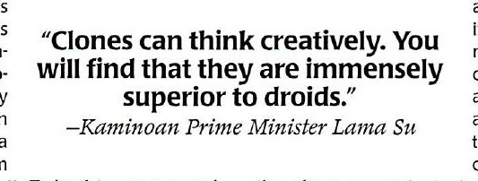

# Lama Su

- **Aliases:** —
- **Era:** —
- **Continuity:** default Legends; entries present for: Legends
- **Research tier:** untiered (not listed as INTRO/DEEP/MASTERY in legends-feats.md)
- **Entries:** 18 (6 with quotations; 1 quotations extended to the full sentence/passage from the source text on file; 2 marked as fragments). Rebuilt 2026-11-17 from 18 old entries; old file: `characters/_bak/lama-su.md.bak-20261117`.
- **How to read:** each entry is the quotation in full (block quote), then its source and point of view. "Note" lines are summaries from our notes, not quotations. `[fragment — full passage not on file]` means the source text is not on the box, so only the words in our notes are shown. Debate and forum material is in the last section and is unverified.

# LEGENDS (Legends / EU — main focus)

## Sourcebooks/Geonosis and the Outer Rim Worlds.pdf [Star Wars Roleplaying Game Revised Core (d20, 2002)] (scan pages 61–120)

- Note (summary from our notes, not a quotation): Page contents: Kamino: description (stilt cities); history (Great Flood; cloning; Darth Tyrannus as Sifo-Dyas contracts the clone army; Obi-Wan Kenobi discovers it; Lama Su; Jango Fett template; Battle of Kamino led by Kenobi with Quinlan Vos and Aayla Secura). (hand-read)
  — Source: Sourcebooks/Geonosis and the Outer Rim Worlds.pdf [Star Wars Roleplaying.
Our notes: `notes/materials/037-sw-d20-folder/667-geonosis-and-the-outer-rim-worlds-scan-061-120.md:97`

> Though some details still remain clouded, it is generally acknowledged that some ten years prior to the Battle of Geonosis, the Kaminoans were contracted by Darth Tyrannus (under the guise of Jedi Knight Sifo-Dyas) to create an army of clones for use by the Republic. When Jedi Obi-Wan Kenobi tracked an assassination attempt on Senator Amidala of Naboo to Kamino, the clone army-in-progress was discovered, and since those events and the onset of the Clone Wars, Kamino has played a largely unseen but key role in galactic affairs. Under the stewardship of Prime Minister Lama Su, the Kaminoans issued their first armies of clone troopers based on the genetic template of the bounty hunter Jango Fett.
— Source: Sourcebooks/Geonosis and the Outer Rim Worlds.pdf [Star Wars Roleplaying.
Note (our notes, around the quote): Count Dooku; Obi-Wan Kenobi; Padmé Amidala; Jango Fett — entry/section: Kamino's clone army: "Though some details still remain clouded, it is generally acknowledged that some ten years prior to the Battle of Geonosis, the Kaminoans were contracted by Darth Tyrannus (under the guise of Jedi Knight Sifo-Dyas) to create an army of clones for use by the Republic. When Jedi Obi-Wan Kenobi tracked an assassination attempt on Senator Amidala of Naboo to Kamino, the clone army-in-progress was discovered, and since those events and the onset of the Clone Wars, Kamino has played a largely unseen but key role in galactic affairs. Under the stewardship of Prime Minister Lama Su, the Kaminoans issued their first armies of clone troopers based on the genetic template of the bounty hunter Jango Fett." Source: *Geonosis and the Outer Rim Worlds* (SWRPG d20 Revised Core), scan p.74

Our notes: `notes/materials/037-sw-d20-folder/667-geonosis-and-the-outer-rim-worlds-scan-061-120.md:99`

- Note (summary from our notes, not a quotation): Page contents: Kamino: Merr-Sonn pocker stats; hooks Deep Research - Part II (Qalsneek the Bull holocron in Derem City) and Not Suitable For Cloning (Yuuzhan Vong amphistaff; Kina Ha); Taun We (ministerial assistant to Lama Su; tutors Boba Fett; Female Kaminoan Noble 10); Ko Sai biography begins. (hand-read)
  — Source: Sourcebooks/Geonosis and the Outer Rim Worlds.pdf [Star Wars Roleplaying.
Our notes: `notes/materials/037-sw-d20-folder/667-geonosis-and-the-outer-rim-worlds-scan-061-120.md:121`

## Sourcebooks/Ultimate Alien Anthology.pdf [Star Wars Roleplaying Game Revised Core (d20, 2002)] (scan pages 61–120)

- Note (summary from our notes, not a quotation): Page contents: Jenet traits; Kaminoan (example names incl. Lama Su, Taun We); Kel Dor begins. (hand-read)
  — Source: Sourcebooks/Ultimate Alien Anthology.pdf [Star Wars Roleplaying Game Revi.
Our notes: `notes/materials/037-sw-d20-folder/673-ultimate-alien-anthology-scan-061-120.md:124`

## Sourcebooks/The Clone Wars Campaign Guide.pdf [Star Wars Roleplaying Game Saga Edition (2007)] (scan pages 1–60)

- Note (summary from our notes, not a quotation): Page contents: Kaleesh cont. (personality, honor; skull masks; homeworld Kalee; example names; adventurers); Kaleesh Species Traits (Skill Focus Survival, Darkvision, Driven, Persistent). Kaminoans (Kamino cloners; selective breeding; perfectionism; example names incl. Lama Su, Taun We; adventurers). (hand-read)
  — Source: Sourcebooks/The Clone Wars Campaign Guide.pdf [Star Wars Roleplaying Game.
Our notes: `notes/materials/037-sw-d20-folder/728-the-clone-wars-campaign-guide-scan-001-060.md:99`

## Sourcebooks/The Clone Wars Campaign Guide.pdf [Star Wars Roleplaying Game Saga Edition (2007)] (scan pages 121–180)

- Note (summary from our notes, not a quotation): Page contents: ARC troopers cont. (released from cryogenic storage by Prime Minister Lama Su when Kamino is assaulted; Muunilinst with Obi-Wan vs. Durge; Hypori rescue from Grievous); ARC Trooper stat block (CL 8; nonheroic 6/soldier 3/elite trooper 3). Clone Assassin (special order from Palpatine against a Jedi coup; guard the Communication Center in the Jedi Temple; wiped out by Yoda and Obi-Wan); stat block (CL 8; vibroblades; Dual Weapon Mastery II, Martial Arts II). (hand-read)
  — Source: Sourcebooks/The Clone Wars Campaign Guide.pdf [Star Wars Roleplaying Game.
Our notes: `notes/materials/037-sw-d20-folder/728-the-clone-wars-campaign-guide-scan-121-180.md:289`

## Star Wars Insider #60 (2002)

> Anakin scowled. “I have a bad feeling about this.”
— Source: Star Wars Insider #60 (2002).
(Full sentence/passage taken from the source text on file: `cw_novels_tmp_gambit_siege_epub`.)
Note (our notes, around the quote): Page contents: McGregor interview concludes (magazine p. 33): R2-D2 as "George's favorite actor"; Hayden Christensen as Anakin; McGregor now in "the middle bracket"; getting the line "I have a bad feeling about this"; the long way to Episode IV. Caption: Obi-Wan hears puzzling news from Kaminoan Prime Minister Lama Su. (hand-read)
Our notes: `notes/materials/038-star-wars-insider/060-ins060.md:236`

## Star Wars Insider #67 (2003)

- Note (summary from our notes, not a quotation): Page contents: Cover: Return of the Jedi 20th anniversary issue; 100 Jedi secrets, Warwick Davis, Troy Denning short story, Max Rebo Band, Kevin Rubio interviews Lama Su. (hand-read)
  — Source: Star Wars Insider #67 (2003).
Our notes: `notes/materials/038-star-wars-insider/067-ins067.md:10`

- Note (summary from our notes, not a quotation): Page contents: Insider Interview: Lama Su, by Kevin Rubio, illustrated by Ken Steacy. (hand-read)
  — Source: Star Wars Insider #67 (2003).
Our notes: `notes/materials/038-star-wars-insider/067-ins067.md:550`

- Note (summary from our notes, not a quotation): Page contents: Lama Su interview concluded (clone trooper 282; the cloned interviewer). (hand-read)
  — Source: Star Wars Insider #67 (2003).
Our notes: `notes/materials/038-star-wars-insider/067-ins067.md:559`

> Jango Fett is one of the finest specimens we ever encountered. Not only did he provide his genetic material, he also aided in training the first batch.
— Source: Star Wars Insider #67 (2003).
Note (our notes, around the quote): Jango Fett — entry/section: Star Wars Insider 067 (2003): Lama Su on Jango: "Jango Fett is one of the finest specimens we ever encountered. Not only did he provide his genetic material, he also aided in training the first batch." Source: *Star Wars Insider #67* (2003), scan p.98

Our notes: `notes/materials/038-star-wars-insider/067-ins067.md:561`

## Star Wars Insider #70 (2003)

- Note (summary from our notes, not a quotation): Page contents: Alienation: Kaminoans continued (Anthony Phelan as Lama Su). (hand-read)
  — Source: Star Wars Insider #70 (2003).
Our notes: `notes/materials/038-star-wars-insider/070-ins070.md:117`

## Star Wars Insider #74 (2004)

> In the past, a desire for individuality led to the spontaneous creation of combat nicknames in the field,
> [fragment — full passage not on file]
>
> A name was once considered a flaw, but we have found that allowing names produces the desired effects of initiative and goal-setting. In command units, these unofficial nicknames are formally recognized as a mark of distinction and excellence among our most capable products.
— Source: Star Wars Insider #74 (2004); Lama Su — entry/section: Lama Su on clone names.
Note (our notes, around the quote): Lama Su — entry/section: Lama Su on clone names: ""In the past, a desire for individuality led to the spontaneous creation of combat nicknames in the field," explains Kaminoan Prime Minister Lama Su. "A name was once considered a flaw, but we have found that allowing names produces the desired effects of initiative and goal-setting. In command units, these unofficial nicknames are formally recognized as a mark of distinction and excellence among our most capable products." —Lama Su, Star Wars Insider 74, p. 61" Source: *Star Wars Insider #74* (2004), scan p.61

Our notes: `notes/materials/038-star-wars-insider/074-ins074.md:404`

## Star Wars Insider #75 (2004)

- Note (summary from our notes, not a quotation): Page contents: Topps Clone Wars continued: puzzle-back stickers, 10 lenticular Battle Motion Cards, Artist Sketch inserts (artists including Genndy Tartakovsky, Paul Rudish, Davide Fabbri, Doug Wheatley, Joe Corroney, Dave Dorman); late Attack of the Clones autograph cards of Jack Thompson (Cliegg Lars) and Anthony Phelan (Lama Su). (hand-read)
  — Source: Star Wars Insider #75 (2004).
Our notes: `notes/materials/038-star-wars-insider/075-ins075.md:573`

## Star Wars Insider #87 (2006)

- Note (summary from our notes, not a quotation): Page contents: Odds cont.: Lama Su recording to Chancellor Palpatine; Skirata (hand-read)
  — Source: Star Wars Insider #87 (2006).
Our notes: `notes/materials/038-star-wars-insider/087-ins087.md:366`

## Star Wars Insider #103 (2008)

- Note (summary from our notes, not a quotation): Page contents: Classic Moment (folio "76 INSIDER"): Episode II Attack of the Clones [DVD Chapter 20]; still of Obi-Wan with Lama Su and Taun We in Tipoca City corridor beside clone hatchery pods (hand-read)
  — Source: Star Wars Insider #103 (2008).
Our notes: `notes/materials/038-star-wars-insider/103-ins103.md:602`

## Star Wars Visual Dictionaries, Episodes I–VI (DK, 1998–2005) + The Phantom Menace Expanded Visual Dictionary (DK, 2012)

> outwardly polite, yet behind this lurks an extreme intolerance of physical imperfection
> [fragment — full passage not on file]
>
> No other scientist in the galaxy could so capably manipulate the genes of another species.
— Source: Star Wars Attack of the Clones: The Visual Dictionary (DK, 2002): hand-read notes.
Note (our notes, around the quote): p34-35 Kaminoans: global climate shift flooded planet ("Great Flood"); selective breeding; "outwardly polite, yet behind this lurks an extreme intolerance of physical imperfection"; Sifo-Dyas order "a decade ago"; aiwhas; Tipoca (Kaminoan capital city) stilt cities; Taun We (Project Coordinator, studied human emotional psychology); Ko Sai (Chief Scientist): "No other scientist in the galaxy could so capably manipulate the genes of another species." Lama Su prime minister. DATA FILE: Kaminoans see in ultraviolet.
Our notes: `notes/materials/047-visual-dictionaries/vd2-ep2.md:40`

## The New Essential Guide to Weapons and Technology (2004)

> Clones can think creatively. You will find that they are immensely superior to droids.
— Source: The New Essential Guide to Weapons and Technology (W. Haden Blackman, Del Rey, 2004), printed p.185, scan p.211..
Note (our notes, around the quote): "Clones can think creatively. You will find that they are immensely superior to droids." —Kaminoan Prime Minister Lama Su.
Our notes: `notes/materials/155-new-essential-guide-to-weapons-technology-2004/quotes/QUOTES-INDEX.md`

# Debate and forum claims (unverified)

Forum posts, Suspect Insight debates and Discord debates, respect threads, and verdicts. These are posters' arguments or quotations they typed; none is checked against the book here unless the entry says so.

_None in our notes._
