# Lando Calrissian

- **Aliases:** Lando, Calrissian
- **Era:** GCW–NJO
- **Continuity:** default Legends; entries present for: Canon, Legends
- **Research tier:** untiered (not listed as INTRO/DEEP/MASTERY in legends-feats.md)
- **Entries:** 465 (258 with quotations; 37 quotations extended to the full sentence/passage from the source text on file; 88 marked as fragments; 145 before the 2026-11-17 fragment fill). Rebuilt 2026-11-17 from 517 old entries; old file: `characters/_bak/lando-calrissian.md.bak-20261117`. Added 2026-11-20: 17 entries from Young Jedi Knights 2: Shadow Academy (full read). Added 2026-11-20: 3 entries from Young Jedi Knights 13: Trouble on Cloud City (full read). Added 2026-11-20: 1 entries from Young Jedi Knights 14: Crisis at Crystal Reef (full read).
- **How to read:** each entry is the quotation in full (block quote), then its source and point of view. "Note" lines are summaries from our notes, not quotations. `[fragment — full passage not on file]` means the source text is not on the box, so only the words in our notes are shown. Debate and forum material is in the last section and is unverified.

# LEGENDS (Legends / EU — main focus)

## Legacy of the Force 1–9: novel notes from the other agent (reference copy)

> a good-sized Wookiee *(L4063)*
> [fragment — full passage not on file]
>
> Alema fell, landing atop Lando’s blaster, but clearly was still struggling against the shocks paralyzing her even as wisps of smoke began to rise from her body. *(L4067)*
— Source: Ch14 · L4033–4085; L4063; L4067; L4073–4085 — Legacy of the Force 4: Exile (novel), feats and scaling notes.
(Full sentence/passage taken from the source text on file: `novels_tmp_exile_exile_epub`.)
Note (our notes, around the quote): Ch14 · L4033–4085 · Alema vs. Lando (FEAT): she TK-yanks his blaster and cane (L4033, L4055). His stun cane, rated for «a good-sized Wookiee» (L4063), only holds her briefly: she «was still struggling against the shocks» (L4067). Then she wipes Lando's memory as he flees (L4073–4085).
Our notes: `notes/materials/021-legacy-of-the-force/lotf-4-exile-notes.md:53`

- Note (summary from our notes, not a quotation): | D3 | Alema vs. Lando | Ch14, *Errant Venture* | Alema wins and erases his memory | Surprise; stun cane |
  — Source: Legacy of the Force 4: Exile (novel), feats and scaling notes.
Context: | # | Fight | Where | Result | Context |
Our notes: `notes/materials/021-legacy-of-the-force/lotf-4-exile-notes.md:99`

> a good-sized Wookiee *(L4063)*
> [fragment — full passage not on file]
— Source: Ch14, L4073–4085; Ch20, L6551; Ch18, L5555–5659; L4063 — Legacy of the Force 4: Exile (novel), feats and scaling notes.
Note (our notes, around the quote): Key feats: TK-yanks Lando's blaster and cane, outlasts a stun cane rated for «a good-sized Wookiee» (L4063), and wipes his memory (Ch14, L4073–4085). Catches Han's bolt «casually» (Ch20, L6551). Escapes a five-on-one trap despite a broken clavicle (Ch18, L5555–5659).
Our notes: `notes/materials/021-legacy-of-the-force/lotf-4-exile-notes.md:232`

- Note (summary from our notes, not a quotation): Lando's wife Tendra is pregnant (L2263).
  — Source: L2263 — Legacy of the Force 7: Fury (novel, read in full): feats, scaling and story notes.
Our notes: `notes/materials/021-legacy-of-the-force/lotf-7-fury-notes.md:297`

- Note (summary from our notes, not a quotation): Leia boards the *Anakin Solo* from Lando's yacht to "talk" (L2489–2515); Caedus senses only her aboard (L2509–2511) and plans to imprison her and Han.
  — Source: L2489–2515; L2509–2511 — Legacy of the Force 7: Fury (novel, read in full): feats, scaling and story notes.
Our notes: `notes/materials/021-legacy-of-the-force/lotf-7-fury-notes.md:305`

## Jedi Academy Trilogy (Kevin J. Anderson, 1994): Jedi Search, Dark Apprentice, Champions of the Force (power-scaling notes)

> The trooper reached up, stabbing through the plated case with vibroblade claws. Mara used his temporary disorientation to grab Lando and add his mass to her own as she shoved the spacetrooper. With her foot Mara pried free one of the spacetrooper’s boots as he fought to regain his balance. She slammed against him, breaking the magnetic grip of his other boot. In an instant the trooper snapped free.
>
> free.
>
> Suddenly unattached to the core, he dropped with the momentum imparted by the force of Mara’s attack. The spacetrooper scrabbled to find purchase against the smooth cylindrical hull as he slid down toward the fiery contact points. The vibroblades in his glove made long, silvery score marks on the metal, but did no good.
>
> Sucked inexorably down, the trooper plunged into the flaming discharge between the contact points and vaporized in a bolt of green-and-blue static.
>
> The detonators continued their countdown.
— Source: Champions of the Force, ch.36, PDF p.216 — Owner Material 026 — Jedi Academy Trilogy: Champions of the Force (Kevin J. Anderson); Mara knocks a spacetrooper into the power-core discharge.
(Excerpt widened 2026-11-17 to the relevant passage, word for word from Champions of the Force (Kevin Anderson) (text copy `MEGA_Legend_The_Jedi_Academy_Trilogy_Star_Wars_Jedi_Academy_03_Champions_of_the_Force_Kevin_J_Anderson_epub`).)
(Excerpt widened 2026-11-17 to the relevant passage, word for word from Champions of the Force (Kevin Anderson) (text copy `MEGA_Legend_The_Jedi_Academy_Trilogy_Star_Wars_Jedi_Academy_03_Champions_of_the_Force_Kevin_J_Anderson_epub`).)
(Full sentence/passage taken from the source text on file: `research_primary_jedi_academy_trilogy_champions_of_the_force_txt`.)
Note (our notes, around the quote): Mara knocks a spacetrooper into the power-core discharge: "Mara used his temporary disorientation to grab Lando and add his mass to her own as she shoved the spacetrooper. With her foot Mara pried free one of the spacetrooper’s boots as he fought to regain his balance. She slammed against him, breaking the magnetic grip of his other boot. … Sucked inexorably down, the trooper plunged into the flaming discharge between the contact points and vaporized in a bolt of green-and-blue static." Source: Champions of the Force, ch.36, PDF p.216
Our notes: `notes/materials/026-jedi-academy-trilogy/champions-of-the-force.md:195`

> Doole seemed completely astonished, flailing his splayed hands in the air. “What are you talking about?” he croaked. As Lando glared down into the Rybet’s huge eyes, Doole slipped one of his hands into his waistcoat and yanked free a small “hold-out” blaster pistol. Luke saw it and reacted instantly, shoving with his mind and using the Force to hurl Moruth Doole away from Lando.
— Source: Jedi Search, ch.22, PDF p.223 — Owner Material 026 — Jedi Academy Trilogy: Jedi Search (Kevin J. Anderson); Luke Force-shoves Doole off Lando (also: Moruth Doole).
(Excerpt widened 2026-11-17 to the relevant passage, word for word from Jedi Search (Kevin Anderson), Chapter 22 (text copy `MEGA_Legend_The_Jedi_Academy_Trilogy_Star_Wars_Jedi_Academy_01_Jedi_Search_Kevin_J_Anderson_epub`).)
Note (our notes, around the quote): Luke Force-shoves Doole off Lando (also: Moruth Doole): "As Lando glared down into the Rybet’s huge eyes, Doole slipped one of his hands into his waistcoat and yanked free a small “hold-out” blaster pistol. Luke saw it and reacted instantly, shoving with his mind and using the Force to hurl Moruth Doole away from Lando." Source: Jedi Search, ch.22, PDF p.223
Our notes: `notes/materials/026-jedi-academy-trilogy/jedi-search.md:30`

## Star Wars: The New Essential Chronology (Del Rey, 2005): power-scaling and lore notes

> Han Passed on the information to Tharen’s surviving family.
>
> With his first love dead, one chapter of Han Solo’s life closed forever. But a new one was about to begin. The Corel _ lian smuggler strode into the smoky darkness of the Mos Eisley cantina for a fateful rendezvous with two local desert dwellers who needed passage to Alderaan. player, and one of the best star jockeys in all of Hutt space.
>
> He caught up with Han at just the right time. The bounty hunter Boba Fett had Han at gunpoint, but Lando Inter cepted the pair and turned the tables on Fett He injected the bounty hunter with an obedience drug and ordered him to fly off to the Rim of the galaxy.
>
> He caught up with Han at just the right time. The bounty hunter Boba Fett had Han at gunpoint, but Lando Inter cepted the pair and turned the tables on Fett He injected the bounty hunter with an obedience drug and ordered him to fly off to the Rim of the galaxy. A grateful Han offered to teach Lando how to pilot, at no charge.
>
> THE SHARU AWAKEN 4BB.Y.
>
> | ando was 4 quick study, but learning to single-pilot a
>
> «freighter was a iikky proposition.
— Source: Part Four: Profiles in History; Lando Calrissian; Boba Fett — Lando drugs Fett.
(Excerpt widened 2026-11-17 to the relevant passage, word for word from research primary new essential chronology nec paged (text copy `research_primary_new_essential_chronology_nec_paged_txt_88b808b5bc`).)
(Excerpt widened 2026-11-17 to the relevant passage, word for word from research primary new essential chronology nec paged (text copy `research_primary_new_essential_chronology_nec_paged_txt_88b808b5bc`).)
Note (our notes, around the quote): Lando Calrissian; Boba Fett — Lando drugs Fett: "He injected the bounty hunter with an obedience drug and ordered him to fly off to the Rim of the galaxy." Source: The New Essential Chronology, p.98
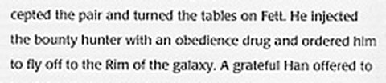
Our notes: `notes/materials/027-new-essential-chronology/04-part-four-profiles-in-history.md:75`

> Lando Calrissian scouts his new acquisition, the Millennium Falcon
> [fragment — full passage not on file]
— Source: Part Four: Profiles in History; Lando Calrissian — art caption.
Note (our notes, around the quote): Lando Calrissian — art caption: "Lando Calrissian scouts his new acquisition, the Millennium Falcon" Source: The New Essential Chronology, p.99, caption
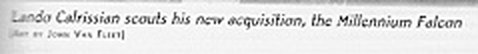
Our notes: `notes/materials/027-new-essential-chronology/04-part-four-profiles-in-history.md:82`

> Zipped up in spacesuits, Lando and the Sorcerer of Tund faced off in the middle of the watching fleet. They shot at one another while maneuvering for position with jet packs. One of Lando's wild shots caught Gepta in the ankle.
— Source: Part Four: Profiles in History; Lando Calrissian — Lando vs Gepta.
Note (our notes, around the quote): Lando Calrissian — Lando vs Gepta: "Zipped up in spacesuits, Lando and the Sorcerer of Tund faced off in the middle of the watching fleet. They shot at one another while maneuvering for position with jet packs. One of Lando's wild shots caught Gepta in the ankle." Source: The New Essential Chronology, p.102
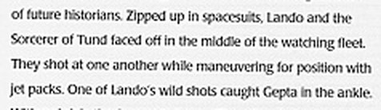
Our notes: `notes/materials/027-new-essential-chronology/04-part-four-profiles-in-history.md:103`

> including his single-handed decimation of the Norulac pirates in the notorious Battle of Taanab.
> [fragment — full passage not on file]
— Source: Part Four: Profiles in History; Lando Calrissian — Battle of Taanab.
Note (our notes, around the quote): Lando Calrissian — Battle of Taanab: "including his single-handed decimation of the Norulac pirates in the notorious Battle of Taanab." Source: The New Essential Chronology, p.103
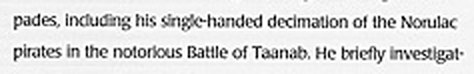
Our notes: `notes/materials/027-new-essential-chronology/04-part-four-profiles-in-history.md:112`

## The Jedi Academy Sourcebook (WEG, 1996): power-scaling and lore notes

> Small wonder, then, that he decided that a quiet week or so in the relatively sedate environs of the Imperial database center would do him some good. At Luke's behest, he combs the Imperial databases in search of potential candidates for Luke’s Jedi academy, while Luke goes on to check a few leads of his own.
>
> He and Threepio accompany Lando ona trip to Umgul to check on one lead that he turns up, The lead turned out to be a dead end, but Artoo does help Lando land a million credit reward, for which Lando is no doubt grateful.
>
> When Luke returns from his journeys, Artoo resumes his duties of keeping a watchful eye on his master. He accompanies Luke and Lando to Kessel, and guards Luke's defenseless body on Yavin Four after Kyp places him in a Sith coma.
>
> === sp15 Chapter One: The New Re | Ls Chapter One: The New Repub TAR A Change of Command “The Admiral will see you now.”
>
> When Luke returns from his journeys, Artoo resumes his duties of keeping a watchful eye on his master. He accompanies Luke and Lando to Kessel, and guards Luke's defenseless body on Yavin Four after Kyp places him in a Sith coma.
>
> === sp15 Chapter One: The New Re | Ls Chapter One: The New Repub TAR A Change of Command “The Admiral will see you now.”
>
> Wedge nodded to the young ensign. She looked tired. He looked around the central corridor of the Headquarters Frigate. Every- one looked tired.
— Source: Chapter One: The New Republic; Luke Skywalker; Kyp Durron — Artoo-Detoo — guarding Luke.
(Excerpt widened 2026-11-17 to the relevant passage, word for word from research primary jedi academy sourcebook jas clean (text copy `research_primary_jedi_academy_sourcebook_jas_clean_txt_04b8ab0d44`).)
(Excerpt widened 2026-11-17 to the relevant passage, word for word from research primary jedi academy sourcebook jas clean (text copy `research_primary_jedi_academy_sourcebook_jas_clean_txt_04b8ab0d44`).)
Note (our notes, around the quote): Luke Skywalker; Kyp Durron — Artoo-Detoo — guarding Luke: "He accompanies Luke and Lando to Kessel, and guards Luke's defenseless body on Yavin Four after Kyp places him in a Sith coma." Source: The Jedi Academy Sourcebook, p.13
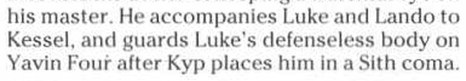
Our notes: `notes/materials/029-jedi-academy-sourcebook/01-ch1-the-new-republic.md:67`

- Note (summary from our notes, not a quotation): Mara Jade Skywalker; Han Solo — Mara Jade — aboard the Death Star: "When the "closer look" turns into a wild and rough piggyback ride within the girders of the Death Star, she suggests that she and Lando plant limpet mines on the power core of the Death Star while Han repairs the Falcon's hyperdrive." Source: The Jedi Academy Sourcebook, p.82
  — Source: Chapter Seven: The Fringe.
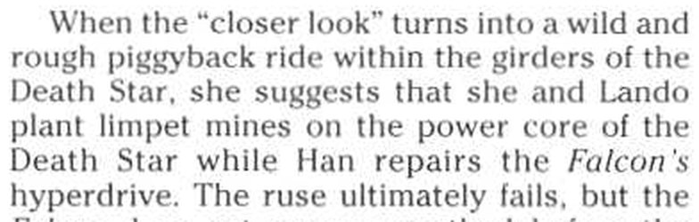
Our notes: `notes/materials/029-jedi-academy-sourcebook/07-ch7-the-fringe.md:27`

> Lando has little trouble locating Tymmo once on Umgul, and soon learns that the scruffy- looking human is not using the Force to win at the races, but a high-tech form of cheating which even the eagle-eyed racing authorities of Umgul have not detected.
>
> Lando corners Tymmo in the Fondine blob stables, and after a brief firefight, has him rounded up by the authorities. When he learn who Tymmo really is (and that there is a huge reward for his return), Lando talks Slish Fondine, owner of the stables, into suspending the tradi- tional death penalty sentence so that the errant consort could be returned to his wife. In return, he agrees to split the million credit reward offered by Duchess Mistal.
>
> Han and Lando enter into an ongoing gam- bling competition over who is the rightful mas- ter of the Millennium Falcon. After several games (each supposedly the final one), Lando wins final ownership of the Falcon, but gives her back to Han as a grand gesture designed to impress Mara Jade, who he has taken a fancy for, The Jedi Academy Sourcebook === sp98 Ray Lederer He comes to regret the gesture when it dawns on him that he is reduced to begging rides from Han until he can recover his own ship.
>
> Han and Lando enter into an ongoing gam- bling competition over who is the rightful mas- ter of the Millennium Falcon. After several games (each supposedly the final one), Lando wins final ownership of the Falcon, but gives her back to Han as a grand gesture designed to impress Mara Jade, who he has taken a fancy for, The Jedi Academy Sourcebook === sp98 Ray Lederer He comes to regret the gesture when it dawns on him that he is reduced to begging rides from Han until he can recover his own ship. He is so obsessed with recovering the Lady Luck that it never occurs to him that he could buy any ship he likes with a million credits in his pocket.
>
> (Given Calrissian’s nature, it is likely that the challenge of recovering his ship was more at- tractive to him than the purchase of a new vessel).
— Source: Chapter Nine: The Independent Class.
(Excerpt widened 2026-11-17 to the relevant passage, word for word from research primary jedi academy sourcebook jas clean (text copy `research_primary_jedi_academy_sourcebook_jas_clean_txt_04b8ab0d44`).)
(Excerpt widened 2026-11-17 to the relevant passage, word for word from research primary jedi academy sourcebook jas clean (text copy `research_primary_jedi_academy_sourcebook_jas_clean_txt_04b8ab0d44`).)
(Full sentence/passage taken from the source text on file: `research_primary_jedi_academy_sourcebook_jas_clean_txt`.)
Note (our notes, around the quote): Han Solo; Lando Calrissian; Mara Jade Skywalker — Lando Calrissian — the Falcon wager: "After several games (each supposedly the final one), Lando wins final ownership of the Falcon, but gives her back to Han as a grand gesture designed to impress Mara Jade, who he has taken a fancy for," Source: The Jedi Academy Sourcebook, p.96
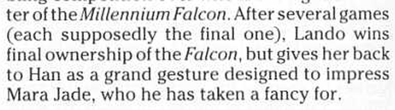
Our notes: `notes/materials/029-jedi-academy-sourcebook/09-ch9-the-independent-class.md:11`

## The Complete Star Wars Encyclopedia, Vol. I (A–G)

> The Allegiance was destroyed in an audacious maneuver by the Emancipator, a captured Star Destroyer commanded by Lando Calrissian.
— Source: scan pages 1–40; Lando Calrissian. POV: Lando Calrissian.
Note (our notes, around the quote): Lando Calrissian: "The Allegiance was destroyed in an audacious maneuver by the Emancipator, a captured Star Destroyer commanded by Lando Calrissian." Source: The Complete Star Wars Encyclopedia, Vol. I, p.20
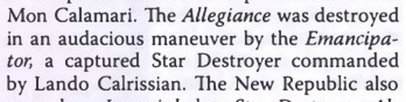
Our notes: `notes/materials/030-complete-star-wars-encyclopedia-vol-1/00-v1-scan-001-040.md:224`

> Antares Six One of two New Republic escort frigates that accompanied the Millennium Falcon to Coruscant to rescue the crew of the Liberator, the Antares Six saved Lando Calrissian and Wedge Antilles after their Star Destroyer, Emancipator, was destroyed by an Imperial World Devastator.
— Source: scan pages 41–80; Antares Draco; Lando Calrissian — entry/section: Antares Six.
Note (our notes, around the quote): Antares Draco; Lando Calrissian — entry/section: Antares Six: "Antares Six One of two New Republic escort frigates that accompanied the Millennium Falcon to Coruscant to rescue the crew of the Liberator, the Antares Six saved Lando Calrissian and Wedge Antilles after their Star Destroyer, Emancipator, was destroyed by an Imperial World Devastator." Source: The Complete Star Wars Encyclopedia, Vol. I, p.33
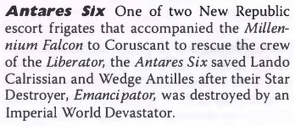
Our notes: `notes/materials/030-complete-star-wars-encyclopedia-vol-1/01-v1-scan-041-080.md:65`

> While Lord Jax worked behind the scenes to secure funds from power-hungry Imperial councilmen, Slim assassinated anyone who was a threat to Jax or his plans to kill the Emperor and make a bid forpower. Later, when Jax sensed the inev­ itable destruction of one of his flagships, Slim was the only soldier he allowed to escape with him. Just before the final battle between Kir Kanos and Carnor Jax, Slim secured a posi­ tion to eliminate Kanos from a distance. Slim was killed by Sish Sadeet mere seconds before he could shoot Kanos. BllmphA planet strategically important to the Rebel Alliance. Lando Calrissian was the diplomat sent to the Tertiary Moon of Blimph to meet with Quaffug the Hutt. By the time Lando left the planet, Quaffug's stranglehold on its trade was over and the Alliance could deal with the planet's native Jokhalli directly. Blln,VlldarA Rebel Alliance scout at Echo Base during the Battle of Hoth, he was trained Blood Carver in first-response tactics. He joined the Alliance after his brother joined the Imperial agency COMPNOR. Blin and his assistant were killed when the walker toppled by Wedge Antil­ les was destroyed. Blind Luck An aging freighter owned and operated by Desric Fol and used as an independent scoutingvessel during the Galactic Civil War.
— Source: scan pages 81–120; Lando Calrissian. POV: Lando Calrissian.
(Excerpt widened 2026-11-17 to the relevant passage, word for word from research primary cse vol1 (text copy `research_primary_cse_vol1_pdf_45a954be6d`).)
(Excerpt widened 2026-11-17 to the relevant passage, word for word from research primary cse vol1 (text copy `research_primary_cse_vol1_pdf_45a954be6d`).)
Note (our notes, around the quote): Lando Calrissian: "By the time Lando left the planet, Quaffug's stranglehold on its trade was over and the Alliance could deal with the planet's native Jokhalli directly." Source: The Complete Star Wars Encyclopedia, Vol. I, p.79
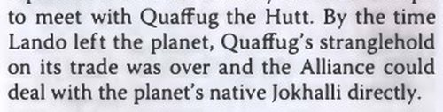
Our notes: `notes/materials/030-complete-star-wars-encyclopedia-vol-1/02-v1-scan-081-120.md:109`

> Piloting the Falcon, Lando, along with Wedge Antilles in an X-wing fighter, destroyed the Empire's second Death Star battle station.
— Source: scan pages 81–120; Lando Calrissian. POV: Lando Calrissian.
Note (our notes, around the quote): Lando Calrissian: "Piloting the Falcon, Lando, along with Wedge Antilles in an X-wing fighter, destroyed the Empire's second Death Star battle station." Source: The Complete Star Wars Encyclopedia, Vol. I, p.105
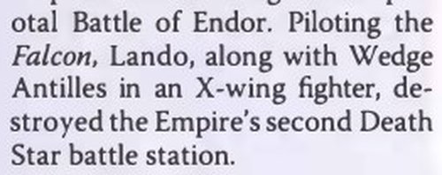
Our notes: `notes/materials/030-complete-star-wars-encyclopedia-vol-1/02-v1-scan-081-120.md:315`

> With his own ship out of commission, he flew an A-wing as Green Three and lured Imperials away from Wedge Antilles and Lando Calrissian while they made a run at destroying the second Death Star.
— Source: scan pages 121–160; Lando Calrissian. POV: Lando Calrissian.
Note (our notes, around the quote): Lando Calrissian: "With his own ship out of commission, he flew an A-wing as Green Three and lured Imperials away from Wedge Antilles and Lando Calrissian while they made a run at destroying the second Death Star." Source: The Complete Star Wars Encyclopedia, Vol. I, p.114
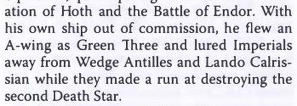
Our notes: `notes/materials/030-complete-star-wars-encyclopedia-vol-1/03-v1-scan-121-160.md:74`

> Calrissian evacuated as many of the citizens as he could, with most fleeing to Dantooine on their way to the Core. destroyer droid See droideka.
— Source: scan pages 201–240; Lando Calrissian. POV: Lando Calrissian.
Note (our notes, around the quote): Lando Calrissian: "Calrissian evacuated as many of the citizens as he could, with most fleeing to Dantooine on their way to the Core. destroyer droid See droideka." Source: The Complete Star Wars Encyclopedia, Vol. I, p.186
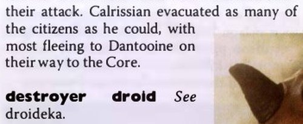
Our notes: `notes/materials/030-complete-star-wars-encyclopedia-vol-1/05-v1-scan-201-240.md:12`

> Doluff invited Calrissian to a sabacc game on Oseon 6845, but circumstances caused Calrissian to be arrested for possession of a weapon.
— Source: scan pages 201–240; Lando Calrissian. POV: Lando Calrissian.
Note (our notes, around the quote): Lando Calrissian: "Doluff invited Calrissian to a sabacc game on Oseon 6845, but circumstances caused Calrissian to be arrested for possession of a weapon." Source: The Complete Star Wars Encyclopedia, Vol. I, p.196
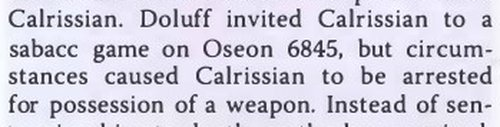
Our notes: `notes/materials/030-complete-star-wars-encyclopedia-vol-1/05-v1-scan-201-240.md:82`

> If the prey survived for a day without being captured or killed—as Lando did—he or she was allowed to go free.
— Source: scan pages 201–240; Lando Calrissian. POV: Lando Calrissian.
Note (our notes, around the quote): Lando Calrissian: "If the prey survived for a day without being captured or killed—as Lando did—he or she was allowed to go free." Source: The Complete Star Wars Encyclopedia, Vol. I, p.213
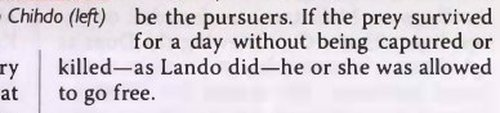
Our notes: `notes/materials/030-complete-star-wars-encyclopedia-vol-1/05-v1-scan-201-240.md:227`

> Still, in an act ofvengeance, he removed the memoriesfromthe mind ofreformed Imperial weapons developer Qwi Xux. He then joined Exar Kun to raise a major Imperial weapon, the Sun Crusher, from its burial grounds in the heart of the gas giant Yavin. When Luke Skywalker tried to intervene, Kyp and Kun trapped Luke's spirit outside his body, placing the Jedi in a state near death. Kyp tracked down his most hated enemy, Admiral Daala, as she was about to attack Coruscant, and nearly destroyed her. Next, he tried to find his brother on Carida, but the rescue attempt failed when he accidentally incinerated his brother along with the planet. Later, as Kyp was about to destroy the Millennium Falcon with Han Solo and Lando Calrissian aboard, he was freed from Exar Kun's influence when the other Jedi trainees succeeded in destroying Kun's spirit. A recov- Kyp Durron ered Luke offered to continue Kyp's training if he forever renounced the dark side. On their way to destroy the Sun Crusher once and for all, Luke and Kyp ran into another battle with Admiral Daala. Kyp managed to destroy both the Sun Crusher and a prototype Death Star, barely escaping with his life. Kyp grappled with the guilt ofhis transgres­ sion for years, dedicating himself to the Jedi Order.
— Source: scan pages 201–240; Kyp Durron; Han Solo; Lando Calrissian; Exar Kun.
(Excerpt widened 2026-11-17 to the relevant passage, word for word from research primary cse vol1 (text copy `research_primary_cse_vol1_pdf_45a954be6d`).)
(Excerpt widened 2026-11-17 to the relevant passage, word for word from research primary cse vol1 (text copy `research_primary_cse_vol1_pdf_45a954be6d`).)
Note (our notes, around the quote): Kyp Durron; Han Solo; Lando Calrissian; Exar Kun: "Later, as Kyp was about to destroy the Millennium Falcon with Han Solo and Lando Calrissian aboard, he was freed from Exar Kun's influence when the other Jedi trainees succeeded in destroying Kun's spirit." Source: The Complete Star Wars Encyclopedia, Vol. I, p.218
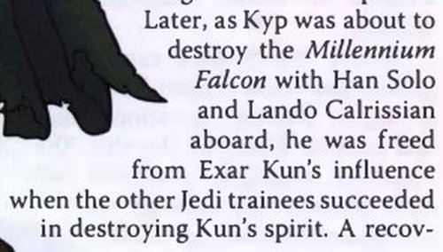
Our notes: `notes/materials/030-complete-star-wars-encyclopedia-vol-1/05-v1-scan-201-240.md:258`

> Lando Calrissian and Luke Skywalker foiled Ferrier's plans to steal a few ships from the Sluis Van shipyards, but Ferrier was able to provide Thrawn with an even greater prize: the location of the legendary and longsought Katana fleet.
— Source: scan pages 241–280; Lando Calrissian; Luke Skywalker; Grand Admiral Thrawn.
Note (our notes, around the quote): Lando Calrissian; Luke Skywalker; Grand Admiral Thrawn: "Lando Calrissian and Luke Skywalker foiled Ferrier's plans to steal a few ships from the Sluis Van shipyards, but Ferrier was able to provide Thrawn with an even greater prize: the location of the legendary and longsought Katana fleet." Source: The Complete Star Wars Encyclopedia, Vol. I, p.265
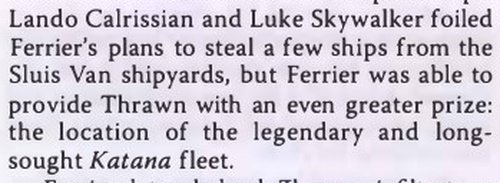
Our notes: `notes/materials/030-complete-star-wars-encyclopedia-vol-1/06-v1-scan-241-280.md:265`

> He was well muscled but spoke in a high-pitched voice that belied his strength. His arms were essentially vesti­ gial wings connected to his chest by a mem­ brane. Fybot also suffered from his species' nervous anticipation and intense dreaming. As a youth, he received Imperial condition­ ing that made him tough and shrewd. He took this experience and became an under­ cover drug officer. There he gained the atten­ tion of Rokur Gepta, who saw a way to use Fybot to finally kill his enemy Lando Calris­ sian. But after Gepta felt that he had finally achieved his goal of trapping Calrissian, he decided that Fybot had outlived his usefulness, and killed the avian being in cold blood. fynockA species of small, predatory insects native to certain caves on the planet Talus. Fynocks usually trav­ eled in large swarms allow­ ing them to overpower much largerprey. Each swarm con­ sisted of at least two differ­ ent types of fynocks, those that could fly and those that scuttled along the ground. Fynock A designation for Incom Industries' high-end starship booster system, produced at the height of the New Order. The system was built upon the designs of the Mynock and Vynock series of boosters, and was available in standard and de- luxe versions, depending on the desired power output characteristics.
— Source: scan pages 281–320; Rokur Gepta; Lando Calrissian.
(Excerpt widened 2026-11-17 to the relevant passage, word for word from research primary cse vol1 (text copy `research_primary_cse_vol1_pdf_45a954be6d`).)
(Excerpt widened 2026-11-17 to the relevant passage, word for word from research primary cse vol1 (text copy `research_primary_cse_vol1_pdf_45a954be6d`).)
Note (our notes, around the quote): Rokur Gepta; Lando Calrissian: "But after Gepta felt that he had finally achieved his goal of trapping Calrissian, he decided that Fybot had outlived his usefulness, and killed the avian being in cold blood." Source: The Complete Star Wars Encyclopedia, Vol. I, p.300
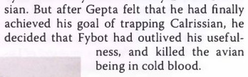
Our notes: `notes/materials/030-complete-star-wars-encyclopedia-vol-1/07-v1-scan-281-320.md:262`

> Eventually, it was destroyed by Lando Calrissian and Drebble.
— Source: scan pages 321–360; Lando Calrissian. POV: Lando Calrissian.
Note (our notes, around the quote): Lando Calrissian: "Eventually, it was destroyed by Lando Calrissian and Drebble." Source: The Complete Star Wars Encyclopedia, Vol. I, p.317
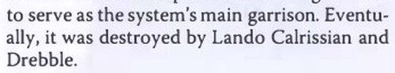
Our notes: `notes/materials/030-complete-star-wars-encyclopedia-vol-1/08-v1-scan-321-360.md:85`

> They were "resurrected" by Ventor as dreambeasts and sent after the Alliance team. Gatterweld, Ensign Found aboard the Razor's Kiss after Warlord Zsinj stole the ship from Kuat Drive Yards, Gatterweld took con­ trol after the death of Captain Raslan during the ship's flight from Kuat. However, Gatter­ weld was unable to defend the huge ship from the massed firepower of the Mon Remonda and the T edevium, and the Razor's Kiss was destroyed. Gatterweld was rescued and re­ warded for his bravery and loyalty to Zsinj by being named part of his security force aboard the Iron Fist. Gatterweld was almost killed later when he was attacked by creatures that were released from Project Chubar. GauchOne ofthe pilots who worked for Lando Calrissian in the asteroid belt known as Lando's Folly, he was one ofthe first pilots killed when the Yuuzhan Vong attacked Dubrillion. Gauch's TIE bomber was being protected by the Belt-Runner I station, but the station was forced to retract its shield energy after it sustained heavy damage, and Gauch's ship was destroyed by enemy fire.
>
> Gatterweld was rescued and re­ warded for his bravery and loyalty to Zsinj by being named part of his security force aboard the Iron Fist. Gatterweld was almost killed later when he was attacked by creatures that were released from Project Chubar.
>
> Gauch One of the pilots who worked for Lando Calrissian in the asteroid belt known as Lando's Folly, he was one of the first pilots killed when the Yuuzhan Vong attacked Dubrillion. Gauch's TIE bomber was being protected by the Belt-Runner I station, but the station was forced to retract its shield energy after it sustained heavy damage, and Gauch's ship was destroyed by enemy fire.
>
> Gaulus A mountainous world not far from Ta­ tooine, it was the site of a Rebel base captured by the Empire during the Galactic Civil War.
>
> Gauntlet An Imperial-class Star Destroyer, it was part of the Empire's fleet in the Tapani 327
>
> 0 Gauntlet Scanners sector at the height of the New Order.
— Source: scan pages 321–360; Lando Calrissian. POV: Lando Calrissian.
(Excerpt widened 2026-11-17 to the relevant passage, word for word from research primary cse vol1 (text copy `research_primary_cse_vol1_pdf_45a954be6d`).)
(Excerpt widened 2026-11-17 to the relevant passage, word for word from research audit work src m030 (text copy `research_audit_work_src_m030_txt_69ea9f4a41`).)
(Excerpt widened 2026-11-17 to the relevant passage, word for word from research audit work src m030 (text copy `research_audit_work_src_m030_txt_69ea9f4a41`).)
Note (our notes, around the quote): Lando Calrissian: "Gauch One of the pilots who worked for Lando Calrissian in the asteroid belt known as Lando's Folly, he was one of the first pilots killed when the Yuuzhan Vong attacked Dubrillion." Source: The Complete Star Wars Encyclopedia, Vol. I, p.327
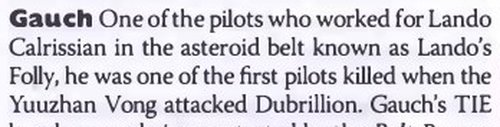
Our notes: `notes/materials/030-complete-star-wars-encyclopedia-vol-1/08-v1-scan-321-360.md:147`

> Lando Calrissian battled Gepta and defeated him, in the process discovering that the Sorcerer was actually a vicious Croke—a small, snaillike being with hairy black legs that used illusion to make its way through life.
— Source: scan pages 321–360; Rokur Gepta; Lando Calrissian — entry/section: Gepta, Rokur.
Note (our notes, around the quote): Rokur Gepta; Lando Calrissian — entry/section: Gepta, Rokur: "Lando Calrissian battled Gepta and defeated him, in the process discovering that the Sorcerer was actually a vicious Croke—a small, snaillike being with hairy black legs that used illusion to make its way through life." Source: The Complete Star Wars Encyclopedia, Vol. I, p.334
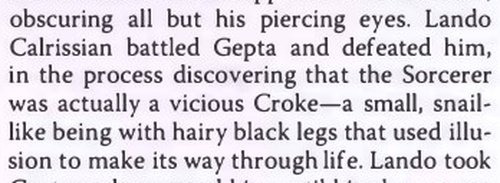
Our notes: `notes/materials/030-complete-star-wars-encyclopedia-vol-1/08-v1-scan-321-360.md:196`

> Thirteen years after the Battle of Endor, Lando Calrissian was captured by Nandreeson and nearly killed before Han Solo and Chewbacca rescued him.
— Source: scan pages 361–398; Lando Calrissian; Han Solo; Chewbacca.
Note (our notes, around the quote): Lando Calrissian; Han Solo; Chewbacca: "Thirteen years after the Battle of Endor, Lando Calrissian was captured by Nandreeson and nearly killed before Han Solo and Chewbacca rescued him." Source: The Complete Star Wars Encyclopedia, Vol. I, p.346
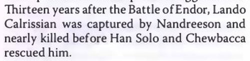
Our notes: `notes/materials/030-complete-star-wars-encyclopedia-vol-1/09-v1-scan-361-398.md:12`

> Gold SquadronA Rebel Alliance Y-wing fighter squadron assigned to the Massassi Base on Yavin 4, it was called upon to attack the first Death Star. During the battle, the en­ tire squadron was wiped out, with the excep­ tion of Keyan Farlander. Gold Three The call sign of Y-wing pilot Ryle Torsyn during the Battle of Yavin. GoldTwoThe call sign ofY-wing pilot Tiree during the Battle of Yavin. 35 1 0 Gold Wing Golthar's Sky Gold Wing The Rebel Alliance starfighter battle group under the command of Gold Leader Lando Calrissian during the Battle of Endor, it was assigned the task of destroying the second Death Star. GolfhanA Caridan, he was the primary am­ bassador from his homeworld totheOld Repub­ lic in the years leading up to the Clone Wars. Golga the Hutt (Golga Besadll Fir) A representative of Nal Hutta to the New Re­ public, he was a member of Besadii kajidic by birth but was said to have had a touch of the Desilijic clan in him because of his desire for human women. After it was learned that Borha the Hutt had made a deal to ally the Hutts with the invading Yuuzhan Vong, Golga was expelled from Coruscant and agreed to meet with Viqi Shesh, who tried to gather in­ formation on the aliens' next moves.
— Source: scan pages 361–398; Lando Calrissian. POV: Lando Calrissian.
(Excerpt widened 2026-11-17 to the relevant passage, word for word from research primary cse vol1 (text copy `research_primary_cse_vol1_pdf_45a954be6d`).)
(Excerpt widened 2026-11-17 to the relevant passage, word for word from research primary cse vol1 (text copy `research_primary_cse_vol1_pdf_45a954be6d`).)
Note (our notes, around the quote): Lando Calrissian: "Gold Wing The Rebel Alliance starfighter battle group under the command of Gold Leader Lando Calrissian during the Battle of Endor, it was assigned the task of destroying the second Death Star." Source: The Complete Star Wars Encyclopedia, Vol. I, p.352
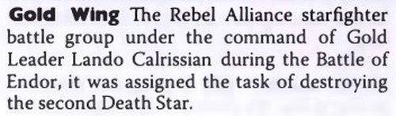
Our notes: `notes/materials/030-complete-star-wars-encyclopedia-vol-1/09-v1-scan-361-398.md:52`

## The Complete Star Wars Encyclopedia, Vol. II (H–O)

> He was shot and killed when Calrissian tried to escape Drogheda by taking the queen hostage.
— Source: scan pages 1–40; Lando Calrissian. POV: Lando Calrissian.
Note (our notes, around the quote): Lando Calrissian: "He was shot and killed when Calrissian tried to escape Drogheda by taking the queen hostage." Source: The Complete Star Wars Encyclopedia, Vol. II, p.19
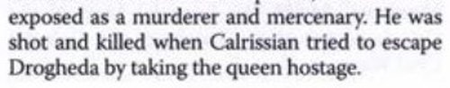
Our notes: `notes/materials/031-complete-star-wars-encyclopedia-vol-2/00-v2-scan-001-040.md:170`

> His skills in trade languages, coupled with his defeat of the Jokhalli masters in Divot, earned Lando a measure of respect among the Jokhalli, who helped him escape Quaffug.
— Source: scan pages 161–200; Lando Calrissian. POV: Lando Calrissian.
Note (our notes, around the quote): Lando Calrissian: "His skills in trade languages, coupled with his defeat of the Jokhalli masters in Divot, earned Lando a measure of respect among the Jokhalli, who helped him escape Quaffug." Source: The Complete Star Wars Encyclopedia, Vol. II, p.170
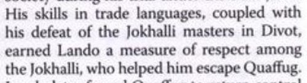
Our notes: `notes/materials/031-complete-star-wars-encyclopedia-vol-2/04-v2-scan-161-200.md:127`

> The Kauri was destroyed when the vagabond fled into hyperspace after Lando Calrissian breached its inner hull.
— Source: scan pages 201–240; Lando Calrissian. POV: Lando Calrissian.
Note (our notes, around the quote): Lando Calrissian: "The Kauri was destroyed when the vagabond fled into hyperspace after Lando Calrissian breached its inner hull." Source: The Complete Star Wars Encyclopedia, Vol. II, p.204
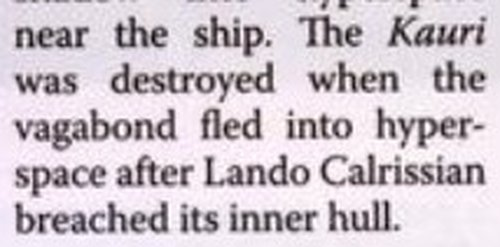
Our notes: `notes/materials/031-complete-star-wars-encyclopedia-vol-2/05-v2-scan-201-240.md:91`

> Kenow was discovered by Lando Calrissian, who killed him in self-defense.
— Source: scan pages 201–240; Lando Calrissian. POV: Lando Calrissian.
Note (our notes, around the quote): Lando Calrissian: "Kenow was discovered by Lando Calrissian, who killed him in self-defense." Source: The Complete Star Wars Encyclopedia, Vol. II, p.212
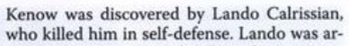
Our notes: `notes/materials/031-complete-star-wars-encyclopedia-vol-2/05-v2-scan-201-240.md:185`

> Despite his background, Kine was recruited by Lando Calrissian to locate and defeat a group of pirates who were ambushing New Republic convoys from a base on Radix in the Abraxas system.
— Source: scan pages 201–240; Lando Calrissian. POV: Lando Calrissian.
Note (our notes, around the quote): Lando Calrissian: "Despite his background, Kine was recruited by Lando Calrissian to locate and defeat a group of pirates who were ambushing New Republic convoys from a base on Radix in the Abraxas system." Source: The Complete Star Wars Encyclopedia, Vol. II, p.218
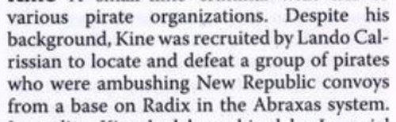
Our notes: `notes/materials/031-complete-star-wars-encyclopedia-vol-2/05-v2-scan-201-240.md:247`

> Kiela revealed that Kine was a former Imperial captain, To ensure the success of his mission, Kine shot Lando, but Calrissian survived and surprised Kine long enough for Isolde Siro to kill him.
— Source: scan pages 201–240; Lando Calrissian. POV: Lando Calrissian.
Note (our notes, around the quote): Lando Calrissian: "Kiela revealed that Kine was a former Imperial captain, To ensure the success of his mission, Kine shot Lando, but Calrissian survived and surprised Kine long enough for Isolde Siro to kill him." Source: The Complete Star Wars Encyclopedia, Vol. II, p.218
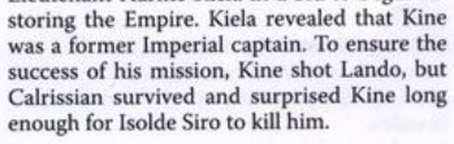
Our notes: `notes/materials/031-complete-star-wars-encyclopedia-vol-2/05-v2-scan-201-240.md:249`

- Note (summary from our notes, not a quotation): Page contents: 865 words, 35 paragraphs | headings/entries: Lamproid; Lamuir IV; Lan Barell; Lancer Battalion; Landing, the; Landing Platform 327; Landkiller; Lando's Commandos
  — Source: scan pages 241–280.
Our notes: `notes/materials/031-complete-star-wars-encyclopedia-vol-2/06-v2-scan-241-280.md:88`

- Note (summary from our notes, not a quotation): Page contents: 1006 words, 24 paragraphs | headings/entries: Lando's Folly; Lands, Roan; Lang, Adion; Lanius; Lanthrym; Lao-Mon; Lar, Kira; Larado, Incavi
  — Source: scan pages 241–280.
Our notes: `notes/materials/031-complete-star-wars-encyclopedia-vol-2/06-v2-scan-241-280.md:93`

> The racecourse was actually a way for Lando to get to Kerane's Folly, the legendary platinum asteroid hidden in Hoth's asteroid belt.
— Source: scan pages 241–280; Lando Calrissian — entry/section: Lando's Folly.
Note (our notes, around the quote): Lando Calrissian — entry/section: Lando's Folly: "The racecourse was actually a way for Lando to get to Kerane's Folly, the legendary platinum asteroid hidden in Hoth's asteroid belt." Source: The Complete Star Wars Encyclopedia, Vol. II, p.244
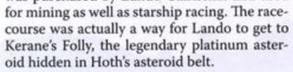
Our notes: `notes/materials/031-complete-star-wars-encyclopedia-vol-2/06-v2-scan-241-280.md:95`

> After a brief struggle with Lando Calrissian and Barpotomous Drebble, Lemo found himself in possession of the Minstrel.
— Source: scan pages 241–280; Lando Calrissian. POV: Lando Calrissian.
Note (our notes, around the quote): Lando Calrissian: "After a brief struggle with Lando Calrissian and Barpotomous Drebble, Lemo found himself in possession of the Minstrel." Source: The Complete Star Wars Encyclopedia, Vol. II, p.250
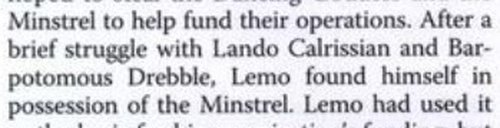
Our notes: `notes/materials/031-complete-star-wars-encyclopedia-vol-2/06-v2-scan-241-280.md:147`

> Calrissian repaired the damage, and Lobot then disarmed bombs that the Ugnaughts had planted all over the city.
— Source: scan pages 241–280; Lando Calrissian. POV: Lando Calrissian.
Note (our notes, around the quote): Lando Calrissian: "Calrissian repaired the damage, and Lobot then disarmed bombs that the Ugnaughts had planted all over the city." Source: The Complete Star Wars Encyclopedia, Vol. II, p.258
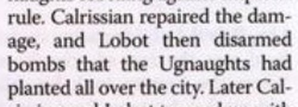
Our notes: `notes/materials/031-complete-star-wars-encyclopedia-vol-2/06-v2-scan-241-280.md:211`

> Lando later realized the Meeks had been more clever than expected, using the fake statuettes to lure him to their settlement, knowing that he would defeat the rancor.
— Source: scan pages 281–320; Lando Calrissian. POV: Lando Calrissian.
Note (our notes, around the quote): Lando Calrissian: "Lando later realized the Meeks had been more clever than expected, using the fake statuettes to lure him to their settlement, knowing that he would defeat the rancor." Source: The Complete Star Wars Encyclopedia, Vol. II, p.302
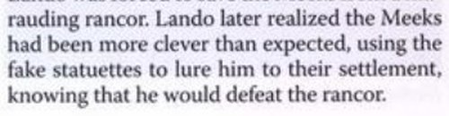
Our notes: `notes/materials/031-complete-star-wars-encyclopedia-vol-2/07-v2-scan-281-320.md:241`

> Lando Calrissian destroyed water tanks in the mine, forcing the revolutionaries to flee.
— Source: scan pages 321–360; Lando Calrissian. POV: Lando Calrissian.
Note (our notes, around the quote): Lando Calrissian: "Lando Calrissian destroyed water tanks in the mine, forcing the revolutionaries to flee." Source: The Complete Star Wars Encyclopedia, Vol. II, p.337
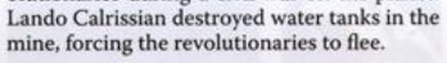
Our notes: `notes/materials/031-complete-star-wars-encyclopedia-vol-2/08-v2-scan-321-360.md:160`

> Norulac This planet was home to a gang of bandits who raided Taanab every year, until they were wiped out by Lando Calrissian in the famous Battle of Taanab.
— Source: scan pages 361–400; Lando Calrissian. POV: Lando Calrissian.
Note (our notes, around the quote): Lando Calrissian: "Norulac This planet was home to a gang of bandits who raided Taanab every year, until they were wiped out by Lando Calrissian in the famous Battle of Taanab." Source: The Complete Star Wars Encyclopedia, Vol. II, p.390
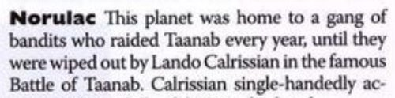
Our notes: `notes/materials/031-complete-star-wars-encyclopedia-vol-2/09-v2-scan-361-400.md:291`

> Calrissian single-handedly accounted for 19 kills of the Norulac band.
— Source: scan pages 361–400; Lando Calrissian. POV: Lando Calrissian.
Note (our notes, around the quote): Lando Calrissian: "Calrissian single-handedly accounted for 19 kills of the Norulac band." Source: The Complete Star Wars Encyclopedia, Vol. II, p.390
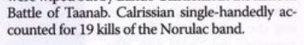
Our notes: `notes/materials/031-complete-star-wars-encyclopedia-vol-2/09-v2-scan-361-400.md:293`

## The Complete Star Wars Encyclopedia, Vol. III (P–Z)

> Pakkpekatt bared his teeth. “General, a Hortek does not leave the bodies of comrades in the hands of the enemy—ever.”
— Source: scan pages 1–40. POV: Lando Calrissian.
(Excerpt widened 2026-11-17 to the relevant passage, word for word from Shield of Lies (Michael P. Kube-McDowell), Chapter 4 (text copy `MEGA_Legend_The_Black_Fleet_Crisis_Trilogy_Star_Wars_Black_Fleet_Crisis_02_Shield_of_Lies_Michael_P_Kube_McDowell_epub`).)
(Fragment completed 2026-11-17: full sentence/passage matched word for word in the source text on file: `MEGA_Legend_The_Black_Fleet_Crisis_Trilogy_Star_Wars_Black_Fleet_Crisis_02_Shield_of_Lies_Michael_P_Kube_McDowell_epub`.)
Note (our notes, around the quote): Lando Calrissian: "When he was given the order to terminate the mission even though Calrissian and his companions were aboard the vagabond, the colonel exploded with rage, saying that "a Hortek does not leave the bodies of comrades in the hands of the enemy—ever."" Source: The Complete Star Wars Encyclopedia, Vol. III, p.6
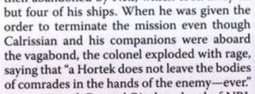
Our notes: `notes/materials/032-complete-star-wars-encyclopedia-vol-3/00-v3-scan-001-040.md:71`

> Solo and Lando Calrissian managed to ram a Dreadnaught into the Peremptory, completely destroying both ships.
— Source: scan pages 1–40; Lando Calrissian. POV: Lando Calrissian.
Note (our notes, around the quote): Lando Calrissian: "Solo and Lando Calrissian managed to ram a Dreadnaught into the Peremptory, completely destroying both ships." Source: The Complete Star Wars Encyclopedia, Vol. III, p.20
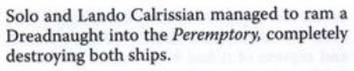
Our notes: `notes/materials/032-complete-star-wars-encyclopedia-vol-3/00-v3-scan-001-040.md:187`

> Rooty once bested Lando Calrissian in a game of sabacc.
— Source: scan pages 81–120; Lando Calrissian. POV: Lando Calrissian.
Note (our notes, around the quote): Lando Calrissian: "Rooty once bested Lando Calrissian in a game of sabacc." Source: The Complete Star Wars Encyclopedia, Vol. III, p.110
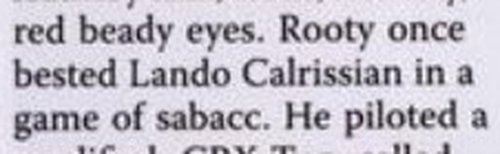
Our notes: `notes/materials/032-complete-star-wars-encyclopedia-vol-3/02-v3-scan-081-120.md:271`

> When Calrissian arrived at the Run to check on Solo, he was captured and nearly killed by Nandreeson.
— Source: scan pages 161–200; Lando Calrissian. POV: Lando Calrissian.
Note (our notes, around the quote): Lando Calrissian: "When Calrissian arrived at the Run to check on Solo, he was captured and nearly killed by Nandreeson." Source: The Complete Star Wars Encyclopedia, Vol. III, p.170
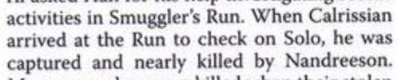
Our notes: `notes/materials/032-complete-star-wars-encyclopedia-vol-3/04-v3-scan-161-200.md:193`

> This starship, capable of interdimensional travel, fled the known galaxy for many years until Lando Calrissian and Chewbacca stumbled upon it shortly after the Battle of Hoth.
— Source: scan pages 201–240; Lando Calrissian; Chewbacca.
Note (our notes, around the quote): Lando Calrissian; Chewbacca: "This starship, capable of interdimensional travel, fled the known galaxy for many years until Lando Calrissian and Chewbacca stumbled upon it shortly after the Battle of Hoth." Source: The Complete Star Wars Encyclopedia, Vol. III, p.198
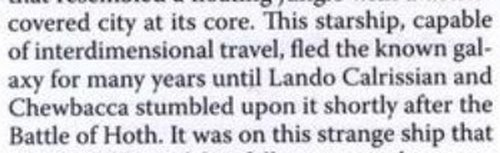
Our notes: `notes/materials/032-complete-star-wars-encyclopedia-vol-3/05-v3-scan-201-240.md:39`

> Finally, Calrissian led the Taanab defense fleet in a cleanup operation and single-handedly accounted for 19 kills.
— Source: scan pages 201–240; Lando Calrissian. POV: Lando Calrissian.
Note (our notes, around the quote): Lando Calrissian: "Finally, Calrissian led the Taanab defense fleet in a cleanup operation and single-handedly accounted for 19 kills." Source: The Complete Star Wars Encyclopedia, Vol. III, p.209
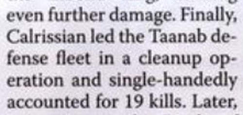
Our notes: `notes/materials/032-complete-star-wars-encyclopedia-vol-3/05-v3-scan-201-240.md:138`

> It blockaded the entrance to the ThonBoka, preventing the flow of nutrients and slowly starving the inhabitants until it was defeated by Lando Calrissian and others.
— Source: scan pages 241–280; Lando Calrissian. POV: Lando Calrissian.
Note (our notes, around the quote): Lando Calrissian: "It blockaded the entrance to the ThonBoka, preventing the flow of nutrients and slowly starving the inhabitants until it was defeated by Lando Calrissian and others." Source: The Complete Star Wars Encyclopedia, Vol. III, p.238
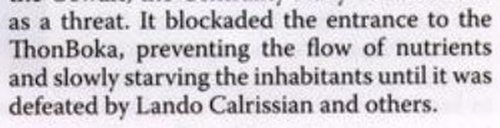
Our notes: `notes/materials/032-complete-star-wars-encyclopedia-vol-3/06-v3-scan-241-280.md:39`

> Lando was saved from certain death by his cyborg aide, Lobot, and the two joined forces with rebellious Ugnaughts to defeat the Imperial forces.
— Source: scan pages 241–280; Lando Calrissian. POV: Lando Calrissian.
Note (our notes, around the quote): Lando Calrissian: "Lando was saved from certain death by his cyborg aide, Lobot, and the two joined forces with rebellious Ugnaughts to defeat the Imperial forces." Source: The Complete Star Wars Encyclopedia, Vol. III, p.261
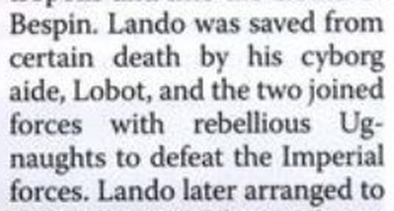
Our notes: `notes/materials/032-complete-star-wars-encyclopedia-vol-3/06-v3-scan-241-280.md:232`

> He was defeated by Lando Calrissian and Han Solo, who had returned to Kashyyyk with Chewbacca to help him thwart the slavers.
— Source: scan pages 281–320; Lando Calrissian; Han Solo; Chewbacca.
Note (our notes, around the quote): Lando Calrissian; Han Solo; Chewbacca: "He was defeated by Lando Calrissian and Han Solo, who had returned to Kashyyyk with Chewbacca to help him thwart the slavers." Source: The Complete Star Wars Encyclopedia, Vol. III, p.296
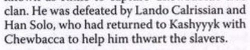
Our notes: `notes/materials/032-complete-star-wars-encyclopedia-vol-3/07-v3-scan-281-320.md:167`

> After Vuffi Raa reverted to his original programming, he helped Calrissian defeat Whett's boss Rokur Gepta in the defense of the ThonBoka.
— Source: scan pages 281–320; Lando Calrissian; Rokur Gepta.
Note (our notes, around the quote): Lando Calrissian; Rokur Gepta: "After Vuffi Raa reverted to his original programming, he helped Calrissian defeat Whett's boss Rokur Gepta in the defense of the ThonBoka." Source: The Complete Star Wars Encyclopedia, Vol. III, p.314
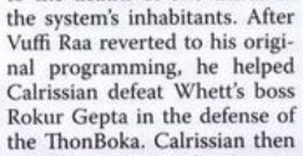
Our notes: `notes/materials/032-complete-star-wars-encyclopedia-vol-3/07-v3-scan-281-320.md:337`

> The cloning complex and most of the mountain were destroyed when Lando Calrissian and Chewbacca sabotaged the central equipment column.
— Source: scan pages 321–360; Lando Calrissian; Chewbacca.
Note (our notes, around the quote): Lando Calrissian; Chewbacca: "The cloning complex and most of the mountain were destroyed when Lando Calrissian and Chewbacca sabotaged the central equipment column." Source: The Complete Star Wars Encyclopedia, Vol. III, p.323
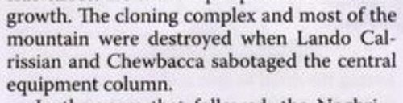
Our notes: `notes/materials/032-complete-star-wars-encyclopedia-vol-3/08-v3-scan-321-360.md:60`

> Before that caper, which involved Lando Calrissian, could be completed, Whett and his ship were destroyed.
— Source: scan pages 321–360; Lando Calrissian. POV: Lando Calrissian.
Note (our notes, around the quote): Lando Calrissian: "Before that caper, which involved Lando Calrissian, could be completed, Whett and his ship were destroyed." Source: The Complete Star Wars Encyclopedia, Vol. III, p.328
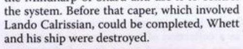
Our notes: `notes/materials/032-complete-star-wars-encyclopedia-vol-3/08-v3-scan-321-360.md:111`

## The New Essential Guide to Characters (2002)

> The second Death Star is destroyed by Lando Calrissian and Wedge Antilles.
— Source: scan pages 1–30; Lando Calrissian. POV: Lando Calrissian.
Note (our notes, around the quote): Lando Calrissian: "The second Death Star is destroyed by Lando Calrissian and Wedge Antilles." Source: The New Essential Guide to Characters, p.14
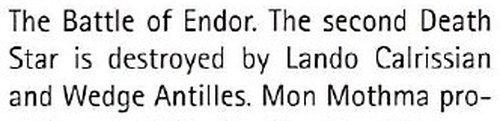
Our notes: `notes/materials/034-new-essential-guide-to-characters/00-negc-scan-001-030.md:50`

> Antilles and Calrissian earned joint credit for the annihilation of the second Death Star.
— Source: scan pages 1–30; Lando Calrissian. POV: Lando Calrissian.
Note (our notes, around the quote): Lando Calrissian: "Antilles and Calrissian earned joint credit for the annihilation of the second Death Star." Source: The New Essential Guide to Characters, p.23
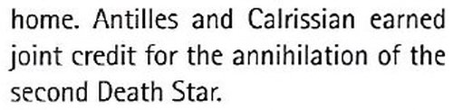
Our notes: `notes/materials/034-new-essential-guide-to-characters/00-negc-scan-001-030.md:119`

> Calrissian worked closely with Lobot for more than two years, battling a bounty hunter when Raynor put out a contract on his life, and stopping the crazed droid EV-9D9 before she destroyed all of the city's automaton population.
— Source: scan pages 31–60; Lando Calrissian. POV: Lando Calrissian.
Note (our notes, around the quote): Lando Calrissian: "Calrissian worked closely with Lobot for more than two years, battling a bounty hunter when Raynor put out a contract on his life, and stopping the crazed droid EV-9D9 before she destroyed all of the city's automaton population." Source: The New Essential Guide to Characters, p.40

Our notes: `notes/materials/034-new-essential-guide-to-characters/01-negc-scan-031-060.md:28`

> Calrissian destroyed the castle by dropping a thermal detonator down the garbage chute.
— Source: scan pages 31–60; Lando Calrissian. POV: Lando Calrissian.
Note (our notes, around the quote): Lando Calrissian: "Calrissian destroyed the castle by dropping a thermal detonator down the garbage chute." Source: The New Essential Guide to Characters, p.40

Our notes: `notes/materials/034-new-essential-guide-to-characters/01-negc-scan-031-060.md:30`

- Note (summary from our notes, not a quotation): Lando Calrissian; Jaina Solo: "With his Jedi reflexes, Durron became a hotshot pilot, posting the highest score in Lando Calrissian's "running-the-belt" game at Dubrillion, at least until his time was bested by Jaina Solo." Source: The New Essential Guide to Characters, p.62
  — Source: scan pages 31–60.

Our notes: `notes/materials/034-new-essential-guide-to-characters/01-negc-scan-031-060.md:174`

> Gepta teamed up with Mer to obtain the legendary Mindharp of Sharu by exploiting Lando Calrissian.
— Source: scan pages 61–90.
Note (our notes, around the quote): Rokur Gepta; Lando Calrissian — entry/section: R okur Gepta, self-proclaimed Sor-: "Gepta teamed up with Mer to obtain the legendary Mindharp of Sharu by exploiting Lando Calrissian." Source: The New Essential Guide to Characters, p.74

Our notes: `notes/materials/034-new-essential-guide-to-characters/02-negc-scan-061-090.md:54`

> The sorcerer killed billionaire Bohhuah Mutdah in the Oseon system and arranged for Lando Calrissian to make a delivery to the dead man's estate.
— Source: scan pages 61–90; Lando Calrissian. POV: Lando Calrissian.
Note (our notes, around the quote): Lando Calrissian: "The sorcerer killed billionaire Bohhuah Mutdah in the Oseon system and arranged for Lando Calrissian to make a delivery to the dead man's estate." Source: The New Essential Guide to Characters, p.74

Our notes: `notes/materials/034-new-essential-guide-to-characters/02-negc-scan-061-090.md:56`

> During the laser duel Calrissian shot Gepta in the ankle, where the actual Croke lay nestled within his larger phantom form.
— Source: scan pages 61–90.
Note (our notes, around the quote): Rokur Gepta; Lando Calrissian — entry/section: R okur Gepta, self-proclaimed Sor-: "During the laser duel Calrissian shot Gepta in the ankle, where the actual Croke lay nestled within his larger phantom form." Source: The New Essential Guide to Characters, p.74

Our notes: `notes/materials/034-new-essential-guide-to-characters/02-negc-scan-061-090.md:58`

- Note (summary from our notes, not a quotation): Rokur Gepta; Lando Calrissian — entry/section: R okur Gepta, self-proclaimed Sor-: "The "body" of Gepta vanished, and Calrissian crushed the tiny Croke between his gloves." Source: The New Essential Guide to Characters, p.74
  — Source: scan pages 61–90.

Our notes: `notes/materials/034-new-essential-guide-to-characters/02-negc-scan-061-090.md:60`

> After Admiral Daala's first defeat, Mara entered into a partnership with Lando Calrissian for the administration of the spice mines of Kessel.
— Source: scan pages 151–180; Admiral Daala; Mara Jade Skywalker; Lando Calrissian.
Note (our notes, around the quote): Admiral Daala; Mara Jade Skywalker; Lando Calrissian: "After Admiral Daala's first defeat, Mara entered into a partnership with Lando Calrissian for the administration of the spice mines of Kessel." Source: The New Essential Guide to Characters, p.163

Our notes: `notes/materials/034-new-essential-guide-to-characters/05-negc-scan-151-180.md:61`

> On his way out, Calrissian dropped a thermal detonator down a waste chute, and the castle imploded.
— Source: scan pages 181–210; Lando Calrissian. POV: Lando Calrissian.
Note (our notes, around the quote): Lando Calrissian: "On his way out, Calrissian dropped a thermal detonator down a waste chute, and the castle imploded." Source: The New Essential Guide to Characters, p.200

Our notes: `notes/materials/034-new-essential-guide-to-characters/06-negc-scan-181-210.md:86`

## Dark Side Sourcebook (d20, 2001)

> Crokes-able to survive in vacuum and renowned for their naked ambition-were naturally adept at illusory disguises, enabling them to blend in unnoticed with the other sentient species of the galaxy. At some point roughly five years before the destm tion of the first Death Star at the Battle of Yavin, Rokur Gepta allied himself with the Empire-at least, insofar as it was necessary to obtain Imperial materiel for his own use. Gepta acquired Wennis, a decommissioned lmperial Cruiser, an Imperial-trained crew, and a license to operate more or less at his own discretion His plots to usurp the Emperor's throne and rule the galaxy, however, went awry when he vied with the famous smuggler Lando Calrissian, and Rokur Gepta forgot his goals when his own overriding hatred caused him to pursue Calrissian from star system to star system. Eventually, Gepta challenged the smuggler to single combat. He lost and was squeezed to a greasy slime in Calrissian's gloved hands, thus ending his dreams of galactic domination. Rokur Gepto The enigmatic figure known as Rokur Gepta was the last of the Sorcerers of Tund. Gepta was a master of illusion, able to create images directly in the minds of his enemies, torturing them with their past mistakes and agonies. the dark side and were exiled from their clans for their evil acts.
— Source: Chapter Five: Dark Side Traditions (Sith Empire, Set Harth, prophets, Brakiss…); Lando Calrissian. POV: Lando Calrissian.
(Excerpt widened 2026-11-17 to the relevant passage, word for word from research primary dark side sourcebook dss (text copy `research_primary_dark_side_sourcebook_dss_pdf_9cd3453f4a`).)
(Excerpt widened 2026-11-17 to the relevant passage, word for word from research primary dark side sourcebook dss (text copy `research_primary_dark_side_sourcebook_dss_pdf_9cd3453f4a`).)
Note (our notes, around the quote): Lando Calrissian: "He lost and was squeezed to a greasy slime in Calrissian's gloved hands, thus ending his dreams of galactic domination." Source: Dark Side Sourcebook, p.80

Our notes: `notes/materials/035-dark-side-sourcebook/05-ch5-traditions.md:121`

> Dolph and the Imperial spy Brakiss, turned their backs on armed with nova-inducing resonance torpedoes Luke's training and set off to find their fortunes elsewhere. ang covered with impenetrable armor, the Sun Still others never came to Luke's school at all but studied the Crusher was invincible, and only when Han Solo Force on their own, giving the dark side easy targets. and Lando Calrissian sought him out to appeal to his better nature did he finally relent.
— Source: Chapter Five: Dark Side Traditions (Sith Empire, Set Harth, prophets, Brakiss…); Brakiss; Luke Skywalker; Han Solo; Lando Calrissian.
Note (our notes, around the quote): Brakiss; Luke Skywalker; Han Solo; Lando Calrissian: "Dolph and the Imperial spy Brakiss, turned their backs on armed with nova-inducing resonance torpedoes Luke's training and set off to find their fortunes elsewhere. ang covered with impenetrable armor, the Sun Still others never came to Luke's school at all but studied the Crusher was invincible, and only when Han Solo Force on their own, giving the dark side easy targets. and Lando Calrissian sought him out to appeal to his better nature did he finally relent." Source: Dark Side Sourcebook, p.104

Our notes: `notes/materials/035-dark-side-sourcebook/05-ch5-traditions.md:309`

## Sourcebooks/Sourcebook Web Enhancements/More Starships!.pdf [Star Wars Roleplaying Game (d20, 2000)]

- Note (summary from our notes, not a quotation): Page contents: Nkllon shieldships (Lando's Nomad City) protect up to Huge craft from the sun; shieldship 550 m, 300 shields, 600 hull, DR 35. (hand-read)
  — Source: Sourcebooks/Sourcebook Web Enhancements/More Starships!.pdf [Star Wars Ro.
Our notes: `notes/materials/037-sw-d20-folder/040-more-starships.md:32`

## Sourcebooks/Rebellion Era Sourcebook.pdf [Star Wars Roleplaying Game (d20, 2000)] (scan pages 61–120)

- Note (summary from our notes, not a quotation): Page contents: Cloud City: Lando Calrissian won Baron Administrator 'in a game of sabacc'; reorganized the corrupt Wing Guard; strict neutrality; Bespin Tibanna is spin-sealed, four times normal energy output; ~6 million residents (hand-read)
  — Source: Sourcebooks/Rebellion Era Sourcebook.pdf [Star Wars Roleplaying Game (d20.
Our notes: `notes/materials/037-sw-d20-folder/043-rebellion-era-sourcebook-scan-061-120.md:334`

- Note (summary from our notes, not a quotation): Page contents: Lt. Falto Dragen Noble 4/Soldier 4 VP/WP 55/12 CC D; Moff Elior sabacc with Lando, Corugg the Hutt, Queen Sula (hand-read)
  — Source: Sourcebooks/Rebellion Era Sourcebook.pdf [Star Wars Roleplaying Game (d20.
Our notes: `notes/materials/037-sw-d20-folder/043-rebellion-era-sourcebook-scan-061-120.md:344`

## Sourcebooks/Rebellion Era Sourcebook.pdf [Star Wars Roleplaying Game (d20, 2000)] (scan pages 121–161)

> Lando, meanwhile, : Sé j \fter d Ti it } reat post by Prince Xiz and the i f # inally took action as well, A confusing battle ensued, When types walker and his compan . ver, the Sarlace had consumed Boba Fett and many quard a oY ent on to rescue Han Solo from the clutches of the A : ; of Jabba's quards, Leia had strangled Jabba with the chair his h ile ¢ qstcr iba the Hutt ¢ complex plat put Land t that bound her to the Hutt, and Luke had destroyed the ' mask Calrissian into Jabba's palace, where he disquised himself as : ; : : massive sail barge, The companions were free, Jabba wi : f ne of ba ) ce quards.
— Source: Sourcebooks/Rebellion Era Sourcebook.pdf [Star Wars Roleplaying Game (d20.
Note (our notes, around the quote): Lando Calrissian; Boba Fett; Han Solo; Leia Organa Solo; Luke Skywalker: "Lando, meanwhile, : Sé j \fter d Ti it } reat post by Prince Xiz and the i f # inally took action as well, A confusing battle ensued, When types walker and his compan . ver, the Sarlace had consumed Boba Fett and many quard a oY ent on to rescue Han Solo from the clutches of the A : ; of Jabba's quards, Leia had strangled Jabba with the chair his h ile ¢ qstcr iba the Hutt ¢ complex plat put Land t that bound her to the Hutt, and Luke had destroyed the ' mask Calrissian into Jabba's palace, where he disquised himself as : ; : : massive sail barge, The companions were free, Jabba wi : f ne of ba ) ce quards." Source: *Rebellion Era Sourcebook* (SWRPG d20), scan p.131

Our notes: `notes/materials/037-sw-d20-folder/043-rebellion-era-sourcebook-scan-121-161.md:95`

> With the defeat at Hoth, the Alliance decided to gather its Lando Calrissian volunteers to lead the starfighter attack on the various cells together and amass the Rebel fleet.
— Source: Sourcebooks/Rebellion Era Sourcebook.pdf [Star Wars Roleplaying Game (d20; Lando Calrissian. POV: Lando Calrissian.
Note (our notes, around the quote): Lando Calrissian: "With the defeat at Hoth, the Alliance decided to gather its Lando Calrissian volunteers to lead the starfighter attack on the various cells together and amass the Rebel fleet." Source: *Rebellion Era Sourcebook* (SWRPG d20), scan p.137

Our notes: `notes/materials/037-sw-d20-folder/043-rebellion-era-sourcebook-scan-121-161.md:139`

- Note (summary from our notes, not a quotation): Page contents: Battle of Endor: superlaser calibrated for moving capital ships; Lando used Imperial ships as cover from the superlaser; 'For the first time in decades, he saw the Emperor's true face—the face of hatred'; Emperor dead, 'his control over his forces vanished' (hand-read)
  — Source: Sourcebooks/Rebellion Era Sourcebook.pdf [Star Wars Roleplaying Game (d20.
Our notes: `notes/materials/037-sw-d20-folder/043-rebellion-era-sourcebook-scan-121-161.md:217`

## Sourcebooks/Star Wars Roleplaying Game Core Rulebook.pdf [Star Wars Roleplaying Game (d20, 2000)] (scan pages 61–120)

- Note (summary from our notes, not a quotation): Page contents: 368 words, 30 paragraphs | headings/entries: Score Description; AA A; Lando Calrissian. He's a card; II WOltl Ji ml ii i; Examples; Low-ranking officer, manager, minor official; Senator, Jedi Council member; HEROIC CHARACTERISTICS
  — Source: Sourcebooks/Star Wars Roleplaying Game Core Rulebook.pdf [Star Wars Rolep.
Our notes: `notes/materials/037-sw-d20-folder/046-star-wars-roleplaying-game-core-rulebook-scan-061-120.md:245`

## Sourcebooks/Star Wars Roleplaying Game Core Rulebook.pdf [Star Wars Roleplaying Game (d20, 2000)] (scan pages 181–240)

- Note (summary from our notes, not a quotation): Page contents: 1077 words, 22 paragraphs | headings/entries: Hiei; Lando Calrissian, Gambler; THIOTEEN; WN (scJLINh::
  — Source: Sourcebooks/Star Wars Roleplaying Game Core Rulebook.pdf [Star Wars Rolep.
Our notes: `notes/materials/037-sw-d20-folder/046-star-wars-roleplaying-game-core-rulebook-scan-181-240.md:401`

## Sourcebooks/Starships Of The Galaxy.pdf [Star Wars Roleplaying Game (d20, 2000)] (scan pages 1–60)

> Han Solo used this maneuver when he piloted the Falcon through an asteroid field in Episode V The Empire Strikes Back. Lando Calrissian used a similar maneuver when navigating the corridors of the second Death Star in Episode VI Return of the Jedi.
— Source: Sourcebooks/Starships Of The Galaxy.pdf [Star Wars Roleplaying Game (d20,; Han Solo; Lando Calrissian — entry/section: Flyby maneuver.
Note (our notes, around the quote): Han Solo; Lando Calrissian — entry/section: Flyby maneuver: "Han Solo used this maneuver when he piloted the Falcon through an asteroid field in Episode V The Empire Strikes Back. Lando Calrissian used a similar maneuver when navigating the corridors of the second Death Star in Episode VI Return of the Jedi." Source: *Starships Of The Galaxy* (SWRPG d20), scan p.39

Our notes: `notes/materials/037-sw-d20-folder/047-starships-of-the-galaxy-scan-001-060.md:202`

## Sourcebooks/The New Jedi Order Sourcebook.pdf [Star Wars Roleplaying Game (d20, 2000)] (scan pages 1–60)

> Acquiring Belt-Runner I, a space station capable of extending its shields around other ships, and tweaking the safety features of a small squadron of modified Imperialsurplus TIE starfighters, Lando launched his profit center.
— Source: Sourcebooks/The New Jedi Order Sourcebook.pdf [Star Wars Roleplaying Game; Lando Calrissian. POV: Lando Calrissian.
Note (our notes, around the quote): Lando Calrissian: "Acquiring Belt-Runner I, a space station capable of extending its shields around other ships, and tweaking the safety features of a small squadron of modified Imperialsurplus TIE starfighters, Lando launched his profit center." Source: *The New Jedi Order Sourcebook* (SWRPG d20), scan p.35

Our notes: `notes/materials/037-sw-d20-folder/049-the-new-jedi-order-sourcebook-scan-001-060.md:200`

## Sourcebooks/The New Jedi Order Sourcebook.pdf [Star Wars Roleplaying Game (d20, 2000)] (scan pages 61–120)

> After the defeat of the Yuuzhan Vong at the Battle of Dubrillion, Administrator Lando Calrissian is all too willing to pay for repairs to the heroes' space transport or starfighters, but only if the heroes can pitch in and help rebuild his facility at Lando's Folly.
— Source: Sourcebooks/The New Jedi Order Sourcebook.pdf [Star Wars Roleplaying Game; Lando Calrissian. POV: Lando Calrissian.
Note (our notes, around the quote): Lando Calrissian: "After the defeat of the Yuuzhan Vong at the Battle of Dubrillion, Administrator Lando Calrissian is all too willing to pay for repairs to the heroes' space transport or starfighters, but only if the heroes can pitch in and help rebuild his facility at Lando's Folly." Source: *The New Jedi Order Sourcebook* (SWRPG d20), scan p.70

Our notes: `notes/materials/037-sw-d20-folder/049-the-new-jedi-order-sourcebook-scan-061-120.md:87`

## Star Wars Gamer/Star Wars Gamer 01.pdf [Star Wars Roleplaying Game (d20, 2000)] (scan pages 61–100)

- Note (summary from our notes, not a quotation): Page contents: Demolition: Jabba's illegal vehicular combat tournament between ESB and ROTJ; Boba Fett reigning champion; Lando as Tamtel Skreej; Malakili rides the rancor (hand-read)
  — Source: Star Wars Gamer/Star Wars Gamer 01.pdf [Star Wars Roleplaying Game (d20,.
Our notes: `notes/materials/037-sw-d20-folder/050-star-wars-gamer-01-scan-061-100.md:185`

## Star Wars Gamer/Star Wars Gamer 05.pdf [Star Wars Roleplaying Game (d20, 2000)] (scan pages 1–60)

- Note (summary from our notes, not a quotation): Page contents: Seeds of Villainy (Jeff Grubb) GM article: villain archetypes - thugs, The One That Got Away, organized thugs, ringleader (Bib Fortuna 'not the hand that holds the blaster, but rather the eye that aims it'), good bad-guy (Boba Fett), bad good-guy (young Lando), bureaucrat (Watto) (hand-read)
  — Source: Star Wars Gamer/Star Wars Gamer 05.pdf [Star Wars Roleplaying Game (d20,.
Our notes: `notes/materials/037-sw-d20-folder/054-star-wars-gamer-05-scan-001-060.md:278`

- Note (summary from our notes, not a quotation): Page contents: Campaign Guide to the Centrality (Michael Rocco), based on L. Neil Smith's Lando Calrissian Adventures: Scrivinir head of state; Rise of Empire depression; allied to Empire in Rebellion era; NJO era: Fleet Admiral Sris Lebhett seizes power in a coup, ousting Scrivinir Ottdefa Tavell Geen; Oseon asteroid belt casinos, two laws; founder Gadfrey Oseon, ex-circus ringleader who fled the Hutts; the Flamewind (hand-read)
  — Source: Star Wars Gamer/Star Wars Gamer 05.pdf [Star Wars Roleplaying Game (d20,.
Our notes: `notes/materials/037-sw-d20-folder/054-star-wars-gamer-05-scan-001-060.md:359`

## Star Wars Gamer/Star Wars Gamer 05.pdf [Star Wars Roleplaying Game (d20, 2000)] (scan pages 61–118)

- Note (summary from our notes, not a quotation): Page contents: Lando activated the Mindharp of Sharu a few years before Yavin; Sharu awakened, pyramids became cities; under Lebhett convict labor in the orchards; Sharu and Toka descriptions; hook with Bothan archaeologist Corask Slen'da (Obroan Institute) and Chief Supervisor Myle Jandler (hand-read)
  — Source: Star Wars Gamer/Star Wars Gamer 05.pdf [Star Wars Roleplaying Game (d20,.
Our notes: `notes/materials/037-sw-d20-folder/054-star-wars-gamer-05-scan-061-118.md:19`

- Note (summary from our notes, not a quotation): Page contents: 667 words, 65 paragraphs | headings/entries: Armor Woes; Okay,; Smaggler via Internet; Two Hot Products, One Cool Website; Dark Side and Rebellion Era sourcebooks; Theed Adventure Game; We ll also treat you toa; Mike; Lando for you; In Two Weeks; Star Wars Insider #55; Prequel Update; More Episode Ii news; Interviews; Next Issue; Star Wars Tales; Bounties to Die For; Ten tempting targets; Combat Tactics; Fighting as a team; Custom Lightsabers; Build your own; Modal Citizen; The Death Star; All-New Game; The Battle of Hoth; Sanbra's Guide to Intelligent Life The Nikto; Special Ops—Archetype; The Mercenary; PLUS:; Battle of Hoth Playmat; STAR WARS GAMER 129
  — Source: Star Wars Gamer/Star Wars Gamer 05.pdf [Star Wars Roleplaying Game (d20,.
Our notes: `notes/materials/037-sw-d20-folder/054-star-wars-gamer-05-scan-061-118.md:330`

## Star Wars Gamer/Star Wars Gamer 06.pdf [Star Wars Roleplaying Game (d20, 2000)] (scan pages 1–60)

> Shortly before that infamous engagement, Calrissian lost a significant sum (some estimates put it at around 20,000 credits) to Rooty in a game of Sabacc, Unable to cover his boss, Calrissian was only saved from a severe mauling at the hands of the enraged Cragmoloid by the intervention of agents working for a Hutt who had business interests with the legendary gambler.
— Source: Star Wars Gamer/Star Wars Gamer 06.pdf [Star Wars Roleplaying Game (d20,; Lando Calrissian. POV: Lando Calrissian.
Note (our notes, around the quote): Lando Calrissian: "Shortly before that infamous engagement, Calrissian lost a significant sum (some estimates put it at around 20,000 credits) to Rooty in a game of Sabacc, Unable to cover his boss, Calrissian was only saved from a severe mauling at the hands of the enraged Cragmoloid by the intervention of agents working for a Hutt who had business interests with the legendary gambler." Source: *Star Wars Gamer 06* (SWRPG d20), scan p.58

Our notes: `notes/materials/037-sw-d20-folder/055-star-wars-gamer-06-scan-001-060.md:357`

- Note (summary from our notes, not a quotation): Page contents: Lieutenant Harme Kiela: spoiled Voss-born TIE interceptor ace, protégé of Air Marshal Von Tarsh; turned pirate to free Tarsh, foiled by Calrissian; escaped, on Cracken's Most Wanted list (hand-read)
  — Source: Star Wars Gamer/Star Wars Gamer 06.pdf [Star Wars Roleplaying Game (d20,.
Our notes: `notes/materials/037-sw-d20-folder/055-star-wars-gamer-06-scan-001-060.md:377`

## Star Wars Gamer/Star Wars Gamer 09.pdf [Star Wars Roleplaying Game (d20, 2000)] (scan pages 1–60)

- Note (summary from our notes, not a quotation): Page contents: Running the Belt (JD Wiker): on Dubrillion, Lando's game of skill sees how long pilots last flying against the current in the asteroid belt called Lando's Folly (about 20 km thick), using modified Imperial-surplus TIEs shielded by the station Belt-Runner I; a nonrefundable 2,500-credit 'damage deposit' weeds out the timid (hand-read)
  — Source: Star Wars Gamer/Star Wars Gamer 09.pdf [Star Wars Roleplaying Game (d20,.
Our notes: `notes/materials/037-sw-d20-folder/058-star-wars-gamer-09-scan-001-060.md:369`

> Acquiring Belt-Runner !,a space station capable of extending its shields around other ships, and tweaking the safety features of a small squadron of modified Imperial-surplus TIE starfighters, Lando launched his profit center.
— Source: Star Wars Gamer/Star Wars Gamer 09.pdf [Star Wars Roleplaying Game (d20,; Lando Calrissian. POV: Lando Calrissian.
Note (our notes, around the quote): Lando Calrissian: "Acquiring Belt-Runner !,a space station capable of extending its shields around other ships, and tweaking the safety features of a small squadron of modified Imperial-surplus TIE starfighters, Lando launched his profit center." Source: *Star Wars Gamer 09* (SWRPG d20), scan p.52

Our notes: `notes/materials/037-sw-d20-folder/058-star-wars-gamer-09-scan-001-060.md:371`

- Note (summary from our notes, not a quotation): Page contents: Belt-Runner I splits its projected shields among Jaina's, Jacen's and Anakin's TIEs during the Yuuzhan Vong attack on Dubrillion; Lando's three TIE Advanced x1s trade their shields for proton torpedoes; his two TIE bombers have two-seat cockpits (hand-read)
  — Source: Star Wars Gamer/Star Wars Gamer 09.pdf [Star Wars Roleplaying Game (d20,.
Our notes: `notes/materials/037-sw-d20-folder/058-star-wars-gamer-09-scan-001-060.md:376`

## Characters/Hutts/Hutt! Hutt! Hutt!.pdf [Star Wars Roleplaying Game Revised Core (d20, 2002)]

> Zorba rigged a sabacc game to take control of the city from Lando Calrissian, and attempted to murder Princess Leia Organa in a complicated revenge hit.
— Source: Characters/Hutts/Hutt! Hutt! Hutt!.pdf [Star Wars Roleplaying Game Revise.
Note (our notes, around the quote): Lando Calrissian; Leia Organa Solo — entry/section: Zorba vs Lando and Leia: "Zorba rigged a sabacc game to take control of the city from Lando Calrissian, and attempted to murder Princess Leia Organa in a complicated revenge hit." Source: *Hutt! Hutt! Hutt!* (SWRPG d20 Revised Core), scan p.1

Our notes: `notes/materials/037-sw-d20-folder/087-hutt-hutt-hutt.md:17`

## Characters/Hutts/Malta and Quaffug.pdf [Star Wars Roleplaying Game Revised Core (d20, 2002)]

> In Malta's case, Lando was one of the treasure hunters seeking the Vassilika, and Calrissian outwitted the Hutt's bounty hunters with the help of Han Solo, Chewbacca, and a few others.
— Source: Characters/Hutts/Malta and Quaffug.pdf [Star Wars Roleplaying Game Revise.
Note (our notes, around the quote): Lando Calrissian; Han Solo; Chewbacca — entry/section: Lando outwits Malta's hunters: "In Malta's case, Lando was one of the treasure hunters seeking the Vassilika, and Calrissian outwitted the Hutt's bounty hunters with the help of Han Solo, Chewbacca, and a few others." Source: *Malta and Quaffug* (SWRPG d20 Revised Core), scan p.1

Our notes: `notes/materials/037-sw-d20-folder/088-malta-and-quaffug.md:12`

> Lando went up against Quaffug the Hutt, on the other hand, alone, and on two separate occasions -- once not long before the hunt for the Vassilika, and another time just before the rescue of Han Solo from Jabba's clutches.
— Source: Characters/Hutts/Malta and Quaffug.pdf [Star Wars Roleplaying Game Revise.
Note (our notes, around the quote): Lando Calrissian; Han Solo; Jabba the Hutt — entry/section: Lando vs Quaffug twice: "Lando went up against Quaffug the Hutt, on the other hand, alone, and on two separate occasions -- once not long before the hunt for the Vassilika, and another time just before the rescue of Han Solo from Jabba's clutches." Source: *Malta and Quaffug* (SWRPG d20 Revised Core), scan p.1

Our notes: `notes/materials/037-sw-d20-folder/088-malta-and-quaffug.md:14`

- Note (summary from our notes, not a quotation): Page contents: Quaffug, Overboss of Blimph, sabacc loss to Lando, Alliance treaty; Quaffug stats; Darth Malak teaser (hand-read)
  — Source: Characters/Hutts/Malta and Quaffug.pdf [Star Wars Roleplaying Game Revise.
Our notes: `notes/materials/037-sw-d20-folder/088-malta-and-quaffug.md:27`

> Before Lando joined the hunt for the Yavin Vassilika, he played in a high-stakes sabacc match against Quaffug in the Rafa Chabalrussa casino on Rafa V. Calrissian, naturally, took the pot, which included the rights to Quaffug's Ceramo-Werx manufacturing facility.
— Source: Characters/Hutts/Malta and Quaffug.pdf [Star Wars Roleplaying Game Revise; Lando Calrissian — entry/section: Lando wins Quaffug's factory.
Note (our notes, around the quote): Lando Calrissian — entry/section: Lando wins Quaffug's factory: "Before Lando joined the hunt for the Yavin Vassilika, he played in a high-stakes sabacc match against Quaffug in the Rafa Chabalrussa casino on Rafa V. Calrissian, naturally, took the pot, which included the rights to Quaffug's Ceramo-Werx manufacturing facility." Source: *Malta and Quaffug* (SWRPG d20 Revised Core), scan p.2

Our notes: `notes/materials/037-sw-d20-folder/088-malta-and-quaffug.md:29`

> Despite his enslavement of the Jokhali people, the Alliance, desperate for supplies in the months leading up to the Battle of Endor, attempted to negotiate a treaty with Quaffug. Their ambassador? None other than Lando Calrissian.
— Source: Characters/Hutts/Malta and Quaffug.pdf [Star Wars Roleplaying Game Revise; Lando Calrissian — entry/section: Lando as Alliance ambassador to Quaffug.
Note (our notes, around the quote): Lando Calrissian — entry/section: Lando as Alliance ambassador to Quaffug: "Despite his enslavement of the Jokhali people, the Alliance, desperate for supplies in the months leading up to the Battle of Endor, attempted to negotiate a treaty with Quaffug. Their ambassador? None other than Lando Calrissian." Source: *Malta and Quaffug* (SWRPG d20 Revised Core), scan p.2

Our notes: `notes/materials/037-sw-d20-folder/088-malta-and-quaffug.md:31`

## Characters/Nien Nunb, Kessel Administrator.pdf [Star Wars Roleplaying Game Revised Core (d20, 2002)]

> Nien Nunb once flew freight for the Sullustan corporation SoroSuub, but he defected to the Rebellion when he saw his own employers willingly align themselves with the bigots of the Empire. After helping the Rebellion win many crucial victories -- most notably when he co-piloted the Millennium Falcon with Lando Calrissian at the Battle of Endor, destroying the second Death Star -- Nien Nunb continued to serve as a pilot and instructor in the New Republic forces for several years. He flew sorties against the Nagai, and when Han Solo needed a co-pilot for a low-profile mission to the planet Vandelhelm, Nunb volunteered for the job and ended up saving General Solo and the Millennium Falcon's passengers from certain death.
— Source: Characters/Nien Nunb, Kessel Administrator.pdf [Star Wars Roleplaying Gam.
Note (our notes, around the quote): Nien Nunb; Lando Calrissian; Han Solo — entry/section: Nien Nunb's career: "Nien Nunb once flew freight for the Sullustan corporation SoroSuub, but he defected to the Rebellion when he saw his own employers willingly align themselves with the bigots of the Empire. After helping the Rebellion win many crucial victories -- most notably when he co-piloted the Millennium Falcon with Lando Calrissian at the Battle of Endor, destroying the second Death Star -- Nien Nunb continued to serve as a pilot and instructor in the New Republic forces for several years. He flew sorties against the Nagai, and when Han Solo needed a co-pilot for a low-profile mission to the planet Vandelhelm, Nunb volunteered for the job and ended up saving General Solo and the Millennium Falcon's passengers from certain death." Source: *Nien Nunb, Kessel Administrator* (SWRPG d20 Revised Core), scan p.1

Our notes: `notes/materials/037-sw-d20-folder/145-nien-nunb-kessel-administrator.md:12`

> With Calrissian's help, Nien Nunb later found success of a different type as the new administrator of the mining facility on Kessel. The Sullustan replaced slave driver Moruth Doole and has turned the mining operation into a profitable, legitimate business in a remarkably short time. His experience running freight early in his career, along with the tactical knowledge he gained in his time as a New Republic pilot, have served him well.
— Source: Characters/Nien Nunb, Kessel Administrator.pdf [Star Wars Roleplaying Gam.
Note (our notes, around the quote): Nien Nunb; Lando Calrissian; Moruth Doole — entry/section: Nien Nunb on Kessel: "With Calrissian's help, Nien Nunb later found success of a different type as the new administrator of the mining facility on Kessel. The Sullustan replaced slave driver Moruth Doole and has turned the mining operation into a profitable, legitimate business in a remarkably short time. His experience running freight early in his career, along with the tactical knowledge he gained in his time as a New Republic pilot, have served him well." Source: *Nien Nunb, Kessel Administrator* (SWRPG d20 Revised Core), scan p.1

Our notes: `notes/materials/037-sw-d20-folder/145-nien-nunb-kessel-administrator.md:14`

## Locations/Planet Hoppers/Bespin - Action Tidings/Part 2 - That Den o' Human Iniquity.pdf [Star Wars Roleplaying Game Revised Core (d20, 2002)]

- Note (summary from our notes, not a quotation): Page contents: Population 10-20k; blood duels must be held on the Surface (Ozz and the Ugboat conflict); Surface map key (15 entries) and Ugnorgrad map key (12); Part Three teaser (Lando interview); Ord Mantell adventure plug (hand-read)
  — Source: Locations/Planet Hoppers/Bespin - Action Tidings/Part 2 - That Den o' Hum.
Our notes: `notes/materials/037-sw-d20-folder/578-part-2-that-den-o-human-iniquity.md:22`

## Locations/Planet Hoppers/Bespin - Action Tidings/Part 3 - The High Human o' Cloud City.pdf [Star Wars Roleplaying Game Revised Core (d20, 2002)]

- Note (summary from our notes, not a quotation): Page contents: Lando won Cloud City at sabacc; Pordy kicks the holodisplay back on; archival interview opens ("Arse?") (hand-read)
  — Source: Locations/Planet Hoppers/Bespin - Action Tidings/Part 3 - The High Human.
Our notes: `notes/materials/037-sw-d20-folder/579-part-3-the-high-human-o-cloud.md:10`

- Note (summary from our notes, not a quotation): Page contents: Lando speaks to the three tribes; doubles Ugnaught wages; ends Tibanna refining on the Surface (hand-read)
  — Source: Locations/Planet Hoppers/Bespin - Action Tidings/Part 3 - The High Human.
Our notes: `notes/materials/037-sw-d20-folder/579-part-3-the-high-human-o-cloud.md:15`

> I want to speak directly to the three tribes, as many individual Ugnaughts as I can, and tell you all that despite what you may have heard I have no intention of turning the city into a de facto slave camp, like some of my predecessors.
— Source: Locations/Planet Hoppers/Bespin - Action Tidings/Part 3 - The High Human.
Note (our notes, around the quote): No single roster character (rules/setting/general) — entry/section: Lando Calrissian on Action Tidings: "I want to speak directly to the three tribes, as many individual Ugnaughts as I can, and tell you all that despite what you may have heard I have no intention of turning the city into a de facto slave camp, like some of my predecessors." Source: *Part 3 - The High Human o' Cloud City* (SWRPG d20 Revised Core), scan p.2

Our notes: `notes/materials/037-sw-d20-folder/579-part-3-the-high-human-o-cloud.md:17`

- Note (summary from our notes, not a quotation): Page contents: New city refineries; "the Lando System"; rumors (sabacc against Baron Raynor, Taanab, citizenship, Queen of Drogheda); GM notes on Ugnaughts under Calrissian; Ugnaught Foreman stats (Expert 10) (hand-read)
  — Source: Locations/Planet Hoppers/Bespin - Action Tidings/Part 3 - The High Human.
Our notes: `notes/materials/037-sw-d20-folder/579-part-3-the-high-human-o-cloud.md:22`

> Some mighty bad deals have been made in the name of efficiency, but don't worry -- I can smell a bad deal a parsec away. That's what made me the card player I am, and that's one way I intend to keep things running smoothly here. Call it the Lando System.
— Source: Locations/Planet Hoppers/Bespin - Action Tidings/Part 3 - The High Human.
Note (our notes, around the quote): No single roster character (rules/setting/general) — entry/section: Lando Calrissian on Action Tidings: "Some mighty bad deals have been made in the name of efficiency, but don't worry -- I can smell a bad deal a parsec away. That's what made me the card player I am, and that's one way I intend to keep things running smoothly here. Call it the Lando System." Source: *Part 3 - The High Human o' Cloud City* (SWRPG d20 Revised Core), scan p.3

Our notes: `notes/materials/037-sw-d20-folder/579-part-3-the-high-human-o-cloud.md:24`

## Locations/Planet Hoppers/Bespin - Action Tidings/Part 4 - The Empire's Ugly Nose.pdf [Star Wars Roleplaying Game Revised Core (d20, 2002)]

> I made a mistake!
> [fragment — full passage not on file]
— Source: Locations/Planet Hoppers/Bespin - Action Tidings/Part 4 - The Empire's Ug.
Note (our notes, around the quote): Page contents: Lando, Leia, and Chewbacca (carrying C-3PO) kill the troopers; Chewbacca's threat; Lando's "I made a mistake!"; Ugnaught rebels later drive out the Empire (hand-read)
Our notes: `notes/materials/037-sw-d20-folder/580-part-4-the-empires-ugly-nose.md:21`

> I made a mistake! And a friend of mine is paying the price. I've got to go!
— Source: Locations/Planet Hoppers/Bespin - Action Tidings/Part 4 - The Empire's Ug.
Note (our notes, around the quote): No single roster character (rules/setting/general) — entry/section: Lando Calrissian during the takeover: "I made a mistake! And a friend of mine is paying the price. I've got to go!" Source: *Part 4 - The Empire's Ugly Nose* (SWRPG d20 Revised Core), scan p.2

Our notes: `notes/materials/037-sw-d20-folder/580-part-4-the-empires-ugly-nose.md:23`

- Note (summary from our notes, not a quotation): Page contents: Zavlabar's ad; GM notes: Capt. Hugo Treece (Corellian, ex-Punisher) enslaved the Ugnaughts and embezzled; stats Noble 4/Soldier 1/Officer 7, CL E; Part Five teaser (Lando, Luke, Shira Brie); "The Fall of Cloud City" adventure plug (hand-read)
  — Source: Locations/Planet Hoppers/Bespin - Action Tidings/Part 4 - The Empire's Ug.
Our notes: `notes/materials/037-sw-d20-folder/580-part-4-the-empires-ugly-nose.md:28`

## Locations/Planet Hoppers/Bespin - Action Tidings/Part 5 - An Exclusive!.pdf [Star Wars Roleplaying Game Revised Core (d20, 2002)]

- Note (summary from our notes, not a quotation): Page contents: Treece's reign; Ugnaughts build a dozen bombs and warn everyone to evacuate; Lando returns and fights a damaged Lobot; talking bomb kills Treece's bomb squad; Treece kicks Lando off the city (hand-read)
  — Source: Locations/Planet Hoppers/Bespin - Action Tidings/Part 5 - An Exclusive!.p.
Our notes: `notes/materials/037-sw-d20-folder/581-part-5-an-exclusive.md:10`

- Note (summary from our notes, not a quotation): Page contents: Lobot catches Lando with a jet pack; Floatboat 2 rescue; Fivvle's film-can slingshot downs an Imperial skimmer; King Ozz briefs Lando; live footage: Luke, Shira Brie, and R2 vs Treece's troops (hand-read)
  — Source: Locations/Planet Hoppers/Bespin - Action Tidings/Part 5 - An Exclusive!.p.
Our notes: `notes/materials/037-sw-d20-folder/581-part-5-an-exclusive.md:15`

> LC: If you don't get your men out of here fast, I'll have Lobot re­arm the explosives ­­ and blow us all into the next star system! Treece: No . . . I think not! Treece raises a blaster and fires. The bolt strikes Lobot's cyborg implant, disabling him. LC: Lobot! Treece: It appears, Calrissian, that you've lost the only being capable of re­arming those bombs without touching them ­­ thereby setting off their self­destruct mechanisms. Or, to put it more simply, check . . . and mate! Skywalker: (Off­camera) Oh great. Now what'll we ­­ Camera pans to Skywalker and R2­unit. R2­unit: (translated from binary) Can't you can move things without touching them?
— Source: Locations/Planet Hoppers/Bespin - Action Tidings/Part 5 - An Exclusive!.p.
(Excerpt widened 2026-11-17 to the relevant passage, word for word from der files Star Wars Roleplaying Game Revised Core Locations Planet Hoppers Bespin Action Tidings Part 5 An Exclusive (text copy `der_files_Star_Wars_Roleplaying_Game_Revised_Core_Locations_Planet_Hoppers_Bespin_Action_Tidings_Part_5_An_Exclusive_pdf_0f065a9d87`).)
(Excerpt widened 2026-11-17 to the relevant passage, word for word from der files Star Wars Roleplaying Game Revised Core Locations Planet Hoppers Bespin Action Tidings Part 5 An Exclusive (text copy `der_files_Star_Wars_Roleplaying_Game_Revised_Core_Locations_Planet_Hoppers_Bespin_Action_Tidings_Part_5_An_Exclusive_pdf_0f065a9d87`).)
Note (our notes, around the quote): Lando Calrissian — entry/section: Skywalker: (Off-camera) Well, I'll be! It's Lando!: "Treece: It appears, Calrissian, that you've lost the only being capable of re-arming those bombs without touching them -- thereby setting off their self-destruct mechanisms." Source: *Part 5 - An Exclusive!* (SWRPG d20 Revised Core), scan p.3

Our notes: `notes/materials/037-sw-d20-folder/581-part-5-an-exclusive.md:26`

> Audio continues. Treece: W­wait for m ­­ I­I mean retreat! Camera pulls back to reveal host Fivvle, grinning. AF: An' so the Imperial dogs were driven out o' the city in the clouds. Luke Skywalker ­­ I should say Jedi Skywalker ­­ had not, o' course, triggered the bombs themselves, merely the primer charges. Within minutes, Cloud City ceased its downward descent as repair drones fixed up the minor cosmetic damage. An' a short time later, with his former aide back t'perfect health an' left in charge o' bringin' the population back t'the city now that the Empire thought it destroyed, Calrissian left us again, returnin' t'the Rebellion an' eventually galaxy­wide fame as the destroyer o' the second Death Star. Fivvle produces and reignites tabac pipe. Estimated probability broadcast will end within two minutes: 99%. AF: Since that day, the Ugnaughts have kept their freedom. In the ensuin' years, the Surface would see expansion, an' even tourists fer the first time.
— Source: Locations/Planet Hoppers/Bespin - Action Tidings/Part 5 - An Exclusive!.p; Lando Calrissian. POV: Lando Calrissian.
(Excerpt widened 2026-11-17 to the relevant passage, word for word from der files Star Wars Roleplaying Game Revised Core Locations Planet Hoppers Bespin Action Tidings Part 5 An Exclusive (text copy `der_files_Star_Wars_Roleplaying_Game_Revised_Core_Locations_Planet_Hoppers_Bespin_Action_Tidings_Part_5_An_Exclusive_pdf_0f065a9d87`).)
(Excerpt widened 2026-11-17 to the relevant passage, word for word from der files Star Wars Roleplaying Game Revised Core Locations Planet Hoppers Bespin Action Tidings Part 5 An Exclusive (text copy `der_files_Star_Wars_Roleplaying_Game_Revised_Core_Locations_Planet_Hoppers_Bespin_Action_Tidings_Part_5_An_Exclusive_pdf_0f065a9d87`).)
Note (our notes, around the quote): Lando Calrissian: "An' a short time later, with his former aide back t'perfect health an' left in charge o' bringin' the population back t'the city now that the Empire thought it destroyed, Calrissian left us again, returnin' t'the Rebellion an' eventually galaxy-wide fame as the destroyer o' the second Death Star." Source: *Part 5 - An Exclusive!* (SWRPG d20 Revised Core), scan p.3

Our notes: `notes/materials/037-sw-d20-folder/581-part-5-an-exclusive.md:28`

## Locations/Planet Hoppers/Vandelhelm - Enemies and Alloys/Part 1 - File Vandelhelm­LC:hsnn.pdf [Star Wars Roleplaying Game Revised Core (d20, 2002)]

- Note (summary from our notes, not a quotation): Page contents: Vandelhelm found 22,000 years after the Republic by Vandel and Helm; Metalsmiths Guild reveres the Venerated Ones; Empire held them hostage; Han returned them; stats (pop. 40M, corporate monarchy); Lando's briefing: Guildmaster Orrk untrustworthy (hand-read)
  — Source: Locations/Planet Hoppers/Vandelhelm - Enemies and Alloys/Part 1 - File Va.
Our notes: `notes/materials/037-sw-d20-folder/620-part-1-file-vandelhelm-lc-hsnn.md:10`

> And like I said, I don't trust Orrk. He's been working with the Imperials for over a decade, and near as I can tell, he pretty much runs the place now. The kids could be a problem for him, and he might try something along the lines of an interdictor mine field in the asteroids. Since Wedge is training new pilots, Luke's playing Jedi ambassador, Chewie's on family leave, and I'm preoccupied with important Alliance administrative duties and a major, major card game, I'm sending you with Nien Nunb. Have fun, and bring me back a piece of Vandelhelm sculpture if you get a chance. I'm starting a collection. And please, consider reading the rest of this briefing. Supply and Demand Issue 98 of Marvel's Star Wars comic saw the return of long­time scribe Archie Goodwin and artist Al Williamson, who introduced us to the planet Vandelhelm. The creators of the long­running Star Wars newspaper strip and adaptors of The Empire Strikes Back and Return of the Jedi (among other landmarks) came up with a tale so true to Star Wars and the Han Solo character ­­ with crackling Goodwin dialog and beautifully realistic art ­­ that current Star Wars comic publisher Dark Horse reprinted the story not only in A Long Time Ago . . . Vol.
— Source: Locations/Planet Hoppers/Vandelhelm - Enemies and Alloys/Part 1 - File Va.
(Excerpt widened 2026-11-17 to the relevant passage, word for word from  Roleplaying Game Revised Core Locations Planet Hoppers Vandelhelm Enemies and Alloys Part 1 File Vandelhelm LC hsnn (text copy `_Roleplaying_Game_Revised_Core_Locations_Planet_Hoppers_Vandelhelm_Enemies_and_Alloys_Part_1_File_Vandelhelm_LC_hsnn_pdf_24b2a5ad8c`).)
(Excerpt widened 2026-11-17 to the relevant passage, word for word from  Roleplaying Game Revised Core Locations Planet Hoppers Vandelhelm Enemies and Alloys Part 1 File Vandelhelm LC hsnn (text copy `_Roleplaying_Game_Revised_Core_Locations_Planet_Hoppers_Vandelhelm_Enemies_and_Alloys_Part_1_File_Vandelhelm_LC_hsnn_pdf_24b2a5ad8c`).)
Note (our notes, around the quote): No single roster character (rules/setting/general) — entry/section: Lando Calrissian, briefing to Han: "Have fun, and bring me back a piece of Vandelhelm sculpture if you get a chance. I'm starting a collection. And please, consider reading the rest of this briefing." Source: *Part 1 - File Vandelhelm­LC:hsnn* (SWRPG d20 Revised Core), scan p.2

Our notes: `notes/materials/037-sw-d20-folder/620-part-1-file-vandelhelm-lc-hsnn.md:17`

## Locations/Planet Hoppers/Vandelhelm - Enemies and Alloys/Part 4 - The Demands of Supply.pdf [Star Wars Roleplaying Game Revised Core (d20, 2002)]

> Calrissian owes me my own combat freighter for this.
— Source: Locations/Planet Hoppers/Vandelhelm - Enemies and Alloys/Part 4 - The Dem.
Note (our notes, around the quote): No single roster character (rules/setting/general) — entry/section: Nien Nunb, personal log: "Calrissian owes me my own combat freighter for this." Source: *Part 4 - The Demands of Supply* (SWRPG d20 Revised Core), scan p.1

Our notes: `notes/materials/037-sw-d20-folder/623-part-4-the-demands-of-supply.md:12`

> Yeah, Calrissian owes us both, and Solo owes me even more. Maybe not a ship. Maybe just some peace.
— Source: Locations/Planet Hoppers/Vandelhelm - Enemies and Alloys/Part 4 - The Dem.
Note (our notes, around the quote): No single roster character (rules/setting/general) — entry/section: Nien Nunb, personal log: "Yeah, Calrissian owes us both, and Solo owes me even more. Maybe not a ship. Maybe just some peace." Source: *Part 4 - The Demands of Supply* (SWRPG d20 Revised Core), scan p.2

Our notes: `notes/materials/037-sw-d20-folder/623-part-4-the-demands-of-supply.md:23`

## Sourcebooks/Coruscant and the Core Worlds.pdf [Star Wars Roleplaying Game Revised Core (d20, 2002)] (scan pages 1–60)

- Note (summary from our notes, not a quotation): Page contents: Xizor's Castle (Lando Calrissian collapses it with a thermal detonator down the trash chute; Bothan Spynet HQ); Petrax Historic Quarter; Galactic Museum; Monument Plaza (Flames of Umate) (hand-read)
  — Source: Sourcebooks/Coruscant and the Core Worlds.pdf [Star Wars Roleplaying Game.
Our notes: `notes/materials/037-sw-d20-folder/665-coruscant-and-the-core-worlds-scan-001-060.md:81`

> Despite the millions spent on security, Xizor's castle proved surprisingly vulnerable to internal sabotage—after infiltrating the structure, Lando Calrissian collapsed it by dropping a thermal detonator down the trash chute.
— Source: Sourcebooks/Coruscant and the Core Worlds.pdf [Star Wars Roleplaying Game; Lando Calrissian; Prince Xizor — entry/section: Lando collapses Xizor's castle.
Note (our notes, around the quote): Lando Calrissian; Prince Xizor — entry/section: Lando collapses Xizor's castle: "Despite the millions spent on security, Xizor's castle proved surprisingly vulnerable to internal sabotage—after infiltrating the structure, Lando Calrissian collapsed it by dropping a thermal detonator down the trash chute." Source: *Coruscant and the Core Worlds* (SWRPG d20 Revised Core), scan p.14

Our notes: `notes/materials/037-sw-d20-folder/665-coruscant-and-the-core-worlds-scan-001-060.md:83`

## Sourcebooks/Coruscant and the Core Worlds.pdf [Star Wars Roleplaying Game Revised Core (d20, 2002)] (scan pages 121–162)

- Note (summary from our notes, not a quotation): Page contents: Sacorria planet stats; Description; History (Triad; Lando Calrissian and Tendra Risant help New Republic destroy Triad fleet); People (hand-read)
  — Source: Sourcebooks/Coruscant and the Core Worlds.pdf [Star Wars Roleplaying Game.
Our notes: `notes/materials/037-sw-d20-folder/665-coruscant-and-the-core-worlds-scan-121-162.md:161`

> Lando Calrissian and his lady friend Tendra Risant responded to free the enslaved systems.
— Source: Sourcebooks/Coruscant and the Core Worlds.pdf [Star Wars Roleplaying Game; Lando Calrissian. POV: Lando Calrissian.
Note (our notes, around the quote): Lando Calrissian: "Lando Calrissian and his lady friend Tendra Risant responded to free the enslaved systems." Source: *Coruscant and the Core Worlds* (SWRPG d20 Revised Core), scan p.142

Our notes: `notes/materials/037-sw-d20-folder/665-coruscant-and-the-core-worlds-scan-121-162.md:163`

## Sourcebooks/Galactic Campaign Guide.pdf [Star Wars Roleplaying Game Revised Core (d20, 2002)] (scan pages 61–120)

- Note (summary from our notes, not a quotation): Page contents: Airlocks cont. (Falcon dorsal hatch Lando uses to rescue Luke under Cloud City); Alarm Panels; Blast Doors; Comm Panels; Control Panels (hand-read)
  — Source: Sourcebooks/Galactic Campaign Guide.pdf [Star Wars Roleplaying Game Revis.
Our notes: `notes/materials/037-sw-d20-folder/666-galactic-campaign-guide-scan-061-120.md:197`

- Note (summary from our notes, not a quotation): Page contents: Supporting characters: Common Thug; Freighter Pilot; Gambler (Lando Calrissian example begins) (hand-read)
  — Source: Sourcebooks/Galactic Campaign Guide.pdf [Star Wars Roleplaying Game Revis.
Our notes: `notes/materials/037-sw-d20-folder/666-galactic-campaign-guide-scan-061-120.md:244`

- Note (summary from our notes, not a quotation): Page contents: Gambler cont. (Lando's deal with Vader, rescue from Jabba); Law Enforcement Officer; Man on the Street; Mechanic; Instant Contacts sidebar (hand-read)
  — Source: Sourcebooks/Galactic Campaign Guide.pdf [Star Wars Roleplaying Game Revis.
Our notes: `notes/materials/037-sw-d20-folder/666-galactic-campaign-guide-scan-061-120.md:249`

> even riskier venture: A legitimate business in a Tibanna gas mining facility on Bespin. He puts all his assets in danger by making a dangerous deal with Darth Vader and betraying his old friends, yet eventually puts his loyalty, skills, and past experience on the line to save them from Jabba the Hutt.
> [fragment — full passage not on file]
— Source: Sourcebooks/Galactic Campaign Guide.pdf [Star Wars Roleplaying Game Revis.
Note (our notes, around the quote): Lando Calrissian; Darth Vader (Anakin Skywalker); Jabba the Hutt — entry/section: Lando the classy gambler: "even riskier venture: A legitimate business in a Tibanna gas mining facility on Bespin. He puts all his assets in danger by making a dangerous deal with Darth Vader and betraying his old friends, yet eventually puts his loyalty, skills, and past experience on the line to save them from Jabba the Hutt." Source: *Galactic Campaign Guide* (SWRPG d20 Revised Core), scan p.108

Our notes: `notes/materials/037-sw-d20-folder/666-galactic-campaign-guide-scan-061-120.md:251`

## Sourcebooks/Geonosis and the Outer Rim Worlds.pdf [Star Wars Roleplaying Game Revised Core (d20, 2002)] (scan pages 1–60)

- Note (summary from our notes, not a quotation): Page contents: Barab I: durgolosk creature. Bespin: stats and description (Lando Calrissian's civic improvements made Bespin a destination). (hand-read)
  — Source: Sourcebooks/Geonosis and the Outer Rim Worlds.pdf [Star Wars Roleplaying.
Our notes: `notes/materials/037-sw-d20-folder/667-geonosis-and-the-outer-rim-worlds-scan-001-060.md:131`

> It owes much of its current reputation to the charismatic Lando Calrissian, whose civic improvements and flamboyant reputation have made Bespin a top-notch destination for Outer Rim gamblers and sightseers.
— Source: Sourcebooks/Geonosis and the Outer Rim Worlds.pdf [Star Wars Roleplaying; Lando Calrissian — entry/section: Bespin's reputation owed to Lando.
Note (our notes, around the quote): Lando Calrissian — entry/section: Bespin's reputation owed to Lando: "It owes much of its current reputation to the charismatic Lando Calrissian, whose civic improvements and flamboyant reputation have made Bespin a top-notch destination for Outer Rim gamblers and sightseers." Source: *Geonosis and the Outer Rim Worlds* (SWRPG d20 Revised Core), scan p.21

Our notes: `notes/materials/037-sw-d20-folder/667-geonosis-and-the-outer-rim-worlds-scan-001-060.md:133`

- Note (summary from our notes, not a quotation): Page contents: Bespin: history (Lando won Cloud City; Vader's trap for Luke; Captain Treece; Zorba the Hutt; Lobot; Thrawn, Desann, Black Sun designs on the city); people. (hand-read)
  — Source: Sourcebooks/Geonosis and the Outer Rim Worlds.pdf [Star Wars Roleplaying.
Our notes: `notes/materials/037-sw-d20-folder/667-geonosis-and-the-outer-rim-worlds-scan-001-060.md:138`

> Lando Calrissian won ownership of Cloud City shortly after the Battle of Yavin and increased Tibanna-mining profits by over 35 percent, while simultaneously deflecting the attention of the Mining Guild and the Empire. His triumphs crumbled when Darth Vader set a trap for Luke Skywalker on Bespin and left behind a Cloud City garrison under the command of Captain Treece. Though Calrissian kicked Treece off Bespin, the Empire quickly returned and wasn’t permanently dislodged until after the Battle of Endor.
— Source: Sourcebooks/Geonosis and the Outer Rim Worlds.pdf [Star Wars Roleplaying.
Note (our notes, around the quote): Lando Calrissian; Darth Vader (Anakin Skywalker); Luke Skywalker — entry/section: Lando wins Cloud City; Vader's trap: "Lando Calrissian won ownership of Cloud City shortly after the Battle of Yavin and increased Tibanna-mining profits by over 35 percent, while simultaneously deflecting the attention of the Mining Guild and the Empire. His triumphs crumbled when Darth Vader set a trap for Luke Skywalker on Bespin and left behind a Cloud City garrison under the command of Captain Treece. Though Calrissian kicked Treece off Bespin, the Empire quickly returned and wasn’t permanently dislodged until after the Battle of Endor." Source: *Geonosis and the Outer Rim Worlds* (SWRPG d20 Revised Core), scan p.22

Our notes: `notes/materials/037-sw-d20-folder/667-geonosis-and-the-outer-rim-worlds-scan-001-060.md:140`

- Note (summary from our notes, not a quotation): Page contents: Bespin: hooks Look Out Below! (Baron-Administrator Calrissian hires the heroes), Coup in the Clouds, Hit the Deck. (hand-read)
  — Source: Sourcebooks/Geonosis and the Outer Rim Worlds.pdf [Star Wars Roleplaying.
Our notes: `notes/materials/037-sw-d20-folder/667-geonosis-and-the-outer-rim-worlds-scan-001-060.md:150`

## Sourcebooks/Geonosis and the Outer Rim Worlds.pdf [Star Wars Roleplaying Game Revised Core (d20, 2002)] (scan pages 61–120)

- Note (summary from our notes, not a quotation): Page contents: Kessel: Maw Cluster; thin air; history (Republic-era medical mining; Imperial prison planet; Garrison moon destroyed by a Death Star prototype; Lando Calrissian's mining droids); people (Republic era). (hand-read)
  — Source: Sourcebooks/Geonosis and the Outer Rim Worlds.pdf [Star Wars Roleplaying.
Our notes: `notes/materials/037-sw-d20-folder/667-geonosis-and-the-outer-rim-worlds-scan-061-120.md:169`

> Most recently, Lando Calrissian obtained mining rights and began using mining droids to dig for glitterstim.
— Source: Sourcebooks/Geonosis and the Outer Rim Worlds.pdf [Star Wars Roleplaying; Lando Calrissian — entry/section: Lando's mining rights on Kessel.
Note (our notes, around the quote): Lando Calrissian — entry/section: Lando's mining rights on Kessel: "Most recently, Lando Calrissian obtained mining rights and began using mining droids to dig for glitterstim." Source: *Geonosis and the Outer Rim Worlds* (SWRPG d20 Revised Core), scan p.83

Our notes: `notes/materials/037-sw-d20-folder/667-geonosis-and-the-outer-rim-worlds-scan-061-120.md:171`

## Sourcebooks/Geonosis and the Outer Rim Worlds.pdf [Star Wars Roleplaying Game Revised Core (d20, 2002)] (scan pages 121–162)

- Note (summary from our notes, not a quotation): Page contents: Yavin 4: Great Temple's Sith glyphs; Achtnak Turbine Station (Silas, Orman and Ulric Tagge; destroyed by Luke Skywalker); The Dark Temple (Jan Dodonna seals the Blueleaf Cluster temple; Exar Kun's retreat); GemDiver Station (Lando Calrissian); hooks False Fishing, Treasure Hunt, A Lost Lambda begins. (hand-read)
  — Source: Sourcebooks/Geonosis and the Outer Rim Worlds.pdf [Star Wars Roleplaying.
Our notes: `notes/materials/037-sw-d20-folder/667-geonosis-and-the-outer-rim-worlds-scan-121-162.md:276`

> On a visit to Yavin 4 after the fall of the Empire, Lando Calrissian hit upon the idea of using technology developed by the Imperial war machine to reinvent Corusca fishing. He refurbished an old space station, christened it GemDiver, and set up shop above Yavin's atmosphere.
— Source: Sourcebooks/Geonosis and the Outer Rim Worlds.pdf [Star Wars Roleplaying; Lando Calrissian — entry/section: GemDiver Station.
Note (our notes, around the quote): Lando Calrissian — entry/section: GemDiver Station: "On a visit to Yavin 4 after the fall of the Empire, Lando Calrissian hit upon the idea of using technology developed by the Imperial war machine to reinvent Corusca fishing. He refurbished an old space station, christened it GemDiver, and set up shop above Yavin's atmosphere." Source: *Geonosis and the Outer Rim Worlds* (SWRPG d20 Revised Core), scan p.155

Our notes: `notes/materials/037-sw-d20-folder/667-geonosis-and-the-outer-rim-worlds-scan-121-162.md:282`

- Note (summary from our notes, not a quotation): Page contents: Yavin 4: sidebar Corusca Fishing (Lando Calrissian; trawlers, skiffs, purse seine; floaters); A Lost Lambda (Death Star shuttle; Grand Moff Tarkin); Sifting Through the Wreckage (Luke Skywalker's torpedo; Ugors; superlaser stations); Dark Riddles; Q-7N begins. (hand-read)
  — Source: Sourcebooks/Geonosis and the Outer Rim Worlds.pdf [Star Wars Roleplaying.
Our notes: `notes/materials/037-sw-d20-folder/667-geonosis-and-the-outer-rim-worlds-scan-121-162.md:294`

> At least until Lando Calrissian tried to revolutionize it, Corusca fishing was a dangerous business requiring daring pilots to work together at the controls of a variety of vessels, adapting ancient fishing methods used on the oceans of countless planets to the atmosphere of a gas giant.
— Source: Sourcebooks/Geonosis and the Outer Rim Worlds.pdf [Star Wars Roleplaying; Lando Calrissian — entry/section: Corusca fishing before Lando.
Note (our notes, around the quote): Lando Calrissian — entry/section: Corusca fishing before Lando: "At least until Lando Calrissian tried to revolutionize it, Corusca fishing was a dangerous business requiring daring pilots to work together at the controls of a variety of vessels, adapting ancient fishing methods used on the oceans of countless planets to the atmosphere of a gas giant." Source: *Geonosis and the Outer Rim Worlds* (SWRPG d20 Revised Core), scan p.157

Our notes: `notes/materials/037-sw-d20-folder/667-geonosis-and-the-outer-rim-worlds-scan-121-162.md:296`

## Sourcebooks/Hero's Guide.pdf [Star Wars Roleplaying Game Revised Core (d20, 2002)] (scan pages 121–180)

> Luke Skywalker gains a cybernetic replacement for his right hand, lost in battle against Darth Vader—who in turn, had much of his own body replaced with cybernetics years before. On Cloud City, Lando Calrissian's administrative assistant, Lobot, had a sophisticated computer system attached to his head, with a direct neural interface.
— Source: Sourcebooks/Hero's Guide.pdf [Star Wars Roleplaying Game Revised Core (d2.
Note (our notes, around the quote): Luke Skywalker; Darth Vader (Anakin Skywalker); Lobot; Lando Calrissian — entry/section: Cybernetics of Luke, Vader and Lobot: "Luke Skywalker gains a cybernetic replacement for his right hand, lost in battle against Darth Vader—who in turn, had much of his own body replaced with cybernetics years before. On Cloud City, Lando Calrissian's administrative assistant, Lobot, had a sophisticated computer system attached to his head, with a direct neural interface." Source: *Hero's Guide* (SWRPG d20 Revised Core), scan p.125

Our notes: `notes/materials/037-sw-d20-folder/668-heros-guide-scan-121-180.md:34`

## Sourcebooks/Revised Core Rulebook.pdf [Star Wars Roleplaying Game Revised Core (d20, 2002)] (scan pages 301–360)

- Note (summary from our notes, not a quotation): Page contents: 712 words, 26 paragraphs | headings/entries: AV1d 430 SV; Lando Calrissian; LANDG CALRISSIAN
  — Source: Sourcebooks/Revised Core Rulebook.pdf [Star Wars Roleplaying Game Revised.
Our notes: `notes/materials/037-sw-d20-folder/671-revised-core-rulebook-scan-301-360.md:106`

## Sourcebooks/Ultimate Adversaries.pdf [Star Wars Roleplaying Game Revised Core (d20, 2002)] (scan pages 121–162)

> The Lady Luck (Lando Calrissian’s private transport) is a Luxury 3000 modified to add a small retractable blaster cannon and some hidden smuggling compartments.
— Source: Sourcebooks/Ultimate Adversaries.pdf [Star Wars Roleplaying Game Revised; Lando Calrissian — entry/section: Luxury 3000 Space Yacht.
Note (our notes, around the quote): Lando Calrissian — entry/section: Luxury 3000 Space Yacht: "The Lady Luck (Lando Calrissian’s private transport) is a Luxury 3000 modified to add a small retractable blaster cannon and some hidden smuggling compartments." Source: *Ultimate Adversaries* (SWRPG d20 Revised Core), scan p.158

Our notes: `notes/materials/037-sw-d20-folder/672-ultimate-adversaries-scan-121-162.md:211`

## Adventures/Dawn of Defiance/03 - Queen of Air and Darkness.pdf [Star Wars Roleplaying Game Saga Edition (2007)]

> The Queen of Air and Darkness Episode III of Star Wars: Dawn of Defiance RODNEY THOMPSON 2 The Queen of Air and Darkness is the third adventure in the Dawn of Defiance campaign, which will take heroes from 1st level all the way through 20th level in a continuous storyline designed to give both players and Gamemasters a complete Star Wars Roleplaying Game Saga Edition experience. This adventure lets the players take part in the famous Cloud City Sabacc Tournament (the same tournament in which, years later, Han Solo will win the Millennium Falcon from Lando Calrissian) and the heroes should advance to 7th level by the end of the adventure. Over the course of this adventure, the heroes will discover that there is more to this tournament than is apparent on the surface, and that it is being used to cover a transaction between Darga the Hutt and the evil Galactic Empire. This adventure is the final part of the story arc that makes up the first chapter in the Dawn of Defiance campaign. After the adventure, the heroes should have some much-needed downtime. What is Dawn of Defiance?
— Source: Adventures/Dawn of Defiance/03 - Queen of Air and Darkness.pdf [Star Wars.
(Excerpt widened 2026-11-17 to the relevant passage, word for word from sw d20 folder files Star Wars Roleplaying Game Saga Edition Adventures Dawn of Defiance 03 Queen of Air and Darkness (text copy `sw_d20_folder_files_Star_Wars_Roleplaying_Game_Saga_Edition_Adventures_Dawn_of_Defiance_03_Queen_of_Air_and_Darkness_pdf_31f9c39a25`).)
(Excerpt widened 2026-11-17 to the relevant passage, word for word from sw d20 folder files Star Wars Roleplaying Game Saga Edition Adventures Dawn of Defiance 03 Queen of Air and Darkness (text copy `sw_d20_folder_files_Star_Wars_Roleplaying_Game_Saga_Edition_Adventures_Dawn_of_Defiance_03_Queen_of_Air_and_Darkness_pdf_31f9c39a25`).)
(Full sentence/passage taken from the source text on file: `sw_d20_folder_files_Star_Wars_Roleplaying_Game_Saga_Edition_Adventures_Dawn_of_Defiance_03_Queen_of_Air_and_Darkness_pdf`.)
Note (our notes, around the quote): Han Solo; Lando Calrissian — entry/section: The Cloud City Sabacc Tournament: "This adventure lets the players take part in the famous Cloud City Sabacc Tournament (the same tournament in which, years later, Han Solo will win the Millennium Falcon from Lando Calrissian)" Source: *03 - Queen of Air and Darkness* (SWRPG Saga Edition), scan p.2

Our notes: `notes/materials/037-sw-d20-folder/705-03-queen-of-air-and-darkness.md:17`

## Sourcebooks/Galaxy at War.pdf [Star Wars Roleplaying Game Saga Edition (2007)] (scan pages 61–120)

> Heroes like Han Solo and Lando Calrissian reach the rank of General quickly, out of necessity.
— Source: Sourcebooks/Galaxy at War.pdf [Star Wars Roleplaying Game Saga Edition (2.
Note (our notes, around the quote): Page contents: Noncommissioned Officers sidebar: Rebel officers are effectively NCOs; "Heroes like Han Solo and Lando Calrissian reach the rank of General quickly, out of necessity."; NCO rank cap 11; academy at Carida; Ensign, Sub-Lieutenant, Second Lieutenant. Art: Hapan noncommissioned officer. (hand-read)
Our notes: `notes/materials/037-sw-d20-folder/715-galaxy-at-war-scan-061-120.md:98`

## Sourcebooks/Galaxy of Intrigue.pdf [Star Wars Roleplaying Game Saga Edition (2007)] (scan pages 61–120)

- Note (summary from our notes, not a quotation): Page contents: Twists and Revelations (Lando's betrayal in The Empire Strikes Back; Imperial-commissioned Hutt weapons twist); One Door Closes, Two Doors Open (the fabricated Moff); The Art of Indirection. (hand-read)
  — Source: Sourcebooks/Galaxy of Intrigue.pdf [Star Wars Roleplaying Game Saga Editi.
Our notes: `notes/materials/037-sw-d20-folder/716-galaxy-of-intrigue-scan-061-120.md:211`

> Following her extraction, she serves the NRI as a reporter and accompanies Generals Wedge Antilles and Lando Calrissian aboard the Star Destroyer Liberator during a series of assaults that eventually lead to the capital ship crash-landing on Coruscant.
— Source: Sourcebooks/Galaxy of Intrigue.pdf [Star Wars Roleplaying Game Saga Editi; Lando Calrissian. POV: Lando Calrissian.
Note (our notes, around the quote): Lando Calrissian: "Following her extraction, she serves the NRI as a reporter and accompanies Generals Wedge Antilles and Lando Calrissian aboard the Star Destroyer Liberator during a series of assaults that eventually lead to the capital ship crash-landing on Coruscant." Source: *Galaxy of Intrigue* (SWRPG Saga Edition), scan p.118

Our notes: `notes/materials/037-sw-d20-folder/716-galaxy-of-intrigue-scan-061-120.md:435`

## Sourcebooks/Galaxy of Intrigue.pdf [Star Wars Roleplaying Game Saga Edition (2007)] (scan pages 121–180)

- Note (summary from our notes, not a quotation): Page contents: Laser transport array use, leak and regulation, landing checks; Shielding Stations (technology later developed by Lando Calrissian; 50,000-credit shield license fee); Skill Challenge: Blind Descent intro. (hand-read)
  — Source: Sourcebooks/Galaxy of Intrigue.pdf [Star Wars Roleplaying Game Saga Editi.
Our notes: `notes/materials/037-sw-d20-folder/716-galaxy-of-intrigue-scan-121-180.md:122`

## Sourcebooks/Rebellion Era Campaign Guide.pdf [Star Wars Roleplaying Game Saga Edition (2007)] (scan pages 1–60)

- Note (summary from our notes, not a quotation): Page contents: A Time of Rebellion: Rebel Alliance (Alliance to Restore the Republic) in decentralized cells; era lasts about eight and a half years to the capture of Coruscant. The Corellian Treaty (Mon Mothma, Bail Organa, Garm Bel Iblis; brought together under false pretenses by agents of Darth Vader); Declaration to Restore the Republic. The Death Star Plans (stolen on Toprawa; to the Tantive IV carrying Leia Organa). The Battle of Yavin. The Battle of Derra IV. The Battle of Hoth (Lando Calrissian's assistance on Cloud City foils Darth Vader's plans). (hand-read)
  — Source: Sourcebooks/Rebellion Era Campaign Guide.pdf [Star Wars Roleplaying Game.
Our notes: `notes/materials/037-sw-d20-folder/722-rebellion-era-campaign-guide-scan-001-060.md:40`

## Sourcebooks/Rebellion Era Campaign Guide.pdf [Star Wars Roleplaying Game Saga Edition (2007)] (scan pages 61–120)

- Note (summary from our notes, not a quotation): Page contents: Derek "Hobbie" Klivian (joins with Biggs after the Imperial Academy; Rogue Group at Hoth; with Wedge at Endor; legendary stories of his demise) and stat block (CL 8). Nien Nunb (quits SoroSuub in protest; with sister Aril raids SoroSuub ships; ship Sublight Queen; Lando's copilot at the second Death Star) and Nien Nunb (Episode VI) stat block (CL 8). (hand-read)
  — Source: Sourcebooks/Rebellion Era Campaign Guide.pdf [Star Wars Roleplaying Game.
Our notes: `notes/materials/037-sw-d20-folder/722-rebellion-era-campaign-guide-scan-061-120.md:317`

What it shows (our notes): Page contents: X4 Gunship (Incom; two decks; six laser turrets; most end up in Rebel hands) and Incom X4 Gunship stat block (CL 10). Caption "An X-4 gunship repels an attack by TIE Aggressors." Pull quote "Move as close as you can, and engage those Star Destroyers at point-blank range." —Lando Calrissian. (hand-read)
> An X-4 gunship repels an attack by TIE Aggressors.
>
> “Yes! I said closer. Move as close as you can and engage those Star Destroyers at point-blank range.”
— Source: Sourcebooks/Rebellion Era Campaign Guide.pdf [Star Wars Roleplaying Game.
(Excerpt widened 2026-11-17 to the relevant passage, word for word from Star Wars: Return of the Jedi: Beware the Power of the Dark Side! (Tom Angleberger) (text copy `MEGA_New_Canon_Young_Adult_Novelizations_Star_Wars_Return_of_the_Jedi_Beware_the_Power_of_the_Dark_Side_Tom_Angleberger_epub`).)
Our notes: `notes/materials/037-sw-d20-folder/722-rebellion-era-campaign-guide-scan-061-120.md:404`

## Sourcebooks/Rebellion Era Campaign Guide.pdf [Star Wars Roleplaying Game Saga Edition (2007)] (scan pages 121–161)

> Two Vaksai fighters escort a Rihkxyrk assault fighter.
— Source: Sourcebooks/Rebellion Era Campaign Guide.pdf [Star Wars Roleplaying Game; Page contents: Caption.
Note (our notes, around the quote): Page contents: Caption "Two Vaksai fighters escort a Rihkxyrk assault fighter." Rihkxyrk Assault Fighter (TransGalMeg) stat block (CL 11). Cloud City: refuge during the Dark Times; Lando wins it from Baron Administrator Dominic Raynor in sabacc (backed by Lobot and Ugnaughts); neutrality, no-weapons policy; Vader deal and Imperial garrison until after Endor (Lando's Commandos). Lobot biography (BioTech Borg Construct Aj-6). (hand-read)
Our notes: `notes/materials/037-sw-d20-folder/722-rebellion-era-campaign-guide-scan-121-161.md:232`

- Note (summary from our notes, not a quotation): Page contents: Lobot (Episode V) stat block (CL 6). Wing Guard (Cloud City security, Storm Guard; reformed by Lando) and Wing Guard (Episode V) stat block (CL 4). Sidebar "BioTech Borg Construct Aj-6" (printed p149). (hand-read)
  — Source: Sourcebooks/Rebellion Era Campaign Guide.pdf [Star Wars Roleplaying Game.
Our notes: `notes/materials/037-sw-d20-folder/722-rebellion-era-campaign-guide-scan-121-161.md:241`

## Sourcebooks/Saga Edition Core Rulebook.pdf [Star Wars Roleplaying Game Saga Edition (2007)] (scan pages 241–295)

- Note (summary from our notes, not a quotation): Page contents: 628 words, 68 paragraphs | headings/entries: LANDO CALRISSIAN; Lando Calrissian (Episode VI) cL8; Medium Human scoundrel 8; Destiny 1; Force 4; Dark Side 1; Init +6; Senses Perception +10; Languages Basic, Shyriiwook, Sullustese; Speed 6 squares; Running Attack; Melee unarmed +7 (1d4+5); Ranged blaster pistol +9 (3d6+4) or; Base Atk +6; Grp +8; Special Actions Fool's Luck, Fortune's Favor, Gambler; Possessions blaster pistol, comlink, expensive clothes; R2-D2; R2-D2 (Episode VI); Init +3; Senses darkvision; Perception +6; CL6; Languages Basic, Binary, Huttese, Mon Calamarian, Shyriiwook; Immune droid traits; Melee electroshock probe +10 (1d8+3 ion); Ranged by weapon +14; Base Atk +5; Grp +3; Special Actions Melee Defense, Point Blank Shot; Special Actions Gimmick; Talents Gimmick, Master Slicer, Trace; C-3PO0 (Episode VI) CL5; Medium droid (3rd-degree) nonheroic 1/noble 5; Destiny 1; Force 4; Init -1; Senses Perception +0; Immune d
  — Source: Sourcebooks/Saga Edition Core Rulebook.pdf [Star Wars Roleplaying Game Sa.
Our notes: `notes/materials/037-sw-d20-folder/723-saga-edition-core-rulebook-scan-241-295.md:223`

## Sourcebooks/Scavenger's Guide to Droids.pdf [Star Wars Roleplaying Game Saga Edition (2007)] (scan pages 1–60)

> Quirks as Persistent Conditions. *(hand-read)*
> [fragment — full passage not on file]
— Source: Sourcebooks/Scavenger's Guide to Droids.pdf [Star Wars Roleplaying Game S.
Note (our notes, around the quote): Page contents: Sidebar "Droid Builders" (narrator: Cybot parts plentiful, Veriline droids take a pounding, buy from custom droid shops); Serv-O-Droid (allied with corrupt Republic bureaucracy, liquidated to Corporate Sector Authority, Droid ReServe on Elshandruu Pica; trait remove one persistent condition per day when recharging); Tendrando Arms (Lando Calrissian and Tendra Risant; YVH droids; +2 Reflex/Will vs Yuuzhan Vong); Veril Line Systems (Coruscant HQ; DC 20 Endurance to extend run time); Droid Quirks intro; sidebar "Quirks as Persistent Conditions." (hand-read)
Our notes: `notes/materials/037-sw-d20-folder/724-scavengers-guide-to-droids-scan-001-060.md:108`

## Sourcebooks/Scavenger's Guide to Droids.pdf [Star Wars Roleplaying Game Saga Edition (2007)] (scan pages 121–161)

- Note (summary from our notes, not a quotation): Page contents: SD-X background (Tendrando Arms, after the Yuuzhan Vong war, adapted from YVH design; bodyguard; playable). Modifications: Bodyguard Enhancements; Martial Arts Enhancements. Sidebars: "Playing an SD-X-Series Stealth Battle Droid" (battle droid chassis, soldier then scout); "Unauthorized Modifications" (Tanol Ocir bounty; Darth Caedus SD-X modifications; Lando against interrogation droids). (hand-read)
  — Source: Sourcebooks/Scavenger's Guide to Droids.pdf [Star Wars Roleplaying Game S.
Our notes: `notes/materials/037-sw-d20-folder/724-scavengers-guide-to-droids-scan-121-161.md:123`

- Note (summary from our notes, not a quotation): Page contents: YVH protocol block cont. Background: Yuuzhan Vong Hunter droids, visage meant to enrage the Vong, detect ooglith masquers; voices like their creator Lando Calrissian; Swarm War variants; playable. Variant: YVH Guardian Droid (Tendrando Arms; Harm's Way). Sidebars: "Playing a YVH-Series Battle Droid" (battle droid chassis, soldier, scout levels, Draw Fire, Harm's Way); "Help Wanted" (crop; Lando recruiting at abandoned droid factories near the invasion corridor; Peace Brigade). (hand-read)
  — Source: Sourcebooks/Scavenger's Guide to Droids.pdf [Star Wars Roleplaying Game S.
Our notes: `notes/materials/037-sw-d20-folder/724-scavengers-guide-to-droids-scan-121-161.md:247`

## Sourcebooks/Scum and Villany.pdf [Star Wars Roleplaying Game Saga Edition (2007)] (scan pages 1–60)

- Note (summary from our notes, not a quotation): Page contents: Chapter intro: antiheroes such as Lando, Han Solo and Boba Fett. Species: Species Characteristics; Table 1-1 Species Ability Adjustments (Blood Carver, Clawdite, Falleen, Gand, Jawa, Ryn, Toydarian, Ubese). (hand-read)
  — Source: Sourcebooks/Scum and Villany.pdf [Star Wars Roleplaying Game Saga Edition.
Our notes: `notes/materials/037-sw-d20-folder/725-scum-and-villany-scan-001-060.md:35`

- Note (summary from our notes, not a quotation): Page contents: Charlatan cont. (spies double as charlatans). Sidebar "Examples of Charlatans in Star Wars" (Achk Med-Beq, Danni Faytonni, Lando Calrissian, Orloc). Requirements (7th level, Deception, Persuasion, Disgrace/Influence/Lineage talent), game rules, class features; Trickery Talent Tree: Cunning Distraction, Damaging Deception, Distracting Shout, Improved Soft Cover, Innocuous. (hand-read)
  — Source: Sourcebooks/Scum and Villany.pdf [Star Wars Roleplaying Game Saga Edition.
Our notes: `notes/materials/037-sw-d20-folder/725-scum-and-villany-scan-001-060.md:177`

## Sourcebooks/Scum and Villany.pdf [Star Wars Roleplaying Game Saga Edition (2007)] (scan pages 61–120)

> Lando Calrissian, escorted by Cloud City enforcers
> [fragment — full passage not on file]
— Source: Sourcebooks/Scum and Villany.pdf [Star Wars Roleplaying Game Saga Edition.
Note (our notes, around the quote): Page contents: Archetypes: Enforcer (Corporate Alliance, Smuggler's Alliance, security forces on the Errant Venture; stat block CL 5, Medium Human soldier 5). Expert Assassin begins (guilds/orders). Generic NPCs. Art caption (image-read): "Lando Calrissian, escorted by Cloud City enforcers". (hand-read)
Our notes: `notes/materials/037-sw-d20-folder/725-scum-and-villany-scan-061-120.md:412`

## Sourcebooks/Starships of the Galaxy.pdf [Star Wars Roleplaying Game Saga Edition (2007)] (scan pages 1–60)

> The end of Return of the Jedi is a perfect example of this: Luke fights Vader on the Death Star while Lando fights a few TIE fighters inside the station's superstructure, Admiral Ackbar engages in fleet combat, and Han, Leia, and Chewbacca battle stormtroopers around the Imperial deflector shield station.
— Source: Sourcebooks/Starships of the Galaxy.pdf [Star Wars Roleplaying Game Saga.
Note (our notes, around the quote): Luke Skywalker; Darth Vader (Anakin Skywalker); Lando Calrissian; Admiral Ackbar; Leia Organa Solo; Chewbacca: "The end of Return of the Jedi is a perfect example of this: Luke fights Vader on the Death Star while Lando fights a few TIE fighters inside the station's superstructure, Admiral Ackbar engages in fleet combat, and Han, Leia, and Chewbacca battle stormtroopers around the Imperial deflector shield station." Source: *Starships of the Galaxy* (SWRPG Saga Edition), scan p.32

Our notes: `notes/materials/037-sw-d20-folder/727-starships-of-the-galaxy-scan-001-060.md:185`

> For example, Obi-Wan and Anakin try to get to the Invisible Hand during the Battle of Coruscant, and Wedge Antilles and Lando Calrissian attempt to penetrate the core of the second Death Star so that they can destroy it at the Battle of Endor.
— Source: Sourcebooks/Starships of the Galaxy.pdf [Star Wars Roleplaying Game Saga; Obi-Wan Kenobi; Darth Vader (Anakin Skywalker); Lando Calrissian.
Note (our notes, around the quote): Obi-Wan Kenobi; Darth Vader (Anakin Skywalker); Lando Calrissian: "For example, Obi-Wan and Anakin try to get to the Invisible Hand during the Battle of Coruscant, and Wedge Antilles and Lando Calrissian attempt to penetrate the core of the second Death Star so that they can destroy it at the Battle of Endor." Source: *Starships of the Galaxy* (SWRPG Saga Edition), scan p.34

Our notes: `notes/materials/037-sw-d20-folder/727-starships-of-the-galaxy-scan-001-060.md:202`

## Sourcebooks/Starships of the Galaxy.pdf [Star Wars Roleplaying Game Saga Edition (2007)] (scan pages 121–162)

- Note (summary from our notes, not a quotation): Page contents: TIE Interceptor stat block (interleaved by OCR with TIE Advanced x1 stat block). TIE Advanced: built to Darth Vader's specifications; Vader flew the first prototype at Yavin; later found mothballed; Lando Calrissian used modified TIE advanced fighters for sport in the Dubrillion asteroid belt; Capabilities (sturdier frame, hyperdrive, shields). (hand-read)
  — Source: Sourcebooks/Starships of the Galaxy.pdf [Star Wars Roleplaying Game Saga.
Our notes: `notes/materials/037-sw-d20-folder/727-starships-of-the-galaxy-scan-121-162.md:183`

- Note (summary from our notes, not a quotation): Page contents: Corellian YT-2400 stat block. Millennium Falcon (stock YT-1300 via Lando Calrissian; aliases Argos, Sunlight Franchise, Longshot, Shadow Bird; served Lando, Han Solo, Princess Leia; Capabilities as of Yavin) with stat block CL 12. (hand-read)
  — Source: Sourcebooks/Starships of the Galaxy.pdf [Star Wars Roleplaying Game Saga.
Our notes: `notes/materials/037-sw-d20-folder/727-starships-of-the-galaxy-scan-121-162.md:257`

> Originally a stock YT-1300, it's not clear how many hands and technicians the vessel went through before it came to the possession of Lando Calrissian.
— Source: Sourcebooks/Starships of the Galaxy.pdf [Star Wars Roleplaying Game Saga; Lando Calrissian. POV: Lando Calrissian.
Note (our notes, around the quote): Lando Calrissian: "Originally a stock YT-1300, it's not clear how many hands and technicians the vessel went through before it came to the possession of Lando Calrissian." Source: *Starships of the Galaxy* (SWRPG Saga Edition), scan p.157

Our notes: `notes/materials/037-sw-d20-folder/727-starships-of-the-galaxy-scan-121-162.md:259`

## Sourcebooks/Threats of the Galaxy.pdf [Star Wars Roleplaying Game Saga Edition (2007)] (scan pages 1–60)

> He's a card player, gambler, scoundrel. You'd like him.
— Source: Sourcebooks/Threats of the Galaxy.pdf [Star Wars Roleplaying Game Saga Ed; Han Solo; Lando Calrissian — entry/section: Pull quote.
Note (our notes, around the quote): Han Solo; Lando Calrissian — entry/section: Pull quote: ""He's a card player, gambler, scoundrel. You'd like him." —Han Solo" Source: *Threats of the Galaxy* (SWRPG Saga Edition), scan p.40

Our notes: `notes/materials/037-sw-d20-folder/731-threats-of-the-galaxy-scan-001-060.md:308`

## Web Articles.pdf [Star Wars Roleplaying Game Saga Edition (2007)] (scan pages 181–240)

- Note (summary from our notes, not a quotation): Page contents: Skirmish cont.: surprise round (R2-D2 fires Luke's lightsaber, Luke kills a Klatoonian thug, Lando grabs the Nikto pilot); Round 1 (Luke's Double Attack kills Human and Weequay thugs, Boba Fett to the sail barge, Nikto misses Lando); Round 2 (Luke frees Chewbacca, Chewbacca frees Han, sail barge gunner's natural 20 vs. Lando, Destiny Point, splash half damage, Nikto drags Lando over the side, Boba Fett jetpacks to the skiff, Lando recover and failed Climb, Han finds a vibro-axe). (hand-read)
  — Source: Web Articles.pdf [Star Wars Roleplaying Game Saga Edition (2007)] (scan p.
Our notes: `notes/materials/037-sw-d20-folder/732-web-articles-scan-181-240.md:131`

> Since the DC to make the 2square jump was an 18, Luke makes it -- but only barely. Rather than risk losing a chance to attack some of the thugs, Luke readies an action to use his lightsaber to attack any thug that comes within his threatened area. Chewbacca begins moving across the skiff toward Lando while still protecting Han and warning him about Boba Fett. Boba Fett drops prone to gain a +5 bonus to Reflex Defense against the attacks coming from the Sail Barge's blaster cannon, and uses two swift actions to begin the recover action. Lando continues to call for help, hoping that Han or Chewie will use the aid another action to help him climb. Han picks up a vibro-axe. "Boba Fett? Boba Fett? Where?" More thugs fire at Luke, but his lightsaber blade whirls to fend off attacks, so none comes close enough to harm him. One thug attempts to get close enough to grab Luke. This triggers Luke's readied action, and he rolls a 19 on his attack roll (for a total of 33) and a 22 for damage, killing the thug and sending him into the Great Pit of Carkoon.
— Source: Web Articles.pdf [Star Wars Roleplaying Game Saga Edition (2007)] (scan p.
(Excerpt widened 2026-11-17 to the relevant passage, word for word from research primary sw d20 folder files Star Wars Roleplaying Game Saga Edition Web Articles (text copy `research_primary_sw_d20_folder_files_Star_Wars_Roleplaying_Game_Saga_Edition_Web_Articles_pdf_6187a774ab`).)
(Excerpt widened 2026-11-17 to the relevant passage, word for word from research primary sw d20 folder files Star Wars Roleplaying Game Saga Edition Web Articles (text copy `research_primary_sw_d20_folder_files_Star_Wars_Roleplaying_Game_Saga_Edition_Web_Articles_pdf_6187a774ab`).)
(Full sentence/passage taken from the source text on file: `research_primary_sw_d20_folder_files_Star_Wars_Roleplaying_Game_Saga_Edition_Web_Articles_pdf`.)
Note (our notes, around the quote): Page contents: Skirmish cont.: Round 3 (Luke's natural 20 destroys Boba Fett's blaster carbine; Chewie shields Han; Fett's whipcord grabs Luke; Lando recovers; Luke redirects the blaster cannon shot with a Force point into Fett for 87 damage; second skiff arrives); Round 4 (Luke's Jump to the second skiff and readied attack; Chewbacca moves; Fett prone and recovering; Han picks up a vibro-axe, "Boba Fett? Boba Fett? Where?"; thug grab attempt killed). (hand-read)
Our notes: `notes/materials/037-sw-d20-folder/732-web-articles-scan-181-240.md:154`

- Note (summary from our notes, not a quotation): Page contents: Skirmish cont.: Round 5 (Chewbacca fights defensively; Fett's wrist blaster misses; Lando's Fortune's Favor; Han spends a Destiny Point for an automatic critical with the vibro-axe killing Boba Fett, jetpack misfire into the Sarlacc, EU note that Fett survived as "somewhat indigestible"; Luke's kick); Round 6 (Chewbacca and Han aid Lando's Climb, Lando's natural 1 saved by Fortune's Favor; Luke kills a Weequay thug). (hand-read)
  — Source: Web Articles.pdf [Star Wars Roleplaying Game Saga Edition (2007)] (scan p.
Our notes: `notes/materials/037-sw-d20-folder/732-web-articles-scan-181-240.md:177`

- Note (summary from our notes, not a quotation): Page contents: Skirmish cont.: Round 7 (Chewbacca and Han aid Lando's Climb; Luke's Double Attack kills two thugs; blaster cannon pushes the skiff to -5 on the condition track, spilling Han, Chewie and Lando, who catch themselves with DC 15 Climb); Round 8 (Han climbs back; Lando fails; Luke uses surge to leap 10 squares to the sail barge, kicks a Weequay into the sands of Tatooine; cannon misses). (hand-read)
  — Source: Web Articles.pdf [Star Wars Roleplaying Game Saga Edition (2007)] (scan p.
Our notes: `notes/materials/037-sw-d20-folder/732-web-articles-scan-181-240.md:195`

> Sensing that food is close, the Sarlacc attempts to grab Lando with one of its tentacles. Since Lando is hanging from the side of the skiff, he loses his Dexterity bonus to Reflex Defense, and the Sarlacc's roll of 18 is more than enough to grab the gambler by the leg. Round 10 Initiative Table Han delays until Chewbacca can hand him a blaster pistol from the deck of the skiff. Chewbacca holds onto Han's feet as he hands the blaster pistol over. Han takes the gun from Chewbacca as a move action and uses two swift actions to aim at the tentacle, keeping Lando from providing it with cover. Lando delays, waiting for Han to shoot the Sarlacc's tentacle. "No, wait, I thought you were blind!" Luke delays to prepare for more enemies to arrive. Some thugs come up from the inside of the sail barge and move near Luke, firing their blasters and missing. Luke stops delaying and uses the Double Attack feat on a Weequay and a Human that have moved into his threatened area. Luke rolls a 9 and an 18, resulting in attack totals of 18 and 27 respectively, both of which strike the thugs.
— Source: Web Articles.pdf [Star Wars Roleplaying Game Saga Edition (2007)] (scan p.
(Excerpt widened 2026-11-17 to the relevant passage, word for word from research primary sw d20 folder files Star Wars Roleplaying Game Saga Edition Web Articles (text copy `research_primary_sw_d20_folder_files_Star_Wars_Roleplaying_Game_Saga_Edition_Web_Articles_pdf_6187a774ab`).)
(Excerpt widened 2026-11-17 to the relevant passage, word for word from research primary sw d20 folder files Star Wars Roleplaying Game Saga Edition Web Articles (text copy `research_primary_sw_d20_folder_files_Star_Wars_Roleplaying_Game_Saga_Edition_Web_Articles_pdf_6187a774ab`).)
Note (our notes, around the quote): Page contents: Skirmish cont.: Round 9 (Han extends a vibro-axe while Chewbacca holds his feet; Lando's Climb DC 20; Luke kills the gunner, deflects and redirects shots, kills a Gamorrean with an attack of opportunity; Sarlacc tentacle grabs Lando); Round 10 (Chewbacca hands Han a blaster pistol, Han aims at the tentacle; Lando: "No, wait, I thought you were blind!"; Luke's Double Attack drops a Weequay and a Human). (hand-read)
Our notes: `notes/materials/037-sw-d20-folder/732-web-articles-scan-181-240.md:214`

- Note (summary from our notes, not a quotation): Page contents: Skirmish cont.: Round 11 (Han shoots the Sarlacc tentacle free of Lando while Chewbacca holds his feet; Lando climbs; Luke sunders a thug's vibro-axe); Round 12 (Princess Leia arrives, "Get the gun!", moves to the deck cannon; Chewbacca starts jury-rigging the skiff; Han aids Lando onto the deck; thugs withdraw; a natural 20 hits Luke's artificial hand; Luke cuts the shooter down). (hand-read)
  — Source: Web Articles.pdf [Star Wars Roleplaying Game Saga Edition (2007)] (scan p.
Our notes: `notes/materials/037-sw-d20-folder/732-web-articles-scan-181-240.md:244`

- Note (summary from our notes, not a quotation): Page contents: Skirmish cont.: Round 13 (R2-D2 and C-3PO fall into the sand; Leia turns the cannon; Chewbacca's Jury-Rigger reroll repairs the skiff +2 steps; Han takes cover; Lando to the pilot's position; Luke grabs a rope); Round 14 (Leia grabs Luke; Chewbacca on the magnetic grapplers; Luke fires the cannon into the sail barge and swings across with Leia; Lando's Pilot check, pick up the droids, Jabba's sail barge explodes); Next Time: starship and vehicle combat. (hand-read)
  — Source: Web Articles.pdf [Star Wars Roleplaying Game Saga Edition (2007)] (scan p.
Our notes: `notes/materials/037-sw-d20-folder/732-web-articles-scan-181-240.md:261`

> Round 14 Initiative Table Princess Leia moves over to the rope as well, grabbing hold of Luke. Chewbacca moves to take control of the skiff's magnetic grapplers. Lando delays, waiting on his companions. Luke fires the blaster cannon at the sail barge, sending powerful bolts of energy into the vehicle's core. Then he and Leia swing on the rope across the Great Pit of Carkoon, landing safely on the skiff where their friends await. Lando makes a Pilot check, rolling a 13 for a result of 29, which is enough to increase the skiff's speed by an additional 2 squares, allowing them to pick up the droids and flee to safety as Jabba's sail barge explodes in a ball of fire in the sands behind them. Next Time Starship and vehicle combat! 27 R2-D2 and C-3PO 23 Princess Leia 18 Chewbacca 18 Han Solo (–2, persistent) 18 Lando Calrissian 13 Luke Skywalker 23 Princess Leia 18 Lando Calrissian 13 Luke Skywalker 203 Starship and Vehicle Combat By Rodney Thompson From the opening scenes of A New Hope, starships have played an integral role in the Star Wars saga. For players of the Star Wars Roleplaying Game, starships represent a chance to get into the cockpit of an X-wing and perform the same kinds of amazing feats that Luke Skywalker did when he blew up the Death Star.
— Source: Web Articles.pdf [Star Wars Roleplaying Game Saga Edition (2007)] (scan p; Lando Calrissian. POV: Lando Calrissian.
(Excerpt widened 2026-11-17 to the relevant passage, word for word from research primary sw d20 folder files Star Wars Roleplaying Game Saga Edition Web Articles (text copy `research_primary_sw_d20_folder_files_Star_Wars_Roleplaying_Game_Saga_Edition_Web_Articles_pdf_6187a774ab`).)
(Excerpt widened 2026-11-17 to the relevant passage, word for word from research primary sw d20 folder files Star Wars Roleplaying Game Saga Edition Web Articles (text copy `research_primary_sw_d20_folder_files_Star_Wars_Roleplaying_Game_Saga_Edition_Web_Articles_pdf_6187a774ab`).)
Note (our notes, around the quote): Lando Calrissian: "Lando makes a Pilot check, rolling a 13 for a result of 29, which is enough to increase the skiff's speed by an additional 2 squares, allowing them to pick up the droids and flee to safety as Jabba's sail barge explodes in a ball of fire in the sands behind them." Source: *Web Articles* (SWRPG Saga Edition), scan p.202

Our notes: `notes/materials/037-sw-d20-folder/732-web-articles-scan-181-240.md:263`

## Web Articles.pdf [Star Wars Roleplaying Game Saga Edition (2007)] (scan pages 241–300)

- Note (summary from our notes, not a quotation): Page contents: Alliance and Empire Preview 7: Jawa Trader and Lando Calrissian, Dashing Scoundrel by Gary M. Sarli and Sterling Hershey (title text layer "UAWA" = "JAWA"): Jawa Trader, unattributed epigraph "Utinni!"; Jawa scavengers and traders, Jawa Trade Language; miniatures notes (improved Jawa from the Rebel Storm set - text layer "Rebe/ Storm"; trusted "less" in italics); stat card (Fringe; cost 9; HP 10; Def 12; Atk +4; Dmg 10; Cunning Attack, Evade, Ion Gun +20); Saga stats Jawa Trader CL 1 Small Jawa nonheroic 4 (darkvision; Ref 12, Fort 10, Will 9; hp 10; speed 4; ion pistol +4 (3d6 ion); Dodge, Point Blank Shot; Deception +7, Mechanics +6; possessions Jawa robes, ion pistol, belt with pouches of random technology, credits). Generic, S only. (hand-read)
  — Source: Web Articles.pdf [Star Wars Roleplaying Game Saga Edition (2007)] (scan p.
Our notes: `notes/materials/037-sw-d20-folder/732-web-articles-scan-241-300.md:260`

> It's all in the cards. *(kept as T)*
— Source: Web Articles.pdf [Star Wars Roleplaying Game Saga Edition (2007)] (scan p; Page contents: Lando Calrissian, Dashing Scoundrel: unattributed epigraph.
Note (our notes, around the quote): Page contents: Lando Calrissian, Dashing Scoundrel: unattributed epigraph "It's all in the cards." (kept as T); history (winning the Millennium Falcon, losing it to Han Solo, winning Cloud City from Dominic Raynor with Lobot's secret loan; dropped "labor." restored from OCR; italic "fa/con" = Falcon) and miniatures tactics (T records); stat card (Fringe; cost 18; HP 50; Def 17; Atk 8; Dmg 20; Unique, Evade, Mobile Attack, Opportunist); Saga stats Lando Calrissian (Episode V) CL 7 Medium Human scoundrel 7 (Destiny 1; Force Points 4; Dark Side 1; Init +5; Perception +9; Basic, Shyriiwook, Sullustese; Ref 21, Fort 18, Will 19; hp 46; blaster pistol +8 (3d6+3); Dastardly Strike, Fool's Luck, Fortune's Favor, Gambler; Deception +15; possessions blaster pistol, comlink, expensive clothes). (hand-read)
Our notes: `notes/materials/037-sw-d20-folder/732-web-articles-scan-241-300.md:265`

## Web Articles.pdf [Star Wars Roleplaying Game Saga Edition (2007)] (scan pages 301–360)

> Yousa follow me now, okie-day? *(kept as T per Lando precedent)*
— Source: Web Articles.pdf [Star Wars Roleplaying Game Saga Edition (2007)] (scan p.
Note (our notes, around the quote): Page contents: Knights of the Old Republic Miniatures Preview 7: Jar Jar Binks and Han Solo, Smuggler by Gary M. Sarli (title text layer "SHAR YJAR" = "JAR JAR" per OCR) - T records for title, unattributed epigraph "Yousa follow me now, okie-day?" (kept as T per Lando precedent), and Jar Jar paragraphs (Otoh Gunga, Battle of Naboo, Senate motion creating the Grand Army; miniatures tactics with Draw Fire and Bombad Gungan); stat card (Republic; cost 18; HP 60; Def 17; Atk +2; Dmg 10; Unique, Gungan, Melee Attack, Bombad Gungan, Draw Fire); Saga stats Jar Jar Binks CL 6 Medium Gungan nonheroic 6/scoundrel 3/soldier 1 (Force 3; low-light vision; Basic, Gunganese; Ref 21, Fort 19, Will 15; Dodge, Mobility; hp 61; swim 4; unarmed +8 (1d4+3); cesta +8 (2d4+4); energy ball +9; Disruptive, Draw Fire, Walk the Line; hold breath; Swim +10; possessions cesta, 2 energy balls). (hand-read)
Our notes: `notes/materials/037-sw-d20-folder/732-web-articles-scan-301-360.md:34`

## The Lucasfilm Fan Club Magazine #14 (1991)

> not a stereotypical kind of character
> [fragment — full passage not on file]
— Source: The Lucasfilm Fan Club Magazine #14 (1991). POV: Page contents, about Lando Calrissian.
Note (our notes, around the quote): Page contents: "Billy Dee Williams: The Life & Times of Lando Calrissian" by Dan Madsen (Exclusive Interview): his painting career (one-man shows in Los Angeles and New York); stage start as a child, Take A Giant Step, National Academy of Design scholarship; his Empire casting through a meeting with Irvin Kershner; Lando "not a stereotypical kind of character"; he thinks Empire was the best of the three. Family details omitted. Real-world. (hand-read)
Our notes: `notes/materials/038-star-wars-insider/014-lfc014.md:45`

- Note (summary from our notes, not a quotation): Page contents: Billy Dee Williams interview, continued: 4-5 weeks of shooting in London per film; the Bespin landing platform shot on a studio stage with big fans; Lando's "duality"; he wished he had more to do in Jedi; flying the Falcon and its technical dialogue was hard. Real-world. (hand-read)
  — Source: The Lucasfilm Fan Club Magazine #14 (1991).
Our notes: `notes/materials/038-star-wars-insider/014-lfc014.md:110`

## The Lucasfilm Fan Club Magazine #16 (1992)

- Note (summary from our notes, not a quotation): Page contents: Dark Empire feature, continued: Lucy Wilson (Lucasfilm) on the Zahn novel's success and the cross-publisher continuity team; Veitch on creative freedom; editor Barbara Kesel; Veitch on bringing back the Emperor (Vader was ruled out); Boba Fett and Dengar return; Han and Leia's two children; Lando and Wedge defend Calamari. (hand-read)
  — Source: The Lucasfilm Fan Club Magazine #16 (1992).
Our notes: `notes/materials/038-star-wars-insider/016-lfc016.md:94`

## The Lucasfilm Fan Club Magazine #19 (1993)

- Note (summary from our notes, not a quotation): Page contents: Radio drama article concluded: sound engineer Tom Voegeli; 750,000 listeners per episode in 1981; the April NPR rebroadcast; HighBridge Company releases; the ESB radio drama (June 1982 taping in New York, Billy Dee Williams as Lando, John Lithgow as Yoda; 10 episodes, debuted on NPR February 14, 1983 (crop-verified; OCR read 1985); expanded Hoth trench and Cloud City scenes). (hand-read)
  — Source: The Lucasfilm Fan Club Magazine #19 (1993).
Our notes: `notes/materials/038-star-wars-insider/019-lfc019.md:40`

## The Lucasfilm Fan Club Magazine #22 (1994)

- Note (summary from our notes, not a quotation): Page contents: 848 words, 39 paragraphs | headings/entries: STAR WARS HARDCOVER NOVELS (L124A-1 1240); THE TRUCE AT BAKURA (11240); V onvies and specials, ©; JEDI ACADEMY TRILOGY BOOK (LBKS); THE LANDO CALRISSIAN; ADVENTURES (LBKE); Foe the first time, all 3 Lando; THE COURTSHIP OF PRINCESS LEIA (L124E); OFFICIAL SUPER NINTENDO HINT BOOKS; Joan, $14.96) roa Sayer Nt Super Envy; Warr ait:
  — Source: The Lucasfilm Fan Club Magazine #22 (1994).
Our notes: `notes/materials/038-star-wars-insider/022-lfc022.md:76`

## Star Wars Insider #26 (1995)

- Note (summary from our notes, not a quotation): Page contents: "Star Weeze" by Jon Bradley Snyder: Weezer's Matt Sharp and The Rentals as Star Wars fans (favorite figures, "Lando Day"); real-world. (hand-read)
  — Source: Star Wars Insider #26 (1995). POV: Page contents, about Lando Calrissian.
Our notes: `notes/materials/038-star-wars-insider/026-ins026.md:330`

## Star Wars Insider #33 (1997)

- Note (summary from our notes, not a quotation): Page contents: Scott Chernoff "In the Star Wars Universe": John Hollis, Lobot (pp15-16, printed 13-14): Lobot originally had dialogue, cut death and arrest scenes; the script called him "Lando's Aide" and the name came from the Kenner figure. Family/home details omitted. Real-world, S only. (hand-read)
  — Source: Star Wars Insider #33 (1997).
Our notes: `notes/materials/038-star-wars-insider/033-ins033.md:80`

## Star Wars Insider #35 (1997)

- Note (summary from our notes, not a quotation): Page contents: Fold-out "Star Wars Timeline" by Allan Kausch, Continuity Editor for Lucasfilm Licensing (pp69-71, unnumbered insert; rotated, image-read/re-OCRed): 5,000-4,990 BBY Golden Age/Fall of the Sith Empire; 4,000-3,999 Knights of the Old Republic; 3,998 Freedon Nadd Uprising; 3,996-3,992 Dark Lords of the Sith; 3,990 Sith War and Redemption of Ulic Qel-Droma; Episode I 32 years before ANH, Episode II 22, Episode III 20; Han Solo trilogy, Lando adventures, Droids, Dark Forces; ANH through Truce at Bakura; X-Wing novels 6.5-7.5 ABY; Thrawn trilogy 9 ABY; Dark Empire 10 ABY; Jedi Academy 11; Crystal Star 14; Black Fleet Crisis 16-17; New Rebellion 17; Corellian 18; Hand of Thrawn 19; Junior Jedi Knights 22; Young Jedi Knights 23. T for Nomi Sunrider panel caption. (hand-read)
  — Source: Star Wars Insider #35 (1997).
Our notes: `notes/materials/038-star-wars-insider/035-ins035.md:379`

## Star Wars Insider #36 (1998)

- Note (summary from our notes, not a quotation): Page contents: Unseen Planets (printed 47): Ord Mantell (Skorr's trap, T; Shadows of the Empire train ride; assassin droid 0-88), Taanab (Norulac pirates; Lando wins on a bet, T). In-universe summary. (hand-read)
  — Source: Star Wars Insider #36 (1998).
Our notes: `notes/materials/038-star-wars-insider/036-ins036.md:276`

## Star Wars Insider #38 (1998)

- Note (summary from our notes, not a quotation): Page contents: Scott Chernoff Billy Dee Williams interview (pp62-68, printed 58-64): opener quotes Lando's Taanab boast (crop-verified T). Family details omitted. (hand-read)
  — Source: Star Wars Insider #38 (1998).
Our notes: `notes/materials/038-star-wars-insider/038-ins038.md:328`

- Note (summary from our notes, not a quotation): Page contents: Full-page art (image-read): Lando painting. S only. (hand-read)
  — Source: Star Wars Insider #38 (1998).
Our notes: `notes/materials/038-star-wars-insider/038-ins038.md:337`

> I even stood up to Darth Vader *(both crop-verified T)*
> [fragment — full passage not on file]
— Source: Star Wars Insider #38 (1998).
Note (our notes, around the quote): Page contents: Billy Dee continued: Han more violent than Lando, Lando works through charm; "I even stood up to Darth Vader" (both crop-verified T). Real-world. (hand-read)
Our notes: `notes/materials/038-star-wars-insider/038-ins038.md:352`

- Note (summary from our notes, not a quotation): Page contents: Poll ranks 15-11 (image-read page): Wicket, Emperor Palpatine (memorable line crop-verified T), Obi-Wan Kenobi, C-3PO, Lando Calrissian. Fan quotes S only. (hand-read)
  — Source: Star Wars Insider #38 (1998).
Our notes: `notes/materials/038-star-wars-insider/038-ins038.md:391`

## Star Wars Insider #45 (1999)

- Note (summary from our notes, not a quotation): Page contents: Vector Prime excerpt end: Chewie lifts Anakin Solo one-handed and takes his saber; Lando's "running the belt"; Mara's disease held off only by her Force use. (hand-read)
  — Source: Star Wars Insider #45 (1999).
Our notes: `notes/materials/038-star-wars-insider/045-ins045.md:443`

## Star Wars Insider #49 (2000)

- Note (summary from our notes, not a quotation): Page contents: Billy Dee cont. (printed p. 51): Lando beyond questions; Kershner/Buddhism; cape. (hand-read)
  — Source: Star Wars Insider #49 (2000).
Our notes: `notes/materials/038-star-wars-insider/049-ins049.md:288`

> a clone of the Ashandi family,
> [fragment — full passage not on file]
— Source: Star Wars Insider #49 (2000); Lando Calrissian: "Lando was. POV: Lando Calrissian.
Note (our notes, around the quote): Lando Calrissian: "Lando was "a clone of the Ashandi family," hiding out because of the war that practically wiped out his species." Source: *Star Wars Insider #49* (2000), scan p.69

Our notes: `notes/materials/038-star-wars-insider/049-ins049.md:374`

- Note (summary from our notes, not a quotation): Page contents: Insider's Guide: Han torture cut, Luke/Lando atop Falcon, printed p. 67. (hand-read)
  — Source: Star Wars Insider #49 (2000).
Our notes: `notes/materials/038-star-wars-insider/049-ins049.md:384`

## Star Wars Insider #51 (2000)

- Note (summary from our notes, not a quotation): Page contents: Letters: ESB Notebook, probe droid search-and-destroy, Mara/Lando, Boba Fett Harley, Lando appreciation (hand-read)
  — Source: Star Wars Insider #51 (2000).
Our notes: `notes/materials/038-star-wars-insider/051-ins051.md:427`

- Note (summary from our notes, not a quotation): Page contents: Letters: Lando cont. (took out main reactor), fan fiction/copyright answer (Chewie death planned) (hand-read)
  — Source: Star Wars Insider #51 (2000).
Our notes: `notes/materials/038-star-wars-insider/051-ins051.md:432`

## Star Wars Insider #52 (2000)

> This is my face
> [fragment — full passage not on file]
— Source: Star Wars Insider #52 (2000).
Note (our notes, around the quote): Page contents: Comics Link: Lando (Scoundrel's Wages), droids, Obi-Wan (Silent Drifting), Wedge (Phantom Affair), Fett ("This is my face"), Jabba, Palpatine (Dark Empire); Dark Empire panel of the cloned Emperor. (hand-read)
Our notes: `notes/materials/038-star-wars-insider/052-ins052.md:333`

## Star Wars Insider #54 (2001)

- Note (summary from our notes, not a quotation): Page contents: Jawa Trader specials cont.: classic figures (Lando Calrissian, Han Solo (Cantina/Bespin), Luke Skywalker, Endor Rebel Soldier, Princess Leia (prisoner), Greedo, Death Star Trooper, Luke as Stormtrooper, Luke & T-16 Skyhopper, Jawa & Gonk Droid, Kyle Katarn); Cantina Band Member figure "officially retired". Product listing only. (hand-read)
  — Source: Star Wars Insider #54 (2001).
Our notes: `notes/materials/038-star-wars-insider/054-ins054.md:257`

> Dengar just started Little League, and Emperor's Royal Guard looks so cute in her new Brownie uniform!
— Source: Star Wars Insider #54 (2001). POV: Page contents, about Lando Calrissian.
Note (our notes, around the quote): Page contents: "Dear 2-1B" cont.: spelling of "Too-Onebee"; reply to a letter on his Return of the Jedi briefing-room cameo; complains Lando Calrissian was promoted to General; pull quote "Dengar just started Little League, and Emperor's Royal Guard looks so cute in her new Brownie uniform!"; address box. Humor column. (hand-read)
Our notes: `notes/materials/038-star-wars-insider/054-ins054.md:415`

## Star Wars Insider #56 (2001)

- Note (summary from our notes, not a quotation): Page contents: "Unseen Planets" cont. (magazine p. 54): Neimoidian insectoid design, The Essential Guide to Alien Species on Neimoidians as a Duros offshoot and their grub "nurseries," Senator Lott Dod, Senate delegations (Quarren, Wookiees, E.T.s); "Tund" section - Fode announcing Ben Quadinaros, Toong species, Podracing Tales comic, L. Neil Smith's Lando Calrissian novels and Rokur Gepta, the Sorcerer of Tund; caption on Duros and Neimoidians; pull quote on Neimoidian larval nurseries. (hand-read)
  — Source: Star Wars Insider #56 (2001). POV: Page contents, about Lando Calrissian.
Our notes: `notes/materials/038-star-wars-insider/056-ins056.md:276`

- Note (summary from our notes, not a quotation): Page contents: "The Palace of Jabba the Hutt" cont. (magazine p. 73): prop callouts - Lando's vibro-ax weapon built from a hairdryer, toy gun and garden-watering device on plumbing pipe; Luke's blaster as dressed-up German air pistols; Chewbacca's bandolier of metal electronics-project boxes; Jabba's food bowl of rubber creatures with a live frog; Leia's bounty-hunter disguise kit-bashed by ILM from model kits including Vader's TIE fighter and a Ferrari Formula 1 car; Rodian vests reused from Leia's Hoth costume and dyed orange. (hand-read)
  — Source: Star Wars Insider #56 (2001). POV: Page contents, about Lando Calrissian.
Our notes: `notes/materials/038-star-wars-insider/056-ins056.md:327`

- Note (summary from our notes, not a quotation): Page contents: "Dear 2-1B: Advice for Humans" humor column (magazine p. 78): 2-1B's in-character opening rant (Lando and Wedge jab, FX-7's "accident" with Dagobah swamp water, repairs by 8D8), answering e-mails this issue; first reader e-mail (name omitted) asking for relationship advice about a Star Trek-fan friend; 2-1B's reply begins; illustration by Stan Shaw of 2-1B and a Star Trek doctor caricature with martinis (letter-writer names omitted). T below. (hand-read)
  — Source: Star Wars Insider #56 (2001). POV: Page contents, about Lando Calrissian.
Our notes: `notes/materials/038-star-wars-insider/056-ins056.md:352`

> Vader's beautiful black visage,
> [fragment — full passage not on file]
>
> I feel like Han Solo, you're Chewie, and she's Ben Kenobi
> [fragment — full passage not on file]
>
> our new black character, Lando,
> [fragment — full passage not on file]
>
> No Darth Mauls Please,
> [fragment — full passage not on file]
— Source: Star Wars Insider #56 (2001).
Note (our notes, around the quote): Page contents: Kevin Smith interview cont. (flip section p. 12): Lucas as technical storyteller vs. dialogue-driven influences; trilogy plan; View Askewniverse vs. Star Wars universe; making Jay and Bob leads; Internet critics; fans of comics and sci-fi seen as geeks; top box cont. - Chasing Amy (Lando, "Vader's beautiful black visage," Silent Bob quoting Yoda), Dogma ("I feel like Han Solo, you're Chewie, and she's Ben Kenobi"), Clerks: The Animated Series episodes #2-#6 (Hoth cold, tauntaun line, "our new black character, Lando," animated George Lucas on the stand, spirits of Yoda, Obi-Wan and Anakin, "No Darth Mauls Please," Leia's sovereignty), Jay and Silent Bob Strike Back's Star Wars-theme wedding. (hand-read)
Our notes: `notes/materials/038-star-wars-insider/056-ins056.md:429`

## Star Wars Insider #57 (2001)

- Note (summary from our notes, not a quotation): Page contents: Star News end and "Next Issue: 58" box (magazine p. 25): Return to Tatooine - Joel Edgerton (Owen Lars) and Bonnie Piesse (Beru Whitesun); Billy Dee Williams (Lando Calrissian); new column Behind the Magic (Watto at ILM); Celebration II; "2¢ = $10? Sometimes..." reader-survey box; Star Wars Gamer #7 ad ("Living on the Fringe", Jag Fel among the Chiss, Bartyn's Landing, Secrets of Mos Eisley); Neeson in K-19: The Widowmaker with Harrison Ford (Han Solo). (hand-read)
  — Source: Star Wars Insider #57 (2001).
Our notes: `notes/materials/038-star-wars-insider/057-ins057.md:104`

## Star Wars Insider #58 (2002)

> Talking with the real-life Lando Calrissian. *(hand-read)*
— Source: Star Wars Insider #58 (2002). POV: Page contents, about Lando Calrissian.
Note (our notes, around the quote): Page contents: "Billy Dee Williams: An Eclectic Career" title spread (magazine p. 42): full-page photo of Lando Calrissian; side title "Talking with the real-life Lando Calrissian." (hand-read)
Our notes: `notes/materials/038-star-wars-insider/058-ins058.md:247`

> Card player, gambler, scoundrel. You'd like him.
>
> His good looks, certainly. He's me. *(hand-read)*
— Source: Star Wars Insider #58 (2002). POV: Page contents, about Lando Calrissian.
Note (our notes, around the quote): Page contents: "An Eclectic Career" by Helen Keier with Allen Varney (magazine p. 43): interview at the Gen Con Game Fair, Milwaukee, August 2001. Section "Card player, gambler, scoundrel. You'd like him." - Williams jokes Lando's popularity is "His good looks, certainly. He's me." (hand-read)
Our notes: `notes/materials/038-star-wars-insider/058-ins058.md:252`

> He's charming and a bon vivant. He's a man who's devoid of all the clichés, a man of the future. The Lando character was good because you weren't sure which way he was going to go. That's always good when you write a character. There's a little bit of uncertainty that you can attribute to a kind of villain. The [ambiguity] makes it much more interesting.
— Source: Star Wars Insider #58 (2002).
Note (our notes, around the quote): Lando Calrissian — entry/section: Billy Dee Williams on what makes Lando work: "More seriously: "He's charming and a bon vivant. He's a man who's devoid of all the clichés, a man of the future. The Lando character was good because you weren't sure which way he was going to go. That's always good when you write a character. There's a little bit of uncertainty that you can attribute to a kind of villain. The [ambiguity] makes it much more interesting." —Billy Dee Williams, Star Wars Insider 58, p. 43" Source: *Star Wars Insider #58* (2002), scan p.37

Our notes: `notes/materials/038-star-wars-insider/058-ins058.md:254`

> big discussions about me betraying Han Solo
> [fragment — full passage not on file]
— Source: Star Wars Insider #58 (2002). POV: Page contents, about Lando Calrissian.
Note (our notes, around the quote): Page contents: "An Eclectic Career" cont. (magazine p. 44): Lando gave him a lasting fan base ("big discussions about me betraying Han Solo"); biography - born in Harlem April 1938, twin sister, first stage job at 7, painting scholarship, High School of the Performing Arts, Brian's Song, Batman (Harvey Dent). Sidebar "The Billy Dee Williams World Art Gallery" (painting since Fences, 120 works in two years). Montage of Lando film stills. (hand-read)
Our notes: `notes/materials/038-star-wars-insider/058-ins058.md:259`

> as an amalgamation of ideas and energies. *(hand-read)*
> [fragment — full passage not on file]
— Source: Star Wars Insider #58 (2002). POV: Page contents, about Lando Calrissian.
Note (our notes, around the quote): Page contents: "An Eclectic Career" cont. (magazine p. 45): Lady Sings the Blues and Mahogany made him a sex symbol; "ladies' man" reputation; The Ladies Man; Art Gallery sidebar cont. (Smithsonian, Tuskegee Airmen series, "Abstract Reality"; lithograph "Lando Calrissian, Into the Future"). Pull quote on looking at the world "as an amalgamation of ideas and energies." (hand-read)
Our notes: `notes/materials/038-star-wars-insider/058-ins058.md:264`

> I live in the gray area
> [fragment — full passage not on file]
>
> At the East ... 'gasp' Platform
> [fragment — full passage not on file]
— Source: Star Wars Insider #58 (2002). POV: Page contents, about Lando Calrissian.
Note (our notes, around the quote): Page contents: "An Eclectic Career" ends (magazine p. 47): interest in psychic phenomena; upcoming romance novel Twilight with Elizabeth Atkins Bowman; "I live in the gray area"; Thelonious Monk Institute co-chair. Pull quote on wanting to play Duke Ellington. Test Your Knowledge box (three Lando questions; upside-down answers: 1. Ashandi [faint], 2. "At the East ... 'gasp' Platform", 3. The Battle of Taanab). (hand-read)
Our notes: `notes/materials/038-star-wars-insider/058-ins058.md:274`

- Note (summary from our notes, not a quotation): Page contents: "An Eclectic Career" ends (magazine p. 48): American Cancer Society benefits; upcoming Undercover Brother and Zen; Gideon's Crossing; his dream of a Duke Ellington biopic ("Foppishly elegant"); on getting older. Photo montage of Lando stills. (Magazine p. 49 not in the scan.) (hand-read)
  — Source: Star Wars Insider #58 (2002). POV: Page contents, about Lando Calrissian.
Our notes: `notes/materials/038-star-wars-insider/058-ins058.md:279`

- Note (summary from our notes, not a quotation): Page contents: Full-page caricature illustration of Lando Calrissian with Cloud City figures (magazine p. 98), "Illustration by Stan Shaw"; no text beyond the credit and footer. (hand-read)
  — Source: Star Wars Insider #58 (2002).
Our notes: `notes/materials/038-star-wars-insider/058-ins058.md:494`

## Star Wars Insider #59 (2002)

- Note (summary from our notes, not a quotation): Page contents: Set Piece cont. (magazine p. 87) callouts (verified on crops): Lando's new holstered sidearm, a modified Heckler and Koch double-action pistol (model number unclear in print), standard issue to U.S. Navy SEALs in the 1980s; Leia's blaster from a Soviet Margolin target pistol, as in A New Hope; Ten Numb, the B-wing pilot beside Wedge, mistaken for Nien Nunb, named because their species was number nine on the creature list; "Prune Face" Dresselians on the Endor strike team in vests reused from the Hoth troops; Endor trooper helmets from Nilo Rodis-Jamero, WWII-era British AN-H-15 summer flying helmets. (hand-read)
  — Source: Star Wars Insider #59 (2002).
Our notes: `notes/materials/038-star-wars-insider/059-ins059.md:637`

## Star Wars Insider #60 (2002)

- Note (summary from our notes, not a quotation): Page contents: Who's Who, "The Good" cont.: Ephant Mon (end — founded a Force-worshiping sect on Vinsoth), Loje Nella, Oola, Porcellus, Rennek, Saelt-Marae (Yak Face), Tamtel Skreej (Lando), Tanus Spijek, Gauron Nas Tal, Tessek, Pucumir Thryss. (hand-read)
  — Source: Star Wars Insider #60 (2002).
Our notes: `notes/materials/038-star-wars-insider/060-ins060.md:648`

- Note (summary from our notes, not a quotation): Page contents: Heald interview cont.: preferred reading, Alec Guinness as influence, "The Reason of Voice" — preparation (four read-throughs, ~thirty hours per three-hour tape), suggesting rather than imitating characters, character growth of Han, Leia and Lando, female characters. Sidebar "Star Wars Audiobooks Narrated by Anthony Heald" lists 35 titles (The Truce at Bakura through The New Jedi Order—Agents of Chaos II: Jedi Eclipse). Strip of audiobook covers. (hand-read)
  — Source: Star Wars Insider #60 (2002).
Our notes: `notes/materials/038-star-wars-insider/060-ins060.md:729`

> When you do a Star Wars book or a film or a play,
> [fragment — full passage not on file]
>
> you have characters with a very specific life. In the Star Wars books, which is the closest experience that I've had to doing a series [before Boston Public], you have characters like Han and Leia and Lando that progress through time, that age, that go through a variety of experiences and have their ups and downs.
> [fragment — full passage not on file]
— Source: Star Wars Insider #60 (2002).
Note (our notes, around the quote): Han Solo; Leia Organa Solo; Lando Calrissian — entry/section: Heald on characters progressing: ""When you do a Star Wars book or a film or a play," says Heald, "you have characters with a very specific life. In the Star Wars books, which is the closest experience that I've had to doing a series [before Boston Public], you have characters like Han and Leia and Lando that progress through time, that age, that go through a variety of experiences and have their ups and downs." —Anthony Heald, Star Wars Insider 60, p. 94" Source: *Star Wars Insider #60* (2002), scan p.94

Our notes: `notes/materials/038-star-wars-insider/060-ins060.md:731`

## Star Wars Insider #61 (2002)

- Note (summary from our notes, not a quotation): Page contents: Carbon-Freezing Chamber cont.: captions on Bespin blaster pistols, Kershner hit by debris, capes (Calrissian, Fett, Vader; costume designer John Mollo), Lobot (John Hollis), Vader's lightsaber prop from a camera flash, an Imperial officer, the head Ugnaught (Jack Purvis). (hand-read)
  — Source: Star Wars Insider #61 (2002).
Our notes: `notes/materials/038-star-wars-insider/061-ins061.md:559`

## Star Wars Insider #72 (2003)

- Note (summary from our notes, not a quotation): Page contents: Toy Box (printed p. 81): LEGO's Cloud City playset with the first Lando minifigure, the redesigned X-wing with a Dagobah theme, and the Ultimate Collector's Series Snowspeeder. (hand-read)
  — Source: Star Wars Insider #72 (2003).
Our notes: `notes/materials/038-star-wars-insider/072-ins072.md:470`

## Star Wars Insider #73 (2004)

> kids' movie for kids of any age,
> [fragment — full passage not on file]
— Source: Star Wars Insider #73 (2004); Page contents: Radio dramas continued: Perry King on Lucas's.
Note (our notes, around the quote): Page contents: Radio dramas continued: Perry King on Lucas's "kids' movie for kids of any age," playing his own take on Han, and saying goodbye to Brian Daley; Arye Gross takes over as Lando for the Jedi radio show. (hand-read)
Our notes: `notes/materials/038-star-wars-insider/073-ins073.md:282`

- Note (summary from our notes, not a quotation): Page contents: Radio dramas concluded: David Alan Grier on Mark Hamill's Star Wars room and their friendship; Jerry Hardin on playing assorted pilots and officers, his friendship with Ann Sachs, and the drama's revived life on CD; recording-session photo captions (John Lithgow as Yoda, Billy Dee Williams as Lando). (hand-read)
  — Source: Star Wars Insider #73 (2004).
Our notes: `notes/materials/038-star-wars-insider/073-ins073.md:308`

- Note (summary from our notes, not a quotation): Page contents: Toy Box: Hasbro's visit to the Episode III set in Sydney with Gentle Giant scanning for 2005 toys; first-half 2004 plans—themed Basic waves (Wave 6 Battle of Endor: Han as AT-ST driver, General Madine, General Lando), six Ultra figures, new and repackaged Unleashed figures, lightsabers. (hand-read)
  — Source: Star Wars Insider #73 (2004).
Our notes: `notes/materials/038-star-wars-insider/073-ins073.md:462`

- Note (summary from our notes, not a quotation): Page contents: Toy Box photos, Basic Wave 3 Jabba's Palace: J'Quille ("Tooth Face"), holographic Luke, Lando as the skiff guard Tamtel Skreej, and Tanus Spijek, an Elom and former Rebel spy. (hand-read)
  — Source: Star Wars Insider #73 (2004).
Our notes: `notes/materials/038-star-wars-insider/073-ins073.md:472`

## Star Wars Insider #75 (2004)

- Note (summary from our notes, not a quotation): Page contents: "The Emperor's Hand" Mara Jade profile: Zahn's 1991 Heir to the Empire creation (Talon Karrde's lieutenant; "Mara" means "bitter" in Hebrew, "Jade" for her green eyes); model Shannon Baksa-McRandle; Mara at Jabba's palace with orders to kill Luke; her parallels with Luke, Han, Leia, Lando and Vader. (hand-read)
  — Source: Star Wars Insider #75 (2004). POV: Page contents, about Lando Calrissian.
Our notes: `notes/materials/038-star-wars-insider/075-ins075.md:478`

## Star Wars Insider #77 (2004)

- Note (summary from our notes, not a quotation): Page contents: Best of Hyperspace: Hamill chat continued (two-handed lightsaber style, the props he kept, talking to Yoda, his stunts and the Empire swordfight; usernames omitted); "Photoreceptor" rare photos: Vader confronts Luke in the carbon-freezing chamber, a Vader publicity still, Luke and Leia, Gary Kurtz in Vader's meditation chamber, Carrie Fisher clowning in false braids, Han and Lando, Ackmena (Bea Arthur) in the Holiday Special. (hand-read)
  — Source: Star Wars Insider #77 (2004).
Our notes: `notes/materials/038-star-wars-insider/077-ins077.md:257`

- Note (summary from our notes, not a quotation): Page contents: Photoreceptor photos: Vader in smoke, Luke and Leia, the meditation chamber, Carrie Fisher in braids, Han and Lando, Ackmena and an Ithorian. (hand-read)
  — Source: Star Wars Insider #77 (2004).
Our notes: `notes/materials/038-star-wars-insider/077-ins077.md:271`

## Star Wars Insider #78 (2004)

- Note (summary from our notes, not a quotation): Page contents: Hasbro continued: Galactic Heroes wave (Luke and Gamorrean Guard, Lando and Skiff Guard, etc.); Revenge of the Sith packaging preview with the orange logo; the Darth Vader Voice Changer. (hand-read)
  — Source: Star Wars Insider #78 (2004).
Our notes: `notes/materials/038-star-wars-insider/078-ins078.md:505`

## Star Wars Insider #82 (2005)

> As the Shroud of the Dark Side Falls... New Hope Dawns *(volunteer and fan names omitted)*
> [fragment — full passage not on file]
— Source: Star Wars Insider #82 (2005).
Note (our notes, around the quote): Page contents: Celebration III report continued: tattoo art display and Sunday Star Wars Tattoo Show, life-size X-wing, Xbox arena, Stormtrooper Olympics (501st Legion), Droidyard 500 races; Autograph Hall (Official Pix) guests incl. Michonne Bourriague (Aurra Sing), Kenny Baker (R2-D2), Amy Allen (Aayla Secura), Peter Mayhew (Chewbacca), David Prowse (Darth Vader), Jeremy Bulloch (Boba Fett and Captain Colton), Leeanna Walsman (Zam Wesell), Billy Dee Williams (Lando Calrissian) and more than 30 others; R2-D2 Builders' Room (volunteer effort; Don Bies brought Lucas and McCallum to visit); Lucasfilm Archive Exhibit "As the Shroud of the Dark Side Falls... New Hope Dawns" (volunteer and fan names omitted). (hand-read)
Our notes: `notes/materials/038-star-wars-insider/082-ins082.md:103`

## Star Wars Insider #84 (2005)

> It's really going to be a terrific celebration of the entire saga. *(hand-read)*
— Source: Star Wars Insider #84 (2005).
Note (our notes, around the quote): Page contents: Skywalking cont.: Gentle Giant (Boba Fett, Darth Maul, Luke on tauntaun, Lando bust), Code 3 (Vader TIE, Revenge of the Jedi mini poster); Game On!: Battlefront II, Empire at War; "Get Your Revenge on DVD": November 1 DVD features, Jim Ward quotes, Battlefront II's 501st story; pull quote "It's really going to be a terrific celebration of the entire saga." (hand-read)
Our notes: `notes/materials/038-star-wars-insider/084-ins084.md:71`

## Star Wars Insider #86 (2006)

- Note (summary from our notes, not a quotation): Page contents: Ask the Master concluded: Hutt power; Lando and Leia; Gungans; Commander Odd Ball is not Alpha (hand-read)
  — Source: Star Wars Insider #86 (2006).
Our notes: `notes/materials/038-star-wars-insider/086-ins086.md:246`

## Star Wars Insider #89 (2006)

- Note (summary from our notes, not a quotation): Page contents: Scoundrels: Han Solo dossier; BoShek interview; Talon Karrde; caption Lando loses the Falcon (hand-read)
  — Source: Star Wars Insider #89 (2006).
Our notes: `notes/materials/038-star-wars-insider/089-ins089.md:233`

- Note (summary from our notes, not a quotation): Page contents: Rogue Elements: Aurodium Sword (Muzzle, Alpha-66); Lando Calrissian complaints; Tyber Zann; Conclusion (hand-read)
  — Source: Star Wars Insider #89 (2006).
Our notes: `notes/materials/038-star-wars-insider/089-ins089.md:249`

> BDW: Well, Lando's a scoundrel and a hero, which is interesting. He's a survivor, too. You think at first he's a bad guy, all bad, but he ends up not being such a bad guy. That transition makes the role a challenge.
— Source: Star Wars Insider #89 (2006); Lando Calrissian — entry/section: Billy Dee Williams on Lando.
(Excerpt widened 2026-11-17 to the relevant passage, word for word from Once Upon A Galaxy A Journal of the Making of The Empire Strikes Back (Alan Arnold) (text copy `novels_tmp_lucas_bts_arnold_once_upon_a_galaxy_epub_dc813096f5`).)
Note (our notes, around the quote): Lando Calrissian — entry/section: Billy Dee Williams on Lando: ""You think at first he's a bad guy, all bad, but he ends up not being such a bad guy. That transition makes the role a challenge." —Billy Dee Williams, Star Wars Insider 89, p. 42" Source: *Star Wars Insider #89* (2006), scan p.42

Our notes: `notes/materials/038-star-wars-insider/089-ins089.md:261`

## Star Wars Insider #91 (2007)

- Note (summary from our notes, not a quotation): Page contents: Comic Marvels cont.: Lando (Repaying a Debt; Drebble), C-3PO and R2-D2, Darth Vader and his quest; Allies: Shira Brie (issue 56), Fenn Shysa (issue 68), Plif (issue 55), Dani (issue 71), Bey (issue 99) (hand-read)
  — Source: Star Wars Insider #91 (2007).
Our notes: `notes/materials/038-star-wars-insider/091-ins091.md:357`

## Star Wars Insider #95 (2007)

> Mix It Up with the Photo Masher!
— Source: Star Wars Insider #95 (2007).
Note (our notes, around the quote): Page contents: Kaiser Chiefs cont.: collecting from The Phantom Menace on, Star Wars room at home, praise of Steve Sansweet, why the films endure, Lucas and toys; "Star Wars Rocks" at starwars.com; Communications Disruption photo caption contest "Little Short for a Sith Lord" (fan captions; handles omitted); "Mix It Up with the Photo Masher!" (starwars.com image editor, Lando and Yoda graffiti fan mashups; creators omitted); band photo (hand-read)
Our notes: `notes/materials/038-star-wars-insider/095-ins095.md:172`

- Note (summary from our notes, not a quotation): Page contents: Feature "Inside Celebration IV" (words: Jonathan Wilkins): Los Angeles Convention Center May 24-28, Jedi, troopers, characters from films, EU and fans; Lucasfilm and Gen Con, more than 35,000 fans; Star Wars Celebration IV logo; Leia/Luke art, Lando, Greedo, LEGO, R2-D2 photos (hand-read)
  — Source: Star Wars Insider #95 (2007).
Our notes: `notes/materials/038-star-wars-insider/095-ins095.md:181`

> Star Wars moment(s) of the day
> [fragment — full passage not on file]
— Source: Star Wars Insider #95 (2007).
Note (our notes, around the quote): Page contents: Celebration IV diary, Sat May 26: 10am A New Hope cast panel (Paul Blake, Anthony Forrest, Garrick Hagon, Colin Higgins; why Higgins was replaced as Wedge by Denis Lawson); 11:30am Robot Chicken (Seth Green, Matt Senreich; animated Lucas on a psychiatrist's couch over the Holiday Special); 1pm Seth MacFarlane's Family Guy Star Wars episode preview (Peter Griffin, couch, Millennium Falcon gag); 2pm Charlie Ross' One Man Star Wars Trilogy; 3pm Irvin Kershner press conference; "Star Wars moment(s) of the day" box (Richard LeParmentier and Barrie Holland at the washbasins; little girl calls Vader "Da-Da Vader!"); photos (young Lando costume, Jawa/Jedi/X-wing pilot/Cylon, Obi-Wan costume reading Insider) (hand-read)
Our notes: `notes/materials/038-star-wars-insider/095-ins095.md:218`

- Note (summary from our notes, not a quotation): Page contents: Comlink cont.: reader letters "Out of Order?" and "Bath Wars" (letter-writer names omitted) with editor replies; Lando Calrissian photo; "Bounty Hunters" photo box (reader photo with George Lucas at the Where Science Meets Imagination gala, Museum of Science, October 2005; reader name omitted) (hand-read)
  — Source: Star Wars Insider #95 (2007).
Our notes: `notes/materials/038-star-wars-insider/095-ins095.md:819`

## Star Wars Insider #99 (2008)

- Note (summary from our notes, not a quotation): Page contents: Jeremy Bulloch interview (Jonathan Wilkins) pt 1: casting, Holiday Special, movements, success, helmet; photos of Vader, Lando, Boba Fett on Cloud City; Fett on Cloud City set photo (hand-read)
  — Source: Star Wars Insider #99 (2008).
Our notes: `notes/materials/038-star-wars-insider/099-ins099.md:188`

## Star Wars Insider #106 (2009)

> Above: Solo leaves the Imperial Navy; Right: Lando Calrissian; Bria Tharen *(hand-read)*
> [fragment — full passage not on file]
— Source: Star Wars Insider #106 (2009); Page contents: Caption.
Label in our notes: hand-read
Our notes: `notes/materials/038-star-wars-insider/106-ins106.md:237`

- Note (summary from our notes, not a quotation): Page contents: Falcon blueprint labels (quad laser cannon, concussion-missile tubes (2), forward mandibles, equipment access bay (4), deflector-shield projector, sensor dish, escape pods, armor plating, drive units); Lando and Bria Tharen art. (hand-read)
  — Source: Star Wars Insider #106 (2009).
Our notes: `notes/materials/038-star-wars-insider/106-ins106.md:248`

## Star Wars Insider #109 (2009)

- Note (summary from our notes, not a quotation): Page contents: LEGO: Echo Base, Battle of Endor (12 minifigs), fan-choice Home One Mon Calamari Star Cruiser (Ackbar, Mon Mothma, Lando, Madine), top-10 LEGO sets. Out-of-universe. (hand-read)
  — Source: Star Wars Insider #109 (2009).
Our notes: `notes/materials/038-star-wars-insider/109-ins109.md:372`

## Star Wars Insider #110 (2009)

- Note (summary from our notes, not a quotation): Page contents: Cover: Carrie Fisher, Clone Wars episode guide, Lando vs. Han, Tom Kane, Wicket/Warwick Davis; issue #110, Jul/Aug 2009. (hand-read)
  — Source: Star Wars Insider #110 (2009).
Our notes: `notes/materials/038-star-wars-insider/110-ins110.md:10`

- Note (summary from our notes, not a quotation): Page contents: Contents cont.: departments (Books: Christie Golden on Omen; Carrie Fisher; Comics; Incoming; Retro; Bounty Hunters; Bantha Tracks; Classic Moment "Han shoots first"); Launch Pad; Interrogation Droid; Versus Han vs. Lando. (hand-read)
  — Source: Star Wars Insider #110 (2009).
Our notes: `notes/materials/038-star-wars-insider/110-ins110.md:30`

- Note (summary from our notes, not a quotation): Page contents: Incoming cont.: Sideshow 12-inch Lando (Baron Administrator), Scout Trooper Premium Format, life-size Admiral Ackbar bust. (hand-read)
  — Source: Star Wars Insider #110 (2009).
Our notes: `notes/materials/038-star-wars-insider/110-ins110.md:387`

## Star Wars Insider #114 (2010)

- Note (summary from our notes, not a quotation): Page contents: "Ask Cad Bane" (in-character framing, Ask Lobot replaced; credited as assisted by Leland Y. Chee, p. 37): top ten irreconcilable continuity errors ("shifts in vision"). #10 Klaatu, Barada, Nikto: Kenner figure naming confusion (Klaatu vs Woof, Barada vs Kithaba, Nikto a species); four Red Nikto in ROTJ (Vizam fires the sail barge cannon, Nysad shoots at Luke, Vedain fights Lando for control of the skiff, an unnamed one in turquoise). (hand-read)
  — Source: Star Wars Insider #114 (2010). POV: Page contents, about Lando Calrissian.
Our notes: `notes/materials/038-star-wars-insider/114-ins114.md:185`

- Note (summary from our notes, not a quotation): Page contents: #4 Tonnika sisters: Brea and Senni Tonnika: not in the films; the "Space Girls" art showed twins, explained as non-twin Mistryl Shada D'ukal and Karoly D'ulin impersonating them. #3 Han winning the Falcon from Lando told many ways; repeated sabacc trades strain credibility. #2 Vehicle sizes vs filmmaking camera tricks (Falcon cockpit gained two seats in ESB, astromech too tall for a Jedi starfighter socket, the Super Star Destroyer's first size guess wrong). (hand-read)
  — Source: Star Wars Insider #114 (2010).
Our notes: `notes/materials/038-star-wars-insider/114-ins114.md:205`

## Star Wars Insider #119 (2010)

- Note (summary from our notes, not a quotation): Page contents: Interrogation Droid (Chris Spitale): Billy Dee Williams in-character Q&A on Lando's charm, Nien Nunb as better co-pilot, Colt 45 (parody/humor). (hand-read)
  — Source: Star Wars Insider #119 (2010).
Our notes: `notes/materials/038-star-wars-insider/119-ins119.md:65`

- Note (summary from our notes, not a quotation): Page contents: "Empire Fact!" 50 amazing facts about Episode V: first film with an episode designation; deleted shots (wampa attack on Echo Base, bacta mask, Yoda training); Lando originally Lando Kadar and a clone. (hand-read)
  — Source: Star Wars Insider #119 (2010). POV: Page contents, about Lando Calrissian.
Our notes: `notes/materials/038-star-wars-insider/119-ins119.md:231`

> Burt Reynolds kind of charmer
> [fragment — full passage not on file]
— Source: Star Wars Insider #119 (2010).
Note (our notes, around the quote): Page contents: ESB facts: Yoda purple in the original comic; Kenner Yoda released late; THX 1138 reference; tauntaun open-belly toy; Carrie Fisher quip about Leia and the Wookiee; Billy Dee Williams on Lando as a "Burt Reynolds kind of charmer"; cameos; Yoda originally "Minch." (hand-read)
Our notes: `notes/materials/038-star-wars-insider/119-ins119.md:256`

> The legendary lothario looks back on Lando's larger-than-life debut. *(hand-read)*
— Source: Star Wars Insider #119 (2010); Page contents: Billy Dee Williams interview title.
Label in our notes: hand-read
Our notes: `notes/materials/038-star-wars-insider/119-ins119.md:341`

> all of the above
> [fragment — full passage not on file]
— Source: Star Wars Insider #119 (2010); Page contents: Billy Dee Williams interview (Scott Chernoff): Lando.
Note (our notes, around the quote): Page contents: Billy Dee Williams interview (Scott Chernoff): Lando "all of the above"; the cape and Errol Flynn swashbucklers; Lando's life before (Steve Wynn-like Cloud City); the ladies; a possible attraction to Leia; never auditioned for Han Solo; via Berry Gordy contract. (hand-read)
Our notes: `notes/materials/038-star-wars-insider/119-ins119.md:346`

> there was no army to really speak of
> [fragment — full passage not on file]
>
> an awful lot of Billy Dee in Lando
> [fragment — full passage not on file]
— Source: Star Wars Insider #119 (2010).
Note (our notes, around the quote): Page contents: Williams: Berry Gordy role; Lando's fast promotion to general "movie magic" (no real explanation, "there was no army to really speak of"); "an awful lot of Billy Dee in Lando"; Duke Ellington; Empire was a job he was happy to do for Lucas. (hand-read)
Our notes: `notes/materials/038-star-wars-insider/119-ins119.md:351`

> Neither one of us. We're lovers, not fighters. *(hand-read)*
— Source: Star Wars Insider #119 (2010).
Note (our notes, around the quote): Page contents: Williams: always a romantic type (A Taste of Honey); advice "Just be yourself"; voicing Lando for games and Robot Chicken; who would win, Lando or Billy Dee: "Neither one of us. We're lovers, not fighters." (hand-read)
Our notes: `notes/materials/038-star-wars-insider/119-ins119.md:366`

- Note (summary from our notes, not a quotation): Page contents: Classic Moment cont. (ESB DVD chapter 40): Ford and Kershner exchange from Alan Arnold's Once Upon a Galaxy; script excerpt (Vader, Fett, Lando). (hand-read)
  — Source: Star Wars Insider #119 (2010).
Our notes: `notes/materials/038-star-wars-insider/119-ins119.md:376`

- Note (summary from our notes, not a quotation): Page contents: Hallmark cont.: Lando ornament, Boba Fett and Han in carbonite minis, Yoda and Captain Rex, K-3PO and R-3PO Comic-Con set; 2011 preview. (hand-read)
  — Source: Star Wars Insider #119 (2010).
Our notes: `notes/materials/038-star-wars-insider/119-ins119.md:457`

## Star Wars Insider #121 (2010)

- Note (summary from our notes, not a quotation): Page contents: StarWarsShop.com ad: Eau Lando cologne, Hoth Brewing Company mug, Yoda ears cap. (hand-read)
  — Source: Star Wars Insider #121 (2010).
Our notes: `notes/materials/038-star-wars-insider/121-ins121.md:424`

## Star Wars Insider #122 (2011)

- Note (summary from our notes, not a quotation): Page contents: StarWarsShop.com ad (Eau Lando cologne, Hoth Brewing mug). (hand-read)
  — Source: Star Wars Insider #122 (2011).
Our notes: `notes/materials/038-star-wars-insider/122-ins122.md:533`

## Star Wars Insider #123 (2011)

- Note (summary from our notes, not a quotation): Page contents: (printed p. 79) Ad: StarWarsShop (Lando cologne, mugs, Yoda cap, iPhone case). (hand-read)
  — Source: Star Wars Insider #123 (2011).
Our notes: `notes/materials/038-star-wars-insider/123-ins123.md:461`

## Star Wars Insider #125 (2011)

- Note (summary from our notes, not a quotation): Page contents: Yoda (Tom Kane) gives "advice" on silly scenarios (Dad Vader, Lando's dates, Bossk-breath, Ewoks with a Wokling). Humor, words by Chris Spitale. (hand-read)
  — Source: Star Wars Insider #125 (2011).
Our notes: `notes/materials/038-star-wars-insider/125-ins125.md:65`

- Note (summary from our notes, not a quotation): Page contents: Incoming (Chris Spitale): Hasbro vintage-packaged wave (Fi-Ek Sirch, AT-RT Driver, X-wing Luke, Weequay skiff master, General Lando). (hand-read)
  — Source: Star Wars Insider #125 (2011).
Our notes: `notes/materials/038-star-wars-insider/125-ins125.md:454`

## Star Wars Insider #126 (2011)

- Note (summary from our notes, not a quotation): Page contents: "Buyer's Market" fiction art (Brian Rood): Lando Calrissian (image only). (hand-read)
  — Source: Star Wars Insider #126 (2011). POV: Page contents, about Lando Calrissian.
Our notes: `notes/materials/038-star-wars-insider/126-ins126.md:217`

- Note (summary from our notes, not a quotation): Page contents: "Buyer's Market" (Timothy Zahn): post-Endor, Lando arrives at Blackie's junkyard in Vorrnti City aboard the Lady Luck; repulsorlifts are banned because of scrap rats. (hand-read)
  — Source: Star Wars Insider #126 (2011). POV: Page contents, about Lando Calrissian.
Our notes: `notes/materials/038-star-wars-insider/126-ins126.md:222`

- Note (summary from our notes, not a quotation): Page contents: Buyer's Market: Lando spots the non-working AT-AT (two Taim & Bak MS-1 heavy laser cannons at the chin) and buys two marsh crawlers to block the yard exit. (hand-read)
  — Source: Star Wars Insider #126 (2011).
Our notes: `notes/materials/038-star-wars-insider/126-ins126.md:227`

- Note (summary from our notes, not a quotation): Page contents: Buyer's Market: Lando calls Lt. Judder Page of the Katarn Commandos; the "big shot" deal is glitterstim; Cravel's gang gets the AT-AT working in two days. (hand-read)
  — Source: Star Wars Insider #126 (2011).
Our notes: `notes/materials/038-star-wars-insider/126-ins126.md:236`

- Note (summary from our notes, not a quotation): Page contents: Buyer's Market: Page's commandos stun the thieves and seize the AT-AT; Lando wants forty AT-ATs for Nomad City on Nkllon; "Expanded Universe" box: Choices of One and the Heir to the Empire 20th Anniversary Edition (Zahn). (hand-read)
  — Source: Star Wars Insider #126 (2011).
Our notes: `notes/materials/038-star-wars-insider/126-ins126.md:246`

## Star Wars Insider #127 (2011)

- Note (summary from our notes, not a quotation): Page contents: Kenner prototypes: large-size Empire figures (Lando head sculpt, Hoth Han, Bespin Luke and Leia); talking Yoda doll; Yoda hand puppet; handheld LED game. (hand-read)
  — Source: Star Wars Insider #127 (2011).
Our notes: `notes/materials/038-star-wars-insider/127-ins127.md:343`

## Star Wars Insider #128 (2011)

- Note (summary from our notes, not a quotation): Page contents: Radio Drama part 2: the NPR Empire Strikes Back adaptation (Brian Daley scripts; John Lithgow as Yoda; Billy Dee Williams as Lando; producer Tom Voegeli; Ben Burtt effects). (hand-read)
  — Source: Star Wars Insider #128 (2011).
Our notes: `notes/materials/038-star-wars-insider/128-ins128.md:167`

- Note (summary from our notes, not a quotation): Page contents: Radio Drama: Daley's unused opening; John Whitman's rewrite puts Luke in Ben's home tuning adegan crystals, gives many of Fett's lines to Jabba's dancer "Arica" (Mara Jade), and alludes to Threepio flying the Falcon over Coruscant (Shadows of the Empire); the 1996 cast (Joshua Fardon as Luke, Arye Gross as Lando, Ed Begley Jr. as Boba Fett, Ed Asner as Jabba, Anthony Daniels). (hand-read)
  — Source: Star Wars Insider #128 (2011).
Our notes: `notes/materials/038-star-wars-insider/128-ins128.md:177`

## Star Wars Insider #129 (2011)

> Keep your head down *(Watto; Lando protecting Cloud City's five million people)*
> [fragment — full passage not on file]
>
> You can't have it all *(fringers as the street-smartest people in the saga)*
> [fragment — full passage not on file]
— Source: Star Wars Insider #129 (2011); Page contents: Rogues' Gallery: Principle #1. POV: Watto, about Lando Calrissian.
Note (our notes, around the quote): Page contents: Rogues' Gallery: Principle #1 "Keep your head down" (Watto; Lando protecting Cloud City's five million people); Principle #2 "You can't have it all" (fringers as the street-smartest people in the saga). (hand-read)
Our notes: `notes/materials/038-star-wars-insider/129-ins129.md:284`

## Star Wars Insider #131 (2012)

- Note (summary from our notes, not a quotation): Page contents: Big Fake fact 5: Samuel L. Jackson was supposedly first cast as Grando Calrissian, Lando's father (the answer is given elsewhere in the issue). (hand-read)
  — Source: Star Wars Insider #131 (2012).
Our notes: `notes/materials/038-star-wars-insider/131-ins131.md:378`

- Note (summary from our notes, not a quotation): Page contents: Comics: Knights of the Old Republic: War (John Jackson Miller): ex-Jedi civilian Zayne Carrick is drafted on Phaeda into the Mandalorian Wars, serving under Dallan Morvis on the frigate Reciprocity. Ask Lobot (Leland Y. Chee): Lando wears Han's clothes in ESB because of the rushed escape from Cloud City (asker's name omitted). (hand-read)
  — Source: Star Wars Insider #131 (2012).
Our notes: `notes/materials/038-star-wars-insider/131-ins131.md:447`

## Star Wars Insider #135 (2012)

- Note (summary from our notes, not a quotation): Page contents: Billy Dee Williams: Empire is his favorite film (praise for Kershner); the buff Lando action figure (family detail omitted). (hand-read)
  — Source: Star Wars Insider #135 (2012).
Our notes: `notes/materials/038-star-wars-insider/135-ins135.md:124`

- Note (summary from our notes, not a quotation): Page contents: Incoming: Gentle Giant Blue Snaggletooth and Lando jumbo figures, the Blue Clone Trooper statue, the McQuarrie stormtrooper mini-bust. (hand-read)
  — Source: Star Wars Insider #135 (2012).
Our notes: `notes/materials/038-star-wars-insider/135-ins135.md:376`

- Note (summary from our notes, not a quotation): Page contents: Ad: Gentle Giant (McQuarrie stormtrooper, Lando, Blue Snaggletooth, clone trooper, Motti). (hand-read)
  — Source: Star Wars Insider #135 (2012).
Our notes: `notes/materials/038-star-wars-insider/135-ins135.md:436`

## Star Wars Insider #138 (2013)

- Note (summary from our notes, not a quotation): Page contents: Scoundrels feature opener (interview by Tricia Barr): Zahn takes Han, Chewbacca and Lando on a caper set just after ANH. (hand-read)
  — Source: Star Wars Insider #138 (2013).
Our notes: `notes/materials/038-star-wars-insider/138-ins138.md:150`

> no Force-users involved
> [fragment — full passage not on file]
— Source: Star Wars Insider #138 (2013); Page contents: Zahn interview: Scoundrels is a heist story with.
Note (our notes, around the quote): Page contents: Zahn interview: Scoundrels is a heist story with "no Force-users involved"; the Black Sun villains are the target; Zahn's own explanation for the Han–Lando falling-out. (hand-read)
Our notes: `notes/materials/038-star-wars-insider/138-ins138.md:155`

- Note (summary from our notes, not a quotation): Page contents: Books: "Smugglers, Tramps, and Thieves" (Dan Wallace): Scoundrels set after the first Death Star; Han breaks into a Black Sun boss's vault to pay off Jabba; Lando still holds a grudge over the Falcon; Zahn quotes ("lightsabers (slightly damaged)"). (hand-read)
  — Source: Star Wars Insider #138 (2013).
Our notes: `notes/materials/038-star-wars-insider/138-ins138.md:304`

## Star Wars Insider #141 (2013)

- Note (summary from our notes, not a quotation): Page contents: EU history photos (viewed): covers of Splinter of the Mind's Eye, Lando Calrissian and the Mindharp of Sharu, and the Star Wars read-along record. (hand-read)
  — Source: Star Wars Insider #141 (2013).
Our notes: `notes/materials/038-star-wars-insider/141-ins141.md:190`

- Note (summary from our notes, not a quotation): Page contents: Red Five: archivist Don Bies's favorite Lucasfilm Archives finds (interview by Mark Newbold): Sebastian Shaw's Anakin reveal mask from ROTJ, found in a crate (Bies later re-created it for ROTS); Lando's Cloud City evacuation communicator. (hand-read)
  — Source: Star Wars Insider #141 (2013).
Our notes: `notes/materials/038-star-wars-insider/141-ins141.md:429`

## Star Wars Insider #143 (2013)

- Note (summary from our notes, not a quotation): Page contents: Making ROTJ Unseen (viewed): Billy Dee Williams as Lando publicity still. (hand-read)
  — Source: Star Wars Insider #143 (2013).
Our notes: `notes/materials/038-star-wars-insider/143-ins143.md:242`

> very depth of space
> [fragment — full passage not on file]
— Source: Star Wars Insider #143 (2013); Page contents: Kahn profile, continued: the.
Note (our notes, around the quote): Page contents: Kahn profile, continued: the "very depth of space" opening line and the $60 poker check (crop-verified; OCR read $40/$460); NYT bestseller; scenes cut from the film (Luke building his lightsaber, the sandstorm, the Royal Guard choke); Han's "27 piracies"; Lando's Battle of Tanaab and Pesmenben IV scam; the excised Leia/Alderaan chapter; Ben says Owen is his brother (later retconned). Family detail behind the planet name left out. (hand-read)
Our notes: `notes/materials/038-star-wars-insider/143-ins143.md:272`

> I Survived the Sarlacc! *(Bryan Young; viewed)*
> [fragment — full passage not on file]
— Source: Star Wars Insider #143 (2013); Page contents. POV: Page contents, about Lando Calrissian.
Note (our notes, around the quote): Page contents: "I Survived the Sarlacc!" (Bryan Young; viewed): how Corey Dee Williams came to play Klaatu and briefly double Lando. (hand-read)
Our notes: `notes/materials/038-star-wars-insider/143-ins143.md:313`

- Note (summary from our notes, not a quotation): Page contents: I Survived the Sarlacc: hired as a stand-in at the Yuma shoot; scale of the sail barge set; doubling Lando at the Sarlacc pit after a squib mishap (injury detail left out). (hand-read)
  — Source: Star Wars Insider #143 (2013).
Our notes: `notes/materials/038-star-wars-insider/143-ins143.md:318`

## Star Wars Insider #145 (2013)

- Note (summary from our notes, not a quotation): Page contents: Contents: Lucas & Foster, RPGs part 2, McCaig & Chiang, McQuarrie completed, Lando tales (L. Neil Smith), Princess Leia fiction, Lorne Peterson, Mike Mayhew, Rogues Gallery (Naboo warriors), Classic Moment (Yoda vs. Ventress on Rugosa), Red Five (Howie Weed). (hand-read)
  — Source: Star Wars Insider #145 (2013).
Our notes: `notes/materials/038-star-wars-insider/145-ins145.md:25`

- Note (summary from our notes, not a quotation): Page contents: "Authors of the Expanded Universe: L. Neil Smith" (Michael Kogge): Lando at center stage in Mindharp of Sharu, Flamewind of Oseon, and Starcave of ThonBoka (1983), with no mention of Han Solo. (hand-read)
  — Source: Star Wars Insider #145 (2013). POV: Page contents, about Lando Calrissian.
Our notes: `notes/materials/038-star-wars-insider/145-ins145.md:234`

- Note (summary from our notes, not a quotation): Page contents: L. Neil Smith: Libertarian Party politics and the 2000 Arizona presidential ballot; the only thing he could use was Lando (plus the Falcon); nine weeks to write; Brian Daley and the "Brotherhood of the Falcon". Spouse detail omitted. (hand-read)
  — Source: Star Wars Insider #145 (2013).
Our notes: `notes/materials/038-star-wars-insider/145-ins145.md:244`

- Note (summary from our notes, not a quotation): Page contents: L. Neil Smith: Del Rey galley letter and style notes; "Lando's Legacy" (Ben Quadinaros from the Tund system in TPM); Smith's message; bibliography. (hand-read)
  — Source: Star Wars Insider #145 (2013).
Our notes: `notes/materials/038-star-wars-insider/145-ins145.md:262`

## Star Wars Insider #148 (2014)

> A cardplayer, gambler, scoundrel, and entrepreneur among the clouds. *(hand-read)*
— Source: Star Wars Insider #148 (2014).
Note (our notes, around the quote): Page contents: Rogues Gallery "The Cloud City Wing Guards" by Tim Veekhoven, Kevin Beentjes and Sander de Lange (thanks to Leland Y. Chee and Pablo Hidalgo); bios crop-verified (OCR "Rayne"/"Kebyc" etc. checked). Lando caption: "A cardplayer, gambler, scoundrel, and entrepreneur among the clouds." (hand-read)
Our notes: `notes/materials/038-star-wars-insider/148-ins148.md:214`

## Star Wars Insider #149 (2014)

- Note (summary from our notes, not a quotation): Page contents: Montferrat repositions Commander Gradd's interceptors aft; Rebel fleet trapped at Endor; Lando leads the strike; text says Fox's "A-wing's com" (sic; he flies a B-wing). (hand-read)
  — Source: Star Wars Insider #149 (2014).
Our notes: `notes/materials/038-star-wars-insider/149-ins149.md:326`

## Star Wars Insider #150 (2014)

- Note (summary from our notes, not a quotation): Page contents: Blade Squadron: Ackbar and Calrissian order the fleet to engage the Star Destroyers; Blade One knocks a TIE interceptor wing off into another before dying; Fox injured; Stramm takes command of the attack run. (hand-read)
  — Source: Star Wars Insider #150 (2014).
Our notes: `notes/materials/038-star-wars-insider/150-ins150.md:206`

- Note (summary from our notes, not a quotation): Page contents: Blade Squadron conclusion: Montferrat shoots a panicking officer and dies on the bridge as the Devastator explodes; Stramm clears the way for Calrissian; Fanty (Blade Four) survives; Fox, interlocks fused, stays with his dying A-wing; authors previously wrote "Maze Run" (#131). (hand-read)
  — Source: Star Wars Insider #150 (2014).
Our notes: `notes/materials/038-star-wars-insider/150-ins150.md:221`

## Star Wars Insider #151 (2014)

- Note (summary from our notes, not a quotation): Page contents: Red Five (viewed) cont.: 4 "My Hiromi" (#106, July 1986; the Hiromi's first appearance, her tribute to Chuck Jones); 5 "Return to Stenos" (#71, May 1983; a Lando issue drawn by Ron Frenz, based on con trips with Louise Simonson); Cindy Martin and Ron Frenz art praised; interview by Mark Newbold. (hand-read)
  — Source: Star Wars Insider #151 (2014).
Our notes: `notes/materials/038-star-wars-insider/151-ins151.md:431`

## Star Wars Insider #152 (2014)

- Note (summary from our notes, not a quotation): Page contents: Contents cont.: Launch Pad, My Star Wars (Vanessa Marshall), Classic Moment (Lando), Publishing, Incoming (LEGO Mos Eisley Cantina), Bantha Tracks, Bounty Hunters; cover variants. (hand-read)
  — Source: Star Wars Insider #152 (2014).
Our notes: `notes/materials/038-star-wars-insider/152-ins152.md:30`

- Note (summary from our notes, not a quotation): Page contents: Classic Moment: "Surprise!" (The Empire Strikes Back, Chapter 43), words by Neil Edwards: Lando's betrayal and turn; Billy Dee Williams quote from Insider #58 (March 2002); trivia (McQuarrie's gas-giant Alderaan with a floating prison); next issue: Jahan Cross. (hand-read)
  — Source: Star Wars Insider #152 (2014).
Our notes: `notes/materials/038-star-wars-insider/152-ins152.md:385`

- Note (summary from our notes, not a quotation): Page contents: Costumes book continued: Lando's skiff-guard helmet inspired by a baseball glove; the supertrooper belt; stormtrooper costumes rigged with squibs; unused articulated Ewok heads; Hoth costumes dyed camouflage for Jedi; on sale October 23 (Chronicle/becker&mayer!). (hand-read)
  — Source: Star Wars Insider #152 (2014).
Our notes: `notes/materials/038-star-wars-insider/152-ins152.md:410`

## Star Wars Insider Best Buy Exclusive Collector's Issue (2004)

- Note (summary from our notes, not a quotation): Page contents: Back cover art (viewed): group of trilogy characters (stormtrooper, Lando, Ewok, Emperor and others); barcode. (hand-read)
  — Source: Star Wars Insider Best Buy Exclusive Collector's Issue.
Our notes: `notes/materials/038-star-wars-insider/154-insbestbuy2004.md:384`

## Star Wars Insider Digital Sampler Edition (2011)

- Note (summary from our notes, not a quotation): Page contents: "Interrogation Droid!" Q&A with Billy Dee Williams by Chris Spitale (viewed): Lando's first appearance and character questions answered by the actor. Real-world interview, S only. (hand-read)
  — Source: Star Wars Insider Digital Sampler Edition (2011). POV: Page contents, about Lando Calrissian.
Our notes: `notes/materials/038-star-wars-insider/156-inssampler2011.md:75`

## Star Wars Insider Special Edition (2010)

- Note (summary from our notes, not a quotation): Page contents: ROTJ commentary: Death Star reactor shafts (production), Lando survives in all script versions, funeral pyre, T-16 skyhopper. (hand-read)
  — Source: Star Wars Insider Special Edition (2010).
Our notes: `notes/materials/038-star-wars-insider/157-insspecial2010.md:476`

## Star Wars Insider Special Edition (2012)

- Note (summary from our notes, not a quotation): Page contents: Billy Dee Williams interview title page: Lando's debut (real-world). (hand-read)
  — Source: Star Wars Insider Special Edition (2012).
Our notes: `notes/materials/038-star-wars-insider/158-insspecial2012.md:432`

- Note (summary from our notes, not a quotation): Page contents: Billy Dee Williams interview: 30th anniversary of Empire, Lando casting (real-world, S only). (hand-read)
  — Source: Star Wars Insider Special Edition (2012).
Our notes: `notes/materials/038-star-wars-insider/158-insspecial2012.md:437`

- Note (summary from our notes, not a quotation): Page contents: Billy Dee Williams interview continued: Lando becoming a general (real-world humor, S only). (hand-read)
  — Source: Star Wars Insider Special Edition (2012).
Our notes: `notes/materials/038-star-wars-insider/158-insspecial2012.md:442`

- Note (summary from our notes, not a quotation): Page contents: Billy Dee Williams interview continued: interpreting Lando, conventions (real-world, S only). (hand-read)
  — Source: Star Wars Insider Special Edition (2012).
Our notes: `notes/materials/038-star-wars-insider/158-insspecial2012.md:447`

- Note (summary from our notes, not a quotation): Page contents: Billy Dee Williams interview concluded: romance advice, voicing Lando (family details omitted; real-world, S only). (hand-read)
  — Source: Star Wars Insider Special Edition (2012).
Our notes: `notes/materials/038-star-wars-insider/158-insspecial2012.md:457`

## Star Wars Insider Special Edition (2013)

- Note (summary from our notes, not a quotation): Page contents: Interrogation Droid: Billy Dee Williams (Lando Calrissian) humor Q&A (real-world, S only). (hand-read)
  — Source: Star Wars Insider Special Edition (2013).
Our notes: `notes/materials/038-star-wars-insider/159-insspecial2013.md:307`

## Star Wars Insider Special Edition (2014)

- Note (summary from our notes, not a quotation): Page contents: Billy Dee Williams Q&A continued (viewed): speech-bubble answers beside a Lando figure (real-world, S only). (hand-read)
  — Source: Star Wars Insider Special Edition (2014).
Our notes: `notes/materials/038-star-wars-insider/160-insspecial2014.md:230`

## Star Wars: Dark Empire (1991–92), Dark Empire II (1994–95), Empire's End (1995), single issues, hand-read

> One such raid, over the raging Imperial City battleground, ended in disaster: the Alliance Star Destroyer Liberator, commanded by Luke Skywalker and Lando Calrissian, crashed on the planet's surface. Only Luke's skillful use of the ship's deflector shields and anti-grav braking system prevented all aboard from being killed.
— Source: Star Wars: Dark Empire #1 — "Book 1: The Destiny of a Jedi" (Dec 1991).
Our notes: `notes/materials/041-dark-empire/de1-01.md:8`

> HE TOOK OFF RIGHT AFTER WE CRASHED... HE SAID SOMETHING ABOUT THE DARK SIDE STILL BEING VERY POWERFUL IN THIS PLACE! *(Lando)*
> [fragment — full passage not on file]
— Source: Star Wars: Dark Empire #1 — "Book 1: The Destiny of a Jedi" (Dec 1991). POV: Lando.
Label in our notes: > (Lando
Our notes: `notes/materials/041-dark-empire/de1-01.md:40`

> "THIS IS EXCELLENT! THOSE NEW E-WINGS MUST HAVE FOUND THE DEVASTATORS' WEAK SPOT!" (Wedge)
>
> "NOT THE WAY I SAW IT, WEDGE--"
>
> "--THAT DEVASTATOR SELF-DESTRUCTED!"
>
> What if I become an enslaver, a despot...or a murderer? "But my father -- my real father -- is free. And Darth Vader is dead." Reminding himself of that, Luke finds the strength to go on with his daring mission. While pretending to be the apt and willing student of the Emperor, Luke does everything he can to sabotage the Emperor's attack on Mon Calamari! As Supreme Commander of the Imperial Forces, Luke has access to the top-secret codes that govern the Emperor's new World Devastators from afar. The codes are beamed through a priority hyperspace communications channel to the onboard computers that control every aspect of the Devastators' operation and function. When Lando Calrissian and Wedge Antilles watch a great Devastator go down in the Mon Calamari Sea, Lando knows something strange is going on -- "Whoever's in charge of those monsters is an idiot! You'd almost think he wants to lose!" Indeed, the man in charge does want to lose. Because his name is Luke Skywalker, he is a Jedi Master, and he is working for the Rebel Alliance! The Emperor Has Taken Luke's Betrayal Into Account Does the Emperor know of his protégé's lack of obedience? Of course he does. "I expected to take some damage from him. Any worthy opponent is going to inflict injury...
> [fragment — full passage not on file]
— Source: Star Wars: Dark Empire #4 — "Book 4: Confrontation on the Smugglers' Moon" (Jun 1992). POV: Wedge, about Lando Calrissian.
(Fragment completed 2026-11-17 with the full excerpt, word for word from Dark Empire 04 For a Thousand Generations pdf x.txt (text copy `MEGA_Dark_Empire_04_For_a_Thousand_Generations_pdf_x`).)
(Fragment completed 2026-11-17 with the full excerpt, word for word from Dark Empire 04 For a Thousand Generations pdf x.txt (text copy `MEGA_Dark_Empire_04_For_a_Thousand_Generations_pdf_x`).)
(Fragment completed 2026-11-17 with the full excerpt, word for word from Dark Empire 04 For a Thousand Generations pdf x.txt (text copy `MEGA_Dark_Empire_04_For_a_Thousand_Generations_pdf_x`).)
Note text that was attached to the quote line: (Lando)
Context: — Star Wars: Dark Empire #4, p. 13
Our notes: `notes/materials/041-dark-empire/de1-04.md:48`

What it shows (our notes): (ANALYSIS) The text never says who sent the bad signal. In context, with Luke as "Supreme Commander" of Imperial forces (p3) and Lando's "YOU'D ALMOST THINK HE WANTS TO LOSE," it points to Luke sabotaging the Devastators from Byss. This is an inference.
> And Darth Vader is dead." Reminding himself of that, Luke finds the strength to go on with his daring mission. While pretending to be the apt and willing student of the Emperor, Luke does everything he can to sabotage the Emperor's attack on Mon Calamari! As Supreme Commander of the Imperial Forces, Luke has access to the top-secret codes that govern the Emperor's new World Devastators from afar. The codes are beamed through a priority hyperspace communications channel to the onboard computers that control every aspect of the Devastators' operation and function. When Lando Calrissian and Wedge Antilles watch a great Devastator go down in the Mon Calamari Sea, Lando knows something strange is going on -- "Whoever's in charge of those monsters is an idiot! You'd almost think he wants to lose!" Indeed, the man in charge does want to lose. Because his name is Luke Skywalker, he is a Jedi Master, and he is working for the Rebel Alliance! The Emperor Has Taken Luke's Betrayal Into Account Does the Emperor know of his protégé's lack of obedience? Of course he does.
— Source: Star Wars: Dark Empire #4 — "Book 4: Confrontation on the Smugglers' Moon" (Jun 1992).
(Excerpt widened 2026-11-17 to the relevant passage, word for word from Dark Empire 04 For a Thousand Generations pdf x.txt (text copy `MEGA_Dark_Empire_04_For_a_Thousand_Generations_pdf_x`).)
(Fragment completed 2026-11-17 with the full excerpt, word for word from Dark Empire 04 For a Thousand Generations pdf x.txt (text copy `MEGA_Dark_Empire_04_For_a_Thousand_Generations_pdf_x`).)
Our notes: `notes/materials/041-dark-empire/de1-04.md:54`

> "BELTANE'S VIPER AUTOMADONS ARE TRULY SUPERIOR TECHNOLOGY--ABLE TO PROTECT THEMSELVES WITH POINT-OF-IMPACT DEFLECTORS... AND GRAB LOW-FLYING GUNSHIPS FROM THE SKIES!"
> [fragment — full passage not on file]
— Source: Star Wars: Dark Empire II #4 (Mar 1995).
Context: Rebel commandos led by Lando and Wedge are hidden inside Viper Automadon war droids aboard the *Reliance* (p4–5, 23).
Our notes: `notes/materials/041-dark-empire/de2-04.md:67`

- Note (summary from our notes, not a quotation): File: 2 cover variants (Lando, Threepio and Artoo with a Chrysalis beast behind them) + p2–27. Page numbers: p1 = covers, p2 = credits, p3 = crawl, p4–27 story.
  — Source: Star Wars: Dark Empire II #5 (Apr 1995).
Our notes: `notes/materials/041-dark-empire/de2-05.md:4`

- Note (summary from our notes, not a quotation): Lando's team sends the Viper Automadons across the moat ("ENGAGE MOLECULAR SHIELDS!", p4). Turbolaser fire is absorbed and turned back on the Imperial armor (p5).
  — Source: Star Wars: Dark Empire II #5 (Apr 1995).
Our notes: `notes/materials/041-dark-empire/de2-05.md:31`

> THE VIPERS ARE GETTIN' RIPPED TA SHREDS! *(p8)*
>
> LOOKS LIKE IT'S GONNA BE NOTHING! *(p8)*
— Source: Star Wars: Dark Empire II #5 (Apr 1995); The Chrysalides tear the Vipers apart.
Label in our notes: p8). Lando: (p8
Our notes: `notes/materials/041-dark-empire/de2-05.md:33`

- Note (summary from our notes, not a quotation): File: 2 cover variants (same art: Luke with green saber, Leia, Han, Lando, Chewbacca, Threepio, Artoo) + p2–27 (28 image files). Page numbers: p1 = covers, p2 = credits, p3 = crawl, p4–27 story.
  — Source: Star Wars: Dark Empire II #6 (May 1995).
Our notes: `notes/materials/041-dark-empire/de2-06.md:4`

- Note (summary from our notes, not a quotation): Chewbacca, Han, Lando, Salla, Shug: Tech and vehicle feats: the *Invincible* takedown (#2), the lightning gun (#5–6), smuggler rescues (#5 p9–13; #6 p22–23).
  — Source: Star Wars: Dark Empire II (#1–6, Dec 1994–May 1995): series summary and scaling notes.
Our notes: `notes/materials/041-dark-empire/de2-summary.md:82`

> "I'M TELLING YOU, CAPTAIN TEKBA, THIS IS THE SAME KIND OF MISSILE THAT DESTROYED PINNACLE BASE!"
>
> "IT HAS FULL SHIELDS AND IS ARMED TO FEND OFF ATTACKS..."
>
> "YOU HAVE ABOUT TEN MINUTES TO JUMP TO HYPERSPACE!" (Lando)
> [fragment — full passage not on file]
— Source: Star Wars: Empire's End #1 (Oct 1995). POV: Lando.
Context: — Star Wars: Empire's End #1, p. 6
Our notes: `notes/materials/041-dark-empire/ee-01.md:26`

> "A recent raid on the city-world by the forces of the New Republic has ended in disaster, stranding Luke Skywalker and Lando Calrissian on the war torn planet. But help is on the way…"
> [fragment — full passage not on file]
— Source: Dark Empire trade paperbacks: extra (non-story) material, hand-read.
Context: — Dark Empire I TPB (2003), recap page (p000-fg)
Our notes: `notes/materials/041-dark-empire/tpb-extras.md:28`

## Dark Empire Sourcebook (West End Games, 1993), hand-read

What it shows (our notes): Read 2026-11-03 CST: PDF pp. 1–18 (cover, contents, Introduction, Prologue, "Why Do We Fight the Empire?", Ch. 1 overview, Hextrophon letter, Ackbar, Luke, Leia, Han, Chewbacca, Lando, R2-D2 stat block start) — all text read.
> Here, Luke learned that the worst fear of the Alliance had come true: the Emperor had returned! The Emperor has prepared for battle on many fronts. He created the horrific World Devastators, unleashing them against the Calamari homeworld itself. He has also dedicated himself to turning Luke Skywalker to the Dark Side - to making young Skywalker his loyal servant, as his father was before him. In the tumultuous events that followed, the Emperor’s grandest plans were brought to fruition as the Rebel Alliance fought a desperate struggle against a seemingly immortal foe; a struggle that brought Luke Skywalker and Princess Leia Organa Solo face-to-face with the Emperor in a final confrontation that will affect the fate of the galaxy for years! 5 This textfile was issued to the holomedia in the weeks following the Imperial siege of Caprioril, a New Republic Sector capital. Why Do We Fight the Empire? 1. Because it is not legal. As a government, it betrays the trust given it as successor to the Old Republic. It is unresponsive to the wishes of the beings it governs.
— Source: Dark Empire Sourcebook (WEG 40071, 1993) — chunk 1: front matter, Prologue, Chapter One part A (printed pp. 1–17).
(Excerpt widened 2026-11-17 to the relevant passage, word for word from WEG40071 Star Wars Dark Empire Sourcebook pdf x.txt (text copy `MEGA_WEG40071_Star_Wars_Dark_Empire_Sourcebook_pdf_x`).)
(Excerpt widened 2026-11-17 to the relevant passage, word for word from WEG40071 Star Wars Dark Empire Sourcebook pdf x.txt (text copy `MEGA_WEG40071_Star_Wars_Dark_Empire_Sourcebook_pdf_x`).)
Our notes: `notes/materials/043-dark-empire-sourcebook/01-front-and-new-republic-a.md:4`

What it shows (our notes): Lore: Lando and Wedge used the Endor-captured Star Destroyers *Liberator* and *Emancipator* with pirated codes to fake Imperial-faction attacks (p. 15). "Luke somehow put the ship down with minimal casualties" when the *Liberator* fell on Coruscant (p. 15–16).
> It might be able to pick up some more info in the battle zone and maybe Lando and his crew could get something about the Deep Core codes they still hadn’t gotten. Best of all, they could help stir up a zaproach nest while doing it. Even Lando had no idea how bad things had gotten. When the Liberator emerged into realspace, it looked as if whole fleets had been destroyed. Next thing, three battlewagons start spitting out ident codes they’d never heard before. Lando supposed he’d been asking for it when he and Wedge decided a lone Star Destroyer would be less suspicious. Seconds later, the plasma starts flying hot and heavy; by they time they even saw the ion gun they were eating atmosphere. Luke somehow put the ship down with minimal casualties and they made the best of it. They sent out teams to contact survivors, get info — the usual. Lando had done a fine job of keeping the troops together and getting them in a relatively safe spot. They’d had to face down Imperial troops, but at least they were able to avoid the heart of the battle. Meanwhile, Luke was following up on a very unpleasant rumor he’d heard.
— Source: Dark Empire Sourcebook (WEG 40071, 1993) — chunk 1: front matter, Prologue, Chapter One part A (printed pp. 1–17).
(Excerpt widened 2026-11-17 to the relevant passage, word for word from WEG40071 Star Wars Dark Empire Sourcebook pdf x.txt (text copy `MEGA_WEG40071_Star_Wars_Dark_Empire_Sourcebook_pdf_x`).)
(Excerpt widened 2026-11-17 to the relevant passage, word for word from WEG40071 Star Wars Dark Empire Sourcebook pdf x.txt (text copy `MEGA_WEG40071_Star_Wars_Dark_Empire_Sourcebook_pdf_x`).)
(Fragment completed 2026-11-17: full sentence/passage matched word for word in the source text on file: `MEGA_WEG40071_Star_Wars_Dark_Empire_Sourcebook_pdf_x`.)
Our notes: `notes/materials/043-dark-empire-sourcebook/01-front-and-new-republic-a.md:51`

> business: mining 11D+2
> [fragment — full passage not on file]
— Source: Dark Empire Sourcebook (WEG 40071, 1993) — chunk 1: front matter, Prologue, Chapter One part A (printed pp. 1–17); Stats: blaster 9D, gambling 10D+1.
Note (our notes, around the quote): Stats: blaster 9D, gambling 10D+1, "business: mining 11D+2"; FP 3, CP 21 (p. 16).
Our notes: `notes/materials/043-dark-empire-sourcebook/01-front-and-new-republic-a.md:52`

## The Thrawn Trilogy (Timothy Zahn): Heir to the Empire, Dark Force Rising, The Last Command, plus the Heir 20th Anniversary extras

> He took a step back from Luke. “Ferrier?” he called. “This is Lando Calrissian. Listen, if you want to keep your pal here in one piece, you’d better call him off. This is Luke Skywalker, Jedi Knight. The guy who took down Darth Vader.”
>
> Which wasn’t strictly true, of course. But it was close enough. Luke had, after all, defeated Vader in their last lightsaber duel, even if he hadn’t actually gone on to kill him.
— Source: Dark Force Rising — notes part 1: front matter, ch. 1–2; Lando: Luke is.
(Excerpt widened 2026-11-17 to the relevant passage, word for word from Dark Force Rising (Timothy Zahn), Chapter 2 (text copy `MEGA_Legend_The_Thrawn_Trilogy_Star_Wars_Thrawn_Trilogy_02_Dark_Force_Rising_Timothy_Zahn_epub`).)
(Fragment completed 2026-11-17: full sentence/passage matched word for word in the source text on file: `MEGA_Legend_The_Thrawn_Trilogy_Star_Wars_Thrawn_Trilogy_02_Dark_Force_Rising_Timothy_Zahn_epub`.)
Label in our notes: The narration
Our notes: `notes/materials/044-thrawn-trilogy/dfr-01.md:38`

What it shows (our notes): Lando: Ferrier's reply
> Ferrier’s eyes flicked to Luke. “The mystic Jedi powers have always been exaggerated,” he sneered. But his lips moved inaudibly; and, even as he approached them, five humans and a tall, thin, green-scaled insectoid alien emerged one by one from concealment.
>
> “I’m here to deal,” Lando assured him. “You know, Ferrier, it seems to me that you’re in sort of a jam here. We’ve nailed you red-handed in the process of trying to steal New Republic warships. We’ve also pretty well proved that Luke can take all of you without any trouble. All I have to do is whistle up Security and the whole bunch of you will be off to a penal colony for the next few years.”
>
> The Jedi might survive ... But you wouldn’t.
> [fragment — full passage not on file]
— Source: Dark Force Rising — notes part 1: front matter, ch. 1–2; Ferrier. POV: Ferrier, about Lando Calrissian.
(Excerpt widened 2026-11-17 to the relevant passage, word for word from Dark Force Rising (Timothy Zahn), Chapter 2 (text copy `MEGA_Legend_The_Thrawn_Trilogy_Star_Wars_Thrawn_Trilogy_02_Dark_Force_Rising_Timothy_Zahn_epub`).)
Our notes: `notes/materials/044-thrawn-trilogy/dfr-01.md:39`

> “Rogue Squadron was engaged with a group of approximately forty TIE fighters and fifty stolen mole miners that had somehow been smuggled into the shipyards,” Han continued. “We gave them some assistance with the fighters, figured out that the Imperials were using the mole miners to try and steal some of the capital ships that had been pressed into cargo duty, and were able to stop them. That’s about it.”
>
> Han braced himself. Here it came. He and Lando had stopped the Imperials, all right … only they’d had to fry the nerve centers of over forty capital ships to do it. “I’m sorry about wrecking the ships,” he said, looking Fey’lya straight in the eye. “Would you rather the Imperials have taken them intact?”
— Source: Dark Force Rising — notes part 2: ch. 3–5; Han tells the Council the Imperial strike force was.
(Excerpt widened 2026-11-17 to the relevant passage, word for word from Dark Force Rising (Timothy Zahn), Chapter 3 (text copy `MEGA_Legend_The_Thrawn_Trilogy_Star_Wars_Thrawn_Trilogy_02_Dark_Force_Rising_Timothy_Zahn_epub`).)
(Fragment completed 2026-11-17: full sentence/passage matched word for word in the source text on file: `MEGA_Legend_The_Thrawn_Trilogy_Star_Wars_Thrawn_Trilogy_02_Dark_Force_Rising_Timothy_Zahn_epub`.)
Label in our notes: Han and Lando
Our notes: `notes/materials/044-thrawn-trilogy/dfr-02.md:4`

What it shows (our notes): Lando's skepticism: the camp "has been here a lot longer than half a year". The worst case he raises is "a giant Imperial scam".
> “This camp, for starters,” Lando said, gesturing toward the nearest building. “The Senator said they move around a lot—fourteen sites in seven years, remember? But this place has been here a lot longer than half a year.”
>
> a giant Imperial scam
> [fragment — full passage not on file]
— Source: Dark Force Rising — notes part 6: ch. 15–17; Lando's skepticism: the camp.
(Excerpt widened 2026-11-17 to the relevant passage, word for word from Dark Force Rising (Timothy Zahn), Chapter 15 (text copy `MEGA_Legend_The_Thrawn_Trilogy_Star_Wars_Thrawn_Trilogy_02_Dark_Force_Rising_Timothy_Zahn_epub`).)
(Fragment completed 2026-11-17: full sentence/passage matched word for word in the source text on file: `MEGA_Legend_The_Thrawn_Trilogy_Star_Wars_Thrawn_Trilogy_02_Dark_Force_Rising_Timothy_Zahn_epub`.)
Our notes: `notes/materials/044-thrawn-trilogy/dfr-06.md:8`

What it shows (our notes): The Katana clue: under the gray chair upholstery the fabric is blue-gold. "The Fleet doesn’t do the interiors of military ships in blue-gold ... Except one time ... The Katana fleet." Lando "once spent two whole months researching the Dark Force". The ships run "only two thousand crewers instead of the normal sixteen".
> The Fleet doesn’t do the interiors of military ships in blue-gold ... Except one time ... The Katana fleet.
> [fragment — full passage not on file]
>
> “No mistake, Han,” Lando shook his head. Digging his fingers in harder, he lifted the edge of the gray covering high enough to show the material beneath it. “I once spent two whole months researching the Dark Force. This is it.”
>
> Lando nodded, still half in shock. “That would explain why they kept us aboard the Lady Luck the whole way here,” he said. “They’d never be able to hide the fact that their Dreadnaught was running with only two thousand crewers instead of the normal sixteen. The Katana fleet.”
— Source: Dark Force Rising — notes part 6: ch. 15–17.
(Excerpt widened 2026-11-17 to the relevant passage, word for word from Dark Force Rising (Timothy Zahn), Chapter 15 (text copy `MEGA_Legend_The_Thrawn_Trilogy_Star_Wars_Thrawn_Trilogy_02_Dark_Force_Rising_Timothy_Zahn_epub`).)
(Fragment completed 2026-11-17: full sentence/passage matched word for word in the source text on file: `MEGA_Legend_The_Thrawn_Trilogy_Star_Wars_Thrawn_Trilogy_02_Dark_Force_Rising_Timothy_Zahn_epub`.)
Our notes: `notes/materials/044-thrawn-trilogy/dfr-06.md:9`

- Note (summary from our notes, not a quotation): Lando checks the bar's repeater panel for slave-circuit input slots and serial numbers.
  — Source: Dark Force Rising — notes part 6: ch. 15–17.
Our notes: `notes/materials/044-thrawn-trilogy/dfr-06.md:12`

> Thrawn’s expression hardened. “She’s not part of the Empire anymore, Captain,” he said. “She may want us to believe that she’s coming back—she may even believe it herself. But she isn’t. No matter. She’s leading us to Karrde, and that’s the important thing. Between him and our Corellian renegade we have two leads to the Katana fleet. One way or the other, we’ll find it.”
— Source: Dark Force Rising — notes part 6: ch. 15–17; Ferrier is re-tasked to follow Solo and Calrissian. Thrawn.
(Excerpt widened 2026-11-17 to the relevant passage, word for word from Dark Force Rising (Timothy Zahn), Chapter 17 (text copy `MEGA_Legend_The_Thrawn_Trilogy_Star_Wars_Thrawn_Trilogy_02_Dark_Force_Rising_Timothy_Zahn_epub`).)
(Fragment completed 2026-11-17: full sentence/passage matched word for word in the source text on file: `MEGA_Legend_The_Thrawn_Trilogy_Star_Wars_Thrawn_Trilogy_02_Dark_Force_Rising_Timothy_Zahn_epub`.)
Our notes: `notes/materials/044-thrawn-trilogy/dfr-06.md:35`

What it shows (our notes): The ship supplier is named: Captain Hoffner. Ferrier says Thrawn "supplied me with the name". Ferrier's team takes Hoffner. Stormtroopers board, and a "Subsonic grenade" is used. Han and Lando escape by pod.
> Ferrier shrugged. “If not, the Grand Admiral has only himself to blame. He’s the one who supplied me with the name.”
— Source: Dark Force Rising — notes part 9: ch. 25–27; The ship supplier is named: Captain Hoffner. Ferrier says Thrawn.
(Excerpt widened 2026-11-17 to the relevant passage, word for word from Dark Force Rising (Timothy Zahn), Chapter 25 (text copy `MEGA_Legend_The_Thrawn_Trilogy_Star_Wars_Thrawn_Trilogy_02_Dark_Force_Rising_Timothy_Zahn_epub`).)
(Fragment completed 2026-11-17: full sentence/passage matched word for word in the source text on file: `MEGA_Legend_The_Thrawn_Trilogy_Star_Wars_Thrawn_Trilogy_02_Dark_Force_Rising_Timothy_Zahn_epub`.)
Our notes: `notes/materials/044-thrawn-trilogy/dfr-09.md:10`

> two thousand crewers apiece ... I doubt they have four hundred thousand of them.
> [fragment — full passage not on file]
— Source: Dark Force Rising — notes part 9: ch. 25–27; Lando: Dreadnaughts need.
Our notes: `notes/materials/044-thrawn-trilogy/dfr-09.md:11`

> fifty-one of my best reconditioned mole miners ... almost half my work force *(ch. 14)*
> [fragment — full passage not on file]
— Source: Heir to the Empire — notes part 4: Chapters 11–14 (to line ~1661 of ch. 14); Lando loses.
Label in our notes: ch. 14
Our notes: `notes/materials/044-thrawn-trilogy/heir-04.md:24`

What it shows (our notes): to Leia). Jomark: (ch. 14
> “You’ll have to keep this to yourself,” Luke said at last. “I mean really to yourself. I don’t even want you to tell Han or Lando, unless it becomes absolutely necessary. They don’t have the resistance to interrogation that you do.”
>
> Luke turned to the display, called up the data on Jomark. There wasn’t much there. “Not very populated,” he said, glancing over the stats and the limited selection of maps. “Less than three million people, all told. Or at least back when this was compiled,” he amended, searching for the publication date. “Doesn’t look like anyone’s taken official notice of the planet in fifteen years.” He looked back at Leia. “Just the sort of place a Jedi might choose to hide from the Empire.”
— Source: Heir to the Empire — notes part 5: Chapters 14 (end)–18; Luke thinks Han and Lando.
(Excerpt widened 2026-11-17 to the relevant passage, word for word from Heir to the Empire (Timothy Zahn) (text copy `MEGA_Legend_The_Thrawn_Trilogy_Star_Wars_Thrawn_Trilogy_01_Heir_to_the_Empire_20th_Anniversary_Edition_Timothy_Zahn_epub`).)
(Fragment completed 2026-11-17: full sentence/passage matched word for word in the source text on file: `MEGA_Legend_The_Thrawn_Trilogy_Star_Wars_Thrawn_Trilogy_01_Heir_to_the_Empire_20th_Anniversary_Edition_Timothy_Zahn_epub`.)
Note text that was attached to the quote line: *(to Leia)*
Note text that was attached to the quote line: *(ch. 14)*
Our notes: `notes/materials/044-thrawn-trilogy/heir-05.md:7`

What it shows (our notes): Sabacc deck "the requisite seventy-six cards" (ch. 20). The Falcon came from Lando's "semilegit clearinghouse for used ships" (ch. 20).
> Kampl spun to face him. “For the last time—”
>
> “Because if all we have here are the requisite seventy-six cards,” the Reverend cut him off, his voice heavy with suspicion, “perhaps what we’re really looking at is a fixed deck.”
>
> “Like I said, I was mad.” Lando shrugged. “It wasn’t an out-and-out theft, actually, though it came pretty close. I had a little semilegit clearinghouse for used ships at the time, and I ran short of money in a sabacc game Han and I were playing. I offered him his pick of any of my ships if he won.” He threw Han a mock glare. “He was supposed to go for one of the flashy chrome-plate yachts that had been collecting dust on the front row, not the freighter I’d been quietly upgrading on the side for myself.”
— Source: Heir to the Empire — notes part 6: Chapters 19–21 (to line 2517); Sabacc deck.
(Excerpt widened 2026-11-17 to the relevant passage, word for word from Heir to the Empire (Timothy Zahn) (text copy `MEGA_Legend_The_Thrawn_Trilogy_Star_Wars_Thrawn_Trilogy_01_Heir_to_the_Empire_20th_Anniversary_Edition_Timothy_Zahn_epub`).)
(Excerpt widened 2026-11-17 to the relevant passage, word for word from Heir to the Empire (Timothy Zahn) (text copy `MEGA_Legend_The_Thrawn_Trilogy_Star_Wars_Thrawn_Trilogy_01_Heir_to_the_Empire_20th_Anniversary_Edition_Timothy_Zahn_epub`).)
(Fragment completed 2026-11-17: full sentence/passage matched word for word in the source text on file: `MEGA_Legend_The_Thrawn_Trilogy_Star_Wars_Thrawn_Trilogy_01_Heir_to_the_Empire_20th_Anniversary_Edition_Timothy_Zahn_epub`.)
Note text that was attached to the quote line: *(ch. 20)*
Our notes: `notes/materials/044-thrawn-trilogy/heir-06.md:17`

> I’ve seen her before ... and I don’t think she was a smuggler at the time. *(ch. 22, about Mara)*
> [fragment — full passage not on file]
— Source: Heir to the Empire — notes part 7: Chapters 22–23; Lando. POV: Lando.
Label in our notes: ch. 22, about Mara
Our notes: `notes/materials/044-thrawn-trilogy/heir-07.md:8`

- Note (summary from our notes, not a quotation): Han and Lando find Luke's micrel power supply ("Sibha Habadeet", bioelectronic, from an artificial hand). Karrde admits holding Luke (ch. 24).
  — Source: Heir to the Empire — notes part 8: Chapters 24–25.
Our notes: `notes/materials/044-thrawn-trilogy/heir-08.md:4`

- Note (summary from our notes, not a quotation): Lando holds Aves at blaster point to wait for Luke's signal (ch. 29).
  — Source: Heir to the Empire — notes part 9: Chapters 26–29 (to line 3618).
Our notes: `notes/materials/044-thrawn-trilogy/heir-09.md:29`

> "We haven’t been defeated, Captain ... Merely slowed down a bit. We have Wayland, and we have the treasures of the Emperor’s storehouse. ... I will not waste ships and men trying to change that which cannot be changed." — Heir, ch. 31
> [fragment — full passage not on file]
>
> "Thrawn was not merely a soldier ... He was, instead, a true warrior, with his eye set on the final goal and not on his own personal glory." — Heir, ch. 31 (Pellaeon)
> [fragment — full passage not on file]
— Source: Heir to the Empire — notes part 10: Chapters 30–32, About the Author, Also By.
Context: Lando restarts the radio-remote mole miners and cripples all the stolen ships (ch. 31).
Our notes: `notes/materials/044-thrawn-trilogy/heir-10.md:19`

> Leia Organa Solo. Leia Organa Solo. Wake up. You’re in danger. Wake up. Leia Organa Solo, wake up—
>
> Leia Organa Solo, she called silently, stretching out through the Force as she had earlier when Calrissian had gone for his blaster. No more certain now than she had been then that Organa Solo could even hear her. It’s Mara. I’m coming up behind them. Surrender. You hear me? Surrender. Surrender. Surrender.
— Source: The Last Command: notes part 4, ch. 9–10 (and ch. 11 opening).
(Excerpt widened 2026-11-17 to the relevant passage, word for word from The Last Command (Timothy Zahn), Chapter 9 (text copy `MEGA_Legend_The_Thrawn_Trilogy_Star_Wars_Thrawn_Trilogy_03_The_Last_Command_Timothy_Zahn_epub`).)
(Fragment completed 2026-11-17: full sentence/passage matched word for word in the source text on file: `MEGA_Legend_The_Thrawn_Trilogy_Star_Wars_Thrawn_Trilogy_03_The_Last_Command_Timothy_Zahn_epub`.)
Note (our notes, around the quote): Mara's Force sending to Leia: Leia is woken by a voice in her head, "Leia Organa Solo. Wake up. You're in danger." It is revealed later as Mara: "stretching out through the Force as she had earlier when Calrissian had gone for his blaster. No more certain now than she had been then that Organa Solo could even hear her." A second sending, "Surrender. Surrender. Surrender.", makes Leia call a surrender, which draws the Imperials into Mara's line of fire.
Our notes: `notes/materials/044-thrawn-trilogy/tlc-04.md:6`

- Note (summary from our notes, not a quotation): Lando places Mara as a dancer at Jabba's who "begging" to come on the Sail Barge.
  — Source: The Last Command: notes part 4, ch. 9–10 (and ch. 11 opening).
Our notes: `notes/materials/044-thrawn-trilogy/tlc-04.md:13`

- Note (summary from our notes, not a quotation): Team: Luke, Han, Lando, Mara, Chewie (later), and the droids. Leia's idea is a Noghri guard, so Chewie can go.
  — Source: The Last Command: notes part 5, ch. 11 (cont.) to ch. 13.
Our notes: `notes/materials/044-thrawn-trilogy/tlc-05.md:13`

> “Ready,” Luke confirmed. There was the snap-hiss of the kid’s lightsaber, and the brilliant green blade whipped past Han’s head to slice horizontally through the heavy metal of the blast door. Somewhere along the way it caught the internal release mechanism, and as Luke finished the cut the top part of the door shot up along its track into the ceiling.
>
> “You’ve got that,” Lando agreed. “I think the Emperor must have just picked up the cloning complex and dropped it in here whole.”
— Source: The Last Command: notes part 10, ch. 24 (cont.) to ch. 27 (opening); Luke's saber slices.
(Excerpt widened 2026-11-17 to the relevant passage, word for word from The Last Command (Timothy Zahn), Chapter 25 (text copy `MEGA_Legend_The_Thrawn_Trilogy_Star_Wars_Thrawn_Trilogy_03_The_Last_Command_Timothy_Zahn_epub`).)
(Fragment completed 2026-11-17: full sentence/passage matched word for word in the source text on file: `MEGA_Legend_The_Thrawn_Trilogy_Star_Wars_Thrawn_Trilogy_03_The_Last_Command_Timothy_Zahn_epub`.)
Label in our notes: Lando
Our notes: `notes/materials/044-thrawn-trilogy/tlc-10.md:15`

What it shows (our notes): Lando: "C'baoth's at least as dangerous as the Emperor was. Maybe even more so." Covell's men killed all the ysalamiri with "blasting disk explosions".
> There was a moment of silence. Chewbacca broke it with the obvious question. “I don’t think we’ve got a choice anymore,” Lando told him grimly. “The way Luke and Mara talk about him, C’baoth’s at least as dangerous as the Emperor was. Maybe even more so. We’ve got to try to take out the whole storehouse and hope we get him along with it.”
— Source: The Last Command: notes part 11, ch. 27 (end) to ch. 29, plus front of back matter; Lando. POV: Lando.
(Excerpt widened 2026-11-17 to the relevant passage, word for word from The Last Command (Timothy Zahn), Chapter 27 (text copy `MEGA_Legend_The_Thrawn_Trilogy_Star_Wars_Thrawn_Trilogy_03_The_Last_Command_Timothy_Zahn_epub`).)
Our notes: `notes/materials/044-thrawn-trilogy/tlc-11.md:4`

What it shows (our notes): Lando and Chewie collapse the bridge onto the balcony three levels down. The central column blows ("the column crashed to the cloning cavern floor"), and the power core arrhythmic resonance starts.
> Ten seconds later, bursting past the single token guard who’d been left on this level’s exit door, they were out. They were two corridors away when they felt the distant vibration as the column crashed to the cloning cavern floor.
— Source: The Last Command: notes part 11, ch. 27 (end) to ch. 29, plus front of back matter.
(Excerpt widened 2026-11-17 to the relevant passage, word for word from The Last Command (Timothy Zahn), Chapter 28 (text copy `MEGA_Legend_The_Thrawn_Trilogy_Star_Wars_Thrawn_Trilogy_03_The_Last_Command_Timothy_Zahn_epub`).)
(Fragment completed 2026-11-17: full sentence/passage matched word for word in the source text on file: `MEGA_Legend_The_Thrawn_Trilogy_Star_Wars_Thrawn_Trilogy_03_The_Last_Command_Timothy_Zahn_epub`.)
Our notes: `notes/materials/044-thrawn-trilogy/tlc-11.md:23`

## The Thrawn Trilogy Sourcebook (West End Games, 1996; WEG 40131)

> "I just hate to see brutal clods like the Imperials pick up too many winning hands … These clowns just have no finesse." — p. 83
> [fragment — full passage not on file]
— Source: Thrawn Trilogy Sourcebook, notes part 7: PDF pp. 76–87 (book pp. 79–90), Ch. 4 end; Ch. 5 The Fringe (start).
Context: Lando: Nkllon (Athega) mining was financed by NR "low-interest loans"; "fifty-one of Lando's mole miners" were stolen. He once searched for the Dark Force himself, "couldn't find so much as a seat cushion".
Our notes: `notes/materials/045-thrawn-trilogy-sourcebook/tts-07.md:13`

- Note (summary from our notes, not a quotation): Stats: business: mining 11D+2, bargain: tibanna gas 11D+2, gambling 10D+1, starfighter piloting 9D, blaster 8D+2. Tantiss: blaster 9D, bureaucracy: Imperial Navy procedures 9D. FP 6.
  — Source: Thrawn Trilogy Sourcebook, notes part 7: PDF pp. 76–87 (book pp. 79–90), Ch. 4 end; Ch. 5 The Fringe (start).
Context: Lando: Nkllon (Athega) mining was financed by NR "low-interest loans"; "fifty-one of Lando's mole miners" were stolen. He once searched for the Dark Force himself, "couldn't find so much as a seat cushion".
Our notes: `notes/materials/045-thrawn-trilogy-sourcebook/tts-07.md:15`

What it shows (our notes): "Age of Mount Tantiss": the cloning facility "was considerably older than the technology present in other areas of the mountain". Lando: "like it was relocated entirely … pretty vintage stuff".
> Even though the Guardian has left for the stars, the primitive Psadan remain ever fearful of the wrath of the human who so dominated the species. Due to the isolation of the planet, Imperial scientists have had no time to study the culture and behavior of the Psadan. • Psadan Attribute Dice: 12D DEXTERITY 1D+2 KNOWLEDGE 1D+1 MECHANICAL 1D+1 PERCEPTION 2D+2 STRENGTH 3D TECHNICAL 2D Special Abilities: Armor: Rocky outer shell (adds +2 to Strength to resist physical damage in combat) Move: 10/13 Size: 1.5 meters tall Age of Mount Tantiss There is acontroversialtheoryabout MountTantiss: some historians suggest that the cloning facility may already have been located on the planet, and the Emperor merely expanded the facility. Upon examining the wreckage left in the wake of the mountain's destruction, it is impossible to gain an accurate reading on the facility's age due to the incredible radiation levels. However, the control components and fragments of the various computer systems have shown that the cloning facility was considerably older than the technology present in other areas of the mountain, almost as if the computersandmachineryhadeitherbeentransplanted there from another cloning facility en masse, or that the TheThrawnTrilogySourcebook 173 Unhealed Wounds, Unforgotten Prejudices From the datapad journal of Voren Na'al, Director ofNew Republic Council Research. The effects of the Clone Wars have lasted to this day. The scars still have not healed, and hatred and fear linger in the attitudes and perceptions of many of the citizens of both the Empire and New Republic.
>
> like it was relocated entirely … pretty vintage stuff
> [fragment — full passage not on file]
— Source: Thrawn Trilogy Sourcebook, notes part 16: PDF pp. 176–188 (book pp. 173–185), Ch. 10 Mount Tantiss; "Age of Mount Tantiss": the cloning facility.
(Excerpt widened 2026-11-17 to the relevant passage, word for word from WEG40131 Star Wars The Thrawn Trilogy Sourcebook pdf x.txt (text copy `MEGA_WEG40131_Star_Wars_The_Thrawn_Trilogy_Sourcebook_pdf_x`).)
(Excerpt widened 2026-11-17 to the relevant passage, word for word from WEG40131 Star Wars The Thrawn Trilogy Sourcebook pdf x.txt (text copy `MEGA_WEG40131_Star_Wars_The_Thrawn_Trilogy_Sourcebook_pdf_x`).)
(Fragment completed 2026-11-17: full sentence/passage matched word for word in the source text on file: `MEGA_WEG40131_Star_Wars_The_Thrawn_Trilogy_Sourcebook_pdf_x`.)
Our notes: `notes/materials/045-thrawn-trilogy-sourcebook/tts-16.md:5`

## Star Wars Handbook 3: Dark Empire (Dark Horse, 1998) + Star Wars Insider #157–159 "The Making of Dark Empire" (Titan, 2015)

- Note (summary from our notes, not a quotation): p. 008: Gen. Lando Calrissian / Gen. Wedge Antilles (Abell and Royal; Nestelle):
  — Source: Star Wars Handbook 3: Dark Empire (Dark Horse, 1998), notes part 1: pp. 000–026 (complete handbook).
Our notes: `notes/materials/046-dark-empire-handbook-3/hb3-01.md:43`

- Note (summary from our notes, not a quotation): The *Liberator* was lost over Coruscant. At Mon Calamari, Lando's tactic was to arrive from hyperspace on top of the blockading fleet.
  — Source: Star Wars Handbook 3: Dark Empire (Dark Horse, 1998), notes part 1: pp. 000–026 (complete handbook).
Context: p. 008: Gen. Lando Calrissian / Gen. Wedge Antilles (Abell and Royal; Nestelle):
Our notes: `notes/materials/046-dark-empire-handbook-3/hb3-01.md:44`

> became a very expensive meal for the unstoppable World Devastator.
> [fragment — full passage not on file]
— Source: Star Wars Handbook 3: Dark Empire (Dark Horse, 1998), notes part 1: pp. 000–026 (complete handbook); The captured SD *Emancipator*.
Context: p. 008: Gen. Lando Calrissian / Gen. Wedge Antilles (Abell and Royal; Nestelle):
Our notes: `notes/materials/046-dark-empire-handbook-3/hb3-01.md:45`

> "While the war droids could absorb enemy fire and turn it back on the Imperials, the chrysalides merely grabbed the war droids and began eating them." — p. 008
> [fragment — full passage not on file]
— Source: Star Wars Handbook 3: Dark Empire (Dark Horse, 1998), notes part 1: pp. 000–026 (complete handbook).
Context: Wedge's plan had the team ride inside Viper Automadon war droids into Byss. It failed because of the "chrysalide beasts — genetically mutated killing machines":
Context: p. 008: Gen. Lando Calrissian / Gen. Wedge Antilles (Abell and Royal; Nestelle):
Our notes: `notes/materials/046-dark-empire-handbook-3/hb3-01.md:46`

## Star Wars Visual Dictionaries, Episodes I–VI (DK, 1998–2005) + The Phantom Menace Expanded Visual Dictionary (DK, 2012)

> A MIGHTY WOOKIEE from the planet Kashyyyk, Chewbacca was recued [sic] from slavery by the daring Han Solo
> [fragment — full passage not on file]
>
> a magnetic accelerator to fire explosive quarrels, which are enveloped in a penetrating energy shell as they are fired. The bowcaster has a range of 50 meters and requires immense strength to cock.
> [fragment — full passage not on file]
>
> Chewie's loyalty to Han shows as strong as ever and he nearly kills Lando in his vengeful rage.
>
> Chewbacca is over 200 years old, in a Wookiee's prime
> [fragment — full passage not on file]
— Source: Star Wars: The Visual Dictionary (DK, 1998; Episodes IV–VI): hand-read notes; p16-17 Chewbacca.
Note (our notes, around the quote): p16-17 Chewbacca: "A MIGHTY WOOKIEE from the planet Kashyyyk, Chewbacca was recued [sic] from slavery by the daring Han Solo"; Wookiee life debt. [KEY] Bowcaster ammunition: "a magnetic accelerator to fire explosive quarrels, which are enveloped in a penetrating energy shell as they are fired. The bowcaster has a range of 50 meters and requires immense strength to cock." Spacecraft repair items. "Chewie's loyalty to Han shows as strong as ever and he nearly kills Lando in his vengeful rage." DATA FILE: family on Kashyyyk — wife Mala, son Lumpy, father Itchy; "Chewbacca is over 200 years old, in a Wookiee's prime"; loves strategy games but hates losing.
Our notes: `notes/materials/047-visual-dictionaries/vd46-ep4-6.md:21`

> flew the Millennium Falcon for years before losing the ship to Han Solo in a sabacc match. The same game later won Lando control of the fabulous gas mining colony on Bespin.
> [fragment — full passage not on file]
>
> rare anti-gravitational tibanna gas
> [fragment — full passage not on file]
— Source: Star Wars: The Visual Dictionary (DK, 1998; Episodes IV–VI): hand-read notes.
Note (our notes, around the quote): p22 Lando Calrissian: Baron Administrator of Cloud City; "flew the Millennium Falcon for years before losing the ship to Han Solo in a sabacc match. The same game later won Lando control of the fabulous gas mining colony on Bespin." Cloud City (single giant column, processing reactor, directional vanes; "rare anti-gravitational tibanna gas"). Forced to betray Han; plots rescue with his aide Lobot.
Our notes: `notes/materials/047-visual-dictionaries/vd46-ep4-6.md:25`

> His penetrating judgment at the Battle of Tanaab won Lando promotion
> [fragment — full passage not on file]
— Source: Star Wars: The Visual Dictionary (DK, 1998; Episodes IV–VI): hand-read notes; p23 General Lando.
Note (our notes, around the quote): p23 General Lando: "His penetrating judgment at the Battle of Tanaab won Lando promotion"; Lobot ("Chief Administrative Aide of Cloud City", cybernetic implants, direct contact with the city's central computer). Vibro-axe polearm (Jabba's skiff guard). DATA FILE: comlink security code addresses all of Cloud City; old underworld contact secures guard job at Jabba's palace.
Our notes: `notes/materials/047-visual-dictionaries/vd46-ep4-6.md:26`

## Star Wars: Yoda: Dark Rendezvous (Sean Stewart, Del Rey 2004)

What it shows (our notes): Marauders self-destruct ("For Shadowspawn and the Empire! Forward the Restoration!") via a "deadman interlock". Passive transponders track them to Taspan / Mindor: "The Big Crush", the gravity-well projector testing site. Lando sends the Rapid Response Task Force under "General Skywalker".
> This was more than a simple refusal to surrender, though the marauders had shown a distressing tendency, when they found themselves in imminent danger, to shout out words to the effect of For Shadowspawn and the Empire! Forward the Restoration! and blow themselves up. Forensic engineers examining wreckage of destroyed TIE Defenders hypothesized that the starfighters were equipped with some unexplained type of deadman interlock, which would destroy the ship—and obliterate the pilot—even if the pilot merely lost consciousness.
— Source: Yoda: Dark Rendezvous: notes part 5, Del Rey back matter (text lines 2526–3870); Marauders self-destruct (.
(Excerpt widened 2026-11-17 to the relevant passage, word for word from Yoda (Sean Stewart), Chapter 1 (text copy `MEGA_Legend_The_Clone_Wars_Series_Star_Wars_Clone_Wars_20_Yoda_Dark_Rendezvous_Sean_Stewart_epub`).)
Our notes: `notes/materials/050-yoda-dark-rendezvous/yda-05.md:37`

## The Dark Nest Trilogy (Troy Denning, Del Rey 2005): FULL consecutive re-read (2026-11-16 CST)

- Note (summary from our notes, not a quotation): Membrosia is free: "Nobody pays here." The Duros Tarnis is holding Lando and Tendra's hijacked processing chips (a million-credit reward). The five Jedi came through.
  — Source: Dark Nest I: The Joiner King (Troy Denning, Del Rey 2005): notes part 1. POV: Membrosia is free.
Our notes: `notes/materials/051-dark-nest-trilogy/jk-01.md:44`

What it shows (our notes): Ben's elbow greeting is "an old smuggler’s greeting Han had taught him." Nanna is a Defender Droid: "a bodyguard version of Lando’s successful YVH battle droid crossed with a TD Nanny Droid". The Solos' battle droid is BD-8.
> “Uncle Han!” He raised his elbow in an old smuggler’s greeting Han had taught him. “Dad said you were here!”
>
> “No?” Han scowled; it wasn’t like Mara to leave the Shadow open and unattended—although with Nanna there, that wasn’t really the case. Basically a bodyguard version of Lando’s successful YVH battle droid crossed with a TD Nanny Droid, the Defender was more than capable of guarding the ship. Even the bugs seemed to realize that; every now and then, one would stop by and sweep its antennae across the ramp, but they never attempted to enter. “Probably in the cantina already.”
— Source: Dark Nest I: The Joiner King (Troy Denning, Del Rey 2005): notes part 1; Ben's elbow greeting is.
(Excerpt widened 2026-11-17 to the relevant passage, word for word from The Joiner King (Troy Denning) (text copy `MEGA_Legend_The_Dark_Nest_Trilogy_Star_Wars_Dark_Nest_01_The_Joiner_King_Troy_Denning_epub`).)
(Full sentence/passage taken from the source text on file: `dn_tmp_jk_epub`.)
Our notes: `notes/materials/051-dark-nest-trilogy/jk-01.md:51`

> When Lando fired her up for Han’s inspection, his heart skipped a beat. And minutes later, seated at the controls, savoring the response of the sublight engines, taking her through the paces and nearly frightening Lando to death, he knew he was fated to own her. He would get the Hutts to buy her for him, or pirate her if he had to. He’d add a military-grade rectenna and swap out the light laser cannons for quads. He’d plant a retractable repeating blaster in her belly to provide cover fire for quick getaways. He’d install a couple of concussion missile launchers between the boxy forks of her prow …
>
> Not once did it occur to him that he would win her from Lando. Much less that Lando would lose her on a bluff.
>
> Thirty-five meters long and capable of carrying a hundred metric tons of cargo, the YT had been in production for less than a standard year but had already proved to be an instant classic. Designed with help from Narro Sienar, owner of one of CEC’s chief competitors in the shipbuilding business, the freighter was being marketed as an inexpensive and easily modified alternative to the steadfast YG-series ships. Where most of CEC’s starship line was regarded as uninspired, the YT-1300 had a certain utilitarian flair. What made the ship unique was its saucer-shaped core, to which a wide variety of components could be secured, including an outrigger cockpit and various sensor arrays. Stocked, it came loaded with a pair of front mandibles that elongated the hull design, and a new generation of droid brain that supervised the ship’s powerful sublight and hyperspace engines.
>
> Kantt swung back to the transparisteel pane. The droid hadn’t moved and was probably continuing to pump fuel into YT 492727ZED. A form of liquid metal, the fuel that powered the freighters to sometimes dazzling speeds had ignited a controversy from the moment the concept ship had made its appearance. It had nearly been a reason for scuttling the entire line.
>
> “Born of fire,” the tech said as they were passing through the Dralls’s station. “That YT,” he added when Kantt glanced at him. “A hero’s birth if I ever witnessed one. When has that happened?”
>
> Kantt made a face. “It’s a freighter, Bon. One of a hundred million.”
>
> Bon grinned. “If you ask me, more like one in a hundred million.”
— Source: Joiner King: end matter (dedication, About the Author, Other Books, Acknowledgments) and the Del Rey 2014 Legends back matter.
(Excerpt widened 2026-11-17 to the relevant passage, word for word from The Joiner King (Troy Denning) (text copy `MEGA_Legend_The_Dark_Nest_Trilogy_Star_Wars_Dark_Nest_01_The_Joiner_King_Troy_Denning_epub`).)
(Excerpt widened 2026-11-17 to the relevant passage, word for word from The Joiner King (Troy Denning) (text copy `MEGA_Legend_The_Dark_Nest_Trilogy_Star_Wars_Dark_Nest_01_The_Joiner_King_Troy_Denning_epub`).)
(Full sentence/passage taken from the source text on file: `dn_tmp_jk_epub`.)
(Fragment completed 2026-11-17: full sentence/passage matched word for word in the source text on file: `MEGA_Legend_The_Dark_Nest_Trilogy_Star_Wars_Dark_Nest_01_The_Joiner_King_Troy_Denning_epub`.)
Note (our notes, around the quote): bm22–23, *Millennium Falcon* (Luceno), opening: Han first sees the Falcon on Nar Shaddaa ("he was fated to own her ... Not once did it occur to him that he would win her from Lando"). The second scene is set at CEC Orbital Assembly Facility 7, "60 YEARS BEFORE THE BATTLE OF YAVIN": overfueled YT 492727ZED goes rogue on the line. The YT-1300 was "Designed with help from Narro Sienar", and its fuel is "a form of liquid metal". Line: "Born of fire ... A hero’s birth if I ever witnessed one." / "more like one in a hundred million."
Context: New excerpts, hand-read in full here:
Our notes: `notes/materials/051-dark-nest-trilogy/jk-06-backmatter.md:16`

- Note (summary from our notes, not a quotation): On Lando's Dray-class *Swiff*, Han is "Lord Rysto" (Arkanian) and Leia "Syrule" (Falleen, with attraction pheromones), with a Magcannon Max for sale. 67% of crews are insects.
  — Source: Dark Nest III: *The Swarm War* (Troy Denning, 2006), notes part 1: front matter, prologue, ch. 1–.
Our notes: `notes/materials/051-dark-nest-trilogy/sw-01.md:36`

- Note (summary from our notes, not a quotation): Han's 434 "DeathHammer" from Lando replaces the DL-44 Raynar took. Han has a Kamarian crawlway flashback ("over forty years").
  — Source: Dark Nest III: *The Swarm War* (Troy Denning, 2006), notes part 1: front matter, prologue, ch. 1–.
Our notes: `notes/materials/051-dark-nest-trilogy/sw-01.md:58`

- Note (summary from our notes, not a quotation): The plan: harvest nanotech from 15 nebula environments and seed it on 1,000+ Colony worlds (the environmental-control strategy). Luke goes after Raynar alone with Pellaeon, Wraith and Rogue squadrons, and "Lando’s bugcruncher droids".
  — Source: *The Swarm War* notes part 2: ch. 10–.
Our notes: `notes/materials/051-dark-nest-trilogy/sw-02.md:61`

What it shows (our notes): "Task Force Stomper": Luke is "the sole biological unit" among YVH 5-S Bugcrunchers ("check sound, check Basic" in Lando's voice). The droids wait "precisely 1.2 seconds" for an incomplete thought: "Sir, ‘fan out and get in fast’ is not a clear order." Bwua'tu predicted every Killik move. "Shard-class" Killik capital ships look made from a shattered moon.
> the sole biological unit
> [fragment — full passage not on file]
>
> check sound, check Basic
> [fragment — full passage not on file]
>
> Luke activated his task force command channel. “We’re on our own now. Fan out and get in fast.”
>
> Instead of acknowledgments, he was greeted by a static-filled pause precisely 1.2 seconds long—the standard delay a YVH droid allowed for a biological unit to finish an incomplete thought.
>
> Then an ultradeep Lando Calrissian voice said, “Sir, ‘fan out and get in fast’ is not a clear order.”
— Source: *The Swarm War* notes part 3: ch. 20 (cont.)–25, epilogue, end matter; "Task Force Stomper": Luke is.
(Excerpt widened 2026-11-17 to the relevant passage, word for word from The Swarm War (Troy Denning) (text copy `MEGA_Legend_The_Dark_Nest_Trilogy_Star_Wars_Dark_Nest_03_The_Swarm_War_Troy_Denning_epub`).)
(A fragment line was removed 2026-11-17: its words appear word for word inside the full excerpt in this entry.)
(Excerpt widened 2026-11-17 to the relevant passage, word for word from The Swarm War (Troy Denning) (text copy `MEGA_Legend_The_Dark_Nest_Trilogy_Star_Wars_Dark_Nest_03_The_Swarm_War_Troy_Denning_epub`).)
Our notes: `notes/materials/051-dark-nest-trilogy/sw-03.md:29`

What it shows (our notes): They are caught by a new Victory-class "pirate hunter" carrying a Lando asteroid-tug tractor beam. Saba: "this one thinkz maybe Admiral Bwua’tu is as good as they say."
> Leia used the attitude thrusters to spin the Falcon around, and saw that they were being drawn toward the distant wedge of a new version of the venerable Victory-class Star Destroyer. Mounted on its upper hull, in a turret nearly as large as the bridge itself, was one of the huge asteroid-tug tractor beams that Lando Calrissian had started selling the Defense Force to combat pirates and smugglers.
>
> “Simbattle or not,” Saba rasped, “this one thinkz maybe Admiral Bwua’tu is as good as they say.”
— Source: The Unseen Queen: notes part 2, ch. 10–.
(Excerpt widened 2026-11-17 to the relevant passage, word for word from The Unseen Queen (Troy Denning) (text copy `MEGA_Legend_The_Dark_Nest_Trilogy_Star_Wars_Dark_Nest_02_The_Unseen_Queen_Troy_Denning_epub`).)
(Full sentence/passage taken from the source text on file: `dn_tmp_uq_epub`.)
Our notes: `notes/materials/051-dark-nest-trilogy/uq-02.md:6`

## The Making of Star Wars: Return of the Jedi (J. W. Rinzler, Del Rey 2013)

What it shows (our notes): Lando. Kasdan: "What about killing him now". Marquand: "Lando should fly straight into the Death Star." Lucas: "Put him with the fleet and have him lead the rebel attack." (pp. 70–71).
> Kasdan: What about killing him now, since it’s so late in the picture?
>
> Lucas: You can’t kill him now.
>
> Marquand: I think Lando should fly straight into the Death Star. Give him a great ending.
>
> Lucas: I think it’d be better to put him in the air battle, because then we’ve personalized
>
> Put him with the fleet and have him lead the rebel attack. *(pp. 70–71)*
— Source: Making of RotJ: notes part 2, ch. 2 (end) to the story-conference sidebar (pp. 43–70); Lando. Kasdan.
(Excerpt widened 2026-11-17 to the relevant passage, word for word from The Making of Star Wars: Return of the Jedi (Enhanced Edition) (J. W. Rinzler) (text copy `MEGA_Star_Wars_Other_The_Making_of_Star_Wars_Return_of_the_Jedi_J_W_Rinzler_Enhanced_Edition_epub`).)
(Excerpt widened 2026-11-17 to the relevant passage, word for word from The Making of Star Wars: Return of the Jedi (Enhanced Edition) (J. W. Rinzler) (text copy `MEGA_Star_Wars_Other_The_Making_of_Star_Wars_Return_of_the_Jedi_J_W_Rinzler_Enhanced_Edition_epub`).)
(Fragment completed 2026-11-17: full sentence/passage matched word for word in the source text on file: `MEGA_Star_Wars_Other_The_Making_of_Star_Wars_Return_of_the_Jedi_J_W_Rinzler_Enhanced_Edition_epub`.)
Our notes: `notes/materials/052-making-of-rotj/rotj-02.md:46`

> Chained to Jabba is a “beautiful alien female dancer named OOLA,” who, in a new scene, resists Jabba’s lascivious advances and is consequently dropped into the rancor pit. When Jabba first sees Solo’s copilot, he exclaims in Huttese, “At last we have the mighty Chewbacca!” Leia’s bounty hunter character is named BOUSHH and speaks Ubese. When she demands 50,000 credits, Jabba knocks his “talkdroid” over in anger. But the bounty hunter now produces a thermal detonator and threatens: “Tell that swollen garbage bag he’ll have to do better than that, or they’ll be picking his smelly hide out of every crack in this room.” After a tense moment, Jabba exclaims, “This bounty hunter is my kind of scum, fearless and inventive.”
>
> The art and construction departments, after technical drawings had been approved, started building the Ewok forest set at Elstree in November 1981.
>
> At Elstree Studios, Stuart Freeborn and his assistants—Nick Dudman (left) and Freeborn’s son, Graham Freeborn (right)—work on the early Ewok costumes (note the large toes), late fall 1981.
>
> “Trained well, and strong with the Force are you—but not that strong! Twilight is upon me, and soon night must fall. That is the way of things … the way of the Force.”
>
> And when Luke says that he cannot face his father again, Ben ends the scene by saying, “The Emperor has won … Yoda and I will be with you always.”
>
> Following that, Lucas added a new scene between the Emperor and Vader in the throne room, where the former tells him to send the fleet to the far side of Endor and not to worry about reports of the rebels massing. The scene effectively serves to reinforce the idea that the Emperor knows exactly what’s going on and that the heroes are in peril.
>
> In the rebel briefing room, Ackbar is now a salmon-colored Calamari (Marquand’s choice having taken effect). When Han learns Lando is a general, the latter explains, “Remember I commanded the Nabis fleet at the battle of Tamab and won … and …
>
> In the rebel briefing room, Ackbar is now a salmon-colored Calamari (Marquand’s choice having taken effect). When Han learns Lando is a general, the latter explains, “Remember I commanded the Nabis fleet at the battle of Tamab and won … and … I volunteered.”
>
> After Leia meets the Ewoks, the script returns to Vader and the Emperor.
>
> Luke felt increasingly raw. “Your overconfidence is your weakness,” he challenged them.
>
> “Your faith in your friends is yours.” The Emperor began smiling; but then his mouth turned down, his voice grew angry. “Everything that has transpired has done so according to my design. Your friends up there on the Sanctuary Moon—they’re walking into a trap. And so is your Rebel fleet!”
>
> I feel the conflict within you. Let go of your hate.
>
> Vader will not relent and Luke remarks, “My father is truly dead.” Now when Han first sees the bunker, Chewie growls and he replies: “You’re right, Chewie, with just those guards, this should be easier than breaking a bantha.” During Luke’s first exchange with the Emperor, Lucas tweaked several lines and added:
>
> LUKE Your overconfidence is your weakness.
>
> EMPEROR Your faith in your friends is your weakness …
>
> After Luke defeats Vader, the Emperor tells him to finish him and take his father’s place—but Luke now responds: “Never!
>
> After Luke defeats Vader, the Emperor tells him to finish him and take his father’s place—but Luke now responds: “Never! Never will I turn to the dark side.
>
> He hurled his lightsaber away. “Never! Never will I turn to the dark side! You have failed, Palpatine. I am a Jedi, as my father was before me.”
— Source: Making of RotJ: notes part 2, ch. 2 (end) to the story-conference sidebar (pp. 43–70).
(Excerpt widened 2026-11-17 to the relevant passage, word for word from The Making of Star Wars: Return of the Jedi (Enhanced Edition) (J. W. Rinzler) (text copy `MEGA_Star_Wars_Other_The_Making_of_Star_Wars_Return_of_the_Jedi_J_W_Rinzler_Enhanced_Edition_epub`).)
(Excerpt widened 2026-11-17 to the relevant passage, word for word from Return of the Jedi (James Kahn) (text copy `MEGA_Legend_The_Episode_Novelizations_Star_Wars_Episode_VI_Return_of_the_Jedi_James_Kahn_epub`).)
(Excerpt widened 2026-11-17 to the relevant passage, word for word from The Making of Star Wars: Return of the Jedi (Enhanced Edition) (J. W. Rinzler) (text copy `MEGA_Star_Wars_Other_The_Making_of_Star_Wars_Return_of_the_Jedi_J_W_Rinzler_Enhanced_Edition_epub`).)
(Excerpt widened 2026-11-17 to the relevant passage, word for word from Return of the Jedi (James Kahn) (text copy `MEGA_Legend_The_Episode_Novelizations_Star_Wars_Episode_VI_Return_of_the_Jedi_James_Kahn_epub`).)
(Excerpt widened 2026-11-17 to the relevant passage, word for word from Return of the Jedi (James Kahn) (text copy `MEGA_Legend_The_Episode_Novelizations_Star_Wars_Episode_VI_Return_of_the_Jedi_James_Kahn_epub`).)
(Excerpt widened 2026-11-17 to the relevant passage, word for word from Return of the Jedi (James Kahn) (text copy `MEGA_Legend_The_Episode_Novelizations_Star_Wars_Episode_VI_Return_of_the_Jedi_James_Kahn_epub`).)
(Fragment completed 2026-11-17: full sentence/passage matched word for word in the source text on file: `MEGA_Star_Wars_Other_The_Making_of_Star_Wars_Return_of_the_Jedi_J_W_Rinzler_Enhanced_Edition_epub`.)
(Fragment completed 2026-11-17: full sentence/passage matched word for word in the source text on file: `MEGA_Legend_The_Episode_Novelizations_Star_Wars_Episode_VI_Return_of_the_Jedi_James_Kahn_epub`.)
(Fragment completed 2026-11-17: full sentence/passage matched word for word in the source text on file: `MEGA_Legend_The_Episode_Novelizations_Star_Wars_Episode_VI_Return_of_the_Jedi_James_Kahn_epub`.)
Note text that was attached to the quote line: *(pp. 105–108)*
Note (our notes, around the quote): Revised second draft sidebar (pp. 105–108). Endor's name is said to come from 1 Samuel 28. Oola is dropped into the rancor pit. Boushh: "‘This bounty hunter is my kind of scum, fearless and inventive.’" Yoda: "Twilight is upon me and soon night must fall." Lando: "I commanded the Nabis fleet at the battle of Tamab". New lines: "Your overconfidence is your weakness." / "Your faith in your friends is your weakness." / "I am a Jedi as my father was before me" (pp. 105–108).
Our notes: `notes/materials/052-making-of-rotj/rotj-02.md:89`

What it shows (our notes): Nien Nunb in the Falcon cockpit (Mike Quinn): "‘Lando, you gotta install sick bags on that thing!’" Marquand: "Nien Nunb has a brother called Ten Nunb. I haven’t met him, but I know he’s out there somewhere." Billy Dee Williams: "He’s like Picasso, in a way." (pp. 178–180). The script expanded the Death Star run, with Jerjerrod's "discharge gates" (cut) (p. 180).
> 8, 122 Mike Quinn’s first official day as puppeteer of Nien Nunb took place aboard the pirate ship. “The Falcon cockpit was the toughest for me,” Quinn would say. “Mainly because I was flat on my back, wedged into the floor with just a small TV monitor so I could see what the camera was shooting. They had to lower the puppet onto me. Then the rocking began, stagehands rocking and rolling the Falcon to simulate motion and flight. ‘Ohhhh, man … Lando, you gotta install sick bags on that thing!’ ”
>
> “Nien Nunb is a Muppet, a guy under the deck does his thing,” says Marquand. “He’s got some dialogue to do. He’s got this funny, twitchy face.
>
> But do you know how hard it is to hold your arms up in the air for hours? Whenever I said, ‘Cut,’ Nien Nunb would disappear through his seat—this guy would go, ‘Woohoo!’ and disappear. Actually Nien Nunb has a brother called Ten Nunb. I haven’t met him, but I know he’s out there somewhere.”
>
> Actually Nien Nunb has a brother called Ten Nunb. I haven’t met him, but I know he’s out there somewhere.”
>
> “I love the Jedi creatures,” says Billy Dee Williams. “I think they are funny and an extension of something very real. George has a perverse way of looking at things. Here’s this little, quiet guy with all these ‘things’ going on in his head—and they have lots of humor.
>
> He’s like Picasso, in a way. *(pp. 178–180)*
— Source: The Making of Star Wars: Return of the Jedi, part 3: Ch. 7 (end) and Ch. 8 (pp. 171–205); Nien Nunb in the Falcon cockpit (Mike Quinn).
(Excerpt widened 2026-11-17 to the relevant passage, word for word from The Making of Star Wars: Return of the Jedi (Enhanced Edition) (J. W. Rinzler) (text copy `MEGA_Star_Wars_Other_The_Making_of_Star_Wars_Return_of_the_Jedi_J_W_Rinzler_Enhanced_Edition_epub`).)
(Excerpt widened 2026-11-17 to the relevant passage, word for word from The Making of Star Wars: Return of the Jedi (Enhanced Edition) (J. W. Rinzler) (text copy `MEGA_Star_Wars_Other_The_Making_of_Star_Wars_Return_of_the_Jedi_J_W_Rinzler_Enhanced_Edition_epub`).)
Our notes: `notes/materials/052-making-of-rotj/rotj-03.md:12`

> I thought, Oh, gee. But I can understand how it went wrong on that particular scene.”
>
> “George knew that it wasn’t going to be good,” Roffman would say. “He had this kind of dread of what [he was] going to see. He told me that when they sat down to watch it, Richard Marquand said, ‘We’ve worked really hard and this is as good as this movie’s going to be.’ They watched it and basically said, ‘Thank you, Richard.’ George took it over at that point; he just rolled up his sleeves, because he was going to be in the editing room for a long time to get this film done.”
>
> “We didn’t get it right for George,” Barton would say. “We had a screening at George’s house.
>
> The first cut on a film is never wonderful ... It is always horrible
> [fragment — full passage not on file]
>
> Assistant editor Steve Starkey outside editorial updating the progress wall. Each shot in the film was color-coded, the specific color denoting whether it was temp, partial, final, etc.
>
> Assistant articulation engineer Ebon Stromquist models the rancor claws, which were to be part of the man-in-suit rancor design. The finished weight of the completed hands and monster suit proved to be too impractical, however, and a rod puppet was chosen instead for the rancor.  Muren, Johnston, and Tippett working on the rancor sequence storyboards.
>
> In the director’s cut, none of the alien languages were yet in place, with Jabba still speaking English, a little like Truman Capote. In Jabba’s palace, Chewbacca was thrown down the stairs, while the rancor scene was cut together from the man-in-suit telematics.
>
> On their skiff, Luke explains to Han that he had to get them all into the open to effect their escape; at the pit, all of the stuntmen’s efforts paid off, with great falls into the Sarlacc maw.
>
> “You will destroy it!” the Emperor’s whisper was more final than any scream.
>
> “Yes, Your Highness.”
>
> Palpatine turned back to Luke—the former, shaking with glee; the latter, with outrage.
>
> “Yes, Your Highness.”
>
> They are using a miniature set constructed on a four-by-eight foot sheet of plywood, with a green carpet over it, populated with trees made from two-foot-high cardboard tubes painted brown (left over from E.T.). On the bikes are toy action figures.
>
> “There is video content at this location that is not currently supported for your eReading device. The caption for this content is displayed below.”
>
> An excerpt from the telematics (or videomatics) of the rocket bike chase, with temp sound and voices by sound designer Ben Burtt, shot at ILM, fall 1981. (0:38) In the scene on Dagobah, Yoda welcomes death: “Twilight is upon me and soon night must fall.
>
> “There is video content at this location that is not currently supported for your eReading device. The caption for this content is displayed below.”
>
> Marquand’s cut features the Emperor ordering the Death Star to turn its laser on Endor (a scene that will not make the final cut), circa August 19, 1982. (1:11) In addition to Lucas and Barton in the editing room at Sprockets was editor Duwayne Dunham, who says that Lucas had not shown the film in any of its earlier edited forms to Marcia. “He told me, ‘Always save a person whose opinion you trust for the very end.’ ”
>
> “I love film editing,” Marcia Lucas would tell a reporter. “I have an innate ability to take good material and make it better, and to take bad material and make it fair.
>
> I think I’m even an editor in life.”
>
> George has a reputation for being a man who takes all the footage and re-cuts it, because he just loves to get his hands on film.”
>
> “The advantage is that normally producers do this cut and they frequently don’t know a great deal about filmmaking, which can be very heartbreaking,” Barton continues.
>
> “In this case, it’s quite a relief to know that the person who is going to make the decision in the end is someone whose technique and taste one admires. I can’t imagine that the cut will differ too much, since we are cutting the movie very tight. The film will be fast, very fast—packed with stuff. I think it’s got more story, more plot, more action, more monsters, better monsters—much more like Raiders in space.”
>
> “Sean will be here now right to the very bitter end,” adds Marquand. “And George is a transformed man.
— Source: The Making of Star Wars: Return of the Jedi, part 3: Ch. 7 (end) and Ch. 8 (pp. 171–205).
(Excerpt widened 2026-11-17 to the relevant passage, word for word from The Making of Star Wars: Return of the Jedi (Enhanced Edition) (J. W. Rinzler) (text copy `MEGA_Star_Wars_Other_The_Making_of_Star_Wars_Return_of_the_Jedi_J_W_Rinzler_Enhanced_Edition_epub`).)
(Excerpt widened 2026-11-17 to the relevant passage, word for word from Return of the Jedi (James Kahn) (text copy `MEGA_Legend_The_Episode_Novelizations_Star_Wars_Episode_VI_Return_of_the_Jedi_James_Kahn_epub`).)
(Excerpt widened 2026-11-17 to the relevant passage, word for word from The Making of Star Wars: Return of the Jedi (Enhanced Edition) (J. W. Rinzler) (text copy `MEGA_Star_Wars_Other_The_Making_of_Star_Wars_Return_of_the_Jedi_J_W_Rinzler_Enhanced_Edition_epub`).)
(Excerpt widened 2026-11-17 to the relevant passage, word for word from The Making of Star Wars: Return of the Jedi (Enhanced Edition) (J. W. Rinzler) (text copy `MEGA_Star_Wars_Other_The_Making_of_Star_Wars_Return_of_the_Jedi_J_W_Rinzler_Enhanced_Edition_epub`).)
(Excerpt widened 2026-11-17 to the relevant passage, word for word from Return of the Jedi (James Kahn) (text copy `MEGA_Legend_The_Episode_Novelizations_Star_Wars_Episode_VI_Return_of_the_Jedi_James_Kahn_epub`).)
(Fragment completed 2026-11-17: full sentence/passage matched word for word in the source text on file: `MEGA_Star_Wars_Other_The_Making_of_Star_Wars_Return_of_the_Jedi_J_W_Rinzler_Enhanced_Edition_epub`.)
(Fragment completed 2026-11-17: full sentence/passage matched word for word in the source text on file: `MEGA_Legend_The_Episode_Novelizations_Star_Wars_Episode_VI_Return_of_the_Jedi_James_Kahn_epub`.)
Note text that was attached to the quote line: *(Marcia)*
Note text that was attached to the quote line: *(p. 227)*
Note (our notes, around the quote): The director's cut screening (Aug 1982) had no effects shots. Roffman: Marquand said "‘We’ve worked really hard and this is as good as this movie’s going to be.’ They watched it and basically said, ‘Thank you, Richard.’ George took it over at that point". Lucas: "The first cut on a film is never wonderful ... It is always horrible". What that cut contained: Jabba speaking English "a little like Truman Capote", Lando hugging goodbye, Vader Force-strangling Jerjerrod, Luke and Leia's sibling scene ending in "a goodbye kiss", WWII dogfight footage, and the Emperor ordering Endor destroyed ("You will destroy it!") (pp. 226–227). Dunham: Lucas told him "‘Always save a person whose opinion you trust for the very end.’" (Marcia) (p. 227). Barton: "much more like Raiders in space." (p. 227).
Our notes: `notes/materials/052-making-of-rotj/rotj-03.md:41`

## NJO 1, *Vector Prime* (R. A. Salvatore, Del Rey 1999): FULL consecutive re-read (2026-11-16 CST)

What it shows (our notes): the Falcon's battle; a dovin basal grabs the Falcon ("a grabbing beam … the Falcon's shields were faltering"); Anakin: "We've run the belt, they haven't"; the kids lead the skips into Lando's Folly
> The three TIE fighters soared into black space, out of Dubrillion’s atmosphere altogether. They saw the streaks of light of the continuing battle; their instruments told them that many other craft were all about them.
>
> Multicolored coral blew to sparkling bits before them as one enemy fighter, and then another, fell victim to the thundering quad lasers.
>
> Han focused on that sight, the opening escape route for the Falcon, while Leia worked the bottom guns, taking out another stubborn enemy. Their right flank got hit several times, until Kyp had the forward path cleared enough so that he could swivel the big guns around and begin popping away.
>
> “Oh, dear,” C-3PO wailed as the Falcon took another shuddering hit. “I do believe there are too ma … aa … aa … ny!” he added, flying away under the jolt of another hit, waving his golden arms frantically, and though his eyes couldn’t really widen with horror, to Leia, turning about to regard him, they surely seemed to. “We’ll all be killed!”
>
> “Shut him up, or I’ll toss him out,” Han warned.
>
> Han put the Falcon up on edge, ignoring Kyp’s protests to “keep it steady,” and ran the gauntlet between several enemy fighters. He saw an X-wing cut down from the left, four lasers blasting away, but with a swarm of pursuers on its tail.
>
> “Too hot!” the X-wing pilot called. “Breaking for Dubrillion!”
>
> “Go!” Han muttered under his breath. On the other side, an A-wing tried to streak away, but got pummeled by volleys of rocky missiles, heated stone that latched on and bored through the hull, pocking the ship. The pilot cried out for help, but Han couldn’t get to her in time, and then, as she tried one last evasive maneuver, she cut back too fast and slammed headlong into one of the pursuing enemy fighters, both ships exploding in a shower of tiny bits.
>
> “We’re running out of ships,” Leia warned.
>
> “Shields gone!” came a cry from the X-wing pilot, a call they had heard repeatedly over the last few minutes, and one that echoed ominously Kyp’s description of his first encounter with the enemy fighters.
>
> Han banked that way. “Clear them out!” he called to Kyp, as the pursuers of the diving X-wing came into view.
>
> “Got ’em!” Kyp assured him, and the quad lasers blasted away, clearing off a line of those pursuing ships. Still, Kyp and the Falcon couldn’t get them all, and the X-wing seemed doomed, but then, suddenly, came a burst from the other side, rising from Dubrillion as it grew larger and larger in the Falcon’s viewscreen, a trio of laser-cannon pulses taking out the pursuit and allowing the X-wing to break free toward the planet.
>
> Han and Leia’s elation at the rescue lasted only the few seconds it took them to discern the source of the reinforcements: three modified TIE fighters.
>
> “Break back to the planet!” Han cried to his children. “Use Lando’s shields!”
>
> “Belt-Runner I’s down,” Jaina replied. “No shields there, either.”
>
> “Break back!” Han screamed.
>
> “Too many up here,” Leia added. “We’re all heading home. Let the surface guns take them!” Even as she finished, the three TIEs zoomed past the Falcon.
>
> “Go ahead,” came Jaina’s voice. “We’ll fight the retreat.”
>
> “Break back!” Han screamed again, trembling with a fit of rage.
>
> Leia called out to him over the comm, sensing, and sharing in, his distress. She knew it was worse for Han, though, understood that he was on the very edge of control here, his grief and horror for Chewbacca wrapping itself around his fears for his children, elevating his sense of loss and dread to the breaking point. He put the Falcon into a tight turn—Leia wasn’t surprised—bringing her around to follow the TIE fighters, and already the two parents could hear the banter of their children as the three intercepted a host of enemy fighters.
>
> Mostly it was coordinating banter, the you-break-left-I’ve-got-the-right sort of calls that pilots always shared, but there was something else, something that unnerved and bolstered Leia all at once.
>
> It was their tone.
>
> For the kids were into it with all the passion of seasoned warriors, flying heart and soul, full of energy, full of spirit. Han and Leia heard the whoops of delight as enemy fighter after fighter went away in a burst of sparkling pieces.
>
> But both parents held their grim countenance, for both had seen enough battles to understand that those whoops of delight would become cries of despair in an instant if one of the three got blown apart. And now, by their instruments and the visible streaking lines before them, it seemed as if the element of surprise had flown, as if the enemy fighters were converging in an orderly and devastating fashion on the three hotshots.
>
> “Get there, get there,” Han muttered repeatedly through gritted teeth, pushing the Falcon to her limits.
>
> Something jolted them hard then. Not a missile, but a grabbing beam, and a moment later, indicator lights began flashing that the Falcon’s shields were faltering.
>
> Up above, Kyp blazed away with the cannons, but those hits that Han had been ignoring, the glancing blows to the side, began to take on more profound implications.
>
> And both Han and Leia heard their three children calling out that there were too many to fight.
>
> “Break back to Dubrillion,” Jaina cried, the most welcome call Han and Leia had ever heard.
>
> But then Anakin’s voice, cold and calm, chimed in. “No,” he said. “Follow me.”
>
> “Too many!” Jacen complained.
>
> “We’ve run the belt, they haven’t,” Anakin said grimly.
>
> Leia’s eyes popped open wide. “They’ve got no shields,” she whispered, more to herself than anyone else. But she heard Han’s groan and realized that he had heard her.
>
> A series of whumps from the top laser cannons reminded them that their children were beyond their reach, that they, too, had no shields and there were simply too many enemy fighters between them and the kids, between them and the belt, for them to get anywhere near the three TIEs.
>
> Han pulled the microphone from the console and roared into it, “Break back!”
>
> No response, just static—the kids had already entered Lando’s Folly.
>
> Jacen was the third in, and nearly the first out, for almost as soon as he entered the asteroid belt, he had to dive into an evasive turn and roll to avoid one spinning rock. He cut around the bottom of the asteroid, but couldn’t begin to breathe easier, for he found an enemy fighter coming in hard from his left, firing away, and there was no way he could dodge that missile.
> [fragment — full passage not on file]
— Source: Vector Prime (R. A. Salvatore, Del Rey 1999), VP ch. 19 — 113 NJO 1 Vector Prime notes (re-read 2026-11-16).
(Fragment completed 2026-11-17 with the full excerpt, word for word from Vector Prime (R.A. Salvatore) (text copy `MEGA_Legend_The_New_Jedi_Order_Series_Star_Wars_New_Jedi_Order_01_Vector_Prime_R_A_Salvatore_epub`).)
(Excerpt widened 2026-11-17 to the relevant passage, word for word from Vector Prime (R.A. Salvatore) (text copy `MEGA_Legend_The_New_Jedi_Order_Series_Star_Wars_New_Jedi_Order_01_Vector_Prime_R_A_Salvatore_epub`).)
(Fragment completed 2026-11-17 with the full excerpt, word for word from Vector Prime (R.A. Salvatore) (text copy `MEGA_Legend_The_New_Jedi_Order_Series_Star_Wars_New_Jedi_Order_01_Vector_Prime_R_A_Salvatore_epub`).)
(Fragment completed 2026-11-17 with the full excerpt, word for word from Vector Prime (R.A. Salvatore) (text copy `MEGA_Legend_The_New_Jedi_Order_Series_Star_Wars_New_Jedi_Order_01_Vector_Prime_R_A_Salvatore_epub`).)
(Excerpt widened 2026-11-17 to the relevant passage, word for word from Vector Prime (R.A. Salvatore) (text copy `MEGA_Legend_The_New_Jedi_Order_Series_Star_Wars_New_Jedi_Order_01_Vector_Prime_R_A_Salvatore_epub`).)
(Fragment completed 2026-11-17: full sentence/passage matched word for word in the source text on file: `MEGA_Legend_The_New_Jedi_Order_Series_Star_Wars_New_Jedi_Order_01_Vector_Prime_R_A_Salvatore_epub`.)
Note text that was attached to the quote line: (VP ch. 19) — **the Falcon's battle; a dovin basal grabs the Falcon ("a grabbing beam … the Falcon's shields were faltering"); Anakin: "We've run the belt, they haven't"; the kids lead the skips into Lando's Folly**
Our notes: `notes/materials/113-njo-01-vector-prime/vp-05.md:35`

What it shows (our notes): KEY FEAT: the Solo siblings' Force meld in Lando's Folly. "Three as one … Let go. Lend me your eyes"; "No reactions now, just the purest of anticipation"; "firing before they ever could logically know that an enemy was around the back side"; "The perfect squadron"; Anakin overloaded ("Too much information coursed through Anakin"); Jacen's Force persuasion; Anakin jumps blind
> The three swooped and dived, Anakin nearly colliding with Jaina; only her deft flying kept the two TIE fighters apart. And all the while the enemies came in fast pursuit. Another smashed into an asteroid, but that hardly deterred the horde.
>
> “Take us out, Jaina,” Jacen implored his sister.
>
> Anakin ignored the call and fell into a sense of calmness. Something had guided him in here; something had beckoned to him, promising him a better battlefield against the overwhelming odds.
>
> The Force.
>
> He knew it was the Force. In here, the three young Jedi could use their insights where the pilots of the enemy fighters, whatever they might be, could not. He knew that, instinctively, but now that he was in the midst of this insanity, asteroids, missiles, and enemy ships buzzing all about him, doubts began to fester and grow. He saw Jaina cut up ahead of him; then, using a brilliant barrel-roll-and-swerve maneuver to cut between a pair of asteroids, she rolled off the face of a third and came around firing, her single laser striking three rapid hits on an enemy fighter.
>
> She was in the mode, Anakin realized without doubt. If only he could tap into it …
>
> Hear me, came the youngest Solo’s telepathic call to his siblings. Join with me.
>
> “Anakin?” came Jacen’s conventional reply. Jaina didn’t reply, and Anakin sensed that she had already accepted his call.
>
> Three as one, the young Jedi telepathically imparted. Let go. Lend me your eyes.
>
> It all happened in a matter of seconds, the three young Solos finding communion, a telepathic joining and bond. Now each flew with the added perspectives offered by the other two flanking craft, giving each extra eyes, extra perceptions. No reactions now, just the purest of anticipation, as all three gave in to the Force.
>
> They wove with perfect precision, replacing each other in the line, bringing cannons to bear from slightly different angles, ones their enemy-fighter counterparts couldn’t anticipate or react to in time.
>
> They came around asteroids with ease, beginning their firing before they ever could logically know that an enemy was around the back side, but shooting with perfect accuracy, blowing fighter after fighter out of the sky, or taking those in close pursuit through such a maze of asteroids that the enemy ships inevitably slammed into one or were forced to break off the chase.
>
> Their symbiosis mounted, and Anakin, as the focal point, felt they were working together and with the Force as he had only dreamed was possible. The perfect squadron, joined in thought and purpose, communicating with each other as quickly as the internal workings of his own brain.
>
> The enemy fighters couldn’t come close to pacing the trio; any that got near were just blasted out of the sky or run into asteroids.
>
> Anakin led his siblings in a turn, rushing hard back into the bulk of the enemy forces, dodging asteroids and missiles, scoring hit after hit.
>
> He fell deeper into the Force, his hands moving as a blur, his mind whirling. Under one asteroid, over another, around a third and then a fourth, firing at those precise moments to score hits, spinning snap turns at those precise moments to dodge enemy missiles.
>
> Faster and faster it went, all a blur, Anakin trembling under the strain, feeling the pressure from his siblings as they, too, fell deeper and deeper. It was perfect fighting, perfect teamwork, the three slicing the enemy ranks apart, thinning them with every pass and forcing more and more to abandon, if they could, the insanity of Lando’s Folly.
>
> Too much information coursed through Anakin. He was trembling violently, he knew, though he hardly felt it. Missile after asteroid after missile zipped across his line of sight—or was it Jacen’s line of sight? Too much, he knew, too insane.
>
> He trembled; he telepathically called to his siblings. He desperately tried to hold the bond together.
>
> “Anakin!” he heard Jaina’s call over the comm, and he realized then that he had passed the breaking point, that the bond was gone.
>
> “Can’t—hold—it—” he called back through gritted teeth as he descended into a trembling fit of the purest intensity, fighting hard to hold his consciousness.
>
> “Vector out!” Jaina cried, and one thought accompanied those words: Jacen’s telepathic instructions to turn and burst into hyperspace.
>
> The course angle indicated by those instructions continued to change as Anakin went on, Jacen keeping pace with the movements of the TIE fighter and the relative asteroids.
>
> Anakin clipped one, just a bit, causing little or no damage to his ship but sending him into a disastrous spin.
>
> Go! came Jacen’s command, followed by the almost-magical weight of persuasion of the Force.
>
> Anakin pumped his yokes desperately, trying to level off, trying to hold his focus as the stars whirled about him, as the asteroids and enemies cruised past him. He couldn’t straighten at all; it was only a matter of seconds before he was splattered, and then …
>
> He was gone, shot out of Lando’s Folly in the blink of an eye.
>
> He heard Jaina’s calls for him for just an instant, and then he heard no more as blackness rushed up to engulf him.
>
> Jaina and Jacen managed somehow to extricate themselves from the belt, with some fancy flying and a good share of dumb luck.
>
> Han and Leia, returning from the gunnery pod, watched it all from the cockpit of the Falcon, sitting in stunned silence. They could hardly believe what they had just witnessed, the beauty and the precision, and the loss of their youngest child.
>
— Source: Vector Prime (R. A. Salvatore, Del Rey 1999), VP ch. 19 — 113 NJO 1 Vector Prime notes (re-read 2026-11-16).
(A fragment line was removed 2026-11-17: its words appear word for word inside the full excerpt in this entry.)
(Excerpt widened 2026-11-17 to the relevant passage, word for word from Vector Prime (R.A. Salvatore) (text copy `MEGA_Legend_The_New_Jedi_Order_Series_Star_Wars_New_Jedi_Order_01_Vector_Prime_R_A_Salvatore_epub`).)
(Fragment completed 2026-11-17 with the full excerpt, word for word from Vector Prime (R.A. Salvatore) (text copy `MEGA_Legend_The_New_Jedi_Order_Series_Star_Wars_New_Jedi_Order_01_Vector_Prime_R_A_Salvatore_epub`).)
(Fragment completed 2026-11-17 with the full excerpt, word for word from Vector Prime (R.A. Salvatore) (text copy `MEGA_Legend_The_New_Jedi_Order_Series_Star_Wars_New_Jedi_Order_01_Vector_Prime_R_A_Salvatore_epub`).)
(Excerpt widened 2026-11-17 to the relevant passage, word for word from Vector Prime (R.A. Salvatore) (text copy `MEGA_Legend_The_New_Jedi_Order_Series_Star_Wars_New_Jedi_Order_01_Vector_Prime_R_A_Salvatore_epub`).)
(Fragment completed 2026-11-17: full sentence/passage matched word for word in the source text on file: `MEGA_Legend_The_New_Jedi_Order_Series_Star_Wars_New_Jedi_Order_01_Vector_Prime_R_A_Salvatore_epub`.)
Note text that was attached to the quote line: (VP ch. 19) — **KEY FEAT: the Solo siblings' Force meld in Lando's Folly. "Three as one … Let go. Lend me your eyes"; "No reactions now, just the purest of anticipation"; "firing before they ever could logically know that an enemy was around the back side"; "The perfect squadron"; Anakin overloaded ("Too much information coursed through Anakin"); Jacen's Force persuasion; Anakin jumps blind**
Our notes: `notes/materials/113-njo-01-vector-prime/vp-05.md:37`

What it shows (our notes): the plan: speed evaporation to freeze Helska by turning the yammosk's energy back on the planet with Lando's shieldships
> “Absolute zero?” Luke asked. “How are we going to do that?”
>
> “Evaporation,” Anakin replied.
>
> “Huh?” Han said again.
>
> “Nothing steals energy faster,” Jacen agreed, remembering the science lessons Anakin was recalling, lessons that he and Jaina, too, had been taught at the Jedi academy.
>
> “If we can speed up the evaporation around the planet, we’ll cool it down,” Anakin said.
>
> “And how do we do that?” Han asked skeptically.
>
> “You infuse the process with energy,” Jaina explained. “Like the energy of sunlight drying up puddles.”
>
> Han snorted. “If we can get that amount of energy out here, we can just use it to destroy the planet,” he reasoned.
>
> “Unless we turn the yammosk’s energy back in on the planet,” Danni said suddenly, and except for Han’s increasingly predictable “huh?” there came a few moments of dead silence, as the others all considered the logic of the notion.
>
> “Lando?” Luke called.
>
> “Why’re you asking me?” the man came back.
>
> “When you were on Nkllon, you did some serious energy reflection,” Luke replied, a sly note edging his voice, showing that he thought he might be on to something.
>
> “You mean the sunlight?” Lando asked. “We did more hiding from it than turning it back. Running behind the panels of the shieldships, and—” He paused, and those on the Falcon’s bridge with him saw his face brighten.
>
> “Shieldships,” he said evenly.
>
> “I thought they were all destroyed,” Danni said. She had heard the tales and had not seen the great ships in close orbit to Destrillion.
>
> “Well, I had to build a few more,” Lando replied, and his tone gave Luke the image of the man’s always wry grin. “Couldn’t lose the technology, after all.”
>
> “Get them out here as quickly as you can,” Luke ordered. “There’s mountains of mist around the planet already, from the pounding Rejuvenator gave to the place. And if we turn right back after being so routed, we might catch our enemies by surprise, perhaps even with many of their fighters away from home, heading out to find the remnants of our fleet.
>
> “You’d better bring back Kyp and all the starfighters and gunships we can manage, too,” he added. “Just to help protect the shieldships while they move in close and do their work.”
>
> “Already making the call,” Lando assured him.
>
> They set up a rendezvous at a nearby planet, one where Jaina, Jacen, and Danni could get out of the Merry Miner and go aboard the other ships, with Jacen taking Lando’s place in the Falcon’s bottom gun pod, Danni going to the Jade Sabre with Jaina and Mara, and Luke going back in the Jade Sabre’s hold, prepping his X-wing for the coming fight.
— Source: Vector Prime (R. A. Salvatore, Del Rey 1999), VP ch. 24 — 113 NJO 1 Vector Prime notes (re-read 2026-11-16).
(Excerpt widened 2026-11-17 to the relevant passage, word for word from Vector Prime (R.A. Salvatore) (text copy `MEGA_Legend_The_New_Jedi_Order_Series_Star_Wars_New_Jedi_Order_01_Vector_Prime_R_A_Salvatore_epub`).)
(Excerpt widened 2026-11-17 to the relevant passage, word for word from Vector Prime (R.A. Salvatore) (text copy `MEGA_Legend_The_New_Jedi_Order_Series_Star_Wars_New_Jedi_Order_01_Vector_Prime_R_A_Salvatore_epub`).)
(Fragment completed 2026-11-17: full sentence/passage matched word for word in the source text on file: `novels_tmp_vector_prime_FULL_txt_cc85478760`.)
(Fragment completed 2026-11-17: full sentence/passage matched word for word in the source text on file: `MEGA_Legend_The_New_Jedi_Order_Series_Star_Wars_New_Jedi_Order_01_Vector_Prime_R_A_Salvatore_epub`.)
Note text that was attached to the quote line: (VP ch. 24) — **the plan: speed evaporation to freeze Helska by turning the yammosk's energy back on the planet with Lando's shieldships**
Our notes: `notes/materials/113-njo-01-vector-prime/vp-07.md:7`

## NJO 2, *Dark Tide I: Onslaught* (Michael A. Stackpole, Del Rey 2000): FULL consecutive re-read (2026-11-16 CST)

What it shows (our notes): Lando: "It feels like they're using us to cull the weak and stupid from their ranks"; "they're just putting the polish on the force pike before they drive it into our guts"
> Leia intended to be the first person to disembark from the Lambda-class shuttle, Fond Memory, when it touched down on Dubrillion, but her Noghri bodyguard, Bolpuhr, beat her to it. He growled at the two men in body armor who came running at the freighter along the narrow causeway that led to the main landing tower. Ignoring him, the two of them turned and set up a position on the causeway to hold people back, then they parted and let a harried Lando Calrissian slip past.
>
> Leia ran down the landing ramp and hugged Lando fiercely. “I’m so happy to see you’re not hurt.”
>
> “I’m not, but my world is.” Lando freed himself from her arms, tossed his cape back over his shoulder, and waved a hand out over the cityscape. “It’s all over, Leia.”
>
> The pure anguish in his voice arced pain through her heart. She followed his gaze and looked out over a city that she remembered as being pristine during her first visit, with high towers that made this portion of Dubrillion look as if it had been transplanted from Coruscant. The gentle sweep of archways and the elegantly worked decorations on the buildings had reminded her of images from Coruscant while her father was yet a child.
>
> Now it is Coruscant after Thrawn and the Emperor’s return. The proud towers had been shattered, with fires guttering from the tops of some. Buildings had holes melted and blasted into them. Faint breezes teased draperies that hung out through broken transparisteel viewports, and down below, on the various causeways and streets, people moved listlessly along carrying their most precious possessions on their backs or in their arms.
>
> Lando sighed. “The Yuuzhan Vong returned a week and a half after you left. They took up a position near the asteroid belt and watched us. Every so often a squadron of their coral-skippers descends and hits a particular location. We fight back, of course, and get some of them, but less and less with each strike. It feels like they’re using us to cull the weak and stupid from their ranks, leaving only the best and smartest and bravest behind to fight again.”
>
> He slammed his right fist into his left palm. “I don’t like their attacking us, but I like even less being mocked.”
>
> Elegos appeared beside Leia. “Administrator Calrissian, what you see as mocking you could be a healthy respect for your defenses here. Your people did stop an earlier assault.”
>
> Lando nodded grimly. “We did, but these Yuuzhan Vong fight differently. It was the difference between dealing with crack Imperial troops and some local Imp-wanna-be militia. These fighters are much better and, yes, more cautious, but they’re just putting the polish on the force pike before they drive it into our guts.”
>
> Leia put a hand on Lando’s shoulder. “They didn’t harry us as we came in.”
>
> “They don’t. They pick off a few of the outbound ships, but mostly let them run, too. At least, they do now. I think they expected a New Republic response by now.” Lando gave Leia a sidelong glance. “You’ve got nothing from Coruscant to offer us, right?”
>
> She jerked a thumb toward Elegos. “Meet Senator Elegos A’Kla. He’s here on an official fact-finding mission.”
>
> “Better find your facts fast, Senator, before the Yuuzhan Vong melt them down with plasma blasts.”
>
> Leia shivered. In all the time she’d spent with Lando, even when Darth Vader had usurped his command of Bespin, she’d never heard him so frustrated. She was willing to put part of it down to his not wanting to have to start over yet again, but she knew that was only a tiny piece of what was going on inside him. Lando always looks for ways to work around the system, whatever system that is, but with so little data on the Yuuzhan Vong, he can’t find an opening to defeat them.
— Source: The New Jedi Order: Dark Tide I: Onslaught (Michael A. Stackpole, Del Rey 2000), DTO ch. 16 — 115 Dark Tide I notes (re-read 2026-11-16).
(Excerpt widened 2026-11-17 to the relevant passage, word for word from Onslaught: Dark Tide I (Michael A. Stackpole) (text copy `MEGA_Legend_The_New_Jedi_Order_Series_Star_Wars_New_Jedi_Order_02_Dark_Tide_01_Onslaught_Michael_A_Stackpole_epub`).)
(Excerpt widened 2026-11-17 to the relevant passage, word for word from Onslaught: Dark Tide I (Michael A. Stackpole) (text copy `MEGA_Legend_The_New_Jedi_Order_Series_Star_Wars_New_Jedi_Order_02_Dark_Tide_01_Onslaught_Michael_A_Stackpole_epub`).)
(Fragment completed 2026-11-17: full sentence/passage matched word for word in the source text on file: `MEGA_Legend_The_New_Jedi_Order_Series_Star_Wars_New_Jedi_Order_02_Dark_Tide_01_Onslaught_Michael_A_Stackpole_epub`.)
Note text that was attached to the quote line: (DTO ch. 16) — **Lando: "It feels like they're using us to cull the weak and stupid from their ranks"; "they're just putting the polish on the force pike before they drive it into our guts"**
Our notes: `notes/materials/115-njo-02-dark-tide-onslaught/dto-02.md:64`

What it shows (our notes): infiltrators unmasked; Lando clawed; Leia kills one; the hostage-taker's power pack slides from his blaster (Danni's telekinesis); Leia's head shot
> Leia stalked through the refugees, occasionally glancing up to see Danni and Lando as they wove their way through groups. Once Leia discerned the people who were actually exuding terror, she told them to move toward the perimeter of the holding area. The knot of refugees slowly shrank, and Leia could feel tension beginning to intensify in the area. Those who are left behind know we’re searching for something, and they hope it isn’t them.
>
> Lando had gotten a step ahead of Danni when the young woman gasped. She pointed at an older woman and a man of an age to be her adult son. Lando spun, bringing his blaster up, but the old woman’s fingers sprouted claws. She raked her right hand up across Lando’s chest, shredding his blue tunic and spinning him into a group of screaming refugees.
>
> As the old woman came up to her full height, the ooglith masquer stretched into a parody of what she had been. Leia brought her blaster carbine around and clipped off two shots. One missed high, but the second burned through the Yuuzhan Vong’s throat. His hands clutched at the wound as he went down, with black fluid and white pus flowing out between his fingers.
>
> The Yuuzhan Vong who had masqueraded as her son dove to the right and came up from a somersault with Lando’s blaster in one hand and a small child clutched to his chest with the other arm. The Yuuzhan Vong croaked at her as he pressed the blaster pistol to the blond little girl’s head.
>
> “Harm me. This dies.”
>
> The malevolence in the words could not be missed, but the lack of it coming through the Force seemed incongruous to Leia. She raised her own blaster carbine and sighted in on the Yuuzhan Vong’s head. “You won’t kill just one, so I’ll take that risk.”
>
> The Yuuzhan Vong took a moment to parse Leia’s words, then brought the pistol around to point it at her. Before he could pull the trigger, however, the power pack slid from the weapon and slowly tumbled to the ground. The alien’s taut human mask stretched oddly as the face beneath it contorted into a surprised grimace. Leia triggered a shot that passed over the child’s head and incinerated a hole through the Yuuzhan Vong’s forehead.
>
> The warrior pitched over backward, cushioning his hostage with his own body. It did take a moment for the child’s terrified mother to pry her from the Yuuzhan Vong’s arms, by which time the child realized she was supposed to be afraid. The little girl started crying, but the cries were muffled as her mother hugged the child tightly to her.
— Source: The New Jedi Order: Dark Tide I: Onslaught (Michael A. Stackpole, Del Rey 2000), DTO ch. 32 — 115 Dark Tide I notes (re-read 2026-11-16).
(Excerpt widened 2026-11-17 to the relevant passage, word for word from Onslaught: Dark Tide I (Michael A. Stackpole) (text copy `MEGA_Legend_The_New_Jedi_Order_Series_Star_Wars_New_Jedi_Order_02_Dark_Tide_01_Onslaught_Michael_A_Stackpole_epub`).)
(Excerpt widened 2026-11-17 to the relevant passage, word for word from Onslaught: Dark Tide I (Michael A. Stackpole) (text copy `MEGA_Legend_The_New_Jedi_Order_Series_Star_Wars_New_Jedi_Order_02_Dark_Tide_01_Onslaught_Michael_A_Stackpole_epub`).)
(Fragment completed 2026-11-17: full sentence/passage matched word for word in the source text on file: `MEGA_Legend_The_New_Jedi_Order_Series_Star_Wars_New_Jedi_Order_02_Dark_Tide_01_Onslaught_Michael_A_Stackpole_epub`.)
Note text that was attached to the quote line: (DTO ch. 32) — **infiltrators unmasked; Lando clawed; Leia kills one; the hostage-taker's power pack slides from his blaster (Danni's telekinesis); Leia's head shot**
Our notes: `notes/materials/115-njo-02-dark-tide-onslaught/dto-04.md:41`

## NJO 6, *Balance Point* (Kathy Tyers, Del Rey 2000): FULL consecutive re-read (2026-11-16 CST)

What it shows (our notes): Jade Shadow (Lando's yacht, named by Tendra, armed via Karrde); Anakin's X-wing hidden groundside; Mara's pregnancy normal so far; "There'd been nightmares, though."
> Mara found the hooded cloak, trunked mask, and goggles stifling, but she took advantage of the disguise to observe Duros’ reactions as Port Duggan’s long rideway carried them up the dockyard arm to Duggan Station. She caught red-eyed glares, lowered brows, and stares; and if Duros had noses, she didn’t doubt they would’ve wrinkled in distaste. Tresina Lobi had hinted that the Duros, like other species on worlds the Yuuzhan Vong hadn’t reached, resented the refugee influx. On Duro, that might be complicated by general nervousness about the political tensions at Corellia.
>
> They’d arrived from Coruscant in Mara’s newly modified ship, a yacht Lando had picked up for a song—so he claimed—as soon as he realized how easily its broad aft cargo bay could be modified to carry an X-wing. Other hands had shaped this ship, too. Lando’s wife, Tendra, just back from an extended visit to her Saccorian kin, named it Jade Shadow after admiring its nonreflective gray hull. Talon Karrde and his connections had found the retractable laser cannons, camouflaged torp launchers, and shields to make Shadow almost a match for the Jade’s Fire that Mara had sacrificed at Nirauan.
>
> Carrying Luke’s fighter in the bay, and escorted by Anakin in his own X-wing, she brought the Shadow over Duro’s south pole, using one of Ghent’s universal transponder codes. Groundside, they locked down Anakin’s X-wing, and R2-D2 rerouted Anakin’s shields to draw on a stack of spare power supplies, setting them to pull just enough power to protect the X-wing from Duro’s atmosphere. Then they all boarded Shadow again. Flying with Luke as copilot, Mara made a microjump outsystem, changed transponder codes, and they arrived at Duro as a well-heeled Kubaz family.
>
> Drall and Selonian refugees, leaving Corellia while they still were considered first-class citizens, mingled with dockworkers of half a dozen other species retooling the civilian shipyards for military use. A horned Devaronian shouldered past three gray-skinned, long-faced Duros natives. A massive silver-tipped Wookiee plodded in the other direction. Mara caught a whiff of exotic perfume and spotted a comely Trianii swaggering up the corridor, drawing stares with her feline grace.
>
> Mara still hadn’t felt anything unbalanced or unhealthy about the cluster of cells dividing, differentiating, digging ever more tightly into her body—none of the gut-wrenching signs of abnormality she’d felt in so many diseased cells. She was determined to take every day without ominous developments as a gift, and not worry how many more she might be given.
>
> There’d been nightmares, though.
>
> She eyed Anakin’s slightly slumped posture as he stood to one side of the rideway. She’d coached him in the characteristic Kubaz whirring accent, their cultured speaking style, and their gait, after nixing Luke’s idea of disguising themselves as Duros. It was always hard to pass for a native.
— Source: The New Jedi Order: Balance Point (Kathy Tyers, Del Rey 2000), BP ch. 15 — 119 Balance Point notes (re-read 2026-11-16).
(Excerpt widened 2026-11-17 to the relevant passage, word for word from Balance Point (Kathy Tyers) (text copy `MEGA_Legend_The_New_Jedi_Order_Series_Star_Wars_New_Jedi_Order_06_Balance_Point_Kathy_Tyers_epub`).)
(Excerpt widened 2026-11-17 to the relevant passage, word for word from Balance Point (Kathy Tyers) (text copy `MEGA_Legend_The_New_Jedi_Order_Series_Star_Wars_New_Jedi_Order_06_Balance_Point_Kathy_Tyers_epub`).)
(Fragment completed 2026-11-17: full sentence/passage matched word for word in the source text on file: `MEGA_Legend_The_New_Jedi_Order_Series_Star_Wars_New_Jedi_Order_06_Balance_Point_Kathy_Tyers_epub`.)
Note text that was attached to the quote line: (BP ch. 15) — **Jade Shadow (Lando's yacht, named by Tendra, armed via Karrde); Anakin's X-wing hidden groundside; Mara's pregnancy normal so far; "There'd been nightmares, though."**
Our notes: `notes/materials/119-njo-06-balance-point/bp-03.md:5`

## *Edge of Victory II: Rebirth* (Greg Keyes, Del Rey 2001): FULL consecutive re-read (2026-11-16 CST)

What it shows (our notes): "I forbid any more talk about politics"; Lando's floating "island" pleasure craft on Coruscant's western sea; Mara showing "gloriously rounded around their son"; "The enemy they faced now threatened extinction in a much more literal and ubiquitous sense."
> “Mara,” Luke said, “my love, while I’ll believe you when you say picking up parasites on a strange beach is relaxing—”
>
> “Nonsense. This sand is as sterile as an isolation lab. It’s perfectly safe to walk barefoot. And you like the feel of it.”
>
> “If you say so. But I forbid any more talk about politics, Jedi, the war, the Yuuzhan Vong, anything like that. We’re out here for you to relax, to forget all of that for a day or so. Just a day.”
>
> She narrowed her eyes at him. “You’re the one who thinks the whole universe will collapse unless you’re there to keep it spinning.”
>
> “I’m not pregnant.”
>
> “Say something like that again, and I’ll make you wish you were,” she said, a bit sharply. “And by the way, if we do this again, it’s your turn.”
>
> “We’ll play sabacc for it,” Luke responded, trying to keep a straight face but failing. He kissed her, and she kissed him back, hard.
>
> They continued along the strand, past a rambling stand of crawling slii, all knotted roots and giant gauzy leaves. Waves were beginning to lap on the beach, as they hadn’t earlier, which meant they were on the bow side of the “island.”
>
> It wasn’t an island at all, of course, but a carefully landscaped park atop a floating mass of polymer cells filled with inert gas. A hundred or so of them cruised the artificial western sea of Coruscant, pleasure craft built by rich merchants during the grand, high days of the Old Republic. The Emperor had discouraged such frivolity, and most had been docked for decades and fallen into disrepair. Still, many were in good enough shape to refurbish, and in the youth of the New Republic, a few sharp businessmen had purchased some and made them commercial successes. One such person, not surprisingly, had been Lando Calrissian, a longtime friend of Luke’s. He had offered Luke use of the craft whenever he wished it. It had taken Luke a long time to call in the offer.
>
> He was glad he had done it—Mara seemed to be enjoying it. But she was right, of course. With everything that was happening now, it was hard not to think of it as a waste of time.
>
> But some feelings could not be trusted. Mara was showing now, her belly gloriously rounded around their son, and she was suffering from all of the physical discomforts any woman did in that situation. Nothing in her training as an assassin, smuggler, or Jedi Knight had prepared her for this compromised state, and despite her obvious love for their unborn child, Luke knew physical weakness grated on her. Her comment about Jaina might just as well have been about herself.
>
> And there were other worries, too, and a pocket paradise wasn’t likely to help her forget them, but at least they could take a few deep breaths and pretend they were on some distant, uninhabited world, rather than in the thick of the biggest mess since before the Empire had been defeated.
>
> No, strike that. The Empire had threatened to extinguish liberty and freedom, to bring the dark side of the Force to ascendance. The enemy they faced now threatened extinction in a much more literal and ubiquitous sense.
>
> So Luke walked with his wife as evening fell, pretending not to be thinking of these things, knowing she could feel he was anyway.
— Source: The New Jedi Order: Edge of Victory II: Rebirth (Greg Keyes, Del Rey 2001), RB ch. 1 — 123 notes (re-read 2026-11-16).
(Excerpt widened 2026-11-17 to the relevant passage, word for word from Conquest: Edge of Victory I (Greg Keyes) (text copy `MEGA_Legend_The_New_Jedi_Order_Series_Star_Wars_New_Jedi_Order_08_Edge_of_Victory_01_Conquest_Greg_Keyes_epub`).)
(Excerpt widened 2026-11-17 to the relevant passage, word for word from Conquest: Edge of Victory I (Greg Keyes) (text copy `MEGA_Legend_The_New_Jedi_Order_Series_Star_Wars_New_Jedi_Order_08_Edge_of_Victory_01_Conquest_Greg_Keyes_epub`).)
(Fragment completed 2026-11-17: full sentence/passage matched word for word in the source text on file: `MEGA_Legend_The_New_Jedi_Order_Series_Star_Wars_New_Jedi_Order_08_Edge_of_Victory_01_Conquest_Greg_Keyes_epub`.)
Note text that was attached to the quote line: (RB ch. 1) — **"I forbid any more talk about politics"; Lando's floating "island" pleasure craft on Coruscant's western sea; Mara showing "gloriously rounded around their son"; "The enemy they faced now threatened extinction in a much more literal and ubiquitous sense."**
Our notes: `notes/materials/123-njo-09-rebirth/rb-01.md:16`

What it shows (our notes): Lando at Shelter: "The mottled yellow patches against matte black. Very stylish."; the Hutt representative has arrived
> Lando Calrissian met them in the functional if unappealing docking bay. Someone had given it a coat of yellow paint, covering the mismatched plating it was built of, which was an improvement over the last time Han had seen it.
>
> “I like what you’ve done to the Falcon,” Lando said easily, as they stepped down the landing ramp. “The mottled yellow patches against matte black. Very stylish.”
>
> “Yeah, well, I’ve always had an eye for the trendy,” Han replied.
>
> “And the beautiful,” Lando remarked, switching his gaze to Leia. “You’re more bewitching than ever.”
>
> “And you’re as glib as always,” Leia replied.
>
> Lando smiled his famous smile and bowed slightly at the waist.
>
> “The Falcon—” Han began.
>
> Lando waved his hand. “Think of it as done. We may not have much here, but we have what it takes to patch that old hunk of junk one more time, I think.”
>
> He scanned over their lived-in clothes and Jacen’s bloodstains. “The same goes for the three of you. Visit the ’fresher and my MD droid, please. When you’re done, I’d be pleased if you would join me in my stateroom for food and drinks, before we meet with the others who have come.”
>
> “The Hutt representative made it safely, then?” Leia asked.
>
> “It was tight at times,” Lando said, “but we got him here.”
>
> Han cleared his throat. “We can talk about that later,” he said. “Jacen, Lando’s right. You ought to have that cut looked at. And, Leia—”
>
> “My legs are fine,” she assured him.
>
> “Why don’t you let the medical droid take a look anyway? It certainly can’t hurt.”
>
> “There’s plenty of time,” Lando said. “If you’ll just follow me?”
>
> To Han’s relief, the MD droid didn’t find much on Leia or Jacen to complain about, and so an hour later, freshened and in new clothes, the three of them followed one of Lando’s droids to his stateroom. When the door opened, however, Han couldn’t repress a grin.
— Source: The New Jedi Order: Edge of Victory II: Rebirth (Greg Keyes, Del Rey 2001), RB ch. 9 — 123 notes (re-read 2026-11-16).
(Excerpt widened 2026-11-17 to the relevant passage, word for word from Star Wars: The New Jedi Order: Edge of Victory II: Rebirth (Greg Keyes) (text copy `MEGA_Legend_The_New_Jedi_Order_Series_Star_Wars_New_Jedi_Order_09_Edge_of_Victory_02_Rebirth_Greg_Keyes_epub`).)
(Excerpt widened 2026-11-17 to the relevant passage, word for word from Star Wars: The New Jedi Order: Edge of Victory II: Rebirth (Greg Keyes) (text copy `MEGA_Legend_The_New_Jedi_Order_Series_Star_Wars_New_Jedi_Order_09_Edge_of_Victory_02_Rebirth_Greg_Keyes_epub`).)
(Fragment completed 2026-11-17: full sentence/passage matched word for word in the source text on file: `MEGA_Legend_The_New_Jedi_Order_Series_Star_Wars_New_Jedi_Order_09_Edge_of_Victory_02_Rebirth_Greg_Keyes_epub`.)
Note text that was attached to the quote line: (RB ch. 9) — **Lando at Shelter: "The mottled yellow patches against matte black. Very stylish."; the Hutt representative has arrived**
Our notes: `notes/materials/123-njo-09-rebirth/rb-01.md:80`

What it shows (our notes): Lando's stateroom (Naboo tile, Kashyyyk wood); "I think you've even outdone the old man when it comes to the bounty you'd fetch."; "To the old times, and to better ones."; "I'm sorry I didn't make the funeral, Han." / "That's what he would have wanted you to do."
> To Han’s relief, the MD droid didn’t find much on Leia or Jacen to complain about, and so an hour later, freshened and in new clothes, the three of them followed one of Lando’s droids to his stateroom. When the door opened, however, Han couldn’t repress a grin.
>
> “Why am I not surprised?” he asked.
>
> “Welcome to my humble home away from home,” Lando said. “Not up to my usual standards, I’ll admit, but it’s comfortable enough.”
>
> The chamber beyond might have been imported from one of Lando’s casinos or luxury barges. The stone of the asteroid had been annealed, etched, and planished to resemble Naboo tile, and the floor was of finest polished Kashyyyk wood. The appointments were all old Coruscant—pre-Empire—comfortable, decadently upholstered in philfiber brocades.
>
> “Have a seat. The droid will bring our drinks.”
>
> A shiny new SE-6 domestic sidled up and took their orders.
>
> “Stimcaf,” Leia said. “If I have to discuss anything, I want to be at least half awake.”
>
> “I have another theory on that,” Han said. “I know you, Lando. Surely you have some Corellian whiskey around this dump.”
>
> “Only the best, Han, though the best isn’t as good as it used to be.”
>
> “What is?”
>
> “Besides us?” Lando said. “Not much.”
>
> Jacen ordered mineral water.
>
> “Another sober fellow,” Lando remarked. “But I think I’ll join Han.” He leveled his intelligent gaze at Jacen. “And you, young Jedi. How are things with you?”
>
> “Very well, thanks,” Jacen said politely.
>
> “You’ve got a lot of your mother in you. Fortunate choice your genes made.” He paused. “I understand you’re hot property these days. I think you’ve even outdone the old man when it comes to the bounty you’d fetch.”
>
> “That’s not funny, Lando,” Han said.
>
> Lando raised his eyebrows mildly. “I didn’t say it was. Just making an observation. As you said, you know me.”
>
> “Only too well.”
>
> Lando made a wounded face, then brightened. “Ah, here are our drinks.” He took his glass and raised it. “To the old times, and to better ones.”
>
> They drank. Han grimaced. “Boy, you weren’t kidding. Whyren’s Reserve this ain’t.”
>
> “There have been better years, I’ll grant you that.” Lando’s voice softened and became more serious. “I’m sorry I didn’t make the funeral, Han. Some of my people got trapped near Obroa-skai when the Vong took it. I couldn’t leave them hanging.”
>
> “I know,” Han said, taking another drink. “I heard. That’s what he would have wanted you to do.” (RB ch. 9) — **Lando's stateroom (Naboo tile, Kashyyyk wood); "I think you've even outdone the old man when it comes to the bounty you'd fetch."; "To the old times, and to better ones."; "I'm sorry I didn't make the funeral, Han."
— Source: The New Jedi Order: Edge of Victory II: Rebirth (Greg Keyes, Del Rey 2001), RB ch. 9 — 123 notes (re-read 2026-11-16).
(Excerpt widened 2026-11-17 to the relevant passage, word for word from Star Wars: The New Jedi Order: Edge of Victory II: Rebirth (Greg Keyes) (text copy `MEGA_Legend_The_New_Jedi_Order_Series_Star_Wars_New_Jedi_Order_09_Edge_of_Victory_02_Rebirth_Greg_Keyes_epub`).)
(A fragment line was removed 2026-11-17: its words appear word for word inside the full excerpt in this entry.)
(Fragment completed 2026-11-17 with the full excerpt, word for word from Star Wars: The New Jedi Order: Edge of Victory II: Rebirth (Greg Keyes) (text copy `MEGA_Legend_The_New_Jedi_Order_Series_Star_Wars_New_Jedi_Order_09_Edge_of_Victory_02_Rebirth_Greg_Keyes_epub`).)
(Excerpt widened 2026-11-17 to the relevant passage, word for word from Star Wars: The New Jedi Order: Edge of Victory II: Rebirth (Greg Keyes) (text copy `MEGA_Legend_The_New_Jedi_Order_Series_Star_Wars_New_Jedi_Order_09_Edge_of_Victory_02_Rebirth_Greg_Keyes_epub`).)
(Fragment completed 2026-11-17: full sentence/passage matched word for word in the source text on file: `MEGA_Legend_The_New_Jedi_Order_Series_Star_Wars_New_Jedi_Order_09_Edge_of_Victory_02_Rebirth_Greg_Keyes_epub`.)
Our notes: `notes/materials/123-njo-09-rebirth/rb-01.md:81`

## *Star by Star* (Troy Denning, Del Rey 2001): FULL consecutive re-read (2026-11-16 CST)

> Alema Rar; Jedi Knight (female Twi’lek)
>
> Anakin Solo; Jedi Knight (male human)
>
> Bela Hara; Jedi Knight (female Barabel)
>
> Borsk Fey’lya; chief of state (male Bothan)
>
> C-3PO; protocol droid
>
> Cilghal; Jedi Master (female Mon Calamari)
>
> Eryl Besa; Jedi Knight (female human)
>
> Ganner Rhysode; Jedi Knight (male human)
>
> Han Solo; captain, Millennium Falcon (male human)
>
> Jacen Solo; Jedi Knight (male human)
>
> Jaina Solo; Jedi Knight (female human)
>
> Jovan Drark; Jedi Knight (male Rodian)
>
> Krasov Hara; Jedi Knight (female Barabel)
>
> Kyp Durron; Jedi Master (male human)
>
> Lando Calrissian; resistance fighter (male human)
>
> Leia Organa Solo; former New Republic diplomat (female human)
>
> Lowbacca; Jedi Knight (male Wookiee)
>
> Luke Skywalker; Jedi Master (male human)
>
> Mara Jade Skywalker; Jedi Master (female human)
>
> Nom Anor; executor (male Yuuzhan Vong)
>
> R2-D2; astromech droid
>
> Raynar Thul; Jedi Knight (male human)
>
> Saba Sebatyne; Jedi Knight (female Barabel)
>
> Tahiri Veila; Jedi Knight (female human)
>
> Tekli; Jedi Knight (female Chadra-Fan)
>
> Tenel Ka; Jedi Knight (female human)
>
> Tesar Sebatyne; Jedi Knight (male Barabel)
>
> Tsavong Lah; warmaster (male Yuuzhan Vong)
>
> Ulaha Kore; Jedi Knight (female Bith)
>
> Vergere; adviser to Tsavong Lah (female Fosh)
>
> Viqi Shesh; senator (female human)
>
> Zekk; Jedi Knight (male human) (SBS front) — **cast list: Alema Rar … Zekk; "Vergere; adviser to Tsavong Lah (female Fosh)"; "Leia Organa Solo; former New Republic diplomat"; "Lando Calrissian; resistance fighter"**
> [fragment — full passage not on file]
— Source: The New Jedi Order: Star by Star (Troy Denning, Del Rey 2001), SBS front — 124 notes (re-read 2026-11-16).
Context: cast list: Alema Rar … Zekk; "Vergere; adviser to Tsavong Lah (female Fosh)"; "Leia Organa Solo; former New Republic diplomat"; "Lando Calrissian; resistance fighter"
Our notes: `notes/materials/124-njo-10-star-by-star/sbs-01.md:4`

What it shows (our notes): Tendrando Arms' "Yuuzhan Vong Hunter One"; the skull-faced droid with Lando's "ultradeep, ultramale" voice; "Borsk wouldn't meet with Lando unless you came."; "He's trying to draw me back in."; the Yuuzhandroids; Bel Iblis: "I was just thinking of what the enemy will do when they hear you've begun manufacturing them."
> “The YVH-One is a top-notch war droid with flawless search-and-identify engineering, the heavy-weapons punch of a fourseater blastcar, and, with the optional laminanium layered armor, the durability to survive even the most hazardous postings. Ladies and gentlemen, I give you the ultimate answer to the invasion of the New Republic, Tendrando Arms’ Yuuzhan Vong Hunter One!”
>
> The hulking war droid sprang into view, a skull-headed blur of black-and-gray camouflage bouncing across the floor in a dizzying array of evasive flips and midair twists. It crashed through a ferrocrete wall that had apparently been erected for just that purpose, dived over a hovering landspeeder, and finished by positioning itself precisely at the entrance of the proving facility. It pivoted exactly ninety degrees left and clanged to attention in front of the spectator hoversled, then snapped its blaster-cannon arm against its chest in salute.
>
> With a death’s-head face and red photoreceptors gleaming in socket mountings as deep as a blaster burn, the droid bore a faint but nightmarish resemblance to the enemy it had been built to destroy. Its wedge-shaped torso, the massive proportions of its system-packed limbs, even the way its armor overlapped at the joints reminded Leia of a Yuuzhan Vong warrior trapped in a droid’s shell. She wondered if Lando’s designers had intended the similarity—perhaps to cause judgment lapses by goading their foes into a rage—or if the insult had just been lucky coincidence.
>
> In an ultradeep, ultramale version of Lando Calrissian’s voice, the droid said, “YVH One-One-A reporting all systems functional. Ready to proceed in demonstration mode.”
>
> Leia rolled her eyes at Lando’s characteristic vanity, then looked at Han, who had returned to Coruscant immediately after dropping the voxyn at Eclipse. “I don’t see why I have to be here.”
>
> “Think of it as a favor.” Han nodded toward the front of the hoversled, where Borsk Fey’lya stood flanked by two generals, Garm Bel Iblis and Wedge Antilles. “Borsk wouldn’t meet with Lando unless you came.”
>
> “And why is the chief of state meeting with an arms supplier in the first place?” Leia demanded. “You know what this is.”
>
> Han shrugged. “They’re good droids.”
>
> “As if anyone here were qualified to judge that.” Leia was silent for a moment, then said, “He’s trying to draw me back in.”
>
> “Look, all Lando’s trying to do is sell a few droids and help win the war,” Han said.
>
> “I was talking about Borsk.”
>
> “I know,” Han answered. “But what’s wrong with using him for a change?”
>
> “It’s politics. I’m done with that.”
>
> She fell silent as Lando explained he would be demonstrating the YVH’s capabilities in the most challenging combat environment of all, the urban battleground. YVH 1-1A turned and began to stalk down the simulation maze of a fairly modern glasteel city. The hoversled followed a dozen meters above, where the occupants would have a clear view of the action. Adarakh and Meewalh were still in bacta tanks recovering from their acid burns, or Leia knew they would have insisted on being even farther from the action. Demonstrations of war droids were notorious for going tragically astray.
>
> The first test came when a pair of what looked like Yuuzhan Vong quietly stepped into an alley around the corner from 1-1A. They were armed with amphistaffs and bandoliers of thud bugs.
>
> “There’s nothing to be concerned about,” Lando said. “They’re actually training droids, built off the same frame as the YVH, but programmed with Yuuzhan Vong battle tactics and equipped with emitter packages that mimic enemy heart rates, heat signatures, and odor characteristics.”
>
> “Yuuzhandroids—the ultimate abomination,” Bel Iblis said, grinning. “I admire a man who has confidence in his own product.”
>
> “I have confidence in everything I manufacture,” Lando said, returning the general’s smile. “But why do you find that so admirable … in this case?”
>
> “No particular reason.” Bel Iblis shrugged. “I was just thinking of what the enemy will do when they hear you’ve begun manufacturing them.”
>
> Lando’s smile grew queasy.
>
> The Yuuzhandroids made it only three steps down the alley before 1-1A sprang around the corner to meet them, the servo motors of his repulsor-enhanced legs hissing slightly as they propelled his enormous mass. One Yuuzhandroid made the mistake of raising his amphistaff and was immediately struck down by a green blaster bolt. The other was smarter, making a headlong dive and reaching for his bandolier of thud bugs. He actually had a hand on it before 1-1A’s blaster bolt knocked him senseless.
— Source: The New Jedi Order: Star by Star (Troy Denning, Del Rey 2001), SBS ch. 12 — 124 notes (re-read 2026-11-16).
(Excerpt widened 2026-11-17 to the relevant passage, word for word from Star by Star (Troy Denning) (text copy `MEGA_Legend_The_New_Jedi_Order_Series_Star_Wars_New_Jedi_Order_10_Star_by_Star_Troy_Denning_epub`).)
(Excerpt widened 2026-11-17 to the relevant passage, word for word from Star by Star (Troy Denning) (text copy `MEGA_Legend_The_New_Jedi_Order_Series_Star_Wars_New_Jedi_Order_10_Star_by_Star_Troy_Denning_epub`).)
(Fragment completed 2026-11-17: full sentence/passage matched word for word in the source text on file: `MEGA_Legend_The_New_Jedi_Order_Series_Star_Wars_New_Jedi_Order_10_Star_by_Star_Troy_Denning_epub`.)
Note text that was attached to the quote line: (SBS ch. 12) — **Tendrando Arms' "Yuuzhan Vong Hunter One"; the skull-faced droid with Lando's "ultradeep, ultramale" voice; "Borsk wouldn't meet with Lando unless you came."; "He's trying to draw me back in."; the Yuuzhandroids; Bel Iblis: "I was just thinking of what the enemy will do when they hear you've begun manufacturing them."**
Our notes: `notes/materials/124-njo-10-star-by-star/sbs-03.md:15`

What it shows (our notes): the polling; the Barabels: "Accept our losses"; Lando reads the faces; Han's vote: "Chewbacca … it all came down to Chewbacca."; "Dad … Just do what you think's right." / "You don't have to do this, you know." / "I know … But I'm going to."; "Kids. What can you do?"; Luke decides on the strike
> Luke nodded. “As I thought. So, do we destroy the voxyn and risk more retaliation? Or do we accept our losses in the hope that doing so will save the New Republic many more lives than it costs us?”
>
> “What are you asking for?” Ganner demanded. “A vote?”
>
> “Your opinion,” Luke clarified. “Whatever I decide, I want to know that everyone has been heard.”
>
> Ganner considered this for a moment, then nodded. “All right, I say we go after the queen.”
>
> “Accept our losses,” the first Barabel, Tesar Sebatyne, rasped.
>
> His female hatchmates echoed his sentiment, and Luke started around the circle. Though Han felt in his heart that they should go after the queen, he could not help giving a silent cheer every time someone supported accepting their losses. Tenel Ka had been right about a Jedi Master not being able to lead the strike team, which meant that Anakin—and no doubt Jaina, too—would be trusting their lives to a plan almost as foolhardy as trying to break Leia out of the Death Star’s detention center. If the Jedi opted for accepting their losses, at least he and Leia would be close by in the Falcon to keep an eye on their children—until a pack of voxyn caught them. Sooner or later, somebody was going to have to destroy that queen. Han just did not see why it had to be his children.
>
> By the time the question came around to Leia’s end of the circle, opinion was divided almost evenly, with a slight edge toward destroying the voxyn.
>
> Lando leaned close to Han. “You can breathe easy, old buddy. Leia and Mara will want to go after the queen, but Cilghal and Streen are against it.”
>
> Though Han knew no gambler in the galaxy could read faces as well as Lando Calrissian, he did not feel as relieved as he might have. The way Leia looked at him made clear enough how she felt about Anakin’s injured pride, but there was more to it than her anger. Han was being selfish and she knew it—and she knew what his selfishness might cost the Jedi in the end.
>
> “Han?”
>
> Caught by surprise, Han looked from Leia to her brother.
>
> “Yeah?”
>
> “Your opinion?”
>
> “Mine?”
>
> “You’re part of this,” Luke said. “You have a say.”
>
> Han glanced back to Leia and, seeing the silent plea in her eyes, wondered how she could be so strong.
>
> “Okay, give me a minute.”
>
> He closed his eyes and, wishing someone could teach him one of those Jedi relaxation techniques, tried to calm himself with a few deep breaths. It didn’t help, not really. He knew why his son wanted to lead this mission, why Anakin had fought in every major Jedi battle since the invasion began, why he had charged off alone to rescue Tahiri.
>
> Chewbacca.
>
> No matter how much Anakin claimed otherwise, it all came down to Chewbacca.
>
> “Dad,” Anakin said. “Just do what you think’s right.”
>
> “I didn’t need to hear that—I really didn’t.” Han opened his eyes and found his son standing in front of him. He started to take the boy by his shoulders, but realized how ridiculous he would look spreading his arms so wide and clasped a forearm instead. “You don’t have to do this, you know.”
>
> “I know.” The hurt in Anakin’s face was instantly replaced by an alarming brashness. “But I’m going to.”
>
> With the uneasy feeling that he had seen the same cocky look in the mirror thirty years before, Han turned and found Leia staring at him openmouthed.
>
> He shrugged and gave her a lopsided grin. “Kids. What can you do?”
>
> “I take it you favor destroying the queen,” Luke said.
>
> He finished the polling, which came out exactly as Lando had predicted—except that, with Han behind the mission, Luke decided to go after the voxyn queen.
>
> "I know … But I'm going to."; "Kids. What can you do?"; Luke decides on the strike**
> [fragment — full passage not on file]
— Source: The New Jedi Order: Star by Star (Troy Denning, Del Rey 2001), SBS ch. 13 — 124 notes (re-read 2026-11-16).
(Excerpt widened 2026-11-17 to the relevant passage, word for word from Star by Star (Troy Denning) (text copy `MEGA_Legend_The_New_Jedi_Order_Series_Star_Wars_New_Jedi_Order_10_Star_by_Star_Troy_Denning_epub`).)
(Fragment completed 2026-11-17 with the full excerpt, word for word from Star by Star (Troy Denning) (text copy `MEGA_Legend_The_New_Jedi_Order_Series_Star_Wars_New_Jedi_Order_10_Star_by_Star_Troy_Denning_epub`).)
(Excerpt widened 2026-11-17 to the relevant passage, word for word from Star by Star (Troy Denning) (text copy `MEGA_Legend_The_New_Jedi_Order_Series_Star_Wars_New_Jedi_Order_10_Star_by_Star_Troy_Denning_epub`).)
(Fragment completed 2026-11-17: full sentence/passage matched word for word in the source text on file: `MEGA_Legend_The_New_Jedi_Order_Series_Star_Wars_New_Jedi_Order_10_Star_by_Star_Troy_Denning_epub`.)
Note text that was attached to the quote line: (SBS ch. 13) — **the polling; the Barabels: "Accept our losses"; Lando reads the faces; Han's vote: "Chewbacca … it all came down to Chewbacca."; "Dad … Just do what you think's right."
Our notes: `notes/materials/124-njo-10-star-by-star/sbs-03.md:31`

What it shows (our notes): Lando: "Things are going to go wrong … You're not going as warriors, you're going as spies … You can't balk. You can't even hesitate."; Alema: "I won't."; "Watch Alema."; Jacen: "That way lies the dark side"; "if the path before us is dark, we dare not shy away"; Zekk: "Vengeance leads to the dark side"
> Lando sat across from the Bith and stared into her glassy eyes, his own gaze harder and colder than Anakin had ever seen. “What I’m talking about can’t be measured.” He glanced at the others. “Things are going to go wrong. No matter how many times we rehearse, no matter how well we plan, this isn’t going to happen the way we expect. You’ll need to react fast.”
>
> “No different from any battle,” Ganner said.
>
> “This isn’t a battle, Rhysode. Get that into your head.” Lando glared at Ganner until Ganner looked away, then continued to glare some more. “You’re not going as warriors, you’re going as spies. You’ll have to do things that don’t sit well inside. You can’t balk. You can’t even hesitate.”
>
> “We won’t.” It was Alema Rar who said this, and Anakin knew by the look in her eyes that she, at least, understood exactly what Lando was telling them. “I won’t.”
>
> Lando studied the Twi’lek only a moment before nodding. “You’ve been there, I know.” He turned to the others and said, “Watch Alema. She’ll do what’s necessary, and so should you.”
>
> “What are you saying?” Jacen asked. “That any means justify the ends?”
>
> “He means we have only two concerns,” Alema said, the silkiness of her voice belying the steel of her words. “The first is to complete our mission. The second is to return alive.”
>
> “That way lies the dark side,” Jacen insisted. “If we have no concern for the methods we use to win our goals, we are no better than the Emperor … or the Yuuzhan Vong.”
>
> “Perhaps so,” Alema agreed. “But if the path before us is dark, we dare not shy away—not for our own sakes, but for the sake of those who will fall if we fail.”
>
> “And for Numa and Lusa and Eelysa and everyone else the voxyn have taken already,” Raynar added.
>
> Alema rewarded his support with a vaguely promising smile. “Of course. For their sakes most of all.”
>
> “No. Vengeance leads to the dark side,” Zekk said. “I won’t be a part of something like that.”
— Source: The New Jedi Order: Star by Star (Troy Denning, Del Rey 2001), SBS ch. 14 — 124 notes (re-read 2026-11-16).
(Excerpt widened 2026-11-17 to the relevant passage, word for word from Star by Star (Troy Denning) (text copy `MEGA_Legend_The_New_Jedi_Order_Series_Star_Wars_New_Jedi_Order_10_Star_by_Star_Troy_Denning_epub`).)
(Excerpt widened 2026-11-17 to the relevant passage, word for word from Star by Star (Troy Denning) (text copy `MEGA_Legend_The_New_Jedi_Order_Series_Star_Wars_New_Jedi_Order_10_Star_by_Star_Troy_Denning_epub`).)
(Fragment completed 2026-11-17: full sentence/passage matched word for word in the source text on file: `MEGA_Legend_The_New_Jedi_Order_Series_Star_Wars_New_Jedi_Order_10_Star_by_Star_Troy_Denning_epub`.)
Note text that was attached to the quote line: (SBS ch. 14) — **Lando: "Things are going to go wrong … You're not going as warriors, you're going as spies … You can't balk. You can't even hesitate."; Alema: "I won't."; "Watch Alema."; Jacen: "That way lies the dark side"; "if the path before us is dark, we dare not shy away"; Zekk: "Vengeance leads to the dark side"**
Our notes: `notes/materials/124-njo-10-star-by-star/sbs-03.md:37`

What it shows (our notes): the argument; Lando provoked it on purpose; Anakin: "Shut up! That's an order! … Nobody is turning to the dark side on this mission."; Tahiri's smirk at Alema; "Jacen! … Can you do this?"
> Everyone started to talk at once, Alema and Raynar arguing that destroying the voxyn and defeating the Yuuzhan Vong would justify any action, Zekk telling them they didn’t know what they were talking about, Jacen insisting it was wrong to put the ends before the means. Though the others seemed to fall somewhere between the two poles, they spoke just as loudly, drawing even Eryl Besa and Jovan Drark, an imperturbable Rodian, into the argument on opposite sides. Only the Barabels, squatting in the corner with their reptilian pupils narrowed to vertical slits, seemed in possession of themselves.
>
> Anakin sighed deep inside, then noticed Lando watching him and realized just how wise his mother had been in choosing the arms merchant to ferry them to the enemy. As sincere as Lando’s warning about not hesitating might be, there was a hidden agenda behind his words. Knowing the strike team was going to have this argument eventually, he had intentionally provoked it while they could take time to work things through—and now he was waiting for Anakin to solve the problem.
>
> “Quiet.” Anakin waited a moment, then tried again, and when that failed, shouted, “Shut up! That’s an order!”
>
> His rudeness, and the Force he used to augment his voice, finally got through to the others. Before the argument could resume, he continued, “Nobody is turning to the dark side on this mission.” He glared at Raynar and Alema. “Is that clear?”
>
> “I didn’t mean to suggest we should,” Alema began quietly. “Only that we can’t shy—”
>
> “Is that clear?” Anakin demanded again.
>
> Alema’s lekku curled at the tips, but she pushed her lip out and said, “Of course, Anakin.”
>
> Anakin felt more than glimpsed the strange smirk that came to Tahiri’s face. While she was not fond of any of the strike team’s female Jedi, she seemed to truly dislike Alema. Deciding to puzzle over the matter later, he turned to Raynar and cocked his brow.
>
> Raynar nodded. “Fine. Who’d want to anyway?”
>
> Anakin accepted this and turned to Zekk and Jacen. “But Lando’s right. We may have to do some things we don’t feel good about, and do them quickly. If you can’t live with that, maybe you should catch a ride home on the freighter.”
>
> “What kind of things?” Jacen asked. “If we talk about our limits now—”
>
> “Jacen!” Anakin hissed. “Can you do this?”
>
> Instead of answering, Jacen looked around for support. He found it, of course, especially from Zekk and Tenel Ka, but Anakin began to think even his brother’s special talent for handling animals might not be worth the discord he would bring to the team. He looked to Lando for guidance, but found only the expressionless face of a seasoned gambler. Anakin would have to solve this problem on his own; where they were going, there would be no advice from old heroes of the Rebellion.
— Source: The New Jedi Order: Star by Star (Troy Denning, Del Rey 2001), SBS ch. 14 — 124 notes (re-read 2026-11-16).
(Excerpt widened 2026-11-17 to the relevant passage, word for word from Star by Star (Troy Denning) (text copy `MEGA_Legend_The_New_Jedi_Order_Series_Star_Wars_New_Jedi_Order_10_Star_by_Star_Troy_Denning_epub`).)
(Excerpt widened 2026-11-17 to the relevant passage, word for word from Star by Star (Troy Denning) (text copy `MEGA_Legend_The_New_Jedi_Order_Series_Star_Wars_New_Jedi_Order_10_Star_by_Star_Troy_Denning_epub`).)
(Fragment completed 2026-11-17: full sentence/passage matched word for word in the source text on file: `MEGA_Legend_The_New_Jedi_Order_Series_Star_Wars_New_Jedi_Order_10_Star_by_Star_Troy_Denning_epub`.)
Note text that was attached to the quote line: (SBS ch. 14) — **the argument; Lando provoked it on purpose; Anakin: "Shut up! That's an order! … Nobody is turning to the dark side on this mission."; Tahiri's smirk at Alema; "Jacen! … Can you do this?"**
Our notes: `notes/materials/124-njo-10-star-by-star/sbs-03.md:38`

What it shows (our notes): Lando as "Fitzgibbon Lane, holder of the Stardream"; the Jedi at the dining table over green thakitillo; Duman Yaght, commander of the Exquisite Death; the corvette waiting behind the comet; "We have already confirmed their nature."
> Lando let his sweaty palm brush against his pant leg, then transferred the datapad to the somewhat drier hand and displayed the screen to the subaltern of the Yuuzhan Vong boarding party. The picture showed seventeen young Jedi Knights crowded around the Lady Luck’s dining table. Though their bowls were filled with green thakitillo—Lando had ordered his chef to serve only the finest fare on this journey—none of the Jedi were eating. Most were not even holding their spoons.
>
> “They seem agitated,” the subaltern said. A brutish warrior with a fringe of spindly black hair, he stared at the datapad from arm’s length, as though keeping his distance would prevent the instrument from defiling him. “You are sure they do not know we are here?”
>
> “They’re Jedi,” Lando answered, feigning irritation at a foolish question. “They can certainly sense my crew’s apprehension, but I won’t claim to know what’s in their minds. All I can say is the viewports have been closed the entire trip.”
>
> After a moment, the subaltern nodded to himself and turned to an unarmed—but heavily armored—superior waiting outside the Lady Luck’s air lock.
>
> “Eia dag lightsabers, Duman Yaght. Yenagh doa Jeedai.”
>
> The superior stepped out of the red-ribbed transfer tunnel. A little smaller than his subordinates, this one had sculpted his face into a gridwork of raised scars. Like the subaltern of the boarding party, he wore two small villips on his shoulders instead of the usual one. He stopped across from Lando and looked expectant.
>
> “This is Fitzgibbon Lane, holder of the Stardream,” the subaltern said, supplying the false names Lando was traveling under. “He is the one who sent the message.”
>
> Lando stared at the subaltern and waited for him to introduce his leader. When the warrior grew uncomfortable and looked down, Lando shifted his gaze to the superior and continued to wait. As nervous as he was about this particular swindle, he knew better than to open negotiations on anything less than equal footing.
>
> After a moment, the superior said, “I am Duman Yaght, commander of the Exquisite Death. You have some Jeedai for me?”
>
> “For your warmaster,” Lando corrected. Taking the commander’s presence as a sign of eagerness, he turned the datapad toward the Yuuzhan Vong and dangled the bait. “I have seventeen, in fact.”
>
> The subaltern scowled and reached out to knock the profane instrument aside, but the commander raised a hand.
>
> “No. This I must see for myself.”
>
> Duman Yaght peered into the vidscreen, where Anakin and a few others were halfheartedly spooning thakitillo into their mouths. The strike team had not been warned about the boarding, in part because Lando wanted their reactions to appear genuine, in part because the Yuuzhan Vong had come so quickly. The Lady Luck had been drifting along beside an outbound comet, waiting for the nav computer to plot the final leg of their journey, when the boarding shuttle came swinging out of the tail. It had headed straight for the docking portal, a wormlike transfer tunnel already extending to make contact.
>
> There was barely time to alert Tendra before the bridge alarm announced contact at the air lock. Lando authorized equalization and rushed back to find the subaltern already opening the exterior hatch. A check on his datapad revealed a corvette-sized coral ship swinging over the comet to cover the shuttle’s approach, and Lando realized the vessel was lying in wait when he entered the system. He had almost felt foolish—until he realized what the clever maneuver told him about the eagerness of the Yuuzhan Vong commander.
>
> “Satisfied?” Lando asked. “I’d ask them to levitate, but that might give us away.”
>
> “That won’t be necessary. We have already confirmed their nature.”
— Source: The New Jedi Order: Star by Star (Troy Denning, Del Rey 2001), SBS ch. 17 — 124 notes (re-read 2026-11-16).
(Excerpt widened 2026-11-17 to the relevant passage, word for word from Star by Star (Troy Denning) (text copy `MEGA_Legend_The_New_Jedi_Order_Series_Star_Wars_New_Jedi_Order_10_Star_by_Star_Troy_Denning_epub`).)
(Excerpt widened 2026-11-17 to the relevant passage, word for word from Star by Star (Troy Denning) (text copy `MEGA_Legend_The_New_Jedi_Order_Series_Star_Wars_New_Jedi_Order_10_Star_by_Star_Troy_Denning_epub`).)
(Fragment completed 2026-11-17: full sentence/passage matched word for word in the source text on file: `MEGA_Legend_The_New_Jedi_Order_Series_Star_Wars_New_Jedi_Order_10_Star_by_Star_Troy_Denning_epub`.)
Note text that was attached to the quote line: (SBS ch. 17) — **Lando as "Fitzgibbon Lane, holder of the Stardream"; the Jedi at the dining table over green thakitillo; Duman Yaght, commander of the Exquisite Death; the corvette waiting behind the comet; "We have already confirmed their nature."**
Our notes: `notes/materials/124-njo-10-star-by-star/sbs-03.md:53`

What it shows (our notes): "If I want them, I will take them"; the dead-man button; "no sacrifices for Yun-Yammka, and no more Jedi deliveries"; the Great River cover story; "Then go ask for authority"; Lando decides not to abort: "It was not his place"; "My ship, my way" / "His ship, his way."
> “Really?” Lando did not like the sound of that, but knew better than to ask for details. “If you want them, let the Talfaglion hostages go.”
>
> “If I want them, I will take them,” Duman Yaght said.
>
> Lando raised his datapad and depressed a function key. “We both know what seventeen Jedi can do with warning. Don’t make me release this button.”
>
> The commander stepped closer. “You think that would matter to me?”
>
> “Of course not.” Lando sneered with more confidence than he felt. “Even a space boulder like the Exquisite Death would destroy this barge in about three seconds. And what a pity that would be—no sacrifices for Yun-Yammka, and no more Jedi deliveries for your warmaster.”
>
> “More Jeedai deliveries?” The blue beneath Duman Yaght’s eyes grew brighter. “You can bring more?”
>
> “Only if Talfaglio is spared—I’m not doing this because I like you,” Lando said. “If you knew to intercept me here, then you know who I am. You know I can deliver.”
>
> Duman Yaght lowered his chin in a vague nod. “I heard your message, yes.”
>
> In the message, sent to what the Wraiths had identified as a Yuuzhan Vong listening post, Lando had claimed to be a Talfaglion native active in the Great River Jedi rescue organization. He had given just enough details of past operations to sound like a low-level pilot, then rambled on for a few minutes about how the Jedi were betraying him by allowing Talfaglio’s destruction. He had finished by naming a time and place and promising that anyone meeting him would be well rewarded.
>
> Duman’s eyes remained fixed on the datapad, where the Jedi were beginning to discuss something in low tones. “You must know I cannot make promises on the warmaster’s behalf.”
>
> “Then go ask for authority and meet me at the rendezvous,” Lando said. The next step had to be the Yuuzhan Vong’s; the mark had to think he was the one pushing things. “I’m not turning them over until I have his promise.”
>
> The Yuuzhan Vong considered this a moment, then said, “You won’t make it that far.” He tapped the vid display with a blackened fingernail. “Your Jeedai are nervous. Let me take them now, and we will see what happens. The warmaster is certain to be interested—I can promise you that.”
>
> “I don’t know,” Lando said, setting the hook. “I don’t see how you can handle so many Jedi aboard that little rock.”
>
> “How we handle the slaves will not be your concern,” Duman Yaght said.
>
> “It will be when they escape and hunt me down,” Lando said.
>
> “They will not escape. You may be assured of that.”
>
> “Sure I can,” Lando scoffed. Now that he had his mark pushing him, he could afford to take a few risks, and he wanted to know why Duman Yaght had been so quick to confirm he was carrying Jedi. “Maybe I should just go to the rendezvous point—”
>
> “That is not one of your choices.” Duman Yaght’s voice remained mild. “You may turn them over to me and know that they will reach the warmaster, who may or may not be sufficiently impressed by your token of faith to spare Talfaglio’s refugees. Or you may release that button and be assured that when we die, a million of your people will die with us.”
>
> Lando looked down and stroked his lip, not feigning his thoughtfulness at all. Duman Yaght’s confidence in his ability to control the Jedi concerned him, but he had pushed his quest for information as far as he dared. He could release the function key on his datapad and sound the abort alarm; he would almost certainly die, but they had planned for just such an emergency. The transfer deck’s inner hatch would seal automatically, then the detonite charges concealed in the exterior hatch of the air lock would explode into the boarding shuttle. Duman Yaght and the boarding party would be sucked out into space, and the Lady Luck would shoot around the comet and be in hyperspace before the Exquisite Death realized what was happening.
>
> But the mission would be lost, more Jedi doomed—and why? Because Lando had an uneasy feeling about something Duman Yaght said? He shook his head in resignation.
>
> “If you put it like that,” Lando said. It was not his place to abort the mission—not with so much riding on it, not even with the children of his best friend at risk. “But I’m no fool. I know how this works.”
>
> “Good,” Duman Yaght said. “Then you also know that the lives of your fellows will rest on your shoulders. I’ll give you a villip so you can contact me when the next delivery is ready.”
>
> Lando’s only response was a sigh of disgust.
>
> “No need for rude noises.” Duman Yaght grabbed the back of Lando’s neck in what may have been a gesture of domination or friendship—or both. “This will work out well for both of us.”
>
> The Yuuzhan Vong waved his subaltern and the boarding party forward, but Lando quickly blocked their way.
>
> “No, I’ve got this all planned out,” he said. “My ship, my way—or you might as well call the volcano cannons down.”
>
> The subaltern glowered, but looked to his commander for orders.
>
> “As he wishes,” Duman Yaght smirked. “His ship, his way.”
— Source: The New Jedi Order: Star by Star (Troy Denning, Del Rey 2001), SBS ch. 17 — 124 notes (re-read 2026-11-16).
(Excerpt widened 2026-11-17 to the relevant passage, word for word from Star by Star (Troy Denning) (text copy `MEGA_Legend_The_New_Jedi_Order_Series_Star_Wars_New_Jedi_Order_10_Star_by_Star_Troy_Denning_epub`).)
(Excerpt widened 2026-11-17 to the relevant passage, word for word from Star by Star (Troy Denning) (text copy `MEGA_Legend_The_New_Jedi_Order_Series_Star_Wars_New_Jedi_Order_10_Star_by_Star_Troy_Denning_epub`).)
(Fragment completed 2026-11-17: full sentence/passage matched word for word in the source text on file: `MEGA_Legend_The_New_Jedi_Order_Series_Star_Wars_New_Jedi_Order_10_Star_by_Star_Troy_Denning_epub`.)
Note text that was attached to the quote line: (SBS ch. 17) — **"If I want them, I will take them"; the dead-man button; "no sacrifices for Yun-Yammka, and no more Jedi deliveries"; the Great River cover story; "Then go ask for authority"; Lando decides not to abort: "It was not his place"; "My ship, my way"
Our notes: `notes/materials/124-njo-10-star-by-star/sbs-03.md:54`

What it shows (our notes): Lando's stun-cuff "gift" ("Bindings that teach as well as restrain"); point thirty-two: Anakin Force-crumples the weapons locker and slams its door into Duman Yaght; Ulaha seals the hatch; ten blasters thrown to waiting Jedi; Tesar's tail sweep and heel spike; the thirty-second count
> Once the crew was safely out of sight, Lando turned to a scar-faced Yuuzhan Vong and gestured at a fiberplast crate in front of the Lady Luck’s escape pod. “Perhaps the commander of the Exquisite Death would allow me to present him with a small gift?”
>
> It was a subtle variation on point thirty-one, but a useful one. No one had expected the commander of the transit ship to supervise the transfer personally. This officer was an eager one.
>
> When the enemy commander did not object, Lando removed several pairs of stun cuffs from the crate. Anakin expelled a long calming breath, using a Jedi relaxation technique to let a spike of anxiety flow out with it.
>
> Lando held the cuffs in front of the commander. “A little something to keep the prisoners in line, Duman Yaght.”
>
> Duman Yaght regarded the cuffs with a sneer. “What are those profanities?”
>
> “Wrist restraints.” Lando opened a metal sleeve and displayed it proudly. “You see, I’ve thought of everything.”
>
> Duman knocked the stun cuffs aside. “We have our own bindings.” He glared at Ganner’s unconscious form, which one of the strike team had levitated and placed in the center of the transfer deck with the other unconscious Jedi Knights. “Bindings that teach as well as restrain.”
>
> Point thirty-two: The enemy acknowledges the offer. Anakin turned his palm toward the weapons locker and reached out with the Force, buckling the door panel inward. Lando and the Yuuzhan Vong spun toward the screal of crumpling durasteel. Ulaha closed the pressure hatch at her end of the transfer deck, sealing the rest of the enemy boarding party out in the access corridor.
>
> Anakin twisted the door free and slammed it into Duman Yaght’s head. One Yuuzhan Vong warrior stepped over to defend his stunned commander, and the others—finding the space too cramped for amphistaffs—reached for their coufees. The strike team counterattacked in a flurry of kicks and blows, taking full advantage of the battle meld to keep the enemy too busy dodging and blocking to actually draw a weapon.
>
> With the Force, Anakin jerked the blaster pistols from their locker mounts and hurled them across the transfer deck into the grasps of ten waiting Jedi. From the other side of the sealed hatch came muffled shouts and metallic thuds as the rest of the boarding party tried to break into the transfer deck, then Tesar half turned, whipping his thick reptilian tail into the ankles of Duman Yaght and his defender and sweeping both Yuuzhan Vong off their feet. He leveled his blaster at the commander’s head.
>
> “Call off your scarheads,” the Barabel rasped.
>
> Duman Yaght’s eyes flared with anger, and his guard, now lying behind Tesar, reached for his coufee. Anakin started to shout a warning, but Jacen had already felt his alarm and relayed it through the battle meld. The Barabel pivoted and brought his heel down, a long spike folding out to pin the warrior’s hand to the durasteel floor.
>
> The tumult on the other side of the hatch suddenly fell silent, and Anakin guessed the situation on the transfer deck had been relayed to the officers of the Exquisite Death. He leveled his blaster pistol at Duman Yaght’s wounded protector and began to count. The war droids would need at least a thirty-second distraction to slip out of the Lady Luck’s disposal lock with the equipment pod and attach to the enemy shuttle. Anakin would have liked to give them a safety margin of twice that, but sixty seconds seemed like an eternity.
— Source: The New Jedi Order: Star by Star (Troy Denning, Del Rey 2001), SBS ch. 17 — 124 notes (re-read 2026-11-16).
(Excerpt widened 2026-11-17 to the relevant passage, word for word from Star by Star (Troy Denning) (text copy `MEGA_Legend_The_New_Jedi_Order_Series_Star_Wars_New_Jedi_Order_10_Star_by_Star_Troy_Denning_epub`).)
(Excerpt widened 2026-11-17 to the relevant passage, word for word from Star by Star (Troy Denning) (text copy `MEGA_Legend_The_New_Jedi_Order_Series_Star_Wars_New_Jedi_Order_10_Star_by_Star_Troy_Denning_epub`).)
(Fragment completed 2026-11-17: full sentence/passage matched word for word in the source text on file: `MEGA_Legend_The_New_Jedi_Order_Series_Star_Wars_New_Jedi_Order_10_Star_by_Star_Troy_Denning_epub`.)
Note text that was attached to the quote line: (SBS ch. 17) — **Lando's stun-cuff "gift" ("Bindings that teach as well as restrain"); point thirty-two: Anakin Force-crumples the weapons locker and slams its door into Duman Yaght; Ulaha seals the hatch; ten blasters thrown to waiting Jedi; Tesar's tail sweep and heel spike; the thirty-second count**
Our notes: `notes/materials/124-njo-10-star-by-star/sbs-03.md:58`

What it shows (our notes): "The reputation of the Jeedai is well deserved."; "You have five breaths."; Anakin crushes the shoulder villips; "Three breaths."; Lando: "Nobody's going to slag my ship"; Alema's blaster trips a safety; Lando reverses a power pack and stuns Tesar: "standard safety precaution"
> Tesar took his time pulling his heel spike out of the guard’s hand, then pressed his blaster to Duman Yaght’s face.
>
> “Tell your warriorz to drop their weaponz,” the Barabel rasped.
>
> Duman Yaght surprised Anakin and everyone else by responding with an admiring smirk. “Impressive. The reputation of the Jeedai is well deserved.”
>
> Tesar’s only response was a hiss. If not for the battle meld, Anakin would have thought the Barabel confused, but he sensed through Jacen that Tesar was only stalling for time.
>
> Two seconds later, Tesar snarled, “This one wantz surrender, not complimentz.”
>
> “Then you are to be disappointed,” Duman replied. “You must know that before allowing seventeen Jeedai to escape, I’ll destroy this ship and everyone aboard it—myself included.”
>
> “Wait a second,” Lando objected. He stepped forward, and Anakin’s count reached eight. “There’s no call for—”
>
> “Silence! If you know anything about the Yuuzhan Vong, then you know we have no fear of death.” Duman looked back to Tesar. “You have five breaths.”
>
> Finally, something they had not planned for. Desperate to thwart the deadline, Anakin stepped over and kicked the villips off the commander’s shoulder, crushed them beneath his foot.
>
> “That will not save you,” the commander said. “I have a personal villip on the bridge of my ship, relaying every word I say.” He looked back to Tesar. “Three breaths.”
>
> Though Anakin’s count had barely passed ten seconds, he knew better than to challenge the commander’s word. Having proclaimed his willingness to die, it was now a matter of honor to follow through. He watched Duman Yaght’s chest rise and fall two more times.
>
> Lando must have been watching, as well; after the second breath, he snorted loudly. “Nobody’s going to slag my ship.” He started across the transfer deck to the inner hatch. “Not when there’s no reason for it.”
>
> Alema Rar blocked his way and pointed her blaster at his face, then pulled the trigger as he moved to step past. There was a loud pop of a tripping safety breaker, then she cried out and dropped the smoking pistol.
>
> Lando kicked the weapon aside. “You see? I’ve thought of everything.” He snatched Raynar’s blaster out of his hand, popped a retaining clip, reversed the power pack, adjusted the discharge setting, and dropped Tesar with a stun bolt. “Reversed power packs—standard safety precaution, at least when you’re turning traitor on a company of Jedi.”
— Source: The New Jedi Order: Star by Star (Troy Denning, Del Rey 2001), SBS ch. 17 — 124 notes (re-read 2026-11-16).
(Excerpt widened 2026-11-17 to the relevant passage, word for word from Star by Star (Troy Denning) (text copy `MEGA_Legend_The_New_Jedi_Order_Series_Star_Wars_New_Jedi_Order_10_Star_by_Star_Troy_Denning_epub`).)
(Excerpt widened 2026-11-17 to the relevant passage, word for word from Star by Star (Troy Denning) (text copy `MEGA_Legend_The_New_Jedi_Order_Series_Star_Wars_New_Jedi_Order_10_Star_by_Star_Troy_Denning_epub`).)
(Fragment completed 2026-11-17: full sentence/passage matched word for word in the source text on file: `MEGA_Legend_The_New_Jedi_Order_Series_Star_Wars_New_Jedi_Order_10_Star_by_Star_Troy_Denning_epub`.)
Note text that was attached to the quote line: (SBS ch. 17) — **"The reputation of the Jeedai is well deserved."; "You have five breaths."; Anakin crushes the shoulder villips; "Three breaths."; Lando: "Nobody's going to slag my ship"; Alema's blaster trips a safety; Lando reverses a power pack and stuns Tesar: "standard safety precaution"**
Our notes: `notes/materials/124-njo-10-star-by-star/sbs-03.md:59`

What it shows (our notes): the brawl; Ulaha stabbed in the back with a coufee and the shock floors the meld; Lando steps over her and opens the hatch; "Done, Jeedai!"; Anakin's Sernpidal hollowness: "Maybe it would be his fault."; Alema "relieved"
> Anakin and several others popped their retaining clips, but even Jedi were not that quick. Duman Yaght’s protector caught Anakin in a leg scissors and whipped him to the floor, and Anakin found himself struggling to continue his count beneath a rain of blows.
>
> The rest of the Yuuzhan Vong were also attacking, forgoing their coufees to lash out at the blasters in the hands of their foes. Even Duman Yaght joined the fray, leaping up to hurl Tahiri into an escape pod hatch. Blaster and power pack flew in two directions, and she wisely let herself slump to the deck.
>
> The commander turned to Lando, pointed to the inner hatch. “Open it!”
>
> Lando stepped forward, his hand reaching for the override. By Anakin’s count, they were at twenty-five seconds. The two war droids would be searching the bottom of the shuttle for a place to anchor. Jacen sensed Anakin’s worry, and Ulaha stepped forward to block the path, a long-fingered Bith hand flicking forward as she opened herself to the Force.
>
> Jacen screamed first. Anakin experienced an instant of hot pain and thought his brother had been wounded, but then he heard Ulaha’s whistle and saw the Bith stumbling forward, the handle of a coufee protruding from her back. Shock shot through the strike team like a stun bolt. No one had seen the attack coming, and the sudden pain dazed them badly. Anakin took two hard blows and felt the others reeling, too, and then bodies began to fall.
>
> Across the deck, Ulaha lay facedown, too pained to scream, her fingernails raking the durasteel floor. Lando stood above her, dark eyes dazed with horror, but too much the gambler to show anything more. His knee flexed as though he might kneel down to pull out the coufee. Then he caught himself and stepped over the anguished Jedi and opened the inner hatch.
>
> Another fist crashed down on Anakin, this time summoning misty shadows of unconsciousness. He forgot his count, but it had to be thirty—or as close as they were going to get. The floor began to reverberate with heavy footfalls, the rest of the boarding party rushing onto the transfer deck. Anakin reached out with the Force and hurled a discarded blaster pistol into his attacker’s head and was rewarded with another blow, then the tip of a coufee touched his throat.
>
> “Done, Jeedai!” the warrior hissed. “Understand?”
>
> Anakin did not even dare to nod.
>
> Duman Yaght barked an order. A pair of Yuuzhan Vong lifted Ulaha off the floor and passed her into the air lock, the coufee still protruding from her back. A familiar hollowness came to Anakin then—the same hollowness he had felt on Sernpidal, when he had been forced to raise the Falcon’s nose and leave Chewie behind—and a cold fear rose inside him. They had barely made contact, and he had already gotten someone injured. Maybe this mission was too much for them. Maybe everyone was going to get killed just like Chewbacca—Lowie, Tahiri, even Jacen and Jaina. Maybe it would be his fault.
>
> Jacen reached out to him, gently laving him with the emotions of the others. There was fear, anger, guilt. Anakin could not tell who was feeling what, except for Alema Rar.
>
> Alema seemed to be relieved. No one had actually died yet, and she had made it this far without breaking down in terror. Things were going pretty well, it seemed to her.
— Source: The New Jedi Order: Star by Star (Troy Denning, Del Rey 2001), SBS ch. 17 — 124 notes (re-read 2026-11-16).
(Excerpt widened 2026-11-17 to the relevant passage, word for word from Star by Star (Troy Denning) (text copy `MEGA_Legend_The_New_Jedi_Order_Series_Star_Wars_New_Jedi_Order_10_Star_by_Star_Troy_Denning_epub`).)
(Excerpt widened 2026-11-17 to the relevant passage, word for word from Star by Star (Troy Denning) (text copy `MEGA_Legend_The_New_Jedi_Order_Series_Star_Wars_New_Jedi_Order_10_Star_by_Star_Troy_Denning_epub`).)
(Fragment completed 2026-11-17: full sentence/passage matched word for word in the source text on file: `MEGA_Legend_The_New_Jedi_Order_Series_Star_Wars_New_Jedi_Order_10_Star_by_Star_Troy_Denning_epub`.)
Note text that was attached to the quote line: (SBS ch. 17) — **the brawl; Ulaha stabbed in the back with a coufee and the shock floors the meld; Lando steps over her and opens the hatch; "Done, Jeedai!"; Anakin's Sernpidal hollowness: "Maybe it would be his fault."; Alema "relieved"**
Our notes: `notes/materials/124-njo-10-star-by-star/sbs-03.md:60`

What it shows (our notes): "I am happy they were disintegrated."; "next time, I want some warning"; Anakin hopes Lando can save Ulaha; "A haunted and fearful look came to his eyes"
> Duman Yaght’s voice sounded from somewhere beyond Anakin’s feet. “I must admit, Fitzgibbon Lane, that I now understand why you destroyed their lightsabers. Had they gotten to those … well, let us say I am happy they were disintegrated.”
>
> A pair of Yuuzhan Vong jerked Anakin to his feet, and he saw the commander standing with Lando as the boarding party lined the Jedi up for transfer. Anakin fixed his stare on Lando, wondering if there was not some way for the silky-tongued gambler to keep Ulaha aboard the Lady Luck.
>
> Lando caught Anakin staring at him and allowed his gaze to linger a moment, then turned back to Duman Yaght. “It’s all in the planning, but next time, I want some warning. If we catch them during a sleep cycle—”
>
> “You will have your villip,” the Yuuzhan Vong interrupted. “That is all I can promise.”
>
> Anakin’s guards pushed him into the air lock. He stumbled on the threshold, but kept his gaze turned over his shoulder. He knew there was no safe way for Lando to retrieve Ulaha, but Lando Calrissian had a way of doing the impossible. Lando had spent his youth outwitting Imperial agents and swindling the deadliest criminals in the galaxy, and he had been rescuing the Solo children and their parents for longer than Anakin had been alive. Surely, Lando Calrissian could outwit one ambitious Yuuzhan Vong.
>
> Lando met Anakin’s gaze again. A haunted and fearful look came to his eyes, then Duman Yaght said something that required a laugh, and Lando had to turn his back.
— Source: The New Jedi Order: Star by Star (Troy Denning, Del Rey 2001), SBS ch. 17 — 124 notes (re-read 2026-11-16).
(Excerpt widened 2026-11-17 to the relevant passage, word for word from Star by Star (Troy Denning) (text copy `MEGA_Legend_The_New_Jedi_Order_Series_Star_Wars_New_Jedi_Order_10_Star_by_Star_Troy_Denning_epub`).)
(Excerpt widened 2026-11-17 to the relevant passage, word for word from Star by Star (Troy Denning) (text copy `MEGA_Legend_The_New_Jedi_Order_Series_Star_Wars_New_Jedi_Order_10_Star_by_Star_Troy_Denning_epub`).)
(Fragment completed 2026-11-17: full sentence/passage matched word for word in the source text on file: `MEGA_Legend_The_New_Jedi_Order_Series_Star_Wars_New_Jedi_Order_10_Star_by_Star_Troy_Denning_epub`.)
Note text that was attached to the quote line: (SBS ch. 17) — **"I am happy they were disintegrated."; "next time, I want some warning"; Anakin hopes Lando can save Ulaha; "A haunted and fearful look came to his eyes"**
Our notes: `notes/materials/124-njo-10-star-by-star/sbs-03.md:61`

What it shows (our notes): FEAT: 2-1S blasts into the hold, frosted from space, and knocks the ysalamiri out of their trees; it guards the three Solos (Lando's hidden programming); 2-4S's minirockets; the Barabels tear their tails free, leaving the tips: "Surprise!"
> The subaltern pressed his face close to the door as though to breathe on it, but then a cannon bolt came blasting through the opaque membrane and sprayed black gore everywhere. Anakin’s ears popped as the hold pressures equalized, and the subaltern’s two escorts were reduced to so much smoking flesh by a series of strobelike weapon flashes.
>
> The rest of the Yuuzhan Vong reached for thud bugs and amphistaffs. Some turned to assault the strike team and fell to a flurry of screaming green bolts as 2-1S crashed into the hold. A coat of icy rime was forming on his space-cold armor, and his photo-receptors were fogging over; Anakin feared the droid would be forced to stand idle while his surface temperature stabilized. Instead, 2-1S activated a thermal defogger and cut down two more enemies as they dived for cover. He raised his other arm and began knocking ysalamiri from their trees with an optional electroray discharger.
>
> Anakin’s guard yelled something about Jeedai and spun to attack Anakin and was cut in half by a torrent of rapid-fire blaster bolts. The stream swept down the wall, chopping through an ysalamiri tree to dismember a Yuuzhan Vong whirling on Jacen. As 2-1S did all this, he was advancing into the hold, taking thud bugs in the chest and scorching two warriors near Jaina with electrorays. It could not have escaped anyone’s notice that the droid was protecting the three Solos—a programming adjustment Lando had neglected to mention—but the others had no cause to complain.
>
> YVH 2-4S entered the hold on the heels of 2-1S, one arm firing a blaster cannon, the other minirockets. He shot through the elbows of a Yuuzhan Vong attempting to behead Jovan Drark, then chased another away from Tekli with a self-guiding minirocket.
>
> Only Tesar had to defend himself, ripping his tail free of the blorash jelly and, leaving the tip behind, sweeping his attacker off his feet. The Yuuzhan Vong landed hard, but leveled his amphistaff at Tesar’s midsection—only to have his arms pinned to the floor by Bela’s tail, also tipless. Krasov finished the fight by smashing her tail—tipless, as well—across his windpipe.
>
> “Surprise!” Tesar rasped.
>
> This launched the three Barabels into a bewildering fit of laughter. Tesar used the raw end of his tipless tail to flip open the dead Yuuzhan Vong’s waist pouch and began flicking beetles at the blorash jelly binding nearby Jedi to the floor.
— Source: The New Jedi Order: Star by Star (Troy Denning, Del Rey 2001), SBS ch. 23 — 124 notes (re-read 2026-11-16).
(Excerpt widened 2026-11-17 to the relevant passage, word for word from Star by Star (Troy Denning) (text copy `MEGA_Legend_The_New_Jedi_Order_Series_Star_Wars_New_Jedi_Order_10_Star_by_Star_Troy_Denning_epub`).)
(Excerpt widened 2026-11-17 to the relevant passage, word for word from Star by Star (Troy Denning) (text copy `MEGA_Legend_The_New_Jedi_Order_Series_Star_Wars_New_Jedi_Order_10_Star_by_Star_Troy_Denning_epub`).)
(Fragment completed 2026-11-17: full sentence/passage matched word for word in the source text on file: `MEGA_Legend_The_New_Jedi_Order_Series_Star_Wars_New_Jedi_Order_10_Star_by_Star_Troy_Denning_epub`.)
Note text that was attached to the quote line: (SBS ch. 23) — **FEAT: 2-1S blasts into the hold, frosted from space, and knocks the ysalamiri out of their trees; it guards the three Solos (Lando's hidden programming); 2-4S's minirockets; the Barabels tear their tails free, leaving the tips: "Surprise!"**
Our notes: `notes/materials/124-njo-10-star-by-star/sbs-04.md:35`

What it shows (our notes): "Well, that puts Plan A right out the lock"; Alema: "if we forgo our best plan, we stand to lose more Jedi than we would save."; Anakin: "there is no need to remind me about the dark side. I understand the consequences of killing our own."; "Shouldn't everyone?"; one of the times Lando warned of, "when any choice he made felt like the wrong one"
> “Well, that puts Plan A right out the lock,” Ganner said. Plan A called for them to sneak as close as possible to the cloning facility and destroy it with a baradium-packed missile, then use the resulting confusion to confirm the queen’s destruction and escape. “We’ll have to try something else.”
>
> “That is very brave, of course,” Alema said. Standing beside the commander’s chair opposite Tahiri, she laid a hand on Anakin’s arm and turned to him with a look of entreaty. “But if we forgo our best plan, we stand to lose more Jedi than we would save.”
>
> Jacen emerged from the back of the bridge, his eyes rolling at the Twi’lek’s pouty tone. “Alema, I think Anakin knows what’s at stake here.”
>
> “I can handle this, Jacen,” Anakin said, doing his best to keep the irritation out of his voice. “And there is no need to remind me about the dark side. I understand the consequences of killing our own.”
>
> “Anakin, I only meant—”
>
> “Shouldn’t you be at your battle station?” Anakin asked, deliberately cutting Jacen off. He cast a meaningful look at both Alema and Tahiri. “Shouldn’t everyone?”
>
> Jacen’s face reddened, and Tahiri’s eyes narrowed, but all three retreated to their assigned places and left Anakin to his thoughts. This was one of those times Lando had warned them about, when any choice he made felt like the wrong one—but Lando did not have the Force to guide him, and Anakin still had a few minutes before he had to decide anything. If he waited, maybe things would work out for the better; they almost always did.
— Source: The New Jedi Order: Star by Star (Troy Denning, Del Rey 2001), SBS ch. 26 — 124 notes (re-read 2026-11-16).
(Excerpt widened 2026-11-17 to the relevant passage, word for word from Star by Star (Troy Denning) (text copy `MEGA_Legend_The_New_Jedi_Order_Series_Star_Wars_New_Jedi_Order_10_Star_by_Star_Troy_Denning_epub`).)
(Excerpt widened 2026-11-17 to the relevant passage, word for word from Star by Star (Troy Denning) (text copy `MEGA_Legend_The_New_Jedi_Order_Series_Star_Wars_New_Jedi_Order_10_Star_by_Star_Troy_Denning_epub`).)
(Fragment completed 2026-11-17: full sentence/passage matched word for word in the source text on file: `MEGA_Legend_The_New_Jedi_Order_Series_Star_Wars_New_Jedi_Order_10_Star_by_Star_Troy_Denning_epub`.)
Note text that was attached to the quote line: (SBS ch. 26) — **"Well, that puts Plan A right out the lock"; Alema: "if we forgo our best plan, we stand to lose more Jedi than we would save."; Anakin: "there is no need to remind me about the dark side. I understand the consequences of killing our own."; "Shouldn't everyone?"; one of the times Lando warned of, "when any choice he made felt like the wrong one"**
Our notes: `notes/materials/124-njo-10-star-by-star/sbs-04.md:60`

What it shows (our notes): "You call this a shortcut?"; the hidden lane to Reecee: "The New Republic doesn't know about this lane. Nobody does." … "Well, Lando knows … And Chewbacca, he knew—so did Roa. And, of course, Talon Karrde always knows." / "Yeah … Like I said, nobody."
> “You call this a shortcut?”
>
> “Trust me.” Han looked away from the starless swirl of black nebula gas outside and smiled at his wife. “If the Vong who jumped Booster were protecting something, we’ll find it at the end of this run. This is the only way they could have reached the Core region without tripping a picket mine.”
>
> “And we aren’t going to trip a picket mine why?” Leia asked.
>
> “Because there aren’t any,” Han said. “The New Republic doesn’t know about this lane. Nobody does.”
>
> “Nobody?”
>
> “Well, Lando knows.” Han returned his gaze to the long-range sensors and began to scan for dangerous mass centers. “And Chewbacca, he knew—so did Roa. And, of course, Talon Karrde always knows.”
>
> “So, basically you’re saying that every smuggler or gambler who ever had a reason to slip into Reecee undetected knows this shortcut?”
>
> “Yeah,” Han said. “Like I said, nobody.”
>
> They had already made five jumps in as many hours, and now they were flying the Falcon into the inky heart of the Black Bantha. Listed erroneously on most charts as a Gamma Class navigation hazard—which usually meant an unlocated black hole—the Bantha was actually a protostar, a small cloud of relatively cool gas slowly contracting to become a star. In a few million years or so, it would contract enough to start fusing hydrogen, but for now its core emitted nothing more dangerous than a vague aura of infrared heat. A good pilot could fly straight through it at near lightspeed, so long as he stayed clear of its dust ring and avoided the uncharted gamma-ray pulsar on the other side.
>
> "Yeah … Like I said, nobody."**
> [fragment — full passage not on file]
— Source: The New Jedi Order: Star by Star (Troy Denning, Del Rey 2001), SBS ch. 37 — 124 notes (re-read 2026-11-16).
(Excerpt widened 2026-11-17 to the relevant passage, word for word from Star by Star (Troy Denning) (text copy `MEGA_Legend_The_New_Jedi_Order_Series_Star_Wars_New_Jedi_Order_10_Star_by_Star_Troy_Denning_epub`).)
(Fragment completed 2026-11-17 with the full excerpt, word for word from Star by Star (Troy Denning) (text copy `MEGA_Legend_The_New_Jedi_Order_Series_Star_Wars_New_Jedi_Order_10_Star_by_Star_Troy_Denning_epub`).)
(Excerpt widened 2026-11-17 to the relevant passage, word for word from Star by Star (Troy Denning) (text copy `MEGA_Legend_The_New_Jedi_Order_Series_Star_Wars_New_Jedi_Order_10_Star_by_Star_Troy_Denning_epub`).)
(Fragment completed 2026-11-17: full sentence/passage matched word for word in the source text on file: `MEGA_Legend_The_New_Jedi_Order_Series_Star_Wars_New_Jedi_Order_10_Star_by_Star_Troy_Denning_epub`.)
Note text that was attached to the quote line: (SBS ch. 37) — **"You call this a shortcut?"; the hidden lane to Reecee: "The New Republic doesn't know about this lane. Nobody does." … "Well, Lando knows … And Chewbacca, he knew—so did Roa. And, of course, Talon Karrde always knows."
Our notes: `notes/materials/124-njo-10-star-by-star/sbs-06.md:4`

What it shows (our notes): Han and Lando offer YVH droids to General Yeel's Planetary Shielding: "Yes, free is a great deal … What's wrong with them?"; "That is what frightens me, Calrissian."; no evaluations until they know where the Borleias fleet went
> With circles under his eyes almost as dark as his glassy black Sullustan pupils themselves, General Yeel’s vidimage suggested that of a chubby-cheeked Yuuzhan Vong child—a spoiled chubby-cheeked Yuuzhan Vong child. Han banged the heel of his palm on the comm desk—out of vidcam pickup—and pasted a forbearing smile on his face.
>
> “I’m not saying installation security is lax, General Yeel,” Han said. He was with Lando in the study of his Eastport apartment, trying to do the New Republic a favor and finding it impossible as usual. “But Viqi Shesh was on NRMOC. She could have slipped an infiltrator onto a shielding crew anytime in the last two years. Why take a chance?”
>
> “Do you have evidence of that, Solo?” Not General Solo, or Retired General, or even Han, but just Solo. “If you have evidence, I will institute a review at once.”
>
> “I don’t have evidence. That’s the point.” Han ran a hand over his brow. “Look, what could it hurt to assign a couple of YVHs to every generator station? This is a great deal.”
>
> “Yes, free is a great deal,” Yeel replied. “What’s wrong with them?”
>
> Lando slipped into the vidcam’s view. “Nothing is wrong with them, General, I assure you. I’m a loyal citizen of the New Republic doing everything he can to help.”
>
> Yeel looked doubtful. “Wasn’t it a YVH droid that failed to protect Chief of State Fey’lya when infiltrators attacked him?”
>
> “That was a glitch in the demonstration program,” Lando said patiently. “The droids I’m donating to the New Republic will be combat ready—fully combat ready.”
>
> “That is what frightens me, Calrissian.” Yeel blinked twice, then placed his arms on his table and leaned toward his vidcam. “Chief of State Fey’lya asked me to take your call, and I have. But I am not going to put new technology into my generating stations without a full compatibility evaluation—and Planetary Shielding will not be conducting any evaluations until we know where the fleet at Borleias has gone. I’m sorry, Calrissian—”
— Source: The New Jedi Order: Star by Star (Troy Denning, Del Rey 2001), SBS ch. 44 — 124 notes (re-read 2026-11-16).
(Excerpt widened 2026-11-17 to the relevant passage, word for word from Star by Star (Troy Denning) (text copy `MEGA_Legend_The_New_Jedi_Order_Series_Star_Wars_New_Jedi_Order_10_Star_by_Star_Troy_Denning_epub`).)
(Excerpt widened 2026-11-17 to the relevant passage, word for word from Star by Star (Troy Denning) (text copy `MEGA_Legend_The_New_Jedi_Order_Series_Star_Wars_New_Jedi_Order_10_Star_by_Star_Troy_Denning_epub`).)
(Fragment completed 2026-11-17: full sentence/passage matched word for word in the source text on file: `MEGA_Legend_The_New_Jedi_Order_Series_Star_Wars_New_Jedi_Order_10_Star_by_Star_Troy_Denning_epub`.)
Note text that was attached to the quote line: (SBS ch. 44) — **Han and Lando offer YVH droids to General Yeel's Planetary Shielding: "Yes, free is a great deal … What's wrong with them?"; "That is what frightens me, Calrissian."; no evaluations until they know where the Borleias fleet went**
Our notes: `notes/materials/124-njo-10-star-by-star/sbs-06.md:88`

What it shows (our notes): Han: "Those terrible things I said to him … I drove him to it. He had to prove—"; Lando: "Anakin died because he was a Jedi Knight doing what Jedi Knights do … not because he was trying to prove anything to you." / "He wasn't your son." / "But I was the one who turned him over to the Yuuzhan Vong … he knew how much you loved him."; "This time, Leia would need someone else to be strong."
> “I can’t either. Those terrible things I said to him …,” Han said. In the back of the apartment, Ben was crying more ferociously than ever, and Leia was sobbing even more loudly. “I drove him to it. He had to prove—”
>
> “No.” Lando leaned in close and locked gazes. “Listen to me, old buddy. Anakin died because he was a Jedi Knight doing what Jedi Knights do—not because of what happened to Chewbacca, not because he was trying to prove anything to you.”
>
> “How would you know?” Han snapped. He was lashing out not because Lando had said anything wrong, but because the anger was returning and he need to be angry with someone. “He wasn’t your son.”
>
> “No, he wasn’t.” A pained—perhaps even guilty—look came to Lando’s eyes. “But I was the one who turned him over to the Yuuzhan Vong. He didn’t blame himself for what happened to Chewbacca … and he knew how much you loved him. Everyone could see that.”
>
> The gentleness in Lando’s voice robbed Han of his anger, and substituted despair instead. He knew that his friend was only trying to comfort him, to keep him from falling apart like he had after Chewbacca’s death—but the words rang hollow. Han knew how he had behaved after Chewie died, how he had taken out his anger on Anakin and let the rest of his family drift apart while he wallowed in his grief. He had nearly lost them, and now it was happening again—and this time, Leia was not going to be there to pull them all together again. This time, Leia would need someone else to be strong.
>
> "But I was the one who turned him over to the Yuuzhan Vong … he knew how much you loved him."; "This time, Leia would need someone else to be strong."**
> [fragment — full passage not on file]
— Source: The New Jedi Order: Star by Star (Troy Denning, Del Rey 2001), SBS ch. 44 — 124 notes (re-read 2026-11-16).
(Fragment completed 2026-11-17 with the full excerpt, word for word from Star by Star (Troy Denning) (text copy `MEGA_Legend_The_New_Jedi_Order_Series_Star_Wars_New_Jedi_Order_10_Star_by_Star_Troy_Denning_epub`).)
(Fragment completed 2026-11-17: full sentence/passage matched word for word in the source text on file: `MEGA_Legend_The_New_Jedi_Order_Series_Star_Wars_New_Jedi_Order_10_Star_by_Star_Troy_Denning_epub`.)
Note text that was attached to the quote line: (SBS ch. 44) — **Han: "Those terrible things I said to him … I drove him to it. He had to prove—"; Lando: "Anakin died because he was a Jedi Knight doing what Jedi Knights do … not because he was trying to prove anything to you."
Our notes: `notes/materials/124-njo-10-star-by-star/sbs-06.md:91`

What it shows (our notes): Lando at Orbital Defense Headquarters: "Optical ceiling?"; Bel Iblis "turned on the invaders like a cornered wampa"; Tendra placing droids on the weapons platforms: "When?" / "Soon … Very soon."
> Located in a repulsor-equipped satellite hovering on a station in front of the Yuuzhan Vong invasion route, Orbital Defense Headquarters was as large as a Mon Calamari floating city, and the control hub at its heart was the size of a full shock-ball court. Despite being packed to overflowing with weapons directors and traffic coordinators, the nerve center was also, at the moment Lando followed his escort through the hatch, as still as space.
>
> Noting that every pair of eyes in the place was fixed on the ceiling, Lando lifted his chin and found himself staring through a large transparisteel dome at a vast abyss of spiraling magma trails and blossoming fireballs. Some of the explosions appeared close enough to lick the shields. Lando’s instinct was to drop for cover and crawl back to the Lady Luck as quickly as his hands and knees would carry him, but it was a matter of pride with him never to be the first to panic. Despite what his eyes were telling him, the station remained stable and, in a room packed with electronics, there was not a single crackle of pulse static.
>
> In a deliberately calm voice, he asked, “Optical ceiling?”
>
> “That’s right,” his escort, a winsome petty officer who would have made even Tendra frown with jealousy, said. “Sometimes it helps to point to the station and see what’s going on.”
>
> “Uh-huh,” Lando said.
>
> Now that he was sorting out the scene, he could see the blue circles of several thousand ion drives receding into the firestorm. Garm Bel Iblis had turned on the invaders like a cornered wampa, and Fleet Group Two was accelerating through the refugee screen to meet the enemy head-on. New Republic corvettes and frigates were vanishing by the dozens; cruisers and Star Destroyers were belching fire and falling away one after another.
>
> Lando took his comlink off his belt and opened a channel to Tendra. “Have you finished with the weapons platforms yet?”
>
> “I’m making the last delivery now,” she answered. “There’s still an open shield section on the far side of the planet, so I thought I’d drop the extras at the Imperial Palace.”
>
> “You’d better hold off on that,” Lando said. “I think they’ll be closing that hole shortly. I’ll meet you at our rendezvous.”
>
> “When?” Tendra sounded worried.
>
> “When?” Tendra sounded worried.
>
> “When?” Tendra sounded worried.
>
> “When?” Tendra sounded worried.
>
> “Soon,” Lando replied. “Very soon.”
>
> The petty officer leaned through the hatch and summoned the two YVH war droids Lando was delivering, then led the way across the control hub. By the time they had twined their way through the maze of aisles and checkpoints to the lift tube on the other side, Fleet Group Two had penetrated the refugee screen and was webbing the darkness beyond with turbolaser fire. The hostage ships themselves were accelerating forward, their dark shapes backlit by blue halos of ion glow.
>
> The petty officer leaned through the hatch and summoned the two YVH war droids Lando was delivering, then led the way across the control hub. By the time they had twined their way through the maze of aisles and checkpoints to the lift tube on the other side, Fleet Group Two had penetrated the refugee screen and was webbing the darkness beyond with turbolaser fire. The hostage ships themselves were accelerating forward, their dark shapes backlit by blue halos of ion glow. (SBS ch. 48) — **Lando at Orbital Defense Headquarters: "Optical ceiling?"; Bel Iblis "turned on the invaders like a cornered wampa"; Tendra placing droids on the weapons platforms: "When?"
>
> "Soon … Very soon."**
> [fragment — full passage not on file]
— Source: The New Jedi Order: Star by Star (Troy Denning, Del Rey 2001), SBS ch. 48 — 124 notes (re-read 2026-11-16).
(Excerpt widened 2026-11-17 to the relevant passage, word for word from Star by Star (Troy Denning) (text copy `MEGA_Legend_The_New_Jedi_Order_Series_Star_Wars_New_Jedi_Order_10_Star_by_Star_Troy_Denning_epub`).)
(Fragment completed 2026-11-17 with the full excerpt, word for word from Star by Star (Troy Denning) (text copy `MEGA_Legend_The_New_Jedi_Order_Series_Star_Wars_New_Jedi_Order_10_Star_by_Star_Troy_Denning_epub`).)
(Excerpt widened 2026-11-17 to the relevant passage, word for word from Star by Star (Troy Denning) (text copy `MEGA_Legend_The_New_Jedi_Order_Series_Star_Wars_New_Jedi_Order_10_Star_by_Star_Troy_Denning_epub`).)
(Fragment completed 2026-11-17: full sentence/passage matched word for word in the source text on file: `MEGA_Legend_The_New_Jedi_Order_Series_Star_Wars_New_Jedi_Order_10_Star_by_Star_Troy_Denning_epub`.)
Our notes: `notes/materials/124-njo-10-star-by-star/sbs-07.md:14`

What it shows (our notes): Lando: "Then I suggest you deactivate all sectors … Let them through"; "You know this won't save the hostages?" / "But at least the New Republic won't be the ones killing them … And it just might save Coruscant."; "Your idea, your assignment … You've just been reactivated."
> Lando glanced at the controllers and swallowed, not certain that he wanted to answer truthfully.
>
> “Do you know how quickly the enemy will reach us once they have cleared the mine shell?” Ba’tra asked. “And I should mention that you will not be leaving this station until I have an answer.”
>
> “You designate targets and issue an override command,” Lando said.
>
> “Which is?”
>
> Lando did not answer, for his thoughts were suddenly full of thrust calculations and pitfalls.
>
> “Calrissian?”
>
> “General, do you have any way to keep your mines from targeting your orbital defense platforms?”
>
> Ba’tra scowled, but looked to an Arcona assistant.
>
> “We could give them the deactivation codes,” the aide suggested. “With a tight-beam transmission, they could kill the warhead and let the mine bounce off their shields.”
>
> “Good,” Lando said. “Then I suggest you deactivate all sectors.”
>
> “What?”
>
> “Let them through,” Lando clarified. “The refugees, the Yuuzhan Vong, everyone.”
>
> Ba’tra’s eyes narrowed in thought, and Lando could see that the general was already thinking along the same lines. This particular Bothan, at least, deserved his post.
>
> After a moment, Ba’tra asked, “You know what will happen when those ships hit the planetary shields?”
>
> Lando shrugged. “Your mines might stop the first hundred ships—”
>
> “Not even that many,” the Bith said.
>
> “So you might as well put your assets to their best use.”
>
> Ba’tra glanced up at the stream of hostage vessels pouring through the deactivated sector toward the surface of Coruscant. The first transports were already vanishing behind the rim of the observation dome, long needles of ion efflux trailing them as they accelerated into the planetary shield.
>
> “You know this won’t save the hostages?” Ba’tra asked.
>
> “But at least the New Republic won’t be the ones killing them,” Lando said. “And it just might save Coruscant.”
>
> A bowl of golden light rose from the planet as the first refugee ship disintegrated against the shield.
>
> Ba’tra winced, then nodded. “Very well, Calrissian. Do it.”
>
> Lando’s jaw fell. “Me?”
>
> “Your idea, your assignment,” the Bothan said. “I’ll have someone fetch you some stars, General. You’ve just been reactivated.”
>
> "But at least the New Republic won't be the ones killing them … And it just might save Coruscant."; "Your idea, your assignment … You've just been reactivated."**
> [fragment — full passage not on file]
— Source: The New Jedi Order: Star by Star (Troy Denning, Del Rey 2001), SBS ch. 48 — 124 notes (re-read 2026-11-16).
(Excerpt widened 2026-11-17 to the relevant passage, word for word from Star by Star (Troy Denning) (text copy `MEGA_Legend_The_New_Jedi_Order_Series_Star_Wars_New_Jedi_Order_10_Star_by_Star_Troy_Denning_epub`).)
(Fragment completed 2026-11-17 with the full excerpt, word for word from Star by Star (Troy Denning) (text copy `MEGA_Legend_The_New_Jedi_Order_Series_Star_Wars_New_Jedi_Order_10_Star_by_Star_Troy_Denning_epub`).)
(Excerpt widened 2026-11-17 to the relevant passage, word for word from Star by Star (Troy Denning) (text copy `MEGA_Legend_The_New_Jedi_Order_Series_Star_Wars_New_Jedi_Order_10_Star_by_Star_Troy_Denning_epub`).)
(Fragment completed 2026-11-17: full sentence/passage matched word for word in the source text on file: `MEGA_Legend_The_New_Jedi_Order_Series_Star_Wars_New_Jedi_Order_10_Star_by_Star_Troy_Denning_epub`.)
Note text that was attached to the quote line: (SBS ch. 48) — **Lando: "Then I suggest you deactivate all sectors … Let them through"; "You know this won't save the hostages?"
Our notes: `notes/materials/124-njo-10-star-by-star/sbs-07.md:17`

> Fleet Group Three was almost at the mine shell when Wedge gave the order to cease pursuit. Though there had not been an enemy vessel close enough for X-wings to fire at in twenty minutes, Luke ordered the Sabers and Wild Knights to take up static combat stations two hundred kilometers ahead of the Star Destroyer. Puzzled by Wedge’s hesitation, both squadrons settled in to watch the deadly light storm being hurled back and forth by the big capital ships.
>
> The puzzle was solved less than a minute later, when the entire mine shell sprouted rocket candles. The capital ships ceased firing. An astonished silence fell over the comm channels as the mines locked onto enemy vessels and curved after them. The Yuuzhan Vong maneuvered wildly, but they were trapped against Coruscant with nowhere to go. No sooner would they escape one mine than they ran afoul of another. Some vessels skimmed the planetary shields and were instantly torn into rubble. A few collided with each other, and still others grew so distracted they fell prey to missiles and turbolaser fire from the orbital defense platforms.
>
> Eventually, the Yuuzhan Vong realized they were better off to stop and weather the storm, relying on their weapons and shielding singularities to destroy the approaching mines. Many failed and were blasted into rubble. A thousand more suffered hull breaches and began to vent internal systems. Almost all took at least one hit, but an astonishing number showed little sign of damage. They returned to their missions, attacking the orbital defense platforms and herding refugee ships to destruction.
>
> Then, almost as one, the crippled Yuuzhan Vong vessels dropped out of orbit, hurling themselves into the planetary shields. Disruption static shot across the atmosphere. Whole grids shimmered and winked out. Planet-bound generator stations exploded with flashes brilliant enough to be seen from space. Skips began to drop off the surviving Yuuzhan Vong vessels and dive toward the surface.
>
> On Mara’s tactical display, the cruiser carrying the fourth yammosk was blinking slowly to show damage. But it was still intact, drifting toward the sunny side of the planet.
>
> “Okay, Farmboy,” Wedge commed. “Now you are authorized to attack.”
— Source: The New Jedi Order: Star by Star (Troy Denning, Del Rey 2001), SBS ch. 48 — 124 notes (re-read 2026-11-16).
(Fragment completed 2026-11-17: full sentence/passage matched word for word in the source text on file: `MEGA_Legend_The_New_Jedi_Order_Series_Star_Wars_New_Jedi_Order_10_Star_by_Star_Troy_Denning_epub`.)
Note text that was attached to the quote line: (SBS ch. 48) — **Lando's plan: the whole mine shell launches and hunts the trapped fleet; crippled ships throw themselves into the shields; generator stations explode; skips dive for the surface; "Okay, Farmboy … Now you are authorized to attack."**
Context: Lando's plan: the whole mine shell launches and hunts the trapped fleet; crippled ships throw themselves into the shields; generator stations explode; skips dive for the surface; "Okay, Farmboy … Now you are authorized to attack."
Our notes: `notes/materials/124-njo-10-star-by-star/sbs-07.md:22`

What it shows (our notes): the skips stacked "like the stones in an ancient Massassi wall" around the yammosk; Lando as Ba'tra's special operations commander ("Gambler"); Han: "You need to catch the starferry Byrt … C-3PO is aboard with your package."; Leia: "It's my fault … I was so furious—"
> The skips were stacked like the stones in an ancient Massassi wall, each craft hovering above the gap between the two below, every gap covered by interlocking fire from an inner ring of corvettes. Behind the corvettes waited frigates, and somewhere behind the frigates was the cruiser bearing the yammosk. Luke and his shield mates launched another volley of shadow bombs and watched the weapons veer into shielding singularities. The three Jedi continued on vector long enough to taunt the Yuuzhan Vong pilots with a fusillade of cannonfire, then broke off amid a storm of hot plasma and angry grutchins. Though all three were careful to present inviting attack angles as they turned, none of the enemy coralskippers abandoned station to pursue. The warmaster had finally learned how to protect his yammosk, and woe to the warrior who broke formation.
>
> Luke opened a channel to Orbital Defense Headquarters, to whom they had been passed off as the battle drifted closer in to Coruscant. “Zero on the chasers, Gambler. That yammosk is in the battle for good.”
>
> “Copy, Farmboy. No reason to be disappointed,” Lando replied. “You’ve forced them to take half a fleet out of the fight.”
>
> “That’s something.” Luke had no idea how Lando had come to be General Ba’tra’s special operations commander, but he was glad to have someone of such composure serving as their battle coordinator. Judging by the static and booming on the channel, the ODH itself was under heavy attack. “Let’s try a wave attack. Maybe we can just punch through.”
>
> “Negative,” Lando said. “Stand by for a planetside comm patch.”
>
> Luke felt Mara grow instantly apprehensive. Han and Leia should have been off Coruscant an hour ago, but it could not be anyone else.
>
> Han came on the channel. “Can you break free up there?”
>
> “You know we can,” Mara answered.
>
> “You need to catch the starferry Byrt.” As Han spoke, the tactical display shifted scales. A targeting square appeared a quarter of the way around the planet, on a 200-meter transport rising into space. “C-3PO is aboard with your package.”
>
> “It’s my fault.” Leia’s voice was as brittle as a glitterstim web. “Viqi Shesh ambushed us in the docking bay, and I was so furious—”
— Source: The New Jedi Order: Star by Star (Troy Denning, Del Rey 2001), SBS ch. 52 — 124 notes (re-read 2026-11-16).
(Excerpt widened 2026-11-17 to the relevant passage, word for word from Star by Star (Troy Denning) (text copy `MEGA_Legend_The_New_Jedi_Order_Series_Star_Wars_New_Jedi_Order_10_Star_by_Star_Troy_Denning_epub`).)
(Excerpt widened 2026-11-17 to the relevant passage, word for word from Star by Star (Troy Denning) (text copy `MEGA_Legend_The_New_Jedi_Order_Series_Star_Wars_New_Jedi_Order_10_Star_by_Star_Troy_Denning_epub`).)
(Fragment completed 2026-11-17: full sentence/passage matched word for word in the source text on file: `MEGA_Legend_The_New_Jedi_Order_Series_Star_Wars_New_Jedi_Order_10_Star_by_Star_Troy_Denning_epub`.)
Note text that was attached to the quote line: (SBS ch. 52) — **the skips stacked "like the stones in an ancient Massassi wall" around the yammosk; Lando as Ba'tra's special operations commander ("Gambler"); Han: "You need to catch the starferry Byrt … C-3PO is aboard with your package."; Leia: "It's my fault … I was so furious—"**
Our notes: `notes/materials/124-njo-10-star-by-star/sbs-07.md:60`

What it shows (our notes): Ba'tra: "That woman could talk a Hutt onto a diet."; the Byrt with an enemy tether ship and Shesh's yacht; Lando to Tendra: have Booster bring a Star Destroyer; "You'd better." / "Bet on it."; "Didn't figure you for a hero, Calrissian." / "But I couldn't pass on a chance to demonstrate my droids to a captive audience."
> The Lady Luck’s flight deck fell as silent as a Noghri with a vibroblade. Lando pretended to adjust the shield power until he knew his eyes would remain dry, then heard an odd half growl from the copilot’s seat. He looked over to find General Ba’tra drying his cheek fur.
>
> “That woman could talk a Hutt onto a diet.” The Bothan spent the next few seconds looking out the forward viewport, where the Byrt’s finger-sized profile was rapidly swelling to arm-sized. A smaller lozenge, black and scabrous, was tentacled to its belly, and Viqi Shesh’s sleek KDY staryacht hovered nearby. Finally, Ba’tra grunted, “General Calrissian, none of those vessels looks like the Errant Venture’ ”
>
> “They’re not,” Lando said, offering no other explanation. As far as he was concerned, his reactivation had ended with the fall of the Orbital Defense Headquarters. Now, Ba’tra and his soldiers were just evacuees hitching a ride. He opened a ship-to-ship channel to his wife. “Has—”
>
> “Where are you?” Tendra demanded. “I’ve been worried sick.”
>
> “Everything’s fine. I was, uh, delayed at the ODH.” As Lando spoke, he was sending her coordinates on a separate data band. “When Booster arrives, ask him to swing by this location. I’m doing a favor for some mutual friends, and it would be good to have a Star Destroyer standing by.”
>
> “What kind of favor?”
>
> “It’s important.” Though the channel was encrypted, Lando hesitated to say more for fear of Peace Brigade slicers. “Just tell Booster. I’ll see you soon.”
>
> “You’d better.”
>
> “Bet on it.”
>
> Not wishing to alarm Tendra, Lando signed off without telling her he loved her. Ba’tra studied him out of the corner of his eye.
>
> “Didn’t figure you for a hero, Calrissian.”
>
> “Me? Not at all.” Lando flashed his salesman’s smile. “But I couldn’t pass on a chance to demonstrate my droids to a captive audience.”
>
> Ba’tra snorted, then half smiled and glanced at the primary display. Even this high in orbit, space was crowded with vehicles. For the most part, the Yuuzhan Vong were too busy with Coruscant’s still-formidable defenses to molest civilian ships, but a dozen skips patrolled the area around the Byrt, chasing off any vessel that came near.
>
> Ba’tra tapped a claw on the display. “Wouldn’t hurt to bring some escort. We could call the Jedi wing off that yammosk.” (SBS ch. 53) — **Ba'tra: "That woman could talk a Hutt onto a diet."; the Byrt with an enemy tether ship and Shesh's yacht; Lando to Tendra: have Booster bring a Star Destroyer; "You'd better."
>
> "Bet on it."; "Didn't figure you for a hero, Calrissian."
— Source: The New Jedi Order: Star by Star (Troy Denning, Del Rey 2001), SBS ch. 53 — 124 notes (re-read 2026-11-16).
(Excerpt widened 2026-11-17 to the relevant passage, word for word from Star by Star (Troy Denning) (text copy `MEGA_Legend_The_New_Jedi_Order_Series_Star_Wars_New_Jedi_Order_10_Star_by_Star_Troy_Denning_epub`).)
(A fragment line was removed 2026-11-17: its words appear word for word inside the full excerpt in this entry.)
(Fragment completed 2026-11-17 with the full excerpt, word for word from Star by Star (Troy Denning) (text copy `MEGA_Legend_The_New_Jedi_Order_Series_Star_Wars_New_Jedi_Order_10_Star_by_Star_Troy_Denning_epub`).)
(Excerpt widened 2026-11-17 to the relevant passage, word for word from Star by Star (Troy Denning) (text copy `MEGA_Legend_The_New_Jedi_Order_Series_Star_Wars_New_Jedi_Order_10_Star_by_Star_Troy_Denning_epub`).)
(Fragment completed 2026-11-17: full sentence/passage matched word for word in the source text on file: `MEGA_Legend_The_New_Jedi_Order_Series_Star_Wars_New_Jedi_Order_10_Star_by_Star_Troy_Denning_epub`.)
Our notes: `notes/materials/124-njo-10-star-by-star/sbs-07.md:80`

What it shows (our notes): the tether ship destroyed: "Thanks for the warning."; 1-1A zaps a razor bug past Lando's ear; "Unknown caltrop device … High potential for biotoxin attack." / "Thanks for nothing."; "You're sure it's the right baby this time? … We're not going after some Squib trapped in a locker?"
> Lando was halfway down the service ladder when a shock wave slammed the Byrt so hard there was no need to finish the descent. He lost his grip and simply found himself squatting on the starferry’s lowest deck, listening to the roar of a pitched battle around the corner.
>
> “Thermal detonator ignition, General,” 1-1A reported, already standing on the deck. “Tether ship destroyed.”
>
> “Thanks for the warning.”
>
> “I’m sorry, but, yes,” Kaeg said. “It’s important to take it slow and careful in there.
>
> If you were to leave a hyperspace lane and punch through a plasma cloud, you would fry every circuit on your ship—including your navigation sensors.”
>
> “You don’t say,” Han said. Hitting a plasma pocket was one of the most basic dangers of nebula running, so it seemed to him that Kaeg was working way too hard to make sure he knew how dangerous it was to travel the Rift.
>
> “You don’t say,” Han said. Hitting a plasma pocket was one of the most basic dangers of nebula running, so it seemed to him that Kaeg was working way too hard to make sure he knew how dangerous it was to travel the Rift. “Thanks for the warning.”
>
> “No problem.” Kaeg grinned, then let his gaze drift back toward the cantina door.
>
> “You don’t say,” Han said. Hitting a plasma pocket was one of the most basic dangers of nebula running, so it seemed to him that Kaeg was working way too hard to make sure he knew how dangerous it was to travel the Rift. “Thanks for the warning.”
>
> “No problem.” Kaeg grinned, then let his gaze drift back toward the cantina door.
>
> Lando stood, then heard a familiar drone and dropped back to his haunches as a stray razor bug streaked around the corner. The thing dived at his throat, but 1-1A zinged a low-power bolt past his ear and zapped it out of the air. Lando managed a weak smile, trying not to show his fright, but knowing the war droid had already detected his increased heartrate and the slight rise in skin temperature. He drew his blaster and peered around the corner.
>
> Viqi Shesh and two dozen Yuuzhan Vong were withdrawing into Escape Bay 14, leaving the floor behind them strewn with tiny black seedpods. Though Lando had never seen this particular weapon, he felt sure the husks contained some unpleasant surprise.
>
> “Analysis?” he asked.
>
> “Unknown caltrop device,” 1-1A replied. “High potential for biotoxin attack.”
>
> “Thanks for nothing.”
>
> The Byrt lurched slightly as the sublight drives kicked in, and Lando knew they were on their way to the Venture. He removed his breath mask from his combat belt.
>
> “You’re sure it’s the right baby this time?” Lando asked. “We’re not going after some Squib trapped in a locker?”
>
> “The sound signature was identical,” 1-1A said defensively. “And the confidence level here is high. YVH One-Twenty-five received a burst transmission from a 3PO protocol droid claiming to have the correct child.”
>
> “That’s them.” Lando covered his face with the breath mask. “Send in a droid, One-One-A.”
>
> Lando had barely finished before 1-25A rushed forward, deftly dancing through husks. He made it two steps, then the pods began to roll toward him. Another two steps, and his foot came down on one. Nothing happened.
>
> "Thanks for nothing."; "You're sure it's the right baby this time? … We're not going after some Squib trapped in a locker?"**
> [fragment — full passage not on file]
— Source: The New Jedi Order: Star by Star (Troy Denning, Del Rey 2001), SBS ch. 53 — 124 notes (re-read 2026-11-16).
(Excerpt widened 2026-11-17 to the relevant passage, word for word from Star by Star (Troy Denning) (text copy `MEGA_Legend_The_New_Jedi_Order_Series_Star_Wars_New_Jedi_Order_10_Star_by_Star_Troy_Denning_epub`).)
(Excerpt widened 2026-11-17 to the relevant passage, word for word from Crucible: Star Wars (Troy Denning) (text copy `MEGA_Legend_Standalones_Star_Wars_Crucible_Troy_Denning_epub`).)
(Fragment completed 2026-11-17 with the full excerpt, word for word from Crucible: Star Wars (Troy Denning) (text copy `MEGA_Legend_Standalones_Star_Wars_Crucible_Troy_Denning_epub`).)
(Fragment completed 2026-11-17 with the full excerpt, word for word from Star by Star (Troy Denning) (text copy `MEGA_Legend_The_New_Jedi_Order_Series_Star_Wars_New_Jedi_Order_10_Star_by_Star_Troy_Denning_epub`).)
(Excerpt widened 2026-11-17 to the relevant passage, word for word from Star by Star (Troy Denning) (text copy `MEGA_Legend_The_New_Jedi_Order_Series_Star_Wars_New_Jedi_Order_10_Star_by_Star_Troy_Denning_epub`).)
(Excerpt widened 2026-11-17 to the relevant passage, word for word from Crucible: Star Wars (Troy Denning) (text copy `MEGA_Legend_Standalones_Star_Wars_Crucible_Troy_Denning_epub`).)
(Fragment completed 2026-11-17: full sentence/passage matched word for word in the source text on file: `MEGA_Legend_Standalones_Star_Wars_Crucible_Troy_Denning_epub`.)
(Fragment completed 2026-11-17: full sentence/passage matched word for word in the source text on file: `MEGA_Legend_The_New_Jedi_Order_Series_Star_Wars_New_Jedi_Order_10_Star_by_Star_Troy_Denning_epub`.)
Note text that was attached to the quote line: (SBS ch. 53) — **the tether ship destroyed: "Thanks for the warning."; 1-1A zaps a razor bug past Lando's ear; "Unknown caltrop device … High potential for biotoxin attack."
Our notes: `notes/materials/124-njo-10-star-by-star/sbs-07.md:86`

What it shows (our notes): the singularity mines drain 1-25A; "All techniques for bypassing or clearing minefields will fail." / "Remind me to speak with the brain department about your ingenuity routines."; FEAT: Lando has the gravity cut for two seconds so the mines float away; "Watch the baby—and Threepio!"; "Don't let it launch!"
> Lando had barely finished before 1-25A rushed forward, deftly dancing through husks. He made it two steps, then the pods began to roll toward him. Another two steps, and his foot came down on one. Nothing happened.
>
> Then he moved his foot, and a heart-shaped kernel shot into the air behind him. The droid went motionless, then drained into the nugget.
>
> “Singularity mines.” Lando pulled his breath mask down. “Nasty.”
>
> “Analysis predicts obstacle impassable,” 1-1A reported. “All techniques for bypassing or clearing minefields will fail.”
>
> Lando shook his head in disappointment. “Remind me to speak with the brain department about your ingenuity routines.” He took out his comlink and opened a channel to the bridge. “Calrissian here. Request two-second suspension of artificial gravity and inertial compensation.”
>
> “Copy.”
>
> Lando grabbed a bulkhead and had the droids magnoclamp themselves to the floor. A moment later, his stomach fluttered, and the singularity mines floated into the air. They drifted toward the stern and filled the corridor with eerie grating sounds as they brushed the walls and ripped two-meter holes in the durasteel. When gravity was restored, the remaining husks dropped to the floor and destroyed a five-meter section of service corridor.
>
> Lando released the bulkhead and sprinted toward Escape Bay 14. He had intended to lead the charge himself, but the droids were already there, pouring blasterfire through the hatchway.
>
> “Careful!” Lando ordered. “Watch the baby—and Threepio!”
>
> He peered around the corner. The last Yuuzhan Vong were squeezing into the crowded escape pod, flinging thud bugs at the bay hatch. Viqi Shesh was nowhere to be seen, and the muffled wailing of a terrified infant could just be heard from inside the pod.
>
> “Go!” Lando screamed. “Don’t let it launch!” (SBS ch. 53) — **the singularity mines drain 1-25A; "All techniques for bypassing or clearing minefields will fail."
>
> Lando shook his head in disappointment. “Remind me to speak with the brain department about your ingenuity routines.” He took out his comlink and opened a channel to the bridge. “Calrissian here. Request two-second suspension of artificial gravity and inertial compensation.”
> [fragment — full passage not on file]
— Source: The New Jedi Order: Star by Star (Troy Denning, Del Rey 2001), SBS ch. 53 — 124 notes (re-read 2026-11-16).
(Fragment completed 2026-11-17 with the full excerpt, word for word from Star by Star (Troy Denning) (text copy `MEGA_Legend_The_New_Jedi_Order_Series_Star_Wars_New_Jedi_Order_10_Star_by_Star_Troy_Denning_epub`).)
Note text that was attached to the quote line: FEAT: Lando has the gravity cut for two seconds so the mines float away; "Watch the baby—and Threepio!"; "Don't let it launch!"**
(Excerpt widened 2026-11-17 to the relevant passage, word for word from Star by Star (Troy Denning) (text copy `MEGA_Legend_The_New_Jedi_Order_Series_Star_Wars_New_Jedi_Order_10_Star_by_Star_Troy_Denning_epub`).)
(Excerpt widened 2026-11-17 to the relevant passage, word for word from Star by Star (Troy Denning) (text copy `MEGA_Legend_The_New_Jedi_Order_Series_Star_Wars_New_Jedi_Order_10_Star_by_Star_Troy_Denning_epub`).)
Our notes: `notes/materials/124-njo-10-star-by-star/sbs-07.md:87`

What it shows (our notes): the turret is breached; "Hold on, Skywalker … You're not going anywhere without me."; R2 picks a message out of a teletargeter stream in old flash code: "Byrt bet covered—Calrissian."; "Lando! … I could kiss him." / "And I could let you."
> The twin turbolasers began to hurl blue streaks skyward, each discharge shaking the huge turret so hard that Luke’s knees felt like they would buckle. This time, far fewer starbursts and orange flares appeared in the heart of the drop fleet. A steady stream of white pinpoints swelled into crackling orbs of white plasma and burst against the battery’s hastily repaired shields. Each time, the internal lighting dimmed a little more, and a few more pieces of equipment sparked out.
>
> In the middle of it all, R2-D2 started to tweet and whistle so fiercely that he was audible even two bays away. Luke looked toward the number two targeting bay, where the little droid was filling in for a damaged R7 unit, and saw a scowling fire control officer waving him over.
>
> “I’ll be right back,” Luke said to Mara.
>
> A plasma ball finally crashed through the shield and burned a second hole through the armored ceiling. In the next instant, two more fiery balls roared into the turret itself and erupted against the back wall, filling the chamber with smoke and screams. One of the big turbolasers fell silent, and the evacuation alarms blared.
>
> “Hold on, Skywalker.” Mara stood and limped after him. “You’re not going anywhere without me.”
>
> Computer operators began to pour out of both targeting bays, but the officer who had waved at Luke stayed long enough to shake a finger at a vid display.
>
> “Your droid frizzed out and said you had to see this.” He turned to depart with the others, calling over his shoulder, “He picked it out of a teletargeter data stream—it was in one of the old flash codes.”
>
> The display showed a string of times and orbital coordinates, then a four-word message: “Byrt bet covered—Calrissian.”
>
> “Lando!” Mara exclaimed. “I could kiss him.”
>
> Luke tapped the console keys, ordering a flimsiplast printout. “And I could let you.”
— Source: The New Jedi Order: Star by Star (Troy Denning, Del Rey 2001), SBS ch. 55 — 124 notes (re-read 2026-11-16).
(Excerpt widened 2026-11-17 to the relevant passage, word for word from Star by Star (Troy Denning) (text copy `MEGA_Legend_The_New_Jedi_Order_Series_Star_Wars_New_Jedi_Order_10_Star_by_Star_Troy_Denning_epub`).)
(Excerpt widened 2026-11-17 to the relevant passage, word for word from Star by Star (Troy Denning) (text copy `MEGA_Legend_The_New_Jedi_Order_Series_Star_Wars_New_Jedi_Order_10_Star_by_Star_Troy_Denning_epub`).)
(Fragment completed 2026-11-17: full sentence/passage matched word for word in the source text on file: `MEGA_Legend_The_New_Jedi_Order_Series_Star_Wars_New_Jedi_Order_10_Star_by_Star_Troy_Denning_epub`.)
Note text that was attached to the quote line: (SBS ch. 55) — **the turret is breached; "Hold on, Skywalker … You're not going anywhere without me."; R2 picks a message out of a teletargeter stream in old flash code: "Byrt bet covered—Calrissian."; "Lando! … I could kiss him."
Our notes: `notes/materials/124-njo-10-star-by-star/sbs-07.md:119`

## https://starwars.fandom.com/wiki/Darth_Caedus

- Note (summary from our notes, not a quotation): [FEAT] Section: Jedi training — Temptation at the Shadow Academy
  — Source: Young Jedi Knights: Shadow Academy [per Wookieepedia "Darth Caedus" rev 15733922, ref 54; exact text match; agrees with the entry's own ref marker]; per Wookieepedia "Darth Caedus" rev 15733922, ref 54; exact text match; agrees with the entry's own ref marker — Darth Caedus (Jacen Solo) — article extraction — https://starwars.fandom.com/wiki/Darth_Caedus.
(“From within the room, he used the extremely hard gem to slice out the back of the control box that opened the door from outside, allowing him to hot-wire the door open.” [54])
(Scaling: The gem was the Corusca gem he had won while mining with Lando Calrissian; he then freed Jaina and Lowbacca.)
(Source: Young Jedi Knights: Shadow Academy [per Wookieepedia "Darth Caedus" rev 15733922, ref 54; exact text match; agrees with the entry's own ref marker])
Our notes: `external/mega-notes/caedus-legends-quotes.txt:60`

- Note (summary from our notes, not a quotation): [FEAT] Section: Jedi training — Battling Black Sun
  — Source: Young Jedi Knights: Trouble on Cloud City [per Wookieepedia "Darth Caedus" rev 15733922, ref 66; exact text match; agrees with the entry's own ref marker]; per Wookieepedia "Darth Caedus" rev 15733922, ref 66; exact text match; agrees with the entry's own ref marker — Darth Caedus (Jacen Solo) — article extraction — https://starwars.fandom.com/wiki/Darth_Caedus.
(“He returned to Cloud City, and there, with the conspiracy uncovered, Calrissian began to break up Black Sun's influence over Cloud City.” [66])
(Scaling: Solo’s specific contribution in the preceding sentence was using the Force to direct velkers against a pursuing cloud car.)
(Source: Young Jedi Knights: Trouble on Cloud City [per Wookieepedia "Darth Caedus" rev 15733922, ref 66; exact text match; agrees with the entry's own ref marker])
Our notes: `external/mega-notes/caedus-legends-quotes.txt:85`

## https://starwars.fandom.com/wiki/Jaina_Solo_Fel

- Note (summary from our notes, not a quotation): At sixteen, she set a record on the Lando’s Folly asteroid course, beating the prior record held by Jedi Master Kyp Durron [57]. This is a piloting comparison, not a lightsaber victory.
  — Source: The New Jedi Order: Vector Prime [per Wookieepedia "Jaina Solo Fel" rev 15688894, ref 57; approximate match 0.67, verify; agrees with the entry's own ref marker]; per Wookieepedia "Jaina Solo Fel" rev 15688894, ref 57; approximate match 0.67, verify; agrees with the entry's own ref marker — JAINA SOLO FEL — ARTICLE EXTRACTION — https://starwars.fandom.com/wiki/Jaina_Solo_Fel.
(Source: The New Jedi Order: Vector Prime [per Wookieepedia "Jaina Solo Fel" rev 15688894, ref 57; approximate match 0.67, verify; agrees with the entry's own ref marker])
Our notes: `external/mega-notes/jaina-solo-quotes.txt:15`

## https://starwars.fandom.com/wiki/Luke_Skywalker/Legends

> He then reached out to Organa with the Force, and soon the Millennium Falcon, with Lando Calrissian, Organa, Chewbacca, and the droids onboard, arrived to rescue him.
— Source: Star Wars: Episode V The Empire Strikes Back [per Wookieepedia "Luke Skywalker/Legends" rev 15689902, ref 10; exact text match]; per Wookieepedia "Luke Skywalker/Legends" rev 15689902, ref 10; exact text match — Source: https://starwars.fandom.com/wiki/Luke_Skywalker/Legends — https://starwars.fandom.com/wiki/Luke_Skywalker/Legends.
(Source: Star Wars: Episode V The Empire Strikes Back [per Wookieepedia "Luke Skywalker/Legends" rev 15689902, ref 10; exact text match])
Our notes: `external/mega-notes/luke-legends-quotes.txt:31`

> Luke then returned to Karrde's base with Han and Lando and the three left in the Millennium Falcon.
— Source: Heir to the Empire [per Wookieepedia "Luke Skywalker/Legends" rev 15689902, ref 122; exact text match]; per Wookieepedia "Luke Skywalker/Legends" rev 15689902, ref 122; exact text match — Source: https://starwars.fandom.com/wiki/Luke_Skywalker/Legends — https://starwars.fandom.com/wiki/Luke_Skywalker/Legends.
(Source: Heir to the Empire [per Wookieepedia "Luke Skywalker/Legends" rev 15689902, ref 122; exact text match])
Our notes: `external/mega-notes/luke-legends-quotes.txt:59`

## Essential Guide to Vehicles and Vessels (1996)

- Note (summary from our notes, not a quotation): Nkllon is so hot that it is habitable only on the dark, or "night," side. However, its mineral resources are too valuable to pass up, especially for someone like Lando Calrissian, who’s willing to bet on the longest odds if the payoff is right. Lando’s payoff was handsome indeed—once Nomad City was up and running, it was pulling in nearly 10 million credits per year.
  — Source: The Essential Guide to Vehicles and Vessels (Bill Smith, Del Rey, 1996), printed p.138, scan p.088. The piloting and maintenance limits are this guide’s statements, not a power feat..
Our notes: `notes/materials/148-essential-guide-to-vehicles-vessels-1996/egvv-rebeltransport-through-shriwirr.md`

## The New Essential Guide to Weapons and Technology (2004)

- Note (summary from our notes, not a quotation): "You think Lobot's mute, but he's just too busy talking to the central computer to bother speaking to us ‘organics.’ ”
  — Source: The New Essential Guide to Weapons and Technology (W. Haden Blackman, Del Rey, 2004), printed p.181, scan p.207. The attribution is Lando Calrissian. The printed singles close after the period in organics, then a space, then the closing double quote..
Our notes: `notes/materials/155-new-essential-guide-to-weapons-technology-2004/quotes/QUOTES-INDEX.md`

## Young Jedi Knights 2: *Shadow Academy* (Kevin J. Anderson & Rebecca Moesta, Boulevard 1995): FULL consecutive read (2026-11-20 CST)

What it shows (our notes): Lando arrives at the Jedi academy.
> Jaina watched with admiration as Lando Calrissian strode down the ramp of the Lady Luck, an emerald-green cape billowing out behind him and a broad smile on his dark, handsome face. His frequent companion, the bald cyborg assistant Lobot, followed him down the gangplank and stood stiffly at his side.
— Source: Young Jedi Knights 2: Shadow Academy (Kevin J. Anderson & Rebecca Moesta, 1995), ch. 1 (p.10).
(Full sentence/passage taken from the source text on file: `YJK02 Shadow Academy epub`, checked against the 1995 print scan; e-book glitches corrected to the printed text.)
Our notes: `notes/materials/174-yjk-02-shadow-academy/sa-01.md:39`

What it shows (our notes): Lando's security at GemDiver Station.
> Lando’s Corusca-mining facility, GemDiver Station, was a symphony of running lights and transmitting grids surrounded by dozens of automated defensive satellites. The security satellites homed in on the Lady Luck, powering up weapons as the ship approached. But when Lando keyed in an access authorization code, the satellites acknowledged his signal, then turned back to their robotic perimeter search for intruders and pirates.
>
> “Can’t have too much security,” he said, “not when you’re dealing with something as valuable as these Corusca gems.”
— Source: Young Jedi Knights 2: Shadow Academy (Kevin J. Anderson & Rebecca Moesta, 1995), ch. 2 (p.12).
(Full sentence/passage taken from the source text on file: `YJK02 Shadow Academy epub`, checked against the 1995 print scan; e-book glitches corrected to the printed text.)
Our notes: `notes/materials/174-yjk-02-shadow-academy/sa-01.md:45`

What it shows (our notes): Lando tells the twins to broaden their horizons beyond Jedi training.
> “You can’t learn everything about the universe just by sitting in the jungle and lifting rocks off the ground with your mind.” He flashed a grin. “You need to broaden your horizons-learn about the way commerce works in the New Republic . That’ll give you some useful knowledge, in case your lightsabers ever fail.”
— Source: Young Jedi Knights 2: Shadow Academy (Kevin J. Anderson & Rebecca Moesta, 1995), ch. 2 (p.13).
(Full sentence/passage taken from the source text on file: `YJK02 Shadow Academy epub`, checked against the 1995 print scan; e-book glitches corrected to the printed text.)
Our notes: `notes/materials/174-yjk-02-shadow-academy/sa-01.md:47`

What it shows (our notes): Lando on Luke's concern for the kids.
> Seeing Jacen’s frustration, he added, “You know, your uncle Luke is concerned about your safety. He can be pretty cautious, but I trust his judgment.
— Source: Young Jedi Knights 2: Shadow Academy (Kevin J. Anderson & Rebecca Moesta, 1995), ch. 2 (p.13).
(Full sentence/passage taken from the source text on file: `YJK02 Shadow Academy epub`, checked against the 1995 print scan; e-book glitches corrected to the printed text.)
Our notes: `notes/materials/174-yjk-02-shadow-academy/sa-01.md:48`

What it shows (our notes): Lando on Corusca gems.
> He held the Corusca gem between thumb and forefinger; it glinted like liquid fire in his grasp. It did more than just reflect light from the glowpanels on the ceiling-the Corusca gem seemed to contain its own miniature furnace, its trapped light bouncing around inside the crystalline facets for ages until by sheer probability some of the photons found their way out.
>
> “Corusca gems have been found in no other place in the galaxy,” Lando said, “only the core of Yavin. Of course, prospectors keep searching other gas-giant planets, but for now my mining station is where all Corusca gems come from.
>
> A long time ago the Empire had a sanctioned station here. It went bankrupt pretty quickly without imperial price supports, though. Corusca mining is a hazardous job, you know, with a high investment right from the start-but it’s really paying off for me.”
>
> “Corusca gems are the hardest substance known,” he said. “They can slice through transparisteel like a laser goes through Sullustan jam.”
— Source: Young Jedi Knights 2: Shadow Academy (Kevin J. Anderson & Rebecca Moesta, 1995), ch. 2 (p.16–17).
(Full sentence/passage taken from the source text on file: `YJK02 Shadow Academy epub`, checked against the 1995 print scan; e-book glitches corrected to the printed text.)
Our notes: `notes/materials/174-yjk-02-shadow-academy/sa-01.md:52`

What it shows (our notes): Lando's bravado in the deep atmosphere, and his real nerves.
> “See? No problem,” he said with a nonchalant grin, but Jacen could see the beads of sweat on Lando’s forehead.
>
> Lando laughed. “Just like your father,” he said.
>
> He swallowed, and Jacen sensed just how nervous Lando really was to be down this far. Daredevil gem hunters willing to risk their lives for the fabulously expensive Corusca stones usually did all the deep dives.
— Source: Young Jedi Knights 2: Shadow Academy (Kevin J. Anderson & Rebecca Moesta, 1995), ch. 3 (p.24–25).
(Full sentence/passage taken from the source text on file: `YJK02 Shadow Academy epub`, checked against the 1995 print scan; e-book glitches corrected to the printed text.)
Our notes: `notes/materials/174-yjk-02-shadow-academy/sa-01.md:65`

What it shows (our notes): Lando on the gem Jacen finds.
> “Keep that safe, Jacen,” Lando said. “That’s enough to buy half a city block on Coruscant, I bet.”
>
> “Even Han never gave Leia something that valuable!
— Source: Young Jedi Knights 2: Shadow Academy (Kevin J. Anderson & Rebecca Moesta, 1995), ch. 3 (p.28).
(Full sentence/passage taken from the source text on file: `YJK02 Shadow Academy epub`, checked against the 1995 print scan; e-book glitches corrected to the printed text.)
Our notes: `notes/materials/174-yjk-02-shadow-academy/sa-01.md:71`

What it shows (our notes): Lando refuses to let anyone board his station.
> “Nobody boards my station without my permission.”
>
> “You kids find a safe place, and stay there!”
>
> So of course the young Jedi Knights followed him.
— Source: Young Jedi Knights 2: Shadow Academy (Kevin J. Anderson & Rebecca Moesta, 1995), ch. 4 (p.36).
(Full sentence/passage taken from the source text on file: `YJK02 Shadow Academy epub`, checked against the 1995 print scan; e-book glitches corrected to the printed text.)
Our notes: `notes/materials/174-yjk-02-shadow-academy/sa-01.md:88`

What it shows (our notes): Lando shoots raiders with precise fire.
> Then, as if in afterthought, he turned and fired three more times, catching one of the white-armored stormtroopers full in the chest.
>
> “I guess you were right,” he said, panting. “For some reason they are after you.”
— Source: Young Jedi Knights 2: Shadow Academy (Kevin J. Anderson & Rebecca Moesta, 1995), ch. 4 (p.38).
(Full sentence/passage taken from the source text on file: `YJK02 Shadow Academy epub`, checked against the 1995 print scan; e-book glitches corrected to the printed text.)
Our notes: `notes/materials/174-yjk-02-shadow-academy/sa-01.md:92`

What it shows (our notes): Lando's trembling fingers at the escape code.
> “This has not been a good day,” he grumbled.
>
> He punched in an access code, but Lando’s fingers were trembling. A red light blinked. “ACCESS DENIED.” Lando hissed something, then rekeyed the number.
>
> “We can’t get you away from here-those blastboats would come after you before you knew it - but this is the safest place on the station. I’ll stand outside and guard the door.”
>
> He gripped his blaster pistol, feigning confidence.
— Source: Young Jedi Knights 2: Shadow Academy (Kevin J. Anderson & Rebecca Moesta, 1995), ch. 4 (p.39).
(Full sentence/passage taken from the source text on file: `YJK02 Shadow Academy epub`, checked against the 1995 print scan; e-book glitches corrected to the printed text.)
Our notes: `notes/materials/174-yjk-02-shadow-academy/sa-01.md:94`

What it shows (our notes): Lando reports the kidnapping to Luke.
> “Luke, buddy,” he rasped, “I’m not sure exactly what happened. They … fried our security satellites, boarded the station … must’ve stunned us. We’re okay, but-” Lando’s troubled eyes closed and his jaw tightened, “Jacen, Jaina, and Lowbacca are gone. They’ve been kidnapped.”
>
> It was someone connected with the Empire, though-that’s for sure.”
— Source: Young Jedi Knights 2: Shadow Academy (Kevin J. Anderson & Rebecca Moesta, 1995), ch. 5 (p.45).
(Full sentence/passage taken from the source text on file: `YJK02 Shadow Academy epub`, checked against the 1995 print scan; e-book glitches corrected to the printed text.)
Our notes: `notes/materials/174-yjk-02-shadow-academy/sa-01.md:110`

What it shows (our notes): Lando on gem brokers.
> “Gem brokers are pretty skittish. They pay a good percentage, but they’re secretive-afraid that if we know who their customers are, we won’t need the middlemen anymore.”
— Source: Young Jedi Knights 2: Shadow Academy (Kevin J. Anderson & Rebecca Moesta, 1995), ch. 5 (p.49).
(Full sentence/passage taken from the source text on file: `YJK02 Shadow Academy epub`, checked against the 1995 print scan; e-book glitches corrected to the printed text.)
Our notes: `notes/materials/174-yjk-02-shadow-academy/sa-01.md:119`

What it shows (our notes): After the raid Lando is upgrading GemDiver's security.
> “Lando Calrissian says something like this can never happen again.
>
> He’s already working with his assistant Lobot to come up with refinements to GemDiver Station’s security. I think he’s even going to use Corusca gems somehow.”
— Source: Young Jedi Knights 2: Shadow Academy (Kevin J. Anderson & Rebecca Moesta, 1995), ch. 22 (p.200–201).
(Full sentence/passage taken from the source text on file: `YJK02 Shadow Academy epub`, checked against the 1995 print scan; e-book glitches corrected to the printed text.)
Our notes: `notes/materials/174-yjk-02-shadow-academy/sa-04.md:107`

### Limitations and anti-feats (Shadow Academy)

What it shows (our notes): LIMITATION / ANTI-FEAT — Lando dismisses the threat.
> Then to the twins and Lowie, he said reassuringly, “Don’t worry. We’re got station security on alert. These people don’t have a chance against our defenses.”
— Source: Young Jedi Knights 2: Shadow Academy (Kevin J. Anderson & Rebecca Moesta, 1995), ch. 4 (p.32).
(Full sentence/passage taken from the source text on file: `YJK02 Shadow Academy epub`, checked against the 1995 print scan; e-book glitches corrected to the printed text.)
Our notes: `notes/materials/174-yjk-02-shadow-academy/sa-01.md:80`

What it shows (our notes): LIMITATION / ANTI-FEAT — Lando is overconfident at the boarding.
> “Well, they can knock but they can’t come in.” He smiled nervously. “Just keep all the airlocks sealed. Our station armor should hold.”
— Source: Young Jedi Knights 2: Shadow Academy (Kevin J. Anderson & Rebecca Moesta, 1995), ch. 4 (p.35).
(Full sentence/passage taken from the source text on file: `YJK02 Shadow Academy epub`, checked against the 1995 print scan; e-book glitches corrected to the printed text.)
Our notes: `notes/materials/174-yjk-02-shadow-academy/sa-01.md:86`

What it shows (our notes): LIMITATION / ANTI-FEAT — Lando is found unconscious at the door.
> Jaina saw Lando sprawled unconscious on the floor outside the door, his green cape pooled around him, his right arm extended forward, still grasping the blaster pistol.
— Source: Young Jedi Knights 2: Shadow Academy (Kevin J. Anderson & Rebecca Moesta, 1995), ch. 4 (p.41).
(Full sentence/passage taken from the source text on file: `YJK02 Shadow Academy epub`, checked against the 1995 print scan; e-book glitches corrected to the printed text.)
Our notes: `notes/materials/174-yjk-02-shadow-academy/sa-01.md:97`

What it shows (our notes): LIMITATION / ANTI-FEAT — Lando reproaches himself for failing to save the kids.
> “But it wasn’t enough, buddy. I couldn’t save them.” A note of anger and self-reproach crept into his voice. “I was too busy trying to defend my station-thinking they were pirates come to steal my Corusca gems. I didn’t even realize they were after the kids until it was too late.”
>
> Luke neither condemned nor pardoned Lando, Tenel Ka noticed. He simply listened.
— Source: Young Jedi Knights 2: Shadow Academy (Kevin J. Anderson & Rebecca Moesta, 1995), ch. 5 (p.48).
(Full sentence/passage taken from the source text on file: `YJK02 Shadow Academy epub`, checked against the 1995 print scan; e-book glitches corrected to the printed text.)
Our notes: `notes/materials/174-yjk-02-shadow-academy/sa-01.md:117`

## Young Jedi Knights 13: *Trouble on Cloud City* (Kevin J. Anderson & Rebecca Moesta, 1998): FULL consecutive read (2026-11-20 CST)

What it shows (our notes): Lando speaks Ugnaught: 'I wouldn't have been much good as a Baron-Administrator if I couldn't speak Ugnaught.'
> "Not necessary, Em Teedee," he said. "I spent plenty of years on Cloud City. I wouldn't have been much good as a Baron-Administrator if I couldn't speak Ugnaught, now would I?''
— Source: Young Jedi Knights 13: Trouble on Cloud City (Kevin J. Anderson & Rebecca Moesta, 1998), ch. 4, p.27.
(Full sentence/passage taken from the source text on file: `YJK13 Trouble on Cloud City library archive.org epub (printed-page anchors)`; misreadings corrected.)
Our notes: `notes/materials/185-yjk-13-trouble-on-cloud-city/tc-01.md:32`

What it shows (our notes): Tenel Ka: Lando is 'intelligent and quick-witted, a loyal friend and a shrewd businessman', who keeps his eyes open for clues while touring.
> But as the former smuggler led them on a tour of yet another portion of his enormous, not-quite-finished amusement complex, it became increasingly clear that the man was intelligent and quick-witted, a loyal friend and a shrewd businessman.
>
> Even as Lando explained each new attraction to the interested young Jedi Knights, she could tell he kept his eyes open for any clues to what really lay behind Cojahn's death. He had asked them to use the Force to sense any hidden dangers at the construction site: workers with malicious thoughts, sabotaged assemblies, or substandard materials.
— Source: Young Jedi Knights 13: Trouble on Cloud City (Kevin J. Anderson & Rebecca Moesta, 1998), ch. 7, p.49.
(Full sentence/passage taken from the source text on file: `YJK13 Trouble on Cloud City library archive.org epub (printed-page anchors)`; misreadings corrected.)
Our notes: `notes/materials/185-yjk-13-trouble-on-cloud-city/tc-01.md:49`

What it shows (our notes): Lando turns the amusement park against the turncoat guards: the holo-monster corridor, the vortex shaft, and his security overrides trap five guards in the chute.
> Lando smiled. "I know this place. I know what it can do, and everything that's already functional." Jaina remembered from their initial tour what lay ahead, and she instantly understood what Lando intended.
>
> The pursuing guards screamed, firing their blasters at the illusionary threats. With nervous chuckles at the success of their plan, the companions dove farther along, trying to escape.
>
> They all leapt to their feet, their knees trembling. The three younger companions stood guard for Lando as he worked the control panel. "Safety systems," he said, wiping sweat from his forehead. "You've got to have security overrides. And I've got the codes." He pressed buttons and flicked switches to deactivate the access to the vortex chute. A restrictive force-field clamped down on the top and bottom of the chute.
>
> Alarm lights winked on and Lando laughed up at the shadowy silhouettes of the guards as they swirled around inside the shaft. "The repulsors in there will keep that group going up and down, up and down. They won't be able to get out until I use my private password to release them."
— Source: Young Jedi Knights 13: Trouble on Cloud City (Kevin J. Anderson & Rebecca Moesta, 1998), ch. 19, p.162–165.
(Full sentence/passage taken from the source text on file: `YJK13 Trouble on Cloud City library archive.org epub (printed-page anchors)`; misreadings corrected.)
Our notes: `notes/materials/185-yjk-13-trouble-on-cloud-city/tc-02.md:60`

## Young Jedi Knights 14: *Crisis at Crystal Reef* (Kevin J. Anderson & Rebecca Moesta, 1998): FULL consecutive read (2026-11-20 CST)

What it shows (our notes): Lando thanks the young Jedi: businesses across the galaxy are intact 'because of what you did'.
> “I’d like to thank you all personally for what you did to stop Czethros. Cloud City is perfectly normal again.” He gave a slight bow, swirling his colorful cape. “Just like me, there are a lot of lucky business owners in the galaxy whose companies are intact because of what you did. They just don’t know it. But I do, so I wanted to thank you.”
— Source: Young Jedi Knights 14: Crisis at Crystal Reef (Kevin J. Anderson & Rebecca Moesta, 1998), ch. 22, p.194.
(Full sentence/passage taken from the source text on file: `YJK14 Crisis at Crystal Reef library epub (pages approximate, matched to the paperback scan)`; misreadings corrected.)
Our notes: `notes/materials/186-yjk-14-crisis-at-crystal-reef/cr-02.md:94`

# CANON (Disney canon — kept separate)

## Star Wars Insider #119 (2010)

- Note (summary from our notes, not a quotation): Page contents: Contents: Irvin Kershner, Loving the Empire (TCW team), Making Magic (cast and crew), Just the Facts (50 facts), True Tales (J. W. Rinzler), Toy Time (Hasbro), Lovin' Lando (Billy Dee Williams). (hand-read)
  — Source: Star Wars Insider #119 (2010).
Our notes: `notes/materials/038-star-wars-insider/119-ins119.md:25`

- Note (summary from our notes, not a quotation): Page contents: TCW team: sound design of Empire (Acord, Wood on Ben Burtt's original reels); Taber thinks Padmé would have punched Lando; Lanter and Taylor on seeing Vader with more compassion after TCW. (hand-read)
  — Source: Star Wars Insider #119 (2010).
Our notes: `notes/materials/038-star-wars-insider/119-ins119.md:149`

## Star Wars Insider Best Buy Exclusive Collector's Issue (2004)

- Note (summary from our notes, not a quotation): Page contents: Rebels: Mon Mothma and Lando Calrissian entries (viewed). (hand-read)
  — Source: Star Wars Insider Best Buy Exclusive Collector's Issue.
Our notes: `notes/materials/038-star-wars-insider/154-insbestbuy2004.md:169`

## Star Wars: Dark Empire (1991–92), Dark Empire II (1994–95), Empire's End (1995), single issues, hand-read

> As Lando Calrissian's Viper Automadon war droids attack the Emperor's citadel on Byss, they are met by an army of monstrous creatures bent on destruction.
>
> The war droids are no match for the Emperor's dark-side monsters, and soon the Rebels are pinned down amidst the ruins of their attack.
>
> But Salla Zend and Shug Ninx pull together a group of smugglers to come to the aid of the Rebels. Manning fast-armed freighters, the spacers hold the dark-side beasts at bay long enough for Lando's crew to scramble aboard.
— Source: Star Wars: Dark Empire II #6 (May 1995).
Our notes: `notes/materials/041-dark-empire/de2-06.md:9`

## Star Wars Handbook 3: Dark Empire (Dark Horse, 1998) + Star Wars Insider #157–159 "The Making of Dark Empire" (Titan, 2015)

- Note (summary from our notes, not a quotation): Covers (the compilation has p. 001 plus alt and alt2): the newsstand "We're Home!" Han and Chewie cover (Countdown to TFA; "Make Mine Star Wars"; Lando); a subscriber Chewbacca cover; and a Han Solo cover ("Star Wars Origins … Journal of the Whills"; Celebration aftermath; Rebels season two). These are official variant covers, not fan-made.
  — Source: Star Wars Insider #157–159 (Titan, 2015): "Of Rebel Dreams and Dark Empires: The Making of a Star Wars Legend" by Michael Kogge, parts 1–3.
Our notes: `notes/materials/046-dark-empire-handbook-3/insider-making-of-01.md:21`

## Star Wars: The Ultimate Visual Guide (Ryder Windham, DK 2005)

> traveling at sublight speed
> [fragment — full passage not on file]
>
> proves that a blaster is no match against the dark side of the Force.
> [fragment — full passage not on file]
>
> decides to test it on Han Solo to see if a human can survive the freezing process.
> [fragment — full passage not on file]
>
> avoids being frozen and impresses Vader with his fighting prowess.
> [fragment — full passage not on file]
>
> 'No, Luke. I am your father.' Vader believes Skywalker can destroy the Emperor, and invites Luke to join him so that they can overthrow Palpatine and rule the galaxy as father and son.
>
> When C-3PO's shattered parts are presented to Darth Vader, he instantly recognizes the droid he built as a child. He orders the parts to be destroyed, but after capturing the Rebels, he learns that the droid's pieces have been recovered by Solo's copilot. The Dark Lord uncharacteristically rescinds his previous order, and has C-3PO's remains delivered to the Wookiee's cell.
>
> Luke tells no one of Vader's claim.
— Source: Star Wars: The Ultimate Visual Guide (DK, 2005): The Civil War and A New Era (pp. 72–111), hand-read notes.
Note (our notes, around the quote): p94-95 Betrayal in the Clouds (3 ABY): Lando "Baron Administrator"; Falcon "traveling at sublight speed". Unexpected meeting: Vader "proves that a blaster is no match against the dark side of the Force." FREEZING SOLO: Vader "decides to test it on Han Solo to see if a human can survive the freezing process." Duel on Cloud City: Luke "avoids being frozen and impresses Vader with his fighting prowess." NIGHTMARISH REVELATION: "'No, Luke. I am your father.' Vader believes Skywalker can destroy the Emperor, and invites Luke to join him so that they can overthrow Palpatine and rule the galaxy as father and son." THANK THE MAKER? [KEY]: "When C-3PO's shattered parts are presented to Darth Vader, he instantly recognizes the droid he built as a child. He orders the parts to be destroyed, but after capturing the Rebels, he learns that the droid's pieces have been recovered by Solo's copilot. The Dark Lord uncharacteristically rescinds his previous order, and has C-3PO's remains delivered to the Wookiee's cell." Uncertain future: "Luke tells no one of Vader's claim."
Our notes: `notes/materials/048-ultimate-visual-guide/uvg-03-civil-war-new-era.md:17`

# Debate and forum claims (unverified)

Forum posts, Suspect Insight debates and Discord debates, respect threads, and verdicts. These are posters' arguments or quotations they typed; none is checked against the book here unless the entry says so.

## Jedi Academy Trilogy (Kevin J. Anderson, 1994): Jedi Search, Dark Apprentice, Champions of the Force (power-scaling notes)

> Lando’s tension helped him react like a spring-loaded catapult. He hauled up on the controls, ripping the Falcon straight up in a tight cartwheel. Taken by surprise, all four of the attacking ships splattered into clouds of ignited fuel and ionized metal as they slammed into the invisible energy shield.
— Source: Jedi Search, ch.26, PDF p.249 — Owner Material 026 — Jedi Academy Trilogy: Jedi Search (Kevin J. Anderson); Result of Luke’s timing (also: Lando Calrissian). POV: Result of Luke’s timing, about Lando Calrissian.
Note (our notes, around the quote): Result of Luke’s timing (also: Lando Calrissian): "Lando’s tension helped him react like a spring-loaded catapult. He hauled up on the controls, ripping the Falcon straight up in a tight cartwheel. Taken by surprise, all four of the attacking ships splattered into clouds of ignited fuel and ionized metal as they slammed into the invisible energy shield." Source: Jedi Search, ch.26, PDF p.249
Posted by: not named in our notes (see thread/notes link).
Our notes: `notes/materials/026-jedi-academy-trilogy/jedi-search.md:32`

## Darth Caedus (DC77) vs Darth Tyranus (Meatpants and greysentinel365)

> **The pain of losing an arm might have forced a common Jedi to stop fighting, but Raynar was no common Jedi. He had the Force potential of the Colony to draw on, and he did that now, swinging his remaining hand up to hurl Luke down the corridor as he had done before.
>
> But this time, Luke was ready. He placed his own hand in front of Raynar's and rooted himself in the heart of the Force, and when he did that, he became the very essence of the immovable object. Nothing could dislodge him-not one of Lando's asteroid tuggers, not the Megador's sixteen ion engines, not the black hole at the center of the galaxy itself.**
— Source: Darth Caedus (DC77) vs Darth Tyranus (Meatpants and greysentinel365) — https://www.suspectinsightforums.com/t532-ss-darth-caedus-dc77-vs-darth-tyranus-greysentinel365.
Context: Q7 — Source: Dark Nest: The Swarm War
Posted by: not named in our notes (see thread/notes link).
Our notes: `suspect-insight/debates/058-darth-caedus-vs-darth-tyranus.md:106`; `suspect-insight/debates/093-mara-jade-skywalker-vs-darth-wyyrlok-iii.md:499`

## Darth Wyyrlok III (i_like_swords) vs Darish Vol (MasterCilghal)

> The sorcerer made a gesture with his gloved fist. The officer groaned, sweat sprang out on his forehead, and he sank to his knees.
>
> “You see how much more effective it is than mere pain, don’t you? Everyone has memories, little items from their past best left buried: humiliations, embarrassments, mistakes … sometimes fatal ones. All the ways we have failed those we have loved, the ways they have failed us!”
>
> Gepta made another gesture.
>
> “No, you can think of nothing else! The ignobility races round and round your mind, amplified, feeding on itself!”
>
> The officer's face went gray, he swayed on his knees, his back bowed, his clenched fists began dripping blood where the fingernails cut into the palms. A little froth appeared at one corner of his mouth, followed by more blood as he gnashed at his lips and tongue. Finally, he lost all control, collapsed in a heap and lay there, twitching, moaning.
>
> Gepta released him.
>
> A pair of orderlies appeared, dragged the broken man from the bridge. Oddly enough, he was far from destroyed. Gepta had noticed, in the past, a certain increase in efficiency, perhaps even slightly enhanced intelligence after one of these crises. So why not make a good tool better? The tool was not in any position to complain of the stresses involved. Did it hurt a knife to grind it to razor sharpness? Who cared?
>
> These cloned troopers are called GeNodes and are genetically programmed to not self-identify as clones.
>
> There are no specific indications in the story to suggest when it takes place beyond a mention of Grand Moff Tarkin, which would mean it occurs some time before Episode IV.
>
> LANDO CALRISSIAN AND THE MINDHARP OF SHARU LANDO CALRISSIAN AND THE FLAMEWIND OF OSEON LANDO CALRISSIAN AND THE STARCAVE OF THONBOKA AUTHOR · L. Neil Smith COVER ARTIST · William Schmidt (series) PUBLICATION HISTORY · Novels, Del Rey Books · Paperback, July 1983 (book 1) · Paperback, September 1983 (book 2) · Paperback, November 1983 (book 3) Compiled as The Lando Calrissian Adventures · Paperback, June 1994 TIME LINE PLACEMENT · 3–2 BBY WORLDS VISITED · Dilonexa XXIII [U-8]; Oseon system [T-8]; Rafa system [T-8]; ThonBoka Nebula [U-8] MAIN CHARACTERS · Lando Calrissian, gambler (human male); Vuffi Raa, droid scout; Rokur Gepta, Sorcerer of Tund (Croke male); Osuno Whett, professor (human male); Waywa Fybot, narcotics agent (Quor’sav male); Klyn Shanga, fleet admiral (human male); Lehesu, adventurous spacefarer (Oswaft male) SUMMARY · Lando Calrissian, card player, scoundrel, and captain of the Millennium Falcon, is in the Oseon asteroid belt, a systemwide trove of valuable minerals and also home to the galaxy’s superwealthy in an area of space called the Centrality.
>
> LANDO CALRISSIAN AND THE MINDHARP OF SHARU LANDO CALRISSIAN AND THE FLAMEWIND OF OSEON LANDO CALRISSIAN AND THE STARCAVE OF THONBOKA AUTHOR · L. Neil Smith COVER ARTIST · William Schmidt (series) PUBLICATION HISTORY · Novels, Del Rey Books · Paperback, July 1983 (book 1) · Paperback, September 1983 (book 2) · Paperback, November 1983 (book 3) Compiled as The Lando Calrissian Adventures · Paperback, June 1994 TIME LINE PLACEMENT · 3–2 BBY WORLDS VISITED · Dilonexa XXIII [U-8]; Oseon system [T-8]; Rafa system [T-8]; ThonBoka Nebula [U-8] MAIN CHARACTERS · Lando Calrissian, gambler (human male); Vuffi Raa, droid scout; Rokur Gepta, Sorcerer of Tund (Croke male); Osuno Whett, professor (human male); Waywa Fybot, narcotics agent (Quor’sav male); Klyn Shanga, fleet admiral (human male); Lehesu, adventurous spacefarer (Oswaft male) SUMMARY · Lando Calrissian, card player, scoundrel, and captain of the Millennium Falcon, is in the Oseon asteroid belt, a systemwide trove of valuable minerals and also home to the galaxy’s superwealthy in an area of space called the Centrality. He is attempting to win a fortune in a game of sabacc, but ends up with a meager haul of credits and a droid of unknown origins that he must pick up from Rafa IV.
— Source: Darth Wyyrlok III (i_like_swords) vs Darish Vol (MasterCilghal) — https://www.suspectinsightforums.com/t657-ss-darth-wyyrlok-ils-vs-darish-vol-cilghal.
(Excerpt widened 2026-11-17 to the relevant passage, word for word from The Adventures of Lando Calrissian (L. Neil Smith) (text copy `MEGA_Legend_The_Adventures_of_Lando_Calrissian_Star_Wars_Lando_Calrissian_99_The_Lando_Calrissian_Adventures_Omnibus_01_03_by_L_Neil_Smith_epub`).)
(Excerpt widened 2026-11-17 to the relevant passage, word for word from The Essential Reader’s Companion: Star Wars (Pablo Hidalgo) (text copy `primary_essential_guides_eg_readers_companion_2012_Star_Wars_The_Essential_Readers_Companion_Pablo_Hidalgo_8O9y2bib_epub_e20384df21`).)
(Excerpt widened 2026-11-17 to the relevant passage, word for word from The Adventures of Lando Calrissian (L. Neil Smith) (text copy `MEGA_Legend_The_Adventures_of_Lando_Calrissian_Star_Wars_Lando_Calrissian_99_The_Lando_Calrissian_Adventures_Omnibus_01_03_by_L_Neil_Smith_epub`).)
(Excerpt widened 2026-11-17 to the relevant passage, word for word from The Essential Reader’s Companion: Star Wars (Pablo Hidalgo) (text copy `primary_essential_guides_eg_readers_companion_2012_Star_Wars_The_Essential_Readers_Companion_Pablo_Hidalgo_8O9y2bib_epub_e20384df21`).)
(Full sentence/passage taken from the source text on file: `research_suspect_insight_respect_threads_raw_186_wyyrlok_iii_txt`.)
(Fragment completed 2026-11-17: full sentence/passage matched word for word in the source text on file: `MEGA_Legend_The_Adventures_of_Lando_Calrissian_Star_Wars_Lando_Calrissian_99_The_Lando_Calrissian_Adventures_Omnibus_01_03_by_L_Neil_Smith_epub`.)
Context: Q10 — Source: [source not stated adjacent]
Posted by: not named in our notes (see thread/notes link).
Our notes: `suspect-insight/debates/060-darth-wyyrlok-iii-vs-darish-vol.md:101`

> The fire hose caught him unprepared. It dashed him against the wall, the icy water sluicing over him, blinding him, forcing itself into his mouth and nose. He fell to his knees, his head battered against the wall. He ducked it, trying to breathe, trying to stay alive against the killing force of "But, you protest, it wasn't like that at all?"
>
> Gepta paced back and forth in front of Lando, relishing the gambler's agony. Despite the sweat on every centimeter of his skin, Lando was freezing, simply from the memory.
>
> But Gepta was right: it hadn't been like that at all.
>
> "It-it only lasted a few moments," Lando stunered. Perhaps it was a surrender of some kind; he hated to give the madman any satisfaction at all. But he had to understand what was happening here.
>
> “I wasn’t nearly that frightened. I’d already worked out a way to escape. And it only lasted a few seconds—not the hours I just …” He tapered off, unable to continue because of his shaking. Shaking merely at the remembrance of something that hadn’t bothered him all that much when it was actually happening.
>
> These cloned troopers are called GeNodes and are genetically programmed to not self-identify as clones.
>
> There are no specific indications in the story to suggest when it takes place beyond a mention of Grand Moff Tarkin, which would mean it occurs some time before Episode IV.
>
> LANDO CALRISSIAN AND THE MINDHARP OF SHARU LANDO CALRISSIAN AND THE FLAMEWIND OF OSEON LANDO CALRISSIAN AND THE STARCAVE OF THONBOKA AUTHOR · L. Neil Smith COVER ARTIST · William Schmidt (series) PUBLICATION HISTORY · Novels, Del Rey Books · Paperback, July 1983 (book 1) · Paperback, September 1983 (book 2) · Paperback, November 1983 (book 3) Compiled as The Lando Calrissian Adventures · Paperback, June 1994 TIME LINE PLACEMENT · 3–2 BBY WORLDS VISITED · Dilonexa XXIII [U-8]; Oseon system [T-8]; Rafa system [T-8]; ThonBoka Nebula [U-8] MAIN CHARACTERS · Lando Calrissian, gambler (human male); Vuffi Raa, droid scout; Rokur Gepta, Sorcerer of Tund (Croke male); Osuno Whett, professor (human male); Waywa Fybot, narcotics agent (Quor’sav male); Klyn Shanga, fleet admiral (human male); Lehesu, adventurous spacefarer (Oswaft male) SUMMARY · Lando Calrissian, card player, scoundrel, and captain of the Millennium Falcon, is in the Oseon asteroid belt, a systemwide trove of valuable minerals and also home to the galaxy’s superwealthy in an area of space called the Centrality.
>
> LANDO CALRISSIAN AND THE MINDHARP OF SHARU LANDO CALRISSIAN AND THE FLAMEWIND OF OSEON LANDO CALRISSIAN AND THE STARCAVE OF THONBOKA AUTHOR · L. Neil Smith COVER ARTIST · William Schmidt (series) PUBLICATION HISTORY · Novels, Del Rey Books · Paperback, July 1983 (book 1) · Paperback, September 1983 (book 2) · Paperback, November 1983 (book 3) Compiled as The Lando Calrissian Adventures · Paperback, June 1994 TIME LINE PLACEMENT · 3–2 BBY WORLDS VISITED · Dilonexa XXIII [U-8]; Oseon system [T-8]; Rafa system [T-8]; ThonBoka Nebula [U-8] MAIN CHARACTERS · Lando Calrissian, gambler (human male); Vuffi Raa, droid scout; Rokur Gepta, Sorcerer of Tund (Croke male); Osuno Whett, professor (human male); Waywa Fybot, narcotics agent (Quor’sav male); Klyn Shanga, fleet admiral (human male); Lehesu, adventurous spacefarer (Oswaft male) SUMMARY · Lando Calrissian, card player, scoundrel, and captain of the Millennium Falcon, is in the Oseon asteroid belt, a systemwide trove of valuable minerals and also home to the galaxy’s superwealthy in an area of space called the Centrality. He is attempting to win a fortune in a game of sabacc, but ends up with a meager haul of credits and a droid of unknown origins that he must pick up from Rafa IV.
— Source: Darth Wyyrlok III (i_like_swords) vs Darish Vol (MasterCilghal) — https://www.suspectinsightforums.com/t657-ss-darth-wyyrlok-ils-vs-darish-vol-cilghal.
(Excerpt widened 2026-11-17 to the relevant passage, word for word from The Essential Reader’s Companion: Star Wars (Pablo Hidalgo) (text copy `primary_essential_guides_eg_readers_companion_2012_Star_Wars_The_Essential_Readers_Companion_Pablo_Hidalgo_8O9y2bib_epub_e20384df21`).)
(Excerpt widened 2026-11-17 to the relevant passage, word for word from The Adventures of Lando Calrissian (L. Neil Smith) (text copy `MEGA_Legend_The_Adventures_of_Lando_Calrissian_Star_Wars_Lando_Calrissian_99_The_Lando_Calrissian_Adventures_Omnibus_01_03_by_L_Neil_Smith_epub`).)
(Excerpt widened 2026-11-17 to the relevant passage, word for word from The Essential Reader’s Companion: Star Wars (Pablo Hidalgo) (text copy `primary_essential_guides_eg_readers_companion_2012_Star_Wars_The_Essential_Readers_Companion_Pablo_Hidalgo_8O9y2bib_epub_e20384df21`).)
(Full sentence/passage taken from the source text on file: `primary_essential_guides_eg_readers_companion_2012_Star_Wars_The_Essential_Readers_Companion_Pablo_Hidalgo_8O9y2bib_epub`.)
Context: Q11 — Source: [source not stated adjacent]
Posted by: not named in our notes (see thread/notes link).
Our notes: `suspect-insight/debates/060-darth-wyyrlok-iii-vs-darish-vol.md:119`; `suspect-insight/respect-threads/darth-wyyrlok.md:923`

> "You're a brave man, Captain Cahissian. You don't like to think of it that way. What do you call it, 'creative cowardice'?
>
> “You’re a brave man, Captain Calrissian. You don’t like to think of it that way. What do you call it, ‘creative cowardice’? You regard yourself a pragmatist, one not given to heroics.”
>
> The sorcerer had paused, stood now nearly motionless before the gambler. In the background, the Flamewind whorled around the demented sky, casting many-colored shadows. Lando shook his head to get the sweat out of his eyes, tried his bonds. As he’d expected, they were there to stay.
>
> "And yet," Gepta continued, "what is bravery but the capacity to reject our fears, ignore and suppress them, then go on to do whatever it is we are afraid to do. What you are experiencing now, dear Captain, is the fear You refused to experience the first time. Now you have no choice!"
>
> Surprise attack!
> [fragment — full passage not on file]
>
> Wrestling the Falcon with one hand, Lando desperately tried to fire the cockpit guns with the other as the weird ragtaggle fighter-squadron bore down on him. It was a nightmare: they were too well shielded for his inconsequential guns to trouble, yet he couldn't operate the quad-guns without leaving the bridge.
>
> Vuffi Raa, insane and helpless, couldn’t assist him.
>
> He fired again. He might as well have been shooting streams of pink lemonade as the pale, ineffectual fire that was all he could manage. The enemy fleet bore down on him, bore down, bore down …
>
> He fired again. He might as well have been shooting strewns of pink lemonade as the pale, ineffectual fire that was all he could manage. The enemy fleet bore down on him, bore down, bore down...
>
> Lando finished throwing up, coughed, choked, cleared his throat.
>
> “Obviously,” Gepta hissed cheerfully, “you survived the peril that you just reexperienced. Otherwise, you wouldn’t be here now—it’s only logical. It is a logic which enables us to live with our unpleasant memories, is it not? An integrative, healing contextualization which we all require to survive.”
>
> “Sure,” the gambler gasped. “Sure, you rotten—anything you say!”
>
> “Ahh! Resistance at last! As I was saying, however, the art of torture-by-chagrin lies in denying the mind that integration, that perspective. As you relive the minor horrors of your life, you don’t recall that you survived, eventually triumphed. You see, even at moments of extreme peril, there are defenses, distractions, digressions which dilute the passions. What is more, my method does not allow its subject to experience anything but the fear. You can think of nothing else. The experience goes on and on, in circles, until the ego and the will are utterly crushed.
>
> "Ah! Resistance at last! As I was saying, however, the art of torture-by-chagrin lies in denying the mind that integration, that perspective. As you relive the horrors of your life, you don't recall that you survived, eventually triumphed. You see, even at moments of extreme peril, there are defenses, distractions, digressions which dilute the passions..What is more, my method does not allow its subject to experience anything but the fear. You can think of nothing else. The experience goes on and on, in circles, until the ego and the will are utterly crushed.
>
> These cloned troopers are called GeNodes and are genetically programmed to not self-identify as clones.
>
> There are no specific indications in the story to suggest when it takes place beyond a mention of Grand Moff Tarkin, which would mean it occurs some time before Episode IV.
>
> LANDO CALRISSIAN AND THE MINDHARP OF SHARU LANDO CALRISSIAN AND THE FLAMEWIND OF OSEON LANDO CALRISSIAN AND THE STARCAVE OF THONBOKA AUTHOR · L. Neil Smith COVER ARTIST · William Schmidt (series) PUBLICATION HISTORY · Novels, Del Rey Books · Paperback, July 1983 (book 1) · Paperback, September 1983 (book 2) · Paperback, November 1983 (book 3) Compiled as The Lando Calrissian Adventures · Paperback, June 1994 TIME LINE PLACEMENT · 3–2 BBY WORLDS VISITED · Dilonexa XXIII [U-8]; Oseon system [T-8]; Rafa system [T-8]; ThonBoka Nebula [U-8] MAIN CHARACTERS · Lando Calrissian, gambler (human male); Vuffi Raa, droid scout; Rokur Gepta, Sorcerer of Tund (Croke male); Osuno Whett, professor (human male); Waywa Fybot, narcotics agent (Quor’sav male); Klyn Shanga, fleet admiral (human male); Lehesu, adventurous spacefarer (Oswaft male) SUMMARY · Lando Calrissian, card player, scoundrel, and captain of the Millennium Falcon, is in the Oseon asteroid belt, a systemwide trove of valuable minerals and also home to the galaxy’s superwealthy in an area of space called the Centrality.
>
> LANDO CALRISSIAN AND THE MINDHARP OF SHARU LANDO CALRISSIAN AND THE FLAMEWIND OF OSEON LANDO CALRISSIAN AND THE STARCAVE OF THONBOKA AUTHOR · L. Neil Smith COVER ARTIST · William Schmidt (series) PUBLICATION HISTORY · Novels, Del Rey Books · Paperback, July 1983 (book 1) · Paperback, September 1983 (book 2) · Paperback, November 1983 (book 3) Compiled as The Lando Calrissian Adventures · Paperback, June 1994 TIME LINE PLACEMENT · 3–2 BBY WORLDS VISITED · Dilonexa XXIII [U-8]; Oseon system [T-8]; Rafa system [T-8]; ThonBoka Nebula [U-8] MAIN CHARACTERS · Lando Calrissian, gambler (human male); Vuffi Raa, droid scout; Rokur Gepta, Sorcerer of Tund (Croke male); Osuno Whett, professor (human male); Waywa Fybot, narcotics agent (Quor’sav male); Klyn Shanga, fleet admiral (human male); Lehesu, adventurous spacefarer (Oswaft male) SUMMARY · Lando Calrissian, card player, scoundrel, and captain of the Millennium Falcon, is in the Oseon asteroid belt, a systemwide trove of valuable minerals and also home to the galaxy’s superwealthy in an area of space called the Centrality. He is attempting to win a fortune in a game of sabacc, but ends up with a meager haul of credits and a droid of unknown origins that he must pick up from Rafa IV.
— Source: Darth Wyyrlok III (i_like_swords) vs Darish Vol (MasterCilghal) — https://www.suspectinsightforums.com/t657-ss-darth-wyyrlok-ils-vs-darish-vol-cilghal.
(Excerpt widened 2026-11-17 to the relevant passage, word for word from The Adventures of Lando Calrissian (L. Neil Smith) (text copy `MEGA_Legend_The_Adventures_of_Lando_Calrissian_Star_Wars_Lando_Calrissian_99_The_Lando_Calrissian_Adventures_Omnibus_01_03_by_L_Neil_Smith_epub`).)
(Excerpt widened 2026-11-17 to the relevant passage, word for word from The Essential Reader’s Companion: Star Wars (Pablo Hidalgo) (text copy `primary_essential_guides_eg_readers_companion_2012_Star_Wars_The_Essential_Readers_Companion_Pablo_Hidalgo_8O9y2bib_epub_e20384df21`).)
(Excerpt widened 2026-11-17 to the relevant passage, word for word from The Adventures of Lando Calrissian (L. Neil Smith) (text copy `MEGA_Legend_The_Adventures_of_Lando_Calrissian_Star_Wars_Lando_Calrissian_99_The_Lando_Calrissian_Adventures_Omnibus_01_03_by_L_Neil_Smith_epub`).)
(Excerpt widened 2026-11-17 to the relevant passage, word for word from The Essential Reader’s Companion: Star Wars (Pablo Hidalgo) (text copy `primary_essential_guides_eg_readers_companion_2012_Star_Wars_The_Essential_Readers_Companion_Pablo_Hidalgo_8O9y2bib_epub_e20384df21`).)
(Full sentence/passage taken from the source text on file: `primary_essential_guides_eg_readers_companion_2012_Star_Wars_The_Essential_Readers_Companion_Pablo_Hidalgo_8O9y2bib_epub`.)
Context: Q12 — Source: [source not stated adjacent] (preceding line: "Memory Walk - all that is left is the fear itself with no way to avoid it. Even worse, the knowledge that the enemy survived their traumatic experience, that they somehow succeeded in the end, is taken from them. The only thing they are left with is ")
Posted by: not named in our notes (see thread/notes link).
Our notes: `suspect-insight/debates/060-darth-wyyrlok-iii-vs-darish-vol.md:133`; `suspect-insight/respect-threads/darth-wyyrlok.md:943`; `suspect-insight/respect-threads/darth-wyyrlok.md:937`; `suspect-insight/respect-threads/darth-wyyrlok.md:949`

## Starkiller (HP_Legend) vs Qui-Gon Jinn (Meatpants)

> As Luke spoke, the panel slid shut, and he felt the floor rising back toward the access level. He sent Ben a reassuring Force nudge, then drew his blaster and stepped close to the exit, hiding in the Force so that the enemy—the Sith—would not sense him coming. There was still a lot that Luke did not understand about their sudden appearance here—a lot that did not feel quite on—but there was enough that did seem right to convince him that Ben might be on target. The intruders were resourceful, well trained in the Force, utterly ruthless, and deadly even to their own. Whether or not he had ever encountered this particular strain before, they were Sith—and that was all that mattered.
>
> The exit panel opened. Luke found himself standing faceplate-to-faceplate with four surprised enemies.
>
> The exit panel opened. Luke found himself standing faceplate-to-faceplate with four surprised enemies. Two were small and female, and two were large and male. He put a trio of blaster bolts through the largest male’s chest and ignited his lightsaber in the faceplate of the other male, then retreated to the rear of the lift and used the Force to depress the activation lever.
>
> Two were small and female, and two were large and male. He put a trio of blaster bolts through the largest male’s chest and ignited his lightsaber in the faceplate of the other male, then retreated to the rear of the lift and used the Force to depress the activation lever.
>
> Luke had expected the female survivors to be so shocked by his attack that they would leap for cover and take a moment to regroup before coming after him. He should have known better. These were Sith, and they reacted with all the killing instinct that implied. Even before the exit panel had begun to drop back into place, they were diving into the lift with him, each going to a different corner so they could attack from two different directions.
>
> Luke fired at their former prisoner—he could tell it was the same girl by the furious eyes burning behind her faceplate—then saw the bolt come flying back when she activated the lightsaber in her hands. The invisible hand of the Force slammed him into the lift’s rear wall, and the older woman stepped into view, striking for his midsection.
>
> Luke fired at their former prisoner—he could tell it was the same girl by the furious eyes burning behind her faceplate—then saw the bolt come flying back when she activated the lightsaber in her hands. The invisible hand of the Force slammed him into the lift’s rear wall, and the older woman stepped into view, striking for his midsection.
>
> Luke barely brought his lightsaber around to block. In the next instant, he sensed a new danger as the thin glass dagger on her equipment belt left its sheath and came sailing for his ribs. He twisted aside in time to avoid taking the attack directly, but the blade was sharp enough to gouge even the flexible armor of a combat vac suit before it snapped.
>
> By then, the girl was on him again, thrusting low with her lightsaber.
>
> By then, the girl was on him again, thrusting low with her lightsaber. He blocked by countering, slipping a Force-enhanced thrust kick under her attack and sending her sailing away. Still, she did her best to drive the strike home, dragging the tip of her blade across his chest to open a smoking gash that immediately began to vent a thin line of vapor.
>
> But the slash that actually wounded Luke, that cut through his suit clear down to the flesh, he did not see-did not even feel. He simply sensed the older Sith dancing in, opposite the girl, taking advantage of his divided attention to bring her scarlet blade sweeping toward his throat. He dropped to a knee, driving his own blade up at her mid-section, then cursed as she twisted away with nothing but a smoking furrow across the belly of her vac suit.
>
> He blocked by countering, slipping a Force-enhanced thrust kick under her attack and sending her sailing away. Still, she did her best to drive the strike home, dragging the tip of her blade across his chest to open a smoking gash that immediately began to vent a thin line of vapor.
>
> But the slash that actually wounded Luke, that cut through his suit clear down to the flesh, he did not see—did not even feel. He simply sensed the older Sith dancing in, opposite the girl, taking advantage of his divided attention to bring her scarlet blade sweeping toward his throat. He dropped to a knee, driving his own blade up at her midsection, then cursed as she twisted away with nothing but a smoking furrow across the belly of her vac suit.
>
> And that was when Luke noticed the blood boiling up in front of his faceplate. He glanced down and saw a long flap of suit fluttering in the light of his helmet lamp, already venting blood, air, and sweat.
>
> And that was when Luke noticed the blood boiling up in front of his faceplate. He glanced down and saw a long flap of suit fluttering in the light of his helmet lamp, already venting blood, air, and sweat. What had opened this second, larger gash, he had no idea.
>
> Knowing his enemies would be pressing their advantage already, Luke rolled into a forward somersault. He came up on the opposite side of the lift, spinning and firing, using the Force to lift himself toward the ceiling, his lightsaber tracing a helix of protection around his body.
>
> Knowing his enemies would be pressing their advantage already, Luke rolled into a forward somersault. He came up on the opposite side of the lift, spinning and firing, using the Force to lift himself toward the ceiling, his lightsaber tracing a helix of protection around his body. Combat vac suits were designed to isolate and self-seal, but only to a degree. Already Luke could feel the cold of the void seeping in through the gash in his abdomen, and he could tell by the subtle ringing in his ears that his suit was losing pressure.
>
> What had opened this second, larger gash, he had no idea.
>
> Knowing his enemies would be pressing their advantage already, Luke rolled into a forward somersault. He came up on the opposite side of the lift, spinning and firing, using the Force to lift himself toward the ceiling, his lightsaber tracing a helix of protection around his body. Combat vac suits were designed to isolate and self-seal, but only to a degree. Already Luke could feel the cold of the void seeping in through the gash in his abdomen, and he could tell by the subtle ringing in his ears that his suit was losing pressure.
>
> Luke glimpsed a dark curve tumbling toward him as the two women divided and moved to flank him, and he understood. These Sith wielded the Force like a third limb, using it as naturally as their own hands.
>
> Luke glimpsed a dark curve tumbling toward him as the two women divided and moved to flank him, and he understood. These Sith wielded the Force like a third limb, using it as naturally as their own hands. While he was focused on their lightsabers, one of them had slipped her black parang out of its sheath and attacked.
>
> Luke stopped spinning and blocked the parang, his lightsaber slicing it in two. The two Sith women leapt in to finish him.
>
> Luke stopped spinning and blocked the parang, his lightsaber slicing it in two. The two Sith women leapt in to finish him. He turned his blaster pistol on the girl, driving her back with a flurry of bolts aimed low-then-high-then-low, too fast for her to block. One bolt skimmed off her helmet, then another burned through her boot, leaving her hopping as she vented smoke and vapor.
>
> While he was focused on their lightsabers, one of them had slipped her black parang out of its sheath and attacked.
>
> Luke stopped spinning and blocked the parang, his lightsaber slicing it in two. The two Sith women leapt in to finish him. He turned his blaster pistol on the girl, driving her back with a flurry of bolts aimed low-then-high-then-low, too fast for her to block. One bolt skimmed off her helmet, then another burned through her boot, leaving her hopping as she vented smoke and vapor.
>
> Then the older woman was on him again, slashing first from one side, then the other with her scarlet blade, driving in close to pummel him from thigh to throat with knee, elbow, and helmet. Luke dropped his blaster pistol to wield his lightsaber with both hands, blocking left and parrying right, kicking at her knees and slamming at her throat with both forearms.
>
> Through their vac suit armor, neither of them was taking much damage—but it would not be long before someone slipped, and when that happened, the end would come quickly.
>
> Luke continued to strike and counterstrike, his head starting to spin as his air scrubbers strained to keep pace with his exertions and the atmosphere bleeding from his gashed suit.
>
> Through their vac suit armor, neither of them was taking much damage-but it would not be long before someone slipped, and when that happened, the end would come quickly. Luke continued to strike and counterstrike, his head starting to spin as his air scrubbers strained to keep pace with his exertions and the atmosphere bleeding from his gashed suit. The Sith woman fought like a shenbit, never letting up, never hesitating, never pausing. It was all Luke could do to stay between her and the wall, and he used the Force to keep her trapped in front of him, using her like a shield to keep the girl from slipping around to attack his flanks.
>
> The Sith woman fought like a shenbit, never letting up, never hesitating, never pausing. It was all Luke could do to stay between her and the wall, and he used the Force to keep her trapped in front of him, using her like a shield to keep the girl from slipping around to attack his flanks.
>
> The Sith woman fought like a shenbit, never letting up, never hesitating, never pausing. It was all Luke could do to stay between her and the wall, and he used the Force to keep her trapped in front of him, using her like a shield to keep the girl from slipping around to attack his flanks.
>
> How long ago the exit panel had opened beside him, Luke had no idea. All he knew was that over his helmet speaker, he heard Ben warning him that the Jade Shadow was opening fire on Ship. As the lift filled with bright blue strobing, he glanced toward the wall to keep his faceplate’s blast-tinting from being activated by the Shadow’s big laser cannons. The Sith instinctively turned toward the light to see what was happening.
>
> They realized their mistake the instant their faceplates darkened and leapt into a series of evasive tumbles. But even that tiny slip was too much in such a vicious combat, and Luke was in no condition to be merciful.
>
> They realized their mistake the instant their faceplates darkened and leapt into a series of evasive tumbles. But even that tiny slip was too much in such a vicious combat, and Luke was in no condition to be merciful. He followed the older Sith out into the hangar, taking advantage of her momentary blindness to lop off pieces-first a leg, then a sword arm, and finally her helmet.
>
> Expecting the ferocious girl to be on him the instant her faceplate cleared, Luke spun to meet her with a clearing sweep of his blade-and found her a full thirty meters away, floating above a dusty old Soro-Suub StarTripper that looked like it could have been the prototype for Lando's famous Lady Luck. Her partially darkened faceplate was turned toward the lift area, perhaps because she was searching for something she could use to continue her attack from a safe distance.
>
> Expecting the ferocious girl to be on him the instant her faceplate cleared, Luke spun to meet her with a clearing sweep of his blade—and found her a full thirty meters away, floating above a dusty old SoroSuub StarTripper that looked like it could have been the prototype for Lando’s famous Lady Luck. Her partially darkened faceplate was turned toward the lift area, perhaps because she was searching for something she could use to continue her attack from a safe distance.
>
> Expecting the ferocious girl to be on him the instant her faceplate cleared, Luke spun to meet her with a clearing sweep of his blade—and found her a full thirty meters away, floating above a dusty old SoroSuub StarTripper that looked like it could have been the prototype for Lando’s famous Lady Luck. Her partially darkened faceplate was turned toward the lift area, perhaps because she was searching for something she could use to continue her attack from a safe distance.
>
> But she seemed to feel Luke’s gaze and realize the odds had turned against her, and she slowly looked back toward him. It was impossible to see inside her faceplate from that distance, but Luke had the sense that she was watching him carefully, either adjusting a previous appraisal of him—or simply awaiting his next attack.
>
> When Luke remained motionless, the girl ignited her lightsaber and raised it in salute.
>
> He acknowledged the gesture with a dip of his head.
>
> When Luke remained motionless, the girl ignited her lightsaber and raised it in salute. He acknowledged the gesture with a dip of his head. She held the salute for a moment longer, then deactivated her blade and did a backward Force flip, vanishing from sight behind the dusty StarTripper.**
— Source: Starkiller (HP_Legend) vs Qui-Gon Jinn (Meatpants) — https://www.suspectinsightforums.com/t3352-ss-starkiller-arkhamasylum3-vs-qui-gon-jinn-meatpants.
(Excerpt widened 2026-11-17 to the relevant passage, word for word from Star Wars: Fate of the Jedi: Abyss (Troy Denning) (text copy `MEGA_Legend_The_Fate_of_the_Jedi_Series_Star_Wars_Fate_of_the_Jedi_03_Abyss_Troy_Denning_epub`).)
(Excerpt widened 2026-11-17 to the relevant passage, word for word from Star Wars: Fate of the Jedi: Abyss (Troy Denning) (text copy `MEGA_Legend_The_Fate_of_the_Jedi_Series_Star_Wars_Fate_of_the_Jedi_03_Abyss_Troy_Denning_epub`).)
Context: Q45 — Source: Fate of the Jedi: Abyss
Posted by: not named in our notes (see thread/notes link).
Our notes: `suspect-insight/debates/082-starkiller-vs-qui-gon-jinn.md:327`

## Darth Caedus (HelloThere) vs Kyle Katarn and Mara Jade (Fated Xtasy)

> With help from Luke Skywalker, and Lando Calrissian, Katarn defeated Admiral Fyyar and destroyed Desann's flagship Doomgiver in the skies above Yavin 4. In a lightsaber duel on the jungle moon's surface, Katarn killed the power-mad Chistori.
— Source: Darth Caedus (HelloThere) vs Kyle Katarn and Mara Jade (Fated Xtasy) — https://www.suspectinsightforums.com/t4441-darth-caedus-hellothere-vs-kyle-katarn-and-mara-jade-fated-xtasy.
Context: Q32 — Source: New Essential Chronology
Posted by: not named in our notes (see thread/notes link).
Our notes: `suspect-insight/debates/111-darth-caedus-vs-kyle-katarn-and-mara-jade.md:325`

## Boba Fett Respect Thread - Gen. Discussion - Comic Vine — respect-thread notes

What it shows (our notes): Under the influence of a drug that forces one to obey the orders of another against their will, Boba disarmed himself for Han Solo and Lando Calrissian. It took him several minutes...
> "Disarm yourself. Now."
> [fragment — full passage not on file]
>
> Minutes later Han and Lando regarded a largish pile of assorted weaponry of all different kinds that lay before them on the sunlit permacrete. “Minions of Xendor,” Han said, shaking his head, “this guy could have set up shop with just what he had on him. Lookit those Mandalorian wristlets. Bet the darts are poisoned, too.”
— Source: SI respect-thread directory: Boba Fett Respect Thread - Gen. Discussion - Comic Vine — https://comicvine.gamespot.com/forums/gen-discussion-1/boba-fett-respect-thread-1581984/.
(Excerpt widened 2026-11-17 to the relevant passage, word for word from The Hutt Gambit (A.C. Crispin) (text copy `MEGA_Legend_The_Han_Solo_Trilogy_Star_Wars_Han_Solo_02_The_Hutt_Gambit_A_C_Crispin_epub`).)
Posted by: not named in our notes (see thread/notes link).
Our notes: `suspect-insight/respect-threads/boba-fett.md:473`

What it shows (our notes): In addition, Boba uses "soporific" darts, which induce drowsiness and then sleep.
> Minutes later Han and Lando regarded a largish pile of assorted weaponry of all different kinds that lay before them on the sunlit permacrete. “Minions of Xendor,” Han said, shaking his head, “this guy could have set up shop with just what he had on him. Lookit those Mandalorian wristlets. Bet the darts are poisoned, too.”
>
> “One way to find out,” said Lando. “Boba Fett, answer me. Are these darts poisoned?”
>
> “Some of them,” the bounty hunter replied.
>
> “Some of them,” the bounty hunter replied.
>
> "Some of them," the bounty hunter replied.
>
> "Which ones?"
> [fragment — full passage not on file]
>
> "Left wristlet."
> [fragment — full passage not on file]
>
> "What's on the right wristlet darts?"
>
> "Soporific."
> [fragment — full passage not on file]
— Source: SI respect-thread directory: Boba Fett Respect Thread - Gen. Discussion - Comic Vine — https://comicvine.gamespot.com/forums/gen-discussion-1/boba-fett-respect-thread-1581984/.
(Excerpt widened 2026-11-17 to the relevant passage, word for word from The Hutt Gambit (A.C. Crispin) (text copy `MEGA_Legend_The_Han_Solo_Trilogy_Star_Wars_Han_Solo_02_The_Hutt_Gambit_A_C_Crispin_epub`).)
(Excerpt widened 2026-11-17 to the relevant passage, word for word from The Hutt Gambit (A.C. Crispin) (text copy `MEGA_Legend_The_Han_Solo_Trilogy_Star_Wars_Han_Solo_02_The_Hutt_Gambit_A_C_Crispin_epub`).)
Posted by: not named in our notes (see thread/notes link).
Our notes: `suspect-insight/respect-threads/boba-fett.md:582`

## Darth Sidious/Sheev Palpatine Super Respect Thread - Star Wars Universe - Comic Vine — respect-thread notes

> Sound: Crunching rock and effort as Luke frees a doorway in the Imperial Palace.
>
> LUKE: There. It's open.
>
> ARTOO: WHISTLES A BRIEF QUERY.
>
> LUKE: Yes Artoo, just as I thought. Some sort of secret passageway, leading down from the Imperial Palace.
>
> Sound: Luke begins to walk (and Artoo to roll).
>
> LUKE: In all the years the Rebels occupied Coruscant, I can't believe we never found this chamber.
>
> ARTOO: BEEPS OUT "WHEN?"
>
> LUKE: Probably during the civil war. A laser blast or concussion cannon--probably destroyed this whole panel. It's dark......so dark........
>
> ARTOO: SUGGESTS USING HIS LIGHTS.
>
> LUKE: No thanks, Artoo. But it's not that kind of darkness. There's something.....something powerful here. Something dangerous, too. Artoo, lock that door into position. Whatever was down here was well hidden and well shielded. That's why I told Lando not to follow us.
>
> ARTOO: PROTESTS.
> [fragment — full passage not on file]
>
> LUKE: I know you don't detect any life-forms. These are the ruins.....of the Emperor's Palace. It's been pretty much deserted since we evacuated during the civil war. (shivers) No, these are more like dangerous memories. Memories of.....
>
> Sound: A door opens automatically.
>
> LUKE:....my father.
> [fragment — full passage not on file]
>
> ARTOO: BLEEPS IN SURPRISE.
>
> LUKE: Yes, Artoo. Anakin Skywalker. But if he ever lived here, he did so as Darth Vader. This whole place is......it resonates with the power of the Dark Side. Stay here, Artoo. See if you can power up that tech station. And get us some light! I've got to have a look around.
>
> Sound: Artoo rolls off as Luke begins to walk around the chamber.
>
> LUKE: (more to himself than Artoo) I can still feel the Dark Side here. Like a cold hand--it's focus is very powerful. I wish I knew why my father turned to the Dark Side. What did he find there....?A
>
> RTOO: WHISTLES A YODELING SUMMONS.
>
> Sound: A holoprojector comes on.
>
> LUKE: Artoo, I wanted a light, not some old hologram!
>
> ARTOO: MOANS.
> [fragment — full passage not on file]
>
> LUKE: Wait--leave it on!!! That's an image of the Emperor! What's he saying? C-can you boost the power?
>
> ARTOO: BEEPS IN ACKNOWLEDGEMENT.
>
> EMPEROR: My attempts to create my own version of the device called "the Jedi Holocron" have failed. I have resorted to this crude device to record my discoveries of the Dark Side.
>
> LUKE: It is the Emperor!
>
> ARTOO: BLATTS IN DISGUST.
>
> LUKE: (strangely insistent) NO, Artoo, leave it on! (voice trailing off) I...want....to listen......
>
> Sound: A low humming echoes through the next line, as if the Dark Side itself was audible.
>
> EMPEROR: The Book of Anger, Chapter One.....
>
> Sound: Same as in 1-2. A low humming as the hologram of the Emperor speaks.
>
> EMPEROR: And I have come to realize that the Dark Side is my only ally. The Dark Side is the only means to power.
>
> ARTOO: BEEPS UNEASILY.
> [fragment — full passage not on file]
>
> LUKE: Be quiet, Artoo, I-I don't care about the time. But could you do something about the heat? I suddenly feel....cold.........
>
> ARTOO: TRIES TO COMPLY.
>
> EMPEROR: My explorations of the Dark Side of the Force have revealed to me many wonderful secrets.
>
> LUKE: (growing weak) Cold.....like a dead hand pressing against my heart......
>
> EMPEROR: I have learned that anger and will, when joined together, forge a most unholy and devastating alliance.L
>
> UKE: Maybe Artoo's right.....time to leave......but it's like a great weight, pressing down on me.....I....can't move.....can't.....leave.....
>
> EMPEROR: Using anger, I have learned to unlock the hidden reserviors of the glorious Dark Side power.
>
> LUKE: No.....
> [fragment — full passage not on file]
>
> EMPEROR: Anger, concentrated by will, in the vital center of the body, creates a portal through which vast energies are released--the energies of the Dark Side of the Force. This is the power I command now that I am one with the Dark Side.
>
> LUKE: Is this....what my father felt?
>
> EMPEROR: With these energies, I have slain my enemies from across the empty reaches of space.L
>
> UKE: I shouldn't.....listen....
> [fragment — full passage not on file]
>
> EMPEROR: I have created lightning, and unleashed devastating fires.
>
> LUKE:......but I can't.....stop......
> [fragment — full passage not on file]
>
> EMPEROR: With this knowledge, I can unleash the Dark Side energies around us, even to shatter the fabric of space itself! In this way, I have created storms.....
— Source: SI respect-thread directory: Darth Sidious/Sheev Palpatine Super Respect Thread - Star Wars Universe - Comic Vine — https://comicvine.gamespot.com/star-wars-universe/4015-57038/forums/darth-sidioussheev-palpatine-super-respect-thread-1877280/.
Context: --Heir to the Empire sourcebook
Posted by: not named in our notes (see thread/notes link).
Our notes: `suspect-insight/respect-threads/darth-sidious--palpatine-emperor-legends.md:4453`; `external/mega-notes/sidious-comicvine-respect.txt:8044`

## Darth Wyyrlok III Respect Thread — respect-thread notes

- Note (summary from our notes, not a quotation): Star Wars: Lando Calrissian and the Flamewind of Oseon (L. Neil Smith; 1983)
  — Source: SI respect-thread directory: Darth Wyyrlok III Respect Thread — https://www.suspectinsightforums.com/t2805-darth-wyyrlok-iii-respect-thread.
Posted by: not named in our notes (see thread/notes link).
Our notes: `suspect-insight/respect-threads/darth-wyyrlok.md:132`; `suspect-insight/respect-threads/darth-wyyrlok.md:913`; `suspect-insight/respect-threads/darth-wyyrlok.md:931`; `suspect-insight/respect-threads/darth-wyyrlok.md:957`

- Note (summary from our notes, not a quotation): Moreover, it is possible to amplify the worst fears and insecurities of an enemy through the use of Force illusions. We saw this already with Wyyrlok making Andeddu believe that his books and scrolls were being drowned in lava, even though the room they were in remained unaffected. This ability to amplify the effects of Memory Walk is described in gruesome detail below when a Sorcerer of Tund named Rokur Gepta tortures members of his crew and Lando Calrissian.
  — Source: SI respect-thread directory: Darth Wyyrlok III Respect Thread — https://www.suspectinsightforums.com/t2805-darth-wyyrlok-iii-respect-thread.
Posted by: not named in our notes (see thread/notes link).
Our notes: `suspect-insight/respect-threads/darth-wyyrlok.md:899`

> "It-it only lasted a few moments," Lando stuttered.
— Source: SI respect-thread directory: Darth Wyyrlok III Respect Thread — https://www.suspectinsightforums.com/t2805-darth-wyyrlok-iii-respect-thread.
(Full sentence/passage taken from the source text on file: `research_suspect_insight_respect_threads_raw_186_wyyrlok_iii_txt`.)
Note (our notes, around the quote): "It-it only lasted a few moments," Lando stuttered. Perhaps it was a surrender of some kind; he hated to give the madman any satisfaction at all. But he had to understand what was happening here.
Posted by: not named in our notes (see thread/notes link).
Our notes: `suspect-insight/respect-threads/darth-wyyrlok.md:927`

> You're a brave man, Captain Calrissian. You don't like to think of it that way. What do you call it, 'creative cowardice'? You regard yourself a pragmatist, one not given to heroics.
— Source: SI respect-thread directory: Darth Wyyrlok III Respect Thread — https://www.suspectinsightforums.com/t2805-darth-wyyrlok-iii-respect-thread.
Posted by: not named in our notes (see thread/notes link).
Our notes: `suspect-insight/respect-threads/darth-wyyrlok.md:935`

## Mara Jade Skywalker Respect Thread (2022) — respect-thread notes

- Note (summary from our notes, not a quotation): As of 9ABY, Mara Jade has the lightsaber skills of Luke Skywalker, the blaster abilities of Han Solo, the willpower of Leia Organa-Solo and Lando Calrissian's ability to improvise:
  — Source: SI respect-thread directory: Mara Jade Skywalker Respect Thread (2022) — https://www.suspectinsightforums.com/t4439-mara-jade-skywalker-respect-thread-2022.
Posted by: not named in our notes (see thread/notes link).
Our notes: `suspect-insight/respect-threads/mara-jade.md:91`

- Note (summary from our notes, not a quotation): [image: https://i.servimg.com/u/f21/20/06/49/72/image020.jpg]
  — Source: SI respect-thread directory: Mara Jade Skywalker Respect Thread (2022) — https://www.suspectinsightforums.com/t4439-mara-jade-skywalker-respect-thread-2022.
Posted by: not named in our notes (see thread/notes link).
Context: As of 9ABY, Mara Jade has the lightsaber skills of Luke Skywalker, the blaster abilities of Han Solo, the willpower of Leia Organa-Solo and Lando Calrissian's ability to improvise:
Our notes: `suspect-insight/respect-threads/mara-jade.md:92`

## Rokur Gepta Respect Thread — respect-thread notes

- Note (summary from our notes, not a quotation): Respect thread for the incredibly powerful sorcerer-warlord, Rokur Gepta. A highly slept on dark sider appearing in the 1983 Lando Calrissian Adventure trilogy. He has quotes placing him around the likes of OT Palpatine (and feats to back it), so stick to the end. I’ll try to keep this short.
  — Source: SI respect-thread directory: Rokur Gepta Respect Thread — https://www.suspectinsightforums.com/t4155-rokur-gepta-respect-thread.
Posted by: not named in our notes (see thread/notes link).
Our notes: `suspect-insight/respect-threads/rokur-gepta.md:18`

What it shows (our notes): Rokur lived through the rise of Palpatine, The Battles of Ruusan, the New Sith Wars, and possibly even the events of SWTOR and prior. It’s possible that characters such as Palpatine, the Banite Sith, The Sith Lords of the New Sith Wars, and potentially even the protagonists and antagonists of SWTOR feared him.
> Gepta sat back in his chair, feeling much better. This would buy them all some time, and resolve part of the conflict between Klyn Shanga and himself. Odd, he hadn’t had a real adversary to stand up to him for thousands of years. No one dared oppose his ruthless exercise of power. Everywhere he went, people in their masses, and as individuals, feared, hated, and served him.
>
> Except for Lando Carrissian.”
> [fragment — full passage not on file]
— Source: SI respect-thread directory: Rokur Gepta Respect Thread — https://www.suspectinsightforums.com/t4155-rokur-gepta-respect-thread.
(Excerpt widened 2026-11-17 to the relevant passage, word for word from The Adventures of Lando Calrissian (L. Neil Smith) (text copy `MEGA_Legend_The_Adventures_of_Lando_Calrissian_Star_Wars_Lando_Calrissian_99_The_Lando_Calrissian_Adventures_Omnibus_01_03_by_L_Neil_Smith_epub`).)
Posted by: not named in our notes (see thread/notes link).
Our notes: `suspect-insight/respect-threads/rokur-gepta.md:119`

> “"The first reason I have explained. My enemies are hounding me and would see my power and fortune redistributed. Parenthetically, I must tell you that I do not care a whit about any of that. The continuation of the Bohhuah Mutdah 'empire' is of considerably less than no interest to me at all. I am constitutionally incapable of feeling any concern about it.”
— Source: SI respect-thread directory: Rokur Gepta Respect Thread — https://www.suspectinsightforums.com/t4155-rokur-gepta-respect-thread.
Context: Despite having all the resources and wealth of Bohhuah, he drops it all at the moment he has Lando trapped and explains that all the clout he had just gained meant nothing to him.
Posted by: not named in our notes (see thread/notes link).
Our notes: `suspect-insight/respect-threads/rokur-gepta.md:128`

> (The scan for this feat is too long, but it begins on page 252 in The Flame Wind of Oseon just before chapter 16 when Rokur says "For I am Rokur Gepta, and I'm going to torture you until you beg for death!")
— Source: SI respect-thread directory: Rokur Gepta Respect Thread — https://www.suspectinsightforums.com/t4155-rokur-gepta-respect-thread.
Context: Tortures Lando Calrissian by telepathically trapping Lando in an endless loop of painful memories, reliving traumatic events in a permanent nightmare world.
Posted by: not named in our notes (see thread/notes link).
Our notes: `suspect-insight/respect-threads/rokur-gepta.md:154`

- Note (summary from our notes, not a quotation): [image: https://static.wikia.nocookie.net/starwars/images/6/66/LandoGepta.jpg/revision/latest/scale-to-width-down/340?cb=20100607015257]
  — Source: SI respect-thread directory: Rokur Gepta Respect Thread — https://www.suspectinsightforums.com/t4155-rokur-gepta-respect-thread.
Posted by: not named in our notes (see thread/notes link).
Context: Tortures Lando Calrissian by telepathically trapping Lando in an endless loop of painful memories, reliving traumatic events in a permanent nightmare world.
Our notes: `suspect-insight/respect-threads/rokur-gepta.md:156`

- Note (summary from our notes, not a quotation): The massive structures left behind were stated to dwarf the skyscrapers of Coruscant and Lando compares them to the buildings one would find on an ecumenopolis. The ruins survived, untouched, for millennia only to be destroyed by the Mindharp.
  — Source: SI respect-thread directory: Rokur Gepta Respect Thread — https://www.suspectinsightforums.com/t4155-rokur-gepta-respect-thread.
Posted by: not named in our notes (see thread/notes link).
Our notes: `suspect-insight/respect-threads/rokur-gepta.md:164`

# NJO FULL re-read additions (2026-11-17)
Verbatim excerpts from the full consecutive re-read of the New Jedi Order novels (Dark Journey through The Unifying Force), each shown with the text around it and its source chapter.

## *Rebel Dream*
Lando tells a trooper to dig the explosives in or be reduced in rank: "I blew up a Death Star before you were born.".

> Lando grabbed him by the collar of his tunic and dragged him close. The trooper had to be younger than twenty, despite his apparent poise. “Listen to me, bantha fodder,” Lando said. “I blew up a Death Star before you were born. In twenty seconds I can conclude a conversation with General Antilles, who blew up that Death Star with me, and I’ll be General Calrissian again, and and you’ll spend the rest of your military career cleaning refreshers on Kessel. Or you can dig. Which is it?”
>
> The trooper looked at him for one long moment, during which streaks of plasma began to look like solid lines in the air above them. “I guess we dig, sir.”

— Source: *Rebel Dream* (Aaron Allston, Del Rey 2002), chapter 2 (RD).

Lando shoots a Vong warrior between his armor plates.

> From his position, Lando had a view under the skirt plates of the Yuuzhan Vong warrior’s armor. As the warrior tossed aside the soldier’s body, Lando angled his blaster rifle in and fired, hitting the warrior where neither leg armor nor skirt armor protected. This time it was the Yuuzhan Vong who cried out in pain. The warrior jerked and writhed, agony twisting his body apparently beyond the level that even a Yuuzhan Vong could endure.

— Source: *Rebel Dream* (Aaron Allston, Del Rey 2002), chapter 2 (RD).

Lando times the engineers' detonation to the moment the rakamat is over the buried charges.

> The roar of the returning X-wings began to rattle everyone and everything in the field. Lando watched the skies with a small part of his attention and kept the rest on the oncoming creature. Its front feet were over, then past the buried cache of explosives, and its main body was moving into place above the disturbed ground that marked its location.
>
> Lando swallowed. If he was successful, the beast would die. Innocent, and Lando found it painful to watch it lumber toward him, toward its death.
>
> He put the blame on the Yuuzhan Vong. It was better than accepting every bit of responsibility for killing a tremendous creature that, but for its controllers, might never have endangered him.
>
> The X-wing roar rose in volume, and the plasma cannons on the beast diverted their streams of fire from the Record Time into the air. Lando saw the vehicles flash in from two sides, north and south this time instead of east and west. He saw red lasers flash down into the blackness of the beast’s voids, saw return plasma fire clip an X-wing’s underside and begin burrowing in.
>
> Then the snubfighters were gone, the plasma cannons sending fiery destruction after them. “Now!” Lando shouted.

— Source: *Rebel Dream* (Aaron Allston, Del Rey 2002), chapter 2 (RD).

The explosion engulfs the rakamat and rips its belly open.

> He didn’t even see the woman press the button; he was aware only of the fire, reddish yellow and as evil looking as anything produced by the Yuuzhan Vong, roiling out from under the beast. It engulfed the creature and slammed Lando with heat and noise; he buried his face in the grass to escape it.
>
> A moment later, he could look again. The creature was down on its side, its belly ripped and blackened by the force of the explosion. Blood streamed from it, but amazingly, it still lived, at least for the moment, its sides heaving with the effort to breathe.

— Source: *Rebel Dream* (Aaron Allston, Del Rey 2002), chapter 2 (RD).

Lando explains why he loves a scam: take someone who thinks he has you and send him away convinced he's had the better of you.

> “People hear about me, they see what I do, and they think I’m all about the profit motive. And, sure, I like wealth. I like it enough that sometimes I’ll even do honest work to get it.” He offered Luke a mock shudder. “But that’s secondary. The trick is what makes everything sweet. Take someone who thinks he’s got you, put him through the machinery of your mind and your skills, and bring him out the other end stripped of all his goods, but absolutely convinced that he’s had the better of you—so convinced that he’s even willing to be nice to you, to be generous to you—and you’ve accomplished something great.” He gestured at the ship. As if on cue, a hatch cover near the top of the bridge, beside one of the sensor arrays, popped free; it rolled down the bow’s sloping hull and then dropped to the duracrete with a tired clang. “This is a scam. We’re going to take this heap of junk in and the Yuuzhan Vong are going to think our hopes are pinned on it. They’re going to blow it up and think they’ve wrecked our hopes. They’ll be doing exactly what we want them to—they’ll be our personal servants for those few moments, which would kill them if they knew—and they’ll never realize just how much they’ve helped us. Until we choose to tell them. That’s sweeter than any wine, Luke.”

— Source: *Rebel Dream* (Aaron Allston, Del Rey 2002), chapter 15 (RD).

Lando escapes the burning Record Time in the B-wing.

> A minute later, just as the outer edges of the Record Time began glowing from friction, Lando’s B-wing erupted from the cargo bay, turning away from the pursuing coralskipper, away from the frigate and other skips that had chosen to hang back once their task was done. With 1-1A silent in the passenger seat, Lando plotted a course that would carry them out of Coruscant’s mass shadow, to a point where he could make a jump, any jump, to hyperspace and get clear.
>
> He turned to look at the combat droid. “And I did it looking good,” he said.

— Source: *Rebel Dream* (Aaron Allston, Del Rey 2002), chapter 17 (RD).

## *The Unifying Force*
Lando watches the battle with Tendra and Karrde.

> The view forward from the plush cockpit of Lady Luck revealed a panorama of stroboscopic globular explosions stretched across, as well as two or three degrees above and below, the ecliptic plane.
>
> “That was the Alliance’s salvo,” Lando told Tendra.
>
> Her mouth was slightly ajar, she was shaking her head in amazement. “I’ve never seen anything that was at once so beautiful and so dreadful.” Tall, even for a Sacorrian, Tendra was a regal beauty, with sparkling brown eyes and full lips.
>
> The SoroSuub luxury yacht, a somewhat flattened and oblate vessel, was well inside the Alliance lines, but close enough for long-range scanners to capture the continuous exchanges of fire, if not detail the individual warships themselves. Lando knew that Wedge was out there somewhere, along with countless other friends and comrades he had known from as far back as the Battle of Endor.
>
> He couldn’t remember a time when he had felt so small or alone. In a gesture that combined affection and anguish, he tightened his grip on Tendra’s hand.
>
> No sooner had the spherical explosions faded than a pyrotechnic display of what might have been fire-tailed comets rocketed from unseen sources, splaying against deflector screens too distant to discern, and in some cases creating explosions of their own.
>
> “Nas Choka’s response,” Lando said dryly.
>
> He flipped a switch on the communications console and swiveled his chair slightly toward the cockpit’s audio pickups. “You watching this?”

— Source: *The Unifying Force* (James Luceno, Del Rey 2004), chapter 34 (UF).

Lando and Karrde see a Yuuzhan Vong group heading for Zonama Sekot.

> Tendra was already realigning the scanners when Lando glanced at the display screen. A sizable number of Yuuzhan Vong ships had separated from the main body of the armada. Accreting velocity, the group was vectoring for the sunward fringe of the battle belt.
>
> “A flanking maneuver?” Lando said. “Maybe an attempt to jump behind Alliance lines?”
>
> “I don’t think so,” Talon answered. “When they pulled this stunt at Mon Calamari, the ships jumped for Contruum.”
>
> Lando frowned. “Kre’fey’s long gone from Contruum. But they could be hoping to bait Wedge’s battle group into pursuing them.”
>
> “Unless they’re heading back to Coruscant.”
>
> Tendra dialed the scanners to maximum magnification. The computer-assisted portrait painted by the instruments showed a diamond-shaped formation of destroyer and heavy cruiser analogs, with a solitary but otherwise unremarkable vessel occupying the center.
>
> “Major firepower,” Lando said.
>
> “They’re going to hyperspace,” Talon updated.
>
> “Did you get a departure vector?”
>
> “Coming up,” Talon said.
>
> Lando and Tendra heard Talon expel his breath in unhappy surprise.
>
> “Zonama Sekot,” Lando surmised.
>
> “Didn’t that Vong priest, Harrar, say that Shimrra wasn’t likely to risk an attack?”
>
> “Guess he doesn’t know his Supreme Overlord as well as he thinks he does.”
>
> “I’ll let Booster know.”

— Source: *The Unifying Force* (James Luceno, Del Rey 2004), chapter 34 (UF).

Lando and Tendra spot the slayer ship carrying Alpha Red near Zonama Sekot.

> The Yuuzhan Vong gave every indication of having been thrown into disorder by their obvious miscalculation. The pilots of the skips were fighting for their lives, and the task force itself was fast coming unglued, with cruiser and destroyer analogs maneuvering without rhyme or reason, making themselves easy targets for the precision lasers of the Hapan cruisers and the ranged weapons of the Dragons.
>
> Only total confusion could account for the fact that some of the vessels in the task force were actually turning on one of their own.
>
> The victim was the vessel that originally had been flying at the center of the Yuuzhan Vong’s elongated diamond formation. It had remained at the center all through the initial coralskipper assault on Zonama Sekot, but was now being raked with plasma fire by four of the surrounding cruisers. Lando and Tendra saw the vessel split wide open, and yet instead of exploding, the cleaved vessel released a smaller vessel that was concealed inside.
>
> A corvette analog, the six-armed craft had a scaled hull and an upraised, curving stern.
>
> Not unlike two vessels Errant Venture had destroyed at Caluula.
>
> A slayer ship.
>
> “They’re supposed to be hyperspace-capable,” Lando said. “So why did they need to transport this one?”
>
> “It looks off,” Tendra said.
>
> One eyebrow raised, Lando glanced at her. “Off course?”
>
> She shook her head. “Off color. It looks ill.”

— Source: *The Unifying Force* (James Luceno, Del Rey 2004), chapter 37 (UF).

Lando and Karrde watch the battle from the fringe.

> Much like Millennium Falcon, Lady Luck had in the past five years undergone an atavistic transition from pleasantly appointed family craft to war vessel. But where Han’s Falcon was as armed as it was fast, Lando’s fifty-meter-long Soro-Suub yacht relied as ever on stealth, speed, and advanced sensor arrays that allowed it to observe and scrutinize vessels at far remove. With three lasers and a reinforced hull, Talon Karrde’s Corellian transport was better configured for battle, although hardly a match for a Yuuzhan Vong task force. Which was why the two ships were flying at the fringe of the battle zone and leaving most of the dirty work to Errant Venture, and to the Hapans.

— Source: *The Unifying Force* (James Luceno, Del Rey 2004), chapter 37 (UF).

Lando tells Wedge the Muscave battle was a diversion and plans to evacuate Sekot.

> “The battle at Muscave was nothing more than a diversion,” Lando was saying. “Nas Choka was hoping to keep us too occupied to notice the poisoned vessel he’s trying to get to the surface of Zonama Sekot.” He snorted. “One small ship, slipping past all the defenses. Does that sound familiar?”
>
> “Vaguely,” Wedge lied. “Do you have information on why the Jedi fighters have gone to ground?”
>
> “Negative.”
>
> “Could the Vong have already delivered the Alpha Red?”
>
> “That’s as good a guess as any,” Lando said. “Unless Sekot’s decided to surrender.”
>
> “If that’s the case, then it’s grown weaker over the past fifty years.”
>
> “Or the Vong have gotten stronger,” Lando paused, then said: “Booster’s going to take Errant Venture as close to Zonama Sekot as possible. We’ll evacuate as many of the Jedi and the Ferroans as we can.”
>
> Wedge grimaced. “Lando, you can’t do that if the planet’s already been poisoned. I realize Alpha Red probably doesn’t pose a threat to humans or Bothans, but, after Caluula, we can’t be sure that it can’t be spread by other species.”
>
> Lando was silent for a long moment. “Understood, Wedge,” he said in a resigned voice. “We’ll check with Kyp and Corran before we lift anyone up the well. What do you hear from Coruscant?”

— Source: *The Unifying Force* (James Luceno, Del Rey 2004), chapter 42 (UF).

Lando and Karrde fight coralskippers over Sekot.

> Lady Luck had been first out of the bay, with Wild Karrde close behind. In the cockpit of the SoroSuub yacht, Lando and Tendra were busy at separate tasks when Talon commed them.
>
> “Two skips on your starboard,” he warned.
>
> “Got ’em,” Lando said into his headset mike. He nodded for Tendra to raise the yacht’s rear deflector screen.
>
> “If you two would allow me the honor …”
>
> “No need to stand on ceremony, Talon.”
>
> Lando pushed the control yoke away from him, dropping Lady Luck into Zonama Sekot’s gravity well. The ship bucked and began to vibrate as the atmosphere thickened. Tendra called a starboard view to the console displays in time to see angry bursts of laserfire spew from the Corellian transport’s triple batteries. Struck full force, the lead coralskipper farthest from Lady Luck crumbled. The second skip slewed hard to port in an effort to come alongside the yacht, but Wild Karrde’s, follow-up bursts caught the enemy vessel while it was still outside the yacht’s shields, and it, too, disintegrated.
>
> “We owe you one,” Lando said.
>
> “Actually, that’s two,” Talon replied. “But who’s counting?”
>
> Tendra eased the angle of the yacht’s descent and set a course for the Middle Distance. By approaching from the east, they could avoid the hail of plasma missiles that were pounding the central canyon. The adjusted course took Lady Luck, Wild Karrde, and some of the other rescue craft almost directly beneath Jade Shadow. While it remained in stationary orbit, Mara’s ship had sustained heavy damage.

— Source: *The Unifying Force* (James Luceno, Del Rey 2004), chapter 42 (UF).

Lando reunites with Wedge and is caught in the grappler tractor beam.

> “Thanks from Lady Luck for clearing the way.”
>
> “Red Two at your service,” a familiar voice responded.
>
> “Wedge!” Lando said around a broad grin. “How much grease did it take to get you installed in that snubfighter?”
>
> “Less than half what it took at the start of this war.”
>
> “Yeah, I suppose we’re all back to fighting trim.”
>
> Tendra stretched out her left hand and patted Lando’s slight paunch. “He means, most of us,” she said into her headset.
>
> Lando cocked an eyebrow at his wife, then said, “Where’s that poisoned vessel, Wedge?”
>
> “Tell your scanners to look due north-northwest.”
>
> Tendra tasked the instruments to provide a close-up view. Defended by a ring of eight coralskippers, the six-armed slayers’ vessel was swooping down toward the south rim of the canyon. As many Red Squadron X-wings were in close pursuit, needling the enemy with lasers and torps. But instead of answering them with plasma missiles, the skips were devoting all their power to fashioning shielding singularities to protect the poisoned craft.
>
> All the levity had left Wedge’s voice when he said, “There’s no stopping it now.”
>
> Lady Luck’s proximity alarms began to blare again. Lando watched the friend-or-foe identifier cycle in apparent bewilderment, then he glanced around the sky.
>
> “Wedge, our scanners are showing unfriendlies, but they’re not registering as skips.”
>
> “Because they’re not,” Wedge said flatly. “Whatever they are, they’re rising out of the forests—hundreds of them!”

— Source: *The Unifying Force* (James Luceno, Del Rey 2004), chapter 42 (UF).

Lando passes brandy to the smugglers and military men.

> Dressed in a black synfleece jacket, stylish trousers, a rakish cap, and fingerless gloves, Lando meandered with design among the ships, spotting Han at last, seated at a table with Talon, Booster, and Crev Bombassa, in an open-fronted shed built of Sekotan lamina. The three men were as bundled up as Lando was, and their amiable laughter rode out on shortlived breath clouds.
>
> “Where is everybody?” Lando asked when he joined them. “This place is as quiet as a convention of Defels.”
>
> “Big meeting in the boras,” Han said offhandedly.
>
> Lando grinned and prized a bottle of expensive Corellian brandy from his coat pocket. “Perfect time for us to warm our bones. Besides, there’s just enough to go around.”
>
> Han rubbed his bare hands together in anticipation. “Wasn’t I just saying that cantinas are in very short supply around here?”
>
> Crev glanced around in wariness. “Maybe you should keep your voice low. You know, in case … someone’s listening?”
>
> Booster tugged at his beard. “It is a little spooky, isn’t it?”
>
> Talon gazed at the canyon and the distant tree line. “Now that you mention it.”
>
> Lando put his hands on his hips and laughed. “I doubt that Sekot would begrudge us a toast or two.” From the jacket’s other pouch pocket, he extracted five tumblers. Lining them up on the table, he began to fill them with the aromatic amber liquid. “So what do you think Luke and the rest are talking about?”
>
> “Same thing that’s on everyone’s mind,” Crev said with theatrical seriousness. “Han Solo.”

— Source: *The Unifying Force* (James Luceno, Del Rey 2004), chapter 44 (UF).

Lando says the Ryn have gained the most.

> “Corporate Sector and Tion Hegemony,” Talon said, without having to think about it. “Just about every system Rimward of Eriadu on the Rimma, and Varonat on the Trade Spine.”
>
> Lando looked at Han. “I’ll tell you who’s gained the most—your friends, the Ryn.”

— Source: *The Unifying Force* (James Luceno, Del Rey 2004), chapter 44 (UF).

Lando says his game plan is more philanthropy than profit.

> Lando shook his head, as if to clear it. “Hey, if Pellaeon can be considered an ally, why not a former bounty hunter?”
>
> Han glanced from Lando to Talon. “You’re the people that deserve statues. But I suppose that’ll have to wait until Wolam Tser or someone does a holodocumentary about the notorious Smugglers’ Alliance.”
>
> “That would be Ex-Smugglers’ Alliance,” Talon said.
>
> Han rolled his eyes.
>
> “It’s true, Han. We’ve mended our ways.”
>
> “Seen the light,” Booster said.
>
> “Come around,” Crev added.
>
> “Reformed,” Lando said.
>
> Tycho looked around the table. “Anyone want to add another cliché?”
>
> “How about ‘gotten too old for this’?” Han said.
>
> Wedge nodded. “That’ll do.”
>
> Han glanced at Lando and Talon again. “What, Tendra and Shada are making honest men of you?”
>
> Talon shook his head firmly. “Shada and I are business partners. That’s it.”
>
> Lando grinned at Han. “Hey, it was your wife who wrote the book on the subject.”
>
> Everyone laughed, then raised their tumblers.
>
> “To the war’s true unsung heroes,” Han said, “the spouses.” When he had set down his glass, he turned back to Lando. “Seriously, Lando. What’s the game plan?”
>
> “Let me put it this way. With the need for so much rebuilding—of worlds, governments, trading routes—and new markets opening in the Imperial Remnant, Chiss space, even parts of the Unknown Regions, there’ll be no shortage of opportunities for people motivated more by philanthropy than profit.”

— Source: *The Unifying Force* (James Luceno, Del Rey 2004), chapter 44 (UF).

