# Leia Organa Solo — part 1 of 4

[All parts](README.md) · [Next](02-legends-the-thrawn-trilogy-timothy-zahn-heir-to-th.md)

# Leia Organa Solo

- **Aliases:** Leia
- **Era:** GCW–LotF
- **Continuity:** default Legends; entries present for: Canon, Legends
- **Research tier:** MASTERY (Jedi Academy trilogy 026 version only: Jedi Search, Dark Apprentice, Champions of the Force; primary read 2026-10-28)
- **Entries:** 2093 (1200 with quotations; 173 quotations extended to the full sentence/passage from the source text on file; 573 marked as fragments; 905 before the 2026-11-17 fragment fill). Rebuilt 2026-11-17 from 2398 old entries; old file: `characters/_bak/leia-organa.md.bak-20261117`. Added 2026-11-20: 3 entries from Young Jedi Knights 2: Shadow Academy (full read). Added 2026-11-20: 10 entries from Young Jedi Knights 3: The Lost Ones (full read).
- **How to read:** each entry is the quotation in full (block quote), then its source and point of view. "Note" lines are summaries from our notes, not quotations. `[fragment — full passage not on file]` means the source text is not on the box, so only the words in our notes are shown. Debate and forum material is in the last section and is unverified.

# LEGENDS (Legends / EU — main focus)

## Legacy of the Force 1–9: novel notes from the other agent (reference copy)

- Note (summary from our notes, not a quotation): Ch17–21: Peace talks at Toryaz Station. A commando raid hits every delegation at once; Luke, Mara, Jacen, Jaina, Zekk, Han and Leia repel it (Ch19–20). Investigation follows.
  — Source: Legacy of the Force 1: Betrayal (novel): feats, scaling and story notes.
Our notes: `notes/materials/021-legacy-of-the-force/lotf-1-betrayal-notes.md:19`

- Note (summary from our notes, not a quotation): Ch34: The Tralus battle ends; Leia renounces doing evil to protect family. Lumiya, alone, talks with a phantom of the Sith Jacen will become. Jacen lies to Ben. Luke senses «He exists» (L8269).
  — Source: L8269 — Legacy of the Force 1: Betrayal (novel): feats, scaling and story notes.
Our notes: `notes/materials/021-legacy-of-the-force/lotf-1-betrayal-notes.md:22`

What it shows (our notes): Sacrifice of one to save many (Lumiya: «sometimes this means sacrificing one so that twenty may live», L7901), the same logic Leia rejects in Ch34 («she would not give up a life she did not have the right to sacrifice», L8183).
> “I used them as a test for you.” Lumiya closed her eyes and strained, but the bust still moved toward her. “Sith, like Jedi, have to determine the fates of others. Unlike Jedi, they know that sometimes this means sacrificing one so that twenty may live. I had to find out whether you understood that. And you do.”
>
> In the future, she would willingly give up her life to preserve that of Han, or her children, or Luke and his family … but she would not give up a life she did not have the right to sacrifice.
— Source: Legacy of the Force 1: Betrayal (novel): feats, scaling and story notes; Sacrifice of one to save many (Lumiya.
(Excerpt widened 2026-11-17 to the relevant passage, word for word from Betrayal (Aaron Allston) (text copy `MEGA_Legend_The_Legacy_of_the_Force_Series_Star_Wars_Legacy_of_the_Force_01_Betrayal_Aaron_Allston_epub`).)
(Full sentence/passage taken from the source text on file: `lotf_tmp_b1_epub`.)
Our notes: `notes/materials/021-legacy-of-the-force/lotf-1-betrayal-notes.md:26`

- Note (summary from our notes, not a quotation): Attachment. Leia's Ch34 meditation mirrors Lumiya's Sith «balance» speech (L8203, L8237).
  — Source: Legacy of the Force 1: Betrayal (novel): feats, scaling and story notes.
Our notes: `notes/materials/021-legacy-of-the-force/lotf-1-betrayal-notes.md:27`

> Leia sprang up from the couch, a Force-assisted leap that carried her toward the ceiling of the tall living chamber. She lit her lightsaber on the way up. One of the intruders, the one carrying the shoulder-mounted blaster, aimed at her. Han, not knowing whether her skills and lightsaber could deflect the blast from such a weapon, shot him, too, his blaster bolt burning its way into the side of the man’s helmet.
— Source: Legacy of the Force 1: Betrayal (novel): feats, scaling and story notes; | F19 | Ch20 | L4173 | Leia |.
(Excerpt widened 2026-11-17 to the relevant passage, word for word from Betrayal (Aaron Allston), Chapter Twenty (text copy `MEGA_Legend_The_Legacy_of_the_Force_Series_Star_Wars_Legacy_of_the_Force_01_Betrayal_Aaron_Allston_epub`).)
Context: | # | Ch | Line | Character | Feat (exact quote) |
Our notes: `notes/materials/021-legacy-of-the-force/lotf-1-betrayal-notes.md:54`

> He heard Leia’s lightsaber hum and sizzle. He rolled out from under the furniture. In the moment it took him to come upright, blaster in hand, the situation was resolved. One of the two remaining attackers was down with his head off; the other, shaking in pain, was missing both arms at the elbow. Both of Han’s targets were down, smoke rising from where the blaster bolts had hit them.
— Source: Legacy of the Force 1: Betrayal (novel): feats, scaling and story notes; | D6 | Ch20 | L4181 | Han + Leia vs raiders |.
(Excerpt widened 2026-11-17 to the relevant passage, word for word from Betrayal (Aaron Allston), Chapter Twenty (text copy `MEGA_Legend_The_Legacy_of_the_Force_Series_Star_Wars_Legacy_of_the_Force_01_Betrayal_Aaron_Allston_epub`).)
(Full sentence/passage taken from the source text on file: `lotf_tmp_b1_epub`.)
Label in our notes: | Leia competent Knight |
Context: | # | Ch | Line | Fight | Result (exact quote) | Context / what it suggests |
Our notes: `notes/materials/021-legacy-of-the-force/lotf-1-betrayal-notes.md:112`

- Note (summary from our notes, not a quotation): Feats (non-Force): shoots two raiders before Leia lands (L4171–L4173); hits a raider's armor to set up Jacen's thrown saber (L4191–L4193).
  — Source: L4171–L4173; L4191–L4193 — Legacy of the Force 1: Betrayal (novel): feats, scaling and story notes.
Our notes: `notes/materials/021-legacy-of-the-force/lotf-1-betrayal-notes.md:173`

- Note (summary from our notes, not a quotation): Role/arc: Jedi Knight and diplomat who, at Tralus, manipulates and lies to protect Han and Jaina, then rejects that path (L8183).
  — Source: L8183 — Legacy of the Force 1: Betrayal (novel): feats, scaling and story notes.
Our notes: `notes/materials/021-legacy-of-the-force/lotf-1-betrayal-notes.md:178`

- Note (summary from our notes, not a quotation): Feats: Force-assisted leap to the ceiling with saber lit (F19); kills/disarms raiders (D6, L4181).
  — Source: Legacy of the Force 1: Betrayal (novel): feats, scaling and story notes.
Our notes: `notes/materials/021-legacy-of-the-force/lotf-1-betrayal-notes.md:179`

> This isn’t like the Yuuzhan Vong war, fought in mindless savagery. Both sides … are us.” *(L8163)*
— Source: L8163 — Legacy of the Force 1: Betrayal (novel): feats, scaling and story notes; Quote.
(Full sentence/passage taken from the source text on file: `lotf_tmp_b1_epub`.)
Label in our notes: L8163
Our notes: `notes/materials/021-legacy-of-the-force/lotf-1-betrayal-notes.md:180`

- Note (summary from our notes, not a quotation): Scaling: Knight; below Luke/Mara/Jacen.
  — Source: Legacy of the Force 1: Betrayal (novel): feats, scaling and story notes.
Our notes: `notes/materials/021-legacy-of-the-force/lotf-1-betrayal-notes.md:181`

> Part Han, part Leia, and all herself, she dominated the air around her. *(L8021)*
— Source: L8021 — Legacy of the Force 1: Betrayal (novel): feats, scaling and story notes; Quote (about her).
Label in our notes: L8021
Our notes: `notes/materials/021-legacy-of-the-force/lotf-1-betrayal-notes.md:186`

- Note (summary from our notes, not a quotation): Structure: Prologue (Fett, first person), then Chapters 1–23. Each chapter opens with an in-universe epigraph (news reports, memoirs, messages). The POVs alternate between Jacen, Luke, Ben, Han/Leia, and Boba Fett. Karen Traviss gives Fett and the Mandalorians about a third of the book.
  — Source: Legacy of the Force 2: Bloodlines (novel), feats and scaling notes.
Our notes: `notes/materials/021-legacy-of-the-force/lotf-2-bloodlines-notes.md:9`

What it shows (our notes): Ch5 · L2051 · Leia (FEAT, minor): kills the ambusher at the Falcon: «A lightsaber cut an arc through the air, once, twice, three times.» Han wounded him first with continuous fire (L2045).
> A lightsaber cut an arc through the air, once, twice, three times. Then there was silence. He waited, breathless.
— Source: Ch5 · L2051; L2045 — Legacy of the Force 2: Bloodlines (novel), feats and scaling notes.
(Excerpt widened 2026-11-17 to the relevant passage, word for word from Bloodlines (Karen Traviss), Chapter Five (text copy `MEGA_Legend_The_Legacy_of_the_Force_Series_Star_Wars_Legacy_of_the_Force_02_Bloodlines_Karen_Traviss_epub`).)
Our notes: `notes/materials/021-legacy-of-the-force/lotf-2-bloodlines-notes.md:54`

> Jacen had mastered a Theran technique that let him use the Force to hear remotely. *(L2569)*
>
> That was what he needed to know. He was certain now that his mother was using the Force to stop the cracks in the drive housing from spreading and ripping the Falcon apart as the ship reentered the atmosphere. It was a massive task. She needed help.
>
> Use the Force I'm channeling through you. *(L2599–2603)*
>
> He had drowned out her presence in his own mind with the sheer strength of the telekinesis he was projecting. *(L2601, about Jaina)*
>
> But he had the sense of clutching something tight to his chest, and an awareness somewhere outside his mind and yet at its core showed him the Falcon enveloped in the Force, the hull around her drive assembly compressed instead of expanding catastrophically. *(L2605)*
>
> If Jacen hadn't projected the Force through Leia, you'd have needed a shovel to pick us up at the spaceport. *(L2985)*
>
> You've developed some impressive skills lately. *(L3033)*
— Source: Ch6 · L2569–2609; L2569; L2599–2603; L2605 — Legacy of the Force 2: Bloodlines (novel), feats and scaling notes; Ch6 · L2569–2609 · Jacen + Leia (FEAT, KEY, shared).
(Excerpt widened 2026-11-17 to the relevant passage, word for word from Bloodlines (Karen Traviss) (text copy `MEGA_Legend_The_Legacy_of_the_Force_Series_Star_Wars_Legacy_of_the_Force_02_Bloodlines_Karen_Traviss_epub`).)
(Full sentence/passage taken from the source text on file: `novels_tmp_bloodlines_bloodlines_epub`.)
Note (our notes, around the quote): Ch6 · L2569–2609 · Jacen + Leia (FEAT, KEY, shared): «Jacen had mastered a Theran technique that let him use the Force to hear remotely.» (L2569). From the Temple he listens to the Falcon's cockpit as it re-enters. Leia is holding the ship's cracking drive housing together with the Force («It was a massive task.», L2593). Jacen channels his telekinesis through her: «Use the Force I'm channeling through you.» (L2599–2603). «He had drowned out her presence in his own mind with the sheer strength of the telekinesis he was projecting.» (L2601, about Jaina). Result: «the hull around her drive assembly compressed instead of expanding catastrophically» (L2605). Afterward: Han, «If Jacen hadn't projected the Force through Leia, you'd have needed a shovel to pick us up at the spaceport.» (L2985). Luke: «You've developed some impressive skills lately.» (L3033).
Our notes: `notes/materials/021-legacy-of-the-force/lotf-2-bloodlines-notes.md:60`; `notes/materials/021-legacy-of-the-force/lotf-2-bloodlines-notes.md:291`

> Leia Solo reaching out both hands as if she could seize the very energy with them. *(L7683)*
>
> Mirta’s blaster flew high in the air and clattered across the tiled floor. *(L7685)*
— Source: L7683; L7685; L7693 — Legacy of the Force 2: Bloodlines (novel), feats and scaling notes.
(Full sentence/passage taken from the source text on file: `novels_tmp_bloodlines_bloodlines_epub`.)
Note (our notes, around the quote): Ch19–20 · L7683–7693 · Leia (FEAT, reaction): Mirta shoots at Fett, and «Leia Solo reaching out both hands as if she could seize the very energy with them.» (L7683). «Mirta's blaster flew high in the air» (L7685). Leia then pins Mirta against the wall with the Force (L7693).
Our notes: `notes/materials/021-legacy-of-the-force/lotf-2-bloodlines-notes.md:104`

> as a commanding fist *(Ch4, L1879–1883)*
> [fragment — full passage not on file]
— Source: Ch2, L989; Ch4, L1879–1883; Ch5, L2379; Ch8, L3495; Ch6, L2599–2605 — Legacy of the Force 2: Bloodlines (novel), feats and scaling notes.
Note (our notes, around the quote): Key feats: Force shield around Niathal's taxi in a bomb blast (Ch2, L989). Summons Lumiya from the Bimmiel system «as a commanding fist» (Ch4, L1879–1883). Hides Lumiya from Luke twice by stacking illusion on her cloak, at «all his strength» (Ch5, L2379; Ch8, L3495). Channels telekinesis through Leia to keep the *Falcon*'s drive housing together (Ch6, L2599–2605). Paralyzes three unseen targets at once (Ch9, L3713). Shields a crowd of about half a million (Ch15, L5797–5799). Holds invisibility, presence-erasure and flow-walking at once (Ch17, L6595–6631). Dispels Lumiya's illusion with a clap (Ch16, L6305).
Our notes: `notes/materials/021-legacy-of-the-force/lotf-2-bloodlines-notes.md:244`

- Note (summary from our notes, not a quotation): Role/arc: hiding on Corellia with Han. She chooses family over the GA.
  — Source: Legacy of the Force 2: Bloodlines (novel), feats and scaling notes.
Our notes: `notes/materials/021-legacy-of-the-force/lotf-2-bloodlines-notes.md:289`

- Note (summary from our notes, not a quotation): Key feats: kills an ambusher with three saber strokes (Ch5, L2051). Holds the *Falcon*'s cracking drive housing together with the Force, «a massive task» (Ch6, L2593), with Jacen channeling through her. Disarms Mirta mid-shot and pins her (Ch19–20, L7683–7693).
  — Source: Ch5, L2051; Ch6, L2593; Ch19–20, L7683–7693 — Legacy of the Force 2: Bloodlines (novel), feats and scaling notes.
Our notes: `notes/materials/021-legacy-of-the-force/lotf-2-bloodlines-notes.md:290`

> I don't know who you are, but you aren't my son anymore. *(L8129)*
— Source: L8129 — Legacy of the Force 2: Bloodlines (novel), feats and scaling notes; Notable quote (with Han, to Jacen).
Note (our notes, around the quote): Notable quote (with Han, to Jacen): «I don't know who you are, but you aren't my son anymore.» (L8129).
Our notes: `notes/materials/021-legacy-of-the-force/lotf-2-bloodlines-notes.md:292`

- Note (summary from our notes, not a quotation): Scaling: a competent Knight-level user with fast reactions against non-Force threats. She sits below Jaina and Jacen.
  — Source: Legacy of the Force 2: Bloodlines (novel), feats and scaling notes.
Our notes: `notes/materials/021-legacy-of-the-force/lotf-2-bloodlines-notes.md:293`

> “No, he’s mine,” said Mirta, and rolled across the desk to fire three bolts into Sal-Solo’s forehead. *(Ch17, L6997)*
— Source: Ch17, L6997; L7683–7685 — Legacy of the Force 2: Bloodlines (novel), feats and scaling notes; Feats: finishes Thrackan.
(Full sentence/passage taken from the source text on file: `novels_tmp_bloodlines_bloodlines_epub`.)
Note (our notes, around the quote): Feats: finishes Thrackan, «rolled across the desk to fire three bolts into Sal-Solo's forehead» (Ch17, L6997). Leia disarms her when she shoots at Fett (L7683–7685).
Our notes: `notes/materials/021-legacy-of-the-force/lotf-2-bloodlines-notes.md:311`

- Note (summary from our notes, not a quotation): Scaling: a skilled non-Force fighter, below Fett and Leia.
  — Source: Legacy of the Force 2: Bloodlines (novel), feats and scaling notes.
Our notes: `notes/materials/021-legacy-of-the-force/lotf-2-bloodlines-notes.md:312`

What it shows (our notes): Ch2 · L720–722 · Leia (FEAT, sensing): she senses Jaina and Zekk through their meld at long range. Jaina is «astonished by her mother's Force sensitivity».
> Jaina activated her eavesdropping array, then instructed Sneaker to inform her when he began to pick up signals. But several more seconds passed, and Jaina began to think she and Zekk would not catch up before the Falcon escaped the Kiris Cluster’s weak gravity and entered hyperspace.
>
> Finally, the outline of the Falcon’s sensor dish grew visible above the brilliant glow of her ion drives, and Sneaker reported that the eavesdropping array was picking up stray signals. Jaina and Zekk strengthened their contact and swung out to opposite sides of the target—then felt a wave of astonishment roll through the meld as Leia discerned its presence.
>
> Jaina pulled out immediately and, astonished by her mother’s Force sensitivity, tried to make her presence very small. Her eavesdropping array lit up as it began to capture and record electronic pulses from inside the Falcon.
>
> Jaina pulled out immediately and, astonished by her mother’s Force sensitivity, tried to make her presence very small. Her eavesdropping array lit up as it began to capture and record electronic pulses from inside the Falcon. An instant later she sensed Leia searching for her and tried to draw in on herself even further, but there was no hiding from one’s own mother—not when that mother was Leia Solo, anyway.
— Source: Ch2 · L720–722 — Legacy of the Force 3: Tempest (novel), feats and scaling notes.
(Excerpt widened 2026-11-17 to the relevant passage, word for word from Star Wars: Legacy of the Force: Tempest (Troy Denning) (text copy `MEGA_Legend_The_Legacy_of_the_Force_Series_Star_Wars_Legacy_of_the_Force_03_Tempest_Troy_Denning_epub`).)
(Excerpt widened 2026-11-17 to the relevant passage, word for word from Star Wars: Legacy of the Force: Tempest (Troy Denning) (text copy `MEGA_Legend_The_Legacy_of_the_Force_Series_Star_Wars_Legacy_of_the_Force_03_Tempest_Troy_Denning_epub`).)
(Full sentence/passage taken from the source text on file: `novels_tmp_tempest_tempest_epub`.)
Our notes: `notes/materials/021-legacy-of-the-force/lotf-3-tempest-notes.md:47`

> After four years of Saha-style Jedi training, she was just that strong. *("Saha" is an OCR error for Saba.)*
— Source: Ch5 · L1460; L1450 — Legacy of the Force 3: Tempest (novel), feats and scaling notes; Ch5 · L1460 · Leia (FEAT, strength).
Note (our notes, around the quote): Ch5 · L1460 · Leia (FEAT, strength): «After four years of Saha-style Jedi training, she was just that strong.» ("Saha" is an OCR error for Saba.) She drags a bound guard one-handed and earlier Force-jerks a sentry through a door (L1450).
Our notes: `notes/materials/021-legacy-of-the-force/lotf-3-tempest-notes.md:49`

> cloaking herself behind a basket of sapphire light and batting blaster bolts back
>
> used the Force to crush two more beneath a flying suit of heavy plexoid armor
> [fragment — full passage not on file]
— Source: Ch7 · L1832 — Legacy of the Force 3: Tempest (novel), feats and scaling notes; Ch7 · L1832 · Leia (FEAT, combat).
Label in our notes: She kills three assassins and
Our notes: `notes/materials/021-legacy-of-the-force/lotf-3-tempest-notes.md:58`

- Note (summary from our notes, not a quotation): Ch14 · L3756–3792 · Aurra Sing (FEAT): clears a Renatyl drug with a Force trance (L3756) and kills with head shots (L3768, L3786, L3792). Leia deflects full-power bolts upward so she doesn't kill anyone (L3776).
  — Source: Ch14 · L3756–3792; L3756; L3776 — Legacy of the Force 3: Tempest (novel), feats and scaling notes.
Our notes: `notes/materials/021-legacy-of-the-force/lotf-3-tempest-notes.md:62`

- Note (summary from our notes, not a quotation): Ch22 · L5988–5994, L6092 · Leia (FEAT, piloting + danger sense): she flies the *Falcon* through a partial Reverse Slingshot around Megos.
  — Source: Ch22 · L5988–5994 — Legacy of the Force 3: Tempest (novel), feats and scaling notes.
Our notes: `notes/materials/021-legacy-of-the-force/lotf-3-tempest-notes.md:80`

- Note (summary from our notes, not a quotation): | D4 | Leia/Han vs. palace assassins | Ch7, Hapes | Assassins repelled | Leia kills 5 |
  — Source: Legacy of the Force 3: Tempest (novel), feats and scaling notes.
Context: | # | Fight | Where | Result | Context |
Our notes: `notes/materials/021-legacy-of-the-force/lotf-3-tempest-notes.md:126`

> my reputation doesn't matter
> [fragment — full passage not on file]
— Source: Legacy of the Force 3: Tempest (novel), feats and scaling notes; Role/arc: a Jedi Knight who chooses conscience over Corellia (.
Note (our notes, around the quote): Role/arc: a Jedi Knight who chooses conscience over Corellia («my reputation doesn't matter», L5622).
Our notes: `notes/materials/021-legacy-of-the-force/lotf-3-tempest-notes.md:283`

> Jaina activated her eavesdropping array, then instructed Sneaker to inform her when he began to pick up signals. But several more seconds passed, and Jaina began to think she and Zekk would not catch up before the Falcon escaped the Kiris Cluster’s weak gravity and entered hyperspace.
>
> Finally, the outline of the Falcon’s sensor dish grew visible above the brilliant glow of her ion drives, and Sneaker reported that the eavesdropping array was picking up stray signals. Jaina and Zekk strengthened their contact and swung out to opposite sides of the target—then felt a wave of astonishment roll through the meld as Leia discerned its presence.
>
> Jaina pulled out immediately and, astonished by her mother’s Force sensitivity, tried to make her presence very small. Her eavesdropping array lit up as it began to capture and record electronic pulses from inside the Falcon.
>
> Jaina pulled out immediately and, astonished by her mother’s Force sensitivity, tried to make her presence very small. Her eavesdropping array lit up as it began to capture and record electronic pulses from inside the Falcon. An instant later she sensed Leia searching for her and tried to draw in on herself even further, but there was no hiding from one’s own mother—not when that mother was Leia Solo, anyway.
>
> The big Hapan went limp for a second—then his fingers dug into Han’s thigh so hard that Han had to cry out.
>
> He struck with the hammer-fist again, and the sentry finally dropped to the floor in an unmoving heap.
>
> By this time Leia was hauling the other guard—also unconscious—into the room. Though the fellow was just as large as the one Han had handled, his hands and feet were already bound, and Leia was using only one hand to drag him. Han would have liked to believe she was using the Force, but he knew better. After four years of Sabastyle Jedi training, she was just that strong.
>
> “Everything okay?” Leia asked.
>
> “Everything okay?” Leia asked. “Do you need help?”
>
> “I’m … fine,” Han panted.
>
> used the Force to crush two more beneath a flying suit of heavy plexoid armor *(Ch7, L1832)*
> [fragment — full passage not on file]
— Source: Ch2, L720–722; Ch5, L1460; Ch7, L1832; Ch14, L3776 — Legacy of the Force 3: Tempest (novel), feats and scaling notes.
(Excerpt widened 2026-11-17 to the relevant passage, word for word from Star Wars: Legacy of the Force: Tempest (Troy Denning) (text copy `MEGA_Legend_The_Legacy_of_the_Force_Series_Star_Wars_Legacy_of_the_Force_03_Tempest_Troy_Denning_epub`).)
(Excerpt widened 2026-11-17 to the relevant passage, word for word from Star Wars: Legacy of the Force: Tempest (Troy Denning) (text copy `MEGA_Legend_The_Legacy_of_the_Force_Series_Star_Wars_Legacy_of_the_Force_03_Tempest_Troy_Denning_epub`).)
(Fragment completed 2026-11-17 with the full excerpt, word for word from Star Wars: Legacy of the Force: Tempest (Troy Denning) (text copy `MEGA_Legend_The_Legacy_of_the_Force_Series_Star_Wars_Legacy_of_the_Force_03_Tempest_Troy_Denning_epub`).)
(Excerpt widened 2026-11-17 to the relevant passage, word for word from Star Wars: Legacy of the Force: Tempest (Troy Denning) (text copy `MEGA_Legend_The_Legacy_of_the_Force_Series_Star_Wars_Legacy_of_the_Force_03_Tempest_Troy_Denning_epub`).)
(Excerpt widened 2026-11-17 to the relevant passage, word for word from Star Wars: Legacy of the Force: Tempest (Troy Denning) (text copy `MEGA_Legend_The_Legacy_of_the_Force_Series_Star_Wars_Legacy_of_the_Force_03_Tempest_Troy_Denning_epub`).)
(Full sentence/passage taken from the source text on file: `novels_tmp_tempest_tempest_epub`.)
(Fragment completed 2026-11-17: full sentence/passage matched word for word in the source text on file: `MEGA_Legend_The_Legacy_of_the_Force_Series_Star_Wars_Legacy_of_the_Force_03_Tempest_Troy_Denning_epub`.)
Note text that was attached to the quote line: *(Ch2, L720–722)*
(Fragment completed 2026-11-17: full sentence/passage matched word for word in the source text on file: `MEGA_Legend_The_Legacy_of_the_Force_Series_Star_Wars_Legacy_of_the_Force_03_Tempest_Troy_Denning_epub`.)
Note text that was attached to the quote line: *(Ch5, L1460)*
Note (our notes, around the quote): Key feats: senses Jaina and Zekk's meld at range, and Jaina is «astonished by her mother's Force sensitivity» (Ch2, L720–722). Strength from training: «she was just that strong» (Ch5, L1460). At the Hapan palace she kills three assassins and «used the Force to crush two more beneath a flying suit of heavy plexoid armor» (Ch7, L1832). Deflects full-power bolts upward so she kills no one (Ch14, L3776). Flies the *Falcon* through a partial Reverse Slingshot (Ch22, L5988–5994).
Our notes: `notes/materials/021-legacy-of-the-force/lotf-3-tempest-notes.md:284`

- Note (summary from our notes, not a quotation): Scaling: a competent Knight who handles non-Force assassins well.
  — Source: Legacy of the Force 3: Tempest (novel), feats and scaling notes.
Our notes: `notes/materials/021-legacy-of-the-force/lotf-3-tempest-notes.md:285`

- Note (summary from our notes, not a quotation): Fights: with Leia, repels the Hapan palace assassins (Ch7).
  — Source: Legacy of the Force 3: Tempest (novel), feats and scaling notes.
Our notes: `notes/materials/021-legacy-of-the-force/lotf-3-tempest-notes.md:301`

- Note (summary from our notes, not a quotation): Headline: Exile is a spy and intrigue book with limited saber combat. The key items: Lumiya's long-range possession and phantom feat (Ch10); Luke vs. Lumiya at Gilatter VIII (brief, no decision; Lumiya stands down); Leia vs. Alema (Errant Venture trap and Gilatter); Ben's Ziost survival story with TK kills; and two characters saying Lumiya fought Luke "to a standstill" at Roqoo (L3545, L4815). Lumiya's own POV contradicts that (L865).
  — Source: L865 — Legacy of the Force 4: Exile (novel), feats and scaling notes.
Our notes: `notes/materials/021-legacy-of-the-force/lotf-4-exile-notes.md:11`

> He was even more weakminded than I'm used to. *(L1555)*
— Source: Ch6 · L1511–1555; L1555 — Legacy of the Force 4: Exile (novel), feats and scaling notes.
Note (our notes, around the quote): Ch6 · L1511–1555 · Leia (FEAT, mind trick): gets a GA lieutenant to hand over blockade access codes. «He was even more weakminded than I'm used to.» (L1555).
Our notes: `notes/materials/021-legacy-of-the-force/lotf-4-exile-notes.md:41`

> “Kill the engines,” Leia said, and sagged just a bit; the effort to impose her will on someone at range, without benefit of the target being able to see her eyes or hear her voice, had taken a toll on her. *(L1867)*
— Source: Ch7 · L1799–1823; L1867 — Legacy of the Force 4: Exile (novel), feats and scaling notes.
(Full sentence/passage taken from the source text on file: `novels_tmp_exile_exile_epub`.)
Note (our notes, around the quote): Ch7 · L1799–1823, L1861–1867 · Leia (FEAT): senses CorSec massing outside, cuts an escape hole in the floor with her saber, then mind-tricks a garbage-loader pilot at range without being seen. «the effort to impose her will on someone at range, without benefit of the target being able to see her eyes or hear her voice, had taken a toll on her.» (L1867).
Our notes: `notes/materials/021-legacy-of-the-force/lotf-4-exile-notes.md:43`

> Horn plucked the dart from the air. *(L5559)*
>
> Leia raised one hand. Alema felt the blowgun twitch-and the dart within it shot backward, straight into her mouth. *(L5591–5593)*
— Source: Ch18 · L5555–5643; L5559; L5573–5577; L5591–5593 — Legacy of the Force 4: Exile (novel), feats and scaling notes.
(Full sentence/passage taken from the source text on file: `novels_tmp_exile_exile_epub`.)
Note (our notes, around the quote): Ch18 · L5555–5643 · The Errant Venture trap on Alema (FEAT, several): Corran «plucked the dart from the air» (L5559). Alema throws her saber to cut down a chandelier, and Zekk catches it with the Force (L5573–5577). Leia: «Leia raised one hand. Alema felt the blowgun twitch-and the dart within it shot backward, straight into her mouth.» (L5591–5593). Alema cuts through a turbolift floor (L5619–5621). Jag's armor stops her dart and he shoots her, breaking her clavicle (L5639–5641). She TK-hurls Jag into cargo crates (L5643) and escapes in Lavint's ship (L5659). *Context:* a 5-on-1 ambush. Alema is crippled but still escapes.
Our notes: `notes/materials/021-legacy-of-the-force/lotf-4-exile-notes.md:58`

What it shows (our notes): Ch20 · L6319–6323 · Jacen → Luke (FEAT, telepathy): Jacen projects «It's a trap! Mines!» upward. Luke, in a StealthX hundreds of km away, relays it: «He's visualizing mines.» (L6323). Leia, outside the system, feels it too (L6363).
> Yes, he’d fight his way out. But he had something to do first. He gestured upward, toward Gilatter VIII, and put his whole heart into two thoughts: It’s a trap! Mines!
— Source: Ch20 · L6319–6323; L6323; L6363 — Legacy of the Force 4: Exile (novel), feats and scaling notes; Ch20 · L6319–6323 · Jacen → Luke (FEAT, telepathy): Jacen projects.
(Excerpt widened 2026-11-17 to the relevant passage, word for word from Exile (Aaron Allston), Chapter Twenty (text copy `MEGA_Legend_The_Legacy_of_the_Force_Series_Star_Wars_Legacy_of_the_Force_04_Exile_Aaron_Allston_epub`).)
(Full sentence/passage taken from the source text on file: `novels_tmp_exile_exile_epub`.)
Our notes: `notes/materials/021-legacy-of-the-force/lotf-4-exile-notes.md:61`

> Leia swung an almost ceaseless flurry of blows at Alema, but the Twi’lek Jedi continued backing away, fighting a defensive action, never trying to attack. It was unlike her. *(L6601)*
— Source: Ch20 · L6545–6617; L6545; L6551; L6601 — Legacy of the Force 4: Exile (novel), feats and scaling notes.
(Full sentence/passage taken from the source text on file: `novels_tmp_exile_exile_epub`.)
Note (our notes, around the quote): Ch20 · L6545–6617 · Leia vs. Alema (FEAT): Alema trips Leia with a TK-shoved table (L6545) and «casually caught» Han's bolt (L6551). Leia «swung an almost ceaseless flurry of blows at Alema, but the Twi'lek Jedi continued backing away, fighting a defensive action, never trying to attack. It was unlike her.» (L6601). *Context:* Alema is stalling for her ship to ram the dome, and she has a broken clavicle from Ch18. Leia is on top but there is no decision.
Our notes: `notes/materials/021-legacy-of-the-force/lotf-4-exile-notes.md:65`; `notes/materials/021-legacy-of-the-force/lotf-4-exile-notes.md:226`

- Note (summary from our notes, not a quotation): Ch20 · L6639–6649 · Leia + Luke: Leia Force-shoves Han to the exit and is nearly pulled into space. Luke's grappling line saves her.
  — Source: Ch20 · L6639–6649 — Legacy of the Force 4: Exile (novel), feats and scaling notes.
Our notes: `notes/materials/021-legacy-of-the-force/lotf-4-exile-notes.md:66`

What it shows (our notes): S2 · L85 · Jacen to a dream-Leia: «you're not a match for any Jedi Knight who's been fighting and training constantly throughout his career ... because you haven't.» *Jacen's view of Leia's level, in a dream.*
> “Perhaps not.” He shrugged. “I know you’re an experienced Jedi, Mother, but you’re not a match for any Jedi Knight who’s been fighting and training constantly throughout his career … because you haven’t.”
— Source: Legacy of the Force 4: Exile (novel), feats and scaling notes; S2 · L85 · Jacen to a dream-Leia.
(Excerpt widened 2026-11-17 to the relevant passage, word for word from Exile (Aaron Allston) (text copy `MEGA_Legend_The_Legacy_of_the_Force_Series_Star_Wars_Legacy_of_the_Force_04_Exile_Aaron_Allston_epub`).)
(Full sentence/passage taken from the source text on file: `novels_tmp_exile_exile_epub`.)
Our notes: `notes/materials/021-legacy-of-the-force/lotf-4-exile-notes.md:74`; `notes/materials/021-legacy-of-the-force/lotf-4-exile-notes.md:227`

- Note (summary from our notes, not a quotation): | D4 | Jedi trap vs. Alema | Ch18, *Errant Venture* | Alema escapes, wounded | Corran, Zekk, Leia, Jaina, Jag |
  — Source: Legacy of the Force 4: Exile (novel), feats and scaling notes.
Context: | # | Fight | Where | Result | Context |
Our notes: `notes/materials/021-legacy-of-the-force/lotf-4-exile-notes.md:100`

- Note (summary from our notes, not a quotation): | D6 | Leia vs. Alema | Ch20, Gilatter VIII | Leia pressing; Alema stalls and escapes | Alema injured and defensive by design |
  — Source: Legacy of the Force 4: Exile (novel), feats and scaling notes.
Context: | # | Fight | Where | Result | Context |
Our notes: `notes/materials/021-legacy-of-the-force/lotf-4-exile-notes.md:102`

- Note (summary from our notes, not a quotation): Mara won in *Tempest*. Here Alema dodges Mara entirely; her dart misses (L3887). Leia beats Alema's tools (the reversed dart, L5593) and pressures her in melee (L6601). Alema's survival comes from stealth and memory-erasure, not dueling. Mara > Alema and Leia ≥ Alema (Leia is pressing; Alema is crippled).
  — Source: L3887; L6601 — Legacy of the Force 4: Exile (novel), feats and scaling notes.
Our notes: `notes/materials/021-legacy-of-the-force/lotf-4-exile-notes.md:122`

- Note (summary from our notes, not a quotation): 40 ABY, weeks after *Tempest*. Han and Leia's escape and the Noghri deaths are recalled (L807). LotF 4 of 9: after *Tempest*, before *Sacrifice* (Karen Traviss), where Jacen kills Mara and becomes Darth Caedus.
  — Source: L807 — Legacy of the Force 4: Exile (novel), feats and scaling notes.
Our notes: `notes/materials/021-legacy-of-the-force/lotf-4-exile-notes.md:179`

What it shows (our notes): Role/arc: a truth-seeker (Corran: she «wants to find out the truth», L4369).
> Corran relaxed, his expression becoming more neutral. “All right. Back on topic. We’ve all been talking about dispassionate analysis in this argument. Now, I approve of dispassionate analysis. That’s how criminals get caught and convicted. But we’re also Jedi, and encouraged to trust our feelings. I just spent several days in Leia’s company, and, friend or not, I came away convinced that she wasn’t supporting Corellia, any more than she’s supporting the Alliance. She wants to find out the truth. The truth behind the war, the truth behind her son’s questionable decisions—which also reflect badly on the order, despite the fact they’re government-approved, I might add. She’s trying to identify the wrong and to maneuver herself in front of it. I don’t think that we should discourage her from that, even by a reprimand some of us consider irrelevant. I think we should trust our feelings.”
— Source: Legacy of the Force 4: Exile (novel), feats and scaling notes; Role/arc: a truth-seeker (Corran: she.
(Excerpt widened 2026-11-17 to the relevant passage, word for word from Exile (Aaron Allston), Chapter Fifteen (text copy `MEGA_Legend_The_Legacy_of_the_Force_Series_Star_Wars_Legacy_of_the_Force_04_Exile_Aaron_Allston_epub`).)
(Full sentence/passage taken from the source text on file: `novels_tmp_exile_exile_epub`.)
Our notes: `notes/materials/021-legacy-of-the-force/lotf-4-exile-notes.md:224`

> He was even more weakminded than I'm used to. *(Ch6, L1555)*
>
> Alema felt the blowgun twitch—and the dart within it shot backward, straight into her mouth. *(Ch18, L5591–5593)*
— Source: Ch6, L1555; Ch7, L1867; Ch18, L5591–5593 — Legacy of the Force 4: Exile (novel), feats and scaling notes; Key feats: mind trick for blockade codes.
(Full sentence/passage taken from the source text on file: `novels_tmp_exile_exile_epub`.)
Note (our notes, around the quote): Key feats: mind trick for blockade codes: «He was even more weakminded than I'm used to.» (Ch6, L1555). Mind trick at range without eye contact, at a cost (Ch7, L1867). Turns Alema's dart around: «the dart within it shot backward, straight into her mouth.» (Ch18, L5591–5593).
Our notes: `notes/materials/021-legacy-of-the-force/lotf-4-exile-notes.md:225`

- Note (summary from our notes, not a quotation): Scaling: Leia ≥ Alema here (Alema has a broken clavicle).
  — Source: Legacy of the Force 4: Exile (novel), feats and scaling notes.
Our notes: `notes/materials/021-legacy-of-the-force/lotf-4-exile-notes.md:228`

> Afterward, I continued researching her … and investigating ways to counter her Killik abilities. She can scrub herself from the short-term memory of people, meaning that you can run into her and, if you survive, moments after the encounter you have no memory of meeting her. *(L995)*
>
> Alema's a Jedi who thinks like an assassin. *(L5445)*
— Source: L995; L5445 — Legacy of the Force 4: Exile (novel), feats and scaling notes; Statements: Jag.
(Full sentence/passage taken from the source text on file: `novels_tmp_exile_exile_epub`.)
Label in our notes: Statements: Jag: (L995). Leia: (L5445
Our notes: `notes/materials/021-legacy-of-the-force/lotf-4-exile-notes.md:233`; `notes/materials/021-legacy-of-the-force/lotf-4-exile-notes.md:86`

- Note (summary from our notes, not a quotation): Scaling: loses every direct contest and escapes every time. Below Leia, Mara and Corran.
  — Source: Legacy of the Force 4: Exile (novel), feats and scaling notes.
Our notes: `notes/materials/021-legacy-of-the-force/lotf-4-exile-notes.md:234`

> “No,” Leia said at last. “He’s stubborn and he’s his own man. She could make the difference between him doing something and hesitating, but she could never make him act totally against his will. I’ve had to come to terms with that, but he’s still my boy, and I still love him.”
— Source: Legacy of the Force 5: Sacrifice (novel, read in full): feats, scaling and story notes; | S21 | L7375 | Leia | Lumiya.
(Excerpt widened 2026-11-17 to the relevant passage, word for word from Sacrifice (Karen Traviss), Chapter Fifteen (text copy `MEGA_Legend_The_Legacy_of_the_Force_Series_Star_Wars_Legacy_of_the_Force_05_Sacrifice_Karen_Traviss_epub`).)
(Full sentence/passage taken from the source text on file: `novels_tmp_sacrifice_FULL_txt`.)
Note (our notes, around the quote): | S21 | L7375 | Leia | Lumiya «could never make him act totally against his will.» | High (mother). Establishes that Jacen acts by his own choice. |
Context: | # | Line | Speaker / POV | Statement | Reliability |
Also cited as: L7375 — Legacy of the Force 5: Sacrifice (novel, read in full): feats, scaling and story notes; Statement.
Also noted as: Statement: «could never make him act totally against his will.» (L7375). This confirms Jacen's agency.
Our notes: `notes/materials/021-legacy-of-the-force/lotf-5-sacrifice-notes.md:132`; `notes/materials/021-legacy-of-the-force/lotf-5-sacrifice-notes.md:510`

- Note (summary from our notes, not a quotation): Parents and children: Mara, Ben and Luke. Fett, Ailyn, Mirta and Sintas. Jacen and Allana. Han and Leia's absent grief (L8776).
  — Source: L8776 — Legacy of the Force 5: Sacrifice (novel, read in full): feats, scaling and story notes.
Our notes: `notes/materials/021-legacy-of-the-force/lotf-5-sacrifice-notes.md:205`

- Note (summary from our notes, not a quotation): Role: a fugitive who talks with Mara at Drall (Ch15).
  — Source: Legacy of the Force 5: Sacrifice (novel, read in full): feats, scaling and story notes.
Our notes: `notes/materials/021-legacy-of-the-force/lotf-5-sacrifice-notes.md:509`

- Note (summary from our notes, not a quotation): Scaling: no combat here. Included for her statement about Jacen.
  — Source: Legacy of the Force 5: Sacrifice (novel, read in full): feats, scaling and story notes.
Our notes: `notes/materials/021-legacy-of-the-force/lotf-5-sacrifice-notes.md:511`

> Luke had beaten him. *(L4961)*
— Source: L4961 — Legacy of the Force 6: Inferno (novel, read in full): feats, scaling and story notes.
Note (our notes, around the quote): Headline: this is the Luke vs. Caedus book. Luke humiliates Caedus with raw telekinesis in Ch11, hides from him completely (Ch8, Ch17, Ch19), and then beats him in a no-quarter duel in the Embrace-of-Pain chamber (Ch19). Caedus's own POV concedes: «Luke had beaten him.» (L4961). Also: Ben's assassination attempt on Caedus, Caedus burns Kashyyyk, Jaina "kills" Luke (he faked it), Tenel Ka turns on Caedus, Leia vs. Tahiri, and the One Sith on Korriban.
Our notes: `notes/materials/021-legacy-of-the-force/lotf-6-inferno-notes.md:11`

> I'm not weak-minded, you know. *(L485)*
— Source: Ch2 · L479–543; L491; L509–511; L525 — Legacy of the Force 6: Inferno (novel, read in full): feats, scaling and story notes.
Note (our notes, around the quote): Ch2 · L479–543 · Leia (+Han) vs. ~12 GAG troopers: Force-hurls the lieutenant into his squad (L491), sweeps shock nets away (L509–511), slashes off a recruit's arms at the elbows (L525), deflects bolts, and steers a grenade (L541–543). Her mind trick is broken by a trained corporal: «I'm not weak-minded, you know.» (L485). *Shows:* Leia as a competent combat Knight; GAG has anti-mind-trick training.
Our notes: `notes/materials/021-legacy-of-the-force/lotf-6-inferno-notes.md:43`

- Note (summary from our notes, not a quotation): Ch12 · L2865–2869, L2953–2967 · Leia: Force-assisted heel-kick on Tojjelnoot; brawls Tarfang (comic).
  — Source: Ch12 · L2865–2869 — Legacy of the Force 6: Inferno (novel, read in full): feats, scaling and story notes.
Our notes: `notes/materials/021-legacy-of-the-force/lotf-6-inferno-notes.md:64`

- Note (summary from our notes, not a quotation): Ch18 · L4461 · Leia and Tahiri: both bat stun bolts back at the marines who fire on them.
  — Source: Ch18 · L4461 — Legacy of the Force 6: Inferno (novel, read in full): feats, scaling and story notes.
Our notes: `notes/materials/021-legacy-of-the-force/lotf-6-inferno-notes.md:81`

- Note (summary from our notes, not a quotation): | D | Leia vs. Tahiri | Ch18, L4451–4491 | short | Leia ahead; stopped by Han and Tenel Ka | Leia was enraged. Han distracted her once. | Leia > Tahiri. |
  — Source: Ch18, L4451–4491 — Legacy of the Force 6: Inferno (novel, read in full): feats, scaling and story notes.
Context: | # | Fight | Where (lines) | Length | Winner | Holding back / help / injuries | What it suggests |
Our notes: `notes/materials/021-legacy-of-the-force/lotf-6-inferno-notes.md:150`

- Note (summary from our notes, not a quotation): Parents losing a child who is still alive: Han and Leia declare Jacen dead (L3663–3671, L4359).
  — Source: Legacy of the Force 6: Inferno (novel, read in full): feats, scaling and story notes.
Our notes: `notes/materials/021-legacy-of-the-force/lotf-6-inferno-notes.md:198`

What it shows (our notes): Han: «How come she didn't return to the Force?» Leia: Tresina Lobi didn't either — evidence (L431–435).
> Han stopped beside Leia and peered through the transparisteel wall. “I don’t like it. How come she didn’t return to the Force?”
— Source: L431–435 — Legacy of the Force 6: Inferno (novel, read in full): feats, scaling and story notes; Han. POV: Han, about Leia Organa Solo.
(Excerpt widened 2026-11-17 to the relevant passage, word for word from Inferno (Troy Denning) (text copy `MEGA_Legend_The_Legacy_of_the_Force_Series_Star_Wars_Legacy_of_the_Force_06_Inferno_Troy_Denning_epub`).)
Our notes: `notes/materials/021-legacy-of-the-force/lotf-6-inferno-notes.md:254`

> Leia reached out in the Force to let him know they had arrived, but Luke’s presence was so drawn in on itself that it was almost undetectable—and it shrank even more when she tried to touch him. *(L445)*
— Source: L445; L453–455 — Legacy of the Force 6: Inferno (novel, read in full): feats, scaling and story notes; Luke's presence.
(Full sentence/passage taken from the source text on file: `novels_tmp_inferno_FULL_txt`.)
Note (our notes, around the quote): Luke's presence «so drawn in on itself that it was almost undetectable» (L445). Leia wonders when Jacen changed (L453–455).
Our notes: `notes/materials/021-legacy-of-the-force/lotf-6-inferno-notes.md:255`

> I'm not weak-minded, you know. *(L485)*
>
> His voice broke into a scream of alarm as Leia Force-hurled him into the troopers behind him, knocking half the squad off its feet and sending the rest stumbling for balance. *(L491)*
— Source: L463–559; L463; L479–485; L485 — Legacy of the Force 6: Inferno (novel, read in full): feats, scaling and story notes.
(Full sentence/passage taken from the source text on file: `novels_tmp_inferno_FULL_txt`.)
Note (our notes, around the quote): Leia + Han vs GAG squads in the Temple (L463–559): Leia danger sense (L463); mind-trick partially works then is broken by a corporal's warning (L479–485): «I'm not weak-minded, you know.» (L485). Leia Force-hurls the lieutenant into his squad, «knocking half the squad off its feet» (L491). Leia sweeps two shock nets into the wall with the Force, hurls a third back (L509–511). Roundhouse kick + spinning crescent (L523); slashes off a recruit's arms at the elbows (L525). Deflects blaster bolts while backing up (L533). Force-guides an inert grenade to scatter the squad (L541–543). Han stuns troopers (L511). — FEATS (Leia vs ~12 GAG troopers; Han support).
Our notes: `notes/materials/021-legacy-of-the-force/lotf-6-inferno-notes.md:256`

> It's time for us to do something about that kid. *(L559)*
— Source: L559 — Legacy of the Force 6: Inferno (novel, read in full): feats, scaling and story notes; Leia. POV: Leia.
Label in our notes: L559
Our notes: `notes/materials/021-legacy-of-the-force/lotf-6-inferno-notes.md:257`

> “We are not going to bring Jacen back at all,” Saba said. “Jacen is beyond saving.” *(L841)*
>
> “We don’t know.” he said, “They escaped into fellowship Plaza, and Leia’s been Force-flashing the security cams.” *(L881)*
>
> With everyone focused on finding Mara’s killer and worrying about me, there’ll never be a better time to cripple the Jedi.” *(L895)*
>
> “Maybe—but Jacen isn’t the only one who knows how to set a trap,” Luke said. *(L927)*
— Source: L841; L849–853; L855; L881 — Legacy of the Force 6: Inferno (novel, read in full): feats, scaling and story notes; Saba. POV: Saba, about Leia Organa Solo.
(Full sentence/passage taken from the source text on file: `novels_tmp_inferno_FULL_txt`.)
Note (our notes, around the quote): Saba: «Jacen is beyond saving.» (L841). Ben: Mom's message wasn't to trust Jacen (L849–853); Luke can't detect if Ben is lying (L855). Leia «Force-flashing the security cams» (L881). Luke: «there'll never be a better time to cripple the Jedi» (L895). Luke: «Jacen isn't the only one who knows how to set a trap» (L927) — Luke's counter-plan (fake reconciliation).
Our notes: `notes/materials/021-legacy-of-the-force/lotf-6-inferno-notes.md:267`

- Note (summary from our notes, not a quotation): Han & Leia with Waroo (Chewbacca's son) hike four days to address the Rock Council (L1717); Jae Juun & Tarfang (Alliance intel) object; Tojj clan feud (L1823); Tarfang fires a blaster past Waroo (L1823–1827).
  — Source: L1717; L1823; L1823–1827 — Legacy of the Force 6: Inferno (novel, read in full): feats, scaling and story notes.
Our notes: `notes/materials/021-legacy-of-the-force/lotf-6-inferno-notes.md:289`

- Note (summary from our notes, not a quotation): Leia Force-yanks Tarfang's blaster away and levitates/spins Tarfang upside-down (L1831–1833). Juun draws on Leia; Wookiees arrest Han & Leia under GA warrant (L1843–1865).
  — Source: L1831–1833; L1843–1865 — Legacy of the Force 6: Inferno (novel, read in full): feats, scaling and story notes.
Our notes: `notes/materials/021-legacy-of-the-force/lotf-6-inferno-notes.md:290`

- Note (summary from our notes, not a quotation): Leia Force-whisper (L2811); Waroo lets them out of jail; Han plans to grab the speaker's tyrossum jaw (L2821).
  — Source: L2811; L2821 — Legacy of the Force 6: Inferno (novel, read in full): feats, scaling and story notes.
Our notes: `notes/materials/021-legacy-of-the-force/lotf-6-inferno-notes.md:324`

What it shows (our notes): Leia vs Tojjelnoot (Wookiee council leader): Force-springs onto the rock; handspring heel-kick to his stomach with «just enough power» of Force (L2865–2869) — Saba's training («Saba had drilled into Leia the folly of taking unnecessary chances», L2867). Gently Force-lifts him up (L2881).
> Tojjelnoot would probably have fallen even without the Force, but Saba had drilled into Leia the folly of taking unnecessary chances in any combat. She waited until her legs had extended fully, then added just enough power to be certain the Wookiee would go down.
— Source: L2865–2869; L2881 — Legacy of the Force 6: Inferno (novel, read in full): feats, scaling and story notes.
(Excerpt widened 2026-11-17 to the relevant passage, word for word from Inferno (Troy Denning) (text copy `MEGA_Legend_The_Legacy_of_the_Force_Series_Star_Wars_Legacy_of_the_Force_06_Inferno_Troy_Denning_epub`).)
(Full sentence/passage taken from the source text on file: `novels_tmp_inferno_FULL_txt`.)
Our notes: `notes/materials/021-legacy-of-the-force/lotf-6-inferno-notes.md:325`

> Yet he’s imprisoned over a million Coruscanti residents—for what? *(L2929)*
— Source: L2929; L2933; L2939 — Legacy of the Force 6: Inferno (novel, read in full): feats, scaling and story notes; Leia's speech: Jacen imprisoned.
(Full sentence/passage taken from the source text on file: `novels_tmp_inferno_FULL_txt`.)
Note (our notes, around the quote): Leia's speech: Jacen imprisoned «over a million Coruscanti residents» (L2929); True Victory Party members dead (L2933); Jacen fired on the Falcon with Jaina and Ben aboard (L2939).
Our notes: `notes/materials/021-legacy-of-the-force/lotf-6-inferno-notes.md:326`

- Note (summary from our notes, not a quotation): Leia vs Tarfang: roundhouse kick launches him off the rock (L2953–2955); Tarfang spits blood and teeth, head-butts, chokes, slams her skull on stone (L2963–2966); Force-elbow drives him off (L2967) — comedic brawl; Leia hurt.
  — Source: L2953–2955; L2963–2966; L2967 — Legacy of the Force 6: Inferno (novel, read in full): feats, scaling and story notes.
Our notes: `notes/materials/021-legacy-of-the-force/lotf-6-inferno-notes.md:327`

> Jacen Solo is dead. My son wouldn't do this. *(L3663)*
>
> Whatever Jacen has become, he was a hero once. Jacen Solo saved the galaxy.” *(L3661)*
>
> “I’m sorry, but you’re not in a good frame of mind to fight.” *(L3703)*
— Source: L3663; L3669–3671; L3661; L3703 — Legacy of the Force 6: Inferno (novel, read in full): feats, scaling and story notes; Han. POV: Han, about Leia Organa Solo.
(Full sentence/passage taken from the source text on file: `novels_tmp_inferno_FULL_txt`.)
Note (our notes, around the quote): Han: «Jacen Solo is dead. My son wouldn't do this.» (L3663); Leia accepts it (L3669–3671). Leia: «Jacen Solo saved the galaxy.» (L3661). Luke: Han and Leia «not in a good frame of mind to fight» (L3703). Leia's plan (unspecified) (L3739).
Our notes: `notes/materials/021-legacy-of-the-force/lotf-6-inferno-notes.md:349`

> Leia shook her head. “I felt this surprise, then … this anguish. And Luke was just gone.” *(L4375)*
— Source: L4375; L4359 — Legacy of the Force 6: Inferno (novel, read in full): feats, scaling and story notes; Leia senses Luke's "death".
(Full sentence/passage taken from the source text on file: `novels_tmp_inferno_FULL_txt`.)
Note (our notes, around the quote): Leia senses Luke's "death": «I felt this surprise, then.... this anguish. And Luke was just gone.» (L4375). Han and Leia decided Jacen is dead to them (L4359).
Our notes: `notes/materials/021-legacy-of-the-force/lotf-6-inferno-notes.md:367`

> He's only doing what's necessary to save the Alliance. *(L4431)*
>
> Anakin would want me to support Jacen. *(L4435)*
— Source: L4431; L4435 — Legacy of the Force 6: Inferno (novel, read in full): feats, scaling and story notes; Tahiri arrives to detain the Solos. POV: Tahiri arrives, about Leia Organa Solo.
Label in our notes: L4431); (L4435
Our notes: `notes/materials/021-legacy-of-the-force/lotf-6-inferno-notes.md:368`

> Leia landed a jaw-cracking elbow under Tahiri’s chin, and Tahiri slammed a knee into Leia’s ribs. *(L4455)*
>
> The plea made Leia hesitate just long enough for Tahiri to block, then Leia was on her feet again, keeping Tahiri pinned against the strut, beating down her guard, slipping in knee and elbow strikes with a speed and ferocity that only a Barabel-trained fighter could achieve. *(L4475)*
>
> She had found a handy target for all her rage, just as he had when he’d blamed Anakin for Chewbacca’s death, and she was determined to make Tahiri pay for what had happened to Luke … *(L4479)*
— Source: L4451–4491; L4461; L4455; L4463 — Legacy of the Force 6: Inferno (novel, read in full): feats, scaling and story notes.
(Full sentence/passage taken from the source text on file: `novels_tmp_inferno_FULL_txt`.)
Note (our notes, around the quote): LEIA vs TAHIRI duel, Royal Hangar (L4451–4491): both bat stun bolts back at the marines (L4461) — FEAT (both). Leia «a jaw-cracking elbow under Tahiri's chin» (L4455); thrust kick bends Tahiri over a strut (L4463); Tahiri Force-hurls a blaster rifle into Leia's back (L4465); Leia's pirouette at Tahiri's neck (L4467–4471); Leia «beating down her guard, slipping in knee and elbow strikes with a speed and ferocity that only a Barabel-trained fighter could achieve.» (L4475) — FEAT (Leia dominant). Han: Leia «was determined to make Tahiri pay» (L4479). Tahiri lands a spinning back-kick only when Leia is distracted by Han's shot (L4481). Leia nearly throws Han by instinct (L4483). Result: Leia ahead on points; stopped by Han and Tenel Ka.
Our notes: `notes/materials/021-legacy-of-the-force/lotf-6-inferno-notes.md:369`

> “At the moment, Hapes provides nearly a fifth of the Alliance’s combat capacity,” Tenel Ka said. *(L4527)*
>
> She shook her head with what seemed equal parts sorrow and disgust. “He took my last fleet, Han.
>
> Tenel Ka pulled a small hand mirror from her pocket and began to examine her tear-streaked face. “I think the time has come for someone to do the same to him, don’t you?” *(L4603)*
— Source: L4495; L4547–4551; L4527; L4597 — Legacy of the Force 6: Inferno (novel, read in full): feats, scaling and story notes.
(Full sentence/passage taken from the source text on file: `novels_tmp_inferno_FULL_txt`.)
Note (our notes, around the quote): Tenel Ka intervenes with lightsaber (L4495); seizes Tahiri's StealthX and sends her to Jacen as a "prisoner of war" (L4547–4551). Tenel Ka: Hapes provides «nearly a fifth of the Alliance's combat capacity» (L4527). She lists Jacen's betrayals (L4597): «He took my last fleet» and is ready to switch sides: «I think the time has come for someone to do the same to him» (L4603). Uses the Force to reduce eye puffiness (L4607).
Our notes: `notes/materials/021-legacy-of-the-force/lotf-6-inferno-notes.md:370`

> We both know that if you aren't for Jacen, you're against him. *(L4611)*
— Source: L4611 — Legacy of the Force 6: Inferno (novel, read in full): feats, scaling and story notes; Tenel Ka. POV: Tenel Ka, about Leia Organa Solo.
Label in our notes: L4611
Our notes: `notes/materials/021-legacy-of-the-force/lotf-6-inferno-notes.md:371`

What it shows (our notes): Tenel Ka: «Colonel Solo is not the Alliance» (L5309). Luke: «As long as Jacen controls the Alliance, there is no Alliance.» (L5325). Jedi will not interfere with Bothan assassins (L5365). Leia: «Han, what have we done?» Han: «What we had to.» (L5375–5377).
> “Colonel Solo is not the Alliance,” Tenel Ka replied simply. *(L5309)*
>
> Luke thought for a moment, then shifted forward in his chair. “Our position is this: As long as Jacen controls the Alliance, there is no Alliance.”
>
> “Han, what have we done?”
>
> Han slid around and took her in his arms. “The same thing we always have, Princess,” he said. “What we had to.”
>
> “The same thing we always have, Princess,” he said. “What we had to.” *(L5375–5377)*
— Source: L5309; L5325; L5365; L5375–5377 — Legacy of the Force 6: Inferno (novel, read in full): feats, scaling and story notes; Tenel Ka. POV: Tenel Ka, about Leia Organa Solo.
(Excerpt widened 2026-11-17 to the relevant passage, word for word from Inferno (Troy Denning) (text copy `MEGA_Legend_The_Legacy_of_the_Force_Series_Star_Wars_Legacy_of_the_Force_06_Inferno_Troy_Denning_epub`).)
(Excerpt widened 2026-11-17 to the relevant passage, word for word from Inferno (Troy Denning) (text copy `MEGA_Legend_The_Legacy_of_the_Force_Series_Star_Wars_Legacy_of_the_Force_06_Inferno_Troy_Denning_epub`).)
(Full sentence/passage taken from the source text on file: `novels_tmp_inferno_FULL_txt`.)
Our notes: `notes/materials/021-legacy-of-the-force/lotf-6-inferno-notes.md:411`

> Jacen Solo is dead. My son wouldn't do this. *(L3663)*
— Source: L3663 — Legacy of the Force 6: Inferno (novel, read in full): feats, scaling and story notes; Role/arc: mourns her living son.
Note (our notes, around the quote): Role/arc: mourns her living son: «Jacen Solo is dead. My son wouldn't do this.» (L3663).
Our notes: `notes/materials/021-legacy-of-the-force/lotf-6-inferno-notes.md:455`

> I'm not weak-minded, you know. *(L485)*
>
> The plea made Leia hesitate just long enough for Tahiri to block, then Leia was on her feet again, keeping Tahiri pinned against the strut, beating down her guard, slipping in knee and elbow strikes with a speed and ferocity that only a Barabel-trained fighter could achieve. *(Ch18, L4475)*
— Source: Ch2, L525, L541–543; Ch18, L4475; Ch2, L525; L485 — Legacy of the Force 6: Inferno (novel, read in full): feats, scaling and story notes.
(Full sentence/passage taken from the source text on file: `novels_tmp_inferno_FULL_txt`.)
Note (our notes, around the quote): Key feats: against about 12 GAG troopers she slashes off a recruit's arms and steers a grenade (Ch2, L525, L541–543). Her mind trick fails on a trained corporal: «I'm not weak-minded, you know.» (L485). Against Tahiri, «beating down her guard, slipping in knee and elbow strikes with a speed and ferocity that only a Barabel-trained fighter could achieve.» (Ch18, L4475).
Our notes: `notes/materials/021-legacy-of-the-force/lotf-6-inferno-notes.md:456`; `notes/materials/021-legacy-of-the-force/lotf-6-inferno-notes.md:82`

- Note (summary from our notes, not a quotation): Scaling: Leia > Tahiri.
  — Source: Legacy of the Force 6: Inferno (novel, read in full): feats, scaling and story notes.
Our notes: `notes/materials/021-legacy-of-the-force/lotf-6-inferno-notes.md:457`

- Note (summary from our notes, not a quotation): Feats: bats back marine stun bolts (L4461). Lands a back-kick only while Han distracts Leia (L4481).
  — Source: L4461; L4481 — Legacy of the Force 6: Inferno (novel, read in full): feats, scaling and story notes.
Our notes: `notes/materials/021-legacy-of-the-force/lotf-6-inferno-notes.md:461`

- Note (summary from our notes, not a quotation): Scaling: below Leia in this book. She rises later (Ben vs. Tahiri in Invincible).
  — Source: Legacy of the Force 6: Inferno (novel, read in full): feats, scaling and story notes.
Our notes: `notes/materials/021-legacy-of-the-force/lotf-6-inferno-notes.md:462`

What it shows (our notes): Ch1 · L153, L277–285 · Alema (phantom): appears on the *Falcon* undetected. Her ruined arm is whole («Her left arm was useless, had been ruined years earlier-but now it was fine.», L153). She shrugs off Leia's push: «Alema merely rocked back on her heels and looked faintly amused.» (L285). *Shows:* the phantom ignores physics; it is a projection, not a body.
> Han gaped at her. She should not have been able to do that. Her left arm was useless, had been ruined years earlier—but now it was fine.
>
> Alema merely rocked back on her heels and looked faintly amused. *(L285)*
— Source: Ch1 · L153; L285 — Legacy of the Force 7: Fury (novel, read in full): feats, scaling and story notes.
(Excerpt widened 2026-11-17 to the relevant passage, word for word from Fury (Aaron Allston) (text copy `MEGA_Legend_The_Legacy_of_the_Force_Series_Star_Wars_Legacy_of_the_Force_07_Fury_Aaron_Allston_epub`).)
Our notes: `notes/materials/021-legacy-of-the-force/lotf-7-fury-notes.md:42`

- Note (summary from our notes, not a quotation): Ch1 · L291–309 · Leia vs Alema phantom: Leia defends «purely defensively» (L303); the phantom's «strength seemed to» fade (L305) and it vanishes.
  — Source: Ch1 · L291–309; L303; L305 — Legacy of the Force 7: Fury (novel, read in full): feats, scaling and story notes.
Our notes: `notes/materials/021-legacy-of-the-force/lotf-7-fury-notes.md:43`

What it shows (our notes): L4205–4207, L4253–4255 · Alema: mynock phantoms tied to real people: «Burn that and you burn yourself.» Leia, Han, Jaina, Zekk and Jag are all targeted at once. The cost: «already panting, tired by the effort of maintaining so many phantoms at once» (L4341).
> Leia gulped. “Burn that and you burn yourself. That mynock is a Force phantom. And it’s you.”
>
> Han looked outraged. “A mynock? Kill me, sure, but does she have to insult me?”
>
> She was already panting, tired by the effort of maintaining so many phantoms at once. *(L4341)*
— Source: L4341 — Legacy of the Force 7: Fury (novel, read in full): feats, scaling and story notes.
(Excerpt widened 2026-11-17 to the relevant passage, word for word from Fury (Aaron Allston) (text copy `MEGA_Legend_The_Legacy_of_the_Force_Series_Star_Wars_Legacy_of_the_Force_07_Fury_Aaron_Allston_epub`).)
(Excerpt widened 2026-11-17 to the relevant passage, word for word from Fury (Aaron Allston) (text copy `MEGA_Legend_The_Legacy_of_the_Force_Series_Star_Wars_Legacy_of_the_Force_07_Fury_Aaron_Allston_epub`).)
(Full sentence/passage taken from the source text on file: `novels_tmp_fury_FULL_txt`.)
Our notes: `notes/materials/021-legacy-of-the-force/lotf-7-fury-notes.md:71`

> all fourth-form technique *(L4479)*
> [fragment — full passage not on file]
>
> In their last exchange, the Twi’lek’s sledgehammerlike blows had grown weaker. *(L4535)*
— Source: L4479; L4483; L4535 — Legacy of the Force 7: Fury (novel, read in full): feats, scaling and story notes; L4479–4485, L4535 · Leia vs Alema phantom (2): Alema uses.
(Full sentence/passage taken from the source text on file: `novels_tmp_fury_FULL_txt`.)
Note (our notes, around the quote): L4479–4485, L4535 · Leia vs Alema phantom (2): Alema uses «all fourth-form technique» (L4479). Leia rides a Force link to Han's piloting so Alema stumbles (L4483). Alema's «sledgehammerlike blows had grown weaker» (L4535).
Our notes: `notes/materials/021-legacy-of-the-force/lotf-7-fury-notes.md:75`

What it shows (our notes): L6003–6005 · Luke, Ben, Saba, Leia: «Moving so fast that they blurred»; six guards drop in an instant.
> Moving so fast that they blurred, the four Jedi, breather masks over their faces, emerged from the edges of the smoke cloud.
>
> The security team at the entrance to the turbolift corridor opened fire—too late; the Jedi were already among them, striking with fists, feet, and, in Saba’s case, tail. Six security personnel fell in an instant, their blaster rifles clattering to the deck plates, barely audible over the alarms howling through the hangar bay.
— Source: Legacy of the Force 7: Fury (novel, read in full): feats, scaling and story notes; L6003–6005 · Luke, Ben, Saba, Leia.
(Excerpt widened 2026-11-17 to the relevant passage, word for word from Fury (Aaron Allston) (text copy `MEGA_Legend_The_Legacy_of_the_Force_Series_Star_Wars_Legacy_of_the_Force_07_Fury_Aaron_Allston_epub`).)
(Excerpt widened 2026-11-17 to the relevant passage, word for word from Fury (Aaron Allston) (text copy `MEGA_Legend_The_Legacy_of_the_Force_Series_Star_Wars_Legacy_of_the_Force_07_Fury_Aaron_Allston_epub`).)
(Full sentence/passage taken from the source text on file: `novels_tmp_fury_FULL_txt`.)
Our notes: `notes/materials/021-legacy-of-the-force/lotf-7-fury-notes.md:85`

- Note (summary from our notes, not a quotation): L6645–6665 · Leia + Han vs YVH: Han shoots into the cannon barrel (L6655). Leia ducks the swing and drives her blade up into the skull (L6663–6665).
  — Source: L6655; L6663–6665 — Legacy of the Force 7: Fury (novel, read in full): feats, scaling and story notes.
Our notes: `notes/materials/021-legacy-of-the-force/lotf-7-fury-notes.md:94`

- Note (summary from our notes, not a quotation): | C | Leia vs. Alema's phantom (×3) | L291–309, L3127–3163, L4479–4537 | short | Leia holds every time | Phantoms drain Alema. Leia fights defensively. | Leia ≥ the phantom Alema. |
  — Source: Legacy of the Force 7: Fury (novel, read in full): feats, scaling and story notes.
Context: | # | Fight | Where (lines) | Length | Winner | Holding back / help / injuries | What it suggests |
Our notes: `notes/materials/021-legacy-of-the-force/lotf-7-fury-notes.md:137`

- Note (summary from our notes, not a quotation): Fathers and children: Luke/Ben, Caedus/Allana, Wedge/Syal, Han/Leia/Allana.
  — Source: Legacy of the Force 7: Fury (novel, read in full): feats, scaling and story notes.
Our notes: `notes/materials/021-legacy-of-the-force/lotf-7-fury-notes.md:188`

> Her left arm was useless, had been ruined years earlier-but now it was fine. *(L153)*
— Source: L129–135; L153 — Legacy of the Force 7: Fury (novel, read in full): feats, scaling and story notes.
Note (our notes, around the quote): Han & Leia making firebreaks (L129–135). Alema appears aboard undetected, Force-pulls Han's blaster: «Her left arm was useless, had been ruined years earlier-but now it was fine.» (L153). [Alema's restored body = an illusion projected via the Sith sphere/One Sith training — check later.]
Our notes: `notes/materials/021-legacy-of-the-force/lotf-7-fury-notes.md:231`

> We are simply ageless and eternal now, as we have always deserved to be. *(L277)*
>
> Alema merely rocked back on her heels and looked faintly amused. *(L285)*
— Source: L277; L285 — Legacy of the Force 7: Fury (novel, read in full): feats, scaling and story notes.
Note (our notes, around the quote): Alema walks on the ceiling as if gravity didn't matter (L217, L271); «We are simply ageless and eternal now, as we have always deserved to be.» (L277). Leia's Force push: «Alema merely rocked back on her heels and looked faintly amused.» (L285).
Our notes: `notes/materials/021-legacy-of-the-force/lotf-7-fury-notes.md:233`

> curiously clumsy and unpracticed *(L291)*
> [fragment — full passage not on file]
>
> She caught Alema’s next strike, this one as suitably swift and ferocious as any Jedi’s, before it could sever her right arm, but she did not press her attack. *(L297)*
>
> Alema’s smile did not fade, but after another moment her strength seemed to. She sagged back as Leia continued to push. “Fine.” Her tone was light, but there was a forced, brittle quality to it. “We will meet later.”
— Source: L291–309; L291; L297; L303 — Legacy of the Force 7: Fury (novel, read in full): feats, scaling and story notes; Leia vs Alema (L291–309): Alema's first swing.
(Excerpt widened 2026-11-17 to the relevant passage, word for word from Fury (Aaron Allston) (text copy `MEGA_Legend_The_Legacy_of_the_Force_Series_Star_Wars_Legacy_of_the_Force_07_Fury_Aaron_Allston_epub`).)
(Full sentence/passage taken from the source text on file: `novels_tmp_fury_FULL_txt`.)
Note (our notes, around the quote): Leia vs Alema (L291–309): Alema's first swing «curiously clumsy and unpracticed» (L291); Leia blocks a strike «as suitably swift and ferocious as any Jedi's» (L297); Leia fights «purely defensively», blocks two limb strikes and dodges a third (L303); Alema's «strength seemed to» fade (L305); «We will meet later.» Alema vanishes (L309). Leia blocks Waroo's bowcaster bolt — senses «something wrong» (L297). Leia's Force sense detects Waroo twice (L211–213) — hint Alema is disguising as Waroo / illusion.
Our notes: `notes/materials/021-legacy-of-the-force/lotf-7-fury-notes.md:234`

> I couldn't even feel her in the Force. Only Lumpy. I mean, Waroo. *(L573)*
>
> It seems more likely that she was a fiction. An agent of, or an alternate identity of, Lumiya herself.” *(L657)*
>
> She's going to use this technique again. And she'll get better with practice. *(L613)*
— Source: L557; L573; L589–593; L597 — Legacy of the Force 7: Fury (novel, read in full): feats, scaling and story notes.
(Full sentence/passage taken from the source text on file: `novels_tmp_fury_FULL_txt`.)
Note (our notes, around the quote): Jaina repaired the *Falcon*. Alema left no fingerprints, threads or skin cells (L557); Leia: «I couldn't even feel her in the Force. Only Lumpy. I mean, Waroo.» (L573). Jaina's theory: Alema is projecting a phantom, like Brisha Syo's evil Mara phantom that Ben fought (L589–593), via the Sith sphere (L597). Jag: Brisha Syo was likely «a fiction. An agent of, or an alternate identity of, Lumiya herself.» (L657). Jag: «She's going to use this technique again. And she'll get better with practice.» (L613). Han's plan: reconstruct the asteroid's location from Caedus's shuttle telemetry aboard the *Anakin Solo* (L615–623).
Our notes: `notes/materials/021-legacy-of-the-force/lotf-7-fury-notes.md:243`

- Note (summary from our notes, not a quotation): Leia boards the *Anakin Solo* from Lando's yacht to "talk" (L2489–2515); Caedus senses only her aboard (L2509–2511) and plans to imprison her and Han.
  — Source: L2489–2515; L2509–2511 — Legacy of the Force 7: Fury (novel, read in full): feats, scaling and story notes.
Our notes: `notes/materials/021-legacy-of-the-force/lotf-7-fury-notes.md:305`

What it shows (our notes): Leia Force-presses Caedus's door button down against his intent: «She glanced at the button, and it clicked down without Caedus's help.» (L2543) — minor FEAT (Leia acts in front of him). Jacen on legitimacy; Leia: «Clearly, you got your intelligence and your political acumen from your grandfather.» He: «There we are in agreement.» (L2547).
> She glanced at the button, and it clicked down without Caedus's help. *(L2543)*
>
> Her expression graduated to scorn. “Have you ever studied Darth Vader? Clearly, you got your intelligence and your political acumen from your grandfather.”
>
> He nodded. “There we are in agreement.” *(L2547)*
— Source: L2543; L2547 — Legacy of the Force 7: Fury (novel, read in full): feats, scaling and story notes; Leia Force-presses Caedus's door button down against his intent.
(Excerpt widened 2026-11-17 to the relevant passage, word for word from Fury (Aaron Allston), Chapter Fifteen (text copy `MEGA_Legend_The_Legacy_of_the_Force_Series_Star_Wars_Legacy_of_the_Force_07_Fury_Aaron_Allston_epub`).)
(Full sentence/passage taken from the source text on file: `novels_tmp_fury_FULL_txt`.)
Our notes: `notes/materials/021-legacy-of-the-force/lotf-7-fury-notes.md:307`; `notes/materials/021-legacy-of-the-force/lotf-7-fury-notes.md:61`

- Note (summary from our notes, not a quotation): Leia detects the Corellian transmission has no bridge noise — the *Valorum* is automated/skeleton crew (L2755–2759, L2789). Caedus issues a 10-minute ultimatum (L2797).
  — Source: L2797 — Legacy of the Force 7: Fury (novel, read in full): feats, scaling and story notes.
Our notes: `notes/materials/021-legacy-of-the-force/lotf-7-fury-notes.md:312`

- Note (summary from our notes, not a quotation): Caedus finds the guard knocked out, Leia gone (L2889); doors open for her, holocams subverted, vent command fails (L2931–2935) — the Solos have hacked his ship. Caedus fears a bomb (his own Hapes trick) and takes Allana out (L2939–2943).
  — Source: L2889; L2931–2935; L2939–2943 — Legacy of the Force 7: Fury (novel, read in full): feats, scaling and story notes.
Our notes: `notes/materials/021-legacy-of-the-force/lotf-7-fury-notes.md:315`

> Alema attacked, lunging at Zekk with speed surpassing that which her Jedi training should have allowed her. *(L3127)*
>
> Experimentally, he launched a sonar ping. Registering higher than the range of hearing of most species, it was not audible, but it returned an image about as crude as that of his radar set. And Alema was nowhere on that image.
>
> If you just want some more sword training, Alema, come back to the Order. Luke will whistle you up a youngling to practice against. *(L3157)*
— Source: L3127; L3133; L3135; L3157 — Legacy of the Force 7: Fury (novel, read in full): feats, scaling and story notes; Alema projection vs Zekk, Leia, Jag: lunges.
(Excerpt widened 2026-11-17 to the relevant passage, word for word from Fury (Aaron Allston), Chapter Eighteen (text copy `MEGA_Legend_The_Legacy_of_the_Force_Series_Star_Wars_Legacy_of_the_Force_07_Fury_Aaron_Allston_epub`).)
(Full sentence/passage taken from the source text on file: `novels_tmp_fury_FULL_txt`.)
Note (our notes, around the quote): Alema projection vs Zekk, Leia, Jag: lunges «with speed surpassing that which her Jedi training should have allowed her» (L3127). Leia fights her only defensively, like «a stage performer» (L3133). Jag's sensor helmet: on infrared Alema is «a homogeneous color» (L3135); «And Alema was nowhere on that image.» (sonar, L3137) — the projection is detectable by tech. Leia: «If you just want some more sword training, Alema, come back to the Order. Luke will whistle you up a youngling to practice against.» (L3157). The projection ripples like a sail and vanishes (L3161–3163). Lesson: the projection can only hurt those who fight back/accept it [check later].
Our notes: `notes/materials/021-legacy-of-the-force/lotf-7-fury-notes.md:320`

> So great it was that he could no longer contain his presence in the Force-his anger flowed through him, through Allana, through his pursuers, through everything in tune with him or the Force. *(L3251)*
>
> Leia, seated in the captain’s chair, grew more restless … and then was hit by a wave of hatred. Redness and heat swamped her—hatred for the Jedi, hatred for Luke, for the Confederation, for lasers and explosives and chaos. *(L3261)*
>
> I've never felt him like this. *(L3265)*
— Source: L3251; L3261; L3265 — Legacy of the Force 7: Fury (novel, read in full): feats, scaling and story notes; Caedus's rage overwhelms his concealment. POV: Caedus's rage overwhelms his concealment, about Leia Organa Solo.
(Full sentence/passage taken from the source text on file: `novels_tmp_fury_FULL_txt`.)
Note (our notes, around the quote): Caedus's rage overwhelms his concealment: «So great it was that he could no longer contain his presence in the Force-his anger flowed through him, through Allana, through his pursuers, through everything in tune with him or the Force.» (L3251). Leia far away is hit: «Redness and heat swamped her» (L3261); «I've never felt him like this.» (L3265).
Our notes: `notes/materials/021-legacy-of-the-force/lotf-7-fury-notes.md:326`

- Note (summary from our notes, not a quotation): Centerpoint fires (L3379–3393): a kilometers-wide twisting beam erases both task forces (GA and Corellian); Allana faints from the death-shock (L3391). Luke feels it (L3401). Leia compares it to Alderaan (L3419). The Corellians sacrificed their own old ships as bait (L3317).
  — Source: L3379–3393; L3391; L3401; L3419 — Legacy of the Force 7: Fury (novel, read in full): feats, scaling and story notes.
Our notes: `notes/materials/021-legacy-of-the-force/lotf-7-fury-notes.md:330`

> She had been hunted many times, but this was the first time she had ever been hunted in a place where she made the rules—all the rules. *(L4023)*
>
> It was at times like this that the vast amount of dark side power down below was an impediment instead of a blessing—like a racing thruster engine, it offered many resources but tended to drown out all lesser noises around it. *(L4017)*
— Source: L3985–3995; L4023; L4017 — Legacy of the Force 7: Fury (novel, read in full): feats, scaling and story notes.
(Full sentence/passage taken from the source text on file: `novels_tmp_fury_FULL_txt`.)
Note (our notes, around the quote): Han/Leia in the *Falcon*, Jag in X-wing, Jaina & Zekk in StealthXs locate the asteroid (L3985–3995). Alema senses being hunted: «this was the first time she had ever been hunted in a place where she made the rules-all the rules.» (L4023). The dark power «like a racing thruster engine ... tended to drown out all lesser noises» (L4017).
Our notes: `notes/materials/021-legacy-of-the-force/lotf-7-fury-notes.md:344`

> And the pleasure would be doubled if Leia Organa Solo, Jedi and traitor to the noble Sith name of Skywalker, was aboard. *(L4143)*
— Source: L4143; L4145–4149 — Legacy of the Force 7: Fury (novel, read in full): feats, scaling and story notes; Dician (One Sith) plans to kill Han and Leia.
(Full sentence/passage taken from the source text on file: `novels_tmp_fury_FULL_txt`.)
Note (our notes, around the quote): Dician (One Sith) plans to kill Han and Leia: «Leia Organa Solo, Jedi and traitor to the noble Sith name of Skywalker» (L4143). Bridge drill: «Perfect.» (L4145–4149).
Our notes: `notes/materials/021-legacy-of-the-force/lotf-7-fury-notes.md:347`

> all fourth-form technique *(Form IV, Ataru, L4479)*
> [fragment — full passage not on file]
>
> a dozen failed blows
> [fragment — full passage not on file]
>
> In their last exchange, the Twi’lek’s sledgehammerlike blows had grown weaker. *(L4535)*
>
> Across forty years now, the same speech. *(L4489)*
— Source: L4481; L4483; L4485; L4535 — Legacy of the Force 7: Fury (novel, read in full): feats, scaling and story notes; Leia vs Alema phantom on the *Falcon*: Alema.
(Full sentence/passage taken from the source text on file: `novels_tmp_fury_FULL_txt`.)
Note (our notes, around the quote): Leia vs Alema phantom on the *Falcon*: Alema «all fourth-form technique» (Form IV, Ataru, L4479); Leia defends economically in the doorway (L4481), uses a Force link to Han to anticipate his maneuvers so Alema is thrown off balance (L4483) — FEAT; after «a dozen failed blows» Alema's smile fades (L4485); Alema tires, «sledgehammerlike blows had grown weaker» (L4535). Leia: «Across forty years now, the same speech.» (L4489).
Our notes: `notes/materials/021-legacy-of-the-force/lotf-7-fury-notes.md:357`

- Note (summary from our notes, not a quotation): The dark energy is «Eating Zekk» (L4503); Jaina loses his presence (L4507). Ship leaves; Alema vanishes from both fights (L4525, L4537). Jag hits a wall; left leg cracked, blacks out (L4565).
  — Source: L4503; L4507; L4565 — Legacy of the Force 7: Fury (novel, read in full): feats, scaling and story notes.
Our notes: `notes/materials/021-legacy-of-the-force/lotf-7-fury-notes.md:358`

What it shows (our notes): Alema back in her crippled body, «already tired. More than tired.» (L4581); hides «small in the Force» (L4583) and rides the railcar up.
> She was already tired. More than tired.
>
> As she clambered into the railcar, she tried to make herself small in the Force, so that it would be more difficult to find her. The railcar, at least, had no droid brain to malfunction, no Sith sympathies to lead it astray. It had a lever with labels that read UP and DOWN.
>
> small in the Force *(L4583)*
> [fragment — full passage not on file]
— Source: L4581; L4583 — Legacy of the Force 7: Fury (novel, read in full): feats, scaling and story notes; Alema back in her crippled body.
(Excerpt widened 2026-11-17 to the relevant passage, word for word from Fury (Aaron Allston) (text copy `MEGA_Legend_The_Legacy_of_the_Force_Series_Star_Wars_Legacy_of_the_Force_07_Fury_Aaron_Allston_epub`).)
(Excerpt widened 2026-11-17 to the relevant passage, word for word from Fury (Aaron Allston) (text copy `MEGA_Legend_The_Legacy_of_the_Force_Series_Star_Wars_Legacy_of_the_Force_07_Fury_Aaron_Allston_epub`).)
(Full sentence/passage taken from the source text on file: `novels_tmp_fury_FULL_txt`.)
(Fragment completed 2026-11-17: full sentence/passage matched word for word in the source text on file: `MEGA_Legend_The_Legacy_of_the_Force_Series_Star_Wars_Legacy_of_the_Force_07_Fury_Aaron_Allston_epub`.)
Note text that was attached to the quote line: *(L4581)*
Our notes: `notes/materials/021-legacy-of-the-force/lotf-7-fury-notes.md:359`

- Note (summary from our notes, not a quotation): Dician lets the Falcon go and chases the empty sphere; it heads for Ziost (L4617–4623); Dician triggers asteroid-buster bombs (L4627). An explosion vents the asteroid's atmosphere (L4657).
  — Source: L4617–4623; L4627; L4657 — Legacy of the Force 7: Fury (novel, read in full): feats, scaling and story notes.
Our notes: `notes/materials/021-legacy-of-the-force/lotf-7-fury-notes.md:360`

> “Big news calls for a big show. Luke, Alema Rar is dead.” *(L4965)*
— Source: L4965 — Legacy of the Force 7: Fury (novel, read in full): feats, scaling and story notes; Leia. POV: Leia.
(Full sentence/passage taken from the source text on file: `novels_tmp_fury_FULL_txt`.)
Label in our notes: L4965
Our notes: `notes/materials/021-legacy-of-the-force/lotf-7-fury-notes.md:373`

> “Let me make this clear, though.” Luke fixed Tycho with his gaze. “We serve the Galactic Alliance. When Jacen Solo is no longer a factor, we will return our seat of authority to Coruscant. We retain trust in Admiral Niathal.”
>
> Luke began looking from face to face as he spoke. “Wedge, handpick a starfighter squadron. We’ll use it to chase the shuttle to safety aboard the Anakin Solo, then to support any operation against Centerpoint Station. I’ll lead a unit of Jedi to assault Jacen; our job will be to take him out if possible, and to distract him from the rescue operation in any case. Han, Leia, I want you to lead the expedition to rescue the Chume’da. Master Katarn, I want you in reserve for extraction of the assault and rescue teams. Doctor Seyah and our scientific staff will come up with the best ways to destroy Centerpoint Station. Ben, owing to your experience there, I want you on that mission.”
>
> Not revenge?
>
> Yes, Grand Master. *(L5351–5355)*
> [fragment — full passage not on file]
— Source: L5253–5381; L5253; L5271; L5273 — Legacy of the Force 7: Fury (novel, read in full): feats, scaling and story notes.
(Excerpt widened 2026-11-17 to the relevant passage, word for word from Fury (Aaron Allston), Chapter Twenty-Nine (text copy `MEGA_Legend_The_Legacy_of_the_Force_Series_Star_Wars_Legacy_of_the_Force_07_Fury_Aaron_Allston_epub`).)
(Full sentence/passage taken from the source text on file: `novels_tmp_fury_FULL_txt`.)
(Fragment completed 2026-11-17: full sentence/passage matched word for word in the source text on file: `MEGA_Legend_The_Legacy_of_the_Force_Series_Star_Wars_Legacy_of_the_Force_07_Fury_Aaron_Allston_epub`.)
Note text that was attached to the quote line: *(L5273)*
Note text that was attached to the quote line: *(L5345)*
Note (our notes, around the quote): Planning session under the Death Star hull (L5253–5381): Katarn up and «moving well» (L5253). Luke refuses Niathal's request to return the Order to the GA under Jacen (L5271); «We retain trust in Admiral Niathal.» (L5273). Plan: rescue Allana; destroy Centerpoint when Jacen moves to capture it (L5277–5291). Zekk had planted a full-power holocomm beacon on the *Anakin Solo* (L5305–5307). Infiltrate via Tycho's shuttle. Luke leads a Jedi unit to assault Jacen — «to take him out if possible, and to distract him from the rescue operation in any case» (L5345); Han & Leia lead the Allana rescue; Ben insists on coming as a diversion, «Not revenge? / Yes, Grand Master.» (L5351–5355). Syal named GA envoy to the Jedi (L5371).
Our notes: `notes/materials/021-legacy-of-the-force/lotf-7-fury-notes.md:378`

What it shows (our notes): Caedus watches Luke, Ben and Saba cut through hardpoints (L6065). He notes that «Luke had found him easily enough-Caedus wasn't hiding» and that Leia's presence slid past him (L6067). Leia is in fact hiding/on the rescue.
> Caedus hadn’t spotted his mother, though he had felt her presence, as he had felt Luke, searching in the Force. Luke had found him easily enough—Caedus wasn’t hiding. Leia’s presence, however, had brushed over him and gone on. Caedus wondered if she might be wounded, which would account both for the fact that she wasn’t keeping up with the others and that her ability to detect him seemed to be reduced.
— Source: L6065; L6067 — Legacy of the Force 7: Fury (novel, read in full): feats, scaling and story notes.
(Excerpt widened 2026-11-17 to the relevant passage, word for word from Fury (Aaron Allston), Chapter Thirty-Three (text copy `MEGA_Legend_The_Legacy_of_the_Force_Series_Star_Wars_Legacy_of_the_Force_07_Fury_Aaron_Allston_epub`).)
(Full sentence/passage taken from the source text on file: `novels_tmp_fury_FULL_txt`.)
Our notes: `notes/materials/021-legacy-of-the-force/lotf-7-fury-notes.md:398`

- Note (summary from our notes, not a quotation): Leia, Han and Iella crawl through the ducts; Leia tracks Allana's «bright, pure presence» and avoids touching Jacen (L6421–6427).
  — Source: L6421–6427 — Legacy of the Force 7: Fury (novel, read in full): feats, scaling and story notes.
Our notes: `notes/materials/021-legacy-of-the-force/lotf-7-fury-notes.md:410`

> Complex but rugged wiring and circuitry, hardy cylinders of durasteel, a sophisticated and high-yield battery, familiar-looking buttons and brackets—someone was building a lightsaber. It was almost done; it needed only to have a shell chosen and decorated, a gem installed. *(L6593)*
— Source: L6593 — Legacy of the Force 7: Fury (novel, read in full): feats, scaling and story notes; Leia finds Caedus's unfinished lightsaber in the workshop.
(Full sentence/passage taken from the source text on file: `novels_tmp_fury_FULL_txt`.)
Note (our notes, around the quote): Leia finds Caedus's unfinished lightsaber in the workshop: «someone was building a lightsaber. It was almost done» (L6593). This is the red saber.
Our notes: `notes/materials/021-legacy-of-the-force/lotf-7-fury-notes.md:414`

> Leia’s blade came up and deflected the first three or five thousand bolts from the droid’s right arm. *(Han's hyperbole, L6645)*
— Source: L6643–6665; L6655; L6663–6665 — Legacy of the Force 7: Fury (novel, read in full): feats, scaling and story notes; Leia + Han vs a YVH (L6643–6665): Leia deflects.
(Full sentence/passage taken from the source text on file: `novels_tmp_fury_FULL_txt`.)
Note (our notes, around the quote): Leia + Han vs a YVH (L6643–6665): Leia deflects «the first three or five thousand bolts» (Han's hyperbole, L6645); Han shoots into its barrel (L6655); Leia ducks a swing and drives her blade up into its skull (L6663–6665) — FEAT (Leia/Han).
Our notes: `notes/materials/021-legacy-of-the-force/lotf-7-fury-notes.md:423`

- Note (summary from our notes, not a quotation): Leia recognizes Allana as Jacen's daughter (L6993); Allana: «He's my daddy.» (L7003); «I'm your grandmother.» (L7007); Han: «I'm your grandfather.» (L7011).
  — Source: L6993; L7003; L7007; L7011 — Legacy of the Force 7: Fury (novel, read in full): feats, scaling and story notes.
Our notes: `notes/materials/021-legacy-of-the-force/lotf-7-fury-notes.md:431`

> Alema merely rocked back on her heels and looked faintly amused. *(L285)*
>
> She was already panting, tired by the effort of maintaining so many phantoms at once. *(L4341)*
— Source: Ch16, L2847–2871; L285; L4205–4207; L4341 — Legacy of the Force 7: Fury (novel, read in full): feats, scaling and story notes.
(Full sentence/passage taken from the source text on file: `novels_tmp_fury_FULL_txt`.)
Note (our notes, around the quote): Key feats: a phantom with her arm restored that shrugs off Leia's push: «Alema merely rocked back on her heels and looked faintly amused.» (L285). Projects across the galaxy from a dark-side well (Ch16, L2847–2871). Holds several mynock phantoms tied to real people (L4205–4207), until «tired by the effort of maintaining so many phantoms at once» (L4341). Bends a track with an invisible blow (L4695).
Our notes: `notes/materials/021-legacy-of-the-force/lotf-7-fury-notes.md:477`

- Note (summary from our notes, not a quotation): Fights/results: Leia holds her phantom three times. Jag kills her.
  — Source: Legacy of the Force 7: Fury (novel, read in full): feats, scaling and story notes.
Our notes: `notes/materials/021-legacy-of-the-force/lotf-7-fury-notes.md:479`

> In their last exchange, the Twi’lek’s sledgehammerlike blows had grown weaker. *(L4535)*
>
> She glanced at the button, and it clicked down without Caedus’s help. *(L2543)*
— Source: L291–309; L4483; L4535; L2543 — Legacy of the Force 7: Fury (novel, read in full): feats, scaling and story notes.
(Full sentence/passage taken from the source text on file: `novels_tmp_fury_FULL_txt`.)
Note (our notes, around the quote): Feats: holds off Alema's phantom, which loses strength (L291–309). Rides a Force link to Han's piloting (L4483); Alema's «sledgehammerlike blows had grown weaker» (L4535). TK in front of Caedus: «it clicked down without Caedus's help» (L2543). Kills a YVH with an upward thrust into its skull (L6663–6665).
Our notes: `notes/materials/021-legacy-of-the-force/lotf-7-fury-notes.md:483`

- Note (summary from our notes, not a quotation): Scaling: Caedus says she is beatable «without trouble» (L5993). Leia ≥ the phantom Alema.
  — Source: L5993 — Legacy of the Force 7: Fury (novel, read in full): feats, scaling and story notes.
Our notes: `notes/materials/021-legacy-of-the-force/lotf-7-fury-notes.md:484`

- Note (summary from our notes, not a quotation): Han and Leia: «Caedus must die» (L709) to grief; they adopt Allana (L5930–5938).
  — Source: L709; L5930–5938 — Legacy of the Force 9: Invincible (novel, read in full): feats, scaling and story notes.
Our notes: `notes/materials/021-legacy-of-the-force/lotf-9-invincible-notes.md:151`

## Dark Lord trilogy (Labyrinth of Evil, Revenge of the Sith, Dark Lord): novel notes from the other agent (reference copy)

- Note (summary from our notes, not a quotation): Alderaan (Ch. 29-35): Shryne now works for the smugglers and is getting ex-Senator Fang Zar off the planet. Vader is there to take Zar back to Coruscant. Bail realizes Vader is Anakin and hides Leia and the droids. Shryne baits Vader with a blaster. Vader's thrown saber kills Zar and badly wounds Jula.
  — Source: Dark Lord: The Rise of Darth Vader: combat and Force feats (novel, read in full).
Our notes: `notes/materials/022-dark-lord-trilogy/dark-lord-novel-feats.md:396`

- Note (summary from our notes, not a quotation): Role: realizes Vader is Anakin and hides Leia.
  — Source: Dark Lord: The Rise of Darth Vader: combat and Force feats (novel, read in full).
Our notes: `notes/materials/022-dark-lord-trilogy/dark-lord-novel-feats.md:843`

- Note (summary from our notes, not a quotation): Arc: a loyalist Senator who co-founds the Delegation of 2,000 with Mon Mothma (Ch11, L4025) → eyewitness to Order 66 at the Temple (Ch18, L7115–7121) → rescuer of Yoda and Obi-Wan aboard *Tantive IV* (Ch18–19) → adoptive father of Leia (Ch21, L8789).
  — Source: Ch11, L4025; Ch18, L7115–7121; Ch21, L8789 — Revenge of the Sith (Matthew Stover novelization): Power-Scaling Research Notes.
Our notes: `notes/materials/022-dark-lord-trilogy/rots-novel-notes.md:487`

## Jedi Academy Trilogy (Kevin J. Anderson, 1994): Jedi Search, Dark Apprentice, Champions of the Force (power-scaling notes)

> “Leia, just as I had to face our father, this is a test Kyp must complete. Tell the Council that if he passes this test successfully, Kyp Durron could become the most powerful Jedi Knight of this generation.”
— Source: Champions of the Force, ch.31, PDF p.193 — Owner Material 026 — Jedi Academy Trilogy: Champions of the Force (Kevin J. Anderson); Luke on Kyp’s potential (also: Kyp Durron). POV: Luke, about Leia Organa Solo.
Note (our notes, around the quote): Luke on Kyp’s potential (also: Kyp Durron): "“Leia, just as I had to face our father, this is a test Kyp must complete. Tell the Council that if he passes this test successfully, Kyp Durron could become the most powerful Jedi Knight of this generation.”" Source: Champions of the Force, ch.31, PDF p.193
Our notes: `notes/materials/026-jedi-academy-trilogy/champions-of-the-force.md:34`

> Leia knew that even powerful Jedi could not manipulate large-scale phenomena like the weather; but they could move objects, and she realized that was what Streen did now. Not changing the weather, but simply moving the air, drawing it in from all directions, creating a self-contained but destructive tornado that struck toward Luke’s body.
— Source: Champions of the Force, ch.7, PDF p.59-60 — Owner Material 026 — Jedi Academy Trilogy: Champions of the Force (Kevin J. Anderson); Streen’s Kun-driven cyclone (also: Streen). POV: Streen’s Kun-driven cyclone, about Leia Organa Solo.
Note (our notes, around the quote): Streen’s Kun-driven cyclone (also: Streen): "Leia knew that even powerful Jedi could not manipulate large-scale phenomena like the weather; but they could move objects, and she realized that was what Streen did now. Not changing the weather, but simply moving the air, drawing it in from all directions, creating a self-contained but destructive tornado that struck toward Luke’s body." Source: Champions of the Force, ch.7, PDF p.59-60
Our notes: `notes/materials/026-jedi-academy-trilogy/champions-of-the-force.md:49`

> Her heart pounding, her stomach watery, Leia slowly sat down. The twins stared at their mother in amazement, and Han gripped her hand in admiration. She breathed deeply, began to let herself relax—
>
> When suddenly a strangling outcry of death shattered her soul. It sounded like an avalanche within the Force, an outcry of thousands upon thousands of lives wiped out in an instant. Around the table the other Jedi candidates, all those sensitive to the Force, clutched at their chests or their ears.
— Source: Champions of the Force, ch.2, PDF p.31 — Owner Material 026 — Jedi Academy Trilogy: Champions of the Force (Kevin J. Anderson); Carida’s destruction felt through the Force (also: Leia Organa Solo).
(Excerpt widened 2026-11-17 to the relevant passage, word for word from Champions of the Force (Kevin Anderson), Chapter 2 (text copy `MEGA_Legend_The_Jedi_Academy_Trilogy_Star_Wars_Jedi_Academy_03_Champions_of_the_Force_Kevin_J_Anderson_epub`).)
Note (our notes, around the quote): Carida’s destruction felt through the Force (also: Leia Organa Solo): "When suddenly a strangling outcry of death shattered her soul. It sounded like an avalanche within the Force, an outcry of thousands upon thousands of lives wiped out in an instant. Around the table the other Jedi candidates, all those sensitive to the Force, clutched at their chests or their ears." Source: Champions of the Force, ch.2, PDF p.31
Our notes: `notes/materials/026-jedi-academy-trilogy/champions-of-the-force.md:84`

> Tionne and Kam Solusar raced forward, stretching out their arms, using what they had been taught. Less than a meter above the crushing stones, Leia found herself slowed, pausing in the air beside Luke’s body. They drifted gently to the floor. Leia cradled Luke against her, but her brother did not respond.
— Source: Champions of the Force, ch.7, PDF p.61 — Owner Material 026 — Jedi Academy Trilogy: Champions of the Force (Kevin J. Anderson).
(Excerpt widened 2026-11-17 to the relevant passage, word for word from Champions of the Force (Kevin Anderson), Chapter 7 (text copy `MEGA_Legend_The_Jedi_Academy_Trilogy_Star_Wars_Jedi_Academy_03_Champions_of_the_Force_Kevin_J_Anderson_epub`).)
Note (our notes, around the quote): Tionne and Kam catch Leia and Luke mid-fall (also: Tionne, Leia Organa Solo): "Tionne and Kam Solusar raced forward, stretching out their arms, using what they had been taught. Less than a meter above the crushing stones, Leia found herself slowed, pausing in the air beside Luke’s body. They drifted gently to the floor." Source: Champions of the Force, ch.7, PDF p.61
Our notes: `notes/materials/026-jedi-academy-trilogy/champions-of-the-force.md:142`

> The cyclone struck Luke, buffeted his body, and lifted it into the air. Leia ran toward her paralyzed brother, feet barely touching the ground as the powerful winds knocked her sideways. The storm wrenched her off balance, and she found herself thrown through the air, flying like an insect toward the stone walls. She spun around and reached out, calming herself enough to use her own abilities with the Force, to nudge her body away. Instead of being crushed against the stone blocks, she slid softly to the floor.
— Source: Champions of the Force, ch.7, PDF p.60 — Owner Material 026 — Jedi Academy Trilogy: Champions of the Force (Kevin J. Anderson); Leia Force-cushions herself off a wall.
(Excerpt widened 2026-11-17 to the relevant passage, word for word from Champions of the Force (Kevin Anderson), Chapter 7 (text copy `MEGA_Legend_The_Jedi_Academy_Trilogy_Star_Wars_Jedi_Academy_03_Champions_of_the_Force_Kevin_J_Anderson_epub`).)
Note (our notes, around the quote): Leia Force-cushions herself off a wall: "She spun around and reached out, calming herself enough to use her own abilities with the Force, to nudge her body away. Instead of being crushed against the stone blocks, she slid softly to the floor." Source: Champions of the Force, ch.7, PDF p.60
Our notes: `notes/materials/026-jedi-academy-trilogy/champions-of-the-force.md:180`

> Ackbar gasped audibly and hung his head. Terpfen slumped in his chair, but Leia observed the destruction with only part of her mind. She cast across space—until at last she found the bright point that was her youngest son, Anakin.
— Source: Champions of the Force, ch.19, PDF p.134 — Owner Material 026 — Jedi Academy Trilogy: Champions of the Force (Kevin J. Anderson); Leia senses Anakin Solo across space (also: Anakin Solo).
(Excerpt widened 2026-11-17 to the relevant passage, word for word from Champions of the Force (Kevin Anderson), Chapter 19 (text copy `MEGA_Legend_The_Jedi_Academy_Trilogy_Star_Wars_Jedi_Academy_03_Champions_of_the_Force_Kevin_J_Anderson_epub`).)
Note (our notes, around the quote): Leia senses Anakin Solo across space (also: Anakin Solo): "She cast across space—until at last she found the bright point that was her youngest son, Anakin." Source: Champions of the Force, ch.19, PDF p.134
Our notes: `notes/materials/026-jedi-academy-trilogy/champions-of-the-force.md:181`

> “You have to be the champions of the Force, with or without your Jedi Master. Learn as Luke learned: step by step. You must work together, discover the things you don’t know, fight what has to be fought. But the one thing you can’t do is give up!”
— Source: Champions of the Force, ch.2, PDF p.30-31 — Owner Material 026 — Jedi Academy Trilogy: Champions of the Force (Kevin J. Anderson); Leia names the champions of the Force.
Note (our notes, around the quote): Leia names the champions of the Force: "“You have to be the champions of the Force, with or without your Jedi Master. Learn as Luke learned: step by step. You must work together, discover the things you don’t know, fight what has to be fought. But the one thing you can’t do is give up!”" Source: Champions of the Force, ch.2, PDF p.30-31
Our notes: `notes/materials/026-jedi-academy-trilogy/champions-of-the-force.md:185`

> “You, Leia, will be the Chief of State for the New Republic. If I had any strength left to give, I would give it all to you. You’ll need it to hold this newborn Republic of ours together.”
— Source: Champions of the Force, ch.29, PDF p.186 — Owner Material 026 — Jedi Academy Trilogy: Champions of the Force (Kevin J. Anderson); Leia elected Chief of State. POV: Leia elected Chief of State.
Note (our notes, around the quote): Leia elected Chief of State: "“You, Leia, will be the Chief of State for the New Republic. If I had any strength left to give, I would give it all to you. You’ll need it to hold this newborn Republic of ours together.”" Source: Champions of the Force, ch.29, PDF p.186
Our notes: `notes/materials/026-jedi-academy-trilogy/champions-of-the-force.md:189`

> Ackbar shook his massive head. “No, Leia. You’ve reminded me of one thing with your friendly insistence. I am not the type of person who can hide. I must do what I can, and as much as I can. Hiding is for others. Action is for myself.”
— Source: Dark Apprentice, ch.22, PDF p.174 — Owner Material 026 — Jedi Academy Trilogy: Dark Apprentice (Kevin J. Anderson); Ackbar. POV: Ackbar, about Leia Organa Solo.
(Excerpt widened 2026-11-17 to the relevant passage, word for word from Dark Apprentice (Kevin Anderson), Chapter 22 (text copy `MEGA_Legend_The_Jedi_Academy_Trilogy_Star_Wars_Jedi_Academy_02_Dark_Apprentice_Kevin_J_Anderson_epub`).)
Note (our notes, around the quote): Ackbar: "“No, Leia. You’ve reminded me of one thing with your friendly insistence. I am not the type of person who can hide. I must do what I can, and as much as I can. Hiding is for others. Action is for myself.”" Source: Dark Apprentice, ch.22, PDF p.174
Our notes: `notes/materials/026-jedi-academy-trilogy/dark-apprentice.md:265`

> Leia stared in astonishment as the little girl balanced her delicate skewer of spiced tubers impossibly on its tip and used the Force to twirl it around like a top.
— Source: Dark Apprentice, ch.13, PDF p.104 — Owner Material 026 — Jedi Academy Trilogy: Dark Apprentice (Kevin J. Anderson); Jaina spins a skewer with the Force.
Note (our notes, around the quote): Jaina spins a skewer with the Force: "Leia stared in astonishment as the little girl balanced her delicate skewer of spiced tubers impossibly on its tip and used the Force to twirl it around like a top." Source: Dark Apprentice, ch.13, PDF p.104
Our notes: `notes/materials/026-jedi-academy-trilogy/dark-apprentice.md:289`

> The statue continued to levitate, rising higher off the table; then suddenly it bumped forward to topple onto the floor.
>
> Leia heaved a sigh and slumped back in the self-conforming chair. Luke tried to cover his disappointment as he remembered his own training. Yoda had made him stand on his head while balancing rocks and other heavy objects. Luke had received other training from the twisted Joruus C’baoth, and he had learned the depths of the dark side from the resurrected Emperor himself.
— Source: Jedi Search, ch.3, PDF p.37 — Owner Material 026 — Jedi Academy Trilogy: Jedi Search (Kevin J. Anderson); Leia’s training: she levitates a sculpture (also: Leia Organa Solo).
(Excerpt widened 2026-11-17 to the relevant passage, word for word from Jedi Search (Kevin Anderson) (text copy `MEGA_Legend_The_Jedi_Academy_Trilogy_Star_Wars_Jedi_Academy_01_Jedi_Search_Kevin_J_Anderson_epub`).)
(Excerpt widened 2026-11-17 to the relevant passage, word for word from Jedi Search (Kevin Anderson) (text copy `MEGA_Legend_The_Jedi_Academy_Trilogy_Star_Wars_Jedi_Academy_01_Jedi_Search_Kevin_J_Anderson_epub`).)
Note (our notes, around the quote): Leia’s training: she levitates a sculpture (also: Leia Organa Solo): "The statue continued to levitate, rising higher off the table; then suddenly it bumped forward to topple onto the floor." Source: Jedi Search, ch.3, PDF p.37
Our notes: `notes/materials/026-jedi-academy-trilogy/jedi-search.md:13`

> As he kept probing deeper, Leia became better at fending him off. She parried his attempts with greater speed and stronger force as he guided her to put up barriers. He grew more pleased as he worked with her, touching random spots in her mind, trying to take her by surprise. He could feel her own delight with her improving abilities.
— Source: Jedi Search, ch.3, PDF p.38 — Owner Material 026 — Jedi Academy Trilogy: Jedi Search (Kevin J. Anderson).
(Excerpt widened 2026-11-17 to the relevant passage, word for word from Jedi Search (Kevin Anderson), Chapter 3 (text copy `MEGA_Legend_The_Jedi_Academy_Trilogy_Star_Wars_Jedi_Academy_01_Jedi_Search_Kevin_J_Anderson_epub`).)
Note (our notes, around the quote): Luke probes Leia’s mind; she learns to block (also: Leia Organa Solo): "As he kept probing deeper, Leia became better at fending him off. She parried his attempts with greater speed and stronger force as he guided her to put up barriers." Source: Jedi Search, ch.3, PDF p.38
Our notes: `notes/materials/026-jedi-academy-trilogy/jedi-search.md:14`

> And suddenly felt as if a giant invisible palm had planted itself on his chest and shoved backward. Luke stumbled to keep his balance, taking two steps away from her. Leia’s eyes went wide, and her mouth dropped open in surprise.
— Source: Jedi Search, ch.3, PDF p.38 — Owner Material 026 — Jedi Academy Trilogy: Jedi Search (Kevin J. Anderson).
(Excerpt widened 2026-11-17 to the relevant passage, word for word from Jedi Search (Kevin Anderson), Chapter 3 (text copy `MEGA_Legend_The_Jedi_Academy_Trilogy_Star_Wars_Jedi_Academy_01_Jedi_Search_Kevin_J_Anderson_epub`).)
Note (our notes, around the quote): The reflex “nub”: Leia’s mind throws Luke back (also: Leia Organa Solo): "And suddenly felt as if a giant invisible palm had planted itself on his chest and shoved backward. Luke stumbled to keep his balance, taking two steps away from her." Source: Jedi Search, ch.3, PDF p.38
Our notes: `notes/materials/026-jedi-academy-trilogy/jedi-search.md:15`

> Before he could finish his question, Leia stumbled backward into the self-conforming seat. “Wow! I found the nub, but when I touched it, you knocked me off my feet.”
— Source: Jedi Search, ch.3, PDF p.39 — Owner Material 026 — Jedi Academy Trilogy: Jedi Search (Kevin J. Anderson).
Note (our notes, around the quote): Leia touches the same spot in Luke’s mind (also: Leia Organa Solo): "Before he could finish his question, Leia stumbled backward into the self-conforming seat. “Wow! I found the nub, but when I touched it, you knocked me off my feet.”" Source: Jedi Search, ch.3, PDF p.39
Our notes: `notes/materials/026-jedi-academy-trilogy/jedi-search.md:16`

> “My sister is undergoing Jedi training. She has a great deal of skill in the Force. Her three children are also likely candidates to be trained as young Jedi. In recent years I have come to know a woman named Mara Jade, who is now unifying the smugglers—the former smugglers,” he amended, “into an organization that can support the needs of the New Republic. She also has a talent for the Force. I have encountered others in my travels.”
— Source: Jedi Search, ch.2, PDF p.24 — Owner Material 026 — Jedi Academy Trilogy: Jedi Search (Kevin J. Anderson).
Note (our notes, around the quote): Luke to the Senate on Force-sensitives he knows (also: Leia Organa Solo, Mara Jade): "“My sister is undergoing Jedi training. She has a great deal of skill in the Force. Her three children are also likely candidates to be trained as young Jedi. In recent years I have come to know a woman named Mara Jade, who is now unifying the smugglers—the former smugglers,” he amended, “into an organization that can support the needs of the New Republic. She also has a talent for the Force. I have encountered others in my travels.”" Source: Jedi Search, ch.2, PDF p.24
Our notes: `notes/materials/026-jedi-academy-trilogy/jedi-search.md:43`

> Leia heaved a sigh and slumped back in the self-conforming chair. Luke tried to cover his disappointment as he remembered his own training. Yoda had made him stand on his head while balancing rocks and other heavy objects. Luke had received other training from the twisted Joruus C’baoth, and he had learned the depths of the dark side from the resurrected Emperor himself.
— Source: Jedi Search, ch.3, PDF p.37 — Owner Material 026 — Jedi Academy Trilogy: Jedi Search (Kevin J. Anderson).
(Excerpt widened 2026-11-17 to the relevant passage, word for word from Jedi Search (Kevin Anderson), Chapter 3 (text copy `MEGA_Legend_The_Jedi_Academy_Trilogy_Star_Wars_Jedi_Academy_01_Jedi_Search_Kevin_J_Anderson_epub`).)
Note (our notes, around the quote): Luke on his own training and Leia’s block (also: Leia Organa Solo, Joruus C'baoth, Palpatine (the Emperor)): "Luke tried to cover his disappointment as he remembered his own training. Yoda had made him stand on his head while balancing rocks and other heavy objects. Luke had received other training from the twisted Joruus C’baoth, and he had learned the depths of the dark side from the resurrected Emperor himself." Source: Jedi Search, ch.3, PDF p.37
Our notes: `notes/materials/026-jedi-academy-trilogy/jedi-search.md:46`

> Leia reacted more strongly than he had anticipated, drawing away. “Maybe I’m afraid of that, Luke. When I look at you, I see a haunted expression in your eyes, as if a vital part of you has been burned away by the personal hells you’ve walked through. Trying to kill your own father, dueling with a clone of yourself, serving the Dark Side for the Emperor. If that’s what it takes to be a powerful Jedi, maybe I don’t want the job!”
— Source: Jedi Search, ch.3, PDF p.37 — Owner Material 026 — Jedi Academy Trilogy: Jedi Search (Kevin J. Anderson). POV: Leia.
(Excerpt widened 2026-11-17 to the relevant passage, word for word from Jedi Search (Kevin Anderson), Chapter 3 (text copy `MEGA_Legend_The_Jedi_Academy_Trilogy_Star_Wars_Jedi_Academy_01_Jedi_Search_Kevin_J_Anderson_epub`).)
Note (our notes, around the quote): Leia on what Luke has been through (also: Leia Organa Solo): "“Maybe I’m afraid of that, Luke. When I look at you, I see a haunted expression in your eyes, as if a vital part of you has been burned away by the personal hells you’ve walked through. Trying to kill your own father, dueling with a clone of yourself, serving the Dark Side for the Emperor. If that’s what it takes to be a powerful Jedi, maybe I don’t want the job!”" Source: Jedi Search, ch.3, PDF p.37
Our notes: `notes/materials/026-jedi-academy-trilogy/jedi-search.md:47`

> Leia came into the room. She forced a smile that Luke could tell was a mask. She looked very tired. It wasn’t just the strain of combining her diplomatic duties with being a mother; something else deeply concerned her, but she hadn’t said anything. Luke did not pry—he could have reached in and taken the secret from her mind, but he would not do that to his sister. And she might even have figured out how to block him by now. He would let her broach the subject in her own way.
— Source: Jedi Search, ch.14, PDF p.153 — Owner Material 026 — Jedi Academy Trilogy: Jedi Search (Kevin J. Anderson).
(Excerpt widened 2026-11-17 to the relevant passage, word for word from Jedi Search (Kevin Anderson), Chapter 14 (text copy `MEGA_Legend_The_Jedi_Academy_Trilogy_Star_Wars_Jedi_Academy_01_Jedi_Search_Kevin_J_Anderson_epub`).)
Note (our notes, around the quote): Luke could read Leia’s secret but won’t (also: Leia Organa Solo): "Luke did not pry—he could have reached in and taken the secret from her mind, but he would not do that to his sister. And she might even have figured out how to block him by now." Source: Jedi Search, ch.14, PDF p.153
Our notes: `notes/materials/026-jedi-academy-trilogy/jedi-search.md:53`

> To begin his actual training, Luke tried to recreate all the exercises Yoda had taught him on Dagobah, as well as the practice sessions Obi-Wan Kenobi had begun. Luke also had the ancient Jedi Holocron, the visual historical database Leia had taken from the resurrected Emperor’s stronghold. He had studied the information from the hidden repository of Jedi knowledge on Dathomir. He had many tools, and his students carried inside themselves doorways to great power.
— Source: Jedi Search, Epilogue, PDF p.274 — Owner Material 026 — Jedi Academy Trilogy: Jedi Search (Kevin J. Anderson); Luke’s teaching sources (also: Palpatine (the Emperor)).
(Excerpt widened 2026-11-17 to the relevant passage, word for word from Jedi Search (Kevin Anderson), Epilogue (text copy `MEGA_Legend_The_Jedi_Academy_Trilogy_Star_Wars_Jedi_Academy_01_Jedi_Search_Kevin_J_Anderson_epub`).)
Note (our notes, around the quote): Luke’s teaching sources (also: Palpatine (the Emperor)): "Luke also had the ancient Jedi Holocron, the visual historical database Leia had taken from the resurrected Emperor’s stronghold. He had studied the information from the hidden repository of Jedi knowledge on Dathomir." Source: Jedi Search, Epilogue, PDF p.274
Our notes: `notes/materials/026-jedi-academy-trilogy/jedi-search.md:71`

> Leia had to fall back on some of Luke’s tempercontrolling exercises, a Jedi mind-blanking technique that allowed her to quell the surge of anger. “I see you have not taken the time to familiarize yourself with the structure of our government, Ambassador. Though Mon Mothma is the New Republic’s Chief of State, the Cabinet is the actual governing body, of which the Minister of State and my subordinate diplomatic corps comprise perhaps the most important arm.”
— Source: Jedi Search, ch.20, PDF p.198 — Owner Material 026 — Jedi Academy Trilogy: Jedi Search (Kevin J. Anderson); Leia uses a Jedi calming technique on Furgan.
(Excerpt widened 2026-11-17 to the relevant passage, word for word from Jedi Search (Kevin Anderson), Chapter 20 (text copy `MEGA_Legend_The_Jedi_Academy_Trilogy_Star_Wars_Jedi_Academy_01_Jedi_Search_Kevin_J_Anderson_epub`).)
Note (our notes, around the quote): Leia uses a Jedi calming technique on Furgan: "Leia had to fall back on some of Luke’s tempercontrolling exercises, a Jedi mind-blanking technique that allowed her to quell the surge of anger." Source: Jedi Search, ch.20, PDF p.198
Our notes: `notes/materials/026-jedi-academy-trilogy/jedi-search.md:183`

> “The Emperor is entitled to special powers,” Furgan said, as if stating the obvious. “After all, he’s the Emperor. And Vader turned out to be a traitor in the end. As I understand it, he was the one who actually killed the Emperor. All the more reason to outlaw such powers.”
— Source: Jedi Search, ch.20, PDF p.203-204 — Owner Material 026 — Jedi Academy Trilogy: Jedi Search (Kevin J. Anderson).
Note (our notes, around the quote): Furgan on the Jedi; Leia answers (also: Palpatine (the Emperor), Darth Vader): "“The Emperor is entitled to special powers,” Furgan said, as if stating the obvious. “After all, he’s the Emperor. And Vader turned out to be a traitor in the end. As I understand it, he was the one who actually killed the Emperor. All the more reason to outlaw such powers.”" Source: Jedi Search, ch.20, PDF p.203-204
Our notes: `notes/materials/026-jedi-academy-trilogy/jedi-search.md:187`

> His sister’s training had been much less rigorous, and more haphazard as she continually rescheduled lessons to accommodate her increasing diplomatic duties. But Leia concerned him: he had been working with her for more than seven years now, and she seemed to be blocked, having reached the limit of the powers she could master. Given her heritage as the daughter of Anakin Skywalker, Leia should have been easy to train. Luke wondered how he would manage to instruct a large group of students at his proposed Jedi academy if he could not succeed with his own sister.
— Source: Jedi Search, ch.3, PDF p.37 — Owner Material 026 — Jedi Academy Trilogy: Jedi Search (Kevin J. Anderson); Narration on Leia’s stalled training.
(Excerpt widened 2026-11-17 to the relevant passage, word for word from Jedi Search (Kevin Anderson), Chapter 3 (text copy `MEGA_Legend_The_Jedi_Academy_Trilogy_Star_Wars_Jedi_Academy_01_Jedi_Search_Kevin_J_Anderson_epub`).)
Note (our notes, around the quote): Narration on Leia’s stalled training: "But Leia concerned him: he had been working with her for more than seven years now, and she seemed to be blocked, having reached the limit of the powers she could master. Given her heritage as the daughter of Anakin Skywalker, Leia should have been easy to train." Source: Jedi Search, ch.3, PDF p.37
Our notes: `notes/materials/026-jedi-academy-trilogy/jedi-search.md:191`

## Star Wars: The New Essential Chronology (Del Rey, 2005): power-scaling and lore notes

> Ata secret location in the Polls Massa asteroks belt, Padmé had given birth to twins before her death. The girl, Leia, would be raised by Ball Organa and his wife on Akferaan. The boy, Luke, would be placed with Anakin’s stepbrother Owen at the Lars moisture farm on Tatooine, where Obi-Wan would watch over the chiki’s development as the hermit ‘Ben Kenobi.” The overly talkative droid C-3PO received a mem- ory wipe, and he and R2-D2 received new assignments in the serve of Captain Raymus Antilles of Alderaan.
>
> Yoda planned to go into hiding on the swamp planet of Dagobah. When Anakin’s children reached the appropriate age, Yoda belleved that the Force would bring one or both of them to him.
>
> Yoda planned to go into hiding on the swamp planet of Dagobah. When Anakin’s children reached the appropriate age, Yoda belleved that the Force would bring one or both of them to him. At that time, he would craft them into weapons that would spear the heart of Palpatine’s dark Empire.
>
> Darth Vader on an carly mission, fying an Ela-2 slarhgtler (acy on tower Lat Comssos!
>
> === PDF p.95 === Part THREE The Empire and the New Order Tre Dark TIMES Jeo! Survivors 19-0 B.B.Y. few Jedi, such as the blind archacologist Jerec, embraced the dark side to save their own lives.
— Source: Part Two: The Fall of the Republic.
(Excerpt widened 2026-11-17 to the relevant passage, word for word from research primary new essential chronology nec paged (text copy `research_primary_new_essential_chronology_nec_paged_txt_88b808b5bc`).)
(Excerpt widened 2026-11-17 to the relevant passage, word for word from research primary new essential chronology nec paged (text copy `research_primary_new_essential_chronology_nec_paged_txt_88b808b5bc`).)
Note (our notes, around the quote): Yoda; Luke Skywalker; Leia Organa Solo — Yoda's plan for the twins: "At that time, he would craft them into weapons that would spear the heart of Palpatine's dark Empire." Source: The New Essential Chronology, p.84
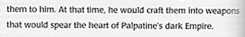
Our notes: `notes/materials/027-new-essential-chronology/02-part-two-fall-of-the-republic.md:528`

> Their father was Anakin Skywalker, one of the most powerful Jedi Knights in history, whose dark actions under the name Darth Vader nearly brought an end to that order.
— Source: Part Four: Profiles in History.
Note (our notes, around the quote): Luke Skywalker; Leia Organa Solo; Darth Vader (Anakin Skywalker) — Skywalker lineage: "Their father was Anakin Skywalker, one of the most powerful Jedi Knights in history, whose dark actions under the name Darth Vader nearly brought an end to that order." Source: The New Essential Chronology, p.104
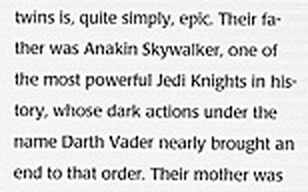
Our notes: `notes/materials/027-new-essential-chronology/04-part-four-profiles-in-history.md:119`

> Both infants were amazingly strong in the Force.
— Source: Part Four: Profiles in History; Luke Skywalker; Leia Organa Solo — amazingly strong in the Force.
Note (our notes, around the quote): Luke Skywalker; Leia Organa Solo — amazingly strong in the Force: "Both infants were amazingly strong in the Force." Source: The New Essential Chronology, p.104
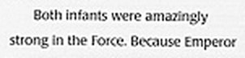
Our notes: `notes/materials/027-new-essential-chronology/04-part-four-profiles-in-history.md:121`

> attended to her physical development by hiring weapons master Giles Durane to instruct Leia in the arts of self-defense and marksmanship.
> [fragment — full passage not on file]
— Source: Part Four: Profiles in History; Leia Organa Solo — Leia trained by Giles Durane.
Note (our notes, around the quote): Leia Organa Solo — Leia trained by Giles Durane: "attended to her physical development by hiring weapons master Giles Durane to instruct Leia in the arts of self-defense and marksmanship." Source: The New Essential Chronology, p.105
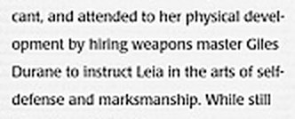
Our notes: `notes/materials/027-new-essential-chronology/04-part-four-profiles-in-history.md:130`

- Note (summary from our notes, not a quotation): Leia Organa Solo — art caption: "Princess Leia Organa" Source: The New Essential Chronology, p.105, caption
  — Source: Part Four: Profiles in History.
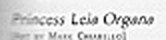
Our notes: `notes/materials/027-new-essential-chronology/04-part-four-profiles-in-history.md:132`

> She resisted Vader's rigorous interrogations in order to conceal the location of the new Rebel headquarters on Yavin 4.
— Source: Part Five: The Galactic Civil War; Leia Organa Solo; Darth Vader (Anakin Skywalker) — Leia resists interrogation.
Note (our notes, around the quote): Leia Organa Solo; Darth Vader (Anakin Skywalker) — Leia resists interrogation: "She resisted Vader's rigorous interrogations in order to conceal the location of the new Rebel headquarters on Yavin 4." Source: The New Essential Chronology, p.108
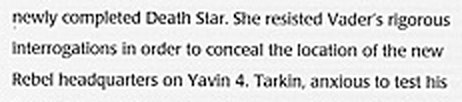
Our notes: `notes/materials/027-new-essential-chronology/05-part-five-galactic-civil-war.md:25`

> His private army would score many indepen- dent victories over the next nine years.
>
> The loss of Bel Iblis was offset when the Bothan pollti- clan Borsk Feytya and his sizable faction joined the Alliance.
>
> Fey/lya had been impressed by the Rebel victory at Yavin and made the move not for ideological reasons, but to gain more status and power.
>
> Leia Organa met up with a survivor of the oki Jedi Order after her vessel was shot down above the planet Krant. Echuu Shen-Jon, the general who had led the Repubilc’s effort to re- cover its Decimators during the Gone Wars, still lived on Krant serving out a sentence of exile for his brush with the dark side of the Force.
>
> Leia Organa met up with a survivor of the oki Jedi Order after her vessel was shot down above the planet Krant. Echuu Shen-Jon, the general who had led the Repubilc’s effort to re- cover its Decimators during the Gone Wars, still lived on Krant serving out a sentence of exile for his brush with the dark side of the Force. Echuu helped Leia destroy a Jedi artifact known as the VorNaTu before dying under the blade of Darth Vader, yet another Jedi casualty attributable to the Dark Lord.
>
> Approximately one year after the Battle of Yavin, Leia Jeamed that a top-secret list containing names of Rebel sympa- thizers who were embedded within the Imperial government had been left In a place that was accessible to the Empire. Leia tasked two agents—Dusque Mistfiier and Finn Darktin-with the responsibility of capturing the data holecron from the ruins of a Jedi temple on Dantooine.
— Source: Part Five: The Galactic Civil War.
(Excerpt widened 2026-11-17 to the relevant passage, word for word from research primary new essential chronology nec paged (text copy `research_primary_new_essential_chronology_nec_paged_txt_88b808b5bc`).)
(Excerpt widened 2026-11-17 to the relevant passage, word for word from research primary new essential chronology nec paged (text copy `research_primary_new_essential_chronology_nec_paged_txt_88b808b5bc`).)
Note (our notes, around the quote): Darth Vader (Anakin Skywalker); Leia Organa Solo — Echuu Shen-Jon dies to Vader: "Echuu helped Leia destroy a Jedi artifact known as the VorNaTu before dying under the blade of Darth Vader, yet another Jedi casualty attributable to the Dark Lord." Source: The New Essential Chronology, p.115
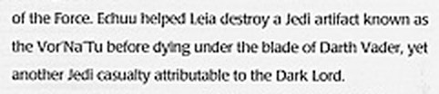
Our notes: `notes/materials/027-new-essential-chronology/05-part-five-galactic-civil-war.md:88`

> Obi-Wan's energy drove Luke to sever the Dark Lord's sword arm in a furious drive, but the effort seemed to exhaust Luke's intangible benefactor. Darth Vader shrugged off his injury, and only Vader's chance misstep into a crumbling well allowed Luke and Leia to escape.
— Source: Part Five: The Galactic Civil War; Luke Skywalker; Darth Vader (Anakin Skywalker) — Luke severs Vader's arm.
Note (our notes, around the quote): Luke Skywalker; Darth Vader (Anakin Skywalker) — Luke severs Vader's arm: "Obi-Wan's energy drove Luke to sever the Dark Lord's sword arm in a furious drive, but the effort seemed to exhaust Luke's intangible benefactor. Darth Vader shrugged off his injury, and only Vader's chance misstep into a crumbling well allowed Luke and Leia to escape." Source: The New Essential Chronology, p.116
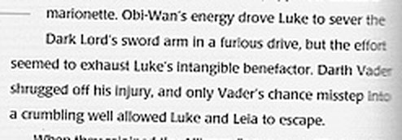
Our notes: `notes/materials/027-new-essential-chronology/05-part-five-galactic-civil-war.md:99`

> but the rookie Jedi Knight decimated the Hutt's entourage with ease. Leia strangled Jabba, leading to the collapse of the Desilijic crime family.
> [fragment — full passage not on file]
— Source: Part Five: The Galactic Civil War; Luke Skywalker — Jabba's sail barge.
Note (our notes, around the quote): Luke Skywalker — Jabba's sail barge: "but the rookie Jedi Knight decimated the Hutt's entourage with ease. Leia strangled Jabba, leading to the collapse of the Desilijic crime family." Source: The New Essential Chronology, p.123
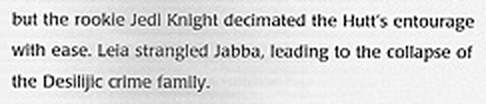
Our notes: `notes/materials/027-new-essential-chronology/05-part-five-galactic-civil-war.md:170`

> If they succeeded in enteching the population of Bakura, the Ssi-ruuk would have enough mechanical war: tlors to pose a threat to the entire galaxy.
>
> The bekaguered Imperials of Bakura welcomed the small Alllance fleet. Eager to discuss a formal truce, Lela Or- gana met with Imperial Governor Wilek Nereus in the capital city of Salis D’aar. Governor Nereus, along with Prime Minis: ter Yeorg Captison and his beautiful niece Gaeriel Captison, listened to the Alliance's offer, Nereus agreed to a cease-fire.
>
> With a handshake, the first-ever truce between Rebel and Imperial forces took effect.
>
> Later that evening, Leia Organa received a visitation by an unwelcome presence-the spirit-form of Anakin Skywalker, her true father.
>
> Later that evening, Leia Organa received a visitation by an unwelcome presence-the spirit-form of Anakin Skywalker, her true father. The man who was once Darth Vader begged his daughter for her forgiveness. Leia, who had leamed of her parentage only days earlier, was unable to forget the fact that Vader had tortured her aboard the Death Star and blasted her homeworld of Alderaan into cinders.
— Source: Part Five: The Galactic Civil War.
(Excerpt widened 2026-11-17 to the relevant passage, word for word from research primary new essential chronology nec paged (text copy `research_primary_new_essential_chronology_nec_paged_txt_88b808b5bc`).)
(Excerpt widened 2026-11-17 to the relevant passage, word for word from research primary new essential chronology nec paged (text copy `research_primary_new_essential_chronology_nec_paged_txt_88b808b5bc`).)
(Full sentence/passage taken from the source text on file: `research_primary_new_essential_chronology_nec_paged_txt`.)
Note (our notes, around the quote): Darth Vader (Anakin Skywalker); Leia Organa Solo — Anakin's spirit visits Leia: "the spirit-form of Anakin Skywalker, her true father. The man who was once Darth Vader begged his daughter for her forgiveness." Source: The New Essential Chronology, p.127
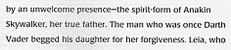
Our notes: `notes/materials/027-new-essential-chronology/05-part-five-galactic-civil-war.md:204`

- Note (summary from our notes, not a quotation): Han Solo; Leia Organa Solo — art caption: "Han Solo and Leia Organa Solo gain clues to the past in Tatooine's Tusken Raider "ghost oasis."" Source: The New Essential Chronology, p.146, caption
  — Source: Part Six: Birth of the New Republic.
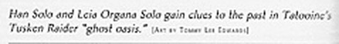
Our notes: `notes/materials/027-new-essential-chronology/06-part-six-birth-of-the-new-republic.md:135`

> Through the Force, Leia could sense the pain, rage, and blood that permeated the sand as a psychic stain.
— Source: Part Six: Birth of the New Republic; Leia Organa Solo — Leia senses the psychic stain.
Note (our notes, around the quote): Leia Organa Solo — Leia senses the psychic stain: "Through the Force, Leia could sense the pain, rage, and blood that permeated the sand as a psychic stain." Source: The New Essential Chronology, p.147
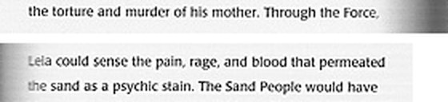
Our notes: `notes/materials/027-new-essential-chronology/06-part-six-birth-of-the-new-republic.md:144`

> Before long, Leia uncovered the Empire's trickery and demonstrated the proof to a square filled with angry Noghri, dramatically winning them over to her side.
— Source: Part Seven: Empire Resurgent.
Note (our notes, around the quote): Leia Organa Solo; Darth Vader (Anakin Skywalker) — Leia wins the Noghri: "Before long, Leia uncovered the Empire's trickery and demonstrated the proof to a square filled with angry Noghri, dramatically winning them over to her side." Source: The New Essential Chronology, p.151
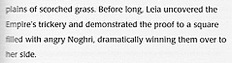
Our notes: `notes/materials/027-new-essential-chronology/07-part-seven-empire-resurgent.md:40`

> Thrawn's Noghri bodyguard Rukh, burning with anger toward the Empire ever since Leia Organa Solo's revelations on Honoghr, fatally stabbed his master through the heart.
— Source: Part Seven: Empire Resurgent; Grand Admiral Thrawn — Rukh kills Thrawn.
Note (our notes, around the quote): Grand Admiral Thrawn — Rukh kills Thrawn: "Thrawn's Noghri bodyguard Rukh, burning with anger toward the Empire ever since Leia Organa Solo's revelations on Honoghr, fatally stabbed his master through the heart." Source: The New Essential Chronology, p.153
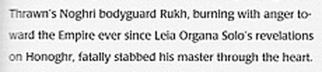
Our notes: `notes/materials/027-new-essential-chronology/07-part-seven-empire-resurgent.md:62`

> Palpatine also said that his aging body would soon burn out from the dark forces he wielded—and that he wanted to shift his consciousness into the new baby that Leia carried in her womb.
— Source: Part Seven: Empire Resurgent; Palpatine (Darth Sidious) — aging body burns out.
Note (our notes, around the quote): Palpatine (Darth Sidious) — aging body burns out: "Palpatine also said that his aging body would soon burn out from the dark forces he wielded—and that he wanted to shift his consciousness into the new baby that Leia carried in her womb." Source: The New Essential Chronology, p.156
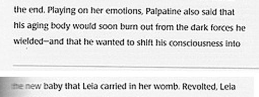
Our notes: `notes/materials/027-new-essential-chronology/07-part-seven-empire-resurgent.md:93`

> The desperate Emperor summoned up a huge Force storm, but he could no longer control what he had unleashed. As brother and sister fled, the conflagration consumed the gigantic black ship and, presumably, all that remained of the Emperor.
— Source: Part Seven: Empire Resurgent.
Note (our notes, around the quote): Palpatine (Darth Sidious); Leia Organa Solo; Luke Skywalker — Force storm consumes Eclipse: "The desperate Emperor summoned up a huge Force storm, but he could no longer control what he had unleashed. As brother and sister fled, the conflagration consumed the gigantic black ship and, presumably, all that remained of the Emperor." Source: The New Essential Chronology, p.157
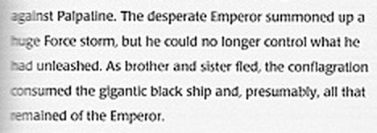
Our notes: `notes/materials/027-new-essential-chronology/07-part-seven-empire-resurgent.md:104`

> He knew that his sister Leia, her three children, Kam Solusar, the Witches of Dathomir, Kyle Katarn, and Mara Jade had all exhibited an aptitude for the Force.
— Source: Part Eight: The Return of the Jedi Knights; Luke Skywalker — academy recruits. POV: speaker not named in our notes.
Note (our notes, around the quote): Luke Skywalker — academy recruits: "He knew that his sister Leia, her three children, Kam Solusar, the Witches of Dathomir, Kyle Katarn, and Mara Jade had all exhibited an aptitude for the Force." Source: The New Essential Chronology, p.162
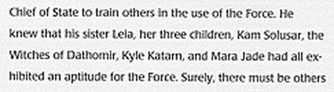
Our notes: `notes/materials/027-new-essential-chronology/08-part-eight-return-of-the-jedi-knights.md:11`

> Beldorian, at nine meters, was staggeringly large even for a Hutt, and possessed none of the corpulent rolls that immobilized lazy Hutts like Jabba. All muscle and fire, he slithered toward Leia like a snake, but a long, swift side cut with her lightsaber messily ended the career of Beldorian the Splendid.
— Source: Part Eight: The Return of the Jedi Knights; Leia Organa Solo — Leia kills Beldorian. POV: speaker not named in our notes.
Note (our notes, around the quote): Leia Organa Solo — Leia kills Beldorian: "Beldorian, at nine meters, was staggeringly large even for a Hutt, and possessed none of the corpulent rolls that immobilized lazy Hutts like Jabba. All muscle and fire, he slithered toward Leia like a snake, but a long, swift side cut with her lightsaber messily ended the career of Beldorian the Splendid." Source: The New Essential Chronology, p.175
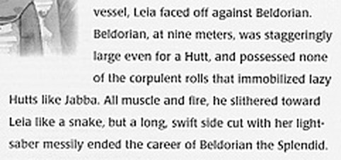
Our notes: `notes/materials/027-new-essential-chronology/08-part-eight-return-of-the-jedi-knights.md:138`

> In a blind rage, Kueller pulled oul a master detonator that could trig- ger the explosion of every drolé manufactured on Telti.
>
> Before anyone could stop him, he stabbed his finger on the button.
>
> Ught-years away, on Teilti, C-3PO and R2-D2 had in- filtrated Brakiss’s droid factories and, with help from the mechanic Cole Fardreamer and an army of astromechs, had broken into the controt room. Jacking into a computer term! nal, R2 intercepted Kueller’s master control signal and deacti- vated the remote detonators at the last instant.
>
> Leia had no way of knowing whether Kueller’s bombs had been discharged, so she took the quickest possible route to prevent further trickery. Drawing a blaster, she shot Kueller cleanly in the head, Was her deed=a violent killing committed in anger—an act born from the dark side?
>
> Leia had no way of knowing whether Kueller’s bombs had been discharged, so she took the quickest possible route to prevent further trickery. Drawing a blaster, she shot Kueller cleanly in the head, Was her deed=a violent killing committed in anger—an act born from the dark side? At that moment, she didn’t care.
>
> Leia, Luke, and Wedge Antilles retumed to Coruscant as heroes. Mon Mothma gladly stepped down, arxf Lela returned to her former position, which was ratified without dissent.
— Source: Part Nine: Uprisings and Insurgencies; Leia Organa Solo; Kueller — Leia kills Kueller.
(Excerpt widened 2026-11-17 to the relevant passage, word for word from research primary new essential chronology nec paged (text copy `research_primary_new_essential_chronology_nec_paged_txt_88b808b5bc`).)
(Excerpt widened 2026-11-17 to the relevant passage, word for word from research primary new essential chronology nec paged (text copy `research_primary_new_essential_chronology_nec_paged_txt_88b808b5bc`).)
Note (our notes, around the quote): Leia Organa Solo; Kueller — Leia kills Kueller: "Drawing a blaster, she shot Kueller cleanly in the head. Was her deed—a violent killing committed in anger—an act born from the dark side? At that moment, she didn't care." Source: The New Essential Chronology, p.184
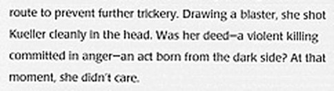
Our notes: `notes/materials/027-new-essential-chronology/09-part-nine-uprisings-and-insurgencies.md:82`

> He had found many new trainees, some human and some exotic.
>
> However, because Skywalker was frequently called away on his own adventures and also to spend time with Mara Jade, one of his first trainees—the scholar and minstrel Tionne— took over Luke's duties. Interplanetary squabbles and trade conflicts were as much a constant as always. At the urging of her friends in the government, Lela Organa Soto ran again for the post of New Republic Chief of State, and was elected back Into that office in 21 as. Organa Solo’s three children, the twins Jacen and Jaina and her younger son Anakin, all had a strong talent in the Force. The three youths spent much time at the Jedi academy.
>
> Tue Gotoen Grose AND KeNost's LIGHTSABER 22 ABY.
>
> “hough there had been a few lessons in historic Jedi Holexrons regarding the training of extremely young children, Luke Skywalker was unaware of any specific tule for the age at which a talented person could begin to learn the ways of the Force. Anakin Solo came to the Jedi academy when he was midway through his eleventh year.
— Source: Part Eleven: Generations of Jedi.
(Excerpt widened 2026-11-17 to the relevant passage, word for word from research primary new essential chronology nec paged (text copy `research_primary_new_essential_chronology_nec_paged_txt_88b808b5bc`).)
(Excerpt widened 2026-11-17 to the relevant passage, word for word from research primary new essential chronology nec paged (text copy `research_primary_new_essential_chronology_nec_paged_txt_88b808b5bc`).)
Note (our notes, around the quote): Leia Organa Solo; Jacen Solo; Jaina Solo; Anakin Solo — Solo children's talent: "Organa Solo's three children, the twins Jacen and Jaina and her younger son Anakin, all had a strong talent in the Force." Source: The New Essential Chronology, p.195
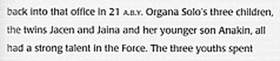
Our notes: `notes/materials/027-new-essential-chronology/11-part-eleven-generations-of-jedi.md:11`

> Leia was rescued by her son Jacen, who abandoned his doubt in this critical moment and opened himself fully to the Force. The telekinetic storm summoned by Jacen picked up everything in the room and sent Tsavong Lah flying out a window.
— Source: Part Twelve: The New Jedi Order; Jacen Solo; Leia Organa Solo — Jacen's telekinetic storm.
Note (our notes, around the quote): Jacen Solo; Leia Organa Solo — Jacen's telekinetic storm: "Leia was rescued by her son Jacen, who abandoned his doubt in this critical moment and opened himself fully to the Force. The telekinetic storm summoned by Jacen picked up everything in the room and sent Tsavong Lah flying out a window." Source: The New Essential Chronology, p.211
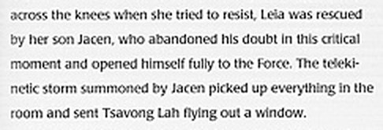
Our notes: `notes/materials/027-new-essential-chronology/12-part-twelve-new-jedi-order.md:83`

> Luke Skywalker killed Welk, the Night Herald, and Leia Organa Solo secured a temporary cease-fire ... The experience prompted Leia to once again take up the path of the Jedi, a life decision she had been putting off for decades. She selected the Barabel Jedi Saba Sebatyne as her Jedi Master.
> [fragment — full passage not on file]
— Source: Part Twelve: The New Jedi Order.
Note (our notes, around the quote): Luke Skywalker; Leia Organa Solo — Luke kills Welk; Leia takes up the Jedi path: "Luke Skywalker killed Welk, the Night Herald, and Leia Organa Solo secured a temporary cease-fire ... The experience prompted Leia to once again take up the path of the Jedi, a life decision she had been putting off for decades. She selected the Barabel Jedi Saba Sebatyne as her Jedi Master." Source: The New Essential Chronology, p.229
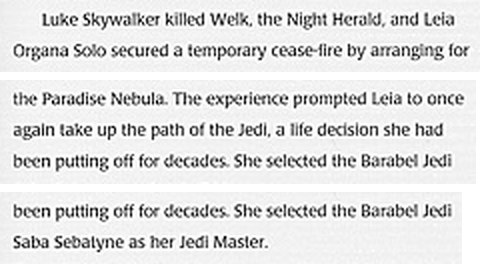
Our notes: `notes/materials/027-new-essential-chronology/12-part-twelve-new-jedi-order.md:245`

## Star Wars Saga Edition: Jedi Academy Training Manual (WotC, 2009): power-scaling and lore notes

> Skywalker is faced with two threats related to Thrawn. One is a mad clone of the old Jedi Master Jorus C'Baoth. The clone “Joruus” tempts Skywalker toward the dark side but is defeated. The other threat is Mara Jade, an assas- sin with her sights set on Luke Skywalker.
>
> Luke faces an even greater challenge in the form of the reawakened clone of Emperor Palpatine. This clone organizes an assault on the New Republic and pushes the former Rebel Alliance to the breaking point.
>
> Luke faces an even greater challenge in the form of the reawakened clone of Emperor Palpatine. This clone organizes an assault on the New Republic and pushes the former Rebel Alliance to the breaking point. The Emperor's clone succeeds where Palpatine failed and turns Skywalker to the dark side for a brief time. However, the intervention of his sister, Leia Organa-Solo, brings Luke back from the darkness, whereupon he defeats Palpatine’s clone.
>
> The Emperor's clone succeeds where Palpatine failed and turns Skywalker to the dark side for a brief time. However, the intervention of his sister, Leia Organa-Solo, brings Luke back from the darkness, whereupon he defeats Palpatine’s clone.
>
> As Luke sets about rebuilding the Jedi Order, a new threat appears from beyond the galaxy. The Yuuzhan Vong arrive, and their immunity to the Force makes them a great threat to the Jedi.
>
> Luke reluctantly takes the title of Grand Master, but to everyone he meets, from the most respected senator to the lowliest droid, he is still simply “Luke.” Luke hopes for a lasting peace but is ever vigilant.
— Source: Chapter V: Instructors and Alumni.
(Excerpt widened 2026-11-17 to the relevant passage, word for word from research primary jedi academy training manual jatm paged (text copy `research_primary_jedi_academy_training_manual_jatm_paged_txt_fea130719f`).)
(Excerpt widened 2026-11-17 to the relevant passage, word for word from research primary jedi academy training manual jatm paged (text copy `research_primary_jedi_academy_training_manual_jatm_paged_txt_fea130719f`).)
Note (our notes, around the quote): Luke Skywalker; Palpatine (Darth Sidious); Leia Organa Solo — Grand Master Luke Skywalker — Dark Empire: "The Emperor's clone succeeds where Palpatine failed and turns Skywalker to the dark side for a brief time. However, the intervention of his sister, Leia Organa-Solo, brings Luke back from the darkness, whereupon he defeats Palpatine's clone." Source: Jedi Academy Training Manual, p.100
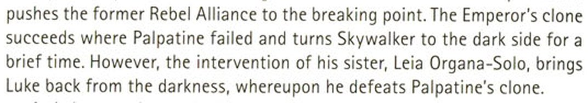
Our notes: `notes/materials/028-jedi-academy-training-manual/05-ch5-instructors-and-alumni.md:53`

> With the funds from the slave trade, he outfits the Empire Reborn with arms and ships.
>
> After establishing the armed forces for the Empire Reborn, Hethrir approaches a Chistori named Desann to create an army of Dark Jedi. By selecting only Humans with Force potential and cleansing them through Waru, Hethrir and Desann create the Reborn. However, the Reborn are defeated by Luke Skywalker and Kyle Katarn.
>
> After his defeat, Hethrir has one chance to redeem himself to Waru and return to power. He abducts Jacen, Jaina, and Anakin Solo with the inten- tion of sacrificing them to Waru.
>
> After his defeat, Hethrir has one chance to redeem himself to Waru and return to power. He abducts Jacen, Jaina, and Anakin Solo with the inten- tion of sacrificing them to Waru. However, Han Solo, his wife Leia, and Luke Skywalker join with Rillao and manage to rescue the abductees, although Anakin is nearly lost. Enraged by Hethrir's failure, Waru consumes him and returns home to its own dimension.
>
> Enraged by Hethrir's failure, Waru consumes him and returns home to its own dimension.
>
> Hethrir Encounters With Hethrir's slave trade in full swing during the early days of the New Republic, any number of people might find themselves abducted and imprisoned, especially those who are Force-sensitive, to be used either as test subjects for his experiments or as sacrifices to Waru. If any heroes find themselves pursuing Desann or the Reborn, they might choose to take their goal one step further and try to bring down Hethrir as well.
— Source: Chapter VI: Dangers of Study.
(Excerpt widened 2026-11-17 to the relevant passage, word for word from research primary jedi academy training manual jatm paged (text copy `research_primary_jedi_academy_training_manual_jatm_paged_txt_fea130719f`).)
(Excerpt widened 2026-11-17 to the relevant passage, word for word from research primary jedi academy training manual jatm paged (text copy `research_primary_jedi_academy_training_manual_jatm_paged_txt_fea130719f`).)
Note (our notes, around the quote): Han Solo; Leia Organa Solo; Luke Skywalker — Hethrir — rescue of the Solo children: "However, Han Solo, his wife Leia, and Luke Skywalker join with Rillao and manage to rescue the abductees, although Anakin is nearly lost." Source: Jedi Academy Training Manual, p.120
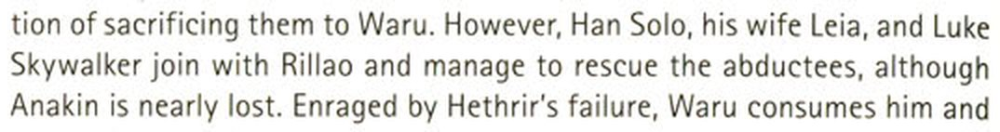
Our notes: `notes/materials/028-jedi-academy-training-manual/06-ch6-dangers-of-study.md:60`

> After defeating Skywalker in a lightsaber duel on Pydyr and imprisoning him to use as bait for Leia Organa-Solo.
— Source: Chapter VI: Dangers of Study; Kueller; Luke Skywalker — Kueller — first duel.
Note (our notes, around the quote): Kueller; Luke Skywalker — Kueller — first duel: "After defeating Skywalker in a lightsaber duel on Pydyr and imprisoning him to use as bait for Leia Organa-Solo." Source: Jedi Academy Training Manual, p.122
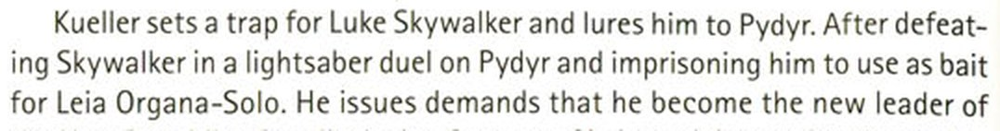
Our notes: `notes/materials/028-jedi-academy-training-manual/06-ch6-dangers-of-study.md:78`

> Kueller sets a trap for Luke Skywalker and lures him to Pydyr. After defeat- ing Skywalker in a lightsaber duel on Pydyr and imprisoning him to use as bait for Leia Organa-Solo. He issues demands that he become the new leader of the New Republic after displaying footage of Luke and detonating the explo- sives on Auyemesh as a demonstration of his power. After the Senate issues a Vote of No Confidence in her leadership, Leia resigns her position to Mon Mothma and leads an attack force against Almania to free her brother.
>
> Shortly after the New Republic fleet reaches Almania and engages the Almanian fleet, Leia flies to the planet's surface to free Luke, only to find that he has already escaped and is dueling Kueller. Kueller defeats the Jedi Master again and is about to strike him down when the untimely arrival of a ysalamir cancels his Force abilities.
>
> Shortly after the New Republic fleet reaches Almania and engages the Almanian fleet, Leia flies to the planet's surface to free Luke, only to find that he has already escaped and is dueling Kueller. Kueller defeats the Jedi Master again and is about to strike him down when the untimely arrival of a ysalamir cancels his Force abilities. With most of his defenses down, Leia shoots and kills Kueller.
>
> With most of his defenses down, Leia shoots and kills Kueller.
>
> Kueller Encounters Any heroes on Almania between 13 and 17 ABY will find Kueller as the planet's leader, rallying his people to support his campaign against the New Republic.
>
> Heroes might be dispatched to investigate sudden discord with the population of Almania or to track down a strange device found in a broken-down droid that was manufactured on Telti.
>
> === sp124 MASSASS!I ABOMINATION Massassi Abomination CL 10 Medium Massassi (mutated) soldier 7/Force adept 3 Force 3; Dark Side 10 Init +15; Senses low-light vision; Perception +6 Languages Massassi Defenses Ref 24 (flat-footed 19), Fort 24, Will 22 hp 127; Threshold 24 Speed 6 squares Melee Massassi lanvarok +11* (1d8+23) Ranged Massassi lanvarok +15 (3d4+7) Base Atk +9; Grp +15 Atk Options Channel Aggression, Cleave, Devastating Attack, Power Attack Special Actions Damage Reduction 10, Power of the Dark Side Force Powers Known (Use the Force +10): dark rage (2) .
— Source: Chapter VI: Dangers of Study.
(Excerpt widened 2026-11-17 to the relevant passage, word for word from research primary jedi academy training manual jatm paged (text copy `research_primary_jedi_academy_training_manual_jatm_paged_txt_fea130719f`).)
(Excerpt widened 2026-11-17 to the relevant passage, word for word from research primary jedi academy training manual jatm paged (text copy `research_primary_jedi_academy_training_manual_jatm_paged_txt_fea130719f`).)
Note (our notes, around the quote): Kueller; Luke Skywalker; Leia Organa Solo — Kueller — second duel and death: "Kueller defeats the Jedi Master again and is about to strike him down when the untimely arrival of a ysalamir cancels his Force abilities. With most of his defenses down, Leia shoots and kills Kueller." Source: Jedi Academy Training Manual, p.122
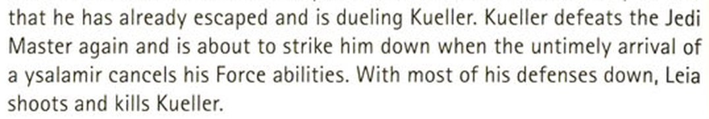
Our notes: `notes/materials/028-jedi-academy-training-manual/06-ch6-dangers-of-study.md:80`

## The Jedi Academy Sourcebook (WEG, 1996): power-scaling and lore notes

> She feels guilty for not devoting more time to her Jedi training, but it takes a definite back seat to her professional duties and family time. Luke has said nothing, but Leia knows that he worries about her lack of progress.
— Source: Chapter One: The New Republic; Leia Organa Solo; Luke Skywalker — Leia Organa Solo — Jedi training.
Note (our notes, around the quote): Leia Organa Solo; Luke Skywalker — Leia Organa Solo — Jedi training: "She feels guilty for not devoting more time to her Jedi training, but it takes a definite back seat to her professional duties and family time. Luke has said nothing, but Leia knows that he worries about her lack of progress." Source: The Jedi Academy Sourcebook, p.10
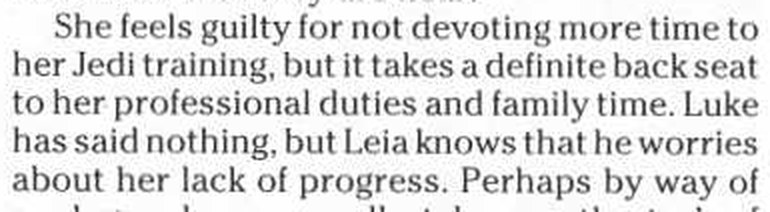
Our notes: `notes/materials/029-jedi-academy-sourcebook/01-ch1-the-new-republic.md:36`

> Luke has said nothing, but Leia knows that he worries about her lack of progress. Perhaps by way of apology, she personally takes on the task of selecting a location for Luke’s Jedi academy, despite her full schedule. m Leia Organa Solo Type: Minister of State DEXTERITY 3D Blaster 9D, blaster artillery 4D+1, brawling parry 5D+2, dodge &D, grenade 4D-+1, lightsaber 5D+2, melee combat §D+2, melee parry 6D+1, running 5D, vehicle blasters 4D KNOWLEDGE 4D Alien species 8D, bureaucracy 9D+2, bureaucracy: New Republic Inner Council 10D, bureaucracy: New Republic Senate 10D, cultures 9D+1, languages 7D+2, law enforce- ment 7D+1, planetary systems 9D-+1, streetwise 7D, sur- vival 8D, value 6D+1, willpower 7D+2 MECHANICAL 2D+2 Astrogation 5D, beast riding 4D+1, communications 5D+2, hover vehicle operation 3D+2, repulsorlift: operation 5D+1, sensors 4D+2, space transports 3D-+1, starfighter piloting 6D, starship gunnery 6D+1, starship shields PERCEPTION 3D+1 Bargain 7D, command 11D, con 6D, gambling 5D, hide 7D, persuasion 9D, persuasion: debate 11D, persuasion: ora- tion 11D+2, search 6D, sneak 7D+1 STRENGTH 3D Brawling 4D+2, climbing/jumping5D+1, stamina 7D, swim- ming 5D+1 TECHNICAL 2D Computer programming/repair 4D+2, demolitions 3D+1, droid programming 5D, first aid 7D, security 6D, space transports repair 4D+] Special Abilities:
>
> Force Skills: Control 5D+1, sense 4D+2, alter 3D These are only some of the powers that Leia has demon- strated:
>
> Control, Absorb/dissipate energy, control pain, resist stun Sense: Danger sense", life detection, life sense, magnify senses, receptive telepathy Alter: Telekinesis Control, Sense, and Alter: Force harmony** * Described in The Thrawn Trilogy Sourcebook ** Described in Dark Empire Sourcebook, This character is Force-sensitive Force Points: 4 Character Points: 14 Move: 10) Equipment: Lightsaber (5D), comlink, datapad, hold-out blaster (3D).
— Source: Chapter One: The New Republic.
(Excerpt widened 2026-11-17 to the relevant passage, word for word from research primary jedi academy sourcebook jas clean (text copy `research_primary_jedi_academy_sourcebook_jas_clean_txt_04b8ab0d44`).)
(Excerpt widened 2026-11-17 to the relevant passage, word for word from research primary jedi academy sourcebook jas clean (text copy `research_primary_jedi_academy_sourcebook_jas_clean_txt_04b8ab0d44`).)
Note (our notes, around the quote): Leia Organa Solo — Leia Organa Solo — stat block, Force skills (RPG mechanics) — RPG mechanics (weaker source): "Force Skills: Control 5D+1, sense 4D+2, alter 3D" Source: The Jedi Academy Sourcebook, p.10, stat block
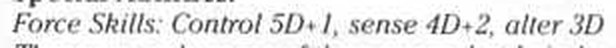
Our notes: `notes/materials/029-jedi-academy-sourcebook/01-ch1-the-new-republic.md:38`

> Luke has said nothing, but Leia knows that he worries about her lack of progress. Perhaps by way of apology, she personally takes on the task of selecting a location for Luke’s Jedi academy, despite her full schedule. m Leia Organa Solo Type: Minister of State DEXTERITY 3D Blaster 9D, blaster artillery 4D+1, brawling parry 5D+2, dodge &D, grenade 4D-+1, lightsaber 5D+2, melee combat §D+2, melee parry 6D+1, running 5D, vehicle blasters 4D KNOWLEDGE 4D Alien species 8D, bureaucracy 9D+2, bureaucracy: New Republic Inner Council 10D, bureaucracy: New Republic Senate 10D, cultures 9D+1, languages 7D+2, law enforce- ment 7D+1, planetary systems 9D-+1, streetwise 7D, sur- vival 8D, value 6D+1, willpower 7D+2 MECHANICAL 2D+2 Astrogation 5D, beast riding 4D+1, communications 5D+2, hover vehicle operation 3D+2, repulsorlift: operation 5D+1, sensors 4D+2, space transports 3D-+1, starfighter piloting 6D, starship gunnery 6D+1, starship shields PERCEPTION 3D+1 Bargain 7D, command 11D, con 6D, gambling 5D, hide 7D, persuasion 9D, persuasion: debate 11D, persuasion: ora- tion 11D+2, search 6D, sneak 7D+1 STRENGTH 3D Brawling 4D+2, climbing/jumping5D+1, stamina 7D, swim- ming 5D+1 TECHNICAL 2D Computer programming/repair 4D+2, demolitions 3D+1, droid programming 5D, first aid 7D, security 6D, space transports repair 4D+] Special Abilities:
>
> Force Skills: Control 5D+1, sense 4D+2, alter 3D These are only some of the powers that Leia has demon- strated:
>
> Control, Absorb/dissipate energy, control pain, resist stun Sense: Danger sense", life detection, life sense, magnify senses, receptive telepathy Alter: Telekinesis Control, Sense, and Alter: Force harmony** * Described in The Thrawn Trilogy Sourcebook ** Described in Dark Empire Sourcebook, This character is Force-sensitive Force Points: 4 Character Points: 14 Move: 10) Equipment: Lightsaber (5D), comlink, datapad, hold-out blaster (3D).
— Source: Chapter One: The New Republic.
(Excerpt widened 2026-11-17 to the relevant passage, word for word from research primary jedi academy sourcebook jas clean (text copy `research_primary_jedi_academy_sourcebook_jas_clean_txt_04b8ab0d44`).)
(Excerpt widened 2026-11-17 to the relevant passage, word for word from research primary jedi academy sourcebook jas clean (text copy `research_primary_jedi_academy_sourcebook_jas_clean_txt_04b8ab0d44`).)
Note (our notes, around the quote): Leia Organa Solo — Leia Organa Solo — stat block, combat skills (RPG mechanics) — RPG mechanics (weaker source): "Blaster 9D, blaster artillery 4D+1, brawling parry 5D+2," Source: The Jedi Academy Sourcebook, p.10, stat block
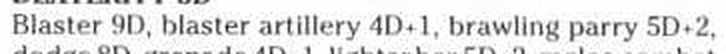
Our notes: `notes/materials/029-jedi-academy-sourcebook/01-ch1-the-new-republic.md:40`

> Ultimately, he has Kyp return to Yavin Four and helps him reclaim the Sun Crusher. He also bolsters Kyp’s talents to allow him to defeat Luke and place him in a coma.
>
> He reveals himself to Luke in his coma-like state, to taunt him. He tells Luke of his plans to revive the Lords of the Sith, using his disciples as his first generation of students. He boasts that he already owns Kyp and Streen, and de- stroyed Gantoris.
>
> Still not ready to take on Luke directly, Kun makes several attempts on Luke's body. Each attack is thwarted by the Jedi students and Leia.
>
> Thanks to the Solo twins (who can speak with Luke) and Kirana Ti (who has studied Exar Kun in the Holocron), the students learn the identity of their foe and how to defeat him.
>
> The students corner Kun in the great cham- ber where Luke's body is resting, He seeks to tempt and taunt each, but they close in on him.
— Source: Chapter Four: Echoes of the Sith.
(Excerpt widened 2026-11-17 to the relevant passage, word for word from research primary jedi academy sourcebook jas clean (text copy `research_primary_jedi_academy_sourcebook_jas_clean_txt_04b8ab0d44`).)
(Excerpt widened 2026-11-17 to the relevant passage, word for word from research primary jedi academy sourcebook jas clean (text copy `research_primary_jedi_academy_sourcebook_jas_clean_txt_04b8ab0d44`).)
Note (our notes, around the quote): Exar Kun; Luke Skywalker; Leia Organa Solo — The Return of Exar Kun — attempts on Luke's body: "Still not ready to take on Luke directly, Kun makes several attempts on Luke's body. Each attack is thwarted by the Jedi students and Leia." Source: The Jedi Academy Sourcebook, p.49
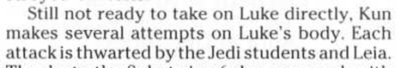
Our notes: `notes/materials/029-jedi-academy-sourcebook/04-ch4-echoes-of-the-sith.md:40`

> The arrival of Grand Admiral Thrawn exacerbated these fears, and it was very difficult for New Republic diplomats, led by Mon Mothma and Leia Organa Solo, to woo worlds into the New Republic fold even after his defeat at Bilbringi.
— Source: Chapter Five: Forces of the Empire.
Note (our notes, around the quote): Grand Admiral Thrawn; Leia Organa Solo — The Imperial Core Systems — Thrawn's legacy: "The arrival of Grand Admiral Thrawn exacerbated these fears, and it was very difficult for New Republic diplomats, led by Mon Mothma and Leia Organa Solo, to woo worlds into the New Republic fold even after his defeat at Bilbringi." Source: The Jedi Academy Sourcebook, p.52
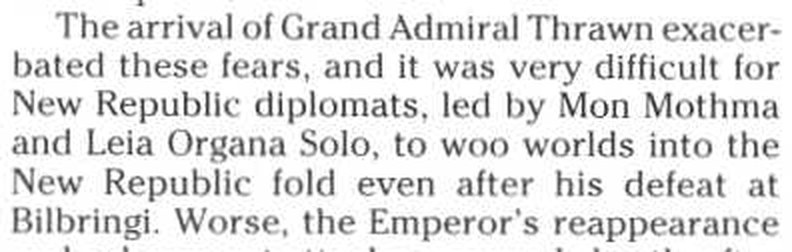
Our notes: `notes/materials/029-jedi-academy-sourcebook/05-ch5-forces-of-the-empire.md:11`

> The computer core is in the center of the room, a pillar which runs from the ceiling through the floor. The core glows with oblong green lights which flicker downward in a soothing waterfall-like pattern, Wires and cables spill out of the sides of the station, leading into a tangled morass of computer stations, portable diagnos- tic machines, computer components, and gen- erators positioned along the walls.
>
> The room is an impressive display of techno- logical wonder, but most of it is just stage dress- ing for the actual purpose of the room: to kill intruders, This room was designed by Ackbar and Winter as a final, last-ditch defense should the base be penetrated by intruders (this de- fense will likely be dismantled when the base is transferred to government control).
>
> The Jedi Academy Sourcebook === sp102 Ne eet; ter Ten: Planets om WA Establishment of Anoth Base When Leia Organa Solo gave birth to twins who were strong in the Force, she and Luke Skywalker immediately appreciated the need to protect them from harm —the Empire was far from defeated, and the capture of a young Jedi child by one of Palpatine’s remaining Dark Adepts might prove disastrous to the future of the New Republic.
>
> It was a difficult decision for the young mother, but Leia decided that they would not be safe anywhere near her.
>
> It was a difficult decision for the young mother, but Leia decided that they would not be safe anywhere near her. In consultation with Winter, Luke and Admiral Ackbar, she decided to send them into exile, secluded on an unknown planet far from prying Imperial eyes or dark-side influences that might cor- rupt their fragile Force-sensitive minds.
>
> But, like all great legends, the fact that we can’t prove the veracity of every detail doesn’t make the stories any less entertaining or worthy of being read. These legends remain true to the spirit of Star Wars and in that way are another avenue through which we can get to know and understand our beloved heroes in that galaxy far, far away.
>
> —Del Rey Books, May 2014 Turn the page or jump to the timeline of Star Wars Legends novels to learn more.
>
> 1 The huge orange sphere of the gas planet Yavin heaved itself over the horizon of its fourth moon. Soft, misty light shone across the ever-stirring jungles and the ancient stone temples.
>
> Luke Skywalker used a Jedi refreshing technique to remove weariness from his body. He had slept soundly—but the future of the New Republic and the fate of the galaxy weighed heavily upon him.
>
> Luke stood atop the squared pyramid of the Great Temple that had been abandoned millennia before by the lost Massassi race. During the Alliance’s early struggles against the Empire, they had built a secret base in the ruins, from which they had launched their desperate attack against the first Death Star.
— Source: Chapter Ten: Planets.
(Excerpt widened 2026-11-17 to the relevant passage, word for word from research primary jedi academy sourcebook jas clean (text copy `research_primary_jedi_academy_sourcebook_jas_clean_txt_04b8ab0d44`).)
(Excerpt widened 2026-11-17 to the relevant passage, word for word from Jedi Search (Kevin Anderson) (text copy `MEGA_Legend_The_Jedi_Academy_Trilogy_Star_Wars_Jedi_Academy_01_Jedi_Search_Kevin_J_Anderson_epub`).)
(Excerpt widened 2026-11-17 to the relevant passage, word for word from research primary jedi academy sourcebook jas clean (text copy `research_primary_jedi_academy_sourcebook_jas_clean_txt_04b8ab0d44`).)
(Excerpt widened 2026-11-17 to the relevant passage, word for word from Jedi Search (Kevin Anderson) (text copy `MEGA_Legend_The_Jedi_Academy_Trilogy_Star_Wars_Jedi_Academy_01_Jedi_Search_Kevin_J_Anderson_epub`).)
(Full sentence/passage taken from the source text on file: `research_primary_jedi_academy_sourcebook_jas_clean_txt`.)
Note (our notes, around the quote): Leia Organa Solo; Luke Skywalker; Palpatine (Darth Sidious) — Establishment of Anoth Base (sidebar): "she and Luke Skywalker immediately appreciated the need to protect them from harm —the Empire was far from defeated, and the capture of a young Jedi child by one of Palpatine's remaining Dark Adepts might prove disastrous to the future of the New Republic." Source: The Jedi Academy Sourcebook, p.101, sidebar/caption
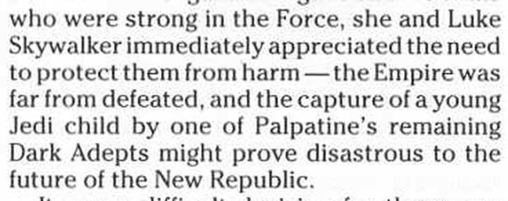
Our notes: `notes/materials/029-jedi-academy-sourcebook/10-ch10-planets.md:16`

> I'm very worried about having the twins here while whatever destroyed Gantoris and put Luke in a coma is still at large. Sometimes I can feel a sudden chill pass through me, as if something evil is watching me.
— Source: Chapter Ten: Planets.
Note (our notes, around the quote): Leia Organa Solo; Gantoris; Luke Skywalker; Exar Kun — Leia's datapad personal log (sidebar): "I'm very worried about having the twins here while whatever destroyed Gantoris and put Luke in a coma is still at large. Sometimes I can feel a sudden chill pass through me, as if something evil is watching me." Source: The Jedi Academy Sourcebook, p.107, sidebar/caption
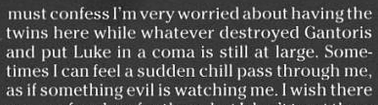
Our notes: `notes/materials/029-jedi-academy-sourcebook/10-ch10-planets.md:50`

## The Complete Star Wars Encyclopedia, Vol. I (A–G)

> During a rendezvous with Princess Leia Organa shortly before the Battle of Hoth, Ackbar's modified bulk freighter was destroyed by the Empire.
— Source: scan pages 1–40; Leia Organa Solo; Admiral Ackbar.
Note (our notes, around the quote): Leia Organa Solo; Admiral Ackbar: "During a rendezvous with Princess Leia Organa shortly before the Battle of Hoth, Ackbar's modified bulk freighter was destroyed by the Empire." Source: The Complete Star Wars Encyclopedia, Vol. I, p.9
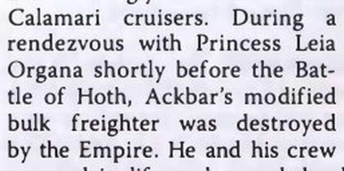
Our notes: `notes/materials/030-complete-star-wars-encyclopedia-vol-1/00-v1-scan-001-040.md:145`

> Adarakh was killed by Yuuzhan Vong collaborator Vigi Shesh on Coruscant while he was trying to defend Leia and the infant Ben Skywalker.
— Source: scan pages 1–40; Leia Organa Solo; Ben Skywalker.
Note (our notes, around the quote): Leia Organa Solo; Ben Skywalker: "Adarakh was killed by Yuuzhan Vong collaborator Vigi Shesh on Coruscant while he was trying to defend Leia and the infant Ben Skywalker." Source: The Complete Star Wars Encyclopedia, Vol. I, p.10
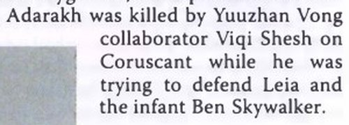
Our notes: `notes/materials/030-complete-star-wars-encyclopedia-vol-1/00-v1-scan-001-040.md:158`

> However, it also smelled of ammonia and musk. Affy­ techans were among the aliens aboard the Eye o fPalpatine. 1 3 ) eAfit,Zeen Afit, Zeen A craggy-faced smuggler, Afit was one of the smugglers Han Solo encoun­ tered on the asteroid Skip 1 during his investi­ gation into a bombing that rocked Senate Hall on Coruscant. He originally introduced Solo and Chewbacca to Smuggler's Run, an aster­ oid belt infamous as a smugglers' hideout. Afterburners A "noble"-minded swoop gang on Entralla who protected the citizens of Nexus City from the more dangerous crimi­ nals who congregated there. Afyon, Captain A native of Alderaan, Afyon heeded Princess Leia Organa's call to join the Rebellion after the Empire destroyed his family, friends, and entire planet. A vet­ eran of the Clone Wars, Captain Afyon served as first officer aboard a Corellian gunship and eventually earned his own command. At the age of 52, some four years after the end of the Galactic Civil War, he was made captain of the escort frigate Larkhess, a warship that had been relegated to trade duty. The Larkhess transported cargo and hotshot braggart fighter pilots who never gave the "old man" captain his due. During the Battle of Sluis Van, how­ ever, Afyon proved himself to be an excellent commander.
— Source: scan pages 1–40; Leia Organa Solo. POV: Leia Organa Solo.
(Excerpt widened 2026-11-17 to the relevant passage, word for word from research primary cse vol1 (text copy `research_primary_cse_vol1_pdf_45a954be6d`).)
(Excerpt widened 2026-11-17 to the relevant passage, word for word from research primary cse vol1 (text copy `research_primary_cse_vol1_pdf_45a954be6d`).)
Note (our notes, around the quote): Leia Organa Solo: "Afyon, Captain A native of Alderaan, Afyon heeded Princess Leia Organa's call to join the Rebellion after the Empire destroyed his family, friends, and entire planet." Source: The Complete Star Wars Encyclopedia, Vol. I, p.14
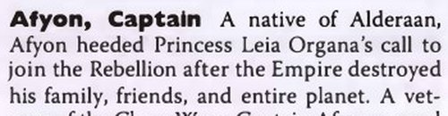
Our notes: `notes/materials/030-complete-star-wars-encyclopedia-vol-1/00-v1-scan-001-040.md:184`

> Ahk'laht createda diplomatic incident when, in protecting Leia, he struck down an intimidating Barabel ambassador.
— Source: scan pages 1–40; Leia Organa Solo. POV: Leia Organa Solo.
Note (our notes, around the quote): Leia Organa Solo: "Ahk'laht createda diplomatic incident when, in protecting Leia, he struck down an intimidating Barabel ambassador." Source: The Complete Star Wars Encyclopedia, Vol. I, p.15
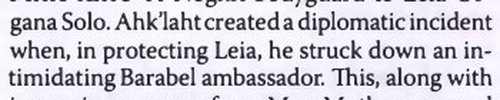
Our notes: `notes/materials/030-complete-star-wars-encyclopedia-vol-1/00-v1-scan-001-040.md:191`

> Alderaan Princess Leia Organa named her personal space yacht for the destroyed planet where she grew up.
— Source: scan pages 1–40; Leia Organa Solo. POV: Leia Organa Solo.
Note (our notes, around the quote): Leia Organa Solo: "Alderaan Princess Leia Organa named her personal space yacht for the destroyed planet where she grew up." Source: The Complete Star Wars Encyclopedia, Vol. I, p.19
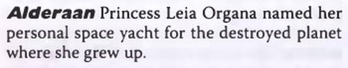
Our notes: `notes/materials/030-complete-star-wars-encyclopedia-vol-1/00-v1-scan-001-040.md:217`

> The New Republic launched an offensive, the Battle of Almania, and Leia eventually killed a weakened Kueller with a blaster shot while he was battling Luke.
— Source: scan pages 1–40; Leia Organa Solo; Kueller; Luke Skywalker.
Note (our notes, around the quote): Leia Organa Solo; Kueller; Luke Skywalker: "The New Republic launched an offensive, the Battle of Almania, and Leia eventually killed a weakened Kueller with a blaster shot while he was battling Luke." Source: The Complete Star Wars Encyclopedia, Vol. I, p.24
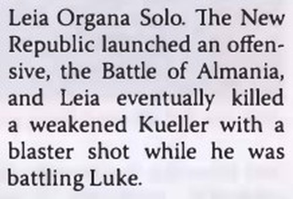
Our notes: `notes/materials/030-complete-star-wars-encyclopedia-vol-1/00-v1-scan-001-040.md:250`

> The smuggler Talon Karrde posted men on Anchoron in an unsuccessful search for Grand Admiral Thrawn's traffic in clones, and Leia Organa Solo, in her attempts to locate an Imperial spy, planted a false report stating that a Star Destroyer had been spotted near the planet.
— Source: scan pages 41–80; Grand Admiral Thrawn; Leia Organa Solo.
Note (our notes, around the quote): Grand Admiral Thrawn; Leia Organa Solo: "The smuggler Talon Karrde posted men on Anchoron in an unsuccessful search for Grand Admiral Thrawn's traffic in clones, and Leia Organa Solo, in her attempts to locate an Imperial spy, planted a false report stating that a Star Destroyer had been spotted near the planet." Source: The Complete Star Wars Encyclopedia, Vol. I, p.30
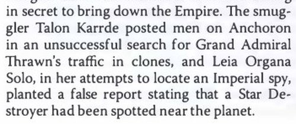
Our notes: `notes/materials/030-complete-star-wars-encyclopedia-vol-1/01-v1-scan-041-080.md:38`

> She was in her 20s when the conflict between the Corellian Confederation and the Galactic Alliance began. She tried to avoid taking sides in the war, and instead helped her mother gather vital in­ telligence working as a card dealer in the casinos aboard the converted Star Destroyer Errant V enture. Antilles, Raymus The Alderaanian captain of the T antive IVand former master ofC-3PO and R2-D2. Captain Antilles belonged to the same bloodline as that of Queen Breha of Alderaan, though he himself held no royal title. He was levelheaded, schooled in diplomacy, and a capable pilot who studied under his mentor, Captain Jeremoch Colton. Antilles piloted the Alderaanian consular vessel for Senator Bail Organa and then the Senator's daughter, Leia Organa.
>
> Antilles, Raymus The Alderaanian captain of the Tantive IV and former master of C-3PO and R2-D2. Captain Antilles belonged to the same bloodline as that of Queen Breha of Alderaan, though he himself held no royal title.
>
> He was levelheaded, schooled in diplomacy, and a capable pilot who studied under his mentor, Captain Jeremoch Colton. Antilles piloted the Alderaanian consular vessel for Senator Bail Organa and then the Senator's daughter, Leia Organa. A loyal guard to Leia, he died protecting her identity when Darth Vader boarded the Tantive IV and strangled the captain.
>
> Raymus Antilles One of the Rebel Alliance's most decorated pilots, a survivor of the major conflicts of the Ga­ lactic Civil War, and the soul of the famous Rogue Squad­ ron. From his first flights for the newborn Rebellion to his distinguished career as a gen­ eral within the New Republic, Wedge always embodied the luck, loyalty, confidence, and courage required of every Rebel pilot.
— Source: scan pages 41–80; Leia Organa Solo; Darth Vader (Anakin Skywalker).
(Excerpt widened 2026-11-17 to the relevant passage, word for word from research primary cse vol1 (text copy `research_primary_cse_vol1_pdf_45a954be6d`).)
(Excerpt widened 2026-11-17 to the relevant passage, word for word from research audit work src m030 (text copy `research_audit_work_src_m030_txt_69ea9f4a41`).)
(Excerpt widened 2026-11-17 to the relevant passage, word for word from research audit work src m030 (text copy `research_audit_work_src_m030_txt_69ea9f4a41`).)
Note (our notes, around the quote): Leia Organa Solo; Darth Vader (Anakin Skywalker): "A loyal guard to Leia, he died protecting her identity when Darth Vader boarded the Tantive IV and strangled the captain." Source: The Complete Star Wars Encyclopedia, Vol. I, p.35
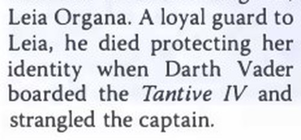
Our notes: `notes/materials/030-complete-star-wars-encyclopedia-vol-1/01-v1-scan-041-080.md:77`

> Another, an Eliminator model 434, tried to kill Princess Leia Organa on Coruscant, but it was destroyed by Prince Isolder's bodyguard Captain Astarta.
— Source: scan pages 41–80; Leia Organa Solo. POV: Leia Organa Solo.
Note (our notes, around the quote): Leia Organa Solo: "Another, an Eliminator model 434, tried to kill Princess Leia Organa on Coruscant, but it was destroyed by Prince Isolder's bodyguard Captain Astarta." Source: The Complete Star Wars Encyclopedia, Vol. I, p.45
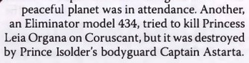
Our notes: `notes/materials/030-complete-star-wars-encyclopedia-vol-1/01-v1-scan-041-080.md:161`

> Anakin Solo's strike team infil­ trated the Baanu Rass to kill the queen voxyn. Baas, Bodo A Krevaaki Jedi Master in the Adega system some 600 years before the Battle of Yavin. Baas was gatekeeper of a Jedi Holocron that was mil­ lennia old. It eventually fell into the hands of Emperor Palpatine's reborn clone and was later taken by Leia Organa Solo. She listened intently as a holographic Vodo­ Siosk Baas spun tales of ancient Jedi and told of the seductive path to the dark side ofthe Force. A warning about her own future sent Leia to help Luke Skywalker destroy the clone of Palpatine. Later, Jedi historian Tionne Solu­ sar spent much time studying the Baas Holocron. Bodo Baas Master Vodo-Siosk Boos Baas, Master Vodo-SioskA Krevaaki Jedi Master and expert lightsaber crafts­ man who lived more than 4,000 years before the Battle of Yavin, he trained many Jedi, including the powerful Exar Kun. Kun was ambitious and impatient, and despite his Master's warnings he turned to the dark side of the Force, eventually betraying and killing Baas. The Jedi Mas­ ter then became one with the Force and started a Jedi Holo­ cron, an interactive repository of Jedi knowledge and history.
— Source: scan pages 41–80; Leia Organa Solo; Luke Skywalker; Palpatine (Darth Sidious).
(Excerpt widened 2026-11-17 to the relevant passage, word for word from research primary cse vol1 (text copy `research_primary_cse_vol1_pdf_45a954be6d`).)
(Excerpt widened 2026-11-17 to the relevant passage, word for word from research primary cse vol1 (text copy `research_primary_cse_vol1_pdf_45a954be6d`).)
Note (our notes, around the quote): Leia Organa Solo; Luke Skywalker; Palpatine (Darth Sidious): "A warning about her own future sent Leia to help Luke Skywalker destroy the clone of Palpatine." Source: The Complete Star Wars Encyclopedia, Vol. I, p.53
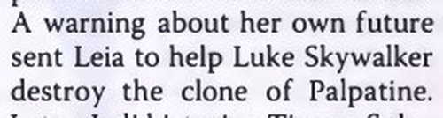
Our notes: `notes/materials/030-complete-star-wars-encyclopedia-vol-1/01-v1-scan-041-080.md:217`

> His downfall came when he engaged Chief of State Leia Organa Solo ina lightsaber duel, and she killed him.
— Source: scan pages 81–120; Leia Organa Solo. POV: Leia Organa Solo.
Note (our notes, around the quote): Leia Organa Solo: "His downfall came when he engaged Chief of State Leia Organa Solo ina lightsaber duel, and she killed him." Source: The Complete Star Wars Encyclopedia, Vol. I, p.68
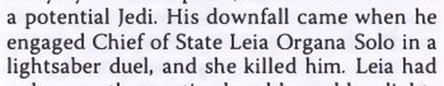
Our notes: `notes/materials/030-complete-star-wars-encyclopedia-vol-1/02-v1-scan-081-120.md:24`

> Bossk then spent some time in Jabba's palace, but fled the Hutt's sail barge before Luke Skywalker and Princess Leia destroyed the craft.
— Source: scan pages 81–120; Bossk; Luke Skywalker; Leia Organa Solo — entry/section: Bossk.
Note (our notes, around the quote): Bossk; Luke Skywalker; Leia Organa Solo — entry/section: Bossk: "Bossk then spent some time in Jabba's palace, but fled the Hutt's sail barge before Luke Skywalker and Princess Leia destroyed the craft." Source: The Complete Star Wars Encyclopedia, Vol. I, p.88
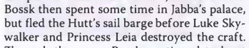
Our notes: `notes/materials/030-complete-star-wars-encyclopedia-vol-1/02-v1-scan-081-120.md:188`

> The two droids were aboard Princess Leia Organa's consular vessel when it was attacked by an Imperial Star Destroyer due to suspected Rebel actions.
— Source: scan pages 81–120; Leia Organa Solo. POV: Leia Organa Solo.
Note (our notes, around the quote): Leia Organa Solo: "The two droids were aboard Princess Leia Organa's consular vessel when it was attacked by an Imperial Star Destroyer due to suspected Rebel actions." Source: The Complete Star Wars Encyclopedia, Vol. I, p.102
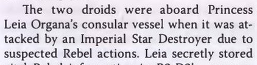
Our notes: `notes/materials/030-complete-star-wars-encyclopedia-vol-1/02-v1-scan-081-120.md:288`

> He helped Luke Skywalker find recruits for his Jedi academy, rescued Leia at least once more, got involved in several dubious moneymaking schemes, crashed at least two converted Imperial Star Destroyers, helped put down major threats to the New Republic, and won—and lost—a dozen fortunes.
— Source: scan pages 121–160; Luke Skywalker; Leia Organa Solo.
Note (our notes, around the quote): Luke Skywalker; Leia Organa Solo: "He helped Luke Skywalker find recruits for his Jedi academy, rescued Leia at least once more, got involved in several dubious moneymaking schemes, crashed at least two converted Imperial Star Destroyers, helped put down major threats to the New Republic, and won—and lost—a dozen fortunes." Source: The Complete Star Wars Encyclopedia, Vol. I, p.106
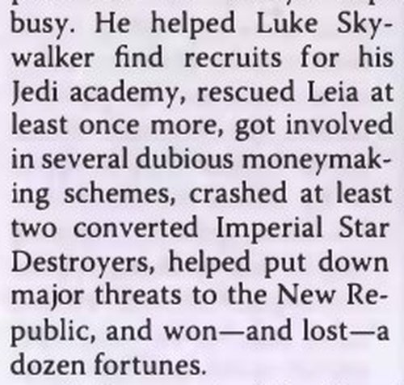
Our notes: `notes/materials/030-complete-star-wars-encyclopedia-vol-1/03-v1-scan-121-160.md:12`

> It featured a pair of heavy mass-driver cannons and a concus­ sion missile battery. Candorian plague A deadly airborne plague weaponized by the Empire during the Galactic Civil War and unleashed on Dentaal. canir A title given to elected Vratix leaders on Thyferra. cannibal arachnid A legendary giant spider-like species on Duro that died out as the planet's ecosystem collapsed. cannok Vicious, wide-jawed predators that the Ithorians imported from Dxun to Telos to keep the herbivore population in check. cannonade An exploding projectile weapon, it was fired by a crossbow. Cant, Devin A trooper aboard the first Death Star, he was an elite soldier trained in combat techniques and weapons skills. He augmented security personnel guarding Prin­ cess Leia Organa in detention block AA-23. He was killed in the line of duty when Han Solo, Chewbacca, and Luke Skywalker freed Leia. Cantham House Bail Organa's residence on Coruscant, the site ofclandestine meetings among Organa, Mon Mothma, and Garm Bel Iblis during the early planning stages of the Rebel Alliance. cantinaSee Mos Eisley cantina. Canu A deity worshipped by the primitive inhabitants of Circarpous V.
— Source: scan pages 121–160; Han Solo; Chewbacca; Luke Skywalker; Leia Organa Solo.
(Excerpt widened 2026-11-17 to the relevant passage, word for word from research primary cse vol1 (text copy `research_primary_cse_vol1_pdf_45a954be6d`).)
(Excerpt widened 2026-11-17 to the relevant passage, word for word from research primary cse vol1 (text copy `research_primary_cse_vol1_pdf_45a954be6d`).)
Note (our notes, around the quote): Han Solo; Chewbacca; Luke Skywalker; Leia Organa Solo: "He was killed in the line of duty when Han Solo, Chewbacca, and Luke Skywalker freed Leia." Source: The Complete Star Wars Encyclopedia, Vol. I, p.107
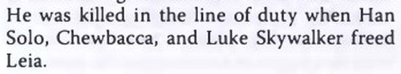
Our notes: `notes/materials/030-complete-star-wars-encyclopedia-vol-1/03-v1-scan-121-160.md:19`

> Late in the Clone Wars, it fell to the Republic. As a result, many Gos­ sam refugees fled to Felucia.
>
> Cato Nelmoldla e Cathedral of the Winds A magnificent but delicate and incredibly intricate structure, this centuries-old cathedral on the planet Vortex was the longtime site of the Vors's an­ nual Concert of the Winds, a cultural festival celebrating the planet's dramatic change of seasons. Resembling a castle made of eggshell­ thin crystal, the cathedral had thousands of passageways winding through hollow cham­ bers, turrets, and spires. At the beginning of the Vortex storm season, winds would whip through its honeycomb structure, resulting in a spellbinding concert of reverberating, almost mournful music. But on a fateful diplomatic journey with Princess Leia Organa Solo as passenger, Admiral Ackbar's personal B-wing fighter crashed into the cathedral, destroying it and killing hundreds of Vors. It later turned out that the admiral's ship had been sabotaged.
>
> The Vors almost immediately began the pain­ ful task of rebuilding the cathedral, and when it was completed, Ackbar was invited back as an honored guest.
>
> Cathor Hills One of the many sentient for­ ests on the planet !thor, it was destroyed by Imperial Captain Alima in his campaign to get Momaw Nadon to turn over Ithorian technol­ ogy to the Empire.
>
> At the beginning of the Vortex storm season, winds would whip through its honeycomb structure, resulting in a spellbinding concert ofreverberating, almost mournful music. But on a fateful diplomatic journey with Princess Leia Organa Solo as passenger, Admiral Ackbar's personal B-wing fighter crashed into the cathedral, destroying it and killing hundreds ofVors. It later turned out that the admiral's ship had been sabotaged. The Vors almost immediately began the pain­ ful task of rebuilding the cathedral, and when it was completed, Ackbar was invited back as an honored guest. CathorHillsOne ofthe many sentient for­ ests on the planet !thor, it was destroyed by Imperial Captain Alima in his campaign to get Momaw Nadon to turn over Ithorian technol­ ogy to the Empire. Catler WalkwayA noted walkway found on the planet Coruscant during the early decades of the New Republic.
— Source: scan pages 121–160; Leia Organa Solo; Admiral Ackbar.
(Excerpt widened 2026-11-17 to the relevant passage, word for word from research audit work src m030 (text copy `research_audit_work_src_m030_txt_69ea9f4a41`).)
(Excerpt widened 2026-11-17 to the relevant passage, word for word from research primary cse vol1 (text copy `research_primary_cse_vol1_pdf_45a954be6d`).)
(Excerpt widened 2026-11-17 to the relevant passage, word for word from research audit work src m030 (text copy `research_audit_work_src_m030_txt_69ea9f4a41`).)
Note (our notes, around the quote): Leia Organa Solo; Admiral Ackbar: "But on a fateful diplomatic journey with Princess Leia Organa Solo as passenger, Admiral Ackbar's personal B-wing fighter crashed into the cathedral, destroying it and killing hundreds of Vors." Source: The Complete Star Wars Encyclopedia, Vol. I, p.111
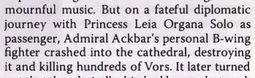
Our notes: `notes/materials/030-complete-star-wars-encyclopedia-vol-1/03-v1-scan-121-160.md:49`

> Imperials were defeated, and Han and Leia decided to keep the family together rather than hide the children.
— Source: scan pages 121–160; Leia Organa Solo. POV: Leia Organa Solo.
Note (our notes, around the quote): Leia Organa Solo: "Imperials were defeated, and Han and Leia decided to keep the family together rather than hide the children." Source: The Complete Star Wars Encyclopedia, Vol. I, p.114
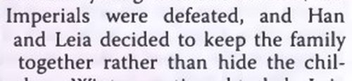
Our notes: `notes/materials/030-complete-star-wars-encyclopedia-vol-1/03-v1-scan-121-160.md:82`

> Chihdo helped Duel in a con that he pulled on Han Solo, Princess Leia Organa, and Luke Skywalker, on the planet Stenos shortly after the Battle of Yavin.
— Source: scan pages 121–160; Han Solo; Leia Organa Solo; Luke Skywalker.
Note (our notes, around the quote): Han Solo; Leia Organa Solo; Luke Skywalker: "Chihdo helped Duel in a con that he pulled on Han Solo, Princess Leia Organa, and Luke Skywalker, on the planet Stenos shortly after the Battle of Yavin." Source: The Complete Star Wars Encyclopedia, Vol. I, p.123

Our notes: `notes/materials/030-complete-star-wars-encyclopedia-vol-1/03-v1-scan-121-160.md:149`

> Nom Anor was fitted with a chilab that inserted through the nos­ trils; its tendrites attached to Anor's optic chiasma. Child of Winds This Qom Qae youth helped Luke Skywalker and Mara Jade during of Kirdo III. Chewbacca with members of his "honor f amily" and close friends Chiraneau,Admirale their mission to find the Hand of Thrawn on Nirauan. Jade suggested that his adult name should be Friend of Jedi. Childsen, Lieutenant Shann An Im­ perial lieutenant, he was demoted after a su­ perior officer blamed him for a clerical error. Considered a bully by fellow officers, Childsen was fanatical in his support of the Emperor's policy of subjugating nonhuman races. He was killed aboard the Death Star during the rescue of Princess Leia Organa. Chimaera An Imperial II Star Destroyer under the command of Captain Pellaeon at the Battle ofEndor. It became the acting command ship after the destruction of the Executor. Five years later, Grand Admiral Thrawn picked the Chimaera as his flagship. Severely damaged and abandoned during the capture of Duro amid Operation Shadow Hand, it was refitted by the New Republic and then reacquired by the Empire at the Battle of Gravlex Med.
— Source: scan pages 121–160; Leia Organa Solo. POV: Leia Organa Solo.
(Excerpt widened 2026-11-17 to the relevant passage, word for word from research primary cse vol1 (text copy `research_primary_cse_vol1_pdf_45a954be6d`).)
(Excerpt widened 2026-11-17 to the relevant passage, word for word from research primary cse vol1 (text copy `research_primary_cse_vol1_pdf_45a954be6d`).)
Note (our notes, around the quote): Leia Organa Solo: "He was killed aboard the Death Star during the rescue of Princess Leia Organa." Source: The Complete Star Wars Encyclopedia, Vol. I, p.123

Our notes: `notes/materials/030-complete-star-wars-encyclopedia-vol-1/03-v1-scan-121-160.md:151`

> It was during one such festival that a ship carrying Admiral Ackbar and Princess Leia Organa Solo crashed into and destroyed the cathedral, killing hundreds of Vors.
— Source: scan pages 121–160; Admiral Ackbar; Leia Organa Solo.
Note (our notes, around the quote): Admiral Ackbar; Leia Organa Solo: "It was during one such festival that a ship carrying Admiral Ackbar and Princess Leia Organa Solo crashed into and destroyed the cathedral, killing hundreds of Vors." Source: The Complete Star Wars Encyclopedia, Vol. I, p.136

Our notes: `notes/materials/030-complete-star-wars-encyclopedia-vol-1/03-v1-scan-121-160.md:234`

> Dalla the Hutt A Hutt from whom Han Solo borrowed money—using the Millennium Falcon as collateral—to buy Leia Organa Solo a planet forthe refugees who were offworld when the Empire destroyed the planet Alderaan.
— Source: scan pages 161–200; Han Solo; Leia Organa Solo.
Note (our notes, around the quote): Han Solo; Leia Organa Solo: "Dalla the Hutt A Hutt from whom Han Solo borrowed money—using the Millennium Falcon as collateral—to buy Leia Organa Solo a planet forthe refugees who were offworld when the Empire destroyed the planet Alderaan." Source: The Complete Star Wars Encyclopedia, Vol. I, p.162

Our notes: `notes/materials/030-complete-star-wars-encyclopedia-vol-1/04-v1-scan-161-200.md:142`

> He had completed three volumes of a proposed several-hundred-volume set before being defeated by Luke Skywalker and Princess Leia Organa Solo.
— Source: scan pages 161–200; Luke Skywalker; Leia Organa Solo.
Note (our notes, around the quote): Luke Skywalker; Leia Organa Solo: "He had completed three volumes of a proposed several-hundred-volume set before being defeated by Luke Skywalker and Princess Leia Organa Solo." Source: The Complete Star Wars Encyclopedia, Vol. I, p.168

Our notes: `notes/materials/030-complete-star-wars-encyclopedia-vol-1/04-v1-scan-161-200.md:200`

> Later it was used to destroy Princess Leia Organa's home planet, Alderaan, causing the instant death of billions of sentient beings.
— Source: scan pages 161–200; Leia Organa Solo. POV: Leia Organa Solo.
Note (our notes, around the quote): Leia Organa Solo: "Later it was used to destroy Princess Leia Organa's home planet, Alderaan, causing the instant death of billions of sentient beings." Source: The Complete Star Wars Encyclopedia, Vol. I, p.176

Our notes: `notes/materials/030-complete-star-wars-encyclopedia-vol-1/04-v1-scan-161-200.md:272`

> Dewlannamapla A kindly Wookiee widow who worked as a cook for Garris Shrike, she was Han Solo's closest friend and surrogate mother while he grew up aboard the Trader's Luck. Dewlanna taught him to speak and understand the Wookiee language of Shyriiwook. She was nearly 600 years old when Garris Shrike killed her while she was protecting Han. As she was dying, she made him promise to leave Shrike's band and be happy. She was survived by a son named Utchakkaloch. Dex A member of the Peace Brigade, he went to Corellia to capture or kill the Jedi Master Eelysa. After he ran into Han and Leia Organa Solo at the medical facility treating Eelysa, Dex was shot and killed in the ensuing firefight. Dex's Diner A small eatery in the CoCo district on Coruscant owned and operated by Dexter Jettster. It was known as Didi and Astri's Cafe until it was sold by owners Didi and Astri Oddo. Deyer Colony An outpost in the Anoat system, this colony world contained floating raft cities, terraformed lakes, and abundant fish and crustacean life. The Deyer colonists had created a peaceful political system until they spoke out against the destruction ofAlder­ aan, paving the way for a brutal military takeover of Deyer by Imperial troops.
— Source: scan pages 201–240; Leia Organa Solo. POV: Leia Organa Solo.
(Excerpt widened 2026-11-17 to the relevant passage, word for word from research primary cse vol1 (text copy `research_primary_cse_vol1_pdf_45a954be6d`).)
(Excerpt widened 2026-11-17 to the relevant passage, word for word from research primary cse vol1 (text copy `research_primary_cse_vol1_pdf_45a954be6d`).)
Note (our notes, around the quote): Leia Organa Solo: "After he ran into Han and Leia Organa Solo at the medical facility treating Eelysa, Dex was shot and killed in the ensuing firefight." Source: The Complete Star Wars Encyclopedia, Vol. I, p.187

Our notes: `notes/materials/030-complete-star-wars-encyclopedia-vol-1/05-v1-scan-201-240.md:19`

> Solid black and armed with a planet-searing su­ perlaser, the first Eclipse-class Star De­ stroyer was designed to frighten and demoralize the enemy. Theship,withacrewofmorethan 700,000 plus 150,000 stormtroopers, was outfitted with 500 heavy laser Eclipse,Junoo Juno Eclipse cannons and 550 turbolasers. It carried 50 squadrons of TIE interceptors-a total of 600 ships-eight squadrons of TIE bombers, five prefabricated garrisons, and 100 AT-AT walkers. But the Eclipse was stopped over thePinnacle Moon when Luke Skywalker and Leia Organa Solo joined Force energies and engulfed Emperor Palpatine in a wave of life energy. The action stunned the Emperor, causing him to lose control over the mighty Force storms he had summoned. As Luke and Leia escaped from the ship, the storms consumed and destroyed the vessel. A second Eclipse-class ship, theEclipse II, was destroyed when the Galaxy Gun accidentally obliterated the Emperor's homeworld of Byss. EclipseBuilt on a planet deep inside a massive asteroid belt, Eclipse was used by the Jedi and members of the New Republic as a hidden base from which strikes were launched against the Yuuzhan Vong. Though it was eventually abandoned and destroyed, for a time it served as a Jedi hideout.
— Source: scan pages 201–240; Luke Skywalker; Leia Organa Solo.
(Excerpt widened 2026-11-17 to the relevant passage, word for word from research primary cse vol1 (text copy `research_primary_cse_vol1_pdf_45a954be6d`).)
(Excerpt widened 2026-11-17 to the relevant passage, word for word from research primary cse vol1 (text copy `research_primary_cse_vol1_pdf_45a954be6d`).)
Note (our notes, around the quote): Luke Skywalker; Leia Organa Solo: "As Luke and Leia escaped from the ship, the storms consumed and destroyed the vessel." Source: The Complete Star Wars Encyclopedia, Vol. I, p.225

Our notes: `notes/materials/030-complete-star-wars-encyclopedia-vol-1/05-v1-scan-201-240.md:319`

> Ezrakh One of Leia Organa Solo's Noghri bodyguards during her mission to the Chorios systems, he was killed by the Death Seed plague.
— Source: scan pages 241–280; Leia Organa Solo. POV: Leia Organa Solo.
Note (our notes, around the quote): Leia Organa Solo: "Ezrakh One of Leia Organa Solo's Noghri bodyguards during her mission to the Chorios systems, he was killed by the Death Seed plague." Source: The Complete Star Wars Encyclopedia, Vol. I, p.247

Our notes: `notes/materials/030-complete-star-wars-encyclopedia-vol-1/06-v1-scan-241-280.md:137`

> The Firrerreos, humanoids with long, striped hair, were believed to have been annihilated, but Leia Organa Solo discovered there were colony ships carrying many natives in suspended animation.
— Source: scan pages 281–320; Leia Organa Solo. POV: Leia Organa Solo.
Note (our notes, around the quote): Leia Organa Solo: "The Firrerreos, humanoids with long, striped hair, were believed to have been annihilated, but Leia Organa Solo discovered there were colony ships carrying many natives in suspended animation." Source: The Complete Star Wars Encyclopedia, Vol. I, p.275

Our notes: `notes/materials/030-complete-star-wars-encyclopedia-vol-1/07-v1-scan-281-320.md:85`

> Glel, Mils An Imperial admiral who com­ manded a large fleet of warships in the months following the Battle of Hoth, he demanded complete compliance with his orders. When it was learned that the Rebel Alliance had stolen the fleet's travel routes from the outpost on Spindrift, Admiral Giel refused to believe that this incident would affect him or his order to return the only known specimen of teezl-an organic communicator-to Coruscant. He was unprepared when Luke Skywalker and a group of pilots managed to infiltrate his armada fly­ ing in modified TIE fighters, and he quickly ordered the teezl to jam communications. Luke still managed to get a shot away and de­ stroy the teezl. After the admiral admitted his mistakes to Darth Vader, the Sith Lord spared his life, but demoted him to lieutenant. Giel was then dispatched to Golrath Station to search for clues as to the location of Alliance forces. He triggered a reactoroverloadthatwould have destroyed Golrath as part ofan improvised plan to capture Leia Organa.
>
> Luke still managed to get a shot away and de­ stroy the teezl. After the admiral admitted his mistakes to Darth Vader, the Sith Lord spared his life, but demoted him to lieutenant.
>
> Giel was then dispatched to Golrath Station to search for clues as to the location of Alliance forces. He triggered a reactor overload that would have destroyed Golrath as part of an improvised plan to capture Leia Organa. Leia escaped along with the rest of the Alliance team. Trying to re­ turn to Coruscant, Giel was shipwrecked on the planet Beheboth, where he spent five years exper­ imenting with a new way to destroy the Alliance.
>
> But his plans were discovered and exposed.
>
> Head of the Galacian Coun­ cil of Ministers when Queen Veda decided to have a democratic election to determine her successor, he plotted to assume control of Gala himself.
— Source: scan pages 321–360; Leia Organa Solo. POV: Leia Organa Solo.
(Excerpt widened 2026-11-17 to the relevant passage, word for word from research primary cse vol1 (text copy `research_primary_cse_vol1_pdf_45a954be6d`).)
(Excerpt widened 2026-11-17 to the relevant passage, word for word from research audit work src m030 (text copy `research_audit_work_src_m030_txt_69ea9f4a41`).)
(Excerpt widened 2026-11-17 to the relevant passage, word for word from research audit work src m030 (text copy `research_audit_work_src_m030_txt_69ea9f4a41`).)
Note (our notes, around the quote): Leia Organa Solo: "He triggered a reactor overload that would have destroyed Golrath as part of an improvised plan to capture Leia Organa." Source: The Complete Star Wars Encyclopedia, Vol. I, p.340

Our notes: `notes/materials/030-complete-star-wars-encyclopedia-vol-1/08-v1-scan-321-360.md:242`

> But Leia Organa was able to destroy it first, leaving Gogol to try to explain the loss to Imperial agents.
— Source: scan pages 361–398; Leia Organa Solo. POV: Leia Organa Solo.
Note (our notes, around the quote): Leia Organa Solo: "But Leia Organa was able to destroy it first, leaving Gogol to try to explain the loss to Imperial agents." Source: The Complete Star Wars Encyclopedia, Vol. I, p.350

Our notes: `notes/materials/030-complete-star-wars-encyclopedia-vol-1/09-v1-scan-361-398.md:40`

> GolmA purple gas giant planet that was the fourth world in the Both System, it was or­ bited by 23 moons. 352 GolornoA sensor officer aboard the Mon Remonda during the hunt for Warlord Zsinj, he was killed in Nuro Tualin's attack on the huge ship when he was sucked out into the vacuum of space by the first round of fire. GolrathOne of many planets where the Rebel Alliance maintained opera­ tions between the battles of Yavin and Hoth. The Rebels used an abandoned magma smelting plant to house their makeshift base. After leavingfor a new base on Arbra, the Alliance discovered that rocks from Golrath could act like a holovid recorder and feared that this might tip off Imperials to important se­ crets, including the location ofthe new base. But Imperial Lieutenant Mils Giel triggered a reactor overload that destroyed Golrath Station as part of a failed plan to capture Leia Organa. Go/ Storn A New Republic warship as­ signed to the blockade of Galantos during the Yevethan Purge, it was part ofa task force that included the Thackery. Golthan,BreglusAn Imperial adviser sta­ tioned on Wroona early in the Galactic Civil War, he was assigned to oversee the security of the Colonies and the Core Worlds by Emperor Palpatine himself. After the Battle of Endor, he still tried to go after New Republic agents.
— Source: scan pages 361–398; Leia Organa Solo. POV: Leia Organa Solo.
(Excerpt widened 2026-11-17 to the relevant passage, word for word from research primary cse vol1 (text copy `research_primary_cse_vol1_pdf_45a954be6d`).)
(Excerpt widened 2026-11-17 to the relevant passage, word for word from research primary cse vol1 (text copy `research_primary_cse_vol1_pdf_45a954be6d`).)
Note (our notes, around the quote): Leia Organa Solo: "But Imperial Lieutenant Mils Giel triggered a reactor overload that destroyed Golrath Station as part of a failed plan to capture Leia Organa." Source: The Complete Star Wars Encyclopedia, Vol. I, p.352

Our notes: `notes/materials/030-complete-star-wars-encyclopedia-vol-1/09-v1-scan-361-398.md:54`

> Enterprising Sullustan ranchers made a fortune by establish­ ing reliable food supplies, though years of genetic tampering have lessened the quality of gornt stock. In the wild, gornts travel in packs of 10 to 30 adults and about half as many young "gorntlings:' Gornts lived for about six years, during which they mated three times, producing litters of two to four ayas (pups) each time. An average gornt ate its weight in food every week. Gornts were primarily herbivorous, but ate almost anything in a pinch. Their extremely efficient diges­ tive systems broke down even 354 the toughest of foods into prime nutri­ ents, which was why gornt flesh was so succulent and nutritious. GorogOne oftwo new hives cre­ ated after the crash ofthe Tachyon Flier on the planet Yoggoy dur­ ing the Yuuzhan Vong invasion of the galaxy.
>
> Gornts were primarily herbivorous, but ate almost anything in a pinch.
>
> Their extremely efficient diges­ tive systems broke down even 354 the toughest of foods into prime nutri­ ents, which was why gornt flesh was so succulent and nutritious.
>
> King Gorneesh ultimately succeeded, and the Gorog hive was eliminated as the unconscious aspect of the Will of the Colony. But Alema Rar had survived her battle with Leia Organa Solo on Tenupe and considered herself the final member of the Gorog hive.
>
> Gorog One oftwo new hives cre­ ated after the crash of the Tachyon Flier on the planet Yoggoy dur­ ing the Yuuzhan Vong invasion of the galaxy. Like its counter­ part, the Unu hive, the Gorog hive was formed when a Force­ sensitive individual joined with the hive mind and began to in­ fluence it.
— Source: scan pages 361–398; Alema Rar; Leia Organa Solo.
(Excerpt widened 2026-11-17 to the relevant passage, word for word from research primary cse vol1 (text copy `research_primary_cse_vol1_pdf_45a954be6d`).)
(Excerpt widened 2026-11-17 to the relevant passage, word for word from research audit work src m030 (text copy `research_audit_work_src_m030_txt_69ea9f4a41`).)
(Excerpt widened 2026-11-17 to the relevant passage, word for word from research audit work src m030 (text copy `research_audit_work_src_m030_txt_69ea9f4a41`).)
Note (our notes, around the quote): Alema Rar; Leia Organa Solo: "But Alema Rar had survived her battle with Leia Organa Solo on Tenupe and considered herself the final member of the Gorog hive." Source: The Complete Star Wars Encyclopedia, Vol. I, p.354

Our notes: `notes/materials/030-complete-star-wars-encyclopedia-vol-1/09-v1-scan-361-398.md:74`

> Gor-ravvus The primary liai­ son between Lhosan Industries and the Old Republic in the years following the Great Sith War, he lobbied the Galactic Senate to recog­ nize Taris and its neighboring systems as part ofthe Republic after Lhosan decided to estab­ lish a manufacturing facility there. Gor-rawus later was named a full Senator. Unfortunately for the people of Taris, Senator Gor-rawus fled the planet at the first hint of a Mandalo­ rian attack. GorrlynA female Wookiee, she was chosen by Salporin as a mate shortly before the start of the Clone Wars. The two were separated when the Empire enslaved the Wookiees, and Gorrlyn was widowed when Salporin died trying to protect Chewbacca and Leia Organa Solo on Kashyyyk. GorrmA tall and thin simian sentient, he was Ssk Kahorr's chief navigator. Gorrm was killed when Ssk Kahorr and the Starbreaker 12 were de­ stroyed by Naga Sadow. gorros'fen An immense worm bioengineered by the Yuuzhan Vong, it served as a tube through which a Koros­ Strohna worldship could obtain nutrients from a planet-based location. The gorros'fen worm extended down from the worldship and literally sucked the nutrients from a planet's crust and mantle.
— Source: scan pages 361–398; Chewbacca; Leia Organa Solo.
(Excerpt widened 2026-11-17 to the relevant passage, word for word from research primary cse vol1 (text copy `research_primary_cse_vol1_pdf_45a954be6d`).)
(Excerpt widened 2026-11-17 to the relevant passage, word for word from research primary cse vol1 (text copy `research_primary_cse_vol1_pdf_45a954be6d`).)
Note (our notes, around the quote): Chewbacca; Leia Organa Solo: "The two were separated when the Empire enslaved the Wookiees, and Gorrlyn was widowed when Salporin died trying to protect Chewbacca and Leia Organa Solo on Kashyyyk." Source: The Complete Star Wars Encyclopedia, Vol. I, p.354

Our notes: `notes/materials/030-complete-star-wars-encyclopedia-vol-1/09-v1-scan-361-398.md:76`

> He also ran a rigged gladiator arena on the space station and used the fights to try to ensure the deaths of Han Solo and Chewbacca, eliminating any chance of Leia's escaping. Ever the schemer, Greyshade used the dis­ traction of the Big Game to launch an assault of his own on Strom's cruiser, ordering his own security forces to overpower the Impe­ rial guards and recover the profits that Strom had stolen from a House of Tagge transport ship. He then drugged Strom and tried to force Leia Organa to submit to his will. He discovered that his own forced attempts at love would never reach Leia, who had the un­ forced devotion of both Luke Skywalker and Han Solo. However, Greyshade did find a loyal friend in the most unlikely place: his admin­ istration droid, Master-Com, which sacrificed two of its many bodies to ensure Greyshade's safety. Greyshade allowed Leia to leave, then killed Strom with a proton grenade before the Imperial officer could shoot him. Greyshade himself eventually died aboard the Wheel sometime after the Battle of Yavin. Grey WolfOne ofmanyImperial-class Star Destroyers in the Imperial Navy fleet during the Galactic Civil War. G'rhoAn outpost planet colonized by Chan­ drilan settlers, G'rho was where Dev Sibwarra grew up after fleeing Chandrila.
— Source: scan pages 361–398; Leia Organa Solo. POV: Leia Organa Solo.
(Excerpt widened 2026-11-17 to the relevant passage, word for word from research primary cse vol1 (text copy `research_primary_cse_vol1_pdf_45a954be6d`).)
(Excerpt widened 2026-11-17 to the relevant passage, word for word from research primary cse vol1 (text copy `research_primary_cse_vol1_pdf_45a954be6d`).)
Note (our notes, around the quote): Leia Organa Solo: "Greyshade allowed Leia to leave, then killed Strom with a proton grenade before the Imperial officer could shoot him." Source: The Complete Star Wars Encyclopedia, Vol. I, p.369

Our notes: `notes/materials/030-complete-star-wars-encyclopedia-vol-1/09-v1-scan-361-398.md:191`

## The Complete Star Wars Encyclopedia, Vol. II (H–O)

> But when Leia Organa Solo pleaded with the Consortium for help in combating the Yuuzhan Vong, it took an honor duel between Prince Isolder and Archon Beed Thane to get the necessary support.
— Source: scan pages 1–40; Leia Organa Solo. POV: Leia Organa Solo.
Note (our notes, around the quote): Leia Organa Solo: "But when Leia Organa Solo pleaded with the Consortium for help in combating the Yuuzhan Vong, it took an honor duel between Prince Isolder and Archon Beed Thane to get the necessary support." Source: The Complete Star Wars Encyclopedia, Vol. II, p.16

Our notes: `notes/materials/031-complete-star-wars-encyclopedia-vol-2/00-v2-scan-001-040.md:145`

> Harris and his plans were discovered by Prime Minister Cundertol and Han and Leia Organa Solo after an explosion ripped through the arena where the Keeramak was consecrating the planet.
— Source: scan pages 1–40; Leia Organa Solo. POV: Leia Organa Solo.
Note (our notes, around the quote): Leia Organa Solo: "Harris and his plans were discovered by Prime Minister Cundertol and Han and Leia Organa Solo after an explosion ripped through the arena where the Keeramak was consecrating the planet." Source: The Complete Star Wars Encyclopedia, Vol. II, p.22

Our notes: `notes/materials/031-complete-star-wars-encyclopedia-vol-2/00-v2-scan-001-040.md:193`

> Hija, Lieutenant The Imperial chief gunnery officer aboard the Star Destroyer Devastator, he was at his post when his ship overtook and captured the Tantive /V with Princess Leia Organa aboard.
— Source: scan pages 41–80; Leia Organa Solo. POV: Leia Organa Solo.
Note (our notes, around the quote): Leia Organa Solo: "Hija, Lieutenant The Imperial chief gunnery officer aboard the Star Destroyer Devastator, he was at his post when his ship overtook and captured the Tantive /V with Princess Leia Organa aboard." Source: The Complete Star Wars Encyclopedia, Vol. II, p.42

Our notes: `notes/materials/031-complete-star-wars-encyclopedia-vol-2/01-v2-scan-041-080.md:63`

> ISBy This slicer droid, an ISB-120 model, was employed by the interrogation droid known as IT to break into a datapad that was owned by Leia Organa Solo, ISBy was destroyed when Chewbacca and his wife, Mallatobuck, tried to rescue their son Lumpawarrump from IT.
— Source: scan pages 121–160; Leia Organa Solo; Chewbacca.
Note (our notes, around the quote): Leia Organa Solo; Chewbacca: "ISBy This slicer droid, an ISB-120 model, was employed by the interrogation droid known as IT to break into a datapad that was owned by Leia Organa Solo, ISBy was destroyed when Chewbacca and his wife, Mallatobuck, tried to rescue their son Lumpawarrump from IT." Source: The Complete Star Wars Encyclopedia, Vol. II, p.118

Our notes: `notes/materials/031-complete-star-wars-encyclopedia-vol-2/03-v2-scan-121-160.md:31`

> As a fight erupted on and near Jabba's desert sail barge, Princess Leia Organa—who had been put in chains and a skimpy outfit by Jabba—pulled her chain leash around the Hutt's neck, strangling him.
— Source: scan pages 121–160; Leia Organa Solo. POV: Leia Organa Solo.
Note (our notes, around the quote): Leia Organa Solo: "As a fight erupted on and near Jabba's desert sail barge, Princess Leia Organa—who had been put in chains and a skimpy outfit by Jabba—pulled her chain leash around the Hutt's neck, strangling him." Source: The Complete Star Wars Encyclopedia, Vol. II, p.130

Our notes: `notes/materials/031-complete-star-wars-encyclopedia-vol-2/03-v2-scan-121-160.md:115`

> Kee (2) A Yuzzem miner on the planet Mimban, he helped Luke Skywalker, Princess Leia Organa, and the old woman Halla retrieve the legendary Kaiburr crystal from the Temple of Pomojema.
— Source: scan pages 201–240; Luke Skywalker; Leia Organa Solo.
Note (our notes, around the quote): Luke Skywalker; Leia Organa Solo: "Kee (2) A Yuzzem miner on the planet Mimban, he helped Luke Skywalker, Princess Leia Organa, and the old woman Halla retrieve the legendary Kaiburr crystal from the Temple of Pomojema." Source: The Complete Star Wars Encyclopedia, Vol. II, p.205

Our notes: `notes/materials/031-complete-star-wars-encyclopedia-vol-2/05-v2-scan-201-240.md:102`

> Keldor was killed on Belsavis when he fell from a mobile vinecoffee bed while trying to capture Princess Leia Organa.
— Source: scan pages 201–240; Leia Organa Solo. POV: Leia Organa Solo.
Note (our notes, around the quote): Leia Organa Solo: "Keldor was killed on Belsavis when he fell from a mobile vinecoffee bed while trying to capture Princess Leia Organa." Source: The Complete Star Wars Encyclopedia, Vol. II, p.207

Our notes: `notes/materials/031-complete-star-wars-encyclopedia-vol-2/05-v2-scan-201-240.md:116`

> The other Noghri on the team were killed, but Leia let Khabarakh go, and later lived up to her promise to visit the Noghri homeworld, Honoghr, to present the cause of the Alliance.
— Source: scan pages 201–240; Leia Organa Solo. POV: Leia Organa Solo.
Note (our notes, around the quote): Leia Organa Solo: "The other Noghri on the team were killed, but Leia let Khabarakh go, and later lived up to her promise to visit the Noghri homeworld, Honoghr, to present the cause of the Alliance." Source: The Complete Star Wars Encyclopedia, Vol. II, p.214

Our notes: `notes/materials/031-complete-star-wars-encyclopedia-vol-2/05-v2-scan-201-240.md:207`

> Lady Vader,' was telling the truth, and they rose up against the Imperial forces that had long dominated them.
— Source: scan pages 201–240.
Note (our notes, around the quote): Leia Organa Solo; Darth Vader (Anakin Skywalker): "But the other Noghri soon learned that Leia, or "Lady Vader,' was telling the truth, and they rose up against the Imperial forces that had long dominated them." Source: The Complete Star Wars Encyclopedia, Vol. II, p.214

Our notes: `notes/materials/031-complete-star-wars-encyclopedia-vol-2/05-v2-scan-201-240.md:209`

> Together Luke and Leia faced down Kueller, and when his dark side powers were curtailed by several ysalamiri that Han Solo brought to Almania, Leia killed Kueller with a blaster shot to the head.
— Source: scan pages 241–280; Luke Skywalker; Leia Organa Solo; Kueller; Han Solo.
Note (our notes, around the quote): Luke Skywalker; Leia Organa Solo; Kueller; Han Solo: "Together Luke and Leia faced down Kueller, and when his dark side powers were curtailed by several ysalamiri that Han Solo brought to Almania, Leia killed Kueller with a blaster shot to the head." Source: The Complete Star Wars Encyclopedia, Vol. II, p.235

Our notes: `notes/materials/031-complete-star-wars-encyclopedia-vol-2/06-v2-scan-241-280.md:12`

> However, Randa the Hutt sacrificed himself to help Leia escape, and Lah was nearly killed in battle with Leia and her son Jacen.
— Source: scan pages 241–280; Leia Organa Solo; Jacen Solo (Darth Caedus).
Note (our notes, around the quote): Leia Organa Solo; Jacen Solo (Darth Caedus): "However, Randa the Hutt sacrificed himself to help Leia escape, and Lah was nearly killed in battle with Leia and her son Jacen." Source: The Complete Star Wars Encyclopedia, Vol. II, p.241

Our notes: `notes/materials/031-complete-star-wars-encyclopedia-vol-2/06-v2-scan-241-280.md:62`

> Ludlo didn't want to expose his own plans, so he agreed, but then he tried to have Leia and Han Solo killed before they could leave the planet.
— Source: scan pages 241–280; Leia Organa Solo; Han Solo.
Note (our notes, around the quote): Leia Organa Solo; Han Solo: "Ludlo didn't want to expose his own plans, so he agreed, but then he tried to have Leia and Han Solo killed before they could leave the planet." Source: The Complete Star Wars Encyclopedia, Vol. II, p.247

Our notes: `notes/materials/031-complete-star-wars-encyclopedia-vol-2/06-v2-scan-241-280.md:122`

> He nearly captured Luke and Leia, but he was killed by the Sentinel creature that was dispatched to eliminate them.
— Source: scan pages 241–280; Luke Skywalker; Leia Organa Solo.
Note (our notes, around the quote): Luke Skywalker; Leia Organa Solo: "He nearly captured Luke and Leia, but he was killed by the Sentinel creature that was dispatched to eliminate them." Source: The Complete Star Wars Encyclopedia, Vol. II, p.261

Our notes: `notes/materials/031-complete-star-wars-encyclopedia-vol-2/06-v2-scan-241-280.md:236`

> After being elected to the Inner Council by an overwhelming majority, Meido put together the committee that led an independent investigation into the explosion in the Senate Hall and supported the idea that Leia's husband, Han Solo, was involved in the bombing.
— Source: scan pages 281–320; Leia Organa Solo; Han Solo.
Note (our notes, around the quote): Leia Organa Solo; Han Solo: "After being elected to the Inner Council by an overwhelming majority, Meido put together the committee that led an independent investigation into the explosion in the Senate Hall and supported the idea that Leia's husband, Han Solo, was involved in the bombing." Source: The Complete Star Wars Encyclopedia, Vol. II, p.303

Our notes: `notes/materials/031-complete-star-wars-encyclopedia-vol-2/07-v2-scan-281-320.md:252`

> When Han Solo joined the mission to destroy Grand Admiral Thrawn's cloning facility on Wayland, Cakhmaim protected Leia, Winter, and the children, Jaina and Jacen Solo.
— Source: scan pages 321–360.
Note (our notes, around the quote): Han Solo; Grand Admiral Thrawn; Leia Organa Solo; Winter Celchu; Jaina Solo; Jacen Solo (Darth Caedus): "When Han Solo joined the mission to destroy Grand Admiral Thrawn's cloning facility on Wayland, Cakhmaim protected Leia, Winter, and the children, Jaina and Jacen Solo." Source: The Complete Star Wars Encyclopedia, Vol. II, p.322

Our notes: `notes/materials/031-complete-star-wars-encyclopedia-vol-2/08-v2-scan-321-360.md:55`

> The parasite bombs were destroyed by Leia Organa Solo and her Master, Saba Sebatyne, before they could deploy their deadly payloads.
— Source: scan pages 321–360; Leia Organa Solo; Saba Sebatyne.
Note (our notes, around the quote): Leia Organa Solo; Saba Sebatyne: "The parasite bombs were destroyed by Leia Organa Solo and her Master, Saba Sebatyne, before they could deploy their deadly payloads." Source: The Complete Star Wars Encyclopedia, Vol. II, p.329

Our notes: `notes/materials/031-complete-star-wars-encyclopedia-vol-2/08-v2-scan-321-360.md:108`

> Neither Moyan nor Admiral Limpan knew that Leia would do everything in her power to ensure that the Corellian pilots of Operation Noble Savage, including her own husband, Han, completed their mission without being killed by GA pilots.
— Source: scan pages 321–360; Leia Organa Solo. POV: Leia Organa Solo.
Note (our notes, around the quote): Leia Organa Solo: "Neither Moyan nor Admiral Limpan knew that Leia would do everything in her power to ensure that the Corellian pilots of Operation Noble Savage, including her own husband, Han, completed their mission without being killed by GA pilots." Source: The Complete Star Wars Encyclopedia, Vol. II, p.338

Our notes: `notes/materials/031-complete-star-wars-encyclopedia-vol-2/08-v2-scan-321-360.md:169`

> After a series of confrontations, Leia killed Beldorion; Dzym escaped but was destroyed along with the other drochs; Moff Getelles, who had invaded the sector as part of Dzym's vast conspiracy, was forced to retreat at the Battle of Nam Chorios; and Callista decided to stay on the planet awhile longer.
— Source: scan pages 361–400; Leia Organa Solo. POV: Leia Organa Solo.
Note (our notes, around the quote): Leia Organa Solo: "After a series of confrontations, Leia killed Beldorion; Dzym escaped but was destroyed along with the other drochs; Moff Getelles, who had invaded the sector as part of Dzym's vast conspiracy, was forced to retreat at the Battle of Nam Chorios; and Callista decided to stay on the planet awhile longer." Source: The Complete Star Wars Encyclopedia, Vol. II, p.358

Our notes: `notes/materials/031-complete-star-wars-encyclopedia-vol-2/09-v2-scan-361-400.md:43`

> The ship was eventually destroyed in an effort to sway Leia Organa Solo to the aliens' position.
— Source: scan pages 361–400; Leia Organa Solo. POV: Leia Organa Solo.
Note (our notes, around the quote): Leia Organa Solo: "The ship was eventually destroyed in an effort to sway Leia Organa Solo to the aliens' position." Source: The Complete Star Wars Encyclopedia, Vol. II, p.365

Our notes: `notes/materials/031-complete-star-wars-encyclopedia-vol-2/09-v2-scan-361-400.md:94`

> When Leia Organa Solo petitioned the Senate to address the Yuuzhan Vong crisis, Niuk Niuv accused her of trying to deflect the issue of renegade Jedi with wildly exaggerated views of the threat.
— Source: scan pages 361–400; Leia Organa Solo. POV: Leia Organa Solo.
Note (our notes, around the quote): Leia Organa Solo: "When Leia Organa Solo petitioned the Senate to address the Yuuzhan Vong crisis, Niuk Niuv accused her of trying to deflect the issue of renegade Jedi with wildly exaggerated views of the threat." Source: The Complete Star Wars Encyclopedia, Vol. II, p.384

Our notes: `notes/materials/031-complete-star-wars-encyclopedia-vol-2/09-v2-scan-361-400.md:247`

> However, when Nord decided to use the ionic cannon aboard the Tarkin to take out Luke Skywalker and Leia Organa, the superweapon exploded.
— Source: scan pages 361–400; Grand Moff Tarkin; Luke Skywalker; Leia Organa Solo.
Note (our notes, around the quote): Grand Moff Tarkin; Luke Skywalker; Leia Organa Solo: "However, when Nord decided to use the ionic cannon aboard the Tarkin to take out Luke Skywalker and Leia Organa, the superweapon exploded." Source: The Complete Star Wars Encyclopedia, Vol. II, p.389

Our notes: `notes/materials/031-complete-star-wars-encyclopedia-vol-2/09-v2-scan-361-400.md:282`

> He also traveled with Leia to Ord Mantell, Gyndine, and finally Duro, where he was killed trying to cover Leia's escape from the alien invaders.
— Source: scan pages 401–440; Leia Organa Solo. POV: Leia Organa Solo.
Note (our notes, around the quote): Leia Organa Solo: "He also traveled with Leia to Ord Mantell, Gyndine, and finally Duro, where he was killed trying to cover Leia's escape from the alien invaders." Source: The Complete Star Wars Encyclopedia, Vol. II, p.409

Our notes: `notes/materials/031-complete-star-wars-encyclopedia-vol-2/10-v2-scan-401-440.md:108`

- Note (summary from our notes, not a quotation): Page contents: 1153 words, 31 paragraphs | headings/entries: Organa, Celly, Rouge, and Tia; Organa, Leia; Organa, Queen Breha; Organa Hl, Leia; Orgege, Moff Yref; Oridin City; Orilitha; Orin; Orinackra; Orinda
  — Source: scan pages 401–440.
Our notes: `notes/materials/031-complete-star-wars-encyclopedia-vol-2/10-v2-scan-401-440.md:210`

> In a scuffle that ensued, Leia killed Lord Tion.
— Source: scan pages 401–440; Leia Organa Solo. POV: Leia Organa Solo.
Note (our notes, around the quote): Leia Organa Solo: "In a scuffle that ensued, Leia killed Lord Tion." Source: The Complete Star Wars Encyclopedia, Vol. II, p.423

Our notes: `notes/materials/031-complete-star-wars-encyclopedia-vol-2/10-v2-scan-401-440.md:212`

## The Complete Star Wars Encyclopedia, Vol. III (P–Z)

> A former intimate of Leia Organa, Raal and his older brother Heeth were in the Ryloth system when their homeworld was destroyed by the first Death Star.
— Source: scan pages 1–40; Leia Organa Solo. POV: Leia Organa Solo.
Note (our notes, around the quote): Leia Organa Solo: "A former intimate of Leia Organa, Raal and his older brother Heeth were in the Ryloth system when their homeworld was destroyed by the first Death Star." Source: The Complete Star Wars Encyclopedia, Vol. III, p.11

Our notes: `notes/materials/032-complete-star-wars-encyclopedia-vol-3/00-v3-scan-001-040.md:126`

> Leia was able to relay information about the parasite bombs to the other Jedi, and almost single-handedly ensured that the only two bombs to reach the surface of Tenupe were destroyed before they could deploy their deadly payloads.
— Source: scan pages 1–40; Leia Organa Solo. POV: Leia Organa Solo.
Note (our notes, around the quote): Leia Organa Solo: "Leia was able to relay information about the parasite bombs to the other Jedi, and almost single-handedly ensured that the only two bombs to reach the surface of Tenupe were destroyed before they could deploy their deadly payloads." Source: The Complete Star Wars Encyclopedia, Vol. III, p.12

Our notes: `notes/materials/032-complete-star-wars-encyclopedia-vol-3/00-v3-scan-001-040.md:137`

> He was killed during the rescue of Princess Leia Organa.
— Source: scan pages 41–80; Leia Organa Solo. POV: Leia Organa Solo.
Note (our notes, around the quote): Leia Organa Solo: "He was killed during the rescue of Princess Leia Organa." Source: The Complete Star Wars Encyclopedia, Vol. III, p.43

Our notes: `notes/materials/032-complete-star-wars-encyclopedia-vol-3/01-v3-scan-041-080.md:72`

> However, when he noticed that a Devaronian and a Twi'lek—actually Han Solo and Leia Organa Solo, in disguise—were trying to destroy the artwork, Quenton and his men opened fire in Mawbo's Performance Hall in an effort to secure the work.
— Source: scan pages 41–80; Han Solo; Leia Organa Solo.
Note (our notes, around the quote): Han Solo; Leia Organa Solo: "However, when he noticed that a Devaronian and a Twi'lek—actually Han Solo and Leia Organa Solo, in disguise—were trying to destroy the artwork, Quenton and his men opened fire in Mawbo's Performance Hall in an effort to secure the work." Source: The Complete Star Wars Encyclopedia, Vol. III, p.62

Our notes: `notes/materials/032-complete-star-wars-encyclopedia-vol-3/01-v3-scan-041-080.md:217`

> Leia managed to disfigure Alema, severing one of her lekku from her skull.
— Source: scan pages 81–120; Leia Organa Solo; Alema Rar.
Note (our notes, around the quote): Leia Organa Solo; Alema Rar: "Leia managed to disfigure Alema, severing one of her lekku from her skull." Source: The Complete Star Wars Encyclopedia, Vol. III, p.80

Our notes: `notes/materials/032-complete-star-wars-encyclopedia-vol-3/02-v3-scan-081-120.md:65`

> She had survived, even further disfigured and even hungrier for vengeance against Leia Organa Solo and her family.
— Source: scan pages 81–120; Leia Organa Solo. POV: Leia Organa Solo.
Note (our notes, around the quote): Leia Organa Solo: "She had survived, even further disfigured and even hungrier for vengeance against Leia Organa Solo and her family." Source: The Complete Star Wars Encyclopedia, Vol. III, p.81

Our notes: `notes/materials/032-complete-star-wars-encyclopedia-vol-3/02-v3-scan-081-120.md:72`

> Rebel Dream Princess Leia Organa Solo's flagship, it was formerly the Star Destroyer Tyrant, which had been captured from the Imperial Navy after the Bacta War.
— Source: scan pages 81–120; Leia Organa Solo. POV: Leia Organa Solo.
Note (our notes, around the quote): Leia Organa Solo: "Rebel Dream Princess Leia Organa Solo's flagship, it was formerly the Star Destroyer Tyrant, which had been captured from the Imperial Navy after the Bacta War." Source: The Complete Star Wars Encyclopedia, Vol. III, p.85

Our notes: `notes/materials/032-complete-star-wars-encyclopedia-vol-3/02-v3-scan-081-120.md:104`

> It was during just such a celebration that the sail barge was destroyed when Luke Skywalker, Princess Leia Organa, and others staged a daring rescue of Han Solo.
— Source: scan pages 121–160; Luke Skywalker; Leia Organa Solo; Han Solo.
Note (our notes, around the quote): Luke Skywalker; Leia Organa Solo; Han Solo: "It was during just such a celebration that the sail barge was destroyed when Luke Skywalker, Princess Leia Organa, and others staged a daring rescue of Han Solo." Source: The Complete Star Wars Encyclopedia, Vol. III, p.124

Our notes: `notes/materials/032-complete-star-wars-encyclopedia-vol-3/03-v3-scan-121-160.md:75`

> Seneki was killed when the Flakax known as Tito returned from his mission to eliminate Han Solo and his wife, Leia Organa Solo.
— Source: scan pages 121–160; Han Solo; Leia Organa Solo.
Note (our notes, around the quote): Han Solo; Leia Organa Solo: "Seneki was killed when the Flakax known as Tito returned from his mission to eliminate Han Solo and his wife, Leia Organa Solo." Source: The Complete Star Wars Encyclopedia, Vol. III, p.138

Our notes: `notes/materials/032-complete-star-wars-encyclopedia-vol-3/03-v3-scan-121-160.md:185`

> Shen-Jon, Echuuw A Jedi Master who survived the Purge and was later discovered by Princess Leia Organa on Krant.
— Source: scan pages 121–160; Leia Organa Solo. POV: Leia Organa Solo.
Note (our notes, around the quote): Leia Organa Solo: "Shen-Jon, Echuuw A Jedi Master who survived the Purge and was later discovered by Princess Leia Organa on Krant." Source: The Complete Star Wars Encyclopedia, Vol. III, p.145

Our notes: `notes/materials/032-complete-star-wars-encyclopedia-vol-3/03-v3-scan-121-160.md:254`

> Together, he and Leia destroyed the clone.
— Source: scan pages 161–200; Leia Organa Solo. POV: Leia Organa Solo.
Note (our notes, around the quote): Leia Organa Solo: "Together, he and Leia destroyed the clone." Source: The Complete Star Wars Encyclopedia, Vol. III, p.165

Our notes: `notes/materials/032-complete-star-wars-encyclopedia-vol-3/04-v3-scan-161-200.md:116`

> Still, he helped defeat the threats from Imperial Admiral Daala and her superweapons; discovered the spirit of a Jedi woman, Callista, trapped in a computer on an Imperial battle station, and saw her made human through a transfer of essences with an eminent scientist; and helped rescue Han and Leia's children from dark side practitioners.
— Source: scan pages 161–200; Admiral Daala; Leia Organa Solo.
Note (our notes, around the quote): Admiral Daala; Leia Organa Solo: "Still, he helped defeat the threats from Imperial Admiral Daala and her superweapons; discovered the spirit of a Jedi woman, Callista, trapped in a computer on an Imperial battle station, and saw her made human through a transfer of essences with an eminent scientist; and helped rescue Han and Leia's children from dark side practitioners." Source: The Complete Star Wars Encyclopedia, Vol. III, p.165

Our notes: `notes/materials/032-complete-star-wars-encyclopedia-vol-3/04-v3-scan-161-200.md:120`

> When the mad Jedi clone Joruus C'baoth called both Luke and Mara to him, then unleashed Skywalker's clone, Luuke, Mara killed the Skywalker clone—and finally C'baoth, too, with help from Luke and Leia Organa Solo.
— Source: scan pages 161–200; Joruus C'baoth; Luke Skywalker; Mara Jade Skywalker; Leia Organa Solo.
Note (our notes, around the quote): Joruus C'baoth; Luke Skywalker; Mara Jade Skywalker; Leia Organa Solo: "When the mad Jedi clone Joruus C'baoth called both Luke and Mara to him, then unleashed Skywalker's clone, Luuke, Mara killed the Skywalker clone—and finally C'baoth, too, with help from Luke and Leia Organa Solo." Source: The Complete Star Wars Encyclopedia, Vol. III, p.166

Our notes: `notes/materials/032-complete-star-wars-encyclopedia-vol-3/04-v3-scan-161-200.md:151`

> Later, at Han Solo's request, Jade and Karrde located and brought to the planet Almania several Force-bending ysalamiri, which Solo used to help Luke and Leia defeat the Dark Jedi Kueller.
— Source: scan pages 161–200; Han Solo; Luke Skywalker; Leia Organa Solo; Kueller.
Note (our notes, around the quote): Han Solo; Luke Skywalker; Leia Organa Solo; Kueller: "Later, at Han Solo's request, Jade and Karrde located and brought to the planet Almania several Force-bending ysalamiri, which Solo used to help Luke and Leia defeat the Dark Jedi Kueller." Source: The Complete Star Wars Encyclopedia, Vol. III, p.166

Our notes: `notes/materials/032-complete-star-wars-encyclopedia-vol-3/04-v3-scan-161-200.md:153`

> Pote Snitkin piloted one of Jabba's skiffs and was among those killed during Luke Skywalker's rescue of Han Solo and Princess Leia from the Hutt.
— Source: scan pages 161–200; Luke Skywalker; Han Solo; Leia Organa Solo.
Note (our notes, around the quote): Luke Skywalker; Han Solo; Leia Organa Solo: "Pote Snitkin piloted one of Jabba's skiffs and was among those killed during Luke Skywalker's rescue of Han Solo and Princess Leia from the Hutt." Source: The Complete Star Wars Encyclopedia, Vol. III, p.170

Our notes: `notes/materials/032-complete-star-wars-encyclopedia-vol-3/04-v3-scan-161-200.md:203`

> Solo, Anakin Born six years after the death of his grandfather Anakin Skywalker, Anakin Solo was the youngest of Han Solo and Princess Leia Organa Solo's three children, and the strongest in the Force.
— Source: scan pages 161–200.
Note (our notes, around the quote): Darth Vader (Anakin Skywalker); Anakin Solo; Han Solo; Leia Organa Solo: "Solo, Anakin Born six years after the death of his grandfather Anakin Skywalker, Anakin Solo was the youngest of Han Solo and Princess Leia Organa Solo's three children, and the strongest in the Force." Source: The Complete Star Wars Encyclopedia, Vol. III, p.172

Our notes: `notes/materials/032-complete-star-wars-encyclopedia-vol-3/04-v3-scan-161-200.md:217`

> Taken aboard the Death Star, Leia was able to block interrogation probes, but the battle station's commander, Grand Moff Tarkin, threatened to destroy Leia's planet of Alderaan—home to her father and billions of other residents—if she didn't reveal the site of the secret Rebel base.
— Source: scan pages 161–200; Leia Organa Solo; Grand Moff Tarkin.
Note (our notes, around the quote): Leia Organa Solo; Grand Moff Tarkin: "Taken aboard the Death Star, Leia was able to block interrogation probes, but the battle station's commander, Grand Moff Tarkin, threatened to destroy Leia's planet of Alderaan—home to her father and billions of other residents—if she didn't reveal the site of the secret Rebel base." Source: The Complete Star Wars Encyclopedia, Vol. III, p.177

Our notes: `notes/materials/032-complete-star-wars-encyclopedia-vol-3/04-v3-scan-161-200.md:270`

> It was obliterated before Leia's eyes, and Leia was scheduled for execution.
— Source: scan pages 161–200; Jaina Solo; Leia Organa Solo — entry/section: Solo, Jaina.
Note (our notes, around the quote): Jaina Solo; Leia Organa Solo — entry/section: Solo, Jaina: "It was obliterated before Leia's eyes, and Leia was scheduled for execution." Source: The Complete Star Wars Encyclopedia, Vol. III, p.177

Our notes: `notes/materials/032-complete-star-wars-encyclopedia-vol-3/04-v3-scan-161-200.md:274`

> Leia and the others fled, and helped rescue Luke, who had narrowly survived a lightsaber duel with Darth Vader.
— Source: scan pages 161–200; Leia Organa Solo; Luke Skywalker; Darth Vader (Anakin Skywalker).
Note (our notes, around the quote): Leia Organa Solo; Luke Skywalker; Darth Vader (Anakin Skywalker): "Leia and the others fled, and helped rescue Luke, who had narrowly survived a lightsaber duel with Darth Vader." Source: The Complete Star Wars Encyclopedia, Vol. III, p.177

Our notes: `notes/materials/032-complete-star-wars-encyclopedia-vol-3/04-v3-scan-161-200.md:278`

> During the Yuuzhan Vong War, Leia was one of the New Republic's strongest voices in identifying the threat and ensuring there was room for refugees fleeing the war zones.
— Source: scan pages 161–200; Leia Organa Solo. POV: Leia Organa Solo.
Note (our notes, around the quote): Leia Organa Solo: "During the Yuuzhan Vong War, Leia was one of the New Republic's strongest voices in identifying the threat and ensuring there was room for refugees fleeing the war zones." Source: The Complete Star Wars Encyclopedia, Vol. III, p.178

Our notes: `notes/materials/032-complete-star-wars-encyclopedia-vol-3/04-v3-scan-161-200.md:293`

> When the Yuuzhan Vong attacked Duro, Warmaster Tsavong Lah nearly killed Leia until her son Jacen drove him off.
— Source: scan pages 161–200; Leia Organa Solo; Jacen Solo (Darth Caedus).
Note (our notes, around the quote): Leia Organa Solo; Jacen Solo (Darth Caedus): "When the Yuuzhan Vong attacked Duro, Warmaster Tsavong Lah nearly killed Leia until her son Jacen drove him off." Source: The Complete Star Wars Encyclopedia, Vol. III, p.178

Our notes: `notes/materials/032-complete-star-wars-encyclopedia-vol-3/04-v3-scan-161-200.md:295`

> In the days that followed, Leia and Jaina met with Ben Skywalker, encouraging him to find evidence that would prove that Jacen had killed Mara Jade Skywalker.
— Source: scan pages 161–200.
Note (our notes, around the quote): Jaina Solo; Leia Organa Solo; Ben Skywalker; Jacen Solo (Darth Caedus); Mara Jade Skywalker — entry/section: Solo, Jaina: "In the days that followed, Leia and Jaina met with Ben Skywalker, encouraging him to find evidence that would prove that Jacen had killed Mara Jade Skywalker." Source: The Complete Star Wars Encyclopedia, Vol. III, p.178

Our notes: `notes/materials/032-complete-star-wars-encyclopedia-vol-3/04-v3-scan-161-200.md:297`

> Storinal The site of a battle where Princess Leia's flagship, the Rebel Dream, was mercilessly shelled by the Imperial Star Destroyer Peremptory and recaptured by the Empire.
— Source: scan pages 161–200; Leia Organa Solo. POV: Leia Organa Solo.
Note (our notes, around the quote): Leia Organa Solo: "Storinal The site of a battle where Princess Leia's flagship, the Rebel Dream, was mercilessly shelled by the Imperial Star Destroyer Peremptory and recaptured by the Empire." Source: The Complete Star Wars Encyclopedia, Vol. III, p.192

Our notes: `notes/materials/032-complete-star-wars-encyclopedia-vol-3/04-v3-scan-161-200.md:411`

> The synthdroids' central processor was destroyed by Leia Organa Solo during her escape from Ashgad's Hweg Shul fortress, and they were unable to stop her.
— Source: scan pages 201–240; Leia Organa Solo. POV: Leia Organa Solo.
Note (our notes, around the quote): Leia Organa Solo: "The synthdroids' central processor was destroyed by Leia Organa Solo during her escape from Ashgad's Hweg Shul fortress, and they were unable to stop her." Source: The Complete Star Wars Encyclopedia, Vol. III, p.203

Our notes: `notes/materials/032-complete-star-wars-encyclopedia-vol-3/05-v3-scan-201-240.md:88`

> When Tai returned to Commander Knife to report the incident, his superior officer killed him for accepting Leia's mercy.
— Source: scan pages 201–240; Leia Organa Solo. POV: Leia Organa Solo.
Note (our notes, around the quote): Leia Organa Solo: "When Tai returned to Commander Knife to report the incident, his superior officer killed him for accepting Leia's mercy." Source: The Complete Star Wars Encyclopedia, Vol. III, p.212

Our notes: `notes/materials/032-complete-star-wars-encyclopedia-vol-3/05-v3-scan-201-240.md:165`

> When the Wookiees agreed to let Leia Solo address the Rock Council, Tarfang demanded a chance to stop her by challenging Leia for possession of the Talking Bone.
— Source: scan pages 201–240; Leia Organa Solo. POV: Leia Organa Solo.
Note (our notes, around the quote): Leia Organa Solo: "When the Wookiees agreed to let Leia Solo address the Rock Council, Tarfang demanded a chance to stop her by challenging Leia for possession of the Talking Bone." Source: The Complete Star Wars Encyclopedia, Vol. III, p.219

Our notes: `notes/materials/032-complete-star-wars-encyclopedia-vol-3/05-v3-scan-201-240.md:226`

> After interrogations failed, Tarkin made Leia watch as he destroyed her adopted planet of Alderaan and its billions of inhabitants with the Death Star's main weapon.
— Source: scan pages 201–240; Grand Moff Tarkin; Leia Organa Solo — entry/section: Tarkin, Gideon.
Note (our notes, around the quote): Grand Moff Tarkin; Leia Organa Solo — entry/section: Tarkin, Gideon: "After interrogations failed, Tarkin made Leia watch as he destroyed her adopted planet of Alderaan and its billions of inhabitants with the Death Star's main weapon." Source: The Complete Star Wars Encyclopedia, Vol. III, p.221

Our notes: `notes/materials/032-complete-star-wars-encyclopedia-vol-3/05-v3-scan-201-240.md:244`

> In the battle that ensued, Tedryn-Sha killed Jem Ysanna, but was in turn slain by Leia Organa Solo, who used her lightsaber to cleave the Dark Jedi in two.
— Source: scan pages 201–240; Leia Organa Solo. POV: Leia Organa Solo.
Note (our notes, around the quote): Leia Organa Solo: "In the battle that ensued, Tedryn-Sha killed Jem Ysanna, but was in turn slain by Leia Organa Solo, who used her lightsaber to cleave the Dark Jedi in two." Source: The Complete Star Wars Encyclopedia, Vol. III, p.227

Our notes: `notes/materials/032-complete-star-wars-encyclopedia-vol-3/05-v3-scan-201-240.md:294`

> Tilotny resurrected Leia, but sent the stormtroopers back 8,000 years into the past.
— Source: scan pages 241–280; Leia Organa Solo. POV: Leia Organa Solo.
Note (our notes, around the quote): Leia Organa Solo: "Tilotny resurrected Leia, but sent the stormtroopers back 8,000 years into the past." Source: The Complete Star Wars Encyclopedia, Vol. III, p.248

Our notes: `notes/materials/032-complete-star-wars-encyclopedia-vol-3/06-v3-scan-241-280.md:135`

> Thoroughly despicable, he was later killed in a scuffle with Princess Leia Organa.
— Source: scan pages 241–280; Leia Organa Solo. POV: Leia Organa Solo.
Note (our notes, around the quote): Leia Organa Solo: "Thoroughly despicable, he was later killed in a scuffle with Princess Leia Organa." Source: The Complete Star Wars Encyclopedia, Vol. III, p.249

Our notes: `notes/materials/032-complete-star-wars-encyclopedia-vol-3/06-v3-scan-241-280.md:142`

> When Colonel Nord decided to use the ionic cannon aboard the Tarkin to take out Luke Skywalker and Leia Organa, the superweapon exploded.
— Source: scan pages 281–320; Grand Moff Tarkin; Luke Skywalker; Leia Organa Solo.
Note (our notes, around the quote): Grand Moff Tarkin; Luke Skywalker; Leia Organa Solo: "When Colonel Nord decided to use the ionic cannon aboard the Tarkin to take out Luke Skywalker and Leia Organa, the superweapon exploded." Source: The Complete Star Wars Encyclopedia, Vol. III, p.309

Our notes: `notes/materials/032-complete-star-wars-encyclopedia-vol-3/07-v3-scan-281-320.md:286`

> During a visit to Vortex by Admiral Ackbar and Leia Organa Solo, Ackbar's sabotaged B-wing crashed into and destroyed the centuries-old Cathedral of Winds and killed at least 358 Vors.
— Source: scan pages 281–320; Admiral Ackbar; Leia Organa Solo.
Note (our notes, around the quote): Admiral Ackbar; Leia Organa Solo: "During a visit to Vortex by Admiral Ackbar and Leia Organa Solo, Ackbar's sabotaged B-wing crashed into and destroyed the centuries-old Cathedral of Winds and killed at least 358 Vors." Source: The Complete Star Wars Encyclopedia, Vol. III, p.312

Our notes: `notes/materials/032-complete-star-wars-encyclopedia-vol-3/07-v3-scan-281-320.md:311`

> Captain Wermis commanded the Star Destroyer Devastator when it captured Princess Leia Organa and the Tantive [V just prior to the Battle of Yavin.
— Source: scan pages 321–360; Leia Organa Solo. POV: Leia Organa Solo.
Note (our notes, around the quote): Leia Organa Solo: "Captain Wermis commanded the Star Destroyer Devastator when it captured Princess Leia Organa and the Tantive [V just prior to the Battle of Yavin." Source: The Complete Star Wars Encyclopedia, Vol. III, p.326

Our notes: `notes/materials/032-complete-star-wars-encyclopedia-vol-3/08-v3-scan-321-360.md:87`

> Leia Organa Solo eventually discovered that the admiral's spinglass statuary contained assassin bugs from the Gorog hive; Wurf'al was the first officer killed by the swarm.
— Source: scan pages 321–360; Leia Organa Solo. POV: Leia Organa Solo.
Note (our notes, around the quote): Leia Organa Solo: "Leia Organa Solo eventually discovered that the admiral's spinglass statuary contained assassin bugs from the Gorog hive; Wurf'al was the first officer killed by the swarm." Source: The Complete Star Wars Encyclopedia, Vol. III, p.336

Our notes: `notes/materials/032-complete-star-wars-encyclopedia-vol-3/08-v3-scan-321-360.md:181`

## The New Essential Guide to Characters (2002)

> The first Death Star is destroyed thanks to the efforts of Luke Skywalker, Han Solo, and Princess Leia Organa.
— Source: scan pages 1–30; Luke Skywalker; Han Solo; Leia Organa Solo.
Note (our notes, around the quote): Luke Skywalker; Han Solo; Leia Organa Solo: "The first Death Star is destroyed thanks to the efforts of Luke Skywalker, Han Solo, and Princess Leia Organa." Source: The New Essential Guide to Characters, p.13

Our notes: `notes/materials/034-new-essential-guide-to-characters/00-negc-scan-001-030.md:41`

> Leia Organa Solo convinced him of his responsibilities to the greater galaxy, and Ackbar reclaimed his New Republic rank just in time to defeat Admiral Daala.
— Source: scan pages 1–30; Leia Organa Solo; Admiral Ackbar; Admiral Daala.
Note (our notes, around the quote): Leia Organa Solo; Admiral Ackbar; Admiral Daala: "Leia Organa Solo convinced him of his responsibilities to the greater galaxy, and Ackbar reclaimed his New Republic rank just in time to defeat Admiral Daala." Source: The New Essential Guide to Characters, p.17

Our notes: `notes/materials/034-new-essential-guide-to-characters/00-negc-scan-001-030.md:85`

> On Herdessa she nearly killed Leia Organa, while on Kinooine she dueled with Luke Skywalker and revealed to him her past life as Shira Brie.
— Source: scan pages 1–30.
Note (our notes, around the quote): Mara Jade Skywalker; Lumiya; Leia Organa Solo; Luke Skywalker — entry/section: Le Mara Jade, Shira Brie was: "On Herdessa she nearly killed Leia Organa, while on Kinooine she dueled with Luke Skywalker and revealed to him her past life as Shira Brie." Source: The New Essential Guide to Characters, p.33

Our notes: `notes/materials/034-new-essential-guide-to-characters/00-negc-scan-001-030.md:197`

> A noninterventionist Hapan ambassador, Archon Beed Thane of Vergill, deliberately insulted Leia in order to provoke Isolder into an honor duel.
— Source: scan pages 61–90; Leia Organa Solo. POV: Leia Organa Solo.
Note (our notes, around the quote): Leia Organa Solo: "A noninterventionist Hapan ambassador, Archon Beed Thane of Vergill, deliberately insulted Leia in order to provoke Isolder into an honor duel." Source: The New Essential Guide to Characters, p.87

Our notes: `notes/materials/034-new-essential-guide-to-characters/02-negc-scan-061-090.md:149`

> He died when Leia Organa strangled him with her own chain.
— Source: scan pages 61–90; Leia Organa Solo. POV: Leia Organa Solo.
Note (our notes, around the quote): Leia Organa Solo: "He died when Leia Organa strangled him with her own chain." Source: The New Essential Guide to Characters, p.90

Our notes: `notes/materials/034-new-essential-guide-to-characters/02-negc-scan-061-090.md:168`

> While the Alliance fleet hopped across the galaxy, Luke volunteered for missions to worlds such as Mimban, where he and Leia Organa faced Vader with unusual help from the spirit of Obi-Wan Kenobi, who actually possessed Luke's body during a duel.
— Source: scan pages 151–180.
Note (our notes, around the quote): Luke Skywalker; Leia Organa Solo; Darth Vader (Anakin Skywalker); Obi-Wan Kenobi: "While the Alliance fleet hopped across the galaxy, Luke volunteered for missions to worlds such as Mimban, where he and Leia Organa faced Vader with unusual help from the spirit of Obi-Wan Kenobi, who actually possessed Luke's body during a duel." Source: The New Essential Guide to Characters, p.159

Our notes: `notes/materials/034-new-essential-guide-to-characters/05-negc-scan-151-180.md:19`

> When Warmaster Tsavong Lah nearly killed Leia in a gruesome bloodletting ritual, Jaina helped move her mother to safety.
— Source: scan pages 151–180; Leia Organa Solo; Jaina Solo.
Note (our notes, around the quote): Leia Organa Solo; Jaina Solo: "When Warmaster Tsavong Lah nearly killed Leia in a gruesome bloodletting ritual, Jaina helped move her mother to safety." Source: The New Essential Guide to Characters, p.173

Our notes: `notes/materials/034-new-essential-guide-to-characters/05-negc-scan-151-180.md:123`

> Leia bided her time until Luke Skywalker made his move at the Sarlacc pit, then took her revenge on the Hutt by strangling him with the very chain that bound her.
— Source: scan pages 151–180; Leia Organa Solo; Luke Skywalker.
Note (our notes, around the quote): Leia Organa Solo; Luke Skywalker: "Leia bided her time until Luke Skywalker made his move at the Sarlacc pit, then took her revenge on the Hutt by strangling him with the very chain that bound her." Source: The New Essential Guide to Characters, p.175

Our notes: `notes/materials/034-new-essential-guide-to-characters/05-negc-scan-151-180.md:141`

> Following the Emperor's final defeat, Leia placed all three children on the safeworld of Anoth.
— Source: scan pages 151–180; Leia Organa Solo. POV: Leia Organa Solo.
Note (our notes, around the quote): Leia Organa Solo: "Following the Emperor's final defeat, Leia placed all three children on the safeworld of Anoth." Source: The New Essential Guide to Characters, p.175

Our notes: `notes/materials/034-new-essential-guide-to-characters/05-negc-scan-151-180.md:143`

> When the Yuuzhan Vong's Jedihunting voxyn were traced to the Myrkr system, Leia hesitantly permitted her three children to lead a Jedi strike force and destroy the voxyn threat.
— Source: scan pages 151–180; Leia Organa Solo. POV: Leia Organa Solo.
Note (our notes, around the quote): Leia Organa Solo: "When the Yuuzhan Vong's Jedihunting voxyn were traced to the Myrkr system, Leia hesitantly permitted her three children to lead a Jedi strike force and destroy the voxyn threat." Source: The New Essential Guide to Characters, p.176

Our notes: `notes/materials/034-new-essential-guide-to-characters/05-negc-scan-151-180.md:150`

> Leia responded with force, but the New Republic's strongest fleet suffered a stunning defeat at Doornik- 319.
— Source: scan pages 151–180; Leia Organa Solo. POV: Leia Organa Solo.
Note (our notes, around the quote): Leia Organa Solo: "Leia responded with force, but the New Republic's strongest fleet suffered a stunning defeat at Doornik- 319." Source: The New Essential Guide to Characters, p.178

Our notes: `notes/materials/034-new-essential-guide-to-characters/05-negc-scan-151-180.md:166`

> When Princess Leia refused to divulge the location of the main Rebel base, Tarkin destroyed the peaceful world of Alderaan on his own initiative, without consulting the Emperor, then moved against the Rebel base on Yavin 4.
— Source: scan pages 151–180; Leia Organa Solo; Grand Moff Tarkin.
Note (our notes, around the quote): Leia Organa Solo; Grand Moff Tarkin: "When Princess Leia refused to divulge the location of the main Rebel base, Tarkin destroyed the peaceful world of Alderaan on his own initiative, without consulting the Emperor, then moved against the Rebel base on Yavin 4." Source: The New Essential Guide to Characters, p.181

Our notes: `notes/materials/034-new-essential-guide-to-characters/05-negc-scan-151-180.md:195`

## Dark Side Sourcebook (d20, 2001)

> He worked with the Imperial inquisitors to hunt Force-users, either to wipe them out or bring them into the Emperor's fold. He also discovered and subjugated the deadly Noghri of the planet Honoghr, making them his personal strike force. When the Emperor authorized Grand Moff Tarkin to begin the construction of a new weapon-one that would demonstrate once and for all that no planet could ever be a safe place for the Emperor's enemies to hide-he put Darth Vader under Tarkin's command. This "Death Star" was a hyperdrivecapable battle station as large as a small moon, equipped with a powerful superlaser that could destroy an entire planet with a single blast. The evil Tarkin demonstrated the battle station's power to Rebel leader Princess Leia Organa by destroying her homeworld of Alderaan. The mission to rescue Princess Leia and bring the plans of the Death Star to the Rebellion also brought an old foe back to Darth Vader: Obi-Wan Kenobi, his old master. Vader and Kenobi battled one last time, and in the end, Kenobi sacrificed himself so that his new apprentice Luke Skywalker-Vader's own son, though he did not realize it at the time-could escape with the princess.
— Source: Chapter Five: Dark Side Traditions (Sith Empire, Set Harth, prophets, Brakiss…); Grand Moff Tarkin; Leia Organa Solo.
(Excerpt widened 2026-11-17 to the relevant passage, word for word from research primary dark side sourcebook dss (text copy `research_primary_dark_side_sourcebook_dss_pdf_9cd3453f4a`).)
(Excerpt widened 2026-11-17 to the relevant passage, word for word from research primary dark side sourcebook dss (text copy `research_primary_dark_side_sourcebook_dss_pdf_9cd3453f4a`).)
Note (our notes, around the quote): Grand Moff Tarkin; Leia Organa Solo: "The evil Tarkin demonstrated the battle station's power to Rebel leader Princess Leia Organa by destroying her homeworld of Alderaan." Source: Dark Side Sourcebook, p.92

Our notes: `notes/materials/035-dark-side-sourcebook/05-ch5-traditions.md:227`

> At his droid factory on Telti, he persuaded Brakiss, another failed student from the nmJedi academy, to install potent bombs in droids bound for the New Republic, and used one of these to attack the Senate Hall during an address by Leia Organa Solo, the New Republic Chief of State. Doing so attracted the attention of Luke Skywalker, who followed the trail of clues back to Almania, where he was forced to bail out of his sabotaged X-wing fighter, leaving him injured and easy prey for a lightsaber duel with Kueller. Kueller vowed to kill Skywalker if Leia Organa Solo did not step down from her position. The Chief of State resigned, leaving former Chief of State Mon Mothma in charge, to go to her brother's rescue. On Almania, Leia rescued Luke while Kueller's fleet of Victoryclass Star Destroyers and TIE fighters did battle with the New Republic forces Mon Mothma sent to help. Skywalker and Organa Solo were left to face KUelier. He should not have been a match for either of them, but powered by his rage and with Skywalker still wounded, Kueller got the better of them. Skywalker almost surrendered to death, but then a local creature called a thernbee stumbled onto the scene.
— Source: Chapter Five: Dark Side Traditions (Sith Empire, Set Harth, prophets, Brakiss…); Kueller; Leia Organa Solo; Luke Skywalker — entry/section: Kueller.
(Excerpt widened 2026-11-17 to the relevant passage, word for word from research primary dark side sourcebook dss (text copy `research_primary_dark_side_sourcebook_dss_pdf_9cd3453f4a`).)
(Excerpt widened 2026-11-17 to the relevant passage, word for word from research primary dark side sourcebook dss (text copy `research_primary_dark_side_sourcebook_dss_pdf_9cd3453f4a`).)
Note (our notes, around the quote): Kueller; Leia Organa Solo; Luke Skywalker — entry/section: Kueller: "On Almania, Leia rescued Luke while Kueller's fleet of Victoryclass Star Destroyers and TIE fighters did battle with the New Republic forces Mon Mothma sent to help." Source: Dark Side Sourcebook, p.107

Our notes: `notes/materials/035-dark-side-sourcebook/05-ch5-traditions.md:340`

## Sourcebooks/Sourcebook Web Enhancements/Making a Full Recovery.pdf [Star Wars Roleplaying Game (d20, 2000)]

> Type: Genetech G&B Cybernetic Exercise Braces; Cost: 3,500; Damage Reduction: 4; Maximum Dex Bonus: +0; Armor Check Penalty: ­5; Speed (10 m): 8; Speed (6 m): 4; Weight: 15 kg Roxi Barl Roxi Barl was one of the better "independent contractors" in the Corellian sector ­ that term being a CorSec euphemism for assassin, legbreaker, and all­around thug. Roxi and her sister Deli schemed for years to get rich, and they nearly succeeded when Deli married the vice­president of fleets for CorDuro Shipping. Her husband's fractional ownership of the Kuat Drive Yards corporation made Deli a multimillionaire, but when the man filed for divorce ­ leaving Deli with nothing ­ Roxi killed him in revenge. Her actions brought her to the attention of Victor Pomt, chief of staff for the Kuati senator Viqi Shesh. Pomt hired her to murder a comatose Leia Organa Solo in the Coronet Medcenter, where Roxi learned that no Corellian is better in a firefight than Han Solo. Roxi Barl: Female Human Noble 2/Soldier 6; Init +6 (+2 Dex, +4 Improved Initiative); Defense 18 (+2 Dex, +6 class); Spd 10 m; VP/WP 41/10; 1Atk +7/+2 melee (1d6 crit 20, punch), +10/+5 ranged (3d4+1, hold­out blaster or 3d8+1, light repeating blaster); SQ Favor x1, inspire confidence; SV Fort +5; Ref +4; Will +5; FP 3; DSP 4; Rep +3; Str 11, Dex 15, Con 10, Int 11, Wis 13, Cha 14. Equipment: Light repeating blaster, hold­out blaster in hidden sleeve holster, falsified ID chip.
— Source: Sourcebooks/Sourcebook Web Enhancements/Making a Full Recovery.pdf [Star; Han Solo — entry/section: Roxi Barl learns Han's firefight reputation.
(Excerpt widened 2026-11-17 to the relevant passage, word for word from y sw d20 folder files Star Wars Roleplaying Game Core Sourcebooks Sourcebook Web Enhancements Making a Full Recovery (text copy `y_sw_d20_folder_files_Star_Wars_Roleplaying_Game_Core_Sourcebooks_Sourcebook_Web_Enhancements_Making_a_Full_Recovery_pdf_7290b15ad7`).)
(Excerpt widened 2026-11-17 to the relevant passage, word for word from y sw d20 folder files Star Wars Roleplaying Game Core Sourcebooks Sourcebook Web Enhancements Making a Full Recovery (text copy `y_sw_d20_folder_files_Star_Wars_Roleplaying_Game_Core_Sourcebooks_Sourcebook_Web_Enhancements_Making_a_Full_Recovery_pdf_7290b15ad7`).)
Note (our notes, around the quote): Han Solo — entry/section: Roxi Barl learns Han's firefight reputation: "Pomt hired her to murder a comatose Leia Organa Solo in the Coronet Medcenter, where Roxi learned that no Corellian is better in a firefight than Han Solo." Source: *Making a Full Recovery* (SWRPG d20), scan p.2

Our notes: `notes/materials/037-sw-d20-folder/037-making-a-full-recovery.md:17`

## Sourcebooks/Rebellion Era Sourcebook.pdf [Star Wars Roleplaying Game (d20, 2000)] (scan pages 1–60)

- Note (summary from our notes, not a quotation): Page contents: 487 words, 60 paragraphs | headings/entries: Introduction Chapter 1: A New Hope; Fall of the Republic; The Outer Rim; The Doctrine of Fear; Common Droids; Darth Vader: Dark Lord of the Sith; The End of the Senate; Death Star Personnel; The Milrtary-industrial Complex The Imperial Star Destroyer; Imperial intelligence Blackhole; The Corporate Sector Working for the CSA; Scouring the Galaxy Hoth; Echo Base; Probe Droid; AT-ATs; Cold Assault Trooper Rebel Forces; Vader's Fleet; Yoda's Tutelage Bespin; Cloud City; Heroes of Yavin: Update; Chapter 9: The Empire Strikes Back 88; Contents; Jabba the Hutt; Jabba's Court; The Rebel Fleet; Alliance Leaders; Strike Team; Rebel Commandos; A Second Death Star; The Emperor; Ewoks; Ewok Inventions; Ewoks at War; Ewok Heroes; The Battle of Endor; Luke Skywalker Update Leia Organa Update; Han Solo Update Chewbacca Update Bakura; Ssi-Ruu
  — Source: Sourcebooks/Rebellion Era Sourcebook.pdf [Star Wars Roleplaying Game (d20.
Our notes: `notes/materials/037-sw-d20-folder/043-rebellion-era-sourcebook-scan-001-060.md:25`

> From the moment Leia set foot on Coruscant, she proved to be a bigger irritant to the Emperor than her father had ever been.
— Source: Sourcebooks/Rebellion Era Sourcebook.pdf [Star Wars Roleplaying Game (d20; Leia Organa Solo — entry/section: Leia as Senator.
Note (our notes, around the quote): Leia Organa Solo — entry/section: Leia as Senator: "From the moment Leia set foot on Coruscant, she proved to be a bigger irritant to the Emperor than her father had ever been." Source: *Rebellion Era Sourcebook* (SWRPG d20), scan p.17

Our notes: `notes/materials/037-sw-d20-folder/043-rebellion-era-sourcebook-scan-001-060.md:92`

> When Princess Leia fell into Tarkin's hands, the Grand Moff threatened to destroy her homeworld unless she revealed the location of the main Rebel base.
— Source: Sourcebooks/Rebellion Era Sourcebook.pdf [Star Wars Roleplaying Game (d20; Leia Organa Solo; Grand Moff Tarkin.
Note (our notes, around the quote): Leia Organa Solo; Grand Moff Tarkin: "When Princess Leia fell into Tarkin's hands, the Grand Moff threatened to destroy her homeworld unless she revealed the location of the main Rebel base." Source: *Rebellion Era Sourcebook* (SWRPG d20), scan p.43

Our notes: `notes/materials/037-sw-d20-folder/043-rebellion-era-sourcebook-scan-001-060.md:266`

> An Imperial Star Destroyer chased Princess Leia's Tantive lV to the Tatooine system, eventually damaging its engines and capturing it with tractor beams.
— Source: Sourcebooks/Rebellion Era Sourcebook.pdf [Star Wars Roleplaying Game (d20; Leia Organa Solo. POV: Leia Organa Solo.
Note (our notes, around the quote): Leia Organa Solo: "An Imperial Star Destroyer chased Princess Leia's Tantive lV to the Tatooine system, eventually damaging its engines and capturing it with tractor beams." Source: *Rebellion Era Sourcebook* (SWRPG d20), scan p.46

Our notes: `notes/materials/037-sw-d20-folder/043-rebellion-era-sourcebook-scan-001-060.md:285`

## Sourcebooks/Rebellion Era Sourcebook.pdf [Star Wars Roleplaying Game (d20, 2000)] (scan pages 121–161)

> Lando, meanwhile, : Sé j \fter d Ti it } reat post by Prince Xiz and the i f # inally took action as well, A confusing battle ensued, When types walker and his compan . ver, the Sarlace had consumed Boba Fett and many quard a oY ent on to rescue Han Solo from the clutches of the A : ; of Jabba's quards, Leia had strangled Jabba with the chair his h ile ¢ qstcr iba the Hutt ¢ complex plat put Land t that bound her to the Hutt, and Luke had destroyed the ' mask Calrissian into Jabba's palace, where he disquised himself as : ; : : massive sail barge, The companions were free, Jabba wi : f ne of ba ) ce quards.
— Source: Sourcebooks/Rebellion Era Sourcebook.pdf [Star Wars Roleplaying Game (d20.
Note (our notes, around the quote): Lando Calrissian; Boba Fett; Han Solo; Leia Organa Solo; Luke Skywalker: "Lando, meanwhile, : Sé j \fter d Ti it } reat post by Prince Xiz and the i f # inally took action as well, A confusing battle ensued, When types walker and his compan . ver, the Sarlace had consumed Boba Fett and many quard a oY ent on to rescue Han Solo from the clutches of the A : ; of Jabba's quards, Leia had strangled Jabba with the chair his h ile ¢ qstcr iba the Hutt ¢ complex plat put Land t that bound her to the Hutt, and Luke had destroyed the ' mask Calrissian into Jabba's palace, where he disquised himself as : ; : : massive sail barge, The companions were free, Jabba wi : f ne of ba ) ce quards." Source: *Rebellion Era Sourcebook* (SWRPG d20), scan p.131

Our notes: `notes/materials/037-sw-d20-folder/043-rebellion-era-sourcebook-scan-121-161.md:95`

> During a recent job for Black Sun, Boushh made the mistake of insulting Prince Xizor. Guri, Prince Xizor's trusted bodyguard, killed the Ubese as punishment for the infraction. Guri later gave Boushh's outfit to Leia Organa so that she could sneak into Imperial Center.
— Source: Sourcebooks/Rebellion Era Sourcebook.pdf [Star Wars Roleplaying Game (d20.
Note (our notes, around the quote): Guri; Prince Xizor; Leia Organa Solo — entry/section: Guri killed Boushh: "During a recent job for Black Sun, Boushh made the mistake of insulting Prince Xizor. Guri, Prince Xizor's trusted bodyguard, killed the Ubese as punishment for the infraction. Guri later gave Boushh's outfit to Leia Organa so that she could sneak into Imperial Center." Source: *Rebellion Era Sourcebook* (SWRPG d20), scan p.132

Our notes: `notes/materials/037-sw-d20-folder/043-rebellion-era-sourcebook-scan-121-161.md:104`

- Note (summary from our notes, not a quotation): Page contents: 521 words, 30 paragraphs | headings/entries: Cnow; Ability; Leia Organa E; I]|; RETURN OF THE JEDI; Equipment: Blaster pistol, comlink, datapad, C-3P0,
  — Source: Sourcebooks/Rebellion Era Sourcebook.pdf [Star Wars Roleplaying Game (d20.
Our notes: `notes/materials/037-sw-d20-folder/043-rebellion-era-sourcebook-scan-121-161.md:240`

## Sourcebooks/Secrets of Tatooine.pdf [Star Wars Roleplaying Game (d20, 2000)] (scan pages 1–60)

- Note (summary from our notes, not a quotation): Page contents: B'omarr monks: brain removed into a jar as 'gift', granted to Alkhara 'and every crime lord since'; timeline lists Jabba killed by Leia Organa (hand-read)
  — Source: Sourcebooks/Secrets of Tatooine.pdf [Star Wars Roleplaying Game (d20, 200.
Our notes: `notes/materials/037-sw-d20-folder/045-secrets-of-tatooine-scan-001-060.md:108`

> Han Solo's friends-including the newly trained Jedi Knight, Luke Skywalker—attempted a rescue, but earned Jabba's wrath when they not only freed Han from the carbonite, but killed his pet rancor. Infuriated, Jabba attempted to execute Skywalker, Solo, and Solo's copilot, the Wookiee Chewbacca, by feeding them to the Sarlacc. But Solo's companions turned the tables on Jabba. The sluglike crime lord died aboard his sail barge over the Great Pit of Carkoon, strangled to death by Leia Organa.
— Source: Sourcebooks/Secrets of Tatooine.pdf [Star Wars Roleplaying Game (d20, 200.
Note (our notes, around the quote): Jabba the Hutt; Leia Organa Solo; Luke Skywalker; Han Solo; Chewbacca; Jabba's Rancor — entry/section: Jabba the Hutt: "Han Solo's friends-including the newly trained Jedi Knight, Luke Skywalker—attempted a rescue, but earned Jabba's wrath when they not only freed Han from the carbonite, but killed his pet rancor. Infuriated, Jabba attempted to execute Skywalker, Solo, and Solo's copilot, the Wookiee Chewbacca, by feeding them to the Sarlacc. But Solo's companions turned the tables on Jabba. The sluglike crime lord died aboard his sail barge over the Great Pit of Carkoon, strangled to death by Leia Organa." Source: *Secrets of Tatooine* (SWRPG d20), scan p.55

Our notes: `notes/materials/037-sw-d20-folder/045-secrets-of-tatooine-scan-001-060.md:348`

## Sourcebooks/Star Wars Roleplaying Game Core Rulebook.pdf [Star Wars Roleplaying Game (d20, 2000)] (scan pages 1–60)

- Note (summary from our notes, not a quotation): Page contents: 465 words, 13 paragraphs | headings/entries: Princess Leia 16 +3
  — Source: Sourcebooks/Star Wars Roleplaying Game Core Rulebook.pdf [Star Wars Rolep.
Our notes: `notes/materials/037-sw-d20-folder/046-star-wars-roleplaying-game-core-rulebook-scan-001-060.md:140`

## Sourcebooks/Star Wars Roleplaying Game Core Rulebook.pdf [Star Wars Roleplaying Game (d20, 2000)] (scan pages 181–240)

- Note (summary from our notes, not a quotation): Page contents: 793 words, 30 paragraphs | headings/entries: SaYVM AaVLS SINIAALSVWAWVS; Class Skills; Class Features; PRINCESS Leia ORGANA; NR; GAITIGAL AIT AGAINST GMM CHARACTERS
  — Source: Sourcebooks/Star Wars Roleplaying Game Core Rulebook.pdf [Star Wars Rolep.
Our notes: `notes/materials/037-sw-d20-folder/046-star-wars-roleplaying-game-core-rulebook-scan-181-240.md:182`

> Hurrying home to Alderaan aboard her consular ship, the Tantive IV, to take the plans to her father, Leia was forced to detour by the Imperial Star Destroyer Devastator.
— Source: Sourcebooks/Star Wars Roleplaying Game Core Rulebook.pdf [Star Wars Rolep; Leia Organa Solo. POV: Leia Organa Solo.
Note (our notes, around the quote): Leia Organa Solo: "Hurrying home to Alderaan aboard her consular ship, the Tantive IV, to take the plans to her father, Leia was forced to detour by the Imperial Star Destroyer Devastator." Source: *Star Wars Roleplaying Game Core Rulebook* (SWRPG d20), scan p.234

Our notes: `notes/materials/037-sw-d20-folder/046-star-wars-roleplaying-game-core-rulebook-scan-181-240.md:358`

## Sourcebooks/Star Wars Roleplaying Game Core Rulebook.pdf [Star Wars Roleplaying Game (d20, 2000)] (scan pages 241–300)

- Note (summary from our notes, not a quotation): Page contents: 991 words, 31 paragraphs | headings/entries: Leia Organa Solo, Senator; Han Solo, War Hero; Terereen; OOF PLAY; U) < Y W; S23." 15570
  — Source: Sourcebooks/Star Wars Roleplaying Game Core Rulebook.pdf [Star Wars Rolep.
Our notes: `notes/materials/037-sw-d20-folder/046-star-wars-roleplaying-game-core-rulebook-scan-241-300.md:28`

> Still, born of a family strong in the Force, and trained by the most powerful Jedi in the New Republic, Leia is strong, and she occasionally calls upon her abilities in her duties as a diplomat and ambassador—as well as when her family or friends are threatened.
— Source: Sourcebooks/Star Wars Roleplaying Game Core Rulebook.pdf [Star Wars Rolep; Leia Organa Solo — entry/section: Leia Organa Solo, Senator.
Note (our notes, around the quote): Leia Organa Solo — entry/section: Leia Organa Solo, Senator: "Still, born of a family strong in the Force, and trained by the most powerful Jedi in the New Republic, Leia is strong, and she occasionally calls upon her abilities in her duties as a diplomat and ambassador—as well as when her family or friends are threatened." Source: *Star Wars Roleplaying Game Core Rulebook* (SWRPG d20), scan p.242

Our notes: `notes/materials/037-sw-d20-folder/046-star-wars-roleplaying-game-core-rulebook-scan-241-300.md:30`

> Through a series of wild adventures—including kidnapping Leia Organa to prevent her from marrying a handsome rival, evading continued pursuit by the bounty hunter Boba Fett, and helping to defeat the rebom Emperor—Han has remained much the same wry adventurer he was when he first met Luke Skywalker on Tatooine.
— Source: Sourcebooks/Star Wars Roleplaying Game Core Rulebook.pdf [Star Wars Rolep; Leia Organa Solo; Boba Fett; Luke Skywalker.
Note (our notes, around the quote): Leia Organa Solo; Boba Fett; Luke Skywalker: "Through a series of wild adventures—including kidnapping Leia Organa to prevent her from marrying a handsome rival, evading continued pursuit by the bounty hunter Boba Fett, and helping to defeat the rebom Emperor—Han has remained much the same wry adventurer he was when he first met Luke Skywalker on Tatooine." Source: *Star Wars Roleplaying Game Core Rulebook* (SWRPG d20), scan p.243

Our notes: `notes/materials/037-sw-d20-folder/046-star-wars-roleplaying-game-core-rulebook-scan-241-300.md:44`

> The youngest child of Han Solo and Leia Organa, Anakin Solo is already strong in the Force.
— Source: Sourcebooks/Star Wars Roleplaying Game Core Rulebook.pdf [Star Wars Rolep; Anakin Solo — entry/section: Key Characters: Anakin Solo, Jedi Apprentice.
Note (our notes, around the quote): Anakin Solo — entry/section: Key Characters: Anakin Solo, Jedi Apprentice: "The youngest child of Han Solo and Leia Organa, Anakin Solo is already strong in the Force." Source: *Star Wars Roleplaying Game Core Rulebook* (SWRPG d20), scan p.244

Our notes: `notes/materials/037-sw-d20-folder/046-star-wars-roleplaying-game-core-rulebook-scan-241-300.md:58`

## Sourcebooks/The New Jedi Order Sourcebook.pdf [Star Wars Roleplaying Game (d20, 2000)] (scan pages 1–60)

> Luke Skywalker is the master of the Jedi academy on Yavin 4; Mara Jade Skywalker is not only his wife, but his most powerful supporter and ally, Han Solo and Leia Organa Solo fight the Yuuzhan Vong in their own way, on their own battlefields, while learning to cope with the changes the invasion brings to their family.
— Source: Sourcebooks/The New Jedi Order Sourcebook.pdf [Star Wars Roleplaying Game; Luke Skywalker; Mara Jade Skywalker; Han Solo; Leia Organa Solo.
Note (our notes, around the quote): Luke Skywalker; Mara Jade Skywalker; Han Solo; Leia Organa Solo: "Luke Skywalker is the master of the Jedi academy on Yavin 4; Mara Jade Skywalker is not only his wife, but his most powerful supporter and ally, Han Solo and Leia Organa Solo fight the Yuuzhan Vong in their own way, on their own battlefields, while learning to cope with the changes the invasion brings to their family." Source: *The New Jedi Order Sourcebook* (SWRPG d20), scan p.6

Our notes: `notes/materials/037-sw-d20-folder/049-the-new-jedi-order-sourcebook-scan-001-060.md:39`

## Sourcebooks/The New Jedi Order Sourcebook.pdf [Star Wars Roleplaying Game (d20, 2000)] (scan pages 61–120)

- Note (summary from our notes, not a quotation): Page contents: 648 words, 21 paragraphs | headings/entries: Yuuzhan Vong Fighting Claws; The implantation of retractable bone spurs—permanent,; Yuuzhan Vong Tkun Strangler; Yuuzhan Vong Cuffs; The Rescue of Leia Organa Solo
  — Source: Sourcebooks/The New Jedi Order Sourcebook.pdf [Star Wars Roleplaying Game.
Our notes: `notes/materials/037-sw-d20-folder/049-the-new-jedi-order-sourcebook-scan-061-120.md:269`

> The Yuuzhan Vong simply want Leia and every other infidel to either submit to their domination or die with some modicum of honor, courage, or, at the very least, dignity.
— Source: Sourcebooks/The New Jedi Order Sourcebook.pdf [Star Wars Roleplaying Game; Leia Organa Solo. POV: Leia Organa Solo.
Note (our notes, around the quote): Leia Organa Solo: "The Yuuzhan Vong simply want Leia and every other infidel to either submit to their domination or die with some modicum of honor, courage, or, at the very least, dignity." Source: *The New Jedi Order Sourcebook* (SWRPG d20), scan p.105

Our notes: `notes/materials/037-sw-d20-folder/049-the-new-jedi-order-sourcebook-scan-061-120.md:278`

> Tsavong Lah himself is hurled out the window after being struck with Leia's heavy desk.
— Source: Sourcebooks/The New Jedi Order Sourcebook.pdf [Star Wars Roleplaying Game; Leia Organa Solo. POV: Leia Organa Solo.
Note (our notes, around the quote): Leia Organa Solo: "Tsavong Lah himself is hurled out the window after being struck with Leia's heavy desk." Source: *The New Jedi Order Sourcebook* (SWRPG d20), scan p.105

Our notes: `notes/materials/037-sw-d20-folder/049-the-new-jedi-order-sourcebook-scan-061-120.md:280`

## Sourcebooks/The New Jedi Order Sourcebook.pdf [Star Wars Roleplaying Game (d20, 2000)] (scan pages 121–162)

- Note (summary from our notes, not a quotation): Page contents: 948 words, 20 paragraphs | headings/entries: The Truce Unravels; TORY \; Princess of Blood; Leia is not amused,
  — Source: Sourcebooks/The New Jedi Order Sourcebook.pdf [Star Wars Roleplaying Game.
Our notes: `notes/materials/037-sw-d20-folder/049-the-new-jedi-order-sourcebook-scan-121-162.md:15`

## Star Wars Gamer/Star Wars Gamer 02.pdf [Star Wars Roleplaying Game (d20, 2000)] (scan pages 61–89)

- Note (summary from our notes, not a quotation): Page contents: UoS Guide: The Duros — Queen Rana Mas Trehalt, Duchess Geneer, Imperial ruin of Duro; NJO: Leia Organa Solo's refugee efforts, Admiral Darez Wuht, CorDuro VP Durgard Brarun, Vong dovin basal drags orbital cities down (Orr-Om first); notable Duros list (hand-read)
  — Source: Star Wars Gamer/Star Wars Gamer 02.pdf [Star Wars Roleplaying Game (d20,.
Our notes: `notes/materials/037-sw-d20-folder/051-star-wars-gamer-02-scan-061-089.md:60`

## Star Wars Gamer/Star Wars Gamer 03.pdf [Star Wars Roleplaying Game (d20, 2000)] (scan pages 61–104)

- Note (summary from our notes, not a quotation): Page contents: Star Wars: Battleground RTS preview (Haden Blackman / Garry Gaber): campaigns follow Attichitcuk, Leia, Vader Yavin->Hoth, OOM-9; EU heroes Mara Jade, Aurra Sing, Vilmarh Grahrk (hand-read)
  — Source: Star Wars Gamer/Star Wars Gamer 03.pdf [Star Wars Roleplaying Game (d20,.
Our notes: `notes/materials/037-sw-d20-folder/052-star-wars-gamer-03-scan-061-104.md:232`

## Star Wars Gamer/Star Wars Gamer 08.pdf [Star Wars Roleplaying Game (d20, 2000)] (scan pages 61–112)

- Note (summary from our notes, not a quotation): Page contents: Dice, Camera, Action!: 'The story is what happens when the players interact with your adventure'; Luke never told George Lucas that attacking the Death Star seemed too risky; character goals for Leia, Han, Luke and Qui-Gon; treat the party as a composite lead; assume heroes are good guys and risk-takers; next time, Hitchcock's McGuffin (hand-read)
  — Source: Star Wars Gamer/Star Wars Gamer 08.pdf [Star Wars Roleplaying Game (d20,.
Our notes: `notes/materials/037-sw-d20-folder/057-star-wars-gamer-08-scan-061-112.md:215`

- Note (summary from our notes, not a quotation): Page contents: The Shaft: 'Family Naboo-nion' deck (Cory J. Herndon), with a spoiler warning about the twins' mother; Luke and Leia fight alongside Gungans, Panaka, the handmaidens and Jar Jar; Ric Olie with the Queen's Starship and Captain Madakor with the Radiant VII (hand-read)
  — Source: Star Wars Gamer/Star Wars Gamer 08.pdf [Star Wars Roleplaying Game (d20,.
Our notes: `notes/materials/037-sw-d20-folder/057-star-wars-gamer-08-scan-061-112.md:273`

## Star Wars Gamer/Star Wars Gamer 09.pdf [Star Wars Roleplaying Game (d20, 2000)] (scan pages 1–60)

- Note (summary from our notes, not a quotation): Page contents: Wraith Squadron: Elassar is the medic and comic, an imitation of Ton Phanan; Cubber, the chief mechanic shared with Rogue Squadron, drinks and dreams of retirement; Squeaky, an irritable 3PO quartermaster, served on Leia's Tantive IV, escaped Kessel and waited tables at the DownTime lounge (hand-read)
  — Source: Star Wars Gamer/Star Wars Gamer 09.pdf [Star Wars Roleplaying Game (d20,.
Our notes: `notes/materials/037-sw-d20-folder/058-star-wars-gamer-09-scan-001-060.md:350`

## Star Wars Gamer/Star Wars Gamer 10.pdf [Star Wars Roleplaying Game (d20, 2000)] (scan pages 1–60)

- Note (summary from our notes, not a quotation): Page contents: Board-game strategy: Epic Duels decks for Luke and Leia, Mace Windu (Battlemind scales with hand size), Anakin and Padme (Anakin's Wrath instantly defeats an evil supporting character), and Boba Fett and Greedo; The Game of Life: A Jedi's Path, where three Dark Paths make you a Sith (hand-read)
  — Source: Star Wars Gamer/Star Wars Gamer 10.pdf [Star Wars Roleplaying Game (d20,.
Our notes: `notes/materials/037-sw-d20-folder/059-star-wars-gamer-10-scan-001-060.md:325`

## Adventures/Nightsaber.pdf [Star Wars Roleplaying Game Revised Core (d20, 2002)]

- Note (summary from our notes, not a quotation): Page contents: A fake Force-plague quarantine; Konur seeks Imperial asylum; Kir Kanos, the last surviving Imperial Royal Guard, poses as a shuttle pilot; the Dreaming River clan is being rounded up; the Singing Mountain leaders are imprisoned; the resistance wants to contact Teneniel Djo in the Hapes Consortium. Adjusting for level/era; hooks from Luke Skywalker or Leia Organa Solo (15,000 credits each); sidebar Where's Konur?. Scene 1, Back to Yavin 4: an Imperial fleet near Agamar (hand-read)
  — Source: Adventures/Nightsaber.pdf [Star Wars Roleplaying Game Revised Core (d20,.
Our notes: `notes/materials/037-sw-d20-folder/068-nightsaber.md:20`

## Adventures/Rendezvous at Ord Mantell.pdf [Star Wars Roleplaying Game Revised Core (d20, 2002)]

- Note (summary from our notes, not a quotation): Page contents: Aftermath: Renci reveals she recruits for the Rebellion (doesn't know Leia or Mon Mothma); 2,000 XP (hand-read)
  — Source: Adventures/Rendezvous at Ord Mantell.pdf [Star Wars Roleplaying Game Revi.
Our notes: `notes/materials/037-sw-d20-folder/073-rendezvous-at-ord-mantell.md:62`

## Characters/Hutts/Groodo and Ka'Pa.pdf [Star Wars Roleplaying Game Revised Core (d20, 2002)]

> He was one of the only Hutts to do regular business with the New Republic after Jabba's death despite that organization's political elevation of his murderer, Leia Organa.
— Source: Characters/Hutts/Groodo and Ka'Pa.pdf [Star Wars Roleplaying Game Revised.
Note (our notes, around the quote): Leia Organa Solo; Jabba the Hutt — entry/section: Ka'Pa deals with the New Republic despite Leia: "He was one of the only Hutts to do regular business with the New Republic after Jabba's death despite that organization's political elevation of his murderer, Leia Organa." Source: *Groodo and Ka'Pa* (SWRPG d20 Revised Core), scan p.2

Our notes: `notes/materials/037-sw-d20-folder/086-groodo-and-kapa.md:25`

## Characters/Hutts/Hutt! Hutt! Hutt!.pdf [Star Wars Roleplaying Game Revised Core (d20, 2002)]

- Note (summary from our notes, not a quotation): Page contents: Intro; Zorba's history, imprisonment on Kip, Jabba's rise, secret will, Cloud City plot against Leia; sidebar (hand-read)
  — Source: Characters/Hutts/Hutt! Hutt! Hutt!.pdf [Star Wars Roleplaying Game Revise.
Our notes: `notes/materials/037-sw-d20-folder/087-hutt-hutt-hutt.md:10`

> Zorba rigged a sabacc game to take control of the city from Lando Calrissian, and attempted to murder Princess Leia Organa in a complicated revenge hit.
— Source: Characters/Hutts/Hutt! Hutt! Hutt!.pdf [Star Wars Roleplaying Game Revise.
Note (our notes, around the quote): Lando Calrissian; Leia Organa Solo — entry/section: Zorba vs Lando and Leia: "Zorba rigged a sabacc game to take control of the city from Lando Calrissian, and attempted to murder Princess Leia Organa in a complicated revenge hit." Source: *Hutt! Hutt! Hutt!* (SWRPG d20 Revised Core), scan p.1

Our notes: `notes/materials/037-sw-d20-folder/087-hutt-hutt-hutt.md:17`

## Characters/Miniatures/Champions of the Force Preview 7.pdf [Star Wars Roleplaying Game Revised Core (d20, 2002)]

- Note (summary from our notes, not a quotation): Page contents: Intro; Jacen and Jaina history (Jedi Academy, Yuuzhan Vong war, Rogue Squadron, Jacen's Force whirlwind); squad tactics with Leia/Han; Jacen card (hand-read)
  — Source: Characters/Miniatures/Champions of the Force Preview 7.pdf [Star Wars Rol.
Our notes: `notes/materials/037-sw-d20-folder/106-champions-of-the-force-preview-7.md:10`

> Jacen and Jaina Solo are the highly talented twins of Han and Leia Organa Solo. The twins' inherited abilities and Force talents enabled them to survive many adventures in their early years. When they were deemed old enough, they attended Luke Skywalker's Jedi Academy.
— Source: Characters/Miniatures/Champions of the Force Preview 7.pdf [Star Wars Rol.
Note (our notes, around the quote): Jacen Solo (Darth Caedus); Jaina Solo; Han Solo; Leia Organa Solo; Luke Skywalker — entry/section: The Solo twins: "Jacen and Jaina Solo are the highly talented twins of Han and Leia Organa Solo. The twins' inherited abilities and Force talents enabled them to survive many adventures in their early years. When they were deemed old enough, they attended Luke Skywalker's Jedi Academy." Source: *Champions of the Force Preview 7* (SWRPG d20 Revised Core), scan p.1

Our notes: `notes/materials/037-sw-d20-folder/106-champions-of-the-force-preview-7.md:12`

> But Jacen couldn't stay sidelined for long. A critical moment arrived when he realized he must use the Force to defend his mother. He unleashed the Force in a whirlwind that swept away her Yuuzhan Vong captors. Eventually, the war led Jacen down a very different path and to a new understanding of the Force.
— Source: Characters/Miniatures/Champions of the Force Preview 7.pdf [Star Wars Rol.
Note (our notes, around the quote): Jacen Solo (Darth Caedus); Leia Organa Solo — entry/section: Jacen unleashes the Force to save Leia: "But Jacen couldn't stay sidelined for long. A critical moment arrived when he realized he must use the Force to defend his mother. He unleashed the Force in a whirlwind that swept away her Yuuzhan Vong captors. Eventually, the war led Jacen down a very different path and to a new understanding of the Force." Source: *Champions of the Force Preview 7* (SWRPG d20 Revised Core), scan p.1

Our notes: `notes/materials/037-sw-d20-folder/106-champions-of-the-force-preview-7.md:16`

> If Leia or any other squad member with a Force rating is defeated, Jacen takes 10 points of damage from his Force Empathic ability.
— Source: Characters/Miniatures/Champions of the Force Preview 7.pdf [Star Wars Rol.
Note (our notes, around the quote): Jacen Solo (Darth Caedus); Jaina Solo; Leia Organa Solo — entry/section: Jacen and Jaina Solo: "If Leia or any other squad member with a Force rating is defeated, Jacen takes 10 points of damage from his Force Empathic ability." Source: *Champions of the Force Preview 7* (SWRPG d20 Revised Core), scan p.1

Our notes: `notes/materials/037-sw-d20-folder/106-champions-of-the-force-preview-7.md:18`

## Characters/Miniatures/Icons of New Hope.pdf [Star Wars Roleplaying Game Revised Core (d20, 2002)]

> The destruction of the first Death Star started with the bravery of an unassuming droid designated as R2-D2. During the attack by the Empire against the Tantive IV over Tatooine, a young princess hid the plans for a terrible weapon in the small astromech droid. He and his counterpart C-3PO eluded the Empire by fleeing in a restricted escape pod.
— Source: Characters/Miniatures/Icons of New Hope.pdf [Star Wars Roleplaying Game R.
Note (our notes, around the quote): R2-D2; C-3PO; Leia Organa Solo — entry/section: R2-D2 and the Death Star plans: "The destruction of the first Death Star started with the bravery of an unassuming droid designated as R2-D2. During the attack by the Empire against the Tantive IV over Tatooine, a young princess hid the plans for a terrible weapon in the small astromech droid. He and his counterpart C-3PO eluded the Empire by fleeing in a restricted escape pod." Source: *Icons of New Hope* (SWRPG d20 Revised Core), scan p.1

Our notes: `notes/materials/037-sw-d20-folder/110-icons-of-new-hope.md:12`

- Note (summary from our notes, not a quotation): Page contents: C-3PO feats; Luke Skywalker, Rebel (Fringer 4, CC C, from image); Obi-Wan Kenobi (Jedi Guardian 7/Jedi Master 3/Jedi Investigator 1, CC E); Princess Leia narrative (Death Star rescue) (hand-read)
  — Source: Characters/Miniatures/Icons of New Hope.pdf [Star Wars Roleplaying Game R.
Our notes: `notes/materials/037-sw-d20-folder/110-icons-of-new-hope.md:24`

> Challenge Code C. Equipment: Translator unit (DC 5), recording unit (audio), vocabulator. Skills: Bluff +9, Computer Use +13, Diplomacy +17, Knowledge (Alderaan) +16, Knowledge (Alien species) +13, Knowledge (Bureaucracy) +15, Knowledge (World lore) +11, Listen +7, Speak Basic, Speak Binary, Spot +7. Feats: Ambidexterity, Low Profile, Skill Emphasis (Diplomacy), Skill Emphasis (Knowledge [Alderaan]), Trustworthy, Weapon Group Proficiency (simple weapons). Luke Skywalker, Rebel The Lars homestead was also the residence of a young Luke Skywalker. Threepio peaked Luke's curiosity with tales of Rebellion as Artoo displayed a recorded message from the beautiful Princess Leia. While Luke ate with dinner with his aunt and uncle, R2­D2 slipped out in search of Obi­Wan Kenobi. Luke left early the next morning before his uncle discovered that R2­D2 was missing. After finding the recalcitrant droid, Luke was attacked by Tusken Raiders. He was rescued by an old hermit who would change his life forever.
— Source: Characters/Miniatures/Icons of New Hope.pdf [Star Wars Roleplaying Game R.
(Excerpt widened 2026-11-17 to the relevant passage, word for word from research primary sw d20 folder files Star Wars Roleplaying Game Revised Core Characters Miniatures Icons of New Hope (text copy `research_primary_sw_d20_folder_files_Star_Wars_Roleplaying_Game_Revised_Core_Characters_Miniatures_Icons_of_New_Hope_pdf_8b98da6091`).)
(Excerpt widened 2026-11-17 to the relevant passage, word for word from research primary sw d20 folder files Star Wars Roleplaying Game Revised Core Characters Miniatures Icons of New Hope (text copy `research_primary_sw_d20_folder_files_Star_Wars_Roleplaying_Game_Revised_Core_Characters_Miniatures_Icons_of_New_Hope_pdf_8b98da6091`).)
Note (our notes, around the quote): Luke Skywalker; R2-D2; C-3PO; Leia Organa Solo — entry/section: Luke at the Lars homestead: "The Lars homestead was also the residence of a young Luke Skywalker. Threepio peaked Luke's curiosity with tales of Rebellion as Artoo displayed a recorded message from the beautiful Princess Leia. While Luke ate with dinner with his aunt and uncle, R2-D2 slipped out in search of Obi-Wan Kenobi." Source: *Icons of New Hope* (SWRPG d20 Revised Core), scan p.2

Our notes: `notes/materials/037-sw-d20-folder/110-icons-of-new-hope.md:26`

> Force Skills: Affect Mind +7, Battlemind +4, Enhance Ability +4, Enhance Senses +5, Force Stealth +4, Force Strike +4, Heal Another +8, Heal Self +8, Move Object +5, See Force +7. Feats: Acrobatic, Dodge, Exotic Weapon (lightsaber), Force­Sensitive, Low Profile, Quick Draw, Starship Operation (starfighter), Weapon Group Proficiencies (blaster pistol, simple weapons). Force Feats: Alter, Burst of Speed, Control, Knight Defense, Lightsaber Defense, Sense. Princess Leia, Senator When they arrived in the Alderaan system, the crew of the Millennium Falcon discovered that the planet had been blown away. Although the ship was captured by the Empire's new battle station ­­ known as the Death Star ­­ the heroes evaded the search parties and Ben set off to disable the tractor beam. The droids discovered that Princess Leia was being held prisoner, which convinced Luke to mount a rescue. After releasing her from her cell, it was Princess Leia's quick thinking that led Luke, Han, and Chewbacca into a unique escape path through the garbage smashers.
— Source: Characters/Miniatures/Icons of New Hope.pdf [Star Wars Roleplaying Game R.
(Excerpt widened 2026-11-17 to the relevant passage, word for word from research primary sw d20 folder files Star Wars Roleplaying Game Revised Core Characters Miniatures Icons of New Hope (text copy `research_primary_sw_d20_folder_files_Star_Wars_Roleplaying_Game_Revised_Core_Characters_Miniatures_Icons_of_New_Hope_pdf_8b98da6091`).)
(Excerpt widened 2026-11-17 to the relevant passage, word for word from research primary sw d20 folder files Star Wars Roleplaying Game Revised Core Characters Miniatures Icons of New Hope (text copy `research_primary_sw_d20_folder_files_Star_Wars_Roleplaying_Game_Revised_Core_Characters_Miniatures_Icons_of_New_Hope_pdf_8b98da6091`).)
Note (our notes, around the quote): Leia Organa Solo; Luke Skywalker; Obi-Wan Kenobi — entry/section: Arrival at Alderaan: "When they arrived in the Alderaan system, the crew of the Millennium Falcon discovered that the planet had been blown away. Although the ship was captured by the Empire's new battle station -- known as the Death Star -- the heroes evaded the search parties and Ben set off to disable the tractor beam." Source: *Icons of New Hope* (SWRPG d20 Revised Core), scan p.2

Our notes: `notes/materials/037-sw-d20-folder/110-icons-of-new-hope.md:32`

> Feats: Acrobatic, Dodge, Exotic Weapon (lightsaber), Force­Sensitive, Low Profile, Quick Draw, Starship Operation (starfighter), Weapon Group Proficiencies (blaster pistol, simple weapons). Force Feats: Alter, Burst of Speed, Control, Knight Defense, Lightsaber Defense, Sense. Princess Leia, Senator When they arrived in the Alderaan system, the crew of the Millennium Falcon discovered that the planet had been blown away. Although the ship was captured by the Empire's new battle station ­­ known as the Death Star ­­ the heroes evaded the search parties and Ben set off to disable the tractor beam. The droids discovered that Princess Leia was being held prisoner, which convinced Luke to mount a rescue. After releasing her from her cell, it was Princess Leia's quick thinking that led Luke, Han, and Chewbacca into a unique escape path through the garbage smashers. Princess Leia, Senator: Female Human Noble 4/Soldier 2; Init +1 (+1 Dex); Defense 15 (+4 class, +1 Dex); Spd 10 m; VP/WP 33/13; Atk +6 melee (1d3+1, unarmed) or +7 ranged (3d4 or DC 12 stun, sporting blaster); SQ Force Point use as though three levels higher, Skywalkers get Force­Sensitive feat free and ignore the "Force Level 1st" prerequisite when selecting the Force feats Control, Sense, and Alter; bonus class skill (Bluff), favor +2, inspire confidence, resource access, coordinate +1; SV Fort +5, Ref +3, Will +8; SZ M; FP 5; DSP 0; Rep +3; Str 12, Dex 13, Con 13, Int 14, Wis 14, Cha 14. Challenge Code D.
— Source: Characters/Miniatures/Icons of New Hope.pdf [Star Wars Roleplaying Game R.
(Excerpt widened 2026-11-17 to the relevant passage, word for word from research primary sw d20 folder files Star Wars Roleplaying Game Revised Core Characters Miniatures Icons of New Hope (text copy `research_primary_sw_d20_folder_files_Star_Wars_Roleplaying_Game_Revised_Core_Characters_Miniatures_Icons_of_New_Hope_pdf_8b98da6091`).)
(Excerpt widened 2026-11-17 to the relevant passage, word for word from research primary sw d20 folder files Star Wars Roleplaying Game Revised Core Characters Miniatures Icons of New Hope (text copy `research_primary_sw_d20_folder_files_Star_Wars_Roleplaying_Game_Revised_Core_Characters_Miniatures_Icons_of_New_Hope_pdf_8b98da6091`).)
Note (our notes, around the quote): Leia Organa Solo; Luke Skywalker; Han Solo; Chewbacca — entry/section: Leia's rescue: "The droids discovered that Princess Leia was being held prisoner, which convinced Luke to mount a rescue. After releasing her from her cell, it was Princess Leia's quick thinking that led Luke, Han, and Chewbacca into a unique escape path through the garbage smashers." Source: *Icons of New Hope* (SWRPG d20 Revised Core), scan p.2

Our notes: `notes/materials/037-sw-d20-folder/110-icons-of-new-hope.md:34`

- Note (summary from our notes, not a quotation): Page contents: Leia stats (Noble 4/Soldier 2, CC D, from image); Darth Vader, Dark Jedi (Fringer 1/Jedi Guardian 10/Sith Lord 1, CC F); Grand Moff Tarkin (Soldier 2/Noble 2, CC C) (hand-read)
  — Source: Characters/Miniatures/Icons of New Hope.pdf [Star Wars Roleplaying Game R.
Our notes: `notes/materials/037-sw-d20-folder/110-icons-of-new-hope.md:44`

## Characters/Boba Fett (NJO Era).pdf [Star Wars Roleplaying Game Revised Core (d20, 2002)]

- Note (summary from our notes, not a quotation): Page contents: Boba Fett returns in NJO era with Mandalorian hunters, aids Han and Leia against Yuuzhan Vong; usually with 4-6 Mandalorians, Firespray ship, Gladiator fighter escorts; NJO stats and equipment (hand-read)
  — Source: Characters/Boba Fett (NJO Era).pdf [Star Wars Roleplaying Game Revised Co.
Our notes: `notes/materials/037-sw-d20-folder/135-boba-fett-njo-era.md:10`

> Long thought dead by many, Boba Fett -- possibly the last surviving clone of Jango -- has survived many brushes with death over the years. As the Yuuzhan Vong invade the galaxy, Fett mysteriously reappears with a band of Mandalorian hunters at his side. Fett and his team aid Han Solo and Princess Leia against the Yuuzhan Vong, though as always, Fett's true motivations are unclear. Is he bent merely on hunting the Vong? Or will he join the shattered forces of the Republic and the Jedi he has hated for so long?
— Source: Characters/Boba Fett (NJO Era).pdf [Star Wars Roleplaying Game Revised Co.
Note (our notes, around the quote): Boba Fett; Jango Fett; Han Solo; Leia Organa Solo — entry/section: Boba Fett in the NJO era: "Long thought dead by many, Boba Fett -- possibly the last surviving clone of Jango -- has survived many brushes with death over the years. As the Yuuzhan Vong invade the galaxy, Fett mysteriously reappears with a band of Mandalorian hunters at his side. Fett and his team aid Han Solo and Princess Leia against the Yuuzhan Vong, though as always, Fett's true motivations are unclear. Is he bent merely on hunting the Vong? Or will he join the shattered forces of the Republic and the Jedi he has hated for so long?" Source: *Boba Fett (NJO Era)* (SWRPG d20 Revised Core), scan p.1

Our notes: `notes/materials/037-sw-d20-folder/135-boba-fett-njo-era.md:12`

## Characters/Heroes of Revenge of the Sith.pdf [Star Wars Roleplaying Game Revised Core (d20, 2002)]

> Force Skills: Affect Mind +13, Battlemind +16, Empathy +8, Enhance Ability +12, Enhance Senses +8, Farseeing +8, Force Defense +12, Force Grip +10, Force Stealth +6, Force Strike +15, Heal Self +7, Move Object +15, See Force +11, Telepathy +7. Feats: Combat Expertise, Combat Reflexes, Dodge, Exotic Weapon Proficiency (lightsaber), Force­Sensitive, Improved Critical (Lightsaber), Improved Martial Arts, Martial Arts, Mobility, Spring Attack, Weapon Focus (Lightsaber), Weapons Group Proficiency (blaster pistols, simple weapons), Whirlwind Attack. Force Feats: Alter, Burst of Speed, Control, Form VII MasteryHG, Knight Defense, Lightsaber Defense, Sense. Bail Organa A friend of the Jedi and servant of democracy, Bail Organa had grown increasingly concerned over the Chancellor's ever­increasing executive powers, and he was quick to provide assistance to Yoda and Obi­Wan Kenobi after they were betrayed by their clone troopers. After he and his wife, Breha, adopted Padmé's daughter Leia, Bail Organa would play a pivotal role in the creation of the Rebel Alliance. Bail Organa: Male Human noble 9; Init +0 (+0 Dex); Defense 15 (+0 Dex, +5 class); Spd 10 m; VP/WP 66/14; Atk +6/+1 melee (1d3, unarmed) or +6/+1 ranged (3d4 or DC 12 stun, sporting blaster); SQ coordinate +2, favor +5, inspire confidence, bonus class skill (Bluff), resource access; SV Fort +5, Ref +4, Will +7; SZ M; FP 2; Rep +8; Str 10, Dex 11, Con 14, Int 15, Wis 13, Cha 17. Equipment: Sporting blaster, comlink, Senate identity tag, personal airspeeder, Corellian corvette (Tantive IV).
— Source: Characters/Heroes of Revenge of the Sith.pdf [Star Wars Roleplaying Game.
(Excerpt widened 2026-11-17 to the relevant passage, word for word from esearch primary sw d20 folder files Star Wars Roleplaying Game Revised Core Characters Heroes of Revenge of the Sith (text copy `esearch_primary_sw_d20_folder_files_Star_Wars_Roleplaying_Game_Revised_Core_Characters_Heroes_of_Revenge_of_the_Sith_pdf_690c3048df`).)
(Excerpt widened 2026-11-17 to the relevant passage, word for word from esearch primary sw d20 folder files Star Wars Roleplaying Game Revised Core Characters Heroes of Revenge of the Sith (text copy `esearch_primary_sw_d20_folder_files_Star_Wars_Roleplaying_Game_Revised_Core_Characters_Heroes_of_Revenge_of_the_Sith_pdf_690c3048df`).)
Note (our notes, around the quote): Bail Organa; Yoda; Obi-Wan Kenobi; Leia Organa Solo; Padmé Amidala — entry/section: Bail Organa: "A friend of the Jedi and servant of democracy, Bail Organa had grown increasingly concerned over the Chancellor's ever-increasing executive powers, and he was quick to provide assistance to Yoda and Obi-Wan Kenobi after they were betrayed by their clone troopers. After he and his wife, Breha, adopted Padmé's daughter Leia, Bail Organa would play a pivotal role in the creation of the Rebel Alliance." Source: *Heroes of Revenge of the Sith* (SWRPG d20 Revised Core), scan p.3

Our notes: `notes/materials/037-sw-d20-folder/140-heroes-of-revenge-of-the-sith.md:41`

- Note (summary from our notes, not a quotation): Captain Raymus Antilles; Bail Organa; Leia Organa Solo; R2-D2; C-3PO; Darth Vader (Anakin Skywalker) — entry/section: Captain Antilles: "Captain of the Tantive IV, Raymus Antilles served both Bail Organa and his adopted daughter, Leia, as they fought against the Emperor's subjugation of the galaxy. His ship was home to R2-D2 and C-3PO off and on for the next 19 years until it was captured by Lord Vader's flagship, the Devastator, over
  — Source: Characters/Heroes of Revenge of the Sith.pdf [Star Wars Roleplaying Game.
Our notes: `notes/materials/037-sw-d20-folder/140-heroes-of-revenge-of-the-sith.md:43`

## Jedi Counselling/Jedi Counseling 32 - Jedi Vs. Door.pdf [Star Wars Roleplaying Game Revised Core (d20, 2002)]

> Thus, if what Qui­Gon was doing was attacking the door, then he would get his normal number of attacks for the round, which would be three. (In the original core rulebook, we stated that Qui­Gon Jinn was a 15th­level Jedi guardian.) So what Qui­Gon did to speed up cutting through the door was to "attack" it three times ­­ deal damage three times ­­ each round. Q: The Telepathy skill has a range of up to 1,000 kilometers. At that range, you can't possibly see a target, and you can't use See Force to detect them. So how do you find a target? The text says you can establish a "mental link with a specific" target. So what I'm thinking is this: When you use the power, you must specify a target (Leia, for example), and it doesn't matter whether you know if they're in range or not. (If they're not, the check automatically fails, of course.) A: That's essentially correct. The range of Telepathy is really more of a radius of effect.
— Source: Jedi Counselling/Jedi Counseling 32 - Jedi Vs. Door.pdf [Star Wars Rolepl.
(Excerpt widened 2026-11-17 to the relevant passage, word for word from primary sw d20 folder files Star Wars Roleplaying Game Revised Core Jedi Counselling Jedi Counseling 32 Jedi Vs Door (text copy `primary_sw_d20_folder_files_Star_Wars_Roleplaying_Game_Revised_Core_Jedi_Counselling_Jedi_Counseling_32_Jedi_Vs_Door_pdf_b38b5b255e`).)
(Excerpt widened 2026-11-17 to the relevant passage, word for word from primary sw d20 folder files Star Wars Roleplaying Game Revised Core Jedi Counselling Jedi Counseling 32 Jedi Vs Door (text copy `primary_sw_d20_folder_files_Star_Wars_Roleplaying_Game_Revised_Core_Jedi_Counselling_Jedi_Counseling_32_Jedi_Vs_Door_pdf_b38b5b255e`).)
(Full sentence/passage taken from the source text on file: `primary_sw_d20_folder_files_Star_Wars_Roleplaying_Game_Revised_Core_Jedi_Counselling_Jedi_Counseling_32_Jedi_Vs_Door_pdf`.)
Note (our notes, around the quote): Leia Organa Solo — entry/section: Telepathy target example (question): "Q: The Telepathy skill has a range of up to 1,000 kilometers. At that range, you can't possibly see a target, and you can't use See Force to detect them. So how do you find a target? The text says you can establish a "mental link with a specific" target. So what I'm thinking is this: When you use the power, you must specify a target (Leia, for example), and it doesn't matter whether you know if they're in range or not. (If they're not, the check automatically fails, of course.)" Source: *Jedi Counseling 32 - Jedi Vs. Door* (SWRPG d20 Revised Core), scan p.1

Our notes: `notes/materials/037-sw-d20-folder/197-jedi-counseling-32-jedi-vs-door.md:16`

## Jedi Counselling/Jedi Counseling 51.pdf [Star Wars Roleplaying Game Revised Core (d20, 2002)]

- Note (summary from our notes, not a quotation): C-3PO; R2-D2; Leia Organa Solo — entry/section: C-3PO and R2-D2 don't get Leia's bonus movement: "Q: Does this mean that C-3PO and R2-D2 would not be able to move 2 extra squares if they end their turn within 6 squares of Princess Leia, Senator and were her followers?
  — Source: Jedi Counselling/Jedi Counseling 51.pdf [Star Wars Roleplaying Game Revis.
Our notes: `notes/materials/037-sw-d20-folder/218-jedi-counseling-51.md:22`

## Jedi Counselling/Jedi Counseling 55 - Ship Squadrons.pdf [Star Wars Roleplaying Game Revised Core (d20, 2002)]

- Note (summary from our notes, not a quotation): Luke Skywalker; Darth Vader (Anakin Skywalker); Han Solo; Leia Organa Solo — entry/section: Luke's Impulsive Shot once per turn: "A: No, "once per turn" is correct. For example, if Darth Vader defeats Han Solo, Luke gets an immediate attack. If, on the next activation, a Stormtrooper defeats Leia, Luke gets another immediate attack. However, if Vader were to use Lightsaber Sweep and defeat Han Solo and Leia on the same turn, Luke would only get one immediate attack." Source: *Jedi Counseling 55 - Ship Squadrons* (SWRPG d20 Revised Core), scan p.3
  — Source: Jedi Counselling/Jedi Counseling 55 - Ship Squadrons.pdf [Star Wars Rolep.

Our notes: `notes/materials/037-sw-d20-folder/222-jedi-counseling-55-ship-squadrons.md:32`

## Jedi Counselling/Jedi Counseling 56.pdf [Star Wars Roleplaying Game Revised Core (d20, 2002)]

- Note (summary from our notes, not a quotation): R2-D2; Leia Organa Solo — entry/section: No one can lock a door (R2's Override; Leia's cell): "A: No. No one can "lock" a door. The closest thing to it is the Override ability keeping a door closed until R2's next turn (in the next round). In the Rescue the Princess scenario, only a Rebel can open Leia's cell, but that's not the same as it being "locked."" Source: *Jedi Counseling 56* (SWRPG d20 Revised Core), scan p.3
  — Source: Jedi Counselling/Jedi Counseling 56.pdf [Star Wars Roleplaying Game Revis.

Our notes: `notes/materials/037-sw-d20-folder/223-jedi-counseling-56.md:32`

## Jedi Counselling/Jedi Counseling 62.pdf [Star Wars Roleplaying Game Revised Core (d20, 2002)]

- Note (summary from our notes, not a quotation): Page contents: Deflect vs Force powers (Dooku/Kenobi/Mace/Jango), Qui-Gon Force Absorb vs Maul, Rescue at Ralltiir errata (Leia/Tion) (hand-read)
  — Source: Jedi Counselling/Jedi Counseling 62.pdf [Star Wars Roleplaying Game Revis.
Our notes: `notes/materials/037-sw-d20-folder/230-jedi-counseling-62.md:22`

- Note (summary from our notes, not a quotation): Leia Organa Solo; Lord Tion — entry/section: Rescue at Ralltiir errata: defeating Leia with the Death Star plans: "A: Here's some official errata: If Princess Leia is defeated while not carrying the Death Star plans, the Imperial player loses the mission. However, if she is carrying the Death Star plans, the Imperials can defeat her and still win the scenario.
  — Source: Jedi Counselling/Jedi Counseling 62.pdf [Star Wars Roleplaying Game Revis.
Our notes: `notes/materials/037-sw-d20-folder/230-jedi-counseling-62.md:38`

## Jedi Counselling/Jedi Counseling 64.pdf [Star Wars Roleplaying Game Revised Core (d20, 2002)]

- Note (summary from our notes, not a quotation): Page contents: Kenobi CE followers (Mace), Leia stacking, Spotter, Kouhun Infestation, Zam cost (hand-read)
  — Source: Jedi Counselling/Jedi Counseling 64.pdf [Star Wars Roleplaying Game Revis.
Our notes: `notes/materials/037-sw-d20-folder/232-jedi-counseling-64.md:35`

- Note (summary from our notes, not a quotation): Leia Organa Solo; Obi-Wan Kenobi — entry/section: Leia, Senator and General Kenobi movement stacks: "A: Yes, you could get 4 extra squares of movement in the hypothetical situation you describe. Extra movement isn't the same as a "bonus" to an actual statistic, so these commander effects would stack. (It's a little more like a free action than a "bonus" in the purest sense.)" Source: *Jedi Counseling 64* (SWRPG d20 Revised Core), scan p.3
  — Source: Jedi Counselling/Jedi Counseling 64.pdf [Star Wars Roleplaying Game Revis.

Our notes: `notes/materials/037-sw-d20-folder/232-jedi-counseling-64.md:37`

## Jedi Counselling/Jedi Counseling 66.pdf [Star Wars Roleplaying Game Revised Core (d20, 2002)]

- Note (summary from our notes, not a quotation): Page contents: Casino limits, untrained Pilot (Ewok/Leia/Dooku), martial arts styles, Form IV errata; Betrayal, Mace Shockwave (hand-read)
  — Source: Jedi Counselling/Jedi Counseling 66.pdf [Star Wars Roleplaying Game Revis.
Our notes: `notes/materials/037-sw-d20-folder/234-jedi-counseling-66.md:18`

- Note (summary from our notes, not a quotation): Leia Organa Solo; Count Dooku — entry/section: Untrained speeder bike pilots: the Ewok, Leia, and Dooku: "Q: I was watching Return of the Jedi the other day, and it occurred to me that the Ewok who stole that speeder bike probably wouldn't have any ranks in Pilot. For that matter, both Leia and Count Dooku have been seen driving speeder bikes, but neither have ranks. If Pilot is a trained-only skill, how is this possible?
  — Source: Jedi Counselling/Jedi Counseling 66.pdf [Star Wars Roleplaying Game Revis.
Our notes: `notes/materials/037-sw-d20-folder/234-jedi-counseling-66.md:20`

- Note (summary from our notes, not a quotation): A: Pilot is a trained-only skill, but the only time you really need to make Pilot checks is to perform a stunt. Simple maneuvers -- which include driving really fast -- don't require any kind of check at all. The only thing Leia would have a problem with is Avoid Hazard checks. She would automatically fail these, but she could avoid them altogether if she didn't enter any squares that had a hazard in them." Source: *Jedi Counseling 66* (SWRPG d20 Revised Core), scan p.2
  — Source: Jedi Counselling/Jedi Counseling 66.pdf [Star Wars Roleplaying Game Revis.

Our notes: `notes/materials/037-sw-d20-folder/234-jedi-counseling-66.md:21`

## Jedi Counselling/Jedi Counseling 69.pdf [Star Wars Roleplaying Game Revised Core (d20, 2002)]

> Q: Are Commander Effects optional? A: Commander effects that provide an actual bonus (for example, +2 Attack) are not optional ­­ they automatically take effect whenever you qualify. Commander effects that provide an ability of some sort are automatically available, but you certainly aren't forced to use them. For example, if a commander effect grants nearby followers Double Attack, you're not required to use Double Attack; it's just there if you need it. The same would apply to Princess Leia, Senator's commander effect: You don't have to take the extra movement if you qualify, but you're allowed to do so.
— Source: Jedi Counselling/Jedi Counseling 69.pdf [Star Wars Roleplaying Game Revis.
(Excerpt widened 2026-11-17 to the relevant passage, word for word from research primary sw d20 folder files Star Wars Roleplaying Game Revised Core Jedi Counselling Jedi Counseling 69 (text copy `research_primary_sw_d20_folder_files_Star_Wars_Roleplaying_Game_Revised_Core_Jedi_Counselling_Jedi_Counseling_69_pdf_db4dd42020`).)
Note (our notes, around the quote): Leia Organa Solo — entry/section: Commander effects optional (Princess Leia, Senator): "A: Commander effects that provide an actual bonus (for example, +2 Attack) are not optional -- they automatically take effect whenever you qualify. Commander effects that provide an ability of some sort are automatically available, but you certainly aren't forced to use them. For example, if a commander effect grants nearby followers Double Attack, you're not required to use Double Attack; it's just there if you need it. The same would apply to Princess Leia, Senator's commander effect: You don't have to take the extra movement if you qualify, but you're allowed to do so." Source: *Jedi Counseling 69* (SWRPG d20 Revised Core), scan p.3

Our notes: `notes/materials/037-sw-d20-folder/237-jedi-counseling-69.md:37`

## Jedi Counselling/Jedi Counseling 75.pdf [Star Wars Roleplaying Game Revised Core (d20, 2002)]

> A: Again, there's no official, sanctioned way to avoid this ­­ it's perfectly acceptable in the published rules. Unlike the case of two players wanting to use the same Unique character, this can't be solved by bidding. It simply has to be a mutual ruling made by all players. For example, you could say, "We're playing in the Clone Wars era. No Unique characters from Rebel Storm are admissible, and no Imperial characters other than those in Revenge of the Sith are allowed." You could even decide to get really picky, only allowing characters from particular parts of an era. For example, you might say that a skirmish represents a part of the Battle of Endor, so you can use Luke Skywalker, Jedi Knight, but not Luke Skywalker, Rebel. Furthermore, you might require Princess Leia, Rebel Hero instead of Princess Leia, Senator or Princess Leia, Captive. This is much more arbitrary than the earlier bidding suggestion, so use it with caution (and only with mutual agreement), or you might remove all competitive characters from one squad without realizing it! Truthfully, the best way to handle these sorts of "historical" scenarios is to use the various Ultimate Missions books. They outline specific figures for use by each squad, and each scenario represents a specific event in Star Wars continuity. Q: Speaking of Boba Fett, why doesn't he have Disintegration?
— Source: Jedi Counselling/Jedi Counseling 75.pdf [Star Wars Roleplaying Game Revis.
(Excerpt widened 2026-11-17 to the relevant passage, word for word from research primary sw d20 folder files Star Wars Roleplaying Game Revised Core Jedi Counselling Jedi Counseling 75 (text copy `research_primary_sw_d20_folder_files_Star_Wars_Roleplaying_Game_Revised_Core_Jedi_Counselling_Jedi_Counseling_75_pdf_b7dab592ce`).)
(Excerpt widened 2026-11-17 to the relevant passage, word for word from research primary sw d20 folder files Star Wars Roleplaying Game Revised Core Jedi Counselling Jedi Counseling 75 (text copy `research_primary_sw_d20_folder_files_Star_Wars_Roleplaying_Game_Revised_Core_Jedi_Counselling_Jedi_Counseling_75_pdf_b7dab592ce`).)
Note (our notes, around the quote): Luke Skywalker; Leia Organa Solo — entry/section: Era-restricted skirmish: the Battle of Endor: "You could even decide to get really picky, only allowing characters from particular parts of an era. For example, you might say that a skirmish represents a part of the Battle of Endor, so you can use Luke Skywalker, Jedi Knight, but not Luke Skywalker, Rebel. Furthermore, you might require Princess Leia, Rebel Hero instead of Princess Leia, Senator or Princess Leia, Captive." Source: *Jedi Counseling 75* (SWRPG d20 Revised Core), scan p.3

Our notes: `notes/materials/037-sw-d20-folder/244-jedi-counseling-75.md:31`

## Jedi Counselling/Jedi Counseling 8 - One-Handed!.pdf [Star Wars Roleplaying Game Revised Core (d20, 2002)]

- Note (summary from our notes, not a quotation): Luke Skywalker; Leia Organa Solo — entry/section: Firing a blaster rifle one-handed: "Q: Can you fire a blaster rifle one-handed? It would seem that a penalty should apply, but we've seen Luke and Leia shoot the things one-handed and seem to get along all right. So, are rifle weapons one- or two-handed? And if they're two-handed, are there circumstances under which a hero can use them one-handed, like we see in the movies?
  — Source: Jedi Counselling/Jedi Counseling 8 - One-Handed!.pdf [Star Wars Roleplayi.
Our notes: `notes/materials/037-sw-d20-folder/249-jedi-counseling-8-one-handed.md:16`

- Note (summary from our notes, not a quotation): A: Rifles are technically two-handed weapons. It's hard to say, from watching the movies, if Luke or Leia ever actually hit anything while firing those carbines one-handed, though there are plenty of clear examples where they did so while holding the weapon with two hands. I'd probably apply a -4 penalty for a character using a rifle with only one hand." Source: *Jedi Counseling 8 - One-Handed!* (SWRPG d20 Revised Core), scan p.1
  — Source: Jedi Counselling/Jedi Counseling 8 - One-Handed!.pdf [Star Wars Roleplayi.

Our notes: `notes/materials/037-sw-d20-folder/249-jedi-counseling-8-one-handed.md:17`

## Jedi Counselling/Jedi Counseling 91.pdf [Star Wars Roleplaying Game Revised Core (d20, 2002)]

> Q: If you disguise yourself as a character with a significant Reputation score, would you get to use their Reputation bonus on your skill checks? A: Yes. If successful, you would gain the appropriate skill bonuses (and penalties) from the imitated character's Reputation score. However, it's difficult to maintain the façade because people will recognize the imitated character. Whenever someone makes a Spot check to see through the disguise, he gains a bonus to his check equal to either the normal familiarity modifier (see page 84 of the Revised Core Rulebook) or the imitated character's Reputation bonus, whichever is higher. For example, if you imitate Han Solo after the Battle of Endor (Reputation +3), an ordinary person who tries to see through your disguise would receive a +3 bonus on his Spot check. However, Leia Organa would receive a +10 bonus on her check because she's intimately familiar with Han. In addition, you can't use the other character's Reputation score to attract followers. Any attempt to do so requires such high­profile activity that you invariably draw the attention of the imitated character. It works the same way even if you use the Sympathy rules from the Hero's Guide. Just add the imitated character's Reputation and Sympathy scores together when determining someone's Spot bonus to see through the disguise.
— Source: Jedi Counselling/Jedi Counseling 91.pdf [Star Wars Roleplaying Game Revis.
(Excerpt widened 2026-11-17 to the relevant passage, word for word from research primary sw d20 folder files Star Wars Roleplaying Game Revised Core Jedi Counselling Jedi Counseling 91 (text copy `research_primary_sw_d20_folder_files_Star_Wars_Roleplaying_Game_Revised_Core_Jedi_Counselling_Jedi_Counseling_91_pdf_66e081e827`).)
(Excerpt widened 2026-11-17 to the relevant passage, word for word from research primary sw d20 folder files Star Wars Roleplaying Game Revised Core Jedi Counselling Jedi Counseling 91 (text copy `research_primary_sw_d20_folder_files_Star_Wars_Roleplaying_Game_Revised_Core_Jedi_Counselling_Jedi_Counseling_91_pdf_66e081e827`).)
Note (our notes, around the quote): Han Solo; Leia Organa Solo — entry/section: Disguised as Han Solo: "For example, if you imitate Han Solo after the Battle of Endor (Reputation +3), an ordinary person who tries to see through your disguise would receive a +3 bonus on his Spot check. However, Leia Organa would receive a +10 bonus on her check because she's intimately familiar with Han." Source: *Jedi Counseling 91* (SWRPG d20 Revised Core), scan p.2

Our notes: `notes/materials/037-sw-d20-folder/262-jedi-counseling-91.md:21`

## Jedi Counselling/Jedi Counseling 99.pdf [Star Wars Roleplaying Game Revised Core (d20, 2002)]

- Note (summary from our notes, not a quotation): Boushh; Leia Organa Solo; Guri; Prince Xizor; Chewbacca; Han Solo — entry/section: Boushh does not count as Princess Leia: "A: No, Boushh does not count as Princess Leia for any purpose. Princess Leia did indeed disguise herself as the Ubese bounty hunter when she brought Chewbacca to Jabba's palace in Return of the Jedi. However, the real Boushh was a bounty hunter for quite some time before that, and this miniature is meant to represent him, not Leia.
  — Source: Jedi Counselling/Jedi Counseling 99.pdf [Star Wars Roleplaying Game Revis.
Our notes: `notes/materials/037-sw-d20-folder/270-jedi-counseling-99.md:42`

- Note (summary from our notes, not a quotation): Boushh took many contracts from the Black Sun crime syndicate during the Galactic Civil War, but he was ultimately caught trying to swindle the syndicate out of money. Prince Xizor's bodyguard/assassin droid, Guri, made short work of Boushh, but his fate was not widely known. Xizor kept Boushh's equipment in case it proved useful one day. Eventually, he gave it to Princess Leia to use as a disguise so she could get through Imperial security checkpoints and meet Xizor at his palace on Coruscant. (Leia, being such a high-profile member of the Rebel Alliance, almost certainly would have been recognized and detained, but "Boushh" could pass through without a second glance.) When Leia escaped from Xizor's palace, as described in Shadows of the Empire, she kept the Boushh disguise and later used it during her attempt to rescue Han Solo." Source: *Jedi Counseling 99* (SWRPG d20 Revised Core), scan p.3
  — Source: Jedi Counselling/Jedi Counseling 99.pdf [Star Wars Roleplaying Game Revis.

Our notes: `notes/materials/037-sw-d20-folder/270-jedi-counseling-99.md:43`

## Living Force Campaign/Adventures/Among the Stars/Year 2/215 - Looking In - Outward Bound.pdf [Star Wars Roleplaying Game Revised Core (d20, 2002)]

> A lot of clanking can be heard then as the docking tube is extended and attaches (think of the sounds heard as Vader's star destroyer docked with Leia's corvette in Star Wars: A New Hope).
— Source: Living Force Campaign/Adventures/Among the Stars/Year 2/215 - Looking In; Darth Vader (Anakin Skywalker); Leia Organa Solo.
Note (our notes, around the quote): Darth Vader (Anakin Skywalker); Leia Organa Solo: "A lot of clanking can be heard then as the docking tube is extended and attaches (think of the sounds heard as Vader's star destroyer docked with Leia's corvette in Star Wars: A New Hope)." Source: *215 - Looking In - Outward Bound* (SWRPG d20 Revised Core), p.7

Our notes: `notes/materials/037-sw-d20-folder/301-215-looking-in-outward-bound.md:50`

## Locations/Planet Hoppers/Aargau - For All Your Banking Needs/Part 1 - Three Simple Laws.pdf [Star Wars Roleplaying Game Revised Core (d20, 2002)]

- Note (summary from our notes, not a quotation): Page contents: Aargau overview: neutral banking world, corruption; Leia faced Vader on Aargau for an Alliance loan; planet stat block (Zug system, pop 4.8 billion); Operation Third Law debriefing, C-3PO on Aargau's droids (hand-read)
  — Source: Locations/Planet Hoppers/Aargau - For All Your Banking Needs/Part 1 - Thr.
Our notes: `notes/materials/037-sw-d20-folder/551-part-1-three-simple-laws.md:10`

- Note (summary from our notes, not a quotation): Page contents: C-3PO and R2-D2 banter; Agent Syril reads back C-3PO's report (New Escrow roads, Garden of Butterflies); the Three Statutes sign; "The Third Law!" (Marvel #48, Larry Hama), Leia vs. Vader (hand-read)
  — Source: Locations/Planet Hoppers/Aargau - For All Your Banking Needs/Part 1 - Thr.
Our notes: `notes/materials/037-sw-d20-folder/551-part-1-three-simple-laws.md:21`

- Note (summary from our notes, not a quotation): Page contents: Comic cover; Vader's assassin-secretary; Leia's density-adjusting gadget; reprint in A Long Time Ago... Vol. 3; Hama, Infantino, Garzon; Part Two teaser (hand-read)
  — Source: Locations/Planet Hoppers/Aargau - For All Your Banking Needs/Part 1 - Thr.
Our notes: `notes/materials/037-sw-d20-folder/551-part-1-three-simple-laws.md:28`

## Locations/Planet Hoppers/Aargau - For All Your Banking Needs/Part 3 - Now 99% Crime Free.pdf [Star Wars Roleplaying Game Revised Core (d20, 2002)]

- Note (summary from our notes, not a quotation): Page contents: Incident log 384: Leia and Viscount Tardi watch; smuggler with Aargauun gold bonded to his ribs; Smalyun missed it, then opened fire; fears of a Niik mole in BAS; Li-Suun Niik profile (only person to take more than 100 credits from the BoA and remain at large) (hand-read)
  — Source: Locations/Planet Hoppers/Aargau - For All Your Banking Needs/Part 3 - Now.
Our notes: `notes/materials/037-sw-d20-folder/553-part-3-now-99-crime-free.md:10`

- Note (summary from our notes, not a quotation): Page contents: Third Law sidebar (repeat); Part Four teaser (Leia vs. Vader midnight confrontation); Jedi Counseling plug (hand-read)
  — Source: Locations/Planet Hoppers/Aargau - For All Your Banking Needs/Part 3 - Now.
Our notes: `notes/materials/037-sw-d20-folder/553-part-3-now-99-crime-free.md:24`

## Locations/Planet Hoppers/Aargau - For All Your Banking Needs/Part 4 - Checks, Balances, and Overdrafts.pdf [Star Wars Roleplaying Game Revised Core (d20, 2002)]

- Note (summary from our notes, not a quotation): Page contents: Trials in absentia, BoA vs. Vader and BoA vs. Organa; Leia's loan; Vader's three assassin-guild attendants (Rigellian porter, shapeshifter secretary, telekinetic valet); Rigellian crushed with a gravitational field disruptor; shapeshifter butterfly stopped by C-3PO and Leia's boot; missile attempt (hand-read)
  — Source: Locations/Planet Hoppers/Aargau - For All Your Banking Needs/Part 4 - Che.
Our notes: `notes/materials/037-sw-d20-folder/554-part-4-checks-balances-and-overdrafts.md:10`

## Locations/Planet Hoppers/Beheboth - Blood and Water/Part 3 - The Tirrith Trap.pdf [Star Wars Roleplaying Game Revised Core (d20, 2002)]

- Note (summary from our notes, not a quotation): Page contents: Golrath photoreceptive bedrock; Giel tries to trap Leia, fails; shoots Luke's X-wing; crash-lands on Beheboth with Sgt. Malka; Malka's log, Day 1,825: Quarren scientist dead, Tirrith bred into killers, Rebel outpost wiped out, plan to destroy Prosperity; restraint-globe description; GM notes (Ralltiir cousins) (hand-read)
  — Source: Locations/Planet Hoppers/Beheboth - Blood and Water/Part 3 - The Tirrith.
Our notes: `notes/materials/037-sw-d20-folder/575-part-3-the-tirrith-trap.md:10`

## Locations/Planet Hoppers/Bespin - Action Tidings/Part 4 - The Empire's Ugly Nose.pdf [Star Wars Roleplaying Game Revised Core (d20, 2002)]

> I made a mistake!
> [fragment — full passage not on file]
— Source: Locations/Planet Hoppers/Bespin - Action Tidings/Part 4 - The Empire's Ug.
Note (our notes, around the quote): Page contents: Lando, Leia, and Chewbacca (carrying C-3PO) kill the troopers; Chewbacca's threat; Lando's "I made a mistake!"; Ugnaught rebels later drive out the Empire (hand-read)
Our notes: `notes/materials/037-sw-d20-folder/580-part-4-the-empires-ugly-nose.md:21`

## Locations/Planet Hoppers/Velmor - Royalty and Rebellion/Part 4 - Hail to the King.pdf [Star Wars Roleplaying Game Revised Core (d20, 2002)]

- Note (summary from our notes, not a quotation): Page contents: Betos later exiled, now with the Velmoc-Dac; journal: "Korl Marcus" (Luke in disguise) returned Denid, Loren (Leia) and the Velmoc Jedidiah; Royal Hunt; Anod shoots Denid and Loren; "Marcus" reveals a lightsaber; Traal kills Anod (hand-read)
  — Source: Locations/Planet Hoppers/Velmor - Royalty and Rebellion/Part 4 - Hail to.
Our notes: `notes/materials/037-sw-d20-folder/627-part-4-hail-to-the-king.md:10`

## Locations/Planet Hoppers/Zeltros - Pleasure Planet/Part 3 - Just a Cafarel.pdf [Star Wars Roleplaying Game Revised Core (d20, 2002)]

- Note (summary from our notes, not a quotation): Page contents: Episode aired once (the New Republic Head of State threatened to sue); cantina scene: Derc tells barkeep Jojo (a Devaronian) about a woman met on Kabray (Leia, with Luke and a pink rodent; her Corellian bodyguard); Jojo pitches Essence of Zeltros (hand-read)
  — Source: Locations/Planet Hoppers/Zeltros - Pleasure Planet/Part 3 - Just a Cafare.
Our notes: `notes/materials/037-sw-d20-folder/635-part-3-just-a-cafarel.md:10`

## Sourcebooks/Sourcebook Web Enhancements/Power of the Jedi Sourcebook - The Planet of Twilight.pdf [Star Wars Roleplaying Game Revised Core (d20, 2002)]

- Note (summary from our notes, not a quotation): Page contents: Tsils (intelligent crystals) keep the droch in check; Ashgad and Loronar (needle fighters, synthdroids); Rationalist Party; abducts Leia; Daala; Luke and Callista; the tsils destroy Ashgad's ship; description (Hweg Shul, about 8,000 people; gun-station grid about 250 km apart; ships Tiny or smaller can get through); Force storms (+20 to Force rolls, damage doubled) (hand-read)
  — Source: Sourcebooks/Sourcebook Web Enhancements/Power of the Jedi Sourcebook - Th.
Our notes: `notes/materials/037-sw-d20-folder/649-power-of-the-jedi-sourcebook-the-planet.md:19`

## Sourcebooks/Coruscant and the Core Worlds.pdf [Star Wars Roleplaying Game Revised Core (d20, 2002)] (scan pages 1–60)

- Note (summary from our notes, not a quotation): Page contents: Grand Reception Hall (Leia welcomes Prince Isolder); Kallarak Amphitheater; University of Coruscant; Coruscant Livestock Exchange and Exhibition begins (hand-read)
  — Source: Sourcebooks/Coruscant and the Core Worlds.pdf [Star Wars Roleplaying Game.
Our notes: `notes/materials/037-sw-d20-folder/665-coruscant-and-the-core-worlds-scan-001-060.md:88`

- Note (summary from our notes, not a quotation): Page contents: Aldera; The Killik Mounds; The Graveyard (story planted by Empire to lure Princess Leia); For the GM (hand-read)
  — Source: Sourcebooks/Coruscant and the Core Worlds.pdf [Star Wars Roleplaying Game.
Our notes: `notes/materials/037-sw-d20-folder/665-coruscant-and-the-core-worlds-scan-001-060.md:324`

> This was eventually found to be a story planted by the Empire to lure Princess Leia and her allies to the Graveyard and capture them.
— Source: Sourcebooks/Coruscant and the Core Worlds.pdf [Star Wars Roleplaying Game; Leia Organa Solo — entry/section: Graveyard trap for Leia.
Note (our notes, around the quote): Leia Organa Solo — entry/section: Graveyard trap for Leia: "This was eventually found to be a story planted by the Empire to lure Princess Leia and her allies to the Graveyard and capture them." Source: *Coruscant and the Core Worlds* (SWRPG d20 Revised Core), scan p.44

Our notes: `notes/materials/037-sw-d20-folder/665-coruscant-and-the-core-worlds-scan-001-060.md:326`

## Sourcebooks/Coruscant and the Core Worlds.pdf [Star Wars Roleplaying Game Revised Core (d20, 2002)] (scan pages 61–120)

- Note (summary from our notes, not a quotation): Page contents: Galantos planet stats; Description; History (Fia, Yevetha Great Purge, Plat Mallar, Jobath Knox petitions Leia Organa Solo) (hand-read)
  — Source: Sourcebooks/Coruscant and the Core Worlds.pdf [Star Wars Roleplaying Game.
Our notes: `notes/materials/037-sw-d20-folder/665-coruscant-and-the-core-worlds-scan-061-120.md:289`

## Sourcebooks/Coruscant and the Core Worlds.pdf [Star Wars Roleplaying Game Revised Core (d20, 2002)] (scan pages 121–162)

- Note (summary from our notes, not a quotation): Page contents: Ralltiir planet stats; Description; History (Lord Tion subjugates Ralltiir; Tantive IV, Princess Leia; Governor Dennix Graeber) (hand-read)
  — Source: Sourcebooks/Coruscant and the Core Worlds.pdf [Star Wars Roleplaying Game.
Our notes: `notes/materials/037-sw-d20-folder/665-coruscant-and-the-core-worlds-scan-121-162.md:68`

## Sourcebooks/Galactic Campaign Guide.pdf [Star Wars Roleplaying Game Revised Core (d20, 2002)] (scan pages 1–60)

- Note (summary from our notes, not a quotation): Page contents: Twenty Questions: Which Star Wars era (Rise of the Empire, Rebellion, New Jedi Order); same-level heroes (Han and Chewbacca vs Luke and Leia; Qui-Gon vs Amidala, Anakin, Obi-Wan) (hand-read)
  — Source: Sourcebooks/Galactic Campaign Guide.pdf [Star Wars Roleplaying Game Revis.
Our notes: `notes/materials/037-sw-d20-folder/666-galactic-campaign-guide-scan-001-060.md:65`

> After all, Han and Chewbacca certainly had more experience under their belts than Luke and Leia, and Qui-Gon was far more experienced than Amidala, Anakin, or even Obi-Wan.
— Source: Sourcebooks/Galactic Campaign Guide.pdf [Star Wars Roleplaying Game Revis.
Note (our notes, around the quote): Han Solo; Chewbacca; Luke Skywalker; Leia Organa Solo; Qui-Gon Jinn; Padmé Amidala; Darth Vader (Anakin Skywalker); Obi-Wan Kenobi — entry/section: Han and Chewbacca more experienced: "After all, Han and Chewbacca certainly had more experience under their belts than Luke and Leia, and Qui-Gon was far more experienced than Amidala, Anakin, or even Obi-Wan." Source: *Galactic Campaign Guide* (SWRPG d20 Revised Core), scan p.12

Our notes: `notes/materials/037-sw-d20-folder/666-galactic-campaign-guide-scan-001-060.md:67`

- Note (summary from our notes, not a quotation): Page contents: Emotion (Luke as first pilot, Leia confessing love to Han); imbuing emotion; mood (hand-read)
  — Source: Sourcebooks/Galactic Campaign Guide.pdf [Star Wars Roleplaying Game Revis.
Our notes: `notes/materials/037-sw-d20-folder/666-galactic-campaign-guide-scan-001-060.md:173`

> Han Solo and Chewbacca initially take the roles of scouts to find and destroy the Imperial probe droid, and then spend most of the actual battle preparing the Millennium Falcon for their escape and rescuing Princess Leia.
— Source: Sourcebooks/Galactic Campaign Guide.pdf [Star Wars Roleplaying Game Revis; Han Solo; Chewbacca; Leia Organa Solo.
Note (our notes, around the quote): Han Solo; Chewbacca; Leia Organa Solo: "Han Solo and Chewbacca initially take the roles of scouts to find and destroy the Imperial probe droid, and then spend most of the actual battle preparing the Millennium Falcon for their escape and rescuing Princess Leia." Source: *Galactic Campaign Guide* (SWRPG d20 Revised Core), scan p.42

Our notes: `notes/materials/037-sw-d20-folder/666-galactic-campaign-guide-scan-001-060.md:243`

- Note (summary from our notes, not a quotation): Page contents: Rewards: Han helps rescue Leia for credits then values friendship; Obi-Wan as Padawan; roleplaying XP sidebar examples (Luke catching the lightsaber at the Sarlacc, Han charging stormtroopers, Obi-Wan giving Luke the lightsaber, Luke leaving Dagobah) (hand-read)
  — Source: Sourcebooks/Galactic Campaign Guide.pdf [Star Wars Roleplaying Game Revis.
Our notes: `notes/materials/037-sw-d20-folder/666-galactic-campaign-guide-scan-001-060.md:270`

> Han Solo helps rescue Princess Leia from the Death Star because Luke Skywalker claims he'll be rewarded with credits the smuggler intends to use in paying off his debt to Jabba the Hutt. He later changes his mind, knowing that the reward of friendship with the Rebel Alliance, and Luke and Leia in particular, has far greater value. In The Phantom Menace, Obi-Wan Kenobi serves Qui-Gon Jinn as his Padawan, with the aspirations of gaining experience to become a full Jedi Knight.
— Source: Sourcebooks/Galactic Campaign Guide.pdf [Star Wars Roleplaying Game Revis.
Note (our notes, around the quote): Han Solo; Leia Organa Solo; Luke Skywalker; Obi-Wan Kenobi; Qui-Gon Jinn — entry/section: Han's reward changes: "Han Solo helps rescue Princess Leia from the Death Star because Luke Skywalker claims he'll be rewarded with credits the smuggler intends to use in paying off his debt to Jabba the Hutt. He later changes his mind, knowing that the reward of friendship with the Rebel Alliance, and Luke and Leia in particular, has far greater value. In The Phantom Menace, Obi-Wan Kenobi serves Qui-Gon Jinn as his Padawan, with the aspirations of gaining experience to become a full Jedi Knight." Source: *Galactic Campaign Guide* (SWRPG d20 Revised Core), scan p.47

Our notes: `notes/materials/037-sw-d20-folder/666-galactic-campaign-guide-scan-001-060.md:272`

## Sourcebooks/Galactic Campaign Guide.pdf [Star Wars Roleplaying Game Revised Core (d20, 2002)] (scan pages 121–162)

- Note (summary from our notes, not a quotation): Page contents: Epic intro; Designing an Epic; Creating the Hook (Anakin, Luke, Leia, Han hooks) (hand-read)
  — Source: Sourcebooks/Galactic Campaign Guide.pdf [Star Wars Roleplaying Game Revis.
Our notes: `notes/materials/037-sw-d20-folder/666-galactic-campaign-guide-scan-121-162.md:107`

> Princess Leia seeks to further the cause of the Rebel Alliance and defeat the evil Empire.
— Source: Sourcebooks/Galactic Campaign Guide.pdf [Star Wars Roleplaying Game Revis; Leia Organa Solo. POV: Leia Organa Solo.
Note (our notes, around the quote): Leia Organa Solo: "Princess Leia seeks to further the cause of the Rebel Alliance and defeat the evil Empire." Source: *Galactic Campaign Guide* (SWRPG d20 Revised Core), scan p.140

Our notes: `notes/materials/037-sw-d20-folder/666-galactic-campaign-guide-scan-121-162.md:109`

- Note (summary from our notes, not a quotation): Page contents: Campaign hooks; Preparing the Heroes (Anakin, Luke, Leia, Han motivations); What the Heroes Know; Disseminating Information (hand-read)
  — Source: Sourcebooks/Galactic Campaign Guide.pdf [Star Wars Roleplaying Game Revis.
Our notes: `notes/materials/037-sw-d20-folder/666-galactic-campaign-guide-scan-121-162.md:114`

> He meets allies—Han Solo, Chewbacca, and Princess Leia—and faces the nearly insurmountable challenge of destroying the Death Star.
— Source: Sourcebooks/Galactic Campaign Guide.pdf [Star Wars Roleplaying Game Revis.
Note (our notes, around the quote): Luke Skywalker; Han Solo; Chewbacca; Leia Organa Solo — entry/section: Luke Skywalker's Journey: "He meets allies—Han Solo, Chewbacca, and Princess Leia—and faces the nearly insurmountable challenge of destroying the Death Star." Source: *Galactic Campaign Guide* (SWRPG d20 Revised Core), scan p.147

Our notes: `notes/materials/037-sw-d20-folder/666-galactic-campaign-guide-scan-121-162.md:184`

- Note (summary from our notes, not a quotation): Page contents: Trust (Leia as Boushh with Chewbacca before Jabba); Vengeance; Archetypal Adventure Plots: Collection, Delivery (hand-read)
  — Source: Sourcebooks/Galactic Campaign Guide.pdf [Star Wars Roleplaying Game Revis.
Our notes: `notes/materials/037-sw-d20-folder/666-galactic-campaign-guide-scan-121-162.md:232`

> In Return of the Jedi, Princess Leia, disguised as the bounty hunter Boushh, proves her criminal nature by “capturing” Chewbacca and then threatening Jabba over the reward money.
— Source: Sourcebooks/Galactic Campaign Guide.pdf [Star Wars Roleplaying Game Revis.
Note (our notes, around the quote): Leia Organa Solo; Chewbacca; Jabba the Hutt — entry/section: Leia as Boushh: "In Return of the Jedi, Princess Leia, disguised as the bounty hunter Boushh, proves her criminal nature by “capturing” Chewbacca and then threatening Jabba over the reward money." Source: *Galactic Campaign Guide* (SWRPG d20 Revised Core), scan p.155

Our notes: `notes/materials/037-sw-d20-folder/666-galactic-campaign-guide-scan-121-162.md:234`

## Sourcebooks/Geonosis and the Outer Rim Worlds.pdf [Star Wars Roleplaying Game Revised Core (d20, 2002)] (scan pages 121–162)

> The Death Star tracked Princess Leia Organa to Yavin 4, but Luke Skywalker {aided by the Force) destroyed the battle station with a well-placed shot from his snubfighter.
— Source: Sourcebooks/Geonosis and the Outer Rim Worlds.pdf [Star Wars Roleplaying; Leia Organa Solo; Luke Skywalker.
Note (our notes, around the quote): Leia Organa Solo; Luke Skywalker: "The Death Star tracked Princess Leia Organa to Yavin 4, but Luke Skywalker {aided by the Force) destroyed the battle station with a well-placed shot from his snubfighter." Source: *Geonosis and the Outer Rim Worlds* (SWRPG d20 Revised Core), scan p.153

Our notes: `notes/materials/037-sw-d20-folder/667-geonosis-and-the-outer-rim-worlds-scan-121-162.md:254`

## Sourcebooks/Hero's Guide.pdf [Star Wars Roleplaying Game Revised Core (d20, 2002)] (scan pages 1–60)

- Note (summary from our notes, not a quotation): Page contents: Depth: Vader, Luke and Leia's motivations; heroic motivations list. (hand-read)
  — Source: Sourcebooks/Hero's Guide.pdf [Star Wars Roleplaying Game Revised Core (d2.
Our notes: `notes/materials/037-sw-d20-folder/668-heros-guide-scan-001-060.md:55`

## Sourcebooks/Hero's Guide.pdf [Star Wars Roleplaying Game Revised Core (d20, 2002)] (scan pages 61–120)

> Lord Vader began a one-man hunt for the chief figures in the Death Star's destruction: Princess Leia Organa, former senator of Alderaan, who had couriered the station's stolen plans; Han Solo and Chewbacca, her smuggler accomplices, who had liberated Leia after she had been arrested for the crime; and Luke Skywalker, a misguided (perhaps even delusional) young starfighter pilot who had personally fired the shot that had destroyed the battle station.
— Source: Sourcebooks/Hero's Guide.pdf [Star Wars Roleplaying Game Revised Core (d2.
Note (our notes, around the quote): Darth Vader (Anakin Skywalker); Leia Organa Solo; Han Solo; Chewbacca; Luke Skywalker — entry/section: Vader's one-man hunt (Imperial view): "Lord Vader began a one-man hunt for the chief figures in the Death Star's destruction: Princess Leia Organa, former senator of Alderaan, who had couriered the station's stolen plans; Han Solo and Chewbacca, her smuggler accomplices, who had liberated Leia after she had been arrested for the crime; and Luke Skywalker, a misguided (perhaps even delusional) young starfighter pilot who had personally fired the shot that had destroyed the battle station." Source: *Hero's Guide* (SWRPG d20 Revised Core), scan p.95

Our notes: `notes/materials/037-sw-d20-folder/668-heros-guide-scan-061-120.md:194`

- Note (summary from our notes, not a quotation): Page contents: Mistryl Exotic Weapon Proficiency, Dash, Bonus Feat, Uncanny Dodge; Noble Houses intro (TaggeCo); Core World Nobles (Princess Leia of Alderaan). (hand-read)
  — Source: Sourcebooks/Hero's Guide.pdf [Star Wars Roleplaying Game Revised Core (d2.
Our notes: `notes/materials/037-sw-d20-folder/668-heros-guide-scan-061-120.md:236`

> Some of the most famous nobles in the galaxy hail from the Core Worlds. Princess Leia of Alderaan is among the best-known. From her early political career, when she used the considerable respect her homeworld commanded in the Imperial Senate, to her later days as a freedom fighter, the princess used her noble upbringing to achieve her goals and bring herself firmly into the public eye.
— Source: Sourcebooks/Hero's Guide.pdf [Star Wars Roleplaying Game Revised Core (d2.
Note (our notes, around the quote): Leia Organa Solo — entry/section: Princess Leia, best-known Core World noble: "Some of the most famous nobles in the galaxy hail from the Core Worlds. Princess Leia of Alderaan is among the best-known. From her early political career, when she used the considerable respect her homeworld commanded in the Imperial Senate, to her later days as a freedom fighter, the princess used her noble upbringing to achieve her goals and bring herself firmly into the public eye." Source: *Hero's Guide* (SWRPG d20 Revised Core), scan p.103

Our notes: `notes/materials/037-sw-d20-folder/668-heros-guide-scan-061-120.md:238`

## Sourcebooks/Revised Core Rulebook.pdf [Star Wars Roleplaying Game Revised Core (d20, 2002)] (scan pages 301–360)

> Still, born of a family strong in the Force and trained by the most powerful Jedi in the New Republic, Leia occasionally calls upon the Force in her duties as a diplomat and ambassador—as well as when her family or friends are threatened.
— Source: Sourcebooks/Revised Core Rulebook.pdf [Star Wars Roleplaying Game Revised; Leia Organa Solo. POV: Leia Organa Solo.
Note (our notes, around the quote): Leia Organa Solo: "Still, born of a family strong in the Force and trained by the most powerful Jedi in the New Republic, Leia occasionally calls upon the Force in her duties as a diplomat and ambassador—as well as when her family or friends are threatened." Source: *Revised Core Rulebook* (SWRPG d20 Revised Core), scan p.305

Our notes: `notes/materials/037-sw-d20-folder/671-revised-core-rulebook-scan-301-360.md:72`

> The Noghri served Vader as his secret assassins for decades. Five years after Vader's death, one of their number recognized Leia Organa as Darth Vader's daughter.
— Source: Sourcebooks/Revised Core Rulebook.pdf [Star Wars Roleplaying Game Revised.
Note (our notes, around the quote): Darth Vader (Anakin Skywalker); Leia Organa Solo — entry/section: Noghri (Revised Core Rulebook, Ch14): "The Noghri served Vader as his secret assassins for decades. Five years after Vader's death, one of their number recognized Leia Organa as Darth Vader's daughter." Source: *Revised Core Rulebook* (SWRPG d20 Revised Core), scan p.327

Our notes: `notes/materials/037-sw-d20-folder/671-revised-core-rulebook-scan-301-360.md:290`

## Sourcebooks/Ultimate Adversaries.pdf [Star Wars Roleplaying Game Revised Core (d20, 2002)] (scan pages 1–60)

- Note (summary from our notes, not a quotation): Page contents: Tsserk gear; Victor Jun (mad Force-user) begins; Victor Jun goals, tactics, affiliations, era notes (Leia Organa, Luke Skywalker as targets), stats. (hand-read)
  — Source: Sourcebooks/Ultimate Adversaries.pdf [Star Wars Roleplaying Game Revised.
Our notes: `notes/materials/037-sw-d20-folder/672-ultimate-adversaries-scan-001-060.md:242`

> In the Rise of the Empire era, Victor could set his sights on members of the Jedi Council or the Republic Senate. During the Rebellion era, any of the founders of the Rebellion would make good targets, as would Leia Organa. In the New Jedi Order era, Luke Skywalker or Leia Organa Solo would make excellent targets for Victor's madness, as would any hero in any era with a Reputation bonus of +5 or higher.
— Source: Sourcebooks/Ultimate Adversaries.pdf [Star Wars Roleplaying Game Revised.
Note (our notes, around the quote): Leia Organa Solo; Luke Skywalker — entry/section: Victor Jun: Era Notes: "In the Rise of the Empire era, Victor could set his sights on members of the Jedi Council or the Republic Senate. During the Rebellion era, any of the founders of the Rebellion would make good targets, as would Leia Organa. In the New Jedi Order era, Luke Skywalker or Leia Organa Solo would make excellent targets for Victor's madness, as would any hero in any era with a Reputation bonus of +5 or higher." Source: *Ultimate Adversaries* (SWRPG d20 Revised Core), scan p.40

Our notes: `notes/materials/037-sw-d20-folder/672-ultimate-adversaries-scan-001-060.md:244`

- Note (summary from our notes, not a quotation): Page contents: Zethe Raskin (corrupt noblewoman) goals, era notes (Leia Organa Solo's circle), stats; Generic Organizations intro. (hand-read)
  — Source: Sourcebooks/Ultimate Adversaries.pdf [Star Wars Roleplaying Game Revised.
Our notes: `notes/materials/037-sw-d20-folder/672-ultimate-adversaries-scan-001-060.md:284`

> For any era, Zethe can function as a local or regional political figure. In the Rise of the Empire, Zethe can be a Senator in the Republic. For the Rebellion Era, Zethe could be an adherent to the Emperor or possibly function as a mole in the Alliance, reporting valuable information to the Imperial Fleet in exchange for personal power. During the New Jedi Order, Zethe could be found working her way up within the New Republic, possibly as one of Leia Organa Solo’s circle of supporters.
— Source: Sourcebooks/Ultimate Adversaries.pdf [Star Wars Roleplaying Game Revised.
Note (our notes, around the quote): Leia Organa Solo; Palpatine (Darth Sidious) — entry/section: Zethe Raskin: Era Notes: "For any era, Zethe can function as a local or regional political figure. In the Rise of the Empire, Zethe can be a Senator in the Republic. For the Rebellion Era, Zethe could be an adherent to the Emperor or possibly function as a mole in the Alliance, reporting valuable information to the Imperial Fleet in exchange for personal power. During the New Jedi Order, Zethe could be found working her way up within the New Republic, possibly as one of Leia Organa Solo’s circle of supporters." Source: *Ultimate Adversaries* (SWRPG d20 Revised Core), scan p.48

Our notes: `notes/materials/037-sw-d20-folder/672-ultimate-adversaries-scan-001-060.md:286`

## Sourcebooks/Ultimate Alien Anthology.pdf [Star Wars Roleplaying Game Revised Core (d20, 2002)] (scan pages 61–120)

- Note (summary from our notes, not a quotation): Page contents: Noehon traits; Noghri (Darth Vader, Leia Organa-Solo, Thrawn). (hand-read)
  — Source: Sourcebooks/Ultimate Alien Anthology.pdf [Star Wars Roleplaying Game Revi.
Our notes: `notes/materials/037-sw-d20-folder/673-ultimate-alien-anthology-scan-061-120.md:287`

> A space battle in orbit over their world led to a starship crash that contaminated the planet with toxic chemicals. The Noghri faced famine and extinction when a black-garbed visitor from the stars arrived: Darth Vader. He promised to save their dying homeworld; in return, the Noghri pledged to serve him and the Empire. The Noghri served Vader as his secret assassins for decades. Five years after Vader's death, one of them recognized Leia Organa-Solo as Darth Vader’s daughter. They turned from serving the Empire to serving “Lady Vader.” Several clans of Noghri remain dedicated to the protection of Leia and her family well into The New Jedi Order era. The Noghri rarely travel the galaxy alone. During the Galactic Civil War, they are always found in the company of Darth Vader's agents or (briefly) with the forces of Grand Admiral Thrawn.
— Source: Sourcebooks/Ultimate Alien Anthology.pdf [Star Wars Roleplaying Game Revi.
Note (our notes, around the quote): Darth Vader (Anakin Skywalker); Leia Organa Solo; Grand Admiral Thrawn — entry/section: Noghri: "A space battle in orbit over their world led to a starship crash that contaminated the planet with toxic chemicals. The Noghri faced famine and extinction when a black-garbed visitor from the stars arrived: Darth Vader. He promised to save their dying homeworld; in return, the Noghri pledged to serve him and the Empire. The Noghri served Vader as his secret assassins for decades. Five years after Vader's death, one of them recognized Leia Organa-Solo as Darth Vader’s daughter. They turned from serving the Empire to serving “Lady Vader.” Several clans of Noghri remain dedicated to the protection of Leia and her family well into The New Jedi Order era. The Noghri rarely travel the galaxy alone. During the Galactic Civil War, they are always found in the company of Darth Vader's agents or (briefly) with the forces of Grand Admiral Thrawn." Source: *Ultimate Alien Anthology* (SWRPG d20 Revised Core), scan p.114

Our notes: `notes/materials/037-sw-d20-folder/673-ultimate-alien-anthology-scan-061-120.md:289`

- Note (summary from our notes, not a quotation): Page contents: Noghri (example names incl. Cakhmaim, Khabarakh; bodyguards of Vader, Thrawn, Leia) traits; Nosaurian. (hand-read)
  — Source: Sourcebooks/Ultimate Alien Anthology.pdf [Star Wars Roleplaying Game Revi.
Our notes: `notes/materials/037-sw-d20-folder/673-ultimate-alien-anthology-scan-061-120.md:294`

## Sourcebooks/Ultimate Alien Anthology.pdf [Star Wars Roleplaying Game Revised Core (d20, 2002)] (scan pages 181–225)

- Note (summary from our notes, not a quotation): Page contents: Yinchorri (Princess Leia plot, Tol-Kachorn, Echo Base); illustrations. (hand-read)
  — Source: Sourcebooks/Ultimate Alien Anthology.pdf [Star Wars Roleplaying Game Revi.
Our notes: `notes/materials/037-sw-d20-folder/673-ultimate-alien-anthology-scan-181-225.md:57`

> The one exception—and one of Yinchorr’s greatest tragedies—was when the system's Imperial governor decided the Yinchorri could serve as the perfect bait in a plot to capture Princess Leia (and advance his career past a dead-end posting in a useless star system). He captured the leaders of the various Yinchorri councils of elders and offered to trade their lives back to the Yinchorri in exchange for Leia. The Yinchorri people felt that the life of one Human was an adequate price for their beloved elders, so they set a trap for the Rebel leader. When the governor tried to double-cross the Yinchorri, the angry natives overthrew him and his regime.
— Source: Sourcebooks/Ultimate Alien Anthology.pdf [Star Wars Roleplaying Game Revi; Leia Organa Solo — entry/section: Yinchorri.
Note (our notes, around the quote): Leia Organa Solo — entry/section: Yinchorri: "The one exception—and one of Yinchorr’s greatest tragedies—was when the system's Imperial governor decided the Yinchorri could serve as the perfect bait in a plot to capture Princess Leia (and advance his career past a dead-end posting in a useless star system). He captured the leaders of the various Yinchorri councils of elders and offered to trade their lives back to the Yinchorri in exchange for Leia. The Yinchorri people felt that the life of one Human was an adequate price for their beloved elders, so they set a trap for the Rebel leader. When the governor tried to double-cross the Yinchorri, the angry natives overthrew him and his regime." Source: *Ultimate Alien Anthology* (SWRPG d20 Revised Core), scan p.190

Our notes: `notes/materials/037-sw-d20-folder/673-ultimate-alien-anthology-scan-181-225.md:59`

## Tips and Tactics/Dare To Be Different.pdf [Star Wars Roleplaying Game Revised Core (d20, 2002)]

- Note (summary from our notes, not a quotation): Page contents: Wookiee tech specialist who is a bad shot with his bowcaster (Chewbacca's iconic weapon); don't play everything for laughs; rule of thumb; Planet Hoppers teaser (Leia and Vader on Aargau). (hand-read)
  — Source: Tips and Tactics/Dare To Be Different.pdf [Star Wars Roleplaying Game Rev.
Our notes: `notes/materials/037-sw-d20-folder/676-dare-to-be-different.md:15`

## Sourcebooks/Galaxy at War.pdf [Star Wars Roleplaying Game Saga Edition (2007)] (scan pages 61–120)

- Note (summary from our notes, not a quotation): Page contents: Mandalorian Protectors continued: Tobbi Dala sacrificed himself to destroy the City of Bone; Shysa aids Princess Leia Organa against the Nagai and Tofs, ousts Grand Admiral Takel, and in 5 ABY aids General Luke Skywalker against Lord Shadowspawn; Shysa dies on Shogun in 21 ABY and Boba Fett succeeds him as Mandalore. Methods: jet packs drop into the heart of an enemy camp; Spar's knowledge of clone trooper operations; post-war insurgents with no BL droids. Missions; rank structure (verd'ika private, alor'uus corporal, ruus'alor sergeant, ver'alor lieutenant, alor'ad captain, al'verde commander; all officers alor); membership requires the Six Actions (resol'nare) and the Supercommando Codex; all take orders from Mandalore (Spar during the Clone Wars, Fenn Shysa until 21 ABY). (hand-read)
  — Source: Sourcebooks/Galaxy at War.pdf [Star Wars Roleplaying Game Saga Edition (2.
Our notes: `notes/materials/037-sw-d20-folder/715-galaxy-at-war-scan-061-120.md:397`

## Sourcebooks/Galaxy at War.pdf [Star Wars Roleplaying Game Saga Edition (2007)] (scan pages 121–180)

- Note (summary from our notes, not a quotation): Page contents: Background locations; campaign objective (example: a first-Death-Star campaign—steal the plans and funnel them through Toprawa, rescue Princess Leia aboard the station, climax in the station's destruction); example (Clone Wars multiple-adventure station); Determining Function (combat mechanism, haven, superweapon, utility). Left column read from page image (OCR garbled). (hand-read)
  — Source: Sourcebooks/Galaxy at War.pdf [Star Wars Roleplaying Game Saga Edition (2.
Our notes: `notes/materials/037-sw-d20-folder/715-galaxy-at-war-scan-121-180.md:148`

> In the same manner that Luke, Leia, Han, and Chewbacca ventured only through certain sections of the Death Star, you can reduce a larger and more dangerous station to a simpler path
> [fragment — full passage not on file]
— Source: Sourcebooks/Galaxy at War.pdf [Star Wars Roleplaying Game Saga Edition (2.
Note (our notes, around the quote): Page contents: Hazards vs defenses; Table 5-2 average damage per die; scaling the rating ("In the same manner that Luke, Leia, Han, and Chewbacca ventured only through certain sections of the Death Star, you can reduce a larger and more dangerous station to a simpler path"); example CL 7; Battlestation Interior Locations; airlock. (hand-read)
Our notes: `notes/materials/037-sw-d20-folder/715-galaxy-at-war-scan-121-180.md:173`

- Note (summary from our notes, not a quotation): Page contents: Directing personnel and troop movements; information systems (R2-D2 in the hangar control room finding the tractor beam fast vs Princess Leia's termination orders); life support controls; sensor controls. (hand-read)
  — Source: Sourcebooks/Galaxy at War.pdf [Star Wars Roleplaying Game Saga Edition (2.
Our notes: `notes/materials/037-sw-d20-folder/715-galaxy-at-war-scan-121-180.md:271`

## Sourcebooks/Galaxy of Intrigue.pdf [Star Wars Roleplaying Game Saga Edition (2007)] (scan pages 1–60)

- Note (summary from our notes, not a quotation): Page contents: Basic mechanics; Endor speeder bike chase running example (Han Solo, Chewbacca, Luke Skywalker, Princess Leia); Determining Participants; sidebar No Substitute for Roleplaying; Setting the Scene; Starting the Challenge. (hand-read)
  — Source: Sourcebooks/Galaxy of Intrigue.pdf [Star Wars Roleplaying Game Saga Editi.
Our notes: `notes/materials/037-sw-d20-folder/716-galaxy-of-intrigue-scan-001-060.md:200`

## Sourcebooks/Galaxy of Intrigue.pdf [Star Wars Roleplaying Game Saga Edition (2007)] (scan pages 61–120)

> DORME IS JUST ONE OF THE INNOCENTS TARGETED BY THE QUEEN'S ENEMIES. *(hand-read)*
— Source: Sourcebooks/Galaxy of Intrigue.pdf [Star Wars Roleplaying Game Saga Editi.
Note (our notes, around the quote): Page contents: Enemies Target the Innocent (Tarkin threatens Alderaan to pressure Leia); Proxies, Liaisons, and Masks (Clawdite impersonators); Trust Doesn't Come Easy. Caption: "DORME IS JUST ONE OF THE INNOCENTS TARGETED BY THE QUEEN'S ENEMIES." (hand-read)
Our notes: `notes/materials/037-sw-d20-folder/716-galaxy-of-intrigue-scan-061-120.md:220`

## Sourcebooks/Rebellion Era Campaign Guide.pdf [Star Wars Roleplaying Game Saga Edition (2007)] (scan pages 1–60)

- Note (summary from our notes, not a quotation): Page contents: A Time of Rebellion: Rebel Alliance (Alliance to Restore the Republic) in decentralized cells; era lasts about eight and a half years to the capture of Coruscant. The Corellian Treaty (Mon Mothma, Bail Organa, Garm Bel Iblis; brought together under false pretenses by agents of Darth Vader); Declaration to Restore the Republic. The Death Star Plans (stolen on Toprawa; to the Tantive IV carrying Leia Organa). The Battle of Yavin. The Battle of Derra IV. The Battle of Hoth (Lando Calrissian's assistance on Cloud City foils Darth Vader's plans). (hand-read)
  — Source: Sourcebooks/Rebellion Era Campaign Guide.pdf [Star Wars Roleplaying Game.
Our notes: `notes/materials/037-sw-d20-folder/722-rebellion-era-campaign-guide-scan-001-060.md:40`

- Note (summary from our notes, not a quotation): Page contents: Chapter I intro: Han Solo the prototypical scoundrel, Princess Leia the model for the noble; heroes often ordinary citizens; Heroes of the Rebellion Era. (hand-read)
  — Source: Sourcebooks/Rebellion Era Campaign Guide.pdf [Star Wars Roleplaying Game.
Our notes: `notes/materials/037-sw-d20-folder/722-rebellion-era-campaign-guide-scan-001-060.md:63`

- Note (summary from our notes, not a quotation): Page contents: A Time of Rebellion (defections such as Biggs Darklighter; Incom engineers bring X-wing designs); A Time of Sacrifice (Han Solo as iconic example of moving beyond self-interest); A Time of Desperation (Princess Leia calls it the Rebellion's most desperate hour). (hand-read)
  — Source: Sourcebooks/Rebellion Era Campaign Guide.pdf [Star Wars Roleplaying Game.
Our notes: `notes/materials/037-sw-d20-folder/722-rebellion-era-campaign-guide-scan-001-060.md:68`

## Sourcebooks/Rebellion Era Campaign Guide.pdf [Star Wars Roleplaying Game Saga Edition (2007)] (scan pages 61–120)

- Note (summary from our notes, not a quotation): Page contents: The Force Is With Us adventure hook (Jedi Aven Rolk revived from stasis calls Jedi survivors to Zissh; Darth Vader leads the Empire's Force-using agents there; Biggsy; Rolk persists as a Force spirit). Adventures in Rebellion (homage plots such as Hoth trench warfare, the dianoga, the Sarlacc pit and Endor; approaching existing story lines from new directions). Subplot (Leia falling in love with Han; Luke's training on Dagobah). (hand-read)
  — Source: Sourcebooks/Rebellion Era Campaign Guide.pdf [Star Wars Roleplaying Game.
Our notes: `notes/materials/037-sw-d20-folder/722-rebellion-era-campaign-guide-scan-061-120.md:117`

- Note (summary from our notes, not a quotation): Page contents: Starkiller (saves Bail Organa on Felucia, hinders the Wookiee slave operation on Kashyyyk at Leia's behest; Darth Vader's trap on Corellia; Starkiller frees the conspirators at the Death Star construction site at the cost of his life; his family crest becomes the Alliance symbol; Corellian Treaty). Leia replaces Bail in the Senate; Declaration of Rebellion; Secession Worlds. The Battle of Yavin (Luke makes the shot). (hand-read)
  — Source: Sourcebooks/Rebellion Era Campaign Guide.pdf [Star Wars Roleplaying Game.
Our notes: `notes/materials/037-sw-d20-folder/722-rebellion-era-campaign-guide-scan-061-120.md:162`

> Bail Organa's quick order to sever the holographic link prevents the discovery of Leia's direct participation, but the three conspirators are immediately captured.
— Source: Sourcebooks/Rebellion Era Campaign Guide.pdf [Star Wars Roleplaying Game; Leia Organa Solo. POV: Leia Organa Solo.
Note (our notes, around the quote): Leia Organa Solo: "Bail Organa's quick order to sever the holographic link prevents the discovery of Leia's direct participation, but the three conspirators are immediately captured." Source: *Rebellion Era Campaign Guide* (SWRPG Saga Edition), scan p.85

Our notes: `notes/materials/037-sw-d20-folder/722-rebellion-era-campaign-guide-scan-061-120.md:166`

- Note (summary from our notes, not a quotation): Page contents: Imperial Pursuit (Vader leads the hunt; ISB and COMPNOR; Hoth; Luke trains with Yoda and duels Vader on Cloud City; death of Prince Xizor; Leia kills Jabba). The Battle of Endor and the Dawn of the New Republic (Vader turned back and throws the Emperor to his death; Alliance of Free Planets; Mon Mothma as Chief Councilor; Imperial warlords). (hand-read)
  — Source: Sourcebooks/Rebellion Era Campaign Guide.pdf [Star Wars Roleplaying Game.
Our notes: `notes/materials/037-sw-d20-folder/722-rebellion-era-campaign-guide-scan-061-120.md:181`

- Note (summary from our notes, not a quotation): Page contents: Deena Shan (Episode V) stat block (CL 5). Wicket (brings Leia to Bright Tree Village; trap expertise) and Wicket (Episode VI) stat block (CL 3). Winter ("Targeter"; perfect memory; Leia's aide; nanny of the Solo children; marries Tycho Celchu) and Winter (Episode VI) stat block (CL 3). (hand-read)
  — Source: Sourcebooks/Rebellion Era Campaign Guide.pdf [Star Wars Roleplaying Game.
Our notes: `notes/materials/037-sw-d20-folder/722-rebellion-era-campaign-guide-scan-061-120.md:340`

> Leia's arrival leads to his tribe's eventual alliance with the Rebel Special Forces team, there to destroy the massive shield generator protecting the Death Star in orbit high above the moon.
— Source: Sourcebooks/Rebellion Era Campaign Guide.pdf [Star Wars Roleplaying Game; Leia Organa Solo. POV: Leia Organa Solo.
Note (our notes, around the quote): Leia Organa Solo: "Leia's arrival leads to his tribe's eventual alliance with the Rebel Special Forces team, there to destroy the massive shield generator protecting the Death Star in orbit high above the moon." Source: *Rebellion Era Campaign Guide* (SWRPG Saga Edition), scan p.106

Our notes: `notes/materials/037-sw-d20-folder/722-rebellion-era-campaign-guide-scan-061-120.md:342`

## Sourcebooks/Rebellion Era Campaign Guide.pdf [Star Wars Roleplaying Game Saga Edition (2007)] (scan pages 121–161)

> The pair is freed after Jabba is killed by Princess Leia at the Great Pit of Carkoon.
— Source: Sourcebooks/Rebellion Era Campaign Guide.pdf [Star Wars Roleplaying Game; Leia Organa Solo. POV: Leia Organa Solo.
Note (our notes, around the quote): Leia Organa Solo: "The pair is freed after Jabba is killed by Princess Leia at the Great Pit of Carkoon." Source: *Rebellion Era Campaign Guide* (SWRPG Saga Edition), scan p.145

Our notes: `notes/materials/037-sw-d20-folder/722-rebellion-era-campaign-guide-scan-121-161.md:192`

## Sourcebooks/Saga Edition Core Rulebook.pdf [Star Wars Roleplaying Game Saga Edition (2007)] (scan pages 61–120)

> Padmeé's destiny is to give birth to the twins, Luke and Leia, so that they can fulfill their own destinies, Luke Skywalker learns that his destiny is to redeem his father, Darth Vader, so that balance to the Force is restored, Leia's destiny is to save the Rebellion from annihilation at the hands of the Empire and help forge the New Republic.
— Source: Sourcebooks/Saga Edition Core Rulebook.pdf [Star Wars Roleplaying Game Sa; Luke Skywalker; Leia Organa Solo; Darth Vader (Anakin Skywalker).
Note (our notes, around the quote): Luke Skywalker; Leia Organa Solo; Darth Vader (Anakin Skywalker): "Padmeé's destiny is to give birth to the twins, Luke and Leia, so that they can fulfill their own destinies, Luke Skywalker learns that his destiny is to redeem his father, Darth Vader, so that balance to the Force is restored, Leia's destiny is to save the Rebellion from annihilation at the hands of the Empire and help forge the New Republic." Source: *Saga Edition Core Rulebook* (SWRPG Saga Edition), scan p.120

Our notes: `notes/materials/037-sw-d20-folder/723-saga-edition-core-rulebook-scan-061-120.md:319`

## Sourcebooks/Saga Edition Core Rulebook.pdf [Star Wars Roleplaying Game Saga Edition (2007)] (scan pages 241–295)

> As the Senator of Alderaan, Leia Organa secretly serves the Rebel Alliance, determined to bring down the tyranny and injustice that her adopted father (and her late mother) had fought so hard to destroy.
— Source: Sourcebooks/Saga Edition Core Rulebook.pdf [Star Wars Roleplaying Game Sa; Leia Organa Solo. POV: Leia Organa Solo.
Note (our notes, around the quote): Leia Organa Solo: "As the Senator of Alderaan, Leia Organa secretly serves the Rebel Alliance, determined to bring down the tyranny and injustice that her adopted father (and her late mother) had fought so hard to destroy." Source: *Saga Edition Core Rulebook* (SWRPG Saga Edition), scan p.272

Our notes: `notes/materials/037-sw-d20-folder/723-saga-edition-core-rulebook-scan-241-295.md:191`

## Sourcebooks/Scum and Villany.pdf [Star Wars Roleplaying Game Saga Edition (2007)] (scan pages 61–120)

- Note (summary from our notes, not a quotation): Page contents: Booster Terrik cont. (Pulsar Skate; Antilles family, Wedge; Z-95; 5 years on Kessel; released after Hoth; fought Ysanne Isard; Yag'Dhul Station; Hutts and Talon Karrde; Star Destroyer Virulence renamed Errant Venture; Corran Horn, Rogue Squadron). Stat block CL 12 (Medium Human scoundrel 5/soldier 5/crime lord 2). Boushh begins (Ubese bounty hunter impersonated by Leia Organa at Jabba's Palace). (hand-read)
  — Source: Sourcebooks/Scum and Villany.pdf [Star Wars Roleplaying Game Saga Edition.
Our notes: `notes/materials/037-sw-d20-folder/725-scum-and-villany-scan-061-120.md:279`

- Note (summary from our notes, not a quotation): Page contents: (Image-read; OCR partial.) Boushh cont. (force pike; blackmail; killed by Guri for Prince Xizor; Leia used his gear). Stat block CL 10 (Medium Ubese scout 5/soldier 2/bounty hunter 3). Caption: "Boushh" (art of Leia-as-Boushh with force pike). (hand-read)
  — Source: Sourcebooks/Scum and Villany.pdf [Star Wars Roleplaying Game Saga Edition.
Our notes: `notes/materials/037-sw-d20-folder/725-scum-and-villany-scan-061-120.md:290`

## Sourcebooks/Scum and Villany.pdf [Star Wars Roleplaying Game Saga Edition (2007)] (scan pages 181–225)

- Note (summary from our notes, not a quotation): Page contents: Chapter VII opener: "The Fell Star" (full-page art). (Image-viewed) Film-still collage: Han Solo, Leia (Boushh-era cloak) and Gamorrean guards in Jabba's palace, with C-3PO walking the Tatooine dunes. (hand-read)
  — Source: Sourcebooks/Scum and Villany.pdf [Star Wars Roleplaying Game Saga Edition.
Our notes: `notes/materials/037-sw-d20-folder/725-scum-and-villany-scan-181-225.md:70`

## Sourcebooks/Star Wars Gamemaster Screen.pdf [Star Wars Roleplaying Game Saga Edition (2007)]

- Note (summary from our notes, not a quotation): Page contents: Player-side art panel (no text; image-viewed): armed woman scoundrel, Boba Fett and Slave I, Han Solo firing a blaster, Leia in the slave outfit, Jabba's sail barge, planets. (hand-read)
  — Source: Sourcebooks/Star Wars Gamemaster Screen.pdf [Star Wars Roleplaying Game S.
Our notes: `notes/materials/037-sw-d20-folder/726-star-wars-gamemaster-screen.md:40`

## Sourcebooks/Starships of the Galaxy.pdf [Star Wars Roleplaying Game Saga Edition (2007)] (scan pages 1–60)

> The end of Return of the Jedi is a perfect example of this: Luke fights Vader on the Death Star while Lando fights a few TIE fighters inside the station's superstructure, Admiral Ackbar engages in fleet combat, and Han, Leia, and Chewbacca battle stormtroopers around the Imperial deflector shield station.
— Source: Sourcebooks/Starships of the Galaxy.pdf [Star Wars Roleplaying Game Saga.
Note (our notes, around the quote): Luke Skywalker; Darth Vader (Anakin Skywalker); Lando Calrissian; Admiral Ackbar; Leia Organa Solo; Chewbacca: "The end of Return of the Jedi is a perfect example of this: Luke fights Vader on the Death Star while Lando fights a few TIE fighters inside the station's superstructure, Admiral Ackbar engages in fleet combat, and Han, Leia, and Chewbacca battle stormtroopers around the Imperial deflector shield station." Source: *Starships of the Galaxy* (SWRPG Saga Edition), scan p.32

Our notes: `notes/materials/037-sw-d20-folder/727-starships-of-the-galaxy-scan-001-060.md:185`

> But I'm Not a Pilot!
> [fragment — full passage not on file]
— Source: Sourcebooks/Starships of the Galaxy.pdf [Star Wars Roleplaying Game Saga.
Note (our notes, around the quote): Page contents: Fighter group benefits. Connect Space to the Adventure (Hutt crime lord pirate fleet example). Sidebar-style section "But I'm Not a Pilot!" (Han, Obi-Wan in Revenge of the Sith, Leia copiloting the Falcon, Anakin's Podracer experience). Designing Starship Combat Encounters (something for every player; series of encounters). (hand-read)
Our notes: `notes/materials/037-sw-d20-folder/727-starships-of-the-galaxy-scan-001-060.md:190`

## Sourcebooks/Starships of the Galaxy.pdf [Star Wars Roleplaying Game Saga Edition (2007)] (scan pages 121–162)

- Note (summary from our notes, not a quotation): Page contents: Corellian YT-2400 stat block. Millennium Falcon (stock YT-1300 via Lando Calrissian; aliases Argos, Sunlight Franchise, Longshot, Shadow Bird; served Lando, Han Solo, Princess Leia; Capabilities as of Yavin) with stat block CL 12. (hand-read)
  — Source: Sourcebooks/Starships of the Galaxy.pdf [Star Wars Roleplaying Game Saga.
Our notes: `notes/materials/037-sw-d20-folder/727-starships-of-the-galaxy-scan-121-162.md:257`

## Sourcebooks/The Force Unleashed Campaign Guide.pdf [Star Wars Roleplaying Game Saga Edition (2007)] (scan pages 61–120)

- Note (summary from our notes, not a quotation): Page contents: Car'das ranks (Crewmember, Navigator or Helmsman, Officer, First Officer, Captain); Roleplaying Applications (Talon Karrde). House Organa (royal family of Alderaan; Queen Breha; Bail funnels resources to anti-Imperial causes; Sabe trains Leia and Winter; hidden resources on Bothawui and Eriadu). (hand-read)
  — Source: Sourcebooks/The Force Unleashed Campaign Guide.pdf [Star Wars Roleplaying.
Our notes: `notes/materials/037-sw-d20-folder/729-the-force-unleashed-campaign-guide-scan-061-120.md:113`

## Sourcebooks/Threats of the Galaxy.pdf [Star Wars Roleplaying Game Saga Edition (2007)] (scan pages 1–60)

- Note (summary from our notes, not a quotation): Page contents: Introduction chapter opener art: Yoda, Obi-Wan Kenobi, Padmé Amidala, Leia and planets; title "Introduction". (hand-read)
  — Source: Sourcebooks/Threats of the Galaxy.pdf [Star Wars Roleplaying Game Saga Ed.
Our notes: `notes/materials/037-sw-d20-folder/731-threats-of-the-galaxy-scan-001-060.md:30`

> If money is all you love, then that's what you'll receive.
— Source: Sourcebooks/Threats of the Galaxy.pdf [Star Wars Roleplaying Game Saga Ed; Leia Organa Solo — entry/section: Pull quote.
Note (our notes, around the quote): Leia Organa Solo — entry/section: Pull quote: ""If money is all you love, then that's what you'll receive." —Princess Leia" Source: *Threats of the Galaxy* (SWRPG Saga Edition), scan p.57

Our notes: `notes/materials/037-sw-d20-folder/731-threats-of-the-galaxy-scan-001-060.md:435`

## Web Articles.pdf [Star Wars Roleplaying Game Saga Edition (2007)] (scan pages 61–120)

- Note (summary from our notes, not a quotation): Page contents: Jedi Counseling 99 cont.: Hero's Guide sympathy-adjusted Reputation formula (example 6 - 2 + 5 = 9); illegal bounties about half; under 500 credits not worth posting; Minis: Boba Fett, Bounty Hunter's Flamethrower 20 does not get Twin Attack (only literal attacks); Penetration 10 does not apply to Droid Starfighter in Walking Mode's Missiles 40; Boushh is not Princess Leia for Unique purposes. (hand-read)
  — Source: Web Articles.pdf [Star Wars Roleplaying Game Saga Edition (2007)] (scan p.
Our notes: `notes/materials/037-sw-d20-folder/732-web-articles-scan-061-120.md:44`

- Note (summary from our notes, not a quotation): Page contents: Jedi Counseling 104 cont.: Princess Leia, Hoth Commander's commander effect (non-Unique ally that would be defeated returns with full Hit Points on save 16): no victory points scored, resolved at the Avoid Defeat step; "when defeated" effects such as Self-Destruct (with Nom Anor's commander effect) and Mon Mothma's immediate attack don't trigger (25% less often, but allies stay 33% longer); only Hit Points and location (setup area) change; activation, Force Points, E522 Assassin Droid's Programmed Target and Yoda of Dagobah's Light Tutor designations persist. (hand-read)
  — Source: Web Articles.pdf [Star Wars Roleplaying Game Saga Edition (2007)] (scan p.
Our notes: `notes/materials/037-sw-d20-folder/732-web-articles-scan-061-120.md:154`

> Baron Fel's commander effect is not the same as the Control Minds commander effect. Instead of adding +X Attack to a character combining fire, it actually changes the combined fire mechanic for all followers within 6 squares, providing a bonus of +6 instead of +4. Thus, in the strictest sense, it doesn't grant a bonus -- it changes how the rule works. Thus, Control Minds stacks with Baron Fel's commander effect. Still, even though these two commander effects stack with the Control Minds commander effect, others that fit the "+X Attack when combining fire" pattern do not stack. 81 Q: The commander effect for Princess Leia, Hoth Commander says, "Whenever a non-Unique ally would be defeated, with a save of 16, it instead immediately returns to play with full Hit Points." I have a few questions about this wording. First, if an opponent defeats one of Leia's non-Unique allies, and the ally makes the save, does the opponent still score points for defeating that character? A: No. Technically, that character is not defeated in the situation you describe.
— Source: Web Articles.pdf [Star Wars Roleplaying Game Saga Edition (2007)] (scan p. POV: Leia Organa Solo.
(Excerpt widened 2026-11-17 to the relevant passage, word for word from research primary sw d20 folder files Star Wars Roleplaying Game Saga Edition Web Articles (text copy `research_primary_sw_d20_folder_files_Star_Wars_Roleplaying_Game_Saga_Edition_Web_Articles_pdf_6187a774ab`).)
(Excerpt widened 2026-11-17 to the relevant passage, word for word from research primary sw d20 folder files Star Wars Roleplaying Game Saga Edition Web Articles (text copy `research_primary_sw_d20_folder_files_Star_Wars_Roleplaying_Game_Saga_Edition_Web_Articles_pdf_6187a774ab`).)
Note (our notes, around the quote): Leia Organa Solo: "Q: The commander effect for Princess Leia, Hoth Commander says, "Whenever a non-Unique ally would be defeated, with a save of 16, it instead immediately returns to play with full Hit Points." | have a few questions about this wording." Source: *Web Articles* (SWRPG Saga Edition), scan p.81

Our notes: `notes/materials/037-sw-d20-folder/732-web-articles-scan-061-120.md:156`

> Instead of adding +X Attack to a character combining fire, it actually changes the combined fire mechanic for all followers within 6 squares, providing a bonus of +6 instead of +4. Thus, in the strictest sense, it doesn't grant a bonus -- it changes how the rule works. Thus, Control Minds stacks with Baron Fel's commander effect. Still, even though these two commander effects stack with the Control Minds commander effect, others that fit the "+X Attack when combining fire" pattern do not stack. 81 Q: The commander effect for Princess Leia, Hoth Commander says, "Whenever a non-Unique ally would be defeated, with a save of 16, it instead immediately returns to play with full Hit Points." I have a few questions about this wording. First, if an opponent defeats one of Leia's non-Unique allies, and the ally makes the save, does the opponent still score points for defeating that character? A: No. Technically, that character is not defeated in the situation you describe. Leia's commander effect triggers only if an ally would be defeated. Looking at the sequence for resolving effects (see the General FAQ or Jedi Counseling 65), Leia's commander effect is resolved at the same step as Avoid Defeat -- that is, right after applying damage and/or the effects of Disintegration.
— Source: Web Articles.pdf [Star Wars Roleplaying Game Saga Edition (2007)] (scan p; Leia Organa Solo. POV: Leia Organa Solo.
(Excerpt widened 2026-11-17 to the relevant passage, word for word from research primary sw d20 folder files Star Wars Roleplaying Game Saga Edition Web Articles (text copy `research_primary_sw_d20_folder_files_Star_Wars_Roleplaying_Game_Saga_Edition_Web_Articles_pdf_6187a774ab`).)
(Excerpt widened 2026-11-17 to the relevant passage, word for word from research primary sw d20 folder files Star Wars Roleplaying Game Saga Edition Web Articles (text copy `research_primary_sw_d20_folder_files_Star_Wars_Roleplaying_Game_Saga_Edition_Web_Articles_pdf_6187a774ab`).)
Note (our notes, around the quote): Leia Organa Solo: "First, if an opponent defeats one of Leia's non-Unique allies, and the ally makes the save, does the opponent still score points for defeating that character?" Source: *Web Articles* (SWRPG Saga Edition), scan p.81

Our notes: `notes/materials/037-sw-d20-folder/732-web-articles-scan-061-120.md:158`

> 81 Q: The commander effect for Princess Leia, Hoth Commander says, "Whenever a non-Unique ally would be defeated, with a save of 16, it instead immediately returns to play with full Hit Points." I have a few questions about this wording. First, if an opponent defeats one of Leia's non-Unique allies, and the ally makes the save, does the opponent still score points for defeating that character? A: No. Technically, that character is not defeated in the situation you describe. Leia's commander effect triggers only if an ally would be defeated. Looking at the sequence for resolving effects (see the General FAQ or Jedi Counseling 65), Leia's commander effect is resolved at the same step as Avoid Defeat -- that is, right after applying damage and/or the effects of Disintegration. If the ally makes the save, the commander effect is triggered, ending the resolution sequence and returning that character to the set-up area with full Hit Points. Getting points for defeating an opponent, however, occurs at the next step, when that character is actually defeated (along with all other "when this character is defeated" effects) and subsequently removed from the battle grid. Q:Does that mean that all other "when this character is defeated" effects don't come into play, either?
— Source: Web Articles.pdf [Star Wars Roleplaying Game Saga Edition (2007)] (scan p; Leia Organa Solo. POV: Leia Organa Solo.
(Excerpt widened 2026-11-17 to the relevant passage, word for word from research primary sw d20 folder files Star Wars Roleplaying Game Saga Edition Web Articles (text copy `research_primary_sw_d20_folder_files_Star_Wars_Roleplaying_Game_Saga_Edition_Web_Articles_pdf_6187a774ab`).)
(Excerpt widened 2026-11-17 to the relevant passage, word for word from research primary sw d20 folder files Star Wars Roleplaying Game Saga Edition Web Articles (text copy `research_primary_sw_d20_folder_files_Star_Wars_Roleplaying_Game_Saga_Edition_Web_Articles_pdf_6187a774ab`).)
Note (our notes, around the quote): Leia Organa Solo: "Leia's commander effect triggers only if an ally would be defeated." Source: *Web Articles* (SWRPG Saga Edition), scan p.81

Our notes: `notes/materials/037-sw-d20-folder/732-web-articles-scan-061-120.md:160`

> 81 Q: The commander effect for Princess Leia, Hoth Commander says, "Whenever a non-Unique ally would be defeated, with a save of 16, it instead immediately returns to play with full Hit Points." I have a few questions about this wording. First, if an opponent defeats one of Leia's non-Unique allies, and the ally makes the save, does the opponent still score points for defeating that character? A: No. Technically, that character is not defeated in the situation you describe. Leia's commander effect triggers only if an ally would be defeated. Looking at the sequence for resolving effects (see the General FAQ or Jedi Counseling 65), Leia's commander effect is resolved at the same step as Avoid Defeat -- that is, right after applying damage and/or the effects of Disintegration. If the ally makes the save, the commander effect is triggered, ending the resolution sequence and returning that character to the set-up area with full Hit Points. Getting points for defeating an opponent, however, occurs at the next step, when that character is actually defeated (along with all other "when this character is defeated" effects) and subsequently removed from the battle grid. Q:Does that mean that all other "when this character is defeated" effects don't come into play, either? A: Correct.
— Source: Web Articles.pdf [Star Wars Roleplaying Game Saga Edition (2007)] (scan p; Leia Organa Solo. POV: Leia Organa Solo.
(Excerpt widened 2026-11-17 to the relevant passage, word for word from research primary sw d20 folder files Star Wars Roleplaying Game Saga Edition Web Articles (text copy `research_primary_sw_d20_folder_files_Star_Wars_Roleplaying_Game_Saga_Edition_Web_Articles_pdf_6187a774ab`).)
(Excerpt widened 2026-11-17 to the relevant passage, word for word from research primary sw d20 folder files Star Wars Roleplaying Game Saga Edition Web Articles (text copy `research_primary_sw_d20_folder_files_Star_Wars_Roleplaying_Game_Saga_Edition_Web_Articles_pdf_6187a774ab`).)
Note (our notes, around the quote): Leia Organa Solo: "Looking at the sequence for resolving effects (see the General FAQ or Jedi Counseling 65), Leia's commander effect is resolved at the same step as Avoid Defeat -- that is, right after applying damage and/or the effects of Disintegration." Source: *Web Articles* (SWRPG Saga Edition), scan p.81

Our notes: `notes/materials/037-sw-d20-folder/732-web-articles-scan-061-120.md:162`

- Note (summary from our notes, not a quotation): Page contents: Jedi Counseling 112 cont.: Lightsaber Sweep may hit the Diplomat once other enemies are defeated mid-sweep; Blaster Barrage and Furious Assault fix legal targets at the start and targets must stay legal (e.g., Princess Leia, Rebel Hero's commander effect breaking line of sight); Furious Assault requires moving at least 1 square. (hand-read)
  — Source: Web Articles.pdf [Star Wars Roleplaying Game Saga Edition (2007)] (scan p.
Our notes: `notes/materials/037-sw-d20-folder/732-web-articles-scan-061-120.md:307`

## Web Articles.pdf [Star Wars Roleplaying Game Saga Edition (2007)] (scan pages 181–240)

> 195 Skirmish at the Sarlacc Pit By Rodney Thompson Now that you've seen previews of basic and advanced combat, let's put it all together to see how a scene might unfold. This preview breaks down the skirmish at the Great Pit of Carkoon from Return of the Jedi, when Luke Skywalker rescued his friends from the clutches of the vile gangster Jabba the Hutt. This combat example focuses on the events taking place outside during the battle. The interior struggles, including Princess Leia strangling the bloated Hutt, are taking place at the same time, but to keep this example simple, we left them out (though Leia does enter the scene in round 12). Additionally, all of Jabba the Hutt's thugs use the generic thug statistics from the Star Wars Roleplaying Game: Saga Edition rulebook and don't differentiate between the species.
— Source: Web Articles.pdf [Star Wars Roleplaying Game Saga Edition (2007)] (scan p; Leia Organa Solo. POV: Leia Organa Solo.
(Excerpt widened 2026-11-17 to the relevant passage, word for word from research primary sw d20 folder files Star Wars Roleplaying Game Saga Edition Web Articles (text copy `research_primary_sw_d20_folder_files_Star_Wars_Roleplaying_Game_Saga_Edition_Web_Articles_pdf_6187a774ab`).)
(Excerpt widened 2026-11-17 to the relevant passage, word for word from research primary sw d20 folder files Star Wars Roleplaying Game Saga Edition Web Articles (text copy `research_primary_sw_d20_folder_files_Star_Wars_Roleplaying_Game_Saga_Edition_Web_Articles_pdf_6187a774ab`).)
Note (our notes, around the quote): Leia Organa Solo: "The interior struggles, including Princess Leia strangling the bloated Hutt, are taking place at the same time, but to keep this example simple, we left them out (though Leia does enter the scene in round 12)." Source: *Web Articles* (SWRPG Saga Edition), scan p.195

Our notes: `notes/materials/037-sw-d20-folder/732-web-articles-scan-181-240.md:108`

- Note (summary from our notes, not a quotation): Page contents: Skirmish cont.: Round 11 (Han shoots the Sarlacc tentacle free of Lando while Chewbacca holds his feet; Lando climbs; Luke sunders a thug's vibro-axe); Round 12 (Princess Leia arrives, "Get the gun!", moves to the deck cannon; Chewbacca starts jury-rigging the skiff; Han aids Lando onto the deck; thugs withdraw; a natural 20 hits Luke's artificial hand; Luke cuts the shooter down). (hand-read)
  — Source: Web Articles.pdf [Star Wars Roleplaying Game Saga Edition (2007)] (scan p.
Our notes: `notes/materials/037-sw-d20-folder/732-web-articles-scan-181-240.md:244`

- Note (summary from our notes, not a quotation): Page contents: Skirmish cont.: Round 13 (R2-D2 and C-3PO fall into the sand; Leia turns the cannon; Chewbacca's Jury-Rigger reroll repairs the skiff +2 steps; Han takes cover; Lando to the pilot's position; Luke grabs a rope); Round 14 (Leia grabs Luke; Chewbacca on the magnetic grapplers; Luke fires the cannon into the sail barge and swings across with Leia; Lando's Pilot check, pick up the droids, Jabba's sail barge explodes); Next Time: starship and vehicle combat. (hand-read)
  — Source: Web Articles.pdf [Star Wars Roleplaying Game Saga Edition (2007)] (scan p.
Our notes: `notes/materials/037-sw-d20-folder/732-web-articles-scan-181-240.md:261`

- Note (summary from our notes, not a quotation): Page contents: Synergy cont.: Obi-Wan Kenobi, Jedi Spirit gives Luke Force Renewal 1 and Mettle; Princess Leia's commander effect gives Luke six attacks per round; protect core characters with Bodyguard (Twi'lek Bodyguard, Mistryl Shadow Guard); keep a notebook of tactics. Group Synergy in the Roleplaying Game: soldier (heavy armor; Commando talents Battle Analysis, Cover Fire, Draw Fire, Harm's Way), noble (Inspiration and Coordinate trees; skill aid; healing; intimidation), scoundrels and scouts (skills outside combat: Stealth, Survival, Acrobatics, Climb, Jump, Mechanics), pilot, medpacs, mixed weapons and equipment. (hand-read)
  — Source: Web Articles.pdf [Star Wars Roleplaying Game Saga Edition (2007)] (scan p.
Our notes: `notes/materials/037-sw-d20-folder/732-web-articles-scan-181-240.md:403`

## The Lucasfilm Fan Club Magazine #6 (1989)

- Note (summary from our notes, not a quotation): Page contents: Lucas interview concluded: future films with all-new actors and a different time period; Willow's origin; little people almost cast as Luke, Leia, Beru and Owen; a possible Disney Indy ride; space exploration; Joseph Campbell's "follow your bliss". Real-world. (hand-read)
  — Source: The Lucasfilm Fan Club Magazine #6 (1989).
Our notes: `notes/materials/038-star-wars-insider/006-lfc006.md:100`

## The Lucasfilm Fan Club Magazine #16 (1992)

- Note (summary from our notes, not a quotation): Page contents: Dark Empire feature, continued: Lucy Wilson (Lucasfilm) on the Zahn novel's success and the cross-publisher continuity team; Veitch on creative freedom; editor Barbara Kesel; Veitch on bringing back the Emperor (Vader was ruled out); Boba Fett and Dengar return; Han and Leia's two children; Lando and Wedge defend Calamari. (hand-read)
  — Source: The Lucasfilm Fan Club Magazine #16 (1992).
Our notes: `notes/materials/038-star-wars-insider/016-lfc016.md:94`

## The Lucasfilm Fan Club Magazine #19 (1993)

- Note (summary from our notes, not a quotation): Page contents: Lisa Cowan, "Listening to Star Wars: The Original Radio Drama": the 1981 NPR 13-episode, 6.5-hour adaptation; expanded scenes (Luke with Windy and Fixer in Beggar's Canyon, Biggs, Leia receiving the plans on Alderaan); proposed by Richard Toscan of KUSC-FM, Lucas donated the story rights; Mark Hamill and Anthony Daniels reprised their roles; Perry King (Han), Ann Sachs (Leia), Bernard Behrens (Ben), Brock Peters (Vader); scripts by Brian Daley. Real-world. (hand-read)
  — Source: The Lucasfilm Fan Club Magazine #19 (1993).
Our notes: `notes/materials/038-star-wars-insider/019-lfc019.md:20`

## The Lucasfilm Fan Club Magazine #21 (1994)

> I'd jump at it *(asked whether he would do another Star Wars film)*
> [fragment — full passage not on file]
— Source: The Lucasfilm Fan Club Magazine #21 (1994).
Note (our notes, around the quote): Page contents: Bulloch interview concluded: called back for Return of the Jedi; moved slowly and methodically as Fett, with a slight turn of the head more menacing than his own face; his favorite scene and first one filmed was the ESB bounty hunter summons; the nod with Leia in her bounty hunter disguise; "I'd jump at it" (asked whether he would do another Star Wars film). Actor interview; S only. (hand-read)
Our notes: `notes/materials/038-star-wars-insider/021-lfc021.md:30`

## Star Wars Insider #23 (1994)

- Note (summary from our notes, not a quotation): Page contents: Timeline Q&A with continuity editors Sue Rostoni and Allan Kausch (Jon Bradley Snyder): reference materials; canon = screenplays, films, radio dramas and novelizations; Luke/Leia romance references predate the sibling reveal; off-limits period for writers is from 4,000 years before A New Hope to just before the film, except Dark Horse's Droids (five to 10 years before ANH). The Force Is Back trivia contest with Topps (winners omitted). (hand-read)
  — Source: Star Wars Insider #23 (1994).
Our notes: `notes/materials/038-star-wars-insider/023-ins023.md:119`

- Note (summary from our notes, not a quotation): Page contents: Pamela E. Roller, "Life After Leia": Carrie Fisher's writing career (private, medical and family material omitted). (hand-read)
  — Source: Star Wars Insider #23 (1994).
Our notes: `notes/materials/038-star-wars-insider/023-ins023.md:224`

## Star Wars Insider #24 (1995)

- Note (summary from our notes, not a quotation): Page contents: LucasArts column by Sue Seserman, "A Galaxy Even Farther Away": non-Star Wars adventure games (Monkey Island, Loom, Day of the Tentacle, Sam & Max Hit the Road, Full Throttle by Tim Schafer). Closing "Last Bit" is a tongue-in-cheek invented Leia/Yoda game pitch (non-canon joke; S only). pp20-21. (hand-read)
  — Source: Star Wars Insider #24 (1995).
Our notes: `notes/materials/038-star-wars-insider/024-ins024.md:105`

## Star Wars Insider #25 (1995)

- Note (summary from our notes, not a quotation): Page contents: Rebel Rumblings letters continued (writers omitted): a reader's analysis of Leia's plan to hide the plans in Artoo, praise for the Magistrates art, etc.; Empire/Vader auto-cand from a letter dropped. (hand-read)
  — Source: Star Wars Insider #25 (1995).
Our notes: `notes/materials/038-star-wars-insider/025-ins025.md:35`

## Star Wars Insider #31 (1996)

- Note (summary from our notes, not a quotation): Page contents: 883 words, 68 paragraphs | headings/entries: An avid Star Wars enthusiast; Jed up filming the scene with; Princess Leia, and the rest is history."; P-; Ey; Wicket. It's about 25 minutes bor
  — Source: Star Wars Insider #31 (1996).
Our notes: `notes/materials/038-star-wars-insider/031-ins031.md:274`

## Star Wars Insider #32 (1997)

- Note (summary from our notes, not a quotation): Page contents: 68 words, 15 paragraphs | headings/entries: WEARABLES; Chewbacca; Ze; Creatures and Aliens Galactic Empire; Rebel Alliance; Star Wars T-Shirts Star Wars Stipple Shirts; LTS24 Rebel Alliance LTS10 Boba Fett; LTS25 Creatures and Aliens LTS1? Princess Leia; LTS26 Galactic Empire LTS12 Chewbacca; LTS1@ Yoda L1S22 ¢-3P0; LT1S23 Stormtrooper $15,00 each
  — Source: Star Wars Insider #32 (1997).
Our notes: `notes/materials/038-star-wars-insider/032-ins032.md:242`

- Note (summary from our notes, not a quotation): Page contents: 192 words, 33 paragraphs | headings/entries: STAND-UPS; Luke; Princess Leia ® —; Stormtrooper 4 ' Bobs Fett 7; Boba Fett Vinyl Model Figure Kit; L164K Bobs Fett 1/6 scale $46.00; Star Wars; Life-Size Stand-ups; Lsus Princess Leta; LSU6 f2-D2 Lsu7 Darth Vader Lsus Yoda; Lsu9 Chewbacca; LSUID ~—- Boba Fett; LSU12 ss Darth Vader with Lightsaber; Lsu13 Jawa; LSUI4 ~—s Imperial Royal Guard; LSU1G6 = Admiral Ackbar; LSU17 ~—s Princess Leia Slave Outfit; Ackbar Princess Lota Slave Outfit
  — Source: Star Wars Insider #32 (1997).
Our notes: `notes/materials/038-star-wars-insider/032-ins032.md:252`

- Note (summary from our notes, not a quotation): Page contents: 311 words, 15 paragraphs | headings/entries: Princess Leia Pre-Painted Vinyl Kit; Obi-Wan Pre-Painted Vinyl Kit; Encounter with Yoda Action; Yoda and Luke figures. UMKS = $14.95; The PS-L0E- sao KUNeOY GQEZEE-BSL48-O00e8-1
  — Source: Star Wars Insider #32 (1997).
Our notes: `notes/materials/038-star-wars-insider/032-ins032.md:257`

- Note (summary from our notes, not a quotation): Page contents: Stephen J. Sansweet "Scouting the Galaxy" (pp83-85, printed 81-83): packaging collectibles, food items, Tomart's price guide, Leia figure short-packing, the fan-written "Fall of the Republic" script, Icons replicas (questioners omitted). Real-world, S only. (hand-read)
  — Source: Star Wars Insider #32 (1997).
Our notes: `notes/materials/038-star-wars-insider/032-ins032.md:446`

## Star Wars Insider #33 (1997)

- Note (summary from our notes, not a quotation): Page contents: 281 words, 28 paragraphs | headings/entries: L25P Battle of Hoth Action Scene: $13.20; L250 Mivennium Fofcon: $17.20; LMK4 Boba Fett's Slave $15.95; L25N Shuttle Jydirium: $12.95; Obi-Wan Pre-Painted Vinyl Kit; LIGSH $34.95; Princess Leia Pre-Painted Vinyl Kit; LI64L $29.50; Vinyl Figure Kits; MODELS; Cutaway Millennium Falcon; LIAKS §=$28.95; Encounter with Yoda Action Scene Model Kit; UMKS §=$14,95; UMK? = $14.95; Jsbba and His Throne Room; WWvw3 aeaaqgaodo OL; IPSS fOr sapoyyunoyN OQEZEE-BLEB-O008-1
  — Source: Star Wars Insider #33 (1997).
Our notes: `notes/materials/038-star-wars-insider/033-ins033.md:250`

- Note (summary from our notes, not a quotation): Page contents: 104 words, 20 paragraphs | headings/entries: BOoOgagA FETT; Action Figure Sets; R2-D2 & C-3PO0; LKN23 Han & Chewie; LKN24 Luke Dagobah & Yoda; LKN22 R2-D2&C-3PO $13.95 each set; Star Wars Vinyl Dolls; Add each of these highly; LAPP19 Boba Fett; LAPP20 Tusken Aaider; LAPP21 Leia in Endor Gear $17.00 cach; I1v090 Husqguo0 OL; UHHS+ES-C0E-1OlsApIOXYUOINA QZEE-BLB-OOB-L
  — Source: Star Wars Insider #33 (1997).
Our notes: `notes/materials/038-star-wars-insider/033-ins033.md:280`

## Star Wars Insider #34 (1997)

- Note (summary from our notes, not a quotation): Page contents: 289 words, 23 paragraphs | headings/entries: STAND-UPS / CARDS 1-800-878-3326; Princess Leia c-3P0 Slave Outfit; Obi-Wan Kenabi; Darth Vader; PE 'ON 83s0Vval VMVE SHL/| +; The Empire Strikes Back WideVision Trading Cards; LTc30 $65.00; Dark Empire il Metal Collector Cards
  — Source: Star Wars Insider #34 (1997).
Our notes: `notes/materials/038-star-wars-insider/034-ins034.md:228`

## Star Wars Insider #36 (1998)

- Note (summary from our notes, not a quotation): Page contents: Unseen Planets (printed 45): Dantooine (Leia's lie to Tarkin; Vodo-Siosk Baas's training centre from Dark Lords of the Sith; Daala flattens a colony with AT-ATs, T), Kessel (C-3PO's spice-mines line, the Kessel Run, Kevin J. Anderson's Jedi Search), start of Corellia. In-universe summary. (hand-read)
  — Source: Star Wars Insider #36 (1998).
Our notes: `notes/materials/038-star-wars-insider/036-ins036.md:262`

- Note (summary from our notes, not a quotation): Page contents: Zahn interview (printed 54): The Hand of Thrawn duology, Bothans implicated in an attempted genocide, set a decade after Heir, Leia on leave of absence from the presidency, Tales of the Empire with Michael A. Stackpole. Real-world. (hand-read)
  — Source: Star Wars Insider #36 (1998).
Our notes: `notes/materials/038-star-wars-insider/036-ins036.md:327`

## Star Wars Insider #37 (1998)

- Note (summary from our notes, not a quotation): Page contents: de Aragon continued: was first slated to fill in as C-3PO for coverage days; nearly passed out from lack of air under the mask and Lucas got her help; never on set with Harrison Ford. Columnist note: Luke, Leia and Han do not reply. T line on Greedo. (hand-read)
  — Source: Star Wars Insider #37 (1998).
Our notes: `notes/materials/038-star-wars-insider/037-ins037.md:120`

- Note (summary from our notes, not a quotation): Page contents: Jawa Trader: signed art prints (Princess Leia, Wedge Antilles by Dave Dorman). Catalog only. (hand-read)
  — Source: Star Wars Insider #37 (1998).
Our notes: `notes/materials/038-star-wars-insider/037-ins037.md:228`

## Star Wars Insider #38 (1998)

- Note (summary from our notes, not a quotation): Page contents: Poll ranks 5-2: Leia, Vader, Luke, Boba Fett. Fan quotes S only. (hand-read)
  — Source: Star Wars Insider #38 (1998).
Our notes: `notes/materials/038-star-wars-insider/038-ins038.md:407`

## Star Wars Insider #39 (1998)

- Note (summary from our notes, not a quotation): Page contents: Jawa Trader: Boba Fett mini helmet, Leia doll, Oola & Salacious Crumb, Scrapbook, gold cards. Ad copy only. (hand-read)
  — Source: Star Wars Insider #39 (1998).
Our notes: `notes/materials/038-star-wars-insider/039-ins039.md:198`

## Star Wars Insider #41 (1998)

- Note (summary from our notes, not a quotation): Page contents: Jawa Trader: posters and art (Dave Dorman Leia print, film cells). Ad copy only. (hand-read)
  — Source: Star Wars Insider #41 (1998).
Our notes: `notes/materials/038-star-wars-insider/041-ins041.md:177`

## Star Wars Insider #42 (1999)

- Note (summary from our notes, not a quotation): Page contents: Jawa Trader: Pote Snitkin, AT-AT Driver, Hoth Leia, Death Star droid; Oola/Salacious; cantina band figures. Ad copy only. (hand-read)
  — Source: Star Wars Insider #42 (1999).
Our notes: `notes/materials/038-star-wars-insider/042-ins042.md:198`

- Note (summary from our notes, not a quotation): Page contents: Jawa Trader: John Taylor Dismukes lithos; Dorman Leia and Boba Fett prints; Sanda Vader; photomosaics. Ad copy only. (hand-read)
  — Source: Star Wars Insider #42 (1999).
Our notes: `notes/materials/038-star-wars-insider/042-ins042.md:213`

## Star Wars Insider #43 (1999)

- Note (summary from our notes, not a quotation): Page contents: The Last Page (image-read): fan painting of Princess Leia poses from A New Hope (artist is a fan submitter; omitted). S only. (hand-read)
  — Source: Star Wars Insider #43 (1999).
Our notes: `notes/materials/038-star-wars-insider/043-ins043.md:440`

## Star Wars Insider #44 (1999)

- Note (summary from our notes, not a quotation): Page contents: Sansweet collecting Q&A (p.76): price guides, Turkish Leia bootleg, Revenge shirts. No lore. (hand-read)
  — Source: Star Wars Insider #44 (1999).
Our notes: `notes/materials/038-star-wars-insider/044-ins044.md:396`

## Star Wars Insider #45 (1999)

- Note (summary from our notes, not a quotation): Page contents: "Seeds Planted": R.A. Salvatore Vector Prime excerpt (ch. 4). Intro: ~25 ABY, Leia/Jaina/Mara mission to Rhommamool; Nom Anor (Yuuzhan Vong executor) and coomb spores. (hand-read)
  — Source: Star Wars Insider #45 (1999). POV: Page contents, about Leia Organa Solo.
Our notes: `notes/materials/038-star-wars-insider/045-ins045.md:327`

- Note (summary from our notes, not a quotation): Page contents: Vector Prime excerpt cont.: Nom Anor's aims (weaken Leia/Jaina), Noghri Bolpuhr, dresses like Vader; avoids letting Jedi into his quarters because of their "sensory powers" (not imaged-checked, noted only). (hand-read)
  — Source: Star Wars Insider #45 (1999).
Our notes: `notes/materials/038-star-wars-insider/045-ins045.md:338`

- Note (summary from our notes, not a quotation): Page contents: Vector Prime excerpt cont.: hallway confrontation; Leia recognizes Vader-like look; Nom Anor rejects mediation. Dialogue, no power statements. (hand-read)
  — Source: Star Wars Insider #45 (1999).
Our notes: `notes/materials/038-star-wars-insider/045-ins045.md:345`

## Star Wars Insider #46 (1999)

- Note (summary from our notes, not a quotation): Page contents: Jawa Trader: 13" vinyl dolls, FAO 12" Wedge/Biggs, Leia/R2. Product copy only. (hand-read)
  — Source: Star Wars Insider #46 (1999).
Our notes: `notes/materials/038-star-wars-insider/046-ins046.md:206`

## Star Wars Insider #47 (1999)

- Note (summary from our notes, not a quotation): Page contents: Jawa Trader: deluxe toys (Slave Leia set, Rebel Pilot set). Merchandise only. (hand-read)
  — Source: Star Wars Insider #47 (1999).
Our notes: `notes/materials/038-star-wars-insider/047-ins047.md:220`

> a very strong woman, physically as well as mentally
> [fragment — full passage not on file]
>
> thinking two or three steps ahead
> [fragment — full passage not on file]
— Source: Star Wars Insider #47 (1999); Page contents: Baksa on preparing (.
Note (our notes, around the quote): Page contents: Baksa on preparing ("a very strong woman, physically as well as mentally"); Zahn sidebar: Mara's alertness, "thinking two or three steps ahead"; flip side of Han and Leia. Character commentary. (hand-read)
Our notes: `notes/materials/038-star-wars-insider/047-ins047.md:299`

## Star Wars Insider #50 (2000)

> When Han, Leia and Chewie are led to the dining hall where Vader and Fett are waiting. Vader deflects Han's laser bolts with his hand! I never knew Vader was that powerful until then.
— Source: Star Wars Insider #50 (2000).
Note (our notes, around the quote): Darth Vader (Anakin Skywalker); Han Solo — entry/section: Rebel Rumblings letter, printed p. 8: "When Han, Leia and Chewie are led to the dining hall where Vader and Fett are waiting. Vader deflects Han's laser bolts with his hand! I never knew Vader was that powerful until then." Source: *Star Wars Insider #50* (2000), scan p.8

Our notes: `notes/materials/038-star-wars-insider/050-ins050.md:47`

- Note (summary from our notes, not a quotation): Page contents: Jawa Trader exclusive figures (AT-AT driver, Pote Snitkin, Hoth Leia, Death Star droid, Wuher, Oola & Salacious Crumb). Ad copy. (hand-read)
  — Source: Star Wars Insider #50 (2000).
Our notes: `notes/materials/038-star-wars-insider/050-ins050.md:246`

> made me think about things,
> [fragment — full passage not on file]
— Source: Star Wars Insider #50 (2000).
Note (our notes, around the quote): Luke Skywalker; Wampa — entry/section: Rebel Rumblings editor reply on cut Empire scene, printed p. 79: "In the scene, Luke explains that his near-death experience with the wampa "made me think about things," and puts his hand on Leia's cheek." Source: *Star Wars Insider #50* (2000), scan p.79

Our notes: `notes/materials/038-star-wars-insider/050-ins050.md:428`

## Star Wars Insider #52 (2000)

- Note (summary from our notes, not a quotation): Page contents: Comics Link (Rich Handley, pp. 58-60): best comic for each classic character; Luke: Dark Empire, Riders in the Void, Death-Mosque; Leia: Alderaan Factor, Weapons Master, Imperial Servant. (Dark Empire Luke quote already logged in scan pass.) (hand-read)
  — Source: Star Wars Insider #52 (2000).
Our notes: `notes/materials/038-star-wars-insider/052-ins052.md:313`

> Ever wonder how a member of the Royal House of Alderaan, a world without weapons, became such a fine shot? She was trained by mercenary Giles Durane, who served Bail Organa in the Clone Wars.
— Source: Star Wars Insider #52 (2000).
Note (our notes, around the quote): Leia Organa Solo — entry/section: Comics Link (Rich Handley), printed p. 58: "Ever wonder how a member of the Royal House of Alderaan, a world without weapons, became such a fine shot? She was trained by mercenary Giles Durane, who served Bail Organa in the Clone Wars." Source: *Star Wars Insider #52* (2000), scan p.58

Our notes: `notes/materials/038-star-wars-insider/052-ins052.md:317`

## Star Wars Insider #53 (2001)

- Note (summary from our notes, not a quotation): Page contents: Jawa Trader pp. 35-40: store apology, action figures (Pote Snitkin, Leia Hoth exclusives), pewter, CCG, RPG products. No power content. (hand-read)
  — Source: Star Wars Insider #53 (2001).
Our notes: `notes/materials/038-star-wars-insider/053-ins053.md:200`

> Its horrific, yet wonderful ending featured Luke and Leia serving side by side as the Dark Lords of the Galaxy.
— Source: Star Wars Insider #53 (2001).
Note (our notes, around the quote): Luke Skywalker; Leia Organa Solo — entry/section: Comics Link (Dave Land, Infinities), printed p. 60: "Its horrific, yet wonderful ending featured Luke and Leia serving side by side as the Dark Lords of the Galaxy." Source: *Star Wars Insider #53* (2001), scan p.60

Our notes: `notes/materials/038-star-wars-insider/053-ins053.md:345`

## Star Wars Insider #54 (2001)

> the matriarch of the Skywalker clan—mother to Anakin, grandmother to Luke and Leia
> [fragment — full passage not on file]
>
> like a candy I have in my pocket
> [fragment — full passage not on file]
— Source: Star Wars Insider #54 (2001).
Note (our notes, around the quote): Page contents: Pernilla August cont.: acting the same in any language; not interested in conventions; laser body scan for a possible action figure; fan mail; cast as "the matriarch of the Skywalker clan—mother to Anakin, grandmother to Luke and Leia"; desert sunrise memories; closing "like a candy I have in my pocket" quote; what happened to Shmi to be seen in May 2002. Real-world interview; no power statements. (hand-read)
Our notes: `notes/materials/038-star-wars-insider/054-ins054.md:157`

- Note (summary from our notes, not a quotation): Page contents: Jawa Trader specials cont.: classic figures (Lando Calrissian, Han Solo (Cantina/Bespin), Luke Skywalker, Endor Rebel Soldier, Princess Leia (prisoner), Greedo, Death Star Trooper, Luke as Stormtrooper, Luke & T-16 Skyhopper, Jawa & Gonk Droid, Kyle Katarn); Cantina Band Member figure "officially retired". Product listing only. (hand-read)
  — Source: Star Wars Insider #54 (2001).
Our notes: `notes/materials/038-star-wars-insider/054-ins054.md:257`

> The Sith apprentice moves when you rotate the base
> [fragment — full passage not on file]
— Source: Star Wars Insider #54 (2001).
Note (our notes, around the quote): Page contents: Jawa Trader: pewter figurines (Watto, Darth Maul, Obi-Wan, Trade Federation vehicles, Qui-Gon, Droopy McCool, Jar Jar, Nute Gunray) and Epic Force figures (Obi-Wan, Princess Leia, Stormtrooper, Darth Maul "The Sith apprentice moves when you rotate the base"). Product listing only. (hand-read)
Our notes: `notes/materials/038-star-wars-insider/054-ins054.md:267`

> more difficult to write for than Obi-Wan
> [fragment — full passage not on file]
— Source: Star Wars Insider #54 (2001).
Note (our notes, around the quote): Page contents: Jude Watson cont.: Jedi Quest (Obi-Wan and Anakin infiltrate slave traders; Anakin "more difficult to write for than Obi-Wan"; isolation from other Jedi); Qui-Gon's vision of an old Obi-Wan alone; foreshadowing; "What's On The Way" book schedule July-December 2001 (Balance Point, Galactic Phrase Book, Edge of Victory: Rebirth, Jedi Apprentice #14 The Ties That Bind, Jedi Quest, Star by Star, Darth Maul: Shadow Hunter); sidebar "The Diaries of Jude Watson" (Journals for Leia, Amidala, Darth Maul; Lucas wanted Maul to remain mysterious; writing down to kids; violence restraint; Yoda's syntax). Sidebar read from page crop. (hand-read)
Our notes: `notes/materials/038-star-wars-insider/054-ins054.md:321`

## Star Wars Insider #55 (2001)

- Note (summary from our notes, not a quotation): Page contents: Daley feature cont. (magazine p. 48): Star Wars radio drama poster; Jedi radio drama recorded while Daley had pancreatic cancer; "Daley Affirmation" sidebar transcribes the cast's in-character tribute tape (Leia, Han, Jabba, Salacious Crumb, R2, Luke). (hand-read)
  — Source: Star Wars Insider #55 (2001).
Our notes: `notes/materials/038-star-wars-insider/055-ins055.md:265`

> They were loyal, and both groups had a very positive message to give. That's different than much of the culture today, but one thing we were able to do in the '70s was be positive and truthful at the same time.
— Source: Star Wars Insider #55 (2001).
Note (our notes, around the quote): Luke Skywalker; Leia Organa Solo; Han Solo; Chewbacca — entry/section: Muppet performer Dave Goelz comparing the core Muppets with the core Star Wars heroes (verified on crop): ""They were loyal, and both groups had a very positive message to give. That's different than much of the culture today, but one thing we were able to do in the '70s was be positive and truthful at the same time." —Dave Goelz, Star Wars Insider 55, p. 54" Source: *Star Wars Insider #55* (2001), scan p.42

Our notes: `notes/materials/038-star-wars-insider/055-ins055.md:309`

> Shooting Gonzo into the Canon
> [fragment — full passage not on file]
— Source: Star Wars Insider #55 (2001).
Note (our notes, around the quote): Page contents: Muppet Show feature cont. (magazine p. 58): plot cont. (Swine Trek crew, Derth Nader, crash on Koozebane, Chewbacca's entrance); "Shooting Gonzo into the Canon" box placing the episode before Empire (timing, Luke's Bespin fatigues, Piggy as Leia); Daniels interview cont. (Sesame Street, working with Muppets, puppeteering C-3PO). (hand-read)
Our notes: `notes/materials/038-star-wars-insider/055-ins055.md:335`

> I was challenged to show him not only older but in a situation in which he's somewhat grief-stricken and isolated from Leia and his family.
— Source: Star Wars Insider #55 (2001).
Note (our notes, around the quote): Han Solo — entry/section: James Luceno on writing an older Han Solo in Agents of Chaos (verified on crop): ""I was challenged to show him not only older but in a situation in which he's somewhat grief-stricken and isolated from Leia and his family." —James Luceno, Star Wars Insider 55, p. 76" Source: *Star Wars Insider #55* (2001), scan p.54

Our notes: `notes/materials/038-star-wars-insider/055-ins055.md:387`

> I am the key to the future. I know you thought I was going to say some hero figure like Captain Kirk, but the future cannot be saved by James T. Kirk. I, Darth Vader, am the hope of the future. Why? My children, Luke and Leia, had the courage to do what I did not do. They resisted temptation; they did not fall to the easy, evil way of the dark side. They had the courage to fight for the Light! They stood and fought for justice, freedom, and right. They even helped me change my ways. There is the hope for the future. Yes, you see the answer lies within my children. I am here today to tell you, in that respect, you are all my children.
— Source: Star Wars Insider #55 (2001).
Note (our notes, around the quote): Darth Vader (Anakin Skywalker); Luke Skywalker; Leia Organa Solo — entry/section: James Earl Jones, in character as Darth Vader, on Luke and Leia as the hope of the future, as reported in a reader letter (verified on crops): ""I am the key to the future. I know you thought I was going to say some hero figure like Captain Kirk, but the future cannot be saved by James T. Kirk. I, Darth Vader, am the hope of the future. Why? My children, Luke and Leia, had the courage to do what I did not do. They resisted temptation; they did not fall to the easy, evil way of the dark side. They had the courage to fight for the Light! They stood and fought for justice, freedom, and right. They even helped me change my ways. There is the hope for the future. Yes, you see the answer lies within my children. I am here today to tell you, in that respect, you are all my children." —James Earl Jones (in character as Darth Vader), Star Wars Insider 55, p. 91" Source: *Star Wars Insider #55* (2001), scan p.68

Our notes: `notes/materials/038-star-wars-insider/055-ins055.md:467`

> Did I Say THAT?!?
> [fragment — full passage not on file]
— Source: Star Wars Insider #55 (2001).
Note (our notes, around the quote): Page contents: Rebel Rumblings cont. (magazine p. 93): editor reply on subscriptions and balance of interviews/articles; letter praising the Palpatine/Ian McDiarmid article; letter on writing Star Wars stories and whether Luke and Leia learn about their mother, with editor reply; letter criticizing Leia's portrayal as wife and mother in the Zahn-era novels; "Did I Say THAT?!?" caption on actress Michonne Bourriague (Aurra Sing) (letter-writer names omitted). (hand-read)
Our notes: `notes/materials/038-star-wars-insider/055-ins055.md:477`

- Note (summary from our notes, not a quotation): Page contents: Rebel Rumblings cont. (magazine p. 94): end of the Leia letter and editor reply defending Leia's novel roles as mother and leader; fan engagement photo caption with editor joke referencing Jason, Jaina and Anakin; letter from a fan in a homemade Darth Vader costume asking for more fan content, with editor reply (letter-writer and fan names omitted). (hand-read)
  — Source: Star Wars Insider #55 (2001).
Our notes: `notes/materials/038-star-wars-insider/055-ins055.md:482`

## Star Wars Insider #56 (2001)

> When Han Solo kissed Princess Leia in The Empire Strikes Back. Han was the underdog, and he got the princess. I think that's cool.
— Source: Star Wars Insider #56 (2001).
Note (our notes, around the quote): Han Solo; Leia Organa Solo — entry/section: "Best's Best" box: Ahmed Best's favorite Star Wars moment: ""When Han Solo kissed Princess Leia in The Empire Strikes Back. Han was the underdog, and he got the princess. I think that's cool." —Ahmed Best, Star Wars Insider 56, p. 40" Source: *Star Wars Insider #56* (2001), scan p.34

Our notes: `notes/materials/038-star-wars-insider/056-ins056.md:187`

- Note (summary from our notes, not a quotation): Page contents: "The Palace of Jabba the Hutt" cont. (magazine p. 73): prop callouts - Lando's vibro-ax weapon built from a hairdryer, toy gun and garden-watering device on plumbing pipe; Luke's blaster as dressed-up German air pistols; Chewbacca's bandolier of metal electronics-project boxes; Jabba's food bowl of rubber creatures with a live frog; Leia's bounty-hunter disguise kit-bashed by ILM from model kits including Vader's TIE fighter and a Ferrari Formula 1 car; Rodian vests reused from Leia's Hoth costume and dyed orange. (hand-read)
  — Source: Star Wars Insider #56 (2001). POV: Page contents, about Leia Organa Solo.
Our notes: `notes/materials/038-star-wars-insider/056-ins056.md:327`

- Note (summary from our notes, not a quotation): Page contents: Kevin Smith interview cont. (flip section p. 8; scan lacks flip pp. 6-7): training for the blunt-saber fight, Mark Hamill retraining, being kept apart from Hamill, Jason Mewes' line about fighting Luke Skywalker and ogling Princess Leia, Hamill as a raconteur and "a prince," Carrie Fisher as the "anti-Mark" who avoids talking about Star Wars; photo of Ben Affleck, Jason Mewes, Kevin Smith. (hand-read)
  — Source: Star Wars Insider #56 (2001).
Our notes: `notes/materials/038-star-wars-insider/056-ins056.md:403`

> Vader's beautiful black visage,
> [fragment — full passage not on file]
>
> I feel like Han Solo, you're Chewie, and she's Ben Kenobi
> [fragment — full passage not on file]
>
> our new black character, Lando,
> [fragment — full passage not on file]
>
> No Darth Mauls Please,
> [fragment — full passage not on file]
— Source: Star Wars Insider #56 (2001).
Note (our notes, around the quote): Page contents: Kevin Smith interview cont. (flip section p. 12): Lucas as technical storyteller vs. dialogue-driven influences; trilogy plan; View Askewniverse vs. Star Wars universe; making Jay and Bob leads; Internet critics; fans of comics and sci-fi seen as geeks; top box cont. - Chasing Amy (Lando, "Vader's beautiful black visage," Silent Bob quoting Yoda), Dogma ("I feel like Han Solo, you're Chewie, and she's Ben Kenobi"), Clerks: The Animated Series episodes #2-#6 (Hoth cold, tauntaun line, "our new black character, Lando," animated George Lucas on the stand, spirits of Yoda, Obi-Wan and Anakin, "No Darth Mauls Please," Leia's sovereignty), Jay and Silent Bob Strike Back's Star Wars-theme wedding. (hand-read)
Our notes: `notes/materials/038-star-wars-insider/056-ins056.md:429`

## Star Wars Insider #57 (2001)

> the Heart of Darkness of the whole series.
> [fragment — full passage not on file]
>
> There are parts left to be filled in...
> [fragment — full passage not on file]
>
> More Spoilers! What's ahead for the New Jedi Order in 2002? Oh, just the end of the New Republic. *(verified on crop)*
>
> Always in motion is the future. *(hand-read)*
— Source: Star Wars Insider #57 (2001).
Note (our notes, around the quote): Page contents: Shapiro article cont. (magazine p. 75): giving authors freedom; misconceptions about Mara Jade's illness, switching points of view and Leia's trials; Star by Star as "the Heart of Darkness of the whole series." Pull quote: "There are parts left to be filled in..." Right sidebar "More Spoilers! What's ahead for the New Jedi Order in 2002? Oh, just the end of the New Republic." (verified on crop): five 2002 books - Aaron Allston's Enemy Lines Rebel Dream and Rebel Stand (Wedge Antilles starring, return of Booster Terrik), Walter Jon Williams's hardcover, Elaine Cunningham's Dark Journey (starring Jaina Solo), Matthew Woodring Stover's Traitor; closes with a Yoda quote "Always in motion is the future." (hand-read)
Our notes: `notes/materials/038-star-wars-insider/057-ins057.md:429`

> Mara's disease was not supposed to be a way to get rid of Mara or to dis her—it was supposed to provide an interesting challenge for her and Luke,
> [fragment — full passage not on file]
>
> We have never, ever, played favorites with those two couples, Luke and Mara and Han and Leia . . . And it certainly never occurred to us that we were 'torturing' Leia in the extreme.
— Source: Star Wars Insider #57 (2001).
Note (our notes, around the quote): Mara Jade Skywalker; Luke Skywalker; Han Solo; Leia Organa Solo — entry/section: Mara's disease: ""Mara's disease was not supposed to be a way to get rid of Mara or to dis her—it was supposed to provide an interesting challenge for her and Luke," Shapiro says. "We have never, ever, played favorites with those two couples, Luke and Mara and Han and Leia . . . And it certainly never occurred to us that we were 'torturing' Leia in the extreme." —Shelly Shapiro, Star Wars Insider 57, p. 75" Source: *Star Wars Insider #57* (2001), scan p.55

Our notes: `notes/materials/038-star-wars-insider/057-ins057.md:431`

- Note (summary from our notes, not a quotation): Page contents: Scouting cont. (magazine p. 86): the "poster" is a cutting of ICI Star Wars vinyl wallpaper worth $25-$30; "Leia Leanings" follow-up; "Maybe If You Drop a '0'" - mint boxed 12-inch Leia $225-$250, Luke $375-$400, not $3,000 each; "No Lost Treasure Here" - Sigma Bib Fortuna figurine stamped Boba Fett has no added worth; submission address. Letter-writer names omitted. (hand-read)
  — Source: Star Wars Insider #57 (2001).
Our notes: `notes/materials/038-star-wars-insider/057-ins057.md:505`

What it shows (our notes): Page contents: Full-page illustration by Stan Shaw (magazine p. 96): Boba Fett reading "The Galactic Inquirer" tabloid ("Hutt Love! Exclusive", "Where Are They Now!?" with Luke, Leia and Han, "Bizarre Gungan Love Cult!"). (hand-read)
> After this event, Scott Ross was scheming to overthrow Doug Norby and Norby was looking for an excuse to fire Scott. I had inherited a huge office that held my editing gear, my desk, and some really comfortable chairs that Marcia Lucas had commissioned. People used to drop by my office once in a while just to hide out from the pressure-cooker demands of their jobs. Mine was a quiet refuge, with old black-and-white panoramic photos of World War I soldiers and movie books galore. I had a whole set of “Where Are They Now?” books about forgotten people that were once famous, especially old Hollywood stars. There was also a very large movie library of not only our films, but also every interesting film on tape I could get my hands on.
>
> Bizarre Gungan Love Cult!
> [fragment — full passage not on file]
— Source: Star Wars Insider #57 (2001).
(Excerpt widened 2026-11-17 to the relevant passage, word for word from Inside the Star Wars Empire (Bill Kimberlin) (text copy `novels_tmp_lucas_bts_kimberlin_inside_the_star_wars_empire_epub_0d4920d9fb`).)
(Full sentence/passage taken from the source text on file: `novels_tmp_lucas_bts_kimberlin_inside_the_star_wars_empire_epub`.)
Our notes: `notes/materials/038-star-wars-insider/057-ins057.md:551`

## Star Wars Insider #58 (2002)

> I found the key in Jaina's impulsive nature, and in her resemblance to her father, Han Solo. Like Han, Jaina reacted to tragedy by striking out at the people closest to her—this was a reaction, and not an admirable one, but not necessarily a true reflection of her feelings. —Elaine Cunningham, Star Wars Insider 58, p. 78
> [fragment — full passage not on file]
— Source: Star Wars Insider #58 (2002).
Note (our notes, around the quote): Jaina Solo; Han Solo; Leia Organa Solo — entry/section: Elaine Cunningham on writing Jaina in Dark Journey: "I found the key in Jaina's impulsive nature, and in her resemblance to her father, Han Solo. Like Han, Jaina reacted to tragedy by striking out at the people closest to her—this was a reaction, and not an admirable one, but not necessarily a true reflection of her feelings. —Elaine Cunningham, Star Wars Insider 58, p. 78" Source: *Star Wars Insider #58* (2002), scan p.61

Our notes: `notes/materials/038-star-wars-insider/058-ins058.md:386`

- Note (summary from our notes, not a quotation): Jaina Solo; Jagged Fel; Han Solo; Leia Organa Solo; Kyp Durron — entry/section: Elaine Cunningham on Jaina, Jag, and Kyp: "Jag Fel intrigues her. I see their interaction as very similar to that between a young Han and Leia—only the roles are flipped. Jag is about honor and duty, and Jaina, at least to a by-the-books guy like Jag, falls closer to the "scruffy scoundrel" mark. —Elaine Cunningham, Star Wars Insider 58, p. 79" Source: *Star Wars Insider #58* (2002), scan p.62
  — Source: Star Wars Insider #58 (2002).

Our notes: `notes/materials/038-star-wars-insider/058-ins058.md:393`

- Note (summary from our notes, not a quotation): Page contents: Set Piece concludes (magazine p. 83): full-page trash compactor still (Leia, Luke and Han in stormtrooper armor, Chewbacca) with prop callout captions. (hand-read)
  — Source: Star Wars Insider #58 (2002).
Our notes: `notes/materials/038-star-wars-insider/058-ins058.md:429`

## Star Wars Insider #59 (2002)

- Note (summary from our notes, not a quotation): Page contents: Contents (magazine p. 4), Features: 25 Years of the Force - Ford Tough (Harrison Ford, plus Peter Mayhew), When Carrie Met Leia, From Jedi to Joker (Mark Hamill); Who's Who in Rogue Squadron; Cast of Thousands (Essential Guide to Characters, two exclusive entries); Skywalker Scrapbook (Lucy Autrey Wilson); Following the Bantha Tracks (the original fan club newsletter); cover note on the 25th anniversary. (hand-read)
  — Source: Star Wars Insider #59 (2002).
Our notes: `notes/materials/038-star-wars-insider/059-ins059.md:25`

> Watch those hands, she might be your sister. *(hand-read)*
— Source: Star Wars Insider #59 (2002).
Note (our notes, around the quote): Page contents: Hasbro ad: Luke Skywalker & Princess Leia Organa "Swing to Freedom" Star Wars Saga Collection figure set, "Watch those hands, she might be your sister." (hand-read)
Our notes: `notes/materials/038-star-wars-insider/059-ins059.md:42`

- Note (summary from our notes, not a quotation): Page contents: Auction for America items cont. (magazine p. 22): Darth Maul stunt lightsaber used by Ray Park ($45,111.56); ILM-made Jedi lightsaber; customized ILM model kits (Millennium Falcon $8,688.50, STAP with battle droid, Luke's X-wing, Anakin's Podracer, Trade Federation AAT, Slave I, snowspeeder, Boba Fett, R2-D2 and C-3PO, Princess Leia, AT-AT) with opening and winning bids. (hand-read)
  — Source: Star Wars Insider #59 (2002).
Our notes: `notes/materials/038-star-wars-insider/059-ins059.md:136`

> a real air of tragedy to Han's fate
> [fragment — full passage not on file]
— Source: Star Wars Insider #59 (2002).
Note (our notes, around the quote): Page contents: Ford feature cont. (magazine p. 29): changing Han's reply to Leia's "I love you" to "I know"; Janet Maslin on "a real air of tragedy to Han's fate"; casting as Indiana Jones (Steranko drawings "spelled Harrison Ford"); hopes for a fourth Indy film; Blade Runner clashes with Ridley Scott. (hand-read)
Our notes: `notes/materials/038-star-wars-insider/059-ins059.md:181`

> I love you, too
> [fragment — full passage not on file]
>
> I felt a sense of responsibility for making it better. I mean, if you get the chance to do it over again, the only reason to do it is to do it better.
— Source: Star Wars Insider #59 (2002).
Note (our notes, around the quote): Han Solo; Leia Organa Solo — entry/section: Harrison Ford on changing Han's reply to "I know" (to Bantha Tracks, 1980, as reported): "Leia's "I love you" from an echoing "I love you, too" to "I know" was a fight that Ford was wise to wage. As he told Bantha Tracks, a Star Wars fanzine, in 1980, "I felt a sense of responsibility for making it better. I mean, if you get the chance to do it over again, the only reason to do it is to do it better." Under Ford's watchful eye, Han Solo became a deeper, more significant character, and reviewers took notice. —Harrison Ford, Star Wars Insider 59, p. 29" Source: *Star Wars Insider #59* (2002), scan p.29

Our notes: `notes/materials/038-star-wars-insider/059-ins059.md:183`

> 25 Years of the Force - Princess Leia Organa: Charming to the last... When Carrie Met Leia
> [fragment — full passage not on file]
— Source: Star Wars Insider #59 (2002); Page contents. POV: Page contents, about Leia Organa Solo.
Note (our notes, around the quote): Page contents: "25 Years of the Force - Princess Leia Organa: Charming to the last... When Carrie Met Leia" by Scott Chernoff (magazine p. 36): intro on Carrie Fisher beyond Leia; Leia's first appearance in 1977 - a fragile figure who then shoots a stormtrooper and stands up to Vader; the trio as the heart and soul of the Rebellion. (hand-read)
Our notes: `notes/materials/038-star-wars-insider/059-ins059.md:234`

> I was not a damsel in distress. I was a distressing damsel.
— Source: Star Wars Insider #59 (2002).
Note (our notes, around the quote): Leia Organa Solo — entry/section: Carrie Fisher pull quote (from Star Wars Insider #23, 1994): ""I was not a damsel in distress. I was a distressing damsel." —Carrie Fisher, Star Wars Insider 59, p. 36" Source: *Star Wars Insider #59* (2002), scan p.36

Also cited as: Star Wars Insider #94 (2007); Leia Organa Solo — entry/section: Not a damsel.
Also noted as: Leia Organa Solo — entry/section: Not a damsel: ""I was not a damsel in distress, I was a distressing damsel!" —Carrie Fisher, Star Wars Insider 94, p. 38" Source: *Star Wars Insider #94* (2007), scan p.38
Our notes: `notes/materials/038-star-wars-insider/059-ins059.md:236`; `notes/materials/038-star-wars-insider/094-ins094.md:382`

- Note (summary from our notes, not a quotation): Page contents: Full-page Princess Leia illustration with blaster (magazine p. 37) and film-still strip. (hand-read)
  — Source: Star Wars Insider #59 (2002).
Our notes: `notes/materials/038-star-wars-insider/059-ins059.md:241`

> I grew up in the Star Wars saga
> [fragment — full passage not on file]
— Source: Star Wars Insider #59 (2002).
Note (our notes, around the quote): Page contents: Leia feature cont. (magazine p. 38): Leia propels the story (spotting the probe droid on Hoth, rescuing Luke at Cloud City, freeing Han, killing Jabba, allies on Endor); no damsel in distress; quotes from a 1998 Insider favorite-character poll; her memories of her mother; Fisher cast at 19, told Bantha Tracks in 1982 "I grew up in the Star Wars saga". (hand-read)
Our notes: `notes/materials/038-star-wars-insider/059-ins059.md:246`

> I grew up in the Star Wars saga,
> [fragment — full passage not on file]
>
> While everyone else was 25 to 30, I was only 19 when the filming started. I wasn't even fully formed physically. You can see me growing in each new episode.
— Source: Star Wars Insider #59 (2002).
Note (our notes, around the quote): Leia Organa Solo — entry/section: Carrie Fisher on growing up in the saga (to Bantha Tracks, 1982, as reported): ""I grew up in the Star Wars saga," Fisher told Bantha Tracks, the original newsletter of the Official Star Wars Fan Club (and predecessor to the Insider), in 1982. "While everyone else was 25 to 30, I was only 19 when the filming started. I wasn't even fully formed physically. You can see me growing in each new episode." —Carrie Fisher, Star Wars Insider 59, p. 38" Source: *Star Wars Insider #59* (2002), scan p.38

Our notes: `notes/materials/038-star-wars-insider/059-ins059.md:248`

- Note (summary from our notes, not a quotation): Page contents: Leia feature cont. (magazine p. 39): the gold bikini; Fisher on the hairstyles and crossing out "staggeringly beautiful"; her comedies (Blues Brothers, When Harry Met Sally, Hannah and Her Sisters, Austin Powers, Heartbreakers, Jay and Silent Bob, Scream 3), Oxygen talk show, Postcards from the Edge and script doctoring; photo of Luke, Leia and George Lucas on set. (hand-read)
  — Source: Star Wars Insider #59 (2002).
Our notes: `notes/materials/038-star-wars-insider/059-ins059.md:257`

> directing me like a puppet
> [fragment — full passage not on file]
— Source: Star Wars Insider #59 (2002).
Note (our notes, around the quote): Page contents: Leia feature cont. (magazine p. 40): writing a Young Indy episode with Lucas; Lucas "directing me like a puppet"; her debut, Shampoo, and the interview with Lucas and Brian DePalma; Fisher on the script and stilted lines; Lucas wanted Leia "proud and frightening"; effects; the chasm swing; Leia's anger and commitment. (hand-read)
Our notes: `notes/materials/038-star-wars-insider/059-ins059.md:266`

> Leia is angry, which is part of her strength, but not all of it,
> [fragment — full passage not on file]
>
> She was very clear about her responsibilities toward her cause, the Rebellion, and that was it for her. That commitment didn't leave her any time for relationships. While it was okay for 'the boys' to be strong, that same strength made Leia seem, somehow, almost mean or sarcastic.
— Source: Star Wars Insider #59 (2002).
Note (our notes, around the quote): Leia Organa Solo — entry/section: Carrie Fisher on playing Leia in A New Hope: "It took the actress a little while to get into her part. "Leia is angry, which is part of her strength, but not all of it," Fisher said. "She was very clear about her responsibilities toward her cause, the Rebellion, and that was it for her. That commitment didn't leave her any time for relationships. While it was okay for 'the boys' to be strong, that same strength made Leia seem, somehow, almost mean or sarcastic." —Carrie Fisher, Star Wars Insider 59, p. 40" Source: *Star Wars Insider #59* (2002), scan p.40

Our notes: `notes/materials/038-star-wars-insider/059-ins059.md:268`

- Note (summary from our notes, not a quotation): Page contents: Leia feature cont. (magazine p. 41): Fisher on character development across the trilogy; fame after 1977 (SNL, Blues Brothers, Holiday Special); Kershner's rehearsals on Empire; Under the Rainbow and Faerie Tale Theatre; Jedi - Leia disguised as Boushh, choking Jabba with a chain, learning Luke is her brother; sidebar "Postcards From the Edge" filmography. (hand-read)
  — Source: Star Wars Insider #59 (2002).
Our notes: `notes/materials/038-star-wars-insider/059-ins059.md:273`

> Leia's character undergoes quite a change in Jedi,
> [fragment — full passage not on file]
>
> They found a way for her to be very nice while remaining strong and committed. Leia is quite feminine, and her character is as clearly defined as the boys are—and she even dresses like a woman.
— Source: Star Wars Insider #59 (2002).
Note (our notes, around the quote): Leia Organa Solo; Luke Skywalker; Jabba the Hutt — entry/section: Carrie Fisher on Leia in Return of the Jedi: "Fisher then returned to the Star Wars saga one last time, filming the movie that was initially going to be called Revenge of the Jedi, in 1982 and in which Leia dons a disguise as bounty hunter Boushh and later chokes Jabba the Hutt with a chain. The final episode turned out to be Fisher's biggest acting challenge yet, as the character sheds her caustic façade and displays a softer side when she discovers that Luke is her brother. "Leia's character undergoes quite a change in Jedi," she said. "They found a way for her to be very nice while remaining strong and committed. Leia is quite feminine, and her character is as clearly defined as the boys are—and she even dresses like a woman." —Carrie Fisher, Star Wars Insider 59, p. 41" Source: *Star Wars Insider #59* (2002), scan p.41

Our notes: `notes/materials/038-star-wars-insider/059-ins059.md:275`

> one of the monsters
> [fragment — full passage not on file]
— Source: Star Wars Insider #59 (2002).
Note (our notes, around the quote): Page contents: Leia feature cont. (magazine p. 42): Fisher on the trilogy's acting challenges and the slave bikini; 1980s comedies and B-movies; Postcards from the Edge novel and screenplay, script doctoring, later novels, daughter, talk show and recent roles; 1984 fan club quote about returning as "one of the monsters"; closing tribute; photo of Fisher. (hand-read)
Our notes: `notes/materials/038-star-wars-insider/059-ins059.md:284`

> The yelling 'Carrie' rumor is wrong, was always wrong despite the fact that it was printed in a book of film bloopers. . . . The actual phrase said was 'There she . . .' as in 'There she is' as I was looking for the Princess in the crowd, and that's what I dubbed. Because the rumor was printed, people believe it, but I don't want to deny it too much, because that makes people believe it more.
— Source: Star Wars Insider #59 (2002).
Note (our notes, around the quote): Luke Skywalker; Leia Organa Solo — entry/section: Mark Hamill on the "Carrie" blooper rumor (1996 AOL chat, as reported): "Hamill said in a 1996 AOL chat, "The yelling 'Carrie' rumor is wrong, was always wrong despite the fact that it was printed in a book of film bloopers. . . . The actual phrase said was 'There she . . .' as in 'There she is' as I was looking for the Princess in the crowd, and that's what I dubbed. Because the rumor was printed, people believe it, but I don't want to deny it too much, because that makes people believe it more." —Mark Hamill, Star Wars Insider 59, p. 46" Source: *Star Wars Insider #59* (2002), scan p.46

Our notes: `notes/materials/038-star-wars-insider/059-ins059.md:316`

> I was so spoiled I didn't realize how lucky I was. I just assumed I would get the job.
— Source: Star Wars Insider #59 (2002).
Note (our notes, around the quote): Page contents: Wilson feature cont. (magazine p. 66): headline pull quote "I was so spoiled I didn't realize how lucky I was. I just assumed I would get the job." -Lucy Autrey Wilson; Lucasfilm Licensing in L.A. under Charlie Lippincott and the founding of ILM in Van Nuys; casual Marin culture (Friday lunches, volleyball injuries); seeing the rough cut and opening-day lines; "Home on the Range" - Jane Bay hired as Lucas's assistant; photo captions (George Lucas with daughter Amanda and Amber Wilson; Mark Hamill toast at a picnic). Sidebar "Those Dark Times": a humorous alternate history in which the typist omitted the C-3PO oil bath scene from the A New Hope script, so Luke never finds Leia's message and the Empire wins; Wilson recalls, "He noticed," and retyped the entire script. (hand-read)
Our notes: `notes/materials/038-star-wars-insider/059-ins059.md:506`

> Q: Carrie, what was your reaction when you discovered that you had a twin brother? CF: I was stunned, my parents were stunned. No, I was very surprised. We had different colored eyes, but it meant I got to date Harrison. Q: Would you be willing to work on another Star Wars film? CF: As an old, old woman, I think I would like to play one of the monsters. Q: What was your most exciting scene in all three movies? CF: I liked the scene in Star Wars when we did the swing across the chasm. We were so frightened. We thought surely we would hit the opposite wall and melt down its face. —Carrie Fisher, Star Wars Insider 59, p. 74
> [fragment — full passage not on file]
— Source: Star Wars Insider #59 (2002).
Note (our notes, around the quote): Leia Organa Solo; Luke Skywalker — entry/section: Carrie Fisher (Bantha Tracks issue 26) on learning Leia had a twin: "Q: Carrie, what was your reaction when you discovered that you had a twin brother? CF: I was stunned, my parents were stunned. No, I was very surprised. We had different colored eyes, but it meant I got to date Harrison. Q: Would you be willing to work on another Star Wars film? CF: As an old, old woman, I think I would like to play one of the monsters. Q: What was your most exciting scene in all three movies? CF: I liked the scene in Star Wars when we did the swing across the chasm. We were so frightened. We thought surely we would hit the opposite wall and melt down its face. —Carrie Fisher, Star Wars Insider 59, p. 74" Source: *Star Wars Insider #59* (2002), scan p.74

Our notes: `notes/materials/038-star-wars-insider/059-ins059.md:560`

- Note (summary from our notes, not a quotation): Page contents: Jawa Trader catalog (Fan Club store at swfan.wizards.com): Attack of the Clones / Power of the Jedi / Saga action figures with keywords and member prices (Darth Vader, Chewbacca, Obi-Wan, Qui-Gon, Leia, Padmé, R2-D2, Super Battle Droid, AT-AT driver and others), action figure stands, and the Luke Skywalker in Bacta Tank figure with a short product story (Luke rescued by Han after the wampa attack, recovering in the bacta tank in Echo Base in time for the Battle of Hoth). (hand-read)
  — Source: Star Wars Insider #59 (2002).
Our notes: `notes/materials/038-star-wars-insider/059-ins059.md:570`

- Note (summary from our notes, not a quotation): Page contents: Jawa Trader catalog cont.: Star Wars Celebration pass set (with Ahmed Best-signed exhibitor pass), Episode I hardbound novel special edition signed by Terry Brooks (5,000 copies), Attakus Collection porcelain statues (Slave Leia, Darth Maul, Boba Fett, R2-D2, Han in Carbonite, Yoda), and Star Wars Insider back issues #54-#58 with contents. (hand-read)
  — Source: Star Wars Insider #59 (2002).
Our notes: `notes/materials/038-star-wars-insider/059-ins059.md:580`

> These novels are very carefully fitted so they'll snap together like a jigsaw puzzle
> [fragment — full passage not on file]
>
> Three Books to Watch for...
> [fragment — full passage not on file]
— Source: Star Wars Insider #59 (2002); Page contents: Allston feature cont. (magazine p. 83): pull quote.
Note (our notes, around the quote): Page contents: Allston feature cont. (magazine p. 83): pull quote "These novels are very carefully fitted so they'll snap together like a jigsaw puzzle"; the Wraiths' friendships (Ton Phanan and Garik "Face" Loran) and Voort "Piggy" saBinring as the rational Gamorrean outsider; roleplaying-game roots; Web of Danger (1988), Galatea in 2-D, Doc Sidhe, Mongoose Among Cobras; wish to write Han finding his strengths in Leia's political world; sidebar "Three Books to Watch for..." (Alan Dean Foster's The Approaching Storm with Obi-Wan and Anakin on Ansion; Wallace's New Essential Guide to Characters; R. A. Salvatore's Attack of the Clones novelization). (hand-read)
Our notes: `notes/materials/038-star-wars-insider/059-ins059.md:607`

- Note (summary from our notes, not a quotation): Page contents: Set Piece cont. (magazine p. 87) callouts (verified on crops): Lando's new holstered sidearm, a modified Heckler and Koch double-action pistol (model number unclear in print), standard issue to U.S. Navy SEALs in the 1980s; Leia's blaster from a Soviet Margolin target pistol, as in A New Hope; Ten Numb, the B-wing pilot beside Wedge, mistaken for Nien Nunb, named because their species was number nine on the creature list; "Prune Face" Dresselians on the Endor strike team in vests reused from the Hoth troops; Endor trooper helmets from Nilo Rodis-Jamero, WWII-era British AN-H-15 summer flying helmets. (hand-read)
  — Source: Star Wars Insider #59 (2002).
Our notes: `notes/materials/038-star-wars-insider/059-ins059.md:637`

## Star Wars Insider #60 (2002)

- Note (summary from our notes, not a quotation): Page contents: Star News: celebrity news (magazine p. 22): Carrie Fisher interviewed George Lucas on "Conversations from the Edge" (Oxygen, January 30) at Skywalker Ranch, on Leia's buns and her runner-up for the role (Terri Nunn of Berlin); Fisher and Debbie Reynolds memorabilia auction; Natalie Portman, Pernilla August (Maria Stuart), Hayden Christensen (Teen People cover, National Board of Review award, This Is Our Youth), Ewan McGregor (Tetley Tea, charity flight, Down With Love, Hollywood Reporter Star Power list with Harrison Ford #7, Samuel L. Jackson #52, Liam Neeson #125, Golden Satellite and Empire awards for Moulin Rouge), Christopher Lee (Empire and Evening Standard awards), Keira Knightley, Rose Byrne, Joel Edgerton, Ian McDiarmid (Critics' Circle Best Actor 2001 for Faith Healer). (hand-read)
  — Source: Star Wars Insider #60 (2002).
Our notes: `notes/materials/038-star-wars-insider/060-ins060.md:153`

> You don't put a wide hairstyle on an already wide face,
> [fragment — full passage not on file]
— Source: Star Wars Insider #60 (2002).
Note (our notes, around the quote): Leia Organa Solo — entry/section: Carrie Fisher to George Lucas on Leia's buns: ""You don't put a wide hairstyle on an already wide face," Fisher chastised Lucas on the subject of the famous buns. —Carrie Fisher, Star Wars Insider 60, p. 22" Source: *Star Wars Insider #60* (2002), scan p.22

Our notes: `notes/materials/038-star-wars-insider/060-ins060.md:155`

> So it seems the Jedi who are left are either working on the dark side or are Obi-Wan Kenobi and Yoda. I suppose something happens, and they split. I believe I go to look over Luke, because I take him somewhere when he's a baby, and Princess Leia gets taken somewhere else when she's a baby. I'm living near where Luke lives in Episode IV, so I must be watching over him, and living in a small white room in a hut. Obviously, there's a huge trust between me and Anakin in these films, which probably leads to the ultimate betrayal in the end.
— Source: Star Wars Insider #60 (2002).
Note (our notes, around the quote): Obi-Wan Kenobi; Yoda; Luke Skywalker; Leia Organa Solo; Darth Vader (Anakin Skywalker) — entry/section: Ewan McGregor on Obi-Wan's future: ""So it seems the Jedi who are left are either working on the dark side or are Obi-Wan Kenobi and Yoda. I suppose something happens, and they split. I believe I go to look over Luke, because I take him somewhere when he's a baby, and Princess Leia gets taken somewhere else when she's a baby. I'm living near where Luke lives in Episode IV, so I must be watching over him, and living in a small white room in a hut. Obviously, there's a huge trust between me and Anakin in these films, which probably leads to the ultimate betrayal in the end." —Ewan McGregor, Star Wars Insider 60, p. 30" Source: *Star Wars Insider #60* (2002), scan p.30

Our notes: `notes/materials/038-star-wars-insider/060-ins060.md:215`

> she introduced me as her mother!
> [fragment — full passage not on file]
— Source: Star Wars Insider #60 (2002).
Note (our notes, around the quote): Page contents: Portman feature continued (magazine p. 40): the link between Padmé and Leia; meeting Carrie Fisher ("she introduced me as her mother!"); "Like Daughter, Like Mom": Amidala now a Senator, having resigned as Queen. Captions: Portman laughs on the set of Padmé's Naboo lake retreat; Portman styled during a break in filming at Fox Studios Australia. (hand-read)
Our notes: `notes/materials/038-star-wars-insider/060-ins060.md:283`

> It definitely did come into play how strong and smart a character Carrie Fisher portrayed, because I think that a lot of that is passed on from parent to child,
> [fragment — full passage not on file]
>
> I think George wrote Amidala as a strong, smart character, but it helped to know that I had this great woman before me who had portrayed her character as a fiery woman.
— Source: Star Wars Insider #60 (2002).
Note (our notes, around the quote): Padmé Amidala; Leia Organa Solo — entry/section: Natalie Portman on Padmé and Leia: ""It definitely did come into play how strong and smart a character Carrie Fisher portrayed, because I think that a lot of that is passed on from parent to child," Portman said. "I think George wrote Amidala as a strong, smart character, but it helped to know that I had this great woman before me who had portrayed her character as a fiery woman." —Natalie Portman, Star Wars Insider 60, p. 40" Source: *Star Wars Insider #60* (2002), scan p.40

Our notes: `notes/materials/038-star-wars-insider/060-ins060.md:285`

> It's very basic—I think it's pretty much what everyone knows about Episode III,
> [fragment — full passage not on file]
>
> The children are born, and Anakin goes to the dark side. But that's pretty much all I know.
— Source: Star Wars Insider #60 (2002).
Note (our notes, around the quote): Padmé Amidala; Darth Vader (Anakin Skywalker); Luke Skywalker; Leia Organa Solo — entry/section: Natalie Portman on Episode III: ""It's very basic—I think it's pretty much what everyone knows about Episode III," she said. "The children are born, and Anakin goes to the dark side. But that's pretty much all I know." —Natalie Portman, Star Wars Insider 60, p. 44" Source: *Star Wars Insider #60* (2002), scan p.44

Our notes: `notes/materials/038-star-wars-insider/060-ins060.md:313`

> Commerce Guild spider droids.
> [fragment — full passage not on file]
— Source: Star Wars Insider #60 (2002).
Note (our notes, around the quote): Page contents: Droids feature (magazine p. 79): Commerce Guild spider droids (including the Mining Guild mentioned by Princess Leia in Empire) visiting mines that don't pay Guild tributes. Banner "Commerce Guild spider droids." Photos of spider droids at Geonosis. (hand-read)
Our notes: `notes/materials/038-star-wars-insider/060-ins060.md:599`

> Spider droids scuttle through crags and craters on planets under the sway of the Commerce Guild. This conglomerate, which includes the Mining Guild mentioned by Princess Leia in Empire, has a stranglehold on excavating and drilling operations throughout the Republic.
— Source: Star Wars Insider #60 (2002).
Note (our notes, around the quote): Leia Organa Solo — entry/section: Spider droids and the Commerce Guild: "Spider droids scuttle through crags and craters on planets under the sway of the Commerce Guild. This conglomerate, which includes the Mining Guild mentioned by Princess Leia in Empire, has a stranglehold on excavating and drilling operations throughout the Republic." Source: *Star Wars Insider #60* (2002), scan p.79

Our notes: `notes/materials/038-star-wars-insider/060-ins060.md:601`

- Note (summary from our notes, not a quotation): Page contents: Heald interview cont.: preferred reading, Alec Guinness as influence, "The Reason of Voice" — preparation (four read-throughs, ~thirty hours per three-hour tape), suggesting rather than imitating characters, character growth of Han, Leia and Lando, female characters. Sidebar "Star Wars Audiobooks Narrated by Anthony Heald" lists 35 titles (The Truce at Bakura through The New Jedi Order—Agents of Chaos II: Jedi Eclipse). Strip of audiobook covers. (hand-read)
  — Source: Star Wars Insider #60 (2002).
Our notes: `notes/materials/038-star-wars-insider/060-ins060.md:729`

> When you do a Star Wars book or a film or a play,
> [fragment — full passage not on file]
>
> you have characters with a very specific life. In the Star Wars books, which is the closest experience that I've had to doing a series [before Boston Public], you have characters like Han and Leia and Lando that progress through time, that age, that go through a variety of experiences and have their ups and downs.
> [fragment — full passage not on file]
— Source: Star Wars Insider #60 (2002).
Note (our notes, around the quote): Han Solo; Leia Organa Solo; Lando Calrissian — entry/section: Heald on characters progressing: ""When you do a Star Wars book or a film or a play," says Heald, "you have characters with a very specific life. In the Star Wars books, which is the closest experience that I've had to doing a series [before Boston Public], you have characters like Han and Leia and Lando that progress through time, that age, that go through a variety of experiences and have their ups and downs." —Anthony Heald, Star Wars Insider 60, p. 94" Source: *Star Wars Insider #60* (2002), scan p.94

Our notes: `notes/materials/038-star-wars-insider/060-ins060.md:731`

> Subscribe! 6 issues only $19.95, see offer p. 121
> [fragment — full passage not on file]
— Source: Star Wars Insider #60 (2002).
Note (our notes, around the quote): Page contents: Jawa Trader: Miscellaneous — Episode I hardbound novel special edition signed by Terry Brooks (5,000 copies), limited edition Princess Leia cookie jar (1,000), Star Wars Celebration pass set (with Ahmed Best–signed Exhibitor Pass), Star Wars bobbleheads (Boba Fett, R2-D2 & C-3PO, Darth Vader; 4,000 each), Star Wars Insider back issues #52–#59 with contents; "Subscribe! 6 issues only $19.95, see offer p. 121". (hand-read)
Our notes: `notes/materials/038-star-wars-insider/060-ins060.md:769`

> Now That You Bought It, Where Do You Put It? — Sleeping on Action Figures, a Leia Gender Change, Programs, Posters, and Glasses for a Ticket
> [fragment — full passage not on file]
— Source: Star Wars Insider #60 (2002); Page contents: Scouting the Galaxy.
Note (our notes, around the quote): Page contents: Scouting the Galaxy: "Now That You Bought It, Where Do You Put It? — Sleeping on Action Figures, a Leia Gender Change, Programs, Posters, and Glasses for a Ticket" by Steve Sansweet. AOTC merchandise after April 23; Toy Fair report: LEGO Republic Gunship, Hasbro's 52 new figures (Gentle Giant laser scans), 12-inch line, Geonosian Arena playset, Playskool line, voice-activated electronic R2-D2. Photos: Jango Fett figure, R2-D2, Playskool toys. (hand-read)
Our notes: `notes/materials/038-star-wars-insider/060-ins060.md:914`

- Note (summary from our notes, not a quotation): Page contents: Scouting cont.: Artoo reacts to Darth Vader; Master Replicas announced as new licensee. Reader Q&As (letter writers' names omitted): 1977 Burger King glasses (Luke and Leia, Han and Chewie, the droids, Darth Vader; $5–$10 each) and 25th Anniversary poster (Trends International); "Dark Lord of the Stiffs" — Ponda Baba Freeze Frame card with Vader with Removable Helmet figure (sold for $761, 61 bids). Pull quote. Photos: Burger King glasses, Freeze-Frame Vader vs. actual Ponda Baba cards. (hand-read)
  — Source: Star Wars Insider #60 (2002).
Our notes: `notes/materials/038-star-wars-insider/060-ins060.md:921`

> The glasses—which feature designs of Luke and Leia, Han and Chewie, the droids and Darth Vader—have a wonderful retro look.
— Source: Star Wars Insider #60 (2002).
Note (our notes, around the quote): Luke Skywalker; Leia Organa Solo; Han Solo; Chewbacca; Darth Vader (Anakin Skywalker) — entry/section: Sansweet on 1977 Burger King glasses: ""The glasses—which feature designs of Luke and Leia, Han and Chewie, the droids and Darth Vader—have a wonderful retro look." —Steve Sansweet, Star Wars Insider 60, p. 117" Source: *Star Wars Insider #60* (2002), scan p.117

Our notes: `notes/materials/038-star-wars-insider/060-ins060.md:925`

- Note (summary from our notes, not a quotation): Page contents: Scouting cont. Reader Q&As (names omitted): displaying a collection (photos of figures on a bed); TPM souvenir program booklet (Canadian program by Tribute Publishing, 11 x 13.5 inches, 52 pages); Expanded Universe Speeder Bike box holding Princess Leia in Endor Gear instead of the exclusive pilot; official stormtrooper outfit note. "Scouting for Answers?" box: send questions to Scouting the Galaxy, [postal address omitted], or [email omitted]. (hand-read)
  — Source: Star Wars Insider #60 (2002).
Our notes: `notes/materials/038-star-wars-insider/060-ins060.md:932`

> But it's just as likely someone wanted the exclusive speeder bike pilot figure, bought the toy, and expertly exchanged figures before returning it for a full refund. It has been known to happen—a lot. I'd call it theft.
— Source: Star Wars Insider #60 (2002); Leia Organa Solo — entry/section: Sansweet on swapped figure.
Note (our notes, around the quote): Leia Organa Solo — entry/section: Sansweet on swapped figure: ""But it's just as likely someone wanted the exclusive speeder bike pilot figure, bought the toy, and expertly exchanged figures before returning it for a full refund. It has been known to happen—a lot. I'd call it theft." —Steve Sansweet, Star Wars Insider 60, p. 118" Source: *Star Wars Insider #60* (2002), scan p.118

Our notes: `notes/materials/038-star-wars-insider/060-ins060.md:936`

- Note (summary from our notes, not a quotation): Page contents: Q&A cont.: X-wing cargo hold explains the Dagobah ladder (Luke left it behind); Theed Generator retaining gates in the TPM duel (six gates inspired by Naboo mythology); why prequel dialogue is formal (Victorian-era analogy, Young Indiana Jones Chronicles); why Leia is a Princess (Royal House of Alderaan; Bail Organa Viceroy and First Chairman). Images captioned "Forsooth," "Verily," "M'lord." "Questions?" box ([email omitted]; Q&A, Star Wars Insider, [postal address omitted]). (hand-read)
  — Source: Star Wars Insider #60 (2002).
Our notes: `notes/materials/038-star-wars-insider/060-ins060.md:1006`

## Star Wars Insider #61 (2002)

- Note (summary from our notes, not a quotation): Page contents: "From Mexico to Naboo": Veronica Segura (Cordé) profile opener: played Princess Leia as a child after The Empire Strikes Back; first Mexican actor in a Star Wars film; acting since kindergarten, inspired by Annie; studied directing in Texas. (hand-read)
  — Source: Star Wars Insider #61 (2002). POV: Page contents, about Leia Organa Solo.
Our notes: `notes/materials/038-star-wars-insider/061-ins061.md:301`

- Note (summary from our notes, not a quotation): Page contents: Fan Club store catalog: Star Wars Trading Card Game Attack of the Clones set and Sith Rising expansion; Drew Struzan Attack of the Clones one-sheet poster; limited-edition Princess Leia cookie jar; Hardware Wars collector's edition DVD (Ernie Fosselius); Star Wars Insider back issues #54–#60 with cover subjects. (hand-read)
  — Source: Star Wars Insider #61 (2002).
Our notes: `notes/materials/038-star-wars-insider/061-ins061.md:387`

## Star Wars Insider #62 (2002)

- Note (summary from our notes, not a quotation): Page contents: Jawa Trader cont.: Attack of the Clones one-sheet poster (Drew Struzan), Fan Club bobblehead set (Vader, Boba Fett, C-3PO with R2-D2), Ki-Adi-Mundi 12" figure, Princess Leia cookie jar, Hardware Wars DVD. (hand-read)
  — Source: Star Wars Insider #62 (2002).
Our notes: `notes/materials/038-star-wars-insider/062-ins062.md:495`

## Star Wars Insider #63 (2002)

- Note (summary from our notes, not a quotation): Page contents: "A New Hope Card Encyclopedia" (TCG A New Hope set) card gallery: Jedi, Luke, Obi-Wan, Leia, droids. (hand-read)
  — Source: Star Wars Insider #63 (2002). POV: Page contents, about Leia Organa Solo.
Our notes: `notes/materials/038-star-wars-insider/063-ins063.md:445`

## Star Wars Insider #64 (2002)

- Note (summary from our notes, not a quotation): Page contents: Jawa Trader: RPG books, Princess Leia cookie jar, Hardware Wars DVD, Episode II poster. (hand-read)
  — Source: Star Wars Insider #64 (2002).
Our notes: `notes/materials/038-star-wars-insider/064-ins064.md:382`

- Note (summary from our notes, not a quotation): Page contents: Gift Guide: Attakus Jabba the Hutt and Princess Leia statues. (hand-read)
  — Source: Star Wars Insider #64 (2002).
Our notes: `notes/materials/038-star-wars-insider/064-ins064.md:397`

## Star Wars Insider #66 (2003)

- Note (summary from our notes, not a quotation): Page contents: Jason Fry on Troy Denning's Tatooine Ghost: researching Leia's transition, Shmi's palm diary, bridging prequel and classic eras. (hand-read)
  — Source: Star Wars Insider #66 (2003).
Our notes: `notes/materials/038-star-wars-insider/066-ins066.md:413`

- Note (summary from our notes, not a quotation): Page contents: Q&A with Pablo Hidalgo: Yaddle and Yarael Poof, Leia's memories of Padmé, Jango's motives, Boba not a Jedi, Jedi vanishing. (hand-read)
  — Source: Star Wars Insider #66 (2003).
Our notes: `notes/materials/038-star-wars-insider/066-ins066.md:509`

## Star Wars Insider #67 (2003)

- Note (summary from our notes, not a quotation): Page contents: Full-page illustration for "The Trouble with Squibs" (Han, Leia, Chewbacca, C-3PO). (hand-read)
  — Source: Star Wars Insider #67 (2003).
Our notes: `notes/materials/038-star-wars-insider/067-ins067.md:330`

- Note (summary from our notes, not a quotation): Page contents: Fiction: "The Trouble with Squibs" by Troy Denning, illustrated by Russell Walks: Han and Leia come to Pavo Prime for the boasa statues; the Squibs Sligh and Emala. (hand-read)
  — Source: Star Wars Insider #67 (2003).
Our notes: `notes/materials/038-star-wars-insider/067-ins067.md:335`

- Note (summary from our notes, not a quotation): Page contents: "The Trouble with Squibs" continued: Leia learns the truth about "Second Mistake." (hand-read)
  — Source: Star Wars Insider #67 (2003). POV: Page contents, about Leia Organa Solo.
Our notes: `notes/materials/038-star-wars-insider/067-ins067.md:360`

- Note (summary from our notes, not a quotation): Page contents: "The Trouble with Squibs" continued: Leia senses a trap. (hand-read)
  — Source: Star Wars Insider #67 (2003). POV: Page contents, about Leia Organa Solo.
Our notes: `notes/materials/038-star-wars-insider/067-ins067.md:384`

> “What?” Several associates gasped the word at once, and Moonface turned to scowl at Lebauer, “Ludlo, you fool! She’s using mind tricks on you. Everybody knows she has Jedi blood.”
— Source: Star Wars Insider #67 (2003).
(Excerpt widened 2026-11-17 to the relevant passage, word for word from 08ABY: The Trouble With Squibs (Troy Denning) (text copy `MEGA_All_Short_Stories_08ABY_The_Trouble_With_Squibs_Troy_Denning_epub`).)
Note (our notes, around the quote): Leia Organa Solo — entry/section: "The Trouble with Squibs": a Jenet on Leia: ""Ludlo, you fool! She's using mind tricks on you. Everybody knows she has Jedi blood." —a Jenet associate (Moonface), Star Wars Insider 67, p. 69" Source: *Star Wars Insider #67* (2003), scan p.69

Our notes: `notes/materials/038-star-wars-insider/067-ins067.md:386`

## Star Wars Insider #70 (2003)

- Note (summary from our notes, not a quotation): Page contents: Star Wars Q&A ends: Jedi timeline, how Boba Fett beat the Falcon to Bespin, Leia's reaction, Mace Windu's purple lightsaber. (hand-read)
  — Source: Star Wars Insider #70 (2003).
Our notes: `notes/materials/038-star-wars-insider/070-ins070.md:433`

## Star Wars Insider #71 (2003)

> It's about the Stories
> [fragment — full passage not on file]
— Source: Star Wars Insider #71 (2003); Page contents: Editorial.
Note (our notes, around the quote): Page contents: Editorial "It's about the Stories": collecting stories (a Kenner proof card's traveling owner list, a stick-and-bark Ewok Village mock-up, Mos Eisley Cantina barware, a Boba Fett figure that restarted a collection, a Princess Leia ceremony necklace found in Steve Sansweet's collection). (hand-read)
Our notes: `notes/materials/038-star-wars-insider/071-ins071.md:20`

- Note (summary from our notes, not a quotation): Page contents: Sansweet collection tour ends: the library and magazines, the arcade (German Vader slot machine), the art gallery (Larry Noble bronze Yoda, Joe Johnston Boba Fett sketches), Cantina doors, Leia necklace. (hand-read)
  — Source: Star Wars Insider #71 (2003).
Our notes: `notes/materials/038-star-wars-insider/071-ins071.md:169`

> The divergence takes place right at the beginning of the film in Jabba's palace. There's a moment between Jabba and Leia [disguised as Boushh] where Jabba strikes See-Threepio because he's unhappy with his translations. In the film, Threepio is just knocked around a bit, but in Infinities, he falls, and his head pops off and there's no one to translate between Jabba and Leia.
— Source: Star Wars Insider #71 (2003).
Note (our notes, around the quote): C-3PO; Jabba the Hutt; Leia Organa Solo — entry/section: Infinities: Return of the Jedi divergence: ""The divergence takes place right at the beginning of the film in Jabba's palace. There's a moment between Jabba and Leia [disguised as Boushh] where Jabba strikes See-Threepio because he's unhappy with his translations. In the film, Threepio is just knocked around a bit, but in Infinities, he falls, and his head pops off and there's no one to translate between Jabba and Leia." —Adam Gallardo, Star Wars Insider 71, p. 65" Source: *Star Wars Insider #71* (2003), scan p.65

Our notes: `notes/materials/038-star-wars-insider/071-ins071.md:354`

- Note (summary from our notes, not a quotation): Page contents: Q&A: the three Lars tombstones; TC protocol droid designations; Leia's and Padme's "court voice" accents; why C-3PO didn't recognize Leia (radio drama override by Captain Antilles); Obi-Wan's rebuilt lightsaber. (hand-read)
  — Source: Star Wars Insider #71 (2003).
Our notes: `notes/materials/038-star-wars-insider/071-ins071.md:424`

> The radio dramatization of A New Hope holds the answer to this query. Right before Darth Vader's Star Destroyer attacks Tantive IV, Captain Antilles recruits his droids, R2-D2 and C-3PO, to help Princess Leia.
— Source: Star Wars Insider #71 (2003).
Note (our notes, around the quote): Darth Vader (Anakin Skywalker); Leia Organa Solo — entry/section: Q&A: why Threepio didn't recognize Leia: "The radio dramatization of A New Hope holds the answer to this query. Right before Darth Vader's Star Destroyer attacks Tantive IV, Captain Antilles recruits his droids, R2-D2 and C-3PO, to help Princess Leia." Source: *Star Wars Insider #71* (2003), scan p.79

Our notes: `notes/materials/038-star-wars-insider/071-ins071.md:426`

## Star Wars Insider #72 (2003)

> I thought, 'Well, this'll be really fast to do: why don't we shoot SteadiCam at one frame a second, and try that?' And that's what we did, and that's what ultimately ended up working.
— Source: Star Wars Insider #72 (2003).
Note (our notes, around the quote): Luke Skywalker; Leia Organa Solo — entry/section: Shooting the Endor speeder bike background plates: ""I thought, 'Well, this'll be really fast to do: why don't we shoot SteadiCam at one frame a second, and try that?' And that's what we did, and that's what ultimately ended up working." —Richard Edlund, Star Wars Insider 72, p. 31" Source: *Star Wars Insider #72* (2003), scan p.31

Our notes: `notes/materials/038-star-wars-insider/072-ins072.md:184`

- Note (summary from our notes, not a quotation): Page contents: Speeder bike feature continued: Muren and Brown's string-guided background shoot; Go-Motion, its stop-motion lineage (Willis O'Brien, Ray Harryhausen) and first use on the tauntauns; 1/6-scale Luke, Leia and pilot puppets moved by hand on rods against bluescreen. (hand-read)
  — Source: Star Wars Insider #72 (2003).
Our notes: `notes/materials/038-star-wars-insider/072-ins072.md:189`

> What exactly are the Sith?
> [fragment — full passage not on file]
— Source: Star Wars Insider #72 (2003); Page contents: Lee interview continued: his layered villains; asking Lucas.
Note (our notes, around the quote): Page contents: Lee interview continued: his layered villains; asking Lucas "What exactly are the Sith?" and learning of the "Lost 20"; hoping Dooku becomes Darth Tyranus permanently; meeting Lucas in 1979; Young Indiana Jones; Peter Cushing and Donald Pleasence; his favorite Star Wars line from Leia to Tarkin. (hand-read)
Our notes: `notes/materials/038-star-wars-insider/072-ins072.md:309`

- Note (summary from our notes, not a quotation): Page contents: James Luceno on writing The Unifying Force, the New Jedi Order finale: his Robotech background, the plot (Han and Leia's rescue mission, Zonama Sekot, a ruined Coruscant, Alpha Red), the Yuuzhan Vong as tragic wanderers modeled on the Maya and Aztec, and Luke's debate with the priest Harrar. (hand-read)
  — Source: Star Wars Insider #72 (2003).
Our notes: `notes/materials/038-star-wars-insider/072-ins072.md:405`

## Star Wars Insider #73 (2004)

- Note (summary from our notes, not a quotation): Page contents: Nelvana history continued: Lucas keeps Luke, Leia, Vader and Han off-limits for Droids, so Nelvana creates Thall Joben, Jord Dusat, Jann Tosh, Kez-Iban, Mungo Baobab and new villains; multiple writers including Ben Burtt. (hand-read)
  — Source: Star Wars Insider #73 (2004).
Our notes: `notes/materials/038-star-wars-insider/073-ins073.md:198`

- Note (summary from our notes, not a quotation): Page contents: Radio dramas continued: interviews with cast members; Ann Sachs on radio acting, director John Madden, and playing Leia's bluntness rather than imitating Carrie Fisher; Perry King on auditioning for Han in the film. (hand-read)
  — Source: Star Wars Insider #73 (2004).
Our notes: `notes/materials/038-star-wars-insider/073-ins073.md:275`

> What I realized, when I saw Star Wars on film, is that Carrie had a marvelous sort of bluntness about her, and that's what I tried to focus on with my reading—she was no-nonsense blunt and not easily wooed by Han.
— Source: Star Wars Insider #73 (2004).
Note (our notes, around the quote): Leia Organa Solo; Han Solo — entry/section: Sachs on playing Leia: ""What I realized, when I saw Star Wars on film, is that Carrie had a marvelous sort of bluntness about her, and that's what I tried to focus on with my reading—she was no-nonsense blunt and not easily wooed by Han." —Ann Sachs, Star Wars Insider 73, p. 46" Source: *Star Wars Insider #73* (2004), scan p.46

Our notes: `notes/materials/038-star-wars-insider/073-ins073.md:277`

- Note (summary from our notes, not a quotation): Page contents: Q&A continued: Endor orbits a gas giant (the Kahn novelization's vanished-planet claim and the Dark Force Rising Sourcebook's no-primary claim are superseded); a moon isn't a standard size; Jabba doesn't appear in a film asked about; Rieekan's "death mark" line; how Leia knew to find Obi-Wan on Tatooine through Bail Organa. (hand-read)
  — Source: Star Wars Insider #73 (2004).
Our notes: `notes/materials/038-star-wars-insider/073-ins073.md:533`

## Star Wars Insider #74 (2004)

- Note (summary from our notes, not a quotation): Page contents: Storybooks: The Mystery of the Rebellious Robot (Artoo goes berserk from oil contaminated by Jawa saboteurs; Chewie captures the Jawas and gets his medal from Leia); the gap after 1979, the Rebel Mission to Ord Mantell record and read-alongs; the 1984 wave of Ewok books; Joe Johnston's The Adventures of Teebo. (hand-read)
  — Source: Star Wars Insider #74 (2004).
Our notes: `notes/materials/038-star-wars-insider/074-ins074.md:240`

- Note (summary from our notes, not a quotation): Page contents: Toy Box: Hasbro Unleashed figures (15 offered by end of 2003, character-specific packaging, rereleases of Leia, Luke, Obi-Wan and Sidious in 2004) and new Clone Wars Animated-style figures; Unleashed checklist. (hand-read)
  — Source: Star Wars Insider #74 (2004).
Our notes: `notes/materials/038-star-wars-insider/074-ins074.md:514`

- Note (summary from our notes, not a quotation): Page contents: The Action Figure Archive (Vic Wertz and Dan Curto): FlashBack Photo figures linking the original trilogy to The Phantom Menace, the first with the Hasbro logo — Luke with blaster rifle and electrobinoculars, Princess Leia in ceremonial dress with medal, Yoda with cane and boiling pot, R2-D2 with launching lightsaber. (hand-read)
  — Source: Star Wars Insider #74 (2004).
Our notes: `notes/materials/038-star-wars-insider/074-ins074.md:538`

## Star Wars Insider #75 (2004)

- Note (summary from our notes, not a quotation): Page contents: Contents (printed p. 4): Prequel Update (late-February "first assembly" of Episode III), Keira Knightley and the women of Star Wars, Who's Who in the Outlander Club, Tantive IV vs. the Millennium Falcon, likenesses cast in resin, General Grievous introduced, fiction "Or Die Trying" by Sean Williams with Shane Dix (Jaina Solo), reader haiku, Star News (Original Trilogy DVD, Indy 4 script), Star Sightings, Best of Hyperspace, HoloNet News, Set Piece, Mara Jade's greatest hits, Princess Leia comics. (hand-read)
  — Source: Star Wars Insider #75 (2004).
Our notes: `notes/materials/038-star-wars-insider/075-ins075.md:25`

> It took us 11 days to get the right look for a hairpiece for Senator Amidala that looks similar to the 'buns' style Leia wore in Star Wars,
> [fragment — full passage not on file]
>
> George [Lucas] said he wanted a look similar to a traditional native Hopi style. When he came in to see what we had done, he was pleased. 'I've been trying for 26 years to get that look right, and you have it,' he said. That was extremely gratifying.
— Source: Star Wars Insider #75 (2004).
Note (our notes, around the quote): Padmé Amidala; Leia Organa Solo — entry/section: Reeby on Padmé's "buns" hairpiece: ""It took us 11 days to get the right look for a hairpiece for Senator Amidala that looks similar to the 'buns' style Leia wore in Star Wars," says Reeby. "George [Lucas] said he wanted a look similar to a traditional native Hopi style. When he came in to see what we had done, he was pleased. 'I've been trying for 26 years to get that look right, and you have it,' he said. That was extremely gratifying." —Reeby, Star Wars Insider 75, p. 41" Source: *Star Wars Insider #75* (2004), scan p.41

Our notes: `notes/materials/038-star-wars-insider/075-ins075.md:261`

- Note (summary from our notes, not a quotation): Page contents: Endor bunker photo callouts: Threepio programmed for etiquette, not breaking and entering; blast doors; the hole beneath the bunker for the stairs; Han's lock-picking; Artoo rigged with the Hoth scanner antenna; Han's and Leia's blasters. (hand-read)
  — Source: Star Wars Insider #75 (2004).
Our notes: `notes/materials/038-star-wars-insider/075-ins075.md:468`

- Note (summary from our notes, not a quotation): Page contents: "The Emperor's Hand" Mara Jade profile: Zahn's 1991 Heir to the Empire creation (Talon Karrde's lieutenant; "Mara" means "bitter" in Hebrew, "Jade" for her green eyes); model Shannon Baksa-McRandle; Mara at Jabba's palace with orders to kill Luke; her parallels with Luke, Han, Leia, Lando and Vader. (hand-read)
  — Source: Star Wars Insider #75 (2004). POV: Page contents, about Leia Organa Solo.
Our notes: `notes/materials/038-star-wars-insider/075-ins075.md:478`

- Note (summary from our notes, not a quotation): Page contents: Mara Jade continued: the Myrkr reveal, the Chimaera jailbreak, killing Joruus C'baoth's clone Luuke at the climax of The Last Command; marriage in Vision of the Future; Corellian Trilogy escape with Leia from Corona House; "Jade Solitaire"; the Vong disease, first blood against Yomin Carr in Vector Prime; Survivor's Quest. Sidebar "Recognize This Book?": the December 1976 first edition of the novelization, ghostwritten by Alan Dean Foster under George Lucas's name, with Ralph McQuarrie cover art, six months before the film. (hand-read)
  — Source: Star Wars Insider #75 (2004).
Our notes: `notes/materials/038-star-wars-insider/075-ins075.md:487`

- Note (summary from our notes, not a quotation): Page contents: Comics preview: Ron Marz's two-part Princess Leia story in Star Wars: Empire 20 and 21, set between A New Hope and Empire — Leia seeks a new Rebel base on a moon owned by two Alderaanian brothers, one of whom she used to date; Marz's career (Silver Surfer, Green Lantern, CrossGen); art by Tomas Giorello. (hand-read)
  — Source: Star Wars Insider #75 (2004).
Our notes: `notes/materials/038-star-wars-insider/075-ins075.md:496`

- Note (summary from our notes, not a quotation): Page contents: Hasbro's Original Trilogy Collection (OTC) for the September 2004 trilogy DVD release: black-and-silver retro cards; Dagobah wave (handstanding Luke, Yoda, spirit of Obi-Wan, screaming R2-D2) and Bespin wave (Leia, cloud-car pilot, Lobot); vintage-card figures; 12-inch Luke, Boba Fett and stormtrooper; the Millennium Falcon returns. (hand-read)
  — Source: Star Wars Insider #75 (2004).
Our notes: `notes/materials/038-star-wars-insider/075-ins075.md:528`

> I changed my mind, honey. Let's enroll Leia in that diplomacy class immediately! *(hand-read)*
— Source: Star Wars Insider #75 (2004); Page contents: Back-page cartoon.
Label in our notes: hand-read
Our notes: `notes/materials/038-star-wars-insider/075-ins075.md:606`

## Star Wars Insider #76 (2004)

- Note (summary from our notes, not a quotation): Page contents: Star News: Carrie Fisher interview on The Best Awful, sequel to Postcards from the Edge (Suzanne Vale, bipolar disorder); her favorite words, screenplays, a dream Jeopardy category; Padmé compared with Debbie Reynolds; playing an older Leia "making soup." (hand-read)
  — Source: Star Wars Insider #76 (2004).
Our notes: `notes/materials/038-star-wars-insider/076-ins076.md:84`

- Note (summary from our notes, not a quotation): Page contents: Toy Box continued: four Unleashed figures repackaged with new character-specific artwork (Luke from ROTJ and Darth Sidious shown, Obi-Wan and Leia to come). (hand-read)
  — Source: Star Wars Insider #76 (2004).
Our notes: `notes/materials/038-star-wars-insider/076-ins076.md:505`

> Troupe de Clone Clone,
> [fragment — full passage not on file]
— Source: Star Wars Insider #76 (2004).
Note (our notes, around the quote): Page contents: Back-page art: a museum-gallery parody in which a Twi'lek docent leads aliens past Star Wars takes on famous paintings (a Van Gogh-style Yoda, a Toulouse-Lautrec-style "Troupe de Clone Clone," a Picasso-style piece, a Han and Leia portrait), while Greedo blasts a bust. (hand-read)
Our notes: `notes/materials/038-star-wars-insider/076-ins076.md:566`

## Star Wars Insider #77 (2004)

- Note (summary from our notes, not a quotation): Page contents: Best of Hyperspace: Hamill chat continued (two-handed lightsaber style, the props he kept, talking to Yoda, his stunts and the Empire swordfight; usernames omitted); "Photoreceptor" rare photos: Vader confronts Luke in the carbon-freezing chamber, a Vader publicity still, Luke and Leia, Gary Kurtz in Vader's meditation chamber, Carrie Fisher clowning in false braids, Han and Lando, Ackmena (Bea Arthur) in the Holiday Special. (hand-read)
  — Source: Star Wars Insider #77 (2004).
Our notes: `notes/materials/038-star-wars-insider/077-ins077.md:257`

- Note (summary from our notes, not a quotation): Page contents: Photoreceptor photos: Vader in smoke, Luke and Leia, the meditation chamber, Carrie Fisher in braids, Han and Lando, Ackmena and an Ithorian. (hand-read)
  — Source: Star Wars Insider #77 (2004).
Our notes: `notes/materials/038-star-wars-insider/077-ins077.md:271`

- Note (summary from our notes, not a quotation): Page contents: Laugh It Up, Fuzzball humor, "Top 5 (Rejected) Moments from the Classic Trilogy" cartoon: Luke drops Leia at the chasm, Leia's slave costume malfunctions, an Ewok-tossing contest, a one-legged AT-AT, Han and Chewie with swapped script pages (cartoonist name omitted). (hand-read)
  — Source: Star Wars Insider #77 (2004).
Our notes: `notes/materials/038-star-wars-insider/077-ins077.md:610`

## Star Wars Insider #78 (2004)

- Note (summary from our notes, not a quotation): Page contents: Cover (November/December 2004): Luke, Leia and Darth Vader "Restored for a New Generation"; Comic-Con International 2004 report; Episode III webcam; the return of the Wookiee; Bantha Tracks Star Wars Halloween. (hand-read)
  — Source: Star Wars Insider #78 (2004).
Our notes: `notes/materials/038-star-wars-insider/078-ins078.md:10`

> I really wanted to have this clean line of the robots taking you to Luke, Luke taking you to Ben, Ben taking you to Han, Han taking you to Princess Leia,
> [fragment — full passage not on file]
— Source: Star Wars Insider #78 (2004).
Note (our notes, around the quote): Luke Skywalker; Obi-Wan Kenobi; Han Solo; Leia Organa Solo — entry/section: The clean line: ""I really wanted to have this clean line of the robots taking you to Luke, Luke taking you to Ben, Ben taking you to Han, Han taking you to Princess Leia," he said. —George Lucas, Star Wars Insider 78, p. 39" Source: *Star Wars Insider #78* (2004), scan p.39

Our notes: `notes/materials/038-star-wars-insider/078-ins078.md:226`

- Note (summary from our notes, not a quotation): Page contents: Factoids continued: the wampa suit (worn by Howie Weed) and unfilmed wampa ideas; Hobbie and Veers in the Empire novelization; freeze-frame finds (the cantina flipper hand, R2 on the stairs, the "Ice Cream Guy," a TIE pilot hit by an asteroid, Leia shutting her eyes as she fires, Threepio's sticky pad, the Greedo mannequin). (hand-read)
  — Source: Star Wars Insider #78 (2004).
Our notes: `notes/materials/038-star-wars-insider/078-ins078.md:246`

## Star Wars Insider #79 (2005)

> I told her that when I was a kid, I used to kiss her picture every night before I went to bed. She looked at me as though I was weird—and I realized I probably was.
— Source: Star Wars Insider #79 (2005); Leia Organa Solo — entry/section: Pegg meets Carrie Fisher.
Note (our notes, around the quote): Leia Organa Solo — entry/section: Pegg meets Carrie Fisher: ""I told her that when I was a kid, I used to kiss her picture every night before I went to bed. She looked at me as though I was weird—and I realized I probably was." —Simon Pegg, Star Wars Insider 79, p. 23" Source: *Star Wars Insider #79* (2005), scan p.23

Our notes: `notes/materials/038-star-wars-insider/079-ins079.md:152`

- Note (summary from our notes, not a quotation): Page contents: Ask the Master continued: the Empire crawl naming Luke (Rieekan technically in charge); the IT-O interrogation droid and the NPR radio dramatization of Leia's interrogation (Brock Peters, Ann Sachs); Sith synthetic lightsaber crystals; Obi-Wan aware of Leia; Lorne Peterson's Massassi lookout cameo. (hand-read)
  — Source: Star Wars Insider #79 (2005).
Our notes: `notes/materials/038-star-wars-insider/079-ins079.md:397`

- Note (summary from our notes, not a quotation): Page contents: Photoreceptor photos (Luke and Leia; Vader vs. Luke on Bespin; Owen and Jawas; Leia on the sail barge). (hand-read)
  — Source: Star Wars Insider #79 (2005).
Our notes: `notes/materials/038-star-wars-insider/079-ins079.md:577`

## Star Wars Insider #80 (2005)

> Echo Station 5-7, we're on our way.
— Source: Star Wars Insider #80 (2005).
Note (our notes, around the quote): Page contents: Ad: Master Replicas — Princess Leia blaster LE ($399, 2500 pieces), Rebel snowspeeder ($599, 1500 pieces), Rebel fleet blaster LE ($449); "Echo Station 5-7, we're on our way." —Luke Skywalker. (hand-read)
Our notes: `notes/materials/038-star-wars-insider/080-ins080.md:132`

- Note (summary from our notes, not a quotation): Page contents: Comics: "Here Comes General Grievous" — Chuck Dixon writes the four-issue Dark Horse General Grievous series (art by Rick Leonardi), Grievous razing the Ugnaught homeworld and battling vigilante Jedi; sidebars on Empire Volume 4 (Leia) and Clone Wars Adventures Volume 3; by Daniel Wallace. (hand-read)
  — Source: Star Wars Insider #80 (2005).
Our notes: `notes/materials/038-star-wars-insider/080-ins080.md:153`

- Note (summary from our notes, not a quotation): Page contents: Fan art continued: "Wampas Rage" colored-pencil piece imagining the aftermath of the cut ESB wampa scene with C-3PO, Han and Leia; mixed-media "The Phantom Face"; CG droid renders; stained-glass R2-D2. (hand-read)
  — Source: Star Wars Insider #80 (2005).
Our notes: `notes/materials/038-star-wars-insider/080-ins080.md:463`

## Star Wars Insider #81 (2005)

> a companion piece, rather than a retelling
> [fragment — full passage not on file]
— Source: Star Wars Insider #81 (2005).
Note (our notes, around the quote): Page contents: Jedi Library (Jason Fry): Matthew Stover on his Revenge of the Sith novelization — "a companion piece, rather than a retelling"; restructuring when Lucas moved a Jedi's death; talking with Lucas; Obi-Wan his favorite; would love to write Luke/Han/Leia's final adventure; Nick Rostu from Shatterpoint. (hand-read)
Our notes: `notes/materials/038-star-wars-insider/081-ins081.md:183`

- Note (summary from our notes, not a quotation): Page contents: StarWarsShop.com: Assassins basketball jersey, Republic and Separatist checkbook covers, Clone Wars Vol. 1 DVD, Yoda lunchbox, Vader manga mug, Kotobukiya Chewbacca vinyl kit, Vader life-size standee, Jedi trucker cap, Leia kid's T-shirt, Original Trilogy Vintage figure assortment Wave 2 and 12" case; free Topps RotS card with every purchase. (hand-read)
  — Source: Star Wars Insider #81 (2005).
Our notes: `notes/materials/038-star-wars-insider/081-ins081.md:636`

## Star Wars Insider #82 (2005)

> There'll be no one to stop us this time
> [fragment — full passage not on file]
— Source: Star Wars Insider #82 (2005).
Note (our notes, around the quote): Page contents: Ask the Master continued: toppled Palpatine statue in the ROTJ Special Edition; "There'll be no one to stop us this time" — the Senate as check on the Empire (Commander Daine Jir, radio-drama Ralltiir exchange of Vader and Leia, Tagge); the Death Star changes everything. (hand-read)
Our notes: `notes/materials/038-star-wars-insider/082-ins082.md:286`

- Note (summary from our notes, not a quotation): Page contents: Rage of the Wookiees continued: simplified damage (kinetic and energy), Action and Mind stats, cybernetic limbs; General Grievous guest appearance in Kashyyyk's Myyydril Caverns (reward: fly his personal transport); more interaction with Leia and Vader; Total Experience package $29.99, download $24.99. (hand-read)
  — Source: Star Wars Insider #82 (2005).
Our notes: `notes/materials/038-star-wars-insider/082-ins082.md:443`

- Note (summary from our notes, not a quotation): Page contents: Photoreceptor (edited by Bonnie Burton; content by Pablo Hidalgo): ESB/ROTJ photos — Luke relying less on his blaster; stunt double Bob Anderson wore lifts as Vader; Gamorrean Guard and rancor (unfinished blaster effect); Palpatine's goading; Richard Marquand and Sebastian Shaw unmasking makeup; blind man with a polearm vs. a bounty hunter; Leia on Endor. (hand-read)
  — Source: Star Wars Insider #82 (2005).
Our notes: `notes/materials/038-star-wars-insider/082-ins082.md:532`

- Note (summary from our notes, not a quotation): Page contents: Photoreceptor photos continued: (5) Sebastian Shaw unmasking makeup with Richard Marquand and crew; (6) Han Solo with a polearm on Tatooine; (7) Leia with Ewoks on Endor. (hand-read)
  — Source: Star Wars Insider #82 (2005).
Our notes: `notes/materials/038-star-wars-insider/082-ins082.md:541`

## Star Wars Insider #83 (2005)

> People are still asking me if I knew it was going to be that big of a hit,
> [fragment — full passage not on file]
>
> Yes, we all knew. The only one who didn't was George.
— Source: Star Wars Insider #83 (2005).
Note (our notes, around the quote): Leia Organa Solo — entry/section: Carrie Fisher at the AFI tribute: ""People are still asking me if I knew it was going to be that big of a hit," Fisher said of Star Wars: A New Hope. "Yes, we all knew. The only one who didn't was George." —Carrie Fisher, Star Wars Insider 83, p. 10" Source: *Star Wars Insider #83* (2005), scan p.10

Our notes: `notes/materials/038-star-wars-insider/083-ins083.md:61`

- Note (summary from our notes, not a quotation): Page contents: Musical Journey concluded: the end credits with Princess Leia's theme and the "Throne Room" concert version (Shawn Murphy, Andrew Dudman, Ken Wannberg); Star Wars Blogs on Hyperspace (blog excerpts; poster handles omitted). (hand-read)
  — Source: Star Wars Insider #83 (2005).
Our notes: `notes/materials/038-star-wars-insider/083-ins083.md:494`

- Note (summary from our notes, not a quotation): Page contents: Best of Hyperspace: Photoreceptor (edited by Bonnie Burton, content by Pablo Hidalgo) — Home One model at the Lucasfilm Archives, Vader's commands on the Tantive IV, Leia on the sail barge, Vader/Obi-Wan rematch (David Prowse, Alec Guinness), Hoth trench lines, Death Star floors, Luke vs. Vader plate with Bob Anderson. (hand-read)
  — Source: Star Wars Insider #83 (2005).
Our notes: `notes/materials/038-star-wars-insider/083-ins083.md:508`

- Note (summary from our notes, not a quotation): Page contents: StarWarsShop #7 presents Tosche Station: exclusive Comic-Con 2005 Holographic Princess Leia figure, $14.00. (hand-read)
  — Source: Star Wars Insider #83 (2005).
Our notes: `notes/materials/038-star-wars-insider/083-ins083.md:553`

## Star Wars Insider #85 (2006)

> How To Insure Your Collection... And Still Eat! Plus, ticket stubs are hot, Padmé Amidala is not
> [fragment — full passage not on file]
— Source: Star Wars Insider #85 (2006); Page contents: Scouting the Galaxy (Steve Sansweet).
Note (our notes, around the quote): Page contents: Scouting the Galaxy (Steve Sansweet): "How To Insure Your Collection... And Still Eat! Plus, ticket stubs are hot, Padmé Amidala is not"; Princess Leia in a trash can cartoon; holiday collectibles outlook (hand-read)
Our notes: `notes/materials/038-star-wars-insider/085-ins085.md:374`

## Star Wars Insider #86 (2006)

> I am your father
> [fragment — full passage not on file]
— Source: Star Wars Insider #86 (2006); Page contents: A New Order: Episode V cont. (.
Note (our notes, around the quote): Page contents: A New Order: Episode V cont. ("I am your father"); Episode VI Return of the Jedi (Emperor, Yoda's "there is another", Leia remembers her mother) (hand-read)
Our notes: `notes/materials/038-star-wars-insider/086-ins086.md:185`

- Note (summary from our notes, not a quotation): Page contents: A New Order concluded: Luke and Leia, Emperor's lightning, Vader and Palpatine, two father-son relationships (hand-read)
  — Source: Star Wars Insider #86 (2006).
Our notes: `notes/materials/038-star-wars-insider/086-ins086.md:190`

- Note (summary from our notes, not a quotation): Page contents: Ask the Master concluded: Hutt power; Lando and Leia; Gungans; Commander Odd Ball is not Alpha (hand-read)
  — Source: Star Wars Insider #86 (2006).
Our notes: `notes/materials/038-star-wars-insider/086-ins086.md:246`

## Star Wars Insider #89 (2006)

- Note (summary from our notes, not a quotation): Page contents: Jabba's Collection: Jabba's Throne and Salacious Crumb pack, Leia as Boushh, Bib Fortuna, Jabba 1:6, Deluxe clone trooper mini bust (hand-read)
  — Source: Star Wars Insider #89 (2006).
Our notes: `notes/materials/038-star-wars-insider/089-ins089.md:158`

## Star Wars Insider #90 (2006)

- Note (summary from our notes, not a quotation): Page contents: Jedi Library: "Caught in the Tempest" (Jason Fry): Troy Denning on Legacy of the Force: Tempest (Del Rey, November 28), the Solos' marriage after Star by Star, Han and Leia pursued as criminals by their own son Jacen (hand-read)
  — Source: Star Wars Insider #90 (2006).
Our notes: `notes/materials/038-star-wars-insider/090-ins090.md:131`

- Note (summary from our notes, not a quotation): Page contents: Galactic Gallery cont.: McQuarrie painting of Colin Cantwell's conceptual Y-wing with bubble-dome turret; Iain McCaig Mustafar lava monster; early storyboard of prototype Leia and Chewbacca; Ryan Church octuptarra precursor; Joe Johnston wampa explorations (hand-read)
  — Source: Star Wars Insider #90 (2006).
Our notes: `notes/materials/038-star-wars-insider/090-ins090.md:415`

## Star Wars Insider #91 (2007)

- Note (summary from our notes, not a quotation): Page contents: Feature: The Man Behind the Mask cont.: Vader the cult figure of the first trilogy; Prowse's A Clockwork Orange role led to meeting Lucas; photos (Vader and Leia) (hand-read)
  — Source: Star Wars Insider #91 (2007).
Our notes: `notes/materials/038-star-wars-insider/091-ins091.md:99`

- Note (summary from our notes, not a quotation): Page contents: Jedi Library: Questions of Allegiance by Jason Fry: Timothy Zahn's Allegiance (Del Rey, February, $25.95) set between A New Hope and The Empire Strikes Back; Han, Luke, Chewie, Leia; Captain Ozzel; deserting stormtroopers (Hand of Judgment); Mara Jade as the Emperor's Hand (hand-read)
  — Source: Star Wars Insider #91 (2007).
Our notes: `notes/materials/038-star-wars-insider/091-ins091.md:131`

- Note (summary from our notes, not a quotation): Page contents: Jabba's Collection: LEGO vehicle sets (AT-ST $19.99, Y-wing $39.99, General Grievous starfighter $19.99); LEGO battle packs (Droids, Clone Troopers, $9.99); Gentle Giant statues (Han Solo on tauntaun, 3,000 pieces, $189, March; Princess Leia as Jabba's slave, April, $180) (hand-read)
  — Source: Star Wars Insider #91 (2007).
Our notes: `notes/materials/038-star-wars-insider/091-ins091.md:164`

- Note (summary from our notes, not a quotation): Page contents: Comic Marvels cont.: 150-plus stories over 107 issues; Our Heroes: Luke (Jedi Apprentice), Leia (Rebel Princess), Han (Reluctant Rebel), Chewbacca (Wookiee Warrior; Crimson Jack, the Wheel) (hand-read)
  — Source: Star Wars Insider #91 (2007).
Our notes: `notes/materials/038-star-wars-insider/091-ins091.md:348`

- Note (summary from our notes, not a quotation): Page contents: Star Wars Shop: Collector's Picks (staff picker name omitted): OT DVD set, Mace Windu production drawing, LEGO Star Wars II, animated Leia and R2-D2 maquette, Obi-Wan Force FX lightsaber (hand-read)
  — Source: Star Wars Insider #91 (2007).
Our notes: `notes/materials/038-star-wars-insider/091-ins091.md:513`

- Note (summary from our notes, not a quotation): Page contents: Star Wars Shop: Holiday Gift Ideas (porcelain Jabba ornament, Attakus Vader, Kotobukiya Vader and slave Leia, Cinema by the Bay proofs signed by George Lucas, Francis Ford Coppola and Saul Zaentz, Steinbach Vader nutcracker limited to 7,500) (hand-read)
  — Source: Star Wars Insider #91 (2007).
Our notes: `notes/materials/038-star-wars-insider/091-ins091.md:523`

## Star Wars Insider #92 (2007)

- Note (summary from our notes, not a quotation): Page contents: Jabba's Collection "No Reward Is Worth This": Sideshow Darth Maul Premium Format Figure ($274.99; Exclusive $299.99 with Sith Probe accessory); Gentle Giant Princess Leia mini bust ($50); Gentle Giant Clone Wars Roron Corobb maquette ($80) (hand-read)
  — Source: Star Wars Insider #92 (2007).
Our notes: `notes/materials/038-star-wars-insider/092-ins092.md:134`

- Note (summary from our notes, not a quotation): Page contents: Toys That Never Were cont.: 4. Vac-Metallized Figures (Royal Guard and TIE fighter pilot); 5. Accessory Figures (second mail-in "Survival Pack" accessories, Droid Factory piece on Leia's right side) (hand-read)
  — Source: Star Wars Insider #92 (2007).
Our notes: `notes/materials/038-star-wars-insider/092-ins092.md:214`

- Note (summary from our notes, not a quotation): Page contents: Unknown Origins: The Star Wars: From the Adventures of Luke Starkiller, Third Draft (August 1975): Luke as son of Annikin Starkiller; Luke floating prisoner of the Tusken Raiders (reused for Obi-Wan on Geonosis); Luke's dreams of Leia; Chewbacca carries Leia (hand-read)
  — Source: Star Wars Insider #92 (2007).
Our notes: `notes/materials/038-star-wars-insider/092-ins092.md:313`

- Note (summary from our notes, not a quotation): Page contents: Pirates of the Boards: third-draft script excerpt (Han, Luke, Chewbacca, Leia) with boards 37-39 (hand-read)
  — Source: Star Wars Insider #92 (2007).
Our notes: `notes/materials/038-star-wars-insider/092-ins092.md:332`

- Note (summary from our notes, not a quotation): Page contents: StarWarsShop More Must Haves: Vintage Action Figures book, C-3PO helmet, Trilogy DVD, ROTJ Boba Fett vinyl, Sidious standee, Attakus Obi-Wan and Vader, Lucas family figures, Kotobukiya Slave Leia (hand-read)
  — Source: Star Wars Insider #92 (2007).
Our notes: `notes/materials/038-star-wars-insider/092-ins092.md:587`

## Star Wars Insider #93 (2007)

- Note (summary from our notes, not a quotation): Page contents: Contents (part 1): Darth Vader, Leia and Luke 30th-anniversary art; Star Wars Insider 30 logo (hand-read)
  — Source: Star Wars Insider #93 (2007).
Our notes: `notes/materials/038-star-wars-insider/093-ins093.md:10`

> Leia Leads Lust List!
> [fragment — full passage not on file]
— Source: Star Wars Insider #93 (2007); Page contents: Com-Scan.
Note (our notes, around the quote): Page contents: Com-Scan "Leia Leads Lust List!": Carrie Fisher's Princess Leia tops a Maxim.com Hit-List for Hottest Comic Book/Sci-Fi Character, ahead of Gillian Anderson and Carrie-Anne Moss; full top-10 list (hand-read)
Our notes: `notes/materials/038-star-wars-insider/093-ins093.md:51`

> My favorite toy was the 1:20 scale model of the Millennium Falcon that I built myself over the course of a month,
> [fragment — full passage not on file]
— Source: Star Wars Insider #93 (2007); Han Solo; Leia Organa Solo — entry/section: Lennon's Falcon model.
Note (our notes, around the quote): Han Solo; Leia Organa Solo — entry/section: Lennon's Falcon model: ""My favorite toy was the 1:20 scale model of the Millennium Falcon that I built myself over the course of a month," —Sean Lennon, Star Wars Insider 93, p. 15" Source: *Star Wars Insider #93* (2007), scan p.15

Our notes: `notes/materials/038-star-wars-insider/093-ins093.md:103`

> Han Solo in a way is an anti-hero type, but a hero as well. His journey is overcoming his selfishness and becoming a more caring person. Leia, in a way, is the only one with nothing to learn.
— Source: Star Wars Insider #93 (2007).
Note (our notes, around the quote): Han Solo; Leia Organa Solo; Luke Skywalker — entry/section: Lennon on the heroes: ""Han Solo in a way is an anti-hero type, but a hero as well. His journey is overcoming his selfishness and becoming a more caring person. Leia, in a way, is the only one with nothing to learn." —Sean Lennon, Star Wars Insider 93, p. 16" Source: *Star Wars Insider #93* (2007), scan p.16

Our notes: `notes/materials/038-star-wars-insider/093-ins093.md:110`

- Note (summary from our notes, not a quotation): Page contents: Pirates of the Boards cont.: boards 64-73; #4 Chewbacca keeps the cockpit under control; Leia and Han dialogue; the ship races away (hand-read)
  — Source: Star Wars Insider #93 (2007).
Our notes: `notes/materials/038-star-wars-insider/093-ins093.md:190`

- Note (summary from our notes, not a quotation): Page contents: Fact 50 and photos (dewback in Mos Eisley, Obi-Wan with R2-D2, Vader and Leia, sandtroopers); "Coming Soon" box: next issue is a 100-page 30th-anniversary special; facts #51-#100 in the issue-after-next (hand-read)
  — Source: Star Wars Insider #93 (2007).
Our notes: `notes/materials/038-star-wars-insider/093-ins093.md:295`

> Packed with all the latest stuff from the Star Wars universe
> [fragment — full passage not on file]
— Source: Star Wars Insider #93 (2007); Page contents: Jawa's Corner section opener (.
Note (our notes, around the quote): Page contents: Jawa's Corner section opener ("Packed with all the latest stuff from the Star Wars universe"): Books 50, Comics 52, Toys 54, Star Wars Q&A 56, Scouting the Galaxy 58, International Collecting 62, Set Piece 64, Bantha Tracks 67, Indy Vault 72, Comlink 74; poster-style art of Luke, Leia, droids (hand-read)
Our notes: `notes/materials/038-star-wars-insider/093-ins093.md:332`

- Note (summary from our notes, not a quotation): Page contents: Toys cont.: LEGO Darth Vader's TIE Advanced Fighter (Collector Series); Vintage Collection (Endor Leia, Imperial snow trooper, Bespin Luke, IG-88, Hoth Han, Bossk; Ultimate Galactic Hunt promotion, Vintage Coin Collection); LEGO Imperial Landing Craft; Clone Wars Yoda on Kybuck Maquette (Gentle Giant, 9.5-inch, $90, July) (hand-read)
  — Source: Star Wars Insider #93 (2007).
Our notes: `notes/materials/038-star-wars-insider/093-ins093.md:402`

- Note (summary from our notes, not a quotation): Page contents: Comlink UK memories cont.: reader letters headed "Silence is Golden", "Space Warfare", "Toy Story" (letter-writer names and relatives omitted); stills of Han Solo, Luke and Leia, C-3PO (hand-read)
  — Source: Star Wars Insider #93 (2007).
Our notes: `notes/materials/038-star-wars-insider/093-ins093.md:592`

> A Long Time Ago....: Star Wars: The Past, the Present, the Future!
> [fragment — full passage not on file]
>
> Celebration IV Update: the latest news
> [fragment — full passage not on file]
>
> The Indy Vault: explore the archives
> [fragment — full passage not on file]
>
> CGI Star Wars: sneak peek inside!
>
> The adventure continues with Star Wars: The Force Unleashed! *(hand-read)*
— Source: Star Wars Insider #93 (2007).
Note (our notes, around the quote): Page contents: Cover (UK edition, printed issue number reads "Issue #69 May/June 2007", £4.50; low resolution): "A Long Time Ago....: Star Wars: The Past, the Present, the Future!" with Leia, Vader and Luke; top boxes "Celebration IV Update: the latest news", "The Indy Vault: explore the archives", "CGI Star Wars: sneak peek inside!"; plus lines: lost Star Wars storyboards, how Star Wars became part of the language, weird collectibles, your Star Wars memories, "The adventure continues with Star Wars: The Force Unleashed!" (hand-read)
Our notes: `notes/materials/038-star-wars-insider/093-ins093.md:636`

## Star Wars Insider #94 (2007)

- Note (summary from our notes, not a quotation): Page contents: In Focus "Gentle Giant's All Star Cast": Princess Leia mini bust (6,000, $50), Obi-Wan Kenobi mini bust (6,000, $50), Dengar mini bust (4,000, $50), Clone Wars Yoda on Kybuck maquette (3,500, $90), Jabba the Hutt statue with Oola and a Jawa (2,500, $295); arrival dates June/July '07 (hand-read)
  — Source: Star Wars Insider #94 (2007).
Our notes: `notes/materials/038-star-wars-insider/094-ins094.md:126`

- Note (summary from our notes, not a quotation): Page contents: StarWars.com "Darren Hayes Singing Star Wars' Praises": the Savage Garden singer on auditioning for Episode II (Rick McCallum, casting director Robin Gurland), song lyrics, first Vader encounter at the Brisbane 'Ekka' fair in 1977, a Christmas carry-case gift, his collection; pull quote on Leia and Han; photo of Darren Hayes (hand-read)
  — Source: Star Wars Insider #94 (2007).
Our notes: `notes/materials/038-star-wars-insider/094-ins094.md:174`

> The love affair between Leia and Han was so believable and full of sparks.
— Source: Star Wars Insider #94 (2007); Leia Organa Solo; Han Solo — entry/section: Love affair.
Note (our notes, around the quote): Leia Organa Solo; Han Solo — entry/section: Love affair: ""The love affair between Leia and Han was so believable and full of sparks." —Darren Hayes, Star Wars Insider 94, p. 18" Source: *Star Wars Insider #94* (2007), scan p.18

Our notes: `notes/materials/038-star-wars-insider/094-ins094.md:182`

- Note (summary from our notes, not a quotation): Page contents: Full-page montage art of the original trilogy cast (Luke, Leia, Han, Obi-Wan, Vader, Tarkin, Chewbacca, droids, stormtrooper, Greedo, X-wings) (hand-read)
  — Source: Star Wars Insider #94 (2007).
Our notes: `notes/materials/038-star-wars-insider/094-ins094.md:194`

- Note (summary from our notes, not a quotation): Page contents: "Mark Hamill: Luke Skywalker" (In Their Own Words): boxes "On the 1997 Star Wars Special Edition" and "On His Reluctance to Talk About Star Wars" (The Black Pearl comic); location photos with R2-D2, C-3PO and crew, Leia and Luke, Mos Eisley cantina, Obi-Wan and Luke (hand-read)
  — Source: Star Wars Insider #94 (2007). POV: Page contents, about Leia Organa Solo.
Our notes: `notes/materials/038-star-wars-insider/094-ins094.md:257`

> George Lucas on Koo Stark's Cut Scene...
> [fragment — full passage not on file]
— Source: Star Wars Insider #94 (2007). POV: Page contents, about Leia Organa Solo.
Note (our notes, around the quote): Page contents: "Koo Stark: Camie": cut Tosche Station role; boxes "On Her Star Wars Experience", "On Being Considered for the Role of Princess Leia", "On George Lucas", "On the Passion of a Droid" (R2-D2 wandering onto the Jesus of Nazareth set), "George Lucas on Koo Stark's Cut Scene..."; also Hamill box "On Evaluating His Work in Star Wars"; stills Camie on Tatooine, Biggs and Luke, Anchorhead (hand-read)
Our notes: `notes/materials/038-star-wars-insider/094-ins094.md:268`

> As Star Wars was to be a low budget film, Carrie Fisher's agent was holding out for more money. But, when Fisher's agent changed his mind and signed the contract, George very kindly rang me at home and said how sorry he was that I hadn't got the part.
— Source: Star Wars Insider #94 (2007); Leia Organa Solo — entry/section: Considered for Leia.
Note (our notes, around the quote): Leia Organa Solo — entry/section: Considered for Leia: ""As Star Wars was to be a low budget film, Carrie Fisher's agent was holding out for more money. But, when Fisher's agent changed his mind and signed the contract, George very kindly rang me at home and said how sorry he was that I hadn't got the part." —Koo Stark, Star Wars Insider 94, p. 28" Source: *Star Wars Insider #94* (2007), scan p.28

Our notes: `notes/materials/038-star-wars-insider/094-ins094.md:270`

- Note (summary from our notes, not a quotation): Page contents: "Garrick Hagon: Biggs Darklighter" (In Their Own Words): Biggs backstory interest and the Special Edition reappearance; boxes "On Tosche Station" and "On Learning Lines with Mark Hamill"; carry-over sidebar "On Whether Star Wars Would Work Today" (speaker not labeled on page; Hamill section layout); stills Luke/Han/Leia/Biggs, Luke and Leia, Luke and Biggs in flight suits, Biggs in cockpit, Anchorhead reunion (hand-read)
  — Source: Star Wars Insider #94 (2007). POV: Page contents, about Leia Organa Solo.
Our notes: `notes/materials/038-star-wars-insider/094-ins094.md:279`

> Peter Mayhew on His First Day on the Star Wars Set *(Docking Bay 94 with Jabba)*
> [fragment — full passage not on file]
— Source: Star Wars Insider #94 (2007). POV: Page contents, about Leia Organa Solo.
Note (our notes, around the quote): Page contents: "Harrison Ford & Peter Mayhew: Han Solo & Chewbacca" (In Their Own Words): boxes "Peter Mayhew on Getting the Part of Chewbacca" (Sinbad and the Eye of the Tiger, Stuart Freeborn), "Harrison Ford on Acting in Star Wars", "Peter Mayhew on His First Day on the Star Wars Set" (Docking Bay 94 with Jabba), "Peter Mayhew on Chewie's Original Role", "Harrison Ford on Star Wars as a Fantasy"; stills Chewbacca and Leia, Mos Eisley, Falcon hold, Yavin medal ceremony group (hand-read)
Our notes: `notes/materials/038-star-wars-insider/094-ins094.md:335`

> On What Brought Her to the Attention of George Lucas
> [fragment — full passage not on file]
— Source: Star Wars Insider #94 (2007).
Note (our notes, around the quote): Page contents: Full-page Princess Leia (Carrie Fisher) with boxes "On Carrie Fisher", "On What Brought Her to the Attention of George Lucas", "On Her Audition with Lucas" (Brian DePalma); stills Leia with blaster, Tantive IV corridor (hand-read)
Our notes: `notes/materials/038-star-wars-insider/094-ins094.md:378`

> He said he'd hired all of us because we had larger than life personalities. He was right. I think mine was the strangest.
— Source: Star Wars Insider #94 (2007); Leia Organa Solo — entry/section: Distressing damsel.
Note (our notes, around the quote): Leia Organa Solo — entry/section: Distressing damsel: ""He said he'd hired all of us because we had larger than life personalities. He was right. I think mine was the strangest." —Carrie Fisher, Star Wars Insider 94, p. 38" Source: *Star Wars Insider #94* (2007), scan p.38

Our notes: `notes/materials/038-star-wars-insider/094-ins094.md:380`

- Note (summary from our notes, not a quotation): Page contents: "Carrie Fisher: Princess Leia Organa" (also novelist and script doctor): boxes "On Princess Leia's Unique Look", "On Princess Leia's Dialogue", "On the Screenplay", "On Using Her Imagination", "On Lucas' Attention to Detail"; stills Leia on Tantive IV, Leia posed, Leia with blaster (hand-read)
  — Source: Star Wars Insider #94 (2007). POV: Page contents, about Leia Organa Solo.
Our notes: `notes/materials/038-star-wars-insider/094-ins094.md:387`

> He wanted me to be proud and frightening, so that's what I did.
— Source: Star Wars Insider #94 (2007); Leia Organa Solo — entry/section: Proud and frightening.
Note (our notes, around the quote): Leia Organa Solo — entry/section: Proud and frightening: ""He wanted me to be proud and frightening, so that's what I did." —Carrie Fisher, Star Wars Insider 94, p. 39" Source: *Star Wars Insider #94* (2007), scan p.39

Our notes: `notes/materials/038-star-wars-insider/094-ins094.md:389`

> Don Henderson on What a Grand Moff Wears on His Feet *(women's slippers)*
> [fragment — full passage not on file]
— Source: Star Wars Insider #94 (2007). POV: Page contents, about Leia Organa Solo.
Note (our notes, around the quote): Page contents: "Peter Cushing: Grand Moff Tarkin" (Hammer horror actor; cast and crew tribute): boxes "On His Casting", "On His Star Wars Dialogue", "On George Lucas"; tributes "David Prowse on Peter Cushing", "Don Henderson on Peter Cushing", "Don Henderson on What a Grand Moff Wears on His Feet" (women's slippers); stills Tarkin on the Death Star, Tarkin and Leia (hand-read)
Our notes: `notes/materials/038-star-wars-insider/094-ins094.md:478`

> Do you want me to look as if I have body odor?
>
> —Peter Cushing, Star Wars Insider 94, p. 48
> [fragment — full passage not on file]
— Source: Star Wars Insider #94 (2007).
Note (our notes, around the quote): Grand Moff Tarkin; Leia Organa Solo — entry/section: Body odor: ""I turned to George Lucas and asked innocently: "Do you want me to look as if I have body odor?"" —Peter Cushing, Star Wars Insider 94, p. 48" Source: *Star Wars Insider #94* (2007), scan p.48

Our notes: `notes/materials/038-star-wars-insider/094-ins094.md:482`

- Note (summary from our notes, not a quotation): Page contents: Peter Cushing tribute concl.: Tarkin stills (Death Star conference room, behind-the-scenes, Tarkin and Leia); tributes "Alec Guinness on Peter Cushing", "Carrie Fisher on Peter Cushing", "Rick McCallum on Peter Cushing" (hand-read)
  — Source: Star Wars Insider #94 (2007).
Our notes: `notes/materials/038-star-wars-insider/094-ins094.md:489`

> The Empire Strikes Fact: A Cornucopia of Essential Star Wars Trivia
> [fragment — full passage not on file]
— Source: Star Wars Insider #94 (2007); Page contents. POV: Page contents, about Leia Organa Solo.
Note (our notes, around the quote): Page contents: "The Empire Strikes Fact: A Cornucopia of Essential Star Wars Trivia" by Jonathan Wilkins; opener art of Han, Leia, Luke, Chewbacca, C-3PO, R2-D2 and Obi-Wan (hand-read)
Our notes: `notes/materials/038-star-wars-insider/094-ins094.md:556`

- Note (summary from our notes, not a quotation): Page contents: Empire Strikes Fact items 10–21: Leia Outguns 'Em All, Something to Howl About (Peter Mayhew in Dragon Ball GT), Slippery When Oiled (Jon Bon Jovi on Christmas in the Stars), Wizards!, The Two Maces, Mothma Russia (Caroline Blakiston), Not So Far, Far Away (Tatooine planet HD 188753), Planet Popular, Lucas Digs the Droid, Outgunned (Terri Nunn), Samuel's Place in History, More Than They Bargained For; photos Christmas in the Stars album, Mace Windu (hand-read)
  — Source: Star Wars Insider #94 (2007).
Our notes: `notes/materials/038-star-wars-insider/094-ins094.md:580`

- Note (summary from our notes, not a quotation): Page contents: "Jawa's Corner" section opener (packed with all the latest stuff from the Star Wars universe): contents Books 66, Comics 68, Toys 70, Star Wars Q&A 72, Scouting the Galaxy 74, International Collecting 78, Set Piece 80, Padawan's Corner 82, Bantha Tracks 85, Indy Vault 90, Comlink 92; photo of George Lucas and Mark Hamill; Luke and Leia figures (hand-read)
  — Source: Star Wars Insider #94 (2007). POV: Page contents, about Leia Organa Solo.
Our notes: `notes/materials/038-star-wars-insider/094-ins094.md:616`

> This Is No Cave....
> [fragment — full passage not on file]
— Source: Star Wars Insider #94 (2007); Page contents: Toys by Frank Parisi.
Note (our notes, around the quote): Page contents: Toys by Frank Parisi: "This Is No Cave....": Sideshow 30th Anniversary Exclusive Space Slug Enviorama (2,000 pieces, $69.99 Celebration IV/$79.99); Luke Skywalker, Rebel Hero 12-inch figure (Yavin 4 ceremony); Princess Leia 12-inch figure ($54.99, with wrist binders in the Sideshow Exclusive) (hand-read)
Our notes: `notes/materials/038-star-wars-insider/094-ins094.md:679`

- Note (summary from our notes, not a quotation): Page contents: Bantha Tracks cont.: seven numbered fan photos with R2-D2 mailboxes (Rebel Legion Leia, Jawa, R2-D2 go-go dress, Chewbacca costumer, C-3PO costumer, etc.; all fan names omitted) (hand-read)
  — Source: Star Wars Insider #94 (2007).
Our notes: `notes/materials/038-star-wars-insider/094-ins094.md:847`

- Note (summary from our notes, not a quotation): Page contents: Comlink cont. (names omitted): Star Warriors (30th anniversary drawings of Vader, C-3PO and R2-D2), editorial ask for what Star Wars fans should be called, Storm Force (vinyl case/Vader figure childhood story), Promo Princess (Leia costume in Fullerton 1977), Star Walls (bedroom Death Star battle mural), Queen Amidala dolls letter; Leia photo (hand-read)
  — Source: Star Wars Insider #94 (2007).
Our notes: `notes/materials/038-star-wars-insider/094-ins094.md:896`

> You're not really famous until you're a Pez dispenser.
— Source: Star Wars Insider #94 (2007); Leia Organa Solo — entry/section: Fisher on Pez.
Note (our notes, around the quote): Leia Organa Solo — entry/section: Fisher on Pez: ""You're not really famous until you're a Pez dispenser." —Carrie Fisher, Star Wars Insider 94, p. 88" Source: *Star Wars Insider #94* (2007), scan p.88

Our notes: `notes/materials/038-star-wars-insider/094-ins094.md:914`

## Star Wars Insider #95 (2007)

> We Are Buying Toys!!!
> [fragment — full passage not on file]
— Source: Star Wars Insider #95 (2007).
Note (our notes, around the quote): Page contents: Advertisement: Brian's Toys cont.: Vintage Star Wars AFA-graded carded figures (12-back Vader, Boba Fett, Princess Leia Organa), Imperial Shuttle AFA 80 $1,099.99, Millennium Falcon AFA 75 $2,999.99, Top 10 Deals (30th Anniversary figures, Celebration II Jorg Sacul $25.99, Droids 5-pack), Master Replicas clearance lightsabers and blasters, "We Are Buying Toys!!!", Fountain City, WI address, catalog offer (hand-read)
Our notes: `notes/materials/038-star-wars-insider/095-ins095.md:20`

- Note (summary from our notes, not a quotation): Page contents: Feature "Inside Celebration IV" (words: Jonathan Wilkins): Los Angeles Convention Center May 24-28, Jedi, troopers, characters from films, EU and fans; Lucasfilm and Gen Con, more than 35,000 fans; Star Wars Celebration IV logo; Leia/Luke art, Lando, Greedo, LEGO, R2-D2 photos (hand-read)
  — Source: Star Wars Insider #95 (2007).
Our notes: `notes/materials/038-star-wars-insider/095-ins095.md:181`

> Star Wars moment of the day
> [fragment — full passage not on file]
— Source: Star Wars Insider #95 (2007).
Note (our notes, around the quote): Page contents: Celebration IV diary "Los Angeles, California - May 24 - May 28, 2007", Fri May 25: 9:30am journey to the venue; 12pm Jay Laga'aia hosts creature creators Dave and Lou Elsey with Bruce Spence (U.S. convention debut, Tion Medon); 1:30pm Carrie Fisher to a capacity crowd, recites the hologram speech; 2:30pm Scott Chernoff hosts the Imperial bad guys (Ken Colley, Richard LeParmentier, Julian Glover, George Roubicek, Barrie Holland, David Prowse); 7pm Opening Ceremony (marching band, stormtrooper battalion, birthday cake, Boba Fett blasting off, Steve Sansweet as an Ewok, two Lucas video appearances, Mayor Villaraigosa, In Memoriam montage); 10:30pm pizza behind Darth Maul and a Lucas look-alike; "Star Wars moment of the day" box (Fisher sings Life Day song); photos (Fisher with Laga'aia, Fett jetpack, Slave Leia costume) (hand-read)
Our notes: `notes/materials/038-star-wars-insider/095-ins095.md:204`

> Would you believe that Star Wars Insider missed this amazing event?
— Source: Star Wars Insider #95 (2007).
Note (our notes, around the quote): Page contents: Celebration IV photo spread: Slave Leia gathering with Jabba ("Would you believe that Star Wars Insider missed this amazing event?"); Colin Higgins with his poster; Vader Project helmets; Lorne Peterson; "Lobot" Chicken and Seth Green; Wedge "Mark One" Colin Higgins reading Legacy (hand-read)
Our notes: `notes/materials/038-star-wars-insider/095-ins095.md:231`

- Note (summary from our notes, not a quotation): Page contents: Celebration IV spread cont.: "Art Wars" box on JAKe's Celebration IV entry-pass illustrations; "Star Wars: Star Fans Spotted at CIV" box (Ronald D. Moore, Hal Sparks, Jane Wiedlin, J.J. Abrams; thanks to Kayleen Walters and John Singh); costume photos (Spidey trooper, Ewok, baby Leia buns, Mandalorian); Vader helmets (hand-read)
  — Source: Star Wars Insider #95 (2007).
Our notes: `notes/materials/038-star-wars-insider/095-ins095.md:240`

> I've had my faith restored!
> [fragment — full passage not on file]
>
> Star Wars moment of the day
> [fragment — full passage not on file]
>
> How long to Celebration Europe?
> [fragment — full passage not on file]
— Source: Star Wars Insider #95 (2007).
Note (our notes, around the quote): Page contents: Celebration IV diary, Sun May 27: R2 Builders room; 11am Darth Vader helmet gallery; 1:30pm Star Wars: The Clone Wars panel with Dave Filoni and Catherine Winder (Boba Fett look-alike "I've had my faith restored!"; Anthony Daniels pops in); 3:30pm costume pageant (Aunt Beru, Gamorrean Guard, Spidey-stormtrooper; winner a towering Chewbacca); "Star Wars moment of the day" box (kid in a Vader costume called Anakin); Mon May 28: 10am dealers room, Jay Laga'aia luggage; 1:30pm bellydancing lesson, "How long to Celebration Europe?"; photos (Lawrence Noble sculpts Obi-Wan, young Leia, Artoo and Threepio "The Early Years", lightsabers, Boba Fett) (hand-read)
Our notes: `notes/materials/038-star-wars-insider/095-ins095.md:251`

- Note (summary from our notes, not a quotation): Page contents: "May the Facts Be With You" cont.: #79 That's a Name I've Not Heard in a Long Time; #80 There's Something Alive in Here (dianoga/Dai Noga, Kenner playset); #81 Under Pressure (Hamill's blood vessel); #82 Wet Wookiee; #83 Close Up Formation; #84 Idle Chatter (BT-16); #85 The Wilhelm; photos (Leia, trash compactor, stormtroopers, tractor beam, chasm fall) (hand-read)
  — Source: Star Wars Insider #95 (2007). POV: Page contents, about Leia Organa Solo.
Our notes: `notes/materials/038-star-wars-insider/095-ins095.md:339`

- Note (summary from our notes, not a quotation): Page contents: "May the Facts Be With You" cont.: #86 For Luck (chasm swing); #87 Forgotten Friend (Tocneppil); #88 Four Barrels of Hot Laser; #89 Not This Ship, Sister (tracking device); photos (Luke and Leia swing, stormtroopers, Falcon gunwell) (hand-read)
  — Source: Star Wars Insider #95 (2007). POV: Page contents, about Leia Organa Solo.
Our notes: `notes/materials/038-star-wars-insider/095-ins095.md:354`

- Note (summary from our notes, not a quotation): Page contents: "May the Facts Be With You" cont.: #90 Risky Business (Lorne Peterson as Rebel sentry Osleo Prennert); #91 Curtain Call (Commander Willard); #92 More Wealth Than You Can Imagine; #93 Fake Wedge (Colin Higgins); photos (Tikal temples, Willard and Leia, Han in hangar, briefing room) (hand-read)
  — Source: Star Wars Insider #95 (2007). POV: Page contents, about Leia Organa Solo.
Our notes: `notes/materials/038-star-wars-insider/095-ins095.md:366`

> A Tour of the Inferno — Troy Denning unleashes hell on the galaxy
> [fragment — full passage not on file]
>
> I took myself back to my own teenage years...
> [fragment — full passage not on file]
— Source: Star Wars Insider #95 (2007); Page contents: Books.
Note (our notes, around the quote): Page contents: Books: "A Tour of the Inferno — Troy Denning unleashes hell on the galaxy", words by Jason Fry: Legacy of the Force: Inferno (Del Rey $25.95/Century £17.99); Jacen Solo as Darth Caedus, Tenel Ka and the Hapan fleet, Kashyyyk; "Dark Times" section on Ben Skywalker; favorite characters (Han and Leia, Saba Sebatyne); pull quote "I took myself back to my own teenage years..."; Inferno cover, Luke photo (hand-read)
Our notes: `notes/materials/038-star-wars-insider/095-ins095.md:556`

> I profess a soft spot for Han and Leia... *(hand-read)*
> [fragment — full passage not on file]
— Source: Star Wars Insider #95 (2007).
Note (our notes, around the quote): Page contents: Books cont.: Saba Sebatyne; Han and Leia's final break with Jacen; "Last Word" section on Luke; SD-XX droid; humor ("Horror Writing 101"); nine-book structure (Aaron Allston Betrayal, Karen Traviss Sacrifice, Denning Invincible); photos (Han, Chewbacca, Leia; Troy Denning; Luke on Tatooine); pull quote "I profess a soft spot for Han and Leia..." (hand-read)
Our notes: `notes/materials/038-star-wars-insider/095-ins095.md:567`

> Everyone wants to tell an Obi-Wan story, or a Vader story, and the restrictions right now are that we can only proceed so far into the time period after Revenge of the Sith. Luke and Leia are only about two months old. Obi-Wan is tied to Tatooine, just as Yoda is stuck on Dagobah.
— Source: Star Wars Insider #95 (2007).
Note (our notes, around the quote): Obi-Wan Kenobi; Yoda; Darth Vader (Anakin Skywalker) — entry/section: Avoid the obvious: ""Everyone wants to tell an Obi-Wan story, or a Vader story, and the restrictions right now are that we can only proceed so far into the time period after Revenge of the Sith. Luke and Leia are only about two months old. Obi-Wan is tied to Tatooine, just as Yoda is stuck on Dagobah." —Mick Harrison, Star Wars Insider 95, p. 54" Source: *Star Wars Insider #95* (2007), scan p.54

Our notes: `notes/materials/038-star-wars-insider/095-ins095.md:582`

> The theme of family is a natural for Star Wars,
> [fragment — full passage not on file]
>
> In A New Hope, both Luke and Leia's families are taken from them and they end up creating a new family with Han, Chewie, and the droids.
— Source: Star Wars Insider #95 (2007); Han Solo; Chewbacca — entry/section: Theme of family.
Note (our notes, around the quote): Han Solo; Chewbacca — entry/section: Theme of family: ""The theme of family is a natural for Star Wars," ... "In A New Hope, both Luke and Leia's families are taken from them and they end up creating a new family with Han, Chewie, and the droids." —Mick Harrison, Star Wars Insider 95, p. 55" Source: *Star Wars Insider #95* (2007), scan p.55

Our notes: `notes/materials/038-star-wars-insider/095-ins095.md:595`

- Note (summary from our notes, not a quotation): Page contents: Toys cont.: 12-inch Obi-Wan Kenobi (Sideshow, $59.99, training remote, exclusive Leia hologram); Ralph McQuarrie Series Obi-Wan Kenobi and Yoda Two-Pack (Comic-Con exclusive); Shadow Scout with Speederbike; Gentle Giant Classic and Mini-Busts (Boba Fett, Kit Fisto, TIE Fighter Pilot, Vader ESB statue, Emperor's Royal Guard and Senate Guard) (hand-read)
  — Source: Star Wars Insider #95 (2007).
Our notes: `notes/materials/038-star-wars-insider/095-ins095.md:612`

## Star Wars Insider #96 (2007)

- Note (summary from our notes, not a quotation): Page contents: Scouting cont. (reader names omitted): "Poster Poser" bootleg 1997 poster; "The Phantom Book" (cancelled collectibles book); "Treasure Trove" Disney Tatooine Traders; "Leia Unlicensed" garage-kit statue (hand-read)
  — Source: Star Wars Insider #96 (2007).
Our notes: `notes/materials/038-star-wars-insider/096-ins096.md:490`

> The Celebration Continues.... Luke & Leia!
> [fragment — full passage not on file]
— Source: Star Wars Insider #96 (2007); Page contents: Next Issue.
Note (our notes, around the quote): Page contents: Next Issue: "The Celebration Continues.... Luke & Leia!" — Mark Hamill interview, Carrie Fisher, Future Force (Haden Blackman, Sam Witwer), Monster Makeup (Dave and Lou Elsey), Where's Vader?; US newsstands October 23, UK newsagents October 25 (hand-read)
Our notes: `notes/materials/038-star-wars-insider/096-ins096.md:648`

## Star Wars Insider #97 (2007)

> Luke & Leia: Mark Hamill & Carrie Fisher reminisce about a long time ago in a galaxy far, far away....
> [fragment — full passage not on file]
— Source: Star Wars Insider #97 (2007); Page contents: Cover: Star Wars Insider #97, December 2007.
Note (our notes, around the quote): Page contents: Cover: Star Wars Insider #97, December 2007 — "Luke & Leia: Mark Hamill & Carrie Fisher reminisce about a long time ago in a galaxy far, far away...."; banners: Vader's Art Attack, The Trench Run first version revealed, Indiana Jones and the Kingdom of the Crystal Skull latest news; The Force Unleashed: meet Sam Witwer, Vader's secret apprentice; Mexican rarities (hand-read)
Our notes: `notes/materials/038-star-wars-insider/097-ins097.md:10`

- Note (summary from our notes, not a quotation): Page contents: Contents: Com-Scan, News Extra: The Art of Howard Chaykin, Best of StarWars.com (Tantive IV corridor at Celebration Europe), Luke & Leia, The Force Unleashed, Pirates of the Boards V, Art Vader!, Jawa's Corner, Set Piece: Kamino Platform, Padawan's Corner (Max Rebo), Bantha Tracks, Indy Vault, Comlink (hand-read)
  — Source: Star Wars Insider #97 (2007).
Our notes: `notes/materials/038-star-wars-insider/097-ins097.md:15`

- Note (summary from our notes, not a quotation): Page contents: Chaykin article cont.: rediscovered sketches of Luke, Leia, Han, Vader; auction purchase (~$112); Lucasfilm Image Archives "Chaykin" folder (hand-read)
  — Source: Star Wars Insider #97 (2007).
Our notes: `notes/materials/038-star-wars-insider/097-ins097.md:79`

- Note (summary from our notes, not a quotation): Page contents: Feature opener image: Luke Skywalker and Princess Leia (Mark Hamill and Carrie Fisher) (hand-read)
  — Source: Star Wars Insider #97 (2007).
Our notes: `notes/materials/038-star-wars-insider/097-ins097.md:120`

- Note (summary from our notes, not a quotation): Page contents: Feature opener: "Luke & Leia" — words by Brian J. Robb, Jonathan Wilkins, & Brigid Cherry; Hamill interview plus Carrie Fisher Celebration IV highlights (hand-read)
  — Source: Star Wars Insider #97 (2007).
Our notes: `notes/materials/038-star-wars-insider/097-ins097.md:125`

- Note (summary from our notes, not a quotation): Page contents: Luke & Leia feature: Mark Hamill interview begins; "The Wit & Wisdom of Carrie Fisher" opener (Celebration IV highlights) (hand-read)
  — Source: Star Wars Insider #97 (2007).
Our notes: `notes/materials/038-star-wars-insider/097-ins097.md:130`

> By the time I got to the set, I hadn't lost 10 pounds, so when he [George Lucas] put me in that hairstyle, I thought 'I'm gonna say I like anything' to distract from my weight.
— Source: Star Wars Insider #97 (2007); Leia Organa Solo — entry/section: Distract from weight.
Note (our notes, around the quote): Leia Organa Solo — entry/section: Distract from weight: ""By the time I got to the set, I hadn't lost 10 pounds, so when he [George Lucas] put me in that hairstyle, I thought 'I'm gonna say I like anything' to distract from my weight." —Carrie Fisher, Star Wars Insider 97, p. 18" Source: *Star Wars Insider #97* (2007), scan p.18

Our notes: `notes/materials/038-star-wars-insider/097-ins097.md:151`

- Note (summary from our notes, not a quotation): Page contents: Photo page: Luke and Leia (Yavin ceremony costumes), Luke at gunnery controls, Leia in metal bikini (Jabba's palace) (hand-read)
  — Source: Star Wars Insider #97 (2007).
Our notes: `notes/materials/038-star-wars-insider/097-ins097.md:156`

> I had a floating English accent in the first movie. If I could redo anything, I might make that go away.
— Source: Star Wars Insider #97 (2007); Leia Organa Solo — entry/section: Floating English accent.
Note (our notes, around the quote): Leia Organa Solo — entry/section: Floating English accent: ""I had a floating English accent in the first movie. If I could redo anything, I might make that go away." —Carrie Fisher, Star Wars Insider 97, p. 20" Source: *Star Wars Insider #97* (2007), scan p.20

Our notes: `notes/materials/038-star-wars-insider/097-ins097.md:165`

- Note (summary from our notes, not a quotation): Page contents: Bantha Tracks cont.: fan artwork (Leia/Luke/Han montage, Vader & Sidious, Anakin, Chewbacca, X-wing replica, stormtrooper heart, Boba Fett) and a fan costuming-group pull quote — fan names omitted (hand-read)
  — Source: Star Wars Insider #97 (2007).
Our notes: `notes/materials/038-star-wars-insider/097-ins097.md:588`

## Star Wars Insider #98 (2008)

> The Galaxy's Greatest Heroes! Luke, Leia, Han, and Chewbacca Celebrate 30 Years!
>
> Plus: Meet the man who sold Star Wars! *(hand-read)*
— Source: Star Wars Insider #98 (2008); Page contents: Cover: Star Wars Insider #98 January/February 2008.
Note (our notes, around the quote): Page contents: Cover: Star Wars Insider #98 January/February 2008, "The Galaxy's Greatest Heroes! Luke, Leia, Han, and Chewbacca Celebrate 30 Years!"; top boxes: Fabric Fantastic (John Mollo on Star Wars' style), Hear the Force (Ben Burtt talks space sounds), Roger Christian (building creatures and cockpits); "Plus: Meet the man who sold Star Wars!" (hand-read)
Our notes: `notes/materials/038-star-wars-insider/098-ins098.md:10`

> —Luke Skywalker (workbook dialog bubble), Star Wars Insider 98, p. 9
> [fragment — full passage not on file]
— Source: Star Wars Insider #98 (2008).
Note (our notes, around the quote): Luke Skywalker; Han Solo; Chewbacca; Leia Organa Solo — entry/section: Flee not flea: ""Han, Chewie, Princess Leia, and I had to flee from Death Star — not "flea". To flee means to escape. A flea is an annoying little bug. Flee and flea are homophones." —Luke Skywalker (workbook dialog bubble), Star Wars Insider 98, p. 9" Source: *Star Wars Insider #98* (2008), scan p.9

Our notes: `notes/materials/038-star-wars-insider/098-ins098.md:78`

> Pat Welsh ended up doing all of the classic E.T. lines, like 'E.T. phone home,' 'Elliot' and that sort of stuff. She was also the voice of Boussh in Return of the Jedi.
— Source: Star Wars Insider #98 (2008); Leia Organa Solo — entry/section: E.T. and Boushh voice.
Note (our notes, around the quote): Leia Organa Solo — entry/section: E.T. and Boushh voice: ""Pat Welsh ended up doing all of the classic E.T. lines, like 'E.T. phone home,' 'Elliot' and that sort of stuff. She was also the voice of Boussh in Return of the Jedi." —Ben Burtt, Star Wars Insider 98, p. 22" Source: *Star Wars Insider #98* (2008), scan p.22

Our notes: `notes/materials/038-star-wars-insider/098-ins098.md:190`

> The Other R2-D2!
> [fragment — full passage not on file]
— Source: Star Wars Insider #98 (2008); Page contents. POV: Page contents, about Leia Organa Solo.
Note (our notes, around the quote): Page contents: "The Other R2-D2!" — Mick Garris (Lippincott's assistant, later Stephen King's filmmaker of choice) interview, words Abbie Bernstein; captions: Gary Kurtz, George Lucas; Lippincott, Kurtz and Mark Hamill answer fan questions; slide show reveals Princess Leia at 1976's San Diego Comic-Con; Lippincott at a film fan convention; crowds at theaters May 1977; photos courtesy The Star Wars Vault (hand-read)
Our notes: `notes/materials/038-star-wars-insider/098-ins098.md:232`

> She was very simple to dress in the first one. That look was really based on information we had from the U.S. The silver necklace I found in a jewellers in the Fulham Road.
— Source: Star Wars Insider #98 (2008); Leia Organa Solo — entry/section: Silver necklace.
Note (our notes, around the quote): Leia Organa Solo — entry/section: Silver necklace: ""She was very simple to dress in the first one. That look was really based on information we had from the U.S. The silver necklace I found in a jewellers in the Fulham Road." —John Mollo, Star Wars Insider 98, p. 34" Source: *Star Wars Insider #98* (2008), scan p.34

Our notes: `notes/materials/038-star-wars-insider/098-ins098.md:323`

> We needed a yes or no in two days—Carrie listened to it, apparently said something like 'Whatever!' and I was able to get a memo to George for a quick sign-off. I think she sounds pretty good!
— Source: Star Wars Insider #98 (2008); Leia Organa Solo — entry/section: Life Day song.
Note (our notes, around the quote): Leia Organa Solo — entry/section: Life Day song: ""We needed a yes or no in two days—Carrie listened to it, apparently said something like 'Whatever!' and I was able to get a memo to George for a quick sign-off. I think she sounds pretty good!" —Stephen J. Sansweet, Star Wars Insider 98, p. 44" Source: *Star Wars Insider #98* (2008), scan p.44

Our notes: `notes/materials/038-star-wars-insider/098-ins098.md:415`

- Note (summary from our notes, not a quotation): Page contents: Q&A cont.: sail barge casualties; Palpatine's red hologram (not Death Star plans); post-ROTJ knowledge of Vader's identity; "We Break for Nobody" on Tyrant (Encyclopedia p.319, Decipher CCG image); Imperial cog/Rebel logo origins (John Mollo); Leia's age (asker names omitted) (hand-read)
  — Source: Star Wars Insider #98 (2008).
Our notes: `notes/materials/038-star-wars-insider/098-ins098.md:475`

- Note (summary from our notes, not a quotation): Page contents: Set Piece cont.: annotated throne-room still with caption boxes "Art" (medals; Luke's blaster), "Princess Leia", "Jewelry", "Chewbacca", "Han Solo", "The Extras", "The Droids" (hand-read)
  — Source: Star Wars Insider #98 (2008).
Our notes: `notes/materials/038-star-wars-insider/098-ins098.md:562`

- Note (summary from our notes, not a quotation): Page contents: Bantha Tracks cont.: "Best Celebration Generations" (kids in Yoda/Leia costumes, Ewok-and-R2 plush) and "Best of the Worst" (cardboard-box Imperial costumes at 2007 Dragon*Con) (photo-credit names omitted) (hand-read)
  — Source: Star Wars Insider #98 (2008).
Our notes: `notes/materials/038-star-wars-insider/098-ins098.md:624`

## Star Wars Insider #99 (2008)

> May the Sound Be With You! *(Words: Patrick Jankiewicz, Art: JAKe)*
>
> In a career that has spanned more than three decades, sound designer Ben Burtt has made an immeasurable contribution to Star Wars. Oh, and he brought notoriety to the Wilhelm scream!
— Source: Star Wars Insider #99 (2008); Page contents. POV: Page contents, about Leia Organa Solo.
Note (our notes, around the quote): Page contents: "May the Sound Be With You!" (Words: Patrick Jankiewicz, Art: JAKe) Ben Burtt feature opener; cartoon Leia in slave outfit; "ZZAP" lettering; standfirst "In a career that has spanned more than three decades, sound designer Ben Burtt has made an immeasurable contribution to Star Wars. Oh, and he brought notoriety to the Wilhelm scream!"; section "Sith Sounds" (hand-read)
Our notes: `notes/materials/038-star-wars-insider/099-ins099.md:397`

> I like the challenge of taking a character that some people don't like or for whom fans have low expectations and building them into someone the readers dig. It's not giving anything away to say that Luke and Leia make it out the other side alive—but others we've come to know aren't so lucky.
— Source: Star Wars Insider #99 (2008); Luke Skywalker; Leia Organa Solo — entry/section: Not everyone survives.
Note (our notes, around the quote): Luke Skywalker; Leia Organa Solo — entry/section: Not everyone survives: ""I like the challenge of taking a character that some people don't like or for whom fans have low expectations and building them into someone the readers dig. It's not giving anything away to say that Luke and Leia make it out the other side alive—but others we've come to know aren't so lucky." —Jeremy Barlow, Star Wars Insider 99, p. 56" Source: *Star Wars Insider #99* (2008), scan p.56

Our notes: `notes/materials/038-star-wars-insider/099-ins099.md:499`

> [We're continuing to] develop these familiar movie characters that we've all come to know inside and out.
— Source: Star Wars Insider #99 (2008).
Note (our notes, around the quote): Page contents: Comics cont.: Rebellion art (Star Destroyers, Leia and Luke panel); section "Fresh Eye" (artist Colin Wilson); pull quote "[We're continuing to] develop these familiar movie characters that we've all come to know inside and out." —Jeremy Barlow (hand-read)
Our notes: `notes/materials/038-star-wars-insider/099-ins099.md:509`

> Setting up a long running series in the era is tricky. There's only so much you can do with the big three before you completely strain all credibility. But it's not impossible. We sowed some seeds toward the end of our Empire series run that blossomed into 'My Brother, My Enemy' and left open a lot of possibilities for future stories. Our upcoming Vector crossover will leave some significant ripples, particularly concerning Luke and Leia's interactions with Darth Vader.
— Source: Star Wars Insider #99 (2008).
Note (our notes, around the quote): Luke Skywalker; Leia Organa Solo; Darth Vader (Anakin Skywalker) — entry/section: Vector ripples: ""Setting up a long running series in the era is tricky. There's only so much you can do with the big three before you completely strain all credibility. But it's not impossible. We sowed some seeds toward the end of our Empire series run that blossomed into 'My Brother, My Enemy' and left open a lot of possibilities for future stories. Our upcoming Vector crossover will leave some significant ripples, particularly concerning Luke and Leia's interactions with Darth Vader." —Jeremy Barlow, Star Wars Insider 99, p. 57" Source: *Star Wars Insider #99* (2008), scan p.57

Our notes: `notes/materials/038-star-wars-insider/099-ins099.md:511`

> Missed an Issue of Star Wars Insider?
— Source: Star Wars Insider #99 (2008); Page contents: Back-issue ad.
Note (our notes, around the quote): Page contents: Back-issue ad: "Missed an Issue of Star Wars Insider?" covers #94 Legacy, #95 The Clone Wars!, #96 Rise of the Empire, #97 Luke & Leia, #98 The Galaxy's Greatest Heroes!; issues $8.50, special issues $10.50; [phone number omitted], www.titanmagazines.com (hand-read)
Our notes: `notes/materials/038-star-wars-insider/099-ins099.md:695`

## Star Wars Insider #100 (2008)

- Note (summary from our notes, not a quotation): Page contents: Contents, "Issue #100 Celebrations". Introduction: 07 George Lucas Letter; 09 Editor's Welcome (Issue 100 Sweepstakes). Starwars.com: 12 Best of Starwars.com (Top 10 most unlikely Unleashed action figure characters). The Big Feature: 16 The 100 Greatest Things About Star Wars... Ever! (Top 100 most popular starwars.com Databank entries by 2007 page views). Departments, "Jawa's Corner: The Force Unleashed Special": 68 Books (Sean Williams novelizing The Force Unleashed); 70 Comics (TFU graphic novel); 72 Games (Sam Witwer and LucasArts' Project Lead Haden Blackman); 74 Toys (Hasbro, LEGO TFU range); 76 Star Wars Q&A (Luke's replacement hand, which Ewok is which, Boss Nass); 78 Scouting the Galaxy (1977 Star Wars Toyota Celica Plus, Galactic Heroes combo conundrum, book recommendations; Steve Sansweet); 82 International Collecting (Germany); 84 Padawan's Corner (draw Yoda); 86 Set Piece (Watto's shop); 88 Indy Vault (Spielberg storyboards); 91 Comlink Letters & Bantha Tracks (Bounty Hunters celebrity photos). Photo: Princess Leia figure on stage before a crowd. (hand-read)
  — Source: Star Wars Insider #100 (2008).
Our notes: `notes/materials/038-star-wars-insider/100-ins100.md:35`

- Note (summary from our notes, not a quotation): Page contents: Mimoco ad: mimobot Designer USB Flash Drives — "Mimobot Series 2 Joins Forces with Mimobot Series 1"; Luke X-wing pilot, stormtrooper, Darth Vader, Boba Fett, Luke, Leia, Han, Chewbacca, R2-D2 drives; www.mimobot.com; starwars.com/fan; official Star Wars fan club logo (hand-read)
  — Source: Star Wars Insider #100 (2008).
Our notes: `notes/materials/038-star-wars-insider/100-ins100.md:63`

> About Star Wars... Ever!
> [fragment — full passage not on file]
>
> As voted by you! One of the most popular sections of starwars.com is the Star Wars Galaxy Databank. Based on your page views throughout 2007, here are your 100 favorite Star Wars characters, vehicles, and locations!
— Source: Star Wars Insider #100 (2008); Page contents: Opening spread (right).
Note (our notes, around the quote): Page contents: Opening spread (right): "About Star Wars... Ever!" — "As voted by you! One of the most popular sections of starwars.com is the Star Wars Galaxy Databank. Based on your page views throughout 2007, here are your 100 favorite Star Wars characters, vehicles, and locations!" Databank entries and commentary by Pablo Hidalgo; condensed from starwars.com by Paul Simpson. Montage: Obi-Wan, R2-D2, C-3PO, Chewbacca, Ben Kenobi, Luke, Leia, young Anakin, Boba Fett, Slave I, Naboo fighter (hand-read)
Our notes: `notes/materials/038-star-wars-insider/100-ins100.md:138`

> Your search is over! Get your officially licensed autographs & photographs online today!
>
> Indiana Jones and the Kingdom of the Crystal Skull images available May 2008
> [fragment — full passage not on file]
— Source: Star Wars Insider #100 (2008); Page contents: OfficialPix.com ad.
Note (our notes, around the quote): Page contents: OfficialPix.com ad: "Your search is over! Get your officially licensed autographs & photographs online today!" — signed photos (Luke in X-wing flight suit, Leia in slave costume, Indiana Jones images); "Indiana Jones and the Kingdom of the Crystal Skull images available May 2008"; Visit OfficialPix.com (hand-read)
Our notes: `notes/materials/038-star-wars-insider/100-ins100.md:326`; `notes/materials/038-star-wars-insider/101-ins101.md:586`

- Note (summary from our notes, not a quotation): Page contents: Top 100: 14 Leia Organa Solo (Carrie Fisher slave-costume photo) (hand-read)
  — Source: Star Wars Insider #100 (2008).
Our notes: `notes/materials/038-star-wars-insider/100-ins100.md:594`

> But over time his goals and motivations change. The Apprentice is joined on his journey by a fairly large cast, including Juno Eclipse, the Imperial pilot handpicked by Darth Vader to fly the character on his missions, and PROXY, the character's droid sidekick. Princess Leia and a few other known characters make key appearances as well, and of course Vader has a major role to play as the Apprentice's mentor and warped father figure.
— Source: Star Wars Insider #100 (2008).
Note (our notes, around the quote): Galen Marek; Juno Eclipse; PROXY (droid); Darth Vader (Anakin Skywalker) — entry/section: Blackman on the Apprentice's cast: ""But over time his goals and motivations change. The Apprentice is joined on his journey by a fairly large cast, including Juno Eclipse, the Imperial pilot handpicked by Darth Vader to fly the character on his missions, and PROXY, the character's droid sidekick. Princess Leia and a few other known characters make key appearances as well, and of course Vader has a major role to play as the Apprentice's mentor and warped father figure." —Haden Blackman, Star Wars Insider 100, p. 70" Source: *Star Wars Insider #100* (2008), scan p.70

Our notes: `notes/materials/038-star-wars-insider/100-ins100.md:753`

> George provided us with a wealth of feedback on the type of master Vader would be, giving us insight into Vader's secret desires and plans, his relationship with the Emperor, and the methods he'd use to motivate an apprentice. George also weighed in heavily on how we planned to use some of the other known characters, such as Leia, and encouraged us to invent new characters for key roles—a love interest, a sidekick, a mentor beyond Vader. Aside from a few minor points—we couldn't call the Apprentice 'Darth' for example—neither George nor Lucas Licensing put many restrictions on the scripts.
— Source: Star Wars Insider #100 (2008).
Note (our notes, around the quote): Darth Vader (Anakin Skywalker); Palpatine (Darth Sidious); Galen Marek — entry/section: Blackman on George Lucas's input: ""George provided us with a wealth of feedback on the type of master Vader would be, giving us insight into Vader's secret desires and plans, his relationship with the Emperor, and the methods he'd use to motivate an apprentice. George also weighed in heavily on how we planned to use some of the other known characters, such as Leia, and encouraged us to invent new characters for key roles—a love interest, a sidekick, a mentor beyond Vader. Aside from a few minor points—we couldn't call the Apprentice 'Darth' for example—neither George nor Lucas Licensing put many restrictions on the scripts." —Haden Blackman, Star Wars Insider 100, p. 70" Source: *Star Wars Insider #100* (2008), scan p.70

Our notes: `notes/materials/038-star-wars-insider/100-ins100.md:755`

## Star Wars Insider #101 (2008)

> I've done six films with Harrison Ford, who evolved into a huge star! That's a strange thing because when we made Star Wars the two most famous actors in it were Alec Guinness and Peter Cushing! Mark Hamill, Harrison Ford, and Carrie Fisher hadn't really made any movies of note. Harrison had done a small part in American Graffiti, but he was well under everybody's radar.
— Source: Star Wars Insider #101 (2008).
Note (our notes, around the quote): Han Solo; Luke Skywalker; Leia Organa Solo — entry/section: Watts on the young cast: ""I've done six films with Harrison Ford, who evolved into a huge star! That's a strange thing because when we made Star Wars the two most famous actors in it were Alec Guinness and Peter Cushing! Mark Hamill, Harrison Ford, and Carrie Fisher hadn't really made any movies of note. Harrison had done a small part in American Graffiti, but he was well under everybody's radar." —Robert Watts, Star Wars Insider 101, p. 19" Source: *Star Wars Insider #101* (2008), scan p.19

Our notes: `notes/materials/038-star-wars-insider/101-ins101.md:224`

> mimobot Designer USB Flash Drives — Mimobot Series 2 joins forces with Mimobot Series 1
> [fragment — full passage not on file]
— Source: Star Wars Insider #101 (2008); Page contents: Mimoco ad.
Note (our notes, around the quote): Page contents: Mimoco ad: "mimobot Designer USB Flash Drives — Mimobot Series 2 joins forces with Mimobot Series 1" (Luke X-wing pilot, stormtrooper, Darth Vader, Boba Fett, Luke, Leia, Han Solo, Chewbacca, R2-D2 figures); www.mimobot.com; Official Star Wars Fan Club logo, starwars.com/fan[club] (bracketed text cut off at scan edge) (hand-read)
Our notes: `notes/materials/038-star-wars-insider/101-ins101.md:306`

> Your source for everything Star Wars
> [fragment — full passage not on file]
>
> redscollectiblesusa.com — There's a New Force in the Galaxy...
> [fragment — full passage not on file]
— Source: Star Wars Insider #101 (2008); Page contents: Red5 Collectibles USA ad.
Note (our notes, around the quote): Page contents: Red5 Collectibles USA ad: "Your source for everything Star Wars"; "Believe it..."; "Collector's #1 Site"; figures (clone trooper, stormtroopers, Grievous, Leia, Luke X-wing pilot, Aayla Secura, Royal Guard, R2-D2, Yoda, C-3PO); "redscollectiblesusa.com — There's a New Force in the Galaxy..."; Visa/MasterCard/Amex logos (hand-read)
Our notes: `notes/materials/038-star-wars-insider/101-ins101.md:483`

> Grab Your Back Issues Now! *(Order Online; Yoda art)*
> [fragment — full passage not on file]
>
> The Galaxy's Greatest Heroes! *(#98 US/#74 UK)*
> [fragment — full passage not on file]
>
> 100 Best Things About Star Wars... Ever! *(#100 US/#76 UK)*
> [fragment — full passage not on file]
>
> Missed an issue of Star Wars Insider? Order Now!
— Source: Star Wars Insider #101 (2008); Page contents: Full-page back-issues ad.
Note (our notes, around the quote): Page contents: Full-page back-issues ad: "Grab Your Back Issues Now!" (Order Online; Yoda art) with covers and issue badges: "The Clone Wars!" (#95 US/#71 UK), "Rise of the Empire" (#96 US/#72 UK), "Luke & Leia" (#97 US/#73 UK), "The Galaxy's Greatest Heroes!" (#98 US/#74 UK), "Bounty Hunters" (#99 US/#75 UK) and "100 Best Things About Star Wars... Ever!" (#100 US/#76 UK); "Missed an issue of Star Wars Insider? Order Now!"; USA/CAN: regular issues cost $8.50, special issues 10.50 (currency symbol unclear in scan); UK/EIRE/ROW: issues cost £6.20, EIRE £7.25, ROW £8.20; web addresses for the full back-issue list (toll-free numbers not transcribed); © 2008 Lucasfilm Ltd. (hand-read)
Our notes: `notes/materials/038-star-wars-insider/101-ins101.md:848`

## Star Wars Insider #102 (2008)

- Note (summary from our notes, not a quotation): Page contents: Ad: OfficialPix.com (Darth Vader photo; signed photo strip: Luke X-wing pilot, Leia slave outfit, Jango Fett, Padmé) (hand-read)
  — Source: Star Wars Insider #102 (2008).
Our notes: `notes/materials/038-star-wars-insider/102-ins102.md:140`

- Note (summary from our notes, not a quotation): Page contents: Freeborn feature (cont.): photos Chewbacca, Leia (slave costume) with Jabba the Hutt, Yoda puppet close-up, Greedo head; pull quote; "Fan Response" and "Vital Equipment!" yellow boxes (hand-read)
  — Source: Star Wars Insider #102 (2008).
Our notes: `notes/materials/038-star-wars-insider/102-ins102.md:224`

> Carrie Fisher was so sweet and fun. We could hear her coming down the corridor, singing and laughing with everybody she met!
— Source: Star Wars Insider #102 (2008); Leia Organa Solo — entry/section: Kathleen Freeborn on Carrie Fisher.
Note (our notes, around the quote): Leia Organa Solo — entry/section: Kathleen Freeborn on Carrie Fisher: ""Carrie Fisher was so sweet and fun. We could hear her coming down the corridor, singing and laughing with everybody she met!" —Kathleen Freeborn, Star Wars Insider 102, p. 24" Source: *Star Wars Insider #102* (2008), scan p.24

Our notes: `notes/materials/038-star-wars-insider/102-ins102.md:243`

- Note (summary from our notes, not a quotation): Page contents: Full-page Mimoco ad: Star Wars Mimobot designer USB flash drives — Luke Skywalker X-wing pilot (large), stormtrooper, Darth Vader, Boba Fett, Luke Skywalker, Princess Leia, Han Solo, Chewbacca, R2-D2; Official Star Wars Fan Club logo (hand-read)
  — Source: Star Wars Insider #102 (2008).
Our notes: `notes/materials/038-star-wars-insider/102-ins102.md:617`

## Star Wars Insider #103 (2008)

- Note (summary from our notes, not a quotation): Page contents: Top Ten: Jaw-Droppers 4–3 (folio "34 INSIDER"): Expanded Universe "Too Obvious to Mention" sidebar with stills (Vader/Luke Bespin gantry, Anakin unmasked, Luke and Leia on Endor); AT-ATs on Hoth still; Carrie Fisher as Leia in gold bikini photo (hand-read)
  — Source: Star Wars Insider #103 (2008).
Our notes: `notes/materials/038-star-wars-insider/103-ins103.md:257`

## Star Wars Insider #104 (2008)

> I suggest a new strategy, R2. Let the Wookiee win *(C-3PO)*
> [fragment — full passage not on file]
>
> I recognized your foul stench the moment I came onboard *(Princess Leia)*
> [fragment — full passage not on file]
>
> DEATH STAR CONFERENCE ROOM, SCS: 22 [VADER: “I FIND YOUR LACK OF FAITH *(Darth Vader)*
>
> That's no moon, it's a space station *(Obi-Wan Kenobi)*
> [fragment — full passage not on file]
— Source: Star Wars Insider #104 (2008); Page contents: Top Ten Quotes cont. (folio 40): 10. POV: C-3PO, about Leia Organa Solo.
(Full sentence/passage taken from the source text on file: `novels_tmp_lucas_bts_rinzler_making_of_star_wars_2007_epub`.)
Note (our notes, around the quote): Page contents: Top Ten Quotes cont. (folio 40): 10 "I suggest a new strategy, R2. Let the Wookiee win" (C-3PO); 9 "I recognized your foul stench the moment I came onboard" (Princess Leia); 8 "I find your lack of faith disturbing" (Darth Vader); 7 "That's no moon, it's a space station" (Obi-Wan Kenobi), each with commentary (hand-read)
Our notes: `notes/materials/038-star-wars-insider/104-ins104.md:204`

> Into the garbage chute, flyboy! *(Princess Leia)*
> [fragment — full passage not on file]
>
> You underestimate the power of the dark side! *(Darth Vader)*
>
> Just how powerful might the dark side of the Force actually be?
— Source: Star Wars Insider #104 (2008); Page contents: Top Ten Quotes cont. (folio 42): 3.
Note (our notes, around the quote): Page contents: Top Ten Quotes cont. (folio 42): 3 "Into the garbage chute, flyboy!" (Princess Leia); 2 "You underestimate the power of the dark side!" (Darth Vader) with commentary ("Just how powerful might the dark side of the Force actually be?"); reader-feedback box (email address not logged) (hand-read)
Our notes: `notes/materials/038-star-wars-insider/104-ins104.md:214`

## Star Wars Insider #105 (2008)

- Note (summary from our notes, not a quotation): Page contents: Visual commentary production notes: Harrison Ford's duster coat; Rebel parkas were white lab coats; Ewoks call C-3PO "the Golden One"; "widowmaker" branch; Logray inspects Leia in the rough draft; Ewok headdresses hide seams; Paploo speeder-bike effect with Kenny Baker. (hand-read)
  — Source: Star Wars Insider #105 (2008).
Our notes: `notes/materials/038-star-wars-insider/105-ins105.md:116`

> I wanted to show that the Falcon had an impact on the lives of everyone who piloted it through a span of just over 100 years.
— Source: Star Wars Insider #105 (2008); Page contents: Books: Millennium Falcon novel by James Luceno (Luceno.
Note (our notes, around the quote): Page contents: Books: Millennium Falcon novel by James Luceno (Luceno: "I wanted to show that the Falcon had an impact on the lives of everyone who piloted it through a span of just over 100 years."), Han, Leia and Allana with Tobb Jadak plot thread; Frames book. Ask Lobot on the dianoga (described in the EU as an uninvited guest). Publishing/out-of-universe; no combat feats. (hand-read)
Our notes: `notes/materials/038-star-wars-insider/105-ins105.md:303`

- Note (summary from our notes, not a quotation): Page contents: Vector continued: Duursema on syncing with Cade's plan; Roan Fel and the Galactic Alliance Remnant. Ask Lobot: A-wings carry no astromech for speed; B-wings use advanced computers. Comics: Rebellion vol. 3 Small Victories, Deena Shan's suicide mission against Bannistar Station with Luke and Leia. No verbatim feat text logged. (hand-read)
  — Source: Star Wars Insider #105 (2008).
Our notes: `notes/materials/038-star-wars-insider/105-ins105.md:322`

## Star Wars Insider #106 (2009)

- Note (summary from our notes, not a quotation): Page contents: Collins interview end: young Leia (about 14, voiced by Catherine Taber), Lobot voiced by Tom Kane, hopes to see PROXY again, Jett Lucas intern, George Lucas at launch; out-of-universe. (hand-read)
  — Source: Star Wars Insider #106 (2009).
Our notes: `notes/materials/038-star-wars-insider/106-ins106.md:154`

## Star Wars Insider #107 (2009)

- Note (summary from our notes, not a quotation): Page contents: Making the A List: waves, refreshes and carry-forwards; A/B/C grading (only 12 A characters; Luke in Jedi or pilot gear, Boba and Jango, clone troopers and stormtroopers; R2-D2 but not C-3PO, Han or Leia). Captions: Yuuzhan Vong warrior, Anakin pieces, Kyle Katarn. Out-of-universe. (hand-read)
  — Source: Star Wars Insider #107 (2009).
Our notes: `notes/materials/038-star-wars-insider/107-ins107.md:70`

> a cyborg first encountered in the classic Marvel Comics series
> [fragment — full passage not on file]
— Source: Star Wars Insider #107 (2009).
Note (our notes, around the quote): Page contents: Making a Wave: draft-day trading, Willrow Hood, ROTJ wave (black-garb Luke A+, Slave Leia, Paploo and NoApakk, Klaatu, Nikto, Malakili, Major Panno, Ten Numb, biker scout); input drawings for T'ra Saa; Lumiya ("a cyborg first encountered in the classic Marvel Comics series") alternate head. Out-of-universe. (hand-read)
Our notes: `notes/materials/038-star-wars-insider/107-ins107.md:75`

- Note (summary from our notes, not a quotation): Page contents: Articulation design (Luke wrist joints, Ewok ankles, Darth Krayt ponytail, Slave Leia) and the Lumiya head revisions. Out-of-universe. (hand-read)
  — Source: Star Wars Insider #107 (2009).
Our notes: `notes/materials/038-star-wars-insider/107-ins107.md:85`

## Star Wars Insider #108 (2009)

- Note (summary from our notes, not a quotation): Page contents: Launch Pad: George Takei voices Clone Wars villain Lok Durd ("immensely obese"); Ben Burtt on J.J. Abrams' Star Trek; THQ announces a new mobile Star Wars Battlefront game with Count Dooku, the Emperor, Yoda and Princess Leia. (hand-read)
  — Source: Star Wars Insider #108 (2009).
Our notes: `notes/materials/038-star-wars-insider/108-ins108.md:40`

- Note (summary from our notes, not a quotation): Page contents: Interview cont.: Ahsoka modeled on Carrie Fisher's Leia mannerisms; recording together with James Arnold Taylor; Lanter beat Eckstein at Clone Wars: Lightsaber Duels; Topps cards. Out-of-universe. (hand-read)
  — Source: Star Wars Insider #108 (2009).
Our notes: `notes/materials/038-star-wars-insider/108-ins108.md:90`

- Note (summary from our notes, not a quotation): Page contents: Books cont.: Questions of Mortality (Threepio and YVH 1-1A in Rebel Stand), A Corellian's Cyrano (Courtship of Princess Leia song "The Virtues of King Han Solo"). Ask Lobot: why Owen and Beru didn't recognize the droids (junior novelization explanation; C-3PO's memory wipe); Wioslea is a used landspeeder salesperson, not a Jedi (Hasbro Q&A; lightsaber figure image in error). Questioner names omitted. (hand-read)
  — Source: Star Wars Insider #108 (2009).
Our notes: `notes/materials/038-star-wars-insider/108-ins108.md:266`

- Note (summary from our notes, not a quotation): Page contents: Toys cont.: Funko Bobble Heads Series Three (Cantina Band, Wicket, slave Leia); Hallmark party line. Ask Lobot: clone troopers renamed stormtroopers almost immediately after Palpatine declared himself Emperor (Battlefront II; Episode III production notes call the red shock troopers stormtroopers). Questioner names omitted. (hand-read)
  — Source: Star Wars Insider #108 (2009).
Our notes: `notes/materials/038-star-wars-insider/108-ins108.md:324`

## Star Wars Insider #109 (2009)

- Note (summary from our notes, not a quotation): Page contents: Expanded Menace: Emissaries to Malastare, Quinlan Vos and Aayla Secura, Stark Hyperspace War, Jedi Council: Acts of War (Saesee Tiin flying), Star Wars Tales ("Yaddle's Tale"); Aurra Sing as failed Padawan turned assassin, later teaming with young Boba Fett, hunting Jedi post-ROTS and bedeviling Han and Leia in Legacy of the Force. (hand-read)
  — Source: Star Wars Insider #109 (2009).
Our notes: `notes/materials/038-star-wars-insider/109-ins109.md:267`

- Note (summary from our notes, not a quotation): Page contents: Comics cont.: Princess Leia and the Royal Ransom; Dark Times "Blue Harvest" (Dass Jennir); Omnibus Emissaries and Assassins (Episode I Adventures, Emissaries to Malastare, Jango Fett: Open Seasons, Outlander with Aurra Sing hunting a lost Jedi among the Tusken Raiders). (hand-read)
  — Source: Star Wars Insider #109 (2009). POV: Dass Jennir, about Leia Organa Solo.
Our notes: `notes/materials/038-star-wars-insider/109-ins109.md:327`

> I don't know who you are or where you came from, but from now on you'll do exactly as I say. *(hand-read)*
— Source: Star Wars Insider #109 (2009).
Note (our notes, around the quote): Page contents: Next issue: Carrie Fisher interview, Clone Wars season one guide, Tom Kane, Warwick Davis/Ewoks, survey results; Leia line "I don't know who you are or where you came from, but from now on you'll do exactly as I say." (hand-read)
Our notes: `notes/materials/038-star-wars-insider/109-ins109.md:429`

## Star Wars Insider #110 (2009)

> Don't worry about me, I'll be fine... Seriously.
> [fragment — full passage not on file]
— Source: Star Wars Insider #110 (2009).
Note (our notes, around the quote): Page contents: Interrogation Droid: Carrie Fisher — title "Your Royal Holiness"; memoir "The Empire Strikes Wishful Drinking"; Leia on Prozac; Mos Eisley cocktail "A smoking mynock!"; karaoke "Billie Jean"; recasting (Ellen Page, Mary-Louise Parker); wanted dialogue with Jabba ("Don't worry about me, I'll be fine... Seriously."). (hand-read)
Our notes: `notes/materials/038-star-wars-insider/110-ins110.md:74`

- Note (summary from our notes, not a quotation): Page contents: 303 words, 24 paragraphs | headings/entries: CKET; HEROIC MOMENTS; Leia Organa when scout troopers captured; WEAPONS/GADGETS; Ey insiver; ENEMIES; Wicket
  — Source: Star Wars Insider #110 (2009).
Our notes: `notes/materials/038-star-wars-insider/110-ins110.md:149`

> Treasures Fit for a Princess! *(words & pictures: Gus Lopez)*
> [fragment — full passage not on file]
— Source: Star Wars Insider #110 (2009); Page contents: Retro.
Note (our notes, around the quote): Page contents: Retro: "Treasures Fit for a Princess!" (words & pictures: Gus Lopez) — Princess Leia merchandise; 1978 Kenner Leia doll with hairbrush; canceled outfits. Out-of-universe. (hand-read)
Our notes: `notes/materials/038-star-wars-insider/110-ins110.md:412`

- Note (summary from our notes, not a quotation): Page contents: Retro cont.: Ben Cooper Leia costume; Disney parks Leia fashion set (Wicket sidekick); Leia coins (Kenner POTF, Hasbro Millennium Mint, Nestlé Spain, California Lottery 2005). Out-of-universe. (hand-read)
  — Source: Star Wars Insider #110 (2009).
Our notes: `notes/materials/038-star-wars-insider/110-ins110.md:417`

- Note (summary from our notes, not a quotation): Page contents: Retro cont.: Gentle Giant life-size animated Leia statue (Fisher stage show); Hasbro "Princess Tater" Mr. Potato Head; Leia Underoos. Out-of-universe. (hand-read)
  — Source: Star Wars Insider #110 (2009).
Our notes: `notes/materials/038-star-wars-insider/110-ins110.md:422`

## Star Wars Insider #111 (2009)

- Note (summary from our notes, not a quotation): Page contents: Comlink cont.: Gene Siskel Film Center honors Lucas (with Jon Favreau); correction re Nika Futterman (Asajj Ventress voice) photo caption in issue 110; Princess Leia named sixth most iconic sci-fi heroine (Totalscifionline). (hand-read)
  — Source: Star Wars Insider #111 (2009).
Our notes: `notes/materials/038-star-wars-insider/111-ins111.md:37`

- Note (summary from our notes, not a quotation): Page contents: Comics news: Star Wars Adventures: Princess Leia and the Royal Ransom (Han, Chewie, Leia between ANH and ESB; July 29); Star Wars Omnibus: Menace Revealed (August 12) collecting rare stories — Anakin's first lightsaber and Krayn, Nym vs. the Trade Federation, Aurra Sing hunted by Jedi, Marvel #27 Yoshi Raph-Elan, Hasbro mini-comics. Out-of-universe. (hand-read)
  — Source: Star Wars Insider #111 (2009).
Our notes: `notes/materials/038-star-wars-insider/111-ins111.md:308`

## Star Wars Insider #112 (2009)

- Note (summary from our notes, not a quotation): Page contents: Contents cont.: Launch Pad, Interrogation Droid, Jedi Archive, Ask Lobot, Comics (Mandalorians in Legacy), Death Troopers, Versus (Geonosian warrior), Bounty Hunters, Bantha Tracks, Classic Moment "Lair of Grievous"; Leia variant cover. (hand-read)
  — Source: Star Wars Insider #112 (2009).
Our notes: `notes/materials/038-star-wars-insider/112-ins112.md:30`

- Note (summary from our notes, not a quotation): Page contents: Ewan McGregor as Obi-Wan Kenobi: further quotes (watching the original film to prepare; wanting to play Leia; Lucas not doing 100 takes; Dutch journalist joke; loving Star Wars for kids). Out-of-universe. (hand-read)
  — Source: Star Wars Insider #112 (2009).
Our notes: `notes/materials/038-star-wars-insider/112-ins112.md:184`

> Bring Me the Children,
> [fragment — full passage not on file]
>
> This change fits with Nejaa Halcyon’s relationship with Slayke—Halcyon’s prewar pursuit of Slayke is more of a fresh memory for the Jedi rather than an event nearly three years past.
>
> Much of the setting for Jedi Trial is pieced together from earlier Expanded Universe material. Praesitlyn and its communications center were first mentioned in Heir to the Empire (1991), while Nejaa Halcyon was first introduced as part of Corran Horn’s backstory from X-Wing: Rogue Squadron (1996). Freedom’s Sons and Daughters is a very old reference to a glancing mention of Freedom’s Sons in Han Solo at Stars’ End (1979).
>
> In a Republic command center on Praesitlyn, Anakin Skywalker commands Erk H’arman and Odie Subu, for whom he will perform marriage services in a rare moment of calm in the Clone Wars.
— Source: Star Wars Insider #112 (2009).
(Excerpt widened 2026-11-17 to the relevant passage, word for word from The Essential Reader’s Companion: Star Wars (Pablo Hidalgo) (text copy `primary_essential_guides_eg_readers_companion_2012_Star_Wars_The_Essential_Readers_Companion_Pablo_Hidalgo_8O9y2bib_epub_e20384df21`).)
(Excerpt widened 2026-11-17 to the relevant passage, word for word from The Essential Reader’s Companion: Star Wars (Pablo Hidalgo) (text copy `primary_essential_guides_eg_readers_companion_2012_Star_Wars_The_Essential_Readers_Companion_Pablo_Hidalgo_8O9y2bib_epub_e20384df21`).)
(Full sentence/passage taken from the source text on file: `primary_essential_guides_eg_readers_companion_2012_Star_Wars_The_Essential_Readers_Companion_Pablo_Hidalgo_8O9y2bib_epub`.)
Note (our notes, around the quote): Page contents: Classic Star Wars ran 20 issues; Al Williamson's involvement and cover artists. Strip Teasers box: "The Kashyyyk Depths" (Manning, never reprinted, sureggi), "Tatooine Sojourn," "Princess Leia, Imperial Servant" (undercover as slave to Grand Moff Tarkin's widow), "Bring Me the Children," "The Frozen World of Ota" (Boba Fett guest appearance), "Han Solo at Stars' End." Out-of-universe. (hand-read)
Our notes: `notes/materials/038-star-wars-insider/112-ins112.md:247`

> Darth Vader's personal starship, the Executor
> [fragment — full passage not on file]
— Source: Star Wars Insider #112 (2009).
Note (our notes, around the quote): Page contents: Quiz Sections Four-Six, Alien Encounters, Places and Spaces, Complete These Quotes (Ree-Yees a Gran; Voort saBinring of Wraith Squadron; Soresu as the Way of the Mynock; Plif a Hoojib; Mount Yoda; Moon of Endor; Rancor on Dathomir; Tagge, Obi-Wan, Han, and Leia quote completions incl. "Darth Vader's personal starship, the Executor"). Upside-down answer box read from a rotated crop. Out-of-universe. (hand-read)
Our notes: `notes/materials/038-star-wars-insider/112-ins112.md:328`

## Star Wars Insider #113 (2009)

- Note (summary from our notes, not a quotation): Page contents: Bantha Tracks fan art and poem: Leia and Jabba, a Mythosaur skull tattoo, "Vader Grunge", a Vader poem, a Boba Fett/sarlacc cartoon. Fan names omitted. (hand-read)
  — Source: Star Wars Insider #113 (2009).
Our notes: `notes/materials/038-star-wars-insider/113-ins113.md:584`

## Star Wars Insider #114 (2010)

> An energy field generated by all living things, the Force surrounds and penetrates everything, binding the galaxy together. *(Jonathan Wilkins)*
— Source: Star Wars Insider #114 (2010); Page contents: Editor's Welcome.
(Full sentence/passage taken from the source text on file: `research_primary_sw_d20_folder_files_Star_Wars_Roleplaying_Game_Core_Sourcebooks_The_Dark_Side_Sourcebook_pdf`.)
Note (our notes, around the quote): Page contents: Editor's Welcome, "Binding the galaxy together!" (Jonathan Wilkins): continuity—Vader as Anakin in the Clone Wars, Leia rescued by Vader's secret apprentice in TFU, Rebel Alliance formed as part of an Imperial plot; Infinities and Tales as alternative views; this issue revisits inconsistencies with Cad Bane opening a Jedi Holocron; Hoth storyboards; Mark Hamill. (hand-read)
Our notes: `notes/materials/038-star-wars-insider/114-ins114.md:20`

> brought me back to toasted marshmallows
> [fragment — full passage not on file]
— Source: Star Wars Insider #114 (2010).
Note (our notes, around the quote): Page contents: Interrogation Droid (Chris Spitale): humorous Q&A with Mark Hamill—advice to Yoda "Use moisturizer!"; Yoda harder to carry because of puppeteers; Leia's kiss "a chaste kiss"; Vader's pyre "brought me back to toasted marshmallows"; alias "Jed Eye"; Artoo over Threepio for chores. Out-of-universe humor. (hand-read)
Our notes: `notes/materials/038-star-wars-insider/114-ins114.md:55`

> when the Jedi Knights numbered in the tens of thousands
> [fragment — full passage not on file]
— Source: Star Wars Insider #114 (2010).
Note (our notes, around the quote): Page contents: Tales of the Jedi launched as a separate Old Republic series "when the Jedi Knights numbered in the tens of thousands"; spin-offs (Dark Lords of the Sith, Freedon Nadd Uprising, Fall of the Sith Empire) paved the way for KOTOR and The Old Republic. Sidebar: collected editions of early Dark Horse Star Wars comics (Dark Empire, Classic Star Wars, Tales of the Jedi incl. Ulic Qel-Droma and Nomi Sunrider, Exar Kun's rise and fall, Droids, River of Chaos, Thrawn trilogy adaptations, X-Wing Rogue Squadron). A Dark Empire comic panel of Leia at a blaster cannon is reproduced; its lettering is too low-resolution to verify verbatim, so no quote logged. (hand-read)
Our notes: `notes/materials/038-star-wars-insider/114-ins114.md:120`

- Note (summary from our notes, not a quotation): Page contents: Best of Bantha Tracks Art Galaxy: fan art (Leia, camouflage, Ahsoka, Jedi and Sith skateboarding, a strip). Artist names omitted. (hand-read)
  — Source: Star Wars Insider #114 (2010).
Our notes: `notes/materials/038-star-wars-insider/114-ins114.md:423`

## Star Wars Insider #115 (2010)

- Note (summary from our notes, not a quotation): Page contents: Launch Pad: The Old Republic, Destination Alderaan screenshots (Leia's adoptive homeworld before its destruction). (hand-read)
  — Source: Star Wars Insider #115 (2010).
Our notes: `notes/materials/038-star-wars-insider/115-ins115.md:49`

> Dark Horse's job is not to reinvent Star Wars.
— Source: Star Wars Insider #115 (2010).
Note (our notes, around the quote): Page contents: Dark Horse history: Stradley's Empire directive to show Luke, Leia and Han through other characters' eyes; post-ROTS Dark Times; "Dark Horse's job is not to reinvent Star Wars." Reading guide: Jedi Council: Acts of War (Jedi Order's greatest fighters vs an army of Yinchorri warriors), Underworld, Jedi vs. Sith (first to flesh out Darth Bane), Infinities, Empire ("Betrayal" Moff plot to kill Palpatine). (hand-read)
Our notes: `notes/materials/038-star-wars-insider/115-ins115.md:220`

## Star Wars Insider #116 (2010)

- Note (summary from our notes, not a quotation): Page contents: Taber: voiced Princess Leia in The Force Unleashed; her first voice-over job was Mission Vao in KOTOR; studied Carrie Fisher's ANH performance. (hand-read)
  — Source: Star Wars Insider #116 (2010).
Our notes: `notes/materials/038-star-wars-insider/116-ins116.md:336`

- Note (summary from our notes, not a quotation): Page contents: Incoming: Galactic Heroes Cinema Scenes. Ask Lobot (reader name omitted): why Bail Organa stayed in the Imperial Senate (Delegation of Two Thousand; exposed in The Force Unleashed when Vader's secret apprentice gathers the Rebel founders; Tarkin uses Alderaan against Leia). (hand-read)
  — Source: Star Wars Insider #116 (2010).
Our notes: `notes/materials/038-star-wars-insider/116-ins116.md:414`

- Note (summary from our notes, not a quotation): Page contents: Incoming: Gentle Giant Faie/Fox mini busts, animated Slave Leia maquette, Darth Revan mini bust; LEGO Freeco Speeder with the Talz chieftain. (hand-read)
  — Source: Star Wars Insider #116 (2010).
Our notes: `notes/materials/038-star-wars-insider/116-ins116.md:419`

## Star Wars Insider #117 (2010)

- Note (summary from our notes, not a quotation): Page contents: Graves: Satine's past with Obi-Wan; modeled on Cate Blanchett's Queen Elizabeth plus a little Princess Leia; recording order "Voyage of Temptation", "The Mandalore Plot", "The Duchess of Mandalore". (hand-read)
  — Source: Star Wars Insider #117 (2010).
Our notes: `notes/materials/038-star-wars-insider/117-ins117.md:177`

- Note (summary from our notes, not a quotation): Page contents: Beddoes storyboards: Luke hangs in harness; Leia and Chewie as Luke vanishes. (hand-read)
  — Source: Star Wars Insider #117 (2010).
Our notes: `notes/materials/038-star-wars-insider/117-ins117.md:245`

- Note (summary from our notes, not a quotation): Page contents: Boba Fett history: Tales of the Bounty Hunters (Jaster Mereel past, a man convicted of murder; views on Leia as a gift); Special Edition shots; Essential Guide to Characters (Journeyman Protector from Concord Dawn); Rebel Dawn (news of Shira Brie's death); Bounty Hunter Wars (D'harhan, a bounty hunter with a blaster for a head); datafile (Mandalorian battle armor, Slave I). (hand-read)
  — Source: Star Wars Insider #117 (2010).
Our notes: `notes/materials/038-star-wars-insider/117-ins117.md:280`

- Note (summary from our notes, not a quotation): Page contents: Disney Star Wars Weekends products (Chris Spitale interviews Brad Schoeneberg): Leia and Amidala dress sets, R2-MK, Jedi Mickey's lightsaber. (hand-read)
  — Source: Star Wars Insider #117 (2010).
Our notes: `notes/materials/038-star-wars-insider/117-ins117.md:381`

## Star Wars Insider #118 (2010)

> Darth Vader! Only you could be so bold.
— Source: Star Wars Insider #118 (2010); Page contents: Editor's welcome (Jonathan Wilkins), epigraph Leia.
Note (our notes, around the quote): Page contents: Editor's welcome (Jonathan Wilkins), epigraph Leia "Darth Vader! Only you could be so bold."; Clone Wars Season Two secrets on p32. (hand-read)
Our notes: `notes/materials/038-star-wars-insider/118-ins118.md:20`

- Note (summary from our notes, not a quotation): Page contents: Incoming (Chris Spitale): Hasbro ESB 30th anniversary vintage figure re-launch (AT-AT commander, Dengar, Hoth Leia, Boba Fett, etc.), Snowspeeder, Bespin Cloud Car, Super Deluxe AT-AT. (hand-read)
  — Source: Star Wars Insider #118 (2010).
Our notes: `notes/materials/038-star-wars-insider/118-ins118.md:345`

## Star Wars Insider #119 (2010)

> Burt Reynolds kind of charmer
> [fragment — full passage not on file]
— Source: Star Wars Insider #119 (2010).
Note (our notes, around the quote): Page contents: ESB facts: Yoda purple in the original comic; Kenner Yoda released late; THX 1138 reference; tauntaun open-belly toy; Carrie Fisher quip about Leia and the Wookiee; Billy Dee Williams on Lando as a "Burt Reynolds kind of charmer"; cameos; Yoda originally "Minch." (hand-read)
Our notes: `notes/materials/038-star-wars-insider/119-ins119.md:256`

- Note (summary from our notes, not a quotation): Page contents: Archive cont.: ESB stills (Hoth, Luke and Leia, droids, Luke in the medcenter). (hand-read)
  — Source: Star Wars Insider #119 (2010).
Our notes: `notes/materials/038-star-wars-insider/119-ins119.md:276`

- Note (summary from our notes, not a quotation): Page contents: Hasbro vintage-style relaunch (Jason Fry): Empire-focused first wave of 11 figures (Bespin Luke, Hoth Leia, Dengar; Fett, 4-LOM and Vader repackaged); Derryl DePriest; Echo Base open-parka Han. (hand-read)
  — Source: Star Wars Insider #119 (2010).
Our notes: `notes/materials/038-star-wars-insider/119-ins119.md:311`

> all of the above
> [fragment — full passage not on file]
— Source: Star Wars Insider #119 (2010); Page contents: Billy Dee Williams interview (Scott Chernoff): Lando.
Note (our notes, around the quote): Page contents: Billy Dee Williams interview (Scott Chernoff): Lando "all of the above"; the cape and Errol Flynn swashbucklers; Lando's life before (Steve Wynn-like Cloud City); the ladies; a possible attraction to Leia; never auditioned for Han Solo; via Berry Gordy contract. (hand-read)
Our notes: `notes/materials/038-star-wars-insider/119-ins119.md:346`

- Note (summary from our notes, not a quotation): Page contents: Classic Moment: "I love you." "I know." (ESB carbon-freezing chamber; script excerpt with Threepio on Chewie's back); Kershner DVD commentary (2006) on finding the line; why it's a classic: Han and Leia's relationship and how far Han has come since Mos Eisley. (hand-read)
  — Source: Star Wars Insider #119 (2010).
Our notes: `notes/materials/038-star-wars-insider/119-ins119.md:371`

## Star Wars Insider #120 (2010)

> Sith all the way
> [fragment — full passage not on file]
— Source: Star Wars Insider #120 (2010); Page contents: My Star Wars: Curry is.
Note (our notes, around the quote): Page contents: My Star Wars: Curry is "Sith all the way"; Slave Leia vs. female TIE pilot costume; Boba Fett reality show joke. (hand-read)
Our notes: `notes/materials/038-star-wars-insider/120-ins120.md:110`

- Note (summary from our notes, not a quotation): Page contents: Hasbro History: R2-D2 detailing, the tough-looking Leia, Classic Edition Four-Pack shrinkage, the Sandtrooper's big gun and articulation. (hand-read)
  — Source: Star Wars Insider #120 (2010).
Our notes: `notes/materials/038-star-wars-insider/120-ins120.md:169`

## Star Wars Insider #121 (2010)

- Note (summary from our notes, not a quotation): Page contents: Classic Moment: ANH Alderaan destruction; Lucas commentary on Leia as the Rebel leader; Muren pyrotechnic trivia; script excerpt (film dialogue). (hand-read)
  — Source: Star Wars Insider #121 (2010).
Our notes: `notes/materials/038-star-wars-insider/121-ins121.md:293`

## Star Wars Insider #122 (2011)

- Note (summary from our notes, not a quotation): Page contents: Nightsisters: early EU witches (S'ybll the mind witch, Charal, Morag); Courtship of Princess Leia introduces the Witches of Dathomir and Nightsisters; Singing Mountain Clan and the exiled Jedi Allya; Kirana Ti, Tenel Ka, Tamith Kai and the Shadow Academy. (hand-read)
  — Source: Star Wars Insider #122 (2011).
Our notes: `notes/materials/038-star-wars-insider/122-ins122.md:104`

## Star Wars Insider #123 (2011)

- Note (summary from our notes, not a quotation): Page contents: My Star Wars (Bonnie Burton): Simon Pegg on Chewbacca and Leia. (hand-read)
  — Source: Star Wars Insider #123 (2011).
Our notes: `notes/materials/038-star-wars-insider/123-ins123.md:152`

## Star Wars Insider #124 (2011)

- Note (summary from our notes, not a quotation): Page contents: Hirsch interview: temp music (Holst, Stravinsky's Rite of Spring, Herrmann's Psycho); moving Leia's message later in the Ben's-home scene; working with Richard Chew and Marcia Lucas. (hand-read)
  — Source: Star Wars Insider #124 (2011).
Our notes: `notes/materials/038-star-wars-insider/124-ins124.md:302`

- Note (summary from our notes, not a quotation): Page contents: Classic Moment: Luke and Leia's swing across the chasm (A New Hope, DVD ch. 37); Fisher quote about the swing stunt; trivia: the abyss was only about 12 feet deep, the rest a matte painting. Film dialogue. (hand-read)
  — Source: Star Wars Insider #124 (2011).
Our notes: `notes/materials/038-star-wars-insider/124-ins124.md:322`

## Star Wars Insider #126 (2011)

- Note (summary from our notes, not a quotation): Page contents: Jedi Archive: Leia's Boussh disguise (images: helmet sculpture, on set). (hand-read)
  — Source: Star Wars Insider #126 (2011).
Our notes: `notes/materials/038-star-wars-insider/126-ins126.md:207`

## Star Wars Insider #127 (2011)

- Note (summary from our notes, not a quotation): Page contents: Launchpad: Kazuhiko Sano dies (ROTJ poster); X-wing from office supplies; twin foals named Leia and Mara Jade (owner's name omitted). (hand-read)
  — Source: Star Wars Insider #127 (2011).
Our notes: `notes/materials/038-star-wars-insider/127-ins127.md:45`

- Note (summary from our notes, not a quotation): Page contents: Han feature: Han defined against Luke; a survivor who stays out of politics; arrogance (chasing stormtroopers on the Death Star); "Solo in Love": EU romances (Bria Tharen, Xaverri, Salla Zend, Jenny in a deleted scene) and Leia. (hand-read)
  — Source: Star Wars Insider #127 (2011).
Our notes: `notes/materials/038-star-wars-insider/127-ins127.md:92`

- Note (summary from our notes, not a quotation): Page contents: Han feature: Ford wanted Han killed in ROTJ; AFI 2005 heroes list (Han 14th, Indiana Jones 2nd, Obi-Wan 37th, Vader 3rd villain); humorous Top 5 checklist (Falcon, Wookiee pal, shoots first, carbonite, Leia). (hand-read)
  — Source: Star Wars Insider #127 (2011).
Our notes: `notes/materials/038-star-wars-insider/127-ins127.md:104`

- Note (summary from our notes, not a quotation): Page contents: Jedi Archive: Jabba; the Japanese ad model; McQuarrie concept art; Leia and Bib Fortuna (Michael Carter) caption. (hand-read)
  — Source: Star Wars Insider #127 (2011).
Our notes: `notes/materials/038-star-wars-insider/127-ins127.md:278`

- Note (summary from our notes, not a quotation): Page contents: Kenner prototypes: large-size Empire figures (Lando head sculpt, Hoth Han, Bespin Luke and Leia); talking Yoda doll; Yoda hand puppet; handheld LED game. (hand-read)
  — Source: Star Wars Insider #127 (2011).
Our notes: `notes/materials/038-star-wars-insider/127-ins127.md:343`

## Star Wars Insider #128 (2011)

- Note (summary from our notes, not a quotation): Page contents: Blu-ray: more than 40 hours of special features; Cresswell on Lucas, Ford and Hamill, and being cut because Leia was to be Han's only love interest. (hand-read)
  — Source: Star Wars Insider #128 (2011).
Our notes: `notes/materials/038-star-wars-insider/128-ins128.md:90`

- Note (summary from our notes, not a quotation): Page contents: Five Facts: Lucas considered making Star Wars in Japanese; "Mark Hamster"; a teenage Jodie Foster interviewed for Leia (answer on p. 82). (hand-read)
  — Source: Star Wars Insider #128 (2011).
Our notes: `notes/materials/038-star-wars-insider/128-ins128.md:162`

## Star Wars Insider #129 (2011)

- Note (summary from our notes, not a quotation): Page contents: Classic Moment: ROTJ DVD chapter 12, the Sarlacc pit; trivia on Leia's metal and rubber bikinis (stunt double Tracy Eddon); start of the script. (hand-read)
  — Source: Star Wars Insider #129 (2011).
Our notes: `notes/materials/038-star-wars-insider/129-ins129.md:303`

## Star Wars Insider #130 (2012)

- Note (summary from our notes, not a quotation): Page contents: Five Facts: the infant who played baby Luke and Leia in ROTS was a crew member's child (name omitted); Carrie Fisher appeared in a rock music video (musician's name omitted); answer on p. 98. (hand-read)
  — Source: Star Wars Insider #130 (2012).
Our notes: `notes/materials/038-star-wars-insider/130-ins130.md:184`

- Note (summary from our notes, not a quotation): Page contents: Feature opener art: portrait of Leia and Luke with Vader looming behind them (no text). (hand-read)
  — Source: Star Wars Insider #130 (2012).
Our notes: `notes/materials/038-star-wars-insider/130-ins130.md:219`

## Star Wars Insider #131 (2012)

- Note (summary from our notes, not a quotation): Page contents: Launchpad: a letter from a ROTJ actor on playing both a Quarren (Tessek) and a Mon Calamari officer (letter writer's name omitted); DK TPM Expanded Visual Dictionary giveaway; The Essential Reader's Companion by Pablo Hidalgo due summer 2012; correction: Leia is Padmé's daughter. (hand-read)
  — Source: Star Wars Insider #131 (2012).
Our notes: `notes/materials/038-star-wars-insider/131-ins131.md:50`

- Note (summary from our notes, not a quotation): Page contents: "Characters" essay by Jason Fry: ANH's archetypes (Luke, Han, Leia) and their conflicting points of view. (hand-read)
  — Source: Star Wars Insider #131 (2012). POV: Page contents, about Leia Organa Solo.
Our notes: `notes/materials/038-star-wars-insider/131-ins131.md:200`

- Note (summary from our notes, not a quotation): Page contents: Fry essay: Lucas's twists on the archetypes (Leia defies Vader, Chewie as pilot and Han's conscience, Vader takes orders from Tarkin); Obi-Wan as the audience's guide; ESB's focus on character. (hand-read)
  — Source: Star Wars Insider #131 (2012).
Our notes: `notes/materials/038-star-wars-insider/131-ins131.md:205`

## Star Wars Insider #132 (2012)

- Note (summary from our notes, not a quotation): Page contents: Fate of the Jedi: myth structure (Outcast's working title "The Hidden One"; Backlash's Dathomir as the Amazons); the goal to avoid another galactic war; Luke/Ben and Leia/Allana generationality; Maw and Centerpoint mysteries. (hand-read)
  — Source: Star Wars Insider #132 (2012).
Our notes: `notes/materials/038-star-wars-insider/132-ins132.md:187`

- Note (summary from our notes, not a quotation): Page contents: Red Five (Ashley Eckstein): favorite fashion (Ahsoka's new outfit, Leia's necklace). (hand-read)
  — Source: Star Wars Insider #132 (2012).
Our notes: `notes/materials/038-star-wars-insider/132-ins132.md:417`

## Star Wars Insider #133 (2012)

- Note (summary from our notes, not a quotation): Page contents: Rogues Gallery cont.: Leia, Arhul Hextrophon, Han, Jan Dodonna, Voren Na'al, Chewbacca, Evram Lajaie, Pashna Starkiller, Morts Werl. (hand-read)
  — Source: Star Wars Insider #133 (2012).
Our notes: `notes/materials/038-star-wars-insider/133-ins133.md:218`

## Star Wars Insider #134 (2012)

- Note (summary from our notes, not a quotation): Page contents: Full-page photo: Princess Leia (Endor braids), with the Celebration VI news. (hand-read)
  — Source: Star Wars Insider #134 (2012).
Our notes: `notes/materials/038-star-wars-insider/134-ins134.md:50`

> a battle of wits
> [fragment — full passage not on file]
— Source: Star Wars Insider #134 (2012); Page contents: Harley Brown: the Yoda portrait took several months (.
Note (our notes, around the quote): Page contents: Harley Brown: the Yoda portrait took several months ("a battle of wits"); a Lucas portrait. He would like to paint Obi-Wan, Leia or Amidala. (hand-read)
Our notes: `notes/materials/038-star-wars-insider/134-ins134.md:351`

> I’D JUST AS SOON KISS A WOOKIEE: THE QUOTABLE STAR WARS
— Source: Star Wars Insider #134 (2012).
(Full sentence/passage taken from the source text on file: `rimary_essential_guides_eg_warfare_2012_Star_Wars_The_Essential_Guide_to_Warfare_Jason_Fry_Paul_R_Urquhart_Ra1iDDbJ_epub`.)
Note (our notes, around the quote): Page contents: Classic Moment: the Han/Leia argument in the ESB Hoth ice corridor (screwball comedy); Kershner commentary quote (2008); script excerpt ("I'd just as soon kiss a Wookiee"). (hand-read)
Our notes: `notes/materials/038-star-wars-insider/134-ins134.md:401`

## Star Wars Insider #135 (2012)

- Note (summary from our notes, not a quotation): Page contents: Bantha Tracks (Mary Franklin): the "Almost-Annual Wedding Edition"; a LEGO Luke and Leia wedding cake (couple names omitted). (hand-read)
  — Source: Star Wars Insider #135 (2012).
Our notes: `notes/materials/038-star-wars-insider/135-ins135.md:391`

- Note (summary from our notes, not a quotation): Page contents: Bantha Tracks weddings: a stormtrooper honor guard and a Jabba and Slave Leia cake; costuming couples (names omitted). (hand-read)
  — Source: Star Wars Insider #135 (2012).
Our notes: `notes/materials/038-star-wars-insider/135-ins135.md:396`

## Star Wars Insider #136 (2012)

> The princess? She's here?
> [fragment — full passage not on file]
— Source: Star Wars Insider #136 (2012).
Note (our notes, around the quote): Page contents: Editorial (Jonathan Wilkins): Leia and Padmé as heroines; the never-before-published Carrie Fisher interview. Opening quote: "The princess? She's here?" —Luke Skywalker, A New Hope. (hand-read)
Our notes: `notes/materials/038-star-wars-insider/136-ins136.md:20`

- Note (summary from our notes, not a quotation): Page contents: Fisher: always assumed she would perform; musicals and fantasy; old songs and big bands (Helen Forrest). Sidebar on Leia's looks (cinnamon buns, Ewok dress). (hand-read)
  — Source: Star Wars Insider #136 (2012).
Our notes: `notes/materials/038-star-wars-insider/136-ins136.md:85`

> not helpless, as Jabba would later learn the hard way
> [fragment — full passage not on file]
— Source: Star Wars Insider #136 (2012).
Note (our notes, around the quote): Page contents: Fisher: sci-fi films and books; love comics. Leia's Greatest Looks: the gold bikini ("not helpless, as Jabba would later learn the hard way"). (hand-read)
Our notes: `notes/materials/038-star-wars-insider/136-ins136.md:95`

> Charming, to the last
> [fragment — full passage not on file]
— Source: Star Wars Insider #136 (2012); Page contents. POV: Page contents, about Leia Organa Solo.
Note (our notes, around the quote): Page contents: "Charming, to the last": Leia's classic put-downs ("walking carpet", "holding Vader's leash", "laser brain"). (hand-read)
Our notes: `notes/materials/038-star-wars-insider/136-ins136.md:110`

- Note (summary from our notes, not a quotation): Page contents: My Star Wars: Jaime King (Aurra Sing voice; Mark Newbold and James Burns): her first autograph at SDCC 2009; turned down a Leia cameo in Fanboys. (hand-read)
  — Source: Star Wars Insider #136 (2012).
Our notes: `notes/materials/038-star-wars-insider/136-ins136.md:157`

## Star Wars Insider #137 (2012)

- Note (summary from our notes, not a quotation): Page contents: Launch Pad: Star Wars Detours unveiled at Celebration VI (Seth Green, Matthew Senreich, Todd Grimes), a comedy set between Episodes III and IV: the Death Star passed off as a shopping mall, a bored Vader, a 14-year-old Leia, Bilf Tarkin, Sergeant Basher; non-canon parody. (hand-read)
  — Source: Star Wars Insider #137 (2012).
Our notes: `notes/materials/038-star-wars-insider/137-ins137.md:35`

- Note (summary from our notes, not a quotation): Page contents: Comics: Agent of the Empire—Hard Targets (Ostrander, Davide Fabbri, Stéphane Roux covers): Jahan Cross on Alderaan at a Bail Organa celebration for the current Count Dooku; Leia and Boba Fett appear. (hand-read)
  — Source: Star Wars Insider #137 (2012).
Our notes: `notes/materials/038-star-wars-insider/137-ins137.md:358`

## Star Wars Insider #138 (2013)

> cynicism about her environment
> [fragment — full passage not on file]
>
> from the beginning what he was like
> [fragment — full passage not on file]
— Source: Star Wars Insider #138 (2013); Page contents: Ford interview: Han and Leia (the Princess's.
Note (our notes, around the quote): Page contents: Ford interview: Han and Leia (the Princess's "cynicism about her environment"); on auditioning (Fred Roos insisted; Ford knew "from the beginning what he was like"). Photo captions (ESB publicity, audition still, ANH cast). Non-cast audition names omitted. (hand-read)
Our notes: `notes/materials/038-star-wars-insider/138-ins138.md:75`

- Note (summary from our notes, not a quotation): Page contents: Incoming: Cartamundi Angry Birds Star Wars playing cards in tins ($4.99); Angry Birds Jenga Death Star ($29.97); Early Birds Package (R2-D2, Luke, Leia, Chewbacca; $9.97). (hand-read)
  — Source: Star Wars Insider #138 (2013).
Our notes: `notes/materials/038-star-wars-insider/138-ins138.md:358`

- Note (summary from our notes, not a quotation): Page contents: Bantha Tracks editorial by Mary Franklin thanking a generous fandom; submission guidelines; baby Leia photo (names omitted). (hand-read)
  — Source: Star Wars Insider #138 (2013).
Our notes: `notes/materials/038-star-wars-insider/138-ins138.md:408`

- Note (summary from our notes, not a quotation): Page contents: Taber's list continued. 3. DDC Defender (Leia's sporting blaster; breaks down into three pieces). 4. ELG-3A (the "diplomat's blaster", accurate with long range and a stun setting). 5. Q2 (palm-sized hold-out, for close range). (hand-read)
  — Source: Star Wars Insider #138 (2013).
Our notes: `notes/materials/038-star-wars-insider/138-ins138.md:418`

## Star Wars Insider #139 (2013)

- Note (summary from our notes, not a quotation): Page contents: Smuggler's Gambit opening crawl: after Yavin, Leia orders a search for a new base; Han and Chewbacca lead a recon team to Abrossos VI (non-canon fan production; no feats logged). (hand-read)
  — Source: Star Wars Insider #139 (2013).
Our notes: `notes/materials/038-star-wars-insider/139-ins139.md:150`

- Note (summary from our notes, not a quotation): Page contents: The cast: David Collins (Han), Eckstein (Ryder Thorne), Witwer (Ro Kurota), Lanter (Luke), Dee Bradley Baker (Xizor, Sweeper), Clare Grant (Leia), Matthew Wood (Bib Fortuna, Rebel lieutenant), Daniel Logan (Boba Fett), Tom Kane (narrator); about 2,000 fans, no retakes; the final mix is on StarWars.com. (hand-read)
  — Source: Star Wars Insider #139 (2013).
Our notes: `notes/materials/038-star-wars-insider/139-ins139.md:165`

- Note (summary from our notes, not a quotation): Page contents: Daley's second-novel struggle with Lester del Rey; Judy-Lynn del Rey offered him a Star Wars book; he proposed a Luke and Leia Jedi-history story, but Lucasfilm barred the Jedi, the Force, the Empire and Vader before ESB (photo captions naming private individuals omitted). (hand-read)
  — Source: Star Wars Insider #139 (2013).
Our notes: `notes/materials/038-star-wars-insider/139-ins139.md:215`

- Note (summary from our notes, not a quotation): Page contents: Comics: Star Wars Omnibus: Infinities (730 pp., February 13): Infinities ANH (Leia trained as a Sith), ESB (Han trains as a Jedi after Luke dies on Hoth) and ROTJ (Vader ends up fighting for the light side). (hand-read)
  — Source: Star Wars Insider #139 (2013).
Our notes: `notes/materials/038-star-wars-insider/139-ins139.md:344`

## Star Wars Insider #140 (2013)

> It's Threepio! We're loose! *(hand-read)*
> [fragment — full passage not on file]
— Source: Star Wars Insider #140 (2013). POV: Page contents, about Leia Organa Solo.
Note (our notes, around the quote): Page contents: "Authors of the Expanded Universe: Russ Manning" (Michael Kogge); title panel (viewed): Luke and Leia, "It's Threepio! We're loose!" (hand-read)
Our notes: `notes/materials/038-star-wars-insider/140-ins140.md:279`

> Family Ties! Meet Han and Leia's great-great-granddaughter
> [fragment — full passage not on file]
— Source: Star Wars Insider #140 (2013); Page contents: "Blaster" section opener (viewed): Books p74, Comics p77 (. POV: Page contents, about Leia Organa Solo.
Note (our notes, around the quote): Page contents: "Blaster" section opener (viewed): Books p74, Comics p77 ("Family Ties! Meet Han and Leia's great-great-granddaughter"), Incoming p80, Bantha Tracks p88, Bounty Hunters p94, Red Five p96. (hand-read)
Our notes: `notes/materials/038-star-wars-insider/140-ins140.md:385`

- Note (summary from our notes, not a quotation): Page contents: "Future Solo": Star Wars Legacy: Prisoner of the Floating World (Corinna Bechko, Gabriel Hardman) stars Ania Solo, Han and Leia's great-great-granddaughter, set after Legacy: War; her Mon Calamari engineer friend Sauk; issue #1 out March 20 (creator background details left out). (hand-read)
  — Source: Star Wars Insider #140 (2013). POV: Page contents, about Leia Organa Solo.
Our notes: `notes/materials/038-star-wars-insider/140-ins140.md:415`

## Star Wars Insider #141 (2013)

- Note (summary from our notes, not a quotation): Page contents: Summer, continued: Vader interrogating Leia with the floating droid; sidebar "Keeping Empire's Secrets" (a phony script written to protect the Vader/Luke revelation). (hand-read)
  — Source: Star Wars Insider #141 (2013).
Our notes: `notes/materials/038-star-wars-insider/141-ins141.md:130`

- Note (summary from our notes, not a quotation): Page contents: "The Little Princess Diaries" (Jeffrey Brown): Vader drops Leia off in an AT-AT (viewed; humor comic, non-canon). (hand-read)
  — Source: Star Wars Insider #141 (2013). POV: Page contents, about Leia Organa Solo.
Our notes: `notes/materials/038-star-wars-insider/141-ins141.md:215`

- Note (summary from our notes, not a quotation): Page contents: Brown, continued: wanted to draw Boussh Leia and a wampa; Jar Jar cameo; the Han/Leia kiss gag (humor; non-canon). (hand-read)
  — Source: Star Wars Insider #141 (2013).
Our notes: `notes/materials/038-star-wars-insider/141-ins141.md:225`

## Star Wars Insider #143 (2013)

- Note (summary from our notes, not a quotation): Page contents: Launch Pad: Celebration Artists' Alley (Brian Rood on Boba Fett; Joe Corroney on an EU Fett/Slave Leia piece; Chris Trevas on Vader's off-screen search for the droids and the Lars' fate). Art commentary, no feats. (hand-read)
  — Source: Star Wars Insider #143 (2013).
Our notes: `notes/materials/038-star-wars-insider/143-ins143.md:65`

> very depth of space
> [fragment — full passage not on file]
— Source: Star Wars Insider #143 (2013); Page contents: Kahn profile, continued: the.
Note (our notes, around the quote): Page contents: Kahn profile, continued: the "very depth of space" opening line and the $60 poker check (crop-verified; OCR read $40/$460); NYT bestseller; scenes cut from the film (Luke building his lightsaber, the sandstorm, the Royal Guard choke); Han's "27 piracies"; Lando's Battle of Tanaab and Pesmenben IV scam; the excised Leia/Alderaan chapter; Ben says Owen is his brother (later retconned). Family detail behind the planet name left out. (hand-read)
Our notes: `notes/materials/038-star-wars-insider/143-ins143.md:272`

- Note (summary from our notes, not a quotation): Page contents: Next-issue preview: The Star Wars (Dark Horse), a Hondo Ohnaka Pirate Tales story, a Leia tribute, Dennis Muren. (hand-read)
  — Source: Star Wars Insider #143 (2013).
Our notes: `notes/materials/038-star-wars-insider/143-ins143.md:513`

## Star Wars Insider #144 (2013)

- Note (summary from our notes, not a quotation): Page contents: Cover: Leia tribute; 10 years of Knights of the Old Republic; Jeffrey Brown's Jedi Academy; RPGs; Hondo Ohnaka. (hand-read)
  — Source: Star Wars Insider #144 (2013).
Our notes: `notes/materials/038-star-wars-insider/144-ins144.md:10`

- Note (summary from our notes, not a quotation): Page contents: Editor's welcome (Jonathan Wilkins): Leia tribute, KOTOR at 10, the WEG roleplaying game; masthead. (hand-read)
  — Source: Star Wars Insider #144 (2013).
Our notes: `notes/materials/038-star-wars-insider/144-ins144.md:20`

- Note (summary from our notes, not a quotation): Page contents: Contents: features (Leia, roleplaying, ROTJ rare images, KOTOR, Dennis Muren, miniature photography, Jedi Academy, Hondo fiction). (hand-read)
  — Source: Star Wars Insider #144 (2013).
Our notes: `notes/materials/038-star-wars-insider/144-ins144.md:25`

- Note (summary from our notes, not a quotation): Page contents: Rinzler interview: Marquand's contributions (the Slave Leia costume idea, casting Ackbar as a Mon Calamari, possibly recommending McDiarmid); Lucas's review process; credit to the UK art departments and Mark Hamill. (hand-read)
  — Source: Star Wars Insider #144 (2013).
Our notes: `notes/materials/038-star-wars-insider/144-ins144.md:60`

- Note (summary from our notes, not a quotation): Page contents: Leia feature opener: "Leia, Princess of the People" (photo of Fisher with a stormtrooper). (hand-read)
  — Source: Star Wars Insider #144 (2013).
Our notes: `notes/materials/038-star-wars-insider/144-ins144.md:75`

- Note (summary from our notes, not a quotation): Page contents: Leia feature intro by Tricia Barr: Leia introduced a new type of heroine. (hand-read)
  — Source: Star Wars Insider #144 (2013).
Our notes: `notes/materials/038-star-wars-insider/144-ins144.md:80`

- Note (summary from our notes, not a quotation): Page contents: Full-page photo: Leia on Endor. (hand-read)
  — Source: Star Wars Insider #144 (2013).
Our notes: `notes/materials/038-star-wars-insider/144-ins144.md:103`

- Note (summary from our notes, not a quotation): Page contents: The Star Wars interview: the one added action scene (end of #3); sidebars on the Emperor (Cos Dashit; Governor Crispin Hoedaack), Luke Skywalker (Jedi general) and Princess Leia (daughter of King Kayos of Aquilae). Non-canon. (hand-read)
  — Source: Star Wars Insider #144 (2013).
Our notes: `notes/materials/038-star-wars-insider/144-ins144.md:202`

- Note (summary from our notes, not a quotation): Page contents: Books: Empire and Rebellion: Razor's Edge (Martha Wells; Leia meets Alderaanian refugees turned pirates; upcoming Han novel by James S. A. Corey and Luke novel by Kevin Hearne); National Geographic Angry Birds Star Wars: The Science Behind the Saga (Amy Griggs). Non-canon (Angry Birds). (hand-read)
  — Source: Star Wars Insider #144 (2013).
Our notes: `notes/materials/038-star-wars-insider/144-ins144.md:426`

- Note (summary from our notes, not a quotation): Page contents: Comics: Star Wars Volume 1: In the Shadow of Yavin (Brian Wood; collects #1–6 plus FCBD 2013; Leia's secret X-wing squadron; art by Carlos D'Anda, Ryan Odagawa, Gabe Eltaeb; Alex Ross cover). (hand-read)
  — Source: Star Wars Insider #144 (2013).
Our notes: `notes/materials/038-star-wars-insider/144-ins144.md:441`

- Note (summary from our notes, not a quotation): Page contents: Next issue: Lucas and Alan Dean Foster on Splinter of the Mind's Eye; "Rebel Heart" Leia story; RPG history; Darth Maul: victim or villain? (U.S. newsstands Oct 22). (hand-read)
  — Source: Star Wars Insider #144 (2013).
Our notes: `notes/materials/038-star-wars-insider/144-ins144.md:535`

## Star Wars Insider #145 (2013)

> Is this Sith Lord Star Wars' greatest hero?
— Source: Star Wars Insider #145 (2013); Page contents: Cover (Nov/Dec 2013).
Note (our notes, around the quote): Page contents: Cover (Nov/Dec 2013): "Is this Sith Lord Star Wars' greatest hero?"; Royal Rebel Leia tale; the strange Star Wars novel you never saw; free exclusive cards; win a Death Star manual. (hand-read)
Our notes: `notes/materials/038-star-wars-insider/145-ins145.md:10`

- Note (summary from our notes, not a quotation): Page contents: Advertorial: Topps Star Wars Illustrated: A New Hope (radio-drama scenes: Tosche Station, Leia and Bail on Alderaan, first R2/3PO meeting; "Mission: Destroy the Death Star" codes). (hand-read)
  — Source: Star Wars Insider #145 (2013).
Our notes: `notes/materials/038-star-wars-insider/145-ins145.md:15`

- Note (summary from our notes, not a quotation): Page contents: Contents: Lucas & Foster, RPGs part 2, McCaig & Chiang, McQuarrie completed, Lando tales (L. Neil Smith), Princess Leia fiction, Lorne Peterson, Mike Mayhew, Rogues Gallery (Naboo warriors), Classic Moment (Yoda vs. Ventress on Rugosa), Red Five (Howie Weed). (hand-read)
  — Source: Star Wars Insider #145 (2013).
Our notes: `notes/materials/038-star-wars-insider/145-ins145.md:25`

- Note (summary from our notes, not a quotation): Page contents: "Splinter" conversation: full-page art of Luke, Leia and the droids (no text). (hand-read)
  — Source: Star Wars Insider #145 (2013). POV: Page contents, about Leia Organa Solo.
Our notes: `notes/materials/038-star-wars-insider/145-ins145.md:124`

> wouldn't mind killing her off
> [fragment — full passage not on file]
>
> not strong enough as the villain
> [fragment — full passage not on file]
— Source: Star Wars Insider #145 (2013). POV: Page contents, about Leia Organa Solo.
Note (our notes, around the quote): Page contents: "Splinter" conversation: Leia's role (crash, incognito, love story; Lucas "wouldn't mind killing her off"; a cut idea of the princess running off with the Wookiee); Vader "not strong enough as the villain", unmasking ideas, Tarkin/Vader pawn reversal; Foster sees Vader as the behind-the-scenes manipulator. Real-world brainstorm, not canon; part 2 next issue. (hand-read)
Our notes: `notes/materials/038-star-wars-insider/145-ins145.md:139`

- Note (summary from our notes, not a quotation): Page contents: "Constant Spirit" (Jennifer Heddle, art Magali Villeneuve): full-page art of the young Leia. (hand-read)
  — Source: Star Wars Insider #145 (2013). POV: Page contents, about Leia Organa Solo.
Our notes: `notes/materials/038-star-wars-insider/145-ins145.md:267`

- Note (summary from our notes, not a quotation): Page contents: "Constant Spirit": Senator Leia (a teenager on early solo missions) and bodyguard Gorhan wait on Quellor for agent Rafe Ballon, who has sliced Moff Toggan's systems; Rafe hands over a datacube. (hand-read)
  — Source: Star Wars Insider #145 (2013). POV: Page contents, about Leia Organa Solo.
Our notes: `notes/materials/038-star-wars-insider/145-ins145.md:272`

> Leia knew, at least intellectually, that her escort was right again. But she couldn’t bring herself to agree this time, while Rafe looked at her with death in his eyes. “I know all about the risks,” she said, summoning her best tone of royal command. “My entire life is a risk. And I’m not going to let anyone die who doesn’t need to.” She looked at her father’s friend reassuringly and repeated, “You’re coming with us.”
— Source: Star Wars Insider #145 (2013); Leia Organa Solo; Rafe Ballon — entry/section: Constant Spirit.
(Excerpt widened 2026-11-17 to the relevant passage, word for word from 02BBY: Constant Spirit (Jennifer Heddle) (text copy `MEGA_All_Short_Stories_02BBY_Constant_Spirit_Jennifer_Heddle_epub`).)
Note (our notes, around the quote): Leia Organa Solo; Rafe Ballon — entry/section: Constant Spirit: ""My entire life is a risk. And I'm not going to let anyone die who doesn't need to." —Leia Organa, Star Wars Insider 145, p. 50" Source: *Star Wars Insider #145* (2013), scan p.50

Our notes: `notes/materials/038-star-wars-insider/145-ins145.md:283`

- Note (summary from our notes, not a quotation): Page contents: "Constant Spirit": shields fade; Youk's jump calculations; Leia's worry for her father. (hand-read)
  — Source: Star Wars Insider #145 (2013). POV: Page contents, about Leia Organa Solo.
Our notes: `notes/materials/038-star-wars-insider/145-ins145.md:288`

- Note (summary from our notes, not a quotation): Page contents: "Constant Spirit": the Gatekeeper is left disabled; Leia reports to Bail on Alderaan. Razor's Edge ad. (hand-read)
  — Source: Star Wars Insider #145 (2013). POV: Page contents, about Leia Organa Solo.
Our notes: `notes/materials/038-star-wars-insider/145-ins145.md:298`

## Star Wars Insider #146 (2014)

- Note (summary from our notes, not a quotation): Page contents: Full-page Splinter painting (Luke and Leia floating, by Fregedo), labeled "Exclusive" (no text). (hand-read)
  — Source: Star Wars Insider #146 (2014).
Our notes: `notes/materials/038-star-wars-insider/146-ins146.md:130`

> I haven't killed anybody in this stuff yet. Oh, I guess I killed Ben
> [fragment — full passage not on file]
— Source: Star Wars Insider #146 (2014); Page contents: Conversation continued: "Building up Vader". Lucas.
Note (our notes, around the quote): Page contents: Conversation continued: "Building up Vader". Lucas: "I haven't killed anybody in this stuff yet. Oh, I guess I killed Ben"; Lippincott wants Vader to kill someone sympathetic; Vader beats up Leia in the proposed draft. Development material; S only. (hand-read)
Our notes: `notes/materials/038-star-wars-insider/146-ins146.md:145`

- Note (summary from our notes, not a quotation): Page contents: Conversation concluded: Luke kills Vader in the draft, the crystal heals Leia, and the "Frank Frazetta moment". Development material; S only. (hand-read)
  — Source: Star Wars Insider #146 (2014).
Our notes: `notes/materials/038-star-wars-insider/146-ins146.md:150`

## Star Wars Insider #148 (2014)

> Scarlet Hark is an adventuress in the same mold as Irene Adler or Lara Croft. She's idealistic in a way that Han isn't yet, and at heart she thrives on chaos in a way that Leia would prefer not to.
— Source: Star Wars Insider #148 (2014).
Note (our notes, around the quote): Scarlet Hark; Han Solo; Leia Organa Solo — entry/section: Corey on Scarlet Hark: ""Scarlet Hark is an adventuress in the same mold as Irene Adler or Lara Croft. She's idealistic in a way that Han isn't yet, and at heart she thrives on chaos in a way that Leia would prefer not to." —James S. A. Corey, Star Wars Insider 148, p. 75" Source: *Star Wars Insider #148* (2014), scan p.75

Our notes: `notes/materials/038-star-wars-insider/148-ins148.md:447`

> hanging out next to Han is one of the most dangerous places to be.
> [fragment — full passage not on file]
— Source: Star Wars Insider #148 (2014).
Note (our notes, around the quote): Page contents: Comics (Dan Wallace): Rebel Heist by Matt Kindt (four issues, each from a "regular Joe" POV beside Han, Leia, Chewie, Luke); Kindt: "hanging out next to Han is one of the most dangerous places to be." Cover Adam Hughes, interiors Marco Castiello. (hand-read)
Our notes: `notes/materials/038-star-wars-insider/148-ins148.md:456`

- Note (summary from our notes, not a quotation): Page contents: Rebel Heist cover art by Adam Hughes (viewed, OCR empty): Han with blaster, Leia, Millennium Falcon. (hand-read)
  — Source: Star Wars Insider #148 (2014).
Our notes: `notes/materials/038-star-wars-insider/148-ins148.md:461`

- Note (summary from our notes, not a quotation): Page contents: Comics: Star Wars Vol. 2: From the Ruins of Alderaan (Brian Wood, Ryan Kelly, Carlos D'Anda; issues 7-12, April 16): Leia sends Wedge and Luke to get captured on purpose. (hand-read)
  — Source: Star Wars Insider #148 (2014).
Our notes: `notes/materials/038-star-wars-insider/148-ins148.md:471`

## Star Wars Insider #149 (2014)

- Note (summary from our notes, not a quotation): Page contents: Bantha Tracks fan photos and art: a homemade Leia costume contest win, parent-and-child Yoda's-home paintings, a child meeting R2-D2 (names omitted). (hand-read)
  — Source: Star Wars Insider #149 (2014).
Our notes: `notes/materials/038-star-wars-insider/149-ins149.md:445`

## Star Wars Insider #150 (2014)

- Note (summary from our notes, not a quotation): Page contents: Episode VII cast continued: Max von Sydow, Daisy Ridley, Harrison Ford (Han), Carrie Fisher (Leia), Peter Mayhew (Chewbacca), Kathleen Kennedy and Bryan Burk (producers); cast members' tweets. (hand-read)
  — Source: Star Wars Insider #150 (2014).
Our notes: `notes/materials/038-star-wars-insider/150-ins150.md:40`

- Note (summary from our notes, not a quotation): Page contents: Confessions continued (first all-digital character; wanting to play Leia; Ben Quadinaros after the Boonta Eve Classic; a charming politician built from the newspapers; method acting); answers on p98. (hand-read)
  — Source: Star Wars Insider #150 (2014).
Our notes: `notes/materials/038-star-wars-insider/150-ins150.md:385`

- Note (summary from our notes, not a quotation): Page contents: Comics (words: Dan Wallace): Brian Wood's Star Wars #18 (art Stéphane Créty, cover Victor Manuel Leza, June 11): Leia's arranged marriage to Prince Kaspar of the Arrochar, Vader kept from the front lines by Palpatine, Imperial double-cross, Wedge and Rogue Squadron hold the line, Leia and Mon Mothma counterattack. (hand-read)
  — Source: Star Wars Insider #150 (2014).
Our notes: `notes/materials/038-star-wars-insider/150-ins150.md:424`

- Note (summary from our notes, not a quotation): Page contents: Ad: Kotobukiya ARTFX Bishoujo statues Jaina Solo ($64.99; ad copy: daughter of Han and Leia, joined Rogue Squadron at 18, fully trained Jedi Knight) and Mara Jade ($69.99, with her purple and Luke's original blue lightsaber). (hand-read)
  — Source: Star Wars Insider #150 (2014).
Our notes: `notes/materials/038-star-wars-insider/150-ins150.md:548`

## Star Wars Insider #151 (2014)

> Star Wars-y Stuff!
> [fragment — full passage not on file]
— Source: Star Wars Insider #151 (2014).
Note (our notes, around the quote): Page contents: Brown on creating Insider's exclusive cover: reworking the Hildebrandt brothers' ANH poster with Vader, little Luke and Leia, weapons removed; "Star Wars-y Stuff!" coverline kept. (hand-read)
Our notes: `notes/materials/038-star-wars-insider/151-ins151.md:160`

- Note (summary from our notes, not a quotation): Page contents: Spoof magazine cover (viewed): "Star Girl: For Girls From Every Galaxy" (Ashley Eckstein "Sith Sisterhood"; cosplay ideas; "Avoiding Anakin" dating disasters; Leia hair). (hand-read)
  — Source: Star Wars Insider #151 (2014).
Our notes: `notes/materials/038-star-wars-insider/151-ins151.md:208`

- Note (summary from our notes, not a quotation): Page contents: Bantha Tracks: fan wedding with Han/Leia, Luke/Mara and Anakin/Padmé cake toppers and lightsabers (fan names omitted). (hand-read)
  — Source: Star Wars Insider #151 (2014).
Our notes: `notes/materials/038-star-wars-insider/151-ins151.md:416`

- Note (summary from our notes, not a quotation): Page contents: Ad: Kotobukiya ARTFX+ Han Solo & Chewbacca ($119.99) and Luke & Leia New Hope 2-packs. (hand-read)
  — Source: Star Wars Insider #151 (2014).
Our notes: `notes/materials/038-star-wars-insider/151-ins151.md:441`

## Star Wars Insider #152 (2014)

- Note (summary from our notes, not a quotation): Page contents: Launch Pad: Marvel announces Star Wars (Aaron/Cassaday, January 2015), Darth Vader (Gillen/Larroca, February 2015), Princess Leia (Waid/Dodson, March 2015), set after A New Hope. (hand-read)
  — Source: Star Wars Insider #152 (2014).
Our notes: `notes/materials/038-star-wars-insider/152-ins152.md:50`

- Note (summary from our notes, not a quotation): Page contents: My Star Wars art (viewed): five numbered vintage Star Wars posters/images (Han and Chewie, Princess Leia, Luke Skywalker, Artoo-Detoo, Darth Vader). (hand-read)
  — Source: Star Wars Insider #152 (2014).
Our notes: `notes/materials/038-star-wars-insider/152-ins152.md:110`

- Note (summary from our notes, not a quotation): Page contents: Povenmire and Marsh: the bullpen "rebel base"; following A New Hope's timeline (Luke and Leia's chasm swing in the background); Povenmire first in line for the first matinee in Mobile, Alabama; Simon Pegg as See-Threepio; Vincent Martella. (hand-read)
  — Source: Star Wars Insider #152 (2014).
Our notes: `notes/materials/038-star-wars-insider/152-ins152.md:360`

## Star Wars Insider #153 (2014)

> The more you tighten your grip, Tarkin...
> [fragment — full passage not on file]
— Source: Star Wars Insider #153 (2014); Page contents: Contents opener (viewed): Leia's.
Note (our notes, around the quote): Page contents: Contents opener (viewed): Leia's "The more you tighten your grip, Tarkin..." quote over the starbird-tagged stormtrooper helmet. (hand-read)
Our notes: `notes/materials/038-star-wars-insider/153-ins153.md:25`

- Note (summary from our notes, not a quotation): Page contents: C-3PO's Communication Station letters responding to the Insider 151 female-fans article (Leia as role model; the Episode VII actresses) (letter-writer names omitted). (hand-read)
  — Source: Star Wars Insider #153 (2014).
Our notes: `notes/materials/038-star-wars-insider/153-ins153.md:55`

- Note (summary from our notes, not a quotation): Page contents: My Star Wars art (viewed): numbered stills (Star Destroyer, Jabba, Han and Chewie, Leia, R2-D2, Luke and Vader). (hand-read)
  — Source: Star Wars Insider #153 (2014).
Our notes: `notes/materials/038-star-wars-insider/153-ins153.md:100`

- Note (summary from our notes, not a quotation): Page contents: Publishing: Star Wars: Imperial Handbook (becker&mayer!) — an in-universe Imperial military manual with Tarkin, Tagge, Yularen and Motti perspectives and rebel margin notes (Dodonna, Leia, Han, Luke, Madine, Rieekan, Wedge, Mon Mothma). (hand-read)
  — Source: Star Wars Insider #153 (2014).
Our notes: `notes/materials/038-star-wars-insider/153-ins153.md:349`

## Star Wars Insider Best Buy Exclusive Collector's Issue (2004)

- Note (summary from our notes, not a quotation): Page contents: Full-page art (viewed): Leia portrait holding a blaster, with "LEIA" lettering. (hand-read)
  — Source: Star Wars Insider Best Buy Exclusive Collector's Issue.
Our notes: `notes/materials/038-star-wars-insider/154-insbestbuy2004.md:69`

- Note (summary from our notes, not a quotation): Page contents: Main Characters: Princess Leia Organa profile (viewed). (hand-read)
  — Source: Star Wars Insider Best Buy Exclusive Collector's Issue.
Our notes: `notes/materials/038-star-wars-insider/154-insbestbuy2004.md:74`

- Note (summary from our notes, not a quotation): Page contents: Droids: probe droid, interrogator droid (used on Leia), R5-D4 and mouse droid entries (viewed). (hand-read)
  — Source: Star Wars Insider Best Buy Exclusive Collector's Issue.
Our notes: `notes/materials/038-star-wars-insider/154-insbestbuy2004.md:316`

- Note (summary from our notes, not a quotation): Page contents: Full-page art (viewed): Luke and Leia on the Death Star overlooking space. (hand-read)
  — Source: Star Wars Insider Best Buy Exclusive Collector's Issue.
Our notes: `notes/materials/038-star-wars-insider/154-insbestbuy2004.md:374`

## Star Wars Insider Digital Sampler Edition (2010)

- Note (summary from our notes, not a quotation): Page contents: Retro: Gus Lopez on vintage Princess Leia collectibles (S only). (hand-read)
  — Source: Star Wars Insider Digital Sampler Edition (2010).
Our notes: `notes/materials/038-star-wars-insider/155-inssampler2010.md:229`

- Note (summary from our notes, not a quotation): Page contents: Retro, continued: Leia costume and mask (S only). (hand-read)
  — Source: Star Wars Insider Digital Sampler Edition (2010).
Our notes: `notes/materials/038-star-wars-insider/155-inssampler2010.md:234`

- Note (summary from our notes, not a quotation): Page contents: Retro, continued: Leia Underoos and other items (S only). (hand-read)
  — Source: Star Wars Insider Digital Sampler Edition (2010).
Our notes: `notes/materials/038-star-wars-insider/155-inssampler2010.md:239`

## Star Wars Insider Special Edition (2010)

- Note (summary from our notes, not a quotation): Page contents: Photo page (viewed): Mark Hamill and Carrie Fisher publicity still, Luke with blaster and Leia; no text. (hand-read)
  — Source: Star Wars Insider Special Edition (2010).
Our notes: `notes/materials/038-star-wars-insider/157-insspecial2010.md:45`

- Note (summary from our notes, not a quotation): Page contents: Photo page (viewed): Luke and Leia stills, Leia slave outfit, "Princess" banner; no in-universe text. (hand-read)
  — Source: Star Wars Insider Special Edition (2010).
Our notes: `notes/materials/038-star-wars-insider/157-insspecial2010.md:75`

- Note (summary from our notes, not a quotation): Page contents: 100 ANH facts: Vader's first encounter with Leia, novelization details (S only). (hand-read)
  — Source: Star Wars Insider Special Edition (2010).
Our notes: `notes/materials/038-star-wars-insider/157-insspecial2010.md:185`

- Note (summary from our notes, not a quotation): Page contents: 100 ANH facts: Leia's message, Bail Organa, BT-16 perimeter droid. (hand-read)
  — Source: Star Wars Insider Special Edition (2010).
Our notes: `notes/materials/038-star-wars-insider/157-insspecial2010.md:253`

- Note (summary from our notes, not a quotation): Page contents: 50 EU facts 7-13 (viewed): Courtship of Princess Leia, Death Star variants (Tarkin, Darksaber), Holiday Special, Grievous debut (publication trivia, S only). (hand-read)
  — Source: Star Wars Insider Special Edition (2010).
Our notes: `notes/materials/038-star-wars-insider/157-insspecial2010.md:827`

- Note (summary from our notes, not a quotation): Page contents: 50 EU facts 35-40 (viewed): Mandalorian Wars, Han and Leia's children, Wedge, Galaxy of Fear, Exar Kun's double-bladed lightsaber, Mara Jade. (hand-read)
  — Source: Star Wars Insider Special Edition (2010).
Our notes: `notes/materials/038-star-wars-insider/157-insspecial2010.md:861`

## Star Wars Insider Special Edition (2012)

- Note (summary from our notes, not a quotation): Page contents: Newspaper strips: "Strip Teasers" guide (Kashyyyk Depths, Tatooine Sojourn, Princess Leia Imperial Servant, Bring Me the Children; S only). (hand-read)
  — Source: Star Wars Insider Special Edition (2012).
Our notes: `notes/materials/038-star-wars-insider/158-insspecial2012.md:417`

- Note (summary from our notes, not a quotation): Page contents: Catherine Taber interview continued: voicing Leia in The Force Unleashed, Mission Vao in KOTOR (real-world, S only). (hand-read)
  — Source: Star Wars Insider Special Edition (2012).
Our notes: `notes/materials/038-star-wars-insider/158-insspecial2012.md:674`

## Star Wars Insider Special Edition (2014)

- Note (summary from our notes, not a quotation): Page contents: Comic genesis title spread continued (viewed): Chaykin art of Chewbacca, Han, Luke and Leia. (hand-read)
  — Source: Star Wars Insider Special Edition (2014).
Our notes: `notes/materials/038-star-wars-insider/160-insspecial2014.md:130`

- Note (summary from our notes, not a quotation): Page contents: Witches: S'ybll the mind witch, Charal, Morag, Courtship of Princess Leia, Allya, Kirana Ti, Tenel Ka, Tamith Kai. (hand-read)
  — Source: Star Wars Insider Special Edition (2014).
Our notes: `notes/materials/038-star-wars-insider/160-insspecial2014.md:289`

- Note (summary from our notes, not a quotation): Page contents: Carrie Fisher interview continued; Leia's greatest looks sidebar (real-world, S only). (hand-read)
  — Source: Star Wars Insider Special Edition (2014).
Our notes: `notes/materials/038-star-wars-insider/160-insspecial2014.md:690`; `notes/materials/038-star-wars-insider/160-insspecial2014.md:700`

- Note (summary from our notes, not a quotation): Page contents: "Charming, to the Last": Leia's classic put-downs (dialogue list, no feats; S only). (hand-read)
  — Source: Star Wars Insider Special Edition (2014). POV: Page contents, about Leia Organa Solo.
Our notes: `notes/materials/038-star-wars-insider/160-insspecial2014.md:715`

- Note (summary from our notes, not a quotation): Page contents: Troy Denning interview by Chris Cerasi on Luke, Leia and Han (real-world, S only). (hand-read)
  — Source: Star Wars Insider Special Edition (2014).
Our notes: `notes/materials/038-star-wars-insider/160-insspecial2014.md:750`

## Legacy of the Force, own full read (Betrayal, Revelation, Invincible)

> Not aggression, fatalism. Disease—
> [fragment — full passage not on file]
— Source: Legacy of the Force 1: Betrayal (Aaron Allston, 2006) — own full read.
Note (our notes, around the quote): D7 Toryaz raid: Luke, Mara, Jacen vs ~20 anti-Jedi commandos [c19 ¶60–81]: CONDITION: the attackers are dying men with no aggression for Jedi to sense ("Not aggression, fatalism. Disease—" [c19 ¶62]); Jacen senses nothing [c19 ¶53–54]. Luke: door reversal, two-way push, then caught in a contracting net; Mara kills the netter; Luke drops the ceiling, tears the net and wins the spin. Rout by the Jedi. Leia gets two kills with a Force leap [c20 ¶6–10].
Our notes: `notes/materials/040-lotf-own-read/lotf-1-betrayal.md:72`

- Note (summary from our notes, not a quotation): Luke Skywalker: best combat showing at Toryaz (F13–F15) while handicapped by enemies he cannot sense. Holds even or better against a phantom Jacen (D8). Wide Force vision range (Leia, across systems [c30 ¶74]). Han's and Luke's own lines frame him as the top Jedi.
  — Source: Legacy of the Force 1: Betrayal (Aaron Allston, 2006) — own full read.
Our notes: `notes/materials/040-lotf-own-read/lotf-1-betrayal.md:83`

- Note (summary from our notes, not a quotation): Leia: Knight-level leap and kills [c20 ¶6–10]; Force-aided gunnery [c14 ¶94–95].
  — Source: Legacy of the Force 1: Betrayal (Aaron Allston, 2006) — own full read.
Our notes: `notes/materials/040-lotf-own-read/lotf-1-betrayal.md:89`

> Leia Organa Solo; Jedi Knight; copilot, Millennium Falcon (human female)
>
> Ben Skywalker (human male) *(no rank given)*
— Source: Legacy of the Force 1: Betrayal (Aaron Allston, 2006) — own full read.
(Full sentence/passage taken from the source text on file: `lotf_tmp_b1_epub`.)
Note (our notes, around the quote): Dramatis personae: present (front matter). Power-relevant labels: "Luke Skywalker; Jedi Grand Master", "Mara Jade Skywalker; Jedi Master", "Jacen Solo; Jedi Knight", "Jaina Solo; Jedi Knight", "Leia Organa Solo; Jedi Knight; copilot, Millennium Falcon"; "Ben Skywalker (human male)" (no rank given); "Tahiri Veila; Jedi Knight".
Our notes: `notes/materials/040-lotf-own-read/lotf-1-betrayal.md:109`

> Jacen Solo; joint Chief of State, Galactic Alliance, and Sith Lord (male human)
>
> Ben Skywalker; Jedi apprentice
> [fragment — full passage not on file]
>
> Leia Organa Solo; Jedi Knight and copilot, Millennium Falcon (female human)
>
> Tahiri Veila; Galactic Alliance lieutenant, Jedi Knight (female human)
>
> Boba Fett; Mandalorian bounty hunter, Mand’alor (male human)
— Source: Legacy of the Force 8: Revelation (Karen Traviss, 2008) — own full read; Dramatis personae: present. Power-relevant labels.
(Full sentence/passage taken from the source text on file: `lotf_tmp_b8_epub`.)
Note (our notes, around the quote): Dramatis personae: present. Power-relevant labels: "Jacen Solo; joint Chief of State, Galactic Alliance, and Sith Lord"; "Ben Skywalker; Jedi apprentice"; "Jaina Solo; Jedi Knight"; "Luke Skywalker; Jedi Grand Master"; "Leia Organa Solo; Jedi Knight and copilot, Millennium Falcon"; "Tahiri Veila; Galactic Alliance lieutenant, Jedi Knight"; "Boba Fett; Mandalorian bounty hunter, Mand'alor".
Our notes: `notes/materials/040-lotf-own-read/lotf-8-revelation.md:115`

- Note (summary from our notes, not a quotation): c03–c05: Caedus bullies the Moffs into an alliance (c03). Tahiri ambushes Ben on Coruscant and captures him [c03 ¶109–122]. Jaina and Leia fail to free him and get gassed (c04). Luke reveals he foresaw the capture, and that he is jamming Caedus's foresight and hiding Jaina from it [c05 ¶32; c05 ¶54].
  — Source: Legacy of the Force 9: Invincible (Troy Denning, 2008) — own full read.
Our notes: `notes/materials/040-lotf-own-read/lotf-9-invincible.md:7`

> “Jaina, it’s okay.” Her mother started to reach for her arm again, then barely caught herself. “If you had hesitated, you would be the dead one.”
— Source: Legacy of the Force 9: Invincible (Troy Denning, 2008) — own full read; | S25 | epl ¶58 | Leia |.
(Excerpt widened 2026-11-17 to the relevant passage, word for word from Invincible (Troy Denning) (text copy `MEGA_Legend_The_Legacy_of_the_Force_Series_Star_Wars_Legacy_of_the_Force_09_Invincible_Troy_Denning_epub`).)
Label in our notes: | Medium (consolation, plausible) |
Context: | # | Ref | Speaker | Statement | Reliability |
Our notes: `notes/materials/040-lotf-own-read/lotf-9-invincible.md:84`

## Star Wars: Dark Empire (1991–92), Dark Empire II (1994–95), Empire's End (1995), single issues, hand-read

> L-LUKE! HELP ME!
> [fragment — full passage not on file]
— Source: Dark Empire (#1–6, 1991–92): daily-image candidates.
Note (our notes, around the quote): | 5 |  | DE #4 p26 | The Emperor (old clone) lightnings Leia while dark Luke looks on | "AH...AHHHH!" / "L-LUKE! HELP ME!" |
Context: | # | Crop | Issue / page | What it shows | Verbatim text in crop |
Our notes: `notes/materials/041-dark-empire/daily-image-candidates.md:13`

- Note (summary from our notes, not a quotation): DE #1: Luke Force-pushes the crippled AT-AT over, and Leia's Force-guided cannon shot takes the head off an AT-AT (see `de1-01.md`).
  — Source: Dark Empire (#1–6, 1991–92): daily-image candidates.
Our notes: `notes/materials/041-dark-empire/daily-image-candidates.md:26`

- Note (summary from our notes, not a quotation): Empire's End #1 p16–17: the Galaxy Gun takes out Nespis VIII. EE #2 p18: Leia's Force blast and the Emperor's lightning.
  — Source: Dark Empire (#1–6, 1991–92): daily-image candidates.
Our notes: `notes/materials/041-dark-empire/daily-image-candidates.md:29`

> "THE MILLENNIUM FALCON, RETROFITTED WITH THE LATEST LIGHTSPEED ION ENGINES, BURSTS OUT OF HYPERSPACE AMIDST THE WRECKAGE OF A GREAT SPACE BATTLE!" (caption)
> [fragment — full passage not on file]
— Source: Star Wars: Dark Empire #1 — "Book 1: The Destiny of a Jedi" (Dec 1991).
Context: p4–7: the Falcon (Han, Leia, Chewie, 3PO) drops out of hyperspace into battle wreckage. The frigate *Rebel Star* is hit, and *Antares Six* (Captain Snunb) holds orbit.
Our notes: `notes/materials/041-dark-empire/de1-01.md:17`

> --YOU'RE ABOUT TO WATCH THE GREATEST HUSBAND-AND-WIFE GUNNER TEAM IN THE GALAXY! *(Han)*
> [fragment — full passage not on file]
>
> I HOPE SO... THIS IS ONLY THE SECOND TIME I'VE EVER HAD TO USE ONE OF THESE THINGS... *(Leia)*
> [fragment — full passage not on file]
— Source: Star Wars: Dark Empire #1 — "Book 1: The Destiny of a Jedi" (Dec 1991).
Label in our notes: > (Han) / (Leia
Our notes: `notes/materials/041-dark-empire/de1-01.md:28`

> "AS LEIA GRIPS THE CONTROLS OF THE BLASTER CANNON, SHE REMEMBERS THE WORDS OF HER TEACHER... LETTING HER MIND MERGE WITH THE LIVING ENERGY FIELD THAT BINDS THE GALAXY TOGETHER--" (caption)
>
> "LUKE IS RIGHT... I CAN FEEL THE FORCE MOVING THROUGH ME... GUIDING MY HANDS IN THE TERRIBLE TASKS OF WAR--" (Leia)
> [fragment — full passage not on file]
— Source: Star Wars: Dark Empire #1 — "Book 1: The Destiny of a Jedi" (Dec 1991). POV: Leia.
Context: — Star Wars: Dark Empire #1, p. 12
Our notes: `notes/materials/041-dark-empire/de1-01.md:29`

> "LEIA ORGANA, WIFE OF HAN SOLO, ALREADY A MOTHER OF TWO, IS, ABOVE ALL THINGS, A JEDI WARRIOR!" (caption)
>
> "GOT HIM!" (Leia)
> [fragment — full passage not on file]
— Source: Star Wars: Dark Empire #1 — "Book 1: The Destiny of a Jedi" (Dec 1991). POV: Leia.
Context: — Star Wars: Dark Empire #1, p. 13
Our notes: `notes/materials/041-dark-empire/de1-01.md:32`

- Note (summary from our notes, not a quotation): — Star Wars: Dark Empire #1, p. 13
  — Source: Star Wars: Dark Empire #1 — "Book 1: The Destiny of a Jedi" (Dec 1991).
Our notes: `notes/materials/041-dark-empire/de1-01.md:35`

- Note (summary from our notes, not a quotation): Feat: Leia, using a gun she has fired once before, guides the Falcon's cannon with the Force and blows the head off an AT-AT.
  — Source: Star Wars: Dark Empire #1 — "Book 1: The Destiny of a Jedi" (Dec 1991).
Our notes: `notes/materials/041-dark-empire/de1-01.md:37`

> HE TOOK OFF RIGHT AFTER WE CRASHED... HE SAID SOMETHING ABOUT THE DARK SIDE STILL BEING VERY POWERFUL IN THIS PLACE! *(Lando)*
> [fragment — full passage not on file]
— Source: Star Wars: Dark Empire #1 — "Book 1: The Destiny of a Jedi" (Dec 1991). POV: Lando, about Leia Organa Solo.
Label in our notes: > (Lando
Our notes: `notes/materials/041-dark-empire/de1-01.md:40`

> "WHEN SOCIAL ORDER COLLAPSES-- EVEN AN UNJUST SOCIAL ORDER-- PILLAGERS AND THIEVES ALWAYS RISE TO THE OCCASION--" (caption)
> [fragment — full passage not on file]
— Source: Star Wars: Dark Empire #1 — "Book 1: The Destiny of a Jedi" (Dec 1991).
Context: — Star Wars: Dark Empire #1, p. 14
Our notes: `notes/materials/041-dark-empire/de1-01.md:41`

> "AS HAN'S CHARGE IS HALTED BY THE VICIOUS NEKS, LEIA HOLSTERS HER WEAPON AND USES THE FORCE TO SOW CONFUSION IN THE MINDS OF THE PRIMITIVE CREATURES--" (caption)
>
> "LUKE TAUGHT ME THIS--FASTER THAN A BLASTER, AND A LOT LESS MESSY!" (Leia)
>
> "I DON'T KNOW, DEAR... I THINK I PREFER A BLASTER."
>
> "THAT WAY I KNOW THEY'RE NOT GOING TO GNAW OFF MY LEG WHEN MY BACK IS TURNED!" (Han)
> [fragment — full passage not on file]
— Source: Star Wars: Dark Empire #1 — "Book 1: The Destiny of a Jedi" (Dec 1991). POV: Leia.
Context: — Star Wars: Dark Empire #1, p. 15
Our notes: `notes/materials/041-dark-empire/de1-01.md:44`

- Note (summary from our notes, not a quotation): — Star Wars: Dark Empire #1, p. 16
  — Source: Star Wars: Dark Empire #1 — "Book 1: The Destiny of a Jedi" (Dec 1991).
Our notes: `notes/materials/041-dark-empire/de1-01.md:47`

- Note (summary from our notes, not a quotation): Feat: Leia uses Force mind influence on a pack of neks (Cyborrean battle dogs).
  — Source: Star Wars: Dark Empire #1 — "Book 1: The Destiny of a Jedi" (Dec 1991).
Our notes: `notes/materials/041-dark-empire/de1-01.md:49`

> WITH UNEXPECTED SUDDENNESS A GREAT AND TERRIBLE SOUND RENDS THE AIR--
> [fragment — full passage not on file]
>
> --AND THE BATTLE DOGS ARE HURLED SHRIEKING IN ALL DIRECTIONS! *(captions; SFX "RRROOOARRR")*
> [fragment — full passage not on file]
>
> IT WASN'T ME, HAN--LOOK! *(Leia)*
> [fragment — full passage not on file]
— Source: Star Wars: Dark Empire #1 — "Book 1: The Destiny of a Jedi" (Dec 1991).
Note (our notes, around the quote): > "WITH UNEXPECTED SUDDENNESS A GREAT AND TERRIBLE SOUND RENDS THE AIR--" / "--AND THE BATTLE DOGS ARE HURLED SHRIEKING IN ALL DIRECTIONS!" (captions; SFX "RRROOOARRR") / "GOSH, LEIA--I APOLOGIZE! I DIDN'T KNOW YOU COULD--" (Han) / "IT WASN'T ME, HAN--LOOK!" (Leia)
Our notes: `notes/materials/041-dark-empire/de1-01.md:52`

> HAN... YOU DON'T UNDERSTAND. THERE'S A GREAT DISTURBANCE IN THE FORCE... SOMEONE... OR SOMETHING... IS USING THE DARK SIDE OF THE FORCE WITH UNBELIEVABLE POWER! *(Luke)*
> [fragment — full passage not on file]
— Source: Star Wars: Dark Empire #1 — "Book 1: The Destiny of a Jedi" (Dec 1991). POV: Luke, about Leia Organa Solo.
Note (our notes, around the quote): > "HAN... YOU DON'T UNDERSTAND. THERE'S A GREAT DISTURBANCE IN THE FORCE... SOMEONE... OR SOMETHING... IS USING THE DARK SIDE OF THE FORCE WITH UNBELIEVABLE POWER!" (Luke) / "I'VE FELT IT... I'VE SEEN IT--" (Leia)
Our notes: `notes/materials/041-dark-empire/de1-01.md:70`

> "I'M NOT SO SURE, HAN... SOMETHING ABOUT THE WAY HE LOOKED AT ME... I WAS AFRAID OF HIM." (Leia)
> [fragment — full passage not on file]
— Source: Star Wars: Dark Empire #1 — "Book 1: The Destiny of a Jedi" (Dec 1991). POV: Leia.
Context: — Star Wars: Dark Empire #1, p. 26
Our notes: `notes/materials/041-dark-empire/de1-01.md:92`

> "A TERRIBLE THING HAPPENED... THE DARK SIDE HAS TAKEN LUKE PRISONER-- HE LET IT HAPPEN!" (Leia)
> [fragment — full passage not on file]
— Source: Star Wars: Dark Empire #2 — "Book 2: Devastator of Worlds" (Feb 1992). POV: Leia.
Context: — Star Wars: Dark Empire #2, p. 4
Our notes: `notes/materials/041-dark-empire/de1-02.md:16`

> --BUT HE'S GETTING FARTHER AND FARTHER AWAY... *(Leia)*
> [fragment — full passage not on file]
>
> --BESIDES, YOU KNOW ME... I'M NOT ABOUT TO CHALLENGE THE JUDGMENT OF A JEDI! *(Han)*
> [fragment — full passage not on file]
— Source: Star Wars: Dark Empire #2 — "Book 2: Devastator of Worlds" (Feb 1992); > "HE'S STILL ALIVE... I CAN FEEL IT--" /. POV: Leia.
Label in our notes: Leia) / (Han
Our notes: `notes/materials/041-dark-empire/de1-02.md:40`

- Note (summary from our notes, not a quotation): — Star Wars: Dark Empire #2, p. 13
  — Source: Star Wars: Dark Empire #2 — "Book 2: Devastator of Worlds" (Feb 1992).
Our notes: `notes/materials/041-dark-empire/de1-02.md:41`

> I HEAR TERRIBLE LAUGHTER.
> [fragment — full passage not on file]
>
> SOMETHING AWFUL HAS JUST HAPPENED, HAN...
> [fragment — full passage not on file]
>
> LUKE'S IN SERIOUS TROUBLE, AND I HAVE TO HELP HIM... DON'T YOU SEE? HE NEEDS ME! *(Leia)*
> [fragment — full passage not on file]
— Source: Star Wars: Dark Empire #2 — "Book 2: Devastator of Worlds" (Feb 1992). POV: Leia.
Label in our notes: > / / "WE'VE LOST HIM." / (Leia
Our notes: `notes/materials/041-dark-empire/de1-02.md:102`

> "THEY TOLD ME MARRIAGE TO A JEDI PRINCESS WASN'T GOING TO BE EASY..."
>
> "THEY WERE RIGHT." (Han)
> [fragment — full passage not on file]
— Source: Star Wars: Dark Empire #2 — "Book 2: Devastator of Worlds" (Feb 1992).
Context: — Star Wars: Dark Empire #2, p. 25
Our notes: `notes/materials/041-dark-empire/de1-02.md:103`

> "--WE'VE GOT A DATE WITH THE DARK SIDE!" (Han)
> [fragment — full passage not on file]
— Source: Star Wars: Dark Empire #2 — "Book 2: Devastator of Worlds" (Feb 1992).
Context: — Star Wars: Dark Empire #2, p. 26
Our notes: `notes/materials/041-dark-empire/de1-02.md:106`

- Note (summary from our notes, not a quotation): — Star Wars: Dark Empire #2, p. 27
  — Source: Star Wars: Dark Empire #2 — "Book 2: Devastator of Worlds" (Feb 1992).
Our notes: `notes/materials/041-dark-empire/de1-02.md:109`

- Note (summary from our notes, not a quotation): Feat: from Da Soocha V, Leia senses Luke's capitulation on Byss in the Deep Core ("I HEAR TERRIBLE LAUGHTER").
  — Source: Star Wars: Dark Empire #2 — "Book 2: Devastator of Worlds" (Feb 1992).
Our notes: `notes/materials/041-dark-empire/de1-02.md:111`

> AT THAT VERY MOMENT, AT PINNACLE BASE, REBEL COMMAND POST ON THE FIFTH MOON OF DA SOOCHA, PRINCESS LEIA RECEIVES AN UNEXPECTED VISITATION: A VISION OF THE PAST! *(caption)*
>
> F-FATHER? IS IT... YOU? *(Leia)*
> [fragment — full passage not on file]
— Source: Star Wars: Dark Empire #3 — "Book 3: The Battle for Calamari" (Apr 1992). POV: Leia.
Label in our notes: > (caption) / (Leia
Our notes: `notes/materials/041-dark-empire/de1-03.md:35`

> "NO... YOUR FATHER IS FREE... WITH ALL THE JEDI WHO WENT BEFORE..."
>
> "...AND DARTH VADER LIVES NO MORE... MY--"
>
> "--SISTER." (Luke, appearing as Vader, then unmasked as himself)
> [fragment — full passage not on file]
— Source: Star Wars: Dark Empire #3 — "Book 3: The Battle for Calamari" (Apr 1992). POV: Luke, about Leia Organa Solo.
Context: — Star Wars: Dark Empire #3, p. 12
Our notes: `notes/materials/041-dark-empire/de1-03.md:36`

> "LEIA... DO NOT TRY TO FIND ME..."
>
> "DO NOT INTERFERE."
>
> "DESTINY HAS FORCED ME TO FOLLOW THE PATH OUR FATHER TOOK... IT WAS THE ONLY WAY..."
>
> "...THE ONLY WAY TO SAVE EVERYTHING... FROM THE POWER OF THE DARK SIDE!" (Luke)
> [fragment — full passage not on file]
— Source: Star Wars: Dark Empire #3 — "Book 3: The Battle for Calamari" (Apr 1992). POV: Luke, about Leia Organa Solo.
Context: — Star Wars: Dark Empire #3, p. 12
Our notes: `notes/materials/041-dark-empire/de1-03.md:39`

> "SUDDENLY ANOTHER PRESENCE SEEMS TO OVERSHADOW THE VISION OF SKYWALKER... AND LEIA HEARS THE SEPULCHRAL TONES OF THE DARK SIDE..." (caption)
>
> "YESS, LITTLE JEDI... YOUR BROTHER HAS RISKED ALL--"
>
> "--AND LOST!"
>
> "OH, MY WORD! SHE'S COLLAPSED!" *(C-3PO)*
> [fragment — full passage not on file]
— Source: Star Wars: Dark Empire #3 — "Book 3: The Battle for Calamari" (Apr 1992). POV: C-3PO, about Leia Organa Solo.
Context: — Star Wars: Dark Empire #3, p. 13
Our notes: `notes/materials/041-dark-empire/de1-03.md:42`

- Note (summary from our notes, not a quotation): — Star Wars: Dark Empire #3, p. 13
  — Source: Star Wars: Dark Empire #3 — "Book 3: The Battle for Calamari" (Apr 1992).
Our notes: `notes/materials/041-dark-empire/de1-03.md:45`

- Note (summary from our notes, not a quotation): Feats: (1) Luke projects a full-size image of himself from Byss (Deep Core) to Da Soocha V. (2) The Emperor's presence overshadows that projection and knocks Leia unconscious across the same distance.
  — Source: Star Wars: Dark Empire #3 — "Book 3: The Battle for Calamari" (Apr 1992).
Our notes: `notes/materials/041-dark-empire/de1-03.md:47`

> RUSHING TO HIS WIFE'S SIDE, SOLO FINDS LEIA IN SHOCK, OVERWHELMED BY FORE-KNOWLEDGE OF HER BROTHER'S FATE. *(caption)*
>
> IT'S TRUE, HAN... THE FORCE IS BRINGING ME CLOSER TO LUKE... EVEN THOUGH HE'S LIGHT-YEARS AWAY...
> [fragment — full passage not on file]
>
> HE'S IN TERRIBLE TROUBLE, HAN. THE DARK SIDE IS SWALLOWING HIM WHOLE! WE'VE GOT TO FIND HIM! *(Leia)*
— Source: Star Wars: Dark Empire #3 — "Book 3: The Battle for Calamari" (Apr 1992). POV: Leia.
Label in our notes: > (caption) / / (Leia
Our notes: `notes/materials/041-dark-empire/de1-03.md:50`

> "YOU DON'T UNDERSTAND. I CAN FIND HIM... THE FORCE WILL LEAD ME TO HIM..." (Leia)
>
> "LUKE IS PROBABLY THE LAST FULLY REALIZED JEDI, GENERAL SOLO. IF HE IS LOST-- IT MAY BE OVER FOR THE REBEL ALLIANCE... AND THE GALAXY." (Mon Mothma)
>
> "YEAH, WELL, IF HE'S SUCH A GREAT JEDI, HOW COME I HAVE TO KEEP RESCUING HIM?" (Han)
> [fragment — full passage not on file]
— Source: Star Wars: Dark Empire #3 — "Book 3: The Battle for Calamari" (Apr 1992). POV: Leia.
Context: — Star Wars: Dark Empire #3, p. 15
Our notes: `notes/materials/041-dark-empire/de1-03.md:51`

> "LUKE IS SOMEWHERE IN THE DEEP GALACTIC CORE... THOSE REGIONS HAVE BEEN SEALED OFF BY THE EMPIRE FOR DECADES..." (Leia)
> [fragment — full passage not on file]
— Source: Star Wars: Dark Empire #3 — "Book 3: The Battle for Calamari" (Apr 1992). POV: Leia.
Context: — Star Wars: Dark Empire #3, p. 15
Our notes: `notes/materials/041-dark-empire/de1-03.md:54`

> "GENERAL RIEEKAN, IT IS NOW CLEAR TO ME THAT THE FUTURE OF THE NEW REPUBLIC DEPENDS ON THE REVIVAL OF THE JEDI KNIGHTS..."
>
> "...IF LUKE IS LOST TO THE DARK SIDE, THE ALLIANCE IS FINISHED." (Mon Mothma)
> [fragment — full passage not on file]
— Source: Star Wars: Dark Empire #3 — "Book 3: The Battle for Calamari" (Apr 1992). POV: Mon Mothma, about Leia Organa Solo.
Context: — Star Wars: Dark Empire #3, p. 16
Our notes: `notes/materials/041-dark-empire/de1-03.md:57`

- Note (summary from our notes, not a quotation): — Star Wars: Dark Empire #3, p. 17
  — Source: Star Wars: Dark Empire #3 — "Book 3: The Battle for Calamari" (Apr 1992).
Our notes: `notes/materials/041-dark-empire/de1-03.md:60`

> probably the last fully realized Jedi.
> [fragment — full passage not on file]
— Source: Star Wars: Dark Empire #3 — "Book 3: The Battle for Calamari" (Apr 1992); Statement: Mon Mothma calls Luke.
Our notes: `notes/materials/041-dark-empire/de1-03.md:62`

> THEY MIGHT BLOW UP IN YOUR FACE.
— Source: Star Wars: Dark Empire #3 — "Book 3: The Battle for Calamari" (Apr 1992).
Note (our notes, around the quote): p14: Han says the Devastators are "MEANER THAN THE DEATH STAR" (hearsay: "I'M TOLD"). The new E-wing's cannons are so boosted that "THEY MIGHT BLOW UP IN YOUR FACE."
Our notes: `notes/materials/041-dark-empire/de1-03.md:63`

> "EVERY SECOND WE WASTE, LUKE FALLS DEEPER INTO DARKNESS!" (Leia)
> [fragment — full passage not on file]
— Source: Star Wars: Dark Empire #3 — "Book 3: The Battle for Calamari" (Apr 1992). POV: Leia.
Context: p19–22: chase through the Corellian Sector. Shug Ninx's security turbolasers destroy the pursuing bounty hunter. p23–24: Salla Zend and the *Starlight Intruder*, a ship legal for Deep Core runs.
Our notes: `notes/materials/041-dark-empire/de1-03.md:69`

> "I CAN FEEL THE FORCE IN YOU... COVERED BY A GREAT SHADOW..." (Leia)
>
> "FOR TWO HUNDRED YEARS, DAUGHTER... VIMA WAS JEDI..."
>
> "...VIMA BETRAYED HER OWN... VIMA TRIED TO FORGET..."
>
> "IN THE TIME OF DYING... VIMA HURLED HERSELF DOWN AMONG THE LOST... TO ESCAPE THE GREAT SCOURGE..."
>
> "...EVERYONE WAS HUNTED AND EVERYONE WAS KILLED..."
>
> "BUT YOU! YOU LIVE! YOU CONTAIN THE SPARK THAT WILL REKINDLE THE FIRE." (Vima)
> [fragment — full passage not on file]
— Source: Star Wars: Dark Empire #3 — "Book 3: The Battle for Calamari" (Apr 1992). POV: Leia.
Context: — Star Wars: Dark Empire #3, p. 25
Our notes: `notes/materials/041-dark-empire/de1-03.md:75`

> "A GIFT..."
>
> Wedge arched an eyebrow. “If we got a distress call from a Jedi behind Yuuzhan Vong lines, you’re telling me we can’t do anything?”
> [fragment — full passage not on file]
— Source: Star Wars: Dark Empire #3 — "Book 3: The Battle for Calamari" (Apr 1992). POV: Leia.
(Fragment completed 2026-11-17 with the full excerpt, word for word from Ruin: Dark Tide II (Michael A. Stackpole) (text copy `novels_tmp_dark_tide_ruin_book_epub_ef0053b26b`).)
(Fragment completed 2026-11-17 with the full excerpt, word for word from Ruin: Dark Tide II (Michael A. Stackpole) (text copy `novels_tmp_dark_tide_ruin_book_epub_ef0053b26b`).)
(Fragment completed 2026-11-17 with the full excerpt, word for word from Ruin: Dark Tide II (Michael A. Stackpole) (text copy `novels_tmp_dark_tide_ruin_book_epub_ef0053b26b`).)
(Fragment completed 2026-11-17: full sentence/passage matched word for word in the source text on file: `novels_tmp_dark_tide_ruin_book_epub_ef0053b26b`.)
Note text that was attached to the quote line: (Leia)
Context: — Star Wars: Dark Empire #3, p. 26
Our notes: `notes/materials/041-dark-empire/de1-03.md:81`

- Note (summary from our notes, not a quotation): Vima-Da-Boda: a Jedi for 200 years, she survived the purge by hiding "AMONG THE LOST." She senses Leia's Force ability on sight and gives Leia her lightsaber.
  — Source: Star Wars: Dark Empire #3 — "Book 3: The Battle for Calamari" (Apr 1992).
Our notes: `notes/materials/041-dark-empire/de1-03.md:86`

> "But the highest clan of Hutts, brothers of the dead gangster Jabba, have placed a fabulous price on the heads of Han and Leia... a price that attracts the attention of an old enemy: Boba Fett!"
> [fragment — full passage not on file]
— Source: Star Wars: Dark Empire #4 — "Book 4: Confrontation on the Smugglers' Moon" (Jun 1992).
Context: — Star Wars: Dark Empire #4, p. 3
Our notes: `notes/materials/041-dark-empire/de1-04.md:9`

> THE SARLACC FOUND ME SOMEWHAT INDIGESTIBLE, SOLO. *(Fett)*
— Source: Star Wars: Dark Empire #4 — "Book 4: Confrontation on the Smugglers' Moon" (Jun 1992); > "GREETINGS, SOLO." (Fett) / "BOBA FETT!" (Han) / "BUT YOU'RE DEAD!" (Leia) /.
Label in our notes: Fett
Our notes: `notes/materials/041-dark-empire/de1-04.md:17`

> "UNEXPECTEDLY, ONE OF FETT'S WRIST ROCKETS HITS A FLOATER THAT'S CARRYING A FAT HUTT CRIME BOSS--"
>
> "UTTERING AN UGLY CRY OF FEAR, THE HUTT CATAPULTS INTO THE ABYSS..." (captions)
>
> "NICE SHOT, BOBA. THE ALLIANCE WILL SEND YOU A MEDAL." (Leia)
> [fragment — full passage not on file]
— Source: Star Wars: Dark Empire #4 — "Book 4: Confrontation on the Smugglers' Moon" (Jun 1992). POV: Leia.
Context: — Star Wars: Dark Empire #4, p. 6
Our notes: `notes/materials/041-dark-empire/de1-04.md:24`

- Note (summary from our notes, not a quotation): Fight: the shootout runs p5–8. Han and Leia return fire, and the droid Zee-Zee is caught in the crossfire (p5). Fett's wrist rocket misses and knocks a Hutt off a floater (p7). Han steals a floater (p8), and the party escapes in the *Starlight Intruder* with the *Falcon* in its hold (p9). Statement: Fett boasts that "SLAVE II'S FASTER THAN THAT JUNKER" (p9). Fett survived the Sarlacc, and that is all the comic says about it.
  — Source: Star Wars: Dark Empire #4 — "Book 4: Confrontation on the Smugglers' Moon" (Jun 1992).
Our notes: `notes/materials/041-dark-empire/de1-04.md:29`

> LEIA FEELS HER JEDI POWER STRENGTHEN AS SHE GRIPS THE ANCIENT WEAPON...
> [fragment — full passage not on file]
>
> SUDDENLY THE EYES OF HER JEDI VISION OPEN WITH UNEXPECTED CLARITY. *(captions)*
>
> LUKE... I'M SEEING HIM. HE'S COMMANDING THE IMPERIAL FORCES-- LIKE OUR FATHER!
> [fragment — full passage not on file]
>
> I FEAR WE'VE LOST HIM, HAN...
> [fragment — full passage not on file]
>
> I FEAR WE'VE LOST EVERYTHING. *(Leia)*
> [fragment — full passage not on file]
— Source: Star Wars: Dark Empire #4 — "Book 4: Confrontation on the Smugglers' Moon" (Jun 1992). POV: Leia.
Label in our notes: > / (captions) / / / (Leia
Our notes: `notes/materials/041-dark-empire/de1-04.md:32`

> "HAN... WILL YOU EVER UNDERSTAND? FOR BETTER OR WORSE YOU'RE MARRIED TO THE JEDI NOW." (Leia)
> [fragment — full passage not on file]
— Source: Star Wars: Dark Empire #4 — "Book 4: Confrontation on the Smugglers' Moon" (Jun 1992). POV: Leia.
Context: — Star Wars: Dark Empire #4, p. 10
Our notes: `notes/materials/041-dark-empire/de1-04.md:33`

- Note (summary from our notes, not a quotation): — Star Wars: Dark Empire #4, p. 10
  — Source: Star Wars: Dark Empire #4 — "Book 4: Confrontation on the Smugglers' Moon" (Jun 1992).
Our notes: `notes/materials/041-dark-empire/de1-04.md:36`

- Note (summary from our notes, not a quotation): Feat: Vima's lightsaber acts as a focus. Holding it strengthens Leia's Force sense, and she gets a clear far-sight vision of Luke commanding the Imperial fleet while the *Intruder* is in hyperspace.
  — Source: Star Wars: Dark Empire #4 — "Book 4: Confrontation on the Smugglers' Moon" (Jun 1992).
Our notes: `notes/materials/041-dark-empire/de1-04.md:38`

> THIS WORLD... LUKE IS HERE... VERY, VERY DARK...
> [fragment — full passage not on file]
>
> LET ME PILOT THE FALCON-- I'LL TAKE US TO LUKE! *(Leia)*
>
> THIS PLACE IS CRAWLIN' WITH PATROL SHIPS AND HUNTER-KILLER DROIDS! *(Han)*
— Source: Star Wars: Dark Empire #4 — "Book 4: Confrontation on the Smugglers' Moon" (Jun 1992). POV: Leia.
Label in our notes: > / (Leia) / (Han
Our notes: `notes/materials/041-dark-empire/de1-04.md:66`

> "IGNORING HER HUSBAND'S PROTESTS, LEIA USES HER JEDI ABILITIES TO GUIDE THE MILLENNIUM FALCON UNERRINGLY ACROSS THE MAZELIKE CITY--" (caption)
>
> "THE FORCE WILL GET US THROUGH, HAN..." (Leia)
> [fragment — full passage not on file]
— Source: Star Wars: Dark Empire #4 — "Book 4: Confrontation on the Smugglers' Moon" (Jun 1992). POV: Leia.
Context: — Star Wars: Dark Empire #4, p. 17
Our notes: `notes/materials/041-dark-empire/de1-04.md:67`

> "CONCENTRATING HER JEDI ATTENTION ON THEIR PURSUERS, LEIA FINDS THE MIND OF THE PATROL SHIP'S GUNNER." (caption)
>
> "SIR... THEY MUST BE USING A CLOAKING DEVICE. WE'VE LOST VISUAL SIGHTING, AND THE SCANNERS CAN'T FIND THEM EITHER."
>
> "WHAT DO YOU MEAN? THAT SHIP IS RIGHT THERE ON THE TARGETING SCREENS! DESTROY IT!"
>
> "SORRY, SIR... THE TARGETING COMPUTER IS NEVER WRONG, SIR. MAYBE THEY DROPPED BEHIND US, SIR!" (patrol crew)
> [fragment — full passage not on file]
— Source: Star Wars: Dark Empire #4 — "Book 4: Confrontation on the Smugglers' Moon" (Jun 1992).
Context: — Star Wars: Dark Empire #4, p. 18
Our notes: `notes/materials/041-dark-empire/de1-04.md:70`

- Note (summary from our notes, not a quotation): — Star Wars: Dark Empire #4, p. 18
  — Source: Star Wars: Dark Empire #4 — "Book 4: Confrontation on the Smugglers' Moon" (Jun 1992).
Our notes: `notes/materials/041-dark-empire/de1-04.md:73`

> "THE SAME JEDI COURAGE THAT LED LUKE SKYWALKER TO SURRENDER TO HIS FATHER ON THE ENDOR MOON BRINGS LEIA INTO THE MOUTH OF THE BEAST THAT INTENDS TO SNUFF OUT THE LAST LIGHT OF THE JEDI..." (caption)
>
> "PERMIT THEM TO LAND--"
>
> "--PREPARE TO TAKE THE PRISONERS TO LORD SKYWALKER."
> [fragment — full passage not on file]
— Source: Star Wars: Dark Empire #4 — "Book 4: Confrontation on the Smugglers' Moon" (Jun 1992).
Context: Feats (Leia): (1) she senses Luke on arrival and pilots the *Falcon* straight to his tower by the Force, "UNERRINGLY." (2) She reaches into the patrol gunner's mind so he cannot see the *Falcon* in front of him, even though it shows on his commanding officer's screen. This is an in-flight mind trick on a pursuing gunner.
Our notes: `notes/materials/041-dark-empire/de1-04.md:75`

- Note (summary from our notes, not a quotation): — Star Wars: Dark Empire #4, p. 19
  — Source: Star Wars: Dark Empire #4 — "Book 4: Confrontation on the Smugglers' Moon" (Jun 1992).
Our notes: `notes/materials/041-dark-empire/de1-04.md:78`

- Note (summary from our notes, not a quotation): p19: Salla's prearranged move. The *Falcon* tilts and opens up with its rotating blaster cannons on the stormtroopers in the hangar.
  — Source: Star Wars: Dark Empire #4 — "Book 4: Confrontation on the Smugglers' Moon" (Jun 1992).
Our notes: `notes/materials/041-dark-empire/de1-04.md:80`

> LEIA. YOU SHOULD NOT HAVE COME HERE.
>
> IT WILL NOT GO WELL.
> [fragment — full passage not on file]
>
> MY MASTER WISHES TO SPEAK WITH YOU.
>
> MY SENTINELS WILL ESCORT YOU TO THE EMPEROR'S PRESENCE. *(Luke, as a glowing apparition)*
>
> THE EMPEROR? WHAT DO YOU MEAN? *(Leia)*
— Source: Star Wars: Dark Empire #4 — "Book 4: Confrontation on the Smugglers' Moon" (Jun 1992). POV: Luke, about Leia Organa Solo.
Note (our notes, around the quote): > "LEIA. YOU SHOULD NOT HAVE COME HERE." / "IT WILL NOT GO WELL." / "MY MASTER WISHES TO SPEAK WITH YOU." / "MY SENTINELS WILL ESCORT YOU TO THE EMPEROR'S PRESENCE." (Luke, as a glowing apparition) / "THE EMPEROR? WHAT DO YOU MEAN?" (Leia) / "YES." / "HE LIVES." (Luke)
Our notes: `notes/materials/041-dark-empire/de1-04.md:83`

> "LUKE! YOUR HAND!" (Leia)
>
> "YES... THEY'RE MAKING ME ANOTHER-- A BETTER ONE."
>
> "GIVE ME THE LIGHTSABER, LEIA." (Luke)
>
> SFX: "SHRUMMMMMN" (Leia ignites the saber)
> [fragment — full passage not on file]
— Source: Star Wars: Dark Empire #4 — "Book 4: Confrontation on the Smugglers' Moon" (Jun 1992). POV: Leia.
Context: — Star Wars: Dark Empire #4, p. 21
Our notes: `notes/materials/041-dark-empire/de1-04.md:87`

- Note (summary from our notes, not a quotation): Feat (Luke): he projects a full-size, glowing image of himself inside the tower to meet Leia (p20). Luke's artificial hand has been removed and shows as a bare mechanical stump, and the Emperor is having "A BETTER ONE" made (p22). Artoo's main programming has been "ERASED" (p22).
  — Source: Star Wars: Dark Empire #4 — "Book 4: Confrontation on the Smugglers' Moon" (Jun 1992).
Our notes: `notes/materials/041-dark-empire/de1-04.md:92`

> --THEN YOU'LL SEE WHAT NEW POWERS HE'S WON FROM THE DARK SIDE OF THE FORCE! *(Emperor)*
> [fragment — full passage not on file]
>
> LET GO OF MY HUSBAND, YOU OVERGROWN FREAK! *(Leia)*
— Source: Star Wars: Dark Empire #4 — "Book 4: Confrontation on the Smugglers' Moon" (Jun 1992); > "EXCELLENT!" / "STRIKE YOUR BROTHER--!" /.
Label in our notes: Emperor) / "NO!" / (Leia
Our notes: `notes/materials/041-dark-empire/de1-04.md:95`

> "NOW-- WE'RE LEAVING. AND WE'RE TAKING LUKE WITH US." (Leia)
>
> "BRAVE LITTLE JEDI!"
>
> "BUT REALLY, SUCH AN OLD LIGHTSABER IS NOT A WORTHY WEAPON FOR YOU!" (Emperor)
> [fragment — full passage not on file]
— Source: Star Wars: Dark Empire #4 — "Book 4: Confrontation on the Smugglers' Moon" (Jun 1992). POV: Leia.
Context: — Star Wars: Dark Empire #4, p. 23
Our notes: `notes/materials/041-dark-empire/de1-04.md:96`

> "LOOK AT YOU... BROTHER AND SISTER... JEDI. THE LAST OF YOUR KIND."
>
> "AND I HAVE YOU BOTH!"
>
> "THIS ONE... MY DEAR APPRENTICE... SO STRONG IN THE FORCE..."
>
> "HE HAS LEARNED HIS LESSONS WELL."
>
> "AND THE SISTER... SO VULNERABLE... SO INEXPERIENCED..."
>
> "AND YET IT IS SHE WHO HOLDS THE KEY TO THE FUTURE!" (Emperor)
> [fragment — full passage not on file]
— Source: Star Wars: Dark Empire #4 — "Book 4: Confrontation on the Smugglers' Moon" (Jun 1992).
Context: — Star Wars: Dark Empire #4, p. 24
Our notes: `notes/materials/041-dark-empire/de1-04.md:99`

> "DON'T WORRY, LITTLE JEDI... I WILL NOT HARM YOU."
>
> "INDEED, I WILL TEACH YOU THINGS YOU HAVE NEVER IMAGINED. I WILL SHOW YOU THE REAL POWER A JEDI CAN WIELD!"
>
> "LET US SHOW THEM THE FUTURE OF THE GALAXY... MY CLONES." (Emperor)
> [fragment — full passage not on file]
— Source: Star Wars: Dark Empire #4 — "Book 4: Confrontation on the Smugglers' Moon" (Jun 1992).
Context: — Star Wars: Dark Empire #4, p. 24
Our notes: `notes/materials/041-dark-empire/de1-04.md:102`

> "TESTED BY THE DARK WILL THAT HAS ENSLAVED A GALAXY, THE FORCE SUDDENLY GROWS STRONG IN LEIA..." (caption)
> [fragment — full passage not on file]
— Source: Star Wars: Dark Empire #4 — "Book 4: Confrontation on the Smugglers' Moon" (Jun 1992).
Context: — Star Wars: Dark Empire #4, p. 25
Our notes: `notes/materials/041-dark-empire/de1-04.md:105`

> "LONG AGO I FOUND MY FLESH COULD NOT WITHSTAND THE AWESOME DEMANDS OF THE DARK SIDE..."
>
> "THE GREAT EMPEROR PALPATINE DISCOVERED HE WAS DYING."
>
> "MY BODY WAS LITERALLY CONSUMED BY THE ENERGIES I HAD RELEASED..."
>
> "FORTUNATELY... FORTUNATELY THERE WAS A WAY... A ROAD TO ETERNAL LIFE--" (Emperor)
> [fragment — full passage not on file]
— Source: Star Wars: Dark Empire #4 — "Book 4: Confrontation on the Smugglers' Moon" (Jun 1992).
Context: — Star Wars: Dark Empire #4, p. 25
Our notes: `notes/materials/041-dark-empire/de1-04.md:108`

> "WELL DONE... YOUR FIRST STEP TOWARD THE DARK SIDE OF THE FORCE!"
>
> "NOW LET ME SHOW YOU SOMETHING." (Emperor)
>
> "AH... AHHHH!"
>
> "L-LUKE! HELP ME!" (Leia)
>
> "YOU FILTH! YOU'VE KILLED HER!" (Han)
>
> "NO... JUST A LITTLE DISCIPLINE... FOR A JEDI."
>
> "TAKE HER TO MY QUARTERS. IT IS TIME FOR HER TO BEGIN HER TRAINING--" (Emperor)
> [fragment — full passage not on file]
— Source: Star Wars: Dark Empire #4 — "Book 4: Confrontation on the Smugglers' Moon" (Jun 1992).
Context: — Star Wars: Dark Empire #4, p. 25
Our notes: `notes/materials/041-dark-empire/de1-04.md:111`

What it shows (our notes): — Star Wars: Dark Empire #4, p. 26
> "FILLED WITH UNCONTROLLABLE RAGE, HAN BREAKS FREE OF THE SENTINEL'S IRON GRIP--" (caption)
>
> "TRAITOR!"
>
> Jacen continued twirling his blade in a practice form. “Fewer people will be hurt if you just get out of my way.” It was a sort of ritual thing to say. Massed enemy forces almost never backed down, despite the reputation of the Jedi—a reputation that became more widespread, more supernatural, with each year the Jedi prospered under Luke Skywalker’s leadership.
>
> "I STRONGLY SUGGEST YOU REFRAIN FROM VIOLENCE, HAN... FOR LEIA'S SAKE." (Luke)
>
> "GLAACK!..."
>
> "YOU'VE BECOME... JUST LIKE HIM... HAVEN'T YOU... JUST LIKE VADER-- OR WORSE." (Han)
> [fragment — full passage not on file]
— Source: Star Wars: Dark Empire #4 — "Book 4: Confrontation on the Smugglers' Moon" (Jun 1992). POV: Luke, about Leia Organa Solo.
(Excerpt widened 2026-11-17 to the relevant passage, word for word from Onslaught: Dark Tide I (Michael A. Stackpole), Chapter One (text copy `novels_tmp_dark_tide_onslaught_book_epub_f3b26123ab`).)
(Fragment completed 2026-11-17: full sentence/passage matched word for word in the source text on file: `novels_tmp_dark_tide_onslaught_book_epub_f3b26123ab`.)
Our notes: `notes/materials/041-dark-empire/de1-04.md:114`

> "YOU UNDERSTAND NOTHING OF WHAT IS TAKING PLACE-- OR WHAT I AM DOING TO SAVE THE GALAXY." (Luke)
>
> "YOU DON'T DESERVE... TO LIVE... FOR WHAT YOU'VE DONE... LUKE... I'LL KILL YOU... MYSELF... IF I... GLCK... GET THE CHANCE!" (Han)
>
> "THAT MAY BE TRUE, HAN. I MAY HAVE TO DIE."
>
> "BUT I ASSURE YOU, IT WON'T BE YOU WHO DOES THE DEED." (Luke)
> [fragment — full passage not on file]
— Source: Star Wars: Dark Empire #4 — "Book 4: Confrontation on the Smugglers' Moon" (Jun 1992). POV: Luke, about Leia Organa Solo.
Context: — Star Wars: Dark Empire #4, p. 27
Our notes: `notes/materials/041-dark-empire/de1-04.md:117`

- Note (summary from our notes, not a quotation): — Star Wars: Dark Empire #4, p. 27
  — Source: Star Wars: Dark Empire #4 — "Book 4: Confrontation on the Smugglers' Moon" (Jun 1992).
Our notes: `notes/materials/041-dark-empire/de1-04.md:120`

- Note (summary from our notes, not a quotation): Leia ignites Vima's saber and cuts a Sentinel's arm to free Han (p23).
  — Source: Star Wars: Dark Empire #4 — "Book 4: Confrontation on the Smugglers' Moon" (Jun 1992).
Context: Fight (blow by blow):
Our notes: `notes/materials/041-dark-empire/de1-04.md:123`

- Note (summary from our notes, not a quotation): The Emperor, in a clone body, disarms her with a burst of Force energy that blows the saber out of her hand (p24).
  — Source: Star Wars: Dark Empire #4 — "Book 4: Confrontation on the Smugglers' Moon" (Jun 1992).
Context: Fight (blow by blow):
Our notes: `notes/materials/041-dark-empire/de1-04.md:124`

- Note (summary from our notes, not a quotation): Under the Emperor's will, a floating capsule above him bursts apart. The placement after the "FORCE SUDDENLY GROWS STRONG IN LEIA" caption and his "WELL DONE... YOUR FIRST STEP TOWARD THE DARK SIDE" make it Leia's doing. The art does not show the source plainly.
  — Source: Star Wars: Dark Empire #4 — "Book 4: Confrontation on the Smugglers' Moon" (Jun 1992).
Context: Fight (blow by blow):
Our notes: `notes/materials/041-dark-empire/de1-04.md:125`

- Note (summary from our notes, not a quotation): The Emperor fires Force lightning from his hand into Leia and drops her unconscious ("JUST A LITTLE DISCIPLINE") (p26).
  — Source: Star Wars: Dark Empire #4 — "Book 4: Confrontation on the Smugglers' Moon" (Jun 1992).
Context: Fight (blow by blow):
Our notes: `notes/materials/041-dark-empire/de1-04.md:126`

- Note (summary from our notes, not a quotation): Han breaks the Sentinel's grip and lunges at Luke. Luke stops him with a raised hand, and Han chokes ("GLAACK!", "GLCK"). This is a Force choke, but a restrained one (p27).
  — Source: Star Wars: Dark Empire #4 — "Book 4: Confrontation on the Smugglers' Moon" (Jun 1992).
Context: Fight (blow by blow):
Our notes: `notes/materials/041-dark-empire/de1-04.md:127`

> “Fewer people will be hurt if you just get out of my way.” *(p27)*
— Source: Star Wars: Dark Empire #4 — "Book 4: Confrontation on the Smugglers' Moon" (Jun 1992); The speaker of "TRAITOR!" /.
(Full sentence/passage taken from the source text on file: `novels_tmp_dark_tide_onslaught_book_epub`.)
Note (our notes, around the quote): The speaker of "TRAITOR!" / "OUT OF MY WAY!" (p27) is unclear from the balloon tails. Han is the likeliest.
Our notes: `notes/materials/041-dark-empire/de1-04.md:128`

> SO STRONG IN THE FORCE,
> [fragment — full passage not on file]
>
> HOLDS THE KEY TO THE FUTURE.
— Source: Star Wars: Dark Empire #4 — "Book 4: Confrontation on the Smugglers' Moon" (Jun 1992); Statements (Emperor): Luke is.
Note (our notes, around the quote): Statements (Emperor): Luke is "SO STRONG IN THE FORCE," and Leia is "SO VULNERABLE... SO INEXPERIENCED" but "HOLDS THE KEY TO THE FUTURE." The dark side's "AWESOME DEMANDS" literally consumed his body, which explains the clone cycle and caps what his flesh can take.
Our notes: `notes/materials/041-dark-empire/de1-04.md:129`

> DARK WILL THAT HAS ENSLAVED A GALAXY.
— Source: Star Wars: Dark Empire #4 — "Book 4: Confrontation on the Smugglers' Moon" (Jun 1992); Statement (narration): the Emperor's is the.
Our notes: `notes/materials/041-dark-empire/de1-04.md:130`

> Brought at last into the presence of Emperor Palpatine and his Supreme Commander Luke Skywalker, Leia makes a valiant attempt to save Luke, using her intensifying control of the Force.
— Source: Star Wars: Dark Empire #5 — "Book 5: Emperor Reborn" (Aug 1992).
Our notes: `notes/materials/041-dark-empire/de1-05.md:8`

> "But the Emperor cannot be overcome so easily. He gives Leia a painful demonstration of his ever-expanding power, crowing in triumph that he has finally captured the last of the Jedi!"
— Source: Star Wars: Dark Empire #5 — "Book 5: Emperor Reborn" (Aug 1992).
Context: — Star Wars: Dark Empire #5, p. 3
Our notes: `notes/materials/041-dark-empire/de1-05.md:9`

> BRAVE LITTLE WARRIOR... I KNOW YOUR BROTHER HAS BEEN SABOTAGING MY EFFORTS... HE CAN HIDE NOTHING FROM ME.
> [fragment — full passage not on file]
>
> NO MATTER... EVERYTHING IS AS I FORESAW IT... AND EVERYTHING WORKS TOGETHER ACCORDING TO MY PLAN.
> [fragment — full passage not on file]
>
> YOU ARE DESTINED TO BE FAR GREATER THAN HE IS. *(Emperor)*
>
> MY BROTHER IS A GREAT JEDI. *(Leia)*
— Source: Star Wars: Dark Empire #5 — "Book 5: Emperor Reborn" (Aug 1992).
Label in our notes: > / / (Emperor) / (Leia
Our notes: `notes/materials/041-dark-empire/de1-05.md:24`

> "THIS IS THE JEDI HOLOCRON... GIVEN TO ME MANY YEARS AGO BY A VERY OLD JEDI... BEFORE HIS... UNTIMELY DEPARTURE." (Emperor)
>
> "SOMETHING ABOUT IT... SO WONDROUS..."
>
> "...SO FAMILIAR." (Leia)
>
> "YES... IT KNOWS YOU ARE A JEDI." (Emperor)
> [fragment — full passage not on file]
— Source: Star Wars: Dark Empire #5 — "Book 5: Emperor Reborn" (Aug 1992).
Context: — Star Wars: Dark Empire #5, p. 8
Our notes: `notes/materials/041-dark-empire/de1-05.md:28`

> "YESS, LITTLE JEDI... YOUR NEXT CHILD BELONGS TO ME!" (Emperor)
>
> "NEVER!" (Leia)
>
> "I HAVE TESTED HER, AND IT IS EXACTLY AS I HAVE FORESEEN... SHE HAS THE SKYWALKER ANGER... LIKE HER BROTHER... LIKE HER FATHER--"
>
> "THE JEDI SCUM TOOK MY HOLOCRON!" (Emperor)
> [fragment — full passage not on file]
— Source: Star Wars: Dark Empire #5 — "Book 5: Emperor Reborn" (Aug 1992).
Context: — Star Wars: Dark Empire #5, p. 11
Our notes: `notes/materials/041-dark-empire/de1-05.md:40`

- Note (summary from our notes, not a quotation): Feat (Leia): she senses the Emperor's lie at once ("NEVER!"), shoves the old-body Emperor to the floor, and escapes with the Holocron. (ANALYSIS) The weak old body ("FRAGILE FLESH," "HELPLESS OLD MAN") is drawn as physically feeble. The Emperor frames the outburst as a planned test of her "SKYWALKER ANGER."
  — Source: Star Wars: Dark Empire #5 — "Book 5: Emperor Reborn" (Aug 1992).
Our notes: `notes/materials/041-dark-empire/de1-05.md:47`

> "AH. LEIA... YOU DID WELL. THE FORCE IS STRONG IN YOU." (Luke)
>
> "LUKE... PLEASE. THE DARK SIDE IS ALL AROUND US." (Leia)
> [fragment — full passage not on file]
— Source: Star Wars: Dark Empire #5 — "Book 5: Emperor Reborn" (Aug 1992). POV: Luke, about Leia Organa Solo.
Context: — Star Wars: Dark Empire #5, p. 13
Our notes: `notes/materials/041-dark-empire/de1-05.md:51`

> "IT'S GOOD THAT YOU CAME TO BYSS... YOUR JEDI POWER, ADDED TO MY OWN, HAS HELPED ME BREAK THE GRIP OF THE DARK SIDE." (Luke)
>
> "I'M NOT SO SURE... I SEE SOMETHING ELSE HAPPENING. I SENSE GREAT DANGER FOR YOU... AND US."
>
> "THE EMPEROR IS TOYING WITH YOU, LUKE." (Leia)
>
> "YES, HE MAY THINK SO-- BUT LOOK-- HERE'S ARTOO! I'VE HIDDEN THE MASTER CONTROL CODE IN HIS CIRCUITS! AND THE EMPEROR'S PRIORITY BATTLE PLANS!" (Luke)
> [fragment — full passage not on file]
— Source: Star Wars: Dark Empire #5 — "Book 5: Emperor Reborn" (Aug 1992). POV: Luke, about Leia Organa Solo.
Context: — Star Wars: Dark Empire #5, p. 14
Our notes: `notes/materials/041-dark-empire/de1-05.md:54`

> "OUTTA MY WAY, LEIA-- THE DARK SIDE HAS GOT HIM! HE'S LIABLE TO DO ANYTHING!" (Han)
>
> "NO, HAN... WE'RE ALL LEAVING... TOGETHER. LUKE HAS THE CODE WE NEED TO STOP THE DEVASTATORS!" (Leia)
>
> "IF WHAT I'M DOING SUCCEEDS, THE EMPIRE WILL BE FINISHED... FOREVER." (Luke)
> [fragment — full passage not on file]
— Source: Star Wars: Dark Empire #5 — "Book 5: Emperor Reborn" (Aug 1992).
Context: — Star Wars: Dark Empire #5, p. 17
Our notes: `notes/materials/041-dark-empire/de1-05.md:63`

> "HE'S GONE. HOW--?" (Salla)
>
> "HE USED A DARK-SIDE POWER TO TRICK US. HE KNEW I'D NEVER WILLINGLY LEAVE HIM ON BYSS."
>
> "HE DID IT TO SAVE OUR CHILD FROM THE EMPEROR, HAN." (Leia)
>
> "HE'S IGNORED THE WARNINGS OF HIS TEACHERS... HE KNOWS THE PATH HE'S TAKING LEADS TO DESTRUCTION." (Leia)
> [fragment — full passage not on file]
— Source: Star Wars: Dark Empire #5 — "Book 5: Emperor Reborn" (Aug 1992).
Context: — Star Wars: Dark Empire #5, p. 22
Our notes: `notes/materials/041-dark-empire/de1-05.md:81`

> The boy’s life for Thaum’s escape. • Remember, Thaum has Force points. Use them. He gets +4d6 bonus dice (dark side) when spending a Force point. Also, he has “gone over” to the dark side. Thus, Thaum gets a +4 dark side bonus on skill checks when using a dark side power (i.e., Force Grip). • Thaum has the Heroic Surge feat. At his level, Thaum is able to use this feat three times a day to get an extra partial action for one round. • Burst of Speed provides a nice bonus for jumping or running. • Thaum will use all that he has at his disposal to get past the characters and escape. He does not necessarily wish to kill them, but will do so if given no other choice. • Possible methods to get past the characters: 1. use Move Object and levitate Caeleb over the chasm, threatening to drop him if the characters do not let him pass, 2. use Force Push and/or Move Object to knock characters out of his path.
— Source: Star Wars: Dark Empire #5 — "Book 5: Emperor Reborn" (Aug 1992).
(Excerpt widened 2026-11-17 to the relevant passage, word for word from ch primary sw d20 folder files Star Wars Roleplaying Game Core Adventures Child of Light Child of Light II Soulsaber (text copy `ch_primary_sw_d20_folder_files_Star_Wars_Roleplaying_Game_Core_Adventures_Child_of_Light_Child_of_Light_II_Soulsaber_pdf_b8b7b58cce`).)
(Excerpt widened 2026-11-17 to the relevant passage, word for word from ch primary sw d20 folder files Star Wars Roleplaying Game Core Adventures Child of Light Child of Light II Soulsaber (text copy `ch_primary_sw_d20_folder_files_Star_Wars_Roleplaying_Game_Core_Adventures_Child_of_Light_Child_of_Light_II_Soulsaber_pdf_b8b7b58cce`).)
(Full sentence/passage taken from the source text on file: `ch_primary_sw_d20_folder_files_Star_Wars_Roleplaying_Game_Core_Adventures_Child_of_Light_Child_of_Light_II_Soulsaber_pdf`.)
Note (our notes, around the quote): Major feat (Luke): the "Luke" who rides the *Falcon* into hyperspace and briefs the crew is not physically there: "I'M STILL ON BYSS" (p22). The page does not say when the swap happened. He could have been a projection for the whole reunion with Leia and the escape (p14–21) or only after boarding. Either way, the projection fooled Han, Salla, Chewie, C-3PO and Leia, herself Force-sensitive, from boarding until he chose to reveal it, all while the *Falcon* was in hyperspace. Leia calls it "A DARK-SIDE POWER."
Our notes: `notes/materials/041-dark-empire/de1-05.md:86`

> "LUKE SAYS THE INFORMATION HE STORED IN ARTOO WILL PARALYZE THE DEVASTATORS' COMMAND COMPUTERS." (Leia)
> [fragment — full passage not on file]
— Source: Star Wars: Dark Empire #6 — "Book 6: The Fate of a Galaxy" (Oct 1992). POV: Leia.
Context: — Star Wars: Dark Empire #6, p. 4
Our notes: `notes/materials/041-dark-empire/de1-06.md:18`

> "LUKE IS SACRIFICING HIS LIFE FOR US, HAN... FOR OUR CHILDREN. SOMETIMES THE ACTIONS OF A JEDI MAKE NO SENSE TO ORDINARY MEN." (Leia)
> [fragment — full passage not on file]
— Source: Star Wars: Dark Empire #6 — "Book 6: The Fate of a Galaxy" (Oct 1992). POV: Leia.
Context: — Star Wars: Dark Empire #6, p. 13
Our notes: `notes/materials/041-dark-empire/de1-06.md:39`

> "LUKE... WHY CAN I FEEL YOU SO NEAR?"
>
> "YOUR MIND... IMPRISONED."
>
> "YOU HAVE PLAYED THE EMPEROR'S GAME... AND LOST." (Leia, sensing Luke; the last two balloons may be her reading of him, or the Holocron, whose tail is unclear)
> [fragment — full passage not on file]
— Source: Star Wars: Dark Empire #6 — "Book 6: The Fate of a Galaxy" (Oct 1992). POV: Leia.
Context: — Star Wars: Dark Empire #6, p. 16
Our notes: `notes/materials/041-dark-empire/de1-06.md:60`

- Note (summary from our notes, not a quotation): Leia senses Luke from the Pinnacle moon as the flagship arrives (p16). Scale: the flagship is "TEN MILES FROM STEM TO STERN" (p17). It is not named in this issue.
  — Source: Star Wars: Dark Empire #6 — "Book 6: The Fate of a Galaxy" (Oct 1992).
Our notes: `notes/materials/041-dark-empire/de1-06.md:74`

> THE CHILD IN YOUR WOMB WILL BE GIVEN TO ME, IS THAT NOT SO?
>
> THE CHILD WILL BECOME AN EXTENSION OF MY WILL.
>
> AT THE APPROPRIATE AGE I WILL DISPLACE THE PERSONALITY THAT DWELLS WITHIN... TAKE ON ITS YOUNG JEDI BODY AS MY OWN! *(Emperor)*
> [fragment — full passage not on file]
— Source: Star Wars: Dark Empire #6 — "Book 6: The Fate of a Galaxy" (Oct 1992).
Label in our notes: > / / (Emperor
Our notes: `notes/materials/041-dark-empire/de1-06.md:77`

> "AS THE EMPEROR'S EVIL HAND TOUCHES LEIA--" (caption)
>
> "AHHH!"
>
> "CURSE YOU, JEDI!"
>
> "NO... A CURSE IS NOT NECESSARY..."
>
> "I HAVE SOMETHING BETTER FOR YOU..."
> [fragment — full passage not on file]
— Source: Star Wars: Dark Empire #6 — "Book 6: The Fate of a Galaxy" (Oct 1992).
Context: — Star Wars: Dark Empire #6, p. 19
Our notes: `notes/materials/041-dark-empire/de1-06.md:78`

- Note (summary from our notes, not a quotation): — Star Wars: Dark Empire #6, p. 19
  — Source: Star Wars: Dark Empire #6 — "Book 6: The Fate of a Galaxy" (Oct 1992).
Our notes: `notes/materials/041-dark-empire/de1-06.md:81`

> "SKYWALKER... I HAVE BROKEN YOU... NOW PROVE YOURSELF WORTHY OF SERVING ME!"
>
> "BRING YOUR SISTER OVER TO THE DARK SIDE... YOU HAVE THE POWER." (Emperor)
>
> "YES, MY MASTER." (Luke)
> [fragment — full passage not on file]
— Source: Star Wars: Dark Empire #6 — "Book 6: The Fate of a Galaxy" (Oct 1992).
Context: (ANALYSIS) A burst of energy is drawn where the Emperor's hand touches Leia. The balloon tails don't make clear who cries "AHHH!" or "CURSE YOU, JEDI!" The most natural reading is that the Emperor is stung and curses "JEDI" Leia, but this is not certain. I log it as an unclear clash, not a clean feat for either of them.
Our notes: `notes/materials/041-dark-empire/de1-06.md:83`

> "I DON'T KNOW WHAT HE'S DONE TO YOU, LUKE... BUT THIS TIME WE'RE REALLY LEAVING." (Leia)
>
> "LEIA... NO... ...DON'T UNDERESTIMATE THE DARK SIDE..."
>
> "LEIA... I DON'T WANT TO HURT YOU." (Luke)
>
> "THE LAST THING I'D DO IS HURT YOU, LUKE..." (Leia)
> [fragment — full passage not on file]
— Source: Star Wars: Dark Empire #6 — "Book 6: The Fate of a Galaxy" (Oct 1992). POV: Leia.
Context: — Star Wars: Dark Empire #6, p. 20
Our notes: `notes/materials/041-dark-empire/de1-06.md:86`

> "WHAT'S HAPPENED TO YOU IS NOT FINAL. CLEAR YOUR MIND... LOOK AT THE FUTURE."
>
> "THE CHILD... WILL BE A VERY GREAT JEDI... BECAUSE YOU WILL TRAIN HIM..." (Leia)
>
> "LEIA'S WORDS TEAR THROUGH THE SHADOWS LIKE A DAGGER OF SUNLIGHT..." (caption)
>
> "LEIA... HELP ME..."
>
> "I HAVE GONE TOO FAR... INTO THE DARK SIDE..." (Luke)
> [fragment — full passage not on file]
— Source: Star Wars: Dark Empire #6 — "Book 6: The Fate of a Galaxy" (Oct 1992). POV: Leia.
Context: — Star Wars: Dark Empire #6, p. 20
Our notes: `notes/materials/041-dark-empire/de1-06.md:89`

> "I FOUND KNOWLEDGE THERE... ALL THE DARK THINGS FATHER KNEW SO WELL..."
>
> "...THE ABILITY TO CONTROL OTHERS... TO DESTROY OTHERS, IF I SO CHOOSE--"
>
> "BUT I HAD TO DO IT, LEIA. I HAD TO KNOW MY FATHER... I HAD TO KNOW WHY HE CHOSE THE DARK SIDE." (Luke)
> [fragment — full passage not on file]
— Source: Star Wars: Dark Empire #6 — "Book 6: The Fate of a Galaxy" (Oct 1992). POV: Luke, about Leia Organa Solo.
Context: — Star Wars: Dark Empire #6, p. 20
Our notes: `notes/materials/041-dark-empire/de1-06.md:92`

> "DO NOT LISTEN TO HER! LISTEN TO THE VOICE OF THE DARK SIDE! YOUR POWER IS IMMENSE!" (Emperor)
>
> "I ALSO FOUND GREAT ISOLATION AND SADNESS... I FOUND FEAR."
>
> "THESE ARE THE FEELINGS MY FATHER FELT... THE FEELINGS EVEN YOU FEEL, IN YOUR MOMENTS OF DARKEST TRIUMPH." (Luke)
> [fragment — full passage not on file]
— Source: Star Wars: Dark Empire #6 — "Book 6: The Fate of a Galaxy" (Oct 1992).
Context: — Star Wars: Dark Empire #6, p. 21
Our notes: `notes/materials/041-dark-empire/de1-06.md:95`

- Note (summary from our notes, not a quotation): — Star Wars: Dark Empire #6, p. 21
  — Source: Star Wars: Dark Empire #6 — "Book 6: The Fate of a Galaxy" (Oct 1992).
Our notes: `notes/materials/041-dark-empire/de1-06.md:98`

> YOUR POWER IS IMMENSE! *(p21)*
> [fragment — full passage not on file]
— Source: Star Wars: Dark Empire #6 — "Book 6: The Fate of a Galaxy" (Oct 1992); Statement (Emperor about Luke).
Note (our notes, around the quote): Statement (Emperor about Luke): "YOUR POWER IS IMMENSE!" (p21). Luke and Leia cross blades without striking (p20). Leia turns Luke back with words, not the Force.
Our notes: `notes/materials/041-dark-empire/de1-06.md:100`

- Note (summary from our notes, not a quotation): Four wordless panels of exchanges follow. A glowing robed figure, apparently Leia, stands watching in panel 3 (p23).
  — Source: Star Wars: Dark Empire #6 — "Book 6: The Fate of a Galaxy" (Oct 1992).
Context: Fight log (blow by blow):
Our notes: `notes/materials/041-dark-empire/de1-06.md:119`

- Note (summary from our notes, not a quotation): Scaling note: this reverses #5. This time Luke, freed of the dark side, beats the same clone body in a saber duel (p23). (ANALYSIS) The Emperor had a settled body this time, and Luke had Leia beside him. So the result can be put down to Luke's restored mind and Leia's support. Nothing on the page shows a raw power change.
  — Source: Star Wars: Dark Empire #6 — "Book 6: The Fate of a Galaxy" (Oct 1992).
Our notes: `notes/materials/041-dark-empire/de1-06.md:121`

> "WITH MOUNTING ANGUISH, LUKE AND LEIA WATCH THE EMPEROR'S RAGE TAKE FORM, AS A GREAT STORM OF RAW ENERGY RENDS THE FABRIC OF SPACE ITSELF!" (caption)
>
> "HE'S CREATING ANOTHER FORCE STORM, LUKE! HE'S DESTROYING THE WHOLE FLEET! THOUSANDS OF WARRIORS ARE DYING!" (Leia)
> [fragment — full passage not on file]
— Source: Star Wars: Dark Empire #6 — "Book 6: The Fate of a Galaxy" (Oct 1992). POV: Leia.
Context: — Star Wars: Dark Empire #6, p. 24
Our notes: `notes/materials/041-dark-empire/de1-06.md:125`

> "I'VE READ HIS DARK BOOKS. ACCORDING TO HIS OWN WORD, HE HAS AWAKENED A CHAOS EVEN HE CANNOT CONTROL!"
>
> "JOIN YOUR JEDI POWER TO MINE, LEIA." (Luke)
>
> "I ALREADY HAVE, LUKE. HAVEN'T YOU SENSED IT?" (Leia)
> [fragment — full passage not on file]
— Source: Star Wars: Dark Empire #6 — "Book 6: The Fate of a Galaxy" (Oct 1992). POV: Luke, about Leia Organa Solo.
Context: — Star Wars: Dark Empire #6, p. 25
Our notes: `notes/materials/041-dark-empire/de1-06.md:131`

> "ONE JEDI CANNOT CONQUER THE DARK SIDE ALONE... I GUESS WE'VE PROVED THAT."
>
> "TOGETHER WE WERE A JEDI FIRE THAT OUTSHONE HIS EVIL."
>
> "TWO ARE MORE POWERFUL THAN ONE... THREE ARE MORE POWERFUL THAN TWO." (Luke)
>
> "I FELT ANOTHER JOIN US, LUKE... MY THIRD CHILD. HE'S GOING TO BE A VERY GREAT JEDI." (Leia)
> [fragment — full passage not on file]
— Source: Star Wars: Dark Empire #6 — "Book 6: The Fate of a Galaxy" (Oct 1992). POV: Luke, about Leia Organa Solo.
Context: — Star Wars: Dark Empire #6, p. 27
Our notes: `notes/materials/041-dark-empire/de1-06.md:149`

> DESTROYING THE WHOLE FLEET! THOUSANDS OF WARRIORS ARE DYING! *(p24)*
>
> REDUCING YOUR REBEL FLEET TO DUST! *(p25)*
— Source: Star Wars: Dark Empire #6 — "Book 6: The Fate of a Galaxy" (Oct 1992).
Note (our notes, around the quote): Major feat (Emperor): Disarmed, from inside his flagship, he raises a Force storm in space over the Pinnacle moon. The caption says it "RENDS THE FABRIC OF SPACE ITSELF" (p24). Leia says it is "DESTROYING THE WHOLE FLEET! THOUSANDS OF WARRIORS ARE DYING!" (p24), and the Emperor says it is "REDUCING YOUR REBEL FLEET TO DUST!" (p25). Ships are drawn being torn apart (p24). This is fleet-scale, raised in moments.
Our notes: `notes/materials/041-dark-empire/de1-06.md:157`

- Note (summary from our notes, not a quotation): Major feat (Luke + Leia + unborn child): a joint Force push of "LIFE ENERGY" (p25–26) cuts the Emperor off from his power. His own storm turns on him and "DEVOUR[S]" the ten-mile flagship (p26–27). Leia feels her "THIRD CHILD" join in (p27). (ANALYSIS) The text says this works by separation and redirection. It catches him "OFF GUARD" while "ALL HIS HATRED" is in the storm (p26). That is a timing win, not a power-for-power win, and the text never says the twins could outmatch the storm head-on.
  — Source: Star Wars: Dark Empire #6 — "Book 6: The Fate of a Galaxy" (Oct 1992).
Our notes: `notes/materials/041-dark-empire/de1-06.md:158`

- Note (summary from our notes, not a quotation): Outcome: the clone Emperor is left in the storm with the flagship, and Luke and Leia escape by shuttle (p26–27). The page does not show his body die.
  — Source: Star Wars: Dark Empire #6 — "Book 6: The Fate of a Galaxy" (Oct 1992).
Our notes: `notes/materials/041-dark-empire/de1-06.md:160`

- Note (summary from our notes, not a quotation): Some years after Luke's masters "PASSED ON" (DE #1; no exact date is printed), a Force storm on Imperial City carries Luke to Byss (DE #1–2). There he meets a reborn Emperor living in a string of clone bodies, and he kneels to learn the dark side from within (DE #2–4). Leia, guided by Vima-Da-Boda's lightsaber, goes after him. Han is hunted by Boba Fett on Nar Shaddaa (DE #3–4). Luke secretly sabotages the World Devastators and hides their master codes in R2 (DE #4–6). The Emperor moves into a fifteen-year-old clone and beats Luke in a duel (DE #5, DE #6 p3). Leia talks Luke back from the dark side, and Luke beats the clone with a saber. The twins, with Leia's unborn child, turn the Emperor's own Force storm back on him, and it destroys his ten-mile flagship (DE #6 p19–27).
  — Source: Star Wars: Dark Empire (#1–6, Dec 1991–Oct 1992): series summary and scaling notes.
Our notes: `notes/materials/041-dark-empire/de1-summary.md:7`

- Note (summary from our notes, not a quotation): | 4 | Leia | Force-guides the *Falcon*'s cannon and blows the head off an AT-AT | DE #1 | Using a gun she had fired once before |
  — Source: Star Wars: Dark Empire (#1–6, Dec 1991–Oct 1992): series summary and scaling notes.
Context: | # | Who | Feat | Where | Conditions / caveats |
Our notes: `notes/materials/041-dark-empire/de1-summary.md:15`

- Note (summary from our notes, not a quotation): | 7 | Leia | Senses Luke kneeling on Byss from Da Soocha V | DE #2 | Byss (Deep Core) to the rebel base, perception only |
  — Source: Star Wars: Dark Empire (#1–6, Dec 1991–Oct 1992): series summary and scaling notes.
Context: | # | Who | Feat | Where | Conditions / caveats |
Our notes: `notes/materials/041-dark-empire/de1-summary.md:18`

- Note (summary from our notes, not a quotation): | 9 | Emperor | Overshadows that projection and knocks Leia unconscious across the same distance | DE #3 | — |
  — Source: Star Wars: Dark Empire (#1–6, Dec 1991–Oct 1992): series summary and scaling notes.
Context: | # | Who | Feat | Where | Conditions / caveats |
Our notes: `notes/materials/041-dark-empire/de1-summary.md:20`

- Note (summary from our notes, not a quotation): | 10 | Leia | Far-sight vision of Luke commanding the fleet, through Vima's saber, while in hyperspace | DE #4 | The saber works as a focus |
  — Source: Star Wars: Dark Empire (#1–6, Dec 1991–Oct 1992): series summary and scaling notes.
Context: | # | Who | Feat | Where | Conditions / caveats |
Our notes: `notes/materials/041-dark-empire/de1-summary.md:21`

- Note (summary from our notes, not a quotation): | 11 | Leia | Pilots the *Falcon* "UNERRINGLY" to Luke's tower by the Force, and blinds a patrol gunner's mind to the *Falcon* | DE #4 p17–18 | The ship still showed on his CO's screen |
  — Source: Star Wars: Dark Empire (#1–6, Dec 1991–Oct 1992): series summary and scaling notes.
Context: | # | Who | Feat | Where | Conditions / caveats |
Our notes: `notes/materials/041-dark-empire/de1-summary.md:22`

- Note (summary from our notes, not a quotation): | 12 | Emperor (clone) | Force burst disarms Leia, then Force lightning drops her unconscious | DE #4 p24–26 | "JUST A LITTLE DISCIPLINE" |
  — Source: Star Wars: Dark Empire (#1–6, Dec 1991–Oct 1992): series summary and scaling notes.
Context: | # | Who | Feat | Where | Conditions / caveats |
Our notes: `notes/materials/041-dark-empire/de1-summary.md:23`

- Note (summary from our notes, not a quotation): | 15 | Luke | Dark-side "doppelganger" fools Han, Salla, Chewie, 3PO and Leia aboard the *Falcon* | DE #5 p22, DE #6 p3 | Distance grows to hyperspace range. The start point is unclear |
  — Source: Star Wars: Dark Empire (#1–6, Dec 1991–Oct 1992): series summary and scaling notes.
Context: | # | Who | Feat | Where | Conditions / caveats |
Our notes: `notes/materials/041-dark-empire/de1-summary.md:26`

- Note (summary from our notes, not a quotation): | 20 | Leia | Senses Luke as the flagship arrives, and brings him back from the dark side with words alone | DE #6 p16, 20–21 | No Force feat. Her words "TEAR THROUGH THE SHADOWS" (p20) |
  — Source: Star Wars: Dark Empire (#1–6, Dec 1991–Oct 1992): series summary and scaling notes.
Context: | # | Who | Feat | Where | Conditions / caveats |
Our notes: `notes/materials/041-dark-empire/de1-summary.md:31`

- Note (summary from our notes, not a quotation): | 21 | Luke | Shrugs off the Emperor's lightning knockdown and the "SHROUD OF EVIL," then shatters the Emperor's saber hilt in a duel | DE #6 p22–23 | Leia is present |
  — Source: Star Wars: Dark Empire (#1–6, Dec 1991–Oct 1992): series summary and scaling notes.
Context: | # | Who | Feat | Where | Conditions / caveats |
Our notes: `notes/materials/041-dark-empire/de1-summary.md:32`

- Note (summary from our notes, not a quotation): | 23 | Luke + Leia (+ unborn child) | A wave of "LIFE ENERGY" cuts the Emperor off from his power. The storm turns on him and devours the ten-mile flagship | DE #6 p25–27 | Caught him "OFF GUARD" with "ALL HIS HATRED" poured into the storm |
  — Source: Star Wars: Dark Empire (#1–6, Dec 1991–Oct 1992): series summary and scaling notes.
Context: | # | Who | Feat | Where | Conditions / caveats |
Our notes: `notes/materials/041-dark-empire/de1-summary.md:34`

- Note (summary from our notes, not a quotation): Leia/Han vs. Boba Fett and Dengar on Nar Shaddaa (DE #4 p5–9): a running shootout. Nobody is hurt, and the heroes escape.
  — Source: Star Wars: Dark Empire (#1–6, Dec 1991–Oct 1992): series summary and scaling notes.
Our notes: `notes/materials/041-dark-empire/de1-summary.md:55`

- Note (summary from our notes, not a quotation): Leia vs. the Emperor (old clone) on Byss (DE #4 p23–27): Leia cuts a Sentinel. The Emperor disarms her with a Force burst and lightnings her unconscious. A clear loss.
  — Source: Star Wars: Dark Empire (#1–6, Dec 1991–Oct 1992): series summary and scaling notes.
Our notes: `notes/materials/041-dark-empire/de1-summary.md:56`

- Note (summary from our notes, not a quotation): Luke vs. Leia, dark Luke (DE #6 p20): blades crossed but no strike. Settled by talk.
  — Source: Star Wars: Dark Empire (#1–6, Dec 1991–Oct 1992): series summary and scaling notes.
Our notes: `notes/materials/041-dark-empire/de1-summary.md:58`

> rend[ing] the fabric of space.
> [fragment — full passage not on file]
— Source: Star Wars: Dark Empire (#1–6, Dec 1991–Oct 1992): series summary and scaling notes.
Note (our notes, around the quote): Palpatine (clone cycle): He lives "PRIMARILY AS ENERGY," and his clone bodies keep failing under his power (DE #2, #4). His biggest feats are huge storms: Coruscant in DE #1 and the fleet-killing storm in DE #6, both "rend[ing] the fabric of space." He can disarm and drop Leia with ease (DE #4) and beat a dark-leaning Luke with a saber in a minutes-old body (DE #5). His weak spots are all in the text. He can't control the chaos he raises (DE #6 p25–26). With "ALL HIS HATRED" in one effort he can be caught "OFF GUARD." And Luke beat him with a saber once Leia had drawn Luke out of the dark side (DE #6 p23).
Our notes: `notes/materials/041-dark-empire/de1-summary.md:63`

- Note (summary from our notes, not a quotation): Leia Organa Solo: She develops fast across the series. Senses Luke from Da Soocha V to Byss (#2), cannon guided by the Force (#1), mind-blinding a gunner in flight (#4), and a focus through Vima's saber (#4). She is outclassed when she faces the Emperor alone (#4). She decides the climax by bringing Luke back and joining her power to his. Her unborn "THIRD CHILD" is felt adding to the Force effort (DE #6 p27).
  — Source: Star Wars: Dark Empire (#1–6, Dec 1991–Oct 1992): series summary and scaling notes.
Our notes: `notes/materials/041-dark-empire/de1-summary.md:65`

- Note (summary from our notes, not a quotation): Vima-Da-Boda: A Jedi for 200 years who hid "AMONG THE LOST." Her lightsaber works as a Force focus for Leia (DE #3–4). No combat feats.
  — Source: Star Wars: Dark Empire (#1–6, Dec 1991–Oct 1992): series summary and scaling notes.
Our notes: `notes/materials/041-dark-empire/de1-summary.md:67`

- Note (summary from our notes, not a quotation): He is beaten here by cooperation plus redirection, not by out-powering him. Luke cannot beat him alone (#5, and Luke's own "ONE JEDI CANNOT CONQUER THE DARK SIDE ALONE"). The twins and the unborn child cut him off while he was overcommitted, and his storm did the damage (DE #6 p26). Any "Luke + Leia > Palpatine" claim drawn from DE #6 needs those conditions attached.
  — Source: Star Wars: Dark Empire (#1–6, Dec 1991–Oct 1992): series summary and scaling notes.
Our notes: `notes/materials/041-dark-empire/de1-summary.md:75`

- Note (summary from our notes, not a quotation): One-on-one duels are tied 1–1 between Luke and the clone, each with heavy conditions. The DE #5 clone was fresh and "GATHERING STRENGTH," and Luke was compromised. In DE #6 Luke was restored and Leia was present.
  — Source: Star Wars: Dark Empire (#1–6, Dec 1991–Oct 1992): series summary and scaling notes.
Our notes: `notes/materials/041-dark-empire/de1-summary.md:76`

- Note (summary from our notes, not a quotation): Leia is the series' fastest climber. She is not a match for the Emperor on her own (DE #4).
  — Source: Star Wars: Dark Empire (#1–6, Dec 1991–Oct 1992): series summary and scaling notes.
Our notes: `notes/materials/041-dark-empire/de1-summary.md:77`

> "BUT I DON'T SENSE HER ANYWHERE... I'M AFRAID SHE'S DEAD, HAN." (Leia)
> [fragment — full passage not on file]
— Source: Star Wars: Dark Empire II #2 (Jan 1995). POV: Leia.
Context: — Star Wars: Dark Empire II #2, p. 12
Our notes: `notes/materials/041-dark-empire/de2-02.md:44`

- Note (summary from our notes, not a quotation): Feat (Vima, stealth): she senses the two Darksiders, then "STILL[S] HER MIND" (p11). They can sense a Force user "VERY NEAR" but cannot pick her out. They fire into the crowd and leave, wrongly thinking she is dead (p12). Shortly after, Leia also cannot sense her (p13). (ANALYSIS) The text shows her concealment beating two Dark Jedi's sensing at close range. The only counter-method shown is indiscriminate fire.
  — Source: Star Wars: Dark Empire II #2 (Jan 1995).
Our notes: `notes/materials/041-dark-empire/de2-02.md:49`

> YES, VIMA'S DOWN HERE, HAN. I CAN SENSE HER. *(p20)*
— Source: Star Wars: Dark Empire II #2 (Jan 1995); Feat (Leia, sensing).
Note (our notes, around the quote): Feat (Leia, sensing): "YES, VIMA'S DOWN HERE, HAN. I CAN SENSE HER." (p20), then she tracks Vima to the factory (p21).
Our notes: `notes/materials/041-dark-empire/de2-02.md:76`

> BARRAGE OF BLASTER FIRE... DESIGNED TO KEEP HIS QUARRY PINNED DOWN WHILE HE NEGOTIATES! *(p22)*
> [fragment — full passage not on file]
— Source: Star Wars: Dark Empire II #2 (Jan 1995); Fett blocks "THE ONLY ENTRANCE" and lays down a.
Label in our notes: p22
Our notes: `notes/materials/041-dark-empire/de2-02.md:79`

> SOME SAY IT IS MOST FOOLISH TO ATTACK A BOUNTY HUNTER OF FETT'S STATURE WITHOUT ARMOR OR A BLASTER.
>
> CHEWBACCA'S FEARLESS CHARGE ENDS WITH A VICIOUS BLASTER WOUND IN HIS SIDE! *(p23)*
— Source: Star Wars: Dark Empire II #2 (Jan 1995); Chewbacca charges unarmed. POV: Chewbacca charges unarmed, about Leia Organa Solo.
Label in our notes: / "THEY ARE RIGHT." (p22). (p23
Our notes: `notes/materials/041-dark-empire/de2-02.md:80`

> THE WOOK'S DEAD, SOLO--GIVE YOURSELF UP... *(p23)*
> [fragment — full passage not on file]
— Source: Star Wars: Dark Empire II #2 (Jan 1995); Fett. POV: Fett, about Leia Organa Solo.
Note (our notes, around the quote): Fett: "THE WOOK'S DEAD, SOLO--GIVE YOURSELF UP..." (p23). Chewie gets up behind him and grabs the jet pack and helmet.
Our notes: `notes/materials/041-dark-empire/de2-02.md:81`

> HIS HELMET RIPPED OFF BY THE POWERFUL WOOKIEE, FETT ROCKETS UP INTO THE GLOOMY WAREHOUSE--
> [fragment — full passage not on file]
>
> --AND DOESN'T STOP UNTIL HE FINDS THE ROOF! *(p23)*
> [fragment — full passage not on file]
— Source: Star Wars: Dark Empire II #2 (Jan 1995).
Note (our notes, around the quote): "HIS HELMET RIPPED OFF BY THE POWERFUL WOOKIEE, FETT ROCKETS UP INTO THE GLOOMY WAREHOUSE--" / "--AND DOESN'T STOP UNTIL HE FINDS THE ROOF!" (p23). Fett is left groaning but "STILL ALIVE" (p24).
Our notes: `notes/materials/041-dark-empire/de2-02.md:82`

> "IT'S TRUE! THE FORCE IS BRIGHT IN YOU." (Leia, to Empatojayos)
> [fragment — full passage not on file]
— Source: Star Wars: Dark Empire II #4 (Mar 1995). POV: Leia.
Context: — Star Wars: Dark Empire II #4, p. 21
Our notes: `notes/materials/041-dark-empire/de2-04.md:59`

- Note (summary from our notes, not a quotation): Feat (Empatojayos, sensing): he identifies Leia and Vima as Jedi on sight (p20). He survived Vader's purge, after which "MY SHIP WAS DESTROYED" (p21). He does not know Vader is dead: "VADER MUST BE A VERY GREAT WARLORD BY NOW" (p21).
  — Source: Star Wars: Dark Empire II #4 (Mar 1995).
Our notes: `notes/materials/041-dark-empire/de2-04.md:64`

> "THREE JEDI! VIMA IS VERY HAPPY TO BE HERE. DARTH VADER MURDERED SO MANY OF US..." (Vima)
>
> "TELL ME MORE ABOUT VADER. I CAN'T BELIEVE THE ALLIANCE DEFEATED HIM." (Brand)
>
> "HE'S... GONE. BUT THE EMPEROR IS STRONGER THAN EVER." (Leia)
> [fragment — full passage not on file]
— Source: Star Wars: Dark Empire II #5 (Apr 1995). POV: Vima, about Leia Organa Solo.
Context: — Star Wars: Dark Empire II #5, p. 16
Our notes: `notes/materials/041-dark-empire/de2-05.md:52`

> "YES, BUT ANAKIN SKYWALKER... MY FATHER... IS FREE OF THE DARK SIDE."
>
> "MY BROTHER LUKE IS A JEDI MASTER... HE HAS VOWED TO RESTORE THE JEDI TO THEIR FORMER GLORY." (Leia)
>
> "I WILL JOIN YOU IN THIS FIGHT. THE JEDI KNIGHTS MUST RISE AGAIN." (Brand)
>
> "THE FORCE CAN NEVER DIE. THE JEDI KNOW THE FORCE... AND VIMA KNOWS THE JEDI ARE FOREVER." (Vima)
> [fragment — full passage not on file]
— Source: Star Wars: Dark Empire II #5 (Apr 1995). POV: Leia.
Context: — Star Wars: Dark Empire II #5, p. 17
Our notes: `notes/materials/041-dark-empire/de2-05.md:55`

- Note (summary from our notes, not a quotation): Statement: a caption ranks Brand as a "JEDI KNIGHT" and Luke as "JEDI MASTER" (p18). Leia says the Emperor "IS STRONGER THAN EVER" (p17). Brand counts Leia, Vima and himself as "THREE JEDI" (p17, Vima's line).
  — Source: Star Wars: Dark Empire II #5 (Apr 1995).
Our notes: `notes/materials/041-dark-empire/de2-05.md:63`

- Note (summary from our notes, not a quotation): New Alderaan: Leia and Han reunite with Jacen and Jaina, who were in Winter's care. "THE BIRTH OF A THIRD CHILD APPROACHES" (p24).
  — Source: Star Wars: Dark Empire II #5 (Apr 1995).
Our notes: `notes/materials/041-dark-empire/de2-05.md:104`

- Note (summary from our notes, not a quotation): File: 2 cover variants (same art: Luke with green saber, Leia, Han, Lando, Chewbacca, Threepio, Artoo) + p2–27 (28 image files). Page numbers: p1 = covers, p2 = credits, p3 = crawl, p4–27 story.
  — Source: Star Wars: Dark Empire II #6 (May 1995).
Our notes: `notes/materials/041-dark-empire/de2-06.md:4`

- Note (summary from our notes, not a quotation): Speaker note: as in #3, Kennedy's colouring makes several figures hard to tell apart (Leia/Winter on p4–5, the group on p10, Luke/Kam on p21 and p26). Lines are attributed by content where the art is unclear, and marked.
  — Source: Star Wars: Dark Empire II #6 (May 1995).
Our notes: `notes/materials/041-dark-empire/de2-06.md:6`

> "ABOUT AN HOUR AGO... I FELT A GREAT DISTURBANCE IN THE FORCE." (Leia, by content; art ambiguous between Leia and Winter)
> [fragment — full passage not on file]
— Source: Star Wars: Dark Empire II #6 (May 1995). POV: Leia.
Context: — Star Wars: Dark Empire II #6, p. 4
Our notes: `notes/materials/041-dark-empire/de2-06.md:19`

> "NO... EVERYTHING'S ALL RIGHT... I CAN SENSE THE PILOT..."
>
> "IT'S LUKE." (Leia, by content; eyes close-up)
> [fragment — full passage not on file]
— Source: Star Wars: Dark Empire II #6 (May 1995). POV: Leia.
Context: — Star Wars: Dark Empire II #6, p. 4
Our notes: `notes/materials/041-dark-empire/de2-06.md:22`

- Note (summary from our notes, not a quotation): Feat (Leia, sensing): she feels the Pinnacle Moon blast from New Alderaan as "A GREAT DISTURBANCE IN THE FORCE" about an hour after it (p4). She identifies Luke as the pilot of an incoming ship whose "SENSOR AND COMM-SYSTEMS ARE MUTED" (p5).
  — Source: Star Wars: Dark Empire II #6 (May 1995).
Our notes: `notes/materials/041-dark-empire/de2-06.md:30`

> BECAUSE OF THE JEDI CHILDREN, WE NEVER TRANSMIT FROM NEW ALDERAAN *(p4)*
> [fragment — full passage not on file]
— Source: Star Wars: Dark Empire II #6 (May 1995).
Note (our notes, around the quote): Statement: Leia "AWAITS THE BIRTH OF HER THIRD CHILD" (p4). Winter has hidden Jacen and Jaina on New Alderaan; "BECAUSE OF THE JEDI CHILDREN, WE NEVER TRANSMIT FROM NEW ALDERAAN" (p4).
Our notes: `notes/materials/041-dark-empire/de2-06.md:31`

> "IT CAN TEACH US ABOUT BATTLE MEDITATION... A SKILL THAT WAS USED BY THE JEDI IN ANCIENT TIMES." (Luke)
>
> "HAN...! BATTLE MEDITATION WAS A GREAT JEDI POWER!" (Leia)
> [fragment — full passage not on file]
— Source: Star Wars: Dark Empire II #6 (May 1995). POV: Luke, about Leia Organa Solo.
Context: — Star Wars: Dark Empire II #6, p. 10
Our notes: `notes/materials/041-dark-empire/de2-06.md:73`

> "I KNOW WHO YOU ARE--VADER'S DAUGHTER! I AM TEDRYN-SHA, PALPATINE'S SECOND IN COMMAND!"
>
> "IF YOU ARE WISE YOU WILL SURRENDER--THE EMPEROR WANTS YOU ALIVE!" (Tedryn-Sha)
>
> "SO HE CAN MAKE DARKSIDERS OF MY CHILDREN? NOT A CHANCE!" (Leia)
> [fragment — full passage not on file]
— Source: Star Wars: Dark Empire II #6 (May 1995). POV: Tedryn-Sha, about Leia Organa Solo.
Context: — Star Wars: Dark Empire II #6, p. 15
Our notes: `notes/materials/041-dark-empire/de2-06.md:102`

> "I'M SENDING YOUR UGLY SPIRIT BACK TO YOUR EMPEROR!"
>
> "TELL HIM THE DAUGHTER OF ANAKIN SKYWALKER HAS BEATEN HIS PROUDEST WARRIOR!" (Leia)
>
> "NYAAAH!" (Tedryn-Sha)
> [fragment — full passage not on file]
— Source: Star Wars: Dark Empire II #6 (May 1995). POV: Leia.
Context: — Star Wars: Dark Empire II #6, p. 16
Our notes: `notes/materials/041-dark-empire/de2-06.md:108`

- Note (summary from our notes, not a quotation): Jem and Leia wake at his cries (p15). Jem cuts Krdys Mordi down with one lightsaber stroke (p15, "NNYUUNH--!").
  — Source: Star Wars: Dark Empire II #6 (May 1995).
Our notes: `notes/materials/041-dark-empire/de2-06.md:119`

> UUNNH! LEIA! I'M HIT! *(p16)*
> [fragment — full passage not on file]
— Source: Star Wars: Dark Empire II #6 (May 1995).
Note (our notes, around the quote): Tedryn-Sha demands Leia's surrender and she refuses, firing a blaster (p15). Tedryn fires back at "BOTH OF YOU" and hits Jem: "UUNNH! LEIA! I'M HIT!" (p16).
Our notes: `notes/materials/041-dark-empire/de2-06.md:120`

- Note (summary from our notes, not a quotation): Leia kills Tedryn-Sha in the next panel (p16, "NYAAAH!"). The weapon is drawn as a white slash through his body. (ANALYSIS) It reads as a lightsaber stroke, but no saber hilt is clearly visible; logged as uncertain.
  — Source: Star Wars: Dark Empire II #6 (May 1995).
Our notes: `notes/materials/041-dark-empire/de2-06.md:121`

- Note (summary from our notes, not a quotation): Gthull grabs the twins during the fight (p18). Rayf pulls them out of his arms with the Force into Winter's (p19). Leia arrives and drops Gthull, "YYUNNH--", with a beam fired from her hand (p19). (ANALYSIS) Drawn as a shot from her hand; she fired a blaster on p15, so it is most likely the blaster, but the gun is not clearly drawn.
  — Source: Star Wars: Dark Empire II #6 (May 1995).
Our notes: `notes/materials/041-dark-empire/de2-06.md:155`

> "HAN... HIS NAME IS ANAKIN. HE WILL BE A GREAT JEDI LIKE HIS GRAND-FATHER." (Leia)
> [fragment — full passage not on file]
— Source: Star Wars: Dark Empire II #6 (May 1995). POV: Leia.
Context: — Star Wars: Dark Empire II #6, p. 26
Our notes: `notes/materials/041-dark-empire/de2-06.md:201`

- Note (summary from our notes, not a quotation): Dark Jedi tier is low against the heroes. Three named darksiders go down in one panel each: Krdys Mordi killed by a trainee (Jem, p15), Tedryn-Sha (self-styled "SECOND IN COMMAND") killed by Leia (p16), Executor Xecr Nist dropped by one feint from Kam (p18; correction: not killed, since he is alive in EE #1 p8 and captured in EE #1 p27). All three were among those the Emperor had just "empowered" or sent as "LIVING EXTENSION[S] OF HIS POWER" (p8–9).
  — Source: Star Wars: Dark Empire II #6 (May 1995).
Our notes: `notes/materials/041-dark-empire/de2-06.md:217`

- Note (summary from our notes, not a quotation): | 4 | Vima-Da-Boda | "STILL[S] HER MIND" so two darksiders "VERY NEAR" cannot find her. Leia cannot sense her either | DE II #2 p11–13 | They fire into the crowd and leave |
  — Source: Star Wars: Dark Empire II (#1–6, Dec 1994–May 1995): series summary and scaling notes.
Context: | # | Who | Feat | Where | Conditions / caveats |
Our notes: `notes/materials/041-dark-empire/de2-summary.md:15`

- Note (summary from our notes, not a quotation): | 17 | Leia | Feels the Pinnacle Moon blast as "A GREAT DISTURBANCE IN THE FORCE" from New Alderaan, and identifies Luke on a muted incoming ship | DE II #6 p4–5 | Perception only |
  — Source: Star Wars: Dark Empire II (#1–6, Dec 1994–May 1995): series summary and scaling notes.
Context: | # | Who | Feat | Where | Conditions / caveats |
Our notes: `notes/materials/041-dark-empire/de2-summary.md:28`

- Note (summary from our notes, not a quotation): | 21 | Leia | Kills Tedryn-Sha ("PALPATINE'S SECOND IN COMMAND") in one panel | DE II #6 p15–16 | Weapon drawn as a white slash. Probably a saber, not certain |
  — Source: Star Wars: Dark Empire II (#1–6, Dec 1994–May 1995): series summary and scaling notes.
Context: | # | Who | Feat | Where | Conditions / caveats |
Our notes: `notes/materials/041-dark-empire/de2-summary.md:32`

- Note (summary from our notes, not a quotation): | Leia | The Emperor "IS STRONGER THAN EVER" | DE II #5 p17 | Character opinion |
  — Source: Star Wars: Dark Empire II (#1–6, Dec 1994–May 1995): series summary and scaling notes.
Context: | Speaker | Statement | Where | Weight |
Our notes: `notes/materials/041-dark-empire/de2-summary.md:50`

- Note (summary from our notes, not a quotation): Leia Organa Solo: Sensing feats (Vima's location #2 p20–21; the Pinnacle Moon blast #6 p4). Heavily pregnant, she kills Tedryn-Sha (#6 p16) and drops Gthull (#6 p19).
  — Source: Star Wars: Dark Empire II (#1–6, Dec 1994–May 1995): series summary and scaling notes.
Our notes: `notes/materials/041-dark-empire/de2-summary.md:74`

- Note (summary from our notes, not a quotation): Xecr Nist, Tedryn-Sha, Krdys Mordi: Empowered or elite Dark Jedi who each go down in one panel to Kam, Leia and the trainee Jem respectively (#6 p15–18). Sha and Mordi die. Correction: Nist only falls and is alive in Empire's End #1 p8. (ANALYSIS) Low tier against the heroes in this series despite the "LIVING EXTENSION OF HIS POWER" caption.
  — Source: Star Wars: Dark Empire II (#1–6, Dec 1994–May 1995): series summary and scaling notes.
Our notes: `notes/materials/041-dark-empire/de2-summary.md:76`

- Note (summary from our notes, not a quotation): Vima-Da-Boda: Hides her presence from darksiders and from Leia (#2 p11–13). Heals poison (#6 p16).
  — Source: Star Wars: Dark Empire II (#1–6, Dec 1994–May 1995): series summary and scaling notes.
Our notes: `notes/materials/041-dark-empire/de2-summary.md:79`

- Note (summary from our notes, not a quotation): Han, Leia, the children and Winter go "ONCE AGAIN INTO EXILE" (p21). Luke, Rayf, Kam and Brand fly to Ossus in the *Jedi Explorer II* and Kam's stolen I-7 Howlrunner (p21). They arrive after the hunters have left with Okko and two younger chiefs (p22).
  — Source: Star Wars: Empire's End #1 (Oct 1995).
Our notes: `notes/materials/041-dark-empire/ee-01.md:134`

> WITHOUT KNOWING IT, LEIA USED ELEMENTARY BATTLE MEDITATION WHEN SHE FACED THE EMPEROR ABOVE THE PINNACLE MOON. *(caption)*
— Source: Star Wars: Empire's End #2 (Nov 1995).
Label in our notes: > (caption
Our notes: `notes/materials/041-dark-empire/ee-02.md:39`

> "LEIA HAS NATURAL ABILITY, LIKE MY ANCESTRESS, VIMA SUNRIDER." (Vima)
> [fragment — full passage not on file]
— Source: Star Wars: Empire's End #2 (Nov 1995). POV: Vima, about Leia Organa Solo.
Context: — Star Wars: Empire's End #2, p. 7
Our notes: `notes/materials/041-dark-empire/ee-02.md:40`

> "LEIA CONCENTRATES IN THE FORCE, USING THE IMAGING POWER OF JEDI BATTLE MEDITATION." (caption)
>
> "ABOARD ECLIPSE II, EMPEROR PALPATINE EXPERIENCES A SUDDEN DISTURBANCE IN THE FORCE--" (caption)
> [fragment — full passage not on file]
— Source: Star Wars: Empire's End #2 (Nov 1995).
Context: — Star Wars: Empire's End #2, p. 7
Our notes: `notes/materials/041-dark-empire/ee-02.md:43`

> "UNNH--"
>
> "FIERCE JEDI... SHE'S IMPROVED HER COMMAND OF OLD JEDI TRICKS."
>
> "TAKE THEIR SHIP!" (Emperor)
> [fragment — full passage not on file]
— Source: Star Wars: Empire's End #2 (Nov 1995).
Context: — Star Wars: Empire's End #2, p. 7
Our notes: `notes/materials/041-dark-empire/ee-02.md:46`

- Note (summary from our notes, not a quotation): — Star Wars: Empire's End #2, p. 7
  — Source: Star Wars: Empire's End #2 (Nov 1995).
Our notes: `notes/materials/041-dark-empire/ee-02.md:49`

- Note (summary from our notes, not a quotation): Feat (Leia, battle meditation): she's still learning it from a book in Classical Ossan, with 3PO translating and Vima teaching (p7), and her Force push reaches across space to *Eclipse II*. It makes the Emperor grunt and the people around him reel. It slows him but doesn't stop him: his response is to grab the ship.
  — Source: Star Wars: Empire's End #2 (Nov 1995).
Our notes: `notes/materials/041-dark-empire/ee-02.md:51`

- Note (summary from our notes, not a quotation): Statement (caption, p7): her DE II #5 confrontation at the Pinnacle Moon was "ELEMENTARY BATTLE MEDITATION", so that earlier stand-off is retroactively a Force feat.
  — Source: Star Wars: Empire's End #2 (Nov 1995).
Our notes: `notes/materials/041-dark-empire/ee-02.md:52`

- Note (summary from our notes, not a quotation): Feat (Vima, illusion/projection): she impersonates Leia in the Force from the fleeing *Falcon* (p11). The ship makes light speed, but the Emperor sees through it within the same exchange ("HE KNOWS!"). Vima's detection range against him: short.
  — Source: Star Wars: Empire's End #2 (Nov 1995).
Our notes: `notes/materials/041-dark-empire/ee-02.md:80`

> LADY KIRA IS NOT A FORCE-SENSITIVE... AND UNLIKE HER ANCESTORS, SHE HAS NEVER EXPERIENCED THE SUBTLE PERSUASIONS OF SITH MAGIC! *(caption)*
> [fragment — full passage not on file]
— Source: Star Wars: Empire's End #2 (Nov 1995).
Label in our notes: > (caption
Our notes: `notes/materials/041-dark-empire/ee-02.md:116`

> "I KNOW YOU ASKED NOT TO BE DISTURBED... BUT HE SEEMS... SO GENTLE AND KIND." (Lady Kira)
>
> "NO! YOU!" (Leia)
>
> "YES, LITTLE JEDI. IT IS FAR TOO LONG SINCE YOU AND I HAVE SPOKEN."
>
> "I AM MOST ANXIOUS TO MEET YOUR CHILDREN." (Emperor)
> [fragment — full passage not on file]
— Source: Star Wars: Empire's End #2 (Nov 1995).
Context: — Star Wars: Empire's End #2, p. 16
Our notes: `notes/materials/041-dark-empire/ee-02.md:117`

> "ON THE PLANET BELOW, ANOTHER REBEL FINDS HERSELF FACE TO FACE WITH THE MALIGNANT HEART OF THE EMPIRE." (caption)
>
> "UNNH-- CURSE YOU, JEDI!" (Emperor)
> [fragment — full passage not on file]
— Source: Star Wars: Empire's End #2 (Nov 1995).
Context: — Star Wars: Empire's End #2, p. 16
Our notes: `notes/materials/041-dark-empire/ee-02.md:120`

> "JEDI WOMAN-- YOUR STRENGTH IS IMPRESSIVE... AGAINST MY INFERIOR CLONE!"
>
> "BUT THE POWER OF THE DARK SIDE IS NOT DEPENDENT ON MERE FLESH." (Emperor)
> [fragment — full passage not on file]
— Source: Star Wars: Empire's End #2 (Nov 1995).
Context: — Star Wars: Empire's End #2, p. 18
Our notes: `notes/materials/041-dark-empire/ee-02.md:123`

> "EXCELLENCE... PLEASE! YOU ARE KILLING YOURSELF!" (adept)
>
> "YESS... I WILL DIE--"
>
> "--BUT THE FUTURE OF MY EMPIRE WILL BE ACCOMPLISHED!" (Emperor)
> [fragment — full passage not on file]
— Source: Star Wars: Empire's End #2 (Nov 1995).
Context: — Star Wars: Empire's End #2, p. 18
Our notes: `notes/materials/041-dark-empire/ee-02.md:126`

- Note (summary from our notes, not a quotation): — Star Wars: Empire's End #2, p. 18
  — Source: Star Wars: Empire's End #2 (Nov 1995).
Our notes: `notes/materials/041-dark-empire/ee-02.md:129`

- Note (summary from our notes, not a quotation): Feat (Emperor, mind influence): disguised as an old pilgrim, he gets into the fortress past Lady Kira, a non-Force-sensitive, with "SUBTLE PERSUASIONS OF SITH MAGIC" (p16).
  — Source: Star Wars: Empire's End #2 (Nov 1995).
Our notes: `notes/materials/041-dark-empire/ee-02.md:131`

- Note (summary from our notes, not a quotation): Feat (Leia, Force push): her blast knocks the Emperor back into his adepts ("CURSE YOU, JEDI!", p18). He calls her strength "IMPRESSIVE". This is her best direct hit on him across all three series.
  — Source: Star Wars: Empire's End #2 (Nov 1995).
Our notes: `notes/materials/041-dark-empire/ee-02.md:132`

> OH, DEAR--MY CIRCUITS!
> [fragment — full passage not on file]
— Source: Star Wars: Empire's End #2 (Nov 1995).
Note (our notes, around the quote): Feat (Emperor, lightning): his answer floors Leia and shorts out 3PO ("OH, DEAR--MY CIRCUITS!") while 3PO carries the children (p18). He then grabs baby Anakin (p18).
Our notes: `notes/materials/041-dark-empire/ee-02.md:133`

- Note (summary from our notes, not a quotation): Statement (Emperor, p18): his power is "NOT DEPENDENT ON MERE FLESH", but his own adept says the effort is killing him. He agrees ("YESS... I WILL DIE"). Every big output he makes now speeds up his death.
  — Source: Star Wars: Empire's End #2 (Nov 1995).
Our notes: `notes/materials/041-dark-empire/ee-02.md:134`

> "SURRENDER? I THINK NOT."
>
> "SKYWALKER BLOOD RUNS DARK WITH THE FORCE."
>
> "I HAVE CHOSEN THIS CHILD... TO INHERIT THE RULE OF THE GALAXY!" (Emperor)
>
> "OVER MY DEAD BODY!" (Leia)
>
> "NO... OVER PALPATINE'S DEAD BODY!" (Han)
> [fragment — full passage not on file]
— Source: Star Wars: Empire's End #2 (Nov 1995).
Context: — Star Wars: Empire's End #2, p. 20
Our notes: `notes/materials/041-dark-empire/ee-02.md:153`

- Note (summary from our notes, not a quotation): The Republic is "officially reborn" at the Kira fortress under Mon Mothma, with Leia as Minister of State (p28). Imperial remnants are "scattered", and admirals are fighting over command (p28).
  — Source: Star Wars: Empire's End #2 (Nov 1995).
Our notes: `notes/materials/041-dark-empire/ee-02.md:230`

- Note (summary from our notes, not a quotation): | Leia's battle meditation vs. the Emperor (across space) | p7 | Emperor staggered ("UNNH--"); he orders the ship taken |
  — Source: Star Wars: Empire's End #2 (Nov 1995).
Context: | Fight | Pages | Result |
Our notes: `notes/materials/041-dark-empire/ee-02.md:235`

- Note (summary from our notes, not a quotation): | Leia vs. the Emperor | p18 | Leia's push knocks him back; his lightning floors her; he takes Anakin |
  — Source: Star Wars: Empire's End #2 (Nov 1995).
Context: | Fight | Pages | Result |
Our notes: `notes/materials/041-dark-empire/ee-02.md:240`

- Note (summary from our notes, not a quotation): The Emperor ends on top in raw output but beaten by his body. In one scene he downs Brand, kills Rayf and floors Leia with lightning (p18–20), after T'iaz volunteers to take Rayf first and loses (p19). His adept says the output is "KILLING YOURSELF" (p18), and by p20 he is "DRAINED" enough to fall to one blaster bolt (p21).
  — Source: Star Wars: Empire's End #2 (Nov 1995).
Our notes: `notes/materials/041-dark-empire/ee-02.md:249`

- Note (summary from our notes, not a quotation): Leia is the best Force performer of the Jedi side in EE #2. She hurts him across space with battle meditation (p7) and knocks him back in person (p18). He calls her "FIERCE" and "IMPRESSIVE", and he credits his "INFERIOR CLONE" for the hit (p18).
  — Source: Star Wars: Empire's End #2 (Nov 1995).
Our notes: `notes/materials/041-dark-empire/ee-02.md:250`

- Note (summary from our notes, not a quotation): | 8 | Leia | Battle meditation across space staggers the Emperor on *Eclipse II* ("UNNH--") | EE #2 p7 | Learned that day from a book |
  — Source: Star Wars: Empire's End (#1–2, Oct–Nov 1995): series summary and scaling notes.
Context: | # | Who | Feat | Where | Conditions / caveats |
Our notes: `notes/materials/041-dark-empire/ee-summary.md:19`

- Note (summary from our notes, not a quotation): | 10 | Vima | Force-impersonates Leia from the fleeing *Falcon* | EE #2 p10–11 | Seen through at once |
  — Source: Star Wars: Empire's End (#1–2, Oct–Nov 1995): series summary and scaling notes.
Context: | # | Who | Feat | Where | Conditions / caveats |
Our notes: `notes/materials/041-dark-empire/ee-summary.md:21`

- Note (summary from our notes, not a quotation): | 12 | Leia | Force blast knocks the Emperor back into his adepts ("CURSE YOU, JEDI!") | EE #2 p18 | He calls it "IMPRESSIVE... AGAINST MY INFERIOR CLONE" |
  — Source: Star Wars: Empire's End (#1–2, Oct–Nov 1995): series summary and scaling notes.
Context: | # | Who | Feat | Where | Conditions / caveats |
Our notes: `notes/materials/041-dark-empire/ee-summary.md:23`

- Note (summary from our notes, not a quotation): | 13 | Emperor | Lightning floors Leia and shorts out 3PO | EE #2 p18 | The adept warns "YOU ARE KILLING YOURSELF" |
  — Source: Star Wars: Empire's End (#1–2, Oct–Nov 1995): series summary and scaling notes.
Context: | # | Who | Feat | Where | Conditions / caveats |
Our notes: `notes/materials/041-dark-empire/ee-summary.md:24`

- Note (summary from our notes, not a quotation): | Caption | At the Pinnacle Moon, Leia "USED ELEMENTARY BATTLE MEDITATION" | EE #2 p7 | Narrator, retcons a DE II #5 scene as a Force feat |
  — Source: Star Wars: Empire's End (#1–2, Oct–Nov 1995): series summary and scaling notes.
Context: | Speaker | Statement | Where | Weight |
Our notes: `notes/materials/041-dark-empire/ee-summary.md:40`

- Note (summary from our notes, not a quotation): Leia vs. the Emperor across space (EE #2 p7): the Emperor is staggered.
  — Source: Star Wars: Empire's End (#1–2, Oct–Nov 1995): series summary and scaling notes.
Our notes: `notes/materials/041-dark-empire/ee-summary.md:50`

- Note (summary from our notes, not a quotation): Kira fortress (EE #2 p16–21): Leia hurts him, then is floored. Brand is downed, Rayf kills T'iaz, and the Emperor kills Rayf. Han shoots the Emperor.
  — Source: Star Wars: Empire's End (#1–2, Oct–Nov 1995): series summary and scaling notes.
Our notes: `notes/materials/041-dark-empire/ee-summary.md:53`

- Note (summary from our notes, not a quotation): Emperor: deadly in output to the very end. In EE #2 alone he finds Anakin with the Oracle Stone (p6), sees through Vima (p11), mind-tricks Lady Kira (p16), and in one fight floors Leia, downs Brand and kills Rayf (p18–20). But every source agrees his body is failing: the physician (EE #1 p18), the Sith spirits (EE #2 p5), his adept (EE #2 p18) and he himself ("THE BATTLE HAS DRAINED ME", EE #2 p20). (ANALYSIS) EE is a race against his own decay. No hero ever overpowers him at full strength.
  — Source: Star Wars: Empire's End (#1–2, Oct–Nov 1995): series summary and scaling notes.
Our notes: `notes/materials/041-dark-empire/ee-summary.md:58`

- Note (summary from our notes, not a quotation): Leia: the standout Jedi of EE. Battle meditation across space (EE #2 p7) and a direct Force blast that knocks him back (EE #2 p18), both while still a student ("I HOPE SOMEDAY TO BECOME A JEDI MASTER", EE #2 p16).
  — Source: Star Wars: Empire's End (#1–2, Oct–Nov 1995): series summary and scaling notes.
Our notes: `notes/materials/041-dark-empire/ee-summary.md:59`

- Note (summary from our notes, not a quotation): Top Force feats in EE belong to the Emperor (Oracle Stone location, lightning kill) and Leia (battle meditation, knock-back). (ANALYSIS) On EE's evidence alone, Leia lands more hits on him than Luke does.
  — Source: Star Wars: Empire's End (#1–2, Oct–Nov 1995): series summary and scaling notes.
Our notes: `notes/materials/041-dark-empire/ee-summary.md:71`

- Note (summary from our notes, not a quotation): | 001 | Front cover (Dorman: Luke, Leia, Han) |
  — Source: Dark Empire trade paperbacks: extra (non-story) material, hand-read.
Context: | Image | Content |
Our notes: `notes/materials/041-dark-empire/tpb-extras.md:88`

> "With the birth of Leia and Han's third child, Anakin Solo, Luke Skywalker feels a surge of hope for the future of the Jedi Knights."
— Source: Dark Empire trade paperbacks: extra (non-story) material, hand-read.
Context: TPB crawl (img 006). It is reworded from the single issue and adds explicit clone/Anakin intent:
Our notes: `notes/materials/041-dark-empire/tpb-extras.md:101`

> "It is up to Luke and his small band of Jedi to protect Leia's children, who are the future of the Jedi. In the name of all the Jedi, Luke pledges to hunt down the Emperor and put an end to his dark reign over the galaxy and restore peace for all time to come."
— Source: Dark Empire trade paperbacks: extra (non-story) material, hand-read.
Context: — Empire's End TPB, "Rage of the Emperor" (img 006)
Our notes: `notes/materials/041-dark-empire/tpb-extras.md:115`

> "The Emperor is back — and this time he's out for blood!"
>
> "Following his battle with Luke Skywalker in *Dark Empire II*, Emperor Palpatine was forced to occupy an inferior clone-body. That body is now aging rapidly, and Palpatine's final, irrevocable end is near unless he can infuse his line of clones with genetic material from a Jedi bloodline. His target: Han and Leia's youngest child, Anakin. His weapon: the unthwarted Galaxy Gun."
>
> "Armed with their charge to protect Leia's children, Luke and the Jedi vow to end Palpatine's dark reign for good and restore peace to the galaxy."
— Source: Dark Empire trade paperbacks: extra (non-story) material, hand-read.
Context: Back cover (img 057). It states the clone-body mechanic and the Jedi-bloodline need outright:
Our notes: `notes/materials/041-dark-empire/tpb-extras.md:122`

> "It is Leia's hope that Vima-Da-Boda, who remembers the time when the Jedi were unequaled in strength and wisdom, will live to train Han and Leia's children in the ways of the Force."
— Source: Dark Empire trade paperbacks: extra (non-story) material, hand-read.
Context: — Empire's End TPB, Epilogue (img 055)
Our notes: `notes/materials/041-dark-empire/tpb-extras.md:132`

## Dark Empire Sourcebook (West End Games, 1993), hand-read

What it shows (our notes): Read 2026-11-03 CST: PDF pp. 1–18 (cover, contents, Introduction, Prologue, "Why Do We Fight the Empire?", Ch. 1 overview, Hextrophon letter, Ackbar, Luke, Leia, Han, Chewbacca, Lando, R2-D2 stat block start) — all text read.
> Here, Luke learned that the worst fear of the Alliance had come true: the Emperor had returned! The Emperor has prepared for battle on many fronts. He created the horrific World Devastators, unleashing them against the Calamari homeworld itself. He has also dedicated himself to turning Luke Skywalker to the Dark Side - to making young Skywalker his loyal servant, as his father was before him. In the tumultuous events that followed, the Emperor’s grandest plans were brought to fruition as the Rebel Alliance fought a desperate struggle against a seemingly immortal foe; a struggle that brought Luke Skywalker and Princess Leia Organa Solo face-to-face with the Emperor in a final confrontation that will affect the fate of the galaxy for years! 5 This textfile was issued to the holomedia in the weeks following the Imperial siege of Caprioril, a New Republic Sector capital. Why Do We Fight the Empire? 1. Because it is not legal. As a government, it betrays the trust given it as successor to the Old Republic. It is unresponsive to the wishes of the beings it governs.
— Source: Dark Empire Sourcebook (WEG 40071, 1993) — chunk 1: front matter, Prologue, Chapter One part A (printed pp. 1–17).
(Excerpt widened 2026-11-17 to the relevant passage, word for word from WEG40071 Star Wars Dark Empire Sourcebook pdf x.txt (text copy `MEGA_WEG40071_Star_Wars_Dark_Empire_Sourcebook_pdf_x`).)
(Excerpt widened 2026-11-17 to the relevant passage, word for word from WEG40071 Star Wars Dark Empire Sourcebook pdf x.txt (text copy `MEGA_WEG40071_Star_Wars_Dark_Empire_Sourcebook_pdf_x`).)
Our notes: `notes/materials/043-dark-empire-sourcebook/01-front-and-new-republic-a.md:4`

> "Palpatine was so powerful in this new incarnation that Luke felt that the only way to defeat the Dark Side was to know its ways and to find its weaknesses." — p. 9
> [fragment — full passage not on file]
>
> "He quickly fell under the Emperor’s sway, consumed by anger and hate, and seemingly powerless to defeat the Emperor. Only the efforts of his sister Leia saved him from eternal darkness. If not for her, the Emperor might have triumphed." — p. 9–10
> [fragment — full passage not on file]
— Source: Dark Empire Sourcebook (WEG 40071, 1993) — chunk 1: front matter, Prologue, Chapter One part A (printed pp. 1–17).
Context: > "Palpatine held a power over Luke that C’baoth never could. Where Luke felt concern and even pity for C’baoth, Palpatine’s power seemed overwhelming. The Emperor was not a mad, deluded shadow of a once great man; he was a conscious, willing participant in corruption for its own sake." — p. 9
Our notes: `notes/materials/043-dark-empire-sourcebook/01-front-and-new-republic-a.md:19`

> Luke was a wonderful teacher, but he’d kept to himself so much of late. ... She was as much Anakin’s child as he, but Luke felt a much stronger presence. It had frightened her on Byss to see him so helpless. She hadn’t saved him; they had saved each other.
> [fragment — full passage not on file]
— Source: Dark Empire Sourcebook (WEG 40071, 1993) — chunk 1: front matter, Prologue, Chapter One part A (printed pp. 1–17).
Label in our notes: > — p. 11
Our notes: `notes/materials/043-dark-empire-sourcebook/01-front-and-new-republic-a.md:34`

> "Force Skills: Control: 5D+1 Sense: 4D+2 Alter: 3D" — p. 11
> [fragment — full passage not on file]
>
> Powers: "Control: Absorb/dissipate energy, control pain, resist stun Sense: Danger sense*, life detection, life sense, magnify senses, receptive telepathy Alter: Telekinesis Control, Sense and Alter: Force harmony" — p. 11
> [fragment — full passage not on file]
>
> "Force Points: 3 Dark Side Points: 1 Character Points: 10 Move: 8* * Due to pregnancy; normally 10 Equipment: Lightsaber (5D damage), Jedi Holocron, comlink, blaster pistol (4D damage)" — p. 11
> [fragment — full passage not on file]
— Source: Dark Empire Sourcebook (WEG 40071, 1993) — chunk 1: front matter, Prologue, Chapter One part A (printed pp. 1–17).
Context: Stats: "Type: Young Senatorial"; blaster 9D, lightsaber 5D+2, dodge 8D; command 11D; willpower 7D+2.
Our notes: `notes/materials/043-dark-empire-sourcebook/01-front-and-new-republic-a.md:36`

What it shows (our notes): on Nar Shaddaa (p. 11
> These missions are what she must do to create the kind of galaxy she wants her children to live in. A galaxy where Dark Side followers aren’t eager to claim them and change them into mindless slaves, as C’baoth and Palpatine had planned. She hopes that someday her children will understand that she had to make this sacrifice to make the galaxy safe for every child. One thing that has given her added hope was a chance meeting with an old woman in the alleys of Nar Shaddaa. This was no ordinary old woman; it was the legendary Vima-Da-Boda, Jedi Knight. Vima called out to Leia as she walked by and told her of the light that glowed within her. After presenting Leia with the gift of her own lightsaber, she disappeared; with luck this will not be the end, but the beginning, of her time with the Jedi woman. Leia hopes to gain a new perspective on the Force. Luke was a wonderful teacher, but he’d kept to himself so much of late. The fate of Darth Vader hung about him at times, never more than during his most recent visit to Coruscant and his time on Byss. She was as much Anakin’s child as he, but Luke felt a much stronger presence.
— Source: Dark Empire Sourcebook (WEG 40071, 1993) — chunk 1: front matter, Prologue, Chapter One part A (printed pp. 1–17); Lore: Vima-Da-Boda gave Leia.
(Excerpt widened 2026-11-17 to the relevant passage, word for word from WEG40071 Star Wars Dark Empire Sourcebook pdf x.txt (text copy `MEGA_WEG40071_Star_Wars_Dark_Empire_Sourcebook_pdf_x`).)
(Excerpt widened 2026-11-17 to the relevant passage, word for word from WEG40071 Star Wars Dark Empire Sourcebook pdf x.txt (text copy `MEGA_WEG40071_Star_Wars_Dark_Empire_Sourcebook_pdf_x`).)
(Fragment completed 2026-11-17: full sentence/passage matched word for word in the source text on file: `MEGA_WEG40071_Star_Wars_Dark_Empire_Sourcebook_pdf_x`.)
Our notes: `notes/materials/043-dark-empire-sourcebook/01-front-and-new-republic-a.md:40`

> "He had learned primitive defenses against the Force from Neema’s former friends." — p. 64 (the Ottethan warlord beats Neema's dark-side attack)
> [fragment — full passage not on file]
>
> "Vima gave way to rage and killed him with a single stroke of her lightsaber. ... This was how Vima-Da-Boda came to lose her connection to the Force." — p. 64
> [fragment — full passage not on file]
>
> "Vima sought out Leia and passed on a precious gift, her own lightsaber. an ancient weapon a hundred centuries old." — p. 64
> [fragment — full passage not on file]
— Source: Dark Empire Sourcebook — chunk 4: Chapter Four "The Force" (printed pp. 61–76) + Chapter Five opening (pp. 77–81).
Context: > "Neema showed more promise in the Force than her mother had, but sadly, she would choose not to follow the path of the Jedi." — p. 64
Our notes: `notes/materials/043-dark-empire-sourcebook/04-the-force.md:15`

> "“Jedi. Hear the Words of Bodo Baas! “Some among us have thought to conquer the Dark Side by learning its secrets... “Three, to my knowledge, three have tried this... perished, every one of them perished.”" — p. 66
> [fragment — full passage not on file]
>
> "There have only been three cases of those who, as fully trained Jedi, have embraced the Dark Side to learn its secrets and intended to use the Darkness upon itself. Of these, Leia learned of one, Ulic QelDroma" — p. 66
> [fragment — full passage not on file]
>
> "He had foreseen just how powerful Luke could be if he turned to the way of destruction. More powerful than Vader." — p. 66 (Palpatine's view of Luke at Endor)
> [fragment — full passage not on file]
>
> "Perhaps this gave Luke a sense of confidence he didn’t deserve, for convinced that he could learn the Dark Side’s secrets and destroy it from within, he finally accepted the mantle of Darth Vader as his own. And it was Leia, and her unborn child, who saved him from eternal Darkness." — p. 66
> [fragment — full passage not on file]
— Source: Dark Empire Sourcebook — chunk 4: Chapter Four "The Force" (printed pp. 61–76) + Chapter Five opening (pp. 77–81).
Context: > "Others, like Ulic Qel-Droma, simply spread death and destruction on a genocidal level. Many, like the clone Joruus C’baoth, have been driven insane by it and have dominated only the chaos in their minds. Only Palpatine has been able to spread his darkness completely and totally over an entire galaxy." — p. 66
Our notes: `notes/materials/043-dark-empire-sourcebook/04-the-force.md:26`

> "Example: Leia and Luke Skywalker try to disrupt Palpatine’s Force storm, which is destroying the Republic’s fleet. ... Leia spends a Force Point and links Luke and the child with the Light Side; her control roll is 47 and her sense roll is 36. ... If both of these rolls exceed Palpatine ‘s highest skill roll when he summoned the Force storm, then Palpatine ‘s control over the Force storm is severed." — p. 74–75
> [fragment — full passage not on file]
— Source: Dark Empire Sourcebook — chunk 4: Chapter Four "The Force" (printed pp. 61–76) + Chapter Five opening (pp. 77–81).
Context: > "It can act as a shield against the powers of the Dark Side, giving an extra 5D for each Force user involved to resist the effects of powers called upon by Dark Side servants." — p. 74
Our notes: `notes/materials/043-dark-empire-sourcebook/04-the-force.md:81`

> Whole companies have sprung into existence to compete for this lucrative market, A Hutt’s floater is a mark of his or her social status — the lowly, undecorated floater indicates a “wage slave” who is simply trying to survive. To Hutts, 126 the gaudier the better, and this is reflected in their floaters. Owning fleets of floaters has become something of a mark of status in their circles. The Nimbus Rider 2000 floater is one of the more “economical” floaters on the market, aimed at the less wealthy members of the Hutt population. While it can only fit one Hutt at a time (thus marking it as a “poor Hutt’s” vehicle), one particular vehicle was more than enough for Han Solo and Princess Leia during their quick escape from Boba Fett. Hutt Floater Craft: Gefferon Nimbus Rider 2000 Type: Hurt Floater Scale: Speeder Length: 4 meters Skill: Repulsorlift operation: Hutt Floater Crew: 1 Crew Skill: Varies according to individual Passengers: None with Hutt; up to four Humansized beings in lieu of Hutt Cargo Capacity: 500 kilograms Cover: 1/4 Altitude Range: Ground level - 30 meters Cost: 25,000 credits (base model) Maneuverability: 2D+1 Move: 25; 70KMH (loaded). 45; 130KMH (unloaded) Body Strength: 1D+2 Amphibions The Sedrians, in their short time with the Republic, have contributed much in terms of aquatic technologies.
— Source: Dark Empire Sourcebook — chunk 7: Chapter Eight "Vehicles" (pp. 120–127), Chapter Nine "Equipment" (pp. 128–133), back page; Hutt floater: one was.
(Excerpt widened 2026-11-17 to the relevant passage, word for word from WEG40071 Star Wars Dark Empire Sourcebook pdf x.txt (text copy `MEGA_WEG40071_Star_Wars_Dark_Empire_Sourcebook_pdf_x`).)
(Excerpt widened 2026-11-17 to the relevant passage, word for word from WEG40071 Star Wars Dark Empire Sourcebook pdf x.txt (text copy `MEGA_WEG40071_Star_Wars_Dark_Empire_Sourcebook_pdf_x`).)
(Fragment completed 2026-11-17: full sentence/passage matched word for word in the source text on file: `MEGA_WEG40071_Star_Wars_Dark_Empire_Sourcebook_pdf_x`.)
Note text that was attached to the quote line: *(p. 126)*
Label in our notes: p. 126
Our notes: `notes/materials/043-dark-empire-sourcebook/07-vehicles-and-equipment.md:10`

