# Leia Organa Solo — part 3 of 4

[All parts](README.md) · [Previous](02-legends-the-thrawn-trilogy-timothy-zahn-heir-to-th.md) · [Next](04-debate-boc-aseca-ghost-of-grievous-vs-tuf-jacen-so.md)

# LEGENDS (Legends / EU — main focus)

## NJO 6, *Balance Point* (Kathy Tyers, Del Rey 2000): FULL consecutive re-read (2026-11-16 CST)

What it shows (our notes): the blacked-out Falcon; Han's grief; the night Han "scald[ed] Leia"
> Twelve minutes later, Jacen perched on the Millennium Falcon’s high-backed copilot’s seat. Han whacked a bulkhead, not in the joking way Jacen had seen him do it so many times, but angrily.
>
> “Hey,” Han growled, “fossil. Gimme generator, and I don’t mean tomorrow.”
>
> And in its inimitable way, the Falcon produced a glimmering array of lights.
>
> Han dropped into his own seat and flicked three switches. “Give her a minute to come up.”
>
> “Right,” Jacen assured him. I know was what he wanted to say, but he understood. Han had recovered enough from Chewie’s death to have the Falcon modified—including better air scrubbers for ferrying refugees, and a nonreflective black exterior that Chewie would’ve howled over—but he’d never installed a standard copilot’s chair. Just being on board the beloved hunk of junk made Jacen slightly nervous.
>
> Jacen eyed a wire bundle that hung from a half-opened bulkhead. Han and Droma came out here now and again. Tinkering, Han called it. Therapy, Droma whispered.
>
> They waited in silence. The weeks when Han’s grief had overwhelmed them all drifted up into Jacen’s memory. He’d happened into a cantina when Han had gone looking for oblivion. And on a worse night, he’d heard Han scald Leia, using words that never should’ve been spoken and could hardly be forgiven. Jacen had never mentioned that night to his mom. She probably hoped Jacen had forgotten.
>
> Jacen doubted his dad remembered even saying them. He hoped his mother could somehow forget.
>
> Pain wasn’t always a bad thing, though. Jacen almost wished Jaina’s pain would blast back into his awareness. At least that would mean she was alive.
>
> They might find out in a few minutes.
>
> A cascading rhythm of beeps rang in the cockpit as the repeater frequency came alive. Han slapped a tile on the bulkhead. “Solo here, in the Millennium Falcon. Call is for Coruscant, New Republic military. I want Colonel Darklighter’s office.”
>
> Then they waited again.
— Source: The New Jedi Order: Balance Point (Kathy Tyers, Del Rey 2000), BP ch. 2 — 119 Balance Point notes (re-read 2026-11-16).
(Excerpt widened 2026-11-17 to the relevant passage, word for word from Balance Point (Kathy Tyers) (text copy `MEGA_Legend_The_New_Jedi_Order_Series_Star_Wars_New_Jedi_Order_06_Balance_Point_Kathy_Tyers_epub`).)
(Excerpt widened 2026-11-17 to the relevant passage, word for word from Balance Point (Kathy Tyers) (text copy `MEGA_Legend_The_New_Jedi_Order_Series_Star_Wars_New_Jedi_Order_06_Balance_Point_Kathy_Tyers_epub`).)
(Fragment completed 2026-11-17: full sentence/passage matched word for word in the source text on file: `MEGA_Legend_The_New_Jedi_Order_Series_Star_Wars_New_Jedi_Order_06_Balance_Point_Kathy_Tyers_epub`.)
Note text that was attached to the quote line: (BP ch. 2) — **the blacked-out Falcon; Han's grief; the night Han "scald[ed] Leia"**
Our notes: `notes/materials/119-njo-06-balance-point/bp-01.md:21`

What it shows (our notes): Leia walks Gateway: the rock chewers ("Chewers. / Chewie."), Tayana's mines, the admin complex
> Leia emerged from the research building, which was an elegant prefab shipped in by SELCORE. Her own office, due south in the cylindrical admin complex, would take a good stiff walk to reach. She wanted to move and think. Basbakhan followed at a distance, happiest when she ignored him. That way, he could keep his mind on his sworn obligation to protect her. She strode down Main Street, as they’d taken to calling it, swinging both arms.
>
> Gateway had been erected on the ruins of Tayana, an ancient Duros mining city. Under the new refugee huts, two upturned rock layers came together, one relatively soft and one exceptionally dense. Leia hoped to convert the old hard-rock mines into shelters, in case of breaches in the dome or other emergencies. SELCORE had sent two mammoth stone-chewing machines, and she’d been promised a state-of-the-art mining laser.
>
> If she paused and stood still, she could hear the big chewers underfoot.
>
> Chewers.
>
> Chewie.
>
> Leia’s chest ached every time she thought of the beloved Wookiee. She strode on, frowning. She couldn’t flinch every time something reminded her of his name. Naturally, it’d taken a falling moon to kill the big Wook. Duro had no moon, only twenty orbital cities.
>
> On her left, an open-sided barn housed her major construction machinery, used for outside projects and new housing.
>
> Housing! She’d been warned to expect an influx of Falleen and Rodians.
>
> Not at Gateway, she hoped. That combination would be explosive. Refugee settlements were springing up all around the planet’s equator. They nestled like baby Vors under the protective orbital cities, sheltered by their planetary shields.
>
> A new neighborhood lay beyond the construction barn, a few duracrete-block buildings made from her engineers’ experimental concoctions—local cement, mixed with marsh grass that’d been steeped in an antitoxin brew and then heat-dried. Beyond that, a hydroponics complex gave off the unsubtle odor of organic fertilizer.
>
> She entered the admin complex by its north door, then plodded up a flight of stairs that circled an interior light-well. A U2C1 housekeeping droid hummed softly, its hoselike arms sweeping back and forth, rattling with the pebbles that constantly fell out of local duracrete. Two stories tall, plus a basement, this building had been constructed on-site by SELCORE before the big ships left.
>
> Was that only nine weeks ago? Leia opened the door of the sparsely furnished room that served her as office and quarters. Near the north-facing window—which overlooked the research building, construction shed, and a patchwork of refugee families’ straggly garden plots—she’d placed the massive SELCORE desk. A stranger had offered a pair of heirloom wall sconces. “I don’t want to burn down our tent,” she’d explained, so Leia agreed to keep them until that family took permanent housing in the new apartments Leia hoped to build, the projected Bail Organa complex.
>
> Along the left wall were her cot and a cooking unit. The refresher was down the hall. (BP ch. 2) — **Leia walks Gateway: the rock chewers ("Chewers.
>
> Chewie."), Tayana's mines, the admin complex**
> [fragment — full passage not on file]
— Source: The New Jedi Order: Balance Point (Kathy Tyers, Del Rey 2000), BP ch. 2 — 119 Balance Point notes (re-read 2026-11-16).
(Excerpt widened 2026-11-17 to the relevant passage, word for word from Balance Point (Kathy Tyers) (text copy `MEGA_Legend_The_New_Jedi_Order_Series_Star_Wars_New_Jedi_Order_06_Balance_Point_Kathy_Tyers_epub`).)
(Excerpt widened 2026-11-17 to the relevant passage, word for word from Balance Point (Kathy Tyers) (text copy `MEGA_Legend_The_New_Jedi_Order_Series_Star_Wars_New_Jedi_Order_06_Balance_Point_Kathy_Tyers_epub`).)
Our notes: `notes/materials/119-njo-06-balance-point/bp-01.md:26`

What it shows (our notes): Leia on Han: "Scoundrel she'd adored"; "she must wait until he came to her"
> “Whatever happens, I’ll take care of you,” she promised. “I need you.”
>
> Then she frowned at the datapad beside her elbow. Before she could turn in tonight, she had to check on the secondary rock-chewer crew. She needed to make sure Abbela sent off her weekly burst to the main Duros orbital city, Bburru, and then renewed their request for better satellite data. Then there was Gateway’s still-nonfunctional bakery. Its staff had requested a shipment of salt and sucrose, anticipating a cereal crop. Ruan had sent this year’s surplus burrmillet seeds as a goodwill gesture—and then slammed the door on accepting any more refugees.
>
> Also, SELCORE still hadn’t delivered that mining laser.
>
> No wonder she hadn’t had time to go looking for Han. She would’ve given everything to see him, the way he’d been before tragedy tore them apart. He’d matured so much from the scoundrel she’d come to love, although he’d never lost the glimmer in his eyes, or the quirk to his lips—till he lost Chewie. Suddenly, he was Han with the itchy trigger finger again. Han with the low-life friends. Scoundrel she could tolerate, even enjoy. All right, she admitted to herself: Scoundrel she’d adored. Over the years, he’d learned to drop the defenses that first turned him into a scoundrel. He’d learned to let her glimpse his real idealism. He needed warmth in return.
>
> Over the years, slowly, she’d learned to give it. She loved both sides of him, the knight-errant and the scoundrel—but this time, she must wait until he came to her. She couldn’t baby a full-grown man.
>
> At least he’d been involved in the Ryn rescue episode. Unlike Han, she tried to stay current on HoloNet news. His ongoing involvement with the Ryn seemed like a sign of recovery.
>
> Four hours later, she let down her long coil of hair and tumbled onto her cot. What am I doing here? flitted through her mind. Living with only a protocol droid for company—Basbakhan and Olmahk slept in the stairwell—made her feel as if she’d forgotten something critically important, day after day. It really was fortunate she was too tired to worry … much too tired … to worry too much, anyway … about him … or the children …
>
> Her last thought was, I really should reach out through the Force for them. How many days has it been?
— Source: The New Jedi Order: Balance Point (Kathy Tyers, Del Rey 2000), BP ch. 2 — 119 Balance Point notes (re-read 2026-11-16).
(Excerpt widened 2026-11-17 to the relevant passage, word for word from Balance Point (Kathy Tyers) (text copy `MEGA_Legend_The_New_Jedi_Order_Series_Star_Wars_New_Jedi_Order_06_Balance_Point_Kathy_Tyers_epub`).)
(Excerpt widened 2026-11-17 to the relevant passage, word for word from Balance Point (Kathy Tyers) (text copy `MEGA_Legend_The_New_Jedi_Order_Series_Star_Wars_New_Jedi_Order_06_Balance_Point_Kathy_Tyers_epub`).)
(Fragment completed 2026-11-17: full sentence/passage matched word for word in the source text on file: `MEGA_Legend_The_New_Jedi_Order_Series_Star_Wars_New_Jedi_Order_06_Balance_Point_Kathy_Tyers_epub`.)
Note text that was attached to the quote line: (BP ch. 2) — **Leia on Han: "Scoundrel she'd adored"; "she must wait until he came to her"**
Our notes: `notes/materials/119-njo-06-balance-point/bp-01.md:28`

What it shows (our notes): the Ryn honor "The Rogue pilot"; "I'm scared to lose that, Jacen."; Leia unreachable; Randa approaches
> The next morning, he spotted her ambling up the alley, trailing one hand along the rough wall of the nearest hut. He grabbed her other hand and guided her to a mess area. Ryn of all ages congregated around five females with site-built cooking pots. Jaina sniffed the air.
>
> Jacen touched her elbow and guided her to a place in line. “Looks like—” He glanced into the nearest pot. “Mm, breakfast phraig.” He lowered his voice and muttered in Jaina’s ear, “SELCORE must’ve gotten a contract for some planet’s entire phraig harvest …” He trailed off as the nearby cook spotted them.
>
> “The Rogue pilot,” she exclaimed.
>
> Up and down the serving line, Ryn heads turned. Two leather-winged Vors stared down pointed faces. A family of humans set their trays aside and applauded.
>
> Jaina’s lips twisted.
>
> “You to the front of the line, missy,” the cook said. “Maybe we can’t do anything for your wingmates, but you tell them—when you get back—that Camarata said thank you.”
>
> When Jaina tried to protest, Jacen elbowed her. “These refugees can only give you a touch of special treatment. It’s all they have. Let them honor Rogue Squadron, if you don’t want it for yourself.”
>
> He guided her to the front of the line, steadied her bowl while one of the women ladled a dipper full of pale-brown steamed grains, mixed with a few bits of dried fruit. Then he got himself a bowlful and grabbed two mugs of imitation caf.
>
> They took a seat on a long slab of duracrete. Jaina gripped her spoon halfway up the handle and got a bite into her mouth.
>
> “Bland,” she said, “but not bad. I’m sorry I was lousy company last night.”
>
> “This can’t be real easy for you.”
>
> “Always understanding everybody else’s viewpoint, that’s my little brother.”
>
> He smiled wryly. For about two years, she had been taller.
>
> She shook her head, then turned aside, so he saw the reflection of a Ryn family on her faceplate. “I hate this,” she said. “I’m the older sister. The ace pilot. Did you know, I almost got as many kills in the last three weeks as the squadron’s top ten percenters? Do you realize what that means to me?”
>
> “Yes. You’re one of the hottest pilots there ever was.”
>
> “I’m scared to lose that, Jacen.”
>
> “Of course. But I read your diagnosis pad last night. You really are expected to get better. Fast.”
>
> “Then why did they send me here?” Her voice dropped to a whisper.
>
> “I told you last night. The med facilities are bursting.”
>
> “Yeah,” she said. “And do you know they haven’t been able to raise Mom?”
>
> “I don’t understand that.”
>
> “Well, they didn’t try real long and hard. But I hope nothing happened to her.”
>
> “We’d know if …” Jacen trailed off.
>
> “So where is she?”
>
> He shrugged. “Working refugees. She could be here on Duro, and we’d never know it. We can’t keep the comm cables up, the murk’s too thick for line-of-sight, and we haven’t gotten a good antenna from SELCORE yet.”
>
> Jaina finished her breakfast and patted the duracrete, looking for her mug.
>
> As Jacen shoved it toward her hand, he spotted motion at the edge of his field of vision. An immense, tan-colored blob of motion.
>
> “Uh-oh,” he murmured.
>
> “What?” Her head whipped around.
>
> “Randa,” he said quickly, “our resident Hutt. Wants revenge on the Yuuzhan Vong. He’ll try to get you into his own plans for combat. He’s been working on me.”
>
> “Tell him I can’t.”
>
> “You tell him,” Jacen said. “Here he comes.”
>
> “You tell him,” Jacen said. “Here he comes.”
— Source: The New Jedi Order: Balance Point (Kathy Tyers, Del Rey 2000), BP ch. 7 — 119 Balance Point notes (re-read 2026-11-16).
(Excerpt widened 2026-11-17 to the relevant passage, word for word from Balance Point (Kathy Tyers) (text copy `MEGA_Legend_The_New_Jedi_Order_Series_Star_Wars_New_Jedi_Order_06_Balance_Point_Kathy_Tyers_epub`).)
(A fragment line was removed 2026-11-17: its words appear word for word inside the full excerpt in this entry.)
(Fragment completed 2026-11-17 with the full excerpt, word for word from Balance Point (Kathy Tyers) (text copy `MEGA_Legend_The_New_Jedi_Order_Series_Star_Wars_New_Jedi_Order_06_Balance_Point_Kathy_Tyers_epub`).)
(Excerpt widened 2026-11-17 to the relevant passage, word for word from Balance Point (Kathy Tyers) (text copy `MEGA_Legend_The_New_Jedi_Order_Series_Star_Wars_New_Jedi_Order_06_Balance_Point_Kathy_Tyers_epub`).)
(Fragment completed 2026-11-17: full sentence/passage matched word for word in the source text on file: `MEGA_Legend_The_New_Jedi_Order_Series_Star_Wars_New_Jedi_Order_06_Balance_Point_Kathy_Tyers_epub`.)
Note text that was attached to the quote line: (BP ch. 7) — **the Ryn honor "The Rogue pilot"; "I'm scared to lose that, Jacen."; Leia unreachable; Randa approaches**
Our notes: `notes/materials/119-njo-06-balance-point/bp-01.md:60`

What it shows (our notes): Leia's potash shipment diverted to Thirty-two; "Who is this guy?"
> Not many hours later, another emergency called Leia to the supply depot, where she released her frustration on a hapless shipping clerk.
>
> “What do you mean, the rest of it isn’t coming until next week? We need that allotment. The new hydroponics will stall without soluble potash, or whatever it is. Blast those Duros!”
>
> “What do you mean, the rest of it isn’t coming until next week? We need that allotment. The new hydroponics will stall without soluble potash, or whatever it is. Blast those Duros!”
>
> “What do you mean, the rest of it isn’t coming until next week? We need that allotment. The new hydroponics will stall without soluble potash, or whatever it is. Blast those Duros!”
>
> The supply clerk, to his credit, sat there and took it until she paused for breath.
>
> “Sorry,” Leia muttered. “Not your fault. We’re all getting a little short in the fuse, and I am glad to get that mining laser. Can you open a line to Bburru?”
>
> Ten minutes later, she was getting another runaround on the ground-orbit comm unit. “Listen,” she said, gritting her teeth to keep from shouting. “I want that stuff here, where it belongs. I’ve got the biggest population onworld.”
>
> “Sorry, ma’am,” the voice on the other end said. “CorDuro took that shipment to Settlement Thirty-two for their water treatment plant, with an allowance for next month. They do supply you with—”
>
> “Next month?” Incredulous, Leia glared at the GOCU. “They think we can stockpile? Who is this guy?”
>
> The shipping clerk shook his head. “He seemed to feel that since the water purification benefits your people even more than his own, you wouldn’t mind. Do you want to send a message?”
>
> “I’m too busy to waste the effort. Contact SELCORE and see if we can get a duplicate shipment.” And a new administrator for Settlement Thirty-two, she would’ve added, if she’d thought it would do any good. Maybe SELCORE could draft Lando and Tendra.
— Source: The New Jedi Order: Balance Point (Kathy Tyers, Del Rey 2000), BP ch. 10 — 119 Balance Point notes (re-read 2026-11-16).
(Excerpt widened 2026-11-17 to the relevant passage, word for word from Balance Point (Kathy Tyers) (text copy `MEGA_Legend_The_New_Jedi_Order_Series_Star_Wars_New_Jedi_Order_06_Balance_Point_Kathy_Tyers_epub`).)
(Excerpt widened 2026-11-17 to the relevant passage, word for word from Balance Point (Kathy Tyers) (text copy `MEGA_Legend_The_New_Jedi_Order_Series_Star_Wars_New_Jedi_Order_06_Balance_Point_Kathy_Tyers_epub`).)
(Fragment completed 2026-11-17: full sentence/passage matched word for word in the source text on file: `MEGA_Legend_The_New_Jedi_Order_Series_Star_Wars_New_Jedi_Order_06_Balance_Point_Kathy_Tyers_epub`.)
Note text that was attached to the quote line: (BP ch. 10) — **Leia's potash shipment diverted to Thirty-two; "Who is this guy?"**
Our notes: `notes/materials/119-njo-06-balance-point/bp-02.md:23`

What it shows (our notes): the quarantine bay at Gateway; the orange-suited administrator: Leia "Here, all along"
> “Me, neither. I’ve seen buzz-cut female pilots.”
>
> When the shaking and thrumming died away, something clanged against the hatch. Jacen tried to move back. The mob behind him pushed in the opposite direction. He braced against a bulkhead. Fortunately, the crew had moved a ramp up to the hatch, so when it opened, he didn’t fall headlong. Crewers called commands, directing the debarking refugees to fan out and keep moving. Ryn streamed around the prone Hutt.
>
> The crawlers had been driven inside a mammoth metal room, larger than many docking bays and sealed off from the rest of the dome. A chem-suited crewer waved Jacen and Jaina aside, so they headed for an elevated platform—and spotted their father on his way to the same spot, trading shoves with Droma. Other Gateway crewers directed the new refugees toward a fenced area, where still others scurried around, laying something out on the ground. The noise level rose steadily, Vors and humans and Vuvrians and Ryn all talking at once.
>
> Through a bay door that resealed instantly, there whirred a small ground-effect vehicle marked ADMINISTRATION. Four figures sat inside, wearing brilliant orange chem suits and full helmeted masks. Jacen appreciated their situation. Like the crewers, anybody who joined them in quarantine would face decontamination. But why hadn’t they just set up a holoprojector?
>
> Then he got a feeling about that vehicle.
>
> Incredulous, he nudged Jaina. She’d been right here. Here, all along. At Gateway!
>
> Jaina nudged him back. They turned toward one another so each one could watch their father with side vision.
>
> The second-smallest of the three orange-suited figures jumped out of the vehicle. Her face was shrouded, but her determined gait was unmistakable, and Jacen felt her through the Force. Her smaller shadow had to be one of the Noghri.
>
> Han and Droma strode up. Han looked half-ready to send Droma flying. “No, they don’t have repulsor combs. We’re just going to have to do this—”
>
> “The hard way?” Droma interrupted. “What do you care, if they take off that little patch of fur on top of your empty head? Do you have any idea how cold—”
>
> The orange-suited figure reached them.
>
> “Hello,” Han said, hastily setting his dirt-streaked face to a slight smile. “Thanks for sending the crawlers, but we’ve got a slight problem. One of your crewers just found something he thought was an egg. We’ve got to find out where those bugs came from, but my people here deserve a little respect.”
— Source: The New Jedi Order: Balance Point (Kathy Tyers, Del Rey 2000), BP ch. 13 — 119 Balance Point notes (re-read 2026-11-16).
(Excerpt widened 2026-11-17 to the relevant passage, word for word from Balance Point (Kathy Tyers) (text copy `MEGA_Legend_The_New_Jedi_Order_Series_Star_Wars_New_Jedi_Order_06_Balance_Point_Kathy_Tyers_epub`).)
(Excerpt widened 2026-11-17 to the relevant passage, word for word from Balance Point (Kathy Tyers) (text copy `MEGA_Legend_The_New_Jedi_Order_Series_Star_Wars_New_Jedi_Order_06_Balance_Point_Kathy_Tyers_epub`).)
(Fragment completed 2026-11-17: full sentence/passage matched word for word in the source text on file: `MEGA_Legend_The_New_Jedi_Order_Series_Star_Wars_New_Jedi_Order_06_Balance_Point_Kathy_Tyers_epub`.)
Note text that was attached to the quote line: (BP ch. 13) — **the quarantine bay at Gateway; the orange-suited administrator: Leia "Here, all along"**
Our notes: `notes/materials/119-njo-06-balance-point/bp-02.md:45`

What it shows (our notes): Leia unmasks: "That's all right"; she had no idea Han was on Duro; "four-fifths of her family in plain sight"; she embraces Han
> “Hello,” Han said, hastily setting his dirt-streaked face to a slight smile. “Thanks for sending the crawlers, but we’ve got a slight problem. One of your crewers just found something he thought was an egg. We’ve got to find out where those bugs came from, but my people here deserve a little respect.”
>
> “Hi, fellows,” Han told them. “I’m sending jump coordinates. Try to keep up with us.”
>
> “We’ll do our best, sir,” the flight leader replied.
>
> Han wrinkled his brow. “Devis?”
>
> Jacen strained his ears. The voice sounded husky, but right.
>
> “Equal treatment for everyone. SELCORE is enormously grateful for refugee sponsors.”
>
> Han extended a hand. “Glad you understand. Han Solo.”
>
> Instead of taking his hand, the administrator reached up for her mask’s clasps.
>
> “Hey, wait,” Han exclaimed. “You’ll end up in decontamination.”
>
> She pulled off her mask one-handed. A long coil of dark-brown hair tumbled loose. “That’s all right,” she said somberly.
>
> Leia stared at Han’s weary face—his gaping hazel eyes, his slack jaw stubbled with gray. Luke and Mara must have known Han was here, and assumed she did, too. How many people made that assumption—and so they just didn’t tell her?
>
> Now, she knew she might have only a moment to reach him, before he remembered the last time she spoke to him. Angrily. “If your people have to be decontaminated,” she told Droma, “I’ll show them Gateway and SELCORE are with them, not against them.” For the moment, her aide Abbela could manage Gateway’s day-to-day business. Before Han’s eyes went hard and empty again, she had to reach him. She stepped closer. “Besides, I had no idea you were here. I should’ve known, but … I don’t think you ever sent over a roster.”
>
> “We, ah, didn’t.” A lopsided grin appeared. “I suspect SELCORE’s been too busy administering Gateway to notice.”
>
> She glanced over her shoulder. Olmahk stayed close, on watch, as C-3PO assisted the newcomers. Where would she put them all? She’d hoped to bring those poor Thirty-two people inside her more permanent dome eventually, and send workers back in week-long shifts. Gateway had plenty of space, but construction equipment was booked for weeks ahead, her new apartments filled before she built them. There were tents, carefully struck when her first charges moved into sturdier huts—and there was the decontamination issue …
>
> Later! She had four-fifths of her family in plain sight, everyone but Anakin. This hadn’t happened in months!
>
> She flung her arms around Han. His body remained stiff, but he laid an arm on her shoulders.
— Source: The New Jedi Order: Balance Point (Kathy Tyers, Del Rey 2000), BP ch. 13 — 119 Balance Point notes (re-read 2026-11-16).
(Excerpt widened 2026-11-17 to the relevant passage, word for word from The Final Prophecy (Greg Keyes) (text copy `MEGA_Legend_The_New_Jedi_Order_Series_Star_Wars_New_Jedi_Order_20_The_Final_Prophecy_Greg_Keyes_epub`).)
(Excerpt widened 2026-11-17 to the relevant passage, word for word from Balance Point (Kathy Tyers) (text copy `MEGA_Legend_The_New_Jedi_Order_Series_Star_Wars_New_Jedi_Order_06_Balance_Point_Kathy_Tyers_epub`).)
(Excerpt widened 2026-11-17 to the relevant passage, word for word from The Final Prophecy (Greg Keyes) (text copy `MEGA_Legend_The_New_Jedi_Order_Series_Star_Wars_New_Jedi_Order_20_The_Final_Prophecy_Greg_Keyes_epub`).)
(Excerpt widened 2026-11-17 to the relevant passage, word for word from Balance Point (Kathy Tyers) (text copy `MEGA_Legend_The_New_Jedi_Order_Series_Star_Wars_New_Jedi_Order_06_Balance_Point_Kathy_Tyers_epub`).)
(Fragment completed 2026-11-17: full sentence/passage matched word for word in the source text on file: `MEGA_Legend_The_New_Jedi_Order_Series_Star_Wars_New_Jedi_Order_20_The_Final_Prophecy_Greg_Keyes_epub`.)
(Fragment completed 2026-11-17: full sentence/passage matched word for word in the source text on file: `MEGA_Legend_The_New_Jedi_Order_Series_Star_Wars_New_Jedi_Order_06_Balance_Point_Kathy_Tyers_epub`.)
Note text that was attached to the quote line: (BP ch. 13) — **Leia unmasks: "That's all right"; she had no idea Han was on Duro; "four-fifths of her family in plain sight"; she embraces Han**
Our notes: `notes/materials/119-njo-06-balance-point/bp-02.md:46`

What it shows (our notes): Leia and Han: Isolder on Yald ("His Gorgeousness"); "I was hoping you'd forgive them"; the reconciliation kiss ("of a wet Wookiee")
> Leia linked one arm through her husband’s. “Let me show you the whole quarantine area,” she said lightly.
>
> In a converted repair dock, families clung to each other, shuffling forward. She mustn’t look at them. She had to settle things with Han. Her fault, his fault—didn’t matter. Beneath her strength and independence, she really was happiest with someone to help carry her burdens.
>
> On the other hand, that meant she had to help carry his.
>
> “Yes,” she admitted, “SELCORE and Gateway have been taking care of themselves. And trying to reclaim the planet. Remember Honoghr, where we couldn’t do much of anything? Here, it’s in reach. And the Yuuzhan Vong don’t want it. This could be a haven for millions.”
>
> “I don’t think you’ve paid much attention to the Duros.” He frowned. “They’re—”
>
> “Barely tolerating us,” she admitted. “But we haven’t given much back, yet. This world is the key to a new future, where all peoples can live side by side. Wait until you see what our scientists are starting to accomplish.”
>
> “Where’s old Goldenrod?” Han rubbed his rough chin. “I could’ve used him. All they gave us was a pair of beat-up modified loadlifters. I had to scam a medical droid.”
>
> Leia half smiled. “Threepio? Just what you needed. Someone to really irritate you.” Han must be utterly distracted, she thought, not to recognize C-3PO in a vermin-proof chem suit.
>
> Han’s eyes narrowed. “Has Isolder shown up?”
>
> She pulled away, feeling blindsided. “What?”
>
> “At least ten people played me that HoloNet bite of you and His Gorgeousness stepping off that Hapan ship together on Yald. You looked pretty cozy.”
>
> Leia got a good breath. “You, who wants everybody to trust you—can’t you trust me? The nets have used that as a publicity stunt. I couldn’t back out without losing the Hapans’ support. We needed those ships.”
>
> His expression softened. “Yeah. We did need them. Too bad, how that turned out.”
>
> One crisis resolved! On to the next. “How’s Jacen?” she asked. “I heard he was taking it all pretty hard.”
>
> “Still chewing on it, I guess.” He grabbed her hand. “You accused me of having a fling with my past. Well, look at these people. Does this look like a fling—”
>
> “No,” she said. “Han, I’m sorry. It’s been tough, lately. Really hard.”
>
> “Yeah. Well.” He firmed his lips, swallowed, then glanced up again. “You probably won’t forget some things, but I was hoping you’d forgive them.”
>
> Leia threw her arms around him again. This time, he returned the embrace. His arms gripped her, his breath had the sweetness of …
>
> Well, of a wet Wookiee.
>
> She held her breath while she kissed him.
>
> Then there was no more time for reconciliation. They walked toward the repair dock, which was rapidly filling with strangers of several species. Leia had ordered it furnished with sleeping pads.
— Source: The New Jedi Order: Balance Point (Kathy Tyers, Del Rey 2000), BP ch. 13 — 119 Balance Point notes (re-read 2026-11-16).
(Excerpt widened 2026-11-17 to the relevant passage, word for word from Balance Point (Kathy Tyers) (text copy `MEGA_Legend_The_New_Jedi_Order_Series_Star_Wars_New_Jedi_Order_06_Balance_Point_Kathy_Tyers_epub`).)
(Excerpt widened 2026-11-17 to the relevant passage, word for word from Balance Point (Kathy Tyers) (text copy `MEGA_Legend_The_New_Jedi_Order_Series_Star_Wars_New_Jedi_Order_06_Balance_Point_Kathy_Tyers_epub`).)
(Fragment completed 2026-11-17: full sentence/passage matched word for word in the source text on file: `MEGA_Legend_The_New_Jedi_Order_Series_Star_Wars_New_Jedi_Order_06_Balance_Point_Kathy_Tyers_epub`.)
Note text that was attached to the quote line: (BP ch. 13) — **Leia and Han: Isolder on Yald ("His Gorgeousness"); "I was hoping you'd forgive them"; the reconciliation kiss ("of a wet Wookiee")**
Our notes: `notes/materials/119-njo-06-balance-point/bp-02.md:48`

What it shows (our notes): the Ryn taboo on sleeping twice in one place; "Me, I'm the hope-of-rescue guy."; "No special treatment for humans"; Leia's hair: "Will you stick around while it does?"
> She held her breath while she kissed him.
>
> Then there was no more time for reconciliation. They walked toward the repair dock, which was rapidly filling with strangers of several species. Leia had ordered it furnished with sleeping pads.
>
> Han frowned. “Looks good, but I hope you don’t care if the Ryn reshuffle their area every evening.”
>
> “Why?”
>
> He stood loose-limbed, looking out on the mob. “They have some interesting taboos. One of them is against sleeping twice in the same place.”
>
> “I don’t care if they sleep on top of each other. I’m more concerned about feeding them.”
>
> “Just give them whatever you would’ve shipped to Thirty-two. I’m more worried about water.”
>
> “We’ve got a well started, under the admin building.”
>
> For ten minutes, they talked about supplying refugees with basic needs. Really, for someone who didn’t do administration, he’d managed fabulously. She told him so.
>
> “Sometimes,” he drawled, “I still amaze myself. But Droma thought through a lot of it. Him and the clan heads, Mezza and Romany. And Jacen has been trying to keep the peace. Me, I’m the hope-of-rescue guy.”
>
> She slid her arm around his waist. They’d climbed onto the top of a controller’s cubicle. Olmahk followed at a discreet distance. Among the milling Ryn, she spotted Jaina with a group of grizzled females, once again wearing her mask.
>
> “How badly was she hurt, Han?”
>
> “She ended up EV.”
>
> The thought of her daughter drifting in frigid vacuum, in the middle of a battle, made Leia’s stomach churn again.
>
> “We’ve got a decent medical facility. I could process her through decontamination quickly—”
>
> “No,” Han said. “Only time will fix this. No special treatment for humans, and especially not our family. These Ryn have been kicked around for centuries. They’re not a big group, but they’re loyal to people who treat them decently.”
>
> A pair of stretcher bearers stalked past, pushing a float cart loaded down with a young-looking Hutt.
>
> “What’s he doing here?” Leia demanded.
>
> Han shone that lopsided grin again. She felt she would never get enough of it. “He claimed that he wanted to defect, and hit the Vong where it hurts. But did you ever know a Hutt who could cooperate under pressure?”
>
> Leia thought hard. “I’ll tell you if I remember any. I have an idea, Han. How many sick and injured have you got?”
>
> He pursed his lips and stared out over the mob. She eyed his profile, cataloging features she’d loved half her life. Had he broken his nose again?
>
> “Other than Jaina, mostly just scrapes and bruises from trying to kill the moth things. Why?”
>
> “We’ll process the sick and injured as priority. Then we can include Jaina, unless she’d rather stay in quarantine indefinitely than get her head shaved. She’s at that age, you know. Young men are looking.”
>
> He reached out and fingered the long coil of hair that hung forward over her blue uniform. “Can the old guys look, too?”
>
> She touched his hand. “I … guess it’ll have to come off, Han.”
>
> He shrugged. “It’ll grow. It’ll just take a while.”
>
> “Will you stick around while it does?” She tried not to plead, but she wanted to.
>
> He ran a hand over his unruly hair. “Hey, someday I might lose mine for good. We’ll call it a dry run.”
>
> He ran a hand over his unruly hair. “Hey, someday I might lose mine for good. We’ll call it a dry run.”
>
> Then he winked, and she melted inside.
> [fragment — full passage not on file]
— Source: The New Jedi Order: Balance Point (Kathy Tyers, Del Rey 2000), BP ch. 13 — 119 Balance Point notes (re-read 2026-11-16).
(Fragment completed 2026-11-17 with the full excerpt, word for word from Balance Point (Kathy Tyers) (text copy `MEGA_Legend_The_New_Jedi_Order_Series_Star_Wars_New_Jedi_Order_06_Balance_Point_Kathy_Tyers_epub`).)
(Excerpt widened 2026-11-17 to the relevant passage, word for word from Balance Point (Kathy Tyers) (text copy `MEGA_Legend_The_New_Jedi_Order_Series_Star_Wars_New_Jedi_Order_06_Balance_Point_Kathy_Tyers_epub`).)
(Fragment completed 2026-11-17 with the full excerpt, word for word from Balance Point (Kathy Tyers) (text copy `MEGA_Legend_The_New_Jedi_Order_Series_Star_Wars_New_Jedi_Order_06_Balance_Point_Kathy_Tyers_epub`).)
(Fragment completed 2026-11-17 with the full excerpt, word for word from Balance Point (Kathy Tyers) (text copy `MEGA_Legend_The_New_Jedi_Order_Series_Star_Wars_New_Jedi_Order_06_Balance_Point_Kathy_Tyers_epub`).)
(Excerpt widened 2026-11-17 to the relevant passage, word for word from Balance Point (Kathy Tyers) (text copy `MEGA_Legend_The_New_Jedi_Order_Series_Star_Wars_New_Jedi_Order_06_Balance_Point_Kathy_Tyers_epub`).)
(Fragment completed 2026-11-17: full sentence/passage matched word for word in the source text on file: `MEGA_Legend_The_New_Jedi_Order_Series_Star_Wars_New_Jedi_Order_06_Balance_Point_Kathy_Tyers_epub`.)
Note text that was attached to the quote line: (BP ch. 13) — **the Ryn taboo on sleeping twice in one place; "Me, I'm the hope-of-rescue guy."; "No special treatment for humans"; Leia's hair: "Will you stick around while it does?"**
Our notes: `notes/materials/119-njo-06-balance-point/bp-02.md:49`

What it shows (our notes): Leia sends the shaven Jacen to Bburru to negotiate with CorDuro: "you're a Solo"; "May the Force be with you—anyway."
> Jacen processed through decontamination the next afternoon and reported to the admin building. According to Leia’s aide, Jaina was outdoors in Gateway’s ship lot, helping an inspection team. Leia sat at the big SELCORE desk, ignoring an undertone of conversation between C-3PO and someone on the other end of a comlink—something about spiro grass, marshlands, and weather modification.
>
> Leia straightened her white head wrap. “I’m glad you’re here, Jacen. A CorDuro freighter we just offloaded is missing a third of its cargo. Think you could get anywhere with CorDuro’s administration?”
>
> Jacen gaped. “I haven’t got much experience with negotiating.”
>
> Leia shook her head. “No, but you’re a Solo, and that ought to impress them. I haven’t got time to fly up to Bburru, and your dad says you’re trying to get more involved in non-Jedi activities. I can sympathize with that.” Her left cheek twitched. “More than you know.”
>
> “I guess you probably can,” Jacen admitted. His mom would understand that not everyone who showed Jedi talent was destined to follow that path. She’d shown him that not every life had enough time for Jedi disciplines.
>
> He’d tried to tell his dad about his vision, and how it confirmed his decision to hold back. Han had turned away, shaking his head, confused.
>
> “Want to try something new?” Leia asked.
>
> Jacen ran a hand over his strangely smooth head. “Droma just brought Thirty-two’s Howlrunner over. I could take it up to Bburru, see what I can do.”
>
> “I’d appreciate that. Be careful, Jacen.”
>
> “Always, Mom.”
>
> “May the Force be with you—anyway.”
>
> “You, too.” (BP ch. 14) — **Leia sends the shaven Jacen to Bburru to negotiate with CorDuro: "you're a Solo"; "May the Force be with you—anyway."**
> [fragment — full passage not on file]
— Source: The New Jedi Order: Balance Point (Kathy Tyers, Del Rey 2000), BP ch. 14 — 119 Balance Point notes (re-read 2026-11-16).
(Excerpt widened 2026-11-17 to the relevant passage, word for word from Balance Point (Kathy Tyers) (text copy `MEGA_Legend_The_New_Jedi_Order_Series_Star_Wars_New_Jedi_Order_06_Balance_Point_Kathy_Tyers_epub`).)
(Excerpt widened 2026-11-17 to the relevant passage, word for word from Balance Point (Kathy Tyers) (text copy `MEGA_Legend_The_New_Jedi_Order_Series_Star_Wars_New_Jedi_Order_06_Balance_Point_Kathy_Tyers_epub`).)
Our notes: `notes/materials/119-njo-06-balance-point/bp-02.md:58`

What it shows (our notes): Mara lands at Gateway as "Baroness Muehling of Kuat"; "Tell Leia her sister-in-law wants two minutes."
> CHAPTER SEVENTEEN
>
> Mara was ordered not to land at Gateway’s main gate. “The decontam area just inside’s under quarantine,” they told her—doubtless from the evacuation of infested Settlement Thirty-two. A young voice directed her northeast, to a smaller, blasted-out landing area that was actually bordered by green plant growth. The scientists really had made progress here. The world was coming back to life. Whether or not it survived could depend on what she found out.
>
> A fringe of slender boarding tubes clustered from the northeast gate. Mara waited shipboard until Gateway’s crew connected one to Shadow’s starboard access hatch, then threw a thin cloak over her finery and hurried up the synthplas tube.
>
> Inside the huge Gateway dome, to the southwest, she spotted a gray building, two stories tall, ringed with lower constructs. Steam boiled out of one of the outbuildings. In an open area to her left, sandy soil had been raked into short rows that suggested settlers’ private gardens. To the right, behind a powder-blue city of tents, low ruins bit into the skyline. A distant rumble pulsed, some kind of digging or mining apparatus.
>
> Not bad, for a refugee city. She pulled a deep breath. It even had good air, when most refugee settlements were stinking mudholes.
>
> Sympathetic administration.
>
> She decided to speak with Leia before she poked around. If her mysterious contact gave her trouble, she might have to leave in a hurry.
>
> The admin building’s lower story was centered on a staircase instead of lift tubes, its duracrete blocks crumbly in spots. She climbed the stairs, found a door marked ORGANA SOLO, and strode in.
>
> A familiar protocol droid stood inside. “Good morning,” he greeted her. “I am See-Threepio, human-cyborg relations—”
>
> “So I see.” Remaining in character, she dropped her cloak on a metal-frame chair and looked haughtily around the room. Large desk, cot, focus cooker, storage lockers—one room for all functions. But no Leia. “I am Baroness Muehling of Kuat. I wish to speak with the administrator.”
>
> The droid spread his arms. “I am terribly sorry, Baroness. Administrator Organa Solo is engaged at present. We have had a series of rather vexing shipping problems. Perhaps I could deliver a message.”
>
> Mara shook her head, letting the masquerade lapse. “You certainly can, Threepio. Tell Leia her sister-in-law wants two minutes.”
>
> C-3PO swiveled his head. She almost laughed at his perpetually puzzled expression, and just how appropriate it looked at the moment.
>
> “I … shall attempt to break her free … Baroness?” His voice sounded dubious. “Wait here, please.”
>
> “I’m not going anywhere.”
>
> “Take your time. I’m not going anywhere. Except, y’know, thataway. Slowly. Real slowly.”
>
> He spent the rest of the battle hoping for a bit of help from the Force when Wedge sent out the pickup detail. Please, he prayed silently, please let it be Tycho. Or Nin, or Standro. Anyone but Janson.
>
> C-3PO swish-whirred out the door. He needed lubrication. If Leia was missing little details like oiling C-3PO, she was busy.
> [fragment — full passage not on file]
— Source: The New Jedi Order: Balance Point (Kathy Tyers, Del Rey 2000), BP ch. 17 — 119 Balance Point notes (re-read 2026-11-16).
(Fragment completed 2026-11-17 with the full excerpt, word for word from Balance Point (Kathy Tyers) (text copy `MEGA_Legend_The_New_Jedi_Order_Series_Star_Wars_New_Jedi_Order_06_Balance_Point_Kathy_Tyers_epub`).)
(Excerpt widened 2026-11-17 to the relevant passage, word for word from Balance Point (Kathy Tyers) (text copy `MEGA_Legend_The_New_Jedi_Order_Series_Star_Wars_New_Jedi_Order_06_Balance_Point_Kathy_Tyers_epub`).)
(Excerpt widened 2026-11-17 to the relevant passage, word for word from Vector Prime (R.A. Salvatore) (text copy `MEGA_Legend_The_New_Jedi_Order_Series_Star_Wars_New_Jedi_Order_01_Vector_Prime_R_A_Salvatore_epub`).)
(Fragment completed 2026-11-17 with the full excerpt, word for word from Balance Point (Kathy Tyers) (text copy `MEGA_Legend_The_New_Jedi_Order_Series_Star_Wars_New_Jedi_Order_06_Balance_Point_Kathy_Tyers_epub`).)
(Fragment completed 2026-11-17 with the full excerpt, word for word from Balance Point (Kathy Tyers) (text copy `MEGA_Legend_The_New_Jedi_Order_Series_Star_Wars_New_Jedi_Order_06_Balance_Point_Kathy_Tyers_epub`).)
(Fragment completed 2026-11-17 with the full excerpt, word for word from Vector Prime (R.A. Salvatore) (text copy `MEGA_Legend_The_New_Jedi_Order_Series_Star_Wars_New_Jedi_Order_01_Vector_Prime_R_A_Salvatore_epub`).)
(Excerpt widened 2026-11-17 to the relevant passage, word for word from Balance Point (Kathy Tyers) (text copy `MEGA_Legend_The_New_Jedi_Order_Series_Star_Wars_New_Jedi_Order_06_Balance_Point_Kathy_Tyers_epub`).)
(Excerpt widened 2026-11-17 to the relevant passage, word for word from Vector Prime (R.A. Salvatore) (text copy `MEGA_Legend_The_New_Jedi_Order_Series_Star_Wars_New_Jedi_Order_01_Vector_Prime_R_A_Salvatore_epub`).)
(Fragment completed 2026-11-17: full sentence/passage matched word for word in the source text on file: `MEGA_Legend_The_New_Jedi_Order_Series_Star_Wars_New_Jedi_Order_06_Balance_Point_Kathy_Tyers_epub`.)
(Fragment completed 2026-11-17: full sentence/passage matched word for word in the source text on file: `MEGA_Legend_The_New_Jedi_Order_Series_Star_Wars_New_Jedi_Order_01_Vector_Prime_R_A_Salvatore_epub`.)
Note text that was attached to the quote line: (BP ch. 17) — **Mara lands at Gateway as "Baroness Muehling of Kuat"; "Tell Leia her sister-in-law wants two minutes."**
Our notes: `notes/materials/119-njo-06-balance-point/bp-03.md:22`

What it shows (our notes): Leia and Mara; the Rhommamoolian code; "I wasn't there for Jaina."; "daughters are tricky … your closest friend and your worst competitor"; "Mara almost told her."
> The door opened again forty seconds later, and Leia hustled in. She’d swathed her head in a white scarf, and her cheeks looked a little hollower, her eyes darker, than Mara had seen before. She looked long and hard at Mara.
>
> “It is you,” she finally pronounced.
>
> She leaned forward and embraced Mara—cautiously, as one overdressed diplomat would greet another. C-3PO backed away, shaking his head.
>
> Mara bent down to squeeze Leia’s shoulders. “I’ve got to talk with you.”
>
> “I didn’t know you were insystem.”
>
> “Just arrived.”
>
> “Is Luke with you?”
>
> “And Anakin.”
>
> “Sit down. I could stand to sit a few minutes.”
>
> Mara took the metal-frame chair, facing the large window. Steam from the outbuilding created a sort of exterior curtain.
>
> Leia sank into a similar chair behind the massive desk. SELCORE had probably shipped it. Opposite the cot and cooking area, Mara spotted a pair of incongruously ornate wall sconces, crafted of dark iron in fantastic shapes.
>
> “Can I get you something?” Leia asked. “We have the basics.”
>
> “Just a glass of water.”
>
> Leia sent C-3PO to the cooking area. While he clattered and poured, Mara caught Leia up to date on the military situation at Coruscant. She said nothing about the Force-warm spot under her belt line. Instead, she related what she’d heard at Bburru—and what else she’d found.
>
> “A Rhommamoolian code?” Leia’s eyebrows rose toward her white turban. “I hope we don’t end up with Red Knights of Life here.” She tapped the edge of her desk with a writing stylus, and her voice turned bitter. “From ten to thirty percent of our supplies aren’t getting through. I just sent Jacen to check on that.”
>
> Mara raised an eyebrow. “I haven’t heard this one.”
>
> “In ancient times,” Luke said, “on Corellia, Lord Nyax was what parents threatened their children with if they didn’t eat their stewfruit or go to bed on time. ‘If you keep on being a bad boy, Lord Nyax will come for you.’ He was a monstrous pale ghost who took children away, and no one ever saw them again.”
>
> Mara raised an eyebrow.
>
> Leia chuckled. “Always in character, aren’t you?”
>
> “It’s a survival instinct.”
>
> “Don’t change it for me.”
>
> C-3PO brought over a pitcher and two glasses. Mara drank deeply as Leia finished cataloging her recent troubles. The water tasted musty, and one admission obviously came hard: Leia had been twenty klicks from Han, and neither one knew it.
>
> “We’ve put it behind us,” she insisted, “but it’ll take me a long time to live it down. For all they knew, I was back on Coruscant. I wasn’t there for Jaina.”
>
> “Jaina’s grown up, Leia.”
>
> “So she reminds me. You know, daughters are tricky. They’re your closest friend and your worst competitor, all rolled up in a package that reminds you how you used to look.”
>
> Mara almost told her.
>
> Instead, she asked, “Who made last week’s SELCORE report about seeding the toxic swamps?”
>
— Source: The New Jedi Order: Balance Point (Kathy Tyers, Del Rey 2000), BP ch. 17 — 119 Balance Point notes (re-read 2026-11-16).
(A fragment line was removed 2026-11-17: its words appear word for word inside the full excerpt in this entry.)
(Excerpt widened 2026-11-17 to the relevant passage, word for word from Balance Point (Kathy Tyers) (text copy `MEGA_Legend_The_New_Jedi_Order_Series_Star_Wars_New_Jedi_Order_06_Balance_Point_Kathy_Tyers_epub`).)
(Excerpt widened 2026-11-17 to the relevant passage, word for word from Rebel Stand: Enemy Lines II (Aaron Allston) (text copy `MEGA_Legend_The_New_Jedi_Order_Series_Star_Wars_New_Jedi_Order_13_Enemy_Lines_02_Rebel_Stand_Aaron_Allston_epub`).)
(Fragment completed 2026-11-17 with the full excerpt, word for word from Balance Point (Kathy Tyers) (text copy `MEGA_Legend_The_New_Jedi_Order_Series_Star_Wars_New_Jedi_Order_06_Balance_Point_Kathy_Tyers_epub`).)
(Fragment completed 2026-11-17 with the full excerpt, word for word from Balance Point (Kathy Tyers) (text copy `MEGA_Legend_The_New_Jedi_Order_Series_Star_Wars_New_Jedi_Order_06_Balance_Point_Kathy_Tyers_epub`).)
(Fragment completed 2026-11-17 with the full excerpt, word for word from Rebel Stand: Enemy Lines II (Aaron Allston) (text copy `MEGA_Legend_The_New_Jedi_Order_Series_Star_Wars_New_Jedi_Order_13_Enemy_Lines_02_Rebel_Stand_Aaron_Allston_epub`).)
(Excerpt widened 2026-11-17 to the relevant passage, word for word from Balance Point (Kathy Tyers) (text copy `MEGA_Legend_The_New_Jedi_Order_Series_Star_Wars_New_Jedi_Order_06_Balance_Point_Kathy_Tyers_epub`).)
(Fragment completed 2026-11-17: full sentence/passage matched word for word in the source text on file: `MEGA_Legend_The_New_Jedi_Order_Series_Star_Wars_New_Jedi_Order_06_Balance_Point_Kathy_Tyers_epub`.)
(Fragment completed 2026-11-17: full sentence/passage matched word for word in the source text on file: `MEGA_Legend_The_New_Jedi_Order_Series_Star_Wars_New_Jedi_Order_13_Enemy_Lines_02_Rebel_Stand_Aaron_Allston_epub`.)
Note text that was attached to the quote line: (BP ch. 17) — **Leia and Mara; the Rhommamoolian code; "I wasn't there for Jaina."; "daughters are tricky … your closest friend and your worst competitor"; "Mara almost told her."**
Our notes: `notes/materials/119-njo-06-balance-point/bp-03.md:23`

What it shows (our notes): Leia has never met Dr. Cree'Ar; Jaina's decontamination stubble; Leia's scarf "reminds them I'm a refugee, too"; the shunned Ryn; Jaina joins as a servant
> Mara almost told her.
>
> Instead, she asked, “Who made last week’s SELCORE report about seeding the toxic swamps?”
>
> “Dr. Cree’Ar.” Leia turned to the master board on her desktop, touched a few panels, and nodded. “My head researcher. He’s a miracle worker. Why?”
>
> That wasn’t what Mara expected. “What do you think of him—personally?”
>
> Leia shrugged. “I’m sure Threepio tried to chase you off by telling you how busy I am? Well, it’s true. And I haven’t met Dr. Cree’Ar. He’s—”
>
> The door slid open. Jaina strode in, wearing a gray flight suit, a narrow-rimmed cap pulled low, and a peculiar face mask. Mara felt a whisper of energy brush against her.
>
> “Aunt Mara,” Jaina exclaimed.
>
> “Very good. I needed an introduction to get through to your mother.”
>
> Jaina’s smile faded. “Before you ask what’s wrong, I was too close to a ship that blew. I should have perfect vision again in a couple of weeks. So whatever that fancy blur is you’re wearing, it didn’t even register.”
>
> Mara laughed.
>
> Jaina swept off her cap to display a faint brown stubble. “Decontamination. Quite a mark of status, in here.”
>
> Mara eyed Leia’s white scarf. “Was this necessary?”
>
> “Maybe not,” Leia said, “but the gesture was appreciated. A lot of refugees forget that my world was destroyed twenty-five years ago. They like seeing this. It reminds them I’m a refugee, too. We’re already having minor problems with the Ryn.”
>
> “What are they doing here?”
>
> “The Yuuzhan Vong want it all,” Danni explained.
>
> Miko looked at her skeptically. “Conquest?”
>
> “Nothing. The problem is other people. They’ve grown up thinking Ryn are baby-snatchers and compulsive thieves. They’re shunned. It’s amazing how stoically they take that.”
>
> “Mm,” Mara said. Her mind had shifted back to another subject. “I need to speak with your Dr. Cree’Ar, but I won’t ask for an introduction, since you haven’t met.”
>
> “I’ll go with you,” Jaina said. “I’m not doing anything important at the moment.”
>
> “Can you see well enough?” Mara demanded. “If this Duros is somehow connected to Rhommamool, he might not be much of a host. Remember our reception there?”
>
> Jaina laughed shortly. “Don’t worry, I can use the Force to amplify what I can’t see—and don’t tell me that isn’t a justified use.”
>
> “It is,” Mara murmured. “And I can use you. A real Kuati wouldn’t travel without at least one servant. I’ve got some things back at the Shadow to dress you up.” She shot a glance at Leia. “If you don’t mind my borrowing your assistant for a few hours.”
>
> Leia flicked her hand. “She isn’t at my beck and call, Mara. Even if your children ever come home, they really aren’t yours anymore.”
> [fragment — full passage not on file]
— Source: The New Jedi Order: Balance Point (Kathy Tyers, Del Rey 2000), BP ch. 17 — 119 Balance Point notes (re-read 2026-11-16).
(Fragment completed 2026-11-17 with the full excerpt, word for word from Balance Point (Kathy Tyers) (text copy `MEGA_Legend_The_New_Jedi_Order_Series_Star_Wars_New_Jedi_Order_06_Balance_Point_Kathy_Tyers_epub`).)
(Excerpt widened 2026-11-17 to the relevant passage, word for word from Balance Point (Kathy Tyers) (text copy `MEGA_Legend_The_New_Jedi_Order_Series_Star_Wars_New_Jedi_Order_06_Balance_Point_Kathy_Tyers_epub`).)
(Excerpt widened 2026-11-17 to the relevant passage, word for word from Vector Prime (R.A. Salvatore) (text copy `MEGA_Legend_The_New_Jedi_Order_Series_Star_Wars_New_Jedi_Order_01_Vector_Prime_R_A_Salvatore_epub`).)
(Fragment completed 2026-11-17 with the full excerpt, word for word from Balance Point (Kathy Tyers) (text copy `MEGA_Legend_The_New_Jedi_Order_Series_Star_Wars_New_Jedi_Order_06_Balance_Point_Kathy_Tyers_epub`).)
(Fragment completed 2026-11-17 with the full excerpt, word for word from Balance Point (Kathy Tyers) (text copy `MEGA_Legend_The_New_Jedi_Order_Series_Star_Wars_New_Jedi_Order_06_Balance_Point_Kathy_Tyers_epub`).)
(Fragment completed 2026-11-17 with the full excerpt, word for word from Vector Prime (R.A. Salvatore) (text copy `MEGA_Legend_The_New_Jedi_Order_Series_Star_Wars_New_Jedi_Order_01_Vector_Prime_R_A_Salvatore_epub`).)
(Excerpt widened 2026-11-17 to the relevant passage, word for word from Balance Point (Kathy Tyers) (text copy `MEGA_Legend_The_New_Jedi_Order_Series_Star_Wars_New_Jedi_Order_06_Balance_Point_Kathy_Tyers_epub`).)
(Excerpt widened 2026-11-17 to the relevant passage, word for word from Vector Prime (R.A. Salvatore) (text copy `MEGA_Legend_The_New_Jedi_Order_Series_Star_Wars_New_Jedi_Order_01_Vector_Prime_R_A_Salvatore_epub`).)
(Fragment completed 2026-11-17: full sentence/passage matched word for word in the source text on file: `MEGA_Legend_The_New_Jedi_Order_Series_Star_Wars_New_Jedi_Order_06_Balance_Point_Kathy_Tyers_epub`.)
(Fragment completed 2026-11-17: full sentence/passage matched word for word in the source text on file: `MEGA_Legend_The_New_Jedi_Order_Series_Star_Wars_New_Jedi_Order_01_Vector_Prime_R_A_Salvatore_epub`.)
Note text that was attached to the quote line: (BP ch. 17) — **Leia has never met Dr. Cree'Ar; Jaina's decontamination stubble; Leia's scarf "reminds them I'm a refugee, too"; the shunned Ryn; Jaina joins as a servant**
Our notes: `notes/materials/119-njo-06-balance-point/bp-03.md:24`

What it shows (our notes): Mara reports Anor to Leia; "He hadn't thought he would need to avoid Leia much longer."; "You've got a good grip"
> CHAPTER NINETEEN
>
> “Okay, Mara, what is this?” Over Shadow’s comm unit, Leia’s voice had a deadly edge. “How did you find him out?”
>
> Mara still wore the remains of her Kuati costume. She’d blasted off without waiting for clearance, once she understood that things were about to break in Bburru. Jaina sat next to her, wearing a brown flight suit from one of Mara’s lockers.
>
> “Simple,” Mara answered. “He wasn’t there through the Force. That’s why he avoided you. Jaina found the masquer disengage spot. When he started to ripple, we went for our lightsabers.”
>
> “How long did he think he could stay out of my way?” Leia’s voice muttered in Mara’s headset.
>
> Mara didn’t like the obvious conclusion: He hadn’t thought he would need to avoid Leia much longer. “Grab him. Don’t let him out of Gateway.”
>
> Leia’s voice sounded weary. “The dome’s too crowded for sensors or scanners to pinpoint one person. By now, he could be out in the swamps—or even underwater, from what Danni told us about their breathing devices. And now we know he’s got his own way of tunneling. He might even be in the old mines.”
>
> “Can’t always have what we want,” Jaina muttered.
>
> Mara shook her head.
>
> “We cert … derstand Rhommamool better, d … we?” Interference ate into the transmission as they soared through Duro’s atmosphere.
>
> Mara shook her head, trying to remember her original point to Jaina. “That’s why your mother chose to come out now.”
>
> “Losing you,” Mara came back. “I’ll send what I can from Bburru.”
>
> Mara cut the transmitter, leaned back in her chair, and checked her readouts. Then finally, she let herself relax enough to check the spot between her hipbones. It was still an almost imperceptible tingle. You’ve got a good grip, she complimented … him? Keep hanging on. The ride could get a little bumpy.
— Source: The New Jedi Order: Balance Point (Kathy Tyers, Del Rey 2000), BP ch. 19 — 119 Balance Point notes (re-read 2026-11-16).
(Excerpt widened 2026-11-17 to the relevant passage, word for word from Balance Point (Kathy Tyers) (text copy `MEGA_Legend_The_New_Jedi_Order_Series_Star_Wars_New_Jedi_Order_06_Balance_Point_Kathy_Tyers_epub`).)
(A fragment line was removed 2026-11-17: its words appear word for word inside the full excerpt in this entry.)
(Fragment completed 2026-11-17 with the full excerpt, word for word from The Truce at Bakura (Kathy Tyers) (text copy `MEGA_Legend_Standalones_Star_Wars_Truce_at_Bakura_Kathy_Tyers_epub`).)
(Fragment completed 2026-11-17 with the full excerpt, word for word from Balance Point (Kathy Tyers) (text copy `MEGA_Legend_The_New_Jedi_Order_Series_Star_Wars_New_Jedi_Order_06_Balance_Point_Kathy_Tyers_epub`).)
(Excerpt widened 2026-11-17 to the relevant passage, word for word from Balance Point (Kathy Tyers) (text copy `MEGA_Legend_The_New_Jedi_Order_Series_Star_Wars_New_Jedi_Order_06_Balance_Point_Kathy_Tyers_epub`).)
(Excerpt widened 2026-11-17 to the relevant passage, word for word from The Truce at Bakura (Kathy Tyers) (text copy `MEGA_Legend_Standalones_Star_Wars_Truce_at_Bakura_Kathy_Tyers_epub`).)
(Fragment completed 2026-11-17: full sentence/passage matched word for word in the source text on file: `MEGA_Legend_Standalones_Star_Wars_Truce_at_Bakura_Kathy_Tyers_epub`.)
(Fragment completed 2026-11-17: full sentence/passage matched word for word in the source text on file: `MEGA_Legend_The_New_Jedi_Order_Series_Star_Wars_New_Jedi_Order_06_Balance_Point_Kathy_Tyers_epub`.)
Note text that was attached to the quote line: (BP ch. 19) — **Mara reports Anor to Leia; "He hadn't thought he would need to avoid Leia much longer."; "You've got a good grip"**
Our notes: `notes/materials/119-njo-06-balance-point/bp-03.md:44`

What it shows (our notes): ten CorDuro guards; Luke despises "a certain point of view"; he somersaults out of four Gamorreans; "Skywalker … Get out of Bburru."; "Then kill him. Fair's fair."; Luke fears telling Leia if a Solo child dies so
> The security team’s fifth member had arrived: a male Duros, unusually tall, dressed in red-trimmed brown coveralls with the triangular CorDuro Shipping insignia on his right breast. Luke heard more foot-shuffling behind his back—even behind Anakin, judging from faint echoes. Several more minds suddenly nudged his awareness.
>
> Luke kept his hands limp at his sides, but he reached out in all directions, getting a grip on the Force between himself, the deck, the bulkheads—and the CorDuro employees. Ten of them, now. He took a split instant to make sure none of them was a masqued Yuuzhan Vong.
>
> Then he made the slightest bow to the supervisor. “One of my people went missing several weeks ago. I’ve been inquiring into her whereabouts. We’ve spoken with Vice-Director Brarun about this.” Literally true, but his conscience twinged at implying Brarun authorized this investigation. Even after all these years, he despised shielding a lie behind “a certain point of view.”
>
> “Would you care to come with me while I check that?” The security super phrased it like a question, but his body language offered no quarter.
>
> “No, I would not,” Luke said softly. “I am sorry to have inconvenienced your staff.”
>
> He turned away a second time. He took two steps toward Anakin.
>
> His left foot was touching down when Anakin’s lightsaber cleared the pocket where he’d hidden it. It ignited with a snap-hiss recognizable anywhere in the New Republic. Beyond Anakin, a startled Rodian in CorDuro brown-and-red backed away.
>
> Displaying his empty hands, Luke kept walking.
>
> “Take them,” the supervisor growled.
>
> Luke spun around, activating his lightsaber. Two Gamorreans headed toward him, two toward Anakin. The rest of the CorDuro people hung back. Anakin’s eyes gleamed, his chin set with satisfaction. The guards brandished local-made blasters, offering the Jedi little challenge.
>
> But Luke didn’t want to make enemies. Now he would see how well he’d trained Anakin. He calculated the oncoming guards’ angle and then reached out with one hand, beckoning subtly. All four converged on him.
>
> He somersaulted out of their midst, leaving them to pile up together, while he landed lightly between Anakin and the supervisor.
>
> “We’re not going to hurt them,” Luke said, “but you can’t hold us.”
>
> To his satisfaction, Anakin held his ground, ready to strike—but only if necessary.
>
> “Skywalker,” the supervisor muttered, “so it is you. A word of advice, then.”
>
> Luke raised his head and felt the hint of a smile touch his lips. He glanced back at the dark-haired Jedi Knight in green robes behind him. “That isn’t what I was thinking, Corran.”
>
> “Get out of Bburru. Your kind isn’t wanted here.”
>
> Luke spread his hands. “We will, as soon as we finish our business. One of your employees, there, remembers the woman I’m looking for.”
>
> “So you want to talk with him?”
>
> “He remembers seeing her dead.”
>
> The supervisor’s lips pulled back in a humorless smile. “Then kill him. Fair’s fair.”
>
> Luke shook his head. “I expect you to discipline your own staff. I will check back.”
>
> Luke shook his head. “I expect you to discipline your own staff. I will check back.”
>
> Luke shook his head. “I expect you to discipline your own staff. I will check back.”
>
> Again he turned on one heel and walked away. He felt Anakin follow, disappointed but alert.
>
> Anakin was young. He wanted to make a stand, just as Jacen wanted to make a difference.
>
> The image of Thrynni Vae’s bloodied body thrust itself back into his mind, and for one moment, Luke wondered how he ever would face his sister if any of her Jedi children met that fate.
— Source: The New Jedi Order: Balance Point (Kathy Tyers, Del Rey 2000), BP ch. 19 — 119 Balance Point notes (re-read 2026-11-16).
(Excerpt widened 2026-11-17 to the relevant passage, word for word from Balance Point (Kathy Tyers) (text copy `MEGA_Legend_The_New_Jedi_Order_Series_Star_Wars_New_Jedi_Order_06_Balance_Point_Kathy_Tyers_epub`).)
(Excerpt widened 2026-11-17 to the relevant passage, word for word from Balance Point (Kathy Tyers) (text copy `MEGA_Legend_The_New_Jedi_Order_Series_Star_Wars_New_Jedi_Order_06_Balance_Point_Kathy_Tyers_epub`).)
(Excerpt widened 2026-11-17 to the relevant passage, word for word from Onslaught: Dark Tide I (Michael A. Stackpole), Chapter Three (text copy `MEGA_Legend_The_New_Jedi_Order_Series_Star_Wars_New_Jedi_Order_02_Dark_Tide_01_Onslaught_Michael_A_Stackpole_epub`).)
(Fragment completed 2026-11-17: full sentence/passage matched word for word in the source text on file: `MEGA_Legend_The_New_Jedi_Order_Series_Star_Wars_New_Jedi_Order_06_Balance_Point_Kathy_Tyers_epub`.)
(Fragment completed 2026-11-17: full sentence/passage matched word for word in the source text on file: `MEGA_Legend_The_New_Jedi_Order_Series_Star_Wars_New_Jedi_Order_02_Dark_Tide_01_Onslaught_Michael_A_Stackpole_epub`.)
Note text that was attached to the quote line: (BP ch. 19) — **ten CorDuro guards; Luke despises "a certain point of view"; he somersaults out of four Gamorreans; "Skywalker … Get out of Bburru."; "Then kill him. Fair's fair."; Luke fears telling Leia if a Solo child dies so**
Our notes: `notes/materials/119-njo-06-balance-point/bp-03.md:53`

What it shows (our notes): Leia reacts to Cree'Ar's unmasking; the matte-black Falcon hidden on the anthracite pile; Randa under Basbakhan's escort; "If SELCORE mothballed ships here, they're ours now."; droids evacuated first; "We need you."
> CHAPTER TWENTY
>
> Leia had barely stopped moving, or giving orders, since Mara had transmitted the information that Dassid Cree’Ar was actually Nom Anor, the unmasked firebrand from Rhommamool—and a Yuuzhan Vong. Breathless from running to the research building and back, she sank into a chair in her communication center, near the main gate and quarantine area. C-3PO stood at another terminal, running duplicate analyses of every lab result Cree’Ar had ever reported. How much of the reclamation had he sabotaged? she wondered. All that work, that sense of accomplishment—a future for exiled refugees! Had he planted destructive organisms out there? And—
>
> “There’s the source for our white-eyes,” Han’s voice said over the comlink. He’d hidden the Millennium Falcon in plain sight, on a nearby bluff. SELCORE had left a pile of anthracite out there for emergency fuel, and the Falcon—now matte black—all but vanished from view. According to the best current reports, the Yuuzhan Vong did not seem to have sensors that would detect it.
>
> “And we’ve still got over a thousand people in quarantine. You know,” she said, “the simple fact that Nom Anor’s here makes this world look more like a target than a haven.”
>
> “Don’t get excited yet, sweetheart—”
>
> “The Yuuzhan Vong didn’t invade Rhommamool,” Randa insisted.
>
> The Hutt pressed himself against a wall, cringing and flexing his little hands. She’d thought about locking him up permanently. It didn’t feel right, though. The Hutts were also refugees. She would never trust him again, but she wanted him where she could watch him. She was determined to accord him the same sympathy and respect she’d give, say, a Ranat. So she allowed him limited freedom, and an escort: Basbakhan.
>
> Han must’ve overheard. “They didn’t have to. They just stood back and watched the locals burn it to a cinder. And look how far he’s gotten with the Duros.”
>
> C-3PO bent over his console, silent—as ordered. He’d recited the odds of annihilation until she finally threatened to shut him down.
>
> “Going to talk to the Duros High House?” Han asked.
>
> “Soon as I can get a clear transmission to Coruscant. And after I make sure our people down here haven’t been talked into murdering each other. Last night I had three reports of Ryn out skulking.”
>
> “What kind of reports?”
>
> “Conflicting. I put out that they’re probably just rumors, somebody trying to start trouble.” She hesitated. “Where is Droma, anyway?”
>
> “He’s around.”
>
> Skulking, Leia concluded, and this time she was glad. “Han, we do need contingency plans for evacuation. We’re warehousing half a dozen ships that SELCORE didn’t want to risk taking up again. I don’t think Jaina finished checking them out. Tell Droma—”
>
> “If SELCORE mothballed ships here, they’re ours now.”
>
> C-3PO’s head swiveled. He pantomimed frantically with both hands.
>
> “It’s all right,” Leia told him sternly. “Good, Han. We’re down to saving as many lives as possible … already. Start putting people on board. Especially the Vors.”
>
> “And all the droids we can find,” he said. “If the Vong get here, they’re scrap. That includes Goldenrod. Get him over here. In pieces, if you have to.”
>
> Leia turned down the comlink. “Go on, Threepio,” she said gently. “Get shipboard before the Yuuzhan Vong show up. We need you.”
>
> He was already shuffling out the door.
>
> “So Admiral Wuht has a soft spot for injured military personnel?” Mara asked softly.
>
— Source: The New Jedi Order: Balance Point (Kathy Tyers, Del Rey 2000), BP ch. 20 — 119 Balance Point notes (re-read 2026-11-16).
(A fragment line was removed 2026-11-17: its words appear word for word inside the full excerpt in this entry.)
(Excerpt widened 2026-11-17 to the relevant passage, word for word from Balance Point (Kathy Tyers) (text copy `MEGA_Legend_The_New_Jedi_Order_Series_Star_Wars_New_Jedi_Order_06_Balance_Point_Kathy_Tyers_epub`).)
(Fragment completed 2026-11-17 with the full excerpt, word for word from Balance Point (Kathy Tyers) (text copy `MEGA_Legend_The_New_Jedi_Order_Series_Star_Wars_New_Jedi_Order_06_Balance_Point_Kathy_Tyers_epub`).)
(Fragment completed 2026-11-17 with the full excerpt, word for word from Balance Point (Kathy Tyers) (text copy `MEGA_Legend_The_New_Jedi_Order_Series_Star_Wars_New_Jedi_Order_06_Balance_Point_Kathy_Tyers_epub`).)
(Excerpt widened 2026-11-17 to the relevant passage, word for word from Balance Point (Kathy Tyers) (text copy `MEGA_Legend_The_New_Jedi_Order_Series_Star_Wars_New_Jedi_Order_06_Balance_Point_Kathy_Tyers_epub`).)
(Fragment completed 2026-11-17: full sentence/passage matched word for word in the source text on file: `MEGA_Legend_The_New_Jedi_Order_Series_Star_Wars_New_Jedi_Order_06_Balance_Point_Kathy_Tyers_epub`.)
Note text that was attached to the quote line: (BP ch. 20) — **Leia reacts to Cree'Ar's unmasking; the matte-black Falcon hidden on the anthracite pile; Randa under Basbakhan's escort; "If SELCORE mothballed ships here, they're ours now."; droids evacuated first; "We need you."**
Our notes: `notes/materials/119-njo-06-balance-point/bp-03.md:56`

What it shows (our notes): Gateway lands them; Leia with her lightsaber: "Load up that shuttle and get offworld"; Randa: "They might not be coming."; "I'm staying … if you're staying."
> They were on final approach when the comm unit hissed. “Shuttle on approach vector,” a male voice said, “decelerate and identify yourself. This dome is on alert.”
>
> “This is, um, NM-KO two eight,” Jacen said, frowning at Jaina as he read off an ID plate. “Decelerating now.” Then he added, “Is Administrator Organa Solo available? Mom, are you there?”
>
> The next voice was his mother’s. “Jacen,” she exclaimed. “Are Jaina and Anakin with you?”
>
> “Just Jaina.”
>
> “I take it she’s flying,” Leia said. “Slow it down just a little more, Jaina. How many passengers could you squeeze into that shuttle? Is it hyperspace-capable?”
>
> That sounded ominous, after what Jaina had told him. “Looks like …” Jacen eyed the control panel, then peered back over the seats. “Room for four or five, and there is a hyperdrive.”
>
> “Good. Park it …” Leia gave landing instructions. To Jacen’s surprise, they were to head for the main entry. Gateway must’ve canceled the quarantine.
>
> Jaina slipped the little craft under the edge of a fog-shrouded landing bay next to a blast crater. Figures in orange chem suits swarmed several freighters and haulers, cleaning Duro-crud off rectennae and viewports, scrambling in and out of access hatches. Jacen took one last breath of good air, then followed Jaina toward the nearest boarding tube.
>
> At its inside end, he heard his mother give a curt order. He turned left, toward that voice. Inside a duracrete-block room that’d been off-limits during quarantine, three sloping consoles with holographic displays clustered under a small screen representing local space. The room smelled like someone had eaten a late dinner in here. His mom bent over one comm unit, wearing a white scarf wrapped around and around her head—and her lightsaber, dangling over her SELCORE-blue coveralls.
>
> Too bad about her hair. If she’d waited a few days, she might’ve kept it—with the quarantine canceled.
>
> She spun around. “Jacen, Jaina, good. Load up that shuttle and get offworld. I don’t think we’ve got long.”
>
> “There’s room for you on board.” Jaina pushed forward. “You, Olmahk …” She glanced toward the room’s inner corner and the ever-present gray shadow. “And maybe two others.”
>
> “I can’t leave yet. Get away now, before the Yuuzhan Vong get here.”
>
> “They might not be coming.”
>
> Recognizing the new voice, Jacen turned around. “Hello, Randa,” he groaned.
>
> The other Noghri, Basbakhan, stood beside Randa.
>
> Leia shrugged. “He’s staying out of the way. Take him with you. As a favor to me.”
>
> “I’m staying,” Jaina said flatly, “if you’re staying.”
>
> “Please, you two,” Leia said. “Before—”
>
> She never got to finish that sentence. At the far edge of the small local-space screen, a wave of unidentified ships appeared. Until the DDF’s threat analyst painted them friend or foe, they shone white, but Jacen had little doubt that the enemy had arrived.
>
— Source: The New Jedi Order: Balance Point (Kathy Tyers, Del Rey 2000), BP ch. 21 — 119 Balance Point notes (re-read 2026-11-16).
(A fragment line was removed 2026-11-17: its words appear word for word inside the full excerpt in this entry.)
(Excerpt widened 2026-11-17 to the relevant passage, word for word from Balance Point (Kathy Tyers) (text copy `MEGA_Legend_The_New_Jedi_Order_Series_Star_Wars_New_Jedi_Order_06_Balance_Point_Kathy_Tyers_epub`).)
(Fragment completed 2026-11-17 with the full excerpt, word for word from Balance Point (Kathy Tyers) (text copy `MEGA_Legend_The_New_Jedi_Order_Series_Star_Wars_New_Jedi_Order_06_Balance_Point_Kathy_Tyers_epub`).)
(Fragment completed 2026-11-17 with the full excerpt, word for word from Balance Point (Kathy Tyers) (text copy `MEGA_Legend_The_New_Jedi_Order_Series_Star_Wars_New_Jedi_Order_06_Balance_Point_Kathy_Tyers_epub`).)
(Excerpt widened 2026-11-17 to the relevant passage, word for word from Balance Point (Kathy Tyers) (text copy `MEGA_Legend_The_New_Jedi_Order_Series_Star_Wars_New_Jedi_Order_06_Balance_Point_Kathy_Tyers_epub`).)
(Fragment completed 2026-11-17: full sentence/passage matched word for word in the source text on file: `MEGA_Legend_The_New_Jedi_Order_Series_Star_Wars_New_Jedi_Order_06_Balance_Point_Kathy_Tyers_epub`.)
Note text that was attached to the quote line: (BP ch. 21) — **Gateway lands them; Leia with her lightsaber: "Load up that shuttle and get offworld"; Randa: "They might not be coming."; "I'm staying … if you're staying."**
Our notes: `notes/materials/119-njo-06-balance-point/bp-03.md:71`

What it shows (our notes): Anakin covers a convoy; Mara and Luke kill three coralskippers ("Cut speed, Artoo"); full power distracts a dovin basal; "Leia's gone into hiding"
> As Mara closed with the skips, she eyed her long-range scanners. About thirty degrees across Duro’s surface, a convoy of three freighters and a dozen smaller craft popped free of the toxic clouds and dashed for open space. A tetra formation of coralskippers blasted toward it.
>
> “I’m there,” Anakin announced.
>
> One of the silver-blue pips on her screen headed toward the convoy.
>
> Her own trio of skips came straight at her, firing molten projectiles and streams of blinding plasma. Lando’s new service droids had fitted Shadow with a stutter trigger, and Mara targeted the lead craft as they came on, weakening its dovin basal defense as well as she could.
>
> “Luke?” she called, pulling back on her stick and setting an evasive roll as she pulled for black space. Twin ion drives responded smoothly. “Want to lend a hand here?”
>
> “On my way,” he came back.
>
> She had time for only a fast glance at her long-range scanner. The silver-blue pip streaked away from Orr-Om, headed straight for her.
>
> The Shadow shivered slightly with unevenly absorbed energy. Mara juked into a rising reversal, then snap-turned to port and was rewarded with a broadside shot at one coralskipper. Again she pounded its shielding, decelerating and rotating simultaneously, keeping that one skip dead in her sights. Her brackets went live around it, a dead lock-on, but she wouldn’t waste a torp until … until …
>
> Not this pass! The enemy pilot’s friends were headed back, almost in range. High behind them, where they couldn’t see him, Luke swooped into position.
>
> She knew exactly what he wanted from her. Playing her etheric rudder, she set a spinning dive. The coralskippers followed like hungry mynocks.
>
> One hard turn to starboard put them squarely in Luke’s sights. His X-wing pounded the lead skip. The second broke off. Mara jinked hard, came back, and put the torp right where she wanted it. Multicolored coral sprayed in all directions.
>
> Luke had taken up position on another skip’s tail. The coralskipper decelerated hard, a maneuver guaranteed to make an inexperienced pilot overshoot, putting him precisely in the enemy’s sights.
>
> That X-wing pilot was anything but inexperienced. “Cut speed, Artoo,” Mara heard on the private frequency, and the X-wing came to a relative standstill, still in killing position behind the coralskipper. His lasers showered it with deadly firepower.
>
> Mara vaped it with a second missile.
>
> At that instant, her threat board went red. Coralskippers’ weapons didn’t set off torpedo-lock alarms, so she had only a moment’s warning. She slammed the throttle forward, pushed down on her stick, and danced on the rudders.
>
> “Got him,” Luke announced.
>
> And Mara came about as the last coralskipper was jetting off toward open space.
>
> “How’d you do that?” she demanded.
>
> “He must’ve been chasing you on full power. That would distract a dovin basal just as badly as projecting full shields. I think,” he added. “Where did they come from?”
>
> “I was headed for Gateway. Hoping to give Leia time to get some more evac ships headed out.”
>
> “Leia’s gone into hiding,” Luke told her. “We can’t do her any more good, here … yet. She needs time to get people on board.”
>
> “Ask her if it’d help if we keep the landing party looking up, instead of searching for her.”
>
> While she waited, another voice gargled out of her comm unit. “All forces, this is Admiral Wuht. You have been ordered to disengage and withdraw. Noncompliance will result in immediate disciplinary action.”
— Source: The New Jedi Order: Balance Point (Kathy Tyers, Del Rey 2000), BP ch. 22 — 119 Balance Point notes (re-read 2026-11-16).
(Excerpt widened 2026-11-17 to the relevant passage, word for word from Balance Point (Kathy Tyers) (text copy `MEGA_Legend_The_New_Jedi_Order_Series_Star_Wars_New_Jedi_Order_06_Balance_Point_Kathy_Tyers_epub`).)
(Excerpt widened 2026-11-17 to the relevant passage, word for word from Balance Point (Kathy Tyers) (text copy `MEGA_Legend_The_New_Jedi_Order_Series_Star_Wars_New_Jedi_Order_06_Balance_Point_Kathy_Tyers_epub`).)
(Fragment completed 2026-11-17: full sentence/passage matched word for word in the source text on file: `MEGA_Legend_The_New_Jedi_Order_Series_Star_Wars_New_Jedi_Order_06_Balance_Point_Kathy_Tyers_epub`.)
Note text that was attached to the quote line: (BP ch. 22) — **Anakin covers a convoy; Mara and Luke kill three coralskippers ("Cut speed, Artoo"); full power distracts a dovin basal; "Leia's gone into hiding"**
Our notes: `notes/materials/119-njo-06-balance-point/bp-04.md:5`

What it shows (our notes): Leia's mine map and the buried hauler for two thousand; "Skulking! Our specialty"; "I just found you. I want to find you again"; Leia goes back to admin
> “From the other end,” Mezza said, “we’ve traced a route to the SELCORE ship lot. The minute we break through this rock, there are people on the other end who can get us to a transport, thanks to Leia’s map.”
>
> “Map?” Jacen asked.
>
> “Of the mines. From the Duros’ archives.” Leia raised a datapad. “Listen, Han. Out below the bluffs, just out of the marshy area, we did some camouflaging ourselves, weeks ago. We’ve still got one of the five big haulers that brought in almost everything for our original building site. It’s ungainly, but it made hyperspace getting here. It’d hold about two thousand, according to my figures.”
>
> Han sat down on the floor beside her. “What’s wrong with it? Why didn’t SELCORE take it back? Why didn’t it take off already?”
>
> Jacen watched his mom squint, frown, and shake her head. “I don’t remember. I’m sorry. Threepio would know.”
>
> “He’s on the Falcon,” Han said.
>
> “Can we comlink him?”
>
> “You can try,” Han said, “but I’ve got him running preflight. I’ll check out the hauler. What did you do, bury it?”
>
> Leia nodded. “Piled harvest debris on top. Our scanners would find it in a heartbeat, but the Yuuzhan Vong might not have thought to look down there by the bluffs. And we know they don’t have the technology.”
>
> “They’ve got technology, sweetheart. They just build it in different ways.”
>
> “Maybe,” she said with exaggerated patience, “they won’t have found it yet. I don’t know. But it’d be a lot faster to get there aboveground than by following this.” She brandished her datapad map of the mines.
>
> “Skulking! Our specialty,” Droma put in.
>
> Han broke a lopsided smile. “Not to mention ship repair. Okay, Mezza—Romany. Droma and I are going to go check out a hauler. As soon as the pick people break through, start people moving through the mines toward the bluffs, and station someone at Leia’s transmitter—but watch those side tunnels.”
>
> “Right,” Jaina put in. “Nom Anor could still be down here. And if he is, he could Greenie-trap more ceilings.”
>
> A few refugees stared up at the stone overhead.
>
> All expression faded from Leia’s face. “A couple more hours, you said, till they’re through?”
>
> Mezza nodded.
>
> Leia stood up and brushed rock dust from the seat of her SELCORE coveralls. “Almost midnight,” she said. “There’s some time.”
>
> “For what?” Han demanded. “Hey, Leia. Stay right here. I just found you. I want to find you again, when I get back.”
>
> Leia compressed her lips. “Thanks,” she said. “Really, Han. Thank you—but you’re right. You’re in charge of this group, and I left something important over at admin.”
>
> Han scowled. (BP ch. 22) — **Leia's mine map and the buried hauler for two thousand; "Skulking! Our specialty"; "I just found you. I want to find you again"; Leia goes back to admin**
> [fragment — full passage not on file]
— Source: The New Jedi Order: Balance Point (Kathy Tyers, Del Rey 2000), BP ch. 22 — 119 Balance Point notes (re-read 2026-11-16).
(Excerpt widened 2026-11-17 to the relevant passage, word for word from Balance Point (Kathy Tyers) (text copy `MEGA_Legend_The_New_Jedi_Order_Series_Star_Wars_New_Jedi_Order_06_Balance_Point_Kathy_Tyers_epub`).)
(Fragment completed 2026-11-17 with the full excerpt, word for word from Balance Point (Kathy Tyers) (text copy `MEGA_Legend_The_New_Jedi_Order_Series_Star_Wars_New_Jedi_Order_06_Balance_Point_Kathy_Tyers_epub`).)
(Excerpt widened 2026-11-17 to the relevant passage, word for word from Balance Point (Kathy Tyers) (text copy `MEGA_Legend_The_New_Jedi_Order_Series_Star_Wars_New_Jedi_Order_06_Balance_Point_Kathy_Tyers_epub`).)
(Fragment completed 2026-11-17: full sentence/passage matched word for word in the source text on file: `MEGA_Legend_The_New_Jedi_Order_Series_Star_Wars_New_Jedi_Order_06_Balance_Point_Kathy_Tyers_epub`.)
Our notes: `notes/materials/119-njo-06-balance-point/bp-04.md:11`

What it shows (our notes): Han and Leia part; "You don't think you three get all your grit from your father, do you?"; Leia and Jaina like "Sisters"; Jacen: "So am I."
> CHAPTER TWENTY-THREE
>
> Han wrapped an arm around Leia’s shoulders and pulled her close, momentarily resting his chin on her white turban. “Take care of yourself, then.”
>
> “You, too.”
>
> Jacen’s parents kissed each other—barely a peck at first, and then Han leaned into it. Leia went up on her tiptoes. Jacen lowered his eyes, caught Jaina’s glance, and half smiled.
>
> She nodded.
>
> But Han’s expression was grim as he and Droma headed back up the entry. Jacen watched until they disappeared. His memory fled back to Belkadan and a marsh full of villips, and he wondered what the Yuuzhan Vong would do with the Thirty-two reclamation project. Maybe they had creatures who could live in poisoned water.
>
> Leia stared at her feet, grimacing.
>
> “Mom,” Jacen said gently. “You don’t look real diplomatic.”
>
> She raised her head. “You don’t think you three get all your grit from your father, do you?”
>
> “Whatever you’re going to try,” Jaina said, “I’m with you.”
>
> Leia’s smile reflected Jaina’s. For three seconds, all the gaps and irritations between them fell away. They looked like conspirators. Sisters.
>
> Leia’s smile reflected Jaina’s. For three seconds, all the gaps and irritations between them fell away. They looked like conspirators. Sisters.
>
> And since they thought Jacen had gone soft, he said, “So am I.”
> [fragment — full passage not on file]
— Source: The New Jedi Order: Balance Point (Kathy Tyers, Del Rey 2000), BP ch. 23 — 119 Balance Point notes (re-read 2026-11-16).
(Fragment completed 2026-11-17 with the full excerpt, word for word from Balance Point (Kathy Tyers) (text copy `MEGA_Legend_The_New_Jedi_Order_Series_Star_Wars_New_Jedi_Order_06_Balance_Point_Kathy_Tyers_epub`).)
(Excerpt widened 2026-11-17 to the relevant passage, word for word from Balance Point (Kathy Tyers) (text copy `MEGA_Legend_The_New_Jedi_Order_Series_Star_Wars_New_Jedi_Order_06_Balance_Point_Kathy_Tyers_epub`).)
(Fragment completed 2026-11-17 with the full excerpt, word for word from Balance Point (Kathy Tyers) (text copy `MEGA_Legend_The_New_Jedi_Order_Series_Star_Wars_New_Jedi_Order_06_Balance_Point_Kathy_Tyers_epub`).)
(Fragment completed 2026-11-17 with the full excerpt, word for word from Balance Point (Kathy Tyers) (text copy `MEGA_Legend_The_New_Jedi_Order_Series_Star_Wars_New_Jedi_Order_06_Balance_Point_Kathy_Tyers_epub`).)
(Excerpt widened 2026-11-17 to the relevant passage, word for word from Balance Point (Kathy Tyers) (text copy `MEGA_Legend_The_New_Jedi_Order_Series_Star_Wars_New_Jedi_Order_06_Balance_Point_Kathy_Tyers_epub`).)
(Fragment completed 2026-11-17: full sentence/passage matched word for word in the source text on file: `MEGA_Legend_The_New_Jedi_Order_Series_Star_Wars_New_Jedi_Order_06_Balance_Point_Kathy_Tyers_epub`.)
Note text that was attached to the quote line: (BP ch. 23) — **Han and Leia part; "You don't think you three get all your grit from your father, do you?"; Leia and Jaina like "Sisters"; Jacen: "So am I."**
Our notes: `notes/materials/119-njo-06-balance-point/bp-04.md:15`

What it shows (our notes): Olmahk: "That post should be mine. I claim it as my due, Lady Vader."; Jacen asks about negotiating; "Don't even try it"; Leia hands Mezza and Romany command
> “If the repulsor cart hasn’t been sabotaged, you won’t have to.” Leia peered up the side tunnel, at the refugees packed inside.
>
> To Jacen’s surprise, Leia’s sinuous gray shadow-guard slipped forward. “Think about this,” Olmahk said in a low, mewling voice. “If the laser is fired, that will bring the Yuuzhan Vong down on us. That post should be mine. I claim it as my due, Lady Vader.”
>
> Leia’s frown twisted sideways. “You’re probably right,” she said, but Jacen guessed she had every intention of firing it herself.
>
> His memory served up a vivid image of the galaxy, tipping toward darkness. “Look,” he murmured, “I know you all think I’m crazy. But are you sure there’s no chance of negotiating? Mom, you’re a professional—”
>
> “So I know when it won’t work,” Leia said wearily. “When your contact parties don’t come back alive, the enemy won’t talk. You don’t waste more contact parties.”
>
> “So I know when it won’t work,” Leia said wearily. “When your contact parties don’t come back alive, the enemy won’t talk. You don’t waste more contact parties.”
>
> “So I know when it won’t work,” Leia said wearily. “When your contact parties don’t come back alive, the enemy won’t talk. You don’t waste more contact parties.”
>
> Still, maybe he could …
>
> “Don’t even try it,” his mother added darkly.
>
> Maybe she wasn’t a fully trained Jedi, but she had no trouble reading him.
>
> She pushed up to stand again, then beckoned the Ryn clan leaders closer. “Mezza, Romany, you’ve done an excellent job of gathering people. If I don’t see you again, thank you. You’re in charge. May the Force be with you.
>
> “Jaina, you’re with me. Jacen, you follow.”
>
> Olmahk came alongside Jacen. They hurried back to the slabs that concealed their entryway.
— Source: The New Jedi Order: Balance Point (Kathy Tyers, Del Rey 2000), BP ch. 23 — 119 Balance Point notes (re-read 2026-11-16).
(Excerpt widened 2026-11-17 to the relevant passage, word for word from Balance Point (Kathy Tyers) (text copy `MEGA_Legend_The_New_Jedi_Order_Series_Star_Wars_New_Jedi_Order_06_Balance_Point_Kathy_Tyers_epub`).)
(Excerpt widened 2026-11-17 to the relevant passage, word for word from Balance Point (Kathy Tyers) (text copy `MEGA_Legend_The_New_Jedi_Order_Series_Star_Wars_New_Jedi_Order_06_Balance_Point_Kathy_Tyers_epub`).)
(Fragment completed 2026-11-17: full sentence/passage matched word for word in the source text on file: `MEGA_Legend_The_New_Jedi_Order_Series_Star_Wars_New_Jedi_Order_06_Balance_Point_Kathy_Tyers_epub`.)
Note text that was attached to the quote line: (BP ch. 23) — **Olmahk: "That post should be mine. I claim it as my due, Lady Vader."; Jacen asks about negotiating; "Don't even try it"; Leia hands Mezza and Romany command**
Our notes: `notes/materials/119-njo-06-balance-point/bp-04.md:17`

What it shows (our notes): Leia chimneys to the roof; Abbela Oldsong dead with a crimson tkun around her neck; the pit; "Rhommamool, and a pit full of droids."
> CHAPTER TWENTY-FOUR
>
> Leia slid into the upright gap between the number-one hydroponics complex and her administration building. Here, the duracrete walls were less than half a meter apart, just close enough that a reasonably agile person could climb them chimney-style.
>
> She holstered her blaster, then pushed one foot and one hand against the right wall, one foot and one hand against the left wall, and started up.
>
> Though the duracrete was rough enough for hand- and foot-holds, chimneying meant holding her wrists and ankles at angles that brought on a dull, throbbing ache. Using Jedi techniques to ignore that pain, she kept climbing. Finally, she stretched out prone on the roof and peered north, toward the construction barns.
>
> Motion caught her eye almost directly below. A pair of Yuuzhan Vong hauled a travoislike cart down the admin building’s main steps. Her breath caught as she recognized Abbela Oldsong’s pale-blue shoulder wrap, bunched around one limp form that lay on the travois. Leia leveled her blaster at the nearer alien’s neck, at the joint in its armor, then lowered her weapon. Abbela wasn’t breathing. Something like a crimson snake had wrapped tightly around her neck.
>
> Leia grimaced, glad that the woman lay facedown. Other limbs, human and nonhuman, stuck out beneath Abbela’s body. Leia wondered if they’d been sacrificed to some horrible, so-called god.
>
> She was barely aware of Olmahk creeping forward to lie beside her, his lean gray face coming level with hers.
>
> “Keep your head down, Lady Vader.”
>
> “I am.”
>
> Then she saw one of her block-stacking machines jerking forward, being dragged and shoved instead of running under its own power. Ahead of it, between the construction shed and garden plots, lay a deep new pit. Yuuzhan Vong swarmed its edges, deepening and enlarging it with what looked like picks and staffs, but were probably creature-tools. West of the pit, hundreds of refugees sat close together. Although the evening was slipping toward midnight, no one lay down. As Leia watched, another group joined them. Yuuzhan Vong on lizardlike beasts patrolled the area, and near the construction shed, something moved.
>
> Then she saw the upper creature’s tentacled head, attacking the wall in a frenzy.
>
> She clenched a fist. Where was SELCORE now? Senator Shesh sat on Coruscant while Leia lay here, watching alien biocreations shatter SELCORE’s haven.
>
> Not alone, though. She heard more soft scuffling behind her, then Jaina crept up on her stomach.
>
> “Remind you of anything?” Jaina asked, adjusting her mask one-handed.
>
> Leia nodded. “Rhommamool, and a pit full of droids. We’ve got to get those people out of there.”
>
> “With what?” Jaina asked bitterly.
>
> “Just help me get the mining laser up here,” Leia said. “They still haven’t shut down the main power plant.”
— Source: The New Jedi Order: Balance Point (Kathy Tyers, Del Rey 2000), BP ch. 24 — 119 Balance Point notes (re-read 2026-11-16).
(Excerpt widened 2026-11-17 to the relevant passage, word for word from Balance Point (Kathy Tyers) (text copy `MEGA_Legend_The_New_Jedi_Order_Series_Star_Wars_New_Jedi_Order_06_Balance_Point_Kathy_Tyers_epub`).)
(A fragment line was removed 2026-11-17: its words appear word for word inside the full excerpt in this entry.)
(Fragment completed 2026-11-17 with the full excerpt, word for word from Balance Point (Kathy Tyers) (text copy `MEGA_Legend_The_New_Jedi_Order_Series_Star_Wars_New_Jedi_Order_06_Balance_Point_Kathy_Tyers_epub`).)
(Excerpt widened 2026-11-17 to the relevant passage, word for word from Balance Point (Kathy Tyers) (text copy `MEGA_Legend_The_New_Jedi_Order_Series_Star_Wars_New_Jedi_Order_06_Balance_Point_Kathy_Tyers_epub`).)
(Fragment completed 2026-11-17: full sentence/passage matched word for word in the source text on file: `MEGA_Legend_The_New_Jedi_Order_Series_Star_Wars_New_Jedi_Order_06_Balance_Point_Kathy_Tyers_epub`.)
Note text that was attached to the quote line: (BP ch. 24) — **Leia chimneys to the roof; Abbela Oldsong dead with a crimson tkun around her neck; the pit; "Rhommamool, and a pit full of droids."**
Our notes: `notes/materials/119-njo-06-balance-point/bp-04.md:25`

What it shows (our notes): Jacen refuses: "This is it. The vortex, the critical moment … I don't … dare … misstep."; Jaina: "Deserter."; Leia and Jaina drop an ore-smasher on the Vong through the Force; the prisoners scatter; "Thanks so much, Jacen."
> “What about lifting something out of that pit,” Jaina suggested, “using the Force? And just dropping it on them? They wouldn’t have a clue where we are.”
>
> “We could smash them,” Leia said, “or we could try to get some prisoners released.”
>
> “How’s that?”
>
> As Leia explained her sketchy plan, Jacen scrambled up alongside his sister.
>
> “We need you,” Leia said bluntly, hoping he had finally settled his mind. She explained what they wanted to do.
>
> Jacen stared out over the scene. His eyebrows lifted, and he looked bitterly unhappy. “Mom, I … I can’t,” he murmured. “Jaina, you know size doesn’t matter. You can do it. Draw on my strength, if you want to. But this is it. The vortex, the critical moment. I can feel it. I don’t … dare … misstep.”
>
> “Either help us or get out of the way.” Jaina’s brown eyes blazed. “Deserter.”
>
> “Olmahk can’t use the Force, and he’s no deserter.”
>
> Leia frowned, hearing the frustration in Jacen’s voice. She’d never refused to use the Force this way. Still, she hadn’t kept up her training. She’d obviously set Jacen a lousy example, and he was taking it one step further.
>
> Jaina crept forward another half meter, almost to the roof’s edge. One earlobe poked out from underneath her sky-blue cap.
>
> “Okay, Mom. Just lean into the Force, then lean into me. You can do that.”
>
> Leia’s frustration eased a bit. Jaina had figured out how to take charge, even how to give her mother orders without rubbing Leia’s nose in her relative ineptitude.
>
> Leia pushed down inside herself, toward the sensation of pure life that always was there—not a nothingness at all, but a spot that teemed with power and life. Even with hope, she sensed, as she reached out from that spot toward her daughter. For once, their similarity worked for them instead of dividing them. Jaina seemed to wield Leia’s Force energy easily. Slitting one eye open, determined to watch—though she didn’t dare to stop concentrating—Leia saw an ore-smashing droid rise out of the construction shop.
>
> Yuuzhan Vong on that side of the pit scattered. The monsters snapped at it but missed. On the other side of the pit, refugees jumped to their feet. Their guards stomped toward them, turning their backs on the disaster that sailed through the air.
>
> Leia went cold as the Force stopped flowing. The machine smashed to ground, catching at least five Yuuzhan Vong warriors underneath it. Other aliens dashed into nearby garden huts, pitiful shelter.
>
> A Vuvrian leapt to his feet and shouted, “Run! Scatter!”
>
> The throng seemed to explode. People dashed in all directions. Aliens riding their saddled creatures brought some down, but others sprinted, singly and in groups, out of the herders’ range.
>
> Leia hoped some would find the bolt-holes. Deeply satisfied, she exhaled and eyed her daughter. Jaina had rolled onto her back, panting.
>
> “Well done,” Leia murmured.
>
> Jaina smiled crookedly at her, then eyed her brother. “Thanks so much, Jacen.”
>
> He lay prone, staring down his blaster sights, biting his lip.
>
> “All right,” Leia said. “The admin building’s main shaft goes straight down three levels, below ground. The laser should be under guard on the second level.”
> [fragment — full passage not on file]
— Source: The New Jedi Order: Balance Point (Kathy Tyers, Del Rey 2000), BP ch. 24 — 119 Balance Point notes (re-read 2026-11-16).
(Fragment completed 2026-11-17 with the full excerpt, word for word from Balance Point (Kathy Tyers) (text copy `MEGA_Legend_The_New_Jedi_Order_Series_Star_Wars_New_Jedi_Order_06_Balance_Point_Kathy_Tyers_epub`).)
(Excerpt widened 2026-11-17 to the relevant passage, word for word from Balance Point (Kathy Tyers) (text copy `MEGA_Legend_The_New_Jedi_Order_Series_Star_Wars_New_Jedi_Order_06_Balance_Point_Kathy_Tyers_epub`).)
(Fragment completed 2026-11-17 with the full excerpt, word for word from Balance Point (Kathy Tyers) (text copy `MEGA_Legend_The_New_Jedi_Order_Series_Star_Wars_New_Jedi_Order_06_Balance_Point_Kathy_Tyers_epub`).)
(Fragment completed 2026-11-17 with the full excerpt, word for word from Balance Point (Kathy Tyers) (text copy `MEGA_Legend_The_New_Jedi_Order_Series_Star_Wars_New_Jedi_Order_06_Balance_Point_Kathy_Tyers_epub`).)
(Excerpt widened 2026-11-17 to the relevant passage, word for word from Balance Point (Kathy Tyers) (text copy `MEGA_Legend_The_New_Jedi_Order_Series_Star_Wars_New_Jedi_Order_06_Balance_Point_Kathy_Tyers_epub`).)
(Fragment completed 2026-11-17: full sentence/passage matched word for word in the source text on file: `MEGA_Legend_The_New_Jedi_Order_Series_Star_Wars_New_Jedi_Order_06_Balance_Point_Kathy_Tyers_epub`.)
Note text that was attached to the quote line: (BP ch. 24) — **Jacen refuses: "This is it. The vortex, the critical moment … I don't … dare … misstep."; Jaina: "Deserter."; Leia and Jaina drop an ore-smasher on the Vong through the Force; the prisoners scatter; "Thanks so much, Jacen."**
Our notes: `notes/materials/119-njo-06-balance-point/bp-04.md:26`

What it shows (our notes): down to the laser; the storeroom hatch to the mines; Olmahk leaps for a warrior's throat; Leia slams the door with the twins on the other side and is knocked out
> Leia jumped from the hydroponics plant’s rooftop to a window ledge on the admin building. From there, it was a quick scramble into a vacant office.
>
> Abbela’s.
>
> Fortunately, the Yuuzhan Vong seemed to be congregating at the pit. The office was empty. She considered unhooking her lightsaber, then decided she’d leave lightsaber work to Jacen and Jaina. Drawing her blaster, she started down the dark stairs as silently as possible.
>
> One flight below ground, Leia paused with Olmahk and waited for her twins to catch up.
>
> “Laser,” she murmured, pointing toward a side chamber.
>
> Two blurred smudges marked the dust beside it, and she knew Abbela’s guards had met their mistress’s fate. Between those smudges, not quite so close to the laser, a broad swath had been swept in the dust, as if an even larger corpse had been dragged away.
>
> Randa? she wondered. Where was Basbakhan?
>
> “But I’m going to show you the way out first,” she said.
>
> Jaina shook her head. “I’m going up to the roof with you.”
>
> “No.” Holding her blaster at the ready, Leia silently pushed the next door.
>
> A storeroom filled with storage crates—nitrates, potassium compounds, micronutrients—was dimly lit by a glow lamp near the exit. Leia saw no sign of intruders. Even the dust had a spackled, untrodden look.
>
> Leia stepped through, toward a hatch that looked like one more permastone panel. She tugged it slightly open and jerked her head aside.
>
> “Tunnel. To the mines,” she murmured.
>
> Jaina rolled her eyes. Jacen frowned at his twin, crinkling his lips.
>
> Leia led the way back out. From a canister beside the metal-sheathed power conduit, she took a handful of sand and strewed it out onto the floor, masking their footprints.
>
> Olmahk lingered at the door. As Leia opened it again, she heard harsh voices from the main level and heavy footsteps going up the steps. She held still and waited. In a minute or so, the voices stopped.
>
> But were they really gone? She’d gotten used to being able to sense living presences through the Force. Around Yuuzhan Vong, she felt half-blind.
>
> She glanced aside at her daughter, wearing her mask, then at her son, with his cap pulled down snugly. She pushed the door the rest of the way open.
>
> No one challenged her. Keeping one hand near her blaster, which was already set for stun, she eased left along a wall, away from the noisiest area. She found a station where a line of small, four-armed droids, the first mechanicals she’d seen inside the Leafy Green, were laying garnishes on trays. Programmed to react only to food configurations, they ignored her.
>
> She led across the open area, headed toward the laser.
>
> She’d almost reached it when a harsh shout spun her around. A Yuuzhan Vong warrior in black armor stood on the stairs, sweeping something off a bandolier.
>
> “Go!” she shouted. “Back!”
>
> She fired off a shot, but her blaster bolt only glanced off his armor. She aimed under his arms, at the known weak spot.
>
> A gray streak vaulted past her. Olmahk plunged toward the Yuuzhan Vong’s throat.
>
> A second alien vaulted over the balcony, hit the ground running, and came at her. Leia fell against the duracrete door, slamming it shut with her children on the other side. She didn’t stop firing until the alien’s hands closed on her shoulders, wrenched her away from the door, and then drove her against it.
>
> She crumpled into darkness.
>
> Jacen pounded down the laser-straight tunnel, chasing Jaina. She ran as if she had an assassin droid at her heels.
>
— Source: The New Jedi Order: Balance Point (Kathy Tyers, Del Rey 2000), BP ch. 24 — 119 Balance Point notes (re-read 2026-11-16).
(A fragment line was removed 2026-11-17: its words appear word for word inside the full excerpt in this entry.)
(Excerpt widened 2026-11-17 to the relevant passage, word for word from Balance Point (Kathy Tyers) (text copy `MEGA_Legend_The_New_Jedi_Order_Series_Star_Wars_New_Jedi_Order_06_Balance_Point_Kathy_Tyers_epub`).)
(Fragment completed 2026-11-17 with the full excerpt, word for word from Balance Point (Kathy Tyers) (text copy `MEGA_Legend_The_New_Jedi_Order_Series_Star_Wars_New_Jedi_Order_06_Balance_Point_Kathy_Tyers_epub`).)
(Fragment completed 2026-11-17 with the full excerpt, word for word from Balance Point (Kathy Tyers) (text copy `MEGA_Legend_The_New_Jedi_Order_Series_Star_Wars_New_Jedi_Order_06_Balance_Point_Kathy_Tyers_epub`).)
(Excerpt widened 2026-11-17 to the relevant passage, word for word from Balance Point (Kathy Tyers) (text copy `MEGA_Legend_The_New_Jedi_Order_Series_Star_Wars_New_Jedi_Order_06_Balance_Point_Kathy_Tyers_epub`).)
(Excerpt widened 2026-11-17 to the relevant passage, word for word from Balance Point (Kathy Tyers) (text copy `MEGA_Legend_The_New_Jedi_Order_Series_Star_Wars_New_Jedi_Order_06_Balance_Point_Kathy_Tyers_epub`).)
(Fragment completed 2026-11-17: full sentence/passage matched word for word in the source text on file: `MEGA_Legend_The_New_Jedi_Order_Series_Star_Wars_New_Jedi_Order_06_Balance_Point_Kathy_Tyers_epub`.)
Note text that was attached to the quote line: (BP ch. 24) — **down to the laser; the storeroom hatch to the mines; Olmahk leaps for a warrior's throat; Leia slams the door with the twins on the other side and is knocked out**
Our notes: `notes/materials/119-njo-06-balance-point/bp-04.md:28`

What it shows (our notes): Leia wakes; Nom Anor unmasked ("Dr. Cree'Ar, I presume"); "You made Mara sick. But here, you were only stalling."; "Chewie, Elegos, Abbela, and now Olmahk."
> In the distance, there was a throbbing head.
>
> Leia didn’t want to get anywhere near it, but something kept pushing her closer, until finally she went inside.
>
> Then she realized she was lying on her back, eyes tightly closed.
>
> Memory returned in pieces. She didn’t move, barely dared to breathe, waiting for some hint, some clue, of where she lay. She didn’t feel any bonds, any shock cuffs, any binders—anything amiss except that horrible headache, centered behind her left ear.
>
> She did know enough about using the Force to turn that down a few notches.
>
> Then she listened hard.
>
> “Get up, Administrator Organa Solo.”
>
> The voice seemed to echo, and she recognized it. She lay still a moment longer, reaching out with her other senses. All other humans must have fled the building. Most vitally, she couldn’t feel Jacen or Jaina close by. Either they’d escaped, or …
>
> No. The Yuuzhan Vong had not killed them.
>
> “We are aware,” the familiar voice said, “of when you regained consciousness. Get up. Show the courage that proves you worthy.”
>
> Then she knew the voice. She’d heard it over her comlink, but never in person.
>
> She opened her eyes. They showed a gray, weirdly slanted duracrete ceiling.
>
> Stairwell. She’d been felled outside the storeroom. At the edge of her vision, duracrete spiraled up into the distance.
>
> A Yuuzhan Vong stood between her and the nearest gray wall. He was smaller than many, with most of his head covered by tattoos. What little hair he had grew in a black tuft at the back. He wore a khaki-colored tunic over a thinner-looking version of the black body armor. But his face …
>
> The nose was barely present, like two dark holes opening directly into his skull. The right eye was pale blue, with the eerie stripe of a feline pupil. The thing in his left socket was no eye. It looked leathery, except at the center, where a vertical slit split it like another pupil.
>
> The creature held her lightsaber in one hand.
>
> “Dr. Cree’Ar, I presume,” she said. “Or should I say, Nom Anor?”
>
> “We have met,” he said, stretching his lips in a parody of a smile.
>
> She sat up, rested her back against a rough wall, and straightened her head wrap. Now she saw three more of the alien warriors, one standing guard on the next landing up, two more behind her ersatz researcher.
>
> “So you solved our problems,” she said, “using Yuuzhan Vong biotechnology.”
>
> “In part,” he said. “I have dabbled in the kind of alchemy that can change your more useless microbes into powerful tools.”
>
> “You made Mara sick. But here, you were only stalling. Distracting us.”
>
> “You learn wisdom.”
>
> “I suppose,” she said, also stalling—in the hope that her children would be far away before the aliens realized she hadn’t come alone.
>
> Alone? What about Olmahk?
>
> For her to be here, they must have killed him.
>
> Chewie, Elegos, Abbela, and now Olmahk. Again, they made this war personal.
>
> “I suppose,” she went on, “you actually have everything you’ll need to clean up Duro yourselves.”
>
> “That is nothing to you. If the warmaster chooses to do so, he will.”
>
> Warmaster? “Who is that?”
>
> The alien’s lips drew back, exposing even more of his teeth. “Get up,” he said, “and I’ll show you.”
— Source: The New Jedi Order: Balance Point (Kathy Tyers, Del Rey 2000), BP ch. 24 — 119 Balance Point notes (re-read 2026-11-16).
(Excerpt widened 2026-11-17 to the relevant passage, word for word from Balance Point (Kathy Tyers) (text copy `MEGA_Legend_The_New_Jedi_Order_Series_Star_Wars_New_Jedi_Order_06_Balance_Point_Kathy_Tyers_epub`).)
(Excerpt widened 2026-11-17 to the relevant passage, word for word from Balance Point (Kathy Tyers) (text copy `MEGA_Legend_The_New_Jedi_Order_Series_Star_Wars_New_Jedi_Order_06_Balance_Point_Kathy_Tyers_epub`).)
(Fragment completed 2026-11-17: full sentence/passage matched word for word in the source text on file: `MEGA_Legend_The_New_Jedi_Order_Series_Star_Wars_New_Jedi_Order_06_Balance_Point_Kathy_Tyers_epub`.)
Note text that was attached to the quote line: (BP ch. 24) — **Leia wakes; Nom Anor unmasked ("Dr. Cree'Ar, I presume"); "You made Mara sick. But here, you were only stalling."; "Chewie, Elegos, Abbela, and now Olmahk."**
Our notes: `notes/materials/119-njo-06-balance-point/bp-04.md:30`

What it shows (our notes): Tsavong Lah in Leia's quarters; the tizowyrm in his ear; "I have vowed to my gods to sacrifice you and your kind."; "I am not Jedi … Not really."; "Supreme Overlord Shimrra"
> Her legs moved stiffly. Nom Anor and his muscular cronies walked her up the stairs, into her own office-quarters.
>
> The alien who waited between her equipment lockers and her desk was half a head taller than even his tallest guard. Large, rust-colored armor scales covered his body from neck to knees. His lips had multiple slits, his elongated head was tattooed, and a channel-like groove crossed the top of his head, almost from one ear to the other. She didn’t want to guess how he’d gotten it.
>
> A smaller alien, with painful-looking black burn scars crossing her cheeks, offered the warmaster something on a tray. As he picked it up, pinching it delicately between claws that extended from each fingertip and knuckle, she saw that it looked like a worm.
>
> She glanced aside. She’d left her bunk rumpled, rising in a hurry. The remains of her breakfast still sat on a plate beside the focus cooker. On her desk’s other side, near the tall alien, her equipment lockers hung open. Most of their contents lay on the duracrete floor, smashed into a tangle of ruined components.
>
> The big alien tilted his head slightly and let the worm slide into his left ear.
>
> Leia shuddered and planted her feet a shoulder’s width apart. She needed to stall him long enough for Luke and Mara to get back with reinforcements. Long enough for the refugees to escape.
>
> “Warmaster,” she said, “your seizure of this dome, this planet, is utterly illegal. You may not—”
>
> “Silence,” he ordered.
>
> Over his left shoulder, one of the dark iron sconces still hung on her wall. Something about the intruder’s presence seemed to turn its abstract form into a misshapen, multihorned head.
>
> Leia had faced down Borsk Fey’lya. She’d defied Grand Moff Tarkin and a dozen other petty tyrants, but this creature lived by utterly different standards of respect and behavior. She must get through to him. To stop the killing, once and for all.
>
> “Sir,” she said, “we are both leaders. Our people respect us, and we have many things to say to each other. My name is Leia Organa Solo.”
>
> “I know who and what you are. I have vowed to my gods to sacrifice you and your kind. You will merely be the first, and surely one of the most famous Jeedai I give them.”
>
> Leia’s stomach churned. “I am not Jedi,” she said. “Not really.”
>
> “Our reports say otherwise.”
>
> “Your reports are wrong. I have a little training, but that’s all. In this galaxy, we have learned to live alongside each other. Surely, you—”
>
> “We do not live side by side with impurity,” he said. “Your civilization is built on abominations. Your galaxy is polluted. We have come to cleanse it, so that others besides our warrior caste may occupy it and live cleanly here. It is our destiny, according to Supreme Overlord Shimrra and the priests.”
> [fragment — full passage not on file]
— Source: The New Jedi Order: Balance Point (Kathy Tyers, Del Rey 2000), BP ch. 24 — 119 Balance Point notes (re-read 2026-11-16).
(Fragment completed 2026-11-17 with the full excerpt, word for word from Balance Point (Kathy Tyers) (text copy `MEGA_Legend_The_New_Jedi_Order_Series_Star_Wars_New_Jedi_Order_06_Balance_Point_Kathy_Tyers_epub`).)
(Excerpt widened 2026-11-17 to the relevant passage, word for word from Balance Point (Kathy Tyers) (text copy `MEGA_Legend_The_New_Jedi_Order_Series_Star_Wars_New_Jedi_Order_06_Balance_Point_Kathy_Tyers_epub`).)
(Fragment completed 2026-11-17 with the full excerpt, word for word from Balance Point (Kathy Tyers) (text copy `MEGA_Legend_The_New_Jedi_Order_Series_Star_Wars_New_Jedi_Order_06_Balance_Point_Kathy_Tyers_epub`).)
(Fragment completed 2026-11-17 with the full excerpt, word for word from Balance Point (Kathy Tyers) (text copy `MEGA_Legend_The_New_Jedi_Order_Series_Star_Wars_New_Jedi_Order_06_Balance_Point_Kathy_Tyers_epub`).)
(Excerpt widened 2026-11-17 to the relevant passage, word for word from Balance Point (Kathy Tyers) (text copy `MEGA_Legend_The_New_Jedi_Order_Series_Star_Wars_New_Jedi_Order_06_Balance_Point_Kathy_Tyers_epub`).)
(Fragment completed 2026-11-17: full sentence/passage matched word for word in the source text on file: `MEGA_Legend_The_New_Jedi_Order_Series_Star_Wars_New_Jedi_Order_06_Balance_Point_Kathy_Tyers_epub`.)
Note text that was attached to the quote line: (BP ch. 24) — **Tsavong Lah in Leia's quarters; the tizowyrm in his ear; "I have vowed to my gods to sacrifice you and your kind."; "I am not Jedi … Not really."; "Supreme Overlord Shimrra"**
Our notes: `notes/materials/119-njo-06-balance-point/bp-04.md:31`

What it shows (our notes): "Your machines mock life"; "Death, Leia Organa Solo, is the highest truth of the universe." / "No … Life is the highest truth."; "Silence, blasphemer!"; the orbital cities to be purified; Duro as the platform for the Core
> Destiny? She shuddered. “Like this world,” she insisted, sweeping a hand aside, “pollution can be cleansed without killing everyone who lives in it.”
>
> “It will be cleansed,” he answered. “All that mocks life is an abomination. Do you not understand that, Jeedai Organa Solo? Your machines mock life. They are abominable. An affront to life. An insult to the gods, who created all that exists by sacrificing parts of themselves.”
>
> Understanding flashed through her. These people believed that their own creators had mutilated themselves. Naturally, they tried to follow that example.
>
> “We admire your creature-servants,” she said cautiously. “We are deeply impressed by your biotechnology. May I suggest that you, too, have much to learn from us?”
>
> “We are learning,” he said somberly. “We have seen that you deny the all-transcendent reality. Instead of learning the most worthy way to meet it, you forestall it, or pretend it does not ultimately own you … forever.”
>
> “We have also developed creature-servants capable of healing,” she said, rising to the argument. “We call them bacta. Other creature-servants help us make food, and—”
>
> “And still you mock death and try to evade its servant, pain. Death, Leia Organa Solo, is the highest truth of the universe.”
>
> “No,” she said. “Life is the highest truth.”
>
> “Death ends life.”
>
> “There can be no death where there has been no life. Life binds the galaxy together. Life—”
>
> “Silence, blasphemer!”
>
> The force of his shout drove her back half a step, but Leia was in her element now. “Sir,” she said, determined to try angle after angle until she forced his vision open a hair, just a hair. “You and I can speak because we are alive. Your gods—” Yes, he’d definitely mentioned gods, plural. “Your gods can only be served by the living, not the dead.”
>
> “You know nothing.”
>
> He turned slightly aside and said something in a strange, guttural language. Behind her, one of her guards laughed horribly, and she realized she must’ve said something that seemed unutterably stupid from their point of view.
>
> “What is it you want, here at Duro?” she asked. “You,” he said, “who mock death, will meet it very soon. Then, for Yun-Yammka—the true master of war—we will purify this world of the abominable machines in their orbits.”
>
> The Duros’ cities, she realized with a sinking sensation. Millions of lives.
>
> “We will preserve the people you call refugees, though. Their labor is needed for the task of cleansing this world.” He nodded at Nom Anor. “Finally, Duro will become our platform to take other worlds. The ones you call the Core.”
>
> Leia’s head felt light, as if it were floating over her shoulders. They meant to take everything—and she no longer doubted that they could.
>
> “Sir,” she said, “even the gods can’t want you to remove all other life from the—”
>
> “You do not speak for the gods! But soon, you will speak to them. Tell my master, Yun-Yammka, that more of your kind—more Jeedai, our most powerful enemies in this galaxy—will crawl into his presence. Give him that message when you meet him, Ambassador.”
>
> “You do not speak for the gods! But soon, you will speak to them. Tell my master, Yun-Yammka, that more of your kind—more Jeedai, our most powerful enemies in this galaxy—will crawl into his presence. Give him that message when you meet him, Ambassador.” (BP ch. 24) — **"Your machines mock life"; "Death, Leia Organa Solo, is the highest truth of the universe."
>
> "No … Life is the highest truth."; "Silence, blasphemer!"; the orbital cities to be purified; Duro as the platform for the Core**
> [fragment — full passage not on file]
— Source: The New Jedi Order: Balance Point (Kathy Tyers, Del Rey 2000), BP ch. 24 — 119 Balance Point notes (re-read 2026-11-16).
(Excerpt widened 2026-11-17 to the relevant passage, word for word from Balance Point (Kathy Tyers) (text copy `MEGA_Legend_The_New_Jedi_Order_Series_Star_Wars_New_Jedi_Order_06_Balance_Point_Kathy_Tyers_epub`).)
(Fragment completed 2026-11-17 with the full excerpt, word for word from Balance Point (Kathy Tyers) (text copy `MEGA_Legend_The_New_Jedi_Order_Series_Star_Wars_New_Jedi_Order_06_Balance_Point_Kathy_Tyers_epub`).)
(Excerpt widened 2026-11-17 to the relevant passage, word for word from Balance Point (Kathy Tyers) (text copy `MEGA_Legend_The_New_Jedi_Order_Series_Star_Wars_New_Jedi_Order_06_Balance_Point_Kathy_Tyers_epub`).)
(Fragment completed 2026-11-17: full sentence/passage matched word for word in the source text on file: `MEGA_Legend_The_New_Jedi_Order_Series_Star_Wars_New_Jedi_Order_06_Balance_Point_Kathy_Tyers_epub`.)
Our notes: `notes/materials/119-njo-06-balance-point/bp-04.md:32`

What it shows (our notes): Leia stalls ("I want to know more about these gods of yours."); claw-cuff creature; locked in a storeroom
> CHAPTER TWENTY-FIVE
>
> One of Leia’s captors stalked closer, brandishing a creature with a tiny body and long, outward-curving claws. Did they mean to sacrifice her here and now? Leia backstepped.
>
> “Wait,” she exclaimed. “I want to know more about these gods of yours.”
>
> The warmaster’s laugh was a horrible bass rumble. “That is wisdom speaking. There will be time.”
>
> The other alien seized her left arm. The creature he held took her wrist between one pair of claws, then grabbed her other arm, holding her as effectively as a pair of stun cuffs.
>
> The warmaster said something in that other language, and one of her guards grasped her left elbow. The last she saw of the warmaster, he was delicately pulling the long worm back out of his ear.
>
> Her guards took her to a storeroom, shoved her in, then spun her around. One took hold of the creature that held her hands together and plucked it off. Then he gave her another shove and shut her into darkness.
>
> She let herself stand motionless, unthinking, for one moment. She couldn’t escape the sensation that she’d evaded death by micrometers.
> [fragment — full passage not on file]
— Source: The New Jedi Order: Balance Point (Kathy Tyers, Del Rey 2000), BP ch. 25 — 119 Balance Point notes (re-read 2026-11-16).
(Fragment completed 2026-11-17 with the full excerpt, word for word from Balance Point (Kathy Tyers) (text copy `MEGA_Legend_The_New_Jedi_Order_Series_Star_Wars_New_Jedi_Order_06_Balance_Point_Kathy_Tyers_epub`).)
(Excerpt widened 2026-11-17 to the relevant passage, word for word from Balance Point (Kathy Tyers) (text copy `MEGA_Legend_The_New_Jedi_Order_Series_Star_Wars_New_Jedi_Order_06_Balance_Point_Kathy_Tyers_epub`).)
(Fragment completed 2026-11-17 with the full excerpt, word for word from Balance Point (Kathy Tyers) (text copy `MEGA_Legend_The_New_Jedi_Order_Series_Star_Wars_New_Jedi_Order_06_Balance_Point_Kathy_Tyers_epub`).)
(Fragment completed 2026-11-17 with the full excerpt, word for word from Balance Point (Kathy Tyers) (text copy `MEGA_Legend_The_New_Jedi_Order_Series_Star_Wars_New_Jedi_Order_06_Balance_Point_Kathy_Tyers_epub`).)
(Excerpt widened 2026-11-17 to the relevant passage, word for word from Balance Point (Kathy Tyers) (text copy `MEGA_Legend_The_New_Jedi_Order_Series_Star_Wars_New_Jedi_Order_06_Balance_Point_Kathy_Tyers_epub`).)
(Fragment completed 2026-11-17: full sentence/passage matched word for word in the source text on file: `MEGA_Legend_The_New_Jedi_Order_Series_Star_Wars_New_Jedi_Order_06_Balance_Point_Kathy_Tyers_epub`.)
Note text that was attached to the quote line: (BP ch. 25) — **Leia stalls ("I want to know more about these gods of yours."); claw-cuff creature; locked in a storeroom**
Our notes: `notes/materials/119-njo-06-balance-point/bp-04.md:35`

What it shows (our notes): Leia deduces more Vong forces are coming and the Duros are the real targets; she taps Mon Cal blink code on the power conduit; "Luke, hear me …"
> She leaned back against the stone wall. Her left shoulder hit a power-cable conduit, and she shifted to get comfortable.
>
> She couldn’t. The warmaster had told her he would destroy all the Duros’ cities, then drive on to Coruscant. Only one conclusion was possible: he had more forces on the way.
>
> Bburru, and CorDuro Shipping, had consistently cheated the refugees they’d been contracted to aid. Evidently, though, it wasn’t the refugee population in imminent danger of being slaughtered, after all—but the Duros themselves!
>
> She shut her eyes and reached out for her children.
>
> She sensed Jaina’s subtle resonance at some distance. Jacen’s might be farther away, or closer—damped down. In the mines? she wondered. Or still in her secret tunnel?
>
> She scratched her shoulder absently against the power conduit—then spun around, grasping it in one hand. It ran from the closet’s floor to its ceiling. She thought back, imagining the admin building in her mind: which rooms lay above her, which ones below. This conduit ran through the storeroom that opened into her tunnel.
>
> She bent down and swept the floor with both hands.
>
> “Is there some way I might help?” Randa asked.
>
> “I want a pebble,” she snapped. “There are always pebbles falling out of our duracrete. The factory never quite got the formula right—”
>
> “Here, Administrator.”
>
> Something fell almost into her lap. She groped toward the noise it made, found the pebble, and seized it in one hand.
>
> “Thanks,” she murmured.
>
> She tapped out a distress signal in the old Mon Cal blink code. Naturally, no one answered.
>
> She stood up, flattened her palms against the closet door, and gave it another push. It still didn’t budge.
>
> “I tried that, too,” Randa offered. “But if you think my weight, added to yours, might—”
>
> “No,” she said. Maybe he was sincerely repentant. For the moment.
>
> Or just suitably scared of her.
>
> She sat down again.
>
> She had only one thing left to try, but she hesitated. If she called Jaina or Jacen back through the Force, they might endanger themselves.
>
> Oh, right, her inner voice mocked. As if Luke doesn’t already know I’m in trouble. She’d sent Jacen and Jaina away, though—insisting they save themselves—and she’d meant it.
>
> But if Luke already knew …
>
> She sat down and relaxed deeply. Luke, she cried silently to her own twin. Luke, hear me …
>
> She sensed no answer. Maybe he was in hiding, too.
>
> Curled up on Jade Shadow’s pilot’s chair, Luke felt a tendril of energy brush against him. Alert for scanners from off-ship, he ducked down into the Force and let the probe pass over. As it faded, he touched it cautiously to confirm its electronic, impersonal nature.
> [fragment — full passage not on file]
— Source: The New Jedi Order: Balance Point (Kathy Tyers, Del Rey 2000), BP ch. 25 — 119 Balance Point notes (re-read 2026-11-16).
(Fragment completed 2026-11-17 with the full excerpt, word for word from Balance Point (Kathy Tyers) (text copy `MEGA_Legend_The_New_Jedi_Order_Series_Star_Wars_New_Jedi_Order_06_Balance_Point_Kathy_Tyers_epub`).)
(Excerpt widened 2026-11-17 to the relevant passage, word for word from Balance Point (Kathy Tyers) (text copy `MEGA_Legend_The_New_Jedi_Order_Series_Star_Wars_New_Jedi_Order_06_Balance_Point_Kathy_Tyers_epub`).)
(Fragment completed 2026-11-17 with the full excerpt, word for word from Balance Point (Kathy Tyers) (text copy `MEGA_Legend_The_New_Jedi_Order_Series_Star_Wars_New_Jedi_Order_06_Balance_Point_Kathy_Tyers_epub`).)
(Fragment completed 2026-11-17 with the full excerpt, word for word from Balance Point (Kathy Tyers) (text copy `MEGA_Legend_The_New_Jedi_Order_Series_Star_Wars_New_Jedi_Order_06_Balance_Point_Kathy_Tyers_epub`).)
(Excerpt widened 2026-11-17 to the relevant passage, word for word from Balance Point (Kathy Tyers) (text copy `MEGA_Legend_The_New_Jedi_Order_Series_Star_Wars_New_Jedi_Order_06_Balance_Point_Kathy_Tyers_epub`).)
(Fragment completed 2026-11-17: full sentence/passage matched word for word in the source text on file: `MEGA_Legend_The_New_Jedi_Order_Series_Star_Wars_New_Jedi_Order_06_Balance_Point_Kathy_Tyers_epub`.)
Note text that was attached to the quote line: (BP ch. 25) — **Leia deduces more Vong forces are coming and the Duros are the real targets; she taps Mon Cal blink code on the power conduit; "Luke, hear me …"**
Our notes: `notes/materials/119-njo-06-balance-point/bp-04.md:37`

What it shows (our notes): Luke feels Leia's peril; "Save his sister? Or stay on station, for the sake of his wife and child?"; "within the next hour, Jacen must stand firm … or fall utterly"; Jaina's love for Leia, "Her first friend, her role model"; he relays the conduit image to Jaina
> Curled up on Jade Shadow’s pilot’s chair, Luke felt a tendril of energy brush against him. Alert for scanners from off-ship, he ducked down into the Force and let the probe pass over. As it faded, he touched it cautiously to confirm its electronic, impersonal nature.
>
> Instead, he caught the faint sense of Leia, and danger, and warning.
>
> Chagrined, he reached toward her. He instantly recognized the sensation of being trapped—and this time, she was in urgent peril. She wanted to make him understand even more, but the rest of it came through garbled. Battles—a warmaster—a threat to Coruscant.
>
> He jumped off the chair and strode aft, toward his X-wing.
>
> Halfway to the hold, he halted. Save his sister? Or stay on station, for the sake of his wife and child? Mara had told him to take off, if he had to.
>
> He tried to get some guidance from the Force. Surprisingly, his clearest impression was that this wasn’t Leia’s moment at all. Her destiny was established, but within the next hour, Jacen must stand firm … or fall utterly.
>
> Drawing down deep into the Force, Luke stretched out toward Jacen, and then to Leia. Was she doomed? He couldn’t tell. Jacen remained closed off to him, walled inside his own barricades. Luke’s shoulders slumped.
>
> Jaina responded instantly, though. He even felt the assurance that Jaina was already returning to try to help her mother. Linked with her, now, circumventing the irritation Jaina usually showed toward Leia, Luke sensed her love for the woman who was so much like herself. Her first friend, her role model.
>
> Maybe Jaina could get through to Jacen, too.
>
> He reached for Leia again. If she were deliberately opening herself to him, he might be able to catch some memory, some image, that he might relay to Jaina. He had to save her, and Jacen.
>
> The only clear image in her mind showed her tapping against a conduit with a pebble, and a location. He sent that to Jaina—
— Source: The New Jedi Order: Balance Point (Kathy Tyers, Del Rey 2000), BP ch. 25 — 119 Balance Point notes (re-read 2026-11-16).
(Excerpt widened 2026-11-17 to the relevant passage, word for word from Balance Point (Kathy Tyers) (text copy `MEGA_Legend_The_New_Jedi_Order_Series_Star_Wars_New_Jedi_Order_06_Balance_Point_Kathy_Tyers_epub`).)
(Excerpt widened 2026-11-17 to the relevant passage, word for word from Balance Point (Kathy Tyers) (text copy `MEGA_Legend_The_New_Jedi_Order_Series_Star_Wars_New_Jedi_Order_06_Balance_Point_Kathy_Tyers_epub`).)
(Fragment completed 2026-11-17: full sentence/passage matched word for word in the source text on file: `MEGA_Legend_The_New_Jedi_Order_Series_Star_Wars_New_Jedi_Order_06_Balance_Point_Kathy_Tyers_epub`.)
Note text that was attached to the quote line: (BP ch. 25) — **Luke feels Leia's peril; "Save his sister? Or stay on station, for the sake of his wife and child?"; "within the next hour, Jacen must stand firm … or fall utterly"; Jaina's love for Leia, "Her first friend, her role model"; he relays the conduit image to Jaina**
Our notes: `notes/materials/119-njo-06-balance-point/bp-04.md:38`

What it shows (our notes): Han patches into Leia's GOCU antenna; C-3PO on the Falcon; a ceiling trap falls in the tunnel but the refugees stay silent: "They've been running so long they're starting to get good at it."
> Han leaned against a stone wall. Returning toward the underground gathering place from Gateway’s last hidden hauler, he’d found Leia’s GOCU antenna. He promptly patched in his comlink. He got no answer from Leia or Jaina, but C-3PO picked up.
>
> “No sign of ’em, Threepio?”
>
> In his mind he saw the protocol droid, perched in the Falcon’s offset cockpit, standing watch out on that bluff.
>
> “No more of the alien ships have appeared, Captain Solo—”
>
> “Check the sensors. What’s on approach?”
>
> Brief pause. Behind him, Han heard the soft shuffling of hundreds of feet, refugees making their way past him, up the tunnel toward Droma.
>
> “Nothing, Captain. For the moment, it still appears as if the enemy has deployed only the small task force—”
>
> “Good enough, Goldenrod. Be ready to fire it up the second I get there.”
>
> He tried Leia once more, then flicked off the comlink and stuck it deep in a pocket. He didn’t like her silence.
>
> One of the shaved-down Ryn paused alongside him. “Get through?” Han recognized Romany’s voice.
>
> “Yeah. Doing all right?” Han murmured.
>
> Romany’s blue jumpsuit sagged on his arms. He brandished his own comlink. “R’vanna says the last ones have gotten down into the tunnel.”
>
> “Good enough.”
>
> “Where are your children?”
>
> “Probably with their mother.” I hope. Han peered ahead. Just beyond this point, they were entering the most dangerous section, where the ancient mining tunnel joined Leia’s scientists’ recent dig, connecting their lab with the marshes. Here, if anywhere, there could be a trap—
>
> As if on cue, he heard a soft crack overhead. Then a crackle that seemed to go on for a full minute. Gravel sprinkled his leather helmet.
>
> “Don’t panic,” he muttered to Romany. “Not yet, anyway …”
>
> Unbelievably, no one cried out. Far behind, a section of ceiling dumped itself on refugee heads. He heard gasping noises, saw and felt a press of bodies surge toward him. But even the children stayed quiet.
>
> “What’d you do to them, Romany?” he demanded.
>
> The Ryn shrugged. “They know if they’re heard, we’re all dead. They’ve been running so long they’re starting to get good at it.”
>
> Mentally Han cursed the Yuuzhan Vong. He turned and moved on.
>
> At tunnel’s end, daylight shone faintly. Droma had scavenged an old cargo-stacking frame off the hauler and painstakingly pushed it along the cliff’s base toward the tunnel. As he moved it, he—and a growing number of refugees—kept stacking hay over it, creating a tunnel. Han was able to move this largest group yet onto the hauler without being seen from outdoors.
>
— Source: The New Jedi Order: Balance Point (Kathy Tyers, Del Rey 2000), BP ch. 25 — 119 Balance Point notes (re-read 2026-11-16).
(A fragment line was removed 2026-11-17: its words appear word for word inside the full excerpt in this entry.)
(Excerpt widened 2026-11-17 to the relevant passage, word for word from Balance Point (Kathy Tyers) (text copy `MEGA_Legend_The_New_Jedi_Order_Series_Star_Wars_New_Jedi_Order_06_Balance_Point_Kathy_Tyers_epub`).)
(Fragment completed 2026-11-17 with the full excerpt, word for word from Balance Point (Kathy Tyers) (text copy `MEGA_Legend_The_New_Jedi_Order_Series_Star_Wars_New_Jedi_Order_06_Balance_Point_Kathy_Tyers_epub`).)
(Fragment completed 2026-11-17 with the full excerpt, word for word from Balance Point (Kathy Tyers) (text copy `MEGA_Legend_The_New_Jedi_Order_Series_Star_Wars_New_Jedi_Order_06_Balance_Point_Kathy_Tyers_epub`).)
(Excerpt widened 2026-11-17 to the relevant passage, word for word from Balance Point (Kathy Tyers) (text copy `MEGA_Legend_The_New_Jedi_Order_Series_Star_Wars_New_Jedi_Order_06_Balance_Point_Kathy_Tyers_epub`).)
(Fragment completed 2026-11-17: full sentence/passage matched word for word in the source text on file: `MEGA_Legend_The_New_Jedi_Order_Series_Star_Wars_New_Jedi_Order_06_Balance_Point_Kathy_Tyers_epub`.)
Note text that was attached to the quote line: (BP ch. 25) — **Han patches into Leia's GOCU antenna; C-3PO on the Falcon; a ceiling trap falls in the tunnel but the refugees stay silent: "They've been running so long they're starting to get good at it."**
Our notes: `notes/materials/119-njo-06-balance-point/bp-04.md:41`

What it shows (our notes): Randa eats the squirming bowl; Jaina's blink code on the conduit; Leia spells out the warmaster's threefold threat; "Warn Mara first."; "OK," Jaina pinged back.
> Leia’s prison door opened wide enough for a clawed hand to reach down, leaving a pitcher of water and a bowl full of something that squirmed. Randa snored softly in his corner. She sniffed the water. It seemed all right. She took a cautious taste, rolling the sip over her tongue, listening hard for the infant danger sense that protected Luke and Mara so effectively. She sensed no warning, so she drank thirstily. Then she considered the bowl. No matter how hungry she got, she couldn’t face that.
>
> She nudged Randa’s midsection with her foot. “Hey,” she said. “Dinner.”
>
> He came awake quickly, blinking his huge black eyes.
>
> “It’s something you’d like.” She shoved the bowl into his small hands.
>
> “Oh,” he exclaimed. “It’s been so long.”
>
> She turned away, repulsed by his appetites.
>
> A faint pinging that had gone on for several seconds finally caught her attention. It seemed to be coming from the conduit.
>
> She pressed closer. In blink code, she heard letters formed by long and short groups of pings. R-M-E. Pause. C-A-N-Y-O-U-H-E-A-R-M-E. Pause.
>
> By this time, she’d found her pebble again. She pinged back, “W-H-O-I-S-T-H-I-S.”
>
> “Jaina,” the answer came. “What floor you on?”
>
> Exultant, Leia stretched out through the Force. There, indeed, was her daughter. From Jaina’s mind came images of Luke hiding shipboard, docked at Bburru, and of Mara speaking with the Duros military command—but nothing from Han. For secrecy’s sake, Jaina had switched off her comlink.
>
> Laboriously, Leia spelled out the warmaster’s threefold threat as she formed explanatory images in her mind. The others must know about the incredible danger to the Duros cities, word for word, exactly as the warmaster threatened. Also the impending enslavement of refugees, and the promised strike on the Core.
>
> “Warn Mara,” she concluded, sliding back into signaling mode. “Use GOCU transmitter. Hurry, then come back. Randa prisoner also.”
>
> Jaina pinged back, “Get you first.”
>
> “No. No. Warn Mara first. Get Han, come back,” Leia answered.
>
> Silence. The warm echo at the back of her mind faded, cooled, vanished. She counted off almost a minute. Then, “OK,” Jaina pinged back.
>
> Leia sank back down, dropped the pebble, and rested her elbows on her knees.
>
> Four armed Duros waited for Mara at the top of the lift.
— Source: The New Jedi Order: Balance Point (Kathy Tyers, Del Rey 2000), BP ch. 25 — 119 Balance Point notes (re-read 2026-11-16).
(Excerpt widened 2026-11-17 to the relevant passage, word for word from Balance Point (Kathy Tyers) (text copy `MEGA_Legend_The_New_Jedi_Order_Series_Star_Wars_New_Jedi_Order_06_Balance_Point_Kathy_Tyers_epub`).)
(Excerpt widened 2026-11-17 to the relevant passage, word for word from Balance Point (Kathy Tyers) (text copy `MEGA_Legend_The_New_Jedi_Order_Series_Star_Wars_New_Jedi_Order_06_Balance_Point_Kathy_Tyers_epub`).)
(Fragment completed 2026-11-17: full sentence/passage matched word for word in the source text on file: `MEGA_Legend_The_New_Jedi_Order_Series_Star_Wars_New_Jedi_Order_06_Balance_Point_Kathy_Tyers_epub`.)
Note text that was attached to the quote line: (BP ch. 25) — **Randa eats the squirming bowl; Jaina's blink code on the conduit; Leia spells out the warmaster's threefold threat; "Warn Mara first."; "OK," Jaina pinged back.**
Our notes: `notes/materials/119-njo-06-balance-point/bp-04.md:43`

What it shows (our notes): Leia and Randa led out; the priestess's musicians; the pit full of machinery
> Heavy footsteps approached. Leia backed away from the door.
>
> Randa moaned, “This is the end. As night follows morning, as decay follows death—”
>
> “Shut up,” she said firmly.
>
> A warrior in black armor appeared in the doorway. He held a snake-headed amphistaff across his body. He pointed out into the room and said something unintelligible.
>
> Maybe they didn’t have enough earworms to go around, not that it surprised her. She didn’t expect them to want real communication.
>
> Another guard emerged from behind the door, holding the clawed, wrist-grabbing creature.
>
> “That’s not necessary,” she said. “You don’t need to do this. I’m not going anywhere else.”
>
> She winced as the claws closed on her hands anyway. The guard turned next to Randa, brandishing a glob of yellow-green slime. He applied it to the Hutt’s small hands, then pushed them against his globular sides and gave a guttural command. Randa wriggled his fingers. His hands stayed where the guard put them.
>
> “Guvvuk,” the guard ordered, shoving Leia’s shoulder.
>
> She obeyed, but she didn’t hurry. He directed her across the circular landing, back to her office, shoving and poking with his amphistaff. More guards followed them.
>
> The warmaster stood in front of her window, looking out toward the research buildings. To one side stood Nom Anor, again wearing his tunic over black armor.
>
> On the warmaster’s other side, a smaller, wrinkle-faced Yuuzhan Vong wore floor-length black robes and a hood that clung to her backswept skull. Flanking her, two lanky attendants held long-limbed crustaceans against their bare chests. Tattoos radiated upward and outward from their chests’ centers, resembling explosions in shades of red and orange. A third attendant cradled an enormous, double-skinned drum against her tunic. As Leia stared at the drum, two protrusions near its top opened momentarily, revealing a pair of green eyes.
>
> Leia’s guards stopped at the door. Ignoring Randa, she resolutely walked forward.
>
> “Good morning,” she said.
>
> The warmaster turned slightly, showing half his disfigured face. Leia thought she saw a smile on the fringed lips.
>
> “Come here,” he said.
>
> She walked to the window. Between the research building and the construction barns, the new pit had been dug deeper. Down inside lay a jumble of machinery and construction droids.
— Source: The New Jedi Order: Balance Point (Kathy Tyers, Del Rey 2000), BP ch. 26 — 119 Balance Point notes (re-read 2026-11-16).
(Excerpt widened 2026-11-17 to the relevant passage, word for word from Balance Point (Kathy Tyers) (text copy `MEGA_Legend_The_New_Jedi_Order_Series_Star_Wars_New_Jedi_Order_06_Balance_Point_Kathy_Tyers_epub`).)
(Excerpt widened 2026-11-17 to the relevant passage, word for word from Balance Point (Kathy Tyers) (text copy `MEGA_Legend_The_New_Jedi_Order_Series_Star_Wars_New_Jedi_Order_06_Balance_Point_Kathy_Tyers_epub`).)
(Fragment completed 2026-11-17: full sentence/passage matched word for word in the source text on file: `MEGA_Legend_The_New_Jedi_Order_Series_Star_Wars_New_Jedi_Order_06_Balance_Point_Kathy_Tyers_epub`.)
Note text that was attached to the quote line: (BP ch. 26) — **Leia and Randa led out; the priestess's musicians; the pit full of machinery**
Our notes: `notes/materials/119-njo-06-balance-point/bp-04.md:53`

What it shows (our notes): "Now, Leia Organa Solo … you, too, will speak to the gods."; the crustacean harps; "Your screams should lure the other one to me."; "It's a trap, Jaina!"
> The warmaster raised both clawed hands, made fists, and exclaimed something she couldn’t understand. Then he dropped his arms and turned toward her.
>
> “Now, Leia Organa Solo,” he said, “you, too, will speak to the gods.”
>
> The black-robed priestess raised both arms. Her attendants swept out their red-limbed crustaceans. The creatures’ long legs locked in an extended position, joined to the bodies by tendons that now stretched taut, like translucent harp strings.
>
> The third attendant flicked her huge drum in a slow, inexorable beat. The other two raised clawless hands and plucked their creatures’ taut tendons. An eerie, atonal music filled the room.
>
> The priestess lowered her arms. Out of one sleeve slithered a black amphistaff. From the other sleeve, one of the furry, red coil creatures rolled down her other arm. It tightened around her wrist.
>
> Leia had seen something exactly like it, looped like a garrote around Abbela Oldsong’s throat. She pulled a deep breath, using the Force to stay calm.
>
> “I would be glad to serve you as an interpreter,” she insisted. “You need a translator for more than just language and words. Someone who understands idiom. Your earworms obviously can’t—”
>
> “Silence,” he ordered. “You mistake my intention.”
>
> The priestess glanced at him sharply.
>
> The warmaster stepped toward Leia. “My watchers tell us that someone is trying to enter this built-thing. One of your kind, a Jeedai.”
>
> Jaina? Leia thought frantically. Jacen? Get out of here, get to the Falcon!
>
> Or could it possibly be Luke?
>
> He nodded curtly toward the priestess. “We have seen how your people flock to the injured like carrion flies, hoping to feed your dreams of immortality by rescuing each other. You will be honored to serve the gods by suffering. Your screams should lure the other one to me.”
>
> “Stop,” she said, backing away, refusing to understand. “Think about this. If you kill me, I can’t help you any longer.”
>
> He stood between her and the window, but there was just a chance she could get past him. And jump. And use the Force to land softly. And lead them away from whoever else had gotten into the building. It’s a trap, Jaina! She flung that thought out into the Force. Get away!
>
> The warmaster stepped away from the window.
>
> A massive tan object lashed at him. Randa’s powerful tail, unrestrained by the guards or their creatures, whipped the amphistaffs out of two guards’ hands, then lashed again toward the warmaster.
— Source: The New Jedi Order: Balance Point (Kathy Tyers, Del Rey 2000), BP ch. 26 — 119 Balance Point notes (re-read 2026-11-16).
(Excerpt widened 2026-11-17 to the relevant passage, word for word from Balance Point (Kathy Tyers) (text copy `MEGA_Legend_The_New_Jedi_Order_Series_Star_Wars_New_Jedi_Order_06_Balance_Point_Kathy_Tyers_epub`).)
(Excerpt widened 2026-11-17 to the relevant passage, word for word from Balance Point (Kathy Tyers) (text copy `MEGA_Legend_The_New_Jedi_Order_Series_Star_Wars_New_Jedi_Order_06_Balance_Point_Kathy_Tyers_epub`).)
(Fragment completed 2026-11-17: full sentence/passage matched word for word in the source text on file: `MEGA_Legend_The_New_Jedi_Order_Series_Star_Wars_New_Jedi_Order_06_Balance_Point_Kathy_Tyers_epub`.)
Note text that was attached to the quote line: (BP ch. 26) — **"Now, Leia Organa Solo … you, too, will speak to the gods."; the crustacean harps; "Your screams should lure the other one to me."; "It's a trap, Jaina!"**
Our notes: `notes/materials/119-njo-06-balance-point/bp-04.md:55`

What it shows (our notes): Randa's tail lashes the warmaster: "Run, Ambassador! I have my wish, after all!"; the garrote creature; "Betrayed you … it's … my nature … I'm … sorry …"; "Take it to the kitchens."; Nom Anor will study Leia's lightsaber
> A massive tan object lashed at him. Randa’s powerful tail, unrestrained by the guards or their creatures, whipped the amphistaffs out of two guards’ hands, then lashed again toward the warmaster.
>
> “Run, Ambassador!” he thundered. “I have my wish, after all!”
>
> The gaunt priestess plucked the ropy red creature off her wrist and swung it over her head. Leia rushed Nom Anor, scrabbling with her fingertips for her lightsaber, still tucked in his belt. She wouldn’t get far without that.
>
> The priestess launched her rope. In flight, it stretched out to twice its former length. It struck the Hutt’s neck and wrapped around like a whip. Randa lashed at the warmaster’s guards with his mighty tail. They ducked out of range.
>
> Leia drove Nom Anor against a wall, wrestling to unhook her lightsaber with her claw-contained hands. His nails raked her arms. She hit the activation stud, extending the ruby-red blade. It barely missed the Yuuzhan Vong’s foot, burning a hole in the duracrete flooring.
>
> Powerful hands wrenched her away, piercing her arms with knifelike claws. The warmaster’s guards dragged her off her treacherous researcher.
>
> In the middle of her office floor, Randa lashed and quivered, fighting the tightening cord with his neck muscles. “Leia,” he gasped. “Betrayed you … it’s … my nature … I’m … sorry …”
>
> The priestess’s drummer beat a crescendo. The garrote creature tightened again. Randa’s huge eyes bulged.
>
> Leia struggled uselessly against her guards. Those close to Randa now had dented and gouged battle armor.
>
> The warmaster stepped around her massive desk, kicked the Hutt’s motionless tail, then ordered his guards, “Take it to the kitchens.”
>
> Four of them dragged the huge body away. If Randa had been older and heftier, they probably couldn’t have budged him, but their physical prowess was staggering.
>
> Nom Anor fiddled with the handgrip of her deactivated lightsaber. “We will study this abomination,” he told her, brandishing it. “We will take it down to small pieces and improve our defenses against it.”
>
> He thrust it back into his belt.
>
> The remaining guard, the priestess, and her musicians formed a circle around Leia.
>
> Get away, get away, get away. She thought it at the Yuuzhan Vong, at Jacen, at Jaina—at Han, hopefully in the Falcon by now. Warn the Duros, warn the fleets. Get away.
> [fragment — full passage not on file]
— Source: The New Jedi Order: Balance Point (Kathy Tyers, Del Rey 2000), BP ch. 26 — 119 Balance Point notes (re-read 2026-11-16).
(Fragment completed 2026-11-17 with the full excerpt, word for word from Balance Point (Kathy Tyers) (text copy `MEGA_Legend_The_New_Jedi_Order_Series_Star_Wars_New_Jedi_Order_06_Balance_Point_Kathy_Tyers_epub`).)
(Excerpt widened 2026-11-17 to the relevant passage, word for word from Balance Point (Kathy Tyers) (text copy `MEGA_Legend_The_New_Jedi_Order_Series_Star_Wars_New_Jedi_Order_06_Balance_Point_Kathy_Tyers_epub`).)
(Fragment completed 2026-11-17 with the full excerpt, word for word from Balance Point (Kathy Tyers) (text copy `MEGA_Legend_The_New_Jedi_Order_Series_Star_Wars_New_Jedi_Order_06_Balance_Point_Kathy_Tyers_epub`).)
(Fragment completed 2026-11-17 with the full excerpt, word for word from Balance Point (Kathy Tyers) (text copy `MEGA_Legend_The_New_Jedi_Order_Series_Star_Wars_New_Jedi_Order_06_Balance_Point_Kathy_Tyers_epub`).)
(Excerpt widened 2026-11-17 to the relevant passage, word for word from Balance Point (Kathy Tyers) (text copy `MEGA_Legend_The_New_Jedi_Order_Series_Star_Wars_New_Jedi_Order_06_Balance_Point_Kathy_Tyers_epub`).)
(Fragment completed 2026-11-17: full sentence/passage matched word for word in the source text on file: `MEGA_Legend_The_New_Jedi_Order_Series_Star_Wars_New_Jedi_Order_06_Balance_Point_Kathy_Tyers_epub`.)
Note text that was attached to the quote line: (BP ch. 26) — **Randa's tail lashes the warmaster: "Run, Ambassador! I have my wish, after all!"; the garrote creature; "Betrayed you … it's … my nature … I'm … sorry …"; "Take it to the kitchens."; Nom Anor will study Leia's lightsaber**
Our notes: `notes/materials/119-njo-06-balance-point/bp-04.md:56`

What it shows (our notes): "Get away, get away, get away."; Leia's legs struck at the knees, again and again
> The remaining guard, the priestess, and her musicians formed a circle around Leia.
>
> Get away, get away, get away. She thought it at the Yuuzhan Vong, at Jacen, at Jaina—at Han, hopefully in the Falcon by now. Warn the Duros, warn the fleets. Get away.
>
> The priestess raised her left arm again. Another red garrote creature rolled down to her wrist.
>
> Something else grabbed Leia from behind and flung her to the ground. Something heavy and sharp fell across her legs at the knees, blinding her with a double explosion of pain. She bit her tongue.
>
> They struck again. And again …
>
> A scream echoed down the stairwell. Jacen flung himself out his compartment’s door.
— Source: The New Jedi Order: Balance Point (Kathy Tyers, Del Rey 2000), BP ch. 26 — 119 Balance Point notes (re-read 2026-11-16).
(Excerpt widened 2026-11-17 to the relevant passage, word for word from Balance Point (Kathy Tyers) (text copy `MEGA_Legend_The_New_Jedi_Order_Series_Star_Wars_New_Jedi_Order_06_Balance_Point_Kathy_Tyers_epub`).)
(Excerpt widened 2026-11-17 to the relevant passage, word for word from Balance Point (Kathy Tyers) (text copy `MEGA_Legend_The_New_Jedi_Order_Series_Star_Wars_New_Jedi_Order_06_Balance_Point_Kathy_Tyers_epub`).)
(Fragment completed 2026-11-17: full sentence/passage matched word for word in the source text on file: `MEGA_Legend_The_New_Jedi_Order_Series_Star_Wars_New_Jedi_Order_06_Balance_Point_Kathy_Tyers_epub`.)
Note text that was attached to the quote line: (BP ch. 26) — **"Get away, get away, get away."; Leia's legs struck at the knees, again and again**
Our notes: `notes/materials/119-njo-06-balance-point/bp-04.md:57`

What it shows (our notes): Leia bleeding, "Go … Get away!"; the blood slugs; "The craven one!"; "Meet destiny with courage, and inspire this young coward."; "Stand firm, Jacen"; "He could not fight this darkness. Not without the light of the Force."; he reaches for the Force and charges
> His mother lay sprawled on the floor. From her knees almost to her feet, her SELCORE-blue uniform was darkening rapidly with blood. She pushed up on her forearms, opened her eyes, then furrowed her forehead.
>
> “Go,” she groaned. “Get away!”
>
> To his horror, three sluglike creatures rolled back and forth alongside her legs, cleaning up the visible red flow.
>
> Beyond her stood the biggest Yuuzhan Vong he’d ever seen, and a small one all in black. Three musicians, covered with tattoos, and a midsize one—with his mother’s lightsaber tucked into his belt—stood aside.
>
> “You!” the middle-sized Yuuzhan Vong exclaimed. “The craven one! I thought you remained on Bburru.”
>
> Jacen gaped. The Yuuzhan Vong knew the Duros had detained him? CorDuro hadn’t just sold out. It was collaborating!
>
> Holding his lightsaber at the ready, Jacen stepped around Leia and said, “Let her go.” A fully trained Jedi could’ve controlled blood flow to her own wounded extremities, letting enough through to oxygenate her nerves and muscles, but not enough to bleed to death. Obviously, Leia couldn’t.
>
> But Jacen could barely stand, he was so dizzy. The room spun and tilted around him.
>
> “Craven still,” the warmaster exulted. “You stand there looking, instead of trying to strike us down. Look, then. Look well.”
>
> The warmaster reached toward the small, black-robed individual and said something Jacen didn’t understand. Her eyebrows lowered fiercely. She uncoiled something red from her left wrist and gave it to the warmaster.
>
> He dangled it between two claws. “Ambassador Organa Solo, straighten your spine and compose your face. Meet destiny with courage, and inspire this young coward.”
>
> The black-robed one stretched out her arms. Her musicians started their ugly, throbbing tune again.
>
> The room spun faster. Stand firm, Jacen, he heard.
>
> He could not fight this darkness. Not without the light of the Force. And the darkness must be fought!
>
> Jacen reached inward and outward for the devastating, ravishing energy that was too large to comprehend, too mighty to use without being changed forever. He balanced himself around his glimmering blade—and charged.
— Source: The New Jedi Order: Balance Point (Kathy Tyers, Del Rey 2000), BP ch. 26 — 119 Balance Point notes (re-read 2026-11-16).
(Excerpt widened 2026-11-17 to the relevant passage, word for word from Balance Point (Kathy Tyers) (text copy `MEGA_Legend_The_New_Jedi_Order_Series_Star_Wars_New_Jedi_Order_06_Balance_Point_Kathy_Tyers_epub`).)
(Excerpt widened 2026-11-17 to the relevant passage, word for word from Balance Point (Kathy Tyers) (text copy `MEGA_Legend_The_New_Jedi_Order_Series_Star_Wars_New_Jedi_Order_06_Balance_Point_Kathy_Tyers_epub`).)
(Fragment completed 2026-11-17: full sentence/passage matched word for word in the source text on file: `MEGA_Legend_The_New_Jedi_Order_Series_Star_Wars_New_Jedi_Order_06_Balance_Point_Kathy_Tyers_epub`.)
Note text that was attached to the quote line: (BP ch. 26) — **Leia bleeding, "Go … Get away!"; the blood slugs; "The craven one!"; "Meet destiny with courage, and inspire this young coward."; "Stand firm, Jacen"; "He could not fight this darkness. Not without the light of the Force."; he reaches for the Force and charges**
Our notes: `notes/materials/119-njo-06-balance-point/bp-04.md:59`

What it shows (our notes): Mara feels Leia's agony; she bluffs the CorDuro guards, opens the Jedi lock, rips out of dock trailing cables; Luke's X-wing shears them off: "About time you showed up, Skywalker."
> CHAPTER TWENTY-SEVEN
>
> Mara sprinted back up the crowded Port Duggan shipyard arm. Wuht had committed to scrambling the DDF, but plainly, something had gone terribly wrong planetside. Leia’s agony made the Force ring, like gaffi sticks crushing Mara’s knees and calves.
>
> At the end of her own dock, a CorDuro group barred the way. Mara considered her blaster, unhooked her lightsaber instead, and tipped it up against her right wrist. A flick of her hand would drop it into her grip.
>
> “Excuse me,” she said, shouldering into the group of guards.
>
> “Whoa, there,” the nearest, a squint-eyed human, said. “This docking arm has been closed. Off limits.”
>
> “My ship is docked there,” she said. “And I’m leaving.” This time, she threaded her words with a hint of subliminal command. “Let me through.”
>
> “All ships on this arm have been co-opted by Duro Defense.” A Duros stalked forward. “Sorry. You’ll have to find another ride.”
>
> “You’ll have to find another ship,” Mara said blandly. “You’re not having any luck getting mine open, are you?”
>
> “Oh,” the Duro said. “Slip 16-F? We just monitored an X-wing snubfighter launching out of your main bay.”
>
> “Right,” Mara said. “And the hatch’s lock is rather unconventional, for good reason. If I’m going to claim diplomatic status, you probably want to see my papers.” It was an old dodge, and she really didn’t expect it to work.
>
> The Duros extended a knobby hand.
>
> “They’re on board,” Mara said. “Come with me.”
>
> He walked her up to the slip. Unfortunately, he brought his goons. Mara frowned. She didn’t have time to make this a pleasant farewell.
>
> She touched her in-port lock’s corners in rapid order, then pressed her thumb to the center—but that was just for show. Luke had embedded a second locking mechanism under the plating, inaccessible to any non-Jedi. She levitated the hidden mechanical catch, and the hatch swung open.
>
> A voice behind her said, “Now freeze.”
>
> Utterly unsurprised, Mara spun left. With one motion, she bent her knees slightly and dropped the lightsaber into her palm. Before the next heartbeat, she’d ignited it. “Don’t make me—”
>
> A uniformed Duros stood just behind the near human, pointing a blaster at her. Mara’s left leg straightened, sweeping the human off balance. Her blue blade followed around as the Duros fired. Mara deflected the shot, leapt backward into the Shadow, and then shut the hatch.
>
> Clanging noises reverberated from the outside. She dropped into her seat, secured herself, and signaled the docking cables to release.
>
> They didn’t, of course.
>
> “If that’s the way you want it,” she muttered. She brought up the repulsors and hit the transmitter. “Docking authority,” she said crisply, “this is Jade Shadow in 16-F. If you don’t want your slip torn apart, I’d release the cables.”
>
> Someone babbled at her. By then, her engine lights had turned green. Keeping one hand on the braking lever, she twitched her throttle rods once, twice, in warning.
>
> Then she cut the brake and roared out of dock, trailing the cables and a good-sized chunk of the dock’s exterior bulkhead. Metal banged against her port-side hull, and she winced at every crash and crunch. Her external sensors confirmed electromagnetic locks on each of the three trailing cables. She couldn’t do much to those.
>
> Besides, an X-wing streaked skyward like a shining dart. “Anakin,” she exclaimed, “I’m coming at you. Got some unwanted debris along my port side.”
>
> “I see it,” her nephew’s voice came. “Put your shields up, and I’ll—”
>
> “Shields are already up.” She steered away from Bburru, into open space. “At minimum extension. Crease my ship and you’re bantha fodder.”
>
> A blast of laserlight barely missed her port side. She checked her scanners as Anakin flashed past under the Shadow’s belly.
>
> “Good try,” she said, “but it’s still there.”
>
> She couldn’t fight coralskippers or go to lightspeed trailing that piece of garbage.
>
> The she heard another welcome voice, sensed another strong presence in the Force. “Hold course, Mara. I’ll get it.”
>
> She clenched both hands on the stick and throttle. From behind, a brilliant light shaft passed so close that the canopy’s radiation shield momentarily darkened. Another XJ fighter followed the energy blast, S-foils deployed in combat configuration.
>
> She clenched both hands on the stick and throttle. From behind, a brilliant light shaft passed so close that the canopy’s radiation shield momentarily darkened. Another XJ fighter followed the energy blast, S-foils deployed in combat configuration.
>
> “About time you showed up, Skywalker,” she murmured. “Thanks.”
> [fragment — full passage not on file]
— Source: The New Jedi Order: Balance Point (Kathy Tyers, Del Rey 2000), BP ch. 27 — 119 Balance Point notes (re-read 2026-11-16).
(Fragment completed 2026-11-17 with the full excerpt, word for word from Balance Point (Kathy Tyers) (text copy `MEGA_Legend_The_New_Jedi_Order_Series_Star_Wars_New_Jedi_Order_06_Balance_Point_Kathy_Tyers_epub`).)
(Excerpt widened 2026-11-17 to the relevant passage, word for word from Balance Point (Kathy Tyers) (text copy `MEGA_Legend_The_New_Jedi_Order_Series_Star_Wars_New_Jedi_Order_06_Balance_Point_Kathy_Tyers_epub`).)
(Fragment completed 2026-11-17 with the full excerpt, word for word from Balance Point (Kathy Tyers) (text copy `MEGA_Legend_The_New_Jedi_Order_Series_Star_Wars_New_Jedi_Order_06_Balance_Point_Kathy_Tyers_epub`).)
(Fragment completed 2026-11-17 with the full excerpt, word for word from Balance Point (Kathy Tyers) (text copy `MEGA_Legend_The_New_Jedi_Order_Series_Star_Wars_New_Jedi_Order_06_Balance_Point_Kathy_Tyers_epub`).)
(Excerpt widened 2026-11-17 to the relevant passage, word for word from Balance Point (Kathy Tyers) (text copy `MEGA_Legend_The_New_Jedi_Order_Series_Star_Wars_New_Jedi_Order_06_Balance_Point_Kathy_Tyers_epub`).)
(Fragment completed 2026-11-17: full sentence/passage matched word for word in the source text on file: `MEGA_Legend_The_New_Jedi_Order_Series_Star_Wars_New_Jedi_Order_06_Balance_Point_Kathy_Tyers_epub`.)
Note text that was attached to the quote line: (BP ch. 27) — **Mara feels Leia's agony; she bluffs the CorDuro guards, opens the Jedi lock, rips out of dock trailing cables; Luke's X-wing shears them off: "About time you showed up, Skywalker."**
Our notes: `notes/materials/119-njo-06-balance-point/bp-04.md:62`

What it shows (our notes): the Force vortex: the iron sconce pierces a crab-harp; the lockers, the focus cooker and Leia's desk fly; the desk knocks the warmaster out the window; the garrote creature as tourniquet; Jaina: "I take it you're back to using the Force."
> Staring the warmaster fully in the face, Jacen dived into the magnificent depth. The galaxy spun and tipped around him.
>
> Seemingly at the galaxy’s very edge, the black-robed priestess raised her hands.
>
> Jacen stepped over Leia and raised his own. Power flowed through him, around him, inside him.
>
> A decorative iron sconce flew off the wall, piercing one crab-harp with a spang. A chair slid past the warmaster. The alien gave it only a glance, but it struck his door guard broadside, toppling him.
>
> From another corner, several massive equipment lockers rose into the air. Leia’s focus cooker floated, hovered a moment, and then joined the spinning vortex with Jacen and Leia at center.
>
> Finally, Leia’s massive desk started to slide. It struck the befuddled warmaster, knocking him toward the north window. Jacen half saw one musician fall, struck by the same sailing wall sconce that had pierced his compatriot’s crab-harp.
>
> Near the door, someone shouted, “Jacen!”
>
> The warmaster sprang toward him.
>
> He felt the Force bring the desk back around. He heard a satisfying crunch of armored scales. The warmaster tumbled out the window. The priestess and her remaining harper lay twitching on the stone floor, plainly stunned.
>
> Jacen scooped up the furry red garrote creature. Jaina sprang through the doorway, lightsaber drawn and ready. She blinked as objects fell helter-skelter. Jacen arranged the red creature around Leia’s legs, just above her knees. It hung limp. Struck by inspiration, he whacked the priestess’s abandoned drum. The red creature tightened like a tourniquet.
>
> “Wow,” Jaina muttered. “I take it you’re back to using the Force.”
>
> Jacen slid one arm around his mother’s shoulders and slipped his other arm under her bloodied legs, already wondering if using the tourniquet was wise. If he cut off her circulation completely, for long enough, she could lose both lacerated legs.
— Source: The New Jedi Order: Balance Point (Kathy Tyers, Del Rey 2000), BP ch. 27 — 119 Balance Point notes (re-read 2026-11-16).
(Excerpt widened 2026-11-17 to the relevant passage, word for word from Balance Point (Kathy Tyers) (text copy `MEGA_Legend_The_New_Jedi_Order_Series_Star_Wars_New_Jedi_Order_06_Balance_Point_Kathy_Tyers_epub`).)
(Excerpt widened 2026-11-17 to the relevant passage, word for word from Balance Point (Kathy Tyers) (text copy `MEGA_Legend_The_New_Jedi_Order_Series_Star_Wars_New_Jedi_Order_06_Balance_Point_Kathy_Tyers_epub`).)
(Fragment completed 2026-11-17: full sentence/passage matched word for word in the source text on file: `MEGA_Legend_The_New_Jedi_Order_Series_Star_Wars_New_Jedi_Order_06_Balance_Point_Kathy_Tyers_epub`.)
Note text that was attached to the quote line: (BP ch. 27) — **the Force vortex: the iron sconce pierces a crab-harp; the lockers, the focus cooker and Leia's desk fly; the desk knocks the warmaster out the window; the garrote creature as tourniquet; Jaina: "I take it you're back to using the Force."**
Our notes: `notes/materials/119-njo-06-balance-point/bp-04.md:64`

What it shows (our notes): Jacen controls Leia's arterial blood flow through the Force while Jaina runs interference
> Jacen slid one arm around his mother’s shoulders and slipped his other arm under her bloodied legs, already wondering if using the tourniquet was wise. If he cut off her circulation completely, for long enough, she could lose both lacerated legs.
>
> It might come to a choice between saving her legs and saving her life. “You’ve got to run interference,” he told Jaina. “If I use the Force to control her arterial blood flow, I can’t concentrate much on where I’m going.”
>
> “And you’re bleeding, too.”
>
> “Not serious,” he insisted. “Not like—this.”
>
> Jaina raised her lightsaber again. “Follow me.”
>
> She led to the stairway, paused only a moment, and then vaulted over the railing. Jacen jumped next, slowing his landing as well as he could so not to jostle Leia. Hurry, he told himself. Hurry. In his mind, he saw Anakin’s haunted eyes, his dad’s horrible grief for Chewbacca. Again he plunged deep into the Force.
— Source: The New Jedi Order: Balance Point (Kathy Tyers, Del Rey 2000), BP ch. 27 — 119 Balance Point notes (re-read 2026-11-16).
(Excerpt widened 2026-11-17 to the relevant passage, word for word from Balance Point (Kathy Tyers) (text copy `MEGA_Legend_The_New_Jedi_Order_Series_Star_Wars_New_Jedi_Order_06_Balance_Point_Kathy_Tyers_epub`).)
(Excerpt widened 2026-11-17 to the relevant passage, word for word from Balance Point (Kathy Tyers) (text copy `MEGA_Legend_The_New_Jedi_Order_Series_Star_Wars_New_Jedi_Order_06_Balance_Point_Kathy_Tyers_epub`).)
(Fragment completed 2026-11-17: full sentence/passage matched word for word in the source text on file: `MEGA_Legend_The_New_Jedi_Order_Series_Star_Wars_New_Jedi_Order_06_Balance_Point_Kathy_Tyers_epub`.)
Note text that was attached to the quote line: (BP ch. 27) — **Jacen controls Leia's arterial blood flow through the Force while Jaina runs interference**
Our notes: `notes/materials/119-njo-06-balance-point/bp-04.md:65`

What it shows (our notes): the flooded tunnel; Jacen stops Leia's arterial flow; Jaina swims ahead blind to the drain shaft and anchors herself
> Jacen tried not to jolt Leia as he leapt one more fallen warrior. The physical world seemed foggy, less real to him than his invisible struggle to save his mother.
>
> “This way.” Jaina gripped her lightsaber in one hand. She led off the bottom flight of stairs into the storeroom and flung open the tunnel door.
>
> A rush of foul-smelling water cascaded out. Jacen turned sideways and let the first flood wash past him, then waded forward. Leia’s head slumped against his shoulder. She seemed unbelievably light.
>
> Water would wash away any chance for blood clotting. He couldn’t worry about saving her legs anymore. Only her life. With the Force still flowing through him, he virtually stopped the blood flow into her major arteries. The garrote creature, its masters’ unintelligent servant, clung tightly, blocking surface bleeding.
>
> He struggled past the gushing water source. At least the flood would push them and their scent downstream, so the Yuuzhan Vong couldn’t send tracking creatures after them.
>
> Ahead, Jaina’s lightsaber gave off a soft violet glimmer.
>
> Jaina eyed her datapad map. Where this tunnel joined the old mines, the map showed a major drain hole, a vertical shaft. They were traveling toward it with this flow. It would suck them down unless she established an anchor point.
>
> “I’m going ahead,” she told Jacen. “Watch for me.”
>
> Then she extinguished her lightsaber, hooked it to her belt, and plunged into foul, icy water. It tugged at her mask and made a sickening taste on her lips. She took strong strokes, barely sensing the walls that rushed by. Reaching ahead with the Force, she sensed the deadly tug from ahead as waters poured down the shaft.
>
> She turned about and thrust her feet forward. Then she thrust them down, bouncing herself sideways, out of the strongest current. Each bounce took her just a little farther left. She couldn’t see at all, but she’d learned to navigate half-blind. Her Force sense told her when she’d nearly reached the tunnel wall.
>
> Giving one more powerful bounce, she flung herself up and almost out of the water. She scrabbled for a finger-hold on the rock, fell back into the water—and went under. Fear coiled around her, colder and deadlier than the flood.
>
> She fought it aside, got her head up, gasped for air, then bounced herself clear again.
>
> This time, she caught hold of a scratchy outcropping. She unhooked and lit her lightsaber, and saw that she’d missed the deadly shaft by only two meters. She jammed her lightsaber’s pommel into a crack in the wall, like a lantern in a sconce, then yanked off the utility belt she’d scammed from the Jade Shadow.
— Source: The New Jedi Order: Balance Point (Kathy Tyers, Del Rey 2000), BP ch. 27 — 119 Balance Point notes (re-read 2026-11-16).
(Excerpt widened 2026-11-17 to the relevant passage, word for word from Balance Point (Kathy Tyers) (text copy `MEGA_Legend_The_New_Jedi_Order_Series_Star_Wars_New_Jedi_Order_06_Balance_Point_Kathy_Tyers_epub`).)
(Excerpt widened 2026-11-17 to the relevant passage, word for word from Balance Point (Kathy Tyers) (text copy `MEGA_Legend_The_New_Jedi_Order_Series_Star_Wars_New_Jedi_Order_06_Balance_Point_Kathy_Tyers_epub`).)
(Fragment completed 2026-11-17: full sentence/passage matched word for word in the source text on file: `MEGA_Legend_The_New_Jedi_Order_Series_Star_Wars_New_Jedi_Order_06_Balance_Point_Kathy_Tyers_epub`.)
Note text that was attached to the quote line: (BP ch. 27) — **the flooded tunnel; Jacen stops Leia's arterial flow; Jaina swims ahead blind to the drain shaft and anchors herself**
Our notes: `notes/materials/119-njo-06-balance-point/bp-04.md:68`

What it shows (our notes): Jaina reels Jacen in with a utility-belt cable; "Dad! … Jacen's coming with Mom."; Droma's hauler launches; the Falcon picks them up; "he saw Leia in Jacen's arms, and the blood staining their legs"
> Jacen heard Jaina calling as he fought the current, trying not to get sucked toward that thundering drain hole. Her presence drew him to the left. Then he saw her by pale violet light, crouching beside a stack of stones, dangling a utility belt’s cable. She flung it. He grabbed it, hooked it to his waist, and braced himself against the current, helping her reel him in.
>
> Then he sank onto the stones, chilled and exhausted, getting his strength back.
>
> Jaina leaned toward Leia, touched her face. “She’s alive,” she murmured, “but barely. Can you go on?”
>
> Jacen’s legs ached as he pressed upright. “Go,” he answered. “I’ll be right behind you.”
>
> She paused to snatch her lightsaber off the wall and thumb her comlink. “Dad, can you read?” No answer. “This way, Jace. I’ll get out where I can transmit.”
>
> Han held his position, waiting. He couldn’t grab for orbit until he heard from—
>
> “Dad!” Jaina’s voice called out of the console. “I’m out, and Jacen’s coming with Mom.”
>
> Han hit the main engines. The freighter soared out of concealment and swooped away from Gateway dome. Glancing down, he counted nine bristly landing ships, an infestation of gigantic seashells near the dome’s north side.
>
> “Go, Droma,” he ordered over the comm. “All shuttles, vector south. We’ll be right behind you.”
>
> Seconds later, the overloaded cargo ship blasted out of its haystack. Beyond the dome, one blocky hauler and a pair of YT-1300s clawed for space.
>
> “There, Captain Solo!” C-3PO pointed at the sensors. Far below, a lone figure waved something like a glimmering violet candle.
>
> “I see her.” He feathered the main engines and swooped down.
>
> “Oh, no,” C-3PO moaned. “Those must be coralskippers, coming in at four—”
>
> “I see ’em, I see ’em.”
>
> Han set the Falcon to hover and dropped the boarding ramp. To his satisfaction, a second figure followed Jaina, staggering out of the hillside tunnel entry.
>
> Then he saw Leia in Jacen’s arms, and the blood staining their legs.
— Source: The New Jedi Order: Balance Point (Kathy Tyers, Del Rey 2000), BP ch. 27 — 119 Balance Point notes (re-read 2026-11-16).
(Excerpt widened 2026-11-17 to the relevant passage, word for word from Balance Point (Kathy Tyers) (text copy `MEGA_Legend_The_New_Jedi_Order_Series_Star_Wars_New_Jedi_Order_06_Balance_Point_Kathy_Tyers_epub`).)
(Excerpt widened 2026-11-17 to the relevant passage, word for word from Balance Point (Kathy Tyers) (text copy `MEGA_Legend_The_New_Jedi_Order_Series_Star_Wars_New_Jedi_Order_06_Balance_Point_Kathy_Tyers_epub`).)
(Fragment completed 2026-11-17: full sentence/passage matched word for word in the source text on file: `MEGA_Legend_The_New_Jedi_Order_Series_Star_Wars_New_Jedi_Order_06_Balance_Point_Kathy_Tyers_epub`.)
Note text that was attached to the quote line: (BP ch. 27) — **Jaina reels Jacen in with a utility-belt cable; "Dad! … Jacen's coming with Mom."; Droma's hauler launches; the Falcon picks them up; "he saw Leia in Jacen's arms, and the blood staining their legs"**
Our notes: `notes/materials/119-njo-06-balance-point/bp-04.md:70`

What it shows (our notes): Jaina's grav-press cuffs on Leia; "Harder. Furious with me, but … came back."; "Coralskipper derby, three-way!"
> *   *   *
>
> Jacen bent over the Falcon’s narrow first-aid bunk. Though the deck bucked and tilted, Jaina applied a pair of Sluissi grav-press bandage cuffs to Leia’s legs, just above the knees, then connected them with the Falcon’s medical data bank.
>
> “That should hold her until we can find a bacta tank. I don’t know about her legs, though—”
>
> Leia’s eyes fluttered open. “Jaina,” she murmured. “Heard your voice. Thanks.”
>
> Jaina tucked a thermal blanket around Leia’s shivering shoulders, then uncoiled a fluid drip and applied it to her bared arm. “Jacen did the hard part,” she said gruffly.
>
> Jacen adjusted the bandage cuffs. Finely tuned micro-repulsor fields were already compressing the damaged arteries, even while they enhanced peripheral circulation to his mother’s lower legs. Something just as invisible as the field, but warmer, flowed between his sister and mother. A deep understanding, a living connection.
>
> “No. What you did,” Leia managed. “Harder. Furious with me, but … came back.”
>
> Jaina made a wry face, then bent to kiss her mother’s cheek. “Lie still. We’ll get you out of here.”
>
> “But … Duro … Basbakhan …”
>
> “We’re evacuating,” Jacen said. What had happened to her other Noghri? “Basbakhan?” he asked.
>
> Leia’s eyelids fell shut. Jacen looked up at Jaina, worried.
>
> “There’s a sedative in that drip,” Jaina explained. “Otherwise she’d roll down, crawl to the quad guns, and bleed to death.” In her voice, Jacen heard heartfelt respect.
>
> “Right,” he said. If Basbakhan was alive on Duro, he pitied the Yuuzhan Vong. “Then it’s you and me for the guns.”
>
> “Take a quad,” Jaina exclaimed, flinging herself away from the bunk. “I’ll join Dad. Coralskipper derby, three-way!”
> [fragment — full passage not on file]
— Source: The New Jedi Order: Balance Point (Kathy Tyers, Del Rey 2000), BP ch. 28 — 119 Balance Point notes (re-read 2026-11-16).
(Fragment completed 2026-11-17 with the full excerpt, word for word from Balance Point (Kathy Tyers) (text copy `MEGA_Legend_The_New_Jedi_Order_Series_Star_Wars_New_Jedi_Order_06_Balance_Point_Kathy_Tyers_epub`).)
(Excerpt widened 2026-11-17 to the relevant passage, word for word from Balance Point (Kathy Tyers) (text copy `MEGA_Legend_The_New_Jedi_Order_Series_Star_Wars_New_Jedi_Order_06_Balance_Point_Kathy_Tyers_epub`).)
(Fragment completed 2026-11-17 with the full excerpt, word for word from Balance Point (Kathy Tyers) (text copy `MEGA_Legend_The_New_Jedi_Order_Series_Star_Wars_New_Jedi_Order_06_Balance_Point_Kathy_Tyers_epub`).)
(Fragment completed 2026-11-17 with the full excerpt, word for word from Balance Point (Kathy Tyers) (text copy `MEGA_Legend_The_New_Jedi_Order_Series_Star_Wars_New_Jedi_Order_06_Balance_Point_Kathy_Tyers_epub`).)
(Excerpt widened 2026-11-17 to the relevant passage, word for word from Balance Point (Kathy Tyers) (text copy `MEGA_Legend_The_New_Jedi_Order_Series_Star_Wars_New_Jedi_Order_06_Balance_Point_Kathy_Tyers_epub`).)
(Fragment completed 2026-11-17: full sentence/passage matched word for word in the source text on file: `MEGA_Legend_The_New_Jedi_Order_Series_Star_Wars_New_Jedi_Order_06_Balance_Point_Kathy_Tyers_epub`.)
Note text that was attached to the quote line: (BP ch. 28) — **Jaina's grav-press cuffs on Leia; "Harder. Furious with me, but … came back."; "Coralskipper derby, three-way!"**
Our notes: `notes/materials/119-njo-06-balance-point/bp-04.md:74`

What it shows (our notes): Nom Anor's "penance" declared complete; the giant villip with a deep-space stalk-partner (suggested by his Coruscant contact); CorDuro officials for the Biter; he lights Leia's lightsaber
> Tsavong signaled the dovin basal that lay buried nearby. A glimmering containment field quenched the unworthy one’s voice.
>
> Then he addressed the executor, who stood nearby. “Your penance here has ended, Nom Anor,” he said. “Are the new slaves ready to transmit? Is the villip choir in place?”
>
> Nom Anor dropped to one knee, visibly gloating—but his hands trembled. Plainly, he expected to receive his next promotion. “I will call the villip mistress.”
>
> Tsavong waited until Seef approached, leading a beast of burden that carried the largest villip they’d bred to date, still moist-skinned and larval white. At the suggestion of his human contact on Coruscant, the master shapers who had bred and nurtured it to this size had also delivered its stalk-partner to a deep-space beacon, protecting it from vacuum with additional dovin basals.
>
> For this message, he would even use the abhorrent visual technology he found here, though only his new slaves would soil themselves by touching it. They were already defiled beyond cleansing.
>
> The CorDuro officials, who would soon be digesting in Biter’s belly, had proved again how easily his enemies could be turned on each other. They would destroy their own finest warriors, a tactic that should make Yun-Harla smile on him, too.
>
> He assembled his victorious forces in a circle near the burning pit, where a savory aroma honored Yun-Yammka. Without activating the villip, he made a short speech to his on-site forces and slaves, declaring Nom Anor’s penance complete—and that now, he would be sent elsewhere.
>
> The executor folded his arms across his chest. One cheek twitched, betraying his confusion.
>
> “Give me the woman’s foul weapon,” Tsavong ordered.
>
> Nom Anor did not dare disobey. He took the light-cleaver from his belt and handed it over.
>
> Tsavong Lah handled it firmly, knowing how thoroughly he would have to cleanse himself afterwards. After several attempts, he managed to make light shoot from one end—false light, a red mockery of natural luminescence.
>
> Now Seef uncovered the giant villip and began stroking, using both arms. She also handed Tsavong Lah a tizowyrm. He slipped it into place. He would not have this speech mocked by infidels. Seef signaled the slaves with their sending apparatus. (BP epil.) — **Nom Anor's "penance" declared complete; the giant villip with a deep-space stalk-partner (suggested by his Coruscant contact); CorDuro officials for the Biter; he lights Leia's lightsaber**
> [fragment — full passage not on file]
— Source: The New Jedi Order: Balance Point (Kathy Tyers, Del Rey 2000), BP epil. — 119 Balance Point notes (re-read 2026-11-16).
(Excerpt widened 2026-11-17 to the relevant passage, word for word from Balance Point (Kathy Tyers) (text copy `MEGA_Legend_The_New_Jedi_Order_Series_Star_Wars_New_Jedi_Order_06_Balance_Point_Kathy_Tyers_epub`).)
(Excerpt widened 2026-11-17 to the relevant passage, word for word from Balance Point (Kathy Tyers) (text copy `MEGA_Legend_The_New_Jedi_Order_Series_Star_Wars_New_Jedi_Order_06_Balance_Point_Kathy_Tyers_epub`).)
Our notes: `notes/materials/119-njo-06-balance-point/bp-04.md:81`

> Leia pushed down inside herself, toward the sensation of pure life that always was there—not a nothingness at all, but a spot that teemed with power and life. Even with hope, she sensed, as she reached out from that spot toward her daughter. For once, their similarity worked for them instead of dividing them. Jaina seemed to wield Leia’s Force energy easily. Slitting one eye open, determined to watch—though she didn’t dare to stop concentrating—Leia saw an ore-smashing droid rise out of the construction shop.
>
> Yuuzhan Vong on that side of the pit scattered. The monsters snapped at it but missed. On the other side of the pit, refugees jumped to their feet. Their guards stomped toward them, turning their backs on the disaster that sailed through the air.
>
> Leia went cold as the Force stopped flowing. The machine smashed to ground, catching at least five Yuuzhan Vong warriors underneath it. Other aliens dashed into nearby garden huts, pitiful shelter.
— Source: The New Jedi Order: Balance Point (Kathy Tyers, Del Rey 2000), BP ch. 24 — 119 Balance Point notes (re-read 2026-11-16).
(Fragment completed 2026-11-17: full sentence/passage matched word for word in the source text on file: `MEGA_Legend_The_New_Jedi_Order_Series_Star_Wars_New_Jedi_Order_06_Balance_Point_Kathy_Tyers_epub`.)
Note text that was attached to the quote line: (BP ch. 24) — **Leia and Jaina drop an ore-smasher on the warriors through the Force**
Context: Leia and Jaina drop an ore-smasher on the warriors through the Force
Our notes: `notes/materials/119-njo-06-balance-point/summary.md:32`

> Water would wash away any chance for blood clotting. He couldn’t worry about saving her legs anymore. Only her life. With the Force still flowing through him, he virtually stopped the blood flow into her major arteries. The garrote creature, its masters’ unintelligent servant, clung tightly, blocking surface bleeding.
— Source: The New Jedi Order: Balance Point (Kathy Tyers, Del Rey 2000), BP ch. 27 — 119 Balance Point notes (re-read 2026-11-16).
(Fragment completed 2026-11-17: full sentence/passage matched word for word in the source text on file: `MEGA_Legend_The_New_Jedi_Order_Series_Star_Wars_New_Jedi_Order_06_Balance_Point_Kathy_Tyers_epub`.)
Note text that was attached to the quote line: (BP ch. 27) — **Jacen stops Leia's arterial blood flow through the Force**
Context: Jacen stops Leia's arterial blood flow through the Force
Our notes: `notes/materials/119-njo-06-balance-point/summary.md:35`

> She raised her head. “You don’t think you three get all your grit from your father, do you?”
— Source: The New Jedi Order: Balance Point (Kathy Tyers, Del Rey 2000), BP ch. 23 — 119 Balance Point notes (re-read 2026-11-16).
(Fragment completed 2026-11-17: full sentence/passage matched word for word in the source text on file: `MEGA_Legend_The_New_Jedi_Order_Series_Star_Wars_New_Jedi_Order_06_Balance_Point_Kathy_Tyers_epub`.)
Note text that was attached to the quote line: (BP ch. 23) — **Leia: "You don't think you three get all your grit from your father, do you?"**
Context: Leia: "You don't think you three get all your grit from your father, do you?"
Our notes: `notes/materials/119-njo-06-balance-point/summary.md:68`

## NJO 6.5, *Recovery* (Troy Denning, Del Rey e-book novella 2001): FULL consecutive re-read (2026-11-16 CST)

What it shows (our notes): Han at Leia's medcenter on Corellia; "All too often, they changed hands."
> Chapter 1
>
> Outside the medcenter viewport, a ragged crescent of white twinkles known as the Drall’s Hat drooped across the violet sky, its lower tip slashing through the Ronto to touch a red star named the Eye of the Pirate. The constellations above Corellia had not changed since Han Solo was a child, when he had spent his nights contemplating the galactic depths and dreaming of life as a starship captain. He had believed then that stars never changed, that they always kept the same company and migrated each year across the same slice of sky. Now he knew better. Like everything in the galaxy, stars were born, grew old, and died. They swelled into red giants or withered into white dwarfs, exploded into novas and supernovas, vanished into black holes.
>
> All too often, they changed hands.
>
> They swelled into red giants or withered into white dwarfs, exploded into novas and supernovas, vanished into black holes.
>
> All too often, they changed hands.
>
> It had been nearly three weeks since the fall of the Duro system, and Han still found it hard to believe that the Yuuzhan Vong had a stronghold in the Core. From there, the invaders could strike at Commenor, Balmorra, Kuat, and—first in line—Corellia. Even Coruscant was no longer safe, lying as it did at the opposite end of the Corellian Trade Spine.
>
> Harder to accept than Duro’s loss—though easier to believe—was the enthusiasm with which the cowards of the galaxy had embraced the enemy’s offer of peace in exchange for Jedi.
> [fragment — full passage not on file]
— Source: The New Jedi Order: Recovery (Troy Denning, Del Rey e-book 2001), REC ch. 1 — 120 Recovery notes (re-read 2026-11-16).
(Fragment completed 2026-11-17 with the full excerpt, word for word from Recovery (Troy Denning) (text copy `MEGA_Legend_The_New_Jedi_Order_Series_Star_Wars_New_Jedi_Order_07_Recovery_Troy_Denning_epub`).)
(Fragment completed 2026-11-17 with the full excerpt, word for word from Recovery (Troy Denning) (text copy `MEGA_Legend_The_New_Jedi_Order_Series_Star_Wars_New_Jedi_Order_07_Recovery_Troy_Denning_epub`).)
Note text that was attached to the quote line: (REC ch. 1) — **Han at Leia's medcenter on Corellia; "All too often, they changed hands."**
Our notes: `notes/materials/120-njo-07-recovery/rec-01.md:4`

What it shows (our notes): Leia in a therapeutic coma; necrotic infections in her legs; Chewbacca's death "had changed too much for their marriage to continue as before"; Han "brittle now, older and less sure of his place in the galaxy"
> Already a lynch mob on Ando had killed Dorsk 82, and on Cujicor the Peace Brigade had captured Swilja Fenn. Han’s own son Jacen was the most hunted Jedi in the galaxy, and his wife and other children, Anakin and Jaina, were sought almost as eagerly. If it were up to him, the Jedi would leave the collaborators to their fate and go find a safe refuge somewhere in the Unknown Regions. But the decision was not his, and Luke Skywalker was not listening.
>
> A raspy murmur sounded from the lift station, shattering the electronic silence of the monitoring post outside Leia’s door. Han opaqued the transparisteel viewport, then stepped around the bed where his wife lay in a therapeutic coma, her eyelids rimmed by purple circles and her flesh as pallid as wampa fur.
>
> A raspy murmur sounded from the lift station, shattering the electronic silence of the monitoring post outside Leia’s door. Han opaqued the transparisteel viewport, then stepped around the bed where his wife lay in a therapeutic coma, her eyelids rimmed by purple circles and her flesh as pallid as wampa fur. Though he had been assured Leia would survive, his heart still ached whenever he looked at her. He had almost lost her during the fall of Duro, and a stubborn series of necrotic infections continued to threaten her mangled legs. Even more in doubt was their future together. She had greeted him warmly enough after they found each other again, but Chewbacca’s death had changed too much for their marriage to continue as before. Han felt brittle now, older and less sure of his place in the galaxy. And in the few hours she had been coherent enough to talk, Leia had seemed hesitant, more tentative and reluctant to speak her mind around him.
>
> Han felt brittle now, older and less sure of his place in the galaxy. And in the few hours she had been coherent enough to talk, Leia had seemed hesitant, more tentative and reluctant to speak her mind around him.
>
> At the door, Han peered out of the darkened room to find four human orderlies outside flanking the MD droid at the monitoring post. Though they had a covered repulsor gurney and fresh white scrubs, they were not wearing the masks and sterile gloves standard for visitors to the isolation ward.
>
> “. . . don’t look like orderlies to me,” the MD droid was saying. “Your fingernails are absolute bacterial beds.”
— Source: The New Jedi Order: Recovery (Troy Denning, Del Rey e-book 2001), REC ch. 1 — 120 Recovery notes (re-read 2026-11-16).
(Excerpt widened 2026-11-17 to the relevant passage, word for word from Recovery (Troy Denning) (text copy `MEGA_Legend_The_New_Jedi_Order_Series_Star_Wars_New_Jedi_Order_07_Recovery_Troy_Denning_epub`).)
(Excerpt widened 2026-11-17 to the relevant passage, word for word from Recovery (Troy Denning) (text copy `MEGA_Legend_The_New_Jedi_Order_Series_Star_Wars_New_Jedi_Order_07_Recovery_Troy_Denning_epub`).)
(Fragment completed 2026-11-17: full sentence/passage matched word for word in the source text on file: `MEGA_Legend_The_New_Jedi_Order_Series_Star_Wars_New_Jedi_Order_07_Recovery_Troy_Denning_epub`.)
Note text that was attached to the quote line: (REC ch. 1) — **Leia in a therapeutic coma; necrotic infections in her legs; Chewbacca's death "had changed too much for their marriage to continue as before"; Han "brittle now, older and less sure of his place in the galaxy"**
Our notes: `notes/materials/120-njo-07-recovery/rec-01.md:6`

What it shows (our notes): the four bounty-hunter "orderlies" (Roxi, Slug) disable the MD droid and hunt "a human female with amphistaff wounds"; Han seals Leia's room; tank three's long-haired patient
> He had almost lost her during the fall of Duro, and a stubborn series of necrotic infections continued to threaten her mangled legs. Even more in doubt was their future together. She had greeted him warmly enough after they found each other again, but Chewbacca’s death had changed too much for their marriage to continue as before. Han felt brittle now, older and less sure of his place in the galaxy. And in the few hours she had been coherent enough to talk, Leia had seemed hesitant, more tentative and reluctant to speak her mind around him.
>
> At the door, Han peered out of the darkened room to find four human orderlies outside flanking the MD droid at the monitoring post. Though they had a covered repulsor gurney and fresh white scrubs, they were not wearing the masks and sterile gloves standard for visitors to the isolation ward.
>
> “. . . don’t look like orderlies to me,” the MD droid was saying.
>
> “. . . don’t look like orderlies to me,” the MD droid was saying. “Your fingernails are absolute bacterial beds.”
>
> “We’ve been cleaning disposal chutes,” said the group’s leader, a slash-eyed woman with black hair and the jagged snarl of a hungry rancor. “But don’t worry, we came through decon.”
>
> As she spoke, one of the men with her was sliding across the counter behind the droid. Han drew back into the room and retrieved his blaster from a satchel beneath Leia’s bed. Though he had been dreading this moment for three weeks, now that it had come, he felt almost relieved. The enemy had not arrived when he was sleeping or out of the room, and there were only four.
>
> Han returned to the door to find the MD droid standing with darkened photoreceptors, his vocabulator slumped against his chest. The orderly behind the counter was scowling down at the data display.
>
> “Don’t see her on the register, Roxi,” he said to the woman.
>
> “Of course not,” Roxi growled. “Slug, do you think a Jedi would use her own name? Look for a human female with amphistaff wounds.”
>
> Slug, a moonfaced man with a bald head and a week’s worth of stubble on his face, scrolled down the screen and began to read symptoms off the display. “Parietal swelling . . . thoracic lacerations . . . double severed sartorius . . .” He stopped and looked up. “You understand this stuff?”
>
> Roxi glared at the man as though the question were a challenge, then asked, “What was that second one?”
>
> Slug glanced back at the display. “Thoracic lacerations?”
>
> “That could be it.” Roxi glanced at her other companions and, seeing that they had no better idea what thoracic meant than she did, continued, “Well, lacerations sounds right. What room?”
>
> Slug gave her the number, and the four impostors started down the opposite corridor. Han allowed them a few moments to clear the area, then slipped into the monitoring post and used the controls to seal his wife’s room with a quarantine code. The thought of leaving her alone made his stomach queasy, but he had to handle this problem quietly and by himself. Though a Jedi-friendly doctor had admitted Leia under a false name and Han had sent the famous Solo children home with Luke and Mara, the alias would not withstand a CorSec incident investigation. And with a new Yuuzhan Vong base rising at the edge of the sector, no one associated with the Jedi would dare trust Corellia’s always erratic government for protection. Had Leia’s condition not forced them to divert soon after escaping Duro, this was the last place Han would have stopped.
>
> He peered around the corner of the monitoring post and, in the night-shift twilight, saw the impostors disappearing into a bacta tank parlor about halfway down the corridor. Taking a datapad from the recharger on the counter and a breath mask, hygienic cap, gloves, and lab coat from the supply locker, he did his best to disguise himself as someone official and followed.
>
> The intruders were gathered around tank number three in the parlor’s far corner, studying a slender human with a trio of freshly stitched lacerations angling down across her chest. Like Leia’s wounds, the cuts were atypically inflamed and almost black at the edges, a sign that some toxin was proving a challenge for the bacta. The only other occupied tank contained a Selonian female whose severed tail stump was covered by a graft of unfurred hide.
>
> “The contract said she’d shaved her head,” Roxi complained, staring at the long hair of the patient in tank three. “Even in bacta, I don’t think it would grow back this fast.”
>
> “Maybe not, but they are amphistaff cuts,” Slug said. He was standing next to a deactivated attendant droid, reading from a data display. “And no one’s saying how she got them.”
>
> Roxi lifted her brow and thought for a moment, then said, “We’d better bring her along. Start the tank draining. We’ll pick her up after we’ve checked the other rooms.”
— Source: The New Jedi Order: Recovery (Troy Denning, Del Rey e-book 2001), REC ch. 1 — 120 Recovery notes (re-read 2026-11-16).
(Excerpt widened 2026-11-17 to the relevant passage, word for word from Recovery (Troy Denning) (text copy `MEGA_Legend_The_New_Jedi_Order_Series_Star_Wars_New_Jedi_Order_07_Recovery_Troy_Denning_epub`).)
(Excerpt widened 2026-11-17 to the relevant passage, word for word from Recovery (Troy Denning) (text copy `MEGA_Legend_The_New_Jedi_Order_Series_Star_Wars_New_Jedi_Order_07_Recovery_Troy_Denning_epub`).)
(Fragment completed 2026-11-17: full sentence/passage matched word for word in the source text on file: `MEGA_Legend_The_New_Jedi_Order_Series_Star_Wars_New_Jedi_Order_07_Recovery_Troy_Denning_epub`.)
Note text that was attached to the quote line: (REC ch. 1) — **the four bounty-hunter "orderlies" (Roxi, Slug) disable the MD droid and hunt "a human female with amphistaff wounds"; Han seals Leia's room; tank three's long-haired patient**
Our notes: `notes/materials/120-njo-07-recovery/rec-01.md:7`

What it shows (our notes): Leia wakes; Dr. Nimbi; CorSec released "Gad Sluggins"; an agent steals Leia's datapad from her satchel; "Pharmaceutical illusion"
> Chapter 2
>
> Temples aching, world spinning, stomach . . . churning. Leia returned. Someone yelling. Han, of course.
>
> Head pounding.
>
> Quiet!
>
> Han continued to yell, and someone snapped back. Leia opened her eyes and found herself staring into a sun. Which one, she did not know, but it was blinding and blue, and it moved from one eye to the other.
>
> A gentle voice—a man’s—said she was coming to. To what?
>
> There were silhouettes around her. A man standing at her side, the blue disk of a headlamp affixed to his brow. A woman behind a tray of medical instruments. Han and someone in a bulky jumpsuit still arguing over by the viewport. Another man by the closet in the corner of the room, turned half away, pawing through a shape Leia recognized as her travel satchel.
>
> “Oo thurr . . .” Even to Leia, the words were weak and incoherent. “Thopp.”
>
> “It’s okay, Leia,” said the man with the headlamp. “I’m Dr. Nimbi. You’ll feel better soon.”
>
> “I thel fie.” Leia tried to point, but her arm felt as heavy as a durasteel beam. “Thopp thath theet.”
>
> The headlamp went out, revealing a gray-eyed face with laugh lines and a familiar smile. “Better?”
>
> Leia could see now that the man wore a doctor’s lab coat with jasper nimbi embroidered on the lapel. His assistant, a plump woman old enough to be the doctor’s mother, was dressed in a well-worn nurse’s uniform. The man poking through her satchel had the patches of a Corellian Security agent on his jumpsuit, as did the officer with whom Han was arguing.
>
> “. . . released him?” Han was demanding. “He’s a killer!”
>
> “The only deaths here are the ones you caused, Solo,” the officer replied. “And his identification has been confirmed as authentic. If we need to question Gad Sluggins again, we’ll know where to find him.”
>
> “So would I,” Han retorted. “In the nearest Peace Brigade safehouse.”
>
> “Political affiliations are no longer a crime on Corellia, Solo.”
>
> In the corner, the agent at the closet removed a datapad from Leia’s satchel, glanced around at the others in the room, then slipped it into his jumpsuit pocket. Leia tried again to point. This time, the effort ended in a metallic clatter as her arm, strapped in place and connected to a tangle of intravenous drip lines, rattled the bed’s safety rail. She settled for lifting her head to glare in the thief’s direction.
>
> “Shtop.” The word was almost recognizable. “Thief!”
>
> Han immediately stopped arguing with the CorSec officer and came to her side. With hollow cheeks and bags under his eyes, he looked exhausted.
>
> “You’re awake,” he said, perhaps overstating the case. “How do you feel?”
>
> “Terrible,” Leia said. Everything ached, and it felt like she had a hot power-feed around her legs. “That agent is stealing.”
>
> She extended a finger toward the culprit, but the man’s officer had stepped to the foot of the bed, and it looked like she was pointing at him. Han and the others exchanged glances and appeared concerned.
>
> “Pharmaceutical illusion,” Dr. Nimbi said. “Her perceptions will clear within the hour.”
>
> “I am not having delusions.” Leia continued to shake her finger toward the unseen closet. “The other one. Going through my bag.”
>
> The officer pivoted around to look, exposing the now closed closet and an innocent-looking subordinate.
>
> Han squeezed her shoulder. “Forget it, Leia. We’ve got more important things to worry about than someone digging through your underwear.”
>
— Source: The New Jedi Order: Recovery (Troy Denning, Del Rey e-book 2001), REC ch. 2 — 120 Recovery notes (re-read 2026-11-16).
(A fragment line was removed 2026-11-17: its words appear word for word inside the full excerpt in this entry.)
(Excerpt widened 2026-11-17 to the relevant passage, word for word from Recovery (Troy Denning) (text copy `MEGA_Legend_The_New_Jedi_Order_Series_Star_Wars_New_Jedi_Order_07_Recovery_Troy_Denning_epub`).)
(Fragment completed 2026-11-17 with the full excerpt, word for word from Recovery (Troy Denning) (text copy `MEGA_Legend_The_New_Jedi_Order_Series_Star_Wars_New_Jedi_Order_07_Recovery_Troy_Denning_epub`).)
(Fragment completed 2026-11-17 with the full excerpt, word for word from Recovery (Troy Denning) (text copy `MEGA_Legend_The_New_Jedi_Order_Series_Star_Wars_New_Jedi_Order_07_Recovery_Troy_Denning_epub`).)
(Excerpt widened 2026-11-17 to the relevant passage, word for word from Recovery (Troy Denning) (text copy `MEGA_Legend_The_New_Jedi_Order_Series_Star_Wars_New_Jedi_Order_07_Recovery_Troy_Denning_epub`).)
(Fragment completed 2026-11-17: full sentence/passage matched word for word in the source text on file: `MEGA_Legend_The_New_Jedi_Order_Series_Star_Wars_New_Jedi_Order_07_Recovery_Troy_Denning_epub`.)
Note text that was attached to the quote line: (REC ch. 2) — **Leia wakes; Dr. Nimbi; CorSec released "Gad Sluggins"; an agent steals Leia's datapad from her satchel; "Pharmaceutical illusion"**
Our notes: `notes/materials/120-njo-07-recovery/rec-01.md:13`

What it shows (our notes): "When you tell me not to worry, that's when I worry"; Han's instincts since Chewbacca's death "carrying him into some very dangerous areas"; their cover is blown; Leia nudges the hypo with the Force: "Clear?"
> Han squeezed her shoulder. “Forget it, Leia. We’ve got more important things to worry about than someone digging through your underwear.”
>
> “She doesn’t need to hear that now, Han,” the doctor said. He turned back to Leia with a comforting smile. “How do the legs feel? Any better?”
>
> Leia ignored the question and demanded, “What things, Han?”
>
> Han seemed baffled. He glanced at Dr. Nimbi, then said, “Nothing I can’t handle. Don’t worry.”
>
> “When you tell me not to worry, that’s when I worry,” Leia said. Han had always been one of those men who navigated life more by instinct than by chart—it was one of the things she most loved about him—but his instincts since Chewbacca’s death had been carrying him into some very dangerous areas. Or perhaps the territory only seemed dangerous, lying as it did always farther from Leia. “What’s wrong?”
>
> Han still seemed worried, but at least he had the sense to ignore Dr. Nimbi’s admonishing shake of the head. “Well,” he began, “you do remember where we are?”
>
> Leia glanced at the emblems on the CorSec officer’s jumpsuit. “How could I forget?”
>
> And then it hit her. The Corellians were calling them by their correct names. There were two CorSec agents standing in her hospital room, and Dr. Nimbi—a Jedi sympathizer with enough experience in such matters not to slip—was calling Leia by her real name. Their cover had been blown.
>
> Something started to beep on the equipment behind the bed.
>
> Dr. Nimbi held a scanner over Leia’s heart. “Leia, you need to calm yourself. Stress only reduces the chance of your body overcoming the infection.”
>
> The beeping continued, and the nurse took a spray hypo off her tray. “Shall I prepare a—”
>
> “That won’t be necessary.” Leia reached out with the Force and nudged the hypo—clumsily, but enough to make her point. “Clear?”
— Source: The New Jedi Order: Recovery (Troy Denning, Del Rey e-book 2001), REC ch. 2 — 120 Recovery notes (re-read 2026-11-16).
(Excerpt widened 2026-11-17 to the relevant passage, word for word from Recovery (Troy Denning) (text copy `MEGA_Legend_The_New_Jedi_Order_Series_Star_Wars_New_Jedi_Order_07_Recovery_Troy_Denning_epub`).)
(Excerpt widened 2026-11-17 to the relevant passage, word for word from Recovery (Troy Denning) (text copy `MEGA_Legend_The_New_Jedi_Order_Series_Star_Wars_New_Jedi_Order_07_Recovery_Troy_Denning_epub`).)
(Fragment completed 2026-11-17: full sentence/passage matched word for word in the source text on file: `MEGA_Legend_The_New_Jedi_Order_Series_Star_Wars_New_Jedi_Order_07_Recovery_Troy_Denning_epub`.)
Note text that was attached to the quote line: (REC ch. 2) — **"When you tell me not to worry, that's when I worry"; Han's instincts since Chewbacca's death "carrying him into some very dangerous areas"; their cover is blown; Leia nudges the hypo with the Force: "Clear?"**
Our notes: `notes/materials/120-njo-07-recovery/rec-01.md:14`

What it shows (our notes): Roxi Barl "an independent contractor"; Thrackan orders them off-planet within the hour; Han: "Until you walk, Leia."; Leia: he cannot risk them revealing Centerpoint isn't working; "I could always have you killed … That works for me."; Anakin's leverage
> “Nothing would have suited me more—except maybe sending you off with a squad of Yuuzhan Vong infiltrators,” Sal-Solo said. “Unfortunately, the choice wasn’t mine. I didn’t know either of you was here until I saw on a newsvid that Han Solo had just killed three Corellian citizens.”
>
> “Sorry about that,” Han said, not appearing sorry at all.
>
> Sal-Solo gave him a dark look, then looked back to Leia. “There won’t be any charges, provided you—”
>
> “Charges?” Han exclaimed. Even Leia could not tell whether he was angry or surprised; they been apart so long—and gone through so much alone—that she felt like she did not know him now. “For killing a bunch of Peace Brigaders?”
>
> “They weren’t in the Peace Brigade,” Sal-Solo said. “CorSec Intelligence says they were local.”
>
> “That doesn’t mean they weren’t Peace Brigade,” Han said.
>
> “But they weren’t,” Sal-Solo said. “Roxi Barl is an independent contractor. She didn’t like orders, which rules out the Peace Brigade or anyone associated with the Yuuzhan Vong. Or so Intelligence tells me.”
>
> “But they weren’t,” Sal-Solo said. “Roxi Barl is an independent contractor. She didn’t like orders, which rules out the Peace Brigade or anyone associated with the Yuuzhan Vong. Or so Intelligence tells me.”
>
> “But they weren’t,” Sal-Solo said. “Roxi Barl is an independent contractor. She didn’t like orders, which rules out the Peace Brigade or anyone associated with the Yuuzhan Vong. Or so Intelligence tells me.”
>
> “Then who was she working for?” Han demanded.
>
> Thrackan shrugged. “That’s a good question. Fortunately, it’s also one that, as of an hour from now, will no longer concern me.”
>
> Han scowled. “No?”
>
> “Because you’ll be gone by then,” Thrackan said.
>
> “Gone?” Han shook his head. “We’re not going anywhere until Leia can walk.”
>
> Leia frowned. Their faces had been on newsvids all over the system, and he was talking about staying until she could walk. What kind of rocket juice had he been drinking while they were apart?
>
> “Han,” Leia said gently. “We talked this over. You know I may never—”
>
> Han whirled on her. “Until you walk, Leia.”
>
> Leia recoiled, and Han hovered over the bed, staring into her eyes, not blinking, not breathing, not wavering, as though he could change what had happened on Duro—maybe even what had happened before that—through sheer force of will.
>
> “Han, we can’t,” she said at last. “By now, bounty hunters and Peace Brigaders from all over the system will be converging on the medcenter. And even if Thrackan wanted to protect us, he couldn’t. It would give the Yuuzhan Vong too much reason to come see if Centerpoint is still operational.”
>
> “And he’s just sending us on our way?” Han scoffed. “Straight into a Yuuzhan Vong patrol, that’s where he’s sending us.”
>
> “He can’t, Han,” Leia said. “He can’t take the chance we’d break under torture and tell them Centerpoint isn’t working.”
>
> Han considered this, then glanced at his cousin.
>
> “If it makes you feel better, I could always have you killed,” Sal-Solo offered amicably. “That works for me.”
>
> “And how do you think Anakin would like that?” Leia retorted. Their son Anakin was the only one who had ever been able to fully activate Centerpoint Station, and his absence was one reason the ancient superweapon wasn’t working now. “He doesn’t care for you much as it is, Thrackan. I doubt he’d be very helpful if you arranged the death of his parents.”
>
> Sal-Solo’s eyes narrowed, but he nodded. “As long as we’re agreed, then. You’ll leave within the hour.”
> [fragment — full passage not on file]
— Source: The New Jedi Order: Recovery (Troy Denning, Del Rey e-book 2001), REC ch. 2 — 120 Recovery notes (re-read 2026-11-16).
(Fragment completed 2026-11-17 with the full excerpt, word for word from Recovery (Troy Denning) (text copy `MEGA_Legend_The_New_Jedi_Order_Series_Star_Wars_New_Jedi_Order_07_Recovery_Troy_Denning_epub`).)
(Excerpt widened 2026-11-17 to the relevant passage, word for word from Recovery (Troy Denning) (text copy `MEGA_Legend_The_New_Jedi_Order_Series_Star_Wars_New_Jedi_Order_07_Recovery_Troy_Denning_epub`).)
(Fragment completed 2026-11-17 with the full excerpt, word for word from Recovery (Troy Denning) (text copy `MEGA_Legend_The_New_Jedi_Order_Series_Star_Wars_New_Jedi_Order_07_Recovery_Troy_Denning_epub`).)
(Fragment completed 2026-11-17 with the full excerpt, word for word from Recovery (Troy Denning) (text copy `MEGA_Legend_The_New_Jedi_Order_Series_Star_Wars_New_Jedi_Order_07_Recovery_Troy_Denning_epub`).)
(Excerpt widened 2026-11-17 to the relevant passage, word for word from Recovery (Troy Denning) (text copy `MEGA_Legend_The_New_Jedi_Order_Series_Star_Wars_New_Jedi_Order_07_Recovery_Troy_Denning_epub`).)
(Fragment completed 2026-11-17: full sentence/passage matched word for word in the source text on file: `MEGA_Legend_The_New_Jedi_Order_Series_Star_Wars_New_Jedi_Order_07_Recovery_Troy_Denning_epub`.)
Note text that was attached to the quote line: (REC ch. 2) — **Roxi Barl "an independent contractor"; Thrackan orders them off-planet within the hour; Han: "Until you walk, Leia."; Leia: he cannot risk them revealing Centerpoint isn't working; "I could always have you killed … That works for me."; Anakin's leverage**
Our notes: `notes/materials/120-njo-07-recovery/rec-01.md:16`

What it shows (our notes): Leia's legs "a pain a hundred times worse than childbirth"; "If you're going to gape … I wish you wouldn't smile."; the Arcona in the waiting room; the woman is not Jaina; "You'd be surprised how space combat ages a girl."; Leia feels "desperately alone"
> “Yes.” Sal-Solo was scowling and studying Han, obviously wondering why Leia seemed so surprised. “Why don’t we all go?”
>
> Dr. Nimbi arranged for a repulsor chair, then unstrapped Leia’s arm from the safety rail, hung the necessary IV lines on the bag hook attached to the chair, and helped her out of bed.
>
> Leia’s legs were no sooner lowered than they began to ache with a pain a hundred times worse than childbirth. It was unlike anything she had ever experienced, a bursting, throbbing, burning kind of anguish that made her wish the Yuuzhan Vong had finished the job and cut them all the way off. She caught Sal-Solo staring and looked down to see two huge Hutt-like things sticking out where her legs should have been.
>
> “If you’re going to gape,” Leia said, “I wish you wouldn’t smile.”
>
> Sal-Solo covered his mouth, which was not actually smiling, and turned away. Accompanied by the CorSec agents, Sal-Solo, and even the nurse, Dr. Nimbi led them past the droid’s monitoring post down the opposite corridor. Leia’s heart began to pound immediately. The door of the bacta parlor was ringed by black blossoms of soot. Opposite, the ruins of the waiting room were set off by the jagged remains of a small half wall. They had been determined, these bounty hunters, and it made Leia shudder to think how close they must have come to capturing her only daughter.
>
> As they reached the bacta parlor, Leia noticed an anvil-headed Arcona sitting in one of the few undamaged chairs. He met her gaze long enough to nod, then went back to staring at his feet. She steered her chair into the bacta parlor behind Han, the nurse, and the others.
>
> They stopped in front of tank three, where a badly wounded woman of at least thirty years of age was floating inside. She was several centimeters taller than Leia and well muscled, and though there was something vaguely familiar about her face, she bore no resemblance at all to either Han or Leia. Most telling of all, her head was surrounded by a cloud of silky hair; like Leia, Jaina had left hers in a decontamination lock on Duro.
>
> Leia craned her neck, checking the other tanks for an occupant that could be her daughter. There was none; only a Selonian with an amputated tail.
>
> “This is Jaina?” Sal-Solo asked, clearly as doubtful as Leia herself. “She’s a little old to be your daughter, Han.”
>
> “She’s been flying for Rogue Squadron,” Han said. “You’d be surprised how space combat ages a girl.”
>
> And Leia finally understood. For some reason she did not yet know, Han and Dr. Nimbi were trying to get this woman off Corellia. Jaina was not there at all; none of her children were. Leia should have been relieved, but instead she felt let down and desperately alone.
— Source: The New Jedi Order: Recovery (Troy Denning, Del Rey e-book 2001), REC ch. 2 — 120 Recovery notes (re-read 2026-11-16).
(Excerpt widened 2026-11-17 to the relevant passage, word for word from Recovery (Troy Denning) (text copy `MEGA_Legend_The_New_Jedi_Order_Series_Star_Wars_New_Jedi_Order_07_Recovery_Troy_Denning_epub`).)
(Excerpt widened 2026-11-17 to the relevant passage, word for word from Recovery (Troy Denning) (text copy `MEGA_Legend_The_New_Jedi_Order_Series_Star_Wars_New_Jedi_Order_07_Recovery_Troy_Denning_epub`).)
(Fragment completed 2026-11-17: full sentence/passage matched word for word in the source text on file: `MEGA_Legend_The_New_Jedi_Order_Series_Star_Wars_New_Jedi_Order_07_Recovery_Troy_Denning_epub`.)
Note text that was attached to the quote line: (REC ch. 2) — **Leia's legs "a pain a hundred times worse than childbirth"; "If you're going to gape … I wish you wouldn't smile."; the Arcona in the waiting room; the woman is not Jaina; "You'd be surprised how space combat ages a girl."; Leia feels "desperately alone"**
Our notes: `notes/materials/120-njo-07-recovery/rec-01.md:18`

What it shows (our notes): the public berthing facility; Han: "I think she's a Jedi."; Leia's datapad stolen: "The money was well spent" because he didn't touch her credits; "He's a spy"
> Chapter 3
>
> The security hatch finally irised open, revealing the cavernous interior of the public berthing facility where the Solos had hidden the Millennium Falcon in plain sight. On any other planet, they would have rented a private bay in some very discreet luxury dock. But on security-obsessed Corellia, such measures inevitably drew more attention than they avoided. Leia and Han spent a moment studying the activity on the docking bay’s floor, then exited the cramped access lock.
>
> The hatch whispered shut behind them, and finally they were someplace where they could talk. Putting her growing fatigue out of mind, Leia caught Han’s arm and pulled him around to face her.
>
> “Han, what’s going on?” A muffled clamor sounded inside the access lock as their CorSec escorts entered with their “daughter” and her portable bacta tank. “Who is that woman, and why did Nimbi want us to remove her from a medcenter she seems very much in need of?”
>
> “Because she may be in as much danger as you are.” Han squatted on his haunches in front of Leia, placing himself at eye level—and turning his back to any spymikes that might be aimed at them from the facility’s depths. “She did some things to help me during the firefight. I think she’s a Jedi.”
>
> “A Jedi?” Leia did not ask for details or reasons. The CorSec agents would be in the access lock only a few moments, just long enough for the security computers to scan their faces and confirm their identities. “We may not be doing her any favors. Whoever sent Barl is still on our trail.”
>
> Han glanced over his shoulder. “Where?”
>
> “Behind us, in the access lock,” Leia said. “You remember when I said that CorSec agent was stealing?”
>
> Han’s brow furrowed. “Yeah?”
>
> “I wasn’t hallucinating. My datapad is gone.”
>
> Now he looked angry. “That Ranat!”
>
> “Han, don’t say anything about it. The money was well spent.” The device had only been a cheap replacement for the one she’d lost on Duro, and there was nothing on it but a few half-finished—probably incoherent—letters to family and friends. “He also took two datachits and the recording rod.”
>
> “That’s money well spent?”
>
> “It is when you realize he didn’t touch my credit case,” Leia said. “Or the credit chips you left on the dresser.”
>
> “He’s a spy,” Han said.
>
> Leia nodded. “Not a very good one, but I think so. Probably working for the same people who sent Roxi Barl.”
>
> The hatch behind Leia began to hiss. Han glanced over her shoulder, then asked in a low voice, “What about the others?”
>
> The hatch behind Leia began to hiss. Han glanced over her shoulder, then asked in a low voice, “What about the others?”
>
> “Only the one,” Leia whispered. She was fairly certain of what she said; the agent had been working as hard to hide his thefts from his officer as from them.
> [fragment — full passage not on file]
— Source: The New Jedi Order: Recovery (Troy Denning, Del Rey e-book 2001), REC ch. 3 — 120 Recovery notes (re-read 2026-11-16).
(Fragment completed 2026-11-17 with the full excerpt, word for word from Recovery (Troy Denning) (text copy `MEGA_Legend_The_New_Jedi_Order_Series_Star_Wars_New_Jedi_Order_07_Recovery_Troy_Denning_epub`).)
(Excerpt widened 2026-11-17 to the relevant passage, word for word from Recovery (Troy Denning) (text copy `MEGA_Legend_The_New_Jedi_Order_Series_Star_Wars_New_Jedi_Order_07_Recovery_Troy_Denning_epub`).)
(Fragment completed 2026-11-17 with the full excerpt, word for word from Recovery (Troy Denning) (text copy `MEGA_Legend_The_New_Jedi_Order_Series_Star_Wars_New_Jedi_Order_07_Recovery_Troy_Denning_epub`).)
(Fragment completed 2026-11-17 with the full excerpt, word for word from Recovery (Troy Denning) (text copy `MEGA_Legend_The_New_Jedi_Order_Series_Star_Wars_New_Jedi_Order_07_Recovery_Troy_Denning_epub`).)
(Excerpt widened 2026-11-17 to the relevant passage, word for word from Recovery (Troy Denning) (text copy `MEGA_Legend_The_New_Jedi_Order_Series_Star_Wars_New_Jedi_Order_07_Recovery_Troy_Denning_epub`).)
(Fragment completed 2026-11-17: full sentence/passage matched word for word in the source text on file: `MEGA_Legend_The_New_Jedi_Order_Series_Star_Wars_New_Jedi_Order_07_Recovery_Troy_Denning_epub`.)
Note text that was attached to the quote line: (REC ch. 3) — **the public berthing facility; Han: "I think she's a Jedi."; Leia's datapad stolen: "The money was well spent" because he didn't touch her credits; "He's a spy"**
Our notes: `notes/materials/120-njo-07-recovery/rec-01.md:22`

What it shows (our notes): the salt-addicted Arcona; the mind trick on CorSec: "I'm not Corellian … I don't need an identichip."; he shows Leia his lightsaber: "I'm a first-class YT-1300 copilot."
> As they approached the Falcon, an anvil-headed silhouette with glittering yellow eyes emerged from between the landing struts, thin arms held casually out to the sides to show that his three-fingered hands were empty.
>
> “Captain Solo,” he rasped. “Glad to make your acquaintance.”
>
> “Not so fast, Twinkle-eyes,” Han said. “Just step away from the ship and go. We’re not giving interviews.”
>
> “Interviews?”
>
> The figure laughed coarsely and stepped into the light, revealing the salt-addicted Arcona who had exchanged glances with Leia in the hospital. He had a flat reptilian face with skin the color of durasteel and a cockeyed mouth that made him look half salted; over his threadbare tunic, he now wore a shabby flight tabard lined with dozens of fastclose cargo pockets.
>
> “I’m no holojournalist,” the Arcona said. “All I’m looking for is a ride off this mudball.”
>
> Leaving the portable bacta tank hovering on its repulsor gurney, the CorSec agents drew their blasters and moved up. “Do as Solo says,” the officer ordered. “And give me your identichip.”
>
> The Arcona reached for a pocket as though to obey, then fluttered his fingers in the agents’ direction. “I’m not Corellian,” he said. “I don’t need an identichip.”
>
> “He’s not Corellian,” the subordinate said.
>
> “He doesn’t need an identichip,” the officer added.
>
> Leia’s jaw was already hanging open, but Han was not so easily impressed.
>
> “Cute trick. Now move along—and take your buddies.” He jerked his thumb at the two CorSec agents. “We’re not taking riders.”
>
> The Arcona showed a row of crooked fangs in what was probably a smile. “I’m willing to earn my keep, Captain.” He glanced in Leia’s direction, then his tabard fluttered open to show her the lightsaber hanging on his belt, and she felt something warm slither over her in the Force. “I’m a first-class YT-1300 copilot. Have one of my own, if I can ever get back to the blasted thing.”
— Source: The New Jedi Order: Recovery (Troy Denning, Del Rey e-book 2001), REC ch. 3 — 120 Recovery notes (re-read 2026-11-16).
(Excerpt widened 2026-11-17 to the relevant passage, word for word from Recovery (Troy Denning) (text copy `MEGA_Legend_The_New_Jedi_Order_Series_Star_Wars_New_Jedi_Order_07_Recovery_Troy_Denning_epub`).)
(Fragment completed 2026-11-17 with the full excerpt, word for word from Recovery (Troy Denning) (text copy `MEGA_Legend_The_New_Jedi_Order_Series_Star_Wars_New_Jedi_Order_07_Recovery_Troy_Denning_epub`).)
(Fragment completed 2026-11-17 with the full excerpt, word for word from Recovery (Troy Denning) (text copy `MEGA_Legend_The_New_Jedi_Order_Series_Star_Wars_New_Jedi_Order_07_Recovery_Troy_Denning_epub`).)
(Excerpt widened 2026-11-17 to the relevant passage, word for word from Recovery (Troy Denning) (text copy `MEGA_Legend_The_New_Jedi_Order_Series_Star_Wars_New_Jedi_Order_07_Recovery_Troy_Denning_epub`).)
(Fragment completed 2026-11-17: full sentence/passage matched word for word in the source text on file: `MEGA_Legend_The_New_Jedi_Order_Series_Star_Wars_New_Jedi_Order_07_Recovery_Troy_Denning_epub`.)
Note text that was attached to the quote line: (REC ch. 3) — **the salt-addicted Arcona; the mind trick on CorSec: "I'm not Corellian … I don't need an identichip."; he shows Leia his lightsaber: "I'm a first-class YT-1300 copilot."**
Our notes: `notes/materials/120-njo-07-recovery/rec-01.md:24`

What it shows (our notes): Leia overrules Han ("Yes, he is."); Han's quiz; "Don't try that stuff with me. Who do you think you're dealing with?"; "That's not a crew-serviceable part." / "You'll do."
> “Han.” Leia grabbed her husband’s arm. “I think—”
>
> Han pulled away. “In a minute.” He continued to glare at the Arcona. “I don’t care if you fly Star Destroyers, you’re not getting on my ship.”
>
> “Han!” Leia snapped. “Yes, he is.”
>
> Han started to argue, then seemed to see something in Leia’s eyes that made him think better of it. “He is?”
>
> Thankful she could still reach him, Leia nodded. “I think you should give him a chance,” she said. “I’m certainly not going to be much of a copilot.”
>
> The fact of the matter was that C-3PO, still hiding aboard the Falcon, could help with most of the copilot’s chores, but Han seemed to realize Leia was trying to tell him something else. He turned to the Arcona and studied him from top to bottom, contemplating his ashen complexion, threadbare clothes, and listing features.
>
> “Well, you look like a pilot,” Han said. “What’s the sequence for an emergency ion drive engagement?”
>
> “Warm circuits, actuate, power up,” the Arcona answered.
>
> Han raised his brow. “Emergency shutdown?”
>
> “Power down, then disengage.”
>
> “And where’s the vortex stabilizer found?”
>
> The Arcona’s flat head folded slightly inward at the center, then he raised his three-fingered hand and said, “You already know where the vortex stabilizer—”
>
> Han slapped the hand down. “Don’t try that stuff with me. Who do you think you’re dealing with?”
>
> The Arcona shrugged, then complained, “How should I know where the vortex stabilizer is? That’s not a crew-serviceable part.”
>
> Han actually smiled, then slapped the Arcona on the shoulder. “You’ll do.” (REC ch. 3) — **Leia overrules Han ("Yes, he is."); Han's quiz; "Don't try that stuff with me. Who do you think you're dealing with?"; "That's not a crew-serviceable part."
>
> "You'll do."**
> [fragment — full passage not on file]
— Source: The New Jedi Order: Recovery (Troy Denning, Del Rey e-book 2001), REC ch. 3 — 120 Recovery notes (re-read 2026-11-16).
(Excerpt widened 2026-11-17 to the relevant passage, word for word from Recovery (Troy Denning) (text copy `MEGA_Legend_The_New_Jedi_Order_Series_Star_Wars_New_Jedi_Order_07_Recovery_Troy_Denning_epub`).)
(Fragment completed 2026-11-17 with the full excerpt, word for word from Recovery (Troy Denning) (text copy `MEGA_Legend_The_New_Jedi_Order_Series_Star_Wars_New_Jedi_Order_07_Recovery_Troy_Denning_epub`).)
(Excerpt widened 2026-11-17 to the relevant passage, word for word from Recovery (Troy Denning) (text copy `MEGA_Legend_The_New_Jedi_Order_Series_Star_Wars_New_Jedi_Order_07_Recovery_Troy_Denning_epub`).)
(Fragment completed 2026-11-17: full sentence/passage matched word for word in the source text on file: `MEGA_Legend_The_New_Jedi_Order_Series_Star_Wars_New_Jedi_Order_07_Recovery_Troy_Denning_epub`.)
Our notes: `notes/materials/120-njo-07-recovery/rec-01.md:25`

What it shows (our notes): Leia's glare makes the spy step aside; "Interesting technique."; the Arcona crushes a bug on the tank ("There are more."); Leia "no longer quite sure he wanted her"
> “Thanks, Captain.” The Arcona did not seem all that relieved. He pushed between the CorSec agents toward the portable bacta tank. “I’ll take it from here, fellas.”
>
> The officer stepped aside, but the subordinate stood fast. “Our orders are to load the patient ourselves.”
>
> “That was before we had help,” Leia said. “And your orders were to see us off. No one said anything about snooping around on the Falcon.”
>
> She cast a pointed glare at the pocket containing her datapad. The subordinate’s face turned bright red, and he stepped aside so quickly he nearly fell.
>
> “Hmmm.” The Arcona smiled and, out of the corner of his tilted mouth, whispered, “Interesting technique.”
>
> He retrieved the repulsor gurney, then the agents returned Han’s blaster, and the group boarded together. C-3PO was waiting for them atop the ramp.
>
> “Oh, thank the maker you’re back!” he said, arms pumping madly. “I can’t tell you how many times I was forced to lower the retractable blaster—”
>
> “Not now, Threepio,” Han said, brushing past and starting for the cockpit. “Secure yourself for launch.”
>
> “But Captain Solo, you and Princess Leia have been all over the newsvids. They’re saying you killed three people, and quite a few of the commentators seem to think there should be some sort of legal inquiry—”
>
> “See-Threepio, we know,” Leia said, guiding her chair into the access ring. “This is . . .”
>
> She turned to the Arcona.
>
> “A friend of your doctor’s.” He plucked an eavesdropping device off the portable bacta tank and crushed it under his boot, then added, “There are more.”
>
> Leia nodded and turned back to C-3PO. “Help our guest secure the gurney for launch.”
>
> Seeing that her chair would prevent the bulky bacta tank from entering the access ring, Leia moved ahead. She was feeling terribly tired and weak, and her first instinct was to turn toward the main deck and stay out of the way. But she had been alone too much over the last year, and the thought of sitting by herself while Han and his new copilot solved their problems was more than she could bear. She needed to be with her husband—even if she was no longer quite sure he wanted her.
>
> The repulsor chair was fairly compact, and once she had lowered the telescoping pole on which the IV bags hung, there was no trouble guiding it up the outrigger corridor. But the cockpit itself already had four seats, so she had to settle for magnoclamping her chair in place just outside the door. To his credit, Han did not ask what she was doing there. He was so busy toggling switches and checking dials that Leia was not even sure he knew.
>
> The Arcona squeezed past and, taking the copilot’s seat, slipped into the start-up routine so smoothly that it was obvious he had been telling the truth about flying his own YT-1300. There were a few glitches as he encountered some of the Falcon’s modifications, but Leia could tell by Han’s patience how impressed he was. She tried not to be jealous.
— Source: The New Jedi Order: Recovery (Troy Denning, Del Rey e-book 2001), REC ch. 3 — 120 Recovery notes (re-read 2026-11-16).
(Excerpt widened 2026-11-17 to the relevant passage, word for word from Recovery (Troy Denning) (text copy `MEGA_Legend_The_New_Jedi_Order_Series_Star_Wars_New_Jedi_Order_07_Recovery_Troy_Denning_epub`).)
(Excerpt widened 2026-11-17 to the relevant passage, word for word from Recovery (Troy Denning) (text copy `MEGA_Legend_The_New_Jedi_Order_Series_Star_Wars_New_Jedi_Order_07_Recovery_Troy_Denning_epub`).)
(Fragment completed 2026-11-17: full sentence/passage matched word for word in the source text on file: `MEGA_Legend_The_New_Jedi_Order_Series_Star_Wars_New_Jedi_Order_07_Recovery_Troy_Denning_epub`.)
Note text that was attached to the quote line: (REC ch. 3) — **Leia's glare makes the spy step aside; "Interesting technique."; the Arcona crushes a bug on the tank ("There are more."); Leia "no longer quite sure he wanted her"**
Our notes: `notes/materials/120-njo-07-recovery/rec-01.md:26`

What it shows (our notes): Leia wakes confused: "Han, I'm so thirsty. Could you bring me some water?"
> Tesar gave him the new coordinates, and Han swung the Falcon onto the bearing. He was just about to make the jump to lightspeed when Leia’s voice came over the intercom.
>
> “Han? Han I—”
>
> “I’m sorry, Captain Solo,” C-3PO interrupted. “But she’s just awakened and insists she must speak with you this instant.”
>
> “Han?” Leia’s voice was raspy and weak, and she sounded confused. “Han, I’m so thirsty. Could you bring me some water?”
— Source: The New Jedi Order: Recovery (Troy Denning, Del Rey e-book 2001), REC ch. 4 — 120 Recovery notes (re-read 2026-11-16).
(Excerpt widened 2026-11-17 to the relevant passage, word for word from Recovery (Troy Denning) (text copy `MEGA_Legend_The_New_Jedi_Order_Series_Star_Wars_New_Jedi_Order_07_Recovery_Troy_Denning_epub`).)
(Excerpt widened 2026-11-17 to the relevant passage, word for word from Recovery (Troy Denning) (text copy `MEGA_Legend_The_New_Jedi_Order_Series_Star_Wars_New_Jedi_Order_07_Recovery_Troy_Denning_epub`).)
(Fragment completed 2026-11-17: full sentence/passage matched word for word in the source text on file: `MEGA_Legend_The_New_Jedi_Order_Series_Star_Wars_New_Jedi_Order_07_Recovery_Troy_Denning_epub`.)
Note text that was attached to the quote line: (REC ch. 4) — **Leia wakes confused: "Han, I'm so thirsty. Could you bring me some water?"**
Our notes: `notes/materials/120-njo-07-recovery/rec-01.md:46`

> Chapter 5
>
> Though contaminants had long since fouled the monitoring electrodes and the bacta had turned so murky and green Eelysa could hardly be seen, Leia knew the Jedi Master had awakened. She could feel Eelysa inside the cramped tank, a strong presence in the Force, isolated from those around her, aware of her danger and curious about it, yet patient and calm and utterly at peace with her helplessness. Leia filled her heart with reassurance and reached out through the Force, and she felt the Barabels—Tesar Sebatyne and the Hara sisters, Bela and Krasov—do the same.
>
> Eelysa held the contact for what might have been seconds or minutes, filling the Force with a sense of gratitude and love, then continued to embrace them as she sank into a Jedi healing trance. Leia and the Barabels remained with her until her thoughts and emotions grew as quiet as a pond on a windless day, then, one by one, gently withdrew.
>
> When they were done, Leia was surprised to find that she herself felt stronger and more at peace than she had in a long time. It was by far the most intimate Force touch she had ever experienced, not because the Barabels were stronger than other Jedi, but because they shared themselves so freely and innocently. She saw now why Eelysa had taken it upon herself to train their Master—Tesar’s mother, Saba Sebatyne—even when doing so had endangered her and her mission on Barab I.
> [fragment — full passage not on file]
— Source: The New Jedi Order: Recovery (Troy Denning, Del Rey e-book 2001), REC ch. 5 — 120 Recovery notes (re-read 2026-11-16).
(Fragment completed 2026-11-17 with the full excerpt, word for word from Recovery (Troy Denning) (text copy `MEGA_Legend_The_New_Jedi_Order_Series_Star_Wars_New_Jedi_Order_07_Recovery_Troy_Denning_epub`).)
(Fragment completed 2026-11-17 with the full excerpt, word for word from Recovery (Troy Denning) (text copy `MEGA_Legend_The_New_Jedi_Order_Series_Star_Wars_New_Jedi_Order_07_Recovery_Troy_Denning_epub`).)
(Fragment completed 2026-11-17 with the full excerpt, word for word from Recovery (Troy Denning) (text copy `MEGA_Legend_The_New_Jedi_Order_Series_Star_Wars_New_Jedi_Order_07_Recovery_Troy_Denning_epub`).)
(Fragment completed 2026-11-17: full sentence/passage matched word for word in the source text on file: `MEGA_Legend_The_New_Jedi_Order_Series_Star_Wars_New_Jedi_Order_07_Recovery_Troy_Denning_epub`.)
Note text that was attached to the quote line: (REC ch. 5) — **Eelysa wakes in the fouled tank; Leia and the Barabels (Tesar Sebatyne, Bela and Krasov Hara) embrace her through the Force; "the most intimate Force touch she had ever experienced"; their Master is Tesar's mother, Saba Sebatyne**
Context: Eelysa wakes in the fouled tank; Leia and the Barabels (Tesar Sebatyne, Bela and Krasov Hara) embrace her through the Force; "the most intimate Force touch she had ever experienced"; their Master is Tesar's mother, Saba Sebatyne
Our notes: `notes/materials/120-njo-07-recovery/rec-02.md:4`

What it shows (our notes): Leia: "Proof! … Someone thinks I have proof." of CorSec's collaboration; "no one was trying to kill me before Jacen's report"
> Leia had to smile. “At least Jacen will feel better,” she said, trying to take Han’s mind off all the things that could go wrong. “His report was going nowhere without solid . . .”
>
> Leia let the sentence trail off, for her thoughts were whirling through her mind like hawk-bats above a thermal exhaust vent. Why would someone contract an assassin to kill her? Why bribe a CorSec guard to steal her datapad? Why send an entire combat flotilla to prevent her from returning home?
>
> “Proof!” she gasped. “Someone thinks I have proof.”
>
> “Proof?” Han turned in the pilot’s seat. “Of CorSec’s collaboration?”
>
> Leia nodded. “That’s what they’re afraid of.”
>
> “It makes sense,” Han said. “Hard to be sure, though.”
>
> “What else have I been doing over the last year?” Leia asked. “And no one was trying to kill me before Jacen’s report—at least no one on our side.”
>
> “CorDuro’s not exactly on our side either, dear.”
>
> Han opened a tactical feed to the navicomputer display so Leia could watch events unfold from her seat behind the bulkhead. A minute or so after the corvette and freighter had merged into a single blip, Izal Waz opened a subspace channel and announced the coordinates of the rendezvous.
— Source: The New Jedi Order: Recovery (Troy Denning, Del Rey e-book 2001), REC ch. 5 — 120 Recovery notes (re-read 2026-11-16).
(Excerpt widened 2026-11-17 to the relevant passage, word for word from Recovery (Troy Denning) (text copy `MEGA_Legend_The_New_Jedi_Order_Series_Star_Wars_New_Jedi_Order_07_Recovery_Troy_Denning_epub`).)
(Excerpt widened 2026-11-17 to the relevant passage, word for word from Recovery (Troy Denning) (text copy `MEGA_Legend_The_New_Jedi_Order_Series_Star_Wars_New_Jedi_Order_07_Recovery_Troy_Denning_epub`).)
(Fragment completed 2026-11-17: full sentence/passage matched word for word in the source text on file: `MEGA_Legend_The_New_Jedi_Order_Series_Star_Wars_New_Jedi_Order_07_Recovery_Troy_Denning_epub`.)
Note text that was attached to the quote line: (REC ch. 5) — **Leia: "Proof! … Someone thinks I have proof." of CorSec's collaboration; "no one was trying to kill me before Jacen's report"**
Our notes: `notes/materials/120-njo-07-recovery/rec-02.md:10`

What it shows (our notes): the Jolly Man's Z-95s; the Roamer dives toward the white dwarf ("He is frightened"); Izal's YT-1300 Sureshot catches it in a tractor beam and is dragged; "Just don't be all day about it"; Leia refuses to reveal they want the bacta tanks
> Any need to apologize was forestalled by a proximity alarm. Another vessel, this one a fast-freight tagged the Jolly Man, emerged from hyperspace to block the Roamer’s line of escape. The CorDuro ship continued on course and began to fire, lacing the darkness outside with tiny needles of light. A trio of ancient Z-95 Headhunters dropped out of the Jolly Man’s belly and moved to meet it. The Roamer started to turn away—then suddenly changed its mind and ran toward the tiny sun.
>
> “He’s going down the gravity well! On a white dwarf!” Han engaged the ion drives—still a little cold—and launched the Falcon. “He must be crazy.”
>
> “No,” Tesar said. “He is frightened.”
>
> The reason grew apparent an instant later, when a blip in hot pursuit emerged from behind an asteroid. A tag naming the vessel the Sureshot appeared, along with a legend identifying it as a CEC YT-1300 stock light freighter—the same ship as the Falcon.
>
> “She’s not as fast as the Falcon,” Izal Waz said proudly. “But . . . well, she still flies.”
>
> The Roamer quickly started to pull away from the Sureshot, but its abrupt change of direction had given the Jolly Man’s Headhunters time to catch up. They took a few passes, taking out the energy shields and forcing the captain to waste time maneuvering or have a hole burned through his bridge. Finally, the Sureshot activated its tractor beam and caught hold of the target.
>
> The Roamer stopped maneuvering and continued to accelerate, firing at the Sureshot and dragging the smaller freighter after it. The Headhunters took care of the cannon fire in two passes, but they could not target the drive nacelles without getting caught in the tractor beam. The Sureshot turned ninety degrees in an attempt to change vector, but the course did not vary noticeably. Its engines could not match the combination of the larger freighter’s power and the white dwarf’s gravity.
>
> “Smart,” Leia said. “He’s giving the Sureshot a choice—release or be dragged into the sun.”
>
> “Tesar,” Han said, “how long before they reach the point of no return?”
>
> Tesar had already done the calculations. “Ten minutes,” he said. “We will reach tractor range in five.”
>
> Han opened a comm channel. “Hold tight, Sureshot. Help’s on the way.”
>
> “Just don’t be all day about it,” came the reply.
>
> Leia spent the next few minutes scarcely breathing as the Falcon closed. The Headhunters continued to harry the Roamer, though it was just harassment and everyone knew it. On Leia’s recommendation, they opened a channel to the captain and promised to broker a lenient sentence in return for cooperating with New Republic Intelligence. The captain responded by promising not to drag the Sureshot into the sun in return for shutting off the tractor beam, then closed the channel. Izal Waz suggested offering the crew freedom in exchange for the bacta tanks, but Leia overruled that idea. If the captain knew what they were really after, there was a good chance he would destroy the tanks out of vindictiveness.
— Source: The New Jedi Order: Recovery (Troy Denning, Del Rey e-book 2001), REC ch. 5 — 120 Recovery notes (re-read 2026-11-16).
(Excerpt widened 2026-11-17 to the relevant passage, word for word from Recovery (Troy Denning) (text copy `MEGA_Legend_The_New_Jedi_Order_Series_Star_Wars_New_Jedi_Order_07_Recovery_Troy_Denning_epub`).)
(Excerpt widened 2026-11-17 to the relevant passage, word for word from Recovery (Troy Denning) (text copy `MEGA_Legend_The_New_Jedi_Order_Series_Star_Wars_New_Jedi_Order_07_Recovery_Troy_Denning_epub`).)
(Fragment completed 2026-11-17: full sentence/passage matched word for word in the source text on file: `MEGA_Legend_The_New_Jedi_Order_Series_Star_Wars_New_Jedi_Order_07_Recovery_Troy_Denning_epub`.)
Note text that was attached to the quote line: (REC ch. 5) — **the Jolly Man's Z-95s; the Roamer dives toward the white dwarf ("He is frightened"); Izal's YT-1300 Sureshot catches it in a tractor beam and is dragged; "Just don't be all day about it"; Leia refuses to reveal they want the bacta tanks**
Our notes: `notes/materials/120-njo-07-recovery/rec-02.md:12`

What it shows (our notes): Leia's plan to board through the escape hatch: "We have Jedi." (repeated); "I just hope we still have Jedi when this is done."
> The blocky silhouette of a Damorian freighter eclipsed the tiny sun ahead, its glowing ion drives sliding across the cockpit canopy as Han brought the Falcon in behind it. The smaller disk of a YT-1300 appeared below them and a little off to one side, its back painted in a patternless kaleidoscope of the primary colors so favored by the Arcona. The Headhunters were barely visible, a trio of tiny black crosses chasing the bolts of their laser cannons up the Roamer’s half-kilometer hull.
>
> Han spoke over the intercom. “Ladies, we’re counting on you to take out the drive nacelles. Izal, why don’t you handle the tractor beam?”
>
> “On my way.”
>
> The Arcona unbuckled his harness and rose. The mere sight of the massive hull ahead was enough to convince Leia they could not change its vector in time.
>
> “Han,” she said, “this isn’t the way to do it.”
>
> Han half turned in his seat. “I’m listening.”
>
> “Won’t there be an escape hatch above the bridge?”
>
> “Yeah—locked from the inside,” Han said.
>
> “Doesn’t matter,” Leia said. “We have Jedi.”
>
> Han frowned. “The CorDuro crew will be waiting.”
>
> “So?” Tesar asked. “We have Jedi.”
>
> For some reason even Izal Waz did not seem to understand; this sent Tesar into a fit of sissing. Leia waved the back of her fingers at Han.
>
> “We have five minutes,” she said. “I can handle the cofferdam.”
>
> “Four and a half minutes,” Izal Waz corrected, stepping to the back of the flight deck.
>
> “Two will do.” Tesar began to siss again. “We have Jedi.”
>
> “Right.” Han drew his blaster and passed it to Leia. “I just hope we still have Jedi when this is done.”
— Source: The New Jedi Order: Recovery (Troy Denning, Del Rey e-book 2001), REC ch. 5 — 120 Recovery notes (re-read 2026-11-16).
(Excerpt widened 2026-11-17 to the relevant passage, word for word from Recovery (Troy Denning) (text copy `MEGA_Legend_The_New_Jedi_Order_Series_Star_Wars_New_Jedi_Order_07_Recovery_Troy_Denning_epub`).)
(A fragment line was removed 2026-11-17: its words appear word for word inside the full excerpt in this entry.)
(Fragment completed 2026-11-17 with the full excerpt, word for word from Recovery (Troy Denning) (text copy `MEGA_Legend_The_New_Jedi_Order_Series_Star_Wars_New_Jedi_Order_07_Recovery_Troy_Denning_epub`).)
(Excerpt widened 2026-11-17 to the relevant passage, word for word from Recovery (Troy Denning) (text copy `MEGA_Legend_The_New_Jedi_Order_Series_Star_Wars_New_Jedi_Order_07_Recovery_Troy_Denning_epub`).)
(Fragment completed 2026-11-17: full sentence/passage matched word for word in the source text on file: `MEGA_Legend_The_New_Jedi_Order_Series_Star_Wars_New_Jedi_Order_07_Recovery_Troy_Denning_epub`.)
Note text that was attached to the quote line: (REC ch. 5) — **Leia's plan to board through the escape hatch: "We have Jedi." (repeated); "I just hope we still have Jedi when this is done."**
Our notes: `notes/materials/120-njo-07-recovery/rec-02.md:14`

What it shows (our notes): Leia in cybernetic exercise braces, six of Cilghal's twenty-five laps; "Thanks for your opinion, Dr. Solo"
> Leia’s clunking grew louder. Han looked up to see her approaching, arms swinging wide to balance the cybernetic exercise braces that kept her legs from collapsing.
>
> “That’s all.” She stopped in front of her repulsor chair and turned her back toward it, arms extended for Han to take when he lowered her into the seat. “These braces still aren’t adjusted. I can’t even cock my ankle.”
>
> “Give it some time.” Han did not rise. Leia had only completed six of the twenty-five laps that Cilghal—the Jedi’s most accomplished healer—had prescribed, and today was the first day she had gone beyond four laps. “You just need to get used to them.”
>
> “Thanks for your opinion, Dr. Solo,” Leia said dryly. She continued to stand with her arms out. “Now, would you please help me into my chair and take these things off?”
>
> Han slapped the stylus on the table. “Sure.”
>
> Though thrice-daily bacta treatments had finally chased the infection from Leia’s legs, it seemed to Han another infection had been festering in a place bacta could not reach. There was a sadness in her that had been growing since Corellia. Any effort to encourage her invariably met a sharp-tongued riposte, any bid to urge her on only resulted in a sullen retreat. This was not the Leia he had married all those years ago, before . . . well, before he had gone crazy and shut her out. She had Leia’s face and voice and body and even her wit, but she held herself apart now; it was as though the Yuuzhan Vong had taken Leia away from him without even killing her, and now he wanted her back.
— Source: The New Jedi Order: Recovery (Troy Denning, Del Rey e-book 2001), REC ch. 6 — 120 Recovery notes (re-read 2026-11-16).
(Excerpt widened 2026-11-17 to the relevant passage, word for word from Recovery (Troy Denning) (text copy `MEGA_Legend_The_New_Jedi_Order_Series_Star_Wars_New_Jedi_Order_07_Recovery_Troy_Denning_epub`).)
(Excerpt widened 2026-11-17 to the relevant passage, word for word from Recovery (Troy Denning) (text copy `MEGA_Legend_The_New_Jedi_Order_Series_Star_Wars_New_Jedi_Order_07_Recovery_Troy_Denning_epub`).)
(Fragment completed 2026-11-17: full sentence/passage matched word for word in the source text on file: `MEGA_Legend_The_New_Jedi_Order_Series_Star_Wars_New_Jedi_Order_07_Recovery_Troy_Denning_epub`.)
Note text that was attached to the quote line: (REC ch. 6) — **Leia in cybernetic exercise braces, six of Cilghal's twenty-five laps; "Thanks for your opinion, Dr. Solo"**
Our notes: `notes/materials/120-njo-07-recovery/rec-02.md:20`

What it shows (our notes): Han: "What I didn't need to do was concussion-bomb our family … Leia, I'm sorry."; Leia: "I haven't exactly been the glue that holds this family together"; "trying to rebuild what I lost when Alderaan was destroyed … I couldn't see that I already had it"; "I would have died alone—a stranger to my own family."
> Leia stopped and looked away, and Han finally understood that they weren’t arguing about cybernetic braces, or how many circuits Leia made of the pool, or even how much she really wanted to walk again.
>
> Leia shook her head. “This won’t get us anywhere. Let’s just drop it.”
>
> “No, go ahead,” Han replied. “It’s time you said it.”
>
> Leia continued to look away. “I didn’t mean anything—”
>
> “Yes, you did.” Han spoke with a humility hard-earned over the last year. “The truth is, I might have a made a few mistakes in the way I handled things.”
>
> Now Leia looked at him, her eyes as round as sensor dishes. “I suppose you might have,” she said cautiously. “But you needed to grieve.”
>
> “Yeah, and maybe I even needed to go help Droma find his clan. What I didn’t need to do was concussion-bomb our family.” Han was quiet for a moment, then—forcing himself not to look away—he said, “Leia, I’m sorry.”
>
> Leia’s eyes brightened with tears. She held his gaze for a moment, then clunked forward. Han reached for her hands, but she surprised him by wrapping her arms around his waist and pressing her cheek against his chest.
>
> “Me, too,” she said. “I’m sorry, too. All these years, I’ve devoted myself to the New Republic and asked you and the children to sacrifice so much.”
>
> “Hey, this is my apology.” Han took her by shoulders. “And what you did for the New Republic is important.”
>
> “It is—but I had a part in letting this happen,” Leia said. “Without you around, it became very clear that I haven’t exactly been the glue that holds this family together.”
>
> “Your hands were pretty full trying to hold the galaxy together.” Han did not like where this was going; blaming herself for their family problems was not going to make Leia work harder in her braces. “I couldn’t have picked a worse time to leave you on your own.”
>
> “Haven’t my hands always been full? That’s the point. All these years, I think I’ve been trying to rebuild what I lost when Alderaan was destroyed.” Leia placed her fingers over his heart. “I couldn’t see that I already had it—here with you and the children.”
>
> Han was speechless. These days, even his apologies ricocheted.
>
> “If we hadn’t found each other on Duro when we did,” Leia continued, “I would have died alone—a stranger to my own family.”
— Source: The New Jedi Order: Recovery (Troy Denning, Del Rey e-book 2001), REC ch. 6 — 120 Recovery notes (re-read 2026-11-16).
(Excerpt widened 2026-11-17 to the relevant passage, word for word from Recovery (Troy Denning) (text copy `MEGA_Legend_The_New_Jedi_Order_Series_Star_Wars_New_Jedi_Order_07_Recovery_Troy_Denning_epub`).)
(Excerpt widened 2026-11-17 to the relevant passage, word for word from Recovery (Troy Denning) (text copy `MEGA_Legend_The_New_Jedi_Order_Series_Star_Wars_New_Jedi_Order_07_Recovery_Troy_Denning_epub`).)
(Fragment completed 2026-11-17: full sentence/passage matched word for word in the source text on file: `MEGA_Legend_The_New_Jedi_Order_Series_Star_Wars_New_Jedi_Order_07_Recovery_Troy_Denning_epub`.)
Note text that was attached to the quote line: (REC ch. 6) — **Han: "What I didn't need to do was concussion-bomb our family … Leia, I'm sorry."; Leia: "I haven't exactly been the glue that holds this family together"; "trying to rebuild what I lost when Alderaan was destroyed … I couldn't see that I already had it"; "I would have died alone—a stranger to my own family."**
Our notes: `notes/materials/120-njo-07-recovery/rec-02.md:22`

What it shows (our notes): "You know who you remind me of? … Borsk Fey'lya, claiming all the credit"; "But you're never doing that again, Han. The next time you need help, you won't escape."; "This was the Leia he remembered."; "If you want to do that, you come over here."
> Han wanted to say that wasn’t true, or she couldn’t know what might have happened, or that the Force had brought them back to each other. But all that sounded somehow hollow and not what Leia needed to hear. He needed to give her a jolt, to make her see that they had come through it, if only she would open her heart and eyes and see it.
>
> “You know who you remind me of?” he asked. “Borsk Fey’lya, claiming all the credit for himself.”
>
> Leia’s jaw dropped. “Borsk Fey’lya! How dare . . .” She must have seen the mischief in Han’s face, because she let the sentence trail off and scowled. A hint of the old spark returned to her eye, and she gave him a sideways look. “Borsk! Not really?”
>
> Han half smiled. “Really. You’re taking way too much of this on yourself. You’d have had to chase me across half the galaxy—and drag me out of a thousand tapcafs.”
>
> Leia pondered this, then said, “You know, I am being too hard on myself.” She seemed to shed two years of worry lines in as many seconds, then added, “As you say, you’re the one who shut me out. What was I supposed to do, slap a set of stun cuffs on you and borrow an interrogator droid from NRI?”
>
> “Of course not,” Han said, beginning to wonder who was toying with whom. “But like you said, we both played our parts—”
>
> “No, when you’re right you’re right. I’m not going to argue.” Leia’s smile—not quite a victory smirk—turned as hard as durasteel. “But you’re never doing that again, Han. The next time you need help, you won’t escape.”
>
> Han felt like the spa’s supplemental gravity inducers had reset themselves. He had flutters in his stomach and bells in his ears, and he even felt a little weak in the knees. This was the Leia he remembered. She took his shirt collar and, unable to rise on her toes, began to pull him down so she could kiss him.
>
> “Not so fast.” Han disengaged himself and retreated to the edge of the empty pool. “If you want to do that, you come over here.”
>
> Leia raised her brow. “You’re going to make me work for this?” She looked him up and down, then finally clanked after him. “It had better be good.”
>
> Han gave her his finest smirk. “Oh, it’ll be good.” He waited until she was almost to him, then began to retreat along the pool’s edge toward C-3PO. “Just the way you remember.”
>
> “The way I remember?” Leia echoed. “Taking a lot for granted, aren’t you?”
>
> They were interrupted by an excited cry from C-3PO. “I’ve found something!” He transferred an entry to one of the datapads Han was using, then said, “CorDuro’s vice president of fleets is related to Roxi Barl by marriage, and he has a substantial equity interest in the Kuat Drive Yards corporation.”
— Source: The New Jedi Order: Recovery (Troy Denning, Del Rey e-book 2001), REC ch. 6 — 120 Recovery notes (re-read 2026-11-16).
(Excerpt widened 2026-11-17 to the relevant passage, word for word from Recovery (Troy Denning) (text copy `MEGA_Legend_The_New_Jedi_Order_Series_Star_Wars_New_Jedi_Order_07_Recovery_Troy_Denning_epub`).)
(Excerpt widened 2026-11-17 to the relevant passage, word for word from Recovery (Troy Denning) (text copy `MEGA_Legend_The_New_Jedi_Order_Series_Star_Wars_New_Jedi_Order_07_Recovery_Troy_Denning_epub`).)
(Fragment completed 2026-11-17: full sentence/passage matched word for word in the source text on file: `MEGA_Legend_The_New_Jedi_Order_Series_Star_Wars_New_Jedi_Order_07_Recovery_Troy_Denning_epub`.)
Note text that was attached to the quote line: (REC ch. 6) — **"You know who you remind me of? … Borsk Fey'lya, claiming all the credit"; "But you're never doing that again, Han. The next time you need help, you won't escape."; "This was the Leia he remembered."; "If you want to do that, you come over here."**
Our notes: `notes/materials/120-njo-07-recovery/rec-02.md:23`

What it shows (our notes): Luke's reply: Shesh's chief of staff has hunted Leia's whereabouts since Duro, and the Noghri told him nothing; SELCORE shipping assigned to CorDuro; Cilghal warns Leia needs a nervesplicer
> He began to compose a message to Luke.
>
> Leia stood behind him and laid a hand on his shoulder. “No, don’t ask if Viqi has been making inquiries about my whereabouts. Ask if anyone has.”
>
> Han finished the message, coded it, and transferred it to C-3PO for transmission. They received a reply three days later, informing them that there was an inquiry, but it didn’t come from Shesh. Her chief of staff had been trying to track down Leia’s whereabouts since the fall of Duro, haranguing New Republic Intelligence and SELCORE both on the pretense of being concerned for her safety. He had even shown up at their apartment—where he had learned absolutely nothing from the two Noghri bodyguards who had arrived to replace the pair killed on Duro. It was not quite a smoking blaster, but close enough that both Solos felt sure they had identified the person behind the assaults.
>
> Given the evidence they had already recorded showing CorDuro’s treason, Han and C-3PO spent the next few days trying in vain to establish a solid link between Viqi Shesh and the corporation. The most they could prove, at least from the data banks accessible over the HoloNet, was that she had had the bad judgment to assign all SELCORE shipping to a collaborationist corporation.
>
> Leia contributed what she could—mostly ideas—but spent her time either in bacta tanks or clanging around the empty pool in her cybernetic exercise braces. By the end of the week, she could do fifty circuits, but her legs ached constantly, and she was no closer to making them obey. When she sent a message to Cilghal reporting uncontrollable tremors, a reply came back telling Leia to find a nervesplicer as quickly as possible. The interruption in her bacta therapy had likely caused the nerves to regrow incorrectly, and every day she delayed in having the damage repaired increased the likelihood she would never walk properly again.
— Source: The New Jedi Order: Recovery (Troy Denning, Del Rey e-book 2001), REC ch. 6 — 120 Recovery notes (re-read 2026-11-16).
(Excerpt widened 2026-11-17 to the relevant passage, word for word from Recovery (Troy Denning) (text copy `MEGA_Legend_The_New_Jedi_Order_Series_Star_Wars_New_Jedi_Order_07_Recovery_Troy_Denning_epub`).)
(Excerpt widened 2026-11-17 to the relevant passage, word for word from Recovery (Troy Denning) (text copy `MEGA_Legend_The_New_Jedi_Order_Series_Star_Wars_New_Jedi_Order_07_Recovery_Troy_Denning_epub`).)
(Fragment completed 2026-11-17: full sentence/passage matched word for word in the source text on file: `MEGA_Legend_The_New_Jedi_Order_Series_Star_Wars_New_Jedi_Order_07_Recovery_Troy_Denning_epub`.)
Note text that was attached to the quote line: (REC ch. 6) — **Luke's reply: Shesh's chief of staff has hunted Leia's whereabouts since Duro, and the Noghri told him nothing; SELCORE shipping assigned to CorDuro; Cilghal warns Leia needs a nervesplicer**
Our notes: `notes/materials/120-njo-07-recovery/rec-02.md:25`

What it shows (our notes): Luke's holocube: Shesh leads the Appeasement Vote to outlaw the Jedi, in a deal with Borsk Fey'lya; Leia throws the cube: "That woman is poison."
> Leia waited until C-3PO had shown Eelysa out, then activated the holocube. It played a brief vidnews item describing a new movement in the Senate pushing for an Appeasement Vote to outlaw the Jedi and accept the truce terms put forward by Warmaster Tsavong Lah. Though the sponsors were identified as a coalition of Senators from uncaptured Core worlds, Luke’s image appeared after the report to say that the leader was Viqi Shesh. She had already struck a deal with Borsk Fey’lya to call a vote the following week, so Luke was asking them to send him any information they could about her dealings with CorDuro. He also warned them that Shesh’s chief of staff had quietly arranged to be notified the instant NRI learned their location.
>
> Luke was still signing off when Leia threw the cube into the wall. “That woman is poison. Killing me isn’t enough—now she has to go after all the Jedi!”
>
> Han looked from Leia to the shattered cube. “She’s murder on holocubes, that’s for sure—not that we’ve got anything worth putting on one.”
>
> “She’s corrupt. We know it,” Leia said. “The only question is how corrupt.”
>
> “Does it matter?” Han asked. “We can’t prove it. Short of assassination, there’s no way we’re going to stop her from calling the Appeasement Vote.”
— Source: The New Jedi Order: Recovery (Troy Denning, Del Rey e-book 2001), REC ch. 6 — 120 Recovery notes (re-read 2026-11-16).
(Excerpt widened 2026-11-17 to the relevant passage, word for word from Recovery (Troy Denning) (text copy `MEGA_Legend_The_New_Jedi_Order_Series_Star_Wars_New_Jedi_Order_07_Recovery_Troy_Denning_epub`).)
(Excerpt widened 2026-11-17 to the relevant passage, word for word from Recovery (Troy Denning) (text copy `MEGA_Legend_The_New_Jedi_Order_Series_Star_Wars_New_Jedi_Order_07_Recovery_Troy_Denning_epub`).)
(Fragment completed 2026-11-17: full sentence/passage matched word for word in the source text on file: `MEGA_Legend_The_New_Jedi_Order_Series_Star_Wars_New_Jedi_Order_07_Recovery_Troy_Denning_epub`.)
Note text that was attached to the quote line: (REC ch. 6) — **Luke's holocube: Shesh leads the Appeasement Vote to outlaw the Jedi, in a deal with Borsk Fey'lya; Leia throws the cube: "That woman is poison."**
Our notes: `notes/materials/120-njo-07-recovery/rec-02.md:27`

What it shows (our notes): the fake "mine spill" stop order; Leia: "we don't want Viqi to know her assassins failed"; the Cinnabar Moon cloud cars; Tesar Force-loads Leia, chair and all; "You're a little large for the trunk"
> More debris began bouncing off the Jolly Man’s shields, and the freighter started to slow. The captain patched a comm channel through the intercom.
>
> “. . . mine spill,” an official voice was saying. “Cut speed to dead stop, and we’ll tractor you out. Repeat, dead stop.”
>
> “In a Sarlacc’s eye,” Leia scoffed. She turned to Han. “Could they have seen through our decoy?”
>
> Han shook his head. “The mine would’ve hit us,” he said. “They’re just trying to figure the Jolly Man. They might have been watching for a while, or maybe they picked up some of Izal’s signal traffic.”
>
> “What do you think?” the Jolly Man’s captain asked over the intercom. “Should I call in our backup?”
>
> “No, we don’t want Viqi to know her assassins failed.” Leia looked over at Han, then added, “We can still pull this off.”
>
> Han raised his brow, then rose and, waving Leia toward the back of the ship, told the captain, “Just keep your launching bay in the Jolly’s sensor shadow.”
>
> The Barabels’ slit pupils widened to diamonds, and Izal Waz gasped, “You two are getting out here?”
>
> In the Jolly Man’s makeshift docking bay, the freighter’s normal complement of primitive starfighters had been replaced by two dozen twin-pod cloud cars. Long ago converted for civilian tours on the Cinnabar Moon, they were a cargo far less likely to draw unwanted attention from Coruscant customs. Han opened the canopy of the vehicle he would fly. The backseat had already been removed, so Tesar used the Force to deposit Leia—chair and all—in the passenger compartment facing aft.
>
> C-3PO came clunking into the hold. “Captain Solo, Mistress Leia, wait! You’re forgetting me!”
>
> “Sorry, Threepio,” Leia said. “You’ll have to stay with Izal and the Barabels until they can send you home.”
>
> “Stay?” C-3PO regarded the Barabels for a moment, then asked, “Are you quite sure there’s no room?”
>
> “You’re a little large for the trunk,” Han said.
>
> He floated the cloud car out into the launching bay and shut down all non-life-support systems to lower their sensor profile. Then, with Izal and the Barabels waving good-bye through the observation port, he and Leia watched nervously as the outer hatch opened.
— Source: The New Jedi Order: Recovery (Troy Denning, Del Rey e-book 2001), REC ch. 7 — 120 Recovery notes (re-read 2026-11-16).
(Excerpt widened 2026-11-17 to the relevant passage, word for word from Recovery (Troy Denning) (text copy `MEGA_Legend_The_New_Jedi_Order_Series_Star_Wars_New_Jedi_Order_07_Recovery_Troy_Denning_epub`).)
(Excerpt widened 2026-11-17 to the relevant passage, word for word from Recovery (Troy Denning) (text copy `MEGA_Legend_The_New_Jedi_Order_Series_Star_Wars_New_Jedi_Order_07_Recovery_Troy_Denning_epub`).)
(Fragment completed 2026-11-17: full sentence/passage matched word for word in the source text on file: `MEGA_Legend_The_New_Jedi_Order_Series_Star_Wars_New_Jedi_Order_07_Recovery_Troy_Denning_epub`.)
Note text that was attached to the quote line: (REC ch. 7) — **the fake "mine spill" stop order; Leia: "we don't want Viqi to know her assassins failed"; the Cinnabar Moon cloud cars; Tesar Force-loads Leia, chair and all; "You're a little large for the trunk"**
Our notes: `notes/materials/120-njo-07-recovery/rec-02.md:34`

What it shows (our notes): lost on "the wrong side of the world"; Leia: "Not so fast, flyboy … I'll find the way home."
> Han rose and, seeing that Leia was all right, looked along the bridge in both directions. If there was anyone around, they were staying out of sight.
>
> “So,” he asked, “any idea where we’re at?”
>
> Leia shook her head. “Not really, but I think Lamoramora is over by the Troglodyte Park.”
>
> “Great—the wrong side of the world,” Han said. “It’ll take us all day to get back.”
>
> A distant explosion rumbled up from the depths of the hoverlane. Han glanced briefly toward the sound, then took Leia’s hand and started toward the nearest building.
>
> Leia jerked him back. “Not so fast, flyboy,” she said, smiling. “You’re the one who got us lost in the first place. I’ll find the way home.”
— Source: The New Jedi Order: Recovery (Troy Denning, Del Rey e-book 2001), REC ch. 7 — 120 Recovery notes (re-read 2026-11-16).
(Excerpt widened 2026-11-17 to the relevant passage, word for word from Recovery (Troy Denning) (text copy `MEGA_Legend_The_New_Jedi_Order_Series_Star_Wars_New_Jedi_Order_07_Recovery_Troy_Denning_epub`).)
(Excerpt widened 2026-11-17 to the relevant passage, word for word from Recovery (Troy Denning) (text copy `MEGA_Legend_The_New_Jedi_Order_Series_Star_Wars_New_Jedi_Order_07_Recovery_Troy_Denning_epub`).)
(Fragment completed 2026-11-17: full sentence/passage matched word for word in the source text on file: `MEGA_Legend_The_New_Jedi_Order_Series_Star_Wars_New_Jedi_Order_07_Recovery_Troy_Denning_epub`.)
Note text that was attached to the quote line: (REC ch. 7) — **lost on "the wrong side of the world"; Leia: "Not so fast, flyboy … I'll find the way home."**
Our notes: `notes/materials/120-njo-07-recovery/rec-02.md:39`

What it shows (our notes): "Now isn't the time for the Jedi to seem arrogant … I'll walk." / "With a little help from my family."; Jaina, once so angry with her on Duro, walks Leia forward through the Force: "Trust me?"
> “What I want to know is how you’re going to get to the accuser’s table,” Jaina whispered. All Leia’s children were there, along with Luke, several more Jedi, and Leia’s new Noghri bodyguards. “We’ll have to float you!”
>
> “We’ll clear the aisle, Mom,” Anakin said, nodding to Jacen.
>
> Leia caught him by the arm.
>
> “Now isn’t the time for the Jedi to seem arrogant,” she said. “I’ll walk.”
>
> “Walk?” Han asked. “How?”
>
> “With a little help from my family.” Leia looked to Jaina—Jaina who had been so angry with her and felt so abandoned by her on Duro—and asked, “Would you mind?”
>
> The smile that came to Jaina’s face was almost as lopsided as Han’s. “Trust me?”
>
> Leia felt her daughter reach out in the Force, then felt herself rise into a standing position. Her legs started to move, by Jaina’s will instead of her own, but in a reasonable imitation of walking. The room erupted into a fresh round of murmurs as the vidcasters commented on what they were broadcasting. Luke and the others took protective positions around Leia, and they started forward.
>
> If Shesh had assassins lurking in the crowd, they had the good sense to realize an attempt now would be hopeless. Leia reached the front of the room and took her seat at the accuser’s table, with Han at her side and her children and the others behind her. As was proper for a formal proceeding of this nature, she did not acknowledge Kvarm Jia or any of her other friends behind the high consoles.
>
> “With a little help from my family.” Leia looked to Jaina—Jaina who had been so angry with her and felt so abandoned by her on Duro—and asked, “Would you mind?”
> [fragment — full passage not on file]
— Source: The New Jedi Order: Recovery (Troy Denning, Del Rey e-book 2001), REC ch. 8 — 120 Recovery notes (re-read 2026-11-16).
(Fragment completed 2026-11-17 with the full excerpt, word for word from Recovery (Troy Denning) (text copy `MEGA_Legend_The_New_Jedi_Order_Series_Star_Wars_New_Jedi_Order_07_Recovery_Troy_Denning_epub`).)
Note text that was attached to the quote line: Jaina, once so angry with her on Duro, walks Leia forward through the Force: "Trust me?"**
(Excerpt widened 2026-11-17 to the relevant passage, word for word from Recovery (Troy Denning) (text copy `MEGA_Legend_The_New_Jedi_Order_Series_Star_Wars_New_Jedi_Order_07_Recovery_Troy_Denning_epub`).)
(Fragment completed 2026-11-17 with the full excerpt, word for word from Recovery (Troy Denning) (text copy `MEGA_Legend_The_New_Jedi_Order_Series_Star_Wars_New_Jedi_Order_07_Recovery_Troy_Denning_epub`).)
(Excerpt widened 2026-11-17 to the relevant passage, word for word from Recovery (Troy Denning) (text copy `MEGA_Legend_The_New_Jedi_Order_Series_Star_Wars_New_Jedi_Order_07_Recovery_Troy_Denning_epub`).)
(Fragment completed 2026-11-17: full sentence/passage matched word for word in the source text on file: `MEGA_Legend_The_New_Jedi_Order_Series_Star_Wars_New_Jedi_Order_07_Recovery_Troy_Denning_epub`.)
Note text that was attached to the quote line: (REC ch. 8) — **"Now isn't the time for the Jedi to seem arrogant … I'll walk."
Our notes: `notes/materials/120-njo-07-recovery/rec-02.md:43`

What it shows (our notes): Leia: "I am here on my own behalf, to complain against a corrupt Senator who has already tried to have me killed"; she moves more boldly than the Jedi's agreed plan; "Data recordings and witnesses"
> “The Jedi would not,” Leia said. “But I would. Forgive me for not standing, but I’m sure the panel has heard of my injuries. Let me start by saying that I am here on my own behalf, to complain against a corrupt Senator who has already tried to have me killed in an attempt to conceal her wrongdoings.”
>
> Pomt was on his feet instantly, his voice carrying over the tumult of the crowd only by dint of the ampdroid hovering near his mouth. “These accusations are outrageous slander!”
>
> “I have proof of my charges.” Leia could feel Luke’s astonishment, and that of all the other Jedi. The strategy they had agreed upon had been far more conservative, designed to neutralize Shesh by occupying her time and resources—but it was clear they had to move more boldly. “I am ready to present my proof, and I maintain that any delay greatly enhances the danger not only to my own life, but to the New Republic as well.”
>
> E’noro thumbed the signal chime until the chamber quieted. “Another outburst, and I will bar spectators.” The room quickly went silent, and she turned to Leia. “Princess Leia, what is the substance of your claim?”
>
> Leia summarized what she and Han had discovered about CorDuro Shipping’s treason, then accused Shesh of taking bribes and outlined the attempts on their lives.
>
> “Madam, I really must object—”
>
> E’noro silenced Pomt with a finger wag, then asked Leia, “And the nature of your evidence?”
>
> “Data recordings and witnesses,” Leia said. She could provide enough of each to justify her statement, though the only guilt she could actually prove was CorDuro’s. “The record will speak for itself.”
>
> “Records can be distorted,” Pomt said. “Especially when the subject of an inquiry is not present to defend herself.”
>
> “That is Senator Shesh’s doing, not Princess Leia’s,” E’noro replied harshly.
>
> Leia continued, “I should also mention that Staff Chief Pomt is not innocent in this, Madam. My presence in the panel room today came as something of a shock to him. Both he and Senator Shesh had reason to believe that my husband and I had been killed in an assassination attempt. In fact, the staff chief is the one who provided my location to the original assassins.”
— Source: The New Jedi Order: Recovery (Troy Denning, Del Rey e-book 2001), REC ch. 8 — 120 Recovery notes (re-read 2026-11-16).
(Excerpt widened 2026-11-17 to the relevant passage, word for word from Recovery (Troy Denning) (text copy `MEGA_Legend_The_New_Jedi_Order_Series_Star_Wars_New_Jedi_Order_07_Recovery_Troy_Denning_epub`).)
(Excerpt widened 2026-11-17 to the relevant passage, word for word from Recovery (Troy Denning) (text copy `MEGA_Legend_The_New_Jedi_Order_Series_Star_Wars_New_Jedi_Order_07_Recovery_Troy_Denning_epub`).)
(Fragment completed 2026-11-17: full sentence/passage matched word for word in the source text on file: `MEGA_Legend_The_New_Jedi_Order_Series_Star_Wars_New_Jedi_Order_07_Recovery_Troy_Denning_epub`.)
Note text that was attached to the quote line: (REC ch. 8) — **Leia: "I am here on my own behalf, to complain against a corrupt Senator who has already tried to have me killed"; she moves more boldly than the Jedi's agreed plan; "Data recordings and witnesses"**
Our notes: `notes/materials/120-njo-07-recovery/rec-02.md:45`

What it shows (our notes): Leia exposes Pomt through her Noghri witnesses: "You don't remember going to my apartment to ask my whereabouts?"; Pomt relieved of office
> Leia continued, “I should also mention that Staff Chief Pomt is not innocent in this, Madam. My presence in the panel room today came as something of a shock to him. Both he and Senator Shesh had reason to believe that my husband and I had been killed in an assassination attempt. In fact, the staff chief is the one who provided my location to the original assassins.”
>
> “That’s a lie!”
>
> “I have witnesses.” Leia glanced over her shoulder at her Noghri bodyguards. “You don’t remember going to my apartment to ask my whereabouts?”
>
> Pomt’s face fell.
>
> “Well, Staff Chief?” E’noro asked.
>
> “It had nothing to do with assassins,” Pomt said. “We were, um, concerned about her safety.”
>
> “Yes, I do believe that has been established. Staff Chief Pomt, you may consider yourself relieved of office pending investigation.” E’noro motioned a pair of guards toward him. “These gentlebeings will escort you from the panel room.”
> [fragment — full passage not on file]
— Source: The New Jedi Order: Recovery (Troy Denning, Del Rey e-book 2001), REC ch. 8 — 120 Recovery notes (re-read 2026-11-16).
(Fragment completed 2026-11-17 with the full excerpt, word for word from Recovery (Troy Denning) (text copy `MEGA_Legend_The_New_Jedi_Order_Series_Star_Wars_New_Jedi_Order_07_Recovery_Troy_Denning_epub`).)
(Excerpt widened 2026-11-17 to the relevant passage, word for word from Recovery (Troy Denning) (text copy `MEGA_Legend_The_New_Jedi_Order_Series_Star_Wars_New_Jedi_Order_07_Recovery_Troy_Denning_epub`).)
(Fragment completed 2026-11-17 with the full excerpt, word for word from Recovery (Troy Denning) (text copy `MEGA_Legend_The_New_Jedi_Order_Series_Star_Wars_New_Jedi_Order_07_Recovery_Troy_Denning_epub`).)
(Fragment completed 2026-11-17 with the full excerpt, word for word from Recovery (Troy Denning) (text copy `MEGA_Legend_The_New_Jedi_Order_Series_Star_Wars_New_Jedi_Order_07_Recovery_Troy_Denning_epub`).)
(Excerpt widened 2026-11-17 to the relevant passage, word for word from Recovery (Troy Denning) (text copy `MEGA_Legend_The_New_Jedi_Order_Series_Star_Wars_New_Jedi_Order_07_Recovery_Troy_Denning_epub`).)
(Fragment completed 2026-11-17: full sentence/passage matched word for word in the source text on file: `MEGA_Legend_The_New_Jedi_Order_Series_Star_Wars_New_Jedi_Order_07_Recovery_Troy_Denning_epub`.)
Note text that was attached to the quote line: (REC ch. 8) — **Leia exposes Pomt through her Noghri witnesses: "You don't remember going to my apartment to ask my whereabouts?"; Pomt relieved of office**
Our notes: `notes/materials/120-njo-07-recovery/rec-02.md:46`

> Leia recoiled, and Han hovered over the bed, staring into her eyes, not blinking, not breathing, not wavering, as though he could change what had happened on Duro—maybe even what had happened before that—through sheer force of will.
— Source: The New Jedi Order: Recovery (Troy Denning, Del Rey e-book 2001), REC ch. 2 — 120 Recovery notes (re-read 2026-11-16).
(Fragment completed 2026-11-17: full sentence/passage matched word for word in the source text on file: `MEGA_Legend_The_New_Jedi_Order_Series_Star_Wars_New_Jedi_Order_07_Recovery_Troy_Denning_epub`.)
Note text that was attached to the quote line: (REC ch. 2) — **Han: "Until you walk, Leia." as if he could change Duro "through sheer force of will"**
Context: Han: "Until you walk, Leia." as if he could change Duro "through sheer force of will"
Our notes: `notes/materials/120-njo-07-recovery/summary.md:7`

> “Yeah, and maybe I even needed to go help Droma find his clan. What I didn’t need to do was concussion-bomb our family.” Han was quiet for a moment, then—forcing himself not to look away—he said, “Leia, I’m sorry.”
— Source: The New Jedi Order: Recovery (Troy Denning, Del Rey e-book 2001), REC ch. 6 — 120 Recovery notes (re-read 2026-11-16).
(Fragment completed 2026-11-17: full sentence/passage matched word for word in the source text on file: `MEGA_Legend_The_New_Jedi_Order_Series_Star_Wars_New_Jedi_Order_07_Recovery_Troy_Denning_epub`.)
Note text that was attached to the quote line: (REC ch. 6) — **"What I didn't need to do was concussion-bomb our family … Leia, I'm sorry."**
Context: "What I didn't need to do was concussion-bomb our family … Leia, I'm sorry."
Our notes: `notes/materials/120-njo-07-recovery/summary.md:12`

> “That won’t be necessary.” Leia reached out with the Force and nudged the hypo—clumsily, but enough to make her point. “Clear?”
— Source: The New Jedi Order: Recovery (Troy Denning, Del Rey e-book 2001), REC ch. 2 — 120 Recovery notes (re-read 2026-11-16).
(Fragment completed 2026-11-17: full sentence/passage matched word for word in the source text on file: `MEGA_Legend_The_New_Jedi_Order_Series_Star_Wars_New_Jedi_Order_07_Recovery_Troy_Denning_epub`.)
Note text that was attached to the quote line: (REC ch. 2) — **Leia nudges the hypo through the Force: "Clear?"**
Context: Leia nudges the hypo through the Force: "Clear?"
Our notes: `notes/materials/120-njo-07-recovery/summary.md:19`

> In the Jolly Man’s makeshift docking bay, the freighter’s normal complement of primitive starfighters had been replaced by two dozen twin-pod cloud cars. Long ago converted for civilian tours on the Cinnabar Moon, they were a cargo far less likely to draw unwanted attention from Coruscant customs. Han opened the canopy of the vehicle he would fly. The backseat had already been removed, so Tesar used the Force to deposit Leia—chair and all—in the passenger compartment facing aft.
— Source: The New Jedi Order: Recovery (Troy Denning, Del Rey e-book 2001), REC ch. 7 — 120 Recovery notes (re-read 2026-11-16).
(Fragment completed 2026-11-17: full sentence/passage matched word for word in the source text on file: `MEGA_Legend_The_New_Jedi_Order_Series_Star_Wars_New_Jedi_Order_07_Recovery_Troy_Denning_epub`.)
Note text that was attached to the quote line: (REC ch. 7) — **Tesar lifts Leia, chair and all, by the Force**
Context: Tesar lifts Leia, chair and all, by the Force
Our notes: `notes/materials/120-njo-07-recovery/summary.md:30`

> Leia felt her daughter reach out in the Force, then felt herself rise into a standing position. Her legs started to move, by Jaina’s will instead of her own, but in a reasonable imitation of walking. The room erupted into a fresh round of murmurs as the vidcasters commented on what they were broadcasting. Luke and the others took protective positions around Leia, and they started forward.
— Source: The New Jedi Order: Recovery (Troy Denning, Del Rey e-book 2001), REC ch. 8 — 120 Recovery notes (re-read 2026-11-16).
(Fragment completed 2026-11-17: full sentence/passage matched word for word in the source text on file: `MEGA_Legend_The_New_Jedi_Order_Series_Star_Wars_New_Jedi_Order_07_Recovery_Troy_Denning_epub`.)
Note text that was attached to the quote line: (REC ch. 8) — **Jaina walks Leia through the Force into the Inquiry Room**
Context: Jaina walks Leia through the Force into the Inquiry Room
Our notes: `notes/materials/120-njo-07-recovery/summary.md:31`

## NJO 7, *Edge of Victory I: Conquest* (Greg Keyes, Del Rey 2001): FULL consecutive re-read (2026-11-16 CST)

What it shows (our notes): Leia and Han's escape network; Anakin: "We'll never win this war by being reactive. We have to be proactive."; Yuuzhan Vong promises on Duro
> “Jedi for Jedi?” Jaina snorted. “Uncle Luke knows that. I’m not sure where he sent Mom, Dad, Threepio, and Artoo, but it’s got something to do with setting up a network to help Jedi escape before being turned over to the Yuuzhan Vong.”
>
> Anakin shook his head. “Fine, but that’s what Kyp meant by only defending. We’ll never win this war by being reactive. We have to be proactive. We need intelligence. We need to know which Jedi are at risk before they come for us.”
>
> “How can we know that?”
>
> “Think logically. Any planet already taken by the Yuuzhan Vong is obviously dangerous. The planets near occupied space are the next most dangerous, because they’re desperate to strike a deal.”
>
> “The warmaster said he would spare the rest of the galaxy, but only if they turn all of us over to them. That sort of spreads the desperation out, at least for people dumb enough to believe him. We saw what Yuuzhan Vong promises meant on Duro. Don’t cooperate with them and they mow you down. If you do cooperate with them, they mow you down, laughing about how stupid you’ve been.”
>
> Anakin shrugged. “Obviously a lot of people would rather believe Yuuzhan Vong lies than take their chances. The point is—”
— Source: The New Jedi Order: Edge of Victory I: Conquest (Greg Keyes, Del Rey 2001), CQ ch. 1 — 121 Conquest notes (re-read 2026-11-16).
(Excerpt widened 2026-11-17 to the relevant passage, word for word from Conquest: Edge of Victory I (Greg Keyes) (text copy `MEGA_Legend_The_New_Jedi_Order_Series_Star_Wars_New_Jedi_Order_08_Edge_of_Victory_01_Conquest_Greg_Keyes_epub`).)
(Excerpt widened 2026-11-17 to the relevant passage, word for word from Conquest: Edge of Victory I (Greg Keyes) (text copy `MEGA_Legend_The_New_Jedi_Order_Series_Star_Wars_New_Jedi_Order_08_Edge_of_Victory_01_Conquest_Greg_Keyes_epub`).)
(Fragment completed 2026-11-17: full sentence/passage matched word for word in the source text on file: `MEGA_Legend_The_New_Jedi_Order_Series_Star_Wars_New_Jedi_Order_08_Edge_of_Victory_01_Conquest_Greg_Keyes_epub`.)
Note text that was attached to the quote line: (CQ ch. 1) — **Leia and Han's escape network; Anakin: "We'll never win this war by being reactive. We have to be proactive."; Yuuzhan Vong promises on Duro**
Our notes: `notes/materials/121-njo-08-conquest/cq-01.md:29`

What it shows (our notes): Fey'lya to Jaina: "you have all of your mother's fire and none of her common sense"; Anakin's forged departure "the essence of what the Jedi have become"; Luke already went to General Antilles; Leia and Han's covert work; "We protect. We serve."; "The sheer arrogance. And you wonder why you are disliked."
> “That’s the most—” Jaina Solo exploded. Luke was surprised she had kept silent for so long.
>
> “Quiet, Jaina,” he said.
>
> “But he’s twisting—”
>
> “Child, you have all of your mother’s fire and none of her common sense,” Fey’lya said. “Listen to your Master.”
>
> “There’s no need to insult my niece,” Luke said. “Her brother is one of those missing.”
>
> “Would this be Anakin Solo, who forged a fake departure authority in order to leave Coruscant surreptitiously?”
>
> “Anakin is a little … overeager.”
>
> “He did not proceed under your authority?”
>
> “No, Chief Fey’lya, he did not, but he thought the students at the praxeum were in imminent danger. As it turns out, he was correct.”
>
> “Another example, however, of what I’m talking about. Young Solo ran off against orders, breaking several laws in doing so, with no say-so from anyone. This, so far as I can tell, is the essence of what the Jedi have become.”
>
> “I’m coming to you now, Chief Fey’lya.”
>
> “Yes. Now that the matter is too large for you to handle on your own. And I note that you did not come here first. At the very least, you went to General Antilles—and, I suspect, to others. And they all sent you here.”
>
> “I was inquiring into what was possible,” Luke said. “Not making requests.”
>
> “How diplomatic. And where is your sister in all of this? She and her husband also seem to have disappeared.”
>
> “That’s not relevant to this,” Luke said.
>
> “Oh, isn’t it? Are they engaged in yet more unsanctioned covert activity? Are they a part of the little government you’re trying to run on the side, as if the elected officials of the New Republic are incompetent to do their jobs?”
>
> “We’re following our Jedi mandate, Chief Fey’lya. We protect. We serve. I’m sorry if these goals are incompatible with yours.”
>
> “The arrogance,” Fey’lya said. “The sheer arrogance. And you wonder why you are disliked.”
>
> Luke felt matters rushing to a heated conclusion and knew part of it was his own fault. Perhaps the rage he felt pulsing from Jaina was partially responsible, but he was dangerously near losing his own head in the matter. He placed his palms together. “Chief Fey’lya, if you won’t consider military action, at least consider a diplomatic solution.”
— Source: The New Jedi Order: Edge of Victory I: Conquest (Greg Keyes, Del Rey 2001), CQ ch. 14 — 121 Conquest notes (re-read 2026-11-16).
(Excerpt widened 2026-11-17 to the relevant passage, word for word from Conquest: Edge of Victory I (Greg Keyes) (text copy `MEGA_Legend_The_New_Jedi_Order_Series_Star_Wars_New_Jedi_Order_08_Edge_of_Victory_01_Conquest_Greg_Keyes_epub`).)
(Excerpt widened 2026-11-17 to the relevant passage, word for word from Conquest: Edge of Victory I (Greg Keyes) (text copy `MEGA_Legend_The_New_Jedi_Order_Series_Star_Wars_New_Jedi_Order_08_Edge_of_Victory_01_Conquest_Greg_Keyes_epub`).)
(Fragment completed 2026-11-17: full sentence/passage matched word for word in the source text on file: `MEGA_Legend_The_New_Jedi_Order_Series_Star_Wars_New_Jedi_Order_08_Edge_of_Victory_01_Conquest_Greg_Keyes_epub`.)
Note text that was attached to the quote line: (CQ ch. 14) — **Fey'lya to Jaina: "you have all of your mother's fire and none of her common sense"; Anakin's forged departure "the essence of what the Jedi have become"; Luke already went to General Antilles; Leia and Han's covert work; "We protect. We serve."; "The sheer arrogance. And you wonder why you are disliked."**
Our notes: `notes/materials/121-njo-08-conquest/cq-02.md:43`

## *Edge of Victory II: Rebirth* (Greg Keyes, Del Rey 2001): FULL consecutive re-read (2026-11-16 CST)

What it shows (our notes): Han and Leia gone, Jacen on the move; Mara: Jaina's "Jedi training makes her too much of a political liability right now"
> “I wonder how Han and Leia are doing?” Mara wondered aloud, interrupting his reverie.
>
> “I’m sure they’re fine. They’ve only been gone a few days.”
>
> “I wonder if Jacen should have gone with them?”
>
> “Why not? He’s proven himself capable often enough. And they’re his parents. Besides, with half the galaxy after him, it’s better he stay on the move.”
>
> “Right. I only meant it makes things worse for Jaina. It’s hard on her, doing nothing, knowing her brother is out fighting the fight.”
>
> “I know. But Rogue Squadron will probably call her up pretty soon.”
>
> “Sure,” Mara replied. “Sure they will.” She sounded far from convinced.
>
> “You don’t think so?” Luke asked.
>
> “No. I think they would like to, but her Jedi training makes her too much of a political liability right now.”
>
> “When did the Rogues ever care about politics? Has someone said this to you?”
>
> “Not in so many words, but I hear things, and I’m trained to listen to the words behind the words. I hope I’m wrong, for Jaina’s sake.”
>
> Her feelings brushed Luke in the Force, running a troubled harmony to her assertion.
>
> “Mara,” Luke said, “my love, while I’ll believe you when you say picking up parasites on a strange beach is relaxing—”
— Source: The New Jedi Order: Edge of Victory II: Rebirth (Greg Keyes, Del Rey 2001), RB ch. 1 — 123 notes (re-read 2026-11-16).
(Excerpt widened 2026-11-17 to the relevant passage, word for word from Conquest: Edge of Victory I (Greg Keyes) (text copy `MEGA_Legend_The_New_Jedi_Order_Series_Star_Wars_New_Jedi_Order_08_Edge_of_Victory_01_Conquest_Greg_Keyes_epub`).)
(Excerpt widened 2026-11-17 to the relevant passage, word for word from Conquest: Edge of Victory I (Greg Keyes) (text copy `MEGA_Legend_The_New_Jedi_Order_Series_Star_Wars_New_Jedi_Order_08_Edge_of_Victory_01_Conquest_Greg_Keyes_epub`).)
(Fragment completed 2026-11-17: full sentence/passage matched word for word in the source text on file: `MEGA_Legend_The_New_Jedi_Order_Series_Star_Wars_New_Jedi_Order_08_Edge_of_Victory_01_Conquest_Greg_Keyes_epub`.)
Note text that was attached to the quote line: (RB ch. 1) — **Han and Leia gone, Jacen on the move; Mara: Jaina's "Jedi training makes her too much of a political liability right now"**
Our notes: `notes/materials/123-njo-09-rebirth/rb-01.md:15`

What it shows (our notes): "The Force told him there was nothing there at all."; a Dreadnaught-sized Yuuzhan Vong interdictor, its welts coralskippers; Jacen wakes Han and Leia: "we've been interdicted by a Yuuzhan Vong ship"
> Jacen watched the ship approach as if in a dream. It remained a black presence against the stars—it had no running lights. It must be in the shadow of the Millennium Falcon, he thought.
>
> The Force told him there was nothing there at all.
>
> It gradually moved from the umbra into the distant orange light of the nameless star a parsec below them, and now he could see details. Distances were deceiving in space—he couldn’t tell how large it was. It was spicular, like two cones with their bases pushed together. Where the cones met, three finned, heartlike structures projected. These Jacen recognized as dovin basals, living creatures that bent space, time, and gravity around themselves. There could be no doubt it was a Yuuzhan Vong ship, for it was made—rather, grown—from the same yorik coral Jacen had seen so many times already. Its surface was roughened by numerous small welts, as if the ship had contracted Bakuran fever bumps.
>
> When he realized the bumps were coralskippers, the Yuuzhan Vong equivalent of starfighters, he suddenly grasped the scale. The thing was the size of a Dreadnaught.
>
> And it was coming for them. It was almost certainly what had yanked them so brutally out of hyperspace.
>
> Jacen snapped out of his fog of confusion and pushed away from the bulkhead. He was in the dorsal gunner’s turret. He’d been sitting there in contemplation before the sudden terrifying jolt. His head was bleeding, but not critically, so far as he could tell.
>
> He pulled himself quickly along the rungs of the ladder into the main cabin. He fought the feeling of falling; it had been a while since he had done any zero-g training.
>
> “Mom! Dad!” His voice rang in the silent ship. A primitive part of him cringed at the sound, warning him that the predator outside would hear him. It couldn’t, of course, not through the vacuum, but human instincts were older than space travel.
>
> He got no answer. Frantic now, he pushed himself through the darkness to the cockpit.
>
> He found them there, and for a heart-stopping moment thought they were dead, so still were they in the Force. But both were breathing.
>
> “Dad!” He gently shook his father’s shoulder, but got no more than a reflexive response. Still gently, fear overcoming reluctance, he probed a little in the Force, suggesting the older man awake.
>
> Han Solo stirred. “Huh? Whzzat!” Then he jerked fully alert, saw Jacen, and pulled back his fist.
>
> “It’s me, Dad!” Jacen said. Next to him, his mother began to stir, too. He couldn’t feel anything seriously wrong with either of them. They had both been strapped in their crash couches.
>
> “Jacen?” Han murmured. “What’s going on? What happened?”
>
> “I was hoping you knew. As near as I can tell, we’ve been interdicted by a Yuuzhan Vong ship. It’s out there right now. I don’t think we have much time.”
— Source: The New Jedi Order: Edge of Victory II: Rebirth (Greg Keyes, Del Rey 2001), RB ch. 3 — 123 notes (re-read 2026-11-16).
(Excerpt widened 2026-11-17 to the relevant passage, word for word from Star Wars: The New Jedi Order: Edge of Victory II: Rebirth (Greg Keyes) (text copy `MEGA_Legend_The_New_Jedi_Order_Series_Star_Wars_New_Jedi_Order_09_Edge_of_Victory_02_Rebirth_Greg_Keyes_epub`).)
(Excerpt widened 2026-11-17 to the relevant passage, word for word from Star Wars: The New Jedi Order: Edge of Victory II: Rebirth (Greg Keyes) (text copy `MEGA_Legend_The_New_Jedi_Order_Series_Star_Wars_New_Jedi_Order_09_Edge_of_Victory_02_Rebirth_Greg_Keyes_epub`).)
(Fragment completed 2026-11-17: full sentence/passage matched word for word in the source text on file: `MEGA_Legend_The_New_Jedi_Order_Series_Star_Wars_New_Jedi_Order_09_Edge_of_Victory_02_Rebirth_Greg_Keyes_epub`.)
Note text that was attached to the quote line: (RB ch. 3) — **"The Force told him there was nothing there at all."; a Dreadnaught-sized Yuuzhan Vong interdictor, its welts coralskippers; Jacen wakes Han and Leia: "we've been interdicted by a Yuuzhan Vong ship"**
Our notes: `notes/materials/123-njo-09-rebirth/rb-01.md:28`

What it shows (our notes): the Noghri Adarakh and Meewalh: "Lady Vader … We fail you."; Leia: "None of this not-using-the-Force nonsense." / "I'm over that, Mom."; "Watch out for my boy."; boarders gnash at the hull
> As they passed the lounge, a growl that made Jacen’s hair stand on end prompted him to ignite the cold green glow of his lightsaber. Two sets of black eyes blinked at the light.
>
> “Lady Vader,” one snarled. “We fail you.”
>
> “You failed no one, Adarakh,” Leia told her Noghri bodyguards. “Something put us all out.”
>
> “Your enemies are about, Lady Vader?” the second Noghri, a female—Meewalh—asked.
>
> “They are. Adarakh, you’re with me. Meewalh, you help Jacen.”
>
> “No,” Jacen said. “Mom, you need them more than I do. You know it.”
>
> “The first-son speaks right, Lady Vader,” Meewalh agreed.
>
> Leia’s eyes flashed at the insubordination. “We don’t have time to argue about this.”
>
> That was confirmed a heartbeat later when something bumped against the hull, followed by a second, similar impact.
>
> “What’s that?” Han called up.
>
> “Just get us some power,” Leia called back. “Fine. Both of you, with me. Jacen, watch yourself. None of this not-using-the-Force nonsense.”
>
> “I’m over that, Mom.”
>
> She kissed Jacen quickly on the cheek. “Watch out for my boy.” Then she pushed toward the cargo lifter, where the first impact seemed to have been. The Noghri went silently after her, as nimble in free-fall as on foot.
>
> Jacen shifted the grip on his lightsaber and found a handhold to steady his weightless body as he tried to figure out where the second boarder was.
>
> Within seconds, something began gnashing and grinding against the outer bulkheads, enabling him to locate it in the lounge. Moving slowly, he flattened as best he could against what would be the ceiling if the gravity came back on.
>
> “I’m over that, Mom.”
>
> She kissed Jacen quickly on the cheek. “Watch out for my boy.” Then she pushed toward the cargo lifter, where the first impact seemed to have been. The Noghri went silently after her, as nimble in free-fall as on foot.
> [fragment — full passage not on file]
— Source: The New Jedi Order: Edge of Victory II: Rebirth (Greg Keyes, Del Rey 2001), RB ch. 3 — 123 notes (re-read 2026-11-16).
(Fragment completed 2026-11-17 with the full excerpt, word for word from Star Wars: The New Jedi Order: Edge of Victory II: Rebirth (Greg Keyes) (text copy `MEGA_Legend_The_New_Jedi_Order_Series_Star_Wars_New_Jedi_Order_09_Edge_of_Victory_02_Rebirth_Greg_Keyes_epub`).)
Note text that was attached to the quote line: "Watch out for my boy."; boarders gnash at the hull**
(Excerpt widened 2026-11-17 to the relevant passage, word for word from Star Wars: The New Jedi Order: Edge of Victory II: Rebirth (Greg Keyes) (text copy `MEGA_Legend_The_New_Jedi_Order_Series_Star_Wars_New_Jedi_Order_09_Edge_of_Victory_02_Rebirth_Greg_Keyes_epub`).)
(Fragment completed 2026-11-17 with the full excerpt, word for word from Star Wars: The New Jedi Order: Edge of Victory II: Rebirth (Greg Keyes) (text copy `MEGA_Legend_The_New_Jedi_Order_Series_Star_Wars_New_Jedi_Order_09_Edge_of_Victory_02_Rebirth_Greg_Keyes_epub`).)
(Excerpt widened 2026-11-17 to the relevant passage, word for word from Star Wars: The New Jedi Order: Edge of Victory II: Rebirth (Greg Keyes) (text copy `MEGA_Legend_The_New_Jedi_Order_Series_Star_Wars_New_Jedi_Order_09_Edge_of_Victory_02_Rebirth_Greg_Keyes_epub`).)
(Fragment completed 2026-11-17: full sentence/passage matched word for word in the source text on file: `MEGA_Legend_The_New_Jedi_Order_Series_Star_Wars_New_Jedi_Order_09_Edge_of_Victory_02_Rebirth_Greg_Keyes_epub`.)
Note text that was attached to the quote line: (RB ch. 3) — **the Noghri Adarakh and Meewalh: "Lady Vader … We fail you."; Leia: "None of this not-using-the-Force nonsense."
Our notes: `notes/materials/123-njo-09-rebirth/rb-01.md:31`

What it shows (our notes): the living coupling seals itself; Leia and the Noghri have killed the other boarders; "I have another idea." / "Always thinking. That's my boy."
> He went out, so far as he could tell, for only a second. Wind was still whistling by, but it had faded to a thin shriek, and in the spots still dancing before his eyes he saw what had saved him. The coupling—alive like all Yuuzhan Vong technology—was sealing itself. As he watched, the last few centimeters of the tear zipped themselves together.
>
> Mom! He could feel the hammering of her pulse behind him, and pain in her not-quite-healed legs.
>
> He propelled himself back into the Millennium Falcon, pushing himself madly toward the cargo lift area.
>
> It took him an instant to sort out that that battle was over, too. The Noghri were still dismembering one of the Yuuzhan Vong boarders. The second floated near Leia; his head was drifting a few meters away. Han seemed to have just come in, brandishing a blaster.
>
> “Jacen?”
>
> “Got both of ’em,” he acknowledged grimly.
>
> “Great. Leia, you keep watch. Let us know if they send anything else our way. Jacen, you check out those skips and figure out some way we can accelerate without opening ourselves to space.”
>
> Right, Jacen thought. The minute the drive went on, the coralskippers would exert their inertia. At some point acceleration would make them massive enough to tear the couplings, no matter how strong they were.
>
> “I’m on it, Dad. And hang on before you engage the drive. I have another idea.”
>
> “Always thinking. That’s my boy.”
>
> “Always thinking. That’s my boy.” (RB ch. 3) — **the living coupling seals itself; Leia and the Noghri have killed the other boarders; "I have another idea."
— Source: The New Jedi Order: Edge of Victory II: Rebirth (Greg Keyes, Del Rey 2001), RB ch. 3 — 123 notes (re-read 2026-11-16).
(Excerpt widened 2026-11-17 to the relevant passage, word for word from Star Wars: The New Jedi Order: Edge of Victory II: Rebirth (Greg Keyes) (text copy `MEGA_Legend_The_New_Jedi_Order_Series_Star_Wars_New_Jedi_Order_09_Edge_of_Victory_02_Rebirth_Greg_Keyes_epub`).)
(A fragment line was removed 2026-11-17: its words appear word for word inside the full excerpt in this entry.)
(Fragment completed 2026-11-17 with the full excerpt, word for word from Star Wars: The New Jedi Order: Edge of Victory II: Rebirth (Greg Keyes) (text copy `MEGA_Legend_The_New_Jedi_Order_Series_Star_Wars_New_Jedi_Order_09_Edge_of_Victory_02_Rebirth_Greg_Keyes_epub`).)
(Excerpt widened 2026-11-17 to the relevant passage, word for word from Star Wars: The New Jedi Order: Edge of Victory II: Rebirth (Greg Keyes) (text copy `MEGA_Legend_The_New_Jedi_Order_Series_Star_Wars_New_Jedi_Order_09_Edge_of_Victory_02_Rebirth_Greg_Keyes_epub`).)
(Fragment completed 2026-11-17: full sentence/passage matched word for word in the source text on file: `MEGA_Legend_The_New_Jedi_Order_Series_Star_Wars_New_Jedi_Order_09_Edge_of_Victory_02_Rebirth_Greg_Keyes_epub`.)
Our notes: `notes/materials/123-njo-09-rebirth/rb-01.md:34`

What it shows (our notes): Numa Rar, student of the late Daeshara'cor, leader of the New Plympto resistance; Opeli Mors of the Jin'ri trade syndicate; Leia: "War profiteers"; Jacen mediates as at Duro
> Jacen spoke for the first time since entering the room. “I recognize you,” he said to Numa Rar.
>
> “Yes. I was a student of the late Daeshara’cor.”
>
> “You may have heard of the resistance on New Plympto, in the Corellian sector,” Lando said. “Numa is a leader of that resistance.”
>
> He turned to the human woman. “Opeli Mors,” he said. “A representative of the Jin’ri trade syndicate.”
>
> “Interesting,” Han said. “I’ve never heard of that organization.”
>
> “Nor have I,” Leia added.
>
> Opeli Mors gave a brief, businesslike smile. “We are a relatively new concern. We formed to meet the needs of refugees soon after the fall of Duro. We welcome the opportunity to expand.”
>
> “War profiteers,” Leia said.
>
> “No business can operate without an income,” Mors said. “Governments have the luxury of taxation. We do not.”
>
> “I know your type,” Leia replied, her voice climbing several degrees with each word. “Profit is one thing. You people gouge until there’s nothing left, then abandon your charges when they can no longer pay.”
>
> “Not true. We underwrite charity cases with monies we make from those who can afford our services. If we could operate on an entirely altruistic level, we would.”
>
> “I’ll bet. What were your bosses before the invasion? Racketeers? Pirates?”
>
> A slight line appeared on Mors’s forehead. “I came here in good faith.”
>
> “Let’s all just calm down,” Jacen said, reprising the role of mediator he had performed during the crisis at Duro. “Why don’t we just get the preliminaries out of the way?”
>
> “I’ve all but begged to move this along,” Bana said.
>
> “Mom?” Jacen said.
>
> Leia was politic enough to know that her son was right. She nodded, sat, and folded her hands together.
>
> “Mom,” Jacen said gently. “You don’t look real diplomatic.”
>
> She raised her head. “You don’t think you three get all your grit from your father, do you?”
— Source: The New Jedi Order: Edge of Victory II: Rebirth (Greg Keyes, Del Rey 2001), RB ch. 9 — 123 notes (re-read 2026-11-16).
(Excerpt widened 2026-11-17 to the relevant passage, word for word from Star Wars: The New Jedi Order: Edge of Victory II: Rebirth (Greg Keyes) (text copy `MEGA_Legend_The_New_Jedi_Order_Series_Star_Wars_New_Jedi_Order_09_Edge_of_Victory_02_Rebirth_Greg_Keyes_epub`).)
(Excerpt widened 2026-11-17 to the relevant passage, word for word from Balance Point (Kathy Tyers) (text copy `MEGA_Legend_The_New_Jedi_Order_Series_Star_Wars_New_Jedi_Order_06_Balance_Point_Kathy_Tyers_epub`).)
(Excerpt widened 2026-11-17 to the relevant passage, word for word from Star Wars: The New Jedi Order: Edge of Victory II: Rebirth (Greg Keyes) (text copy `MEGA_Legend_The_New_Jedi_Order_Series_Star_Wars_New_Jedi_Order_09_Edge_of_Victory_02_Rebirth_Greg_Keyes_epub`).)
(Excerpt widened 2026-11-17 to the relevant passage, word for word from Balance Point (Kathy Tyers) (text copy `MEGA_Legend_The_New_Jedi_Order_Series_Star_Wars_New_Jedi_Order_06_Balance_Point_Kathy_Tyers_epub`).)
(Fragment completed 2026-11-17: full sentence/passage matched word for word in the source text on file: `MEGA_Legend_The_New_Jedi_Order_Series_Star_Wars_New_Jedi_Order_09_Edge_of_Victory_02_Rebirth_Greg_Keyes_epub`.)
(Fragment completed 2026-11-17: full sentence/passage matched word for word in the source text on file: `MEGA_Legend_The_New_Jedi_Order_Series_Star_Wars_New_Jedi_Order_06_Balance_Point_Kathy_Tyers_epub`.)
Note text that was attached to the quote line: (RB ch. 9) — **Numa Rar, student of the late Daeshara'cor, leader of the New Plympto resistance; Opeli Mors of the Jin'ri trade syndicate; Leia: "War profiteers"; Jacen mediates as at Duro**
Our notes: `notes/materials/123-njo-09-rebirth/rb-01.md:84`

What it shows (our notes): Leia sets out Tsavong Lah's offer; Numa: "The Jedi protect even your kind, Hutt"
> “After the fall of Duro, Tsavong Lah, the Yuuzhan Vong warmaster, promised that if all of the Jedi in the galaxy were turned over to him, he would invade no more of our planets. A lot of people have taken him at his word.”
>
> “What concern is this of mine?” Bana asked.
>
> “The Jedi protect even your kind, Hutt,” Numa snarled suddenly.
>
> “But if I see clearly where our friend is going with this, it’s the Jedi who now need protecting.”
— Source: The New Jedi Order: Edge of Victory II: Rebirth (Greg Keyes, Del Rey 2001), RB ch. 9 — 123 notes (re-read 2026-11-16).
(Excerpt widened 2026-11-17 to the relevant passage, word for word from Star Wars: The New Jedi Order: Edge of Victory II: Rebirth (Greg Keyes) (text copy `MEGA_Legend_The_New_Jedi_Order_Series_Star_Wars_New_Jedi_Order_09_Edge_of_Victory_02_Rebirth_Greg_Keyes_epub`).)
(Excerpt widened 2026-11-17 to the relevant passage, word for word from Star Wars: The New Jedi Order: Edge of Victory II: Rebirth (Greg Keyes) (text copy `MEGA_Legend_The_New_Jedi_Order_Series_Star_Wars_New_Jedi_Order_09_Edge_of_Victory_02_Rebirth_Greg_Keyes_epub`).)
(Fragment completed 2026-11-17: full sentence/passage matched word for word in the source text on file: `MEGA_Legend_The_New_Jedi_Order_Series_Star_Wars_New_Jedi_Order_09_Edge_of_Victory_02_Rebirth_Greg_Keyes_epub`.)
Note text that was attached to the quote line: (RB ch. 9) — **Leia sets out Tsavong Lah's offer; Numa: "The Jedi protect even your kind, Hutt"**
Our notes: `notes/materials/123-njo-09-rebirth/rb-01.md:85`

What it shows (our notes): "This isn't going to work"; Han parodies Luke: "Make me a great river, Han … Very poetic. But how do we pay for it?"; Leia: "We will find the money, Han," her eyes burning brighter than on the Death Star
> Han slouched into the kneading chair in the quarters Lando had provided. Though not as opulent as Lando’s, they were more than comfortable.
>
> “This isn’t going to work,” he muttered.
>
> “Don’t be defeatist,” Leia said.
>
> “I’m not. I’m being realistic. Somebody has to be, because your brother sure isn’t.”
>
> “Don’t start in on Luke again.”
>
> “Look, I’m glad he finally decided to do something,” Han said, “but he could have chosen something doable. ‘Make me a great river, Han, a stream to carry the endangered, the wounded, the weary to safety.’ Very poetic. But how do we pay for it? Everyone in the room wants to take and take, but they don’t want to give.”
>
> Leia’s expression softened and she stroked her fingers on his cheek. He closed them in his own hand and kissed them.
>
> He started to embrace her, but before he could complete it, she drew back from him a little, though gently.
>
> “We will find the money, Han.” And her eyes held a fire brighter even than that day on the Death Star when they first met. It burned through him like a blaster bolt. He nodded, and tugged her again, and this time she did not resist.
— Source: The New Jedi Order: Edge of Victory II: Rebirth (Greg Keyes, Del Rey 2001), RB ch. 9 — 123 notes (re-read 2026-11-16).
(Excerpt widened 2026-11-17 to the relevant passage, word for word from Star Wars: The New Jedi Order: Edge of Victory II: Rebirth (Greg Keyes) (text copy `MEGA_Legend_The_New_Jedi_Order_Series_Star_Wars_New_Jedi_Order_09_Edge_of_Victory_02_Rebirth_Greg_Keyes_epub`).)
(Excerpt widened 2026-11-17 to the relevant passage, word for word from Star Wars: The New Jedi Order: Edge of Victory II: Rebirth (Greg Keyes) (text copy `MEGA_Legend_The_New_Jedi_Order_Series_Star_Wars_New_Jedi_Order_09_Edge_of_Victory_02_Rebirth_Greg_Keyes_epub`).)
(Fragment completed 2026-11-17: full sentence/passage matched word for word in the source text on file: `MEGA_Legend_The_New_Jedi_Order_Series_Star_Wars_New_Jedi_Order_09_Edge_of_Victory_02_Rebirth_Greg_Keyes_epub`.)
Note text that was attached to the quote line: (RB ch. 9) — **"This isn't going to work"; Han parodies Luke: "Make me a great river, Han … Very poetic. But how do we pay for it?"; Leia: "We will find the money, Han," her eyes burning brighter than on the Death Star**
Our notes: `notes/materials/123-njo-09-rebirth/rb-01.md:89`

What it shows (our notes): "put together with chewstim and wishful thinking"; "except you and Chewbacca"; Han: "Not with Droma, not with you … he could never have replaced you, either, Leia … I like my new copilot just fine."; "even with the new hairdo"
> “Oh, my goodness,” C-3PO bleated as the Falcon dropped out of hyperspace with a sort of flat thud that sent them all a centimeter into the air. “It’s another one of those terrible Yuuzhan Vong interdictors!”
>
> “Relax, Threepio,” Han said, his voice so dry he sounded almost bored. “The inertial dampeners are just being a little cranky, that’s all. Lando’s so-called technicians were a little less than thorough.”
>
> “More likely they didn’t understand the extent to which this ship is put together with chewstim and wishful thinking,” Leia joked. “No one else has ever been able to repair this thing except—”
>
> She broke off, and Han knew why. The unfinished thought, except you and Chewbacca, was true. He and Chewie had made the Falcon galaxy-famous for doing the impossible, but it had almost always involved the Wookiee and him improvising circuits even as their shields were failing.
>
> “You can say it,” he told her.
>
> “Look, Han,” Leia said softly. “He can never be replaced—”
>
> “No,” he replied, more sharply than intended. “Not with Droma, not with you.” His voice softened. “But he could never have replaced you, either, Leia. Let’s leave it at that, huh? I like my new copilot just fine.”
>
> “Thank you. That means a lot to me.”
>
> “I mean, she’s a little mouthy for my taste, and kinda snooty, but at least she’s easy enough on the eyes—even with the new hairdo.”
>
> Leia’s tender expression was metamorphosing into something less benign when the mass detector bleeped and C-3PO cried, “I told you! I absolutely told you!”
— Source: The New Jedi Order: Edge of Victory II: Rebirth (Greg Keyes, Del Rey 2001), RB ch. 14 — 123 notes (re-read 2026-11-16).
(Excerpt widened 2026-11-17 to the relevant passage, word for word from Star Wars: The New Jedi Order: Edge of Victory II: Rebirth (Greg Keyes) (text copy `MEGA_Legend_The_New_Jedi_Order_Series_Star_Wars_New_Jedi_Order_09_Edge_of_Victory_02_Rebirth_Greg_Keyes_epub`).)
(Excerpt widened 2026-11-17 to the relevant passage, word for word from Star Wars: The New Jedi Order: Edge of Victory II: Rebirth (Greg Keyes) (text copy `MEGA_Legend_The_New_Jedi_Order_Series_Star_Wars_New_Jedi_Order_09_Edge_of_Victory_02_Rebirth_Greg_Keyes_epub`).)
(Fragment completed 2026-11-17: full sentence/passage matched word for word in the source text on file: `MEGA_Legend_The_New_Jedi_Order_Series_Star_Wars_New_Jedi_Order_09_Edge_of_Victory_02_Rebirth_Greg_Keyes_epub`.)
Note text that was attached to the quote line: (RB ch. 14) — **"put together with chewstim and wishful thinking"; "except you and Chewbacca"; Han: "Not with Droma, not with you … he could never have replaced you, either, Leia … I like my new copilot just fine."; "even with the new hairdo"**
Our notes: `notes/materials/123-njo-09-rebirth/rb-02.md:27`

What it shows (our notes): "I think we narrowly escaped an insurrection because he ordered my arrest."; "If Han and Leia are creating a great river, we need a sea for it to flow into."
> They sat around Booster’s circular conference table, absorbing the news.
>
> “Do you really think you would have been arrested?” Kam asked, folding the fingers of both hands together into one very large fist.
>
> “I honestly don’t know,” Luke replied. “Hamner thinks the whole thing was a ploy engineered to get me away from Coruscant. He may be right. Borsk Fey’lya has never been one of our strongest supporters, but I can’t see him thinking that arresting me would solve any of his problems. In fact, I think we narrowly escaped an insurrection because he ordered my arrest.”
>
> “Last I heard,” Booster said, “the senate was divided over the Jedi question. Maybe it’s tipped, and Fey’lya was just being the politician he is.”
>
> “Maybe,” Luke agreed. “In a way, it doesn’t matter. What does matter is what we do now.”
>
> “And that is?”
>
> “Right now, Han, Leia, Jacen, and a number of other allies are out there creating a network to help Jedi or whoever else needs to escape from danger zones—to get us in and out of Yuuzhan Vong and Vong-sympathetic space as safely as possible. I have no doubt that in time, that network will be in place. But when that day comes, we need a terminus—a planet that only we know about, that only we can find. We can’t just keep hopping around the galaxy—we have to have a home base to plan and act from. If Han and Leia are creating a great river, we need a sea for it to flow into.”
> [fragment — full passage not on file]
— Source: The New Jedi Order: Edge of Victory II: Rebirth (Greg Keyes, Del Rey 2001), RB ch. 17 — 123 notes (re-read 2026-11-16).
(Fragment completed 2026-11-17 with the full excerpt, word for word from Star Wars: The New Jedi Order: Edge of Victory II: Rebirth (Greg Keyes) (text copy `MEGA_Legend_The_New_Jedi_Order_Series_Star_Wars_New_Jedi_Order_09_Edge_of_Victory_02_Rebirth_Greg_Keyes_epub`).)
(Excerpt widened 2026-11-17 to the relevant passage, word for word from Star Wars: The New Jedi Order: Edge of Victory II: Rebirth (Greg Keyes) (text copy `MEGA_Legend_The_New_Jedi_Order_Series_Star_Wars_New_Jedi_Order_09_Edge_of_Victory_02_Rebirth_Greg_Keyes_epub`).)
(Fragment completed 2026-11-17 with the full excerpt, word for word from Star Wars: The New Jedi Order: Edge of Victory II: Rebirth (Greg Keyes) (text copy `MEGA_Legend_The_New_Jedi_Order_Series_Star_Wars_New_Jedi_Order_09_Edge_of_Victory_02_Rebirth_Greg_Keyes_epub`).)
(Fragment completed 2026-11-17 with the full excerpt, word for word from Star Wars: The New Jedi Order: Edge of Victory II: Rebirth (Greg Keyes) (text copy `MEGA_Legend_The_New_Jedi_Order_Series_Star_Wars_New_Jedi_Order_09_Edge_of_Victory_02_Rebirth_Greg_Keyes_epub`).)
(Excerpt widened 2026-11-17 to the relevant passage, word for word from Star Wars: The New Jedi Order: Edge of Victory II: Rebirth (Greg Keyes) (text copy `MEGA_Legend_The_New_Jedi_Order_Series_Star_Wars_New_Jedi_Order_09_Edge_of_Victory_02_Rebirth_Greg_Keyes_epub`).)
(Fragment completed 2026-11-17: full sentence/passage matched word for word in the source text on file: `MEGA_Legend_The_New_Jedi_Order_Series_Star_Wars_New_Jedi_Order_09_Edge_of_Victory_02_Rebirth_Greg_Keyes_epub`.)
Note text that was attached to the quote line: (RB ch. 17) — **"I think we narrowly escaped an insurrection because he ordered my arrest."; "If Han and Leia are creating a great river, we need a sea for it to flow into."**
Our notes: `notes/materials/123-njo-09-rebirth/rb-02.md:56`

What it shows (our notes): "I ain't in this for your revolution"; "That Han Solo had had a pretty weak grip on the idea of a worthy cause."; Anakin uses the Force as Han would; Jacen like Leia; "the Solo genes were finally showing"; "Don't go, son," Han murmured
> As his son vanished around the corner, Han realized exactly what he had said, and memory suddenly jolted through him with the force of vision. He saw himself with Leia in the cockpit of the Falcon the day they’d met, right after escaping the Death Star. “I ain’t in this for your revolution,” he’d told her. Not much later he’d told Luke much the same thing, dodging out of the fight against the Death Star for what seemed all of the right reasons, not the least of which that it was hopeless. That Han Solo had had a pretty weak grip on the idea of a worthy cause.
>
> Somehow, things had gotten turned around. Not front to back, but in a weirder way. Ultimately it was because he just didn’t understand the kid, and the kid hadn’t a clue about Han.
>
> Anakin he could understand. He used the Force in exactly the way Han would, if he had the ability. Jacen had always been more like Leia, and in the last year or so the resemblance had only grown stronger.
>
> But here, suddenly, in the least flattering way he could imagine, the Solo genes were finally showing.
>
> But here, suddenly, in the least flattering way he could imagine, the Solo genes were finally showing.
>
> “Don’t go, son,” Han murmured, but there was no one to hear him but the sleeping weapons.
— Source: The New Jedi Order: Edge of Victory II: Rebirth (Greg Keyes, Del Rey 2001), RB ch. 20 — 123 notes (re-read 2026-11-16).
(Excerpt widened 2026-11-17 to the relevant passage, word for word from Star Wars: The New Jedi Order: Edge of Victory II: Rebirth (Greg Keyes) (text copy `MEGA_Legend_The_New_Jedi_Order_Series_Star_Wars_New_Jedi_Order_09_Edge_of_Victory_02_Rebirth_Greg_Keyes_epub`).)
(Fragment completed 2026-11-17: full sentence/passage matched word for word in the source text on file: `MEGA_Legend_The_New_Jedi_Order_Series_Star_Wars_New_Jedi_Order_09_Edge_of_Victory_02_Rebirth_Greg_Keyes_epub`.)
Note text that was attached to the quote line: (RB ch. 20) — **"I ain't in this for your revolution"; "That Han Solo had had a pretty weak grip on the idea of a worthy cause."; Anakin uses the Force as Han would; Jacen like Leia; "the Solo genes were finally showing"; "Don't go, son," Han murmured**
Our notes: `notes/materials/123-njo-09-rebirth/rb-02.md:86`

What it shows (our notes): the freighter's cargo came via Wayland but originated on Kuat; "I don't trust Viqi Shesh as far as an Ewok could throw her"; the news of Luke's arrest order; a freighter full of captives due; "We Solo men have to stick together. And I kinda like the name."; Leia breathes freely again
> Jacen shrugged. “It was something to do other than sit around waiting to get into another fight. Somebody can use it. That’s why we took it, right?”
>
> “Right,” Leia assented.
>
> “So when do we head back out?”
>
> “Soon. The captain of the freighter gave up some interesting information. They came via Wayland, which is where they picked up the weapons, but most of the cargo originated on Kuat.”
>
> “Kuat?”
>
> “Yes,” Leia said. “Of course, we don’t know exactly who sent the supplies—the company name they gave was a shell, and we haven’t worked back to who’s really the source of the funds, but we will.”
>
> “Jaina thought there was something rotten about the senator from Kuat, Viqi Shesh, when they met back on Duro. You don’t think …?”
>
> “I don’t trust Viqi Shesh as far as an Ewok could throw her,” Leia said. “But it’s still too early to make accusations.” She paused. “By the way, there’s something else you should know—there’s news from Coruscant. Chief Fey’lya ordered Luke’s arrest.”
>
> “You’re kidding. He really made good on that threat?”
>
> “Maybe, or maybe it was just a more elaborate bluff. Luke and Mara didn’t take any chances, though. They left before the arrest could be made and joined up with Booster.” Her voice softened. “So you see, there are other things you could be doing.”
>
> “Now you’re trying to change my mind again?”
>
> “No,” Leia said firmly.
>
> “Fine,” Jacen answered. “What else did you learn from the captain?”
>
> “That there will be another ship along in a few days—a freighter full of captives.”
>
> Jacen tried on a little smile. “Well, I’d better finish up with this E-wing today, then, if the Princess of Blood is going to be there to meet it.”
>
> “Don’t you start that nonsense, too. Just because you’re going with us doesn’t mean you have to indulge every stupid thing your father comes up with, you know,” Leia said.
>
> “No, you’re right to the core, Mom. We Solo men have to stick together. And I kinda like the name. I’ve been thinking about something to paint on the side—”
>
> “This conversation is now over,” Leia said, as seriously as she could. But she felt she could breathe freely again for the first time in several days, as if her lungs were suddenly twice the size they had been.
>
> “Let me tell Dad, huh?” Jacen said.
>
> “You’ve got it.” With a lighter step, she went to make her own preparations.
— Source: The New Jedi Order: Edge of Victory II: Rebirth (Greg Keyes, Del Rey 2001), RB ch. 24 — 123 notes (re-read 2026-11-16).
(Excerpt widened 2026-11-17 to the relevant passage, word for word from Star Wars: The New Jedi Order: Edge of Victory II: Rebirth (Greg Keyes) (text copy `MEGA_Legend_The_New_Jedi_Order_Series_Star_Wars_New_Jedi_Order_09_Edge_of_Victory_02_Rebirth_Greg_Keyes_epub`).)
(A fragment line was removed 2026-11-17: its words appear word for word inside the full excerpt in this entry.)
(Fragment completed 2026-11-17 with the full excerpt, word for word from Star Wars: The New Jedi Order: Edge of Victory II: Rebirth (Greg Keyes) (text copy `MEGA_Legend_The_New_Jedi_Order_Series_Star_Wars_New_Jedi_Order_09_Edge_of_Victory_02_Rebirth_Greg_Keyes_epub`).)
(Excerpt widened 2026-11-17 to the relevant passage, word for word from Star Wars: The New Jedi Order: Edge of Victory II: Rebirth (Greg Keyes) (text copy `MEGA_Legend_The_New_Jedi_Order_Series_Star_Wars_New_Jedi_Order_09_Edge_of_Victory_02_Rebirth_Greg_Keyes_epub`).)
(Fragment completed 2026-11-17: full sentence/passage matched word for word in the source text on file: `MEGA_Legend_The_New_Jedi_Order_Series_Star_Wars_New_Jedi_Order_09_Edge_of_Victory_02_Rebirth_Greg_Keyes_epub`.)
Note text that was attached to the quote line: (RB ch. 24) — **the freighter's cargo came via Wayland but originated on Kuat; "I don't trust Viqi Shesh as far as an Ewok could throw her"; the news of Luke's arrest order; a freighter full of captives due; "We Solo men have to stick together. And I kinda like the name."; Leia breathes freely again**
Our notes: `notes/materials/123-njo-09-rebirth/rb-03.md:7`

What it shows (our notes): C-3PO: "The waiting is really the worst of all."; Han's catalog of worse fates ("They'd do it slow"); "I've reconsidered. Waiting isn't so bad after all."; Leia: "considering we'll probably be vaporized in this next exchange"
> “I really wasn’t designed for this,” C-3PO said, for something to the power of a hundredth time. “The waiting is really the worst of all.”
>
> Han checked the console, saw nothing again, laced his hands behind his head, and leaned back. “That so, Goldenrod,” he said. “Personally, I think it would be worse to have our hull blown open by proton torpedoes.”
>
> “Well, yes,” C-3PO admitted, “that might be—”
>
> “Or lose power and life support and drift forever in the cold dark of space.”
>
> “Oh, how horribly vivid. That certainly doesn’t appeal—”
>
> “Or worse yet, what if we’re captured? They’ll give us to the Yuuzhan Vong for sacrifice. Just think what the Vong would do to you, Threepio. They wouldn’t do it fast, not given how much they hate droids. They’d do it slow, keep you aware for every second of the terrible—”
>
> “Captain Solo?” C-3PO interrupted plaintively.
>
> “Yeah, Threepio?”
>
> “I’ve reconsidered. Waiting isn’t so bad after all. Why, for all I care, we can wait forever.”
>
> “Don’t let him get to you,” Leia said from the copilot’s chair, her eyes closed. “Everything will be fine.”
>
> “Oh, thank you, Princess,” C-3PO said. “It is nice to be reassured, from time to time.”
>
> “You’re welcome, Threepio. It’s the least I can do, considering we’ll probably be vaporized in this next exchange. I’d rather you went comfortably.”
>
> “Vaporized?” C-3PO gasped. “I—I believe I’ll see if Master Jacen needs some help with—with whatever he’s doing.”
>
> “You do that, Goldenrod,” Han replied. C-3PO clanked off, making worried noises.
>
> “That was mean, Princess,” Han remarked. “I like this side of you.”
>
> “I was trying to sleep.”
>
> “Well, I can be quiet.”
>
> “No, that’s okay. I’m awake, now. What’s going on?”
>
— Source: The New Jedi Order: Edge of Victory II: Rebirth (Greg Keyes, Del Rey 2001), RB ch. 33 — 123 notes (re-read 2026-11-16).
(A fragment line was removed 2026-11-17: its words appear word for word inside the full excerpt in this entry.)
(Excerpt widened 2026-11-17 to the relevant passage, word for word from Star Wars: The New Jedi Order: Edge of Victory II: Rebirth (Greg Keyes) (text copy `MEGA_Legend_The_New_Jedi_Order_Series_Star_Wars_New_Jedi_Order_09_Edge_of_Victory_02_Rebirth_Greg_Keyes_epub`).)
(Fragment completed 2026-11-17 with the full excerpt, word for word from Star Wars: The New Jedi Order: Edge of Victory II: Rebirth (Greg Keyes) (text copy `MEGA_Legend_The_New_Jedi_Order_Series_Star_Wars_New_Jedi_Order_09_Edge_of_Victory_02_Rebirth_Greg_Keyes_epub`).)
(Fragment completed 2026-11-17 with the full excerpt, word for word from Star Wars: The New Jedi Order: Edge of Victory II: Rebirth (Greg Keyes) (text copy `MEGA_Legend_The_New_Jedi_Order_Series_Star_Wars_New_Jedi_Order_09_Edge_of_Victory_02_Rebirth_Greg_Keyes_epub`).)
(Excerpt widened 2026-11-17 to the relevant passage, word for word from Star Wars: The New Jedi Order: Edge of Victory II: Rebirth (Greg Keyes) (text copy `MEGA_Legend_The_New_Jedi_Order_Series_Star_Wars_New_Jedi_Order_09_Edge_of_Victory_02_Rebirth_Greg_Keyes_epub`).)
(Fragment completed 2026-11-17: full sentence/passage matched word for word in the source text on file: `MEGA_Legend_The_New_Jedi_Order_Series_Star_Wars_New_Jedi_Order_09_Edge_of_Victory_02_Rebirth_Greg_Keyes_epub`.)
Note text that was attached to the quote line: (RB ch. 33) — **C-3PO: "The waiting is really the worst of all."; Han's catalog of worse fates ("They'd do it slow"); "I've reconsidered. Waiting isn't so bad after all."; Leia: "considering we'll probably be vaporized in this next exchange"**
Our notes: `notes/materials/123-njo-09-rebirth/rb-03.md:73`

What it shows (our notes): "If you're running, it is"; two heavy cruiser analogs ahead; "Thick as gluttonbugs"; Corran dives toward the battle: "Anakin, I was flying when you were nothing more than a fight brewing between Han and Leia … Give me credit for knowing a thing or two."
> “If you’re running, it is,” Anakin replied reasonably, as they streaked past a patrol of coralskippers. They turned late, like a herd of startled banthas, and began pursuit. Within a minute the skips must have been under top acceleration, but they looked almost as if they were standing still.
>
> As Anakin studied the sensor readouts from the copilot’s station and began calculating a series of jumps, he began to feel less cheery.
>
> “We’ve got some ahead of us, closing. Heavy cruiser analogs, two of them.”
>
> “We’ll see how well the Givin build shields, then,” Corran replied.
>
> Minutes later, Corran was juking and jinking through heavy fire. The shields held admirably well, but as predicted, the laser was useless. Corran cut the ship onto a course perpendicular to Yag’Dhul’s ecliptic plane, fighting for enough distance from the planet and its three massive moons for a safe jump, but they ran into trouble there, too, in the form of more Yuuzhan Vong ships.
>
> “Thick as gluttonbugs,” Corran remarked.
>
> “I can lay in a short jump,” Anakin said.
>
> “In an unfamiliar ship? Very dangerous.”
>
> “What choice do we have?” Anakin replied.
>
> In response, Corran turned back toward Yag’Dhul, diving toward the thick of the fighting, where the delicate-looking Givin ships were taking on twice their number of Yuuzhan Vong vessels. To Anakin, it didn’t look like a very good place to be. “We should jump,” Anakin repeated.
>
> “Anakin, I was flying when you were nothing more than a fight brewing between Han and Leia. Before that, even. Give me credit for knowing a thing or two.”
>
> “Yes, sir.”
>
> “Program the jump, just in case. But we’re not going to try it unless we run out of options.”
>
> They whipped through the Yuuzhan Vong perimeter, shaving as near the big ships as Corran dared—which was pretty near—and dancing evasively through skips. Anakin took potshots with the laser, and though he never managed to get through the void defenses the ships generated, it still felt better than doing nothing.
> [fragment — full passage not on file]
— Source: The New Jedi Order: Edge of Victory II: Rebirth (Greg Keyes, Del Rey 2001), RB ch. 44 — 123 notes (re-read 2026-11-16).
(Fragment completed 2026-11-17 with the full excerpt, word for word from Star Wars: The New Jedi Order: Edge of Victory II: Rebirth (Greg Keyes) (text copy `MEGA_Legend_The_New_Jedi_Order_Series_Star_Wars_New_Jedi_Order_09_Edge_of_Victory_02_Rebirth_Greg_Keyes_epub`).)
(Excerpt widened 2026-11-17 to the relevant passage, word for word from Star Wars: The New Jedi Order: Edge of Victory II: Rebirth (Greg Keyes) (text copy `MEGA_Legend_The_New_Jedi_Order_Series_Star_Wars_New_Jedi_Order_09_Edge_of_Victory_02_Rebirth_Greg_Keyes_epub`).)
(Fragment completed 2026-11-17 with the full excerpt, word for word from Star Wars: The New Jedi Order: Edge of Victory II: Rebirth (Greg Keyes) (text copy `MEGA_Legend_The_New_Jedi_Order_Series_Star_Wars_New_Jedi_Order_09_Edge_of_Victory_02_Rebirth_Greg_Keyes_epub`).)
(Fragment completed 2026-11-17 with the full excerpt, word for word from Star Wars: The New Jedi Order: Edge of Victory II: Rebirth (Greg Keyes) (text copy `MEGA_Legend_The_New_Jedi_Order_Series_Star_Wars_New_Jedi_Order_09_Edge_of_Victory_02_Rebirth_Greg_Keyes_epub`).)
(Excerpt widened 2026-11-17 to the relevant passage, word for word from Star Wars: The New Jedi Order: Edge of Victory II: Rebirth (Greg Keyes) (text copy `MEGA_Legend_The_New_Jedi_Order_Series_Star_Wars_New_Jedi_Order_09_Edge_of_Victory_02_Rebirth_Greg_Keyes_epub`).)
(Fragment completed 2026-11-17: full sentence/passage matched word for word in the source text on file: `MEGA_Legend_The_New_Jedi_Order_Series_Star_Wars_New_Jedi_Order_09_Edge_of_Victory_02_Rebirth_Greg_Keyes_epub`.)
Note text that was attached to the quote line: (RB ch. 44) — **"If you're running, it is"; two heavy cruiser analogs ahead; "Thick as gluttonbugs"; Corran dives toward the battle: "Anakin, I was flying when you were nothing more than a fight brewing between Han and Leia … Give me credit for knowing a thing or two."**
Our notes: `notes/materials/123-njo-09-rebirth/rb-04.md:67`

## *Star by Star* (Troy Denning, Del Rey 2001): FULL consecutive re-read (2026-11-16 CST)

> Alema Rar; Jedi Knight (female Twi’lek)
>
> Anakin Solo; Jedi Knight (male human)
>
> Bela Hara; Jedi Knight (female Barabel)
>
> Borsk Fey’lya; chief of state (male Bothan)
>
> C-3PO; protocol droid
>
> Cilghal; Jedi Master (female Mon Calamari)
>
> Eryl Besa; Jedi Knight (female human)
>
> Ganner Rhysode; Jedi Knight (male human)
>
> Han Solo; captain, Millennium Falcon (male human)
>
> Jacen Solo; Jedi Knight (male human)
>
> Jaina Solo; Jedi Knight (female human)
>
> Jovan Drark; Jedi Knight (male Rodian)
>
> Krasov Hara; Jedi Knight (female Barabel)
>
> Kyp Durron; Jedi Master (male human)
>
> Lando Calrissian; resistance fighter (male human)
>
> Leia Organa Solo; former New Republic diplomat (female human)
>
> Lowbacca; Jedi Knight (male Wookiee)
>
> Luke Skywalker; Jedi Master (male human)
>
> Mara Jade Skywalker; Jedi Master (female human)
>
> Nom Anor; executor (male Yuuzhan Vong)
>
> R2-D2; astromech droid
>
> Raynar Thul; Jedi Knight (male human)
>
> Saba Sebatyne; Jedi Knight (female Barabel)
>
> Tahiri Veila; Jedi Knight (female human)
>
> Tekli; Jedi Knight (female Chadra-Fan)
>
> Tenel Ka; Jedi Knight (female human)
>
> Tesar Sebatyne; Jedi Knight (male Barabel)
>
> Tsavong Lah; warmaster (male Yuuzhan Vong)
>
> Ulaha Kore; Jedi Knight (female Bith)
>
> Vergere; adviser to Tsavong Lah (female Fosh)
>
> Viqi Shesh; senator (female human)
>
> Zekk; Jedi Knight (male human) (SBS front) — **cast list: Alema Rar … Zekk; "Vergere; adviser to Tsavong Lah (female Fosh)"; "Leia Organa Solo; former New Republic diplomat"; "Lando Calrissian; resistance fighter"**
> [fragment — full passage not on file]
— Source: The New Jedi Order: Star by Star (Troy Denning, Del Rey 2001), SBS front — 124 notes (re-read 2026-11-16).
Context: cast list: Alema Rar … Zekk; "Vergere; adviser to Tsavong Lah (female Fosh)"; "Leia Organa Solo; former New Republic diplomat"; "Lando Calrissian; resistance fighter"
Our notes: `notes/materials/124-njo-10-star-by-star/sbs-01.md:4`

What it shows (our notes): Leia wakes; Dr. Jasper Nimbi; Gad Sluggins released ("Political affiliations are no longer a crime on Corellia"); a CorSec agent pockets her datapad; "Pharmaceutical illusion"
> Temples aching, world spinning, stomach . . . churning. Leia returned. Someone yelling. Han, of course.
>
> Head pounding.
>
> Quiet!
>
> Han continued to yell, and someone snapped back. Leia opened her eyes and found herself staring into a sun. Which one, she did not know, but it was blinding and blue, and it moved from one eye to the other.
>
> A gentle voice—a man’s—said she was coming to. To what?
>
> There were silhouettes around her. A man standing at her side, the blue disk of a headlamp affixed to his brow. A woman behind a tray of medical instruments. Han and someone in a bulky jumpsuit still arguing over by the viewport. Another man by the closet in the corner of the room, turned half away, pawing through a shape Leia recognized as her travel satchel.
>
> “Oo thurr . . .” Even to Leia, the words were weak and incoherent. “Thopp.”
>
> “It’s okay, Leia,” said the man with the headlamp. “I’m Dr. Nimbi. You’ll feel better soon.”
>
> “I thel fie.” Leia tried to point, but her arm felt as heavy as a durasteel beam. “Thopp thath theet.”
>
> The headlamp went out, revealing a gray-eyed face with laugh lines and a familiar smile. “Better?”
>
> Leia could see now that the man wore a doctor’s lab coat with jasper nimbi embroidered on the lapel. His assistant, a plump woman old enough to be the doctor’s mother, was dressed in a well-worn nurse’s uniform. The man poking through her satchel had the patches of a Corellian Security agent on his jumpsuit, as did the officer with whom Han was arguing.
>
> “. . . released him?” Han was demanding. “He’s a killer!”
>
> “The only deaths here are the ones you caused, Solo,” the officer replied. “And his identification has been confirmed as authentic. If we need to question Gad Sluggins again, we’ll know where to find him.”
>
> “So would I,” Han retorted. “In the nearest Peace Brigade safehouse.”
>
> “Political affiliations are no longer a crime on Corellia, Solo.”
>
> In the corner, the agent at the closet removed a datapad from Leia’s satchel, glanced around at the others in the room, then slipped it into his jumpsuit pocket. Leia tried again to point. This time, the effort ended in a metallic clatter as her arm, strapped in place and connected to a tangle of intravenous drip lines, rattled the bed’s safety rail. She settled for lifting her head to glare in the thief’s direction.
>
> “Shtop.” The word was almost recognizable. “Thief!”
>
> Han immediately stopped arguing with the CorSec officer and came to her side. With hollow cheeks and bags under his eyes, he looked exhausted.
>
> “You’re awake,” he said, perhaps overstating the case. “How do you feel?”
>
> “Terrible,” Leia said. Everything ached, and it felt like she had a hot power-feed around her legs. “That agent is stealing.”
>
> She extended a finger toward the culprit, but the man’s officer had stepped to the foot of the bed, and it looked like she was pointing at him. Han and the others exchanged glances and appeared concerned.
>
> “Pharmaceutical illusion,” Dr. Nimbi said. “Her perceptions will clear within the hour.”
>
> “I am not having delusions.” Leia continued to shake her finger toward the unseen closet. “The other one. Going through my bag.”
>
> The officer pivoted around to look, exposing the now closed closet and an innocent-looking subordinate.
>
> Han squeezed her shoulder. “Forget it, Leia. We’ve got more important things to worry about than someone digging through your underwear.”
>
> Han squeezed her shoulder. “Forget it, Leia. We’ve got more important things to worry about than someone digging through your underwear.” (SBS Rec. 2) — **Leia wakes; Dr. Jasper Nimbi; Gad Sluggins released ("Political affiliations are no longer a crime on Corellia"); a CorSec agent pockets her datapad; "Pharmaceutical illusion"**
> [fragment — full passage not on file]
— Source: The New Jedi Order: Star by Star (Troy Denning, Del Rey 2001), SBS Rec. 2 — 124 notes (re-read 2026-11-16).
(Excerpt widened 2026-11-17 to the relevant passage, word for word from Recovery (Troy Denning) (text copy `MEGA_Legend_The_New_Jedi_Order_Series_Star_Wars_New_Jedi_Order_07_Recovery_Troy_Denning_epub`).)
(Fragment completed 2026-11-17 with the full excerpt, word for word from Recovery (Troy Denning) (text copy `MEGA_Legend_The_New_Jedi_Order_Series_Star_Wars_New_Jedi_Order_07_Recovery_Troy_Denning_epub`).)
(Excerpt widened 2026-11-17 to the relevant passage, word for word from Recovery (Troy Denning) (text copy `MEGA_Legend_The_New_Jedi_Order_Series_Star_Wars_New_Jedi_Order_07_Recovery_Troy_Denning_epub`).)
(Fragment completed 2026-11-17: full sentence/passage matched word for word in the source text on file: `MEGA_Legend_The_New_Jedi_Order_Series_Star_Wars_New_Jedi_Order_07_Recovery_Troy_Denning_epub`.)
Our notes: `notes/materials/124-njo-10-star-by-star/sbs-01.md:13`

What it shows (our notes): Nimbi's hint about "your, uh, friend"; Han: "we can't go without Jaina."; Leia confused; her legs "two huge Hutt-like things"; "If you're going to gape … I wish you wouldn't smile."
> “Han,” Dr. Nimbi said helpfully, “she can handle the journey if you stop at bacta parlors along the way.” He hesitated a moment, then added, “Leia will be fine. It’s your, uh, friend I’m worried about.”
>
> Han seemed confused. “Friend?”
>
> “In tank three,” Dr. Nimbi said. “I don’t think you should leave her behind, not with all those bounty hunters and Peace Brigaders on the way.”
>
> “Oh—right. Our friend.” Han glanced at Leia, and something roguish came to his eye, something sly and fun and conspiratorial that had not been there since before Chewbacca’s death. He looked back to Sal-Solo and sighed. “Look, I don’t mean to be difficult, but we can’t go without Jaina.”
>
> “Jaina? Jaina’s here?”
>
> Leia thought she had been the one to blurt the question, but realized that was not so when all eyes turned to Sal-Solo. At least she understood why Han had been acting so strangely. She had a vague memory of a deep-space rendezvous with the Jade Shadow, of kissing her brother and each of her children good-bye and telling them she would see them again on Coruscant. Something must have happened. Perhaps Han had needed Jaina to help him fly the Falcon, or perhaps Mara and Luke had run into trouble and been forced to divert. Maybe all of her children were on Corellia. She hoped not. She hoped Jacen and Anakin were safe on Coruscant . . . but it would be good to see them, too. So good.
>
> “. . . Anakin?” Sal-Solo was asking. “Is he here, too?”
>
> “Just Jaina,” Han said firmly. “Anakin and Jacen are on Coruscant.”
>
> “Of course, you would say that.” Sal-Solo was thinking aloud. If he could force Anakin to reactivate Centerpoint, he would have no worries from the Yuuzhan Vong or the New Republic. He could use it to isolate the whole Corellian system and run the place as his personal empire. “But I can find out. I have my ways.”
>
> “Yeah—you could comm them on Coruscant,” Han said. “Feel free to reverse the HoloNet charges—I know how strapped things are here in Corellia.”
>
> “Wait—what was that about tank three?” Leia demanded, not paying much attention to the exchange between Han and Sal-Solo. “Jaina’s in a bacta tank? What happened?”
>
> “You remember.” Again, Han gave her a strange glare. “That hit on Duro turned out to be worse than we thought.”
>
> The stress alarm behind the bed started to beep again.
>
> “Will you please disconnect that thing?” Leia demanded. Whatever had happened—whatever Han was trying to tell her—she did not want a machine giving them away. “And get me a repulsor chair. I want to see my daughter.”
>
> “Yes.” Sal-Solo was scowling and studying Han, obviously wondering why Leia seemed so surprised. “Why don’t we all go?”
>
> Dr. Nimbi arranged for a repulsor chair, then unstrapped Leia’s arm from the safety rail, hung the necessary IV lines on the bag hook attached to the chair, and helped her out of bed.
>
> Leia’s legs were no sooner lowered than they began to ache with a pain a hundred times worse than childbirth. It was unlike anything she had ever experienced, a bursting, throbbing, burning kind of anguish that made her wish the Yuuzhan Vong had finished the job and cut them all the way off. She caught Sal-Solo staring and looked down to see two huge Hutt-like things sticking out where her legs should have been.
>
> “If you’re going to gape,” Leia said, “I wish you wouldn’t smile.” (SBS Rec. 2) — **Nimbi's hint about "your, uh, friend"; Han: "we can't go without Jaina."; Leia confused; her legs "two huge Hutt-like things"; "If you're going to gape … I wish you wouldn't smile."**
> [fragment — full passage not on file]
— Source: The New Jedi Order: Star by Star (Troy Denning, Del Rey 2001), SBS Rec. 2 — 124 notes (re-read 2026-11-16).
(Excerpt widened 2026-11-17 to the relevant passage, word for word from Recovery (Troy Denning) (text copy `MEGA_Legend_The_New_Jedi_Order_Series_Star_Wars_New_Jedi_Order_07_Recovery_Troy_Denning_epub`).)
(Fragment completed 2026-11-17 with the full excerpt, word for word from Recovery (Troy Denning) (text copy `MEGA_Legend_The_New_Jedi_Order_Series_Star_Wars_New_Jedi_Order_07_Recovery_Troy_Denning_epub`).)
(Excerpt widened 2026-11-17 to the relevant passage, word for word from Recovery (Troy Denning) (text copy `MEGA_Legend_The_New_Jedi_Order_Series_Star_Wars_New_Jedi_Order_07_Recovery_Troy_Denning_epub`).)
(Fragment completed 2026-11-17: full sentence/passage matched word for word in the source text on file: `MEGA_Legend_The_New_Jedi_Order_Series_Star_Wars_New_Jedi_Order_07_Recovery_Troy_Denning_epub`.)
Our notes: `notes/materials/124-njo-10-star-by-star/sbs-01.md:17`

What it shows (our notes): "Izal Waz"; Han takes Leia to the first-aid bay: "only now was Han beginning to see how he had surrendered to his grief"; "Get well, Princess … Don't give up on me yet."
> They spent a few moments checking systems before settling in for the ride to Commenor, then Han had time to consider his temporary copilot. He had not missed the lightsaber hanging inside the Arcona’s ragged flight tabard, nor the significance of the mind game he had played on CorSec agents. Still, while there were now enough Jedi in the galaxy that Han no longer knew them all by name, he would have heard about an Arcona Jedi—especially a salt-addicted Arcona.
>
> “So,” Han asked. “Who are you?”
>
> “Izal Waz.” The Arcona turned and, smiling crookedly, extended his three-fingered hand. “Thanks for taking me aboard.”
>
> “Waz? Izal Waz?” Han shook the hand. “Your name sounds familiar.”
>
> Izal’s gaze flickered downward, and he released Han’s hand. “Anything’s possible, but we haven’t met.”
>
> “But I do know the name,” Han said. “What about you, Leia?”
>
> He turned to look and found her chin slumped against her chest. Though her eyes were closed, her brow was creased and her hands were twitching, and it made Han’s heart ache to see her suffer so even in her sleep.
>
> “Looks like I better put our patient to bed.” Han unbuckled his crash webbing. “We’ll talk more in a few minutes.”
>
> “Good,” Izal Waz said. “I’ve always been curious about your years in the Corporate Sector.”
>
> That was hardly the discussion Han had in mind, but he left the pilot’s chair and took Leia back to the first-aid bay. She did not stir, even when he lifted her into the bunk and connected her to the medical data banks. He knew she needed her rest, but he wished she would open her eyes just for a minute and give him a smile, some indication that she would recover—that they would. He had needed to mourn Chewbacca’s death, he knew that, and maybe he had even needed to crisscross the galaxy helping Droma search for his clan. But only now was Han beginning to see how he had surrendered to his grief, or to understand that there had been a cost.
>
> “Get well, Princess.” He kissed Leia on the brow. “Don’t give up on me yet.”
>
> The monitors showed no indication that she heard.
>
> The monitors showed no indication that she heard. (SBS Rec. 4) — **"Izal Waz"; Han takes Leia to the first-aid bay: "only now was Han beginning to see how he had surrendered to his grief"; "Get well, Princess … Don't give up on me yet."**
> [fragment — full passage not on file]
— Source: The New Jedi Order: Star by Star (Troy Denning, Del Rey 2001), SBS Rec. 4 — 124 notes (re-read 2026-11-16).
(Excerpt widened 2026-11-17 to the relevant passage, word for word from Recovery (Troy Denning) (text copy `MEGA_Legend_The_New_Jedi_Order_Series_Star_Wars_New_Jedi_Order_07_Recovery_Troy_Denning_epub`).)
(Excerpt widened 2026-11-17 to the relevant passage, word for word from Recovery (Troy Denning) (text copy `MEGA_Legend_The_New_Jedi_Order_Series_Star_Wars_New_Jedi_Order_07_Recovery_Troy_Denning_epub`).)
Our notes: `notes/materials/124-njo-10-star-by-star/sbs-01.md:28`

What it shows (our notes): FEAT: inside the hangar the sisters hit both tractor projectors at once, past two Vigilance fighters; the Falcon tumbles out; "A ferrocrete den sounds good right now."; Leia wakes: "Han, I'm so thirsty."
> They reached the entrance to the hangar bay. The lights outside the cockpit rippled as the frigate’s shields were lowered to admit the Falcon. Han hit the directional thrusters, and the ship began to tremble as it struggled to pivot in the tractor beam’s grasp. The cockpit passed into the bay.
>
> “Now, ladies!”
>
> The sisters were already bringing their turrets around. Given the vibrating ship, the precision timing, and the swift targeting, the shot would have been impossible for any typical pair of gunners. The two Barabels were not typical. In the same second, two volleys of laser bolts streaked out . . . and scorched holes through the opposite side of the bay.
>
> Then the Falcon was pulled completely inside the frigate, and Han saw two little Vigilance starfighters—one hiding in each of the near corners—swinging their weapons in his direction. He brought the shields up, then another volley lashed out from his own laser cannons and hit the tractor beam projectors.
>
> The bay walls spun past in a blur. Sheets of red flame washed over the cockpit canopy. Han thought the sisters had missed their timing, that the Falcon was tumbling out of control. A familiar whumpf reverberated through the cockpit, and blazing streaks of light lanced out from the cannon turrets to blossom against the walls in disks of fire. Han tipped the yoke against the spin and slowed the revolutions, then saw laser bolts stabbing starry darkness ahead and jammed the throttles.
>
> He knew they had escaped by the laserfire suddenly webbing the darkness around them. Not bothering to check the tactical display—he knew the Y-wings and X-wings were coming—Han pushed the nose down and, corkscrewing wildly, transferred shield power aft.
>
> “Okay, Tesar, give me our heading.”
>
> The Barabel read off a set of familiar-sounding coordinates.
>
> “Not those.” Han cleared the navicomputer and called up the second set. “The new ones. A ferrocrete den sounds good right now.”
>
> The Barabel smiled, baring a set of teeth that could have stripped a rancor to the bone. “You will not regret this, Captain.”
>
> The Falcon began to shake beneath the volleys of the frigate’s belly cannons.
>
> “I won’t have time if you don’t hurry.”
>
> Tesar gave him the new coordinates, and Han swung the Falcon onto the bearing. He was just about to make the jump to lightspeed when Leia’s voice came over the intercom.
>
> “Han? Han I—”
>
> “I’m sorry, Captain Solo,” C-3PO interrupted. “But she’s just awakened and insists she must speak with you this instant.”
>
> “Han?” Leia’s voice was raspy and weak, and she sounded confused. “Han, I’m so thirsty. Could you bring me some water?” (SBS Rec. 4) — **FEAT: inside the hangar the sisters hit both tractor projectors at once, past two Vigilance fighters; the Falcon tumbles out; "A ferrocrete den sounds good right now."; Leia wakes: "Han, I'm so thirsty."**
> [fragment — full passage not on file]
— Source: The New Jedi Order: Star by Star (Troy Denning, Del Rey 2001), SBS Rec. 4 — 124 notes (re-read 2026-11-16).
(Excerpt widened 2026-11-17 to the relevant passage, word for word from Recovery (Troy Denning) (text copy `MEGA_Legend_The_New_Jedi_Order_Series_Star_Wars_New_Jedi_Order_07_Recovery_Troy_Denning_epub`).)
(Fragment completed 2026-11-17 with the full excerpt, word for word from Recovery (Troy Denning) (text copy `MEGA_Legend_The_New_Jedi_Order_Series_Star_Wars_New_Jedi_Order_07_Recovery_Troy_Denning_epub`).)
(Excerpt widened 2026-11-17 to the relevant passage, word for word from Recovery (Troy Denning) (text copy `MEGA_Legend_The_New_Jedi_Order_Series_Star_Wars_New_Jedi_Order_07_Recovery_Troy_Denning_epub`).)
(Fragment completed 2026-11-17: full sentence/passage matched word for word in the source text on file: `MEGA_Legend_The_New_Jedi_Order_Series_Star_Wars_New_Jedi_Order_07_Recovery_Troy_Denning_epub`.)
Our notes: `notes/materials/124-njo-10-star-by-star/sbs-01.md:37`

What it shows (our notes): a day waiting at the rendezvous; Leia's "voice of command"; "This one apologizes for his advice. You may blast him anytime."; hatchmate sense: "If Master Saba isn't dead yet, she will be here."
> “Leia?” Han asked. “You all right?”
>
> “Fine, Han.” She did not look at him as she answered, though only because he was changing her bandages and the last thing she wanted to see—even to glimpse—was the blackened, oozing mass that was her legs. “But Eelysa . . . we have to do something.”
>
> “Haven’t I been saying that?” Han grumbled.
>
> They had arrived at the rendezvous point almost a full day earlier, then began a monotonous waiting game that had Han ready to push their passengers out an air lock. Though Izal Waz and the Barabels were at a loss to explain the delay, they kept assuring Han they would know if the meeting were canceled. It did not help matters that when Han asked how they would know, Izal always looked to the Barabels, and the Barabels just shrugged and said they would know.
>
> Leia looked to Bela—or maybe it was Krasov—and said, “We need to comm your Master.” Though it was hard to envision ordering a Barabel to do anything, she spoke in the voice of command that she had used to such good effect during her tenure as the New Republic Chief of State. “Give us the transceiver address.”
>
> The two sisters looked from each other to Tesar, then they simply seemed to come to an agreement.
>
> “As you wish,” Krasov—or maybe Bela—said. “But if you use it, the rendezvous will be canceled. Master Saba has learned to be careful about Peace Brigade eavesdropperz.”
>
> Tesar—who was both larger and darker than the females—shrugged. “But do what you think is best. She is already going to be displeased with us.”
>
> “A lot of that going around,” Han said darkly.
>
> Tesar’s shoulders sagged. “This one apologizes for his advice. You may blast him anytime.”
>
> “Don’t tempt—”
>
> Leia laid a silencing hand on her husband’s shoulder. “I’m sure Tesar is as worried about Eelysa as we are. She is his mother’s Master.”
>
> The hardness that came to Han’s eyes was as surprising as it was subtle, but he nodded curtly and, without looking up, used synthflesh to secure the edge of a bactabandage. The adhesive wasn’t supposed to hurt, but it felt like fire against Leia’s inflamed skin.
>
> Han lowered her foot onto the footrest, then gathered up the discarded bandages and stood. “Forget trying to reach Tesar’s mother.”
>
> “Master Saba,” Krasov corrected.
>
> Han ignored her and continued, “If it stops her from coming, that only makes our situation worse.” He turned to Tesar. “How do you know your mother—Master Saba—is still coming?”
>
> “Because we have not felt otherwise,” Bela answered.
>
> Han turned to Bela. “What does that mean, ‘felt otherwise’?”
>
> “Your mate understandz,” Tesar replied, looking to Leia. “Through the Force.”
>
> “Then she must be very near,” Leia said, unsure whether to be confused or impressed. “I know of only a few Jedi who can feel what others are doing, and even then they must be near one another.”
>
> Krasov shook her head. “Not like hatchmates.”
>
> “We feel nothing has happened to her,” Bela added.
>
> “I see.” Leia’s head was beginning to spin from the way the conversational thread roamed from one Barabel to another. “So you’re saying you haven’t felt her die?”
>
> “And that’s how you know the rendezvous is still on?” Han demanded. “Because Master Saba isn’t dead yet?”
>
> Tesar smiled broadly. “Exactly! If Master Saba isn’t dead yet, she will be here.” (SBS Rec. 5) — **a day waiting at the rendezvous; Leia's "voice of command"; "This one apologizes for his advice. You may blast him anytime."; hatchmate sense: "If Master Saba isn't dead yet, she will be here."**
> [fragment — full passage not on file]
— Source: The New Jedi Order: Star by Star (Troy Denning, Del Rey 2001), SBS Rec. 5 — 124 notes (re-read 2026-11-16).
(Excerpt widened 2026-11-17 to the relevant passage, word for word from Recovery (Troy Denning) (text copy `MEGA_Legend_The_New_Jedi_Order_Series_Star_Wars_New_Jedi_Order_07_Recovery_Troy_Denning_epub`).)
(Fragment completed 2026-11-17 with the full excerpt, word for word from Recovery (Troy Denning) (text copy `MEGA_Legend_The_New_Jedi_Order_Series_Star_Wars_New_Jedi_Order_07_Recovery_Troy_Denning_epub`).)
(Excerpt widened 2026-11-17 to the relevant passage, word for word from Recovery (Troy Denning) (text copy `MEGA_Legend_The_New_Jedi_Order_Series_Star_Wars_New_Jedi_Order_07_Recovery_Troy_Denning_epub`).)
(Fragment completed 2026-11-17: full sentence/passage matched word for word in the source text on file: `MEGA_Legend_The_New_Jedi_Order_Series_Star_Wars_New_Jedi_Order_07_Recovery_Troy_Denning_epub`.)
Our notes: `notes/materials/124-njo-10-star-by-star/sbs-01.md:41`

What it shows (our notes): Han wants Talfaglio; Eelysa will be dead in half that time; "Then at least I won't be walking on corpses … Do you think I want to walk at the cost of someone else's life?"; Han in tears; Leia sees why he left after Chewbacca: "to shield her and the children from a fury he could not control"; "only a fool makes the same mistake twice"
> Han’s face grew stormy—alarmingly so, at least to Leia. “That’s it.” He stared at the floor for a moment, then turned to Leia. “We’re going to Talfaglio.”
>
> “Talfaglio?” Leia waited for one of the Barabels to object. When none did, she asked, “Are you serious?”
>
> “As a hungry Hutt,” Han replied. “We can’t risk waiting around here for bacta that might be coming someday.”
>
> He threw the soiled bandages down the disposal chute and started to leave. Leia’s repulsor chair barely turned fast enough to keep him in view.
>
> “Han, wait!” Leia made a point of staying where she was; once she started moving, she would find herself following him clear into the cockpit. “Let’s think this through.”
>
> Han turned in the door. “What’s to think through?” There was that hard look again—hardly unknown, but oddly out of place. “We need bacta.”
>
> “We do,” Leia admitted. “But how long will it take to reach Talfaglio?”
>
> “Ten and a half hours,” Han said confidently. “I had Izal plot the course.”
>
> Leia glanced toward the portable tank. “We don’t have ten hours. Eelysa will be dead in half that time.”
>
> “And you in twenty.”
>
> The Sith meditation sphere Ship?”
>
> “It was only a sighting,” Luke insisted. Ship was a sentient vessel created thousands of years in the past to train Sith adepts in the ways of war. Its most recent pilot was a young woman named Vestara Khai. A defector from the Lost Tribe of Sith, she had spent over a year earning Luke’s trust—and winning his son’s heart—only to betray them both during the Sith occupation of Coruscant.
>
> “And we don’t know that Ship was actually there. They never picked up its trail.”
>
> Lando appeared unconvinced. “Then why are Ben and Tahiri still in the Rift?”
>
> Lando appeared unconvinced. “Then why are Ben and Tahiri still in the Rift?”
>
> “They’re trying to track down Ohali Soroc,” Luke said. “She hasn’t checked in for a month.”
>
> “Okay,” Lando said, now seeming as confused as he was suspicious.
>
> “Well, I’m not taking chances.” Han turned and vanished through the door.
>
> Leia hastened after him, but her chair was no match for his angry stride. He was already disappearing around the curve of the corridor as she floated out of the crew quarters, and by then she finally understood the hard look in his eye.
>
> “Han!”
>
> Han stopped, but did not turn.
>
> “We can’t go.” Leia wondered if she still knew this man at all, if he could have been so hardened by Chewbacca’s death and the treachery of the Duros that he had truly become the selfish cynic he had fancied himself when they met. “We have to wait . . . and hope.”
>
> “We have to get you to a bacta tank.” Han turned, his eyes filled with tears he refused to shed. “If we don’t, you may not walk again.”
>
> “Then at least I won’t be walking on corpses.” Leia started her chair down the corridor. “Han, have you forgotten who I am? Do you think I want to walk at the cost of someone else’s life? Would you want me to?”
>
> Han shook his head weakly. Then tears began to escape his eyes, and he hurried up the corridor. Leia did not follow. She still understood him well enough to know when to leave him alone. He could face no more loss, and Leia was coming to comprehend—or was it fear?—that when he looked at her in the repulsor chair, he saw another loss, something else taken by the Yuuzhan Vong.
>
> And, Leia was astonished to realize, she saw the same thing in him. After Chewbacca’s death, he had shut himself off from his family and disappeared into the galaxy to grieve alone. She had believed he just needed room, and she had given it to him. But now she realized he had left for another reason as well, to shield her and the children from a fury he could not control. Would he have gone, she wondered, if she had tried harder to reach him, just kept pushing and weathered the storm when he finally unleashed his anger? Would he still feel like such a stranger now?
>
> Deciding only a fool makes the same mistake twice, Leia started up the corridor. This time, she would not let him suffer in private. (SBS Rec. 5) — **Han wants Talfaglio; Eelysa will be dead in half that time; "Then at least I won't be walking on corpses … Do you think I want to walk at the cost of someone else's life?"; Han in tears; Leia sees why he left after Chewbacca: "to shield her and the children from a fury he could not control"; "only a fool makes the same mistake twice"**
> [fragment — full passage not on file]
— Source: The New Jedi Order: Star by Star (Troy Denning, Del Rey 2001), SBS Rec. 5 — 124 notes (re-read 2026-11-16).
(Excerpt widened 2026-11-17 to the relevant passage, word for word from Recovery (Troy Denning) (text copy `MEGA_Legend_The_New_Jedi_Order_Series_Star_Wars_New_Jedi_Order_07_Recovery_Troy_Denning_epub`).)
(Excerpt widened 2026-11-17 to the relevant passage, word for word from Crucible: Star Wars (Troy Denning) (text copy `MEGA_Legend_Standalones_Star_Wars_Crucible_Troy_Denning_epub`).)
(Fragment completed 2026-11-17 with the full excerpt, word for word from Recovery (Troy Denning) (text copy `MEGA_Legend_The_New_Jedi_Order_Series_Star_Wars_New_Jedi_Order_07_Recovery_Troy_Denning_epub`).)
(Fragment completed 2026-11-17 with the full excerpt, word for word from Crucible: Star Wars (Troy Denning) (text copy `MEGA_Legend_Standalones_Star_Wars_Crucible_Troy_Denning_epub`).)
(Excerpt widened 2026-11-17 to the relevant passage, word for word from Recovery (Troy Denning) (text copy `MEGA_Legend_The_New_Jedi_Order_Series_Star_Wars_New_Jedi_Order_07_Recovery_Troy_Denning_epub`).)
(Excerpt widened 2026-11-17 to the relevant passage, word for word from Crucible: Star Wars (Troy Denning) (text copy `MEGA_Legend_Standalones_Star_Wars_Crucible_Troy_Denning_epub`).)
(Fragment completed 2026-11-17: full sentence/passage matched word for word in the source text on file: `MEGA_Legend_The_New_Jedi_Order_Series_Star_Wars_New_Jedi_Order_07_Recovery_Troy_Denning_epub`.)
(Fragment completed 2026-11-17: full sentence/passage matched word for word in the source text on file: `MEGA_Legend_Standalones_Star_Wars_Crucible_Troy_Denning_epub`.)
Our notes: `notes/materials/124-njo-10-star-by-star/sbs-01.md:42`

> Impossible as it was to ignore the stunning cascade of liquid metal outside the transparisteel walls of the Cinnabar Moon Retreat, Han tried. He sat in the natatorium of the abandoned spa the Wild Knights were using as a base, trying to concentrate on the two datapads before him, listening to Leia’s leg braces whir and clunk as she walked circuits around the empty pool. C-3PO was standing behind the covered bar, using a portable HoloNet hookup to access databases across the galaxy and add yet more entries to the catalog Han was studying. It was maddening work, if only because CorDuro had so many employees, and so many of them had at one time or another been affiliated with illicit organizations. Han wondered what his own dossier would have looked like in this light, or even Leia’s. Smugglers, insurrectionists, Hutt-killers .
>
> The name of a woman who had once served as a clerk in Thrackan Sal-Solo’s Human League appeared on a display. Han transferred it to the scrutiny list on the second datapad, then used an electronic stylus to bring up the next entry. Somewhere on this list he would find someone who knew Roxi Barl, and that would give him a thread he could follow to the person who wanted his wife dead. Or so he hoped. In the week since their capture of the Star Roamer, it was the best plan they had devised, and time was running out to develop a new one. The Wild Knights had spotted a mysterious task force sniffing around a nearby system; like the flotilla that had jumped the Falcon outside Corellia, this one operated with deactivated transponders and included Lancer-class customs frigates.
>
> Leia’s clunking grew louder. Han looked up to see her approaching, arms swinging wide to balance the cybernetic exercise braces that kept her legs from collapsing.
>
> “That’s all.” She stopped in front of her repulsor chair and turned her back toward it, arms extended for Han to take when he lowered her into the seat. “These braces still aren’t adjusted. I can’t even cock my ankle.”
>
> “Give it some time.” Han did not rise. Leia had only completed six of the twenty-five laps that Cilghal—the Jedi’s most accomplished healer—had prescribed, and today was the first day she had gone beyond four laps. “You just need to get used to them.”
>
> “Thanks for your opinion, Dr. Solo,” Leia said dryly. She continued to stand with her arms out. “Now, would you please help me into my chair and take these things off?”
>
> Han slapped the stylus on the table. “Sure.” (SBS Rec. 6) — **the abandoned spa and its cascade of liquid metal; C-3PO's CorDuro catalog ("Smugglers, insurrectionists, Hutt-killers …"); a task force with Lancer frigates sniffing nearby; Leia's braces; "Thanks for your opinion, Dr. Solo"**
> [fragment — full passage not on file]
— Source: The New Jedi Order: Star by Star (Troy Denning, Del Rey 2001), SBS Rec. 6 — 124 notes (re-read 2026-11-16).
(Fragment completed 2026-11-17: full sentence/passage matched word for word in the source text on file: `MEGA_Legend_The_New_Jedi_Order_Series_Star_Wars_New_Jedi_Order_07_Recovery_Troy_Denning_epub`.)
Context: the abandoned spa and its cascade of liquid metal; C-3PO's CorDuro catalog ("Smugglers, insurrectionists, Hutt-killers …"); a task force with Lancer frigates sniffing nearby; Leia's braces; "Thanks for your opinion, Dr. Solo"
Our notes: `notes/materials/124-njo-10-star-by-star/sbs-01.md:50`

What it shows (our notes): "as though the Yuuzhan Vong had taken Leia away from him without even killing her"; "After Chewbacca died, you certainly ran."; "What I didn't need to do was concussion-bomb our family."; "Leia, I'm sorry."
> Though thrice-daily bacta treatments had finally chased the infection from Leia’s legs, it seemed to Han another infection had been festering in a place bacta could not reach. There was a sadness in her that had been growing since Corellia. Any effort to encourage her invariably met a sharp-tongued riposte, any bid to urge her on only resulted in a sullen retreat. This was not the Leia he had married all those years ago, before . . . well, before he had gone crazy and shut her out. She had Leia’s face and voice and body and even her wit, but she held herself apart now; it was as though the Yuuzhan Vong had taken Leia away from him without even killing her, and now he wanted her back.
>
> “Han?” Leia was suspended halfway above the seat of the repulsor chair, her arms still clasped in his grasp. “Are you going to keep me hanging here?”
>
> “No.” Han hauled her to her feet, then took her arm and pulled her two steps toward the pool. “Let’s do a couple of circuits together. If something’s out of alignment, maybe I’ll see it.”
>
> “If, Han?” Leia pulled her arm free. “Wouldn’t I be the one who could tell?”
>
> Han sighed. “Look, maybe they’re uncomfortable, but there are only so many adjustments. I’ve tried them all.”
>
> Leia narrowed her eyes. “So I don’t know what I’m talking about?”
>
> “I’m saying give them more time.” Han took her arm again. “Come on, just a couple more circuits.”
>
> “Are you listening?” Leia refused to move her feet, and Han had to stop pulling or drag her over. “It hurts. I can’t do any more today.”
>
> C-3PO looked up at the sound of Leia’s sharp voice and started to say something, then wisely decided his assistance was not needed.
>
> “You mean won’t,” Han said.
>
> “All right, won’t.” Leia clunked the two steps back to her chair. “What’s the difference? Either way, you’re helping me into that chair and out of these braces. If you can’t do that—”
>
> “That I can do,” Han said, surrendering to his exasperation. “I can put you in and out of this chair for the rest of your life, if that’s what you want. What I can’t do is make those braces comfortable, so you’ll just have to take the pain and keep going. When that task force of killers finally finds us—and they will find us—it might be nice if you could actually run for cover.”
>
> “That’s fine advice, coming from you,” Leia said.
>
> “What’s that supposed to mean?”
>
> “You can figure it out,” Leia said. “After Chewbacca died, you certainly ran. And you kept running, farther and farther—”
>
> I’m done here.”
>
> The Duros scowled, no doubt unhappy that his game was proceeding in such a disorderly fashion, but reluctantly accepted the tokens and began to count.
>
> Lando leaned back in his chair and said, “Tell Craitheus he has two days to say yes.”
>
> Gev rose and studied Lando until the dealer returned her deposit voucher, then said, “Actually, I won’t be the one telling him.”
>
> Han frowned.
>
> Han frowned. “What’s that supposed to mean?”
>
> Gev gave him a cold smile. “It means you can tell him yourself, Captain Solo.”
>
> Han frowned. “What’s that supposed to mean?”
>
> Gev gave him a cold smile. “It means you can tell him yourself, Captain Solo.”
>
> Leia stopped and looked away, and Han finally understood that they weren’t arguing about cybernetic braces, or how many circuits Leia made of the pool, or even how much she really wanted to walk again.
>
> Leia shook her head. “This won’t get us anywhere. Let’s just drop it.”
>
> “No, go ahead,” Han replied. “It’s time you said it.”
>
> Leia continued to look away. “I didn’t mean anything—”
>
> “Yes, you did.” Han spoke with a humility hard-earned over the last year. “The truth is, I might have a made a few mistakes in the way I handled things.”
>
> Now Leia looked at him, her eyes as round as sensor dishes. “I suppose you might have,” she said cautiously. “But you needed to grieve.”
>
> “Yeah, and maybe I even needed to go help Droma find his clan. What I didn’t need to do was concussion-bomb our family.” Han was quiet for a moment, then—forcing himself not to look away—he said, “Leia, I’m sorry.”
>
> Han was quiet for a moment, then—forcing himself not to look away—he said, “Leia, I’m sorry.” (SBS Rec. 6) — **"as though the Yuuzhan Vong had taken Leia away from him without even killing her"; "After Chewbacca died, you certainly ran."; "What I didn't need to do was concussion-bomb our family."; "Leia, I'm sorry."**
> [fragment — full passage not on file]
— Source: The New Jedi Order: Star by Star (Troy Denning, Del Rey 2001), SBS Rec. 6 — 124 notes (re-read 2026-11-16).
(Excerpt widened 2026-11-17 to the relevant passage, word for word from Recovery (Troy Denning) (text copy `MEGA_Legend_The_New_Jedi_Order_Series_Star_Wars_New_Jedi_Order_07_Recovery_Troy_Denning_epub`).)
(Excerpt widened 2026-11-17 to the relevant passage, word for word from Crucible: Star Wars (Troy Denning) (text copy `MEGA_Legend_Standalones_Star_Wars_Crucible_Troy_Denning_epub`).)
(Fragment completed 2026-11-17 with the full excerpt, word for word from Recovery (Troy Denning) (text copy `MEGA_Legend_The_New_Jedi_Order_Series_Star_Wars_New_Jedi_Order_07_Recovery_Troy_Denning_epub`).)
(Fragment completed 2026-11-17 with the full excerpt, word for word from Crucible: Star Wars (Troy Denning) (text copy `MEGA_Legend_Standalones_Star_Wars_Crucible_Troy_Denning_epub`).)
(Excerpt widened 2026-11-17 to the relevant passage, word for word from Recovery (Troy Denning) (text copy `MEGA_Legend_The_New_Jedi_Order_Series_Star_Wars_New_Jedi_Order_07_Recovery_Troy_Denning_epub`).)
(Excerpt widened 2026-11-17 to the relevant passage, word for word from Crucible: Star Wars (Troy Denning) (text copy `MEGA_Legend_Standalones_Star_Wars_Crucible_Troy_Denning_epub`).)
(Fragment completed 2026-11-17: full sentence/passage matched word for word in the source text on file: `MEGA_Legend_The_New_Jedi_Order_Series_Star_Wars_New_Jedi_Order_07_Recovery_Troy_Denning_epub`.)
(Fragment completed 2026-11-17: full sentence/passage matched word for word in the source text on file: `MEGA_Legend_Standalones_Star_Wars_Crucible_Troy_Denning_epub`.)
Our notes: `notes/materials/124-njo-10-star-by-star/sbs-01.md:51`

What it shows (our notes): the CorDuro VP of fleets is dead; "You don't send an anonymous task force after the Millennium Falcon on a flotilla commander's say-so."; Han: "get everything you can on Viqi Shesh"; Lancer frigates and A-9 Vigilances are built on Kuat; Shesh's chief of staff has been hunting Leia; Cilghal: find a nervesplicer
> They were interrupted by an excited cry from C-3PO. “I’ve found something!” He transferred an entry to one of the datapads Han was using, then said, “CorDuro’s vice president of fleets is related to Roxi Barl by marriage, and he has a substantial equity interest in the Kuat Drive Yards corporation.”
>
> Han rushed toward the table—then heard Leia struggling to keep up and went back to walk with her.
>
> “How substantial?” Leia asked.
>
> “Almost a thousandth of a percent,” C-3PO reported. “Current value well over a hundred million credits.”
>
> Han whistled and picked up the datapad, turning it so both he and Leia could see. They made it almost to the end of the first screen before the problem grew apparent. The vice president of fleets had died several months earlier under mysterious circumstances, shortly after he petitioned to divorce Roxi’s sister.
>
> “Oh dear,” C-3PO said. “I don’t see how it could be him.”
>
> “I don’t think it ever could have been,” Leia said. “We have an entire task force hunting us. This guy didn’t have the resources to buy that kind of influence. We need somebody with government pull on a world that uses those Lancer-class customs frigates—a lot of pull. You don’t send an anonymous task force after the Millennium Falcon on a flotilla commander’s say-so.”
>
> “Or maybe you need somebody in the government,” Han said. He sat down and began an associates search. “Threepio, get everything you can on Viqi Shesh. I think we’ve been coming at this from the wrong end.”
>
> “Senator Viqi Shesh?” Leia didn’t sound all that surprised, just cautious. “What makes you think of her?”
>
> “Lancer-class frigates and A-9 Vigilances,” Han said. “They’re manufactured on Kuat, and that first frigate captain had a Kuati accent.”
>
> “Interesting,” Leia said. “And we know she has ties to CorDuro. But that doesn’t mean she’s the one.”
>
> “Maybe it doesn’t,” Han said. “But I know what would.”
>
> He began to compose a message to Luke.
>
> Leia stood behind him and laid a hand on his shoulder. “No, don’t ask if Viqi has been making inquiries about my whereabouts. Ask if anyone has.”
>
> Han finished the message, coded it, and transferred it to C-3PO for transmission. They received a reply three days later, informing them that there was an inquiry, but it didn’t come from Shesh. Her chief of staff had been trying to track down Leia’s whereabouts since the fall of Duro, haranguing New Republic Intelligence and SELCORE both on the pretense of being concerned for her safety. He had even shown up at their apartment—where he had learned absolutely nothing from the two Noghri bodyguards who had arrived to replace the pair killed on Duro. It was not quite a smoking blaster, but close enough that both Solos felt sure they had identified the person behind the assaults.
>
> Given the evidence they had already recorded showing CorDuro’s treason, Han and C-3PO spent the next few days trying in vain to establish a solid link between Viqi Shesh and the corporation. The most they could prove, at least from the data banks accessible over the HoloNet, was that she had had the bad judgment to assign all SELCORE shipping to a collaborationist corporation.
>
> Leia contributed what she could—mostly ideas—but spent her time either in bacta tanks or clanging around the empty pool in her cybernetic exercise braces. By the end of the week, she could do fifty circuits, but her legs ached constantly, and she was no closer to making them obey. When she sent a message to Cilghal reporting uncontrollable tremors, a reply came back telling Leia to find a nervesplicer as quickly as possible. The interruption in her bacta therapy had likely caused the nerves to regrow incorrectly, and every day she delayed in having the damage repaired increased the likelihood she would never walk properly again. (SBS Rec. 6) — **the CorDuro VP of fleets is dead; "You don't send an anonymous task force after the Millennium Falcon on a flotilla commander's say-so."; Han: "get everything you can on Viqi Shesh"; Lancer frigates and A-9 Vigilances are built on Kuat; Shesh's chief of staff has been hunting Leia; Cilghal: find a nervesplicer**
> [fragment — full passage not on file]
— Source: The New Jedi Order: Star by Star (Troy Denning, Del Rey 2001), SBS Rec. 6 — 124 notes (re-read 2026-11-16).
(Excerpt widened 2026-11-17 to the relevant passage, word for word from Recovery (Troy Denning) (text copy `MEGA_Legend_The_New_Jedi_Order_Series_Star_Wars_New_Jedi_Order_07_Recovery_Troy_Denning_epub`).)
(Fragment completed 2026-11-17 with the full excerpt, word for word from Recovery (Troy Denning) (text copy `MEGA_Legend_The_New_Jedi_Order_Series_Star_Wars_New_Jedi_Order_07_Recovery_Troy_Denning_epub`).)
(Excerpt widened 2026-11-17 to the relevant passage, word for word from Recovery (Troy Denning) (text copy `MEGA_Legend_The_New_Jedi_Order_Series_Star_Wars_New_Jedi_Order_07_Recovery_Troy_Denning_epub`).)
(Fragment completed 2026-11-17: full sentence/passage matched word for word in the source text on file: `MEGA_Legend_The_New_Jedi_Order_Series_Star_Wars_New_Jedi_Order_07_Recovery_Troy_Denning_epub`.)
Our notes: `notes/materials/124-njo-10-star-by-star/sbs-01.md:53`

What it shows (our notes): the Bith E'noro; Pomt asks for postponement; Leia: "a corrupt Senator who has already tried to have me killed"; "I have witnesses" (the Noghri); Pomt relieved of office
> At exactly the appropriate moment, the head of the panel, a Bith female named E’noro, thumbed the signal chime to call the meeting to order. Without preamble, she turned to the respondent’s table and addressed Shesh’s beady-eyed chief of staff.
>
> “Staff Chief Pomt, I see that Senator Shesh is not present today. Is this panel to take it she has fled the planet?”
>
> This drew a nervous laugh from the gallery—which was promptly silenced by a thumb on the signal chime. Pomt waited a moment for the disturbance to die away, then stood.
>
> “Of course not. Senator Shesh has no wish to show any disrespect to the panel. But as you know, a crucial vote on the Jedi question is coming to the floor next week, and she refuses to let a cynical ploy by the very subjects of that vote to interfere with her preparation. If it pleases the panel, she requests that the inquiry be postponed until after the Peace Vote.” Pomt cast a sidelong glance in Leia’s direction. “At which time, Senator Shesh will be happy to answer any and all complaints still lodged against her—no matter how groundless they may be.”
>
> “I see.” E’noro turned to Leia. “The timing of the complaint does seem convenient, Princess Leia. Would the Jedi have an objection to such a postponement?”
>
> “The Jedi would not,” Leia said. “But I would. Forgive me for not standing, but I’m sure the panel has heard of my injuries. Let me start by saying that I am here on my own behalf, to complain against a corrupt Senator who has already tried to have me killed in an attempt to conceal her wrongdoings.”
>
> Pomt was on his feet instantly, his voice carrying over the tumult of the crowd only by dint of the ampdroid hovering near his mouth. “These accusations are outrageous slander!”
>
> “I have proof of my charges.” Leia could feel Luke’s astonishment, and that of all the other Jedi. The strategy they had agreed upon had been far more conservative, designed to neutralize Shesh by occupying her time and resources—but it was clear they had to move more boldly. “I am ready to present my proof, and I maintain that any delay greatly enhances the danger not only to my own life, but to the New Republic as well.”
>
> E’noro thumbed the signal chime until the chamber quieted. “Another outburst, and I will bar spectators.” The room quickly went silent, and she turned to Leia. “Princess Leia, what is the substance of your claim?”
>
> Leia summarized what she and Han had discovered about CorDuro Shipping’s treason, then accused Shesh of taking bribes and outlined the attempts on their lives.
>
> “Madam, I really must object—”
>
> E’noro silenced Pomt with a finger wag, then asked Leia, “And the nature of your evidence?”
>
> “Data recordings and witnesses,” Leia said. She could provide enough of each to justify her statement, though the only guilt she could actually prove was CorDuro’s. “The record will speak for itself.”
>
> “Records can be distorted,” Pomt said. “Especially when the subject of an inquiry is not present to defend herself.”
>
> “That is Senator Shesh’s doing, not Princess Leia’s,” E’noro replied harshly.
>
> Leia continued, “I should also mention that Staff Chief Pomt is not innocent in this, Madam. My presence in the panel room today came as something of a shock to him. Both he and Senator Shesh had reason to believe that my husband and I had been killed in an assassination attempt. In fact, the staff chief is the one who provided my location to the original assassins.”
>
> “That’s a lie!”
>
> “I have witnesses.” Leia glanced over her shoulder at her Noghri bodyguards. “You don’t remember going to my apartment to ask my whereabouts?”
>
> Pomt’s face fell.
>
> “Well, Staff Chief?” E’noro asked.
>
> “It had nothing to do with assassins,” Pomt said. “We were, um, concerned about her safety.”
>
> “Yes, I do believe that has been established. Staff Chief Pomt, you may consider yourself relieved of office pending investigation.” E’noro motioned a pair of guards toward him. “These gentlebeings will escort you from the panel room.” (SBS Rec. 8) — **the Bith E'noro; Pomt asks for postponement; Leia: "a corrupt Senator who has already tried to have me killed"; "I have witnesses" (the Noghri); Pomt relieved of office**
> [fragment — full passage not on file]
— Source: The New Jedi Order: Star by Star (Troy Denning, Del Rey 2001), SBS Rec. 8 — 124 notes (re-read 2026-11-16).
(Excerpt widened 2026-11-17 to the relevant passage, word for word from Recovery (Troy Denning) (text copy `MEGA_Legend_The_New_Jedi_Order_Series_Star_Wars_New_Jedi_Order_07_Recovery_Troy_Denning_epub`).)
(Fragment completed 2026-11-17 with the full excerpt, word for word from Recovery (Troy Denning) (text copy `MEGA_Legend_The_New_Jedi_Order_Series_Star_Wars_New_Jedi_Order_07_Recovery_Troy_Denning_epub`).)
(Excerpt widened 2026-11-17 to the relevant passage, word for word from Recovery (Troy Denning) (text copy `MEGA_Legend_The_New_Jedi_Order_Series_Star_Wars_New_Jedi_Order_07_Recovery_Troy_Denning_epub`).)
(Fragment completed 2026-11-17: full sentence/passage matched word for word in the source text on file: `MEGA_Legend_The_New_Jedi_Order_Series_Star_Wars_New_Jedi_Order_07_Recovery_Troy_Denning_epub`.)
Our notes: `notes/materials/124-njo-10-star-by-star/sbs-01.md:67`

What it shows (our notes): a week later at the Orowood Medcenter nervesplicing ward; C-3PO switched off again ("Thank you"); "the Peace Vote … has failed by a two-to-one ratio."; "Your legs are going to be fine."; Leia kisses the doctor
> A week later, Leia was lying in her bed in the nervesplicing ward of the Orowood Medcenter with both legs elevated on pillows. Han was standing next to her, Anakin and the twins were perched on the edges of the only chairs in the room, and Luke, Mara, and half a dozen other Jedi were gathered around the head of her bed. They were all staring at the vidscreen hanging high on the opposite wall.
>
> “How long can it take to count the vote?” Han demanded. “It’s computerized.”
>
> “Actually, Captain Solo, the organic element slows things considerably,” C-3PO said. He had lasted only one day on the Jolly Man before Izal Waz had dropped him off on Balmorra and personally paid to ship him back to Coruscant. “The computations themselves are done in milliseconds.”
>
> Han reached behind the droid’s head and tripped the main circuit breaker.
>
> “Thank you,” Leia said.
>
> For the first time in weeks, her legs did not ache or throb or burn, but she was barely aware of that fact. She was too interested in watching Borsk Fey’lya’s face on the vidscreen, looking for a beard tug or brow twitch that would tell her which way the Appeasement Vote was going.
>
> “They still haven’t hailed us,” Leia said. “And we’re pretty sure their commander isn’t one of ours.”
>
> “I see.” Taryn went silent for a moment, then said, “We can’t do much about the ChaseX squadron, but we’ll give the cruiser and her escorts something to worry about.”
>
> “Thank you,” Leia said. “That would be a great deal of help.”
>
> She closed the channel and saw that the Falcon was only seconds from starting to scrape her belly on tower pinnacles.
>
> For the first time in weeks, her legs did not ache or throb or burn, but she was barely aware of that fact. She was too interested in watching Borsk Fey’lya’s face on the vidscreen, looking for a beard tug or brow twitch that would tell her which way the Appeasement Vote was going.
>
> She closed the channel and saw that the Falcon was only seconds from starting to scrape her belly on tower pinnacles.
>
> For the first time in weeks, her legs did not ache or throb or burn, but she was barely aware of that fact. She was too interested in watching Borsk Fey’lya’s face on the vidscreen, looking for a beard tug or brow twitch that would tell her which way the Appeasement Vote was going.
>
> Leia’s doctor, a distracted-looking human with a permanent squint and perpetually mussed hair, came into the room. If he noticed the Noghri bodyguards flanking him, or was impressed by the sight of so many famous Jedi in one place, he hid it well. He simply began to prod, poke, and tickle Leia’s legs, issuing quiet instructions to move this or wiggle that.
>
> The nervesplicer said something about normal sensation and improving motor control. But Fey’lya raised his brow just then, and Leia missed whatever it was the doctor said next.
>
> “Did you see that?” Han asked. “He’s surprised.”
>
> “That can’t be good,” Jaina said.
>
> “It’s hard to know.” Leia reached out and found Han’s hand. “Nobody has been able to tell what Borsk thinks will happen.”
>
> The doctor stepped into Leia’s line of sight. “Princess Leia, I have some news.”
>
> “In a minute.”
>
> Leia cast an appealing glance at her daughter, who quietly used the Force to slide the doctor out of the way.
>
> The squadron veered away. “Continue climbing on your former vector. You’ll be clear of the sensor jamming in a minute, and then you can catch the rest of the convoy.”
>
> “So they made it?” Leia asked.
>
> The squadron veered away. “Continue climbing on your former vector. You’ll be clear of the sensor jamming in a minute, and then you can catch the rest of the convoy.”
>
> Fey’lya was looking directly into the cam now, his fangs bared in a politician’s meaningless smile.
>
> “It is my duty to announce that the Peace Vote—or the Appeasement Vote, as it has become known in some circles—has failed by a two-to-one ratio.”
>
> “Not even close!” Anakin cried. “How about that?”
>
> The room—and much of the corridor outside—erupted into a chorus of cheering.
>
> The nervesplicer stepped to Leia’s side, his face twisted into a frown. “Princess, are you listening? The repair was fully successful. You can start walking later today. Your legs are going to be fine.”
>
> “I know, Doctor.” Leia pulled the nervesplicer’s face down to hers and kissed his cheek—she had no idea why, other than because she was so happy—then said, “Thank you.”
>
> “Uh, my pleasure.” (SBS Rec. 8) — **a week later at the Orowood Medcenter nervesplicing ward; C-3PO switched off again ("Thank you"); "the Peace Vote … has failed by a two-to-one ratio."; "Your legs are going to be fine."; Leia kisses the doctor**
> [fragment — full passage not on file]
— Source: The New Jedi Order: Star by Star (Troy Denning, Del Rey 2001), SBS Rec. 8 — 124 notes (re-read 2026-11-16).
(Excerpt widened 2026-11-17 to the relevant passage, word for word from Recovery (Troy Denning) (text copy `MEGA_Legend_The_New_Jedi_Order_Series_Star_Wars_New_Jedi_Order_07_Recovery_Troy_Denning_epub`).)
(Excerpt widened 2026-11-17 to the relevant passage, word for word from Star Wars: Fate of the Jedi: Apocalypse (Troy Denning) (text copy `MEGA_Legend_The_Fate_of_the_Jedi_Series_Star_Wars_Fate_of_the_Jedi_09_Apocalypse_Troy_Denning_epub`).)
(Excerpt widened 2026-11-17 to the relevant passage, word for word from Star Wars: Fate of the Jedi: Apocalypse (Troy Denning) (text copy `MEGA_Legend_The_Fate_of_the_Jedi_Series_Star_Wars_Fate_of_the_Jedi_09_Apocalypse_Troy_Denning_epub`).)
(Fragment completed 2026-11-17 with the full excerpt, word for word from Star Wars: Fate of the Jedi: Apocalypse (Troy Denning) (text copy `MEGA_Legend_The_Fate_of_the_Jedi_Series_Star_Wars_Fate_of_the_Jedi_09_Apocalypse_Troy_Denning_epub`).)
(Excerpt widened 2026-11-17 to the relevant passage, word for word from Recovery (Troy Denning) (text copy `MEGA_Legend_The_New_Jedi_Order_Series_Star_Wars_New_Jedi_Order_07_Recovery_Troy_Denning_epub`).)
(Excerpt widened 2026-11-17 to the relevant passage, word for word from Star Wars: Fate of the Jedi: Apocalypse (Troy Denning) (text copy `MEGA_Legend_The_Fate_of_the_Jedi_Series_Star_Wars_Fate_of_the_Jedi_09_Apocalypse_Troy_Denning_epub`).)
(Excerpt widened 2026-11-17 to the relevant passage, word for word from Star Wars: Fate of the Jedi: Apocalypse (Troy Denning) (text copy `MEGA_Legend_The_Fate_of_the_Jedi_Series_Star_Wars_Fate_of_the_Jedi_09_Apocalypse_Troy_Denning_epub`).)
(Fragment completed 2026-11-17: full sentence/passage matched word for word in the source text on file: `MEGA_Legend_The_Fate_of_the_Jedi_Series_Star_Wars_Fate_of_the_Jedi_09_Apocalypse_Troy_Denning_epub`.)
Our notes: `notes/materials/124-njo-10-star-by-star/sbs-01.md:69`

> A mere kilometer beyond the transparisteel wall, the antenna-strewn horizon plunged away into a bottomless abyss of tumbling asteroids and drifting stars. Tiny blue halos winked into existence and slowly swelled into the backlit rectangles of enormous cargo barges returning with loads of durasteel from outlying fabrication plants. Crew transports laced the darkness with long tails of ions, racing from task to task on more than a hundred orbiting dry docks, and enormous welding droids traced ship skeletons in brilliant spark storms.
>
> On the way in, Han Solo had counted nearly five hundred warships under construction in the old Bilbringi Shipyards. They were mostly escorts, corvettes, and other small stuff that could be finished in a hurry, but there were also two Imperial-class Star Destroyers. While these huge ships probably would not be ready before the Yuuzhan Vong captured the facility, the hulls were nearly closed and the drive units already mounted. Clearly, young General Muun was a Sullustan with a plan, just the sort of careful deskpilot who always impressed Coruscant Command—and seldom failed to exhaust Han’s limited supply of patience.
>
> Wishing he could use one of those Jedi calming techniques his son Jacen was always talking about, Han forced an insincere smile and turned toward the center of the room. Leia sat on a small couch with the general, her face glowing with the same stunning brown-eyed intensity that had caught Han’s eye so long ago. Though he would never understand how she had kept that fervor burning so brightly through thirty years of service to the galaxy, it had become a mooring for him, the one constant that never seemed to change through so many decades of struggle, loss, and death. Now, when occasionally her legs—healed from her near-fatal ordeal on Duro but still sometimes weak—tired and stumbled, the pain of almost losing her made his heart stop, and he swore he would never, ever shut her out again.
— Source: The New Jedi Order: Star by Star (Troy Denning, Del Rey 2001), SBS ch. 2 — 124 notes (re-read 2026-11-16).
(Fragment completed 2026-11-17: full sentence/passage matched word for word in the source text on file: `MEGA_Legend_The_New_Jedi_Order_Series_Star_Wars_New_Jedi_Order_10_Star_by_Star_Troy_Denning_epub`.)
Note text that was attached to the quote line: (SBS ch. 2) — **Bilbringi's five hundred warships and two Star Destroyers; General Muun, "a Sullustan with a plan"; Leia "a mooring for him … he swore he would never, ever shut her out again"**
Context: Bilbringi's five hundred warships and two Star Destroyers; General Muun, "a Sullustan with a plan"; Leia "a mooring for him … he swore he would never, ever shut her out again"
Our notes: `notes/materials/124-njo-10-star-by-star/sbs-02.md:19`

What it shows (our notes): "a Yuuzhan Vong emissary asking to see Princess Leia"; "he does swear in the name of Yun-Yammka"; Han on Elan and the bo'tous; Muun: "We have been waiting for just such an opportunity."; "a Yuuzhan Vong's promise is worth precisely as much as a Jawa's"; "Commence Operation Restbreak."
> “Excuse me for interrupting, but there is a Yuuzhan Vong emissary asking to see Princess Leia.”
>
> “What?” Han and Leia asked together.
>
> “Tell him no,” Han said.
>
> And Leia asked, “How did he find me?”
>
> C-3PO spouted a millisecond of digital squeal into the comm station. The reply came a moment later.
>
> “The Yuuzhan Vong emissary refuses to reveal that information to the picket officer, but he does swear in the name of Yun-Yammka to do you no harm. He wishes to discuss the fate of some refugees.”
>
> Leia flashed him a scowl, then said to C-3PO, “Tell him I’ll send instructions shortly.”
>
> “Have you gone spacesick?” Han knew he would never win this argument, but he had to try. Having already lost his best friend to the Yuuzhan Vong, he was determined not to lose his wife. “Or maybe you’ve forgotten Elan and the bo’tous attempt—or how close you came to losing your legs last year on Duro?”
>
> “I haven’t forgotten,” Leia said evenly. She turned to their host. “But I’m sure General Muun wants to hear how the Yuuzhan Vong knew I was here—almost as much as I do.”
>
> The Sullustan nodded. “Indeed.”
>
> “You can’t let a Yuuzhan Vong into Bilbringi!” Han said, realizing that Muun was his best hope of preventing Leia from taking such a risk. “The ship counts alone—”
>
> “Will be of use to our enemies only if they are accurate.” The Sullustan did not even look in Han’s direction. His jowls lifted into a sort of stiff grin, and he said to Leia, “We have been waiting for just such an opportunity.”
>
> “Then it is my pleasure to give it to you.” Leia turned to C-3PO. “You may relay to the Yuuzhan Vong that we will grant him safe passage.”
>
> “As long as he presents himself unarmed and unmasked,” Han added glumly. Leia’s Noghri bodyguards, waiting in the corridor outside Muun’s office, would like this even less than he did, but they stood no chance at all of changing her mind. “And if there’s any funny business—”
>
> “He has already promised honorable conduct,” C-3PO replied. “Though, if you ask me, a Yuuzhan Vong’s promise is worth precisely as much as a Jawa’s.”
>
> General Muun stepped over to his desk and opened a comm channel to his security chief. “Commence Operation Restbreak. This is not a drill.”
— Source: The New Jedi Order: Star by Star (Troy Denning, Del Rey 2001), SBS ch. 2 — 124 notes (re-read 2026-11-16).
(Excerpt widened 2026-11-17 to the relevant passage, word for word from Star by Star (Troy Denning) (text copy `MEGA_Legend_The_New_Jedi_Order_Series_Star_Wars_New_Jedi_Order_10_Star_by_Star_Troy_Denning_epub`).)
(Fragment completed 2026-11-17 with the full excerpt, word for word from Star by Star (Troy Denning) (text copy `MEGA_Legend_The_New_Jedi_Order_Series_Star_Wars_New_Jedi_Order_10_Star_by_Star_Troy_Denning_epub`).)
(Excerpt widened 2026-11-17 to the relevant passage, word for word from Star by Star (Troy Denning) (text copy `MEGA_Legend_The_New_Jedi_Order_Series_Star_Wars_New_Jedi_Order_10_Star_by_Star_Troy_Denning_epub`).)
(Fragment completed 2026-11-17: full sentence/passage matched word for word in the source text on file: `MEGA_Legend_The_New_Jedi_Order_Series_Star_Wars_New_Jedi_Order_10_Star_by_Star_Troy_Denning_epub`.)
Note text that was attached to the quote line: (SBS ch. 2) — **"a Yuuzhan Vong emissary asking to see Princess Leia"; "he does swear in the name of Yun-Yammka"; Han on Elan and the bo'tous; Muun: "We have been waiting for just such an opportunity."; "a Yuuzhan Vong's promise is worth precisely as much as a Jawa's"; "Commence Operation Restbreak."**
Our notes: `notes/materials/124-njo-10-star-by-star/sbs-02.md:21`

What it shows (our notes): Leia: "What are you waiting for? … Do it."; the void button; "Are you mad? … You'll kill millions!" / "Not us, you."; "the Jedi accept no responsibility for the lives he threatens"; "he has not been wrong yet."
> Han locked gazes with Nom Anor and lowered his hand toward the void button, grinning crookedly and taking his time to give Leia a chance to stop him. The Yuuzhan Vong met his gaze with a sneer and did not look away, even when Han’s palm touched the button. He paused there, waiting for Leia to stop him, but she said nothing. Han glanced over and saw her glaring at the emissary, her brown eyes burning with raw rage.
>
> “What are you waiting for?” she demanded.
>
> “Really?”
>
> Leia nodded. “Do it.”
>
> The edge in her voice unsettled Han, and it occurred to him that Nom Anor might have failed to mention Jaina or Mara for another reason—a reason Leia had already thought of. It was entirely possible the pair had been aboard when the Nebula Chaser was destroyed, and the Yuuzhan Vong simply did not realize who they had killed.
>
> Han pushed the void button, and a seal hissed open along the edge of the ceiling panel. Nom Anor’s one eye grew wide.
>
> “Are you mad?” He jumped to his feet. “You’ll kill millions!”
>
> Leia reached over and depressed the void button again, stopping the ceiling panel where it was. “Not us, you.”
>
> The air continued to hiss out of the chamber, causing the image of the Nebula Chaser to flicker out of existence as the villip creature curled in on itself. Nom Anor glanced at the ceiling, then back to Leia, his gruesome face slack with surprise. She waited until he pressed his fingers to his ears, then hit the void button again and closed the panel.
>
> When Nom Anor took his hands away from his ears, Leia said, “Go back to your warmaster and tell him how you were treated. Tell him the Jedi accept no responsibility for the lives he threatens, and that any emissary issuing a similar threat will not be returned.”
>
> Nom Anor nodded, if not meekly, then at least not haughtily. “I will tell him, but that will change nothing.” He went to the door and waited until it opened, then added, “The warmaster believes this will work, and he has not been wrong yet.”
>
> "Not us, you."; "the Jedi accept no responsibility for the lives he threatens"; "he has not been wrong yet."**
> [fragment — full passage not on file]
— Source: The New Jedi Order: Star by Star (Troy Denning, Del Rey 2001), SBS ch. 2 — 124 notes (re-read 2026-11-16).
(Excerpt widened 2026-11-17 to the relevant passage, word for word from Star by Star (Troy Denning) (text copy `MEGA_Legend_The_New_Jedi_Order_Series_Star_Wars_New_Jedi_Order_10_Star_by_Star_Troy_Denning_epub`).)
(Fragment completed 2026-11-17 with the full excerpt, word for word from Star by Star (Troy Denning) (text copy `MEGA_Legend_The_New_Jedi_Order_Series_Star_Wars_New_Jedi_Order_10_Star_by_Star_Troy_Denning_epub`).)
(Excerpt widened 2026-11-17 to the relevant passage, word for word from Star by Star (Troy Denning) (text copy `MEGA_Legend_The_New_Jedi_Order_Series_Star_Wars_New_Jedi_Order_10_Star_by_Star_Troy_Denning_epub`).)
(Fragment completed 2026-11-17: full sentence/passage matched word for word in the source text on file: `MEGA_Legend_The_New_Jedi_Order_Series_Star_Wars_New_Jedi_Order_10_Star_by_Star_Troy_Denning_epub`.)
Note text that was attached to the quote line: (SBS ch. 2) — **Leia: "What are you waiting for? … Do it."; the void button; "Are you mad? … You'll kill millions!"
Our notes: `notes/materials/124-njo-10-star-by-star/sbs-02.md:25`

What it shows (our notes): "I'm captain. She's the mate." / "On a good day."; Plaan, once Tholatin's security chief, now mate of the Sweet Surprise; Leia plays the moll ("I'd hate to see you frozen in carbonite or something"); "this time they get where they're going"; five thousand for both
> “Really?” The Weequay turned to Leia again, half leering and half appraising. “This your new captain?”
>
> Han looked hurt. “I’m captain. She’s the mate.”
>
> “You might say that.” Leia glared across the table at her husband. “On a good day.”
>
> The Weequay laughed heartily, then surprised Leia by reaching under the table to lay a meaty hand on her knee. “The next time you have a bad day, come over and see me on the Sweet Surprise. I’m the mate there, but you can have any post you want.”
>
> “That’s enough, Plaan. She’s not looking.” Han’s voice was serious now. “What are you doing off Tholatin, anyway? I thought you were the security chief.”
>
> The small amount of humor Leia saw in the situation vanished. Tholatin was the home of a group of traitorous smugglers who were not above aiding the Yuuzhan Vong when the price was high enough.
>
> “Change of jobs. Like I said, I’m first mate on the Sweet Surprise now.” He removed his hand from Leia’s thigh. “Reason I came over, we’re short of help this run. Pay’s good.”
>
> Han waited just long enough for Leia to shake her head, then raised his hand to silence her. “How good?”
>
> “Captain,” Leia interrupted. Whether it was through the Force or because of all their years together, the role he wanted her to play came to her almost instinctively. “What about that load we’re waiting for?”
>
> Han did not look at her. “It’s late.”
>
> “But we’ve already been paid for the job.” Leia was playing the role, but she was also truly irritated at being dismissed. “And you know how he is about runners who don’t keep their contracts. I’d hate to see you frozen in carbonite or something.”
>
> Han winced, then took another long drink of his eyeblaster. “There’s a clause,” he said. “If the load’s more than a day late, we pick it up later. Let’s hear him out.”
>
> “Can’t say much until you’re in,” Plaan said.
>
> “We don’t need much,” Han said. “As long as it’s not that refugee scam. The last thing I want is a New Republic fleet breathing down my neck.”
>
> Plaan shook his head. “No more of that. This time they get where they’re going, a sweet deal for them and us. You won’t believe it.”
>
> Leia slumped back and folded her arms across her ribs, doing her best imitation of an angry moll. It wasn’t hard.
>
> “How long would it take?” Han asked.
>
> “We have to hop out and pick up the rest of our cargo,” Plaan said. “Then it’s a two-day run, no more.”
>
> Han looked across the table. “What do you think, Red?” He was referring to Leia’s neon-colored hair—now almost down to her collar after being shaved off during a decon alert on Duro last year. Along with a blastback pilot’s jacket and stretchtight flight suit she could still pull off, the temporary dye job was part of her smuggler’s-moll disguise. “Time to go?”
>
> Realizing he was still probing for information, Leia said, “What about the Longshot, Miek? Are we hitchhiking back?”
>
> “We’ll drop you,” Plaan said. “We’ll be coming back by.”
>
> “How much?” Han asked.
>
> “Five thousand,” Plaan answered.
>
> “Each?” Leia asked.
>
> Plaan frowned. “For both—and that covers the docking fees for leaving the Longshot here.”
>
> Han looked to Leia. “Well?”
>
> Leia rolled her eyes and reached for her eyeblaster.
>
> “We’ll think about it,” Han said.
>
> Plaan started to make a higher offer, then looked at Leia and changed his mind. “Don’t think too long. We’re pulling out in an hour.” (SBS ch. 4) — **"I'm captain. She's the mate."
>
> “You might say that.” Leia glared across the table at her husband. “On a good day.”
>
> The Weequay laughed heartily, then surprised Leia by reaching under the table to lay a meaty hand on her knee. “The next time you have a bad day, come over and see me on the Sweet Surprise. I’m the mate there, but you can have any post you want.”
> [fragment — full passage not on file]
— Source: The New Jedi Order: Star by Star (Troy Denning, Del Rey 2001), SBS ch. 4 — 124 notes (re-read 2026-11-16).
(Fragment completed 2026-11-17 with the full excerpt, word for word from Star by Star (Troy Denning) (text copy `MEGA_Legend_The_New_Jedi_Order_Series_Star_Wars_New_Jedi_Order_10_Star_by_Star_Troy_Denning_epub`).)
Note text that was attached to the quote line: Plaan, once Tholatin's security chief, now mate of the Sweet Surprise; Leia plays the moll ("I'd hate to see you frozen in carbonite or something"); "this time they get where they're going"; five thousand for both**
(Excerpt widened 2026-11-17 to the relevant passage, word for word from Star by Star (Troy Denning) (text copy `MEGA_Legend_The_New_Jedi_Order_Series_Star_Wars_New_Jedi_Order_10_Star_by_Star_Troy_Denning_epub`).)
(Fragment completed 2026-11-17 with the full excerpt, word for word from Star by Star (Troy Denning) (text copy `MEGA_Legend_The_New_Jedi_Order_Series_Star_Wars_New_Jedi_Order_10_Star_by_Star_Troy_Denning_epub`).)
(Excerpt widened 2026-11-17 to the relevant passage, word for word from Star by Star (Troy Denning) (text copy `MEGA_Legend_The_New_Jedi_Order_Series_Star_Wars_New_Jedi_Order_10_Star_by_Star_Troy_Denning_epub`).)
(Fragment completed 2026-11-17: full sentence/passage matched word for word in the source text on file: `MEGA_Legend_The_New_Jedi_Order_Series_Star_Wars_New_Jedi_Order_10_Star_by_Star_Troy_Denning_epub`.)
Our notes: `notes/materials/124-njo-10-star-by-star/sbs-02.md:37`

What it shows (our notes): Leia senses frightened hostages and "a feral stirring"; the X-wings blast a docking breach; "There may be a voxyn."; "These things spit acid and screech blastwaves."; Gavin goes in first; Biggs's cousin
> Rogue’s X-wings were spiraling after the tumbling Sweet Surprise.
>
> Startled starships were looping in all directions, their deflector shields rubbing, forks of blue lightning dancing between their hulls. Han swerved away from a space yacht, bounced the Falcon off a particle shield, slipped between two Gallofree transports, then shot out the bottom of the traffic band.
>
> Pilots below began to respond to Rogue Squadron’s emergency warnings, and a series of gaps opened ahead of the Sweet Surprise. Leia reached out with the Force to see how many survivors there were. She felt a wave of fear that convinced her Plaan had not been lying about his hostages—and also a feral stirring, a strange sense of hungry agitation unlike anything she had ever experienced.
>
> “Han …”
>
> Han pulled away. “In a minute.” He continued to glare at the Arcona. “I don’t care if you fly Star Destroyers, you’re not getting on my ship.”
>
> Below, a trio of X-wings were struggling to align themselves with the Sweet Surprise’s center of gravity. Leia glimpsed the freighter’s belly and saw where the third mine had struck. A plume of cargo and vapor streamed from the hole. The three X-wings finally arranged themselves and advanced at berthing speed, their laser cannons blasting a docking breach in the ship’s hull.
>
> The maneuver was desperate but effective, standard military protocol for entering out-of-control craft. Inside, the last pilot would seal the breach with his shields. The other two would close their vac suits and do what could be done.
>
> The feral stirring faded, just like the stirring aboard the Nebula Chaser that Jaina and Mara had described. Leia opened a scrambled channel to Rogue Squadron.
>
> “Colonels Celchu and Darklighter, this is Leia Solo. Your men will find more than smugglers on board. There may be a voxyn.”
>
> Han looked over wide-eyed, but she ignored him and waited.
>
> “Copy,” Gavin said. “Voxyn?”
>
> “Yuuzhan Vong monsters, Jedi-killers,” Leia explained. “Stay away from anything that looks like an eight-legged reptile. Far away. These things spit acid and screech blastwaves. Maybe they do worse.”
>
> “I’ll keep that in mind. Darklighter out.”
>
> Leia looked to Han. “He went in himself?”
>
> “First one,” Han confirmed.
>
> Han and Leia spent a nervous quarter hour following the Surprise into an unstable orbit around Coruscant. Gavin was not only Jaina’s commanding officer in Rogue Squadron, he was also a good friend of Han and Leia and the cousin of Biggs Darklighter, who had died helping Luke destroy the first Death Star at the Battle of Yavin. Both Solos were afraid of losing him to an accident or one of the voxyn, but trying to grab the freighter with the Falcon’s tractor beam would only drag them out of control. They could do nothing but sit by while someone else performed the heroics; Leia could tell by Han’s white knuckles that he found their helplessness even more frustrating than she did.
— Source: The New Jedi Order: Star by Star (Troy Denning, Del Rey 2001), SBS ch. 4 — 124 notes (re-read 2026-11-16).
(Excerpt widened 2026-11-17 to the relevant passage, word for word from Star by Star (Troy Denning) (text copy `MEGA_Legend_The_New_Jedi_Order_Series_Star_Wars_New_Jedi_Order_10_Star_by_Star_Troy_Denning_epub`).)
(A fragment line was removed 2026-11-17: its words appear word for word inside the full excerpt in this entry.)
(Fragment completed 2026-11-17 with the full excerpt, word for word from Star by Star (Troy Denning) (text copy `MEGA_Legend_The_New_Jedi_Order_Series_Star_Wars_New_Jedi_Order_10_Star_by_Star_Troy_Denning_epub`).)
(Excerpt widened 2026-11-17 to the relevant passage, word for word from Star by Star (Troy Denning) (text copy `MEGA_Legend_The_New_Jedi_Order_Series_Star_Wars_New_Jedi_Order_10_Star_by_Star_Troy_Denning_epub`).)
(Fragment completed 2026-11-17: full sentence/passage matched word for word in the source text on file: `MEGA_Legend_The_New_Jedi_Order_Series_Star_Wars_New_Jedi_Order_10_Star_by_Star_Troy_Denning_epub`.)
Note text that was attached to the quote line: (SBS ch. 4) — **Leia senses frightened hostages and "a feral stirring"; the X-wings blast a docking breach; "There may be a voxyn."; "These things spit acid and screech blastwaves."; Gavin goes in first; Biggs's cousin**
Our notes: `notes/materials/124-njo-10-star-by-star/sbs-02.md:42`

What it shows (our notes): FEAT: "They smell a trap."; Leia draws them out; the Noghri blast one and its blood turns to acid vapor; a screech drops the Noghri; she severs a foot and crushes a voxyn's muzzle in the hatch; two more stare through the viewport; "Han, just …" / "She might have made it as far as go."
> The hatch slid open to reveal a passage full of scaly black legs and wary yellow eyes. One creature extended its neck to peer into the empty hold, then withdrew and remained inside the air lock.
>
> “Well?” Han called.
>
> “They smell a trap.”
>
> Han was silent for a moment, then said, “Our side is airtight. I could pull away now.”
>
> Leia stood on her toes and tried to see how many voxyn were in the cofferdam, but her angle was hopeless. “No good. I need to draw them out.”
>
> “Draw them out how?” The disapproval in Han’s voice could not be missed. “I’m coming back there.”
>
> “Stay put.” Leia palmed the hatch open and stepped through. “Someone has to fly—”
>
> Han yelled something over the intercom, but the voxyn were suddenly boiling out of the cofferdam, scales rattling and claws squealing. Leia brought her lightsaber around and stood fast—stood fast for about two seconds, until the third set of yellow eyes came over the rim and looked in her direction. She decided the fourth voxyn could not be far behind and used the Force to spring back through the hatchway.
>
> Adarakh and Meewalh poured blasterfire through the door, and the lead voxyn, only three meters away, exploded into a cloud of acid vapor. Its blood reeked, like smoke and ammonia. Leia’s eyes flooded with tears. She started to call the Noghri back. Bad mistake. Her lungs erupted in acid agony.
>
> The second voxyn leapt over the first, screeching. An invisible wall slammed into Leia, and her ears rang with pain. Adarakh and Meewalh collapsed in front of her. Leia pressed herself to the wall and reached out with the Force, depressed the slap pad. The voxyn opened its mouth again, this time burping out a brown stream.
>
> The mucus splatted against the closing hatch, but a few drops shot past and splashed the unconscious Noghri. Counting them lucky, Leia hit the lock—then cursed as the crush safety prevented the door from sealing. A round reptilian foot protruded from under the hatch, gouging at the floor. She brought her lightsaber down. The blade droned, cutting through something hard as durasteel.
>
> A yowl came from the hold, and the voxyn stuck its muzzle under the door.
>
> Leia hit the crush-safety override. Then, hoping one of the ship’s three droid brains would not—for a change—challenge the veracity of the command, she hit it again.
>
> The door hesitated an instant, then crunched shut on the voxyn’s muzzle. Another yowl, more muffled. A caustic odor—worse than before. Six inches of scaly snout in a pool of purplish blood. Leia grew queasy, lightheaded; her lungs burned down to her knees.
>
> She glanced up. The other two voxyn were a meter away, staring at her through the hatch viewport. They opened their mouths, and a sound like a meteor strike rang through the durasteel. She stumbled back, fell.
>
> “Leia, what’s happening back there?” Han shouted. “Answer me!”
>
> “We’ve got …” The rest was lost to coughing.
>
> “Leia? You don’t sound so—”
>
> “No time!” Leia staggered up, vision darkening, head spinning. “Han, just …”
>
> It was hard to tell. She might have made it as far as go.
— Source: The New Jedi Order: Star by Star (Troy Denning, Del Rey 2001), SBS ch. 4 — 124 notes (re-read 2026-11-16).
(Excerpt widened 2026-11-17 to the relevant passage, word for word from Star by Star (Troy Denning) (text copy `MEGA_Legend_The_New_Jedi_Order_Series_Star_Wars_New_Jedi_Order_10_Star_by_Star_Troy_Denning_epub`).)
(Excerpt widened 2026-11-17 to the relevant passage, word for word from Star by Star (Troy Denning) (text copy `MEGA_Legend_The_New_Jedi_Order_Series_Star_Wars_New_Jedi_Order_10_Star_by_Star_Troy_Denning_epub`).)
(Fragment completed 2026-11-17: full sentence/passage matched word for word in the source text on file: `MEGA_Legend_The_New_Jedi_Order_Series_Star_Wars_New_Jedi_Order_10_Star_by_Star_Troy_Denning_epub`.)
Note text that was attached to the quote line: (SBS ch. 4) — **FEAT: "They smell a trap."; Leia draws them out; the Noghri blast one and its blood turns to acid vapor; a screech drops the Noghri; she severs a foot and crushes a voxyn's muzzle in the hatch; two more stare through the viewport; "Han, just …"
Our notes: `notes/materials/124-njo-10-star-by-star/sbs-02.md:45`

> With a hologram of the strategic situation lighting the overhead darkness and dozens of tactical displays hovering in the pit below, the New Republic Defense Force Fleet Command room looked more like a galaxarium than a council chamber. The overhead display depicted the barest outlines of the galaxy, a broad ribbon of crimson marking the Yuuzhan Vong invasion route. In just two years, the aliens had cut a swath from the Tingel Arm almost to Bothan space, with three distinct salients punching through the Inner Rim at Fondor and Duro. A third offshoot, the one threatening Bilbringi, had not quite reached the Inner Rim, but Leia knew it soon would. The invaders were destroying ships faster than the New Republic could build them, and even Bilbringi did not warrant a major defense. She wondered how much importance NRMOC—the New Republic Military Oversight Committee—would place on the lives of the Talfaglion refugees. She wondered how much they could afford to.
>
> Less than happy to find herself once again negotiating Coruscant’s twisted corridors of power, Leia leaned on her son’s arm and advanced along the mezzanine. Though it had been more than a day since she was knocked unconscious by the voxyn’s noxious blood, she still felt the need of support when she moved—and considered herself lucky. The Noghri, who had taken the brunt of the attacks, remained in bacta tanks with severe ear and lung damage.
>
> “This is encouraging,” Jacen said. He had come to stay with her while Han returned to Eclipse with the voxyn bodies. “If they’ll let us in here, our reputation in the senate can’t be all that bad.”
>
> “Don’t read too much into this,” Leia said. “There is a reason behind the reason Borsk Fey’lya does anything. Listen with your eyes, Jacen; see with your ears.”
— Source: The New Jedi Order: Star by Star (Troy Denning, Del Rey 2001), SBS ch. 6 — 124 notes (re-read 2026-11-16).
(Fragment completed 2026-11-17: full sentence/passage matched word for word in the source text on file: `MEGA_Legend_The_New_Jedi_Order_Series_Star_Wars_New_Jedi_Order_10_Star_by_Star_Troy_Denning_epub`.)
Note text that was attached to the quote line: (SBS ch. 6) — **the Fleet Command galaxarium: the invasion swath from the Tingel Arm to Bothan space; Leia on Jacen's arm, the Noghri in bacta; "Listen with your eyes, Jacen; see with your ears."**
Context: the Fleet Command galaxarium: the invasion swath from the Tingel Arm to Bothan space; Leia on Jacen's arm, the Noghri in bacta; "Listen with your eyes, Jacen; see with your ears."
Our notes: `notes/materials/124-njo-10-star-by-star/sbs-02.md:56`

What it shows (our notes): Leia ignites Jacen's lightsaber for silence; "Those tricks work only on the weak of will"; the vote passes by two; "A chance to save a million—or lose billions."
> “If I may?” She nearly had to shout to make herself heard.
>
> The Bothan nodded—and stepped back. “By all means.”
>
> Leia ignited the blade, its brilliance and distinctive snap-hiss bringing the tumult to an instant silence. Suppressing a smile at this reminder of the continuing power of the Jedi, she thumbed the blade off.
>
> “Please forgive the theatrics.” Leia returned the weapon to her son. “In appearing before you, it was not my intention to cause such discord in NRMOC. That’s the last thing the Republic needs. Perhaps the committee should simply vote on Jacen’s suggestion and be done with it.”
>
> “Vote now?” Shesh’s eyes narrowed. “So you and your son can use your Jedi mind tricks?”
>
> Leia forced a tolerant smile. “Those tricks work only on the weak of will—which I can assure you no one on this committee is.”
>
> The joke drew a tension-draining laugh from both camps, and Jia mocked, “Unless you’re afraid of losing, Senator Shesh?”
>
> “It would not be I who lose, Senator Jia, it would be the New Republic,” Shesh said. “But let us vote, by all means.”
>
> Fey’lya went to his dais and authorized the vote, and the balcony’s droid brain announced the results almost before the last senator had keyed his voting pad. As Leia had expected, the resolution passed with a bare two-vote majority—not enough to authorize the action without the full senate’s approval, but enough for Fey’lya to use his authority under the military secrets act to bypass the security risk of a full senate vote and “declare” the necessary majority. Given the deference he had shown Leia earlier, she expected him to do just that.
>
> Uneasy at finding herself in debt to a Bothan, she turned to Fey’lya. “Will you declare the majority, Chief Fey’lya? This is your chance to save a million lives.”
>
> Fey’lya’s fur rippled again, betraying just how weak his position as chief of state had become. “A chance to save a million—or lose billions.”
— Source: The New Jedi Order: Star by Star (Troy Denning, Del Rey 2001), SBS ch. 6 — 124 notes (re-read 2026-11-16).
(Excerpt widened 2026-11-17 to the relevant passage, word for word from Star by Star (Troy Denning) (text copy `MEGA_Legend_The_New_Jedi_Order_Series_Star_Wars_New_Jedi_Order_10_Star_by_Star_Troy_Denning_epub`).)
(Excerpt widened 2026-11-17 to the relevant passage, word for word from Star by Star (Troy Denning) (text copy `MEGA_Legend_The_New_Jedi_Order_Series_Star_Wars_New_Jedi_Order_10_Star_by_Star_Troy_Denning_epub`).)
(Fragment completed 2026-11-17: full sentence/passage matched word for word in the source text on file: `MEGA_Legend_The_New_Jedi_Order_Series_Star_Wars_New_Jedi_Order_10_Star_by_Star_Troy_Denning_epub`.)
Note text that was attached to the quote line: (SBS ch. 6) — **Leia ignites Jacen's lightsaber for silence; "Those tricks work only on the weak of will"; the vote passes by two; "A chance to save a million—or lose billions."**
Our notes: `notes/materials/124-njo-10-star-by-star/sbs-02.md:59`

What it shows (our notes): "I am Borsk Fey'lya."; the envoy is Nom Anor with a new false eye; "Leia Solo is no longer a representative of this government"; "What a pity the courage of your Jedi does not match that of your bureaucrats."; Borsk on intimidation politics: "they were playing this game against a master"
> “I am Borsk Fey’lya. I have invited you here to discuss the Talfaglion hostages.”
>
> “What is there to discuss?” The envoy reached up and pulled his hood back, revealing the usual wreck of a Yuuzhan Vong face. “My words to Leia Solo were clear enough.”
>
> The uproar in the chamber faded to an electric drone as consular aides scoured data banks for facemap fits and voiceprint matches. Borsk needed no such help. Though he had not stood toe to toe with many invaders—none, actually—he had watched the hologram of Leia’s Bilbringi meeting a hundred times. Nom Anor’s gnarled visage was almost as familiar to him as his own—even with a new false eye fitted in what had been an empty socket on the holo.
>
> “Leia Solo is no longer a representative of this government,” Borsk said. Though his fur was standing on end, his tone was dismissive. “If you have something to say to the New Republic, you must say it to me.”
>
> The envoy glared out of his one good eye, clearly surprised by Borsk’s impudence. “You do not know of our terms?”
>
> An indignant murmur built in the chamber as the consular aides began to inform their masters of the envoy’s identity, and Borsk knew he had to work quickly. Nom Anor’s role in both the Rhommamool-Osarian conflict and the fall of Duro were well documented, and selecting him as an envoy was an open insult.
>
> “I know you have threatened to kill millions of New Republic citizens,” Borsk said. “I summoned you here to provide an explanation.”
>
> The murmur in the chamber rose to a near-din, and the Wookiees whooped in approval. Borsk did nothing to quell the noise, which the Talfaglions correctly interpreted as encouragement and attempted to rebut by urging their allies to shout down the Wookiees. This drew a deafening counterroar from the Jedi-supporters, and it occurred to Borsk that he might have found the way to shore up his support. He locked gazes with Nom Anor and allowed the uproar to continue, until Viqi Shesh finally returned to the Advisory Council’s dais and used the gallery address to plead for quiet. Borsk was not as troubled by the betrayal of his patronage as by how quickly her efforts were rewarded.
>
> When the uproar had died, Nom Anor turned from Borsk and looked directly into the galleries. “What a pity the courage of your Jedi does not match that of your bureaucrats.”
>
> The chorus of jeers was not nearly so loud as Borsk would have liked, and for a moment he worried he was making a mistake. While many of the systems supporting the Jedi were almost fanatical in their loyalties, they tended to be already conquered or separated from the rest of the New Republic by the invasion route. On the other hand, the worlds that favored appeasing the Yuuzhan Vong were mostly rich Core systems, with resources vital to the war effort and political power bases critical to Borsk’s continued tenure as chief of state. The Yuuzhan Vong knew all that, which was why they had sent a notorious spy to represent them in the first place. They were trying to divide the senate between those they could intimidate and those they could not—and Borsk had been in politics long enough to know what happened to those who were easily intimidated.
>
> He waited while Nom Anor’s gaze circled the gallery, passing over those who taunted him with a confident sneer, lingering on the ones who remained quiet until they grew uncomfortable and looked away. Borsk had to admire the envoy’s technique. It was classic intimidation politics, rendered all the more effective by the fact that the Yuuzhan Vong had proven time and again they would not hesitate to carry through even the most unthinkable threat. Fortunately for the New Republic—in the humble opinion of its chief of state, at least—they were playing this game against a master.
— Source: The New Jedi Order: Star by Star (Troy Denning, Del Rey 2001), SBS ch. 10 — 124 notes (re-read 2026-11-16).
(Excerpt widened 2026-11-17 to the relevant passage, word for word from Star by Star (Troy Denning) (text copy `MEGA_Legend_The_New_Jedi_Order_Series_Star_Wars_New_Jedi_Order_10_Star_by_Star_Troy_Denning_epub`).)
(Excerpt widened 2026-11-17 to the relevant passage, word for word from Star by Star (Troy Denning) (text copy `MEGA_Legend_The_New_Jedi_Order_Series_Star_Wars_New_Jedi_Order_10_Star_by_Star_Troy_Denning_epub`).)
(Fragment completed 2026-11-17: full sentence/passage matched word for word in the source text on file: `MEGA_Legend_The_New_Jedi_Order_Series_Star_Wars_New_Jedi_Order_10_Star_by_Star_Troy_Denning_epub`.)
Note text that was attached to the quote line: (SBS ch. 10) — **"I am Borsk Fey'lya."; the envoy is Nom Anor with a new false eye; "Leia Solo is no longer a representative of this government"; "What a pity the courage of your Jedi does not match that of your bureaucrats."; Borsk on intimidation politics: "they were playing this game against a master"**
Our notes: `notes/materials/124-njo-10-star-by-star/sbs-03.md:5`

What it shows (our notes): Fey'lya: "What would it take? A million?" / "Three million would be better"; Leia: "The senate you made … I'm no part of that."; "I cannot support the Jedi unless the Jedi support me." / "Do the right thing, and you will have their support"; "I promised she'd come, not what she'd say."; "This baby sells itself."
> As Lando ticked off the options, Fey’lya motioned for him to continue for the generals, then joined Leia and Han in the back.
>
> “Impressive.” He addressed himself to both Leia and Han, as though he were only making casual conversation. “I can see an army of these droids defending the New Republic. What would it take? A million?”
>
> “Three million would be better,” Han answered, immediately slipping into bargaining mode on his friend’s behalf. “There are a lot of Yuuzhan Vong, and these things are bound to make them mad. That’s worth something.”
>
> “Three million?” Fey’lya considered the number, then looked to Leia. “That’s a lot of laminanium. It would require a great deal of support to push through.”
>
> Leia had a hollow feeling in her stomach. She had known this moment was coming since watching the hologram of Fey’lya dressing Nom Anor down in front of the full senate, and—for a change—she was almost eager to give the Bothan what he wanted. After the destruction of the Speed Queen in the battle at Froz, the Jedi were taking more of a battering in the senate than ever. The chief of state’s support would do much to alleviate that, but her feeling as she left the NRMOC situation room that day had been unmistakable. The Force was guiding her away from politics, and she had no doubt that the Bothan hoped to bring her back into the senate as his ally—a move that would both add to his support and give the Jedi an audible voice.
>
> It was a sacrifice she could no longer make. The feeling had been too clear. “I’m sure you’ll find all the support you need, if you truly believe it’s the right thing.”
>
> The fur around Fey’lya’s collar ruffled uncertainly. “What do my beliefs matter? We’re talking about the senate.”
>
> “The senate you made,” Leia said. “You and those like you. I’m no part of that.”
>
> Fey’lya’s ears flattened, and Leia heard her husband mutter something under his breath. They had talked this over before coming. Han was sympathetic to her determination to have no more to do with the senate, but, in typical Han Solo fashion, he thought she simply ought to fake it. To his way of thinking, all she had to do was smile a few times and make a couple of public appearances with Fey’lya. Then the Jedi would be off the hook, Lando would have enough credits to buy an entire sector, and the New Republic would have the finest droid army in a dozen galaxies. Han just could not understand that to play Fey’lya’s game would be to countenance the Bothan’s way of doing things, to become a part of the rot that had made the New Republic such a soft target for the Yuuzhan Vong in the first place.
>
> After a long pause, Fey’lya cast a meaningful glance at the lightsaber hanging from Leia’s belt. “Come now, Princess. You know how this works. I cannot support the Jedi unless the Jedi support me.”
>
> “Do the right thing, and you will have their support,” Leia said. Lando and the generals had given up all pretense of discussing the YVH’s merits and were now openly eavesdropping.
>
> “I am no longer in the business of making behind-the-scenes deals.”
>
> “What a pity, when there is such a need for them to hold the New Republic together.”
>
> Lando’s eyes widened at Fey’lya’s acid tone, and he shot Han a look of appeal.
>
> Han could only shrug. “Sorry, pal. I promised she’d come, not what she’d say.”
>
> The hoversled slowed and began to descend toward the blast tunnel, where several Tendrando technicians were unloading two huge crates of YVH munitions.
>
> Lando rallied with one of his slickest smiles. “No problem, Han. This baby sells itself.” He jerked a thumb toward a squad of big human bodyguards rushing to secure the hoversled’s landing pad. “When the chief of state sees what One-One-A’s depleted baradium pellets do to yorik coral, he’ll want a dozen to replace those jokers.”
>
> Lando rallied with one of his slickest smiles. “No problem, Han. This baby sells itself.” He jerked a thumb toward a squad of big human bodyguards rushing to secure the hoversled’s landing pad. “When the chief of state sees what One-One-A’s depleted baradium pellets do to yorik coral, he’ll want a dozen to replace those jokers.” (SBS ch. 12) — **Fey'lya: "What would it take? A million?"
>
> "Three million would be better"; Leia: "The senate you made … I'm no part of that."; "I cannot support the Jedi unless the Jedi support me."
>
> “Do the right thing, and you will have their support,” Leia said. Lando and the generals had given up all pretense of discussing the YVH’s merits and were now openly eavesdropping.
> [fragment — full passage not on file]
— Source: The New Jedi Order: Star by Star (Troy Denning, Del Rey 2001), SBS ch. 12 — 124 notes (re-read 2026-11-16).
(Fragment completed 2026-11-17 with the full excerpt, word for word from Star by Star (Troy Denning) (text copy `MEGA_Legend_The_New_Jedi_Order_Series_Star_Wars_New_Jedi_Order_10_Star_by_Star_Troy_Denning_epub`).)
Note text that was attached to the quote line: "I promised she'd come, not what she'd say."; "This baby sells itself."**
(Excerpt widened 2026-11-17 to the relevant passage, word for word from Star by Star (Troy Denning) (text copy `MEGA_Legend_The_New_Jedi_Order_Series_Star_Wars_New_Jedi_Order_10_Star_by_Star_Troy_Denning_epub`).)
(Excerpt widened 2026-11-17 to the relevant passage, word for word from Star by Star (Troy Denning) (text copy `MEGA_Legend_The_New_Jedi_Order_Series_Star_Wars_New_Jedi_Order_10_Star_by_Star_Troy_Denning_epub`).)
Our notes: `notes/materials/124-njo-10-star-by-star/sbs-03.md:17`

What it shows (our notes): Leia's lightsaber "still seemed a thing in her hand"; a power governor on the droid's weapons ("You think I'm not disappointed? … An opportunity like this?"); stolen blast armor; eel-like missiles; Wedge hit by a thud bug: "Take him. We'll hold here."
> “Lando?” Leia pulled the lightsaber from her belt. The handle felt familiar enough, but the weapon still seemed a thing in her hand, not at all the extension of herself she knew it should have been. “Tell One-One-A to let loose with the heavy stuff.”
>
> “Can’t. There’s a power governor on his weapons systems.” Lando sounded almost sick. “With two generals and the chief of state here, we didn’t want to chance a programming glitch.”
>
> “Power governor?” This from both Han and Fey’lya.
>
> “You think I’m not disappointed?” Lando retorted. “An opportunity like this?”
>
> Thud bugs began to ping the bottom of the hoversled.
>
> “What was he supposed to do in the blast tunnel?” Han asked. “Put on a lightshow?”
>
> “It only takes a second to change a programming card,” Lando said. “It’s with the munitions.”
>
> Leia peered around the platform edge. YVH 1-1A stood in a storm of thud bugs pouring blasterfire at the assassins and accomplishing nothing against their stolen blast armor. Finally, he gave an electronic bellow and stomped down the street.
>
> A pair of Yuuzhan Vong pressed themselves into a doorway and opened their breastplates, each drawing a long eel-like creature from beneath his armor and throwing it at 1-1A. The things turned rigid and streaked at the droid, their heads pulsing with white energy, their tails shooting threads of flame.
>
> YVH 1-1A fired twice on the run. The eels exploded. He fired twice more, and both attackers dropped.
>
> Then the droid was crashing into the others. Two more fell to his flailing arms, but the rest slipped past, and Han, Lando, and the generals took out another pair with blaster pistols. Wedge stopped firing long enough to shove Han and Leia toward Fey’lya.
>
> “Take him. We’ll hold here.”
>
> Han started to object, but Fey’lya was already fleeing, shouting into his comlink for someone to answer. Judging by the panic in his voice, no one was.
>
> Leia grabbed Han and started after the Bothan. Like it or not, Fey’lya was chief of state. Behind them, another assassin fell, then Wedge took a thud bug in the shoulder and tumbled into the others, and the last trio of Yuuzhan Vong charged under the hoversled and raced past, 1-1A stomping into view behind them, still scorching their armor with ineffective blasterfire. The droid’s laminanium armor was pitted to the underskeleton and his circuits were showing, but he kept coming, kept firing even with his allies in front of him. Precision targeting.
— Source: The New Jedi Order: Star by Star (Troy Denning, Del Rey 2001), SBS ch. 12 — 124 notes (re-read 2026-11-16).
(Excerpt widened 2026-11-17 to the relevant passage, word for word from Star by Star (Troy Denning) (text copy `MEGA_Legend_The_New_Jedi_Order_Series_Star_Wars_New_Jedi_Order_10_Star_by_Star_Troy_Denning_epub`).)
(Excerpt widened 2026-11-17 to the relevant passage, word for word from Star by Star (Troy Denning) (text copy `MEGA_Legend_The_New_Jedi_Order_Series_Star_Wars_New_Jedi_Order_10_Star_by_Star_Troy_Denning_epub`).)
(Fragment completed 2026-11-17: full sentence/passage matched word for word in the source text on file: `MEGA_Legend_The_New_Jedi_Order_Series_Star_Wars_New_Jedi_Order_10_Star_by_Star_Troy_Denning_epub`.)
Note text that was attached to the quote line: (SBS ch. 12) — **Leia's lightsaber "still seemed a thing in her hand"; a power governor on the droid's weapons ("You think I'm not disappointed? … An opportunity like this?"); stolen blast armor; eel-like missiles; Wedge hit by a thud bug: "Take him. We'll hold here."**
Our notes: `notes/materials/124-njo-10-star-by-star/sbs-03.md:19`

What it shows (our notes): FEAT: "Time to make a stand." / "Too dangerous! … You go."; 1-1A's stun bolt drops Han; Leia cuts down Borsk's would-be assassin, Force-kicks and throws her lightsaber; the droid crushes the last one: "Blasters ineffectual … Alternate tactics required."
> Seeing the advantage of the situation, Leia ignited her lightsaber. “Time to make a stand.”
>
> “Too dangerous!” The near-panic in Han’s voice surprised Leia. “You go.”
>
> He shoved her after Fey’lya, nearly losing a hand as he reached past her lightsaber, then dropped the nearest Yuuzhan Vong with an impressive under-the-arm shot. Bad timing. A blaster bolt—one of 1-1A’s nonlethal green bolts—caught him in the chest and hurled him into Leia. He dropped, not dead she could tell, but out, really, really out. She caught her balance and stumbled around to meet the last two Yuuzhan Vong, one slashing at her head, the other slipping past after Fey’lya.
>
> Leia dropped to a crouch and tumbled backward, using the Force to carry her along. A flying somersault would have been better, but she was no dueling master. She rolled to her feet and spun, catching Borsk’s would-be assassin across the back. Her ruby blade cleaved him nearly in two, and the smell was sickening.
>
> Leia continued her spin and found the last Yuuzhan Vong where she expected, whipping his amphistaff at her legs, also as expected. She blocked low. He dropped his weapon and reached for his utility pouch.
>
> Something struck at Leia’s knee. She caught it on her blade, saw the amphistaff had reverted to snake form, and flung the thing away. The Yuuzhan Vong’s hand was in his utility pouch. Leia summoned the Force and kicked with everything she had. The blow caught the assassin square and sent him stumbling back all of two steps.
>
> The warrior sneered and withdrew his hand from the utility pouch. Vowing for the thousandth time to spend more time practicing her Jedi skills, Leia hurled her lightsaber at his arm. Still sneering, he pivoted to let it pass … and suddenly found himself folded into 1-1A’s laminanium arms.
>
> The droid crushed the stolen blast armor like an eggshell, squeezing black gore out onto the ground. “Blasters ineffectual,” he said, stunned and confused. “Alternate tactics required.” (SBS ch. 12) — **FEAT: "Time to make a stand."
>
> "Too dangerous! … You go."; 1-1A's stun bolt drops Han; Leia cuts down Borsk's would-be assassin, Force-kicks and throws her lightsaber; the droid crushes the last one: "Blasters ineffectual … Alternate tactics required."**
> [fragment — full passage not on file]
— Source: The New Jedi Order: Star by Star (Troy Denning, Del Rey 2001), SBS ch. 12 — 124 notes (re-read 2026-11-16).
(Excerpt widened 2026-11-17 to the relevant passage, word for word from Star by Star (Troy Denning) (text copy `MEGA_Legend_The_New_Jedi_Order_Series_Star_Wars_New_Jedi_Order_10_Star_by_Star_Troy_Denning_epub`).)
(Fragment completed 2026-11-17 with the full excerpt, word for word from Star by Star (Troy Denning) (text copy `MEGA_Legend_The_New_Jedi_Order_Series_Star_Wars_New_Jedi_Order_10_Star_by_Star_Troy_Denning_epub`).)
(Excerpt widened 2026-11-17 to the relevant passage, word for word from Star by Star (Troy Denning) (text copy `MEGA_Legend_The_New_Jedi_Order_Series_Star_Wars_New_Jedi_Order_10_Star_by_Star_Troy_Denning_epub`).)
(Fragment completed 2026-11-17: full sentence/passage matched word for word in the source text on file: `MEGA_Legend_The_New_Jedi_Order_Series_Star_Wars_New_Jedi_Order_10_Star_by_Star_Troy_Denning_epub`.)
Our notes: `notes/materials/124-njo-10-star-by-star/sbs-03.md:20`

What it shows (our notes): Leia's warning to Han about overprotectiveness; Anakin's plan: a traitor hands them over near Obroa-skai, then they take the ship to Myrkr; Jaina: "If you go, I go."; Tahiri: "If you say young, I'll kick you where you really don't want to be kicked … Can anyone else understand the language?"
> Han felt Lando’s hand on his arm even before he realized he was starting forward. Lando had been there when Leia finally laid into Han for nearly getting her killed at the droid demonstration. In no uncertain terms, she had told him that while she was glad to have him back, she would not tolerate overprotectiveness in a husband any more than she would in a Noghri bodyguard—who was certainly much better at it. The next time Han smothered her or one of their children with his deranged need to control, she had warned, he would find himself flying the Falcon alone. Han vowed to hear his younger son out, then stepped back and quietly thanked Lando for the reminder.
>
> Anakin looked back to his group. “We’ll have a traitor turn us over to the Yuuzhan Vong on the pretext of buying time for the Talfaglion hostages. We’ll set up a transfer for somewhere near Obroa-skai, let them cross the frontier, then take over the ship and fly to Myrkr.” He turned to his older sister. “I know Wedge—General Antilles—has let you fly a couple of captured Yuuzhan Vong vessels. Can you teach Zekk?”
>
> Jaina studied him suspiciously. “Why would I need to? You’re not doing something that crazy without me.”
>
> A look of distress came to Anakin’s face. “But you’re only on temporary leave. The Rogues could call you back anytime.”
>
> “Sure they could.” Jaina rolled her eyes; then her face grew hard in the same way Leia’s did when she would abide no argument. “If you go, I go.”
>
> “Me, too,” Tahiri said.
>
> Anakin frowned. “You? You’re too—”
>
> “If you say young, I’ll kick you where you really don’t want to be kicked,” Tahiri interrupted. “Nobody here knows the Yuuzhan Vong from the inside like I do. Can anyone else—except you, maybe—be sure they’d know a shaper laboratory? Can anyone else understand the language?”
>
> “Good point,” Jaina said. “We’ll need her help to run the ship.”
>
> Anakin frowned at his sister. “Can you fly a Yuuzhan Vong ship or not? If Wedge just had you put on the cognition hood or something—”
>
> “I’ve flown—and so has Tahiri, unless you’ve forgotten,” Jaina said. She was referring to Anakin’s narrow escape in the Yag’Dhul system a few months before, when, along with Corran Horn and Tahiri, he escaped an almost certain death by capturing a Yuuzhan Vong scouting ship. “Most of the piloting stuff is symbolic, but who knows about the rest? There’s more to this than flying.”
>
> “And what happens when they start hailing us?” Tahiri asked. “You’ll need to know what they’re saying—and how to answer.”
>
> She glanced around the room expectantly. When no one responded, Han bit his tongue and waited for his brother-in-law to shoot down the plan.
— Source: The New Jedi Order: Star by Star (Troy Denning, Del Rey 2001), SBS ch. 13 — 124 notes (re-read 2026-11-16).
(Excerpt widened 2026-11-17 to the relevant passage, word for word from Star by Star (Troy Denning) (text copy `MEGA_Legend_The_New_Jedi_Order_Series_Star_Wars_New_Jedi_Order_10_Star_by_Star_Troy_Denning_epub`).)
(Excerpt widened 2026-11-17 to the relevant passage, word for word from Star by Star (Troy Denning) (text copy `MEGA_Legend_The_New_Jedi_Order_Series_Star_Wars_New_Jedi_Order_10_Star_by_Star_Troy_Denning_epub`).)
(Fragment completed 2026-11-17: full sentence/passage matched word for word in the source text on file: `MEGA_Legend_The_New_Jedi_Order_Series_Star_Wars_New_Jedi_Order_10_Star_by_Star_Troy_Denning_epub`.)
Note text that was attached to the quote line: (SBS ch. 13) — **Leia's warning to Han about overprotectiveness; Anakin's plan: a traitor hands them over near Obroa-skai, then they take the ship to Myrkr; Jaina: "If you go, I go."; Tahiri: "If you say young, I'll kick you where you really don't want to be kicked … Can anyone else understand the language?"**
Our notes: `notes/materials/124-njo-10-star-by-star/sbs-03.md:27`

What it shows (our notes): Jacen volunteers first: "Nobody is as good with animals as I am."; Jaina too; "All three of them were going"; Leia: "I want you to deliver them." / "We're way past favors here"
> “I expect everyone present to support this decision,” he said. “We’ll do what we can to protect the innocent, but we will be sending a strike team to Myrkr.”
>
> Jacen turned to his brother. “Then let me be the first to volunteer.”
>
> “You?” No one looked more surprised than Anakin. “But you’re against it.”
>
> “That doesn’t matter,” Jacen said. “Nobody is as good with animals as I am. If you have to track down the queen or something, you’re going to need me.”
>
> “When he’s right, he’s right, Little Brother,” Jaina said, stepping to her twin’s side. “And I believe we’ve already agreed that I’m coming.”
>
> “Like I had a choice.” Anakin smiled, then turned to the other young Jedi around him. “Anyone who wants to volunteer, see me later—after we’ve put together some kind of plan.”
>
> Han felt like his knees would buckle. All three of them were going, all of his children on the same crazy mission—and he wouldn’t be there to protect them, couldn’t even consider going along because he wasn’t a Jedi.
>
> Leia looked no happier than he. Her face was pale, her lip trembling, and still she somehow found the strength to hold her head up and look proud. “There is one condition,” she said, turning to Lando. “I want you to deliver them.”
>
> For the first time in a very long while, Lando looked surprised. “Me?”
>
> “You’re the only one who can make this work,” Leia said. “I know I wasn’t much help with Borsk, but if you’ll do this—”
>
> Lando raised his hands. “We’re way past favors here,” he said. “I’ll help any way I can.” (SBS ch. 13) — **Jacen volunteers first: "Nobody is as good with animals as I am."; Jaina too; "All three of them were going"; Leia: "I want you to deliver them."
>
> Lando raised his hands. “We’re way past favors here,” he said. “I’ll help any way I can.”
— Source: The New Jedi Order: Star by Star (Troy Denning, Del Rey 2001), SBS ch. 13 — 124 notes (re-read 2026-11-16).
(Excerpt widened 2026-11-17 to the relevant passage, word for word from Star by Star (Troy Denning) (text copy `MEGA_Legend_The_New_Jedi_Order_Series_Star_Wars_New_Jedi_Order_10_Star_by_Star_Troy_Denning_epub`).)
(Excerpt widened 2026-11-17 to the relevant passage, word for word from Star by Star (Troy Denning) (text copy `MEGA_Legend_The_New_Jedi_Order_Series_Star_Wars_New_Jedi_Order_10_Star_by_Star_Troy_Denning_epub`).)
(Fragment completed 2026-11-17: full sentence/passage matched word for word in the source text on file: `MEGA_Legend_The_New_Jedi_Order_Series_Star_Wars_New_Jedi_Order_10_Star_by_Star_Troy_Denning_epub`.)
Our notes: `notes/materials/124-njo-10-star-by-star/sbs-03.md:32`

What it shows (our notes): aboard the Errant Venture over Eclipse; Corran and Mirax escaped (a corroded hovertaxi to repay); Ben cries until Leia takes him: "I was thinking about Anakin … wishing there had been more time for me to hold him when he was this age."
> Instead of taking the sanibuffed corridor to the Errant Venture’s parade deck, where two dozen eager academy students stood waiting to display their Force skills, Luke and his companions followed a freshly preened Booster Terrik into a lift tube and ascended directly to the bridge. The Star Destroyer could orbit Eclipse only so long before it risked exposing the base’s location, so the last thing anyone in the group wanted was to spend time watching the HoloNet. Unfortunately, they had just received word that Nom Anor was about to address the senate regarding the Talfaglion hostages, and that Borsk Fey’lya himself had asked both Wedge Antilles and Garm Bel Iblis to attend. There could be no doubt that something major was about to happen, and that it would be of great importance to the Jedi.
>
> Booster led them along the back of the bridge into the ship’s comm center, where an old Imperial holoprojector sat at the far end of a conference table littered with datapads, science projects, and flimsiplast dye-paintings. In addition to Luke and Booster, there were Corran and Mirax Horn, Han and Leia, R2-D2 and C-3PO, and, fussing discontentedly in Mara’s arms, Ben. Tionne and Kam Solusar were on the parade deck with their students, explaining that Master Skywalker was looking forward to seeing them very much and would be along soon.
>
> Luke had not yet heard how Corran and Mirax had escaped from the voxyn on Corellia. Their story had been interrupted by news of Nom Anor’s address, but they claimed it was nothing too exciting, save that they would need to find some way of quietly reimbursing Corellian Transport Services for a badly corroded hovertaxi.
>
> Ben grew more disgruntled as the group gathered around the transceiver pad. He was normally the most imperturbable of babies—but there were times when he simply could not be consoled. Now, as R2-D2 tuned the ancient transceiver to the senate holoband, Ben broke into a fit of wailing. Luke felt Mara reaching out through the Force to calm him. When that did not help, he did so himself. Ben only cried harder. Mara sighed heavily and turned to take the baby into the next room.
>
> Leia intercepted her. “Let me. I really don’t need to see this.”
>
> Mara nodded and passed Ben over.
>
> The infant calmed almost instantly.
>
> Luke and Mara exchanged surprised glances, both feeling a little distressed that they had not been able to comfort their son themselves, but knowing there was more to it than that.
>
> “I was thinking about Anakin,” Leia said, her eyes fixed on Ben’s face. “I was watching Mara and wishing there had been more time for me to hold him when he was this age.”
>
> Luke smiled and turned back to the holopad, where the cam was zooming in on a figure in the Grand Convocation Chamber.
>
> To Viqi Shesh’s eye, Nom Anor looked too certain of himself. Though Fey’lya had denied him the privilege of appearing in warrior’s garb, the executor carried himself tall and haughtily, all but deaf to the taunts of the jeering senators, his one eye fixed on the high councilors’ dais. He wore a shimmering robe of living glistaweb, nearly as proof against blaster bolts as vonduun crab armor, but far more innocuous—at least to those who did not know the secret of its charge-neutralizing fibers.
— Source: The New Jedi Order: Star by Star (Troy Denning, Del Rey 2001), SBS ch. 18 — 124 notes (re-read 2026-11-16).
(Excerpt widened 2026-11-17 to the relevant passage, word for word from Star by Star (Troy Denning) (text copy `MEGA_Legend_The_New_Jedi_Order_Series_Star_Wars_New_Jedi_Order_10_Star_by_Star_Troy_Denning_epub`).)
(Excerpt widened 2026-11-17 to the relevant passage, word for word from Star by Star (Troy Denning) (text copy `MEGA_Legend_The_New_Jedi_Order_Series_Star_Wars_New_Jedi_Order_10_Star_by_Star_Troy_Denning_epub`).)
(Fragment completed 2026-11-17: full sentence/passage matched word for word in the source text on file: `MEGA_Legend_The_New_Jedi_Order_Series_Star_Wars_New_Jedi_Order_10_Star_by_Star_Troy_Denning_epub`.)
Note text that was attached to the quote line: (SBS ch. 18) — **aboard the Errant Venture over Eclipse; Corran and Mirax escaped (a corroded hovertaxi to repay); Ben cries until Leia takes him: "I was thinking about Anakin … wishing there had been more time for me to hold him when he was this age."**
Our notes: `notes/materials/124-njo-10-star-by-star/sbs-03.md:64`

What it shows (our notes): Corran: "Han, Leia … I'm so sorry." / "There's something you ought to know."; the secret; "the man who killed Ithor … the time has come"; Luke asks Corran to teach the young pilots; Mirax: "Hang around with this old grouch?"; Booster sent to Kre'fey's rear base at Reecee: "I know what you're doing, young fellow." / "I was starting to think you were slipping."
> “Maybe palace security will pick him up.” Leia turned to Corran, who, as an ex-member of Corellian Security, had more experience in such matters than anyone else. “What do you think?”
>
> Instead of answering, Corran only looked at her and Han with an expression of infinite sadness. He spread his arms and came around the table, Mirax following close behind.
>
> “Han, Leia … I’m so sorry.”
>
> “Hold on there, fella.” Han backed away, one hand raised to ward off the embrace of the former CorSec officer who, a few decades earlier, might have been hunting him down instead of offering him comfort. “There’s something you ought to know.”
>
> Corran stopped, looking equal parts hurt and confused.
>
> Luke chuckled. “Corran, there’s a reason I’m asking the Jedi to gather.” He glanced in Booster’s direction, then said, “But this has to stay secret—very secret.”
>
> Booster spread his palms and looked around the cabin. “Who am I going to tell?”
>
> Luke explained what Anakin and the strike team were doing, and how Eclipse was trying to put together a group of Jedi to defend the Talfaglion hostages.
>
> “Do you remember what you told Jacen after the fall of Ithor, that if there ever came a time when folks looked forward to the return of the man who killed Ithor—”
>
> “Master, I was a little, uh, disappointed then,” Corran said. “I didn’t mean to sound bitter.”
>
> “And you didn’t,” Luke assured him. “But, Corran, the time has come. The invasion is out of hand, and the Jedi need someone of your experience to help us prepare … to teach our young pilots how to fight as a unit and survive.”
>
> Corran considered this for a moment, then cast a querying look in Mirax’s direction.
>
> “What else are we going to do?” She hooked a thumb at her father. “Hang around with this old grouch?”
>
> Booster scowled and started to retort, then threw up his hands. “I’m sworn to secrecy.” He eyed Luke. “I suppose you’ll be needing a Star Destroyer for this fleet of yours?”
>
> “Not yet—where could we hide you?” As tempting as the offer was, Luke still wanted the academy students kept out of harm’s way. “Admiral Kre’fey has converted that old smugglers’ hole at Reecee into a rear base. He’d welcome an extra Star Destroyer there, and you’ll be close enough to Eclipse to come running when things start to look bad.”
>
> Booster fixed Luke with a sour glare. “I know what you’re doing, young fellow.”
>
> Luke smiled. “Good. I was starting to think you were slipping.”
>
> "There's something you ought to know."; the secret; "the man who killed Ithor … the time has come"; Luke asks Corran to teach the young pilots; Mirax: "Hang around with this old grouch?"; Booster sent to Kre'fey's rear base at Reecee: "I know what you're doing, young fellow."
— Source: The New Jedi Order: Star by Star (Troy Denning, Del Rey 2001), SBS ch. 18 — 124 notes (re-read 2026-11-16).
(Excerpt widened 2026-11-17 to the relevant passage, word for word from Star by Star (Troy Denning) (text copy `MEGA_Legend_The_New_Jedi_Order_Series_Star_Wars_New_Jedi_Order_10_Star_by_Star_Troy_Denning_epub`).)
(A fragment line was removed 2026-11-17: its words appear word for word inside the full excerpt in this entry.)
(Fragment completed 2026-11-17 with the full excerpt, word for word from Star by Star (Troy Denning) (text copy `MEGA_Legend_The_New_Jedi_Order_Series_Star_Wars_New_Jedi_Order_10_Star_by_Star_Troy_Denning_epub`).)
(Excerpt widened 2026-11-17 to the relevant passage, word for word from Star by Star (Troy Denning) (text copy `MEGA_Legend_The_New_Jedi_Order_Series_Star_Wars_New_Jedi_Order_10_Star_by_Star_Troy_Denning_epub`).)
(Fragment completed 2026-11-17: full sentence/passage matched word for word in the source text on file: `MEGA_Legend_The_New_Jedi_Order_Series_Star_Wars_New_Jedi_Order_10_Star_by_Star_Troy_Denning_epub`.)
Note text that was attached to the quote line: (SBS ch. 18) — **Corran: "Han, Leia … I'm so sorry."
Our notes: `notes/materials/124-njo-10-star-by-star/sbs-03.md:71`

What it shows (our notes): Han: "He only wanted his friend back. He only wanted a galaxy safer for his children than it had been for him"; "Some things were too much to ask."; the Noghri: "Yeah, but they never say 'you're welcome.'"; Leia: "I'm scared, Han." / "Me, too … They're adults now. They get to pick their own fights."
> Talfaglio lay dead center in Han’s cockpit display, a point of fire just three light-years distant. That meant the light in his eye had been created three standard years ago, before the Jedi had become an endangered species and the Yuuzhan Vong had pulled a moon down on Chewbacca. Though seldom one to live in the past, Han would have given his life to ride that orange ray back to its birth, to add one more being to the thousands he had saved on Sernpidal that day. He no longer blamed himself or anyone else for the Wookiee’s death, and he was even past wishing he had never tried to rescue anyone in the first place. He only wanted his friend back. He only wanted a galaxy safer for his children than it had been for him, a galaxy where a man and wife could go to sleep at night reasonably sure the world would still be there at dawn.
>
> Some things were too much to ask.
>
> Leia, who had been curled up in the Falcon’s Wookiee-sized copilot seat, opened her eyes and sat up straight. There was no grogginess or confusion to her actions; she had not slept—not really—since Anakin’s strike team had departed for Myrkr. Neither had Han, for that matter. She slipped her crash webbing over her shoulders and began to cinch it down.
>
> Han activated a self-test routine to warm the Falcon’s circuits. “What’s happening? You sense something from Luke?”
>
> “Not from Luke.” Leia closed her eyes, reaching for her children in a way Han could never share. “Anakin and the twins. They’re in the middle of it now, something dangerous.” She paused, then added, “I think our turn will come soon.”
>
> Han started to activate the intercom, then recalled who would be manning his guns and looked over his shoulder. As expected, the Noghri were standing quietly in the back of the cockpit.
>
> “Take the turrets—and tell See-Threepio to lock himself down,” he said. “We’re helping Lando and the Wild Knights with the yammosk hunt, so when Corran sends us in, it’ll be hot.”
>
> The two Noghri dipped their heads and retreated down the corridor. Han watched them go, a little unnerved by the shadow that came to their black eyes whenever combat was at hand, but still grateful for their presence. Over the last fifteen years, the Noghri had saved Leia’s life uncounted times and rarely left her unprotected—which was more than he could say for himself. He still found it hard to understand what had come over him after Chewbacca died, why mourning his friend’s loss had meant withdrawing from Leia and the kids.
>
> “Remind me to thank those guys,” he said.
>
> “You have,” Leia said. “At least a dozen times.”
>
> Han gave her a crooked smile. “Yeah, but they never say ‘you’re welcome.’ ”
>
> For the first time in days, Leia laughed, then Corran Horn’s voice came over the comm speaker.
>
> “Time to wake up, people. Outlying sensors show a Yuuzhan Vong assault fleet moving into the Talfaglio system.”
>
> Leia stretched over and armed the depressurization safety on Han’s combat suit. “I’m scared, Han.”
>
> “Me, too.” Han reached across and lowered her flash visor. “But what can you do? They’re adults now. They get to pick their own fights.”
>
> “Me, too.” Han reached across and lowered her flash visor. “But what can you do? They’re adults now. They get to pick their own fights.” (SBS ch. 28) — **Han: "He only wanted his friend back. He only wanted a galaxy safer for his children than it had been for him"; "Some things were too much to ask."; the Noghri: "Yeah, but they never say 'you're welcome.'"; Leia: "I'm scared, Han."
>
> "Me, too … They're adults now. They get to pick their own fights."**
> [fragment — full passage not on file]
— Source: The New Jedi Order: Star by Star (Troy Denning, Del Rey 2001), SBS ch. 28 — 124 notes (re-read 2026-11-16).
(Excerpt widened 2026-11-17 to the relevant passage, word for word from Star by Star (Troy Denning) (text copy `MEGA_Legend_The_New_Jedi_Order_Series_Star_Wars_New_Jedi_Order_10_Star_by_Star_Troy_Denning_epub`).)
(Excerpt widened 2026-11-17 to the relevant passage, word for word from Star by Star (Troy Denning) (text copy `MEGA_Legend_The_New_Jedi_Order_Series_Star_Wars_New_Jedi_Order_10_Star_by_Star_Troy_Denning_epub`).)
Our notes: `notes/materials/124-njo-10-star-by-star/sbs-05.md:4`

What it shows (our notes): "time to swing the hammer"; the Sabers; Han: "We just finished raising three Jedi. We don't need you sticking us with another one."; Luke and Mara "a team in a way that even Han and Leia could never understand"
> “Control, time to swing the hammer,” Luke commed.
>
> “Concur, Farmboy.” Corran actually sounded as though he were cringing when he spoke the call sign. “New Republic task force, Shockers, and Sabers jump to preassigned coordinates on my mark.”
>
> The Saber squadron was Luke’s personal squadron. It consisted of himself, Mara, seven non-Jedi veterans, and half a dozen newly trained Jedi pilots. Their assignment was to fly cover while the more experienced Shockers drove off the assault fleet.
>
> “Three, two, mark.”
>
> Luke jammed his accelerator forward and watched the stars stretch into lines.
>
> “Be careful, kid,” Han commed. “We just finished raising three Jedi. We don’t need you sticking us with another one.”
>
> “Han! That’s—”
>
> Talfaglio’s orange point vanished into the colorless blur of hyperspace, and Leia’s rebuke was lost to the jump blackout. Luke was aware of Mara beside him, calmly running through last-minute systems checks to keep her circuits warm and her attention focused on the coming battle. There had been no need to discuss the wisdom of flying into combat together. They were a team in a way that even Han and Leia could never understand, and they had seen many times before that each was far more likely to survive with the other present.
> [fragment — full passage not on file]
— Source: The New Jedi Order: Star by Star (Troy Denning, Del Rey 2001), SBS ch. 28 — 124 notes (re-read 2026-11-16).
(Fragment completed 2026-11-17 with the full excerpt, word for word from Star by Star (Troy Denning) (text copy `MEGA_Legend_The_New_Jedi_Order_Series_Star_Wars_New_Jedi_Order_10_Star_by_Star_Troy_Denning_epub`).)
(Excerpt widened 2026-11-17 to the relevant passage, word for word from Star by Star (Troy Denning) (text copy `MEGA_Legend_The_New_Jedi_Order_Series_Star_Wars_New_Jedi_Order_10_Star_by_Star_Troy_Denning_epub`).)
(Fragment completed 2026-11-17 with the full excerpt, word for word from Star by Star (Troy Denning) (text copy `MEGA_Legend_The_New_Jedi_Order_Series_Star_Wars_New_Jedi_Order_10_Star_by_Star_Troy_Denning_epub`).)
(Fragment completed 2026-11-17 with the full excerpt, word for word from Star by Star (Troy Denning) (text copy `MEGA_Legend_The_New_Jedi_Order_Series_Star_Wars_New_Jedi_Order_10_Star_by_Star_Troy_Denning_epub`).)
(Excerpt widened 2026-11-17 to the relevant passage, word for word from Star by Star (Troy Denning) (text copy `MEGA_Legend_The_New_Jedi_Order_Series_Star_Wars_New_Jedi_Order_10_Star_by_Star_Troy_Denning_epub`).)
(Fragment completed 2026-11-17: full sentence/passage matched word for word in the source text on file: `MEGA_Legend_The_New_Jedi_Order_Series_Star_Wars_New_Jedi_Order_10_Star_by_Star_Troy_Denning_epub`.)
Note text that was attached to the quote line: (SBS ch. 28) — **"time to swing the hammer"; the Sabers; Han: "We just finished raising three Jedi. We don't need you sticking us with another one."; Luke and Mara "a team in a way that even Han and Leia could never understand"**
Our notes: `notes/materials/124-njo-10-star-by-star/sbs-05.md:8`

What it shows (our notes): the Solo apartment; Leia questions her choices for her children; "Send the hovercar away, Han … I'm through with the senate." / "Where have I heard that before?"; "We're not accustomed to being the ones left behind."
> Even with Han sprawled on the couch next to Leia, Ben gurgling in Mara’s lap, and the Wild Knights comparing notes with Rogue Squadron in the back of the room, the informal sitting chamber of the Solos’ Coruscant residence seemed all too empty. The five Solos had not been in this room together for more than a year, and Leia could not recall ever gathering here without the shadow of some faraway crisis hanging over someone’s head.
>
> Most of the responsibility rested squarely on Leia’s own shoulders. She had devoted her life to the New Republic, and, on its behalf, she had involved Han and Chewbacca and Lando and everyone else she knew in one dangerous mission after another. Even her children had spent most of their lives dwelling apart, first because they needed protection from the Empire’s kidnappers, and later because the New Republic needed them to become Jedi Knights. Now they were hundreds of light-years behind enemy lines, fighting a foe as ruthless and cruel as Palpatine himself, facing dangers she could not even guess at, but that she felt constantly through the Force. After fighting a lifetime to make the galaxy a safer place, she wondered if anyone would blame her for questioning her choices; given the danger her children were facing on the galaxy’s behalf now, she wondered if anyone would dare.
>
> Leia felt Han reaching out to her even before he touched her shoulder. “You’re sure you don’t want to be there with Luke?” Han glanced around the packed room conspiratorially. “There’s a hovercar hanging around the back platform, and I know your brother isn’t all that comfortable addressing the senate himself.”
>
> “Send the hovercar away, Han.” Leia put just enough sharpness in her voice to let him know she was serious. “I’m through with the senate.”
>
> Han rolled his eyes. “Where have I heard that before?”
>
> “It’s true, Han.” Leia allowed her apprehension for their children to show. “I’m thinking of other things now.”
>
> Han studied her for a moment, then nodded. “Okay.” He glanced across the room to Lando and Wedge and gave a slight shake of his head, then pulled Leia tight to his side. “All this waiting—it’s bad enough without feeling everything through the Force.”
>
> Leia squeezed his leg. “We’re not accustomed to being the ones left behind.”
>
> Izal Waz wandered into the room and stopped behind the couches. “Hey—look at this!” He used a voice command to change the holovid from the senate feed to a news channel. In the foreground, he was shown debarking the Wild Knights’ blastboat while a breathless Arcona newswoman explained that a member of their own species had participated in the daring Jedi rescue of the Talfaglion hostages. “I’m a hero!”
>
> “Where have I heard that before?” Leia started after him, shaking her head at his customary hyperbole. “Let me think. We were on the Falcon, inbound toward Corellia, and we’d just learned what he’d done to Ailyn …”
— Source: The New Jedi Order: Star by Star (Troy Denning, Del Rey 2001), SBS ch. 31 — 124 notes (re-read 2026-11-16).
(Fragment completed 2026-11-17 with the full excerpt, word for word from Inferno (Troy Denning) (text copy `MEGA_Legend_The_Legacy_of_the_Force_Series_Star_Wars_Legacy_of_the_Force_06_Inferno_Troy_Denning_epub`).)
Note text that was attached to the quote line: "We're not accustomed to being the ones left behind."**
(Excerpt widened 2026-11-17 to the relevant passage, word for word from Star by Star (Troy Denning) (text copy `MEGA_Legend_The_New_Jedi_Order_Series_Star_Wars_New_Jedi_Order_10_Star_by_Star_Troy_Denning_epub`).)
(Excerpt widened 2026-11-17 to the relevant passage, word for word from Star by Star (Troy Denning) (text copy `MEGA_Legend_The_New_Jedi_Order_Series_Star_Wars_New_Jedi_Order_10_Star_by_Star_Troy_Denning_epub`).)
(Fragment completed 2026-11-17: full sentence/passage matched word for word in the source text on file: `MEGA_Legend_The_New_Jedi_Order_Series_Star_Wars_New_Jedi_Order_10_Star_by_Star_Troy_Denning_epub`.)
Note text that was attached to the quote line: (SBS ch. 31) — **the Solo apartment; Leia questions her choices for her children; "Send the hovercar away, Han … I'm through with the senate."
Our notes: `notes/materials/124-njo-10-star-by-star/sbs-05.md:35`

What it shows (our notes): Izal: "I'm a hero!"; the Talfaglio holos and the censoring of Jedi techniques; "don't embarrasz us!"; Ben's delight recalls baby Anakin on Anoth; Mara: "Leia, it's because of you we're here at all … I know Anakin and the twins will."
> Izal Waz wandered into the room and stopped behind the couches. “Hey—look at this!” He used a voice command to change the holovid from the senate feed to a news channel. In the foreground, he was shown debarking the Wild Knights’ blastboat while a breathless Arcona newswoman explained that a member of their own species had participated in the daring Jedi rescue of the Talfaglion hostages. “I’m a hero!”
>
> Almost since their departure from the system, the HoloNet had been filled with news of the Yuuzhan Vong’s total defeat at Talfaglio. A Kuati network had even managed to obtain a hologram from a Star Destroyer holocam showing an enemy corvette exploding for no visible reason in front of a Jedi X-wing—the newscaster had identified the wing markings incorrectly as those of Kyp’s Dozen. Fortunately, the shadow bomb responsible could not be detected even with enhancement, but Luke had prevailed on the New Republic high command to censor all images of Jedi combat techniques lest another, better recording betray the secret.
>
> Saba grabbed Izal by the arm and pulled him away, saying, “Yes, we are all famous now—so don’t embarrasz us!”
>
> Mara stood her son up on her knees and cooed in a high, chirrupy, and very un-Mara-like voice. “Someone found the salt, didn’t he?”
>
> Ben chortled in response, his delight rippling through the Force just the way Anakin’s used to when Leia visited him in hiding on Anoth—and so powerfully it moved her to tears. She turned away and tried to hide her face by leaning against Han’s shoulder, but Mara was not one to miss such an obvious sign. She reached over and placed a hand on Leia’s forearm.
>
> “Leia, it’s because of you we’re here at all,” she said. “Remember that. I know Anakin and the twins will.”
— Source: The New Jedi Order: Star by Star (Troy Denning, Del Rey 2001), SBS ch. 31 — 124 notes (re-read 2026-11-16).
(Excerpt widened 2026-11-17 to the relevant passage, word for word from Star by Star (Troy Denning) (text copy `MEGA_Legend_The_New_Jedi_Order_Series_Star_Wars_New_Jedi_Order_10_Star_by_Star_Troy_Denning_epub`).)
(Excerpt widened 2026-11-17 to the relevant passage, word for word from Star by Star (Troy Denning) (text copy `MEGA_Legend_The_New_Jedi_Order_Series_Star_Wars_New_Jedi_Order_10_Star_by_Star_Troy_Denning_epub`).)
(Fragment completed 2026-11-17: full sentence/passage matched word for word in the source text on file: `MEGA_Legend_The_New_Jedi_Order_Series_Star_Wars_New_Jedi_Order_10_Star_by_Star_Troy_Denning_epub`.)
Note text that was attached to the quote line: (SBS ch. 31) — **Izal: "I'm a hero!"; the Talfaglio holos and the censoring of Jedi techniques; "don't embarrasz us!"; Ben's delight recalls baby Anakin on Anoth; Mara: "Leia, it's because of you we're here at all … I know Anakin and the twins will."**
Our notes: `notes/materials/124-njo-10-star-by-star/sbs-05.md:36`

What it shows (our notes): Fey'lya's warm handshake; "Leia is occupied elsewhere"; the Wraiths reined in (Face furious); "it is important to note we did not do this alone."; Viqi Shesh: "Thanks to the HoloNet coverage, so is the whole galaxy"; Luke "went cold between the shoulders"; "how they 'happened' to be in the area?"
> Allowing the applause to continue, the chief of state left his console and descended to stand before Luke. He raised a furry palm and brought the chamber to order with impressive speed, then surprised Luke by clasping his hand warmly.
>
> “Princess Leia was unable to attend?” Fey’lya asked. “The invitation was to you both.”
>
> “Leia is occupied elsewhere,” Luke said.
>
> Fey’lya nodded sagely. “Anakin and the twins, of course.” He lowered his brow in a well-rehearsed expression of concern, then turned slightly toward the hovering sound droid. “Let me assure you, the New Republic is doing everything possible to determine what has become of them—and to find the person responsible.”
>
> That much was certainly true. The Wraiths had been snooping along the war zone for several days now, coming so close to identifying the true delivery ship that Luke had been forced to ask Wedge to rein them in. Reportedly, Garik “Face” Loran was furious.
>
> “I am sure the families of all the missing Jedi appreciate your desire to help,” Luke said. “But we must not forget that the Yuuzhan Vong threaten more than Jedi.”
>
> “The Jedi certainly have not forgotten.” Fey’lya pumped Luke’s hand enthusiastically. “On behalf of the New Republic, let me congratulate you on the Jedi victory at Talfaglio—and thank you for the lives of our citizens.”
>
> “We were glad to be of service,” Luke said. “The Jedi have consolidated their forces and hope to be of more service to the New Republic in the future, but it is important to note we did not do this alone.”
>
> “We are aware of the support provided to you by the Mon Mothma and Elegos A’Kla,” Viqi Shesh said, speaking from her seat on the dais. Though it was hardly necessary, she leaned closer to the sound pickup in her console and looked down at Luke. “Thanks to the HoloNet coverage, so is the whole galaxy—including, no doubt, the Yuuzhan Vong.”
>
> Luke went cold between the shoulders, and he knew he had found the dangerous presence he had been sensing—or rather, it had found him.
>
> “A New Republic task force happened to be in the area, yes,” he answered. “It’s my understanding they suffered no casualties.”
>
> “The galaxy is a vast place, Master Skywalker,” Shesh said coolly. “Perhaps you can explain how they ‘happened’ to be in the area?”
— Source: The New Jedi Order: Star by Star (Troy Denning, Del Rey 2001), SBS ch. 31 — 124 notes (re-read 2026-11-16).
(Excerpt widened 2026-11-17 to the relevant passage, word for word from Star by Star (Troy Denning) (text copy `MEGA_Legend_The_New_Jedi_Order_Series_Star_Wars_New_Jedi_Order_10_Star_by_Star_Troy_Denning_epub`).)
(Excerpt widened 2026-11-17 to the relevant passage, word for word from Star by Star (Troy Denning) (text copy `MEGA_Legend_The_New_Jedi_Order_Series_Star_Wars_New_Jedi_Order_10_Star_by_Star_Troy_Denning_epub`).)
(Fragment completed 2026-11-17: full sentence/passage matched word for word in the source text on file: `MEGA_Legend_The_New_Jedi_Order_Series_Star_Wars_New_Jedi_Order_10_Star_by_Star_Troy_Denning_epub`.)
Note text that was attached to the quote line: (SBS ch. 31) — **Fey'lya's warm handshake; "Leia is occupied elsewhere"; the Wraiths reined in (Face furious); "it is important to note we did not do this alone."; Viqi Shesh: "Thanks to the HoloNet coverage, so is the whole galaxy"; Luke "went cold between the shoulders"; "how they 'happened' to be in the area?"**
Our notes: `notes/materials/124-njo-10-star-by-star/sbs-05.md:38`

What it shows (our notes): Wedge is sitting on the couch; "Borsk bluffed."; Leia: "In politics, it's called misconduct"; "Borsk is the one who sent us to help you at Talfaglio."; "General Bedamyr has lost his pet mynocks again."; "He's solidifying his power base" / "And the Jedi need him … We're in this together." / "That may frighten me more than the Yuuzhan Vong."
> In the Solo apartment, the cheers were still ringing off the sitting room walls, and Gavin Darklighter was already planning joint missions with Saba Sebatyne and Kyp Durron. New Republic pilots were pouring bubblezap all around—and putting C-3PO into a dither by spilling far too much on the sanibuffed floor. Lando and Tendra were on their comlinks lauding the virtues of YVH war droids to suddenly receptive New Republic procurement officers. If anyone noticed that Wedge Antilles, one of the senior command officers supposedly in contact with Borsk Fey’lya, was actually sitting on the couch with Han and Leia, they did not think the matter worth mentioning.
>
> Feeling far less gleeful than her guests, Leia turned to Han. “Am I the only one who noticed?”
>
> Han gave her a crooked smile. “I noticed.” He glanced past her to Wedge, who was continuing to stare at his image on the holovid, his expression somewhere between anger and approval. “Borsk bluffed.”
>
> “In politics, it’s called misconduct,” Leia said. “He had no authority to issue that directive alone.”
>
> “Maybe not, but he did the right thing. I seem to recall your telling him to do that.”
>
> “He didn’t do it because he likes Jedi,” Leia retorted. “Borsk wouldn’t take the risk. He could have lost his post—he still can, if Viqi finds out what he did and stirs up enough outrage.”
>
> “Isn’t going to happen,” Wedge said, finally stirring himself out of his shock. “Borsk is the one who sent us to help you at Talfaglio. None of the commanders you saw on the chamber floor is going to contradict him—at least not to Viqi Shesh.”
>
> A half-dozen comlinks chimed simultaneously, among them Wedge’s. He shut off the audible alarm, then he and several other New Republic officers stood and started for a quiet room.
>
> “You’ll have to excuse us,” he said. “It sounds like General Bedamyr has lost his pet mynocks again.”
>
> Han and Leia laughed dutifully. When he was gone, they looked at each other and shrugged.
>
> “I guess we’ll find out soon enough,” Han said.
>
> Leia’s thoughts had already returned to Fey’lya. “First, he wins the commanders over by sending a task force to Talfaglio, then he gives the credit to us.” She looked back to the holovid, where Fey’lya was making a great show of presenting Luke with an encryption card that would allow him to navigate the planetary mine shell. “He’s solidifying his power base, Han. He needs the Jedi supporters on his side.”
>
> “And the Jedi need him,” Han said. “We’re in this together.”
>
> “I know.” Leia was mortified to find her own purposes aligned with those of Borsk Fey’lya. “That may frighten me more than the Yuuzhan Vong.”
— Source: The New Jedi Order: Star by Star (Troy Denning, Del Rey 2001), SBS ch. 31 — 124 notes (re-read 2026-11-16).
(Excerpt widened 2026-11-17 to the relevant passage, word for word from Star by Star (Troy Denning) (text copy `MEGA_Legend_The_New_Jedi_Order_Series_Star_Wars_New_Jedi_Order_10_Star_by_Star_Troy_Denning_epub`).)
(Fragment completed 2026-11-17 with the full excerpt, word for word from Star by Star (Troy Denning) (text copy `MEGA_Legend_The_New_Jedi_Order_Series_Star_Wars_New_Jedi_Order_10_Star_by_Star_Troy_Denning_epub`).)
(Excerpt widened 2026-11-17 to the relevant passage, word for word from Star by Star (Troy Denning) (text copy `MEGA_Legend_The_New_Jedi_Order_Series_Star_Wars_New_Jedi_Order_10_Star_by_Star_Troy_Denning_epub`).)
(Fragment completed 2026-11-17: full sentence/passage matched word for word in the source text on file: `MEGA_Legend_The_New_Jedi_Order_Series_Star_Wars_New_Jedi_Order_10_Star_by_Star_Troy_Denning_epub`.)
Note text that was attached to the quote line: (SBS ch. 31) — **Wedge is sitting on the couch; "Borsk bluffed."; Leia: "In politics, it's called misconduct"; "Borsk is the one who sent us to help you at Talfaglio."; "General Bedamyr has lost his pet mynocks again."; "He's solidifying his power base"
Our notes: `notes/materials/124-njo-10-star-by-star/sbs-05.md:42`

What it shows (our notes): Han and Leia with baby Ben: "When have you ever known the Yuuzhan Vong to be obvious?"; Viqi: a staff and a telbun for any child of hers; Threepio: "longer than fifty-seven minutes."; Viqi flicks the sensislug onto Threepio's back to track down the Jedi base
> “… is hardly the time to go sight-seeing, dear,” Han Solo was saying.
>
> “It’s exactly the time,” Leia countered. “They had a reason for trying to keep the capture of Reecee quiet, and that reason will be all the more pressing now that we know about it.”
>
> Still pretending to be absorbed in her documents, Viqi quietly slipped one hand into her pocket and palmed what felt like a thumb-sized leech in her fingers. In place of a head, it had a huge compound eye. She turned the eye toward the Solos’ crystasteel door and squeezed the creature until she felt its body grow warm with understanding. Han and Leia veered toward the center of the corridor as they came up behind her. Some creature in their party gurgled softly as they passed, and two pairs of metallic feet clanked on the floor behind them.
>
> “Besides, we know the reason,” Han argued. “Bilbringi.”
>
> “That’s the obvious reason,” Leia countered. “When have you ever known the Yuuzhan Vong to be obvious?”
>
> The Solos swept past Viqi without a second glance, both dressed in rumpled flight suits. Han cradled an infant in one arm. Viqi was hardly an authority on babies—when the time came to bear one, she intended to have a staff and a telbun to care for the thing—but she did know the Solos’ offspring to be adults now—or nearly so. This had to be the Skywalker heir.
>
> The couple’s famous golden droid came clumping after them, a four-armed TDL nanny droid traveling smoothly at its side. Viqi turned a little more toward the wall. The two humans would not see through her disguise, she knew, because this was the last place they expected to find her. The droids were a different matter. Droids scanned and analyzed and did not let their expectations lead them astray, and she felt fairly certain that the protocol droid, at least, would have her face committed to its memory banks.
>
> The droid seemed more concerned with the discussion between its owners than who she might be. When Han did not answer his wife’s objection, it said, “Forgive me for intruding, but I am quite certain that when Master Luke and Mistress Mara said Ben would be safer on Coruscant, they anticipated that we would be staying longer than fifty-seven minutes.”
>
> Leia shot a look over her shoulder that would have melted lesser droids. “You let me worry about that, Threepio.”
>
> “Yes, Princess.”
>
> Viqi guessed from the presence of the Skywalker baby that they had to be coming from the secret Jedi base. Tsavong Lah was still trying to discover its location—that was one of the reasons he had assigned her this task—and, given what Skywalker had done to her in the senate, she was eager to see the warmaster pleased. She waited a moment longer to make certain there was no one else in the Solos’ party. Then, as they approached the intersection in front of the apartment, she flicked the sensislug at the protocol droid’s back.
> [fragment — full passage not on file]
— Source: The New Jedi Order: Star by Star (Troy Denning, Del Rey 2001), SBS ch. 35 — 124 notes (re-read 2026-11-16).
(Fragment completed 2026-11-17 with the full excerpt, word for word from Star by Star (Troy Denning) (text copy `MEGA_Legend_The_New_Jedi_Order_Series_Star_Wars_New_Jedi_Order_10_Star_by_Star_Troy_Denning_epub`).)
(Excerpt widened 2026-11-17 to the relevant passage, word for word from Star by Star (Troy Denning) (text copy `MEGA_Legend_The_New_Jedi_Order_Series_Star_Wars_New_Jedi_Order_10_Star_by_Star_Troy_Denning_epub`).)
(Fragment completed 2026-11-17 with the full excerpt, word for word from Star by Star (Troy Denning) (text copy `MEGA_Legend_The_New_Jedi_Order_Series_Star_Wars_New_Jedi_Order_10_Star_by_Star_Troy_Denning_epub`).)
(Fragment completed 2026-11-17 with the full excerpt, word for word from Star by Star (Troy Denning) (text copy `MEGA_Legend_The_New_Jedi_Order_Series_Star_Wars_New_Jedi_Order_10_Star_by_Star_Troy_Denning_epub`).)
(Excerpt widened 2026-11-17 to the relevant passage, word for word from Star by Star (Troy Denning) (text copy `MEGA_Legend_The_New_Jedi_Order_Series_Star_Wars_New_Jedi_Order_10_Star_by_Star_Troy_Denning_epub`).)
(Fragment completed 2026-11-17: full sentence/passage matched word for word in the source text on file: `MEGA_Legend_The_New_Jedi_Order_Series_Star_Wars_New_Jedi_Order_10_Star_by_Star_Troy_Denning_epub`.)
Note text that was attached to the quote line: (SBS ch. 35) — **Han and Leia with baby Ben: "When have you ever known the Yuuzhan Vong to be obvious?"; Viqi: a staff and a telbun for any child of hers; Threepio: "longer than fifty-seven minutes."; Viqi flicks the sensislug onto Threepio's back to track down the Jedi base**
Our notes: `notes/materials/124-njo-10-star-by-star/sbs-05.md:72`

What it shows (our notes): Meewalh: "Lady Vader"; Leia gasps mid-dump and keeps going: "This could mean the war for us."; "Lady Vader, it will be done."; "Later, Han … Pay attention to your flying."
> Meewalh’s voice finally came over the subspace, a little scratchy due to signal loss inside the absorption nebula. “Lady Vader, we were not expecting to hear from you. All is well?”
>
> “For now.” Leia began the data dump. “See that this information reaches—”
>
> Leia gasped and let the sentence break off, one hand rising to her chest, her expression growing pained and distant.
>
> “Lady Vader?”
>
> “Leia?” Han reached over to touch her arm, but she signaled him to wait.
>
> “Here, Meewalh.” She closed her eyes and seemed to collect herself, then continued, “I need you to see that the data package I sent reaches Wedge Antilles and Garm Bel Iblis in Fleet Command—at once; do what you must to succeed. Send copies to Luke and to Lando Calrissian, along with my suggestion that they offer their services to Admiral Sovv. This could mean the war for us.”
>
> “Lady Vader, it will be done.”
>
> Meewalh’s tone was so flat she might as well have been promising to tell a neighbor the Solos would not make it home for drinks after all. But if she had to fight her way into Fleet Command, Han pitied the poor sentry or bureaucrat foolish enough to deny her access. Fortunately, the Noghri were as creative as they were stealthy, so she would probably just surprise the generals in the refresher or something and avoid unnecessary bloodshed.
>
> Minuscule as friction was even inside a gas nebula, the drag created by the hydrogen scoop was enough to require an extra two seconds of ion glow. Han watched nervously as the Falcon’s, vector converged with that of the investigating skips, trying to guess when the light of his ion drives would give them away, but the coralskippers continued as before until the burn finally came to an end. When he saw that they were slowing to swing in behind him—a standard safe approach for any unknown contact—and that their vector would not cross the Falcon’s until after it reached the asteroid cluster, he exhaled in relief. They still did not know what they were looking at.
>
> Han found Leia staring out the viewport, her face the color of pearls, her expression distant and guarded. Recalling her unexplained gasp earlier—and her diplomat’s habit of not showing her emotions until she had won control of them—he started to ask what was troubling her.
>
> She cut him off before he spoke. “Later, Han.” There was an alarming catch in her throat, but also that unyielding edge that he had learned was about as flexible as durasteel. “Pay attention to your flying.”
> [fragment — full passage not on file]
— Source: The New Jedi Order: Star by Star (Troy Denning, Del Rey 2001), SBS ch. 37 — 124 notes (re-read 2026-11-16).
(Fragment completed 2026-11-17 with the full excerpt, word for word from Star by Star (Troy Denning) (text copy `MEGA_Legend_The_New_Jedi_Order_Series_Star_Wars_New_Jedi_Order_10_Star_by_Star_Troy_Denning_epub`).)
(Excerpt widened 2026-11-17 to the relevant passage, word for word from Star by Star (Troy Denning) (text copy `MEGA_Legend_The_New_Jedi_Order_Series_Star_Wars_New_Jedi_Order_10_Star_by_Star_Troy_Denning_epub`).)
(Fragment completed 2026-11-17 with the full excerpt, word for word from Star by Star (Troy Denning) (text copy `MEGA_Legend_The_New_Jedi_Order_Series_Star_Wars_New_Jedi_Order_10_Star_by_Star_Troy_Denning_epub`).)
(Fragment completed 2026-11-17 with the full excerpt, word for word from Star by Star (Troy Denning) (text copy `MEGA_Legend_The_New_Jedi_Order_Series_Star_Wars_New_Jedi_Order_10_Star_by_Star_Troy_Denning_epub`).)
(Excerpt widened 2026-11-17 to the relevant passage, word for word from Star by Star (Troy Denning) (text copy `MEGA_Legend_The_New_Jedi_Order_Series_Star_Wars_New_Jedi_Order_10_Star_by_Star_Troy_Denning_epub`).)
(Fragment completed 2026-11-17: full sentence/passage matched word for word in the source text on file: `MEGA_Legend_The_New_Jedi_Order_Series_Star_Wars_New_Jedi_Order_10_Star_by_Star_Troy_Denning_epub`.)
Note text that was attached to the quote line: (SBS ch. 37) — **Meewalh: "Lady Vader"; Leia gasps mid-dump and keeps going: "This could mean the war for us."; "Lady Vader, it will be done."; "Later, Han … Pay attention to your flying."**
Our notes: `notes/materials/124-njo-10-star-by-star/sbs-06.md:7`

What it shows (our notes): FEAT: Han and Leia's improvised shadow bomb: the missile tube decompressed and Leia's Force push ("Define know"; "Which one?" / "Port tube."; "Nice try, but—" / "—that'll work,"); the Falcon wedged nose-up in a stress rift
> A variation alarm sounded as they passed a straggler from the asteroid cluster large enough to exert its own gravitational pull. Han touched the alarm silent and plotted their new trajectory without making the suggested correction. Any such change would instantly alert the approaching skips of the Falcon’s true nature and ruin all hope of the New Republic catching the fleet unprepared.
>
> The new trajectory pointed the Falcon out toward the dust ring, where Han would be forced to retract the gas scoop to avoid clogging the intake filters. He was still struggling with how to accomplish that without altering their flight signature when the variation alarm sounded again and another asteroid pulled them back toward the cluster.
>
> Han plotted the new trajectory and saw they would hit—and soon. This was a big one, large enough so that its own gravity would shape it into a rough sphere, and it was bending their vector ever more sharply. Han saw only inky swirls of nebula gas beyond the transparisteel, but the asteroid was out there, off to their left, yet drifting toward the center of the viewport and looming larger every moment.
>
> And it was just what they needed.
>
> Han turned to the navigation computer and began to input blast radii and acceleration rates. The answer came back higher than he liked, and he had to concentrate to keep from cursing aloud.
>
> “Leia, you know that trick Kyp is always doing with Jedi shadow bombs?”
>
> “Define know,” she said.
>
> “About a kilometer a second,” Han said. “I can get some initial acceleration by pressurizing the missile tube—”
>
> “The missile tube, Han?”
>
> “—then blowing the hatch,” he finished. “But we’ll be right behind it when the warhead detonates, and even Han Solo isn’t that fast.”
>
> Leia’s face paled. “You’re not going to—”
>
> “We don’t have much time here,” Han said, arming the missile. “Can you do it?” Leia closed her eyes. “Which one?”
>
> “Port tube.”
>
> Han instructed the computer to open the rear of the tube, then deactivated the missile’s ion engine and overrode the launch safeties. By the time he had completed all this, a deeper darkness had begun to emerge from the swirling nebula fog, a certain stillness that left no doubt about its solid nature.
>
> Han depressed the launch trigger and heard a soft pop as the hatch cover swung open. Sucked from its tube by the sudden decompression, the missile drifted out from between the Falcon’s cargo mandibles and seemed to hang there.
>
> “Now would be a good time,” Han urged.
>
> “I’m trying!”
>
> The missile moved forward, picking up speed—but gradually.
>
> “Well, it was a good idea,” Han said, prepping the ion drives for a blast start. Leia was no Jedi—she had never had time for the rigorous training—but she could control the Force, and he had seen her move things heavier than the missile. Maybe the nebula interfered with the Force or something. “Nice try, but—”
>
> The missile shot away, then vanished into the darkness.
>
> “—that’ll work,” Han finished.
>
> He moved his hand to the repulsorlift drives and waited. In the sensor display, the coralskippers omitted the detour caused by the first asteroid and cut straight for the one ahead. They would have a clear view of the impact—though hopefully not so clear they would see the matte-black Falcon silhouetted against the flash.
>
> As soon as the first pinpoint of light caused the cockpit blast-tinting to darken, Han activated the repulsorlift drives and swung away, decelerating and turning almost as sharply as his earlier slam-pivot. The coralskippers would be in scanning range by now, but repulsorlifts were not nearly as conspicuous as ion drives, and he was betting the energy burst from the concussion missile would wash out whatever the skips were using for sensors.
>
> They were around the horizon before the impact flash had begun to fade. Flying in the total darkness by sensors and instruments alone, Han slipped the Falcon into a deep stress rift, orienting it nose-up and using the landing gear to wedge it against the walls so the efflux nacelles would not be damaged. (SBS ch. 37) — **FEAT: Han and Leia's improvised shadow bomb: the missile tube decompressed and Leia's Force push ("Define know"; "Which one?"
>
> "Port tube."; "Nice try, but—"
>
> "—that'll work,"); the Falcon wedged nose-up in a stress rift**
> [fragment — full passage not on file]
— Source: The New Jedi Order: Star by Star (Troy Denning, Del Rey 2001), SBS ch. 37 — 124 notes (re-read 2026-11-16).
(Excerpt widened 2026-11-17 to the relevant passage, word for word from Star by Star (Troy Denning) (text copy `MEGA_Legend_The_New_Jedi_Order_Series_Star_Wars_New_Jedi_Order_10_Star_by_Star_Troy_Denning_epub`).)
(Fragment completed 2026-11-17 with the full excerpt, word for word from Star by Star (Troy Denning) (text copy `MEGA_Legend_The_New_Jedi_Order_Series_Star_Wars_New_Jedi_Order_10_Star_by_Star_Troy_Denning_epub`).)
(Excerpt widened 2026-11-17 to the relevant passage, word for word from Star by Star (Troy Denning) (text copy `MEGA_Legend_The_New_Jedi_Order_Series_Star_Wars_New_Jedi_Order_10_Star_by_Star_Troy_Denning_epub`).)
(Fragment completed 2026-11-17: full sentence/passage matched word for word in the source text on file: `MEGA_Legend_The_New_Jedi_Order_Series_Star_Wars_New_Jedi_Order_10_Star_by_Star_Troy_Denning_epub`.)
Our notes: `notes/materials/124-njo-10-star-by-star/sbs-06.md:8`

> They were silent some more, then Leia just said it. “Anakin’s been hurt.”
>
> Han’s heart collapsed like a black hole. “Hurt?”
>
> He began to depress actuator buttons and toggle circuit switches. Even with so many systems shut down and cool, the Falcon’s start-up sequence was remarkably short. They would be launched and on their way in less than three minutes.
>
> “Han?” There was frailty in Leia’s voice. “Where are we going?”
>
> “Huh?” Han primed the ion drives and began a twenty-second countdown. “Where do you think we’re going?”
>
> “I have no idea,” Leia said. “Because I know you’d never have let Anakin go through with that hypercrazed surrender plan if there was some other way to reach Myrkr.”
>
> The count reached fifteen, and Han’s finger automatically swung over to the actuator and hovered there waiting for twenty. Then he finally grasped why Leia had waited for the Falcon to cool down before telling him, and stopped counting.
>
> “There’s not another way.” He deactivated the primers and began to shut down the rest of the systems, then found the strength to ask, “Is it bad?”
>
> Leia’s only response was a nod.
>
> Han wanted to do something—protect Anakin or help Leia with what she must be feeling through the Force—but how could he defend a son from a thousand light-years away? Or assume Leia’s burden, when he could not even sense the Force, much less feel Anakin’s wound through it?
>
> “At least he’s not alone.” Han reached over to her and noticed that his hand was trembling. He laid it on her arm anyway. “Jaina’s there.”
>
> “And Jacen.”
>
> “Yeah, and Jacen.” Given Jacen’s recent moral dilemma over using the Force, Han was not accustomed to thinking of his oldest son in the role of a Jedi warrior, but on Duro it had been Jacen who faced Tsavong Lah and saved Leia’s life. “The twins will look after him.”
>
> “That’s right.” Leia nodded absently, her thoughts already back on Myrkr a thousand light-years away. “He has the twins.”
>
> The last glow faded from the cockpit displays, and they sat in the dark, alone with their thoughts and still close enough to hear each other breathe.
>
> After a time, Han could stand it no longer. “I wish I hadn’t said those things when Chewbacca died,” he said. “I really wish I hadn’t blamed Anakin.”
>
> A warm hand found his. “That’s over, Han. Really.”
>
> They waited in silence, pondering the same unanswerable questions—how serious? how did it happen? was he safe now?—for what seemed an eternity. Once, Han saw a glimmer of purple cross over the rift, but it was so faint and fleeting that he thought it more likely to be a trick of his light-starved eyes than the glow of a Yuuzhan Vong cockpit. For the most part, they just sat and waited, not even able to confirm that the New Republic would be sending an attack fleet, since the Falcon’s subspace transceiver antenna was shielded by several kilometers of iron asteroid.
— Source: The New Jedi Order: Star by Star (Troy Denning, Del Rey 2001), SBS ch. 37 — 124 notes (re-read 2026-11-16).
(Excerpt widened 2026-11-17 to the relevant passage, word for word from Star by Star (Troy Denning) (text copy `MEGA_Legend_The_New_Jedi_Order_Series_Star_Wars_New_Jedi_Order_10_Star_by_Star_Troy_Denning_epub`).)
(A fragment line was removed 2026-11-17: its words appear word for word inside the full excerpt in this entry.)
(Fragment completed 2026-11-17 with the full excerpt, word for word from Star by Star (Troy Denning) (text copy `MEGA_Legend_The_New_Jedi_Order_Series_Star_Wars_New_Jedi_Order_10_Star_by_Star_Troy_Denning_epub`).)
(Excerpt widened 2026-11-17 to the relevant passage, word for word from Star by Star (Troy Denning) (text copy `MEGA_Legend_The_New_Jedi_Order_Series_Star_Wars_New_Jedi_Order_10_Star_by_Star_Troy_Denning_epub`).)
(Fragment completed 2026-11-17: full sentence/passage matched word for word in the source text on file: `MEGA_Legend_The_New_Jedi_Order_Series_Star_Wars_New_Jedi_Order_10_Star_by_Star_Troy_Denning_epub`.)
Note text that was attached to the quote line: (SBS ch. 37) — **"Anakin's been hurt."; Han starts the launch sequence; Leia: "I know you'd never have let Anakin go through with that hypercrazed surrender plan if there was some other way to reach Myrkr."; "Is it bad?" (a nod); "how could he defend a son from a thousand light-years away?"; "He has the twins."; Han: "I wish I hadn't said those things when Chewbacca died … I really wish I hadn't blamed Anakin."
Context: "Anakin's been hurt."; Han starts the launch sequence; Leia: "I know you'd never have let Anakin go through with that hypercrazed surrender plan if there was some other way to reach Myrkr."; "Is it bad?" (a nod); "how could he defend a son from a thousand light-years away?"; "He has the twins."; Han: "I wish I hadn't said those things when Chewbacca died … I really wish I hadn't blamed Anakin." / "That's over, Han. Really."
Our notes: `notes/materials/124-njo-10-star-by-star/sbs-06.md:10`

What it shows (our notes): the fleet reprovisioning from ship tenders; the "taken-by-surprise" formation; Leia: "Could the Yuuzhan Vong be pulling a Friendly Hutt?"; Han: "This is no time to be a coward"; Wedge: "Thank the Force!"; the Falcon as an undetected observer, "more important to the attack than any three Star Destroyers."
> With the sensor dish pointed into the heart of the Bantha, the one thing they could do to occupy themselves was periodically risk a passive scan to update their data. Eventually, it grew obvious that the Yuuzhan Vong were drawing vessels not just from the flotilla that had grabbed Reecee, but from active duty stations all over the galaxy. Most of the arriving vessels went straight to the heart of the fleet and lined up to nurse food and munitions at the big ship tenders. Han was relieved to see that the Yuuzhan Vong were only marginally faster at the process than his own fleet had been when he was a general. At the rate the enemy was reprovisioning, even the cumbersome New Republic Fleet Command would have time to make a decision; he only hoped they would bring enough ships.
>
> The first hint of action came when a sensor sweep showed two skips—almost certainly the pair that had followed them to the asteroid—streaking toward the heart of the Bantha. Shuddering at how many times they had discussed leaving their hiding place, Han activated all passive scanning systems and plotted the results on the main data display. The screen looked as though someone had blasted a nest of killer stingnats, with frigate- and corvette-analog yorik coral vessels boiling out toward the protostar’s opposite rim and more than a hundred cruiser and destroyer analogs moving to the heart of the formation, forming a sphere of protection around the enormous ship tenders.
>
> “It certainly doesn’t look like a jump configuration,” Leia commented.
>
> “No, that’s their ‘taken-by-surprise’ configuration,” Han said. “Store this for analysis—it’s not a formation the New Republic has seen before.”
>
> Han cold-started the repulsorlift drives and lifted the Falcon out of the rift. They had barely cleared the rim before the voice of a communications officer came over the tactical comm unit.
>
> “—hailing the Millennium Falcon.” The energy-absorbing effects of the nebula gas rendered the young woman’s voice thready and full of static. “Repeat, this is the New Republic scout vessel Gabrielle hailing the Millennium Falcon. Please respond on S-thread six zero niner.”
>
> “The coordinates don’t match the bearing to the battle,” Leia said. She tapped the data display, indicating a position a quarter of the way around the circle from where the corvettes and frigates were headed—and on the Reecee side of the Bantha. “Could the Yuuzhan Vong be pulling a Friendly Hutt?”
>
> “If some traitor told them we were out here, why not?” A Friendly Hutt was an old Imperial tactic in which they tried to trick their quarry into giving away its position. “But we have to take the chance. This is no time to be a coward—not with the war hanging in the balance.”
>
> Han did not add “and not when our children are risking their own lives,” but Leia heard him just the same. As he started to bring the rest of the Falcon’s systems on-line, she activated the subspace transceiver and entered the coordinates provided.
>
> C-3PO opened an emergency channel. “This is the Millennium Falcon hailing all combatants. We are neutral in this conflict. Please direct your fire away from us! I repeat: we are neutral!”
>
> “Thank the Force!” Wedge Antilles exclaimed. “We’ve been trying to raise you for an hour. I thought something unfortunate had happened.”
>
> Han and Leia glanced at each other, but said nothing about Anakin. “We had a couple of skips sitting on us.” Leia’s fingers flew across the computer input. “Here’s the data we promised.”
>
> As she spoke, the first bursts of battle static appeared on the sensor display. The assault fleet itself was too distant to be detected through the nebula gas even with active sensors, but Han could tell by the fire that there were only a few hundred vessels attacking. Still, scores of Yuuzhan Vong frigates and corvettes vanished into stars of dispersing energy before they could organize themselves into a picket wall. The Falcon was too distant from the battle to detect anything as small as a starfighter, but Han knew they were present by the sparks of explosion static that appeared all too frequently between the Yuuzhan Vong vessels.
>
> By now, the New Republic fleet had its own surveillance craft watching the battle, but Han and Leia held their position and continued to relay data to the oddly placed command post. In a conflict this size, information was more valuable than ships, and both combatants placed a premium on destroying, blinding, or misleading enemy reconnaissance vessels. That made the Falcon, as an undetected observation asset, more important to the attack than any three Star Destroyers.
— Source: The New Jedi Order: Star by Star (Troy Denning, Del Rey 2001), SBS ch. 37 — 124 notes (re-read 2026-11-16).
(Excerpt widened 2026-11-17 to the relevant passage, word for word from Star by Star (Troy Denning) (text copy `MEGA_Legend_The_New_Jedi_Order_Series_Star_Wars_New_Jedi_Order_10_Star_by_Star_Troy_Denning_epub`).)
(Excerpt widened 2026-11-17 to the relevant passage, word for word from Star by Star (Troy Denning) (text copy `MEGA_Legend_The_New_Jedi_Order_Series_Star_Wars_New_Jedi_Order_10_Star_by_Star_Troy_Denning_epub`).)
(Excerpt widened 2026-11-17 to the relevant passage, word for word from The Joiner King (Troy Denning) (text copy `MEGA_Legend_The_Dark_Nest_Trilogy_Star_Wars_Dark_Nest_01_The_Joiner_King_Troy_Denning_epub`).)
(Fragment completed 2026-11-17: full sentence/passage matched word for word in the source text on file: `MEGA_Legend_The_New_Jedi_Order_Series_Star_Wars_New_Jedi_Order_10_Star_by_Star_Troy_Denning_epub`.)
(Fragment completed 2026-11-17: full sentence/passage matched word for word in the source text on file: `MEGA_Legend_The_Dark_Nest_Trilogy_Star_Wars_Dark_Nest_01_The_Joiner_King_Troy_Denning_epub`.)
Note text that was attached to the quote line: (SBS ch. 37) — **the fleet reprovisioning from ship tenders; the "taken-by-surprise" formation; Leia: "Could the Yuuzhan Vong be pulling a Friendly Hutt?"; Han: "This is no time to be a coward"; Wedge: "Thank the Force!"; the Falcon as an undetected observer, "more important to the attack than any three Star Destroyers."**
Our notes: `notes/materials/124-njo-10-star-by-star/sbs-06.md:11`

What it shows (our notes): Leia: "Those ships haven't provisioned yet. That's what they're hiding."; Han nods (he can feel she's right); "Go for sabacc, Admiral. Our recommendation is bet the fleet."; "Not this one, I think."; the hammer and anvil; the tender escorts' fire wipes out a quarter of the attacking ships
> They spent the next few minutes scanning the heart of the protostar, identifying high-priority targets, calculating ranges and hit probabilities, estimating how quickly the capital ships on the front line would be able to disengage and return to the heart of the protostar. In less than five minutes, they had a situation report that clearly suggested it would be wise to attack cautiously and conservatively, despite the advantage of surprise. It was not exactly the decisive blow Han had hoped for, but there was no arguing with facts.
>
> Then Leia frowned, said something didn’t “feel” right, and began to work the computer again. Han scanned and rescanned the entire Bantha and stared at the data display without blinking. Everything felt right to him. He even managed to narrow the likely yammosk ships down to three destroyer analogs and half a dozen big cruisers.
>
> Leia was still working the computer, muttering softly to herself and taking notes in a datapad, when New Republic contacts began to blizzard onto the sensor display, jumping almost directly into battle because of the protostar’s dispersed mass shadow. By the time Admiral Sovv’s flagship emerged from hyperspace, the lead vessels were already bleeding starfighters and pouring turbolaser fire into the Yuuzhan Vong capital ships.
>
> The communications officer quickly established a comlink, and Leia sent the tactical update on an encrypted data channel. While they waited for Wedge and Admiral Sovv to digest the new information, Han was surprised to see the Yuuzhan Vong capital ships remaining close to the ship tenders instead of rushing out to engage the incoming fleet and buy time for their comrades to return from the forward battle.
>
> He opened a voice channel. “Wedge, maybe you should have your forward elements hang back. Those rocks are hiding something.”
>
> “Yes, they are,” Leia said, finally looking up from her datapad. “But don’t hang back. Those ships haven’t provisioned yet. That’s what they’re hiding.”
>
> Admiral Sovv was on the channel at once. “Are you sure?”
>
> “I am, Admiral. Our computer issued an identifier to each contact, and I just ran a full history of each one. None of them has docked with the tenders.”
>
> “I see,” Sovv said. “Your recommendation would be?”
>
> Before answering, Leia looked to Han. If her analysis was right, the tactics that followed from their report would be too conservative, perhaps even give the enemy a chance to disengage and escape. But if she was wrong … she was not. Han could feel it.
>
> He nodded.
>
> Leia smiled at him, then she said, “Go for sabacc, Admiral. Our recommendation is bet the fleet.”
>
> “I see.” Sovv was barely able to choke out that much; Sullustans were seldom happy gamblers. “An unusual way to put it, but … thank you for your suggestion.”
>
> Han winced, then checked to make sure they weren’t transmitting. “That’s what’s wrong with putting Sullustans in command. They’re more interested in building careers than winning battles.”
>
> “Not this one, I think.”
>
> Leia pointed at the display, where the largest part of the New Republic fleet—including all of the Star Destroyers and most of the cruisers—were peeling away from the ship tenders and fanning out toward the far edge of the Bantha. Their turbolasers were already flashing, pouring bolts into the rear of the Yuuzhan Vong battle line. Several cruiser analogs and two destroyer-sized vessels began to break up instantly. Others quickly followed when they turned to meet this new threat and were assaulted from behind by a now-lethal decoy force. The two walls of New Republic ships began to come together, smashing the disorganized Yuuzhan Vong between them.
>
> In the core of the protostar, a swirling cloud of smaller vessels swarmed the tenders and their escorts. The Yuuzhan Vong held their attack until the enemy was almost upon them, then loosed a wave of fire so intense that Han and Leia could actually see the glow, lighting the heart of the Bantha like the star it would one day be. The sensor display required nearly a minute to clear, and when it did, a full quarter of the New Republic contacts had simply vanished.
> [fragment — full passage not on file]
— Source: The New Jedi Order: Star by Star (Troy Denning, Del Rey 2001), SBS ch. 37 — 124 notes (re-read 2026-11-16).
(Fragment completed 2026-11-17 with the full excerpt, word for word from Star by Star (Troy Denning) (text copy `MEGA_Legend_The_New_Jedi_Order_Series_Star_Wars_New_Jedi_Order_10_Star_by_Star_Troy_Denning_epub`).)
(Excerpt widened 2026-11-17 to the relevant passage, word for word from Star by Star (Troy Denning) (text copy `MEGA_Legend_The_New_Jedi_Order_Series_Star_Wars_New_Jedi_Order_10_Star_by_Star_Troy_Denning_epub`).)
(Fragment completed 2026-11-17 with the full excerpt, word for word from Star by Star (Troy Denning) (text copy `MEGA_Legend_The_New_Jedi_Order_Series_Star_Wars_New_Jedi_Order_10_Star_by_Star_Troy_Denning_epub`).)
(Fragment completed 2026-11-17 with the full excerpt, word for word from Star by Star (Troy Denning) (text copy `MEGA_Legend_The_New_Jedi_Order_Series_Star_Wars_New_Jedi_Order_10_Star_by_Star_Troy_Denning_epub`).)
(Excerpt widened 2026-11-17 to the relevant passage, word for word from Star by Star (Troy Denning) (text copy `MEGA_Legend_The_New_Jedi_Order_Series_Star_Wars_New_Jedi_Order_10_Star_by_Star_Troy_Denning_epub`).)
(Fragment completed 2026-11-17: full sentence/passage matched word for word in the source text on file: `MEGA_Legend_The_New_Jedi_Order_Series_Star_Wars_New_Jedi_Order_10_Star_by_Star_Troy_Denning_epub`.)
Note text that was attached to the quote line: (SBS ch. 37) — **Leia: "Those ships haven't provisioned yet. That's what they're hiding."; Han nods (he can feel she's right); "Go for sabacc, Admiral. Our recommendation is bet the fleet."; "Not this one, I think."; the hammer and anvil; the tender escorts' fire wipes out a quarter of the attacking ships**
Our notes: `notes/materials/124-njo-10-star-by-star/sbs-06.md:13`

What it shows (our notes): "They're Yuuzhan Vong, Leia … with rocks, if need be."; the tenders detonate; Luke: "We've got some cargo we need you to drop off at Eclipse." / "Live cargo?" / "Sabacc! … Pure sabacc!"
> Leia closed her eyes. “Han, did I—”
>
> “They’re Yuuzhan Vong, Leia,” he said. “You know they’re going to fight back—with rocks, if need be.”
>
> They watched in apprehension as the tender escorts continued to lace the heart of the Bantha with plasma balls and magma missiles, sometimes taking whole frigates out in single volleys. Finally, though, the fire began to dwindle, and the destroyer analogs started to take hits. Whole squadrons of New Republic starfighters darted past the lumbering vessels to pelt the defenseless ship tenders with proton torpedoes and concussion missiles. It took only a few minutes of this bombardment before the core of the protostar lit up again even more brightly as one supply vessel after another disintegrated in the heat of its own detonating cargo.
>
> A few minutes later, Luke’s voice came over the comm unit. “Han, can you come down here? We’ve got some cargo we need you to drop off at Eclipse.”
>
> “Live cargo?” Leia asked. Danni Quee had been trying to capture a live yammosk since before Booster had told them about the fall of Reecee.
>
> “That’s affirmative,” Luke reported.
>
> “Sabacc!” Han said. “Pure sabacc!”
>
> “Sabacc!” Han said. “Pure sabacc!”
>
> "Live cargo?"
>
> "Sabacc! … Pure sabacc!"**
> [fragment — full passage not on file]
— Source: The New Jedi Order: Star by Star (Troy Denning, Del Rey 2001), SBS ch. 37 — 124 notes (re-read 2026-11-16).
(Excerpt widened 2026-11-17 to the relevant passage, word for word from Star by Star (Troy Denning) (text copy `MEGA_Legend_The_New_Jedi_Order_Series_Star_Wars_New_Jedi_Order_10_Star_by_Star_Troy_Denning_epub`).)
(Fragment completed 2026-11-17 with the full excerpt, word for word from Star by Star (Troy Denning) (text copy `MEGA_Legend_The_New_Jedi_Order_Series_Star_Wars_New_Jedi_Order_10_Star_by_Star_Troy_Denning_epub`).)
(Excerpt widened 2026-11-17 to the relevant passage, word for word from Star by Star (Troy Denning) (text copy `MEGA_Legend_The_New_Jedi_Order_Series_Star_Wars_New_Jedi_Order_10_Star_by_Star_Troy_Denning_epub`).)
(Fragment completed 2026-11-17: full sentence/passage matched word for word in the source text on file: `MEGA_Legend_The_New_Jedi_Order_Series_Star_Wars_New_Jedi_Order_10_Star_by_Star_Troy_Denning_epub`.)
Note text that was attached to the quote line: (SBS ch. 37) — **"They're Yuuzhan Vong, Leia … with rocks, if need be."; the tenders detonate; Luke: "We've got some cargo we need you to drop off at Eclipse."
Our notes: `notes/materials/124-njo-10-star-by-star/sbs-06.md:14`

What it shows (our notes): the forty-second turbolift drop; Leia's lightsaber, Han's DL-44; "Can't this thing drop any faster?"; Adarakh: "already on our floor"
> It was a forty-second turbolift drop to the Solos’ floor in their Eastport residential tower, and forty seconds had never seemed so long. Leia pulled her lightsaber from the thigh pocket of her grease-stained flight suit, and Han checked the power level of his famous BlasTech DL-44. Given the tower’s unobtrusive but watchful security department, Leia felt certain there would be a pair of guard droids and a sentient supervisor waiting with a retina scanner when they stepped out of the lift. As long as Han didn’t start a firefight, that would probably even be a good thing. It was always smart to have a little support in situations like these.
>
> “Can’t this thing drop any faster?” Han grumbled.
>
> “They don’t put acceleration compensators in turbolifts,” Leia reminded. “Be patient, Han. We’ll be more useful without our knees in our chests.”
>
> Han was silent for a moment, then asked, “Did Adarakh say they were on the way, or already in the building?”
>
> “On our floor,” Leia said. “He said they were already on our floor.”
— Source: The New Jedi Order: Star by Star (Troy Denning, Del Rey 2001), SBS ch. 42 — 124 notes (re-read 2026-11-16).
(Excerpt widened 2026-11-17 to the relevant passage, word for word from Star by Star (Troy Denning) (text copy `MEGA_Legend_The_New_Jedi_Order_Series_Star_Wars_New_Jedi_Order_10_Star_by_Star_Troy_Denning_epub`).)
(Excerpt widened 2026-11-17 to the relevant passage, word for word from Star by Star (Troy Denning) (text copy `MEGA_Legend_The_New_Jedi_Order_Series_Star_Wars_New_Jedi_Order_10_Star_by_Star_Troy_Denning_epub`).)
(Fragment completed 2026-11-17: full sentence/passage matched word for word in the source text on file: `MEGA_Legend_The_New_Jedi_Order_Series_Star_Wars_New_Jedi_Order_10_Star_by_Star_Troy_Denning_epub`.)
Note text that was attached to the quote line: (SBS ch. 42) — **the forty-second turbolift drop; Leia's lightsaber, Han's DL-44; "Can't this thing drop any faster?"; Adarakh: "already on our floor"**
Our notes: `notes/materials/124-njo-10-star-by-star/sbs-06.md:57`

> Luke’s comlink buzzed, then Mara’s.
>
> Mara got to hers first. “Mara here.”
>
> “Everything’s fine, but Leia thinks you should know we just had a little excitement here.” Han’s voice was tinny and scratchy, a result of the relay from Eclipse’s comm center being split between two comlinks. Luke turned his off, and the voice sounded more like Han. “There’s nothing to worry about.”
>
> Luke and Mara looked at each other, then Mara demanded, “What do you mean there’s nothing to worry about? If there was nothing to worry about, would you be comming us to say there was nothing to worry about?”
>
> “Viqi Shesh paid us a visit,” Leia said. “She had a squad of infiltrators with her.”
>
> “They were after Ben?” Luke asked.
>
> “That’s how it looks,” Han said. “Adarakh and Meewalh took them in the foyer. The Yuuzhan Vong are either dead or on their way to an NRI interrogation facility.”
>
> “And Viqi?” Mara asked.
>
> “She jumped off the balcony,” Leia said.
>
> “She didn’t fall far,” Han added. “She had a delivery sled one floor below. NRI is tracing it now.”
>
> “But it won’t take long to find her,” Leia hastened to add. “Within the hour, every voice scanner on Coruscant will be trying to match her print.”
>
> Luke and Mara looked at each other again, then Mara shrugged.
>
> “So who said I was worried?” Mara asked. “If anyone in the galaxy knows how to deal with kidnappers, it has to be Han and Leia Solo.”
>
> This drew a laugh from both Han and Leia, who had almost lost count of the number of times their children had been abducted.
>
> “But you two stay put,” Mara ordered. “No more sneaking off on secret reconnaissance missions when you’re supposed to be watching my son.”
>
> “ ’Firm that,” Han said. “I could use some time on the couch.”
>
> After they clicked off, Luke could still sense a lingering uneasiness in Mara. He waited until they had stepped into the frigid corridor—Eclipse’s heating system was again performing below specifications—then spun Mara around and zipped her thermasuit to her throat.
>
> "would you be comming us to say there was nothing to worry about?"; "Viqi Shesh paid us a visit"; "Adarakh and Meewalh took them in the foyer"; Mara: "If anyone in the galaxy knows how to deal with kidnappers, it has to be Han and Leia Solo."; "No more sneaking off on secret reconnaissance missions when you're supposed to be watching my son."
>
> "'Firm that"**
> [fragment — full passage not on file]
— Source: The New Jedi Order: Star by Star (Troy Denning, Del Rey 2001), SBS ch. 42 — 124 notes (re-read 2026-11-16).
(Excerpt widened 2026-11-17 to the relevant passage, word for word from Star by Star (Troy Denning) (text copy `MEGA_Legend_The_New_Jedi_Order_Series_Star_Wars_New_Jedi_Order_10_Star_by_Star_Troy_Denning_epub`).)
(Fragment completed 2026-11-17 with the full excerpt, word for word from Star by Star (Troy Denning) (text copy `MEGA_Legend_The_New_Jedi_Order_Series_Star_Wars_New_Jedi_Order_10_Star_by_Star_Troy_Denning_epub`).)
(Excerpt widened 2026-11-17 to the relevant passage, word for word from Star by Star (Troy Denning) (text copy `MEGA_Legend_The_New_Jedi_Order_Series_Star_Wars_New_Jedi_Order_10_Star_by_Star_Troy_Denning_epub`).)
(Fragment completed 2026-11-17: full sentence/passage matched word for word in the source text on file: `MEGA_Legend_The_New_Jedi_Order_Series_Star_Wars_New_Jedi_Order_10_Star_by_Star_Troy_Denning_epub`.)
Note text that was attached to the quote line: (SBS ch. 42) — **"Everything's fine … There's nothing to worry about."
Context: "Everything's fine … There's nothing to worry about." / "would you be comming us to say there was nothing to worry about?"; "Viqi Shesh paid us a visit"; "Adarakh and Meewalh took them in the foyer"; Mara: "If anyone in the galaxy knows how to deal with kidnappers, it has to be Han and Leia Solo."; "No more sneaking off on secret reconnaissance missions when you're supposed to be watching my son." / "'Firm that"
Our notes: `notes/materials/124-njo-10-star-by-star/sbs-06.md:62`

What it shows (our notes): Leia's inhuman wail; curled on the floor; General Ba'tra's "Princess Leia? Princess Leia?"; "And Han knew. Anakin was gone. And Leia had felt him die."
> An anguished wail echoed down the corridor, so shrill and frenzied that Han did not recognize the voice as human—much less Leia’s—until he was already out of his chair and snatching his blaster holster off the table.
>
> “Leia!”
>
> If anything, the wailing grew louder and less human. Han raced down the corridor to Leia’s private study, where he found Adarakh and Meewalh flanking the desk and looking uncharacteristically confused and helpless. The furred image of the Bothan general of the Orbital Defense Command was staring out of the vidscreen, looking confused and inanely repeating “Princess Leia? Princess Leia?” Leia herself was lying on the floor, curled into a fetal ball and screaming something incomprehensible.
>
> When Han saw no obvious threat in the room, he knelt at Leia’s side and grabbed her arm. “Leia?”
>
> She did not seem to realize he was there. Her eyes were rimmed in red and her tears were pooling on the floor, and the only thing Han could get out of her was a long “—aaaaaaa—”
>
> The Bothan general continued to repeat “Princess Leia? Princess Leia?”
>
> Lando came into the room and, ignoring the comm unit, put a hand on Han’s shoulder. “What is it?”
>
> Han shook his head and looked to the Noghri.
>
> “Lady Vader was speaking with General Ba’tra,” Meewalh explained. “She was explaining how Lady Risant Calrissian is already on her way with a thousand Hunter Ones, then she suddenly stopped speaking—”
>
> Leia grasped Han’s arm and began to sputter, “Aa … aaa …”
>
> And Han knew. Anakin was gone.
>
> And Leia had felt him die.
>
> “Princess Leia?” Ba’tra droned. “Princess, are you—”
>
> Finding the DL-44 still in his hand, Han used it to blast the comm unit silent. It felt so good that he turned the weapon on the holopad and blasted that, too—and then the security system vid bank and anything else that crackled and made sparks when a supercharged particle beam burned a hole through it.
>
— Source: The New Jedi Order: Star by Star (Troy Denning, Del Rey 2001), SBS ch. 44 — 124 notes (re-read 2026-11-16).
(A fragment line was removed 2026-11-17: its words appear word for word inside the full excerpt in this entry.)
(Excerpt widened 2026-11-17 to the relevant passage, word for word from Star by Star (Troy Denning) (text copy `MEGA_Legend_The_New_Jedi_Order_Series_Star_Wars_New_Jedi_Order_10_Star_by_Star_Troy_Denning_epub`).)
(Fragment completed 2026-11-17 with the full excerpt, word for word from Star by Star (Troy Denning) (text copy `MEGA_Legend_The_New_Jedi_Order_Series_Star_Wars_New_Jedi_Order_10_Star_by_Star_Troy_Denning_epub`).)
(Fragment completed 2026-11-17 with the full excerpt, word for word from Star by Star (Troy Denning) (text copy `MEGA_Legend_The_New_Jedi_Order_Series_Star_Wars_New_Jedi_Order_10_Star_by_Star_Troy_Denning_epub`).)
(Excerpt widened 2026-11-17 to the relevant passage, word for word from Star by Star (Troy Denning) (text copy `MEGA_Legend_The_New_Jedi_Order_Series_Star_Wars_New_Jedi_Order_10_Star_by_Star_Troy_Denning_epub`).)
(Fragment completed 2026-11-17: full sentence/passage matched word for word in the source text on file: `MEGA_Legend_The_New_Jedi_Order_Series_Star_Wars_New_Jedi_Order_10_Star_by_Star_Troy_Denning_epub`.)
Note text that was attached to the quote line: (SBS ch. 44) — **Leia's inhuman wail; curled on the floor; General Ba'tra's "Princess Leia? Princess Leia?"; "And Han knew. Anakin was gone. And Leia had felt him die."**
Our notes: `notes/materials/124-njo-10-star-by-star/sbs-06.md:89`

What it shows (our notes): Han: "Those terrible things I said to him … I drove him to it. He had to prove—"; Lando: "Anakin died because he was a Jedi Knight doing what Jedi Knights do … not because he was trying to prove anything to you." / "He wasn't your son." / "But I was the one who turned him over to the Yuuzhan Vong … he knew how much you loved him."; "This time, Leia would need someone else to be strong."
> “I can’t either. Those terrible things I said to him …,” Han said. In the back of the apartment, Ben was crying more ferociously than ever, and Leia was sobbing even more loudly. “I drove him to it. He had to prove—”
>
> “No.” Lando leaned in close and locked gazes. “Listen to me, old buddy. Anakin died because he was a Jedi Knight doing what Jedi Knights do—not because of what happened to Chewbacca, not because he was trying to prove anything to you.”
>
> “How would you know?” Han snapped. He was lashing out not because Lando had said anything wrong, but because the anger was returning and he need to be angry with someone. “He wasn’t your son.”
>
> “No, he wasn’t.” A pained—perhaps even guilty—look came to Lando’s eyes. “But I was the one who turned him over to the Yuuzhan Vong. He didn’t blame himself for what happened to Chewbacca … and he knew how much you loved him. Everyone could see that.”
>
> The gentleness in Lando’s voice robbed Han of his anger, and substituted despair instead. He knew that his friend was only trying to comfort him, to keep him from falling apart like he had after Chewbacca’s death—but the words rang hollow. Han knew how he had behaved after Chewie died, how he had taken out his anger on Anakin and let the rest of his family drift apart while he wallowed in his grief. He had nearly lost them, and now it was happening again—and this time, Leia was not going to be there to pull them all together again. This time, Leia would need someone else to be strong.
>
> "But I was the one who turned him over to the Yuuzhan Vong … he knew how much you loved him."; "This time, Leia would need someone else to be strong."**
> [fragment — full passage not on file]
— Source: The New Jedi Order: Star by Star (Troy Denning, Del Rey 2001), SBS ch. 44 — 124 notes (re-read 2026-11-16).
(Fragment completed 2026-11-17 with the full excerpt, word for word from Star by Star (Troy Denning) (text copy `MEGA_Legend_The_New_Jedi_Order_Series_Star_Wars_New_Jedi_Order_10_Star_by_Star_Troy_Denning_epub`).)
(Fragment completed 2026-11-17: full sentence/passage matched word for word in the source text on file: `MEGA_Legend_The_New_Jedi_Order_Series_Star_Wars_New_Jedi_Order_10_Star_by_Star_Troy_Denning_epub`.)
Note text that was attached to the quote line: (SBS ch. 44) — **Han: "Those terrible things I said to him … I drove him to it. He had to prove—"; Lando: "Anakin died because he was a Jedi Knight doing what Jedi Knights do … not because he was trying to prove anything to you."
Our notes: `notes/materials/124-njo-10-star-by-star/sbs-06.md:91`

What it shows (our notes): Threepio: "Mistress Leia has switched Nana off, and now she's going to crush him!"; Han: "It'll need to be me." / "Are you up to this?" / "I'll have to be."; Leia clutching Ben; "Let go, Leia."; "I'm here, Princess. I'll always be here."
> C-3PO clunked into the room, his electronic voice shrill with alarm. “Someone, please help! Mistress Leia has switched Nana off, and now she’s going to crush him!”
>
> Keeping one hand on Han’s shoulder, Lando rose. “Crush who, See-Threepio?”
>
> C-3PO threw his golden arms into the air. “Ben! She won’t let him go.”
>
> “I’ll see what I can do.” Lando pushed C-3PO at Han and started for the door. “Watch him.”
>
> “No, Lando—I’ll go.” Han grabbed C-3PO’s arm and pulled himself to his feet. “It’ll need to be me.”
>
> Lando lifted his brow. “Are you up to this?”
>
> Han nodded. “I’ll have to be.”
>
> He led the way to the nursery in the back of the apartment. Leia was standing in front of a transparisteel viewing pane, clutching Ben to her shoulder and staring out at the passing hover traffic, patting him on the back and swaying gently from foot to foot. If she realized that he was crying at all, she did not seem to recognize that it was because of her own keening.
>
> Han went to her side and shooed the Noghri away, then slipped a hand between Leia and the baby.
>
> “Let go, Leia.” He gently began to pry Ben free. “You need to let me take him.”
>
> Her gaze drifted toward his face, but her eyes seemed to look through him without seeing anything. “Han?”
>
> “That’s right.” Han caught Lando’s eye and passed him Ben, then wrapped Leia in his arms and held her—just held her. “I’m here, Princess. I’ll always be here.” (SBS ch. 44) — **Threepio: "Mistress Leia has switched Nana off, and now she's going to crush him!"; Han: "It'll need to be me."
>
> His father had shed more than enough blood to use a Dathomiri blood trail against Abeloth. But if that didn’t work, they would have to track her by analyzing her hyperspace jumps—and to do that, they needed to be close enough to record them.
>
> Chest filling with pride at his father’s endurance and foresight, Ben glanced over and asked, “We’re going to be doing this for a while, aren’t we?”
>
> Luke smiled and nodded. “I’m afraid so, son.”
>
> Luke smiled and nodded. “I’m afraid so, son.” He turned to Vestara. “Are you up to this? You could still take your chances with the friends-and-family plan.”
>
> “Are you up to this? You could still take your chances with the friends-and-family plan.”
>
> “Are you up to this? You could still take your chances with the friends-and-family plan.”
>
> Vestara’s brow rose. “You’d let me remain with them?”
>
> “Whatever your reasons, you saved Ben’s life in there,” Luke replied. “I think I can give you a break … just this once.”
>
> “Yeah, well, no use living in the past.” Eager to change the subject, Han rubbed his hand along the swoop’s engine housing. “I’ll have to be careful about breaking the sound barrier with this baby.”
> [fragment — full passage not on file]
— Source: The New Jedi Order: Star by Star (Troy Denning, Del Rey 2001), SBS ch. 44 — 124 notes (re-read 2026-11-16).
(Fragment completed 2026-11-17 with the full excerpt, word for word from Tatooine Ghost (Troy Denning) (text copy `MEGA_Legend_Tatooine_Ghost_Star_Wars_Tatooine_Ghost_Troy_Denning_epub`).)
Note text that was attached to the quote line: Leia clutching Ben; "Let go, Leia."; "I'm here, Princess. I'll always be here."**
(Excerpt widened 2026-11-17 to the relevant passage, word for word from Star by Star (Troy Denning) (text copy `MEGA_Legend_The_New_Jedi_Order_Series_Star_Wars_New_Jedi_Order_10_Star_by_Star_Troy_Denning_epub`).)
(Excerpt widened 2026-11-17 to the relevant passage, word for word from Star Wars: Fate of the Jedi: Vortex (Troy Denning) (text copy `MEGA_Legend_The_Fate_of_the_Jedi_Series_Star_Wars_Fate_of_the_Jedi_06_Vortex_Troy_Denning_epub`).)
(Fragment completed 2026-11-17 with the full excerpt, word for word from Star Wars: Fate of the Jedi: Vortex (Troy Denning) (text copy `MEGA_Legend_The_Fate_of_the_Jedi_Series_Star_Wars_Fate_of_the_Jedi_06_Vortex_Troy_Denning_epub`).)
(Excerpt widened 2026-11-17 to the relevant passage, word for word from Star by Star (Troy Denning) (text copy `MEGA_Legend_The_New_Jedi_Order_Series_Star_Wars_New_Jedi_Order_10_Star_by_Star_Troy_Denning_epub`).)
(Excerpt widened 2026-11-17 to the relevant passage, word for word from Star Wars: Fate of the Jedi: Vortex (Troy Denning) (text copy `MEGA_Legend_The_Fate_of_the_Jedi_Series_Star_Wars_Fate_of_the_Jedi_06_Vortex_Troy_Denning_epub`).)
(Fragment completed 2026-11-17: full sentence/passage matched word for word in the source text on file: `MEGA_Legend_The_Fate_of_the_Jedi_Series_Star_Wars_Fate_of_the_Jedi_06_Vortex_Troy_Denning_epub`.)
Our notes: `notes/materials/124-njo-10-star-by-star/sbs-06.md:92`

What it shows (our notes): Sovv's monotone; Luke second-guesses himself; Mara: "Luke, stop beating yourself up. You can't carry a load like that into battle."; Leia's anguish like losing his hand to Vader; "That's what he said,"; Mara won't go to Coruscant till after the battle; "Han and Leia … They're the ones who told you to let him go."; a bad feeling: "Eclipse was going to lose pilots"
> “Outlying sensors confirm hostile contacts.” Even over the battle net, the signals coordinator—SigCor—sounded jittery. “Stand by for a message from Admiral Sovv.”
>
> The admiral’s nasal voice came over the battle net, addressing what amounted to half of the New Republic Space Navy in a less-than-inspiring Sullustan monotone. Luke’s attention began to wander almost immediately. Still reeling from Anakin’s death, he could not help second-guessing himself, reexamining his decision to let his nephew embark on such a dangerous mission. Had he overestimated the strike team’s abilities—or underestimated those of the Yuuzhan Vong?
>
> Mara’s voice came over a private channel. “Luke, stop beating yourself up. You can’t carry a load like that into battle.”
>
> “I know, Mara.” There were times when Luke truly wished his emotions were not an open book to his wife—this was one of them. “But it’s not so easy. I keep thinking I let them go on a suicide mission.”
>
> “You didn’t,” Mara said. “Does Leia blame you?”
>
> “Leia is in no condition to blame anyone,” Luke said. He could feel his sister’s anguish beneath his own—a numb, almost physical pain not so different from what he had experienced when he lost his hand to Darth Vader. She was in shock, struggling to accept that a part of herself was gone forever. “But you heard how Han was.”
>
> “He was worried about Leia.”
>
> “That’s what he said,” Luke replied.
>
> This time, Mara did not argue. Luke could sense how frightened she was about leaving Ben with Han and Leia while they were both so grief-stricken, but he knew better than to suggest again that she go to Coruscant. She had already told him she would go after the battle, and even Luke Skywalker—especially Luke Skywalker—knew better than to press Mara once she had made up her mind.
>
> A moment later, Mara said, “Luke, it would have been wrong to deny your nephew his chance to save the Jedi, and Han and Leia know it, too. Think back to that meeting in the crater room. They’re the ones who told you to let him go.”
>
> Knowing Mara would sense his nod even if she could not see it, Luke remained quiet and began to concentrate on his breathing, employing a Jedi relaxation technique to focus his thoughts. The truth was, he had a bad feeling about the coming battle that had nothing to do with Anakin. With what they had planned, Eclipse was going to lose pilots—maybe a lot of them.
— Source: The New Jedi Order: Star by Star (Troy Denning, Del Rey 2001), SBS ch. 45 — 124 notes (re-read 2026-11-16).
(Excerpt widened 2026-11-17 to the relevant passage, word for word from Star by Star (Troy Denning) (text copy `MEGA_Legend_The_New_Jedi_Order_Series_Star_Wars_New_Jedi_Order_10_Star_by_Star_Troy_Denning_epub`).)
(Excerpt widened 2026-11-17 to the relevant passage, word for word from Star by Star (Troy Denning) (text copy `MEGA_Legend_The_New_Jedi_Order_Series_Star_Wars_New_Jedi_Order_10_Star_by_Star_Troy_Denning_epub`).)
(Fragment completed 2026-11-17: full sentence/passage matched word for word in the source text on file: `MEGA_Legend_The_New_Jedi_Order_Series_Star_Wars_New_Jedi_Order_10_Star_by_Star_Troy_Denning_epub`.)
Note text that was attached to the quote line: (SBS ch. 45) — **Sovv's monotone; Luke second-guesses himself; Mara: "Luke, stop beating yourself up. You can't carry a load like that into battle."; Leia's anguish like losing his hand to Vader; "That's what he said,"; Mara won't go to Coruscant till after the battle; "Han and Leia … They're the ones who told you to let him go."; a bad feeling: "Eclipse was going to lose pilots"**
Our notes: `notes/materials/124-njo-10-star-by-star/sbs-06.md:96`

What it shows (our notes): Leia numb, holding Ben; the Swift Dreams vents refugees; Bel Iblis fires through the refugee screen and ignores Sovv's orders (even his dismissal); "What a mess,"; Leia annoyed by Han's hovering; Eclipse's losses; Kyp's Dozen missing
> Save that Leia was smelling Ben’s sweet breath instead of her own nervous sweat and the couch was not sluing around beneath her, war looked much the same on a wall-sized holovid as it did from the cockpit of the Millennium Falcon. Plasma balls still rolled over their targets in blossoms of white fire, turbolasers still laced the air with dazzling lances of color, wounded vessels still bled dark clouds of flash-frozen crew. The inset image of a grim-voiced Duros war correspondent described how the massive Yuuzhan Vong fleet was steadily pressing forward behind the screen of refugee ships despite a fierce running assault on its rear by Wedge Antilles’s Fleet Group Three. The invaders had already crossed the orbit of Nabatu, the tenth planet of the Coruscant system, and were expected to reach the Ulabos ice bands by the end of the standard day.
>
> The newsvid changed scenes, now showing the starliner Swift Dreams as it strayed into a barrage of turbolaser fire. Leia knew she should have felt something, should have been angered or frightened or something by the huge Yuuzhan Vong fleet sweeping down on Coruscant, but she was not. All she cared about was holding Ben in her arms, keeping his warmth pressed to her body. As the Swift Dreams began to vent a cloud of tumbling refugees, a Bith correspondent appeared in the inset and reported that Garm Bel Iblis’s Fleet Group Two continued to attack through the refugee screen, ignoring friendly-fire accidents such as the one shown and repeated orders from Admiral Sovv to stop. Several reliable sources claimed that Sovv had actually relieved Bel Iblis of command, an order that the general and his entire force also ignored. There were unsubstantiated reports of whole attack groups leaving Traest Kre’fey’s Fleet Group One to join Bel Iblis in his effort to stop the Yuuzhan Vong at any price.
>
> A pair of military analysts came on the newsvid and began to argue about whether Garm Bel Iblis’s actions were the only way to delay the enemy until reinforcements arrived, or the first sign of the disintegration of the New Republic military.
>
> “What a mess,” Han said.
>
> Leia did not reply. It was the first either of them had spoken since turning on the vidscreen, and she had actually forgotten he was sitting beside her. He had been following her around since it happened, as though he were afraid it might be necessary to snatch Ben out of her arms again. His constant presence was starting to annoy her, though she could not bear even the small emotional turmoil that she would cause by telling him so.
>
> The analysts were replaced by an image of Luke and Mara climbing out of their starfighters. As they joined a long line of exhausted Jedi stumbling across a Star Destroyer’s docking bay, a behorned Devaronian reporter appeared in the foreground and described how the Jedi-led attack wing continued their daring penetration missions, destroying more than fifteen capital ships in the heart of the Yuuzhan Vong fleet. While Eclipse’s losses were classified for intelligence reasons, casualties in both personnel and equipment were rumored to be high. No one had seen the famous Kyp Durron or any of his Dozen since the battle began.
>
> Han used a voice command to change to the senate feed. Good old Han, worried about Leia being upset by news of the danger her brother was facing. She would have liked to be upset. She would have liked to feel something—anything—other than the hollow ache that consumed her now. Why had Han needed to change the feed? She just wanted him to go away and leave her alone.
— Source: The New Jedi Order: Star by Star (Troy Denning, Del Rey 2001), SBS ch. 47 — 124 notes (re-read 2026-11-16).
(Excerpt widened 2026-11-17 to the relevant passage, word for word from Star by Star (Troy Denning) (text copy `MEGA_Legend_The_New_Jedi_Order_Series_Star_Wars_New_Jedi_Order_10_Star_by_Star_Troy_Denning_epub`).)
(Excerpt widened 2026-11-17 to the relevant passage, word for word from Star by Star (Troy Denning) (text copy `MEGA_Legend_The_New_Jedi_Order_Series_Star_Wars_New_Jedi_Order_10_Star_by_Star_Troy_Denning_epub`).)
(Fragment completed 2026-11-17: full sentence/passage matched word for word in the source text on file: `MEGA_Legend_The_New_Jedi_Order_Series_Star_Wars_New_Jedi_Order_10_Star_by_Star_Troy_Denning_epub`.)
Note text that was attached to the quote line: (SBS ch. 47) — **Leia numb, holding Ben; the Swift Dreams vents refugees; Bel Iblis fires through the refugee screen and ignores Sovv's orders (even his dismissal); "What a mess,"; Leia annoyed by Han's hovering; Eclipse's losses; Kyp's Dozen missing**
Our notes: `notes/materials/124-njo-10-star-by-star/sbs-07.md:4`

What it shows (our notes): "How about one of Garik Loran's old holodramas?" / "This is fine."; "Don't leave me." / "Never. I'm not going anywhere."; "We know, Goldenrod … We lost a son, not our hearing."; Fey'lya asks for Leia
> “We don’t need to watch this,” Han declared, still trying to shield her from anything upsetting. “How about one of Garik Loran’s old holodramas? Those always used to make you laugh.”
>
> Leia shook her head. “This is fine.”
>
> The disintegration of the New Republic military ought to keep her mind off the empty hurt inside. She signaled the droid for a collapsipack of formula and settled back to feed Ben. Now, if she could get Han to go away and leave her alone, she just might make it through the day.
>
> Fey’lya rose and tried for a while to quiet the chamber. When this resulted only in a louder outburst of shouts, he gave up and returned to his seat, then disappeared behind his instrument console and began to work the controls. Apparently, he noticed that his face was still on the vidfeed, because he scowled and flipped something, and the inset disappeared.
>
> The Solos’ comm unit began to beep for attention. Han frowned and started to rise.
>
> “Han!” Surprised by the alarm in her own voice, Leia caught him by the arm. “Where are you going?”
>
> Han gestured vaguely in the direction of the study. “To answer the comm.”
>
> Leia shook her head and pulled Han back to the couch. “Don’t leave me.”
>
> Han’s face melted. “Never. I’m not going anywhere.”
>
> The comm unit continued to beep. The vidscreen split into three images, one showing the uproar in the senate galleries, another the holograms of Sovv and his supporters, and the third the top of Borsk Fey’lya’s head as he stared at his instrument console.
>
> C-3PO stepped into the door. “Excuse me, Master Han, but the comm unit is requesting attention.”
>
> “We know, Goldenrod,” Han said. “We lost a son, not our hearing.”
>
> C-3PO’s photoreceptors dimmed noticeably. “Oh, of course.” He clumped out of the room. The turmoil in the senate chamber finally began to fade, though there was still too much noise for the sound droid to pick up Admiral Sovv’s voice when his hologram spoke to Fey’lya again.
>
> The chief of state looked up long enough to signal the commanders to wait, then returned his attention to his instruments and spoke briefly.
>
> A moment later, C-3PO walked into the room with a portable comm screen. He glanced at the vidscreen and tipped his head in robotic bewilderment, then turned to the couch.
>
> “I’m sorry to interrupt, but Chief of State Fey’lya is asking to speak with Mistress Leia.” (SBS ch. 47) — **"How about one of Garik Loran's old holodramas?"
>
> "This is fine."; "Don't leave me."
>
> Han’s face melted. “Never. I’m not going anywhere.”
>
> The comm unit continued to beep. The vidscreen split into three images, one showing the uproar in the senate galleries, another the holograms of Sovv and his supporters, and the third the top of Borsk Fey’lya’s head as he stared at his instrument console.
— Source: The New Jedi Order: Star by Star (Troy Denning, Del Rey 2001), SBS ch. 47 — 124 notes (re-read 2026-11-16).
(Fragment completed 2026-11-17 with the full excerpt, word for word from Star by Star (Troy Denning) (text copy `MEGA_Legend_The_New_Jedi_Order_Series_Star_Wars_New_Jedi_Order_10_Star_by_Star_Troy_Denning_epub`).)
Note text that was attached to the quote line: "We know, Goldenrod … We lost a son, not our hearing."; Fey'lya asks for Leia**
(Excerpt widened 2026-11-17 to the relevant passage, word for word from Star by Star (Troy Denning) (text copy `MEGA_Legend_The_New_Jedi_Order_Series_Star_Wars_New_Jedi_Order_10_Star_by_Star_Troy_Denning_epub`).)
(Excerpt widened 2026-11-17 to the relevant passage, word for word from Star by Star (Troy Denning) (text copy `MEGA_Legend_The_New_Jedi_Order_Series_Star_Wars_New_Jedi_Order_10_Star_by_Star_Troy_Denning_epub`).)
Our notes: `notes/materials/124-njo-10-star-by-star/sbs-07.md:6`

What it shows (our notes): "No. Absolutely not."; "General? … You can't be that desperate for line officers."; Fey'lya wants Leia to speak for his government, pointing to the pending droid orders; "Was this what Anakin had given his life for?"; Han: "This time, you're on your own."
> “Me?” Leia’s mind would normally have leapt immediately to speculations as to why Fey’lya would be calling her at such a time, but all she could think of now was that she hadn’t slept or bathed or even brushed her hair since it happened. “No. Absolutely not.”
>
> C-3PO glanced at the vidscreen again, then said, “He said to tell you it was matter of galactic security.”
>
> Leia looked to Han, and she did not even need to say anything. He simply took the comm screen from C-3PO and put it on the couch between them, with the built-in holocam facing him.
>
> “This is Han, Chief Fey’lya. Leia can’t talk right now.”
>
> On the wall screen, Leia watched Fey’lya’s hand run through his head fur. “Yes, I’ve heard that something might have happened to Anakin. If that’s so, I’d like to express not only my own sympathy, but that of the entire New Republic.”
>
> “We appreciate that.” Han glanced at the wall screen and rolled his eyes, then looked back into the comm unit’s holocam. “Now, I’m sure you’ll understand if I sign off.”
>
> Fey’lya’s hand darted out toward his instrument panel. “Wait—there was one other thing, General Solo.”
>
> “General?” Han looked over the comm screen at Leia and cocked an eyebrow. “Don’t tell me you’re reactivating my commission? You can’t be that desperate for line officers.”
>
> It finally occurred to Leia that her husband was playing with the New Republic’s chief of state not for his own amusement, but in an attempt to cheer her up. The effort touched her, even if it failed to come close to drawing a smile.
>
> “Not yet, General Solo.” Fey’lya’s ears twitched, a rare sign of being flustered. “Actually, I was hoping to prevail on Leia to say a few words of support for my government to some of her old friends in the military.”
>
> Han glanced over the comm screen.
>
> Fey’lya seemed to realize Leia was listening in, because he quickly added, “I’m sure Leia realizes how supportive I have been of the Jedi recently, and the military has several sizable droid orders pending approval with Tendrando Arms.”
>
> Leia sighed and stared at the floor. Was this what Anakin had given his life for? The thought was so depressing that she started to sob again.
>
> “Sorry, Chief Fey’lya,” Han said, reaching for the comm screen power switch. “This time, you’re on your own.”
— Source: The New Jedi Order: Star by Star (Troy Denning, Del Rey 2001), SBS ch. 47 — 124 notes (re-read 2026-11-16).
(Excerpt widened 2026-11-17 to the relevant passage, word for word from Star by Star (Troy Denning) (text copy `MEGA_Legend_The_New_Jedi_Order_Series_Star_Wars_New_Jedi_Order_10_Star_by_Star_Troy_Denning_epub`).)
(Excerpt widened 2026-11-17 to the relevant passage, word for word from Star by Star (Troy Denning) (text copy `MEGA_Legend_The_New_Jedi_Order_Series_Star_Wars_New_Jedi_Order_10_Star_by_Star_Troy_Denning_epub`).)
(Fragment completed 2026-11-17: full sentence/passage matched word for word in the source text on file: `MEGA_Legend_The_New_Jedi_Order_Series_Star_Wars_New_Jedi_Order_10_Star_by_Star_Troy_Denning_epub`.)
Note text that was attached to the quote line: (SBS ch. 47) — **"No. Absolutely not."; "General? … You can't be that desperate for line officers."; Fey'lya wants Leia to speak for his government, pointing to the pending droid orders; "Was this what Anakin had given his life for?"; Han: "This time, you're on your own."**
Our notes: `notes/materials/124-njo-10-star-by-star/sbs-07.md:7`

What it shows (our notes): "How's Leia?" / "Hanging on" … "We'll see ya."; "I'm fine, Luke"; "Even Master Earnest was growing impatient"; enemy vessels slip through the breach before it closes
> “Thank you.” There was an awkward pause during which Mara found herself caught between saying again how sorry she was and apologizing for thinking Anakin’s mission had been a good idea, then she asked, “How’s Leia?”
>
> “Hanging on,” Han answered. Mara flashed on an image of Leia clutching Ben to her breast, then Han said, “We’ll see ya.”
>
> He switched off, leaving Mara and Luke alone with the war. She felt Luke reaching out to her through the Force, trying to fill her with a sense of reassurance she could tell he did not quite feel himself.
>
> I’m fine, Luke, she thought.
>
> But Mara could feel Luke’s irritation mounting, as well. Even Master Earnest was growing impatient with this strange game of follow-and-wait. More than a dozen Yuuzhan Vong vessels slipped through the overload breach into Coruscant’s atmosphere before planetary shielding finally brought a replacement generator on-line.
>
> But Mara could feel Luke’s irritation mounting, as well. Even Master Earnest was growing impatient with this strange game of follow-and-wait. More than a dozen Yuuzhan Vong vessels slipped through the overload breach into Coruscant’s atmosphere before planetary shielding finally brought a replacement generator on-line. (SBS ch. 48) — **"How's Leia?"
>
> "Hanging on" … "We'll see ya."; "I'm fine, Luke"; "Even Master Earnest was growing impatient"; enemy vessels slip through the breach before it closes**
> [fragment — full passage not on file]
— Source: The New Jedi Order: Star by Star (Troy Denning, Del Rey 2001), SBS ch. 48 — 124 notes (re-read 2026-11-16).
(Excerpt widened 2026-11-17 to the relevant passage, word for word from Star by Star (Troy Denning) (text copy `MEGA_Legend_The_New_Jedi_Order_Series_Star_Wars_New_Jedi_Order_10_Star_by_Star_Troy_Denning_epub`).)
(Fragment completed 2026-11-17 with the full excerpt, word for word from Star by Star (Troy Denning) (text copy `MEGA_Legend_The_New_Jedi_Order_Series_Star_Wars_New_Jedi_Order_10_Star_by_Star_Troy_Denning_epub`).)
(Excerpt widened 2026-11-17 to the relevant passage, word for word from Star by Star (Troy Denning) (text copy `MEGA_Legend_The_New_Jedi_Order_Series_Star_Wars_New_Jedi_Order_10_Star_by_Star_Troy_Denning_epub`).)
(Fragment completed 2026-11-17: full sentence/passage matched word for word in the source text on file: `MEGA_Legend_The_New_Jedi_Order_Series_Star_Wars_New_Jedi_Order_10_Star_by_Star_Troy_Denning_epub`.)
Our notes: `notes/materials/124-njo-10-star-by-star/sbs-07.md:21`

What it shows (our notes): "General, is that you?"; "Welda" and "Tarc" (Ran Kether's widow, lost at Kalarba); the boy looks just like young Anakin; Leia: "I'm so sorry about Ran. There's too much of that these days." (the first time she has felt sorry for someone else); "Leia, please."; "this beautiful boy is Ben Skywalker?"
> “General?” The voice that asked this was reedy and quavering. “General, is that you?”
>
> Leia turned with Han, the Noghri, and the droids to see a luggage-burdened woman with a large nose and tired eyes pushing through the crowd toward them. Trailing along at her side was a sandy-haired boy of about twelve, also struggling beneath a mound of baggage.
>
> “General!” As the woman said this, she suddenly found her path blocked by Adarakh and Meewalh. “It is you!”
>
> “I haven’t been a general for a long time.” Han spoke quietly and tried not to be too obvious as he glanced around to see who might be eavesdropping. “Do we know each other?”
>
> “I have witnesses.” Leia glanced over her shoulder at her Noghri bodyguards. “You don’t remember going to my apartment to ask my whereabouts?”
>
> The woman used a bag to sweep her son forward, and Leia was struck by just how much he looked like Anakin at that age. It was more than just the upturned nose and the ice-blue eyes; his whole face was shaped the same, and he even had the same round little chin. Her heart went out to this boy and his mother.
>
> Han studied the woman and her son, then said, “No, I don’t remember.”
>
> The woman did not seem offended. “Well, of course, I’m sure it was more important to me than to you. After all, you were the general, and Ran was only a flight officer in Rogue Squadron.”
>
> “Ran?” Han asked. “Ran Kether?”
>
> “Yes,” the woman said. “I was only his girlfriend then, but I met you twice on Chandrila—”
>
> “Okay,” Han said, warming instantly. He motioned the Noghri aside. “I’m sorry I don’t remember you. How is Ran?”
>
> The woman’s expression fell. “You didn’t hear?”
>
> Han shook his head. “I’ve been, uh, out of touch.”
>
> “He was flying refugee transports for SELCORE. We lost him at Kalarba.” The woman glanced at Leia for the first time. “I understand your daughter was injured there, too.”
>
> “She recovered quickly.” Balancing Ben on a hip, Leia reached out to squeeze the woman’s hand. It was the first time since Anakin’s death that she had felt sorry for someone other than herself, and in a self-centered sort of way it was almost a relief. “I’m so sorry about Ran. There’s too much of that these days.”
>
> “Thank you, Princess.”
>
> “Leia, please.” Leia touched the shoulder of the boy who looked so much like Anakin. “I’m sorry about your father, young man.”
>
> The boy nodded and looked uncomfortable. “Thanks.”
>
> “This is Tarc, I’m Welda.” The woman smiled at the child in Leia’s arms. “The gossip vids haven’t said anything about you being pregnant, so I assume this beautiful boy is Ben Skywalker?”
>
> “Actually, we’re trying to keep that quiet,” Leia said. She cast a meaningful look around the crowd. “You understand.”
>
> “I’m sorry.” Welda’s tone was abashed, but she did not blush. “How foolish of me.”
>
> A loud clunk sounded from five meters up the Byrt, and a cloud of vapor shot into the air as the boarding hatch broke its seal and opened. Although the boarding ramp had not yet been lowered, the crowd immediately began to compress forward.
>
— Source: The New Jedi Order: Star by Star (Troy Denning, Del Rey 2001), SBS ch. 51 — 124 notes (re-read 2026-11-16).
(A fragment line was removed 2026-11-17: its words appear word for word inside the full excerpt in this entry.)
(Excerpt widened 2026-11-17 to the relevant passage, word for word from Star by Star (Troy Denning) (text copy `MEGA_Legend_The_New_Jedi_Order_Series_Star_Wars_New_Jedi_Order_10_Star_by_Star_Troy_Denning_epub`).)
(Fragment completed 2026-11-17 with the full excerpt, word for word from Star by Star (Troy Denning) (text copy `MEGA_Legend_The_New_Jedi_Order_Series_Star_Wars_New_Jedi_Order_10_Star_by_Star_Troy_Denning_epub`).)
(Fragment completed 2026-11-17 with the full excerpt, word for word from Star by Star (Troy Denning) (text copy `MEGA_Legend_The_New_Jedi_Order_Series_Star_Wars_New_Jedi_Order_10_Star_by_Star_Troy_Denning_epub`).)
(Excerpt widened 2026-11-17 to the relevant passage, word for word from Star by Star (Troy Denning) (text copy `MEGA_Legend_The_New_Jedi_Order_Series_Star_Wars_New_Jedi_Order_10_Star_by_Star_Troy_Denning_epub`).)
(Excerpt widened 2026-11-17 to the relevant passage, word for word from Star by Star (Troy Denning) (text copy `MEGA_Legend_The_New_Jedi_Order_Series_Star_Wars_New_Jedi_Order_10_Star_by_Star_Troy_Denning_epub`).)
(Fragment completed 2026-11-17: full sentence/passage matched word for word in the source text on file: `MEGA_Legend_The_New_Jedi_Order_Series_Star_Wars_New_Jedi_Order_10_Star_by_Star_Troy_Denning_epub`.)
Note text that was attached to the quote line: (SBS ch. 51) — **"General, is that you?"; "Welda" and "Tarc" (Ran Kether's widow, lost at Kalarba); the boy looks just like young Anakin; Leia: "I'm so sorry about Ran. There's too much of that these days." (the first time she has felt sorry for someone else); "Leia, please."; "this beautiful boy is Ben Skywalker?"**
Our notes: `notes/materials/124-njo-10-star-by-star/sbs-07.md:49`

What it shows (our notes): DEATH: Adarakh peels off the masquer and is stabbed in the ribs with a powershiv; Leia's grief turns to anger; "Viqi Shesh … I would've thought you'd be down in the grotto levels waiting for your masters with the rest of the granite slugs."
> The soft drone of a vibroblade sounded behind Leia. Surprised that Adarakh had not finished the fight already, she turned to find a powershiv rising in Welda’s good hand. The Noghri blocked easily, then countered with a slash that caught the woman beside the ear and lifted her entire face off. The woman’s scream was nowhere near as ghastly as it should have been. Her face squirmed in Adarakh’s hand like a thing alive, and neither Leia nor the Noghri understood for an instant what they were looking at.
>
> That was all the time Welda needed to drive the powershiv into Adarakh’s ribs. The Noghri’s eyes grew wide with shock and his mouth fell open, then Leia felt the life leave his body. All of the disappointment and sadness she had been feeling since Anakin’s death turned instantly to anger. She thumbed her lightsaber active and, still holding Ben, stepped forward to attack.
>
> Welda hurled Adarakh’s body into Leia’s knees, knocking her legs from beneath her and rolling away. Leia was barely quick enough to catch herself with the Force and avoid landing on Ben. A pair of blaster bolts zinged overhead from Han’s direction, forcing her attacker back and eliciting an even louder uproar from the panicked crowd. Leia gathered her feet beneath her in a fighting crouch and found the assassin mirroring her position from two meters away, a wide-eyed Ho’Din family squeezing past behind her.
>
> Even with every pore still oozing blood where the ooglith masquer had been forcibly ripped away, the slender face across from her was unmistakable.
>
> “Viqi Shesh,” Leia said. Ben finally had enough and began to cry, but Leia was too outraged to pay attention. “I would’ve thought you’d be down in the grotto levels waiting for your masters with the rest of the granite slugs.”
— Source: The New Jedi Order: Star by Star (Troy Denning, Del Rey 2001), SBS ch. 51 — 124 notes (re-read 2026-11-16).
(Excerpt widened 2026-11-17 to the relevant passage, word for word from Star by Star (Troy Denning) (text copy `MEGA_Legend_The_New_Jedi_Order_Series_Star_Wars_New_Jedi_Order_10_Star_by_Star_Troy_Denning_epub`).)
(Excerpt widened 2026-11-17 to the relevant passage, word for word from Star by Star (Troy Denning) (text copy `MEGA_Legend_The_New_Jedi_Order_Series_Star_Wars_New_Jedi_Order_10_Star_by_Star_Troy_Denning_epub`).)
(Fragment completed 2026-11-17: full sentence/passage matched word for word in the source text on file: `MEGA_Legend_The_New_Jedi_Order_Series_Star_Wars_New_Jedi_Order_10_Star_by_Star_Troy_Denning_epub`.)
Note text that was attached to the quote line: (SBS ch. 51) — **DEATH: Adarakh peels off the masquer and is stabbed in the ribs with a powershiv; Leia's grief turns to anger; "Viqi Shesh … I would've thought you'd be down in the grotto levels waiting for your masters with the rest of the granite slugs."**
Our notes: `notes/materials/124-njo-10-star-by-star/sbs-07.md:52`

What it shows (our notes): "Leia—always the proper word for every occasion."; the powershiv thrown at Ben, blocked; "You're a better shot than that, Han!"; "Put that tree down and hold him." / "you had my child-care module wiped"; Leia hunts Shesh — "Perhaps she had even had a hand in Anakin's."
> “Leia—always the proper word for every occasion.”
>
> Shesh flicked her wrist, hurling the powershiv at Ben. Leia blocked easily with her lightsaber, then cursed inwardly as Han chased the traitor off by zinging another pair of blaster bolts over her head.
>
> “You’re a better shot than that, Han!” Leia snarled, although she knew he had only been trying to avoid hitting innocent bystanders. She thrust Ben at C-3PO. “Put that tree down and hold him.”
>
> “Me?” The droid dropped the pot and cupped his metallic hands under the child. “But, Mistress Leia, you had my child-care module wiped after that time—”
>
> “Wait on the Falcon,” Leia ordered.
>
> “Of course, Princess, but I must remind you …”
>
> The droid’s objection was lost to the general din as Leia pursued Shesh into the crowd. She heard Han call her name, but did not turn back for him either. The traitor would not escape, not after betraying the New Republic, selling out SELCORE, and no doubt arranging the deaths of a great many Jedi. Perhaps she had even had a hand in Anakin’s.
>
> The droid’s objection was lost to the general din as Leia pursued Shesh into the crowd. She heard Han call her name, but did not turn back for him either. The traitor would not escape, not after betraying the New Republic, selling out SELCORE, and no doubt arranging the deaths of a great many Jedi. Perhaps she had even had a hand in Anakin’s. (SBS ch. 51) — **"Leia—always the proper word for every occasion."; the powershiv thrown at Ben, blocked; "You're a better shot than that, Han!"; "Put that tree down and hold him."
>
> “Me?” The droid dropped the pot and cupped his metallic hands under the child. “But, Mistress Leia, you had my child-care module wiped after that time—”
> [fragment — full passage not on file]
— Source: The New Jedi Order: Star by Star (Troy Denning, Del Rey 2001), SBS ch. 51 — 124 notes (re-read 2026-11-16).
(Fragment completed 2026-11-17 with the full excerpt, word for word from Star by Star (Troy Denning) (text copy `MEGA_Legend_The_New_Jedi_Order_Series_Star_Wars_New_Jedi_Order_10_Star_by_Star_Troy_Denning_epub`).)
Note text that was attached to the quote line: Leia hunts Shesh — "Perhaps she had even had a hand in Anakin's."**
(Excerpt widened 2026-11-17 to the relevant passage, word for word from Star by Star (Troy Denning) (text copy `MEGA_Legend_The_New_Jedi_Order_Series_Star_Wars_New_Jedi_Order_10_Star_by_Star_Troy_Denning_epub`).)
(Fragment completed 2026-11-17 with the full excerpt, word for word from Star by Star (Troy Denning) (text copy `MEGA_Legend_The_New_Jedi_Order_Series_Star_Wars_New_Jedi_Order_10_Star_by_Star_Troy_Denning_epub`).)
(Excerpt widened 2026-11-17 to the relevant passage, word for word from Star by Star (Troy Denning) (text copy `MEGA_Legend_The_New_Jedi_Order_Series_Star_Wars_New_Jedi_Order_10_Star_by_Star_Troy_Denning_epub`).)
(Fragment completed 2026-11-17: full sentence/passage matched word for word in the source text on file: `MEGA_Legend_The_New_Jedi_Order_Series_Star_Wars_New_Jedi_Order_10_Star_by_Star_Troy_Denning_epub`.)
Our notes: `notes/materials/124-njo-10-star-by-star/sbs-07.md:53`

What it shows (our notes): Leia's fury: "Leia owed it to Anakin … to repay her in kind."; she cuts open the bay door; the yacht's turret; Han: "Leia, are you crazy? … You're not that good with that thing!"; FEAT: Leia Force-hurls her spinning lightsaber, which flays Shesh's back on the ramp
> “Everyone is trying to board that ship.” As she spoke, Leia gestured at him with an open palm. “And I’m sure you’ll make it that much sooner, if you just take the time now to tell me where the woman who smeared this on you went.”
>
> The Rodian repeated her suggestion, then pointed to Docking Bay 3732—the next one after the Falcon’s. Leia let him go and fought her way fifty meters up the corridor, her fury growing with every step. The damage Viqi Shesh had done to the New Republic was immeasurable, the pain she had caused the Solos unforgivable. Leia owed it to Anakin—and to all of the millions of others who had given their life defending an ideal—to repay her in kind.
>
> Leia reached the bay to find it already secured. Not bothering to try the control button, she ignited her lightsaber and jammed the blade into the seam, slicing through the durasteel locking bolt as though it were so much tin. The security alarm that began to blare both inside the berth and outside did little to add to the general commotion in the docking facility. Following close behind to shield herself from attack, she used the Force to push the durasteel door open—and was surprised to find blaster bolts already ricocheting around the launch bay’s dreary interior.
>
> In the center of the bay sat a sleek KDY staryacht, the pilot peering through the cockpit viewing panel as he powered up the repulsor drives. Viqi Shesh was about a third of the way around the circle, holding her mangled arm and dodging for the boarding ramp while Han fired at her through a hole that someone had recently cut through the durasteel wall separating Docking Bay 3732 from Bay 3733. He was being fired on, in turn, by a pair of crew members trying to cover their employer from the well of the boarding ramp.
>
> Leia started across the bay after her quarry, only to hear the ominous whir of the yacht’s roof-mounted weapons turret revolving in her direction. She barely had time to hurl herself to the floor before the weapon depressed and fired, burning a fifty-centimeter hole into the durasteel beside her head.
>
> Leia rolled and came up with her blade ignited.
>
> “Leia, are you crazy?” Han yelled, forgetting himself and rising up in front of the hole. “You’re not that good with that thing!”
>
> The crew members poured a flurry of blaster bolts through the hole, forcing Han to dive for the floor and giving Shesh a clear path to the boarding ramp. The turret laser fired again, but Leia was already dodging across the floor—if a bit awkwardly, at least fast enough to keep from getting hit. She stumbled and nearly fell, then heard a blaster rifle off to one side. She turned toward the sound and found Viqi Shesh rushing under the yacht toward its boarding ramp.
>
> Trying to ignore the blaster bolts pinging off the durasteel all around her, Leia locked her lightsaber on and hurled the weapon at the traitor, using the Force to keep it spinning toward its target. The turret laser fired again, as did the crew members at the top of the boarding ramp. Leia gave her body over to her instincts and continued to focus her mind on the attack, trusting to the Force to move her arms and legs in the correct manner.
>
> Shesh hurled herself down on the boarding ramp. Instead of cutting her in half, the blade slipped along her back, burning away her clothing and a thick layer of skin and bone. She screamed and collapsed, then reached up with her arms and began to pull herself toward the interior of the ship. The ramp rose, and the last thing Leia saw of the traitor was a pair of male hands pulling her aboard.
— Source: The New Jedi Order: Star by Star (Troy Denning, Del Rey 2001), SBS ch. 51 — 124 notes (re-read 2026-11-16).
(Excerpt widened 2026-11-17 to the relevant passage, word for word from Star by Star (Troy Denning) (text copy `MEGA_Legend_The_New_Jedi_Order_Series_Star_Wars_New_Jedi_Order_10_Star_by_Star_Troy_Denning_epub`).)
(Excerpt widened 2026-11-17 to the relevant passage, word for word from Star by Star (Troy Denning) (text copy `MEGA_Legend_The_New_Jedi_Order_Series_Star_Wars_New_Jedi_Order_10_Star_by_Star_Troy_Denning_epub`).)
(Fragment completed 2026-11-17: full sentence/passage matched word for word in the source text on file: `MEGA_Legend_The_New_Jedi_Order_Series_Star_Wars_New_Jedi_Order_10_Star_by_Star_Troy_Denning_epub`.)
Note text that was attached to the quote line: (SBS ch. 51) — **Leia's fury: "Leia owed it to Anakin … to repay her in kind."; she cuts open the bay door; the yacht's turret; Han: "Leia, are you crazy? … You're not that good with that thing!"; FEAT: Leia Force-hurls her spinning lightsaber, which flays Shesh's back on the ramp**
Our notes: `notes/materials/124-njo-10-star-by-star/sbs-07.md:55`

What it shows (our notes): the skips stacked "like the stones in an ancient Massassi wall" around the yammosk; Lando as Ba'tra's special operations commander ("Gambler"); Han: "You need to catch the starferry Byrt … C-3PO is aboard with your package."; Leia: "It's my fault … I was so furious—"
> The skips were stacked like the stones in an ancient Massassi wall, each craft hovering above the gap between the two below, every gap covered by interlocking fire from an inner ring of corvettes. Behind the corvettes waited frigates, and somewhere behind the frigates was the cruiser bearing the yammosk. Luke and his shield mates launched another volley of shadow bombs and watched the weapons veer into shielding singularities. The three Jedi continued on vector long enough to taunt the Yuuzhan Vong pilots with a fusillade of cannonfire, then broke off amid a storm of hot plasma and angry grutchins. Though all three were careful to present inviting attack angles as they turned, none of the enemy coralskippers abandoned station to pursue. The warmaster had finally learned how to protect his yammosk, and woe to the warrior who broke formation.
>
> Luke opened a channel to Orbital Defense Headquarters, to whom they had been passed off as the battle drifted closer in to Coruscant. “Zero on the chasers, Gambler. That yammosk is in the battle for good.”
>
> “Copy, Farmboy. No reason to be disappointed,” Lando replied. “You’ve forced them to take half a fleet out of the fight.”
>
> “That’s something.” Luke had no idea how Lando had come to be General Ba’tra’s special operations commander, but he was glad to have someone of such composure serving as their battle coordinator. Judging by the static and booming on the channel, the ODH itself was under heavy attack. “Let’s try a wave attack. Maybe we can just punch through.”
>
> “Negative,” Lando said. “Stand by for a planetside comm patch.”
>
> Luke felt Mara grow instantly apprehensive. Han and Leia should have been off Coruscant an hour ago, but it could not be anyone else.
>
> Han came on the channel. “Can you break free up there?”
>
> “You know we can,” Mara answered.
>
> “You need to catch the starferry Byrt.” As Han spoke, the tactical display shifted scales. A targeting square appeared a quarter of the way around the planet, on a 200-meter transport rising into space. “C-3PO is aboard with your package.”
>
> “It’s my fault.” Leia’s voice was as brittle as a glitterstim web. “Viqi Shesh ambushed us in the docking bay, and I was so furious—”
— Source: The New Jedi Order: Star by Star (Troy Denning, Del Rey 2001), SBS ch. 52 — 124 notes (re-read 2026-11-16).
(Excerpt widened 2026-11-17 to the relevant passage, word for word from Star by Star (Troy Denning) (text copy `MEGA_Legend_The_New_Jedi_Order_Series_Star_Wars_New_Jedi_Order_10_Star_by_Star_Troy_Denning_epub`).)
(Excerpt widened 2026-11-17 to the relevant passage, word for word from Star by Star (Troy Denning) (text copy `MEGA_Legend_The_New_Jedi_Order_Series_Star_Wars_New_Jedi_Order_10_Star_by_Star_Troy_Denning_epub`).)
(Fragment completed 2026-11-17: full sentence/passage matched word for word in the source text on file: `MEGA_Legend_The_New_Jedi_Order_Series_Star_Wars_New_Jedi_Order_10_Star_by_Star_Troy_Denning_epub`.)
Note text that was attached to the quote line: (SBS ch. 52) — **the skips stacked "like the stones in an ancient Massassi wall" around the yammosk; Lando as Ba'tra's special operations commander ("Gambler"); Han: "You need to catch the starferry Byrt … C-3PO is aboard with your package."; Leia: "It's my fault … I was so furious—"**
Our notes: `notes/materials/124-njo-10-star-by-star/sbs-07.md:60`

What it shows (our notes): Mara: "Leia, don't worry … We'll get him back."; Han stranded without containment fluid; "And leave the bird behind? Never!"; "Yeah, kid—you, too … Solo out."; "A couple of Jedi won't make a difference here."; Saba: "Count on us to save a million."
> “Leia, don’t worry,” Mara said. There was only resolve in her voice, no blame or worry. “We’ll get him back.”
>
> “Okay.” Han sounded relieved. “We’re stuck planetside until we find some containment fluid. The senator did a job on our feed lines and umbilicals.”
>
> Now Mara was worried, Luke sensed. Charging an empty containment unit could take hours. Coruscant didn’t have hours. Given the number of coralskippers and airskiffs already dropping out of orbit, it might not have one hour.
>
> Luke was about to send Saba Sebatyne down in her blastboat when Lando came on the channel. “Old buddy, the scarheads will blast this bucket of bolts out from under me any minute. I could drop down in the Luck and give you a lift.”
>
> “And leave the bird behind? Never!” Han commed. “You guys take care of things up there.”
>
> “Will do,” Luke said. “And may the Force be with you.”
>
> “Yeah, kid—you, too,” Han said. “Solo out.”
>
> Luke’s thoughts turned to his son. Mara had already plotted an atmosphere-skimming vector that would intercept the Byrt and a thousand other vessels streaming up from the Eastport/Imperial City area. But they would have to hurry. The tactical display showed a Yuuzhan Vong frigate group moving to intercept the fleeing starships.
>
> “Gambler—”
>
> “Go,” Lando commed. “A couple of Jedi won’t make a difference here.”
>
> Luke peeled off after Mara, who was already diving away. Noticing that Tam was following, he commed, “Quiet, stay with the wing. Hisser, you’re in charge. Make it look good until things fall apart, then comet for the rendezvous.”
>
> “You do not want help, Master Farmboy?”
>
> “I want it.” Luke pushed the stick forward and followed Mara under the flaming belly of a kilometer-long KDY New Republic battle cruiser. “But every minute you hold that task force here saves ten thousand New Republic lives.”
>
> “Copy,” Saba said. “Count on us to save a million.”
>
> The comm speaker gave a sharp crackle, then Luke came up on the other side of the cruiser to find a rolling fireball where the tactical display showed Mara’s X-wing.
>
— Source: The New Jedi Order: Star by Star (Troy Denning, Del Rey 2001), SBS ch. 52 — 124 notes (re-read 2026-11-16).
(A fragment line was removed 2026-11-17: its words appear word for word inside the full excerpt in this entry.)
(Excerpt widened 2026-11-17 to the relevant passage, word for word from Star by Star (Troy Denning) (text copy `MEGA_Legend_The_New_Jedi_Order_Series_Star_Wars_New_Jedi_Order_10_Star_by_Star_Troy_Denning_epub`).)
(Fragment completed 2026-11-17 with the full excerpt, word for word from Star by Star (Troy Denning) (text copy `MEGA_Legend_The_New_Jedi_Order_Series_Star_Wars_New_Jedi_Order_10_Star_by_Star_Troy_Denning_epub`).)
(Fragment completed 2026-11-17 with the full excerpt, word for word from Star by Star (Troy Denning) (text copy `MEGA_Legend_The_New_Jedi_Order_Series_Star_Wars_New_Jedi_Order_10_Star_by_Star_Troy_Denning_epub`).)
(Excerpt widened 2026-11-17 to the relevant passage, word for word from Star by Star (Troy Denning) (text copy `MEGA_Legend_The_New_Jedi_Order_Series_Star_Wars_New_Jedi_Order_10_Star_by_Star_Troy_Denning_epub`).)
(Fragment completed 2026-11-17: full sentence/passage matched word for word in the source text on file: `MEGA_Legend_The_New_Jedi_Order_Series_Star_Wars_New_Jedi_Order_10_Star_by_Star_Troy_Denning_epub`.)
Note text that was attached to the quote line: (SBS ch. 52) — **Mara: "Leia, don't worry … We'll get him back."; Han stranded without containment fluid; "And leave the bird behind? Never!"; "Yeah, kid—you, too … Solo out."; "A couple of Jedi won't make a difference here."; Saba: "Count on us to save a million."**
Our notes: `notes/materials/124-njo-10-star-by-star/sbs-07.md:61`

What it shows (our notes): Meewalh's ululation for Adarakh; Leia in Chewbacca's seat, toes dangling; "Why would you need me, Han? I'll only let you down."; "But you didn't lose Ben and get Adarakh killed." / "Really? … Funny, I don't see them here."
> In all his decades of kicking around the galaxy, Han had never heard anything quite as eerie as the ululation of an anguished Noghri female. It reminded him of the sound of crumpling durasteel, or of the comm shriek a star gives off just before going nova. Even shielded from the noise by the flight deck door and half the length of the Falcon, it sent a shiver down his spine—and drew tears from his eyes. After eighteen years with the Noghri, he still could not say he understood them—but he knew how much he owed them, and it always hurt when one fell defending his family.
>
> Han wiped his eyes, then looked away from the rain of burning ships outside the Falcon’s cockpit long enough to check the temperature in the fusion power unit. “We have about ninety seconds before we become just another fireball crashing down on a tower. Think we still have enough pull to recharge at Imperial City? Or should we try Calocour Heights?” He waited one second, five, then ten. “Leia?”
>
> When there was still no answer, he glanced over at her. She was sitting stiffly upright in the oversized copilot’s seat, her hands folded in her lap and her blank gaze fixed on her feet. For the first time, Han noticed that Chewbacca’s old seat was so large that it left her toes dangling ten centimeters above the floor.
>
> Han shook her arm. “Leia, wake up. I need you here.”
>
> Leia looked up, but stared out the cockpit at the distant smoke plume of a crashing Star Destroyer. “Why would you need me, Han? I’ll only let you down.”
>
> “Let me down?” Han echoed. “That’s crazy. You’ve never let me down.”
>
> Finally, Leia looked at him. “Yes, Han, I have. I went after Viqi Shesh—”
>
> “So did I.”
>
> “So did I.”
>
> “But you didn’t lose Ben and get Adarakh killed.”
>
> “Really?” Han sneaked a glance at the temperature of the fusion unit, then glanced around the cockpit theatrically. “Funny, I don’t see them here.”
>
> “Han.” Leia sighed the word, then looked out over Coruscant’s smoking, broken-toothed skyline. “You know what I mean.” (SBS ch. 52) — **Meewalh's ululation for Adarakh; Leia in Chewbacca's seat, toes dangling; "Why would you need me, Han? I'll only let you down."; "But you didn't lose Ben and get Adarakh killed."
>
> "Really? … Funny, I don't see them here."**
> [fragment — full passage not on file]
— Source: The New Jedi Order: Star by Star (Troy Denning, Del Rey 2001), SBS ch. 52 — 124 notes (re-read 2026-11-16).
(Excerpt widened 2026-11-17 to the relevant passage, word for word from Star by Star (Troy Denning) (text copy `MEGA_Legend_The_New_Jedi_Order_Series_Star_Wars_New_Jedi_Order_10_Star_by_Star_Troy_Denning_epub`).)
(Fragment completed 2026-11-17 with the full excerpt, word for word from Star by Star (Troy Denning) (text copy `MEGA_Legend_The_New_Jedi_Order_Series_Star_Wars_New_Jedi_Order_10_Star_by_Star_Troy_Denning_epub`).)
(Excerpt widened 2026-11-17 to the relevant passage, word for word from Star by Star (Troy Denning) (text copy `MEGA_Legend_The_New_Jedi_Order_Series_Star_Wars_New_Jedi_Order_10_Star_by_Star_Troy_Denning_epub`).)
(Fragment completed 2026-11-17: full sentence/passage matched word for word in the source text on file: `MEGA_Legend_The_New_Jedi_Order_Series_Star_Wars_New_Jedi_Order_10_Star_by_Star_Troy_Denning_epub`.)
Our notes: `notes/materials/124-njo-10-star-by-star/sbs-07.md:69`

What it shows (our notes): the Imperial Palace lit by the falling Orbital Defense HQ; Dab Hantaq left with Meewalh; Garv Tomas and the comm blackout ("That's sure to help the evacuation"); "We're going to miss him." / "As will the New Republic,"; Fey'lya won't order the data towers destroyed; Leia: "it wouldn't be improper to arm the charges now, would it, General?" / "Not improper at all."
> With the Orbital Defense Headquarters burning like a second sun as it plummeted across Coruscant’s opalescent sky, the tapered spires and delicate towers of the Imperial Palace were bathed in scintillating orange light. As they descended toward the chief of state’s private landing pad, Leia felt like they were dropping into a forest ablaze. Han brought them down less than a meter behind the tailfins of Fey’lya’s garish Kothlis Systems Luxuflier and shut down the fusion unit even before the Falcon settled onto its struts. Leaving Anakin’s look-alike—his true name was Dab Hantaq—aboard under Meewalh’s care, they lowered the boarding ramp and found themselves looking down the barrel of a tripod-mounted G-40 portable cannon.
>
> “Something wrong with the Falcon’s transponder, Garv?” Leia asked, not all that surprised by the cautious reception. “We tried to comm, but couldn’t get through.”
>
> “Just being careful, Princess.” A thin man in the uniform of a New Republic general stepped into view. “Sorry about the comm problem. The Yuuzhan Vong are starting to take out the satellite web, so Chief of State Fey’lya has ordered a blackout on all nonmilitary communications.”
>
> “That’s sure to help the evacuation,” Han said.
>
> Garv—General Tomas to everyone except his superiors and former superiors—responded with an enigmatic half nod. Leia had personally named Garv the commander of palace security, and in all the time she had known him, that was as close to a comment on a superior as she had ever seen from him.
>
> “Garv, we ran into a little sabotage problem with Viqi Shesh,” Leia explained. “Would it be too much to have someone recharge our containment fluid? And I’d like to speak with Chief of State Fey’lya.”
>
> “We can arrange both.” Garv sent a furry-cheeked Bothan aide off to fetch the maintenance crew, then turned back to Leia looking uncharacteristically doubtful. “Forgive me if I’m intruding, but I’ve heard rumors about Anakin. I can’t tell you how sorry I am.”
>
> “Thank you,” Leia said. Knowing she would need to accustom herself to people offering condolences, she laid a hand on Garv’s arm. “That means a great deal to us.”
>
> Han nodded. “We’re going to miss him.”
>
> “As will the New Republic,” Garv said.
>
> “And speaking of the New Republic,” Leia said, glad for an excuse to change the subject, “I noticed the data towers are still intact. Shouldn’t someone be destroying those records?”
>
> “Someone should be,” Garv said. “But Fey’lya refuses to give the order.”
>
> “He thinks he can hold the planet?” Han asked, disbelieving. “The idiot! If the scarheads capture those survey abstracts, there won’t be a safe place in the galaxy to put a base.”
>
> Garv’s expression turned sour. “I have mentioned as much.”
>
> “I’m sure the chief of state will give the order when the time comes,” Leia said. With shafts of turbolaser fire starting to strike at hostile vessels from rooftops all across Coruscant, she felt certain the time had come already—but Garv Tomas was too good an officer to exceed his authority even under these circumstances. “Still, it wouldn’t be improper to arm the charges now, would it, General?”
>
> Garv smiled. “Not improper at all.” (SBS ch. 53) — **the Imperial Palace lit by the falling Orbital Defense HQ; Dab Hantaq left with Meewalh; Garv Tomas and the comm blackout ("That's sure to help the evacuation"); "We're going to miss him."
>
> "As will the New Republic,"; Fey'lya won't order the data towers destroyed; Leia: "it wouldn't be improper to arm the charges now, would it, General?"
>
> Garv smiled. “Not improper at all.”
>
> He keyed the order into a datapad and dispatched an officer to see it carried through, then led the way through the hangar to the chief of state’s towertop office suite. After a brief dispute with an agenda droid, which Garv won by virtue of a security override command, the general admitted them to the restricted chambers and withdrew to continue his duties. They found Fey’lya bereft of his usual gaggle of advisers and sycophants, standing alone in the heart of his opulent office, studying a holographic display of Coruscant’s crumbling defenses.
— Source: The New Jedi Order: Star by Star (Troy Denning, Del Rey 2001), SBS ch. 53 — 124 notes (re-read 2026-11-16).
(Excerpt widened 2026-11-17 to the relevant passage, word for word from Star by Star (Troy Denning) (text copy `MEGA_Legend_The_New_Jedi_Order_Series_Star_Wars_New_Jedi_Order_10_Star_by_Star_Troy_Denning_epub`).)
(Excerpt widened 2026-11-17 to the relevant passage, word for word from Star by Star (Troy Denning) (text copy `MEGA_Legend_The_New_Jedi_Order_Series_Star_Wars_New_Jedi_Order_10_Star_by_Star_Troy_Denning_epub`).)
(Fragment completed 2026-11-17: full sentence/passage matched word for word in the source text on file: `MEGA_Legend_The_New_Jedi_Order_Series_Star_Wars_New_Jedi_Order_10_Star_by_Star_Troy_Denning_epub`.)
Our notes: `notes/materials/124-njo-10-star-by-star/sbs-07.md:74`

What it shows (our notes): "We'll be lucky to get ourselves offplanet, much less rescue Ben." / "Trust in the Force, Mara." / "Did trusting the Force save Anakin?" / "Perhaps Anakin was meant to save us,"; "We're not in this alone, Mara."; "Will you hurry, Skywalker?"; "You found Leia?"
> “Luke, how are we going to do this?” They had seen from the air that the hoverlanes were either jammed with traffic or blocked by debris, and they both knew that even if they did reach a spaceport, any spacecraft worthy of the name would be long gone. “We’ll be lucky to get ourselves offplanet, much less rescue Ben.”
>
> Luke took her in his arms. “Trust in the Force, Mara.”
>
> “Is that the best you can do?” Mara asked bitterly. “Did trusting the Force save Anakin?”
>
> “Perhaps Anakin was meant to save us,” Luke said gently. He knelt in front of R2-D2 and used his sleeve cuff to dry the droid’s auditory sensors. “We’re not in this alone, Mara. If Artoo can get through on a military channel, maybe someone else can help.”
>
> “Maybe.” Mara looked away and tried to keep the dark emotions from rising inside her. She did not want to blame Han and Leia for their son’s peril, but it had been “help” that had endangered Ben in the first place. “Will you hurry, Skywalker?”
>
> “Got it,” Luke said. “Artoo—”
>
> The droid whistled in excitement.
>
> “You’re sure?” Luke began to dry R2-D2’s speaker grille. “You found Leia?”
>
> “You’re sure?” Luke began to dry R2-D2’s speaker grille. “You found Leia?” (SBS ch. 53) — **"We'll be lucky to get ourselves offplanet, much less rescue Ben."
>
> “Perhaps Anakin was meant to save us,” Luke said gently. He knelt in front of R2-D2 and used his sleeve cuff to dry the droid’s auditory sensors. “We’re not in this alone, Mara. If Artoo can get through on a military channel, maybe someone else can help.”
> [fragment — full passage not on file]
— Source: The New Jedi Order: Star by Star (Troy Denning, Del Rey 2001), SBS ch. 53 — 124 notes (re-read 2026-11-16).
(Fragment completed 2026-11-17 with the full excerpt, word for word from Star by Star (Troy Denning) (text copy `MEGA_Legend_The_New_Jedi_Order_Series_Star_Wars_New_Jedi_Order_10_Star_by_Star_Troy_Denning_epub`).)
Note text that was attached to the quote line: "We're not in this alone, Mara."; "Will you hurry, Skywalker?"; "You found Leia?"**
(Excerpt widened 2026-11-17 to the relevant passage, word for word from Star by Star (Troy Denning) (text copy `MEGA_Legend_The_New_Jedi_Order_Series_Star_Wars_New_Jedi_Order_10_Star_by_Star_Troy_Denning_epub`).)
(Fragment completed 2026-11-17 with the full excerpt, word for word from Star by Star (Troy Denning) (text copy `MEGA_Legend_The_New_Jedi_Order_Series_Star_Wars_New_Jedi_Order_10_Star_by_Star_Troy_Denning_epub`).)
(Excerpt widened 2026-11-17 to the relevant passage, word for word from Star by Star (Troy Denning) (text copy `MEGA_Legend_The_New_Jedi_Order_Series_Star_Wars_New_Jedi_Order_10_Star_by_Star_Troy_Denning_epub`).)
(Fragment completed 2026-11-17: full sentence/passage matched word for word in the source text on file: `MEGA_Legend_The_New_Jedi_Order_Series_Star_Wars_New_Jedi_Order_10_Star_by_Star_Troy_Denning_epub`.)
Our notes: `notes/materials/124-njo-10-star-by-star/sbs-07.md:78`

> “This is not the end,” Leia said. “Two years ago, the Yuuzhan Vong entered our galaxy. They came not as friends and equals, though we would gladly have welcomed them as such, but as thieves and conquerors. They saw a galaxy at peace and mistook the strength of our convictions for frailty of arms, the wisdom of compromise for the timidity of cowards. They attacked without provocation or mercy, slaying billions of our citizens, enslaving entire worlds, and sacrificing millions of beings to appease the bloodlust of their imaginary gods. They believed we would be easily defeated, because they believed we would yield without a fight.
>
> “They were wrong. We have fought at Dubrillion, Ithor, the Black Bantha, Borleias, and Corellia—we have fought them every leg of the way from the Outer Rim into the Core. We have lost untold numbers of loved ones, my own son Anakin and my husband’s dear friend Chewbacca among them, and now we are battling in the skies over Coruscant itself. We are still fighting.
>
> “Soon, the enemy will be on our rooftops, in our homes, roaming the dark underlayers of our city. To those able to evacuate and to those trapped behind, I say the same thing I would tell my twins—were I able to reach them behind enemy lines: Keep fighting.
>
> “This is not the end. Twice already, Jedi-led forces have decimated Yuuzhan Vong fleets, and we enter each battle with new weapons and better tactics. We have prevailed against ruthless enemies before, against Palpatine, against Thrawn, against the Ssi-ruuk. This is a war we know how to win. Keep fighting until you can fight no longer, then exhaust the enemy chasing you, and turn and fight some more. Keep fighting. I promise you, we will prevail.”
— Source: The New Jedi Order: Star by Star (Troy Denning, Del Rey 2001), SBS ch. 53 — 124 notes (re-read 2026-11-16).
(Fragment completed 2026-11-17: full sentence/passage matched word for word in the source text on file: `MEGA_Legend_The_New_Jedi_Order_Series_Star_Wars_New_Jedi_Order_10_Star_by_Star_Troy_Denning_epub`.)
Note text that was attached to the quote line: (SBS ch. 53) — **KEY: Leia's broadcast: "This is not the end … They saw a galaxy at peace and mistook the strength of our convictions for frailty of arms, the wisdom of compromise for the timidity of cowards"; "my own son Anakin and my husband's dear friend Chewbacca among them"; "Keep fighting."; "This is a war we know how to win … Keep fighting. I promise you, we will prevail."**
Context: KEY: Leia's broadcast: "This is not the end … They saw a galaxy at peace and mistook the strength of our convictions for frailty of arms, the wisdom of compromise for the timidity of cowards"; "my own son Anakin and my husband's dear friend Chewbacca among them"; "Keep fighting."; "This is a war we know how to win … Keep fighting. I promise you, we will prevail."
Our notes: `notes/materials/124-njo-10-star-by-star/sbs-07.md:79`

What it shows (our notes): a drugged Viqi Shesh searching; Threepio soothes Ben in Mara's voice: "So brave Ben grew very quiet."; "I told Mistress Leia I was the wrong droid for this"; the safetranq; "Thank the maker!"; "rescuing him and Ben was the mission"; "Ben! Now look what you've done!"
> Viqi Shesh looked like something resurrected by a Krath death witch. Her cheeks were hollow, her pupils dilated, her skin as gray as a Noghri’s, and her gait suggested the influence of some powerful painkiller. But she held her head high and seemed most determined to impress the Yuuzhan Vong following her down the corridor. Fearful that the glow of his photoreceptors would betray his presence, C-3PO stepped to one side of the evacuation bay hatch and continued to peer through the viewport at an oblique angle.
>
> “And then the nasty Senator Shesh came looking for Ben Skywalker,” he said quietly. In a futile attempt to calm the distressed infant, he was using his agile TranLang III vocabulator to replicate Mara’s breathy voice. The imitation was flawless, but there was nothing he could do about the coldness of his metallic flesh—or about what the child sensed through the Force. “So brave Ben grew very quiet.”
>
> Ben whimpered loudly.
>
> Out in the corridor, Viqi Shesh cocked her head to one side.
>
> “I told Mistress Leia I was the wrong droid for this,” C-3PO whined in Mara’s voice. He opened the emergency medpac he had taken from the escape pod and removed the safetranq. “Please be quiet, Master Ben. I am quite certain your mother wouldn’t want me administering sedatives.”
>
> Viqi Shesh spoke to her escorts, and they began to open hatches and search escape bays. C-3PO had primed their own pod for launch, but he was not eager to take another escape pod ride. Besides, they would only find themselves back on Coruscant.
>
> The searchers were three hatches away when a hulking YVH war droid appeared behind them.
>
> “Thank the maker!” C-3PO said.
>
> He thought it was a 1-1 series, but that hardly mattered. The whole YVH line was top quality, and the mere fact that there was one aboard was a positive sign. C-3PO sent a burst transmission identifying himself and his charge and requesting aid. He received a terse reply informing him that rescuing him and Ben was the mission. Then the droid loosed a flurry of minicannon fire, taking out four of Shesh’s escorts in half as many seconds.
>
> Ben erupted into a fit of wailing. Given the roar in the corridor, C-3PO thought that three centimeters of durasteel wall might prevent the baby from being heard. He was disabused of that notion when he peered through the viewport and found Viqi Shesh crouching behind a bulkhead opposite him, staring through the viewport directly at him.
>
> “Ben! Now look what you’ve done!”
>
> It was just the sort of tactical problem suited to a deceptive Bothan mind: one narrow doorway defended by a dozen well-armed foes in possession of an undetermined number of hostages. Ba’tra would normally have sent a team through an air duct, or tried to lure the enemy out by feigning withdrawal. This time, he turned to a YVH war droid and pointed at the door.
— Source: The New Jedi Order: Star by Star (Troy Denning, Del Rey 2001), SBS ch. 53 — 124 notes (re-read 2026-11-16).
(Excerpt widened 2026-11-17 to the relevant passage, word for word from Star by Star (Troy Denning) (text copy `MEGA_Legend_The_New_Jedi_Order_Series_Star_Wars_New_Jedi_Order_10_Star_by_Star_Troy_Denning_epub`).)
(Excerpt widened 2026-11-17 to the relevant passage, word for word from Star by Star (Troy Denning) (text copy `MEGA_Legend_The_New_Jedi_Order_Series_Star_Wars_New_Jedi_Order_10_Star_by_Star_Troy_Denning_epub`).)
(Fragment completed 2026-11-17: full sentence/passage matched word for word in the source text on file: `MEGA_Legend_The_New_Jedi_Order_Series_Star_Wars_New_Jedi_Order_10_Star_by_Star_Troy_Denning_epub`.)
Note text that was attached to the quote line: (SBS ch. 53) — **a drugged Viqi Shesh searching; Threepio soothes Ben in Mara's voice: "So brave Ben grew very quiet."; "I told Mistress Leia I was the wrong droid for this"; the safetranq; "Thank the maker!"; "rescuing him and Ben was the mission"; "Ben! Now look what you've done!"**
Our notes: `notes/materials/124-njo-10-star-by-star/sbs-07.md:83`

What it shows (our notes): the drop fleets "like an Nkllonian meteor storm"; Leia's reawakened passion of purpose; Han: "The end of the world … Who'd've thought we'd live to see it?" / "There'll be other worlds, Han … There was after Alderaan." / "Then let's hope this one lasts until they finish charging our containment fluid."
> The drop fleets hit like an Nkllonian meteor storm, slanting across the sky in fiery armadas a hundred kilometers across, crackling and hissing like S-thread static and trailing anvil-shaped towers of night-black smoke. Standing in the open cannon turret atop Fey’lya’s office, Leia allowed herself two seconds to be awed by the spectacle of it all and let the thunder reverberate through her body. There was something primal and beautiful in the power of the drop, something that stirred in her a passion of purpose that, until Anakin’s death, she had thought lost with her youth.
>
> Han came to her side and handed her a comlinked artillery helmet. “The end of the world,” he said. “Who’d’ve thought we’d live to see it?”
>
> “There’ll be other worlds, Han.” She put the helmet on and buckled the chin strap. “There was after Alderaan.”
>
> The smile Han gave her was as crooked as usual, but now more wistful than cocky. “Then let’s hope this one lasts until they finish charging our containment fluid.”
— Source: The New Jedi Order: Star by Star (Troy Denning, Del Rey 2001), SBS ch. 55 — 124 notes (re-read 2026-11-16).
(Fragment completed 2026-11-17 with the full excerpt, word for word from Star by Star (Troy Denning) (text copy `MEGA_Legend_The_New_Jedi_Order_Series_Star_Wars_New_Jedi_Order_10_Star_by_Star_Troy_Denning_epub`).)
(Fragment completed 2026-11-17: full sentence/passage matched word for word in the source text on file: `MEGA_Legend_The_New_Jedi_Order_Series_Star_Wars_New_Jedi_Order_10_Star_by_Star_Troy_Denning_epub`.)
Note text that was attached to the quote line: (SBS ch. 55) — **the drop fleets "like an Nkllonian meteor storm"; Leia's reawakened passion of purpose; Han: "The end of the world … Who'd've thought we'd live to see it?"
Our notes: `notes/materials/124-njo-10-star-by-star/sbs-07.md:110`

What it shows (our notes): turbolasers vs. plasma; towers melt; Rieekan: "Light artillery, take your stations. Hold fire."; Han gunner, Leia spotter; holes "the size of lakes" in the armadas; "Open fire,"
> Shafts of color rose from distant rooftops to stab at the descending drop fleets, and vessels almost invisible to the naked eye showed damage in the form of white starbursts and flickering disks of orange. The turbolaser fire was answered by a torrent of plasma balls. Towers melted into liquid pillars of durasteel slag. In some cases, building shields endured the first strike, only to fall to the second, or the third. Dark swarms of coralskippers and airskiffs boiled down ahead of the drop fleets, taking advantage of the steady barrage to locate and attack the turbolasers. These attack craft were met by a far smaller number of New Republic atmospheric fighters, and a steady drizzle of smaller craft began to rain down on Coruscant.
>
> General Rieekan’s voice came over the helmet comlink. “Light artillery, take your stations. Hold fire.”
>
> Han slipped into the gunner’s seat on one side of the laser cannon, and Leia took the spotter’s station on the other. She would actually have the more difficult of the two jobs, finding and prioritizing threats on the weapon’s display. All Han would have to do was shoot them down. Leia activated the sensor feed and began to plot trajectories, assigning precedence based on which drop ships would be approaching nearest to their position.
>
> Over the next ten seconds, the number of turbolasers firing decreased steadily, but they punched so many holes in the drop fleets that Leia had to update her targeting priorities twice. By the time the ships themselves began swelling from fingertip-sized circles of friction flame into glossy black wedge-wings, the turbolasers had opened holes the size of lakes in the great armadas.
>
> “Open fire,” Rieekan commanded.
>
> Han squeezed the trigger, and the air filled with the deafening screech of discharging actuators. Their attack took the first drop ship by surprise, burning away a wing and sending the wedge-shaped vessel tumbling in two different directions. Subsequent targets proved more difficult. Han had to pulse the trigger and stitch bolts across the hull to defeat the shielding crews, but it was easier to fire from a stationary turret than to defend aboard a wildly gyrating craft, and he and Leia sent two more drop ships crashing into the towers. They paid no attention to the skips and airskiffs diving on their position from all sides. Those were the responsibility of even lighter blaster cannons firing from adjacent towers, and their expert crews never let an attacker get close.
— Source: The New Jedi Order: Star by Star (Troy Denning, Del Rey 2001), SBS ch. 55 — 124 notes (re-read 2026-11-16).
(Excerpt widened 2026-11-17 to the relevant passage, word for word from Star by Star (Troy Denning) (text copy `MEGA_Legend_The_New_Jedi_Order_Series_Star_Wars_New_Jedi_Order_10_Star_by_Star_Troy_Denning_epub`).)
(Excerpt widened 2026-11-17 to the relevant passage, word for word from Star by Star (Troy Denning) (text copy `MEGA_Legend_The_New_Jedi_Order_Series_Star_Wars_New_Jedi_Order_10_Star_by_Star_Troy_Denning_epub`).)
(Fragment completed 2026-11-17: full sentence/passage matched word for word in the source text on file: `MEGA_Legend_The_New_Jedi_Order_Series_Star_Wars_New_Jedi_Order_10_Star_by_Star_Troy_Denning_epub`.)
Note text that was attached to the quote line: (SBS ch. 55) — **turbolasers vs. plasma; towers melt; Rieekan: "Light artillery, take your stations. Hold fire."; Han gunner, Leia spotter; holes "the size of lakes" in the armadas; "Open fire,"**
Our notes: `notes/materials/124-njo-10-star-by-star/sbs-07.md:111`

What it shows (our notes): FEAT: Han and Leia drop three drop ships from the turret; "Look sharp out there. They're sending in the hunter-killers."; the "blast boulders"
> Han squeezed the trigger, and the air filled with the deafening screech of discharging actuators. Their attack took the first drop ship by surprise, burning away a wing and sending the wedge-shaped vessel tumbling in two different directions. Subsequent targets proved more difficult. Han had to pulse the trigger and stitch bolts across the hull to defeat the shielding crews, but it was easier to fire from a stationary turret than to defend aboard a wildly gyrating craft, and he and Leia sent two more drop ships crashing into the towers. They paid no attention to the skips and airskiffs diving on their position from all sides. Those were the responsibility of even lighter blaster cannons firing from adjacent towers, and their expert crews never let an attacker get close.
>
> Finally, Leia could find no more targets on the tacscreen. She looked up into a dark miasma of smoke, fed by flaming ruins and fuming wrecks all across Coruscant. For a moment, all was quiet, then Rieekan’s voice came over the comlink again.
>
> “Look sharp out there. They’re sending in the hunter-killers.”
>
> Leia studied the tactical display and saw a line of blastboat analogs—she and Han called them blast boulders—streaking toward their position. Large enough to take a hit or two from a light blaster cannon, yet nimble enough to dodge the slower laser cannons, these craft posed a more serious threat than anything that had come before. Leia began to designate priorities and feed Han targets.
— Source: The New Jedi Order: Star by Star (Troy Denning, Del Rey 2001), SBS ch. 55 — 124 notes (re-read 2026-11-16).
(Excerpt widened 2026-11-17 to the relevant passage, word for word from Star by Star (Troy Denning) (text copy `MEGA_Legend_The_New_Jedi_Order_Series_Star_Wars_New_Jedi_Order_10_Star_by_Star_Troy_Denning_epub`).)
(Excerpt widened 2026-11-17 to the relevant passage, word for word from Star by Star (Troy Denning) (text copy `MEGA_Legend_The_New_Jedi_Order_Series_Star_Wars_New_Jedi_Order_10_Star_by_Star_Troy_Denning_epub`).)
(Fragment completed 2026-11-17: full sentence/passage matched word for word in the source text on file: `MEGA_Legend_The_New_Jedi_Order_Series_Star_Wars_New_Jedi_Order_10_Star_by_Star_Troy_Denning_epub`.)
Note text that was attached to the quote line: (SBS ch. 55) — **FEAT: Han and Leia drop three drop ships from the turret; "Look sharp out there. They're sending in the hunter-killers."; the "blast boulders"**
Our notes: `notes/materials/124-njo-10-star-by-star/sbs-07.md:112`

What it shows (our notes): Leia feels nothing from the guards in the Force; "Forgive me, soldier."; Han shoots his from the floor without drawing; Leia: "Surren—"; the masquers peel away: "In my own office!" / "Perhaps the time has come to destroy the data towers, Chief,"; "Go!"
> Leia slipped out of her seat and moved toward the lift. Instead of stepping out of her way as most soldiers would for a former chief of state, this pair stared down at her blank-faced. She knew instantly something was wrong, and confirmed it when she reached out with the Force and felt nothing from them.
>
> “Forgive me, soldier.”
>
> Turning to hide her lightsaber from view, Leia stepped aside to let the infiltrator by, then caught her husband’s eye as he did the same thing. Han furrowed his brow. She glanced pointedly at his blaster and snapped the lightsaber off her belt. An alarmed light came to his eye, and he reached for his blaster pistol.
>
> His Yuuzhan Vong spun on him, knocking him into the back wall. Han slumped to the floor and, never taking his weapon from its swing-free holster, blasted the infiltrator.
>
> Leia was already pressing her lightsaber against her own foe’s ribs.
>
> “Surren—”
>
> He whirled, elbow driving at her head. She ducked, thumbed the activation switch, then stepped away as the impostor collapsed at her feet.
>
> Fey’lya stared at the corpses, jaw snapping as the ooglith masquers peeled away from their faces. “In my own office!”
>
> “Perhaps the time has come to destroy the data towers, Chief,” Leia suggested mildly.
>
> Fey’lya’s eyes flashed, but any reply was cut off by a blaring attack alarm. One glance at the display told Leia the infiltrators had succeeded at least in part; with three blast boulders lining up for approach, they had no chance of saving their weapon.
>
> “Go!” (SBS ch. 55) — **Leia feels nothing from the guards in the Force; "Forgive me, soldier."; Han shoots his from the floor without drawing; Leia: "Surren—"; the masquers peel away: "In my own office!"
>
> “Perhaps the time has come to destroy the data towers, Chief,” Leia suggested mildly.
>
> Fey’lya’s eyes flashed, but any reply was cut off by a blaring attack alarm. One glance at the display told Leia the infiltrators had succeeded at least in part; with three blast boulders lining up for approach, they had no chance of saving their weapon.
— Source: The New Jedi Order: Star by Star (Troy Denning, Del Rey 2001), SBS ch. 55 — 124 notes (re-read 2026-11-16).
(Fragment completed 2026-11-17 with the full excerpt, word for word from Star by Star (Troy Denning) (text copy `MEGA_Legend_The_New_Jedi_Order_Series_Star_Wars_New_Jedi_Order_10_Star_by_Star_Troy_Denning_epub`).)
Note text that was attached to the quote line: "Go!"**
(Excerpt widened 2026-11-17 to the relevant passage, word for word from Star by Star (Troy Denning) (text copy `MEGA_Legend_The_New_Jedi_Order_Series_Star_Wars_New_Jedi_Order_10_Star_by_Star_Troy_Denning_epub`).)
(Fragment completed 2026-11-17 with the full excerpt, word for word from Star by Star (Troy Denning) (text copy `MEGA_Legend_The_New_Jedi_Order_Series_Star_Wars_New_Jedi_Order_10_Star_by_Star_Troy_Denning_epub`).)
(Excerpt widened 2026-11-17 to the relevant passage, word for word from Star by Star (Troy Denning) (text copy `MEGA_Legend_The_New_Jedi_Order_Series_Star_Wars_New_Jedi_Order_10_Star_by_Star_Troy_Denning_epub`).)
(Fragment completed 2026-11-17: full sentence/passage matched word for word in the source text on file: `MEGA_Legend_The_New_Jedi_Order_Series_Star_Wars_New_Jedi_Order_10_Star_by_Star_Troy_Denning_epub`.)
Our notes: `notes/materials/124-njo-10-star-by-star/sbs-07.md:114`

What it shows (our notes): the battery in ruins; Han "attuned to her in a way the old Han could never have been"; Leia finds Luke through the Force, as on Bespin; "Where that drop ship is coming down?" / "Yes … That would be about right."
> They picked their way through the dark maze of mildewed buildings and mossy pillars that supported the lake bed, then poked the Falcon’s nose out from under the ferrocrete beach and hovered on their repulsor engines. Directly ahead lay the smoking ruins of a planetary turbolaser battery. The weapons themselves were melted to slag. The massive support structure looked more like a meteor crater than a building.
>
> “This the one?” Han’s voice was full of disbelief.
>
> Leia checked the display. “This is it.”
>
> Han cursed.
>
> Leia could tell what he was thinking, that he was afraid they were too late, but knowing she had other resources, he waited and said nothing. He was the same Han, certainly, but somehow attuned to her in a way the old Han could never have been. She was beginning to like this—really like it.
>
> Leia closed her eyes and reached for her brother, trying to let her sense of his presence lead her to him, as it had that time on Bespin when Darth Vader took his hand. After a moment, she raised her arm and, without looking, pointed in the direction she felt him.
>
> “There,” she said.
>
> “You mean right over there?” Han asked. “Where that drop ship is coming down?”
>
> Leia opened her eyes and saw the small mountain of a Yuuzhan Vong drop ship descending toward the towertop she was pointing at. “Yes,” she said. “That would be about right.”
>
> Leia opened her eyes and saw the small mountain of a Yuuzhan Vong drop ship descending toward the towertop she was pointing at. “Yes,” she said. “That would be about right.” (SBS ch. 55) — **the battery in ruins; Han "attuned to her in a way the old Han could never have been"; Leia finds Luke through the Force, as on Bespin; "Where that drop ship is coming down?"
>
> "Yes … That would be about right."**
> [fragment — full passage not on file]
— Source: The New Jedi Order: Star by Star (Troy Denning, Del Rey 2001), SBS ch. 55 — 124 notes (re-read 2026-11-16).
(Excerpt widened 2026-11-17 to the relevant passage, word for word from Star by Star (Troy Denning) (text copy `MEGA_Legend_The_New_Jedi_Order_Series_Star_Wars_New_Jedi_Order_10_Star_by_Star_Troy_Denning_epub`).)
(Excerpt widened 2026-11-17 to the relevant passage, word for word from Star by Star (Troy Denning) (text copy `MEGA_Legend_The_New_Jedi_Order_Series_Star_Wars_New_Jedi_Order_10_Star_by_Star_Troy_Denning_epub`).)
Our notes: `notes/materials/124-njo-10-star-by-star/sbs-07.md:129`

What it shows (our notes): FEAT: Mara hook-kicks with her bacta cast and fires past Luke's head on both sides; side-by-side backflips; the officer: "Like the lady said, 'Fight until you can fight no longer.' Your friends aren't coming."; they Force-deflect firejellies; "We have to stay. Han and Leia won't leave until they know one way or another." / "Fine. Ben is safe. I'll trust the Force for the rest."
> Pirouetting on her good foot, Mara raised her bacta cast and hook-kicked a Yuuzhan Vong in the temple. He dropped, and she continued her spin and slashed her lightsaber across the one behind him, then ducked an amphistaff striking from the right and saw Luke leave himself open to run her attacker through. She brought her blaster under her arm and fired twice, once to either side of Luke’s head, and burned holes between the eyes of two Yuuzhan Vong rushing to attack him.
>
> Luke smiled and swept the feet from beneath a fresh warrior as he skipped in to attack. For each warrior they killed, a dozen more rushed forward to die. They launched themselves into side-by-side backflips and came down in the middle of the turbolaser crew’s firing line and began to bat swarm and lay bolt. The Yuuzhan Vong charge faltered, then dribbled to an end as the crew members opened up with their blaster rifles.
>
> A junior officer—one of two remaining to the battery—stepped to their side. “We’re out of here—going under.”
>
> “No!” Mara told him. “The Falcon can’t find us inside a building.”
>
> “Won’t much matter.” The officer pointed into the sky, where a thousand-meter drop ship was moving into position over the building. “Like the lady said, ‘Fight until you can fight no longer.’ Your friends aren’t coming. We’ll do more damage below.”
>
> The drop ship started to rain firejellies, melting hand-sized holes into the durasteel roof. One landed too close and drew an alarmed whistle from R2-D2, and Mara and Luke began to use the Force to redirect those coming in their direction.
>
> “What do you think?” Mara asked Luke. She knew he still felt Leia searching for them. “Maybe we’re just drawing them into a world of hurt.”
>
> The drop ship’s belly hatches opened and began to dangle lines, reptoid slave-soldiers already sliding down. A dozen ropes landed on their building alone.
>
> Luke raised his blaster and opened fire. “We have to stay. Han and Leia won’t leave until they know one way or another.”
>
> Mara nodded. “Fine. Ben is safe. I’ll trust the Force for the rest.” (SBS ch. 55) — **FEAT: Mara hook-kicks with her bacta cast and fires past Luke's head on both sides; side-by-side backflips; the officer: "Like the lady said, 'Fight until you can fight no longer.' Your friends aren't coming."; they Force-deflect firejellies; "We have to stay. Han and Leia won't leave until they know one way or another."
>
> Mara nodded. “Fine. Ben is safe. I’ll trust the Force for the rest.”
>
> “Hey, where’s everybody going?” Han demanded of nobody in particular—least of all Leia. “Wouldn’t you think they could stay in one place for five minutes?”
— Source: The New Jedi Order: Star by Star (Troy Denning, Del Rey 2001), SBS ch. 55 — 124 notes (re-read 2026-11-16).
(Excerpt widened 2026-11-17 to the relevant passage, word for word from Star by Star (Troy Denning) (text copy `MEGA_Legend_The_New_Jedi_Order_Series_Star_Wars_New_Jedi_Order_10_Star_by_Star_Troy_Denning_epub`).)
(Excerpt widened 2026-11-17 to the relevant passage, word for word from Star by Star (Troy Denning) (text copy `MEGA_Legend_The_New_Jedi_Order_Series_Star_Wars_New_Jedi_Order_10_Star_by_Star_Troy_Denning_epub`).)
(Fragment completed 2026-11-17: full sentence/passage matched word for word in the source text on file: `MEGA_Legend_The_New_Jedi_Order_Series_Star_Wars_New_Jedi_Order_10_Star_by_Star_Troy_Denning_epub`.)
Our notes: `notes/materials/124-njo-10-star-by-star/sbs-07.md:130`

What it shows (our notes): KEY: "Sorry, kid, that seat belongs to Leia."; Han doesn't want anyone apologizing for Anakin's death: "That would have cheapened it, implied that Anakin had died for nothing."; "My seat, huh?" / "we'll make it official and get you a seat that fits." / "Now that would be something … Take us up, flyboy."
> “Thanks for the lift.” Luke clasped Han’s shoulder and slipped into the copilot’s seat. “We were beginning to think you wouldn’t make it.”
>
> “The hoverlanes were murder.” Han glanced at the map on Leia’s display and started to ask Luke to find a good place to break for orbit—then thought better of it and hitched his thumb toward the back of the cockpit. “Sorry, kid, that seat belongs to Leia.”
>
> Luke’s face fell. “I’m sorry.” He stood and fished a piece of flimsiplast from his pocket. “I just needed to give this to you.”
>
> An uneasy silence fell over the cockpit. Luke started to hand the flimsiplast to Han, then caught himself and turned to Leia instead.
>
> Han rolled his eyes. “Look, I didn’t mean anything. I just need my copilot in her own seat and you on the belly gun. That’s all.”
>
> The relief in the cockpit was thick enough to taste, and Han was content to leave it that way. The last thing he wanted was someone apologizing for Anakin’s death. That would have cheapened it, implied that Anakin had died for nothing.
>
> “Will you guys get to it?” Han demanded. “Mara, maybe you can see about reloading the missile launchers. We’ve got a lot of people on this tub who’d like to get out of here.”
>
> “Sure.”
>
> Mara and Luke stepped aside so Leia could slip into her chair, then Luke handed her the flimsiplast and explained where it had come from. By the time he finished, the Falcon was streaking out from beneath the far side of the Western Sea. Han took it down deep in the hoverlanes and began to bob and weave through broken-down bridges. Leaving R2-D2 to plug into the droid socket, Luke and Mara retreated to their combat posts.
>
> Leia looked over. “My seat, huh?”
>
> “You’ve been doing all right.” Han eyed the huge copilot’s chair—Chewbacca’s old chair—then added, “If we get out of here alive, we’ll make it official and get you a seat that fits.”
>
> Leia raised her brow. “Now that would be something.” She studied the flimsiplast, checked the chronometer, then punched in a set of coordinates. “Take us up, flyboy.”
>
> Han laid on the power and pulled the yoke, and the Falcon streaked out of the tower canyons into the opalescent sky. (SBS ch. 55) — **KEY: "Sorry, kid, that seat belongs to Leia."; Han doesn't want anyone apologizing for Anakin's death: "That would have cheapened it, implied that Anakin had died for nothing."; "My seat, huh?"
>
> "Now that would be something … Take us up, flyboy."**
> [fragment — full passage not on file]
— Source: The New Jedi Order: Star by Star (Troy Denning, Del Rey 2001), SBS ch. 55 — 124 notes (re-read 2026-11-16).
(Excerpt widened 2026-11-17 to the relevant passage, word for word from Star by Star (Troy Denning) (text copy `MEGA_Legend_The_New_Jedi_Order_Series_Star_Wars_New_Jedi_Order_10_Star_by_Star_Troy_Denning_epub`).)
(Excerpt widened 2026-11-17 to the relevant passage, word for word from Star by Star (Troy Denning) (text copy `MEGA_Legend_The_New_Jedi_Order_Series_Star_Wars_New_Jedi_Order_10_Star_by_Star_Troy_Denning_epub`).)
(Fragment completed 2026-11-17: full sentence/passage matched word for word in the source text on file: `MEGA_Legend_The_New_Jedi_Order_Series_Star_Wars_New_Jedi_Order_10_Star_by_Star_Troy_Denning_epub`.)
Our notes: `notes/materials/124-njo-10-star-by-star/sbs-07.md:132`

What it shows (our notes): KEY: Luke: "With Coruscant captured, the responsibility for keeping the New Republic alive will fall to the Jedi."; Leia senses the twins: "They're alive, but in trouble. Terrible trouble." / "Just you and me." / "it doesn't feel like that kind of trouble. They must rescue themselves." / "And if they don't?" / "They will … They will."
> He switched to the general comm channel, then added, “Danni, Cilghal, congratulations. Your success came too late for Coruscant, but it gives me hope for the future.”
>
> “It gives us all hope,” Leia said. “Thank you.”
>
> The rest of Eclipse’s forces added their congratulations, then Luke came on the channel again.
>
> “Let’s form up on the Venture and proceed to the rendezvous,” he said.
>
> “Let’s form up on the Venture and proceed to the rendezvous,” he said. “And be careful.
>
> “Let’s form up on the Venture and proceed to the rendezvous,” he said. “And be careful. With Coruscant captured, the responsibility for keeping the New Republic alive will fall to the Jedi.”
>
> “And be careful. With Coruscant captured, the responsibility for keeping the New Republic alive will fall to the Jedi.”
>
> Han swung the Falcon into line with the rest of the convoy, then started to calculate whether they could make even the short jump to the rendezvous site with so many passengers aboard. “Leia, how many troopers did we pick up on the roof?”
>
> When there was no answer, Han looked over to find Leia lost in meditation, her face weary and full of sorrow. His heart rose into his throat, for it was a look he had seen on her face only once before.
>
> When there was no answer, Han looked over to find Leia lost in meditation, her face weary and full of sorrow. His heart rose into his throat, for it was a look he had seen on her face only once before. He reached over and shook her arm.
>
> “What?” he asked. “Not the twins?”
>
> “What?” he asked. “Not the twins?”
>
> Leia’s face remained weary and sad, but also grew fearfully calm. “They’re alive, but in trouble. Terrible trouble.”
>
> “Artoo, give me a line to the Venture,” Han ordered. “We’ll dump this bunch and go after them, Leia.
>
> “Artoo, give me a line to the Venture,” Han ordered. “We’ll dump this bunch and go after them, Leia. Just you and me.”
>
> Leia placed her hand on his and shook her head. “No, Han.
>
> Leia placed her hand on his and shook her head. “No, Han. Even if we knew where to look—and could reach there alive—it doesn’t feel like that kind of trouble. They must rescue themselves.”
>
> Just you and me.”
>
> Leia placed her hand on his and shook her head. “No, Han. Even if we knew where to look—and could reach there alive—it doesn’t feel like that kind of trouble. They must rescue themselves.”
>
> Han scowled. It sounded like Jedi trouble, and that was the worst kind.
>
> Han scowled. It sounded like Jedi trouble, and that was the worst kind. “And if they don’t?”
>
> “They will.” Leia closed her eyes and held his hand.
>
> “They will.” Leia closed her eyes and held his hand. “They will.” (SBS ch. 55) — **KEY: Luke: "With Coruscant captured, the responsibility for keeping the New Republic alive will fall to the Jedi."; Leia senses the twins: "They're alive, but in trouble. Terrible trouble."
>
> “Will you fight me, Sinan Mat? Just you and me?”
>
> “That is my desire. It cannot be. I am to bring you living to the shapers.”
>
> Bwua’tu shot Luke a impatient frown. “Not at all, Master Skywalker. I expect them to retreat.”
>
> “And if they don’t?” Luke asked.
>
> "They will … They will."**
> [fragment — full passage not on file]
— Source: The New Jedi Order: Star by Star (Troy Denning, Del Rey 2001), SBS ch. 55 — 124 notes (re-read 2026-11-16).
(Excerpt widened 2026-11-17 to the relevant passage, word for word from Star by Star (Troy Denning) (text copy `MEGA_Legend_The_New_Jedi_Order_Series_Star_Wars_New_Jedi_Order_10_Star_by_Star_Troy_Denning_epub`).)
(Excerpt widened 2026-11-17 to the relevant passage, word for word from Conquest: Edge of Victory I (Greg Keyes) (text copy `MEGA_Legend_The_New_Jedi_Order_Series_Star_Wars_New_Jedi_Order_08_Edge_of_Victory_01_Conquest_Greg_Keyes_epub`).)
(Excerpt widened 2026-11-17 to the relevant passage, word for word from The Unseen Queen (Troy Denning) (text copy `MEGA_Legend_The_Dark_Nest_Trilogy_Star_Wars_Dark_Nest_02_The_Unseen_Queen_Troy_Denning_epub`).)
(Excerpt widened 2026-11-17 to the relevant passage, word for word from Star by Star (Troy Denning) (text copy `MEGA_Legend_The_New_Jedi_Order_Series_Star_Wars_New_Jedi_Order_10_Star_by_Star_Troy_Denning_epub`).)
(Excerpt widened 2026-11-17 to the relevant passage, word for word from Conquest: Edge of Victory I (Greg Keyes) (text copy `MEGA_Legend_The_New_Jedi_Order_Series_Star_Wars_New_Jedi_Order_08_Edge_of_Victory_01_Conquest_Greg_Keyes_epub`).)
(Excerpt widened 2026-11-17 to the relevant passage, word for word from The Unseen Queen (Troy Denning) (text copy `MEGA_Legend_The_Dark_Nest_Trilogy_Star_Wars_Dark_Nest_02_The_Unseen_Queen_Troy_Denning_epub`).)
(Fragment completed 2026-11-17: full sentence/passage matched word for word in the source text on file: `MEGA_Legend_The_New_Jedi_Order_Series_Star_Wars_New_Jedi_Order_08_Edge_of_Victory_01_Conquest_Greg_Keyes_epub`.)
(Fragment completed 2026-11-17: full sentence/passage matched word for word in the source text on file: `MEGA_Legend_The_New_Jedi_Order_Series_Star_Wars_New_Jedi_Order_10_Star_by_Star_Troy_Denning_epub`.)
(Fragment completed 2026-11-17: full sentence/passage matched word for word in the source text on file: `MEGA_Legend_The_Dark_Nest_Trilogy_Star_Wars_Dark_Nest_02_The_Unseen_Queen_Troy_Denning_epub`.)
Our notes: `notes/materials/124-njo-10-star-by-star/sbs-07.md:134`

> “The hoverlanes were murder.” Han glanced at the map on Leia’s display and started to ask Luke to find a good place to break for orbit—then thought better of it and hitched his thumb toward the back of the cockpit. “Sorry, kid, that seat belongs to Leia.”
— Source: The New Jedi Order: Star by Star (Troy Denning, Del Rey 2001), SBS ch. 55 — 124 notes (re-read 2026-11-16).
(Fragment completed 2026-11-17: full sentence/passage matched word for word in the source text on file: `MEGA_Legend_The_New_Jedi_Order_Series_Star_Wars_New_Jedi_Order_10_Star_by_Star_Troy_Denning_epub`.)
Note text that was attached to the quote line: (SBS ch. 55) — **Chewbacca's seat goes to Leia**
Context: Chewbacca's seat goes to Leia
Our notes: `notes/materials/124-njo-10-star-by-star/summary.md:31`

What it shows (our notes): Leia senses the twins
> “They’re alive, but in trouble. Terrible trouble.”
>
> “Artoo, give me a line to the Venture,” Han ordered. “We’ll dump this bunch and go after them, Leia. Just you and me.”
>
> Leia placed her hand on his and shook her head. “No, Han.
>
> Leia placed her hand on his and shook her head. “No, Han. Even if we knew where to look—and could reach there alive—it doesn’t feel like that kind of trouble. They must rescue themselves.”
>
> Even if we knew where to look—and could reach there alive—it doesn’t feel like that kind of trouble. They must rescue themselves.”
>
> Han scowled. It sounded like Jedi trouble, and that was the worst kind. “And if they don’t?”
>
> “They will.”
— Source: The New Jedi Order: Star by Star (Troy Denning, Del Rey 2001), SBS ch. 55 — 124 notes (re-read 2026-11-16).
(Excerpt widened 2026-11-17 to the relevant passage, word for word from Star by Star (Troy Denning) (text copy `MEGA_Legend_The_New_Jedi_Order_Series_Star_Wars_New_Jedi_Order_10_Star_by_Star_Troy_Denning_epub`).)
(Excerpt widened 2026-11-17 to the relevant passage, word for word from Star by Star (Troy Denning) (text copy `MEGA_Legend_The_New_Jedi_Order_Series_Star_Wars_New_Jedi_Order_10_Star_by_Star_Troy_Denning_epub`).)
(Fragment completed 2026-11-17: full sentence/passage matched word for word in the source text on file: `MEGA_Legend_The_New_Jedi_Order_Series_Star_Wars_New_Jedi_Order_10_Star_by_Star_Troy_Denning_epub`.)
Note text that was attached to the quote line: (SBS ch. 55) — **Leia senses the twins**
Our notes: `notes/materials/124-njo-10-star-by-star/summary.md:32`

> “This is not the end,” Leia said. “Two years ago, the Yuuzhan Vong entered our galaxy. They came not as friends and equals, though we would gladly have welcomed them as such, but as thieves and conquerors. They saw a galaxy at peace and mistook the strength of our convictions for frailty of arms, the wisdom of compromise for the timidity of cowards. They attacked without provocation or mercy, slaying billions of our citizens, enslaving entire worlds, and sacrificing millions of beings to appease the bloodlust of their imaginary gods. They believed we would be easily defeated, because they believed we would yield without a fight.
— Source: The New Jedi Order: Star by Star (Troy Denning, Del Rey 2001), SBS ch. 53 — 124 notes (re-read 2026-11-16).
(Fragment completed 2026-11-17: full sentence/passage matched word for word in the source text on file: `MEGA_Legend_The_New_Jedi_Order_Series_Star_Wars_New_Jedi_Order_10_Star_by_Star_Troy_Denning_epub`.)
Note text that was attached to the quote line: (SBS ch. 53) — **Leia's broadcast**
Context: Leia's broadcast
Our notes: `notes/materials/124-njo-10-star-by-star/summary.md:36`

## NJO 11: Dark Journey (Elaine Cunningham) — DONE

- Note (summary from our notes, not a quotation): Leia senses Jaina’s darkness / Vader-like signature; Han recognizes daughter’s flying on Falcon.
  — Source: Dark Journey — Notes batch 01 (front → Ch.13 partial) — 125-njo-11-dark-journey/dj-01-front-ch1-13.md.
Our notes: `notes/materials/125-njo-11-dark-journey/dj-01-front-ch1-13.md:17`

- Note (summary from our notes, not a quotation): Peace Brigade wasp-ship pilots Benwick Chell + Vonce: Fondor deserters/pirates; confirm Leia’s broadcast that Jaina flew YV frigate; Han recognized her roll-away.
  — Source: Dark Journey — Notes batch 01 (front → Ch.13 partial) — 125-njo-11-dark-journey/dj-01-front-ch1-13.md.
Our notes: `notes/materials/125-njo-11-dark-journey/dj-01-front-ch1-13.md:26`

- Note (summary from our notes, not a quotation): Falcon needs repair; Leia steers to Hapes hoping Jaina/Tenel Ka; grief for Anakin; Luke/Mara aboard seeking Ben.
  — Source: Dark Journey — Notes batch 01 (front → Ch.13 partial) — 125-njo-11-dark-journey/dj-01-front-ch1-13.md.
Our notes: `notes/materials/125-njo-11-dark-journey/dj-01-front-ch1-13.md:31`

- Note (summary from our notes, not a quotation): Leia: Jacen “dimming”; Luke/Mara privately treat as death; Mara warns Kyp re Jaina/Shadow Academy deception (worldship-as-superweapon). Han recruits Kyp for Falcon repairs.
  — Source: Dark Journey — Notes batch 01 (front → Ch.13 partial) — 125-njo-11-dark-journey/dj-01-front-ch1-13.md.
Our notes: `notes/materials/125-njo-11-dark-journey/dj-01-front-ch1-13.md:52`

- Note (summary from our notes, not a quotation): Kyp lightsaber-removes Falcon rivets; Leia blocks his Force “nudge” (l.4914–4917). Refugee triage; Leia challenges Kyp destiny as “blister not cancer”; Luke debt unpaid (l.4952–4969).
  — Source: Dark Journey — Notes batch 02 (Ch.13 mid → Ch.17) — locator l.4914 — 125-njo-11-dark-journey/dj-02-ch13-17.md.
Our notes: `notes/materials/125-njo-11-dark-journey/dj-02-ch13-17.md:9`

- Note (summary from our notes, not a quotation): Jag + Shawnkyr land; Blind Mynock IDs them; escort mission for YV frigate = Jaina. Kyp volunteers under Jag; Leia warns: bring Jaina back / hurt her again → safer with YV (l.5091–5093).
  — Source: Dark Journey — Notes batch 02 (Ch.13 mid → Ch.17) — locator l.5091 — 125-njo-11-dark-journey/dj-02-ch13-17.md.
Our notes: `notes/materials/125-njo-11-dark-journey/dj-02-ch13-17.md:10`

- Note (summary from our notes, not a quotation): Anakin body to parents; Leia insists Jacen alive (“dimming ≠ wink out”); Jaina + other Jedi felt farewell/death; Han sides with Leia’s certainty. Father/daughter clash over past criticism of Leia; Jaina walks from funeral prep (l.5448–5541).
  — Source: Dark Journey — Notes batch 02 (Ch.13 mid → Ch.17) — locator l.5448 — 125-njo-11-dark-journey/dj-02-ch13-17.md.
Our notes: `notes/materials/125-njo-11-dark-journey/dj-02-ch13-17.md:13`

- Note (summary from our notes, not a quotation): Ta’a Chume: Teneniel’s stillborn from Fondor Force-shock; pushes Isolder divorce; floats Leia as consort (Jaina rejects); then uses Jag as “unseasoned girl” training tool; Trisdin to console after Jag’s “inevitable end”; Trisdin fears own end / Isolder next (l.6402–6410).
  — Source: Dark Journey — Notes batch 02 (Ch.13 mid → Ch.17) — locator l.6402 — 125-njo-11-dark-journey/dj-02-ch13-17.md.
Our notes: `notes/materials/125-njo-11-dark-journey/dj-02-ch13-17.md:20`

What it shows (our notes): Isolder warns Solos: twin portent → ire shifts to Jaina; Trickster goading (l.7172–7210). Leia visits blank Teneniel (“Tenel Ka has the ring”); Trisdin insult; Ta’a Chume probes Jaina’s future (l.7252–7404).
> None of this information seemed to register in the queen’s eyes. “Tenel Ka has the ring.”
>
> “Of course,” Leia agreed.
— Source: Dark Journey — Notes batch 03 (Ch.17 mid → Epilogue) — locator l.7172 — 125-njo-11-dark-journey/dj-03-ch17-28-epilogue.md.
(Excerpt widened 2026-11-17 to the relevant passage, word for word from Dark Journey (Elaine Cunningham) (text copy `MEGA_Legend_The_New_Jedi_Order_Series_Star_Wars_New_Jedi_Order_11_Dark_Journey_Elaine_Cunningham_epub`).)
(Excerpt widened 2026-11-17 to the relevant passage, word for word from Dark Journey (Elaine Cunningham) (text copy `MEGA_Legend_The_New_Jedi_Order_Series_Star_Wars_New_Jedi_Order_11_Dark_Journey_Elaine_Cunningham_epub`).)
(Full sentence/passage taken from the source text on file: `novels_tmp_dark_journey_dark_journey_epub`.)
Our notes: `notes/materials/125-njo-11-dark-journey/dj-03-ch17-28-epilogue.md:9`

- Note (summary from our notes, not a quotation): FEAT/LORE: Jaina explains gravitic signature vs Danni yammosk jam to Leia; plan = misinformation via Trickster (l.7453–7503). Force-fog Jag; rejects Vanguard; enjoys baiting him (l.7565–7618).
  — Source: Dark Journey — Notes batch 03 (Ch.17 mid → Epilogue) — locator l.7453 — 125-njo-11-dark-journey/dj-03-ch17-28-epilogue.md.
Our notes: `notes/materials/125-njo-11-dark-journey/dj-03-ch17-28-epilogue.md:10`

What it shows (our notes): Jag to Solo tent: Han brawl over dowry gifts (Isolder/Jaina marriage offer); Jag aids; Leia: Ta’a Chume views Han as obstacle; “trust her to find her way back” message for Jaina (l.8166–8376).
> “Tell her about her father. She should know about that. Tell her we’ve gone to join her uncle Luke. She’ll know where.” Leia hesitated, and again that far-seeing expression fell over her face. “Tell her—and this is important—that I trust her to find her way back.”
— Source: Dark Journey — Notes batch 03 (Ch.17 mid → Epilogue) — locator l.8166 — 125-njo-11-dark-journey/dj-03-ch17-28-epilogue.md.
(Excerpt widened 2026-11-17 to the relevant passage, word for word from Dark Journey (Elaine Cunningham) (text copy `MEGA_Legend_The_New_Jedi_Order_Series_Star_Wars_New_Jedi_Order_11_Dark_Journey_Elaine_Cunningham_epub`).)
(Full sentence/passage taken from the source text on file: `novels_tmp_dark_journey_dark_journey_epub`.)
Our notes: `notes/materials/125-njo-11-dark-journey/dj-03-ch17-28-epilogue.md:13`

## NJO 12: Enemy Lines I: Rebel Dream (Aaron Allston) — DONE

- Note (summary from our notes, not a quotation): Maal Lah: Wyrpuuk Cha fleet ordered to crush Borleias.
  — Source: Rebel Dream — Notes batch 01 (front → Ch.8 mid) — 127-njo-12-rebel-dream/rd-01-front-ch1-8.md.
Our notes: `notes/materials/127-njo-12-rebel-dream/rd-01-front-ch1-8.md:34`

- Note (summary from our notes, not a quotation): Lusankya (Cdr Eldo Davip) + Falcon (Han/Leia + Myrkr survivors Ganner/Alema/Zekk/Tesar/Tahiri/Tarc) drop into Vong reserve; Lusankya shreds; Wyrpuuk Cha bridge sheared — dies in vacuum (l.3620–3637).
  — Source: Rebel Dream — Notes batch 01 (front → Ch.8 mid) — locator l.3620 — 127-njo-12-rebel-dream/rd-01-front-ch1-8.md.
Our notes: `notes/materials/127-njo-12-rebel-dream/rd-01-front-ch1-8.md:39`

- Note (summary from our notes, not a quotation): Solo/Jedi arrival; Insiders brief Han/Leia: NR “dead”; soft Resistance needed. Jaina still Hapans (DJ concurrent).
  — Source: Rebel Dream — Notes batch 01 (front → Ch.8 mid) — 127-njo-12-rebel-dream/rd-01-front-ch1-8.md.
Our notes: `notes/materials/127-njo-12-rebel-dream/rd-01-front-ch1-8.md:41`

> shoot until batteries die
> [fragment — full passage not on file]
— Source: Rebel Dream — Notes batch 02 (Ch.8 mid → Ch.11 mid) — 127-njo-12-rebel-dream/rd-02-ch8-11.md.
Note (our notes, around the quote): Day11: Luke Force-senses Coruscant dark-side still roaming. Han replaces Chewie’s chair; twins sacred → Jacen likely Coruscant/worldship; Leia Force-vision: Solos die if they go — Luke must. Han signs for Resistance cell travel with Leia (“shoot until batteries die”).
Our notes: `notes/materials/127-njo-12-rebel-dream/rd-02-ch8-11.md:8`

- Note (summary from our notes, not a quotation): Czulkang Lah teaching Domain Lah (Myrkr): “Czulkang Lah pits”; individual survival irrelevant. Tsavong visits: father takes Domain Hul to root mystery then crush Borleias; retains command after.
  — Source: Rebel Dream — Notes batch 02 (Ch.8 mid → Ch.11 mid) — 127-njo-12-rebel-dream/rd-02-ch8-11.md.
Our notes: `notes/materials/127-njo-12-rebel-dream/rd-02-ch8-11.md:11`

- Note (summary from our notes, not a quotation): Jag/Jaina embrace+kiss; Jag persuades Wedge not to discipline her. Falcon to Maw; Tarc refuses stay → returns Borleias.
  — Source: Rebel Dream — Notes batch 03 (Ch.11 mid → Ch.17 / novel end) — 127-njo-12-rebel-dream/rd-03-ch11-17-end.md.
Our notes: `notes/materials/127-njo-12-rebel-dream/rd-03-ch11-17-end.md:12`

- Note (summary from our notes, not a quotation): Tsavong: Starlancer = giant lambent superweapon aimed at worldships; orders Czulkang all-out assault (father disagrees but obeys). Borleias promised to Yun-Yammka priests.
  — Source: Rebel Dream — Notes batch 03 (Ch.11 mid → Ch.17 / novel end) — 127-njo-12-rebel-dream/rd-03-ch11-17-end.md.
Our notes: `notes/materials/127-njo-12-rebel-dream/rd-03-ch11-17-end.md:16`

> I love you, Mom
> [fragment — full passage not on file]
— Source: Rebel Dream — Notes batch 03 (Ch.11 mid → Ch.17 / novel end) — 127-njo-12-rebel-dream/rd-03-ch11-17-end.md; Jaina/Leia reconciliation (.
Note (our notes, around the quote): Jaina/Leia reconciliation (“I love you, Mom”). Lando pilots Record Time as Coruscant insertion scam (YVH 1-1A); Luke team meteor-drops to green-algae Coruscant.
Our notes: `notes/materials/127-njo-12-rebel-dream/rd-03-ch11-17-end.md:20`

## NJO 13: Enemy Lines II: Rebel Stand (Aaron Allston) — DONE

- Note (summary from our notes, not a quotation): Borleias: Han Falcon repair; Leia/Meewalh goodbye problem; Tarc visit before leave.
  — Source: Rebel Stand — Notes batch 01 (front → Ch.SIX mid) — 128-njo-13-rebel-stand/rs-01-front-ch1-6.md.
Our notes: `notes/materials/128-njo-13-rebel-stand/rs-01-front-ch1-6.md:13`

- Note (summary from our notes, not a quotation): Borleias probe assault: Teep dies; Twin Suns ball-bearing + proton “Low Bounce” kills matalok; Harrar doubts goddess; Charat suicide-skip inserts tall spy via debris.
  — Source: Rebel Stand — Notes batch 01 (front → Ch.SIX mid) — 128-njo-13-rebel-stand/rs-01-front-ch1-6.md.
Our notes: `notes/materials/128-njo-13-rebel-stand/rs-01-front-ch1-6.md:22`

- Note (summary from our notes, not a quotation): C-3PO + YVH 1-1A spark/mortality talk; Han/Leia visit burned Tarc.
  — Source: Rebel Stand — Notes batch 01 (front → Ch.SIX mid) — 128-njo-13-rebel-stand/rs-01-front-ch1-6.md.
Our notes: `notes/materials/128-njo-13-rebel-stand/rs-01-front-ch1-6.md:23`

- Note (summary from our notes, not a quotation): Jag refuses Shawnkyr leave-Chiss; stays for Borleias + Jaina; Shawnkyr stays until fall then home; Jag oath if she dies he reports.
  — Source: Rebel Stand — Notes batch 01 (front → Ch.SIX mid) — 128-njo-13-rebel-stand/rs-01-front-ch1-6.md.
Our notes: `notes/materials/128-njo-13-rebel-stand/rs-01-front-ch1-6.md:31`

- Note (summary from our notes, not a quotation): Vannix: Han fake R2 wipe + planted recording bait; Addath tries bribe 6 A-9 + Nebulon-B; Leia sting with Fasald Ghem; Addath flees or exposed; deal was submersibles + Wedge’s 2 squadrons/carrier for Han commission (Han likely declines).
  — Source: Rebel Stand — Notes batch 01 (front → Ch.SIX mid) — 128-njo-13-rebel-stand/rs-01-front-ch1-6.md.
Our notes: `notes/materials/128-njo-13-rebel-stand/rs-01-front-ch1-6.md:37`

- Note (summary from our notes, not a quotation): Aphran IV: Solos in pirate disguises (Leia glossy black; Han silver/scar/gauntlet); resistance via Karrde smugglers; Peace Brigade tipsters spot Falcon.
  — Source: Rebel Stand — Notes batch 02 (Ch.SIX end → Ch.ELEVEN mid) — 128-njo-13-rebel-stand/rs-02-ch6-11.md.
Our notes: `notes/materials/128-njo-13-rebel-stand/rs-02-ch6-11.md:13`

- Note (summary from our notes, not a quotation): Solos return Borleias past mobile dovin basal mines (Falcon signature tracked / Goddess gravitic decoy later).
  — Source: Rebel Stand — Notes batch 03 (Ch.ELEVEN mid → Epilogue / novel end) — 128-njo-13-rebel-stand/rs-03-ch11-epilogue.md.
Our notes: `notes/materials/128-njo-13-rebel-stand/rs-03-ch11-epilogue.md:7`

- Note (summary from our notes, not a quotation): Wedge stranded Borleias; X-wing escape; rakamat/skip kills; Charat Kraal pursuit into minefield.
  — Source: Rebel Stand — Notes batch 03 (Ch.ELEVEN mid → Epilogue / novel end) — 128-njo-13-rebel-stand/rs-03-ch11-epilogue.md.
Our notes: `notes/materials/128-njo-13-rebel-stand/rs-03-ch11-epilogue.md:22`

> Borleias has fallen… Limited facts… defeat
> [fragment — full passage not on file]
— Source: Rebel Stand — Notes batch 03 (Ch.ELEVEN mid → Epilogue / novel end) — 128-njo-13-rebel-stand/rs-03-ch11-epilogue.md; Czulkang Lah last villip to Tsavong.
Note (our notes, around the quote): Czulkang Lah last villip to Tsavong: “Borleias has fallen… Limited facts… defeat”; refuses to break last-words promise; orders abandon Domain Hul.
Our notes: `notes/materials/128-njo-13-rebel-stand/rs-03-ch11-epilogue.md:29`

- Note (summary from our notes, not a quotation): Tsavong Lah alone: gods restored arm / rooted treachery / gave Borleias — and took father + Domain Hul. Hollow; universe darker/stranger. Affection or hatred of the gods unresolved.
  — Source: Rebel Stand — Notes batch 03 (Ch.ELEVEN mid → Epilogue / novel end) — 128-njo-13-rebel-stand/rs-03-ch11-epilogue.md.
Our notes: `notes/materials/128-njo-13-rebel-stand/rs-03-ch11-epilogue.md:36`

## NJO 14: Traitor (Matthew Woodring Stover) — DONE

- Note (summary from our notes, not a quotation): Ch.1 open: Leia Force-touch Jacen alive; Han half-belief; Imperial Cmdr Vana Dorja aboard Falcon; Hydian Way dovin-basal mine ambush; Han/Leia/Dorja vs coralskippers; Jagged Fel + Chiss clawcraft/E-wings rescue; dinner invite (10543–11324).
  — Source: Traitor — Notes batch 05 BACK MATTER (FULL.txt l.10481–16549 EOF) — 129-njo-14-traitor/tr-05-back-matter.md.
Our notes: `notes/materials/129-njo-14-traitor/tr-05-back-matter.md:11`

## NJO 15: Destiny’s Way (Walter Jon Williams) — DONE

What it shows (our notes): Series bridge: Vong invasion → Chewie/Anakin dead → Ben born → Jacen capture/Vergere → Borleias stand → Jacen sabotaged World Brain + found Vong in Force → “changed Jacen is on his way home.”
> Scattered after the fall of Coruscant, the panic-stricken surviving members of the New Republic Advisory Council struggled to save themselves, pausing only long enough to set up what was intended to be a mock defense on the planet Borleias—an attempt to buy time that fooled no one, least of all the Jedi. Under the command of Wedge Antilles and Luke Skywalker, the Borleias defense succeeded against all odds, a victory—if a small one—at last for the New Republic.
>
> Meanwhile, the missing Jacen Solo was undergoing the education of a lifetime at the hands of Vergere, a fascinating creature whose loyalties were a mystery and whose powers were beyond compare. In doing so, he discovered the key both to sabotaging the efforts of the enemy to reshape Coruscant into the image of their legendary homeworld, Yuuzhan’tar, and to finding the Yuuzhan Vong in the Force. Now, at last, as the tattered New Republic works to build on its recent victory and readies itself to strike back at the Yuuzhan Vong, a changed Jacen is on his way home …
>
> ONE As she sat in the chair that was hers by right of death, she raised her eyes to the cold faraway stars. Checklists buzzed distantly in her mind and her hands moved over the controls, but her thoughts flew elsewhere, amid the chill infinitude.
>
> ONE As she sat in the chair that was hers by right of death, she raised her eyes to the cold faraway stars. Checklists buzzed distantly in her mind and her hands moved over the controls, but her thoughts flew elsewhere, amid the chill infinitude.
>
> his way home …
— Source: Destiny’s Way — Notes batch 01 (FULL.txt l.1–~3684) — 130-njo-15-destinys-way/dw-01-front-ch1-9.md.
(Excerpt widened 2026-11-17 to the relevant passage, word for word from Destiny's Way (Walter Jon Williams) (text copy `MEGA_Legend_The_New_Jedi_Order_Series_Star_Wars_New_Jedi_Order_15_Destiny_s_Way_Walter_Jon_Williams_epub`).)
(Excerpt widened 2026-11-17 to the relevant passage, word for word from Destiny's Way (Walter Jon Williams) (text copy `MEGA_Legend_The_New_Jedi_Order_Series_Star_Wars_New_Jedi_Order_15_Destiny_s_Way_Walter_Jon_Williams_epub`).)
(Full sentence/passage taken from the source text on file: `novels_tmp_destinys_way_FULL_txt`.)
Our notes: `notes/materials/130-njo-15-destinys-way/dw-01-front-ch1-9.md:7`

- Note (summary from our notes, not a quotation): Leia Force-touch Jacen alive; Han half-belief.
  — Source: Destiny’s Way — Notes batch 01 (FULL.txt l.1–~3684) — 130-njo-15-destinys-way/dw-01-front-ch1-9.md.
Our notes: `notes/materials/130-njo-15-destinys-way/dw-01-front-ch1-9.md:10`

- Note (summary from our notes, not a quotation): Twin Suns broken up post-Borleias; Jaina now real Major; Kyp’s Dozen re-formed.
  — Source: Destiny’s Way — Notes batch 01 (FULL.txt l.1–~3684) — 130-njo-15-destinys-way/dw-01-front-ch1-9.md.
Our notes: `notes/materials/130-njo-15-destinys-way/dw-01-front-ch1-9.md:17`

- Note (summary from our notes, not a quotation): Pwoe minority; Senate on Mon Cal; *Battle of Borleias* holodoc boosted NRDF.
  — Source: Destiny’s Way — Notes batch 01 (FULL.txt l.1–~3684) — 130-njo-15-destinys-way/dw-01-front-ch1-9.md.
Our notes: `notes/materials/130-njo-15-destinys-way/dw-01-front-ch1-9.md:19`

- Note (summary from our notes, not a quotation): Jacen Force-touched Leia (cut off), Luke, briefly Jaina-in-battle then broke contact.
  — Source: Destiny’s Way — Notes batch 01 (FULL.txt l.1–~3684) — 130-njo-15-destinys-way/dw-01-front-ch1-9.md.
Our notes: `notes/materials/130-njo-15-destinys-way/dw-01-front-ch1-9.md:36`

- Note (summary from our notes, not a quotation): Jacen + Vergere dock under heavy guard; Jacen scarred/adult; Vergere confirms Nom Anor coomb spore + her tears healed Mara; Luke to notify Han/Leia/Jaina; heading to Admiral Sovv.
  — Source: Destiny’s Way — Notes batch 01 (FULL.txt l.1–~3684) — 130-njo-15-destinys-way/dw-01-front-ch1-9.md.
Our notes: `notes/materials/130-njo-15-destinys-way/dw-01-front-ch1-9.md:56`

- Note (summary from our notes, not a quotation): Jacen-alive official word to Han/Leia — Han’s doubt finally broken.
  — Source: Destiny’s Way — Notes batch 02 (FULL.txt l.4901–~9100+) — 130-njo-15-destinys-way/dw-02-ch11-18.md.
Our notes: `notes/materials/130-njo-15-destinys-way/dw-02-ch11-18.md:12`

- Note (summary from our notes, not a quotation): Alliance refused: Empire joins only after NR wins; Moffs want conquered Vongformed worlds as concession. Leia concludes Empire unwanted at peace table.
  — Source: Destiny’s Way — Notes batch 02 (FULL.txt l.4901–~9100+) — 130-njo-15-destinys-way/dw-02-ch11-18.md.
Our notes: `notes/materials/130-njo-15-destinys-way/dw-02-ch11-18.md:13`

- Note (summary from our notes, not a quotation): Falcon alone again — Han/Leia reclaim voyage intimacy.
  — Source: Destiny’s Way — Notes batch 02 (FULL.txt l.4901–~9100+) — 130-njo-15-destinys-way/dw-02-ch11-18.md.
Our notes: `notes/materials/130-njo-15-destinys-way/dw-02-ch11-18.md:15`

- Note (summary from our notes, not a quotation): Jaina arrives Mon Cal; confesses dark period via Luke; Han/Leia reunion; Vergere released to Luke’s guest.
  — Source: Destiny’s Way — Notes batch 03 (FULL.txt l.9801–~17126 novel+About; into back matter through ~17500) — 130-njo-15-destinys-way/dw-03-ch18-27.md.
Our notes: `notes/materials/130-njo-15-destinys-way/dw-03-ch18-27.md:9`

> Life isn’t what I do anymore. What I do is death.
— Source: Destiny’s Way — Notes batch 03 (FULL.txt l.9801–~17126 novel+About; into back matter through ~17500) — 130-njo-15-destinys-way/dw-03-ch18-27.md; Jaina. POV: Jaina.
Label in our notes: Leia fears impossible-task spiral
Our notes: `notes/materials/130-njo-15-destinys-way/dw-03-ch18-27.md:10`

- Note (summary from our notes, not a quotation): Battle opens: Farlander punches Yun-Yammka line; Kre’fey + Jedi arrive; Solo Slingshot around dovin mine; Smugglers’ Alliance (Han/Leia) arrives; Bel Iblis + Luke close trap; minefield in hyperspace lane annihilates fleeing battle groups. ~1/3+ Vong fleet destroyed.
  — Source: Destiny’s Way — Notes batch 03 (FULL.txt l.9801–~17126 novel+About; into back matter through ~17500) — 130-njo-15-destinys-way/dw-03-ch18-27.md.
Our notes: `notes/materials/130-njo-15-destinys-way/dw-03-ch18-27.md:34`

## NJO 17: Force Heretic I: Remnant (Sean Williams & Shane Dix) — DONE

- Note (summary from our notes, not a quotation): Omas private: consolidation over push; Sovv concurs; task force to reconnect black spots (Leia/Han/Falcon); Luke proposes unofficial Empire + Chiss mission + secret Unknown Regions goal (Zonama Sekot implied); Alpha Red still “on stun.”
  — Source: Force Heretic I: Remnant — Notes batch 01 (FULL.txt 1–3988) — 132-njo-17-force-heretic-remnant/fh1-01-front-part1.md.
Our notes: `notes/materials/132-njo-17-force-heretic-remnant/fh1-01-front-part1.md:19`

- Note (summary from our notes, not a quotation): Jaina docks Hikahi; Kyp; Jag with Han/Leia/Belindi Kalenda — reconnect mission: Twin Suns + Falcon + Pride of Selonia (Capt. Todra Mayn); Lowbacca new squadron; Jag along.
  — Source: Force Heretic I: Remnant — Notes batch 01 (FULL.txt 1–3988) — 132-njo-17-force-heretic-remnant/fh1-01-front-part1.md.
Our notes: `notes/materials/132-njo-17-force-heretic-remnant/fh1-01-front-part1.md:22`

> “I think,” Leia said, “that you need the chance to find out who you are, Tahiri Veila, and I’d like to give that chance to you. What do you say?”
— Source: Force Heretic I: Remnant — Notes batch 02 (FULL.txt 3989–8797) — 132-njo-17-force-heretic-remnant/fh1-02-part2-destination.md; Leia invites Tahiri on reconnect mission (.
(Excerpt widened 2026-11-17 to the relevant passage, word for word from Remnant: Force Heretic I (Sean Williams) (text copy `MEGA_Legend_The_New_Jedi_Order_Series_Star_Wars_New_Jedi_Order_17_Force_Heretic_01_Remnant_Sean_Williams_Shane_Dix_epub`).)
(Full sentence/passage taken from the source text on file: `novels_tmp_force_heretic_remnant_FULL_txt`.)
Label in our notes: dreams persist
Our notes: `notes/materials/132-njo-17-force-heretic-remnant/fh1-02-part2-destination.md:10`

- Note (summary from our notes, not a quotation): Han/Leia argue first destination: anonymous Falcon message → Koornacht / Galantos; Han hates N’zoth (Yevetha past). Kenth: Empire under attack Bastion/Muunilinst; Jaina Force-echoes Jacen alive.
  — Source: Force Heretic I: Remnant — Notes batch 02 (FULL.txt 3989–8797) — 132-njo-17-force-heretic-remnant/fh1-02-part2-destination.md.
Our notes: `notes/materials/132-njo-17-force-heretic-remnant/fh1-02-part2-destination.md:12`

What it shows (our notes): Leia/Tahiri tour; Tahiri Force-walks; finds guest room with Yun-Yammka pendant → collapse/blackout (“Ukla-na vissa crai!”).
> A wail came bubbling up from inside her, crying out in a language she wasn’t supposed to know: Ukla-na vissa crai!
>
> Tahiri clutched the totem to her chest as the world grayed around her and plunged her, finally, into black.
— Source: Force Heretic I: Remnant — Notes batch 02 (FULL.txt 3989–8797) — 132-njo-17-force-heretic-remnant/fh1-02-part2-destination.md.
(Excerpt widened 2026-11-17 to the relevant passage, word for word from Remnant: Force Heretic I (Sean Williams) (text copy `MEGA_Legend_The_New_Jedi_Order_Series_Star_Wars_New_Jedi_Order_17_Force_Heretic_01_Remnant_Sean_Williams_Shane_Dix_epub`).)
(Excerpt widened 2026-11-17 to the relevant passage, word for word from Remnant: Force Heretic I (Sean Williams) (text copy `MEGA_Legend_The_New_Jedi_Order_Series_Star_Wars_New_Jedi_Order_17_Force_Heretic_01_Remnant_Sean_Williams_Shane_Dix_epub`).)
(Full sentence/passage taken from the source text on file: `novels_tmp_force_heretic_remnant_FULL_txt`.)
Our notes: `notes/materials/132-njo-17-force-heretic-remnant/fh1-02-part2-destination.md:21`

## NJO 18: Force Heretic II: Refugee (Sean Williams & Shane Dix) — DONE

- Note (summary from our notes, not a quotation): Dep. PM Blaine Harris: Cundertol kidnapped; Malinza Thanas arrested as terror leader; anti-P’w’eck/isolationists. Leia suspects Peace Brigade / incomplete story. Tahiri scars itch; Jaina/Jag cold to her.
  — Source: Force Heretic II: Refugee — Notes batch 01 (FULL.txt 1–3015) — 133-njo-18-force-heretic-refugee/fh2-01-front-part1.md.
Our notes: `notes/materials/133-njo-18-force-heretic-refugee/fh2-01-front-part1.md:20`

What it shows (our notes): Falcon+Jaina land; Jag reports suspicions to Han/Leia. Ryn tech in hazmat suit (Galantos contact chain): “Things here are not as they seem”; urge accept quarters — “You’ll find what you need there.” Tahiri scars itch at green-uniform dignitaries.
> “Han Solo,” the technician said. “I need to tell him to be careful. Things here are not as they seem.”
>
> “I must go,” he said. “You’ve been allocated quarters should you wish to stay longer than today. I urge you to take them. You’ll find what you need there.”
— Source: Force Heretic II: Refugee — Notes batch 02 (FULL.txt 3016–5969) — 133-njo-18-force-heretic-refugee/fh2-02-part2.md.
(Excerpt widened 2026-11-17 to the relevant passage, word for word from Refugee: Force Heretic II (Sean Williams) (text copy `MEGA_Legend_The_New_Jedi_Order_Series_Star_Wars_New_Jedi_Order_18_Force_Heretic_02_Refugee_Sean_Williams_Shane_Dix_epub`).)
Our notes: `notes/materials/133-njo-18-force-heretic-refugee/fh2-02-part2.md:9`

- Note (summary from our notes, not a quotation): Nightmares (canyon/lizard/ysalamiri/scarred reflection; guilt Anakin). Creeps to Leia’s room for Yun-Yammka pendant (Galantos find); Leia waiting (Noghri hidden); blackout; wakes; Leia: called Riina — shouted Yuuzhan Vong; Riina of Domain Kwaad still inside (Mezhan Kwaad conditioning). Tahiri flees with pendant.
  — Source: Force Heretic II: Refugee — Notes batch 02 (FULL.txt 3016–5969) — 133-njo-18-force-heretic-refugee/fh2-02-part2.md.
Our notes: `notes/materials/133-njo-18-force-heretic-refugee/fh2-02-part2.md:25`

- Note (summary from our notes, not a quotation): Command hub slice: Han/Leia vs Cundertol (denies ever thinking Malinza innocent; Jaina “guilty”); then Keeramak + Lwothin private meet — Cundertol replies in fluent Ssi-ruuvi (impossible for human larynx). Suspect hybrid/double-cross; plan warn Harris before consecration.
  — Source: Force Heretic II: Refugee — Notes batch 03 (FULL.txt 5970–8969) — 133-njo-18-force-heretic-refugee/fh2-03-part3a.md.
Our notes: `notes/materials/133-njo-18-force-heretic-refugee/fh2-03-part3a.md:19`

What it shows (our notes): Bomb locker: Harris forces Jaina’s print on detonator (10 min); targets Cundertol stand + Leia/Han; Tahiri+Goure pursue; detonator ruined; Riina surfaces (“Do-ro’ik vong pratte!”); Force bubble — Tahiri “gone”/hollow; Cundertol declared dead.
> “Do-ro’ik vong pratte!”
>
> The voice over the comlink didn’t sound like Tahiri’s, but Jaina recognized the words. She’d heard it on the lips of her enemies many times in the past. It was a Yuuzhan Vong battle cry.
— Source: Force Heretic II: Refugee — Notes batch 04 (FULL.txt 8970–20457) — 133-njo-18-force-heretic-refugee/fh2-04-part3b-epilogue-back.md.
(Excerpt widened 2026-11-17 to the relevant passage, word for word from Refugee: Force Heretic II (Sean Williams) (text copy `MEGA_Legend_The_New_Jedi_Order_Series_Star_Wars_New_Jedi_Order_18_Force_Heretic_02_Refugee_Sean_Williams_Shane_Dix_epub`).)
(Excerpt widened 2026-11-17 to the relevant passage, word for word from Refugee: Force Heretic II (Sean Williams) (text copy `MEGA_Legend_The_New_Jedi_Order_Series_Star_Wars_New_Jedi_Order_18_Force_Heretic_02_Refugee_Sean_Williams_Shane_Dix_epub`).)
Our notes: `notes/materials/133-njo-18-force-heretic-refugee/fh2-04-part3b-epilogue-back.md:10`

## NJO 19 Force Heretic III: Reunion (Sean Williams & Shane Dix)

- Note (summary from our notes, not a quotation): Twin Suns → Kur-hashan; Falcon slips into atmosphere seeking mobile AT-AT-style relay base. C-3PO: trinary signals = Brrbrlpp natives (flower-form life); Falcon engines killed many; Han shuts drives; aliens surround ship. Leia: don’t kill more; message to Selonia: deter atmospheric incursions; plan lure YV then Star Destroyer beam while Falcon cold under extended shields (+ nesting plains nearby).
  — Source: Reunion — fh3-02 PART TWO Confrontation early (FULL.txt 3121–~5850) — 135-njo-19-force-heretic-reunion/fh3-02-part2a.md.
Our notes: `notes/materials/135-njo-19-force-heretic-reunion/fh3-02-part2a.md:8`

- Note (summary from our notes, not a quotation): Ashpidar (Gotal) tours Esfandia Long-Range Communications Base: Sullustans, Ugnaughts, Noghri Eniknar (clan-scent unknown to Leia’s Noghri), Klatooinians, humans, Twi’lek.
  — Source: Force Heretic III: Reunion — notes fh3-03 — 135-njo-19-force-heretic-reunion/fh3-03-part2b-part3.md.
Our notes: `notes/materials/135-njo-19-force-heretic-reunion/fh3-03-part2b-part3.md:20`

- Note (summary from our notes, not a quotation): Leia feels attenuated Jaina mind-meld. Droma mistrusts Eniknar.
  — Source: Force Heretic III: Reunion — notes fh3-03 — 135-njo-19-force-heretic-reunion/fh3-03-part2b-part3.md.
Our notes: `notes/materials/135-njo-19-force-heretic-reunion/fh3-03-part2b-part3.md:22`

- Note (summary from our notes, not a quotation): Esfandia antenna restored; Leia reports to Cal Omas (Generis next; Ryn credit; Vorrik Chiss-frame plot explained via Tegg interrogation).
  — Source: Force Heretic III: Reunion — notes fh3-04 — 135-njo-19-force-heretic-reunion/fh3-04-part4-epilogue.md.
Our notes: `notes/materials/135-njo-19-force-heretic-reunion/fh3-04-part4-epilogue.md:24`

What it shows (our notes): Leia/Han raise Luke/Mara/Jacen on Jade Shadow via Selonia array — Zonama found; ~1 week to departure; Tahiri “changed for the better.”
> “That the Jedi might not have been destroyed,” Jax finished for him. “That all of galactic history might have been changed for the better by one small action of yours.”
— Source: Force Heretic III: Reunion — notes fh3-04 — 135-njo-19-force-heretic-reunion/fh3-04-part4-epilogue.md.
(Excerpt widened 2026-11-17 to the relevant passage, word for word from Patterns of Force (Michael Reaves) (text copy `MEGA_Legend_The_Coruscant_Nights_Series_Star_Wars_Coruscant_Nights_03_Patterns_of_Force_Michael_Reaves_epub`).)
(Full sentence/passage taken from the source text on file: `novels_tmp_patterns_of_force_book_epub`.)
Our notes: `notes/materials/135-njo-19-force-heretic-reunion/fh3-04-part4-epilogue.md:25`

## NJO 21 The Unifying Force (James Luceno)

- Note (summary from our notes, not a quotation): 21425–21428 Pellaeon gifts restored Killik Twilight (Alderaanian moss-painting once outside Leia’s Organa bedroom)—cultural restitution beat.
  — Source: Unifying Force — uf-05 PART FOUR The New Order (FULL.txt 19894–21724) — 137-njo-21-unifying-force/uf-05-part4.md.
Our notes: `notes/materials/137-njo-21-unifying-force/uf-05-part4.md:18`

- Note (summary from our notes, not a quotation): 21649–21724 Closing: Han/Leia finally get vacation talk; Cakhmaim & Meewalh convinced; shared laughter with Luke, Mara, Jacen, Jaina, Ben—CorpSec/vacation joke beat. Novel story ends 21724.
  — Source: Unifying Force — uf-05 PART FOUR The New Order (FULL.txt 19894–21724) — 137-njo-21-unifying-force/uf-05-part4.md.
Our notes: `notes/materials/137-njo-21-unifying-force/uf-05-part4.md:20`

## Survivor’s Quest (Timothy Zahn) + Fool’s Bargain

- Note (summary from our notes, not a quotation): Expanded Universe intro blurb (marriage of Han/Leia; Jacen/Jaina/Anakin; Luke rebuilds Jedi; Rule of Two / Darth Bane).
  — Source: Survivor’s Quest — sq-08 backmatter (FULL.txt ~19035–24225 EOF) — 138-survivors-quest/sq-08-backmatter.md.
Our notes: `notes/materials/138-survivors-quest/sq-08-backmatter.md:11`

## Specter of the Past (Timothy Zahn) — Hand of Thrawn 1

- Note (summary from our notes, not a quotation): Han + Chewie to Iphigin (sector transfer hub) for Diamala vs Ishori shipping-security dispute; Gavrisom (“Puffers”) thinks Leia is coming; Han covering so Leia/kids vacation on Wayland.
  — Source: Specter of the Past — sotp-01 front + Chs 1–6 (FULL.txt ~1–1150) — 139-specter-of-the-past/sotp-01-front-ch1-6.md.
Our notes: `notes/materials/139-specter-of-the-past/sotp-01-front-ch1-6.md:15`

- Note (summary from our notes, not a quotation): Leia on Wayland with Jacen/Jaina/Anakin + Noghri (Cakhmaim, Khabarakh); Threepio reports Han left. Honoghr dying; Mount Tantiss settlement dukha reminder of Imperial deceit.
  — Source: Specter of the Past — sotp-01 front + Chs 1–6 (FULL.txt ~1–1150) — 139-specter-of-the-past/sotp-01-front-ch1-6.md.
Our notes: `notes/materials/139-specter-of-the-past/sotp-01-front-ch1-6.md:22`

- Note (summary from our notes, not a quotation): Mara: didn’t know Bothan role; Emperor never detailed Caamas to her (Hand of Emperor). Leia withholds other Hand of Thrawn card from them pending High Council. All three expect Caamas revelation to explode politically.
  — Source: Specter of the Past — sotp-01 front + Chs 1–6 (FULL.txt ~1–1150) — 139-specter-of-the-past/sotp-01-front-ch1-6.md.
Our notes: `notes/materials/139-specter-of-the-past/sotp-01-front-ch1-6.md:26`

- Note (summary from our notes, not a quotation): Leia links “Hand of Thrawn” phrase to Mara’s old title “Emperor’s Hand” but doesn’t ask aloud.
  — Source: Specter of the Past — sotp-01 front + Chs 1–6 (FULL.txt ~1–1150) — 139-specter-of-the-past/sotp-01-front-ch1-6.md.
Our notes: `notes/materials/139-specter-of-the-past/sotp-01-front-ch1-6.md:27`

- Note (summary from our notes, not a quotation): Leia privately briefs Borsk Fey’lya: Bothan complicity true; clan/individuals unknown; Bothans joined Rebellion partly from that shock; no list found in clan libraries. Leia will take to High Council / try keep quiet pending tech recovery; Fey’lya fears race on trial.
  — Source: Specter of the Past — sotp-01 front + Chs 1–6 (FULL.txt ~1–1150) — 139-specter-of-the-past/sotp-01-front-ch1-6.md.
Our notes: `notes/materials/139-specter-of-the-past/sotp-01-front-ch1-6.md:36`

- Note (summary from our notes, not a quotation): Leia + Ishori Sen. Ghic Dx’ono bring two cloaked Caamasi to her office: they want justice not vengeance; Ishori push reparations. Han listening on intercom; Karrde on private channel — Mazzic caught Lak Jit but news already out; Han asks Karrde to investigate clone-crewed pirates; Luke already headed to Cavrilhu bolt-hole (Kauron asteroids).
  — Source: Specter of the Past — sotp-02 Chs 7–10 (FULL.txt ~1169–1895) — 139-specter-of-the-past/sotp-02-ch7-10.md.
Our notes: `notes/materials/139-specter-of-the-past/sotp-02-ch7-10.md:8`

> nothing important for an hour.
> [fragment — full passage not on file]
— Source: Specter of the Past — sotp-02 Chs 7–10 (FULL.txt ~1169–1895) — 139-specter-of-the-past/sotp-02-ch7-10.md; Leia Force sense: looming crisis point since Wayland. Han.
Our notes: `notes/materials/139-specter-of-the-past/sotp-02-ch7-10.md:9`

- Note (summary from our notes, not a quotation): Gavrisom shows Leia + Fey’lya petition: Bothans to find/terraform new Caamas homeworld at Bothan expense. Fey’lya reveals Combined Clans finances are datapad illusion — temporary fraud after bad investments; need ~10 years, not months. Gavrisom: Leia to Bothawui surprise audit; Fey’lya not to tip clans; Chewie/Noghri watch kids; Han with Leia.
  — Source: Specter of the Past — sotp-02 Chs 7–10 (FULL.txt ~1169–1895) — 139-specter-of-the-past/sotp-02-ch7-10.md.
Our notes: `notes/materials/139-specter-of-the-past/sotp-02-ch7-10.md:24`

- Note (summary from our notes, not a quotation): Starry Ice arrives with Mara/Faughn; Di’wor/Starspeeder chase washout. Alien ship (modified-TIE-like, low-sensor) buzzes Venture, transmits unknown language including Mitth’raw’nuruodo / Thrawn (ll.2118–2122). Corran reveals Devaronian datacard labeled “The Hand of Thrawn” (scrambled; Leia thought Emperor’s-Hand analogue) (ll.2132–2134).
  — Source: Specter of the Past — Notes 03: Chapters 11–16 — locator ll.2118 — 139-specter-of-the-past/sotp-03-ch11-16.md.
Our notes: `notes/materials/139-specter-of-the-past/sotp-03-ch11-16.md:9`

- Note (summary from our notes, not a quotation): Luke at bacta clinic (shrapnel from Cavrilhu); Emdee conserves bacta. Meditates → overwhelming Force vision kaleidoscope: Wedge/Rogues in battle; Jedi students leaving Yavin; self on canyon balcony over lights; Han/Leia vs mob + rooftop sniper; Mara floating limp in water as if dead (ll.2313–2317). Identifies locale as Canyonade on Cejansij; jumps there despite Mara vision (ll.2330–2342).
  — Source: Specter of the Past — Notes 03: Chapters 11–16 — locator ll.2313 — 139-specter-of-the-past/sotp-03-ch11-16.md.
Our notes: `notes/materials/139-specter-of-the-past/sotp-03-ch11-16.md:16`

- Note (summary from our notes, not a quotation): Leia/Han/Threepio (fake “sold” to Fey’lya for access) at Combined Clans Center, Drev’starn; Secretary Ceok Orou’cya obstructs; archives dig for Bothan finance re Caamas.
  — Source: Specter of the Past — Notes 03: Chapters 11–16 — 139-specter-of-the-past/sotp-03-ch11-16.md.
Our notes: `notes/materials/139-specter-of-the-past/sotp-03-ch11-16.md:19`

- Note (summary from our notes, not a quotation): Leia lightsaber tries to hold atrium; Bothan guards fire → war zone; Threepio smashed. Leia Force-jumps vine, throws saber to Han; he cuts ceremonial stairway free; Noghri rescue via synthrope. Casualties ~27 dead / ~40 injured; media blame Han.
  — Source: Specter of the Past — Notes 03: Chapters 11–16 — locator ll.2344 — 139-specter-of-the-past/sotp-03-ch11-16.md.
Our notes: `notes/materials/139-specter-of-the-past/sotp-03-ch11-16.md:21`

- Note (summary from our notes, not a quotation): At Wild Karrde: Faughn pulse—Mara captured/hurt on Nirauan. Luke’s earlier vision matches cave/water. Luke goes alone in X-wing; Karrde arranges Jade’s Fire meet at Duroon; tells Leia later. Refuses backup fleet.
  — Source: Specter of the Past — Notes 04: Chapters 17–24 (novel close) — 139-specter-of-the-past/sotp-04-ch17-24.md.
Our notes: `notes/materials/139-specter-of-the-past/sotp-04-ch17-24.md:7`

- Note (summary from our notes, not a quotation): Senate cold after Miatamia/Lando report. Dx’ono (Ishori) calls Diamala/Lando/Karrde/Leia conspiracy; damages Leia credibility. Karrde blocked from landing by Ishori controller; Leia clears West Championne → Orowood Tower meet.
  — Source: Specter of the Past — Notes 04: Chapters 17–24 (novel close) — 139-specter-of-the-past/sotp-04-ch17-24.md.
Our notes: `notes/materials/139-specter-of-the-past/sotp-04-ch17-24.md:18`

- Note (summary from our notes, not a quotation): Secret meet: Leia/Han/Lando/Karrde/Threepio. Discuss fake vs clone vs real Thrawn; need intact Caamas Document (Bastion / Yaga Minor). Lando pushes Karrde about Jorj Car’das / Exocron / Kathol Outback (secret from Mara hunt years prior); Karrde agrees to go.
  — Source: Specter of the Past — Notes 04: Chapters 17–24 (novel close) — 139-specter-of-the-past/sotp-04-ch17-24.md.
Our notes: `notes/materials/139-specter-of-the-past/sotp-04-ch17-24.md:22`

- Note (summary from our notes, not a quotation): Shada infiltrates via roof drunk-suicide ruse vs Noghri; overhears Car’das talk; reveals self. Wants to join NR; Han verifies Hammertong/Tatooine/Winward story. Assigned to Karrde’s Car’das run; Threepio loaned. Leia tells Karrde Hand of Thrawn datacard; Karrde shares Nirauan Thrawn-name transmission + Luke already gone after Mara. Depart Wild Karrde.
  — Source: Specter of the Past — Notes 04: Chapters 17–24 (novel close) — 139-specter-of-the-past/sotp-04-ch17-24.md.
Our notes: `notes/materials/139-specter-of-the-past/sotp-04-ch17-24.md:23`

## Vision of the Future (Timothy Zahn) — Hand of Thrawn 2

- Note (summary from our notes, not a quotation): Kanchen Sector Conference pomp; Han’s Solo Embarrassment Factor. Carib/Sabmin Devist: tallgrain worm infestation + Bastion confirm—attack on Leia Organa Solo tomorrow on Pakrik Minor; sleeper cell Jenth-44 as backup; orders over Thrawn’s name; may be real or look-real. Carib: if battle hits valley, they fight for their land.
  — Source: Vision of the Future — Notes 02: Chapters 4–8 — 140-vision-of-the-future/votf-02-ch4-8.md.
Our notes: `notes/materials/140-vision-of-the-future/votf-02-ch4-8.md:8`

- Note (summary from our notes, not a quotation): Fake smuggler ID vacation to Pakrik Minor farm-inn. Proximity + Jedi sense: 3 Korlier Flashguns (no serials) attack; jam NR freqs; wait past hyperspace exit. Han upper quad; Leia helm. One down; smuggler’s reverse → second rams Falcon underside (drive/repulsors/escape pods/comm damage); third destroyed. Falcon plunging; TIE interceptors appear with grappling mags.
  — Source: Vision of the Future — Notes 02: Chapters 4–8 — 140-vision-of-the-future/votf-02-ch4-8.md.
Our notes: `notes/materials/140-vision-of-the-future/votf-02-ch4-8.md:16`

What it shows (our notes): Han bargains: Carib take him via Imperial emergency channel toward Bastion/Caamas Document names. Leia stays (too recognizable). Barkhimkh/Sakhisakh arrive (Pakrik Defense alert); Barkhimkh nearly shoots clones—“Imperials”—Leia Force-turns blaster; Carib: “So were the Noghri once.”
> Barkhimkh spat. “They are Imperials.”
>
> “So were the Noghri, once,” Carib said quietly.
>
> Barkhimkh’s blaster twitched toward him, his large black eyes flashing. Any mention of their long servitude to the Empire by outsiders was considered a deadly insult. “No,” Leia said firmly, reaching out with the Force to turn the blaster muzzle aside. “They saved our lives, and they’ve asked for sanctuary.”
— Source: Vision of the Future — Notes 02: Chapters 4–8 — locator ll.1214 — 140-vision-of-the-future/votf-02-ch4-8.md.
(Excerpt widened 2026-11-17 to the relevant passage, word for word from Vision of the Future (Timothy Zahn) (text copy `MEGA_Legend_The_Hand_of_Thrawn_Duology_Star_Wars_Hand_of_Thrawn_02_Vision_of_the_Future_Timothy_Zahn_epub`).)
(Excerpt widened 2026-11-17 to the relevant passage, word for word from Vision of the Future (Timothy Zahn) (text copy `MEGA_Legend_The_Hand_of_Thrawn_Duology_Star_Wars_Hand_of_Thrawn_02_Vision_of_the_Future_Timothy_Zahn_epub`).)
(Full sentence/passage taken from the source text on file: `novels_tmp_vision_of_the_future_vision_of_the_future_epub`.)
Our notes: `notes/materials/140-vision-of-the-future/votf-02-ch4-8.md:20`

- Note (summary from our notes, not a quotation): Encrypted msg (Bel Iblis sig + Ghent bridgebreak): Bel Iblis coming Pakrik Minor in 3 days, North Barris Spaceport, utmost security. Han leaves tomorrow morning with Carib (+ plans Lando); one last night with Leia. Noghri stay with Leia.
  — Source: Vision of the Future — Notes 02: Chapters 4–8 — 140-vision-of-the-future/votf-02-ch4-8.md.
Our notes: `notes/materials/140-vision-of-the-future/votf-02-ch4-8.md:21`

- Note (summary from our notes, not a quotation): Leia Force-opens Falcon cargo door mid-sprint; lightsaber-sabotages starboard power converters/ion flux stabilizer → fake distress → Ishori Predominance tractor/escorts her + Trustant Elegos A’kla (Caamasi) away from Diamala/Sif’krie clash—stalls flash.
  — Source: Vision of the Future — Notes 09: Chapters 32–35 — 140-vision-of-the-future/votf-09-ch32-35.md.
Our notes: `notes/materials/140-vision-of-the-future/votf-09-ch32-35.md:8`

- Note (summary from our notes, not a quotation): Leia Force-probes future: Han’s Caamas doc won’t make it “easy.”
  — Source: Vision of the Future — Notes 09: Chapters 32–35 — 140-vision-of-the-future/votf-09-ch32-35.md.
Our notes: `notes/materials/140-vision-of-the-future/votf-09-ch32-35.md:9`

- Note (summary from our notes, not a quotation): Gavrisom: won’t release Pellaeon’s peace offer; may keep Empire as unifying common enemy; offers Leia Presidency back—she declines (continuity of voice). Leia to draft peace-conference delegates.
  — Source: Vision of the Future — Notes 09: Chapters 32–35 — 140-vision-of-the-future/votf-09-ch32-35.md.
Our notes: `notes/materials/140-vision-of-the-future/votf-09-ch32-35.md:11`

- Note (summary from our notes, not a quotation): Nalgol/Tyrannic under cloaking beside comet: 4 days to Bothawui strike; ~191 warships; Leia+Caamasi presence framed as approving Bothawui’s destruction; three SDs to mop survivors.
  — Source: Vision of the Future — Notes 09: Chapters 32–35 — 140-vision-of-the-future/votf-09-ch32-35.md.
Our notes: `notes/materials/140-vision-of-the-future/votf-09-ch32-35.md:24`

- Note (summary from our notes, not a quotation): Leia “strange feeling” before Carib arrives; says history will judge his actions today—possible Jedi foresight; Han reads it as such.
  — Source: Vision of the Future — Notes 09: Chapters 32–35 — 140-vision-of-the-future/votf-09-ch32-35.md.
Our notes: `notes/materials/140-vision-of-the-future/votf-09-ch32-35.md:38`

- Note (summary from our notes, not a quotation): Han/Lando admit altered Caamas; stall: withhold doc until fleets disperse; Lando→Diamalan Miatamia; Leia+Gavrisom→Ishori Predominance. Carib Devist (Fel clones) as Pakrik diplomatic envoy: offers help; IDs ≥3 Imperial starfighter-class ships via Bastion encrypts; tasked to map them. Han repairs Falcon (Leia’s lightsaber damage).
  — Source: Vision of the Future — Notes 09: Chapters 32–35 — 140-vision-of-the-future/votf-09-ch32-35.md.
Our notes: `notes/materials/140-vision-of-the-future/votf-09-ch32-35.md:42`

- Note (summary from our notes, not a quotation): Predominance: Klif team (fake NR tech IDs) hijacks turbolaser cluster → fires on Drev’starn (8 shots before power cut). Leia Force-senses planetary fear/death surge; lightsaber + Force joins Ishori response.
  — Source: Vision of the Future — Notes 10: Chapters 36–38 — 140-vision-of-the-future/votf-10-ch36-38.md.
Our notes: `notes/materials/140-vision-of-the-future/votf-10-ch36-38.md:10`

- Note (summary from our notes, not a quotation): Han/Leia: Predominance under Diamalan attack; Imperials jammed truth. Carib → comet; Imperial-style “ore buckets” = probe ships. Falcon + Carib enter cloak → cloaked Star Destroyer + tractor lock. Plan: mop survivors + burn Bothawui → endless civil war blame.
  — Source: Vision of the Future — Notes 10: Chapters 36–38 — 140-vision-of-the-future/votf-10-ch36-38.md.
Our notes: `notes/materials/140-vision-of-the-future/votf-10-ch36-38.md:26`

- Note (summary from our notes, not a quotation): Leia Force-senses Han’s deadly peril through battle; turns Ishori guards’ blasters aside; can’t pierce thoughts at range. Corran (Jedi) intuits Karrde may actually stop Yaga fight.
  — Source: Vision of the Future — Notes 10: Chapters 36–38 — 140-vision-of-the-future/votf-10-ch36-38.md.
Our notes: `notes/materials/140-vision-of-the-future/votf-10-ch36-38.md:35`

- Note (summary from our notes, not a quotation): Lando bets Varn mining/casino to Miatamia for 2-min Predominance comlink poke → tells Leia cloaking-shield theory; Leia goes cold—“help Han.”
  — Source: Vision of the Future — Notes 10: Chapters 36–38 — 140-vision-of-the-future/votf-10-ch36-38.md.
Our notes: `notes/materials/140-vision-of-the-future/votf-10-ch36-38.md:38`

- Note (summary from our notes, not a quotation): Leia Force-keys helm, disarms/redirects Ishori guards, Force-throws helmsman; resigns High Council/Senate/Presidency → mutiny risk. Gavrisom invokes Treaties §45-2 emergency requisition of Predominance → Av’muru orders flank toward comet.
  — Source: Vision of the Future — Notes 11: Chapters 39–43 + all backmatter — 140-vision-of-the-future/votf-11-ch39-43-back.md.
Our notes: `notes/materials/140-vision-of-the-future/votf-11-ch39-43-back.md:14`

## Hero's Trial — Part 1 (front + Dramatis + ch.1–8)

- Note (summary from our notes, not a quotation): Han/Leia bridge talk: Han blames putting Anakin in pilot's seat at Sernpidal; wants Vong to "pay" (l.658–752).
  — Source: Hero's Trial — Part 1 (front + Dramatis + ch.1–8) — locator l.658 — 117-njo-04-heros-trial/ht-01.md.
(Restore note (charfix 2026-11-16): cites summary-only notes that were moved to `notes/_superseded/` by the 2026-11-16 re-read; the Notes path was repointed there.)
Our notes: `notes/_superseded/117-njo-04-heros-trial-2026-11-09/ht-01.md:13`

## Hero's Trial — Part 2 (ch.9–16)

- Note (summary from our notes, not a quotation): Leia's refugee conclave on Ord Mantell; Gyndine/Ruan volunteer; then Vong attack warning (l.2657–2746).
  — Source: Hero's Trial — Part 2 (ch.9–16) — locator l.2657 — 117-njo-04-heros-trial/ht-02.md.
(Restore note (charfix 2026-11-16): cites summary-only notes that were moved to `notes/_superseded/` by the 2026-11-16 re-read; the Notes path was repointed there.)
Our notes: `notes/_superseded/117-njo-04-heros-trial-2026-11-09/ht-02.md:18`

- Note (summary from our notes, not a quotation): Han/Leia hotel clash; Han leaves again; Bunji tip: Reck op at Bilbringi; C-3PO books Han on Queen of Empire (jinxed liner) (l.3678–3878).
  — Source: Hero's Trial — Part 2 (ch.9–16) — locator l.3678 — 117-njo-04-heros-trial/ht-02.md.
(Restore note (charfix 2026-11-16): cites summary-only notes that were moved to `notes/_superseded/` by the 2026-11-16 re-read; the Notes path was repointed there.)
Our notes: `notes/_superseded/117-njo-04-heros-trial-2026-11-09/ht-02.md:19`

## Hero's Trial — Part 4 (ch.23–29 + About)

- Note (summary from our notes, not a quotation): Thurse arrives; Eyttyn Blue Squadron; Vong frigate micro-jumps; Falcon arrives with Leia/Luke/Mara; Luke senses remote dovin basal; Falcon destroys it (l.5016–5175).
  — Source: Hero's Trial — Part 4 (ch.23–29 + About) — 117-njo-04-heros-trial/ht-04.md.
(Restore note (charfix 2026-11-16): cites summary-only notes that were moved to `notes/_superseded/` by the 2026-11-16 re-read; the Notes path was repointed there.)
Our notes: `notes/_superseded/117-njo-04-heros-trial-2026-11-09/ht-04.md:7`

## Balance Point — Duro refugee arc & Jacen vision (approx l.191–3200)

- Note (summary from our notes, not a quotation): Leia at Gateway: reclamation scientists (Cree’Ar absent from meetings); mining laser; Honoghr echo; C-3PO on Han-as-droid-hero (Ruan). Marriage estrangement; won’t Force-search Han.
  — Source: Balance Point — Duro refugee arc & Jacen vision (approx l.191–3200) — locator l.269 — 119-njo-06-balance-point/bp-02-duuro-refugees.md.
(Restore note (charfix 2026-11-16): cites summary-only notes that were moved to `notes/_superseded/` by the 2026-11-16 re-read; the Notes path was repointed there.)
Our notes: `notes/_superseded/119-njo-06-balance-point-2026-11-09/bp-02-duuro-refugees.md:13`

## Balance Point — Conspiracy, invasion, climax (approx l.3200–7219)

- Note (summary from our notes, not a quotation): Anakin: freighter-slingshot + torps vs ychna; twelve kills reported. Landing: yorik-trema, Tu-Scart/Sgauru Beater/Biter, tkun garrotes, fire-breathers; Abbela Oldsong & researchers sacrificed; Olmahk dies protecting Leia.
  — Source: Balance Point — Conspiracy, invasion, climax (approx l.3200–7219) — locator l.5119 — 119-njo-06-balance-point/bp-03-conspiracy-invasion.md.
(Restore note (charfix 2026-11-16): cites summary-only notes that were moved to `notes/_superseded/` by the 2026-11-16 re-read; the Notes path was repointed there.)
Our notes: `notes/_superseded/119-njo-06-balance-point-2026-11-09/bp-03-conspiracy-invasion.md:20`

What it shows (our notes): Jacen recommits to Force mid-rescue (“Fall in, and stand firm”); telekinetic storm ejects Tsavong Lah through window; warmaster loses foot (later prosthetic/enhancement petition). Mining laser smashed. Leia legs mangled by amphistaff/ritual; Jacen tourniquets with garrote-creature + Force arterial control; Falcon escape with Droma hauler to hyperspace.
> “You are beneath me,” the warmaster said. “You are not worthy to die at my hand.”
>
> Now, a voice whispered at the back of Jacen’s mind. Fall in, and stand firm.
— Source: Balance Point — Conspiracy, invasion, climax (approx l.3200–7219) — locator l.5119 — 119-njo-06-balance-point/bp-03-conspiracy-invasion.md; Jacen recommits to Force mid-rescue (.
(Excerpt widened 2026-11-17 to the relevant passage, word for word from Balance Point (Kathy Tyers) (text copy `MEGA_Legend_The_New_Jedi_Order_Series_Star_Wars_New_Jedi_Order_06_Balance_Point_Kathy_Tyers_epub`).)
(Excerpt widened 2026-11-17 to the relevant passage, word for word from Balance Point (Kathy Tyers) (text copy `MEGA_Legend_The_New_Jedi_Order_Series_Star_Wars_New_Jedi_Order_06_Balance_Point_Kathy_Tyers_epub`).)
(Full sentence/passage taken from the source text on file: `novels_tmp_balance_point_book_epub`.)
(Restore note (charfix 2026-11-16): cites summary-only notes that were moved to `notes/_superseded/` by the 2026-11-16 re-read; the Notes path was repointed there.)
Our notes: `notes/_superseded/119-njo-06-balance-point-2026-11-09/bp-03-conspiracy-invasion.md:21`

## Balance Point — FEAT / ANTI-FEAT / SCALING digest

- Note (summary from our notes, not a quotation): Jacen Force abstinence nearly costs Leia; lightsaber blind fighting vs beetles fails until Force return (l.3081–3141).
  — Source: Balance Point — FEAT / ANTI-FEAT / SCALING digest — locator l.3081 — 119-njo-06-balance-point/bp-05-feats-scaling.md.
(Restore note (charfix 2026-11-16): cites summary-only notes that were moved to `notes/_superseded/` by the 2026-11-16 re-read; the Notes path was repointed there.)
Our notes: `notes/_superseded/119-njo-06-balance-point-2026-11-09/bp-05-feats-scaling.md:14`

## Recovery — Corellia medcenter & escape (Ch.1–4, l.51–1052)

- Note (summary from our notes, not a quotation): ~3 weeks after Duro fall; Han at Corellia medcenter isolation ward; Leia in therapeutic coma, necrotic amphistaff-leg infections; marriage brittle post-Chewie; Luke won’t abandon collaborators to go Unknown Regions.
  — Source: Recovery — Corellia medcenter & escape (Ch.1–4, l.51–1052) — 120-njo-07-recovery/rec-01-corellia-escape.md.
(Restore note (charfix 2026-11-16): cites summary-only notes that were moved to `notes/_superseded/` by the 2026-11-16 re-read; the Notes path was repointed there.)
Our notes: `notes/_superseded/120-njo-07-recovery-2026-11-09/rec-01-corellia-escape.md:4`

## Recovery — Wild Knights, CorDuro sting, Viqi, Coruscant (Ch.5–8, l.1053–1930)

- Note (summary from our notes, not a quotation): Leia + three Barabels join Eelysa in intimate Force embrace inside fouled portable tank; strengthens Leia’s peace.
  — Source: Recovery — Wild Knights, CorDuro sting, Viqi, Coruscant (Ch.5–8, l.1053–1930) — locator l.1055 — 120-njo-07-recovery/rec-02-wild-knights-viqi.md.
(Restore note (charfix 2026-11-16): cites summary-only notes that were moved to `notes/_superseded/` by the 2026-11-16 re-read; the Notes path was repointed there.)
Our notes: `notes/_superseded/120-njo-07-recovery-2026-11-09/rec-02-wild-knights-viqi.md:4`

> enough to fill a lake.
> [fragment — full passage not on file]
— Source: Recovery — Wild Knights, CorDuro sting, Viqi, Coruscant (Ch.5–8, l.1053–1930) — locator l.1153 — 120-njo-07-recovery/rec-02-wild-knights-viqi.md.
Note (our notes, around the quote): Master Saba’s Wild Knights (Y-wings, X-wings, Skiprays, Z-95s, Sureshot YT-1300) jump CorDuro freighter Star Roamer mid–Yuuzhan Vong bacta intel meet. Falcon + Barabels board; crew flees in escape pods into white-dwarf well. Bacta “enough to fill a lake.” Leia realizes someone thinks she holds proof of collaboration (Jacen’s NRI CorDuro report).
(Restore note (charfix 2026-11-16): cites summary-only notes that were moved to `notes/_superseded/` by the 2026-11-16 re-read; the Notes path was repointed there.)
Our notes: `notes/_superseded/120-njo-07-recovery-2026-11-09/rec-02-wild-knights-viqi.md:7`

- Note (summary from our notes, not a quotation): Cinnabar Moon Retreat base. Paper trail: Roxi linked to dead CorDuro VP; Kuat frigates/A-9s; Shesh chief of staff hunting Leia since Duro. Appeasement Vote (outlaw Jedi / accept Tsavong Lah truce) pushed by Shesh + Fey’lya. Solos choose character assassination via corruption panel (Kvarm Jia) over physical hit.
  — Source: Recovery — Wild Knights, CorDuro sting, Viqi, Coruscant (Ch.5–8, l.1053–1930) — 120-njo-07-recovery/rec-02-wild-knights-viqi.md.
(Restore note (charfix 2026-11-16): cites summary-only notes that were moved to `notes/_superseded/` by the 2026-11-16 re-read; the Notes path was repointed there.)
Our notes: `notes/_superseded/120-njo-07-recovery-2026-11-09/rec-02-wild-knights-viqi.md:10`

- Note (summary from our notes, not a quotation): Sureshot decoy (as Shadow Bird) mined by “rescue” ship; Solos EV in cloud car through underlevels; Leia Force-walks later with Jaina’s help in Senate.
  — Source: Recovery — Wild Knights, CorDuro sting, Viqi, Coruscant (Ch.5–8, l.1053–1930) — locator l.1557 — 120-njo-07-recovery/rec-02-wild-knights-viqi.md.
(Restore note (charfix 2026-11-16): cites summary-only notes that were moved to `notes/_superseded/` by the 2026-11-16 re-read; the Notes path was repointed there.)
Our notes: `notes/_superseded/120-njo-07-recovery-2026-11-09/rec-02-wild-knights-viqi.md:13`

- Note (summary from our notes, not a quotation): Shesh no-shows (rounding votes); Pomt relieved; panel suspends Shesh’s membership. Appeasement Vote fails 2-to-1. Pomt found dead with recorded self-blame — charges hard to stick but Shesh damaged. Luke proposes “great river” quiet Jedi logistics; Han+Leia accept (smuggler + diplomat). Leia’s legs successfully nervespliced — will walk. Luke weary: 1/3 Senate still against Jedi.
  — Source: Recovery — Wild Knights, CorDuro sting, Viqi, Coruscant (Ch.5–8, l.1053–1930) — locator l.1761 — 120-njo-07-recovery/rec-02-wild-knights-viqi.md.
(Restore note (charfix 2026-11-16): cites summary-only notes that were moved to `notes/_superseded/` by the 2026-11-16 re-read; the Notes path was repointed there.)
Our notes: `notes/_superseded/120-njo-07-recovery-2026-11-09/rec-02-wild-knights-viqi.md:16`

## Rebirth — Part Two: Passage (Ch.12–23)

- Note (summary from our notes, not a quotation): Solo privateering vs Peace Brigade shipping (Ylesia / amphistaff cargo); Jacen moral conflict → stays with parents (Leia mediation)
  — Source: Rebirth — Part Two: Passage (Ch.12–23) — 123-njo-09-rebirth/rb-02.md.
Our notes: `notes/_superseded/123-njo-09-rebirth-2026-11-09/rb-02.md:8`

## Rebirth — Part Four: Rebirth (Ch.36–47) + Epilogue

- Note (summary from our notes, not a quotation): About Keyes; Also By; Legends intro; Excerpt Star by Star Ch.1–2 (Han/Leia Corellia medcenter; Thrackan; mystery bacta patient) l.7432–7805
  — Source: Rebirth — Part Four: Rebirth (Ch.36–47) + Epilogue — locator l.7432 — 123-njo-09-rebirth/rb-04.md.
Our notes: `notes/_superseded/123-njo-09-rebirth-2026-11-09/rb-04.md:16`

## Star by Star — Front + Prologue: Recovery (Ch.1–8)

- Note (summary from our notes, not a quotation): Corellia medcenter ~3 weeks post-Duro; Han guards comatose Leia; Roxi Barl bounty impostors; mystery bacta patient (Eelysa) helps via Force
  — Source: Star by Star — Front + Prologue: Recovery (Ch.1–8) — 124-njo-10-star-by-star/sbs-01.md.
Our notes: `notes/_superseded/124-njo-10-star-by-star-2026-11-09/sbs-01.md:12`

- Note (summary from our notes, not a quotation): Cinnabar Moon spa: Leia braces; Han apology/family repair; Viqi Shesh trail via CorDuro/Kuat Lancer frigates
  — Source: Star by Star — Front + Prologue: Recovery (Ch.1–8) — 124-njo-10-star-by-star/sbs-01.md.
Our notes: `notes/_superseded/124-njo-10-star-by-star-2026-11-09/sbs-01.md:15`

- Note (summary from our notes, not a quotation): Luke: Jedi need a “great river” network; Han+Leia volunteer to build it
  — Source: Star by Star — Front + Prologue: Recovery (Ch.1–8) — 124-njo-10-star-by-star/sbs-01.md.
Our notes: `notes/_superseded/124-njo-10-star-by-star-2026-11-09/sbs-01.md:17`

- Note (summary from our notes, not a quotation): Nervesplicer success: Leia will walk
  — Source: Star by Star — Front + Prologue: Recovery (Ch.1–8) — 124-njo-10-star-by-star/sbs-01.md.
Our notes: `notes/_superseded/124-njo-10-star-by-star-2026-11-09/sbs-01.md:18`

## Star by Star — Ch.1–12 (main novel)

- Note (summary from our notes, not a quotation): Han/Leia Nova Station (Carida remnant): Plaan (Tholatin Peace Brigade smuggler) Sweet Surprise → Coruscant with “refugees”
  — Source: Star by Star — Ch.1–12 (main novel) — 124-njo-10-star-by-star/sbs-02.md.
Our notes: `notes/_superseded/124-njo-10-star-by-star-2026-11-09/sbs-02.md:14`

- Note (summary from our notes, not a quotation): Mine-shell chase; 4 voxyn aboard; Leia+Noghri lure into Falcon hold; vacuum/cold kills them; Leia injured by blood toxin
  — Source: Star by Star — Ch.1–12 (main novel) — 124-njo-10-star-by-star/sbs-02.md.
Our notes: `notes/_superseded/124-njo-10-star-by-star-2026-11-09/sbs-02.md:15`

- Note (summary from our notes, not a quotation): NRMOC: Jacen proposes Star Destroyer raid; Shesh blocks; Fey’lya stalls with envoy; Leia: Fey’lya will bargain Jedi; leaves politics
  — Source: Star by Star — Ch.1–12 (main novel) — 124-njo-10-star-by-star/sbs-02.md.
Our notes: `notes/_superseded/124-njo-10-star-by-star-2026-11-09/sbs-02.md:17`

- Note (summary from our notes, not a quotation): Lando YVH-1 war droid demo; Fey’lya courts Leia’s senate return; she refuses (Force path away from politics)
  — Source: Star by Star — Ch.1–12 (main novel) — 124-njo-10-star-by-star/sbs-02.md.
Our notes: `notes/_superseded/124-njo-10-star-by-star-2026-11-09/sbs-02.md:24`

## Star by Star — Ch.13–21 (partial) — INCOMPLETE BATCH

- Note (summary from our notes, not a quotation): YVH demo ambush: Yuuzhan Vong assassins in blast armor; 1-1A power-governed; Leia lightsaber kill; Han stunned by nonlethal bolt; Fey’lya saved
  — Source: Star by Star — Ch.13–21 (partial) — INCOMPLETE BATCH — 124-njo-10-star-by-star/sbs-03.md.
Our notes: `notes/_superseded/124-njo-10-star-by-star-2026-11-09/sbs-03.md:7`

## Star by Star — notes 04 (FULL.txt l.5601–8400 approx.)

- Note (summary from our notes, not a quotation): Tsavong Lah Battle Plan Coruscant (Borleias + Reecee pincers).
  — Source: Star by Star — notes 04 (FULL.txt l.5601–8400 approx.) — 124-njo-10-star-by-star/sbs-04.md.
Our notes: `notes/_superseded/124-njo-10-star-by-star-2026-11-09/sbs-04.md:8`

- Note (summary from our notes, not a quotation): Han/Leia Falcon in Black Bantha find ~1000-ship YV fleet → warn Wedge / Bel Iblis / Luke / Lando (~l.8400).
  — Source: Star by Star — notes 04 (FULL.txt l.5601–8400 approx.) — locator l.8400 — 124-njo-10-star-by-star/sbs-04.md.
Our notes: `notes/_superseded/124-njo-10-star-by-star-2026-11-09/sbs-04.md:10`

- Note (summary from our notes, not a quotation): FEAT: Falcon shadow-bomb / Force-pushed missile into asteroid to fake crash (Han + Leia); Leia senses Anakin hurt but stays on recon; Han stops countdown when he grasps why she waited.
  — Source: Star by Star — notes 04 (FULL.txt l.5601–8400 approx.) — 124-njo-10-star-by-star/sbs-04.md.
Our notes: `notes/_superseded/124-njo-10-star-by-star-2026-11-09/sbs-04.md:13`

## Star by Star — notes 05 (FULL.txt ~l.8401–9800)

- Note (summary from our notes, not a quotation): Falcon wedged in asteroid rift; Leia tells Han Anakin hurt (8477–8503); Han’s Chewbacca-blame regret.
  — Source: Star by Star — notes 05 (FULL.txt ~l.8401–9800) — 124-njo-10-star-by-star/sbs-05.md.
Our notes: `notes/_superseded/124-njo-10-star-by-star-2026-11-09/sbs-05.md:6`

> go for sabacc… bet the fleet *(**8601**)*
> [fragment — full passage not on file]
— Source: Star by Star — notes 05 (FULL.txt ~l.8401–9800) — 124-njo-10-star-by-star/sbs-05.md; Gabrielle / Wedge / Admiral Sovv; Leia.
Note (our notes, around the quote): Gabrielle / Wedge / Admiral Sovv; Leia “go for sabacc… bet the fleet” (8601); ship tenders detonated; Luke: live yammosk cargo for Eclipse (8619–8625).
Our notes: `notes/_superseded/124-njo-10-star-by-star-2026-11-09/sbs-05.md:7`

- Note (summary from our notes, not a quotation): Anakin’s death (~9625–9685): opens fully to Force/love; glowing aura; holds door vs Yuuzhan Vong; thermal detonator destroys Nom Anor’s tissue cargo / cloning stock; dies as Force returns him. Luke feels Anakin gone (9711); Leia collapses (9753–9789).
  — Source: Star by Star — notes 05 (FULL.txt ~l.8401–9800) — 124-njo-10-star-by-star/sbs-05.md.
Our notes: `notes/_superseded/124-njo-10-star-by-star-2026-11-09/sbs-05.md:17`

## Star by Star — notes 06 (FULL.txt ~l.9801–12236) — novel climax & close

- Note (summary from our notes, not a quotation): Han steadies Leia with Ben; Eclipse/OboRin Comet Cluster ambush; refugee ships as YV vanguard screen (9997–10009).
  — Source: Star by Star — notes 06 (FULL.txt ~l.9801–12236) — novel climax & close — 124-njo-10-star-by-star/sbs-06.md.
Our notes: `notes/_superseded/124-njo-10-star-by-star-2026-11-09/sbs-06.md:6`

- Note (summary from our notes, not a quotation): Viqi (Welda masquer) + lookalike boy Dab/Tarc ambush at Eastport; Adarakh killed; Leia burns Viqi’s back; Ben + C-3PO end up on starferry Byrt (11009).
  — Source: Star by Star — notes 06 (FULL.txt ~l.9801–12236) — novel climax & close — 124-njo-10-star-by-star/sbs-06.md.
Our notes: `notes/_superseded/124-njo-10-star-by-star-2026-11-09/sbs-06.md:18`

- Note (summary from our notes, not a quotation): Close: Leia senses twins alive but in terrible trouble; they must rescue themselves (12227–12235). Luke: with Coruscant captured, Jedi keep New Republic alive (12219).
  — Source: Star by Star — notes 06 (FULL.txt ~l.9801–12236) — novel climax & close — 124-njo-10-star-by-star/sbs-06.md.
Our notes: `notes/_superseded/124-njo-10-star-by-star-2026-11-09/sbs-06.md:29`

## "Revan's Combat Style -- Short Summary" (DarthAnt66)

> Star Wars Crucible wrote:
> [fragment — full passage not on file]
>
> He quickly found the Qrephs, a pair of dark, oily presences burning cold in the Force. He began to pull, and then he and Leia were there, in the shadow of the looming spire, spinning and whirling across the flower-carpeted gulch, catching forks of Force lightning on their lightsabers, dancing ever closer to the two Columi.
>
> A dark blast of Force energy caught Leia square in the chest. She staggered and started to fall backward—then put a hand down and pushed off, came up leaping, and went into a Force flip that carried her to within a dozen paces of their quarry.
>
> What happened next, Luke only felt: the invisible hand of the Force clamping down on his throat. His vision narrowed instantly.
>
> What happened next, Luke only felt: the invisible hand of the Force clamping down on his throat. His vision narrowed instantly. The blood to his brain had been choked off. Five seconds, he thought. Five seconds until he lost consciousness.
>
> Maybe less.
>
> Five seconds until he lost consciousness.
>
> Maybe less.
>
> He reached out in the Force, trying to find the Qreph who was attacking him—trying to find either Qreph—but he was too dizzy already. His hearing started to fade, his vision narrowed to nothing.
>
> Three seconds.
>
> Maybe less.
> [fragment — full passage not on file]
>
> Three seconds. Maybe.
>
> Three seconds. Maybe.
>
> Luke launched himself into a Force leap, whirling his blade through a Jedi attack pattern, whipping his feet back and forth in blind snap kicks and targetless heel strikes. His hearing faded to silence, and he felt himself starting to drop … then the ground came up beneath his feet and his knees buckled.
>
> Luke launched himself into a Force leap, whirling his blade through a Jedi attack pattern, whipping his feet back and forth in blind snap kicks and targetless heel strikes. His hearing faded to silence, and he felt himself starting to drop … then the ground came up beneath his feet and his knees buckled.
>
> Desperate to locate his attacker, Luke reached out in all directions and pulled, grabbing at every being he could sense. He felt a jolt of surprise from Leia and let her loose. He found the Qrephs just ahead, standing well apart, two beings full of fear and anger and hatred. He pulled harder and felt them slide toward him, their fear blazing into panic and their anger deepening to rage.
>
> The Force grasp slipped free, and the blood came roaring back into Luke’s head. His hearing returned first, and he heard Leia a few meters to his right, her lightsaber growling and hissing as she blocked a fork of Force lightning.
>
> The Force grasp slipped free, and the blood came roaring back into Luke’s head. His hearing returned first, and he heard Leia a few meters to his right, her lightsaber growling and hissing as she blocked a fork of Force lightning.
>
> Then the crackle of more lightning sounded nearby, this time coming from high on the bank of the gulch. Luke tried to bring his lightsaber around to catch the attack, but his reflexes were still too shaky. The fork took him dead center, and every muscle in his body clamped down.
>
> Luke ignored the pain and pushed, then felt the Force lightning slide away as his attacker staggered back.
— Source: //www.suspectinsightforums.com/t4507-revan-s-combat-style-short-summary.
(Excerpt widened 2026-11-17 to the relevant passage, word for word from Crucible: Star Wars (Troy Denning) (text copy `MEGA_Legend_Standalones_Star_Wars_Crucible_Troy_Denning_epub`).)
(Excerpt widened 2026-11-17 to the relevant passage, word for word from Crucible: Star Wars (Troy Denning) (text copy `MEGA_Legend_Standalones_Star_Wars_Crucible_Troy_Denning_epub`).)
(Fragment completed 2026-11-17: full sentence/passage matched word for word in the source text on file: `MEGA_Legend_Standalones_Star_Wars_Crucible_Troy_Denning_epub`.)
Context: A23. Source as labelled by blogger: Crucible (raw thread.txt line 306)
Our notes: `notes/materials/006-revans-combat-style-short-summary.md:223`

## "My Problems with Caedus Wank: Why I find Caedus = Maul more believable than Caedus = Yoda" (Master Azronger)

> "Right," Luke answered. "I stay as close as I can to the future we’re seeing without actually fighting Caedus - at least, not physically."
>
> "I must say, that seems quite wise," C-3PO said. "The last time you two fought, you were forced to spend your nights in the bacta tank for an entire week."
>
> "I don’t think that’s why Luke let Ben be captured, Threepio." Leia looked into the dark holes beneath Luke’s brow, then demanded, "What are you seeing? What scares you that much?"
>
> Luke looked away, studying the ready deck as though the answer were down there somewhere. "I'm not sure," he said. [… truncated here for length; full passage in raw thread.txt from line 4442]
> [fragment — full passage not on file]
— Source: Why I find Caedus = Maul more believable than Caedus = Yoda" (Master Azronger) — https://www.suspectinsightforums.com/t4493-my-problems-with-caedus-wank-why-i-find-caedus-maul-more-believable-than-caedus-yoda.
Context: A103. Source as labelled by blogger: Star Wars: Legacy of the Force - Invincible (raw thread.txt line 4442)
Our notes: `notes/materials/008-caedus-wank-problems-caedus-maul-vs-yoda.md:963`

> Luke and Mara made their approach a merciful one. They landed in the midst of the thickest group of security officers. Luke’s lightsaber flashed in a circle, severing five or six blaster barrels, and Mara gestured with the Force to sweep aside half a dozen agents.
>
> Luke deflected a blaster shot from an opportunistic CorSec woman. “Let’s go, Jacen. Your ride’s waiting.”
>
> Jacen struck, cutting a Bothan shooter in two. “I don’t need your help.” Then he looked past Luke and his expression hardened still more. “Oh, no.”
>
> Luke glanced back that way. Han and Leia were entering the main hall at a [… truncated here for length; full passage in raw thread.txt from line 5106]
> [fragment — full passage not on file]
— Source: Why I find Caedus = Maul more believable than Caedus = Yoda" (Master Azronger) — https://www.suspectinsightforums.com/t4493-my-problems-with-caedus-wank-why-i-find-caedus-maul-more-believable-than-caedus-yoda.
(Excerpt widened 2026-11-17 to the relevant passage, word for word from Exile (Aaron Allston) (text copy `MEGA_Legend_The_Legacy_of_the_Force_Series_Star_Wars_Legacy_of_the_Force_04_Exile_Aaron_Allston_epub`).)
(Excerpt widened 2026-11-17 to the relevant passage, word for word from Exile (Aaron Allston) (text copy `MEGA_Legend_The_Legacy_of_the_Force_Series_Star_Wars_Legacy_of_the_Force_04_Exile_Aaron_Allston_epub`).)
Context: A116. Source as labelled by blogger: Star Wars: Legacy of the Force - Exile (raw thread.txt line 5106)
Our notes: `notes/materials/008-caedus-wank-problems-caedus-maul-vs-yoda.md:1071`

> Years earlier, before Jacen Solo had been born - before, in fact, Luke and Leia knew they were siblings, before Leia had confessed even to herself that she was in love with Han - Yoda had told Luke that electrical shocks, applied at different intensities and at irregular but frequent intervals, would prevent a Jedi from concentrating, from channeling the Force. They could render a Jedi helpless.
>
> But Yoda had never told Luke that emotional shocks could do the same thing.
>
> They could. And just as no amount of self-control would allow a Jedi to ignore the effects of electrical shocks on his body, neither could self-control keep Luke safely out of his memories. Every few moments a memory, freshly applied like a current-bearing wire on his skin, would yank him out of the here and now and propel him into the recent past.
>
> They could. And just as no amount of self-control would allow a Jedi to ignore the effects of electrical shocks on his [… truncated here for length; full passage in raw thread.txt from line 5766]
> [fragment — full passage not on file]
— Source: Why I find Caedus = Maul more believable than Caedus = Yoda" (Master Azronger) — https://www.suspectinsightforums.com/t4493-my-problems-with-caedus-wank-why-i-find-caedus-maul-more-believable-than-caedus-yoda.
(Excerpt widened 2026-11-17 to the relevant passage, word for word from Fury (Aaron Allston) (text copy `MEGA_Legend_The_Legacy_of_the_Force_Series_Star_Wars_Legacy_of_the_Force_07_Fury_Aaron_Allston_epub`).)
(Excerpt widened 2026-11-17 to the relevant passage, word for word from Fury (Aaron Allston) (text copy `MEGA_Legend_The_Legacy_of_the_Force_Series_Star_Wars_Legacy_of_the_Force_07_Fury_Aaron_Allston_epub`).)
Context: A134. Source as labelled by blogger: Star Wars: Legacy of the Force - Fury (raw thread.txt line 5766)
Our notes: `notes/materials/008-caedus-wank-problems-caedus-maul-vs-yoda.md:1213`

> She pointed across the courtyard to Saba and the other Masters, who were escorting Luke and Ben toward the head of the funeral pyre. Both Skywalkers wore gray robes with raised hoods, but father and son could not have looked more dissimilar. With squared shoulders and the heavy gait of a soldier, Ben managed to seem both angry and in control, as though his mother's funeral had brought his adolescent energies into perilous focus. In contrast, Luke had stooped shoulders and an erratic gait that made him look as though it required all his strength just to be there.
>
> Leia reached out in the Force [… truncated here for length; full passage in raw thread.txt from line 5836]
> [fragment — full passage not on file]
— Source: Why I find Caedus = Maul more believable than Caedus = Yoda" (Master Azronger) — https://www.suspectinsightforums.com/t4493-my-problems-with-caedus-wank-why-i-find-caedus-maul-more-believable-than-caedus-yoda.
Context: A136. Source as labelled by blogger: Star Wars: Legacy of the Force - Inferno (raw thread.txt line 5836)
Our notes: `notes/materials/008-caedus-wank-problems-caedus-maul-vs-yoda.md:1243`

> Neither Jaina nor Jacen had answered Leia’s calls as Nom Anor had led the search for them, but the reason for their silence became clear the moment she entered the bridge of the accelerating alien vessel.
>
> She was last to arrive in the cavernous chamber. Nom Anor and Han, blaster in hand, had raced in ahead of her, only to be transfixed by the spectacle unfolding before their eyes—a sight Leia knew she would carry to her grave, and all the more spellbinding for the backdrop of familiar stars, hyphens of coherent light, roiling plasma missiles. She felt as if she were wedged between a dream [… truncated here for length; full passage in raw thread.txt from line 7084]
> [fragment — full passage not on file]
— Source: Why I find Caedus = Maul more believable than Caedus = Yoda" (Master Azronger) — https://www.suspectinsightforums.com/t4493-my-problems-with-caedus-wank-why-i-find-caedus-maul-more-believable-than-caedus-yoda.
Context: A160. Source as labelled by blogger: Star Wars: The New Jedi Order - The Unifying Force (raw thread.txt line 7084)
Our notes: `notes/materials/008-caedus-wank-problems-caedus-maul-vs-yoda.md:1445`

> Deep in the Force, Leia fed stamina to Poste and strength to Allana and support to Han, whose fear for Leia and Allana’s safety was eroding his ability to stabilize the ship. Like Leia, he was desperate to keep Allana from harm. But buried deep under his anguish he was thinking of Jacen.
>
> Calling to Jacen for help.
> [fragment — full passage not on file]
>
> For the first time, Leia realized the full depths of Han’s pain and grief. And she seized on the source of Han’s turmoil.
>
> “Child, listen to me,” she shouted to Allana. “Your father understood the beings who transformed this world. Long before you were born we were at war with [… truncated here for length; full passage in raw thread.txt from line 7110]
> [fragment — full passage not on file]
— Source: Why I find Caedus = Maul more believable than Caedus = Yoda" (Master Azronger) — https://www.suspectinsightforums.com/t4493-my-problems-with-caedus-wank-why-i-find-caedus-maul-more-believable-than-caedus-yoda.
Context: A161. Source as labelled by blogger: Star Wars: Millennium Falcon (raw thread.txt line 7110)
Our notes: `notes/materials/008-caedus-wank-problems-caedus-maul-vs-yoda.md:1451`

## https://starwars.fandom.com/wiki/Darth_Caedus

- Note (summary from our notes, not a quotation): [STATEMENT] Section: Biography (lead — Target from birth / overview)
  — Source: Legacy of the Force: Inferno [per Wookieepedia "Darth Caedus" rev 15733922, ref 24; exact text match; agrees with the entry's own ref marker]; per Wookieepedia "Darth Caedus" rev 15733922, ref 24; exact text match; agrees with the entry's own ref marker — Darth Caedus (Jacen Solo) — article extraction — https://starwars.fandom.com/wiki/Darth_Caedus.
(“Whatever Jacen has become, he was a hero once. Jacen Solo saved the galaxy.” —Leia Organa Solo [24])
(Scaling: Leia’s character statement; the lead also says Caedus “proved crucial in defeating the Yuuzhan Vong and protecting the galaxy during the Yuuzhan Vong War.”)
(Source: Legacy of the Force: Inferno [per Wookieepedia "Darth Caedus" rev 15733922, ref 24; exact text match; agrees with the entry's own ref marker])
Our notes: `external/mega-notes/caedus-legends-quotes.txt:10`

## https://starwars.fandom.com/wiki/Luke_Skywalker/Legends

> In this battle, he was nearly killed by their leader, Gethzerion, but healed himself in only a few hours using the Force.
— Source: The Courtship of Princess Leia [per Wookieepedia "Luke Skywalker/Legends" rev 15689902, ref 51; exact text match]; per Wookieepedia "Luke Skywalker/Legends" rev 15689902, ref 51; exact text match — Source: https://starwars.fandom.com/wiki/Luke_Skywalker/Legends — https://starwars.fandom.com/wiki/Luke_Skywalker/Legends.
(Source: The Courtship of Princess Leia [per Wookieepedia "Luke Skywalker/Legends" rev 15689902, ref 51; exact text match])
Our notes: `external/mega-notes/luke-legends-quotes.txt:49`

> He then went on to pilot the Millennium Falcon, operating all of its systems by himself, using the power of the Force to greatly enhance the effectiveness of the ship, and rescued Han from certain death at the hands of Gethzerion.
— Source: The Courtship of Princess Leia [per Wookieepedia "Luke Skywalker/Legends" rev 15689902, ref 51; exact text match]; per Wookieepedia "Luke Skywalker/Legends" rev 15689902, ref 51; exact text match — Source: https://starwars.fandom.com/wiki/Luke_Skywalker/Legends — https://starwars.fandom.com/wiki/Luke_Skywalker/Legends.
(Source: The Courtship of Princess Leia [per Wookieepedia "Luke Skywalker/Legends" rev 15689902, ref 51; exact text match])
Our notes: `external/mega-notes/luke-legends-quotes.txt:51`

> Using the Falcon, Luke shot down Gethzerion's shuttle, killing her and all aboard, and disabled the orbital nightcloak placed in orbit by Zsinj.
— Source: The Courtship of Princess Leia [per Wookieepedia "Luke Skywalker/Legends" rev 15689902, ref 51; exact text match]; per Wookieepedia "Luke Skywalker/Legends" rev 15689902, ref 51; exact text match — Source: https://starwars.fandom.com/wiki/Luke_Skywalker/Legends — https://starwars.fandom.com/wiki/Luke_Skywalker/Legends.
(Source: The Courtship of Princess Leia [per Wookieepedia "Luke Skywalker/Legends" rev 15689902, ref 51; exact text match])
Our notes: `external/mega-notes/luke-legends-quotes.txt:53`

> Slaying his attackers with a throw of his lightsaber, Luke quickly raced down to aid Leia and with the help of Chewbacca got the Solos onboard the Millennium Falcon and safely away to Coruscant.
— Source: Heir to the Empire [per Wookieepedia "Luke Skywalker/Legends" rev 15689902, ref 122; exact text match]; per Wookieepedia "Luke Skywalker/Legends" rev 15689902, ref 122; exact text match — Source: https://starwars.fandom.com/wiki/Luke_Skywalker/Legends — https://starwars.fandom.com/wiki/Luke_Skywalker/Legends.
(Source: Heir to the Empire [per Wookieepedia "Luke Skywalker/Legends" rev 15689902, ref 122; exact text match])
Our notes: `external/mega-notes/luke-legends-quotes.txt:57`

> Luke, together with Leia, used Force harmony to a massive wave of light-side energy that cut off Palpatine's control of the storm, turning it against him.
— Source: Dark Empire 6 [per Wookieepedia "Luke Skywalker/Legends" rev 15689902, ref 50; exact text match]; per Wookieepedia "Luke Skywalker/Legends" rev 15689902, ref 50; exact text match — Source: https://starwars.fandom.com/wiki/Luke_Skywalker/Legends — https://starwars.fandom.com/wiki/Luke_Skywalker/Legends.
(Source: Dark Empire 6 [per Wookieepedia "Luke Skywalker/Legends" rev 15689902, ref 50; exact text match])
Our notes: `external/mega-notes/luke-legends-quotes.txt:81`

> In their final duel, despite being stunned by lightning before the fight, boosted by Leia's Force Harmony, Luke stalemated and eventually triumphed over Palpatine in a duel so intense that Leia could hardly see the movements of Luke as he engaged the Emperor, but she sensed titanic waves of power generating from them—dark from the Emperor, and light from Luke, slicing off the Emperor's hand with cho mai, defeating Palpatine,[205][50] whose skills in lightsaber combat and ferocity previously made only Windu ever defeat him in fair combat.[3]
> [fragment — full passage not on file]
— Source: Dark Empire audio drama ; Dark Empire 6 ; Star Wars: Episode III Revenge of the Sith [per Wookieepedia "Luke Skywalker/Legends" rev 15689902, ref 205,50,3; exact text match; agrees with the entry's own ref marker]; per Wookieepedia "Luke Skywalker/Legends" rev 15689902, ref 205,50,3; exact text match; agrees with the entry's own ref marker — Source: https://starwars.fandom.com/wiki/Luke_Skywalker/Legends — https://starwars.fandom.com/wiki/Luke_Skywalker/Legends.
(Source: Dark Empire audio drama ; Dark Empire 6 ; Star Wars: Episode III Revenge of the Sith [per Wookieepedia "Luke Skywalker/Legends" rev 15689902, ref 205,50,3; exact text match; agrees with the entry's own ref marker])
Our notes: `external/mega-notes/luke-legends-quotes.txt:147`

> After being seemingly fatally wounded in the battle between the Singing Mountain Clan and the Nightsisters, Luke was able to instinctively heal himself in the span of mere hours.[51]
> [fragment — full passage not on file]
— Source: The Courtship of Princess Leia [per Wookieepedia "Luke Skywalker/Legends" rev 15689902, ref 51; exact text match; agrees with the entry's own ref marker]; per Wookieepedia "Luke Skywalker/Legends" rev 15689902, ref 51; exact text match; agrees with the entry's own ref marker — Source: https://starwars.fandom.com/wiki/Luke_Skywalker/Legends — https://starwars.fandom.com/wiki/Luke_Skywalker/Legends.
(Source: The Courtship of Princess Leia [per Wookieepedia "Luke Skywalker/Legends" rev 15689902, ref 51; exact text match; agrees with the entry's own ref marker])
Our notes: `external/mega-notes/luke-legends-quotes.txt:179`

> Luke safely landed himself and Isolder from a free fall drop from orbit with the Force.
— Source: The Courtship of Princess Leia [per Wookieepedia "Luke Skywalker/Legends" rev 15689902, ref 51; exact text match]; per Wookieepedia "Luke Skywalker/Legends" rev 15689902, ref 51; exact text match — Source: https://starwars.fandom.com/wiki/Luke_Skywalker/Legends — https://starwars.fandom.com/wiki/Luke_Skywalker/Legends.
(Source: The Courtship of Princess Leia [per Wookieepedia "Luke Skywalker/Legends" rev 15689902, ref 51; exact text match])
Our notes: `external/mega-notes/luke-legends-quotes.txt:185`

## https://starwars.fandom.com/wiki/Mara_Jade_Skywalker

- Note (summary from our notes, not a quotation): At Dantooine she sensed three Yuuzhan Vong infiltrators in ooglith masques, killed them quickly with Leia and Bolpuhr's aid, then found and killed a fourth warrior. [12]
  — Source: Mara Jade Skywalker — research extraction — https://starwars.fandom.com/wiki/Mara_Jade_Skywalker.
Our notes: `external/mega-notes/mara-jade-quotes.txt:81`

- Note (summary from our notes, not a quotation): On Coruscant, she and Veila fought through Yuuzhan Vong warriors, rescued Han, Leia, R2-D2, C-3PO, and a Noghri from capture, and penetrated the World Brain sanctum. [69]
  — Source: Mara Jade Skywalker — research extraction — https://starwars.fandom.com/wiki/Mara_Jade_Skywalker.
Our notes: `external/mega-notes/mara-jade-quotes.txt:103`

## https://starwars.fandom.com/wiki/Palpatine/Legends

> Palpatine quickly attempted to turn
> [fragment — full passage not on file]
— Source: Dark Empire 5 [per Wookieepedia "Palpatine/Legends" rev 15710469, ref 7; approximate match 0.90, verify; agrees with the entry's own ref marker]; per Wookieepedia "Palpatine/Legends" rev 15710469, ref 7; approximate match 0.90, verify; agrees with the entry's own ref marker — Source: https://starwars.fandom.com/wiki/Palpatine/Legends — https://starwars.fandom.com/wiki/Palpatine/Legends.
Note (our notes, around the quote): “Palpatine quickly attempted to turn” Leia and revealed that he planned to transfer his mind into her unborn child. [7]
(Source: Dark Empire 5 [per Wookieepedia "Palpatine/Legends" rev 15710469, ref 7; approximate match 0.90, verify; agrees with the entry's own ref marker])
Our notes: `external/mega-notes/sidious-legends-quotes.txt:79`

> Palpatine was hardly finished, summoning a Force storm against the New Republic fleet.
— Source: Dark Empire 6 [per Wookieepedia "Palpatine/Legends" rev 15710469, ref 8; exact text match; agrees with the entry's own ref marker]; per Wookieepedia "Palpatine/Legends" rev 15710469, ref 8; exact text match; agrees with the entry's own ref marker — Source: https://starwars.fandom.com/wiki/Palpatine/Legends — https://starwars.fandom.com/wiki/Palpatine/Legends.
Note (our notes, around the quote): “Palpatine was hardly finished, summoning a Force storm against the New Republic fleet.” Leia and Luke, aided by the unborn Anakin Solo, severed his connection to the Force; the uncontrolled storm destroyed Eclipse and killed Palpatine again. [8]
(Source: Dark Empire 6 [per Wookieepedia "Palpatine/Legends" rev 15710469, ref 8; exact text match; agrees with the entry's own ref marker])
Our notes: `external/mega-notes/sidious-legends-quotes.txt:85`

> Many years later, Palpatine, moments after coming back in one of his clone bodies, engaged and defeated Luke Skywalker in a hard-fought one-on-one lightsaber duel
> [fragment — full passage not on file]
— Source: Dark Empire 5 ; Dark Empire 6 [per Wookieepedia "Palpatine/Legends" rev 15710469, ref 7,8; approximate match 0.94, verify; agrees with the entry's own ref marker]; per Wookieepedia "Palpatine/Legends" rev 15710469, ref 7,8; approximate match 0.94, verify; agrees with the entry's own ref marker — Source: https://starwars.fandom.com/wiki/Palpatine/Legends — https://starwars.fandom.com/wiki/Palpatine/Legends.
Note (our notes, around the quote): “Many years later, Palpatine, moments after coming back in one of his clone bodies, engaged and defeated Luke Skywalker in a hard-fought one-on-one lightsaber duel” and “barely lost” the second encounter; Luke’s victory was aided by Leia’s Force Harmony. [7][8]
(Source: Dark Empire 5 ; Dark Empire 6 [per Wookieepedia "Palpatine/Legends" rev 15710469, ref 7,8; approximate match 0.94, verify; agrees with the entry's own ref marker])
Our notes: `external/mega-notes/sidious-legends-quotes.txt:110`

- Note (summary from our notes, not a quotation): The same passage says the storm could rip the space-time continuum into a hyperspace wormhole; early in learning it Palpatine admitted he could not fully control it, while by 10 ABY he could send several storms at will. A fully powered storm required Luke, Leia, and the unborn Anakin Solo’s combined light-side effort to turn it against him. [8][134]
  — Source: Dark Empire endnotes ; Dark Empire 6 [per Wookieepedia "Palpatine/Legends" rev 15710469, ref 134,8; approximate match 0.81, verify; agrees with the entry's own ref marker]; per Wookieepedia "Palpatine/Legends" rev 15710469, ref 134,8; approximate match 0.81, verify; agrees with the entry's own ref marker — Source: https://starwars.fandom.com/wiki/Palpatine/Legends — https://starwars.fandom.com/wiki/Palpatine/Legends.
(Source: Dark Empire endnotes ; Dark Empire 6 [per Wookieepedia "Palpatine/Legends" rev 15710469, ref 134,8; approximate match 0.81, verify; agrees with the entry's own ref marker])
Our notes: `external/mega-notes/sidious-legends-quotes.txt:124`

## The Force Unleashed II (Sean Williams, novel) — research notes

- Note (summary from our notes, not a quotation): Role: Secretly sends Juno on a side mission (L781-795). Skimmed. Non-combatant.
  — Source: L781-795 — The Force Unleashed II (Sean Williams, novel) — research notes.
Our notes: `external/mega-notes/tfu-2-notes.md:98`

## https://starwars.fandom.com/wiki/The_Son ; https://starwars.fandom.com/wiki/Son ; https://starwars.fandom.com/wiki/Son/Legends

- Note (summary from our notes, not a quotation): Legends [1]: Fate of the Jedi: Apocalypse; [2]: Son in the Encyclopedia; [5]: Star Wars: The Clone Wars — "Overlords"; [10]: Star Wars: The Clone Wars — "Altar of Mortis"; [11]: Star Wars: The Clone Wars — "Ghosts of Mortis"; [15]: Wild Power; [16]: The Courtship of Princess Leia. Other displayed references included The Official Star Wars Fact File Part 75 and The Essential Guide to Warfare.
  — Source: UNSOURCED on Wookieepedia (sentence found in "Son" rev 15719782 but it has no inline citation in its paragraph; exact text match) — Research extraction: The Son (Star Wars/Wookieepedia) — https://starwars.fandom.com/wiki/The_Son ; https://starwars.fandom.com/wiki/Son ; https://starwars.fandom.com/wiki/Son/Legends.
(Source: UNSOURCED on Wookieepedia (sentence found in "Son" rev 15719782 but it has no inline citation in its paragraph; exact text match))
Our notes: `external/mega-notes/the-son-quotes.txt:149`

## https://starwars.fandom.com/wiki/Darth_Vader/Legends ; https://starwars.fandom.com/wiki/Anakin_Skywalker/Legends

> In a final duel on the second Death Star as the Battle of Endor raged around them, Skywalker and Vader fought each other, and Vader refused his son's attempts to redeem him, learning that Skywalker had a twin sister named Leia in the process.
— Source: UNSOURCED on Wookieepedia (sentence found in "Anakin Skywalker/Legends" rev 15723061 but it has no inline citation in its paragraph; exact text match) — Darth Vader/Legends — feat and power-statement extraction — https://starwars.fandom.com/wiki/Darth_Vader/Legends ; https://starwars.fandom.com/wiki/Anakin_Skywalker/Legends.
Label in our notes: [lead]
(Source: UNSOURCED on Wookieepedia (sentence found in "Anakin Skywalker/Legends" rev 15723061 but it has no inline citation in its paragraph; exact text match))
Our notes: `external/mega-notes/vader-legends-quotes.txt:14`

> The Sith Lord killed [Echuu Shen-Jon], but Leia escaped…
> [fragment — full passage not on file]
— Source: "The Return of Ben Kenobi" [per Wookieepedia "Anakin Skywalker/Legends" rev 15723061, ref 261; approximate match 0.74, verify]; per Wookieepedia "Anakin Skywalker/Legends" rev 15723061, ref 261; approximate match 0.74, verify — Darth Vader/Legends — feat and power-statement extraction — https://starwars.fandom.com/wiki/Darth_Vader/Legends ; https://starwars.fandom.com/wiki/Anakin_Skywalker/Legends.
Label in our notes: [Search for information]
(Source: "The Return of Ben Kenobi" [per Wookieepedia "Anakin Skywalker/Legends" rev 15723061, ref 261; approximate match 0.74, verify])
Our notes: `external/mega-notes/vader-legends-quotes.txt:202`

## Legends Feats & Quotes (Star Wars Legends / EU)

What it shows (our notes): TK: dragged a Y-wing; held the Falcon together through Leia during reentry; slowed his StealthX (Betrayal / Bloodlines / Revelation) (debate #1)
> Jacen reached out and pulled a handful of air toward him. Simultaneously the Y-wing's ion jet pods skidded backward across the duracrete, sending up showers of sparks, just until the starfighter's nose slid off the barrier and crashed to the ground, facing directly into the duracrete.
>
> Then he added a twisting motion, and the Y-wing rotated along its long axis, crashing onto the taxiing strip upside down.
>
> “There,” Jacen told Samran. “Problem solved. He can’t lift off with repulsors or thrusters, and he can’t fire his missiles at the city.”
>
> — -Legacy Of The Force: Betrayal (cited by NevesYtneves (DC77) in debate #1)
> [fragment — full passage not on file]
>
> That was what he needed to know. He was certain now that his mother was using the Force to stop the cracks in the drive housing from spreading and ripping the Falcon apart as the ship reentered the atmosphere. It was a massive task. She needed help.
>
> Jacen filled his lungs with a long, slow breath and centered himself to try something he had never attempted before.
>
> Mom, I hope you can handle this.
>
> Mom, I hope you can handle this.
>
> Mom, I hope you can handle this.
>
> He pictured Leia sitting in the copilot's seat. Her emotions and her presence in the Force washed over him and he visualized himself in her place, behind her eyes, seeing what she saw. For a moment he was simply observing; but then a feeling like a sigh drained out of him and it was as if he were exhaling an infinite breath into his mother-no, through his mother. Now he was no longer sitting in the alcove between two topiary bushes, but staring at an array of lights and readouts and at hands that weren't his. Beyond the console, Coruscant loomed in the viewport.
>
> If Jaina had joined the effort, she was hardly detectable. He had drowned out her presence in his own mind with the sheer strength of the telekinesis he was projecting.
>
> Take this, Mom. Use me. Use the Force I’m channeling through you.
>
> He heard her say “Uh!” as if something had startled her. Then he could feel pressure in his lungs as if he were running hard and fighting for breath. He had no idea how long it lasted. But he had the sense of clutching something tight to his chest, and an awareness somewhere outside his mind and yet at its core showed him the Falcon enveloped in the Force, the hull around her drive assembly compressed instead of expanding catastrophically.
>
> He was sure he wasn't seeing what his mother was actually looking at, because he had none of the images of entering the atmosphere or landing. The scenes inside the Falcon's cockpit were being supplied by his memory. He was simultaneously aware both of that rational fact and that his Force power was being funneled through his mother, helping her hold the drive assembly in place by telekinesis.
>
> Then relief swept over him like a wave, making his scalp tingle and his heart pound. The Falcon was down safely. He knew it. Now he could open his eyes. When he did, he was almost surprised to find himself still in the grounds of the Temple in broad daylight.
>
> — -Legacy Of The Force: Bloodlines (cited by NevesYtneves (DC77) in debate #1)
> [fragment — full passage not on file]
>
> The orange tunnel rushed up to meet him faster than he expected and he jerked the yoke back. Nothing snagged him; he didn't feel it, anyway. He couldn't look back. But he felt Luke's moment of horror at a near hit, buying him seconds that he needed to shoot underneath the Star Destroyer and come back along its length toward one of the hangar decks.
>
> “Anakin Solo, emergency landing, damaged StealthX One-One—open Five-Alpha Hangar—”
>
> He could have sworn he snapped off the tip of a comm mast. He was holding the fighter steady as much by the Force as by its controls, and trying to slow it with the Force as well, because the braking burn wasn’t enough. He had to drop into that slot just right or he’d take the section out with him.
>
> He could have sworn he snapped off the tip of a commmast. He was holding the fighter steady as much by the Force as by its controls, and trying to slow it with the Force as well, because the braking burn wasn't enough. He had to drop into that slot just right or he'd take the section out with him.
>
> I could have activated the transponder, let them track me for the last few seconds, but I can’t pinpoint the Jedi—
>
> Too late.
> [fragment — full passage not on file]
>
> Caedus stopped thinking and felt. He was braking with everything he had. Coming out of the blackness of space, the hangar lights were sudden and blinding, and then he realized they were sparks. He was skidding across the hangar deck. The bulkhead filled his view; the arrester baffle caught him. He was flung against what felt like a permacrete wall. As the lights around dimmed and he couldn't see through the canopy any longer, he had a foolish moment of thinking he was dying.
>
> No, you’ve done that. Doesn’t feel like this.
>
> It was the automatic flame-retardant foam coating the fighter. The airframe was completely still; he wasn’t lodged in a bulkhead. He inhaled sharply, cursed a broken rib, and set about trying to heal it, eyes closed, while he waited for the fire party to decide he wasn’t going to explode, and crack the canopy from the outside.
>
> — -Legacy Of The Force: Revelation (cited by NevesYtneves (DC77) in debate #1)
> [fragment — full passage not on file]
— Source: (debate #1); (cited by NevesYtneves (DC77) — Legends Feats & Quotes (Star Wars Legends / EU).
(Excerpt widened 2026-11-17 to the relevant passage, word for word from Betrayal (Aaron Allston) (text copy `MEGA_Legend_The_Legacy_of_the_Force_Series_Star_Wars_Legacy_of_the_Force_01_Betrayal_Aaron_Allston_epub`).)
(Excerpt widened 2026-11-17 to the relevant passage, word for word from Bloodlines (Karen Traviss) (text copy `MEGA_Legend_The_Legacy_of_the_Force_Series_Star_Wars_Legacy_of_the_Force_02_Bloodlines_Karen_Traviss_epub`).)
(Excerpt widened 2026-11-17 to the relevant passage, word for word from Revelation (Karen Traviss) (text copy `MEGA_Legend_The_Legacy_of_the_Force_Series_Star_Wars_Legacy_of_the_Force_08_Revelation_Karen_Traviss_epub`).)
(Fragment completed 2026-11-17 with the full excerpt, word for word from Revelation (Karen Traviss) (text copy `MEGA_Legend_The_Legacy_of_the_Force_Series_Star_Wars_Legacy_of_the_Force_08_Revelation_Karen_Traviss_epub`).)
(Excerpt widened 2026-11-17 to the relevant passage, word for word from Betrayal (Aaron Allston) (text copy `MEGA_Legend_The_Legacy_of_the_Force_Series_Star_Wars_Legacy_of_the_Force_01_Betrayal_Aaron_Allston_epub`).)
(Excerpt widened 2026-11-17 to the relevant passage, word for word from Bloodlines (Karen Traviss) (text copy `MEGA_Legend_The_Legacy_of_the_Force_Series_Star_Wars_Legacy_of_the_Force_02_Bloodlines_Karen_Traviss_epub`).)
(Excerpt widened 2026-11-17 to the relevant passage, word for word from Revelation (Karen Traviss) (text copy `MEGA_Legend_The_Legacy_of_the_Force_Series_Star_Wars_Legacy_of_the_Force_08_Revelation_Karen_Traviss_epub`).)
(Fragment completed 2026-11-17: full sentence/passage matched word for word in the source text on file: `MEGA_Legend_The_Legacy_of_the_Force_Series_Star_Wars_Legacy_of_the_Force_08_Revelation_Karen_Traviss_epub`.)
Our notes: `legends-feats.md:827`; `suspect-insight/debates/001-darth-caedus-vs-rotj-darth-vader.md:133`

- Note (summary from our notes, not a quotation): The Courtship of Princess Leia lore: casts spells without chants ('by far the most powerful of the siblings') (debate #123)
  — Source: (debate #123) — Legends Feats & Quotes (Star Wars Legends / EU).
Our notes: `legends-feats.md:1394`

> Of the three sisters, Gethzerion was by far the most powerful of the siblings; she could even cast some spells silently.
— Source: Legends Feats & Quotes (Star Wars Legends / EU).
Label in our notes: Legends source (quoted by AncientPower
Context: The Courtship of Princess Leia lore: casts spells without chants ('by far the most powerful of the siblings') (debate #123)
Our notes: `legends-feats.md:1396`

- Note (summary from our notes, not a quotation): Leia: 'his powers were unmatched by those of any other Jedi' (Millennium Falcon) (debate #26)
  — Source: (debate #26) — Legends Feats & Quotes (Star Wars Legends / EU).
Our notes: `legends-feats.md:1517`

## 1995 source-specific claims

- Note (summary from our notes, not a quotation): In the time after the Clone Wars, the Jedi Knight Obi-Wan Kenobi arrived at the home of his old friend, Viceroy and First Chairman of Alderaan, Bail Organa. Kenobi’s Jedi student, a hotshot young star pilot named Anakin Skywalker, had been seduced by the dark side of the Force and had become the Dark Lord of the Sith, Darth Vader. Kenobi brought with him Skywalker’s wife and her young newborn twins, Luke and Leia. Bail sheltered the woman and her daughter in the Royal House while Obi-Wan brought the infant Luke to Tatooine to be raised by Kenobi’s brother, Owen Lars.
  — Source: The Essential Guide to Characters (Andy Mangels, Del Rey, 1995), printed p.152, scan p.161. Secondary guide, not the primary scene. Dated 1995 claim that Owen is Obi-Wan's brother. Not later Legends and not a power feat..
Our notes: `notes/materials/147-essential-guide-to-characters-1995/egc-luke-through-thrawn.md`
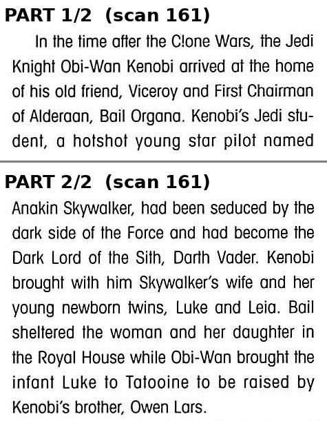

> Anger is the dark side,
> [fragment — full passage not on file]
>
> I do not ask for absolution. Only your forgiveness.
— Source: The Essential Guide to Characters (Andy Mangels, Del Rey, 1995), printed p.179, scan p.188. The 1995 guide's telling, not a power feat..
Note (our notes, around the quote): Anakin's spirit did appear again, though this time it was to Leia in her suite on Bakura. He begged her forgiveness, trying to take away her anger. "Anger is the dark side," he cautioned, adding, "I do not ask for absolution. Only your forgiveness." Leia didn't want to listen, refusing to forgive the man who had tortured her, helped destroy her world, and frozen Han in carbonite. Anakin disappeared, telling her he would never be able to see her again, but that he would hear her if she called. Eventually, in the heat of the Bakuran battle, Leia did come to at least forgive her father. Even if she would never forget, every world she took from the Empire would help ease the pain of her memories. In that forgiveness, Anakin Skywalker, the man who had once been Darth Vader, was finally freed.
Our notes: `notes/materials/147-essential-guide-to-characters-1995/egc-tigris-through-winter.md`
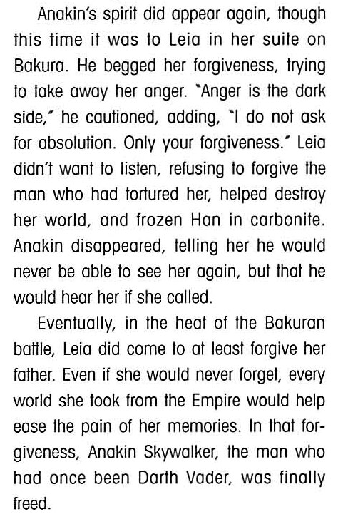

> “For I have foreseen that Mara Jade will kneel before me,” C’baoth reminded her. “One Mara Jade … or another.”
>
— Source: The Essential Guide to Characters (Andy Mangels, Del Rey, 1995), printed p.29, scan p.038. The 1995 guide's telling, not a power feat..
(A fragment line was removed 2026-11-17: its words appear word for word inside the full excerpt in this entry.)
(Fragment completed 2026-11-17 with the full excerpt, word for word from The Last Command (Timothy Zahn) (text copy `MEGA_Legend_The_Thrawn_Trilogy_Star_Wars_Thrawn_Trilogy_03_The_Last_Command_Timothy_Zahn_epub`).)
(Excerpt widened 2026-11-17 to the relevant passage, word for word from The Last Command (Timothy Zahn) (text copy `MEGA_Legend_The_Thrawn_Trilogy_Star_Wars_Thrawn_Trilogy_03_The_Last_Command_Timothy_Zahn_epub`).)
(Fragment completed 2026-11-17: full sentence/passage matched word for word in the source text on file: `MEGA_Legend_The_Thrawn_Trilogy_Star_Wars_Thrawn_Trilogy_03_The_Last_Command_Timothy_Zahn_epub`.)
Note (our notes, around the quote): C’Baoth lost control, his dark-Force powers raging against the Jedi and Jedi-to-be. He attacked Luke and Mara using blue lightning and collapsed rubble from the ceiling, planning to replace the clone of Luke and grow another clone of Mara Jade. “I have foreseen that Mara Jade will kneel before me,” he said. “One Mara Jade . . . or another.” Mara freed herself first, charging C’Baoth with Leia’s lightsaber. She used it to deflect his corona of lightning, but was overcome by a blinding hail of rocks. Leia, who had accompanied them, linked her mind with Mara’s, allowing her to see where she was going. Exhausted and in pain, Luke used the Force to free the savage vornskrs that were leashed nearby. The growling creatures ran for Joruus, distracting the evil clone and his magics. Mara Jade charged and killed C’Baoth with a thrust of the lightsaber. Joruus C’Baoth was finally and truly dead.
Our notes: `notes/materials/147-essential-guide-to-characters-1995/egc-bodo-through-cbaoth.md`
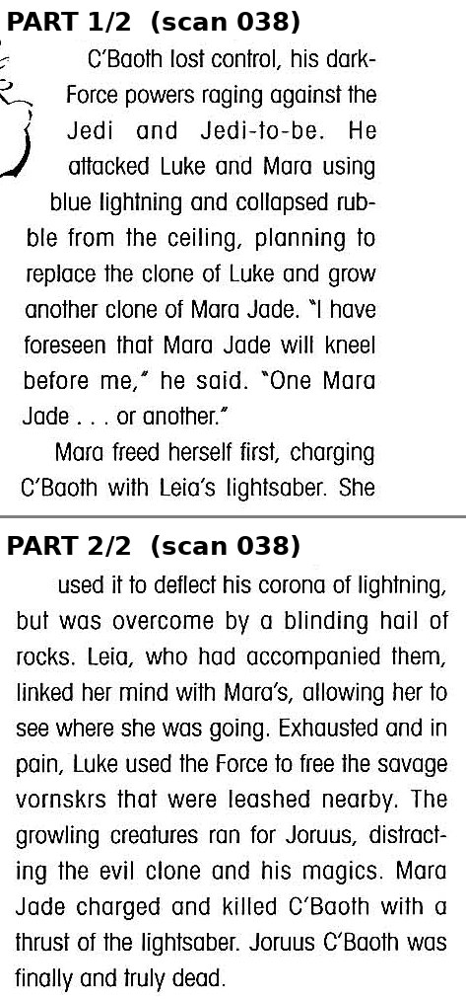

- Note (summary from our notes, not a quotation): Finally, Mara would face her destiny. During a mission that took them to Wayland to destroy the Emperor’s Spaarti cloning cylinders, Luke trained Mara in her slowly returning Force talents. Joruus C’Baoth called both Luke and Mara to him, intending to turn them to the dark side. When it became clear he couldn’t turn Luke, he unleashed his own clone of the hero, calling it Luuke Skywalker. In the battle to follow, Mara killed the Luuke clone, and with help from Luke and Leia Organa Solo, she slew C’Baoth, as well. She had done what the Emperor’s compulsion commanded her. She finally felt free.
  — Source: The Essential Guide to Characters (Andy Mangels, Del Rey, 1995), printed p.83, scan p.092. The 1995 guide's telling, not a power feat..
Our notes: `notes/materials/147-essential-guide-to-characters-1995/egc-greedo-through-mara.md`
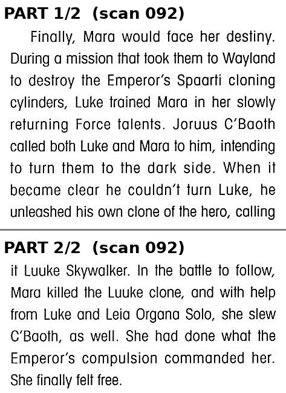

- Note (summary from our notes, not a quotation): Surviving Imperial forces drove the New Republic off Coruscant; its temporary headquarters were established on the Fifth Moon of Da Soocha in the Cyax system. Lando, Wedge, and Luke attacked Coruscant, but their ship crashed. Although the others escaped in the Falcon, Luke allowed himself and Artoo to be sucked up into a crackling blue Force storm. It transported him to an Imperial dungeon ship, which, in turn, took him to Byss. There, he was surprised to find the clone of Emperor Palpatine, alive and willing to teach him.
  — Source: The Essential Guide to Characters (Andy Mangels, Del Rey, 1995), printed p.141, scan p.150. The 1995 guide's telling, not a power feat..
Our notes: `notes/materials/147-essential-guide-to-characters-1995/egc-luke-through-thrawn.md`
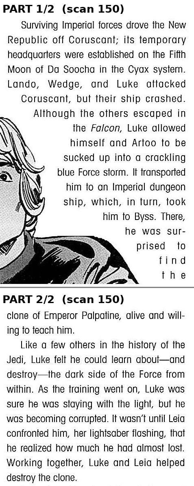

> Anger is the dark side,
> [fragment — full passage not on file]
>
> I do not ask for absolution. Only your forgiveness.
— Source: The Essential Guide to Characters (Andy Mangels, Del Rey, 1995), printed pp.154–155, scans p.163–164. This wording differs from the printed p.179 account, which stays on its own line. The 1995 guide's telling, not a power feat..
Note (our notes, around the quote): The truce wasn’t the most important part of the trip for Leia’s mental health; Anakin Skywalker’s spirit appeared to her in her suite on Bakura. The man who had once been Darth Vader begged her forgiveness, trying to take away her anger. “Anger is the dark side,” he cautioned, adding, “I do not ask for absolution. Only your forgiveness.” But Leia refused to forgive the man who had tortured her, helped destroy her world, and frozen Han in carbonite.
Our notes: `notes/materials/147-essential-guide-to-characters-1995/egc-luke-through-thrawn.md`
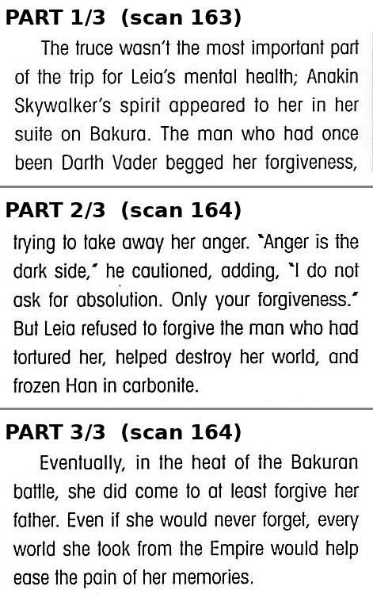

## Essential Guide to Planets and Moons (1998)

- Note (summary from our notes, not a quotation): The princess was brought to the control center and led to believe that she could save her homeworld by divulging the site of the secret Rebel base. Leia named a location, but it made no difference—the defenseless planet was obliterated. Tarkin, however, had made a disastrous error. The callous murder of billions struck anger—not fear—into the galaxy. New allies, seeing the Empire's true face, flocked to the Rebel banner.
  — Source: The Essential Guide to Planets and Moons (Daniel Wallace, Del Rey, 1998), printed p.7, scan p.021.
Our notes: `notes/materials/150-essential-guide-to-planets-and-moons-1998/egpm-alderaan-through-almania.md`
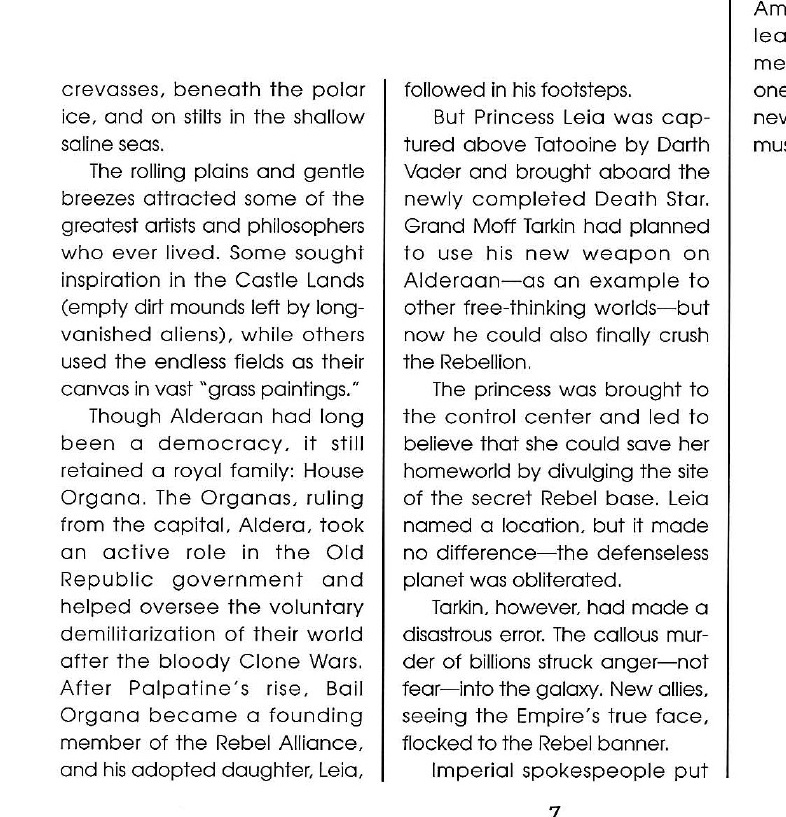

- Note (summary from our notes, not a quotation): Hoping to spare Alderaan and still protect the Yavin 4 base, Leia resorted to a deception. "Dantooine," she lied, knowing it had long been safely evacuated. "They're on Dantooine."
  — Source: The Essential Guide to Planets and Moons (Daniel Wallace, Del Rey, 1998), printed p.67, scan p.081.
Our notes: `notes/materials/150-essential-guide-to-planets-and-moons-1998/egpm-dagobah-through-dantooine.md`
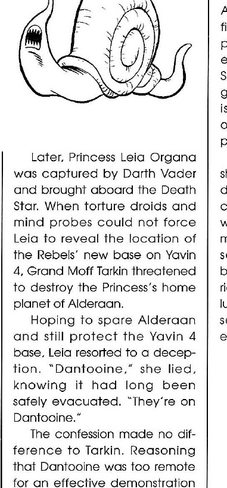

- Note (summary from our notes, not a quotation): Vader soon used Han for another insidious purpose: testing a carbonite-freezing chamber on a living person. Before he was lowered into the carbonite pit, Han and Leia said their good-byes. "I love you," she told him, tears in her eyes. "I know," he replied. And then the intense, incredible cold came, and Han couldn't scream, couldn't move, couldn't see. Conscious but not conscious, Han almost went mad in the dark prison of carbonite, his mind playing the memories of his life.
  — Source: The Essential Guide to Characters (Andy Mangels, Del Rey, 1995), printed p.146–147, scan p.155–156. The 1995 guide's telling, not a power feat..
Our notes: `notes/materials/147-essential-guide-to-characters-1995/egc-luke-through-thrawn.md`
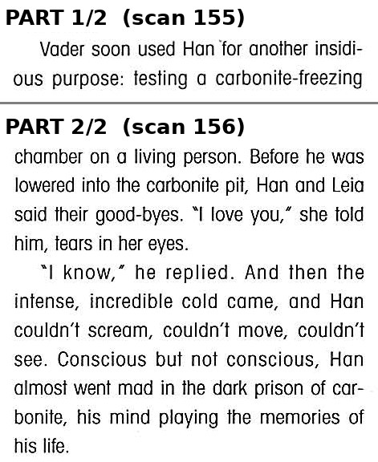

## The New Essential Guide to Weapons and Technology (2004)

> Aren't you a little short for a stormtrooper?
— Source: The New Essential Guide to Weapons and Technology (W. Haden Blackman, Del Rey, 2004), printed p.121, scan p.147..
Note (our notes, around the quote): "Aren't you a little short for a stormtrooper?" —Princess Leia to a disguised Luke Skywalker.
Our notes: `notes/materials/155-new-essential-guide-to-weapons-technology-2004/quotes/QUOTES-INDEX.md`
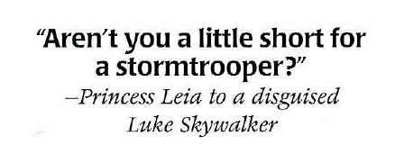

> Help me Obi-Wan Kenobi, you're my only hope . . .
— Source: The New Essential Guide to Weapons and Technology (W. Haden Blackman, Del Rey, 2004), printed p.171, scan p.197. There is no comma after "Help me." The ellipsis is spaced..
Note (our notes, around the quote): "Help me Obi-Wan Kenobi, you're my only hope . . ." —Princess Leia.
Our notes: `notes/materials/155-new-essential-guide-to-weapons-technology-2004/quotes/QUOTES-INDEX.md`
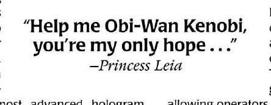

## Young Jedi Knights 2: *Shadow Academy* (Kevin J. Anderson & Rebecca Moesta, Boulevard 1995): FULL consecutive read (2026-11-20 CST)

What it shows (our notes): Leia wants to act, and agrees to work from Coruscant.
> “But Luke, they’re our children,” she was saying. “We can’t simply stand by and do nothing if they’re in danger.”
>
> “All right, Luke,” Leia said.
— Source: Young Jedi Knights 2: Shadow Academy (Kevin J. Anderson & Rebecca Moesta, 1995), ch. 5 (p.50).
(Full sentence/passage taken from the source text on file: `YJK02 Shadow Academy epub`, checked against the 1995 print scan; e-book glitches corrected to the printed text.)
Our notes: `notes/materials/174-yjk-02-shadow-academy/sa-01.md:122`

What it shows (our notes): Leia thanks Tenel Ka as a mother.
> “Then I owe you my gratitude as a mother as well.”
— Source: Young Jedi Knights 2: Shadow Academy (Kevin J. Anderson & Rebecca Moesta, 1995), ch. 5 (p.51).
(Full sentence/passage taken from the source text on file: `YJK02 Shadow Academy epub`, checked against the 1995 print scan; e-book glitches corrected to the printed text.)
Our notes: `notes/materials/174-yjk-02-shadow-academy/sa-01.md:123`

What it shows (our notes): Leia lets Luke keep the Shadow Chaser.
> “All right, Luke. We’ll send our engineers to study it, but you keep the ship there. Use it when you need to.
>
> You earned it rescuing Jacen, Jaina, and Lowie. Besides, you’re an important part of the New Republic . We’ll all feel better knowing you’ve got a safe, fast ship when you go running off across the galaxy-and don’t tell me you’ve forgotten how to fly a fast ship!”
— Source: Young Jedi Knights 2: Shadow Academy (Kevin J. Anderson & Rebecca Moesta, 1995), ch. 22 (p.201).
(Full sentence/passage taken from the source text on file: `YJK02 Shadow Academy epub`, checked against the 1995 print scan; e-book glitches corrected to the printed text.)
Our notes: `notes/materials/174-yjk-02-shadow-academy/sa-04.md:110`

## Young Jedi Knights 3: *The Lost Ones* (Kevin J. Anderson & Rebecca Moesta, 1995): FULL consecutive read (2026-11-20 CST)

What it shows (our notes): Leia's workload as Chief of State; there are always threats from outside.
> Since that time, Leia had taken on extremely heavy political duties and devoted most of her waking hours - along with quite a few of those she should have spent sleeping - to untangling knots in the threads of diplomacy.
>
> “I have a meeting with the Howler Tree People of Bendone … they speak a very strange language and need a team of translators. It’ll take me all morning long just to hold a conversation.”
>
> “And their ultrasonic voices give me a headache!” Leia drew a deep breath and forced a smile. “But it’s part of the job. We have to keep the New Republic strong.
>
> There are always threats from the outside.”
— Source: Young Jedi Knights 3: The Lost Ones (Kevin J. Anderson & Rebecca Moesta, 1995), ch. 2.
(Full sentence/passage taken from the source text on file: `YJK03 The Lost Ones epub`; no print scan in the library, so no page numbers; e-book spacing glitches such as joined words normalized.)
Our notes: `notes/materials/175-yjk-03-the-lost-ones/lo-01.md:33`

What it shows (our notes): Leia refuses Jacen's Corusca gem and tells him to find a special use for it.
> Leia’s expression showed how deeply moved she was, but she closed her son’s fingers around the valuable gem. “Just having you offer it to me is a very special gift,” she said. “But I don’t really need any more jewels or treasures. I’d like you to keep it—find a special use for it. I’m sure you’ll think of something.”
— Source: Young Jedi Knights 3: The Lost Ones (Kevin J. Anderson & Rebecca Moesta, 1995), ch. 2.
(Full sentence/passage taken from the source text on file: `YJK03 The Lost Ones epub`; no print scan in the library, so no page numbers; e-book spacing glitches such as joined words normalized.)
Our notes: `notes/materials/175-yjk-03-the-lost-ones/lo-01.md:35`

What it shows (our notes): Leia presents the hawkbat egg to the Karnak Alpha ambassador as a diplomatic gift.
> The Karnak ambassador trembled with excitement, her long hair jiggling, as Lela explained. “Madam Ambassador, we know very little about your culture—but we do know that you have a great love for unusual zoological specimens. We have heard reports of your magnificent holographic dioramas and huge alternate-environment zoos where the animals don’t even realize they are in a cage. As a diplomatic gift to you and your people, we present to you this rare and precious hawkbat egg, one of the most difficult-to-catch creatures native to Imperial City. Very few of them are in captivity.”
— Source: Young Jedi Knights 3: The Lost Ones (Kevin J. Anderson & Rebecca Moesta, 1995), ch. 6.
(Full sentence/passage taken from the source text on file: `YJK03 The Lost Ones epub`; no print scan in the library, so no page numbers; e-book spacing glitches such as joined words normalized.)
Our notes: `notes/materials/175-yjk-03-the-lost-ones/lo-02.md:37`

What it shows (our notes): Leia covers for Zekk by eating her own bouquet, and the whole table follows.
> From the far end of the table Princess Leia cleared her throat. “I’m glad you liked the salad, Zekk,” she said in a voice loud enough for everyone to hear, and pulled her crystal dish toward her. She selected a frilly purple-green leaf and stuffed it in her mouth, munching contentedly. Han Solo looked at his wife as if she had gone crazy, then jerked as if he had been kicked under the table. He too began to eat his bouquet. Jaina followed suit, and soon everyone at the table had devoured their “salads.”
— Source: Young Jedi Knights 3: The Lost Ones (Kevin J. Anderson & Rebecca Moesta, 1995), ch. 6.
(Full sentence/passage taken from the source text on file: `YJK03 The Lost Ones epub`; no print scan in the library, so no page numbers; e-book spacing glitches such as joined words normalized.)
Our notes: `notes/materials/175-yjk-03-the-lost-ones/lo-02.md:46`

What it shows (our notes): Leia puts her children ahead of the ambassador, and the alliance is settled.
> “As your father and I walked the ambassador and her children back to their quarters, I realized that my kids were more important to me than any ambassador. When we got to their quarters, the ambassador said she was ready to discuss her planet’s alliance with the New Republic. That’s when I amazed even myself. I said I’d be happy to talk with her about it in the morning—but that for right now I needed to be with my children.”
>
> Leia chuckled. “Yes I did, and you know what she said?” She sounded a bit surprised. “She said in that case she no longer had any doubts that we could form an alliance. Everything is all set.”
— Source: Young Jedi Knights 3: The Lost Ones (Kevin J. Anderson & Rebecca Moesta, 1995), ch. 9.
(Full sentence/passage taken from the source text on file: `YJK03 The Lost Ones epub`; no print scan in the library, so no page numbers; e-book spacing glitches such as joined words normalized.)
Our notes: `notes/materials/175-yjk-03-the-lost-ones/lo-02.md:85`

What it shows (our notes): Leia acts decisively when Jacen and Tenel Ka vanish, leading guards with Threepio tracking.
> Her alarm growing visibly, Leia said, “He would answer—unless he’s in trouble.” She reached some sort of decision and snapped into action, demonstrating one of the qualities that made her a good Chief of State.
>
> “We’ve got to go find them. Tenel Ka wouldn’t let Jacen do anything dangerous. But she probably doesn’t think anything is dangerous.”
>
> “I’ll summon a group of guards to go with us.
>
> Threepio, can you trace the location of Jacen’s comlink?”
— Source: Young Jedi Knights 3: The Lost Ones (Kevin J. Anderson & Rebecca Moesta, 1995), ch. 19.
(Full sentence/passage taken from the source text on file: `YJK03 The Lost Ones epub`; no print scan in the library, so no page numbers; e-book spacing glitches such as joined words normalized.)
Our notes: `notes/materials/175-yjk-03-the-lost-ones/lo-04.md:69`

What it shows (our notes): Leia catches Anakin when he slips on the walkway, and pushes bravely ahead.
> Once, at a spot where the side rail was missing, Anakin lost his footing and nearly fell off the bridge, but Leia instinctively grabbed him. She looked at her son with shock, then hugged him quickly. “Be careful,” she urged. “We’ve all got to be careful.”
>
> Leia held her chin up and bravely pushed ahead with greater speed.
— Source: Young Jedi Knights 3: The Lost Ones (Kevin J. Anderson & Rebecca Moesta, 1995), ch. 19.
(Full sentence/passage taken from the source text on file: `YJK03 The Lost Ones epub`; no print scan in the library, so no page numbers; e-book spacing glitches such as joined words normalized.)
Our notes: `notes/materials/175-yjk-03-the-lost-ones/lo-04.md:72`

What it shows (our notes): Leia vows decisive action against the Second Imperium.
> Leia shook her head, her dark eyes flashing. “I think it’s about time we did something decisive about that Second Imperium!” she said. “That’s twice now they’ve hurt my children.”
— Source: Young Jedi Knights 3: The Lost Ones (Kevin J. Anderson & Rebecca Moesta, 1995), ch. 19.
(Full sentence/passage taken from the source text on file: `YJK03 The Lost Ones epub`; no print scan in the library, so no page numbers; e-book spacing glitches such as joined words normalized.)
Our notes: `notes/materials/175-yjk-03-the-lost-ones/lo-04.md:83`

What it shows (our notes): Luke: even Vader never sensed Leia's Jedi potential.
> Even Darth Vader had no idea that your mother Leia had Jedi potential, though he spent quite a lot of time near her. You can’t blame yourself, Jaina.”
— Source: Young Jedi Knights 3: The Lost Ones (Kevin J. Anderson & Rebecca Moesta, 1995), ch. 22.
(Full sentence/passage taken from the source text on file: `YJK03 The Lost Ones epub`; no print scan in the library, so no page numbers; e-book spacing glitches such as joined words normalized.)
Our notes: `notes/materials/175-yjk-03-the-lost-ones/lo-04.md:140`

### Limitations and anti-feats (The Lost Ones)

What it shows (our notes): LIMITATION / ANTI-FEAT — Leia dismisses Zekk's disappearance: no resources to look for every missing teenager.
> After that news, when Jacen poured out the story of Zekk’s disappearance, Leia didn’t seem overly concerned. She let her gaze drift across all four of the young Jedi Knights standing in her office. “All right, let me ask you this: Who knows the city better, the four of you … or Zekk?”
>
> “And those other times he wasn’t upset over an embarrassing diplomatic dinner, either. Look, he’s older than you are, and legally he can come and go as he pleases. But even if we knew for certain that he was missing—which we don’t—there’s very little we could do about it. The galaxy is a big place. Who knows where he might be?”
>
> “People turn up missing all the time, and we simply don’t have the resources to look for everybody. Just this week I’ve had reports of at least three other teenagers missing in Imperial City alone.
— Source: Young Jedi Knights 3: The Lost Ones (Kevin J. Anderson & Rebecca Moesta, 1995), ch. 10.
(Full sentence/passage taken from the source text on file: `YJK03 The Lost Ones epub`; no print scan in the library, so no page numbers; e-book spacing glitches such as joined words normalized.)
Our notes: `notes/materials/175-yjk-03-the-lost-ones/lo-02.md:99`

# CANON (Disney canon — kept separate)

## The Complete Star Wars Encyclopedia, Vol. III (P–Z)

> Later the Tarkin was destroyed by an elite team of Rebels that included Luke Skywalker, Leia Organa, Chewbacca, C-3PO, and R2-D2.
— Source: scan pages 201–240; Grand Moff Tarkin; Luke Skywalker; Leia Organa Solo; Chewbacca.
Note (our notes, around the quote): Grand Moff Tarkin; Luke Skywalker; Leia Organa Solo; Chewbacca: "Later the Tarkin was destroyed by an elite team of Rebels that included Luke Skywalker, Leia Organa, Chewbacca, C-3PO, and R2-D2." Source: The Complete Star Wars Encyclopedia, Vol. III, p.220
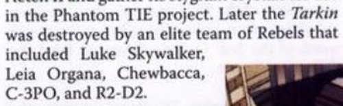
Our notes: `notes/materials/032-complete-star-wars-encyclopedia-vol-3/05-v3-scan-201-240.md:237`

## The New Essential Guide to Characters (2002)

> When his underlings captured Luke Skywalker and Princess Leia on Mimban, Vader rushed to the world and engaged both Rebels in combat, but the spirit of Obi-Wan Kenobi, fighting through Skywalker, defeated Vader and cut through his mechanical right arm.
— Source: scan pages 121–150.
Note (our notes, around the quote): Luke Skywalker; Leia Organa Solo; Darth Vader (Anakin Skywalker); Obi-Wan Kenobi: "When his underlings captured Luke Skywalker and Princess Leia on Mimban, Vader rushed to the world and engaged both Rebels in combat, but the spirit of Obi-Wan Kenobi, fighting through Skywalker, defeated Vader and cut through his mechanical right arm." Source: The New Essential Guide to Characters, p.157
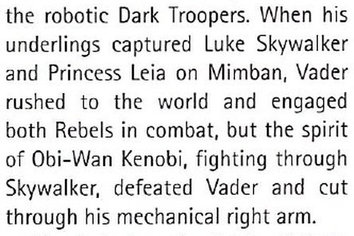
Our notes: `notes/materials/034-new-essential-guide-to-characters/04-negc-scan-121-150.md:185`

## Dark Side Sourcebook (d20, 2001)

> Two factors were set in place to affect the galaxy for years to come: Anakin Skywalker, whom Qui-Gon believed to be the Chosen One of Jedi prophesy, was discovered and given to Obi-Wan for training; and Senator Palpatine of Naboo was elected the Chancellor of the Republic. leaders in the Senate attempted to work against the Emperor using laws and debate. They found their laws easily repealed, and the more vocal opponents of the New Order were silenced. A Rebellion against the New Order began. It was unorganized at first, but eventually the leaders who opposed the Emperor stepped forward to join the Rebellion. Separate groups became one group, agitated crowds became armies, and the Alliance to Restore the Republic came into being. The first great victory of the Alliance occurred at Yavin, where Rebels led by Princess Leia Organa destroyed the Death Star battle station. The young man who fired the shot heard round the galaxy was none other than Luke Skywalker, heir to the Jedi legacy and son of Anakin Skywalker-now known as Darth Vader. 20 Years before the Battle of Mavin Anakin Skywalker grew to manhood and became a powerful Jedi Knight under the tutelage of Obi-Wan Kenobi. As time passed, a series of threats to the Republic further weakened that ancient and sickly institution.
— Source: Chapter One: The Dark Side (timeline); Leia Organa Solo. POV: Leia Organa Solo.
(Excerpt widened 2026-11-17 to the relevant passage, word for word from research primary dark side sourcebook dss (text copy `research_primary_dark_side_sourcebook_dss_pdf_9cd3453f4a`).)
(Excerpt widened 2026-11-17 to the relevant passage, word for word from research primary dark side sourcebook dss (text copy `research_primary_dark_side_sourcebook_dss_pdf_9cd3453f4a`).)
Note (our notes, around the quote): Leia Organa Solo: "The first great victory of the Alliance occurred at Yavin, where Rebels led by Princess Leia Organa destroyed the Death Star battle station." Source: Dark Side Sourcebook, p.10
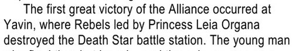
Our notes: `notes/materials/035-dark-side-sourcebook/01-ch1-the-dark-side.md:44`

## Star Wars Gamer/Star Wars Gamer 08.pdf [Star Wars Roleplaying Game (d20, 2000)] (scan pages 61–112)

- Note (summary from our notes, not a quotation): Page contents: Galactic Battlegrounds briefing (lead tester Chane Hollander and Dave Silverstein): campaign leaders include Leia for the Rebels, Vader for the Empire and OOM-9 for the Trade Federation; know your strengths, range kills (hand-read)
  — Source: Star Wars Gamer/Star Wars Gamer 08.pdf [Star Wars Roleplaying Game (d20,.
Our notes: `notes/materials/037-sw-d20-folder/057-star-wars-gamer-08-scan-061-112.md:326`

## Jedi Counselling/Jedi Counseling 62.pdf [Star Wars Roleplaying Game Revised Core (d20, 2002)]

- Note (summary from our notes, not a quotation): (If Leia has the plans and they defeat her, you might think of this as "capturing" her with a stun blast. The rules don't go into this kind of detail, of course, but the key is that she's carrying incriminating evidence when they defeat her, so Lord Tion's objections are moot.)
  — Source: Jedi Counselling/Jedi Counseling 62.pdf [Star Wars Roleplaying Game Revis.
(This should make it possible for the Imperials to win without a problem -- eventually, the Rebel player will have to use Leia to pick up the plans to win. (The Imperial character, obviously, will want to defeat all other Rebels as quickly as possible so they can then defeat Leia.)" Source: *Jedi Counseling 62* (SWRPG d20 Revised Core), scan p.3)
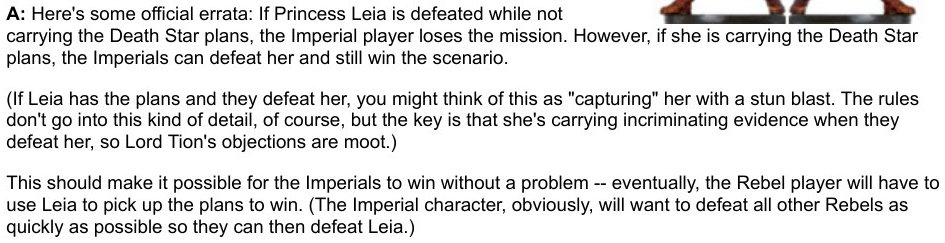
Our notes: `notes/materials/037-sw-d20-folder/230-jedi-counseling-62.md:39`

- Note (summary from our notes, not a quotation): Leia Organa Solo — entry/section: Ralltiir reserve-Rebel strategy errata: "Q: Well, one other strategy almost always seems to win the scenario: The Rebels keep one Ralltiir Rebel in reserve, give that Ralltiir Rebel the Death Star plans tile, have Princess Leia defeat all of the Imperials, and then bring in the reserve Ralltiir Rebel. Is this intentional? Is it legal for the Ralltiir Rebel in reserve to have the Death Star plans tile?
  — Source: Jedi Counselling/Jedi Counseling 62.pdf [Star Wars Roleplaying Game Revis.
Our notes: `notes/materials/037-sw-d20-folder/230-jedi-counseling-62.md:42`

## Locations/Planet Hoppers/Aargau - For All Your Banking Needs/Part 4 - Checks, Balances, and Overdrafts.pdf [Star Wars Roleplaying Game Revised Core (d20, 2002)]

> Princess Leia Organa, an acknowledged leader of the Rebels and a genuine blue-blood from recently destroyed Alderaan, arrived with Viscount Tardi -- at least, at the time | believed it was Tardi -- at Checkpoint LH48.
— Source: Locations/Planet Hoppers/Aargau - For All Your Banking Needs/Part 4 - Che; Leia Organa Solo. POV: Leia Organa Solo.
Note (our notes, around the quote): Leia Organa Solo: "Princess Leia Organa, an acknowledged leader of the Rebels and a genuine blue-blood from recently destroyed Alderaan, arrived with Viscount Tardi -- at least, at the time | believed it was Tardi -- at Checkpoint LH48." Source: *Part 4 - Checks, Balances, and Overdrafts* (SWRPG d20 Revised Core), scan p.1
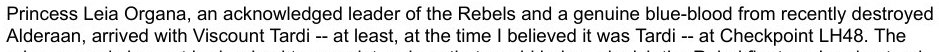
Our notes: `notes/materials/037-sw-d20-folder/554-part-4-checks-balances-and-overdrafts.md:12`

## Sourcebooks/Rebellion Era Campaign Guide.pdf [Star Wars Roleplaying Game Saga Edition (2007)] (scan pages 61–120)

> A rescued Princess Leia and the plans to the newly operational Death Star give the Rebels the means and, with the Death Star's rapid approach, an immediate need to destroy the Emperor's monstrous superweapon.
— Source: Sourcebooks/Rebellion Era Campaign Guide.pdf [Star Wars Roleplaying Game; Leia Organa Solo. POV: Leia Organa Solo.
Note (our notes, around the quote): Leia Organa Solo: "A rescued Princess Leia and the plans to the newly operational Death Star give the Rebels the means and, with the Death Star's rapid approach, an immediate need to destroy the Emperor's monstrous superweapon." Source: *Rebellion Era Campaign Guide* (SWRPG Saga Edition), scan p.85
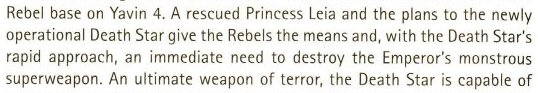
Our notes: `notes/materials/037-sw-d20-folder/722-rebellion-era-campaign-guide-scan-061-120.md:170`

## The Lucasfilm Fan Club Magazine #20 (1993)

> The Latest From LucasArts Entertainment Co.
— Source: The Lucasfilm Fan Club Magazine #20 (1993); Page contents: Dan Madsen.
Note (our notes, around the quote): Page contents: Dan Madsen, "The Latest From LucasArts Entertainment Co.": the X-Wing Imperial Pursuit tour of duty (more than 15 missions, set after the Death Star's destruction as the Rebels flee Yavin) and the B-Wing tour of duty (more than 20 missions; the B-wing is described with three laser cannons, three ion cannons and dual proton torpedo launchers; Luke and Leia cameos). Also Sam & Max Hit the Road (Steve Purcell, Sean Clark, Michael Stemmle). Game product copy; S only. (hand-read)
Our notes: `notes/materials/038-star-wars-insider/020-lfc020.md:74`

## Star Wars Insider #119 (2010)

- Note (summary from our notes, not a quotation): Page contents: TCW team favorites: Catherine Taber (Hoth outfits, wampa), James Arnold Taylor (Falcon, tauntaun, Han and Leia's Hoth argument), Matthew Wood (feeling the passage of time), Tom Kane (electrified opening-night audience). (hand-read)
  — Source: Star Wars Insider #119 (2010).
Our notes: `notes/materials/038-star-wars-insider/119-ins119.md:137`

## Star Wars Insider #126 (2011)

- Note (summary from our notes, not a quotation): Page contents: Interrogation Droid: Catherine Taber (Padmé in TCW, Leia in TFU) answers humorous mash-up questions (Padmé in Jabba's palace, Leia on Jar Jar, etc.). (hand-read)
  — Source: Star Wars Insider #126 (2011).
Our notes: `notes/materials/038-star-wars-insider/126-ins126.md:65`

## Star Wars Insider #129 (2011)

- Note (summary from our notes, not a quotation): Page contents: Comics: Crimson Empire III is set 13 years after ROTJ (Admiral Pellaeon's Empire; Mirith Sinn as Leia's head of security; Kanos targeting Leia and Luke); Stradley on Kanos and Sinn; Paul Gulacy art. Ask Lobot (as related to Leland Y. Chee), on whether Maul's return was always planned (reader handle omitted): any plan to resurrect Darth Maul was known only to Lucas; the Tales/Visionaries appearances were never confirmed as the real Maul; bringing back the real Maul was considered for The Force Unleashed and abandoned; Lucas chooses what EU material TCW uses. (hand-read)
  — Source: Star Wars Insider #129 (2011).
Our notes: `notes/materials/038-star-wars-insider/129-ins129.md:366`

## Star Wars Insider #136 (2012)

- Note (summary from our notes, not a quotation): Page contents: Cover: "Life of Leia!" Carrie Fisher; join the celebration (TCW at 5, AOTC at 10, ANH at 35). (hand-read)
  — Source: Star Wars Insider #136 (2012).
Our notes: `notes/materials/038-star-wars-insider/136-ins136.md:10`

## Star Wars Insider #151 (2014)

> Well I guess you don't know everything about women yet *(ESB)*
> [fragment — full passage not on file]
— Source: Star Wars Insider #151 (2014).
Note (our notes, around the quote): Page contents: Editor's welcome (Jonathan Wilkins, August/September 2014): the age of the fangirl; Leia quote "Well I guess you don't know everything about women yet" (ESB); Vanessa Marshall interview as taster for the next all-Rebels issue; staff masthead. (hand-read)
Our notes: `notes/materials/038-star-wars-insider/151-ins151.md:20`

- Note (summary from our notes, not a quotation): Page contents: Launch Pad: Disney adding Princess Leia toys after fan criticism; DK Star Wars Rebels books giveaway. (hand-read)
  — Source: Star Wars Insider #151 (2014).
Our notes: `notes/materials/038-star-wars-insider/151-ins151.md:50`

## Star Wars Insider #152 (2014)

- Note (summary from our notes, not a quotation): Page contents: My Star Wars: Vanessa Marshall (Hera), interview by Jonathan Wilkins: saw A New Hope in 1977; Leia and Ahsoka favorites; favorite ROTS and TCW scenes; Hera cosplay lekku; first signing at a May the Fourth event; Vader's arc (fan names omitted). (hand-read)
  — Source: Star Wars Insider #152 (2014).
Our notes: `notes/materials/038-star-wars-insider/152-ins152.md:105`

## Star Wars: Dark Empire (1991–92), Dark Empire II (1994–95), Empire's End (1995), single issues, hand-read

- Note (summary from our notes, not a quotation): New Alderaan (DE II #6 p13–23): scarab-poison ambush on the sleeping Luke. Jem kills Krdys Mordi, Leia kills Tedryn-Sha, Kam drops Xecr Nist with a feint (Nist survives; see EE #1 p8, p27), and Rayf saves the twins. Jem dies of a blaster wound. AT-ATs raze the settlement, and smugglers plus X-wings get the survivors out. Mixed result: the darksider strike team is beaten, but the Rebels lose the base and Jem.
  — Source: Star Wars: Dark Empire II (#1–6, Dec 1994–May 1995): series summary and scaling notes.
Our notes: `notes/materials/041-dark-empire/de2-summary.md:68`

## Star Wars Handbook 3: Dark Empire (Dark Horse, 1998) + Star Wars Insider #157–159 "The Making of Dark Empire" (Titan, 2015)

> "Vast energy storms that connect wildly disparate spots across the galaxy, hyperspace wormholes are unpredictable and devastating. It was to the Rebel Alliance's detriment that Emperor Palpatine was able to not only control these storms, but to create them." — p. 005
> [fragment — full passage not on file]
>
> "a hyperspace wormhole appeared in space and made its way to the surface, indiscriminately destroying friend and enemy vessels alike. Witnesses commented on how the storm seemed single minded, and indeed, it was: the Jedi Luke Skywalker was its target, and even as it tore into the surface of the city-covered planet in a frenzy of random destruction, it made its way toward the spot where Luke … was pinned down" — p. 005
> [fragment — full passage not on file]
>
> "In a last-ditch attempt to stab at his enemies, Palpatine evoked another hyperspace wormhole over the Rebels' Pinnacle Moon base. But the combined burst of energy from Luke Skywalker, Leia, and her unborn child sent the Emperor reeling, and his creation, without anybody to control it, went rampant. The wormhole tore into Palpatine's flagship and sent the Emperor reeling into oblivion." — p. 005
> [fragment — full passage not on file]
— Source: Star Wars Handbook 3: Dark Empire (Dark Horse, 1998), notes part 1: pp. 000–026 (complete handbook).
Context: p. 005: Emperor's Hyperspace Wormhole (Owens; Nestelle):
Our notes: `notes/materials/046-dark-empire-handbook-3/hb3-01.md:29`

# Debate and forum claims (unverified)

Forum posts, Suspect Insight debates and Discord debates, respect threads, and verdicts. These are posters' arguments or quotations they typed; none is checked against the book here unless the entry says so.

## Legacy of the Force 1–9: novel notes from the other agent (reference copy)

- Note (summary from our notes, not a quotation): Luke > Jacen (closing fast; best in the book at stealth and mind work) > Lumiya (illusion specialist) ≈ Mara (no feats; statement places Jacen above her) > Jaina > Leia > Ben. Fett is the top non-Force fighter, though dying.
  — Source: Legacy of the Force 2: Bloodlines (novel), feats and scaling notes.
Posted by: not named in our notes (see thread/notes link).
Our notes: `notes/materials/021-legacy-of-the-force/lotf-2-bloodlines-notes.md:174`

- Note (summary from our notes, not a quotation): Alema loses every direct contest (Leia's reversed dart, Jag's shot, Leia's flurry) but escapes every time.
  — Source: Legacy of the Force 4: Exile (novel), feats and scaling notes.
Posted by: not named in our notes (see thread/notes link).
Our notes: `notes/materials/021-legacy-of-the-force/lotf-4-exile-notes.md:139`

- Note (summary from our notes, not a quotation): Second tier: Leia > Tahiri (Fight D). Zekk and Jaina outclass unpowered GAG troops. The One Sith Morto > Alema in a TK grip (L3877).
  — Source: L3877 — Legacy of the Force 6: Inferno (novel, read in full): feats, scaling and story notes.
Posted by: not named in our notes (see thread/notes link).
Our notes: `notes/materials/021-legacy-of-the-force/lotf-6-inferno-notes.md:168`

## Locations/Planet Hoppers/Arbra - Sanctuary In the Storm/Part 2 - Judge Him Not By His Size.pdf [Star Wars Roleplaying Game Revised Core (d20, 2002)]

- Note (summary from our notes, not a quotation): Page contents: Hoojib description; Leia's nomination speech: the slivilith, Rebels nearly seizing the grottoes, Hoojibs share their home; Plif stats from the page image: Male Hoojib Diplomat 10/Noble 2, Def 18 (+4 class, +4 size), Spd 4 m, VP/WP 4/4, Attack +7/+2 melee (1 pt, bite) or +10/+5 ranged, CL C (hand-read)
  — Source: Locations/Planet Hoppers/Arbra - Sanctuary In the Storm/Part 2 - Judge Hi.
Posted by: not named in our notes (see thread/notes link).
Our notes: `notes/materials/037-sw-d20-folder/566-part-2-judge-him-not-by-his.md:10`

> Suddenly, we were the Empire, ready to take the homes of free, civilized people because they had what we needed, and we were bigger. Stronger. I ordered my team to stand down, apologized to Plif, and prepared to leave.
— Source: Locations/Planet Hoppers/Arbra - Sanctuary In the Storm/Part 2 - Judge Hi.
Note (our notes, around the quote): No single roster character (rules/setting/general) — entry/section: Leia Organa's speech nominating Plif: "Suddenly, we were the Empire, ready to take the homes of free, civilized people because they had what we needed, and we were bigger. Stronger. I ordered my team to stand down, apologized to Plif, and prepared to leave." Source: *Part 2 - Judge Him Not By His Size* (SWRPG d20 Revised Core), scan p.1
Posted by: not named in our notes (see thread/notes link).
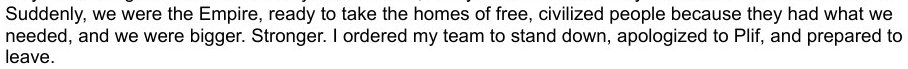
Our notes: `notes/materials/037-sw-d20-folder/566-part-2-judge-him-not-by-his.md:12`

> Rather than let us return to space, Plif and his fellow Hoojibs offered to share their home with us. To join our fight against the oppression of Palpatine's Empire. With Plif guiding their collective conscience, they chose to join our struggle even after we had threatened them . . . because it was the right thing to do.
— Source: Locations/Planet Hoppers/Arbra - Sanctuary In the Storm/Part 2 - Judge Hi.
Note (our notes, around the quote): No single roster character (rules/setting/general) — entry/section: Leia Organa's speech nominating Plif: "Rather than let us return to space, Plif and his fellow Hoojibs offered to share their home with us. To join our fight against the oppression of Palpatine's Empire. With Plif guiding their collective conscience, they chose to join our struggle even after we had threatened them . . . because it was the right thing to do." Source: *Part 2 - Judge Him Not By His Size* (SWRPG d20 Revised Core), scan p.1
Posted by: not named in our notes (see thread/notes link).
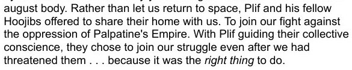
Our notes: `notes/materials/037-sw-d20-folder/566-part-2-judge-him-not-by-his.md:14`

## Star Wars: Dark Empire (1991–92), Dark Empire II (1994–95), Empire's End (1995), single issues, hand-read

> CHEWBACCA HAS A TROPHY--THE MANDALORIAN WAR HELMET OF BOBA FETT! *(p24)*
— Source: Star Wars: Dark Empire II #2 (Jan 1995).
Note (our notes, around the quote): Result: a Chewbacca win, after a blaster wound Han calls "JUST A FLESH WOUND" (p24). "CHEWBACCA HAS A TROPHY--THE MANDALORIAN WAR HELMET OF BOBA FETT!" (p24).
Posted by: not named in our notes (see thread/notes link).
Our notes: `notes/materials/041-dark-empire/de2-02.md:83`

- Note (summary from our notes, not a quotation): Result: both Dark Jedi die; Jem is mortally wounded; Luke is out of the fight. (ANALYSIS) Both darksider deaths are quick one-panel kills by Jem and Leia. Tedryn names himself "PALPATINE'S SECOND IN COMMAND" (p15), freshly given "THE FULL RANK OF DARK JEDI" in #4 p9, yet he fights with a blaster, not the Force, and loses to a pregnant Leia in two panels. Leia's "HAS BEATEN HIS PROUDEST WARRIOR" is her own boast. Luke's loss is to a sleep-time ambush plus a dream attack, not to a fight.
  — Source: Star Wars: Dark Empire II #6 (May 1995).
Posted by: not named in our notes (see thread/notes link).
Our notes: `notes/materials/041-dark-empire/de2-06.md:123`

## The Thrawn Trilogy (Timothy Zahn): Heir to the Empire, Dark Force Rising, The Last Command, plus the Heir 20th Anniversary extras

What it shows (our notes): Leia passes through the spot where the second Death Star exploded: "a black curtain seemed to drop across her vision … The menace, the rage; the hatred, the despair." Chewie and 3PO feel nothing. "anger and bitterness; but at the same time, there was something almost sad". (ANALYSIS: a Force echo of the Emperor's death site five years later.)
> a black curtain seemed to drop across her vision … The menace, the rage; the hatred, the despair.
> [fragment — full passage not on file]
>
> Chewbacca growled an affirmative, then a question. “I really don’t know,” she had to admit. “It sounds a little like something Luke went through on—during his Jedi training,” she amended, remembering just in time that Luke still wanted Dagobah’s significance to be kept a secret. “But he saw a vision. All I felt was … I don’t know. It was anger and bitterness; but at the same time, there was something almost sad about it. No—sad isn’t the right word.” She shook her head, sudden tears welling inexplicably up in her eyes. “I don’t know. Look, I’m all right. You two can go on back to what you were doing.”
— Source: Dark Force Rising — notes part 3: ch. 6–8.
(Excerpt widened 2026-11-17 to the relevant passage, word for word from Dark Force Rising (Timothy Zahn), Chapter 7 (text copy `MEGA_Legend_The_Thrawn_Trilogy_Star_Wars_Thrawn_Trilogy_02_Dark_Force_Rising_Timothy_Zahn_epub`).)
(Fragment completed 2026-11-17: full sentence/passage matched word for word in the source text on file: `MEGA_Legend_The_Thrawn_Trilogy_Star_Wars_Thrawn_Trilogy_02_Dark_Force_Rising_Timothy_Zahn_epub`.)
Posted by: not named in our notes (see thread/notes link).
Our notes: `notes/materials/044-thrawn-trilogy/dfr-03.md:21`

## "Dissecting Legacy #4: Darth Krayt vs Yoda" (Suspect Insight Forums)

- Note (summary from our notes, not a quotation): Nobody treats Hett as special. Palpatine knows Hett lives (via Moff Wessel) but shows no interest. Obi-Wan and Yoda see only Luke and Leia as able to defeat Vader (*Archives 1977–1983*, scan dead).
  — Source: Darth Krayt vs Yoda" (Suspect Insight Forums) — https://www.suspectinsightforums.com/t4461-dissecting-legacy-4-darth-krayt-vs-yoda.
Posted by: not named in our notes (see thread/notes link).
Our notes: `notes/materials/017-dissecting-legacy-4-krayt-vs-yoda.md:36`

## Suspect Insight: Exar Kun threads (read 2026-10-18)

> Exar Kun generally has better environmental feats than Caedus
> [fragment — full passage not on file]
>
> A truly peak (physical JA) Kun would definitely win
> [fragment — full passage not on file]
>
> In the temples of a long-gone people, the spirit of Exar Kun, the most powerful Dark Lord of the Sith, whose teachings once led Darth Vader to the side of evil, lives on.
— Source: Suspect Insight: Exar Kun threads (read 2026-10-18) — https://www.suspectinsightforums.com/t22-count-dooku-vs-exar-kun ; https://www.suspectinsightforums.com/t3417-revan-vs-exar-kun ; https://www.suspectinsightforums.com/t29-darth-vader-v-exar-kun.
(Full sentence/passage taken from the source text on file: `research_suspect_insight_respect_threads_raw_173_vader_darth_suit_legends_txt`.)
Note (our notes, around the quote): Pro-Caedus (DC77, IG, EmperorCaedus, Tondemonai ~8/10, BreakofDawn "handily", Ellimist "by overall scaling"). Ellimist: "Exar Kun generally has better environmental feats than Caedus". Jake: "A truly peak (physical JA) Kun would definitely win"; cites Leia's Kueller line, Specter of the Past, and the German Dark Apprentice blurb ("the most powerful Dark Lord of the Sith" - a publisher blurb, near zero weight). [panel: panels/exar-kun/exar-kun-yeah-german-blurb-dark-apprentice-kun-powerful-1.png]
Posted by: not named in our notes (see thread/notes link).
Our notes: `external/mega-notes/debates-exar-kun.md:52`

## Suspect Insight: Luke Skywalker (Legends) threads (read 2026-10-19)

> Luke shitstomps DE Sidious
> [fragment — full passage not on file]
>
> he takes a majority but he will have to put serious effort
> [fragment — full passage not on file]
>
> No. Based on what?
> [fragment — full passage not on file]
>
> with unquantifiable mass. Doesn't mean he stomps, let alone wins
> [fragment — full passage not on file]
>
> Done on Byss. I wouldn't count it as legitimate
> [fragment — full passage not on file]
>
> As of the end of DE: Luke fighting all-out + Leia's amp = 'too powerful' for DE Sidious sans Force storms
> [fragment — full passage not on file]
>
> DE II Luke beats ROTS and TFU Sheev
> [fragment — full passage not on file]
— Source: Suspect Insight: Luke Skywalker (Legends) threads (read 2026-10-19) — https://www.suspectinsightforums.com/t211-sheev-palpatine-darth-sidious-vs-luke-skywalker.
Note (our notes, around the quote): Luke (FotJ) vs DE Sidious (t211): Luke majority (NevesYtneves "Luke wins", PeraltaEagle45 "Luke stomps", IG "Luke shitstomps DE Sidious", MasterCilghal "he takes a majority but he will have to put serious effort"). Counter: Azronger ("No. Based on what?"; micro-black holes "with unquantifiable mass. Doesn't mean he stomps, let alone wins"), Deronn_Solo: Sidious bested Luke in a few panels on Byss before Leia's amp (Azronger: "Done on Byss. I wouldn't count it as legitimate"). The Ellimist: "As of the end of DE: Luke fighting all-out + Leia's amp = 'too powerful' for DE Sidious sans Force storms". MasterCilghal: Darish Vol (below Sidious) is outside ragdoll range for Luke, so no stomp. Era ladder (xolthol): young Sheev beats ANH/ESB/ROTJ Luke; "DE II Luke beats ROTS and TFU Sheev"; NJO Luke beats ROTJ and reborn Sidious.
Posted by: not named in our notes (see thread/notes link).
Our notes: `external/mega-notes/debates-luke.md:10`

## https://comicvine.gamespot.com/profile/sithrevenant/blog/exar-kun-the-chronological-respect-thread-2019/134756/ ; https://comicvine.gamespot.com/profile/deactivated-5e8a1f5fafc4e/blog/exar-kun-respect-thread-updated-2014/101338/ ; https://comicvine.gamespot.com/profile/silver2467/blog/exar-kun-respect-thread/67101/

What it shows (our notes): The New Rebellion (Kristine Kathryn Rusch), Leia on Kueller: "more Force capability than anyone she had encountered in years. Except Exar Kun, and he had been a spirit." (Kueller-scaling chain; SI and the t4525 rules ban multi-link Kueller scaling.)
> She wished she had the same certainty. This Kueller had more Force capability than anyone she had encountered in years. Except Exar Kun, and he had been a spirit. Kueller was alive. He was using these deaths to replenish his own well of hatred. The dark side ate people from within, but while it did so, it gave them much too much power.
— Source: Exar Kun: Comic Vine respect threads, read 2026-10-18 (DEEP-layer pass) — https://comicvine.gamespot.com/profile/sithrevenant/blog/exar-kun-the-chronological-respect-thread-2019/134756/ ; https://comicvine.gamespot.com/profile/deactivated-5e8a1f5fafc4e/blog/exar-kun-respect-thread-updated-2014/101338/ ; https://comicvine.gamespot.com/profile/silver2467/blog/exar-kun-respect-thread/67101/; The New Rebellion (Kristine Kathryn Rusch), Leia on Kueller.
(Excerpt widened 2026-11-17 to the relevant passage, word for word from The New Rebellion (Kristine Kathryn Rusch) (text copy `MEGA_Legend_Standalones_Star_Wars_The_New_Rebellion_Kristine_Kathryn_Rusch_epub`).)
(Full sentence/passage taken from the source text on file: `research_suspect_insight_respect_threads_raw_053_exar_kun_ancient_power_txt`.)
Posted by: not named in our notes (see thread/notes link).
Also cited as: SI respect-thread directory: Kueller Respect Thread (2020) — https://www.suspectinsightforums.com/t2918-kueller-respect-thread-2020; Leia believes Kueller.
Also noted as: Leia believes Kueller "had more Force capability than anyone she had encountered in years. Except Exar Kun" Which would indicate Kueller has more force capability than DE Sheev. The logical conclusion is that every reference to the "Emperor" is referring to it's RotJ iteration, which would explain why Sheev was left out of this quote.
Our notes: `external/mega-notes/exar-kun-comicvine-respect.txt:36`; `suspect-insight/respect-threads/kueller.md:666`

## Legends feat notes

- Note (summary from our notes, not a quotation): Ladder: Luke > Jacen > Lumiya ≈ Mara > Jaina > Leia > Ben.
  — Source: Legends feat notes — https://starwars.fandom.com/wiki/Palpatine/Legends ; https://comicvine.gamespot.com/emperor-palpatine/4005-16164/ ; https://www.suspectinsightforums.com/t1921-darth-krayt-versus-darth-sidious.
Posted by: not named in our notes (see thread/notes link).
Our notes: `external/mega-notes/legends-feats.md:550`

- Note (summary from our notes, not a quotation): The Errant Venture trap on Alema (L5555-5659): Leia reverses Alema's dart into her mouth (L5593), Corran catches a dart, and Jag breaks her clavicle. Alema escapes.
  — Source: L5555-5659; L5593 — Legends feat notes — https://starwars.fandom.com/wiki/Palpatine/Legends ; https://comicvine.gamespot.com/emperor-palpatine/4005-16164/ ; https://www.suspectinsightforums.com/t1921-darth-krayt-versus-darth-sidious.
Posted by: not named in our notes (see thread/notes link).
Our notes: `external/mega-notes/legends-feats.md:568`

- Note (summary from our notes, not a quotation): Leia vs. Alema at Gilatter (L6601): Leia is pressing, and Alema stalls.
  — Source: L6601 — Legends feat notes — https://starwars.fandom.com/wiki/Palpatine/Legends ; https://comicvine.gamespot.com/emperor-palpatine/4005-16164/ ; https://www.suspectinsightforums.com/t1921-darth-krayt-versus-darth-sidious.
Posted by: L6601.
Our notes: `external/mega-notes/legends-feats.md:569`

- Note (summary from our notes, not a quotation): Leia > Tahiri (L4451-4491).
  — Source: L4451-4491 — Legends feat notes — https://starwars.fandom.com/wiki/Palpatine/Legends ; https://comicvine.gamespot.com/emperor-palpatine/4005-16164/ ; https://www.suspectinsightforums.com/t1921-darth-krayt-versus-darth-sidious.
Posted by: not named in our notes (see thread/notes link).
Our notes: `external/mega-notes/legends-feats.md:595`

## https://comicvine.gamespot.com/profile/wollfmyth209/blog/luke-skywalker-respect-thread-legacy-era/129252/

> in a few panels, in the issue before
> [fragment — full passage not on file]
— Source: Luke Skywalker (Legends): respect-thread layer, read 2026-10-19 — https://comicvine.gamespot.com/profile/wollfmyth209/blog/luke-skywalker-respect-thread-legacy-era/129252/.
Note (our notes, around the quote): Dark Empire: Luke + Leia's help beat DE Sidious in a short clash (SI t195/t211 Ellimist, MasterCilghal); Deronn_Solo: Sidious bested Luke "in a few panels, in the issue before".
Posted by: not named in our notes (see thread/notes link).
Our notes: `external/mega-notes/luke-comicvine-respect.txt:46`

## https://comicvine.gamespot.com/forums/star-wars-universe-1943200/darth-sidioussheev-palpatine-super-respect-thread-1877280/

- Note (summary from our notes, not a quotation): [106] Type: feat
  — Source: Darth Sidious/Sheev Palpatine Super Respect Thread — cited-quote extraction — https://comicvine.gamespot.com/forums/star-wars-universe-1943200/darth-sidioussheev-palpatine-super-respect-thread-1877280/; Source named in post: Dark Empire.
Posted by: not named in our notes (see thread/notes link).
(Section context: Evolution as a Force user)
(Quote/source-associated text (verbatim):)
(But the Emperor cannot be overcome so easily. He gives Leia a painful demonstration of his ever-expanding power, crowing in triumph that he has finally captured the last of the Jedi!)
(Scaling stated in quote (verbatim):)
(But the Emperor cannot be overcome so easily. He gives Leia a painful demonstration of his ever-expanding power, crowing in triumph that he has finally captured the last of the Jedi!)
Our notes: `external/mega-notes/sidious-comicvine-respect.txt:939`; `suspect-insight/debates/101-exar-kun-vs-darth-plagueis.md:643`; `suspect-insight/debates/123-exar-kun-vs-darth-sidious.md:1196`; `suspect-insight/respect-threads/darth-sidious--palpatine-emperor-legends.md:632`

- Note (summary from our notes, not a quotation): [109] Type: feat
  — Source: Darth Sidious/Sheev Palpatine Super Respect Thread — cited-quote extraction — https://comicvine.gamespot.com/forums/star-wars-universe-1943200/darth-sidioussheev-palpatine-super-respect-thread-1877280/; Source named in post: Dark Empire.
Posted by: not named in our notes (see thread/notes link).
(Section context: Evolution as a Force user)
(Quote/source-associated text (verbatim):)
(Disembarking inside the colossal warship, Leia senses an oppression unlike anything she’s felt before. There is no glimmer of hope in this ship… only the dark side of the Force… more powerful than ever.)
(Scaling stated in quote (verbatim):)
(Disembarking inside the colossal warship, Leia senses an oppression unlike anything she’s felt before. There is no glimmer of hope in this ship… only the dark side of the Force… more powerful than ever.)
Our notes: `external/mega-notes/sidious-comicvine-respect.txt:966`; `suspect-insight/respect-threads/darth-sidious--palpatine-emperor-legends.md:643`

- Note (summary from our notes, not a quotation): [111] Type: feat
  — Source: Darth Sidious/Sheev Palpatine Super Respect Thread — cited-quote extraction — https://comicvine.gamespot.com/forums/star-wars-universe-1943200/darth-sidioussheev-palpatine-super-respect-thread-1877280/; Source named in post: Princess Leia, Dark Empire II.
Posted by: not named in our notes (see thread/notes link).
(Section context: Evolution as a Force user)
(Quote/source-associated text (verbatim):)
(“He’s… gone. But the Emperor is stronger than ever.”)
(Scaling stated in quote (verbatim):)
(“He’s… gone. But the Emperor is stronger than ever.”)
Our notes: `external/mega-notes/sidious-comicvine-respect.txt:984`

- Note (summary from our notes, not a quotation): [170] Type: statement
  — Source: Darth Sidious/Sheev Palpatine Super Respect Thread — cited-quote extraction — https://comicvine.gamespot.com/forums/star-wars-universe-1943200/darth-sidioussheev-palpatine-super-respect-thread-1877280/; Source named in post: Dark Empire endnotes.
Posted by: not named in our notes (see thread/notes link).
(Section context: Most powerful)
(Quote/source-associated text (verbatim):)
(Here at last, at the terrible moment when he and Leia confront the untrammeled power of the most sinister agent of the Dark Side, Luke is compelled to find and take hold of those resources that were known by Master Yoda… and by the greatest Jedi of old.)
(Scaling stated in quote (verbatim):)
(Here at last, at the terrible moment when he and Leia confront the untrammeled power of the most sinister agent of the Dark Side, Luke is compelled to find and take hold of those resources that were known by Master Yoda… and by the greatest Jedi of old.)
Our notes: `external/mega-notes/sidious-comicvine-respect.txt:1493`; `suspect-insight/respect-threads/darth-sidious--palpatine-emperor-legends.md:867`

- Note (summary from our notes, not a quotation): [191] Type: feat
  — Source: Darth Sidious/Sheev Palpatine Super Respect Thread — cited-quote extraction — https://comicvine.gamespot.com/forums/star-wars-universe-1943200/darth-sidioussheev-palpatine-super-respect-thread-1877280/; Source named in post: Princess Leia, Jedi vs Sith: The Essential Guide to the Force [panel: panels/sidious/sidious-princess-leia-jedi-vs-sith-essential-guide-1.png].
Posted by: not named in our notes (see thread/notes link).
(Section context: Living embodiment of the dark side)
(Quote/source-associated text (verbatim):)
(Leia is paralyzed with fear upon meeting Emperor Palpatine and thinks that he is pitch-black inside.)
("I'd meant to confront Palpatine and tell him what I thought of his xenophobic Empire, but as he approached me in the reception line, I was struck numb with fear. I remember thinking it was as if he were pitch-black inside.")
(Scaling stated in quote (verbatim):)
(None stated explicitly in this quote block.)
Our notes: `external/mega-notes/sidious-comicvine-respect.txt:1709`; `suspect-insight/respect-threads/darth-sidious--palpatine-emperor-legends.md:970`

- Note (summary from our notes, not a quotation): [202] Type: feat
  — Source: Darth Sidious/Sheev Palpatine Super Respect Thread — cited-quote extraction — https://comicvine.gamespot.com/forums/star-wars-universe-1943200/darth-sidioussheev-palpatine-super-respect-thread-1877280/; Source named in post: Dark Empire endnotes.
Posted by: not named in our notes (see thread/notes link).
(Section context: Living embodiment of the dark side)
(Quote/source-associated text (verbatim):)
(Emperor Palpatine is a dark side nexus himself, of such proportions that burst open the fabric of space and tear apart everything the vicinity, and nothing can match his power.)
(The key to Luke's turning is the moment when he and Leia realize the Emperor is no longer defined by his physical form, but has become a chaotic nexus of dark energies that swell and burst open the fabric of space, tearing apart everything in the vicinity, human and machine.)
(Nothing can match such dark power...)
(Scaling stated in quote (verbatim):)
(Emperor Palpatine is a dark side nexus himself, of such proportions that burst open the fabric of space and tear apart everything the vicinity, and nothing can match his power.)
(Nothing can match such dark power...)
Our notes: `external/mega-notes/sidious-comicvine-respect.txt:1812`; `suspect-insight/respect-threads/darth-sidious--palpatine-emperor-legends.md:1021`; `suspect-insight/respect-threads/darth-sidious--palpatine-emperor-legends.md:5882`

- Note (summary from our notes, not a quotation): [211] Type: feat
  — Source: Darth Sidious/Sheev Palpatine Super Respect Thread — cited-quote extraction — https://comicvine.gamespot.com/forums/star-wars-universe-1943200/darth-sidioussheev-palpatine-super-respect-thread-1877280/; Source named in post: Dark Empire endnotes.
Posted by: not named in our notes (see thread/notes link).
(Section context: Living embodiment of the dark side)
(Quote/source-associated text (verbatim):)
(The key to Luke's turning is the moment when he and Leia realize the Emperor is no longer defined by his physical form)
(Scaling stated in quote (verbatim):)
(None stated explicitly in this quote block.)
Our notes: `external/mega-notes/sidious-comicvine-respect.txt:1898`; `external/mega-notes/sidious-comicvine-respect.txt:8651`

- Note (summary from our notes, not a quotation): [415] Type: feat
  — Source: Darth Sidious/Sheev Palpatine Super Respect Thread — cited-quote extraction — https://comicvine.gamespot.com/forums/star-wars-universe-1943200/darth-sidioussheev-palpatine-super-respect-thread-1877280/; Source named in post: Dark Empire Audio Drama.
Posted by: not named in our notes (see thread/notes link).
(Section context: Feats)
(Quote/source-associated text (verbatim):)
(The Reborn Emperor knows of the child in Leia's womb.)
(EMPEROR: So rude. Very well, I will help myself. (lowers himself with effort into a floating bed.) There. I must lay here a while. Stay with me. Soon you will see what very few have seen. The Dark Side has given me a wonderful power--the power to enter one of my clones. Indeed, I can enter ANYONE.....I can overshadow the soul that dwells therein. I can even enter.....your CHILD.)
(LEIA: My children?! My children are hidden from you!)
(EMPEROR: Your FIRST two, yes.......but not the one now stirring in your womb.)
(LEIA: (shocked whisper) .....you know?)
(EMPEROR: Yessss, little Jedi. And this child belongs to ME.)
(Scaling stated in quote (verbatim):)
(None stated explicitly in this quote block.)
Our notes: `external/mega-notes/sidious-comicvine-respect.txt:4317`; `suspect-insight/respect-threads/darth-sidious--palpatine-emperor-legends.md:2310`

- Note (summary from our notes, not a quotation): [416] Type: feat
  — Source: Darth Sidious/Sheev Palpatine Super Respect Thread — cited-quote extraction — https://comicvine.gamespot.com/forums/star-wars-universe-1943200/darth-sidioussheev-palpatine-super-respect-thread-1877280/; Source named in post: Emperor Palpatine, Dark Empire.
Posted by: not named in our notes (see thread/notes link).
(Section context: Feats)
(Quote/source-associated text (verbatim):)
(The Reborn Emperor has foreseen Leia knocking him over in anger.)
(“I have tested her, and it is exactly as I have foreseen… she has the Skywalker anger… like her brother… like her father--”)
(Scaling stated in quote (verbatim):)
(None stated explicitly in this quote block.)
Our notes: `external/mega-notes/sidious-comicvine-respect.txt:4335`; `suspect-insight/respect-threads/darth-sidious--palpatine-emperor-legends.md:2319`

- Note (summary from our notes, not a quotation): [419] Type: feat
  — Source: Darth Sidious/Sheev Palpatine Super Respect Thread — cited-quote extraction — https://comicvine.gamespot.com/forums/star-wars-universe-1943200/darth-sidioussheev-palpatine-super-respect-thread-1877280/; Source named in post: Leia Organa Solo, Empire’s End.
Posted by: not named in our notes (see thread/notes link).
(Section context: Feats)
(Quote/source-associated text (verbatim):)
(The Reborn Emperor sees the insides of the Millennium Falcon through the Force, even though he is in hyperspace.)
(“He sees us, Han… His eye is upon our child…”)
(Scaling stated in quote (verbatim):)
(None stated explicitly in this quote block.)
Our notes: `external/mega-notes/sidious-comicvine-respect.txt:4365`

- Note (summary from our notes, not a quotation): [499] Type: feat
  — Source: Darth Sidious/Sheev Palpatine Super Respect Thread — cited-quote extraction — https://comicvine.gamespot.com/forums/star-wars-universe-1943200/darth-sidioussheev-palpatine-super-respect-thread-1877280/; Source named in post: Heir to the Empire sourcebook.
Posted by: not named in our notes (see thread/notes link).
(Section context: Feats)
(Quote/source-associated text (verbatim):)
(With the Emperor dead, the central, powerful evil that had been the cohesive force of the Empire was gone. With the Dark Side diffused and undirected, the Imperials were left with nothing but confusion, desperation, and damp fear. The sudden loss of coordination and fighting spirit allowed Han Solo, Princess Leia and the Rebel Commandos to disable the shield generator.)
(Scaling stated in quote (verbatim):)
(None stated explicitly in this quote block.)
Our notes: `external/mega-notes/sidious-comicvine-respect.txt:5508`; `suspect-insight/respect-threads/darth-sidious--palpatine-emperor-legends.md:3026`

- Note (summary from our notes, not a quotation): [545] Type: feat
  — Source: Darth Sidious/Sheev Palpatine Super Respect Thread — cited-quote extraction — https://comicvine.gamespot.com/forums/star-wars-universe-1943200/darth-sidioussheev-palpatine-super-respect-thread-1877280/; Source named in post: The Essential Guide to Characters.
Posted by: not named in our notes (see thread/notes link).
(Section context: Feats)
(Quote/source-associated text (verbatim):)
(Then, Vader and Palpatine both gained access to Luke's innermost thoughts, those that protected his sister, Princess Leia Organa.)
(Scaling stated in quote (verbatim):)
(None stated explicitly in this quote block.)
Our notes: `external/mega-notes/sidious-comicvine-respect.txt:6097`

- Note (summary from our notes, not a quotation): [549] Type: feat
  — Source: Darth Sidious/Sheev Palpatine Super Respect Thread — cited-quote extraction — https://comicvine.gamespot.com/forums/star-wars-universe-1943200/darth-sidioussheev-palpatine-super-respect-thread-1877280/; Source named in post: Luke Skywalker and the Shadows of Mindor.
Posted by: not named in our notes (see thread/notes link).
(Section context: Feats)
(Quote/source-associated text (verbatim):)
(Cronal himself is a better telepath than Darth Vader, as can be seen in their respective attempts to mentally influence Leia.)
(He had taken her sight, cut away her hearing, erased her senses of smell and taste and touch. He had stripped away her kinesthetic sense so that she was no longer aware of her own body at all. He had shut down the activity of certain neurotransmitters so that she could no longer remember how being alive felt.She wasn't fighting him, he wouldn't let her remember how to fight.)
(Scaling stated in quote (verbatim):)
(None stated explicitly in this quote block.)
Our notes: `external/mega-notes/sidious-comicvine-respect.txt:6230`; `suspect-insight/respect-threads/darth-sidious--palpatine-emperor-legends.md:3373`

- Note (summary from our notes, not a quotation): [550] Type: feat
  — Source: Darth Sidious/Sheev Palpatine Super Respect Thread — cited-quote extraction — https://comicvine.gamespot.com/forums/star-wars-universe-1943200/darth-sidioussheev-palpatine-super-respect-thread-1877280/; Source named in post: Dark Empire endnotes.
Posted by: not named in our notes (see thread/notes link).
(Section context: Feats)
(Quote/source-associated text (verbatim):)
(Luke remembers that Leia once underwent a mind probe at the hands of Darth Vader. It was a terrible and exhausting experience, but her latent Jedi abilities remained undetected - by her own father.)
(Scaling stated in quote (verbatim):)
(None stated explicitly in this quote block.)
Our notes: `external/mega-notes/sidious-comicvine-respect.txt:6240`; `suspect-insight/respect-threads/darth-sidious--palpatine-emperor-legends.md:3376`

- Note (summary from our notes, not a quotation): [553] Type: feat
  — Source: Darth Sidious/Sheev Palpatine Super Respect Thread — cited-quote extraction — https://comicvine.gamespot.com/forums/star-wars-universe-1943200/darth-sidioussheev-palpatine-super-respect-thread-1877280/; Source named in post: Dark Empire Audio Drama.
Posted by: not named in our notes (see thread/notes link).
(Section context: Feats)
(Quote/source-associated text (verbatim):)
(The Reborn Emperor touches minds with Luke from across the galaxy. [panel: panels/sidious/sidious-reborn-emperor-touches-minds-luke-across-galaxy-1.jpg])
(The Reborn Emperor touches Luke’s and Leia's minds from across the galaxy, taunting them with telepathic laughter and whispering to them. [panel: panels/sidious/sidious-reborn-emperor-touches-luke-leias-minds-across-1.png; panels/sidious/sidious-reborn-emperor-touches-luke-leias-minds-across-2.png])
(LUKE: What's that....whispering I hear?)
(DARK GUARD: Whispering?)
(LUKE: Yes....those voices....so sinister.....)
(DARK GUARD: I hear nothing.)
(Scaling stated in quote (verbatim):)
(None stated explicitly in this quote block.)
Our notes: `external/mega-notes/sidious-comicvine-respect.txt:6286`; `suspect-insight/respect-threads/darth-sidious--palpatine-emperor-legends.md:3403`

- Note (summary from our notes, not a quotation): [555] Type: feat
  — Source: Darth Sidious/Sheev Palpatine Super Respect Thread — cited-quote extraction — https://comicvine.gamespot.com/forums/star-wars-universe-1943200/darth-sidioussheev-palpatine-super-respect-thread-1877280/; Source named in post: Dark Empire Audio Drama.
Posted by: not named in our notes (see thread/notes link).
(Section context: Feats)
(Quote/source-associated text (verbatim):)
(The Reborn Emperor overrides Luke’s Telepathy. [panel: panels/sidious/sidious-reborn-emperor-overrides-luke-telepathy-1.jpg; panels/sidious/sidious-reborn-emperor-overrides-luke-telepathy-2.jpg])
(VADER: (echoing) Leia......Leia......)
(Sound: A slow, blowing wind.)
(LEIA: (gasps) A vision.....appearing before me.....that black armor, the death mask......F-Father? Is....is it you?)
(VADER: No. Your father is free, with all the Jedi who went before. And Darth Vader lives no more.....(while still echoing, the voice changes to Luke's).....my sister.)
(LEIA: (relieved) Luke.)
(LUKE: Leia.....do not try to find me. Do not interfere.)
(LEIA: Why do you wear that armor?)
(LUKE: Destiny has forced me to follow the path our father took. It was the only way....the only way to save everything..... from the power of the Dark Side.L)
(EIA: Luke, NO!! That can't be! You know that! How can you save us--by joining the Dark Side?!? You'll destroy yourself, and you'll destroy us with you!)
(LUKE: Leia.....m-my mind is....can't......concen--)
(LEIA: I've got to help him! Try to use the Force to reach him.....)
(Sound: Humming as Leia calls on the Force--but the humming is suddenly overtook by humming on a lower--and louder-- level.)
(EMPEROR: (echoing) No, little Jedi!! Skywalker is beyond your reach!! Your brother has risked all--and LOST!!!)
(Sound: The low humming becomes deafening--and stops abruptly as Leia shrieks and crashes to the ground. After a long moment of silence, the door opens.)
(THREEPIO: (in the room this time) Princess Leia, I've just had the most fascinating discussion about the complex dining etiquette on the planet Sisk, where all the spider people have eight arms, so it seems--Princess Leia? Princess Leia-- oh my word, she's collapsed!!)
(Scaling stated in quote (verbatim):)
(None stated explicitly in this quote block.)
Our notes: `external/mega-notes/sidious-comicvine-respect.txt:6312`; `suspect-insight/respect-threads/darth-sidious--palpatine-emperor-legends.md:3420`

- Note (summary from our notes, not a quotation): [556] Type: feat
  — Source: Darth Sidious/Sheev Palpatine Super Respect Thread — cited-quote extraction — https://comicvine.gamespot.com/forums/star-wars-universe-1943200/darth-sidioussheev-palpatine-super-respect-thread-1877280/; Source named in post: Dark Empire audio drama.
Posted by: not named in our notes (see thread/notes link).
(Section context: Feats)
(Quote/source-associated text (verbatim):)
((★) The Reborn Palpatine dominates Luke Skywalker. [panel: panels/sidious/sidious-reborn-palpatine-dominates-luke-skywalker-1.png; panels/sidious/sidious-reborn-palpatine-dominates-luke-skywalker-2.png])
(Palpatine: Curse you, Jedi! No. A curse is not necessary. I have something better for you. Skywalker! I have broken you. Now, prove yourself worthy of serving me. (Sound of lightsaber activating.))
(Luke: Yes, my master.)
(Palpatine: Bring your sister over to the dark side. You have the power.)
(Leia: (Sounds of waving lightsabers.) I don't know what he's done to you, Luke, but this time we're really leaving.)
(Luke: Leia, put the lightsaber away. I don't want to hurt you.)
(Leia: The last thing I'd do is hurt you, Luke. What's happened to you is not final.)
(Palpatine: (Palpatine laughs.) He cannot hear you, child. To him, you are a ghost. The faint memory of a former life.)
(Leia: Luke...listen. (Sound of lightsaber deactivating.) Luke. Oh, what have you done? What's behind his vacant stare?)
(Palpatine: Why, nothing, my child. Nothing. (Sound of the Force being used. Sound of speech echoing within Luke's mind.))
(Luke: Nothing.)
(Palpatine: You are nothing.)
(Luke: Where am I?)
(Palpatine: Alone.)
(Luke: No. Help me.)
(Palpatine: There is no one. There is only the dark side.)
(Luke: I am a Jedi. (Luke screams.))
(Palpatine: You are not a Jedi. You are nothing. You have no name.)
(Luke: My name is Skywalker. (Luke screams.))
(Palpatine: You...have...no...name!)
(Luke: I...)
(Palpatine: Accept the dark side. You have no name.)
(Luke: I have no name.)
(Palpatine: You serve the dark side.)
(Luke: I serve...)
(Palpatine: Listen to the voices.)
(Luke: The voices...)
(Palpatine: Of the dark side.)
(Luke: Yes.P)
(alpatine: The one law is fear. The one fear is power. The one power is hate.)
(Luke: Hate.)
(Leia: Luke.)
(Palpatine: Hate.)
(Leia: Luke, clear your mind.)
(Luke: Leia?)
(Palpatine: The one law is fear. The one fear is power!L)
(eia: Luke, I'm your sister. I need you.)
(Luke: My sister.)
(Palpatine: You are alone.)
(Leia: Luke, listen to my voice. My child... will be a very great Jedi, because you will train him. You will train all my children in the ways of the Force.)
(Palpatine: Do not listen!)
(Luke: The Force... Leia... The Force... I am not alone. I am never alone!(Sound of Force fades. Sound of voices returning to normal audibility.))
(Palpatine: No! This can't be. No one returns from the dark side. You're mine!)
(Luke: Leia, help me. I've gone too far. I've found knowledge, all the dark things Father knew so well. The ability to control others, to destroy others if he chose, if I chose. Ben warned me; Yoda warned me. But I had to do it, Leia! I had to know what happened to our father! I had to know why he chose the dark side.)
(Leia: And now you know what happened to our father. It's time to come home, Luke.)
(Palpatine: Do not listen to her. Listen to the voice of the dark side. Your power is immense.)
(Luke: No. The powers of control and destruction weren't the only things I found in the dark side, Emperor. I also found great isolation and sadness. I found fear. These are the feelings my father felt. The feelings you feel, in your moments of darkest triumph.)
(Palpatine: Nonsense! Curse you Skywalkers, both of you! I'll tell you the truth about your father. (Sound of the Force being used. Luke screams. Sound of Force fades.))
(Palpatine: The great Darth Vader was a sick man in an iron mask! Yes, that mask inspired terror throughout the galaxy, but the feeble heart within was forever possessed by the impotent side of the Force. You can be far stronger than he was. Dark Jedi, are you going to let your weak sister get the better of you? Get up! I can give you the power to break her. You will kill your sister, if I demand it!)
(Luke: No! I made a mistake. I thought I had to save the galaxy alone, all by myself. But the way of the Jedi is not a solitary path.)
(Leia: (Leia gasps.) The Holocron! Luke, the Holocron told me to join with my brother!)
(Luke: Yes. The Force binds us. Brings us together. Many people are fighting this war together. Our ally is the Force. Through the strength of the Force, your shroud of evil has been lifted from my mind!)
(Scaling stated in quote (verbatim):)
((★) The Reborn Palpatine dominates Luke Skywalker.)
(Palpatine: There is no one. There is only the dark side.)
(Palpatine: No! This can't be. No one returns from the dark side. You're mine!)
(Palpatine: The great Darth Vader was a sick man in an iron mask! Yes, that mask inspired terror throughout the galaxy, but the feeble heart within was forever possessed by the impotent side of the Force. You can be far stronger than he was. Dark Jedi, are you going to let your weak sister get the better of you? Get up! I can give you the power to break her. You will kill your sister, if I demand it!)
Our notes: `external/mega-notes/sidious-comicvine-respect.txt:6350`; `suspect-insight/respect-threads/darth-sidious--palpatine-emperor-legends.md:3442`

- Note (summary from our notes, not a quotation): [614] Type: statement
  — Source: Darth Sidious/Sheev Palpatine Super Respect Thread — cited-quote extraction — https://comicvine.gamespot.com/forums/star-wars-universe-1943200/darth-sidioussheev-palpatine-super-respect-thread-1877280/; Source named in post: Darth Plagueis.
Posted by: not named in our notes (see thread/notes link).
(Section context: Midi-chlorian Manipulation)
(Quote/source-associated text (verbatim):)
(The Emperor Reborn tanks a surge of power from Leia and Anakin Solo. This is an application of Force Barrier. [panel: panels/sidious/sidious-emperor-reborn-tanks-surge-power-leia-anakin-1.jpg])
(The Reborn Emperor tanks Leia’s Force attack. This is an application of Force Barrier. [panel: panels/sidious/sidious-reborn-emperor-tanks-leia-force-attack-application-1.png])
(Midi-chlorian Manipulation)
(Darth Sidious recalls how he and Plagueis had made a breakthrough regarding midi-chlorians.)
(His election seven years earlier had been one of the signs Plagueis had been waiting for—the return to power of a Valorum—and had followed on the heels of a remarkable breakthrough Plagueis and Sidious had engineered in manipulating midi-chlorians. A breakthrough the Muun had described as “galactonic.” Both of them suspected that the Jedi had sensed it as well, light-years distant on Coruscant.)
(Scaling stated in quote (verbatim):)
(None stated explicitly in this quote block.)
Our notes: `external/mega-notes/sidious-comicvine-respect.txt:7302`

- Note (summary from our notes, not a quotation): [670] Type: feat
  — Source: Darth Sidious/Sheev Palpatine Super Respect Thread — cited-quote extraction — https://comicvine.gamespot.com/forums/star-wars-universe-1943200/darth-sidioussheev-palpatine-super-respect-thread-1877280/; Source named in post: Dark Empire Audio Drama.
Posted by: not named in our notes (see thread/notes link).
(Section context: Feats)
(Quote/source-associated text (verbatim):)
((★) The Reborn Emperor blows up Leia’s lightsaber with Combustion. [panel: panels/sidious/sidious-reborn-emperor-blows-leia-lightsaber-combustion-1.jpg])
(EMPEROR: Brave little Jedi. But really, such an old lightsaber is not a worthy weapon for you.)
(Sound: The Force roars again--the deepest and darkest we've heard yet. The lightsaber in Leia's hands explodes.)
(LEIA: (shrieks as she drops the saber's remains))
(Scaling stated in quote (verbatim):)
(None stated explicitly in this quote block.)
Our notes: `external/mega-notes/sidious-comicvine-respect.txt:8245`; `suspect-insight/respect-threads/darth-sidious--palpatine-emperor-legends.md:4629`; `suspect-insight/respect-threads/darth-sidious--palpatine-emperor-legends.md:4628`

- Note (summary from our notes, not a quotation): [709] Type: statement
  — Source: Darth Sidious/Sheev Palpatine Super Respect Thread — cited-quote extraction — https://comicvine.gamespot.com/forums/star-wars-universe-1943200/darth-sidioussheev-palpatine-super-respect-thread-1877280/; Source named in post: Nefta, Dark Empire II.
Posted by: not named in our notes (see thread/notes link).
(Section context: Feats)
(Quote/source-associated text (verbatim):)
(The Reborn Emperor claims he can possess anybody, including Leia’s unborn child. [panel: panels/sidious/sidious-reborn-emperor-claims-he-possess-anybody-including-1.jpg])
(The Reborn Emperor threatens to possess Luke before possessing one of his clones. [panel: panels/sidious/sidious-reborn-emperor-threatens-possess-luke-before-possessing-1.jpg; panels/sidious/sidious-reborn-emperor-threatens-possess-luke-before-possessing-2.jpg])
((★) One of the Emperor’s Dark Side Adepts, Nefta, states that Palpatine could be trapped in the Netherworld of the Force for a thousand years, indicating that he believes Palpatine could escape on his own one day.)
(“We had to do it, Sedriss… Palpatine is trapped in the Netherworld--he could be there for a thousand years!”)
(Scaling stated in quote (verbatim):)
(None stated explicitly in this quote block.)
Our notes: `external/mega-notes/sidious-comicvine-respect.txt:8789`; `suspect-insight/respect-threads/darth-sidious--palpatine-emperor-legends.md:5000`

- Note (summary from our notes, not a quotation): [765] Type: feat
  — Source: Darth Sidious/Sheev Palpatine Super Respect Thread — cited-quote extraction — https://comicvine.gamespot.com/forums/star-wars-universe-1943200/darth-sidioussheev-palpatine-super-respect-thread-1877280/; Source named in post: Dark Empire endnotes.
Posted by: not named in our notes (see thread/notes link).
(Section context: Feats)
(Quote/source-associated text (verbatim):)
((★) The Reborn Emperor learns to internalize the Force Storm ability so that he can burst open the fabric of space and as such, teleport, without the need for summoning external energy storms.)
(The key to Luke's turning is the moment when he and Leia realize the Emperor is no longer defined by his physical form, but has become a chaotic nexus of dark energies that swell and burst open the fabric of space, tearing apart everything in the vicinity, human and machine.)
(Scaling stated in quote (verbatim):)
(None stated explicitly in this quote block.)
Our notes: `external/mega-notes/sidious-comicvine-respect.txt:9702`

- Note (summary from our notes, not a quotation): [775] Type: feat
  — Source: Darth Sidious/Sheev Palpatine Super Respect Thread — cited-quote extraction — https://comicvine.gamespot.com/forums/star-wars-universe-1943200/darth-sidioussheev-palpatine-super-respect-thread-1877280/; Source named in post: Dark Empire audio drama.
Posted by: not named in our notes (see thread/notes link).
(Section context: Feats)
(Quote/source-associated text (verbatim):)
(Note: Mon Mothma notes how the Storm is taking over the entire moon (she erroneously referred to it as a planet), and Luke concluded that the Storm had the power to destroy entire worlds after seeing it in action, implying that Palpatine is a moon buster. The background visuals of the scene also support this, showing Palpatine’s Storm going around the entire moon.)
(Luke: He's created another energy storm.)
(Leia: It’s descending on Pinnacle Base, consuming all the ships in its path. (Sound of comlink activating.) Mon Mothma, can you hear me?)
(Mon Mothma: Princess Leia. There’s an energy storm. It’s suddenly taken over the planet! We have twelve ships lost already. All our hands are being lost. We’re being wiped out!)
(Han: Leia, Leia! (Sound of comlink deactivating.))
(Leia: You’re going to slaughter all those people.)
(Palpatine: Yes. Did I not warn you? I’ve played along with your Jedi dueling games long enough. Now, you will experience my full potency. I live as energy. I am the dark side!)
(Scaling stated in quote (verbatim):)
(None stated explicitly in this quote block.)
Our notes: `external/mega-notes/sidious-comicvine-respect.txt:9912`; `suspect-insight/respect-threads/darth-sidious--palpatine-emperor-legends.md:5999`

- Note (summary from our notes, not a quotation): [808] Type: statement
  — Source: Darth Sidious/Sheev Palpatine Super Respect Thread — cited-quote extraction — https://comicvine.gamespot.com/forums/star-wars-universe-1943200/darth-sidioussheev-palpatine-super-respect-thread-1877280/; Source named in post: Leia Organa Solo, Dark Empire audio drama.
Posted by: not named in our notes (see thread/notes link).
(Section context: Feats)
(Quote/source-associated text (verbatim):)
((★) The Reborn Emperor moves so fast that Leia can barely see him.)
("Be careful, Luke! The Force is so strong... They’re both moving so fast, I can hardly see them.")
(Scaling stated in quote (verbatim):)
((★) The Reborn Emperor moves so fast that Leia can barely see him.)
Our notes: `external/mega-notes/sidious-comicvine-respect.txt:10500`; `suspect-insight/respect-threads/darth-sidious--palpatine-emperor-legends.md:6423`

- Note (summary from our notes, not a quotation): [813] Type: feat
  — Source: Darth Sidious/Sheev Palpatine Super Respect Thread — cited-quote extraction — https://comicvine.gamespot.com/forums/star-wars-universe-1943200/darth-sidioussheev-palpatine-super-respect-thread-1877280/.
Posted by: not named in our notes (see thread/notes link).
(Section context: Feats)
(Quote/source-associated text (verbatim):)
(The Emperor casually tanks Galen Marek's blunt force trauma and Force Lightning, only to laugh at his attempt and not even bother to fight back. [panel: panels/sidious/sidious-emperor-casually-tanks-galen-mareks-blunt-force-1.png; panels/sidious/sidious-emperor-casually-tanks-galen-mareks-blunt-force-2.png])
((★) The Reborn Emperor shrugs off the impact of a ton of machinery. [panel: panels/sidious/sidious-reborn-emperor-shrugs-impact-ton-machinery-1.jpg; panels/sidious/sidious-reborn-emperor-shrugs-impact-ton-machinery-2.jpg])
(LEIA: (echoing, thinking to herself) Come on, Leia. If there was ever a time to prove you're a Jedi, now's the time. Wait--that power generator's suspended from the ceiling. It's heavy enough to crush a Bantha. If I can just use the Force.....)
Our notes: `external/mega-notes/sidious-comicvine-respect.txt:10618`

- Note (summary from our notes, not a quotation): [814] Type: feat
  — Source: Darth Sidious/Sheev Palpatine Super Respect Thread — cited-quote extraction — https://comicvine.gamespot.com/forums/star-wars-universe-1943200/darth-sidioussheev-palpatine-super-respect-thread-1877280/; Source named in post: Handbook 3: Dark Empire.
Posted by: not named in our notes (see thread/notes link).
(Section context: Feats)
(Quote/source-associated text (verbatim):)
(When Leia tried to kill the Emperor by dropping a cooling unit on him, Palpatine shrugged off the crushing impact of a ton of machinery.)
(Scaling stated in quote (verbatim):)
(None stated explicitly in this quote block.)
Our notes: `external/mega-notes/sidious-comicvine-respect.txt:10652`; `suspect-insight/respect-threads/darth-sidious--palpatine-emperor-legends.md:6572`

- Note (summary from our notes, not a quotation): The Emperor Reborn vs Luke Skywalker, Round 2: After being amplified by Leia’s Battle Meditation, and having his potential unlocked by her, Luke finally manages (issue unknown (source not named in thread)) [panel: panels/sidious/sidious-emperor-reborn-vs-luke-skywalker-round-after-1.png]
  — Source: Darth Sidious/Sheev Palpatine Super Respect Thread — cited-quote extraction — https://comicvine.gamespot.com/forums/star-wars-universe-1943200/darth-sidioussheev-palpatine-super-respect-thread-1877280/.
Posted by: not named in our notes (see thread/notes link).
Our notes: `external/mega-notes/sidious-comicvine-respect.txt:12966`

## https://comicvine.gamespot.com/profile/[member]/blog/darth-vader-respect-thread-part-1/128786/

> She pointed a finger at Luke, and before Luke even recognized her evil intent, a ripple of Force slammed into him. White lights exploded behind his eyes, and the right side of his face felt as if it had been smashed by a hammer. His left arm and right leg crumpled under their unbearable weight, and he dropped to the ground on one knee, stunned. All the noise and blaster fire and screams of pain died away, became a distant roaring. Gethzerion pointed at him again, twitched her finger, and his eyes lost focus. He felt the hammer blow to his left temple, dropped to his side and rolled over to his back, gasping. Luke stared up at the sky, watching streams of rocks hurtling above him—some propelled by the Force, others hurled by rancors.
>
> Time seemed to slow. His head throbbed, pounding to the same rhythm as the beating of his heart. His face had gone cold, numb, and Luke realized distantly that Gethzerion’s spell had ripped open blood vessels in his brain, and he was about to die, one among hundreds of fatalities on this battlefield.
>
> So this is how it would have been, if Vader had tried to kill me. Who had Luke been kidding? Teneniel had been right, Luke was no warrior. Ben, Luke thought. I failed you. I’ve failed you all. And suddenly there was a wave of pain, and Luke tried to remember who he’d just been talking to, tried to think of a name, someone he could call for help, but his mind was numb, empty, like the vast deserts of Tatooine lying naked beneath setting suns.
— Source: Darth Vader Respect Thread (Part 1) — cited extraction — https://comicvine.gamespot.com/profile/[member]/blog/darth-vader-respect-thread-part-1/128786/; Source named in post: The Courtship of Princess Leia.
(Excerpt widened 2026-11-17 to the relevant passage, word for word from Star Wars: The Courtship of Princess Leia (Dave Wolverton), Chapter 22 (text copy `MEGA_Legend_Standalones_Star_Wars_The_Courtship_of_Princess_Leia_Dave_Wolverton_epub`).)
Context: Type: statement
Posted by: not named in our notes (see thread/notes link).
(Continuity: Legends)
(Scaling stated in quote: None stated in the quote.)
Our notes: `external/mega-notes/vader-comicvine-respect-part1.txt:62`

> "Listen to me, Leia...we can stop him...I've read his dark books. According to his own words, he has awakened a chaos even he cannot control!
> [fragment — full passage not on file]
— Source: Darth Vader Respect Thread (Part 1) — cited extraction — https://comicvine.gamespot.com/profile/[member]/blog/darth-vader-respect-thread-part-1/128786/; Source named in post: Dark Empire I.
Context: Type: statement
Posted by: not named in our notes (see thread/notes link).
(Continuity: Legends)
(Scaling stated in quote: None stated in the quote.)
Our notes: `external/mega-notes/vader-comicvine-respect-part1.txt:703`

## https://comicvine.gamespot.com/profile/[member]/blog/darth-vader-respect-thread-part-2/102636/

- Note (summary from our notes, not a quotation): [60] Section: Telepathy | Type: feat
  — Source: VADER RESPECT THREAD (PART 2) - CITED EXTRACTION — https://comicvine.gamespot.com/profile/[member]/blog/darth-vader-respect-thread-part-2/102636/.
Posted by: not named in our notes (see thread/notes link).
(Lead-in: "He drains knowledge from Luke Skywalker's mind:" (poster's lead-in links to a forum thread: https://www.comicvine.com/forums/gen-discussion-1/rebellion-luke-skywalker-respect-thread-incomplete-1635784/))
(Quote: "\"Give yourself to the dark side, Luke,\" he entreated. \"It is the only way you can save your friends. Yes, your thoughts betray you, son. Your feelings for them are strong, especially for—\" Vader stopped. He sensed something.")
(Quote (cont.): "Luke withdrew further into shadow. He tried to hide, but there was no way to hide what was in his mind—Leia was in pain. Her agony cried to him now, and his spirit cried with her. He tried to shut it out, to shut it up, but the cry was loud, and he couldn't stifle it, couldn't leave it alone, had to cradle it openly, to give it solace. Vader's consciousness invaded that private place. \"No!\" screamed Luke.")
(Quote (cont.): "Vader was incredulous. \"Sister? Sister!\" he bellowed. \"Your feelings have now betrayed her, too... Twins!\" he roared triumphantly. \"Obi-Wan was wise to hide her, but now his failure is complete.\"")
(Source named: "-- Return Of The Jedi" | Label: Canon (film named; text as printed in the post))
(Scaling: None stated.)
Our notes: `external/mega-notes/vader-comicvine-respect-part2.txt:467`

- Note (summary from our notes, not a quotation): [61] Section: Telepathy | Type: feat
  — Source: VADER RESPECT THREAD (PART 2) - CITED EXTRACTION — https://comicvine.gamespot.com/profile/[member]/blog/darth-vader-respect-thread-part-2/102636/.
Posted by: not named in our notes (see thread/notes link).
(Quote: "Then, Vader and Palpatine both gained access to Luke's innermost thoughts, those that protected his sister, Princess Leia Organa.")
(Source named: "-- The Essential Guide To Characters" | Label: Legends)
(Scaling: None stated.)
Our notes: `external/mega-notes/vader-comicvine-respect-part2.txt:475`; `suspect-insight/respect-threads/darth-sidious--palpatine-emperor-legends.md:3308`; `suspect-insight/respect-threads/darth-vader--vader-darth-suit-legends.md:250`

## https://comicvine.gamespot.com/profile/[member]/blog/darth-vader-respect-thread-part-3/127003/

- Note (summary from our notes, not a quotation): [39] Section: Telekinesis | Type: feat
  — Source: DARTH VADER RESPECT THREAD (PART 3) - CITED EXTRACTION — https://comicvine.gamespot.com/profile/[member]/blog/darth-vader-respect-thread-part-3/127003/; Source named in post: "-- The Rise And Fall Of Darth Vader".
Posted by: not named in our notes (see thread/notes link).
(Caption: "He collapses a stone ceiling on Luke:")
(Quote: "Using the Force, Vader dropped a stone ceiling on Luke Skywalker, pinning him to the temple floor, while Leia Organa watched helplessly.")
(Label: Legends)
(Scaling stated: none in quote)
Our notes: `external/mega-notes/vader-comicvine-respect-part3.txt:279`

## Verdicts and rankings (living file)

> not much of a challenge *(Tempest L5832)*
> [fragment — full passage not on file]
— Source: L5593; L6601; L5641 — Verdicts and rankings (living file); Reasoning: Mara beat her at Roqoo.
Note (our notes, around the quote): Reasoning: Mara beat her at Roqoo: «not much of a challenge» (Tempest L5832). Alema's only edge was a distraction that cost Luke his hand. In Exile, Alema loses every direct contest: Leia reverses her dart (L5593), Leia drives her back (L6601), and Jag breaks her clavicle (L5641). What keeps her alive is erasing people's memories and running.
Posted by: verdict file (verdicts.md).
Our notes: `external/mega-notes/verdicts.md:97`

- Note (summary from our notes, not a quotation): Leia was beating down Tahiri's guard with Barabel-style strikes (Inferno L4475). Tahiri landed only when Han distracted Leia (L4481). Ben beat Tahiri in the falling duel and chose to parry instead of killing her (LotF 9 L5412–5430), though Tahiri did not want to win (L5430).
  — Source: L4481; L5430 — Verdicts and rankings (living file).
Posted by: verdict file (verdicts.md).
Our notes: `external/mega-notes/verdicts.md:221`

## https://starwars.fandom.com/wiki/Yoda/Legends

- Note (summary from our notes, not a quotation): During the Chu’unthor incident on Dathomir (around 230 BBY), Yoda and other Jedi fought the Witches of Dathomir; the confrontation ended in a stalemate. [24]
  — Source: The Courtship of Princess Leia [per Wookieepedia "Yoda/Legends" rev 15716700, ref 24; approximate match 0.73, verify; agrees with the entry's own ref marker]; per Wookieepedia "Yoda/Legends" rev 15716700, ref 24; approximate match 0.73, verify; agrees with the entry's own ref marker — [Cross-link 2026-10-12] DEEP layer: yoda-comicvine-respect.txt (Aurbere CV RT, sourced) + debates-yoda-mace-sidious.md (SI). Verdicts in verdicts.md. — https://starwars.fandom.com/wiki/Yoda/Legends.
Posted by: not named in our notes (see thread/notes link).
(Source: The Courtship of Princess Leia [per Wookieepedia "Yoda/Legends" rev 15716700, ref 24; approximate match 0.73, verify; agrees with the entry's own ref marker])
Our notes: `external/mega-notes/yoda-legends-quotes.txt:18`

## Darth Caedus (DC77) vs RotJ Darth Vader (Ethanion)

- Note (summary from our notes, not a quotation): Feats — Telekinesis: "ragdolled" a Y-wing (*LotF: Betrayal*, Q9); held the *Millennium Falcon* together during reentry by projecting TK through Leia, shocking Luke (*Bloodlines*, Q10); slowed and steadied his accelerating StealthX entering a hangar (*Revelation*, Q11); while maimed (shoulder hole, shattered kneecap, crushed ankle, one arm, gut wound) still Force-blasted Jaina away (*Invincible*, Q12).
  — Source: Darth Caedus (DC77) vs RotJ Darth Vader (Ethanion) — https://www.suspectinsightforums.com/t13-ss-the-tyrannical-ten-darth-caedus-dc77-vs-darth-vader-ethanion.
Posted by: not named in our notes (see thread/notes link).
Our notes: `suspect-insight/debates/001-darth-caedus-vs-rotj-darth-vader.md:32`

- Note (summary from our notes, not a quotation): Strongest Caedus points: direct Lucas quote capping post-Mustafar Vader at Maul/Dooku; breadth of Jacen's documented Force feats (multi-target illusions on Luke, cruiser-bolt barrier, Falcon TK via Leia); performing while maimed in Invincible.
  — Source: Darth Caedus (DC77) vs RotJ Darth Vader (Ethanion) — https://www.suspectinsightforums.com/t13-ss-the-tyrannical-ten-darth-caedus-dc77-vs-darth-vader-ethanion.
Posted by: not named in our notes (see thread/notes link).
Our notes: `suspect-insight/debates/001-darth-caedus-vs-rotj-darth-vader.md:55`

## Darth Caedus (DC77) vs Kyp Durron (Sith Archaeologist)

> It seared into his knee. The third took him in the shoulder; the fourth, in the throat.
>
> The second Sith female leapt toward Dyon. He retreated, an expert dodge that caused her to miss his left arm with her lightsaber; the blow cleaved through his left-hand blaster instead.
>
> The woman who’d supported Gaalan now ran at Ben.
>
> Gaalan struck at Luke, high, low, a series of subtle and sophisticated blows that would have bewildered any lesser duelist.
>
> Gaalan struck at Luke, high, low, a series of subtle and sophisticated blows that would have bewildered any lesser duelist. He was good; Luke gave him that. He might have been a match for an expert swordsmaster such as Kyp or Kyle Katarn. He would have been too much for a comparatively diffident duelist such as Cilghal, or even Luke as he had been back at Sinkhole Station, at low ebb in physical and mental strength.
>
> He might have been a match for an expert swordsmaster such as Kyp or Kyle Katarn. He would have been too much for a comparatively diffident duelist such as Cilghal, or even Luke as he had been back at Sinkhole Station, at low ebb in physical and mental strength.
>
> But Luke, despite recent exertions, had had time to recover. He parried each of Gaalan’s blows, and his ripostes—his blade skittering off Gaalan’s and thrusting now at the Sith Lord’s face, now at shoulder or knee or torso—came increasingly close to touching flesh.
>
> Luke smiled at the man.
— Source: Darth Caedus (DC77) vs Kyp Durron (Sith Archaeologist) — https://www.suspectinsightforums.com/t241-ss-the-tyrannical-ten-darth-caedus-dc77-vs-kyp-durron-sitharchaeologist.
(Excerpt widened 2026-11-17 to the relevant passage, word for word from Star Wars: Fate of the Jedi: Backlash (Aaron Allston) (text copy `MEGA_Legend_The_Fate_of_the_Jedi_Series_Star_Wars_Fate_of_the_Jedi_04_Backlash_Aaron_Allston_epub`).)
(Excerpt widened 2026-11-17 to the relevant passage, word for word from Star Wars: Fate of the Jedi: Backlash (Aaron Allston) (text copy `MEGA_Legend_The_Fate_of_the_Jedi_Series_Star_Wars_Fate_of_the_Jedi_04_Backlash_Aaron_Allston_epub`).)
(Fragment completed 2026-11-17: full sentence/passage matched word for word in the source text on file: `MEGA_Legend_The_Fate_of_the_Jedi_Series_Star_Wars_Fate_of_the_Jedi_04_Backlash_Aaron_Allston_epub`.)
Note (our notes, around the quote): Caedus (DC77): (1) Jacen's Force mastery "leagues ahead" of Kyp's (versatility, esoteric disciplines, Leia/Luke/Jaina statements); (2) specific abilities — illusions, pain tolerance; (3) Jacen at least Kyp's equal in Force power; (4) combat — Luke's *Backlash* musing puts Kyp in Kyle Katarn's swordsmanship class ("He might have been a match for an expert swordsmaster such as Kyp or Kyle Katarn"), and Caedus tooled Kyle + a Jedi strike team in *Fury*; (5) late argument: superior power doesn't win unless it's enough to pierce Force barriers (Maul vs Sidious; TK needs a big gap).
Posted by: DC77.
Our notes: `suspect-insight/debates/005-darth-caedus-vs-kyp-durron.md:25`

> Leia started to suggest there was only one way to find out, but before she could speak Raynar started toward the interior of his cell. Cilghal shook her head in disappointment, Han sighed, and Leia bit her lip in frustration.
>
> “Relax,” Raynar called over his shoulder. “I’m just going to pack. I have been here awhile, you know.”
>
> Leia’s relief was bittersweet. As happy as she was to see Raynar leaving his cell, it made her wish that incarceration and rehabilitation had been possible for her son Jacen.
>
> Leia’s relief was bittersweet. As happy as she was to see Raynar leaving his cell, it made her wish that incarceration and rehabilitation had been possible for her son Jacen. But Jacen had been too powerful to capture and too destructive to leave free, and in the end there had been no choice except to hunt him down.
>
> There had been no choice.
>
> Leia reminded herself of that almost daily.
— Source: Darth Caedus (DC77) vs Kyp Durron (Sith Archaeologist) — https://www.suspectinsightforums.com/t241-ss-the-tyrannical-ten-darth-caedus-dc77-vs-kyp-durron-sitharchaeologist.
(Excerpt widened 2026-11-17 to the relevant passage, word for word from Star Wars: Fate of the Jedi: Omen (Christie Golden) (text copy `MEGA_Legend_The_Fate_of_the_Jedi_Series_Star_Wars_Fate_of_the_Jedi_02_Omen_Christie_Golden_epub`).)
(Excerpt widened 2026-11-17 to the relevant passage, word for word from Star Wars: Fate of the Jedi: Omen (Christie Golden) (text copy `MEGA_Legend_The_Fate_of_the_Jedi_Series_Star_Wars_Fate_of_the_Jedi_02_Omen_Christie_Golden_epub`).)
Context: Q20 — Source: -Abyss
Posted by: not named in our notes (see thread/notes link).
Our notes: `suspect-insight/debates/005-darth-caedus-vs-kyp-durron.md:154`

> For as Jacen Solo's dark powers grow stronger under the Dark Jedi Lumiya, and his influence over Ben Skywalker becomes more insidious, Luke's concern for his nephew forces him into a life-and-death struggle against his fiercest foe, and Han and Leia Solo find themselves at the mercy of their deadliest enemy . . . their son.
— Source: Darth Caedus (DC77) vs Kyp Durron (Sith Archaeologist) — https://www.suspectinsightforums.com/t241-ss-the-tyrannical-ten-darth-caedus-dc77-vs-kyp-durron-sitharchaeologist.
Context: Q27 — Source: -Tempest (Novel Synopsis)
Posted by: not named in our notes (see thread/notes link).
Our notes: `suspect-insight/debates/005-darth-caedus-vs-kyp-durron.md:210`

> “I know he hasn’t studied every esoteric Force discipline you have,” Leia said, “but that doesn’t mean he’s wrong. His opinions shouldn’t be disregarded.”
— Source: Darth Caedus (DC77) vs Kyp Durron (Sith Archaeologist) — https://www.suspectinsightforums.com/t241-ss-the-tyrannical-ten-darth-caedus-dc77-vs-kyp-durron-sitharchaeologist.
(Excerpt widened 2026-11-17 to the relevant passage, word for word from Betrayal (Aaron Allston), Chapter Eighteen (text copy `MEGA_Legend_The_Legacy_of_the_Force_Series_Star_Wars_Legacy_of_the_Force_01_Betrayal_Aaron_Allston_epub`).)
Context: Q28 — Source: Betrayal
Posted by: not named in our notes (see thread/notes link).
Our notes: `suspect-insight/debates/005-darth-caedus-vs-kyp-durron.md:215`; `suspect-insight/debates/005-darth-caedus-vs-kyp-durron.md:80`

> They nearly crash-landed. So what? It wasn't the first time the Millennium Falcon had come close to disaster, and it wouldn't be the last. Han tried to look nonchalant.
>
> But it had still given him a few moments of white-knuckled terror, the kind he didn't like Leia to see but that she could probably feel anyway. They both sat in silence on the lowered ramp of the Falcon, savoring the light breeze. Small taken-for-granted things felt precious when you'd survived by the skin of your teeth.
>
> The Falcon stood in one of the hundreds of open-air bays that flanked the landing strip, just another aging vessel. Her hull made the occasional click as the metal cooled, and an ominous pool of coolant was growing under the drive housing. Han had put a pail under the leak to collect it, and now he could hear the fluid running over the rim of the container. The pipework around the drive had sheared at the welds.
>
> "Well," said Leia at last, staring into the distance. As ever, she looked as if nothing serious had happened, just a little tired and close to irritation. "That was character-forming."
>
> "Don't suppose you could try Force-welding as well?"
>
> “Try Jacen. He might be able to do just about anything these days.”
>
> “So what happened exactly?”
>
> She shrugged. “No idea. It was like getting a Force booster pack from nowhere.”
>
> “So what happened exactly?”
— Source: Darth Caedus (DC77) vs Kyp Durron (Sith Archaeologist) — https://www.suspectinsightforums.com/t241-ss-the-tyrannical-ten-darth-caedus-dc77-vs-kyp-durron-sitharchaeologist.
(Excerpt widened 2026-11-17 to the relevant passage, word for word from Bloodlines (Karen Traviss) (text copy `MEGA_Legend_The_Legacy_of_the_Force_Series_Star_Wars_Legacy_of_the_Force_02_Bloodlines_Karen_Traviss_epub`).)
(Excerpt widened 2026-11-17 to the relevant passage, word for word from Bloodlines (Karen Traviss) (text copy `MEGA_Legend_The_Legacy_of_the_Force_Series_Star_Wars_Legacy_of_the_Force_02_Bloodlines_Karen_Traviss_epub`).)
Context: Q29 — Source: Bloodlines
Posted by: not named in our notes (see thread/notes link).
Our notes: `suspect-insight/debates/005-darth-caedus-vs-kyp-durron.md:218`

> He has paid a great price for his heedlessness. But from the consequences of experience, he has also learned a great lesson. Here at last, at the terrible moment when he and Leia confront the untrammeled power of the most sinister agent of the dark side, Luke is compelled to find and take hold of those resources that were known by Master Yoda... and by the greatest Jedi of old. The key to Luke's turning is the moment when he and Leia realize the Emperor is no longer defined by his physical form, but has become a chaotic nexus of dark energies that swell and burst open the fabric of space, tearing apart everything in the vicinity, human and machine. Nothing can match such dark power... nothing except these twin Jedi joined in birth and now joined to the greatest strength of the Jedi -the power of luminous beings. For one long extended moment, Luke and Leia are united to the Force in all its intensity, and the Force flows through them like a tidal wave of light.
— Source: Darth Caedus (DC77) vs Kyp Durron (Sith Archaeologist) — https://www.suspectinsightforums.com/t241-ss-the-tyrannical-ten-darth-caedus-dc77-vs-kyp-durron-sitharchaeologist.
(Excerpt widened 2026-11-17 to the relevant passage, word for word from Dark Empire 06 The Full Power of the Dark Side pdf x.txt (text copy `MEGA_Dark_Empire_06_The_Full_Power_of_the_Dark_Side_pdf_x`).)
Context: I17 — Source line: ~Dark Empire endnotes
Posted by: not named in our notes (see thread/notes link).
Our notes: `suspect-insight/debates/005-darth-caedus-vs-kyp-durron.md:435`; `suspect-insight/respect-threads/darth-wyyrlok.md:1285`; `suspect-insight/respect-threads/darth-sidious--palpatine-emperor-legends.md:1057`; `suspect-insight/respect-threads/darth-sidious--palpatine-emperor-legends.md:4938`

## Antares Draco (Informal Geek) vs TUF Jacen Solo (RNGesus)

> In the center of the bridge Jacen stood like a pillar of blinding light, feet planted, arms at his sides, chin lifted. The dazzling light seemed to spin outward from his midsection and surround him like an aura. His face was almost frighteningly serene, and perhaps a touch sad. The pupils of his eyes were like rising suns. He seemed to age five years— features maturing, complexion softening, body elongating—as Leia watched breathlessly.
>
> What youth might have remained in her son vanished.
>
> -TUF
> [fragment — full passage not on file]
— Source: Antares Draco (Informal Geek) vs TUF Jacen Solo (RNGesus) — https://www.suspectinsightforums.com/t4375-stomper-showdown-r2-8-antares-draco-informal-geek-vs-tuf-jacen-solo-rngesus4.
Context: Q15 — Source: [source not stated adjacent] (preceding line: "To close off this response, understand that Jacen is pre prime in all of my above points. After his fight with Onimi, Leia observes an extra growth within Jacen. So even IF Draco comes close to competing with Jacen in any of my points, remember that ")
Posted by: not named in our notes (see thread/notes link).
Our notes: `suspect-insight/debates/017-antares-draco-vs-tuf-jacen-solo.md:137`

